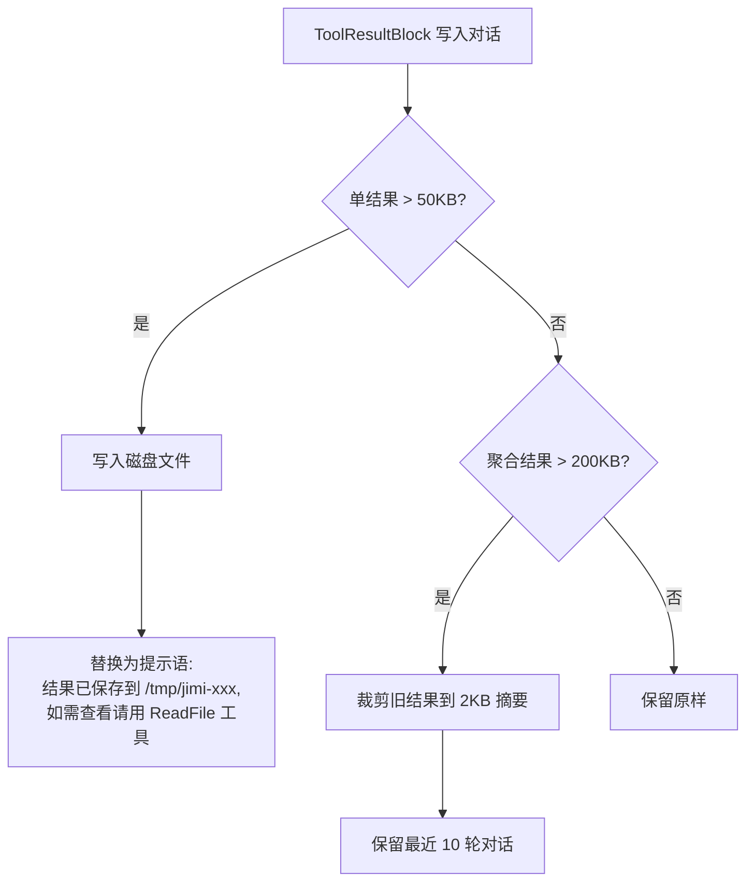
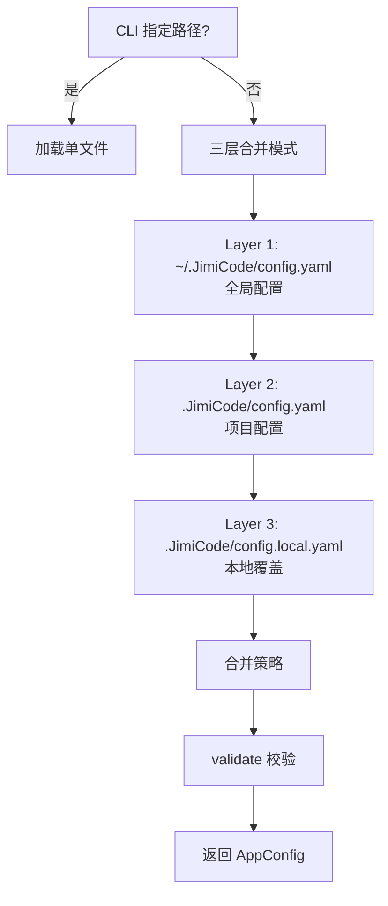
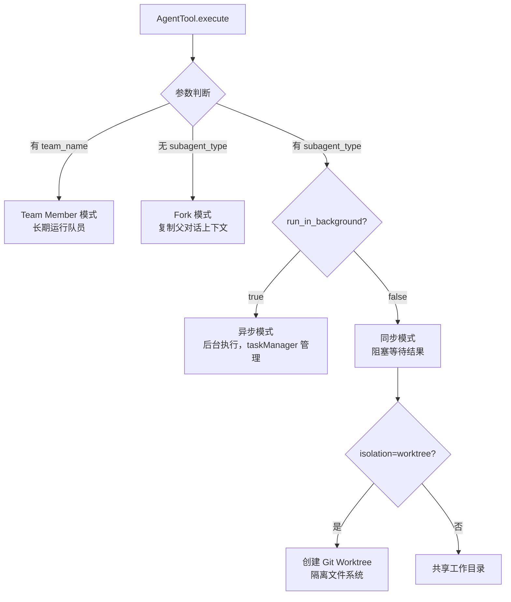
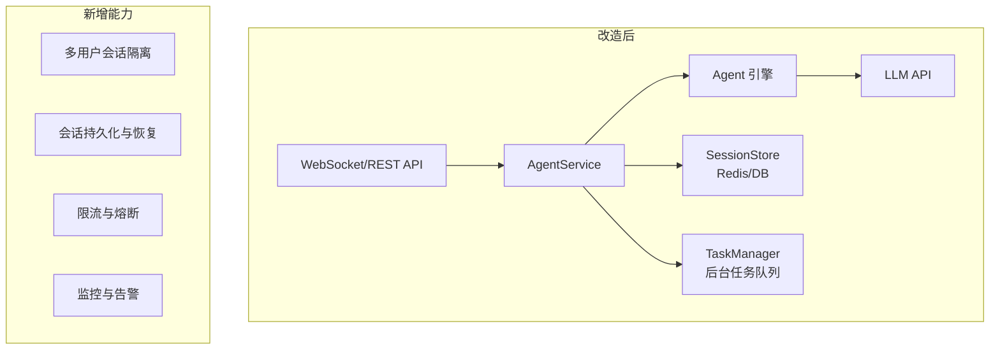

# JimiCode：从入门到生产系统学习文档

> 基于开源项目 [JimiCode](https://github.com/xiaolincoder/jimi-code)，一个 Java CLI 终端 AI 编程 Agent
> 目标读者：有 Spring Boot 经验、准备把 Agent 写进简历并做出可演示工程的后端开发

> 课程版深度教材入口：[`docs/course/README.md`](docs/course/README.md)。该目录按 0～17 章和附录组织，包含 Mermaid 链路图、源码路径、实验、排障、安全、面试题和 FAQ。

> 如果需要一次性阅读仓库内多套教材，请使用整合主教材：[`docs/JIMICODE-整合学习教材.md`](docs/JIMICODE-整合学习教材.md)。

---

## 目录

1. [项目定位与框架对比](#1-项目定位与框架对比)
2. [项目结构与依赖引入](#2-项目结构与依赖引入)
3. [Agent 核心循环：Think→Act→Observe](#3-agent-核心循环thinkactobserve)
4. [模型接入：LlmClient 接口与多协议适配](#4-模型接入llmclient-接口与多协议适配)
5. [Tool / ToolRegistry / Schema 生成](#5-tool--toolregistry--schema-生成)
6. [ToolResultBudget：工具结果预算机制](#6-toolresultbudget工具结果预算机制)
7. [ConfigLoader：三层配置合并与校验](#7-configloader三层配置合并与校验)
8. [ContextCompactor：两层上下文压缩](#8-contextcompactor两层上下文压缩)
9. [SubAgent：AgentTool 与 Worktree 隔离](#9-subagentagenttool-与-worktree-隔离)
10. [Team 模式：多智能体协作](#10-team-模式多智能体协作)
11. [会话持久化、Hook 系统、权限检查](#11-会话持久化hook-系统权限检查)
12. [生产化思路：从 CLI 到服务化](#12-生产化思路从-cli-到服务化)
13. [4 周学习路径与最小里程碑](#13-4-周学习路径与最小里程碑)
14. [简历技术点与面试追问预案](#14-简历技术点与面试追问预案)

---

## 1. 项目定位与框架对比

### 1.1 JimiCode 是什么

JimiCode 是一个**纯 Java CLI 终端 AI 编程 Agent**，像 Claude Code 或 Codex CLI 一样，在终端中通过自然语言驱动代码编写、文件操作、命令执行。它不依赖 Spring 框架，直接通过 `anthropic-java` / `openai-java` 等官方 SDK 调用 LLM，所有组件（Agent 循环、工具系统、上下文管理、子 Agent 调度）均为**手写实现**。

### 1.2 与 AgentScope Java / Spring AI / LangChain4j 的差异

| 维度 | JimiCode | AgentScope Java | Spring AI | LangChain4j |
|------|:---:|:---:|:---:|:---:|
| **定位** | CLI 编程 Agent 应用 | 多智能体运行时平台 | LLM 集成工具包 | LLM 集成工具包 |
| **架构风格** | 手写无框架 | 平台化 SDK | Spring 生态集成 | 抽象层 |
| **容器依赖** | 无（纯 Java） | 可选 Spring Boot | 依赖 Spring | 无 |
| **Agent 循环** | 手写 `agentLoop()` | 内建 ReActAgent | 无 | 有限 |
| **上下文压缩** | 两层：截断+LLM摘要 | 两层：CompactionMiddleware | 无 | 无 |
| **工具结果预算** | ToolResultBudget 写入磁盘 | 无 | 无 | 无 |
| **子 Agent** | AgentTool + Worktree 隔离 | AgentSpawnTool | 无 | 无 |
| **Team 协作** | 原生 TeamManager | A2A 协议 | 无 | 无 |
| **TUI** | 自研终端 UI | 无（Web UI） | 无 | 无 |
| **学习价值** | **极高**：全部手写，透视 Agent 底层 | 高：理解平台化设计 | 中：理解 Spring 集成 | 中：理解抽象层 |

**核心差异一句话**：JimiCode 是"手把手教你写一个 Agent"的教学级项目，AgentScope Java 是"直接用现成的 Agent 平台"的工具级项目。学 JimiCode 让你理解 Agent 的每一行代码为什么这样写，学 AgentScope 让你快速搭建生产级 Agent 系统。

---

## 2. 项目结构与依赖引入

### 2.1 项目结构

```
jimi-code/
├── pom.xml                          # Maven 构建，Java 21+
├── src/main/java/com/jimicode/
│   ├── JimiCode.java                # 程序入口：加载配置→初始化→启动 TUI
│   ├── agent/
│   │   └── Agent.java               # 核心 Agent 循环（Think→Act→Observe）
│   ├── config/
│   │   ├── AppConfig.java           # 配置 POJO（providers/permission/mcp/hooks）
│   │   └── ConfigLoader.java        # 三层配置合并+校验
│   ├── llm/
│   │   ├── LlmClient.java           # LLM 客户端接口（工厂方法）
│   │   ├── AnthropicClient.java     # Anthropic 协议实现
│   │   ├── OpenAiClient.java        # OpenAI 协议实现
│   │   └── OpenAiCompatClient.java  # OpenAI 兼容协议实现
│   ├── tool/
│   │   ├── Tool.java                # 工具接口
│   │   ├── ToolRegistry.java        # 工具注册表 + Schema 生成
│   │   └── ToolResult.java          # 工具执行结果
│   ├── toolresult/
│   │   ├── ToolResultBudget.java    # 工具结果预算控制（核心机制）
│   │   └── ContentReplacementState.java  # 替换状态追踪
│   ├── compact/
│   │   ├── ContextCompactor.java    # 两层上下文压缩
│   │   └── RecoveryState.java       # 压缩恢复状态
│   ├── subagent/
│   │   ├── AgentTool.java           # 子 Agent 工具（Fork/异步/同步）
│   │   └── SubAgentSpec.java        # 子 Agent 规格定义
│   ├── teams/
│   │   ├── TeamManager.java         # 团队管理
│   │   └── SpawnDispatcher.java     # 队员孵化调度
│   ├── conversation/
│   │   ├── ConversationManager.java # 对话管理
│   │   ├── ToolResultBlock.java     # 工具结果块
│   │   └── ToolUseBlock.java        # 工具调用块
│   ├── permission/
│   │   ├── PermissionChecker.java   # 权限检查器
│   │   └── PermissionMode.java      # 权限模式枚举
│   ├── hook/
│   │   └── HookEngine.java          # Hook 引擎
│   ├── session/
│   │   └── SessionManager.java      # 会话持久化
│   └── worktree/
│       ├── WorktreeManager.java     # Git Worktree 管理
│       └── AgentWorktree.java       # Agent 隔离工作树
```

### 2.2 核心依赖

```xml
<!-- pom.xml 关键依赖 -->
<dependencies>
    <!-- Anthropic 官方 SDK -->
    <dependency>
        <groupId>com.anthropic</groupId>
        <artifactId>anthropic-java</artifactId>
    </dependency>
    <!-- OpenAI 官方 SDK -->
    <dependency>
        <groupId>com.openai</groupId>
        <artifactId>openai-java</artifactId>
    </dependency>
    <!-- MCP 协议 -->
    <dependency>
        <groupId>io.modelcontextprotocol.sdk</groupId>
        <artifactId>mcp</artifactId>
    </dependency>
    <!-- YAML 配置解析 -->
    <dependency>
        <groupId>org.yaml</groupId>
        <artifactId>snakeyaml</artifactId>
    </dependency>
    <!-- JSON 处理 -->
    <dependency>
        <groupId>com.fasterxml.jackson.core</groupId>
        <artifactId>jackson-databind</artifactId>
    </dependency>
    <!-- 终端 UI（JLine/TUI 库） -->
    <!-- 测试 -->
    <dependency>
        <groupId>org.junit.jupiter</groupId>
        <artifactId>junit-jupiter</artifactId>
        <scope>test</scope>
    </dependency>
</dependencies>
```

### 2.3 构建方式

```bash
# 使用本机 Maven 构建
mvn clean package

# 直接运行
mvn exec:java -Dexec.mainClass="com.jimicode.JimiCode"
```

---

## 3. Agent 核心循环：Think→Act→Observe

### 3.1 设计原理

JimiCode 的 Agent 循环是**手写的 ReAct 模式**，核心在 `Agent.agentLoop()` 方法中，约 200 行代码，每一行都值得精读：

```mermaid
sequenceDiagram
    participant Loop as Agent.agentLoop()
    participant Conv as ConversationManager
    participant Client as LlmClient
    participant Model as LLM API
    participant Registry as ToolRegistry
    participant Budget as ToolResultBudget

    Loop->>Conv: injectLongTermMemory(instructions, memory)
    loop 每轮迭代 (iteration++)
        Loop->>Loop: 检查 maxIterations 是否超限
        Loop->>Loop: 检查 Thread 是否被中断
        Loop->>Conv: 注入后台任务通知
        Loop->>Registry: getAllSchemas(protocol)
        Registry-->>Loop: 工具 Schema 列表
        Loop->>Budget: apply(conversation, replacementState)
        Budget-->>Loop: ApplyResult（替换/裁剪后的对话）
        Loop->>Client: stream(conv, tools)
        Client->>Model: POST /v1/messages
        Model-->>Client: SSE 流式响应
        Client-->>Loop: BlockingQueue<StreamEvent>
        Loop->>Loop: 处理 StreamEvent 流
        alt 收到 ToolUseBlock
            Loop->>Registry: 执行工具
            Registry-->>Loop: ToolResult
            Loop->>Conv: 写入 ToolResultBlock
            Loop->>Loop: 进入下一轮迭代
        else 收到文本内容
            Loop->>Loop: 累积文本
        else 流结束
            Loop->>Loop: 更新 usageAnchor
            Loop->>Loop: 检查是否需要上下文压缩
            Loop->>Loop: break 循环
        end
    end
    Loop-->>Caller: AgentEvent.LoopComplete
```

### 3.2 关键代码结构

```java
// Agent.java 核心循环（简化）
private void agentLoop(ConversationManager conv, BlockingQueue<AgentEvent> queue) {
    conv.injectLongTermMemory(instructions, memoryContent);

    for (int iteration = 1; ; iteration++) {
        // 防护：最大迭代次数
        if (maxIterations > 0 && iteration > maxIterations) {
            putSafe(queue, new AgentEvent.ErrorEvent("Max iterations reached"));
            break;
        }

        // 注入后台任务通知
        if (notificationFn != null) {
            for (String note : notificationFn.get()) {
                conv.addSystemReminder(note);
            }
        }

        // 工具 Schema 生成（每轮一致，保证 prompt-cache 稳定）
        var iterToolSchemas = registry.getAllSchemas(protocol);

        // 工具结果预算：防止大文件结果撑爆上下文
        ApplyResult budgetResult = ToolResultBudget.apply(
            conv, replacementState, usageAnchor, contextWindow);

        // 调用 LLM 流式接口
        BlockingQueue<StreamEvent> stream = client.stream(conv, iterToolSchemas);
        // ... 处理流事件，执行工具调用，写入结果
    }
}
```

### 3.3 为何这样设计

1. **循环内 Schema 一致性**：每轮迭代开始时生成一次工具 Schema，保证同一轮内 Schema 不变，利用 LLM 的 prompt-cache
2. **ToolResultBudget 在模型调用前**：先压缩再发送，避免浪费 Token
3. **BlockingQueue 流式处理**：生产-消费模式，虚拟线程中运行 Agent 循环，主线程消费事件
4. **usageAnchor 跟踪**：记录真实 API 返回的 Token 用量，用于精确的压缩决策

### 3.4 线上排障

- **症状**：Agent 卡住不动，没有输出
- **原因**：`BlockingQueue.poll(60, SECONDS)` 超时返回 null
- **排查**：检查 LLM API 是否可达、API Key 是否有效、网络是否连通
- **修复**：增加 `StreamEvent` 超时处理逻辑，添加重试机制

---

## 4. 模型接入：LlmClient 接口与多协议适配

### 4.1 设计原理

JimiCode 不依赖任何 LLM 框架，通过**策略模式**直接封装各厂商 SDK：

```java
public interface LlmClient {
    BlockingQueue<StreamEvent> stream(ConversationManager conv, List<Map<String, Object>> tools);

    default void setMaxOutputTokens(int tokens) {}

    static LlmClient create(ProviderConfig cfg, String systemPrompt) {
        return switch (cfg.getProtocol()) {
            case "anthropic"  -> new AnthropicClient(cfg, systemPrompt);
            case "openai"     -> new OpenAiClient(cfg, systemPrompt);
            case "openai-compat" -> new OpenAiCompatClient(cfg, systemPrompt);
            default -> throw new IllegalArgumentException("Unknown protocol: " + cfg.getProtocol());
        };
    }
}
```

### 4.2 支持的协议

| 协议 | 实现类 | 适用模型 |
|------|--------|---------|
| `anthropic` | `AnthropicClient` | Claude 3.5/4 系列 |
| `openai` | `OpenAiClient` | GPT-4o / GPT-4.1 |
| `openai-compat` | `OpenAiCompatClient` | 通义千问、DeepSeek 等兼容 OpenAI 协议的模型 |

### 4.3 配置示例

```yaml
# ~/.JimiCode/config.yaml
providers:
  - name: claude
    protocol: anthropic
    base_url: https://api.anthropic.com
    model: claude-sonnet-4-20250514
    api_key: ${ANTHROPIC_API_KEY}

  - name: qwen
    protocol: openai-compat
    base_url: https://dashscope.aliyuncs.com/compatible-mode/v1
    model: qwen-max
    api_key: ${DASHSCOPE_API_KEY}
```

### 4.4 线上排障

- **症状**：`Unknown protocol: xxx`
- **原因**：配置文件中 `protocol` 字段拼写错误或使用了不支持的协议名
- **排查**：检查 `ConfigLoader.validate()` 的 `VALID_PROTOCOLS` 集合
- **修复**：协议名只能是 `anthropic`、`openai`、`openai-compat` 之一

---

## 5. Tool / ToolRegistry / Schema 生成

### 5.1 Tool 接口

```java
public interface Tool {
    String name();
    String description();
    ToolCategory category();
    Map<String, Object> schema();
    boolean shouldDefer();  // 是否延迟加载（大工具集优化）
    ToolResult execute(Map<String, Object> args);
}
```

### 5.2 ToolRegistry 设计

```java
public class ToolRegistry {
    private final Map<String, Tool> tools = new LinkedHashMap<>();

    public void register(Tool tool) {
        tools.put(tool.name(), tool);
    }

    // 生成符合 LLM 协议的工具 Schema
    public List<Map<String, Object>> getAllSchemas(String protocol) {
        return tools.values().stream()
            .filter(t -> !t.shouldDefer() || isExplicitlyRequested(t))
            .map(Tool::schema)
            .toList();
    }
}
```

### 5.3 Schema 生成

与 AgentScope 的 `@Tool` 注解不同，JimiCode 的 Tool Schema 是**手写 Map 结构**：

```java
// AgentTool 的 Schema 生成
@Override
public Map<String, Object> schema() {
    Map<String, Object> properties = new LinkedHashMap<>();
    properties.put("description", Map.of(
        "type", "string",
        "description", "A short (3-5 word) description of the task"
    ));
    properties.put("prompt", Map.of(
        "type", "string",
        "description", "The task for the agent to perform"
    ));
    properties.put("subagent_type", Map.of(
        "type", "string",
        "enum", List.of("general-purpose", "plan", "explore"),
        "description", "The type of agent to use"
    ));

    Map<String, Object> inputSchema = new LinkedHashMap<>();
    inputSchema.put("type", "object");
    inputSchema.put("properties", properties);
    inputSchema.put("required", List.of("description", "prompt"));

    return Map.of(
        "name", name(),
        "description", description(),
        "input_schema", inputSchema
    );
}
```

### 5.4 线上排障

- **症状**：模型不调用某个工具，或调用时参数格式错误
- **原因**：Schema 的 `description` 和 `enum` 不匹配模型理解
- **排查**：检查 `getAllSchemas()` 返回的 Schema JSON，用 LLM Playground 验证
- **修复**：优化 Schema 中的 `description` 字段，确保参数说明清晰、枚举值完整

---

## 6. ToolResultBudget：工具结果预算机制

### 6.1 设计原理

这是 JimiCode **最精妙的设计之一**。当工具返回超大结果（如读取 10MB 日志文件），直接将结果放到对话中会撑爆上下文窗口。



### 6.2 核心逻辑

```java
// ToolResultBudget.apply() 核心逻辑
public static ApplyResult apply(
        ConversationManager conv,
        ContentReplacementState state,
        UsageAnchor usageAnchor,
        int contextWindow) {

    // 规则 1：单条结果 > 50KB → 写入磁盘，替换为提示语
    // 规则 2：聚合结果 > 200KB → 裁剪旧结果
    // 规则 3：保留最近 10 轮对话
    // 规则 4：文件已存在且大小一致 → 跳过写盘，复用提示（prompt-cache 友好）
}
```

### 6.3 关键设计决策

1. **替换而非截断**：原文完整保存在磁盘，模型可通过 `ReadFile` 工具读回
2. **字节稳定性**：`ContentReplacementState` 追踪替换决策，保证同一 `toolUseId` 的替换一致性，维持 prompt-cache 前缀稳定
3. **按需读取**：平时"瘦着发"，按需"胖一次"——只在模型真正需要时才读回完整内容

### 6.4 线上排障

- **症状**：大文件读取后 Agent "看不到"内容
- **原因**：ToolResultBudget 已将结果替换为提示语
- **排查**：检查 `/tmp/jimi-*` 目录下的文件是否存在，确认提示语格式正确
- **修复**：这是设计行为，Agent 应自动调用 ReadFile 工具读取磁盘文件

---

## 7. ConfigLoader：三层配置合并与校验

### 7.1 设计原理



### 7.2 合并策略

```java
// ConfigLoader.mergeConfig() 合并规则
private static void mergeConfig(AppConfig base, AppConfig override) {
    // providers: 整体替换（不合并）
    if (override.getProviders() != null && !override.getProviders().isEmpty()) {
        base.setProviders(override.getProviders());
    }

    // permission_mode: 非空覆盖
    if (override.getPermissionMode() != null && !override.getPermissionMode().isBlank()) {
        base.setPermissionMode(override.getPermissionMode());
    }

    // mcp_servers: 同名替换，异名追加
    // hooks: 追加合并
}
```

### 7.3 校验逻辑

```java
private static void validate(AppConfig cfg) throws ConfigException {
    // 至少一个 provider
    // 每个 provider 必须有 name/protocol/base_url/model
    // protocol 必须是 anthropic/openai/openai-compat
}
```

### 7.4 线上排障

- **症状**：`No config file found`
- **原因**：三层路径都没有配置文件
- **排查**：检查 `~/.JimiCode/config.yaml`、`$PWD/.JimiCode/config.yaml`、`$PWD/.JimiCode/config.local.yaml` 是否存在
- **修复**：创建至少一个配置文件，或通过 CLI 参数 `--config` 指定路径

---

## 8. ContextCompactor：两层上下文压缩

### 8.1 设计原理

```java
// 两层压缩策略
// Layer 1（轻量）：截断旧消息 + 裁剪冗余 ToolResult
//   - 单结果 > 50,000 chars → 替换为摘要
//   - 聚合结果 > 200,000 chars → 裁剪旧结果到 2,000 chars
//   - 保留最近 10 轮对话

// Layer 2（LLM 摘要）：当 Token 使用量 > 80% 上下文窗口
//   - 触发条件：usedTokens >= effectiveWindow - 13000
//   - 硬限制：usedTokens >= effectiveWindow - 3000（强制压缩）
//   - 生成摘要后注入为系统消息
```

### 8.2 关键参数

```java
public final class ContextCompactor {
    private static final int SUMMARY_OUTPUT_RESERVE = 20_000;   // 摘要响应预留
    private static final int AUTO_COMPACT_SAFETY_MARGIN = 13_000;  // 软触发线
    private static final int MANUAL_COMPACT_SAFETY_MARGIN = 3_000;   // 硬触发线
    private static final int SINGLE_RESULT_LIMIT = 50_000;       // 单结果阈值
    private static final int MESSAGE_AGGREGATE_LIMIT = 200_000;   // 聚合阈值
    private static final int KEEP_RECENT_TURNS = 10;             // 保留轮数
}
```

### 8.3 UsageAnchor 机制

```java
// UsageAnchor: 记录真实 API 返回的 Token 用量
// 冷启动时：用字符数估算
// 首轮 API 调用后：切换到真实的 prompt_tokens + completion_tokens
// 目的：精确判断何时触发压缩，避免过早或过晚
```

### 8.4 RecoveryState

压缩后恢复关键上下文：

```java
public class RecoveryState {
    // 最近的文件读取记录
    // 当前激活的 Skill SOP
    // 压缩后注入到对话开头，保证 Agent 不丢失关键信息
}
```

### 8.5 线上排障

- **症状**：压缩后 Agent 行为异常，重复已完成的操作
- **原因**：压缩丢失了任务进度信息
- **排查**：检查 `RecoveryState` 是否正确保存了最近操作，检查压缩摘要的质量
- **修复**：增大 `KEEP_RECENT_TURNS`，或在关键操作后主动调用 `MemorySave`

---

## 9. SubAgent：AgentTool 与 Worktree 隔离

### 9.1 三种子 Agent 模式



### 9.2 Fork 模式核心

```java
// Fork: 复制父对话 + 注入 fork boilerplate
private ToolResult runFork(String description, String prompt, String modelOverride) {
    // 1. 检查嵌套 fork（禁止 fork 中再 fork）
    // 2. 构建 forkedConversation：复制父消息 + placeholder 结果
    // 3. 注入 fork boilerplate（行为约束）
    // 4. 传递 parentReplacementState（保持 prompt-cache 一致）
    // 5. 后台执行，返回 taskId
}
```

### 9.3 Worktree 隔离

```java
// 创建隔离的工作树
AgentWorktree.Result wtResult = AgentWorktree.create(
    slug,                          // 唯一标识
    worktreeManager.getProjectRoot(),  // 项目根目录
    worktreeManager.getSymlinkDirs()   // 软链接目录
);

subAgent.setWorkDir(wtResult.worktreePath());
// 注入工作路径通知
String notice = AgentWorktree.buildNotice(userDir, wtResult.worktreePath());
prompt = notice + "\n\n" + prompt;

// 完成后清理
if (WorktreeChanges.hasChanges(wtResult.worktreePath(), wtResult.headCommit())) {
    // 保留 worktree（有未提交变更）
} else {
    AgentWorktree.remove(wtResult.worktreePath(), wtResult.worktreeBranch(), wtResult.gitRoot());
}
```

### 9.4 线上排障

- **症状**：子 Agent 超时，`queue.poll(60, SECONDS)` 返回 null
- **原因**：子 Agent 工具调用耗时过长或卡住
- **排查**：检查子 Agent 的 `AgentEvent.ToolResultEvent` 日志，确认哪个工具调用耗时最长
- **修复**：为子 Agent 设置更小的 `maxIterations`，或增加超时时间

---

## 10. Team 模式：多智能体协作

### 10.1 设计原理

JimiCode 的 Team 模式是**Leader-Follower 架构**：

```java
// TeamManager 管理团队
public class TeamManager {
    // teamName → Team
    private final Map<String, Team> teams = new ConcurrentHashMap<>();

    public Team createTeam(String name) { ... }
    public Team getTeam(String name) { ... }
}

// Team 管理成员
public class Team {
    private final String name;
    private final Map<String, TeammateRunner> members = new ConcurrentHashMap<>();

    public boolean hasMember(String name) { ... }
    public List<String> memberNames() { ... }
}

// 队员间通信
public class SendMessageTool implements Tool {
    // 发送消息给其他队员
    // 接收方通过 notificationFn 收到消息
}
```

### 10.2 队员孵化流程

```java
// AgentTool.runAsTeammate()
private ToolResult runAsTeammate(SubAgentSpec spec, String teamName, ...) {
    // 1. 验证 Team 存在
    // 2. 去重成员名
    // 3. 构建 subRegistry（过滤工具 + 添加 SendMessageTool）
    // 4. 构建 addendum（团队上下文 + 其他成员名）
    // 5. 可选 worktree 隔离
    // 6. SpawnDispatcher.spawnTeammate()
}
```

### 10.3 线上排障

- **症状**：队员之间消息丢失
- **原因**：`notificationFn` 未正确注入或 `SendMessageTool` 未注册
- **排查**：检查 `SpawnDispatcher` 日志，确认队员的 `notificationFn` 已设置
- **修复**：确保 `SendMessageTool` 在 `subRegistry` 中注册，且 teamName 参数正确

---

## 11. 会话持久化、Hook 系统、权限检查

### 11.1 会话持久化

```java
// SessionManager 管理会话
// - 会话 ID 由 SessionIdUtils 生成
// - 对话记录写入磁盘 transcript
// - 压缩边界记录写入同一 session 文件
// - 支持 resume 恢复：从 transcript 重建压缩后的对话状态

// 关键设计：compaction 时将 compact_boundary 记录写入 session 文件
// 恢复时读取 boundary，重建压缩后的上下文
```

### 11.2 Hook 系统

```java
// HookEngine 在 Agent 生命周期各节点触发回调
// 支持：
// - PreToolUse: 工具调用前
// - PostToolUse: 工具调用后
// - Notification: 自定义通知
// - Stop: Agent 停止

// 配置（config.yaml）
hooks:
  - type: command
    command: "echo 'Tool called: {{tool_name}}' >> /tmp/agent.log"
    matcher: "ToolUse"
```

### 11.3 权限检查

```java
// PermissionMode 枚举
public enum PermissionMode {
    ALLOW_ALL,    // 允许所有操作
    ASK,          // 每次操作前询问用户
    DENY_ALL      // 拒绝所有操作
}

// PermissionChecker 在工具执行前检查
// 支持：
// - 工具名过滤
// - 路径模式匹配
// - 用户确认交互
```

### 11.4 线上排障

- **症状**：Hook 脚本执行失败但不影响 Agent 运行
- **原因**：Hook 脚本本身有 bug，但 `HookEngine` 默认不阻断 Agent
- **排查**：检查 Hook 脚本的 stdout/stderr 输出
- **修复**：确保 Hook 脚本健壮，或在 Agent 配置中设置 `stop_on_hook_error: true`

---

## 12. 生产化思路：从 CLI 到服务化

### 12.1 当前架构

```
┌──────────────┐     ┌──────────────┐     ┌──────────────┐
│   TUI 终端    │────▶│   Agent 引擎  │────▶│   LLM API    │
│  (Program)   │◀────│  (agentLoop) │◀────│  (stream)    │
└──────────────┘     └──────────────┘     └──────────────┘
```

### 12.2 服务化改造方案



### 12.3 关键改造点

| 改造项 | 现状 | 目标 |
|--------|------|------|
| 入口 | TUI `Program` | Spring Boot REST + WebSocket |
| 会话管理 | 内存 `ConversationManager` | Redis/DB 持久化 `SessionStore` |
| 配置管理 | 文件 `ConfigLoader` | 配置中心 + 环境变量 |
| 子 Agent | 本地进程 | 独立服务 + 消息队列 |
| 监控 | 无 | Micrometer + OpenTelemetry |

### 12.4 服务化示例代码

```java
@RestController
@RequestMapping("/api/agent")
public class AgentController {
    private final AgentService agentService;

    @PostMapping("/chat")
    public SseEmitter chat(@RequestBody ChatRequest request) {
        SseEmitter emitter = new SseEmitter(300_000L);

        Agent agent = agentService.getOrCreateAgent(request.getSessionId());
        ConversationManager conv = agentService.getOrCreateConversation(request.getSessionId());
        conv.addUserMessage(request.getMessage());

        BlockingQueue<AgentEvent> queue = agent.run(conv);
        // 异步消费事件，通过 SSE 推送
        Thread.startVirtualThread(() -> {
            try {
                while (true) {
                    AgentEvent event = queue.poll(60, TimeUnit.SECONDS);
                    if (event instanceof AgentEvent.StreamText st) {
                        emitter.send(SseEmitter.event().data(st.text()));
                    } else if (event instanceof AgentEvent.LoopComplete) {
                        emitter.complete();
                        break;
                    }
                }
            } catch (Exception e) {
                emitter.completeWithError(e);
            }
        });

        return emitter;
    }
}
```

---

## 13. 4 周学习路径与最小里程碑

### 第 1 周：跑通并理解核心循环

| 日期 | 内容 | 交付物 |
|------|------|--------|
| Day 1-2 | 配置 API Key，跑通 JimiCode CLI | 终端对话截图 |
| Day 3-4 | 逐行阅读 `Agent.agentLoop()`，画出时序图 | 手绘 ReAct 循环图 |
| Day 5-6 | 理解 `LlmClient` 接口与三种协议实现 | 协议适配对比笔记 |
| Day 7 | 理解 `ConfigLoader` 三层合并 + 校验 | 配置加载流程图 |

### 第 2 周：深入机制设计

| 日期 | 内容 | 交付物 |
|------|------|--------|
| Day 8-9 | 精读 `ToolResultBudget`，理解替换而非截断 | 预算机制分析笔记 |
| Day 10-11 | 精读 `ContextCompactor` 两层压缩 | 压缩策略对比表 |
| Day 12-13 | 实现一个自定义 Tool | 自定义工具 Demo |
| Day 14 | 理解 `RecoveryState` + `UsageAnchor` | 压缩恢复机制笔记 |

### 第 3 周：子 Agent 与协作

| 日期 | 内容 | 交付物 |
|------|------|--------|
| Day 15-16 | 精读 `AgentTool`，理解 Fork/同步/异步三种模式 | 子 Agent 调度流程图 |
| Day 17-18 | 精读 `AgentWorktree` 隔离机制 | Worktree 隔离 Demo |
| Day 19-20 | 精读 `TeamManager` + `SendMessageTool` | 多 Agent 协作 Demo |
| Day 21 | 理解 `HookEngine` + `PermissionChecker` | Hook 脚本示例 |

### 第 4 周：服务化改造 + 简历

| 日期 | 内容 | 交付物 |
|------|------|--------|
| Day 22-24 | 将 JimiCode 核心引擎包装为 Spring Boot 服务 | REST API + SSE 流式输出 |
| Day 25-26 | 添加会话持久化（Redis/H2） | 多用户会话管理 |
| Day 27-28 | 文档 + 简历 + 面试准备 | 可演示的完整项目 |

---

## 14. 简历技术点与面试追问预案

### 14.1 简历可写技术点

| 技术点 | 简历描述示例 |
|--------|-------------|
| **ReAct 决策循环** | "手写实现 ReAct Agent 决策循环（Think→Act→Observe），支持多轮工具调用与流式响应" |
| **多协议 LLM 适配** | "基于策略模式实现 Anthropic/OpenAI/OpenAI 兼容三种协议的统一适配层" |
| **工具结果预算** | "设计 ToolResultBudget 机制，对大文件结果自动写入磁盘并替换为提示语，保障上下文窗口不溢出" |
| **两层上下文压缩** | "实现两层上下文压缩策略：Layer 1 轻量截断 + Layer 2 LLM 摘要，配合 RecoveryState 保证关键信息不丢失" |
| **多智能体协作** | "实现 AgentTool 子 Agent 调度系统，支持 Fork/同步/异步三种模式，结合 Git Worktree 实现文件系统隔离" |
| **Team 模式** | "设计 Leader-Follower 多 Agent 协作架构，通过 SendMessageTool 实现队员间通信" |
| **三层配置合并** | "实现 ConfigLoader 三层配置合并（全局→项目→本地），支持 SnakeYAML 解析与蛇形命名自动转换" |

### 14.2 面试追问预案

**Q1：为什么 ContextCompactor 需要两层设计？**

> 一层不够，因为：
> 1. **Layer 1（轻量截断）**：延迟极低（< 1ms），处理 90% 的 Token 溢出场景——只需截断旧消息、裁剪旧结果
> 2. **Layer 2（LLM 摘要）**：延迟高（需要调用 LLM），但保留语义信息——只在 Layer 1 不够用（Token 使用量 > 80%）时触发
> 3. 如果只用 LLM 摘要：每次压缩都是一次 LLM 调用，成本高、延迟高
> 4. 如果只用截断：丢失语义，Agent 可能"失忆"
> 5. 两层结合：日常用轻量截断保持性能，极端情况下用 LLM 摘要保留语义

**Q2：ToolResultBudget 为什么选择"替换"而不是"截断"？**

> 截断的问题是**信息丢失不可逆**：
> 1. 如果截断日志文件的后半部分，模型可能看不到关键错误信息
> 2. 如果截断前半部分，模型可能看不到错误的上下文
> 3. 替换方案：完整内容保存在磁盘，模型需要时通过 ReadFile 按需读取
> 4. 优势：平时节省 Token（只发提示语），需要时精确获取（模型自己决定读哪个部分）
> 5. 代价：增加了一次 ReadFile 工具调用，但相比 10MB 的 Token 消耗，这点代价微不足道

**Q3：UsageAnchor 为什么需要从字符估算切换到真实 Token？**

> 字符估算和真实 Token 差异很大：
> 1. 中文字符：1 个字符 ≈ 2-3 个 Token
> 2. 英文单词：1 个单词 ≈ 1-2 个 Token
> 3. 代码：1 个字符 ≈ 0.3-0.5 个 Token
> 4. 如果用字符估算，压缩触发可能过早（中文场景）或过晚（代码场景）
> 5. 首轮冷启动用字符估算，首轮 API 调用后切换到真实 Token，后续决策精确

**Q4：ConfigLoader 的三层合并为什么 providers 是整体替换而不是合并？**

> 这是有意为之的设计决策：
> 1. **providers 整体替换**：因为 provider 配置之间可能有互斥关系（如不同的 API Key 不能混用），合并会导致不可预期的行为
> 2. **mcp_servers 同名替换/异名追加**：MCP Server 配置独立，合并合理
> 3. **hooks 追加合并**：Hook 是独立的，多个配置文件的 Hook 应该都生效
> 4. 核心原则：**有互斥风险的字段用替换，独立字段用合并**

**Q5：Agent 在虚拟线程中运行的优势和风险？**

> 优势：
> 1. **轻量级**：虚拟线程不占用 OS 线程，可以创建成千上万个
> 2. **阻塞友好**：`BlockingQueue.poll()` 阻塞时自动释放底层 OS 线程
> 3. **简化代码**：不需要 CompletableFuture 回调链，代码像同步一样写
>
> 风险：
> 1. **pin 问题**：`synchronized` 块中阻塞会 pin 住底层 OS 线程
> 2. **ThreadLocal 泄漏**：虚拟线程频繁创建/销毁，ThreadLocal 需要手动清理
> 3. **排查**：使用 `-Djdk.tracePinnedThreads=full` 检测 pin 问题

---

> **文档版本**：v1.0 | **更新日期**：2026-08-24 | **项目地址**：[github.com/xiaolincoder/jimi-code](https://github.com/xiaolincoder/jimi-code)
