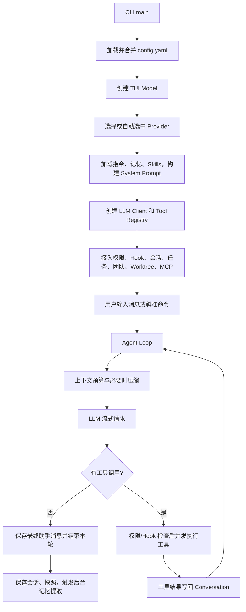

# JimiCode 项目详细说明

> 生成日期：2026-08-10  
> 覆盖范围：当前工作区中的 Go、Java 源码，测试，构建配置，内置 Skill，Wrapper/构建产物。  
> 说明：当前目录不包含 `.git` 元数据；`build/` 和二进制 JAR 按生成物说明，不反编译第三方依赖。

## 1. 项目定位

JimiCode 是一个运行在终端中的 AI Coding Agent。它把 LLM 的流式输出、工具调用、权限控制、上下文压缩、持久记忆、子 Agent、Agent 团队、MCP 和 Git worktree 组合成一个完整的交互式编程助手。

本工作区同时保留了两套可以独立理解的实现：

| 实现 | 位置 | 构建系统 | TUI | 当前定位 |
|---|---|---|---|---|
| Go | `cmd/`、`internal/` | Go Modules | Bubble Tea | 功能更丰富、测试覆盖更广，包含内置 Skill、命令文件、后台记忆提取、外部 teammate 进程等能力 |
| Java | `src/main/java/`、`src/test/java/` | Gradle Kotlin DSL | TUI4J | README 中默认介绍的打包运行路径，可生成单体可执行 JAR |

两套代码共享相同的核心思想和大量同名模块，但不是逐行等价：Go 侧已有一些 Java 侧尚未完全接入的能力，配置细节也存在差异。阅读和修改时应先确定目标运行时，不能把一侧的行为直接假定为另一侧也已实现。

## 2. 目录结构

```text
JimiCode-java/
├─ cmd/JimiCode/                  # Go CLI/TUI 入口及 teammate worker 入口
├─ internal/                     # Go 主体实现与 Go 测试
│  ├─ agent/                     # Agent 循环
│  ├─ agents/                    # 子 Agent
│  ├─ compact/                   # 上下文压缩
│  ├─ llm/                       # Anthropic/OpenAI 客户端
│  ├─ tools/                     # 内置工具
│  ├─ skills/                    # Skill 目录、执行、安装和内置 Skill
│  ├─ memory/                    # 长期记忆与后台提取
│  ├─ teams/                     # 多 Agent 团队
│  ├─ worktree/                  # Git worktree 隔离
│  └─ ...                        # 权限、会话、Hook、任务、TUI 等
├─ src/main/java/com/JimiCode/    # Java 实现
├─ src/test/java/com/JimiCode/    # Java JUnit 测试
├─ gradle/wrapper/               # Gradle Wrapper
├─ build/libs/JimiCode.jar        # 已生成的 Java 21 fat JAR
└─ docs/PROJECT_GUIDE.md         # 本文档
```

## 3. 环境要求与运行

### 3.1 Java 实现

要求：

- JDK 21 或更高版本。`build.gradle.kts` 使用 Java Toolchain 21；现有 JAR 的 class major version 为 65，即 Java 21。
- 首次运行 Gradle Wrapper 时需要访问 `services.gradle.org` 和 Maven Central。
- MCP 的 stdio Server 还需要对应命令，例如 `npx`、`node` 或 `uvx`。
- 文件命令工具会按当前工作目录工作；Bash 工具在 Windows 上仍调用 `bash -c`，因此需要 Git Bash、WSL Bash 或其他可用的 `bash`。

Windows PowerShell：

```powershell
.\gradlew.bat clean shadowJar
java -jar build\libs\JimiCode.jar
```

Linux/macOS：

```bash
./gradlew clean shadowJar
java -jar build/libs/JimiCode.jar
```

Java 入口支持两种配置路径覆盖方式：

```powershell
# 第一命令行参数优先
java -jar build\libs\JimiCode.jar D:\path\to\config.yaml

# 未传参数时读取环境变量
$env:JimiCode_CONFIG = "D:\path\to\config.yaml"
java -jar build\libs\JimiCode.jar
```

运行测试：

```powershell
.\gradlew.bat test
```

### 3.2 Go 实现

要求：

- `go.mod` 声明 Go 1.25.0。
- 首次构建需要下载 Go Modules。
- Bash 工具同样依赖 `bash`。
- tmux/iTerm 团队后端是可选能力；默认团队后端为进程内模式。

```bash
go run ./cmd/JimiCode

# 或构建二进制
go build -o JimiCode ./cmd/JimiCode
./JimiCode

# 测试
go test ./...
```

Go 的普通入口不接受配置文件路径参数，而是自动合并默认配置层。`--teammate --team-name <team> --agent-name <name>` 是团队框架内部启动 worker 时使用的模式，不是普通交互启动方式。

### 3.3 当前工作区实测结果

本次检查环境只有 Java 17，未安装 Go；Gradle 8.13 Wrapper 下载又因本机 Java 信任库的 PKIX 证书链错误失败。因此当前环境无法重新执行 Java/Go 测试。已有 `build/libs/JimiCode.jar` 的 Manifest 指向 `com.JimiCode.JimiCode`，但该 JAR 需要 Java 21，不能用当前 Java 17 启动。

## 4. 配置文件

### 4.1 查找与合并顺序

未显式指定路径时，两套实现都按以下顺序读取：

1. `~/.JimiCode/config.yaml`
2. `<当前工作目录>/.JimiCode/config.yaml`
3. `<当前工作目录>/.JimiCode/config.local.yaml`

后面的层覆盖前面的层。`providers` 整体替换；`mcp_servers` 按 `name` 合并/覆盖；`hooks` 追加；`permission_mode` 非空时覆盖。至少需要一个 Provider，且 `name`、`protocol`、`base_url`、`model` 必填。

### 4.2 Provider 配置

```yaml
providers:
  - name: anthropic-main
    protocol: anthropic       # anthropic / openai / openai-compat
    base_url: https://api.anthropic.com
    api_key: "..."            # 可省略，改读环境变量
    model: claude-sonnet-4-6
    thinking: true
    context_window: 200000    # 可选，最高优先级
    max_output_tokens: 64000  # 可选
```

API Key 的解析顺序是配置值优先，然后按协议读取 `ANTHROPIC_API_KEY` 或 `OPENAI_API_KEY`。上下文窗口按“显式配置 → Anthropic `/v1/models/{model}` 探测（Go 侧）→ 内置模型表 → 保守默认值”解析；输出上限在显式值缺失时，thinking 模式默认为 64000，否则为 8192。

协议含义：

| `protocol` | API | 思考内容 | 工具调用 |
|---|---|---|---|
| `anthropic` | Anthropic Messages API | 支持 enabled/adaptive thinking，保留 thinking signature | Anthropic `tool_use`/`tool_result` |
| `openai` | OpenAI Responses API | 支持 reasoning summary/encrypted content | Responses function call |
| `openai-compat` | Chat Completions API | 不保留原生 thinking block | Chat Completions tool calls，适合兼容服务 |

### 4.3 MCP 配置

stdio 示例：

```yaml
mcp_servers:
  - name: context7
    command: npx
    args: ["-y", "@upstash/context7-mcp"]
    env:
      TOKEN: "${CONTEXT7_TOKEN}"
```

HTTP 示例：

```yaml
mcp_servers:
  - name: remote
    url: https://example.com/mcp
    transport: http           # Go: http/streamable 或 sse；Java 当前使用 streamable HTTP
    headers:
      Authorization: "Bearer ${MCP_TOKEN}"
```

连接成功后，Server 工具被包装成 `mcp__<server>__<tool>`，非字母数字字符转成下划线。MCP 工具默认延迟加载，模型先通过 `ToolSearch` 发现后，下一轮才会收到完整 schema。

### 4.4 Hook 配置差异

Go Hook 使用嵌套 `action`，支持 command、prompt、http、agent，支持 `once`、`async` 和 `on_error`：

```yaml
hooks:
  - id: format-go
    event: post_tool_use
    if: 'tool == "WriteFile" && file_path =* "*.go"'
    action:
      type: command
      command: gofmt -w "$JimiCode_FILE_PATH"
      timeout: 30s
    once: false
    async: false
    on_error: ignore
```

Java `HookConfig` 当前采用扁平字段，只接入 command/script/prompt、condition 和 reject：

```yaml
hooks:
  - id: notify
    event: post_receive
    condition: 'message =~ /done/'
    type: prompt
    message: "Model response received"
    reject: false
```

事件名包括 `session_start`、`session_end`、`turn_start`、`turn_end`、`pre_send`、`post_receive`、`pre_tool_use`、`post_tool_use`、`shutdown`。Go 启动入口会先校验 Hook；任意配置错误会警告并禁用整组 Hook，避免运行中才失败。

### 4.5 `permission_mode` 的现状

配置对象会读取 `permission_mode`，但当前 Go/Java TUI 构造参数都没有把它传给主 Agent，主 Agent实际仍以 `default` 启动。Go 可用 `/permission mode ...` 或 Shift+Tab 切换；Java 主要通过 Shift+Tab 切换。这是“已解析但入口未接线”的字段。

## 5. 启动与主调用链



Java `JimiCode.main` 还负责隐藏/恢复光标、给 TUI 注入 `Program`，并在虚拟线程中重新注册 SIGINT：流式响应期间 Ctrl+C 中断当前回答，空闲时退出。Go `main` 先识别 teammate worker 参数，否则运行 Bubble Tea Model。

## 6. Agent Loop 逻辑

每轮执行顺序可概括为：

1. 首轮把项目指令和长期记忆注入会话头部。
2. 收集后台子任务/团队邮箱通知，作为 `<system-reminder>` 加入上下文。
3. 根据当前 Skill/团队协调模式筛选可见工具 schema。
4. Layer 2 检查上下文 token；必要时只摘要旧前缀并原样保留最近消息。
5. 计划模式下注入计划文件位置和五阶段工作流提醒。
6. 提示模型有哪些 deferred tools 可用。
7. Layer 1 对工具结果做落盘、聚合限额和旧结果裁剪，生成不修改原会话的 API 视图。
8. 调用 LLM 流式接口，把文本、思考、工具 JSON 增量统一映射成 `StreamEvent`。
9. 工具调用一完整就立即异步执行，不必等待 LLM 整条流结束；最终按调用顺序收集结果。
10. 无工具调用时结束；有工具调用时把 assistant tool-use 和 user tool-result 写回会话，进入下一轮。

异常处理：

- `ContextTooLong`：强制压缩后重试，并清除旧 usage anchor。
- 限流：读取 `Retry-After`，等待后重试。
- `max_tokens`：首次把模型输出上限提升到 64000；之后最多再进行三次“从中断处继续”的多轮恢复。
- 连续三个未知工具（Go）：终止循环，防止模型无限调用不存在的名称。
- 流空闲：各 LLM 适配器设置 5 分钟 SSE idle timeout；Java Agent 消费队列另有 30 秒 poll timeout。

## 7. 核心接口

### 7.1 LLM 接口

Go：

```go
type Client interface {
    Stream(ctx context.Context, conv *conversation.Manager,
        tools []map[string]any) (<-chan StreamEvent, <-chan error)
}
```

Java：

```java
interface LlmClient {
    BlockingQueue<StreamEvent> stream(
        ConversationManager conv, List<Map<String, Object>> tools);
}
```

适配器必须把厂商事件归一化为文本增量、thinking 增量/完成、工具调用开始/参数增量/完成、usage 和流结束。Agent 因而不依赖具体 SDK。

### 7.2 Tool 接口

工具都提供名称、给模型看的描述、权限类别、JSON Schema 和执行函数。类别为 read、write、command，直接影响权限矩阵。Java 的 `shouldDefer()` 和 Go 的 `DeferrableTool` 决定 schema 是否默认发送给模型。

主要工具：

| 工具 | 类别 | 作用与关键约束 |
|---|---|---|
| `ReadFile` | read | 按 offset/limit 读取并带行号返回，同时记录内容和 mtime，为后续编辑建立“先读后改”状态 |
| `WriteFile` | write | 创建目录并写完整文件；已有文件必须先读，写前进入文件历史 |
| `EditFile` | write | 对唯一的 `old_string` 做一次精确替换；零次或多次匹配均报错 |
| `Bash` | command | 通过 `bash -c` 执行；Go 默认 120 秒、最大 600 秒，汇总 stdout/stderr/exit code |
| `Glob` | read | 遍历文件并匹配 glob，跳过 `.git`、`node_modules`、虚拟环境等目录 |
| `Grep` | read | 对文件逐行执行正则搜索，可按文件名 include 过滤 |
| `ToolSearch` | read | `select:A,B` 精确加载或按关键词搜索 deferred tools，并标记为已发现 |
| `AskUserQuestion` | read | 把 1-4 个结构化选择题交给 TUI 对话框，等待用户回答 |
| `ExitPlanMode` | read | 校验当前确在计划模式且计划文件存在，通知 TUI 展示审批对话框 |
| `EnterWorktree` | command | 创建/恢复 JimiCode 管理的隔离 worktree，并保存 session |
| `ExitWorktree` | command | keep 或 remove 当前会话 worktree；有改动时要求显式 `discard_changes` |
| `TaskCreate/Get/List/Update` | read/write | 管理带状态、依赖、owner 和 metadata 的持久任务列表 |
| `Agent` | command | 启动同步、后台、fork、worktree 隔离或团队 teammate 子 Agent |
| `TeamCreate/Delete` | command | 建立/销毁长期 Agent 团队，Lead 有团队时进入协调工具白名单 |
| `SendMessage` | command | 通过共享文件邮箱向 teammate 或 lead 发消息 |
| `LoadSkill` | read/system | Go：按需加载 Skill 正文并固定到每轮环境上下文，注册目录工具 |
| `InstallSkill` | write | Go：从 skills.sh/GitHub URL 安装用户级 Skill 并热刷新 Catalog |
| `parse_resume` | read | Go 内置 backend-interview Skill 的专用工具，提取技术栈、项目和工作年限 |
| `mcp__*` | command | 动态包装 MCP Server 暴露的工具；默认 deferred |

### 7.3 Conversation 与事件

Conversation 的 Message 同时支持普通文本、thinking block、tool-use block 和 tool-result block。工具结果作为 `user` 角色消息保存，以满足 Anthropic/OpenAI 的工具协议。Manager 提供追加、截断、复制读取，以及一次性的长期记忆注入。

LLM `StreamEvent` 是“厂商协议层事件”；Agent `AgentEvent` 是“交给 TUI 的运行事件”。后者额外包含权限请求、工具耗时、重试、压缩、turn/loop 完成等 UI 所需信息。

## 8. 权限模型

权限检查顺序：

1. 计划模式例外：只允许计划文件写入和必要的协作/提问工具。
2. 安全只读命令白名单，例如 `git status`、`git diff`、`go version`。
3. 危险命令硬拦截，例如根目录 `rm -rf`、`mkfs`、向磁盘设备写入、远程脚本 pipe 到 shell。
4. 路径沙箱：文件工具仅能访问项目根、临时目录和额外允许的 memory 目录。
5. 用户/项目/本地 YAML 权限规则，按工具名和 glob 内容匹配。
6. 权限模式矩阵；结果为 allow、deny 或 ask。
7. ask 时 TUI 展示 Allow、Deny、Always Allow；Always Allow 会追加本地规则。

模式矩阵：

| 模式 | read | write | command |
|---|---:|---:|---:|
| `default` | allow | ask | ask |
| `acceptEdits` | allow | allow | ask |
| `plan` | 只读/计划例外 | deny/例外 | deny/少数例外 |
| `bypassPermissions` | allow | allow | allow；危险命令硬拦截仍在前面 |

## 9. 上下文管理

### Layer 1：工具结果预算

- 单个工具结果超过 50,000 字符时写入 `.JimiCode/tool_results/`，上下文只保留可回读的稳定提示。
- 同一条消息的工具结果合计超过 200,000 字符时，从最大的结果开始落盘，直到回到预算内。
- 超过最近 10 个 turn 的旧结果，若仍大于 2,000 字符则替换成 stale snip 标记。
- `ContentReplacementState` 冻结每个 tool-use ID 的决定，并把记录写到 JSONL，保证后续请求的 prompt prefix 字节稳定，有利于 Anthropic prompt cache。
- 从 spill 文件再次 `ReadFile` 的结果不会再次 spill，避免“落盘结果的回读又落盘”的循环。

### Layer 2：对话摘要压缩

- 触发线基于 `contextWindow - outputReserve - safetyMargin`，而不是简单字符比例。
- 优先使用厂商真实 usage 作为 anchor，只对 anchor 之后新增消息做估算；冷启动才全量按字符估 token。
- 从尾部保留至少约 10,000 tokens 或 5 条消息，最多约 40,000 tokens；只把更旧前缀交给 LLM 总结。
- 压缩后会附加最近读取文件快照、已激活 Skill SOP 和仍可用工具列表，降低摘要丢失工作状态的风险。
- 自动压缩连续失败三次后熔断；手动 `/compact` 和 ContextTooLong 强制压缩仍可使用。
- 会话日志追加 `compact_boundary`，恢复时从最后一个 boundary 的 summary + keep tail + 后续消息重建，而不是重放全部旧消息。

## 10. Skills、命令与记忆

### 10.1 Skills

Go Catalog 的优先级是内置 < `~/.JimiCode/skills` < 项目 `.JimiCode/skills`。启动只读 frontmatter，调用 `GetFull` 时再读正文，因此支持热修改。Skill 可声明：

- `mode: inline|fork`
- `allowed_tools`
- `model`
- `fork_context: none|recent|full`
- `tool.json` 目录工具（仅能绑定已编译进程序的 factory，不能动态加载任意 Go 插件）

inline Skill 把 SOP 固定到每轮环境提醒，并可收窄工具集；fork Skill 在隔离子 Agent 中运行，只把最终摘要带回。Java 提供 `SkillCatalog`/`SkillExecutor` 接口，但当前 TUI 只扫描项目 `.JimiCode/skills`，斜杠调用直接返回 Prompt Body；Go 的三层 Catalog、内置 Skill、`LoadSkill`/`InstallSkill` 接线更完整。

### 10.2 斜杠命令

内置命令包括 `/help`、`/mcp`、`/clear`、`/compact`（`/c`）、`/status`（`/s`）、`/memory`、`/plan`（`/p`）、`/session`、`/permission`（`/perm`）、`/resume`（`/r`）、`/rewind`、`/skills`、`/review`。Skill 会注册为 `/<skill-name>`。

Go 还从 `~/.JimiCode/commands/**/*.md` 和项目 `.JimiCode/commands/**/*.md` 加载命令。子目录用冒号命名，例如 `git/log.md` 变为 `/git:log`；YAML frontmatter 可定义 description、argument-hint、aliases，正文支持 `$ARGUMENTS`。

### 10.3 长期记忆

Go 把记忆分成：

- 用户级 `~/.JimiCode/memory/`：`user`、`feedback`
- 项目级 `<repo>/.JimiCode/memory/`：`project`、`reference`

每个目录的 `MEMORY.md` 是索引，最多向 prompt 注入 200 行/25KB；实际记忆按主题存放在独立 Markdown 文件并带 frontmatter。每轮结束后，后台 extractor fork 会在严格 memory 路径沙箱中判断是否更新记忆；如果主 Agent 本轮已主动写 memory，则跳过重复提取。发送新请求时还可以通过一个轻量 LLM selector，从文件名和 description 中最多挑 5 条相关记忆再注入。

## 11. 子 Agent、团队与 Worktree

内置子 Agent：

| 类型 | 用途 | 限制 |
|---|---|---|
| `general-purpose` | 通用研究和多步骤任务 | 默认最多 200 turn |
| `plan` | 只读架构分析和实现计划 | 禁止 WriteFile/EditFile，最多 15 turn |
| `explore` | 快速只读代码搜索 | 禁止写工具，Go 默认别名模型 `haiku` |
| `verification` | Go 可选破坏性验证 Agent | `JimiCode_VERIFICATION_AGENT=true` 才注册 |

自定义 Agent 从用户级/项目级 `.JimiCode/agents/*.md` 加载，项目定义覆盖用户和内置定义。frontmatter 可声明工具白/黑名单、模型、最大 turn、权限模式、后台运行、worktree 隔离、初始 Prompt、memory/MCP/skills 等字段；部分字段目前只解析保留，尚未全部消费。

团队与一次性子 Agent 不同：teammate 完成一轮后进入 idle，继续轮询共享 JSON 邮箱；Lead 可再发消息唤醒。默认同进程运行并把工具/usage 进度显示在 TUI；Go 还实现 tmux 和 iTerm 外部进程后端。团队存在时 Lead 只看到协调工具，减少 Lead 与 teammate 同时改代码的冲突。

Worktree 创建在 `<repo>/.JimiCode/worktrees/<slug>`，临时分支名是 `worktree-<flattened-slug>`。创建后会复制本地设置、共享 git hooks、按配置 symlink 大目录，并根据 `.worktreeinclude` 复制被 gitignore 的必要文件。清理时只自动处理匹配临时命名模式、超过时限、非当前 session、无已跟踪改动且无未推送 commit 的 worktree；任何检查失败都保守跳过。

## 12. TUI 操作

- Enter：发送消息或执行斜杠命令。
- Ctrl+J：输入换行。
- Shift+Tab：循环切换权限模式。
- Ctrl+O：展开/收起工具组和子 Agent 明细。
- Esc（流式执行中）：Go 将任务收养为后台任务；Java 当前停止前台跟踪。
- Ctrl+C：流式执行时中断并保存部分回答，空闲时退出。
- 上/下：在输入首尾浏览历史；斜杠菜单/Provider/对话框中移动光标。
- `@`：Go TUI 中打开项目文件补全并把路径插入输入。
- `/resume`：搜索并恢复 JSONL 会话；`/rewind`：选择文件快照并恢复代码、会话或两者。

## 13. 运行时数据

| 路径 | 内容 |
|---|---|
| `.JimiCode/config.yaml` | 项目配置 |
| `.JimiCode/config.local.yaml` | 本地覆盖配置 |
| `.JimiCode/sessions/*.jsonl` | Go/Java 会话记录与 compact boundary |
| `.JimiCode/file-history/<session>/` | 编辑前备份和 rewind 快照 |
| `.JimiCode/tool_results/` | Go 大工具结果 spill；Java 当前常量路径实现有轻微差异 |
| `.JimiCode/replacement_records.jsonl` 或 Java session 目录记录 | 工具结果替换决策 |
| `.JimiCode/memory/` | 项目级记忆 |
| `~/.JimiCode/memory/` | 用户级记忆 |
| `.JimiCode/tasks/` | 任务列表持久化 |
| `.JimiCode/teams/` | 团队邮箱和共享状态 |
| `.JimiCode/worktrees/` | JimiCode 管理的 Git worktree |
| `.JimiCode/worktree_session.json` | 当前 worktree session |
| `.JimiCode/plans/` | 计划模式文件 |
| `.JimiCode/permissions.local.yaml` | Always Allow 等本地规则 |

## 14. 逐文件说明

下面按当前文件树逐个说明。测试文件的描述以其测试函数和断言为依据；生成 JAR 只说明来源和用途。

### 14.1 根目录、构建与文档

| 文件 | 说明 |
|---|---|
| `.gitignore` | 忽略 Gradle/IDE/构建输出、`.JimiCode/` 运行数据和本地指令文件，避免 API Key、会话、缓存进入版本控制。 |
| `README.md` | 面向 Java 版本的快速开始，说明 Java 21、Provider/MCP 基本配置、Shadow JAR 构建与 JUnit 测试命令。 |
| `JimiCode.md` | 项目内 Agent 指令：声明技术栈为 Go、commit message 使用英文、变量命名要求；Go memory/instructions 模块会把它注入模型上下文。 |
| `go.mod` | Go Module `JimiCode`，声明 Go 1.25.0；直接依赖 Anthropic/OpenAI SDK、Bubble Tea/Lip Gloss/Glamour、MCP SDK 和 YAML。 |
| `go.sum` | Go 依赖模块内容校验和，用于可重复、可验证的依赖解析。 |
| `settings.gradle.kts` | 将 Gradle 根项目名设为 `JimiCode`。 |
| `build.gradle.kts` | Java 21、application、Shadow JAR、TUI4J、Mordant、MCP、Anthropic/OpenAI、SnakeYAML、Jackson 和 JUnit 的构建定义；主类是 `com.JimiCode.JimiCode`。 |
| `gradlew` | Unix Gradle Wrapper 启动脚本。 |
| `gradlew.bat` | Windows Gradle Wrapper 启动脚本。 |
| `gradle/wrapper/gradle-wrapper.properties` | 锁定 Gradle 8.13 binary distribution 及本地缓存位置。 |
| `gradle/wrapper/gradle-wrapper.jar` | Wrapper 引导二进制；读取 properties、下载对应 Gradle 后执行构建。 |
| `build/libs/JimiCode.jar` | `shadowJar` 生成的 Java 21 fat JAR，包含应用类及运行依赖；Manifest 主类为 `com.JimiCode.JimiCode`。 |
| `docs/PROJECT_GUIDE.md` | 本文档，汇总运行、配置、接口、调用链和逐文件职责。 |

### 14.2 Go 命令入口

| 文件 | 说明 |
|---|---|
| `cmd/JimiCode/main.go` | Go 进程入口；先解析 teammate worker 模式，否则加载配置、校验 Hook、创建 Bubble Tea TUI 并运行。 |
| `cmd/JimiCode/teammate.go` | 解析 `--teammate` 参数，创建无 TUI 的 LLM/工具/Team Member，处理 SIGINT/SIGTERM，持续从团队邮箱接任务并把 AgentEvent 输出到 stderr。 |
| `cmd/JimiCode/teammate_test.go` | 覆盖 worker 标志不存在、正常参数、缺失值和未知参数忽略行为。 |

### 14.3 Go `internal/agent`

| 文件 | 说明 |
|---|---|
| `internal/agent/agent.go` | Go 核心 Agent 状态机：注入记忆/计划/Skill/通知，管理两层上下文，消费 LLM 流，启动工具，处理权限/Hook、重试、usage、max_tokens 恢复和循环终止。 |
| `internal/agent/events.go` | 定义 TUI 消费的 `AgentEvent` 联合类型，包括文本、thinking、工具开始/结果、usage、压缩、重试、权限请求和 AskUser 请求。 |
| `internal/agent/streaming_executor.go` | 为每个完整工具调用启动 goroutine，线程安全记录 pending 和结果，等待后按原调用顺序返回。 |
| `internal/agent/agent_test.go` | 使用 mock LLM/Tool 广泛验证文本响应、多工具轮次、并发执行、权限、错误、重试、未知工具、max token 恢复、Hook 和上下文行为。 |
| `internal/agent/agent_live_test.go` | 需要真实配置/API 的端到端测试，覆盖简单聊天、frontend-design Skill 和 skill-creator 输出路径；不是普通离线单元测试。 |
| `internal/agent/skills_test.go` | 验证 Skill 系统 Prompt/激活内容如何进入真实 Agent 轮次。 |

### 14.4 Go `internal/agents`

| 文件 | 说明 |
|---|---|
| `internal/agents/agent_tool.go` | `Agent` 工具完整实现；校验参数，选择模型和自定义 Agent spec，支持同步、后台、fork、teammate、cwd/worktree 隔离，并传递进度和父会话 replacement state。 |
| `internal/agents/definition.go` | 解析 `.JimiCode/agents/*.md` YAML frontmatter，校验 permission/memory/isolation 字段并转换成运行时 `SubAgentSpec`。 |
| `internal/agents/loader.go` | 合并内置、用户级、项目级 Agent 定义，记录坏文件；可通过环境变量启用 verification Agent。 |
| `internal/agents/subagent.go` | 定义后台任务状态/通知、内置 general-purpose/plan/explore spec，以及 headless 子 Agent 的启动、取消和结果收集。 |
| `internal/agents/tool_filter.go` | 根据所有 Agent 禁用表、自定义 Agent 限制、async/in-process teammate 白名单和 MCP 名称过滤/克隆 Tool Registry。 |
| `internal/agents/verification_prompt.go` | verification Agent 的系统 Prompt、何时使用说明和 spec，要求主动尝试破坏实现并输出 PASS/FAIL/PARTIAL 证据。 |
| `internal/agents/agent_tool_test.go` | 覆盖 fork 会话 thinking 保留、权限派生、防止 fork 套 fork、registry query source、后台路由和隔离参数互斥。 |
| `internal/agents/loader_test.go` | 覆盖 Agent frontmatter 解析、必填/非法字段、第三方模型、内置加载、坏文件告警、项目覆盖和 MCP 需求匹配。 |
| `internal/agents/tool_filter_test.go` | 验证通用、自定义、后台、teammate、MCP 工具过滤规则及不可绕过的禁用项。 |

### 14.5 Go `internal/commands`

| 文件 | 说明 |
|---|---|
| `internal/commands/commands.go` | 定义斜杠命令类型、上下文、Registry、解析/补全；注册 help、mcp、clear、compact、status、memory、plan、session、permission、resume、rewind、skills、review。 |
| `internal/commands/loader.go` | 递归加载用户/项目 Markdown 命令，解析 YAML frontmatter、冒号命名空间、aliases 和 `$ARGUMENTS` 替换，项目命令覆盖用户命令。 |
| `internal/commands/loader_test.go` | 覆盖空目录、单文件/嵌套命名、缺失 frontmatter、参数追加/替换、alias、跨层覆盖和非 Markdown 忽略。 |

### 14.6 Go `internal/compact`

| 文件 | 说明 |
|---|---|
| `internal/compact/compact.go` | Layer 2 上下文管理：usage anchor、阈值计算、保留最近完整 tool-use/result 配对、调用 LLM 总结旧前缀、熔断和 compact boundary 持久化。 |
| `internal/compact/recovery.go` | 并发安全记录最近文件读取和 Skill 调用；按 token 预算构建压缩后的 recovery attachment，并列出可用工具。 |
| `internal/compact/compact_test.go` | 覆盖 token 估算/anchor、spill/snip 联动、tail 保留、tool 配对、摘要格式、自动/强制压缩和三次失败熔断。 |
| `internal/compact/recovery_test.go` | 覆盖 nil/空状态、完整附件、文件数量与顺序、单文件截断和 Skill 总预算。 |

### 14.7 Go 配置、对话、历史与 Hook

| 文件 | 说明 |
|---|---|
| `internal/config/config.go` | 定义 App/Provider/MCP 配置，加载三层 YAML，按字段合并并校验 Provider；解析 API Key、上下文窗口和最大输出 token。 |
| `internal/config/context_window_test.go` | 验证显式配置、远端探测、模型表和默认值四层优先级。 |
| `internal/conversation/conversation.go` | Conversation 数据模型和 Manager；追加文本/thinking/tool block、系统提醒、长期记忆，只读复制和截断。 |
| `internal/filehistory/filehistory.go` | 编辑前按路径哈希创建版本备份，生成最多 100 个快照，支持恢复/删除新文件、截断后续快照并保存 metadata。 |
| `internal/history/history.go` | 持久化用户输入历史，去重并限制 200 条，供 TUI 上下键浏览。 |
| `internal/history/history_test.go` | 验证空历史、追加加载、去重、裁剪和自动创建历史文件。 |
| `internal/hooks/hooks.go` | Hook 验证和引擎；支持 9 类事件、条件表达式、once/async、command/prompt/http/agent 动作、pre-tool reject 和通知队列。 |
| `internal/hooks/hooks_test.go` | 覆盖配置聚合校验、条件运算/变量、同步异步动作、once、reject、on_error、命令超时、HTTP 和 AgentRunner。 |

### 14.8 Go `internal/llm` 与 MCP

| 文件 | 说明 |
|---|---|
| `internal/llm/client.go` | 声明统一 `Client`/`MaxTokensSetter`，按 protocol 构造适配器；Anthropic 模型窗口探测失败时静默回退。 |
| `internal/llm/events.go` | 定义厂商无关的流事件和 usage 字段，特别区分常规 input、cache read 和 cache creation tokens。 |
| `internal/llm/errors.go` | 统一 API、认证、限流、网络、上下文过长错误类型，便于 Agent 用 `errors.As` 决定恢复策略。 |
| `internal/llm/model_resolver.go` | 将 haiku/sonnet/opus 短名映射为模型 ID，并基于父 Provider 复制配置创建子 Agent client。 |
| `internal/llm/anthropic.go` | Anthropic Messages 流适配；构造 thinking/tool 消息，设置 system/tool/user-tail prompt-cache breakpoint，探测模型窗口，映射 SSE 和错误。 |
| `internal/llm/openai.go` | OpenAI Responses API 适配；保留 reasoning item、function call/output，解析 cached tokens，统一上下文/限流/认证错误。 |
| `internal/llm/openai_compat.go` | Chat Completions 兼容适配；拼接增量 tool-call JSON，转换消息角色，不携带 thinking block，解析最终 usage chunk。 |
| `internal/llm/context_window_test.go` | 验证客户端/Provider 上下文窗口解析及失败回退。 |
| `internal/llm/thinking_test.go` | 覆盖模型 thinking 支持判断、thinking block 在 Anthropic/OpenAI 消息中的序列化和恢复。 |
| `internal/llm/usage_cache_test.go` | 验证缓存 token 从总 prompt token 中拆分，避免 compaction usage anchor 双重计数。 |
| `internal/mcp/mcp.go` | MCP stdio、streamable HTTP、legacy SSE 客户端和 Manager；注入环境/Headers，连接/列工具/调用/关闭，并包装 deferred Tool。 |
| `internal/mcp/mcp_test.go` | 覆盖 MCP 名称清洗、schema 包装、transport 判断和连接/错误边界。 |

### 14.9 Go `internal/memory`

| 文件 | 说明 |
|---|---|
| `internal/memory/paths.go` | 计算用户/项目 memory 目录和 `MEMORY.md` 路径，判断某绝对路径是否属于 auto-memory。 |
| `internal/memory/memory_types.go` | 定义 user/feedback/project/reference 类型，以及何时保存、何时读取、不要保存什么和 frontmatter 示例 Prompt。 |
| `internal/memory/memory.go` | 双目录 Memory Manager；构建系统提醒、枚举/解析 memory 文件、格式化 `/memory list`、清空 Markdown 记忆。 |
| `internal/memory/memdir.go` | 确保目录存在，限制 `MEMORY.md` 为 200 行/25KB，生成双路径保存说明并把两个索引加入 Prompt。 |
| `internal/memory/instructions.go` | 按用户全局→Git 根到 cwd→legacy→local 顺序发现 JimiCode/AGENTS 指令，支持最多 5 层、循环安全的 `@include`。 |
| `internal/memory/memory_scan.go` | 只读取 memory 文件头/frontmatter，限制文件数量，生成供 selector/extractor 使用的轻量 manifest。 |
| `internal/memory/memory_age.go` | 把 mtime 转成年龄天数、可读 freshness 文本和过期提醒。 |
| `internal/memory/find_relevant_memories.go` | 调用轻量 selector，从未展示 memory 中最多选择 5 个相关文件；校验 JSON/文件名，过滤正在使用工具的普通参考噪音。 |
| `internal/memory/memory_test.go` | 覆盖双目录 Manager、frontmatter、索引 Prompt、列出/清除和路径行为。 |
| `internal/memory/memory_scan_test.go` | 覆盖扫描数量、frontmatter、坏文件、排序/manifest 和 `MEMORY.md` 排除。 |
| `internal/memory/memory_age_test.go` | 覆盖不同时间跨度的年龄与 freshness 文本。 |
| `internal/memory/instructions_test.go` | 覆盖指令优先级、Git 目录层级、include、代码块跳过、循环和深度上限。 |
| `internal/memory/find_relevant_memories_test.go` | 覆盖 selector 输入、JSON 容错、最多 5 条、已展示过滤、无效文件名和失败静默回退。 |
| `internal/memory/extractor/extractor.go` | 后台记忆提取器；合并并发触发，复制父会话，过滤工具并限制 memory 沙箱，运行最多 5 轮的 headless Agent，通知新文件。 |
| `internal/memory/extractor/prompts.go` | 构造提取 Agent Prompt，说明四类 memory 路由、先批量读后批量写、索引更新和禁止调查源码。 |
| `internal/memory/extractor/extractor_test.go` | 覆盖消息游标、并发尾随提取、主 Agent 已写 memory 时跳过、工具过滤、写入路径识别和 Drain。 |
| `internal/memory/extractor/prompts_test.go` | 验证 Prompt 的目录、工具、类型、索引和 skip-index 文案。 |

### 14.10 Go 权限、计划与 Prompt

| 文件 | 说明 |
|---|---|
| `internal/permissions/permissions.go` | 五层权限 Checker：计划例外、安全/危险命令、路径沙箱、YAML 规则、模式矩阵和 HITL；支持追加本地 allow 规则。 |
| `internal/permissions/permissions_test.go` | 覆盖所有权限模式、危险/安全命令、沙箱、规则优先级、内容提取和计划文件例外。 |
| `internal/planfile/planfile.go` | 在 `.JimiCode/plans` 生成本次会话计划路径，维护进程内当前路径并提供存在、读写、重置接口。 |
| `internal/prompt/builder.go` | 按优先级拼接 Prompt Section，探测 cwd/OS/arch/shell/Git branch/model/date。 |
| `internal/prompt/sections.go` | 定义身份、系统、任务执行、风险操作、工具用法、语气、输出效率和环境等核心系统 Prompt。 |
| `internal/prompt/plan_mode.go` | 生成计划模式完整/稀疏提醒、计划文件规则、五阶段流程和退出后的 reminder。 |

### 14.11 Go `internal/session`、`skills` 与内置 Skill

| 文件 | 说明 |
|---|---|
| `internal/session/session.go` | 会话 JSONL 的 ID、追加、读取、列表、搜索和格式化；保存/查找最后一个 compact boundary 以支持压缩后恢复。 |
| `internal/session/session_test.go` | 覆盖 ID、保存加载、列表、搜索、格式化、compact boundary 重建和多次压缩取最后边界。 |
| `internal/skills/skills.go` | Skill/SkillMeta 数据模型，参数渲染，inline/fork 判断和生成委派指令。 |
| `internal/skills/parser.go` | 两阶段解析 `skill.yaml+prompt.md` 或 `SKILL.md` frontmatter；按需热加载正文并填充默认元数据。 |
| `internal/skills/catalog.go` | 合并内置/用户/项目三层 Catalog，后层覆盖前层；支持 GetFull 热加载、Reload 和 eager legacy API。 |
| `internal/skills/builtins.go` | 用 `go:embed` 打包并加载 `builtins/*`，访问内置 `tool.json` 和 reference 文件。 |
| `internal/skills/directory.go` | 解析目录 Skill 的 tool.json，把 schema 绑定到编译期 factory；同名已存在工具优先，未知 factory 记录警告后跳过。 |
| `internal/skills/executor.go` | 定义 `SkillHost`/`SkillForkHost`；inline 激活 SOP 和工具白名单，fork 按 none/recent/full 复制父上下文后运行子 Agent。 |
| `internal/skills/load_skill_tool.go` | `LoadSkill` 系统工具，按需取得正文、固定 SOP、注册目录工具，且不被 Skill 自身 allowed_tools 隐藏。 |
| `internal/skills/install.go` | 解析 skills.sh、GitHub tree/raw URL，通过 GitHub API 递归下载目录，校验名称和 SKILL.md，并返回安装报告。 |
| `internal/skills/install_tool.go` | `InstallSkill` Tool 包装；安装到用户 Skill 根目录，刷新 Catalog 并让 TUI 热注册斜杠命令。 |
| `internal/skills/parse_resume.go` | 将 `parse_resume` schema 注册到内置 factory；用关键字/正则从文本简历提取技术、年限和最多 8 条项目描述，同时承载 factory 的 `init()` 注册和具体 Tool 实现。 |
| `internal/skills/catalog_test.go` | 覆盖多层优先级、frontmatter-only 启动、GetFull 热加载、Reload、内置 Skill 和坏目录跳过。 |
| `internal/skills/executor_test.go` | 覆盖 inline 激活/过滤、缺失工具 fail-fast、fork 上下文策略、模型和 allowed_tools 透传。 |
| `internal/skills/install_test.go` | 覆盖三类 URL 解析、非法 URL/名称、递归安装、报告统计和缺失 SKILL.md 回滚。 |
| `internal/skills/skills_test.go` | 覆盖 frontmatter/default、`$ARGUMENTS`、fork directive、内置加载和目录工具注册。 |
| `internal/skills/builtins/commit/SKILL.md` | 内置 commit SOP：读 status/diff、选择 Conventional Commit 类型、逐文件 stage、创建 commit，不 push。 |
| `internal/skills/builtins/test/SKILL.md` | 内置 test SOP：识别项目语言、运行完整测试、把失败分为代码/测试/环境并报告覆盖盲区。 |
| `internal/skills/builtins/backend-interview/SKILL.md` | 基于简历的三轮后端面试 SOP：基础、项目深挖、按工作年限定难度的系统设计，最后给 hire signal。 |
| `internal/skills/builtins/backend-interview/tool.json` | 声明 `parse_resume(file_path)` JSON Schema，使 backend-interview Skill 可调用编译期工具。 |

### 14.12 Go `internal/teams`

| 文件 | 说明 |
|---|---|
| `internal/teams/backend.go` | 检测当前终端是否位于 tmux 或 iTerm pane，并选择团队外部进程后端；没有可用宿主时回退到进程内模式。 |
| `internal/teams/coordinator.go` | 定义 Lead 在团队存续期间可见的协调工具白名单，避免 Lead 与 teammate 同时直接修改项目。 |
| `internal/teams/filemailbox.go` | 基于 `.JimiCode/teams` JSON 文件实现跨线程/跨进程邮箱；发送、读取未读和标记已读都经锁文件串行化，并采用临时文件原子替换。 |
| `internal/teams/inprocess.go` | 在当前进程的 goroutine 中启动 teammate Agent，把事件、取消函数和活动状态挂到 Team Member。 |
| `internal/teams/iterm.go` | 通过 AppleScript/iTerm CLI 创建外部 teammate 会话，并提供关闭对应 pane/session 的实现。 |
| `internal/teams/progress.go` | 维护 teammate 的状态、最近工具、工具次数、token 用量和 spinner 文案，供 TUI 实时渲染团队树。 |
| `internal/teams/runner.go` | teammate 的长期运行循环：注入团队身份、执行任务、汇报 idle，随后轮询邮箱接收下一轮指令或 shutdown 消息。 |
| `internal/teams/spawn.go` | 校验成员名和工作目录，按 TeamMode 分派进程内/tmux/iTerm 启动，并生成带 `--teammate` 参数且经过 shell quote 的 CLI。 |
| `internal/teams/teams.go` | 定义 TeamMode、Member、Team 和 TeamManager；负责团队 CRUD、成员生命周期、邮箱路由、进度聚合和全量关闭。 |
| `internal/teams/tmux.go` | 用 `tmux split-window` 创建命名 pane 执行 teammate 命令，并用 `kill-pane` 停止外部成员。 |
| `internal/teams/tools.go` | 实现 `SendMessage`、`TeamCreate`、`TeamDelete` 三个协调工具；检查发送者/接收者、选择模式并同步 TeamManager。 |
| `internal/teams/filemailbox_test.go` | 覆盖邮箱发送/读取/已读、空邮箱、Team 消息集成以及待处理消息注入。 |
| `internal/teams/runner_test.go` | 覆盖 teammate 等待新任务或关闭、Lead 邮箱排空、CLI 拼接、spawn 校验、外部成员登记和 shell quote。 |
| `internal/teams/teams_test.go` | 覆盖邮箱并发写、TeamManager CRUD、tmux/iTerm 后端检测以及 `SendMessage` 到 Lead 的路由。 |

### 14.13 Go `internal/todo`

| 文件 | 说明 |
|---|---|
| `internal/todo/store.go` | 把某个任务列表序列化为 JSON 文件，读取不存在文件时返回空列表，保存时创建目录并写临时文件后替换。 |
| `internal/todo/todo.go` | 定义 pending/in_progress/completed 状态和 Task/TaskList；实现创建、查询、排序列出和带状态/依赖/owner/metadata 校验的更新。 |
| `internal/todo/tools.go` | 将 TaskList 包装为 `TaskCreate`、`TaskGet`、`TaskList`、`TaskUpdate` 四个模型工具，并格式化单任务与列表结果。 |

### 14.14 Go `internal/toolresult`

| 文件 | 说明 |
|---|---|
| `internal/toolresult/budget.go` | 实现 Layer 1 工具结果预算：单结果 spill、同消息聚合裁剪、旧结果 snip、spill 回读豁免及 replacement state 冻结。 |
| `internal/toolresult/reconstruct.go` | 根据当前/继承的 replacement records 重放历史消息替换，恢复发送给模型时必须保持稳定的内容。 |
| `internal/toolresult/record.go` | 定义 replacement record JSONL 格式及追加/加载逻辑，记录 tool-use ID、生命周期、替换内容和 spill 元数据。 |
| `internal/toolresult/state.go` | 线程安全保存每个 tool-use ID 的 frozen/replaced 决策，支持父 Agent 状态继承、查询、批量冻结和持久化增量提取。 |
| `internal/toolresult/budget_test.go` | 覆盖不修改原 Conversation、首次冻结、字节稳定、聚合挑选、旧结果处理以及父/子 records 重建。 |
| `internal/toolresult/record_test.go` | 覆盖 JSONL 追加加载、空/坏行容错、字段往返和不存在文件。 |
| `internal/toolresult/state_test.go` | 覆盖状态冻结不可逆、替换记录、并发访问、父状态继承和新增记录排空。 |

### 14.15 Go `internal/tools`

| 文件 | 说明 |
|---|---|
| `internal/tools/tool.go` | 声明 `Tool`、`DeferrableTool`、`SystemTool`、类别和结果接口；Registry 负责注册、schema 协议转换、deferred 搜索/发现与默认工具装配。 |
| `internal/tools/descriptions.go` | 集中保存 Bash、ReadFile、EditFile、WriteFile、Glob、Grep 的模型可见说明，明确参数、限制和典型用途。 |
| `internal/tools/ask_user.go` | 定义结构化问题/选项/回答协议；`AskUserQuestion` 把请求发给 TUI channel 并阻塞等待用户提交或上下文取消。 |
| `internal/tools/bash.go` | 通过 `bash -c` 执行命令，默认 120 秒、上限 600 秒，合并 stdout/stderr、退出码与超时/取消错误。 |
| `internal/tools/edit_file.go` | 要求目标文件已读且 mtime 未变化，对唯一 `old_string` 做精确替换；编辑前建立文件历史，完成后刷新缓存。 |
| `internal/tools/enter_worktree.go` | 包装 worktree session 创建/恢复，校验 slug，并返回新工作目录、分支和原始 HEAD 信息。 |
| `internal/tools/exit_plan_mode.go` | 仅在计划模式且计划文件存在时成功，通过回调通知 TUI 打开计划审批流程。 |
| `internal/tools/exit_worktree.go` | 执行 keep/remove；remove 前检查未提交改动，除非模型显式传入 `discard_changes`。 |
| `internal/tools/file_state_cache.go` | 保存 ReadFile 观察到的绝对路径、内容和 mtime，供写工具执行“先读后写”和并发修改检测。 |
| `internal/tools/glob.go` | 在指定根目录递归匹配 glob，支持 `**`，跳过 `.git`、依赖和虚拟环境目录并排序截断输出。 |
| `internal/tools/grep.go` | 编译正则后逐文件逐行搜索，可用 include glob 过滤文件，输出 `path:line:content` 并限制结果大小。 |
| `internal/tools/read_file.go` | 按 offset/limit 读取文本、附行号和截断提示；成功后写入 FileStateCache 和 compaction recovery state。 |
| `internal/tools/tool_search.go` | 解析 `select:name1,name2` 或关键词查询 deferred tools，将命中项标记 discovered 并返回协议对应 schema。 |
| `internal/tools/write_file.go` | 创建父目录并写完整内容；覆盖已有文件前校验 ReadFile 缓存并建立历史快照，写后更新缓存。 |
| `internal/tools/glob_test.go` | 构造临时目录树，验证 `**` 跨目录匹配和普通 glob 兼容行为。 |
| `internal/tools/tool_search_test.go` | 覆盖 deferred/MCP 工具默认隐藏、精确选择、关键词搜索、发现持久化、token 节省和端到端 schema 暴露。 |

### 14.16 Go `internal/tui`

| 文件 | 说明 |
|---|---|
| `internal/tui/styles.go` | 定义 Lip Gloss 的主题色、消息/工具/状态栏/对话框样式和少量内联着色函数。 |
| `internal/tui/verbs.go` | 保存运行中随机动词及过去式转换，为主 Agent 和 teammate 的 spinner/完成状态提供较自然的短文案。 |
| `internal/tui/tui.go` | Bubble Tea 主 Model，承担 Provider 选择、Agent/MCP/Skill/Memory 初始化、输入与补全、流事件消费、权限/提问/计划/恢复/回退对话框、团队进度和全部 View 渲染；也是 Go 版本各模块的主要组装根。 |

### 14.17 Go `internal/worktree`

| 文件 | 说明 |
|---|---|
| `internal/worktree/agent.go` | 为一次性子 Agent 创建独立 worktree，记录 root/branch/HEAD；任务结束后按结果策略安全移除 worktree 和临时分支。 |
| `internal/worktree/changes.go` | 结合 `git status --porcelain` 与相对原始 HEAD 的 diff 统计工作区改动、提交数和未推送提交。 |
| `internal/worktree/cleanup.go` | 扫描 JimiCode 管理的 worktree，按命名、年龄、session、脏状态和未推送提交保守判断并清理过期项。 |
| `internal/worktree/create.go` | 解析 Git 根和默认分支，验证 slug/目标路径，调用 `git worktree add -b`，失败时清理残留并执行创建后设置。 |
| `internal/worktree/env.go` | 统一执行 Git 子进程，注入禁用交互式凭据提示的环境变量，返回 stdout/stderr 并响应 context 取消。 |
| `internal/worktree/filesystem.go` | 不依赖 Git 命令解析 `.git` 文件/目录、commondir、HEAD、loose/packed refs 和默认分支，并严格校验 ref/SHA 防止路径穿越。 |
| `internal/worktree/notice.go` | 生成进入隔离 worktree 后注入 Agent 的环境提示，说明父目录和当前目录的关系与操作边界。 |
| `internal/worktree/session.go` | 管理 `.JimiCode/worktree_session.json` 和进程内当前 session；实现创建、恢复、keep 与 cleanup 的完整会话语义。 |
| `internal/worktree/setup.go` | 复制 local settings、共享 hooks、配置 symlink 目录并按 `.worktreeinclude` 复制被忽略文件；保存清理周期配置并定位 canonical Git root。 |
| `internal/worktree/validate.go` | 校验最大 64 字符的分段 slug，拒绝绝对路径、`.`/`..` 和非法字符，并生成扁平目录名及 `worktree-` 分支名。 |
| `internal/worktree/agent_test.go` | 覆盖子 Agent worktree 创建、恢复、移除以及缺少 Git root 的保守失败。 |
| `internal/worktree/changes_test.go` | 覆盖干净/脏工作区、已提交改动和 ChangeSummary 计数。 |
| `internal/worktree/cleanup_test.go` | 覆盖 stale 筛选、当前 session 保护、脏改动/未推送提交保护和清理失败回退。 |
| `internal/worktree/create_test.go` | 覆盖正常创建、嵌套 slug、已存在路径/分支、非 Git 目录和创建失败清理。 |
| `internal/worktree/env_test.go` | 覆盖 Git 无提示环境、正常命令、非零退出与 context 取消。 |
| `internal/worktree/filesystem_test.go` | 覆盖 ref/SHA 安全校验、普通/linked Git 目录解析、HEAD 读取、loose ref 和缺失 ref。 |
| `internal/worktree/notice_test.go` | 验证隔离环境提示包含父/子工作目录和关键边界说明。 |
| `internal/worktree/session_test.go` | 覆盖 session 单例、JSON 保存加载、创建、keep、cleanup 和测试 Git 仓库初始化。 |
| `internal/worktree/setup_test.go` | 覆盖本地配置复制、hooksPath、目录 symlink、防路径穿越、`.worktreeinclude` 和 Git 根发现。 |
| `internal/worktree/validate_test.go` | 覆盖合法/非法 slug、扁平化、分支名和长度常量边界。 |

### 14.18 Java 入口、Agent 与命令

| 文件 | 说明 |
|---|---|
| `src/main/java/com/JimiCode/JimiCode.java` | Java `main` 入口；确定配置路径、调用 ConfigLoader、检查 Provider，并把 Provider/MCP/Hook 配置交给 JLine/Lanterna TUI 模型启动。 |
| `src/main/java/com/JimiCode/agent/Agent.java` | Java 核心 Agent Loop；写入用户消息，做工具结果预算与自动压缩，消费 LLM 流，累计 thinking/tool calls，执行权限与 Hook 检查，并持续迭代到纯文本完成或上限。 |
| `src/main/java/com/JimiCode/agent/AgentEvent.java` | sealed 事件接口及其 record 事件，统一表达文本/思考增量、工具开始/结束、usage、权限提问、重试、压缩、错误和轮次完成。 |
| `src/main/java/com/JimiCode/agent/StreamingExecutor.java` | 用线程池并行执行同一模型响应里的工具调用，先走 PermissionChecker/用户授权，再执行 Tool，并按原调用顺序返回 ToolExecResult。 |
| `src/main/java/com/JimiCode/command/Command.java` | 斜杠命令不可变 record；保存名称、别名、说明、参数提示和 command/prompt/skill 类型，并提供名称匹配。 |
| `src/main/java/com/JimiCode/command/CommandContext.java` | 命令处理器上下文 record；汇集参数、Conversation、Agent、MCP/Skill 状态以及 clear/compact/resume/rewind 等 UI 回调。 |
| `src/main/java/com/JimiCode/command/CommandRegistry.java` | 注册并搜索内置斜杠命令，按名称/别名查找和执行 handler，区分可见命令与内部命令并输出未知命令错误。 |

### 14.19 Java 压缩、配置、对话与基础状态

| 文件 | 说明 |
|---|---|
| `src/main/java/com/JimiCode/compact/ContextCompactor.java` | Java Layer 2 压缩器；用 usage anchor 估算当前 token，先执行 Layer 1 offload/snip，再选完整消息尾部、调用 LLM 总结前缀、追加 recovery attachment 并管理三次失败熔断。 |
| `src/main/java/com/JimiCode/compact/RecoveryState.java` | 并发记录最近读取的文件和调用的 Skill，按最近优先生成快照，为压缩后的上下文恢复附件提供数据。 |
| `src/main/java/com/JimiCode/config/AppConfig.java` | YAML 根配置 Bean，包含 Providers、`permission_mode`、MCP Servers 和 Hooks，并提供 SnakeYAML 所需 getter/setter。 |
| `src/main/java/com/JimiCode/config/ConfigLoader.java` | 查找并加载显式/用户/项目/local YAML，做 Provider 替换、MCP 按名合并和 Hook 追加；用自定义 SnakeYAML Constructor 解析下划线字段并校验配置。 |
| `src/main/java/com/JimiCode/config/HookConfig.java` | Java Hook 的扁平 YAML Bean，保存事件、条件、动作类型、command/message、reject 等字段；其结构与 Go 的嵌套 `action` 配置不同。 |
| `src/main/java/com/JimiCode/config/McpServerConfig.java` | MCP Server Bean，描述名称、transport、command/args、URL、环境变量和 HTTP headers。 |
| `src/main/java/com/JimiCode/config/ProviderConfig.java` | Provider Bean；保存 API Key、model、base URL、protocol、thinking、max token 与 context window，并按显式值、远程探测、模型表、默认值解析窗口。 |
| `src/main/java/com/JimiCode/conversation/ConversationManager.java` | 可变消息序列管理器；追加用户/助手/thinking/tool 结果，注入长期记忆与系统提醒，并提供只读访问、可变访问和 truncate。 |
| `src/main/java/com/JimiCode/conversation/Message.java` | 跨 Provider 的消息 DTO，包含 role、文本、thinking blocks、tool-use blocks 和 tool-result blocks。 |
| `src/main/java/com/JimiCode/conversation/ThinkingBlock.java` | 模型 thinking/reasoning 内容块 record，保存正文及厂商恢复所需签名/标识信息。 |
| `src/main/java/com/JimiCode/conversation/ToolUseBlock.java` | 工具调用 record，保存调用 ID、工具名和结构化输入参数。 |
| `src/main/java/com/JimiCode/conversation/ToolResultBlock.java` | 工具结果 record，保存对应 tool-use ID、文本输出和错误标志。 |
| `src/main/java/com/JimiCode/filehistory/FileHistory.java` | 对写操作前的文件版本做哈希命名备份，按消息建立最多 100 个 rewind 快照，并可恢复旧内容或删除当时尚不存在的文件。 |
| `src/main/java/com/JimiCode/history/HistoryStore.java` | 持久化 TUI 输入历史；加载、去空/去重追加、限制 200 条并提供索引读取，供上下键浏览。 |
| `src/main/java/com/JimiCode/hook/HookEngine.java` | 定义 Java Hook 的事件/动作/context/result，按条件运行同步 command/notification 动作，支持 pre-tool reject 和通知排空；能力范围比 Go HookEngine 更窄。 |

### 14.20 Java LLM、MCP、记忆、权限与 Prompt

| 文件 | 说明 |
|---|---|
| `src/main/java/com/JimiCode/llm/LlmClient.java` | 厂商无关客户端接口；接受 Conversation 和工具 schemas，返回 `BlockingQueue<StreamEvent>`，并暴露上下文窗口及可选最大输出 token 调节能力。 |
| `src/main/java/com/JimiCode/llm/StreamEvent.java` | sealed 流事件模型，表达 text/thinking/tool-use 增量、content block 生命周期、usage、完成和错误。 |
| `src/main/java/com/JimiCode/llm/LlmException.java` | 统一 LLM 异常层级与错误类型，使 Agent 能区分认证、限流、网络、API 和上下文过长并选择重试/压缩。 |
| `src/main/java/com/JimiCode/llm/ModelResolver.java` | 将 haiku/sonnet/opus 别名映射成具体模型，并从父 Provider 配置复制/覆盖 model 后创建子 Agent 客户端。 |
| `src/main/java/com/JimiCode/llm/AnthropicClient.java` | Anthropic Messages API 适配器；序列化 thinking/tool blocks，设置 prompt cache，后台消费流式事件，解析 usage/错误并支持 context-window 探测。 |
| `src/main/java/com/JimiCode/llm/OpenAiClient.java` | OpenAI Responses API 适配器；转换 reasoning/function call/output items，解析增量事件、cached tokens 和统一错误。 |
| `src/main/java/com/JimiCode/llm/OpenAiCompatClient.java` | OpenAI-compatible Chat Completions 适配器；构造 messages/tools，拼接分片 tool calls，发出统一事件并读取流尾 usage。 |
| `src/main/java/com/JimiCode/mcp/McpManager.java` | 根据配置连接 stdio/HTTP MCP Server，收集 server instructions 和错误，把远端 tools 包装并注册到 ToolRegistry，退出时关闭 clients。 |
| `src/main/java/com/JimiCode/memory/MemoryAge.java` | 把文件 mtime 转成年龄天数、简短 age 文本和 freshness 提醒。 |
| `src/main/java/com/JimiCode/memory/MemoryManager.java` | 管理用户/项目 memory 目录，读取受限大小的 `MEMORY.md` 索引，构建系统提示，并支持 list/clear 等命令输出。 |
| `src/main/java/com/JimiCode/memory/MemoryScanner.java` | 只扫描 Markdown memory 的 frontmatter/mtime，生成受数量限制的轻量清单，排除索引文件供相关性筛选。 |
| `src/main/java/com/JimiCode/memory/MemoryRecall.java` | 调用轻量 LLM 从 manifest 中选择与当前问题相关的 memory 文件，校验返回 JSON/文件名并读取最多 5 条正文。 |
| `src/main/java/com/JimiCode/permission/PermissionMode.java` | 定义 DEFAULT、ACCEPT_EDITS、PLAN、BYPASS_PERMISSIONS 模式和 ALLOW/DENY/ASK 决策矩阵。 |
| `src/main/java/com/JimiCode/permission/PermissionResponse.java` | TUI 对一次权限请求的响应 record，区分允许、拒绝和 Always Allow，并携带可持久化规则。 |
| `src/main/java/com/JimiCode/permission/PermissionChecker.java` | 依次执行计划模式限制、安全/危险命令、路径沙箱、YAML 规则和模式矩阵；生成操作说明，并可把 Always Allow 追加到本地权限文件。 |
| `src/main/java/com/JimiCode/plan/PlanFile.java` | 在 `.JimiCode/plans` 生成并维护当前计划路径，提供读写/存在/重置和“目标是否为计划文件”的标准化判断。 |
| `src/main/java/com/JimiCode/prompt/PromptBuilder.java` | 按 section 优先级组装 system prompt，并探测 cwd、平台、shell、Git 分支、模型和日期等环境信息。 |
| `src/main/java/com/JimiCode/prompt/PromptSections.java` | 保存身份、工程行为、工具使用、风险操作、输出风格和运行环境等静态 Prompt 片段。 |
| `src/main/java/com/JimiCode/prompt/PlanModePrompt.java` | 生成进入计划模式后的完整/简短提醒、计划文件规范、五阶段流程和退出计划模式后的补充指令。 |
| `src/main/java/com/JimiCode/session/SessionManager.java` | 管理 `.JimiCode/sessions/*.jsonl` 的新建、追加、读取、列出、搜索和恢复；持久化 compact boundary 并从最后边界重建对话。 |

### 14.21 Java Skill、子 Agent、任务与团队

| 文件 | 说明 |
|---|---|
| `src/main/java/com/JimiCode/skill/SkillHost.java` | inline Skill 所需宿主接口，允许激活 SOP、设置工具过滤器并取得 ToolRegistry。 |
| `src/main/java/com/JimiCode/skill/SkillForkHost.java` | 在 SkillHost 上增加父 Conversation 快照和子 Agent 执行接口，供 fork Skill 选择 none/recent/full 上下文。 |
| `src/main/java/com/JimiCode/skill/SkillCatalog.java` | 定义 SkillMeta/Skill，扫描 Skill 目录、解析 frontmatter、按需读取正文、reload 并生成已激活 Skill 上下文；当前 Java TUI 接线主要使用项目目录。 |
| `src/main/java/com/JimiCode/skill/SkillExecutor.java` | 替换 `$ARGUMENTS` 后执行 inline 或 fork Skill；inline 激活宿主和工具过滤，fork 构造父消息 seed 并回收子 Agent 摘要。 |
| `src/main/java/com/JimiCode/subagent/SubAgentSpec.java` | 子 Agent 不可变规格，包含 description、prompt、tools、model、最大轮次、权限、后台与隔离选项，并内置 general-purpose/plan/explore。 |
| `src/main/java/com/JimiCode/subagent/AgentLoader.java` | 从用户和项目 `.JimiCode/agents/*.md` 加载 YAML frontmatter，自定义定义覆盖内置/用户定义，坏文件跳过。 |
| `src/main/java/com/JimiCode/subagent/ToolFilter.java` | 克隆并过滤父 ToolRegistry，叠加全局不可委派工具、自定义 allow/deny、后台模式和 teammate 协调白名单。 |
| `src/main/java/com/JimiCode/subagent/SubAgentProgress.java` | 子 Agent 进度 record，携带任务 ID、名称、状态、最近工具、工具次数、token 和摘要，供 TUI 展示。 |
| `src/main/java/com/JimiCode/subagent/SubAgentTaskManager.java` | 管理后台子 Agent 的 pending/running/completed/failed/cancelled 状态、线程取消、完成通知和任务列表。 |
| `src/main/java/com/JimiCode/subagent/AgentTool.java` | `Agent` 工具实现；选择 spec/model，构造隔离 registry/conversation/replacement state，支持同步/后台、fork、worktree 和 teammate，并向 TUI 报进度。 |
| `src/main/java/com/JimiCode/task/TaskList.java` | JSON 持久化任务列表；定义 Task/Status，提供创建、查询、排序列出和状态/owner/依赖/metadata 更新校验。 |
| `src/main/java/com/JimiCode/task/TaskTools.java` | 把 TaskList 包成 deferred 的 `TaskCreate/Get/List/Update` 工具，定义 schemas 并格式化更新字段和阻塞关系。 |
| `src/main/java/com/JimiCode/teams/AgentNameRegistry.java` | 进程级线程安全单例，维护可读成员名到 Agent ID 的注册、解析、注销和快照。 |
| `src/main/java/com/JimiCode/teams/Coordinator.java` | 保存团队 Lead 的协调工具白名单并提供名称判断。 |
| `src/main/java/com/JimiCode/teams/FileMailBox.java` | 以 JSON 文件和进程内锁实现 Team 邮箱，支持发送、读取 unread 和批量标记已读。 |
| `src/main/java/com/JimiCode/teams/ITermBackend.java` | 通过 AppleScript 在 iTerm 创建/关闭 teammate tab；Java TeamMode 尚未把 iTerm 作为正式枚举模式接入。 |
| `src/main/java/com/JimiCode/teams/SharedTaskStore.java` | 团队共享任务 JSON 存储；用递增 ID 创建任务，并按状态/assignee 查询或更新认领信息。 |
| `src/main/java/com/JimiCode/teams/SpawnDispatcher.java` | 校验 SpawnConfig，按 TeamMode 分派 in-process 或 tmux，生成 `--teammate` CLI 并返回 pane/成员结果。 |
| `src/main/java/com/JimiCode/teams/TeamManager.java` | 管理 Team/Member 生命周期、后端检测、进程内成员线程、邮箱路由和进度聚合；Java 正式模式为 IN_PROCESS/TMUX。 |
| `src/main/java/com/JimiCode/teams/TeamTools.java` | 实现 `SendMessage`、`TeamCreate`、`TeamDelete`，在模型工具层处理成员检查、Lead 路由、模式参数和团队清理。 |
| `src/main/java/com/JimiCode/teams/TeammateProgress.java` | 线程安全记录 teammate 状态、最近工具摘要、工具次数和 token 总量，并提供紧凑格式化。 |
| `src/main/java/com/JimiCode/teams/TeammateRunner.java` | 运行进程内长期 teammate：添加团队身份、执行一轮后进入 idle、轮询新消息/关闭指令，并向 Lead 发送完成通知。 |
| `src/main/java/com/JimiCode/teams/TmuxBackend.java` | 通过 tmux 创建命名 pane 执行 teammate CLI，并关闭对应 pane。 |

### 14.22 Java 工具接口、实现与结果预算

| 文件 | 说明 |
|---|---|
| `src/main/java/com/JimiCode/tool/Tool.java` | Java 工具核心接口，约定 name、description、category、JSON schema、execute，并提供 deferred/system 默认能力。 |
| `src/main/java/com/JimiCode/tool/ToolCategory.java` | 工具权限类别枚举：READ、WRITE、COMMAND，PermissionChecker 据此应用模式矩阵。 |
| `src/main/java/com/JimiCode/tool/ToolResult.java` | 工具执行返回 record，封装 output 与 isError，并提供 success/error 工厂方法。 |
| `src/main/java/com/JimiCode/tool/ToolRegistry.java` | 注册/查询工具，按协议生成模型 schemas；隐藏未发现的 deferred 工具，并支持关键词/精确名称检索与 discovered 状态。 |
| `src/main/java/com/JimiCode/tool/FileStateCache.java` | 缓存文件最后读取的内容、mtime 和绝对路径，供 Edit/Write 执行先读后写和外部修改检测。 |
| `src/main/java/com/JimiCode/tool/impl/AskUserTool.java` | `AskUserQuestion` 实现；校验结构化 questions/options，把请求送入 TUI 回调并等待回答，取消时返回错误。 |
| `src/main/java/com/JimiCode/tool/impl/BashTool.java` | 用 `bash -c` 运行命令，执行超时控制并汇总 stdout/stderr/exit code；因此 Windows 环境仍需可用 bash。 |
| `src/main/java/com/JimiCode/tool/impl/EditFileTool.java` | 对唯一 `old_string` 精确替换，检查 FileStateCache 防止未读覆盖或并发修改，并在写入前记录 FileHistory。 |
| `src/main/java/com/JimiCode/tool/impl/EnterWorktreeTool.java` | 调用 WorktreeManager 为当前 session 创建隔离分支/目录，返回新路径信息并建立 WorktreeSession。 |
| `src/main/java/com/JimiCode/tool/impl/ExitPlanModeTool.java` | 确认正处计划模式且计划存在后触发 TUI 审批；自身不直接执行计划。 |
| `src/main/java/com/JimiCode/tool/impl/ExitWorktreeTool.java` | 根据 keep/remove 请求退出隔离目录；删除前检查改动，并要求显式确认丢弃。 |
| `src/main/java/com/JimiCode/tool/impl/GlobTool.java` | 用 NIO FileVisitor 遍历并匹配 glob，跳过重目录，排序后返回相对路径。 |
| `src/main/java/com/JimiCode/tool/impl/GrepTool.java` | 用 Java regex 逐行搜索，可按 include 过滤文件，跳过依赖目录并限制输出长度。 |
| `src/main/java/com/JimiCode/tool/impl/ReadFileTool.java` | 按 offset/limit 读取并添加行号，记录 FileStateCache，向长文件返回截断提示。 |
| `src/main/java/com/JimiCode/tool/impl/ToolSearchTool.java` | deferred 系统工具；支持 `select:` 精确发现或关键词搜索，并把命中 schema 暴露给后续 LLM 请求。 |
| `src/main/java/com/JimiCode/tool/impl/WriteFileTool.java` | 创建目录并完整写文件；覆盖时要求已有读取状态，写前备份、写后刷新 FileStateCache。 |
| `src/main/java/com/JimiCode/toolresult/ApplyResult.java` | Layer 1 预算应用结果 record，返回替换后的 Conversation 视图、新 records 和是否发生变化等信息。 |
| `src/main/java/com/JimiCode/toolresult/ContentReplacementLifecycle.java` | 工具结果生命周期枚举，区分冻结保留与 spill/snip 等已替换状态。 |
| `src/main/java/com/JimiCode/toolresult/ContentReplacementRecord.java` | 单个 tool-use 的稳定替换记录 DTO，保存 ID、生命周期、原始大小、替代文本和落盘路径。 |
| `src/main/java/com/JimiCode/toolresult/ContentReplacementState.java` | 线程安全冻结每个 tool-use 的首次预算决策，支持父状态继承、记录导入和新增记录排空。 |
| `src/main/java/com/JimiCode/toolresult/ReplacementRecordsIO.java` | 以 `replacement_records.jsonl` 追加/加载替换记录，为 session 恢复和子 Agent 重建提供稳定决策。 |
| `src/main/java/com/JimiCode/toolresult/ToolResultBudget.java` | 执行 50k 单结果 spill、200k 消息聚合预算、最近 10 turn 外 2k 旧结果 snip，并避免 spill 文件回读再次落盘。 |

### 14.23 Java TUI 与 Worktree

| 文件 | 说明 |
|---|---|
| `src/main/java/com/JimiCode/tui/AppState.java` | TUI 页面/交互状态枚举，区分 Provider 选择、普通聊天、权限确认、恢复、回退和对话框阶段。 |
| `src/main/java/com/JimiCode/tui/ChatMessage.java` | TUI 层消息模型，保存角色、正文、thinking、工具块、时间和展开状态，不等同于发送给 LLM 的 Conversation Message。 |
| `src/main/java/com/JimiCode/tui/MarkdownRenderer.java` | 使用终端样式把 Markdown 标题、列表、代码块、行内代码等转换为适合当前宽度的 ANSI 文本。 |
| `src/main/java/com/JimiCode/tui/JimiCodeModel.java` | Java TUI 主组装根与事件循环；初始化 Provider/Agent/MCP/工具，处理键盘、斜杠命令、权限/计划/提问/恢复/回退、消费 AgentEvent 并渲染聊天和状态栏。 |
| `src/main/java/com/JimiCode/tui/SpinnerVerbs.java` | 提供随机运行动词、完整词表和过去式转换，用于 spinner 与完成状态。 |
| `src/main/java/com/JimiCode/tui/Styles.java` | 集中定义 Mordant 终端颜色/样式，包括消息、工具、错误、权限框、状态栏和四种权限模式。 |
| `src/main/java/com/JimiCode/tui/dialog/AskUserDialog.java` | 多问题结构化对话框状态机，处理选项、自由输入、问题导航、提交与取消，并返回回答映射。 |
| `src/main/java/com/JimiCode/tui/dialog/PlanApprovalDialog.java` | 展示已生成计划并处理执行、保留计划、反馈修改和取消等审批动作。 |
| `src/main/java/com/JimiCode/worktree/SlugValidator.java` | 校验最长 64 字符的 worktree slug，拒绝路径穿越/非法段，并生成扁平目录名和临时分支名。 |
| `src/main/java/com/JimiCode/worktree/PostCreationSetup.java` | worktree 创建后复制 local 配置、共享 hooks、建立配置目录 symlink 并处理 `.worktreeinclude` 文件。 |
| `src/main/java/com/JimiCode/worktree/WorktreeChanges.java` | 调用 Git 检测未提交变化和相对原始 HEAD 的 commit 数，输出 ChangeSummary。 |
| `src/main/java/com/JimiCode/worktree/AgentWorktree.java` | 为一次性子 Agent 创建/移除独立 worktree，返回路径/分支/HEAD/Git root，并生成隔离环境 notice。 |
| `src/main/java/com/JimiCode/worktree/WorktreeManager.java` | 项目级 worktree CRUD，维护分支与目录映射，列出/查找、检测变化、批量删除和按截止时间清理。 |
| `src/main/java/com/JimiCode/worktree/StaleCleanup.java` | 保守扫描并清理过期临时 worktree，保护脏目录和未推送提交，也可启动周期清理线程。 |
| `src/main/java/com/JimiCode/worktree/WorktreeSession.java` | 当前隔离会话 record，保存 session ID、slug、worktree 路径/分支、父目录、原始 HEAD 和创建时间。 |
| `src/main/java/com/JimiCode/worktree/WorktreeSessionStore.java` | 保存进程内当前 WorktreeSession，并读写仓库 `.JimiCode/worktree_session.json` 以支持重启恢复。 |

### 14.24 Java 测试文件

| 文件 | 说明 |
|---|---|
| `src/test/java/com/JimiCode/compact/ContextCompactorTest.java` | 覆盖 token 估算/usage anchor、阈值、tail 选择、工具调用配对、spill/snip、强制压缩和失败熔断。 |
| `src/test/java/com/JimiCode/compact/RecoveryAttachmentTest.java` | 覆盖空 recovery、文件/Skill 顺序与数量、单项截断、总预算和可用工具附件。 |
| `src/test/java/com/JimiCode/config/ProviderConfigContextWindowTest.java` | 验证显式窗口、远程探测、已知模型表和默认值的优先顺序。 |
| `src/test/java/com/JimiCode/llm/AnthropicClientContextWindowTest.java` | 用替身 HTTP 响应验证 Anthropic 模型上下文窗口探测、解析及失败回退。 |
| `src/test/java/com/JimiCode/llm/UsageParsingTest.java` | 验证 Anthropic/OpenAI usage 中普通输入、cache read/cache creation/cached tokens 不被重复计数。 |
| `src/test/java/com/JimiCode/session/SessionManagerTest.java` | 覆盖 session 创建、JSONL 追加读取、列出搜索，以及 compact boundary 后的消息恢复。 |
| `src/test/java/com/JimiCode/teams/FileMailBoxTest.java` | 覆盖 Java 文件邮箱发送、未读筛选、已读标记、空邮箱和消息字段往返。 |
| `src/test/java/com/JimiCode/tool/ToolSearchTest.java` | 覆盖 deferred 工具隐藏/发现、MCP 默认 deferred、精确选择、关键词查询和 schema token 节省。 |
| `src/test/java/com/JimiCode/toolresult/ContentReplacementStateTest.java` | 覆盖 Java replacement state 首次冻结、不可逆决策、父状态继承和增量 records。 |
| `src/test/java/com/JimiCode/toolresult/ReplacementRecordsIOTest.java` | 覆盖 replacement JSONL 追加、加载、空/缺失文件和多批记录往返。 |
| `src/test/java/com/JimiCode/toolresult/ToolResultBudgetTest.java` | 覆盖单结果/聚合/旧结果预算、原对话不变、替换字节稳定、spill 回读和 records 重建。 |

## 15. 两套实现的已知差异与使用注意

1. **当前主线更接近 Go 版本。** Go 已完整接线内置/用户/项目 Skill、安装工具、后台记忆提取、iTerm TeamMode 和更丰富 Hook；Java 保留了不少对应 API，但部分能力尚未从 `JimiCodeModel` 接入完整运行链。
2. **配置格式不能完全互换。** 尤其 Hook：Go 使用嵌套 `action`，Java `HookConfig` 是扁平字段。共享配置前应分别对照第 4 节示例。
3. **`permission_mode` 当前不会自动成为 TUI 初始模式。** 两个入口都解析了该字段，但组装 PermissionChecker 时仍以默认模式启动；可在 TUI 内用 Shift+Tab 或 `/permission` 切换。
4. **Java 配置空 Provider 的错误边界不够稳健。** `ConfigLoader.validate()` 直接遍历 providers，和 Go 版显式拒绝空列表的顺序不同；配置时至少提供一个有效 Provider。
5. **Windows 仍需要 Bash。** Go/Java 的 `Bash` 工具都调用 `bash -c`，只安装 PowerShell/cmd 不足以执行该工具，可使用 Git Bash 或 WSL 提供 bash。
6. **Worktree 功能要求真实 Git 仓库。** 当前交付目录快照没有 `.git` 元数据，因此普通聊天/读写可用，但 `EnterWorktree`、Agent worktree 和 stale cleanup 要在 Git clone 中运行。

## 16. 本次阅读与验证记录

- 已按磁盘文件树逐项检查根目录、Go 源码与测试、Java 源码与测试、构建脚本、Markdown 和 JAR；第 14 节给出逐文件职责。
- 当前机器没有安装 Go，`go version` 和 `go test ./...` 无法执行。
- 当前 `java -version` 是 Java 17.0.1，而源码和现有 `build/libs/JimiCode.jar` 都要求 Java 21（class major version 65）。
- 尝试 `gradlew.bat test` 时 Wrapper 下载 Gradle 8.13 遇到 `SSLHandshakeException`/PKIX 证书链失败，因此没有把“测试通过”作为结论。
- 已检查现有 fat JAR Manifest，其 `Main-Class` 为 `com.JimiCode.JimiCode`；安装 Java 21 后可按第 3 节命令运行。
