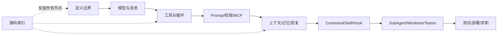
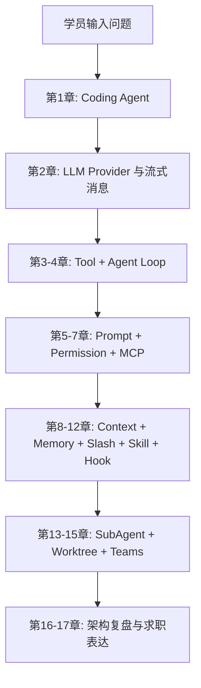
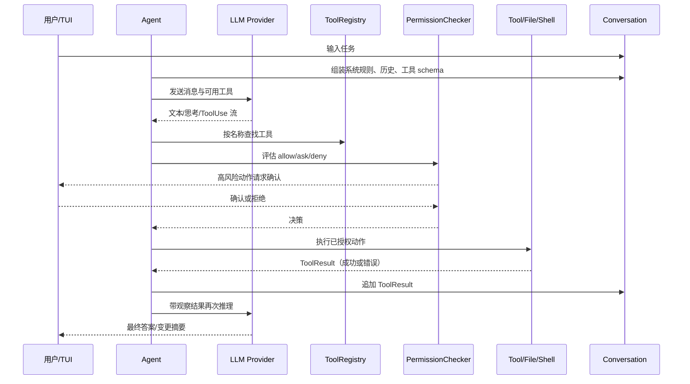

# JiMI Code / jimicode 最终版学习教材

> 这是仓库 `docs/` 与 `study-notes/` 教材的最终阅读版本。主干按学习依赖重新排序；同一主题中完全重复的段落只保留一次；不同文档对同一事实提供了不同源码路径、实验或反例时，作为补充保留。原始文件全部保留，不被覆盖或删除。

## 最终脉络

从 Coding Agent 定义开始，先学习 Provider/Message，再学习 Tool 和 Agent Loop；有了行动能力后学习 Prompt、Permission 和 MCP；有了治理边界后学习 Context、Memory、Session 和恢复；最后进入 Slash、Skill、Hook、SubAgent、Worktree、Teams、测试、部署和面试。源码索引不打断主线，统一放到文末反查。



## 统一标记

【课程概念】是通用原理；【jimicode 实现】是当前源码证据；【待源码确认】表示工作区无法确认；“示例/需实测”表示数字仅用于说明方法。涉及 Shell、写文件、MCP、网络和并发时，默认使用临时仓库、最小权限、明确 workdir、超时、输出上限、审计和 Git 回滚。

# 第 0 章：学习攻略与课程地图

<!-- 主干来源：docs/course/00-必读-课程学习攻略.md -->

这一章是整套课程的导航和学习契约。JiMI Code 的目标不是教你调用一次聊天 API，而是带你沿着一条工程能力演进路线，把一个“只能接收文本”的空壳逐步扩展成能够理解仓库、选择工具、修改文件、执行命令、控制风险、压缩上下文、跨会话记忆、拆分子任务并协调团队的 Coding Agent。

- 说清楚 0～17 章分别解决什么问题，以及为什么顺序不能随意打乱；
- 在本地完成 Java 21、Maven 和一个安全的测试配置；
- 用源码路径定位入口、Agent Loop、工具、权限、会话、压缩和协作模块；
- 选择适合自己的速通、扎实或研究路径，并产出可验证的学习记录；
- 区分【课程概念】、【jimicode 实现】和【待源码确认】，避免把通用设计误说成当前项目事实。

这里的“源码对齐”以 `D:/code/JA/project/others/jimi-code` 当前工作区为准。项目 README 已声明 Java 21 + Maven；POM 中的主要依赖包括 TUI4J、Mordant、MCP SDK、Anthropic Java SDK、OpenAI Java SDK、SnakeYAML、Jackson 和 JUnit。入口类是 `src/main/java/com/jimicode/JimiCode.java`，不是一个 Spring Boot `main`，也没有传统 Controller/Service/Mapper 三层。

如果没有学习攻略，学习 Coding Agent 很容易出现至少三种真实失败。

第一种失败是“从产品表面跳到源码细节”。你看到 Claude Code 或 JiMI Code 能改文件，就直接打开 `Agent.java`，却不知道消息、工具 schema、权限和会话为何存在。结果是能读懂几行 Java，却无法解释一次请求从输入到文件修改的完整因果链。

第二种失败是“把仓库清单当成理解”。自动生成的文件索引可以告诉你有 `ContextCompactor.java`，但不告诉你它为什么同时依赖 token usage、工具结果预算和恢复附件。如果只追求覆盖率，最终会得到很多标题和很少的工程判断。

第三种失败是“把闭源产品体验误写成官方实现”。JiMI Code 借鉴了 Claude Code 的终端 Agent 理念，但它是课程项目/自研实现。若简历或面试中说成 Anthropic 官方代码，属于事实错误；若没有实测数据却声称“节省 80% token”，也属于不可验证的夸大。

第四种失败是“没有安全边界地做实验”。直接让 Agent 在真实仓库执行 shell、删除文件或修改配置，容易造成不可逆损失。学习必须使用临时仓库、明确 workdir、最小权限和可回滚的 Git 分支。

第五种失败是“只看正常路径”。Coding Agent 的难点通常在模型返回半截 JSON、工具超时、权限拒绝、上下文超过窗口、进程被 Ctrl-C 中断和多个 Agent 同时修改文件。课程每章都要求实验、排障和面试题，目的就是把失败路径纳入学习。

适合一到两周内需要形成项目表达的人。顺序是：第 1 章 → 第 2 章 → 第 3 章 → 第 4 章 → 第 6 章 → 第 8 章 → 第 13～15 章 → 第 17 章。重点掌握一张全链路图、十个关键类、十个失败场景和 STAR 项目讲解。

可验证产出：一页架构图、5 分钟讲解词、15 道深挖题答纲、一个只读工具和一个需要确认的写文件工具。

适合三到六周，希望能够真正修改项目的人。顺序是完整的第 0～12 章，再做 SubAgent、Worktree 和 Teams。每一章都必须完成实验，并在源码中找到调用者和测试。你要能独立增加一个 Tool、增加一个 Slash Command、扩展 Provider 配置字段，并为异常路径写测试。

可验证产出：一个自定义搜索工具、一个权限规则、一个上下文预算策略、一个 Skill 包、一个 Hook，以及对应的 JUnit 测试。

### 3. 研究路径：Teams/Worktree 与系统治理

适合想研究多 Agent 编排、并发隔离和生产可靠性的人。重点深入第 8、13、14、15、16 章，阅读 `SubAgentTaskManager`、`WorktreeManager`、`TeamManager`、`FileMailBox`、`SharedTaskStore` 和 `TeammateRunner`。除了功能，还要研究崩溃恢复、重复消息、锁、取消传播、成本上限和审计。

可验证产出：两个 Agent 在独立 worktree 中完成不同任务，Team 通过邮箱汇报，主 Agent 汇总结果；同时写出失败演练记录和清理策略。

| 阶段 | 你拥有的能力 | 还没有解决的问题 |
|---|---|---|
| 只有聊天 | 能发送消息和显示文本 | 不知道仓库事实，不能可靠改文件 |
| 有 Tool | 能读文件、搜索、执行动作 | 不知道何时调用，可能越权或死循环 |
| 有 Agent Loop | 能根据观察继续推理 | 仍可能无限循环、上下文爆炸、误执行 |
| 有权限和上下文 | 能控制风险和 token | 复杂任务仍需分工和隔离 |
| 有 SubAgent/Worktree | 能并行拆分任务 | 协作协议、合并和成本更复杂 |
| 有 Teams | 能形成长期角色协作 | 需要治理、可观测性、恢复和人类监督 |



| 数据/产物 | 生产者 | 消费者 | 学习时要记录什么 |
|---|---|---|---|
| `AppConfig` | SnakeYAML/`ConfigLoader` | `JimiCodeModel`、`Agent` | 字段来源、默认值、校验错误 |
| `Message` | TUI/ConversationManager | PromptBuilder、LlmClient | role、content、顺序、序列化 |
| `StreamEvent` | Provider Client | StreamingExecutor、TUI | delta 类型、结束条件、错误 |
| Tool Schema | ToolRegistry | LLM Client | name、description、参数 schema |
| ToolResult | Tool 实现 | Agent、ConversationManager | output、isError、toolUseId |
| PermissionResponse | PermissionChecker/UI | Agent Loop | allow/ask/deny、确认范围 |
| RecoveryState | ReadFile/Skill/Compactor | ContextCompactor/Resume | 快照、技能 SOP、恢复顺序 |
| TaskNotification | SubAgentTaskManager | 父 Agent | 状态、输出、失败和超时 |
| WorktreeSession | WorktreeManager | Team/Agent | 路径、分支、创建和清理时间 |

第一遍是“能聊”：只读 README、POM、入口和总架构，能描述系统用途但不改代码。第二遍是“能读文件”：从 `JimiCode.main` 进入 `ConfigLoader`、`JimiCodeModel`、`Agent`、`LlmClient` 和 `ToolRegistry`，沿调用者反查。第三遍是“能改文件+权限”：在临时仓库里增加工具、触发确认、制造异常、恢复会话，并跑测试。

【jimicode 实现】要求 Java 21+、Maven 3.9+。Windows 下可使用 `mvn.cmd clean verify`；构建产物为 `target/jimicode.jar`，运行命令为 `java -jar target\\jimicode.jar`。首次配置可复制 `config.example.yaml` 到 `.JimiCode/config.yaml`，填入 provider 的协议、base_url、model 和 API key。API key 不要提交 Git，也不要写进学习笔记或截图。

```text
learning-sandbox/       # 专门做破坏性实验的临时仓库
learning-notes/         # 每章的时序图、失败记录、面试答纲
jimi-code/              # 课程项目源码，只读分析后再改动
```

```text
src/main/java/com/jimicode/JimiCode.java                  # 启动入口
src/main/java/com/jimicode/config/                        # YAML 与 Provider 配置
src/main/java/com/jimicode/agent/                         # Agent Loop 与事件
src/main/java/com/jimicode/llm/                           # Anthropic/OpenAI 适配
src/main/java/com/jimicode/conversation/                  # 消息模型
src/main/java/com/jimicode/tool/                          # Tool SPI、注册表、实现
src/main/java/com/jimicode/permission/                    # 权限模式与检查
src/main/java/com/jimicode/compact/                       # 上下文压缩与恢复
src/main/java/com/jimicode/memory/                        # 记忆扫描、召回、管理
src/main/java/com/jimicode/worktree/                     # Git worktree 隔离
src/main/java/com/jimicode/subagent/teams/                # 子 Agent 与团队协作
src/test/java/com/jimicode/                               # 边界条件和回归测试
```

```markdown
## 类名
- 文件：
- 一句话职责：
- 创建者/调用者：
- 输入与输出：
- 可变状态：
- IO/网络/线程副作用：
- 异常与恢复：
- 对应测试：
- 如果替换它，必须保持的契约：
```

每做一次实验，记录“前置配置、输入、模型/工具事件、文件 diff、日志、结果、失败原因、是否可回滚”。数字指标如果没有实测，统一写“示例/需实测”。

对照的是公开产品体验和通用理念，不是闭源内部实现。可以比较：是否支持流式输出、工具确认、项目规则文件、上下文压缩、子任务、工作树和终端交互；不要猜测其内部类名、提示词原文或未公开策略。记录对照表时写“Claude Code 的公开体验”“jimicode 当前源码行为”“差异与改进假设”三列。

**目标**：确认 Java/Maven、配置解析和启动失败边界。

1. 执行 `java -version`、`mvn -version`，记录版本。
2. 复制 `config.example.yaml`，将 API key 放在本地未跟踪文件。
3. 故意把 protocol 改为 `unknown`，执行 `mvn.cmd test` 或启动 jar。
4. 恢复正确协议，使用只读请求启动 TUI。

**预期现象**：错误发生在 Agent Loop 之前，提示协议无效；日志/终端不应打印完整 API key。

**成功标准**：能解释参数路径、环境变量路径和默认配置路径的优先级，并能恢复终端光标。

**常见报错**：Java 版本低于 21、Maven 下载依赖失败、配置文件路径错误、终端不支持 TUI。排查时先看 `JimiCode.main` 和 `ConfigLoader.load`，不要先改 Agent。

1. 打开 `JimiCode.java`，标出配置、权限、模型和 Program 的创建点。
2. 搜索 `new Agent`、`.run(`、`getAllSchemas`、`ToolResult`。
3. 画出 `main → JimiCodeModel → Agent → LlmClient → ToolRegistry` 时序图。
4. 找一个对应测试，例如 `ToolSearchTest` 或 `ConfigLoaderValidationTest`。

**预期现象**：你会发现项目没有 Controller，TUI 事件和 BlockingQueue 是用户交互边界。

**成功标准**：能在 3 分钟内指出一次 turn 的输入、输出、状态和异常出口。

**常见报错**：搜索结果太多、把 `target/` 反编译文件当源码、看不懂第三方 SDK。排查命令应排除 `target`，第三方库只学习当前项目调用契约。

| 症状 | 可能原因 | 排查命令/日志点 |
|---|---|---|
| 找不到配置 | 路径、文件名或工作目录不对 | `Get-Location`；检查 `ConfigLoader` candidates |
| 启动即退出 | provider 缺字段或 protocol 非法 | 看 `ConfigException`，检查 `ProviderConfig` |
| TUI 光标消失 | 异常未进入 finally 或终端状态残留 | 检查 `JimiCode.main` 的 finally，重新打开终端 |
| 不知道从哪读 | 先读了扩展/生成文件 | 回到入口、Agent、消息、ToolRegistry |
| 文档与源码不一致 | 课程概念误当项目事实 | 添加【待源码确认】，以当前路径和测试为证据 |
| 测试结果不稳定 | 使用真实网络/API | 用 mock、临时目录和固定输入隔离外部状态 |

学习环境必须最小化权限：使用临时 Git 仓库，避免把真实项目根目录交给会执行 shell 的 Agent；敏感配置使用环境变量或本地未跟踪文件；涉及写文件、安装依赖、删除内容、网络访问时采用一次性确认；任何“自动允许所有命令”的模式只在隔离沙箱实验，不用于真实仓库。安全策略要落在 PermissionChecker 和工具实现中，不能只写在 System Prompt，因为模型可能忽略提示而权限引擎仍能阻断。

### 题 1：为什么学习 Coding Agent 要先学消息和 Tool，而不是先学 Prompt？

**回答提纲**：Prompt 决定行为偏好，但消息和 Tool 定义可执行边界；没有结构化 Tool schema，模型无法可靠请求动作；没有 ToolResult，Agent 无法根据观察继续推理。**加分点**：提到 provider-neutral 内部表示和 toolUseId 因果关联。

### 题 2：JiMI Code 与 Claude Code 是什么关系？

**回答提纲**：产品理念对标终端 Coding Agent，JiMI Code 是自研课程项目；不能声称 Anthropic 官方实现，也不应猜测闭源内部细节。**加分点**：能列出真实源码路径和差异验证方法。

**回答提纲**：面试表达、源码修改、并发协作的深度不同；研究路径需要额外掌握取消、隔离、恢复、成本和审计。**加分点**：每条路径都有可验证产出而不是只列阅读章节。

**回答提纲**：看是否有真实路径、调用者、测试、异常和副作用；区分索引与语义；数字指标注明是否实测。**加分点**：用“职责—输入—状态—输出—失败—协作—替换”模板审查。

- [ ] 我能说清 JiMI Code 不是 Anthropic 官方实现。
- [ ] 我能说明 0～17 章从聊天到团队的能力演进。
- [ ] 我已准备 Java 21、Maven 和隔离实验目录。
- [ ] 我能从 `JimiCode.main` 找到配置、Agent 和 TUI 的创建点。
- [ ] 我知道如何区分【课程概念】【jimicode 实现】【待源码确认】。

只有先建立 Coding Agent 的问题边界，下一章讨论模型 API 时才不会把“会聊天”误认为“会编程”。

### FAQ 1：为什么不把所有章节写在一个 Markdown 文件里？

因为每章都需要实验、排障和源码证据，拆分后可以独立复习、链接和迭代；总导航仍提供完整课程视图。

### FAQ 2：我没有 Anthropic API key，能学习吗？

能。第 0～4 章的大部分内容可用 mock provider、单元测试和本地工具学习；真实模型实验要使用你有权限的 provider，并把密钥留在本地。

索引解决发现性，语义讲解解决因果关系。只有追到调用者、状态、异常和测试，才能真正修改源码。

第一周完成 0～4 章，第二周完成 5～8 章，第三周完成 9～12 章，第四周完成 13～17 章；若走扎实/研究路径，每个实验和失败演练再各留一到两周。

请不要把“能运行 Maven”误认为“已经准备好学习”。开始第 1 章前，尝试不用打开源码回答下面的问题：如果模型返回一个工具调用，系统如何知道工具名称、参数和风险？如果用户拒绝，消息序列应该如何结束？如果进程在文件写入后、ToolResult 落盘前崩溃，下一次恢复凭什么判断文件状态？如果两个子 Agent 修改同一文件，线程锁能不能解决 Git 工作树冲突？如果上下文超出模型窗口，哪些信息必须保留？

如果这些问题只能回答“交给模型自己判断”，就说明你需要把后续章节当作工程课程，而不是 Prompt 技巧课。每一章都会把“模型能力”和“系统控制”分开：模型擅长理解和生成，系统负责状态、权限、资源、持久化和恢复。这个分工是整个课程最重要的架构前提。

- 一张手工绘制、能解释每个箭头的总架构图；
- 一个只读工具的实现和测试；
- 一个写文件工具的权限规则、拒绝案例和回滚记录；
- 一份 Provider 请求/响应脱敏样本；
- 一次上下文压缩前后的 token/字符统计（注明示例或实测）；
- 一个 Skill 目录及其触发条件、脚本和失败说明；
- 一个 Hook 的阻断/放行策略实验；
- 一个 SubAgent + Worktree 的并行任务演练；
- 一页诚实的项目简历描述和 40 道面试题答纲。

这些产物比“读完了多少字”更能证明学习效果。文档很长是为了覆盖复杂性，但学习必须回到代码、命令、测试和可观察结果。

第一，证据优先于直觉。看到一个类名像 `MemoryManager`，不能直接推断它实现了向量数据库；应打开源码、查看字段和调用者，再确认它究竟是扫描文件、拼接文本还是调用外部存储。第二，契约优先于实现细节。一个方法即使只有几行，也可能通过接口、序列化格式或线程边界影响整个系统；学习笔记要记录“别人依赖它什么”，而不只是“它现在怎么写”。第三，失败优先于演示。正常回答只能说明 happy path，真正的工程质量要看拒绝、超时、半截响应、重复调用、崩溃恢复和回滚。

第四，分层讨论安全。System Prompt 可以表达原则，PermissionChecker 才能强制阻断，Tool handler 还要做最后一次参数和路径校验，Git diff 与审计日志负责事后复核。第五，诚实标注不确定性。当前源码没有 Controller，就写“CLI/TUI 项目无传统 Controller”；某个第三方 SDK 的内部行为不可见，就写“依赖契约/待源码确认”；性能数字没有压测，就写“示例/需实测”。这种标注不是保守，而是专业文档的基本可信度。

第 1 章定义 Agent 的边界；第 2 章提供模型输入输出；第 3 章把动作变成 Tool；第 4 章把 Tool 放进循环。第 5 章让行为可预测，第 6 章让动作可治理，第 7 章让能力可扩展。第 8 章控制上下文成本，第 9 章控制跨会话信息，第 10～12 章把显式命令、可复用技能和生命周期自动化组织起来。第 13～15 章才进入多 Agent、工作树和团队协作，因为没有前面的消息、权限、状态和恢复基础，所谓“并行智能”只会放大混乱。第 16 章复盘技术债，第 17 章把真实能力转换成简历和面试表达。

如果你在某章卡住，优先回退到它直接依赖的上一章：工具选不对，回看消息和 schema；循环停不下来，回看工具结果和终止条件；压缩后无法恢复，回看会话序列和 toolUseId；团队互相覆盖，回看 worktree 与权限，而不是先增加更多 Agent。

# 第 01 章：初识 Coding Agent

<!-- 主干来源：docs/course/01-第1章-初识-Coding-Agent.md -->

本章建立整套课程的第一性认识：Coding Agent 不是“把聊天窗口搬到终端”，也不是“代码补全再加一个按钮”，而是一个能够观察软件工程环境、选择并执行工具、读取行动结果、继续规划并在权限边界内完成任务的闭环系统。

在“从空壳到团队”的路线中，本章处于起点。你还不会实现完整 Agent，但要先能判断一个产品/项目到底是不是 Coding Agent，知道它的能力边界和风险边界。后续模型 API、工具系统、Agent Loop、权限和协作，都建立在这里的定义上。

1. 画出“用户输入 → 模型 → 工具调用 → 文件/Shell → 观察结果 → 再推理”的全链路；
2. 用一个真实修 bug 故事解释 Chat、Autocomplete、IDE Agent 和 Coding Agent 的差异；
3. 在 `jimi-code` 源码中定位入口 `JimiCode`、编排器 `Agent`、消息模型、工具注册表和 TUI；
4. 能写出三个“看起来像 Agent、实际上不是完整 Coding Agent”的反例。

普通 Chat 可以解释“NullPointerException 通常怎么修”，但它看不到你的 `pom.xml`、调用栈、测试和实际数据流。它给出的修复建议可能与当前 Java 版本、依赖版本或项目约定冲突。Coding Agent 的第一项增量能力是通过 `ReadFileTool`、`GlobTool`、`GrepTool` 等工具取得证据，而不是凭通用知识猜测。

Autocomplete 在光标附近预测几行代码，不负责运行测试，也不会根据编译错误重新修改。一个补全看似合理，但可能引入未导入的类、破坏接口契约或改变并发语义。Coding Agent 会把“修改—编译—观察失败—再修改”作为多步循环，并在每一步保留可审计的工具结果。

如果模型直接拥有 shell 权限，它可能在不理解工作区边界时执行安装、删除或迁移命令。即使意图是修复 bug，副作用也可能超出用户授权。Coding Agent 必须把“模型提出动作”和“系统允许动作”分开，由权限模式、路径约束和确认 UI 决定是否执行。

### 失败场景 4：能调用一次工具，但不会根据观察继续推理

一个脚本可以固定执行 `grep`，但它不知道什么时候该读配置、什么时候该查测试、什么时候该停止。真正的 Agent 需要把 ToolResult 作为下一轮消息输入，根据结果动态选择下一动作，并且有最大步数、超时和取消。

“能自主修复任何 bug”“完全不会误删文件”都不是严谨定义。学习时必须把能力拆成可观察事件、工具权限、失败模式和测试指标；对没有实测的数据写“示例/需实测”。

【课程概念】Coding Agent 是运行在软件工程环境中的智能体：它接收自然语言任务，读取项目上下文，调用一组有明确 schema 和权限的工具，观察工具结果，进行多轮推理与规划，并在用户授权范围内产生代码或环境变化。

1. **环境感知**：能够读取文件、目录、版本信息、测试输出或其他资源；
2. **动作能力**：至少有一个会产生真实影响的工具，而不是只输出文本；
3. **闭环观察**：工具结果必须回到推理上下文；
4. **多步控制**：能根据新结果改变下一步，而不是固定脚本；
5. **治理边界**：有权限、确认、超时、取消、审计或回滚机制。

| 类型 | 输入上下文 | 是否主动调用工具 | 是否修改环境 | 是否多步观察 | 典型风险 |
|---|---|---:|---:|---:|---|
| Chat | 用户粘贴的文本 | 通常否 | 否 | 有限 | 建议脱离项目事实 |
| Autocomplete | 光标附近代码 | 否 | 只写入编辑器当前位置 | 否 | 局部正确、全局不一致 |
| IDE Agent | IDE 索引和工作区 | 是 | 通常是 | 是 | 权限与 diff 审查不足 |
| Coding Agent | 仓库、终端、规则、工具 | 是 | 是 | 是 | 命令、路径、成本和并发风险 |
| 固定脚本 | 预定义参数 | 固定调用 | 是 | 固定流程 | 无法适应未知结果 |

与上一阶段“普通聊天”的差异，不是模型名称，而是控制平面是否存在：Tool schema、权限网关、状态、循环、事件和恢复共同构成 Agent。

【jimicode 实现】JiMI Code 是本地 Java CLI/TUI Coding Agent。`JimiCode.main` 创建配置和 `JimiCodeModel`；`JimiCodeModel` 负责 TUI 交互状态；`Agent` 负责循环；`LlmClient` 抽象 Anthropic/OpenAI/OpenAI-compatible provider；`ToolRegistry` 管理工具 schema 和实现；文件、Shell、MCP、权限、Memory、Worktree、SubAgent 和 Teams 提供行动边界。

它不是一个 Web 服务，也不是单纯的 IDE 插件。其“用户界面”是终端，其“数据库”主要是本地会话/历史文件，其“并发基础设施”包括 Java 虚拟线程、文件邮箱和 Git worktree。课程后续会分别解释这些模块，而本章只确认角色，不提前把实现细节混在定义里。



| 数据结构 | 主要字段 | 谁生产 | 谁消费 | 为什么不能只用字符串 |
|---|---|---|---|---|
| `Message` | role、content、metadata | 用户、Agent、工具 | Provider adapter、历史、UI | 需要保留角色、块类型和顺序 |
| `ToolUseBlock` | toolUseId、toolName、arguments | 模型流解析器 | Agent、ToolRegistry | 需要按 id 关联结果和恢复 |
| `ToolResultBlock` | toolUseId、content、isError | Tool 实现 | Agent、模型、历史 | 错误也必须成为可推理观察 |
| `StreamEvent` | text delta、thinking、tool call、usage、error | LLM Client | StreamingExecutor、TUI | 流式 UI 不能等完整字符串 |
| `PermissionMode` | 默认策略、确认策略 | 配置/UI | PermissionChecker | 动作是否允许不是模型决定的 |
| `AgentEvent` | 文本、工具、压缩、错误、完成 | Agent Loop | TUI、父 Agent | 需要把内部状态可观测化 |

用户负责目标和授权；模型负责提出下一步推理/动作；Agent 负责编排与停止条件；Tool 负责执行明确动作；Permission 负责安全裁决；Conversation 负责事实序列；TUI 负责呈现与收集确认。若模型直接绕过 Permission 写文件，架构就失去安全边界；若 UI 直接拼 provider JSON，Provider 抽象就失去意义。

打开 `src/main/java/com/jimicode/JimiCode.java`，可以看到入口不是“读取文本然后调用一个函数”。它先解析命令行参数或 `JimiCode_CONFIG` 环境变量，再调用 `ConfigLoader.load`；之后把配置转换为 `PermissionMode`，创建 `JimiCodeModel`，再交给 TUI4J `Program` 运行。这个顺序表达了一个架构决策：运行 Agent 前先完成配置和权限校验，避免半初始化状态下执行工具。

入口还注册 SIGINT，并在 `finally` 中恢复终端光标。Ctrl-C 在 Coding Agent 中不是简单退出：后续 Agent Loop、子进程、队列和会话都要处理取消；本章先记住“取消是控制流的一等公民”，第 4、13、15 章再深入。

普通函数通常是 `input -> output`。Agent 至少有以下状态：

```text
conversation       当前消息事实
registry            可发现/可调用工具
permission          当前安全策略
iteration           已执行的推理轮数
usageAnchor        provider usage 或字符估算锚点
recoveryState      压缩后恢复所需的文件/技能快照
replacementState   工具结果替换决策
```

【jimicode 实现】`Agent.run` 返回 `BlockingQueue<AgentEvent>`，并在虚拟线程中执行 `agentLoop`。这意味着调用者通过事件消费进度，而不是阻塞等待一个最终字符串。`agentLoop` 在每轮开始检查最大迭代和线程中断，随后组装工具 schema、进行自动压缩、处理计划模式和延迟工具，最后调用 LLM 并执行工具。

```java
// 课程伪代码：展示控制流，不代表可直接复制到生产代码
while (!finished && iteration < maxIterations) {
    checkCancelled();
    injectMemoryAndSystemReminders(conversation);
    maybeCompact(conversation, contextWindow, usageAnchor);

StreamEvent response = llm.stream(conversation, registry.schemas());
    conversation.append(response.asMessageBlocks());

if (!response.hasToolUse()) {
        finished = true;
        emitFinalAnswer(response);
        break;
    }

for (ToolUseBlock call : response.toolCalls()) {
        PermissionResponse decision = permission.check(call);
        if (decision.requiresConfirmation()) {
            emitAskUser(call);
            pauseUntilConfirmed();
        }
        ToolResult result = registry.execute(call);
        conversation.append(result.asToolResultBlock());
    }
    iteration++;
}
```

真正的 `jimi-code` 实现还要处理流式 delta、工具结果预算、Hook、PLAN、SubAgent 通知、恢复附件、协议差异和错误包装，所以这段代码是概念骨架，不应当被误认为完整实现。

假设用户说：“请修复订单模块中一个偶发的 NullPointerException，并运行相关测试。”

第一步，Agent 不应立即写代码。它先调用目录/搜索工具定位订单模块、异常栈或测试名称；ToolResult 可能发现错误发生在 `OrderService` 调用 `discountPolicy` 的路径。

第二步，Agent 读取相关类、配置和测试，比较空值来源：是数据库返回 null、配置未加载，还是并发初始化顺序问题。它把观察结果加入会话，而不是只在 UI 中显示后丢弃。

第三步，模型提出修改方案。若需要 EditFile，PermissionChecker 根据模式判断是否自动允许或询问。用户确认后，工具先记录原始文件状态，再做精确替换；如果匹配文本不唯一，工具应返回错误，不应“猜一个位置”。

第四步，Agent 调用测试命令。测试失败输出成为新的 ToolResult，模型据此调整实现；测试通过后，Agent 汇总修改文件、测试命令、结果和剩余风险。这个故事中每一步都可能失败，但每次失败都能回到结构化观察和权限边界，而不是让模型无条件继续。

Anthropic 和 OpenAI 的请求字段不同，但 Agent 不应在业务循环里写两套分支。`LlmClient` 和 `StreamEvent` 将差异压到适配层，便于新增 OpenAI-compatible endpoint 和测试 mock。

工具失败不一定代表整轮 Agent 失败。把 `isError` 和错误内容回传模型，模型可以换工具、修正参数或请求用户。只有不可恢复的配置/状态错误才应结束主循环。

#### 反模式一：模型直接获得 `Runtime.exec`

这样做把“提出动作”和“执行动作”混成一层，无法按命令、路径、会话和用户进行授权，也难以审计。正确方式是把 Shell 封装成 Tool，先 schema 校验、权限判断、工作区限制和超时，再执行。

#### 反模式二：每轮把所有文件和所有工具结果塞回 Prompt

短期看似信息完整，长期会导致 token 成本、延迟和上下文溢出。正确方式是按相关性切片、限制工具输出、使用摘要和恢复附件；第 8 章会详细讲 Compaction。

固定脚本没有根据未知观察改变计划的能力，也无法处理工具错误和用户拒绝。Agent Loop 必须以模型结果和终止条件驱动下一步。

1. 写一个只调用聊天 API 的 CLI，只能回答用户粘贴的代码。
2. 写一个固定执行 `rg TODO` 的脚本。
3. 阅读 `jimi-code` 的 `Agent.run`、`ToolRegistry` 和 `ConversationManager`。
4. 为三个系统分别填写“环境感知、动作能力、观察闭环、多步控制、治理边界”五列。

**预期现象**：前两个系统缺少至少两项必要条件；jimicode 虽具备完整骨架，但具体能力仍受配置、工具和模型质量限制。

**成功标准**：能解释“有工具”不等于“有 Agent Loop”。

**常见报错**：把固定脚本的输出误认为模型观察；排查时检查下一步是否由结果动态决定。

1. 创建临时 Git 仓库，加入一个会失败的 JUnit 测试和简单 Java 类。
2. 启动 jimicode，权限使用只读或 PLAN 模式。
3. 提出“找出失败原因并给出修改计划”，禁止直接写文件。
4. 检查 Agent 是否先使用 read/search 工具，是否把测试输出作为观察。

**预期现象**：Agent 可以定位问题但无法在只读模式直接修改；计划模式会产生结构化计划和审批点。

**成功标准**：你能列出每个只读工具调用的输入、输出和下一步推理依据。

**常见报错**：模型直接声称已修复但没有文件 diff；检查 ToolResult 和实际 Git 状态，不以自然语言为准。

| 症状 | 可能原因 | 排查命令/日志点 |
|---|---|---|
| Agent 只聊天不读文件 | 工具未注册、schema 未发送或 prompt 未说明 | 查 `ToolRegistry.getAllSchemas`、Provider 请求体 |
| 工具名称正确但无法执行 | 注册表没有该名称或被 filter | 搜索 `register`、`toolNameFilter`、工具列表 |
| 工具执行后模型不继续 | ToolResult 未追加 conversation 或 isError 格式错误 | 检查 `ConversationManager` 消息序列和 toolUseId |
| 循环一直不结束 | 无 maxIterations、终止条件失效或模型反复调用 | 查看 Agent iteration、`AgentEvent` 和工具调用计数 |
| 修改了错误文件 | 路径未规范化、匹配不唯一、缺少 diff 审查 | 检查工具输入、workDir、Git diff |
| 用户拒绝仍继续执行 | Permission 决策未成为执行前置条件 | 检查 `PermissionChecker` 到 Tool handler 的调用链 |

本章只讨论防御设计：所有会改变文件、启动进程或访问网络的动作都应进入 Tool 和 PermissionGateway；工具必须限制工作区 root、规范化路径、设置超时和输出上限；高风险动作使用明确的确认 UX；执行前后记录审计事件；实验使用临时仓库并保留 Git 回滚点。不要把“模型被要求谨慎”当成安全控制，也不要在真实目录验证删除、格式化或迁移命令。

### 题 1：Coding Agent 和 Copilot 补全的本质差异是什么？

**回答提纲**：补全是局部预测，Coding Agent 是环境感知、工具行动、观察反馈和多步治理的闭环。**加分点**：提到权限、状态和可恢复性，而不只说“能改更多文件”。

### 题 2：为什么 ToolResult 的错误也要回传模型？

**回答提纲**：错误是环境观察，模型可以修正参数、选择替代工具或请求用户；但不可恢复的配置/权限错误应结束或暂停。**加分点**：区分业务错误、可重试错误和安全拒绝。

**回答提纲**：最大迭代数、工具调用去重、终止条件、超时、取消、重复错误检测和上下文压缩。**加分点**：把预算和可观测事件纳入治理。

### 题 4：为什么权限不能只写在 System Prompt？

**回答提纲**：Prompt 是模型输入，不能作为强制执行边界；权限必须在 Tool handler 前由独立引擎裁决。**加分点**：路径 root、敏感文件、一次性确认和审计。

### 题 5：如何证明一个 Agent 真的“会编程”？

**回答提纲**：用可复现实验验证读取仓库、修改文件、运行测试、根据失败再推理、遵守权限和输出 diff；不能只看最终自然语言。**加分点**：记录成功率、首 token 延迟、工具错误率等指标，并标明实测范围。

- [ ] 我能用五个必要条件定义 Coding Agent。
- [ ] 我能画出消息、模型、工具、权限和观察结果的时序。
- [ ] 我能解释 JiMI Code 与 Chat、Autocomplete、IDE Agent 的差异。
- [ ] 我能在源码中找到 `JimiCode`、`Agent`、`LlmClient` 和 `ToolRegistry`。
- [ ] 我知道为什么 ToolResult、权限和终止条件是 Agent 的必要组成。

理解 Agent 的角色边界后，下一章才会准确学习“模型如何开口说话”，并把 provider 差异封装成可供 Agent 使用的统一流式接口。

### FAQ 1：只要模型能生成代码，就是 Coding Agent 吗？

不是。生成代码属于输出能力，Coding Agent 还必须能观察环境、调用工具、接收结果并在治理边界内继续行动。

### FAQ 2：jimicode 是不是 Claude Code 的源码？

不是。它是仿 Claude Code 理念的自研 Java 课程项目。可以对比公开体验，但不能声称官方实现或复制闭源内部设计。

### FAQ 3：为什么 Coding Agent 需要多轮，而不是一次生成完整补丁？

真实仓库事实通常未知，测试和工具输出会改变计划；多轮闭环能根据观察修正假设，并在关键动作前插入确认。

### FAQ 4：Agent 一定要支持 Shell 吗？

不一定。Shell 是常见能力但风险较高；一个只读代码分析 Agent 也可以是有效 Coding Agent。关键是是否具备工具、观察、多步和治理闭环。

下面是三句常见宣传，请把它们改写成可验证的工程陈述。

“Agent 可以自主修复 bug。”应改写为：“在给定仓库、测试命令、最大迭代数和权限模式下，Agent 能够读取相关文件，提出并执行有限次修改，运行指定测试，并输出实际 diff；成功率和平均步数需要在公开样本上实测。”

“Agent 永远不会误删文件。”应改写为：“删除类操作默认需要确认，工具限制在 workdir root 内，并记录操作前快照；在定义的测试集合中未观察到越权删除，但不能把有限测试推广为绝对保证。”

“Agent 比人工更高效。”应改写为：“在某组任务、模型、硬件和网络条件下，比较 Agent 与基线人工流程的完成时间、首次可用结果延迟、返工次数、token 成本和错误率；所有数字注明样本和测量方法。”

这项练习会贯穿第 16、17 章：工程师不是把愿望写得更激动，而是把能力写成边界清晰、可重复验证的契约。

## 第一章阅读作业：建立自己的最小 Agent 词汇表

请用不超过两句话分别定义：模型、消息、工具、观察、循环、权限、状态、会话、工作区、回滚。然后在 `jimi-code` 中为每个词填一个真实类或文件路径。若某个词在当前源码中没有一一对应的类，就标记为【课程概念】并解释它由哪些类共同实现。完成后，再用这些词复述一次“修复 NullPointerException”的端到端故事，要求每一步都能指出生产者、消费者和失败出口。

作业的成功标准不是定义写得漂亮，而是别人可以根据你的路径在仓库中复查。比如“观察”不能只写成“模型看到了结果”，而应指出 `ToolResult` 如何进入 `ConversationManager`，下一次 LLM 请求如何消费它；“权限”不能只写成“系统很安全”，而应指出 `PermissionChecker` 在哪个工具副作用之前做决策。

# 第 02 章：让AI开口说话

<!-- 主干来源：docs/course/02-第2章-让AI开口说话.md -->

把第 1 章定义的 Agent 外壳连接到真实 LLM Provider。学完后，你能解释消息列表、请求适配、流式响应、密钥配置和终端展示，并能用 mock 或真实兼容端点完成一次安全聊天。

没有本章时，程序只能返回固定文本；把 Anthropic 字段误发给 OpenAI 导致 400；一次性等待完整响应造成首 token 延迟；API key 写入仓库导致泄露；SSE 分片被错误拼接后工具 JSON 损坏。

模型是推理服务，Message 是 provider-neutral 的内部事实，StreamEvent 是增量事件，Provider adapter 是协议翻译层。`LlmClient` 隔离了 `AnthropicClient`、`OpenAiClient` 与 `OpenAiCompatClient` 的差异；TUI 消费事件而不是直接依赖第三方 SDK。

| 对比维度 | 本章能力 | 上一章能力 | 下一章依赖 |
|---|---|---|---|
| 输入 | 结构化、可校验的本章对象 | 上一层输出 | 为下一层提供稳定契约 |
| 控制 | 明确的状态/权限/预算 | 规则较少 | 可观测、可恢复、可扩展 |
| 失败 | 分类、可见、可恢复 | 可能只返回错误文本 | 由后续治理层接管 |


**本章实际链路**：用户输入 → ConversationManager → PromptBuilder → LlmClient → HTTP/SSE → StreamEvent → StreamingExecutor → AgentEvent → JimiCodeModel/MarkdownRenderer

Message(role/content)、ProviderConfig(protocol/baseUrl/model/apiKey)、StreamEvent(type/text/toolDelta/usage/error)、AgentEvent(streamText/tool/error/complete)。

| 字段 | 生产者 | 消费者 | 失败时必须保留 |
|---|---|---|---|
| 身份/名称 | 配置或注册表 | Agent/Provider/UI | 原始值与规范化值 |
| 参数/内容 | 用户、模型或工具 | 下一阶段模块 | 校验错误与来源 |
| 状态 | 编排器/持久化层 | 恢复、审计、UI | 转移前后状态 |
| 结果 | 本章实现 | Conversation/父任务 | 成功、错误、耗时 |

打开 `src/main/java/com/jimicode/llm/LlmClient.java`，先看它定义的最小契约，再看三个实现如何把消息和工具 schema 映射成供应商请求。`AnthropicClient` 重点是 system、messages、tools、thinking 和 SSE；`OpenAiClient` 重点是 chat/completions、tool_calls 和 usage；`OpenAiCompatClient` 允许自建或第三方兼容端点。Agent 层只接收 `StreamEvent`，因此新增 provider 不应修改 `Agent.agentLoop`。

`ProviderConfig` 的 `protocol` 不是装饰字段，它决定 `ModelResolver` 选择哪个 client；`baseUrl` 决定请求根地址；`model` 参与请求体和日志；上下文窗口与最大输出影响后续 Compaction。API key 必须来自 YAML 未跟踪文件或环境变量，日志只打印 provider 名称和请求 id，不打印 Authorization。

流式解析要处理四种边界：一个事件被拆成多个网络 chunk；一个 chunk 包含多个 SSE event；最后一个 event 没有换行；连接在工具参数 JSON 中间断开。解析器必须保留缓冲区、按 event 分隔符解帧、校验 JSON，并在异常时产生 `StreamEvent.Error` 而不是静默结束。`StreamingExecutor` 再把 text/thinking/tool delta 转成 UI 可消费的 `AgentEvent`。

终端展示和模型协议必须解耦。`MarkdownRenderer` 负责把最终 Markdown 渲染为 TUI 文本；流式文本可以先以纯文本增量展示，完成后再渲染代码块。不要让 UI 直接拼 SSE，也不要在 UI 线程执行阻塞 HTTP。

反模式一是“每个 provider 在 Agent 中写 if/else”：这会让协议差异污染循环，新增 provider 需要修改核心。反模式二是“收到一段文本就当完整答案”：这会丢失后续 delta、usage 和 tool call。反模式三是“为了方便把 key 打印到 debug 日志”：这会让终端日志、trace 和 CI artifact 变成秘密泄露面。

- 不要用自然语言约束替代可执行的系统边界。
- 不要吞掉异常、取消或拒绝事件。
- 不要在没有测试和回滚点的真实仓库执行破坏性操作。

**目标**：用 mock HTTP 服务返回分片 SSE，验证文本跨 chunk 拼接、usage 累积和错误事件；成功标准是最终消息与预期一致且没有重复字符。

**步骤**：在临时仓库或 mock 环境中准备输入；运行最小命令；保存事件、日志和 Git diff；重复一次失败条件。

**预期现象**：能看到本章对应的状态变化，而不是只得到最终文本。

**成功标准**：结果可复现、失败可解释、没有越过工作区和权限边界。

**常见报错**：环境、路径、依赖、超时或配置错误；先看本章排障表，再沿源码调用者反查。

**目标**：配置两个 provider，分别走 anthropic 和 openai-compatible，发送同一条只读问题，比较内部 StreamEvent 而不是比较供应商原始 JSON；成功标准是 Agent Loop 无需改动。

无输出→检查订阅/网络/模型名；首 token 很慢→检查是否错误地等待完整 body；工具参数截断→保存原始 SSE 和解析缓冲区；401→检查 key 来源与 base_url；429→检查重试和退避；TUI 乱码→检查 UTF-8 和 MarkdownRenderer。

涉及文件、命令、网络、MCP、记忆、Hook 或并发时，统一使用临时仓库、最小权限、明确 workdir、超时、输出上限、审计和 Git 回滚点。任何示例数字标记“示例/需实测”；不在真实环境执行删除、覆盖、迁移或未知脚本。

### 题 1：Provider 抽象为什么要放在 LlmClient 而不是 Agent？

**回答提纲**：先给概念定义，再引用一个 jimicode 文件/类，说明一次取舍和一个失败场景。**加分点**：能讲测试、指标和边界。
### 题 2：SSE 分片如何保证幂等拼接？

**回答提纲**：先给概念定义，再引用一个 jimicode 文件/类，说明一次取舍和一个失败场景。**加分点**：能讲测试、指标和边界。
### 题 3：为什么流式输出要区分 UI 事件和模型协议？

**回答提纲**：先给概念定义，再引用一个 jimicode 文件/类，说明一次取舍和一个失败场景。**加分点**：能讲测试、指标和边界。
### 题 4：API key 在配置、日志和异常中如何保护？

**回答提纲**：先给概念定义，再引用一个 jimicode 文件/类，说明一次取舍和一个失败场景。**加分点**：能讲测试、指标和边界。

- [ ] 我能解释本章能力在全链路中的位置
- [ ] 我能解释一个真实失败场景及排查路径
- [ ] 我能解释关键数据结构的生产者和消费者
- [ ] 我能解释至少一个源码文件和调用者
- [ ] 我能解释一个安全/性能取舍

本章建立的契约会被下一章消费：工具系统 只有在输入、状态、失败和权限边界明确后才不会把复杂度继续放大。

### FAQ 1：没有真实 API key 能否学习？可以用 MockWebServer 或固定 StreamEvent 测试。

以当前项目源码和测试为准；第三方或闭源行为要明确标注边界。
### FAQ 2：OpenAI-compatible 是否等同 OpenAI？不等同，只能说明请求协议大体兼容，字段和工具行为仍需实测。

先用最小实验复现，再沿事件、日志、状态和调用者逐层定位。
### FAQ 3：为什么不直接使用第三方 SDK 类型？因为会把 provider 细节泄露到核心 Agent。

可以，但要保留权限、超时、输出上限和可回滚机制。

从当前章节的真实入口开始：用户输入 → ConversationManager → PromptBuilder → LlmClient → HTTP/SSE → StreamEvent → StreamingExecutor → AgentEvent → JimiCodeModel/MarkdownRenderer。打开链路中的第一个 jimicode 类，记录构造器参数、字段初始化和直接调用者；再向后追踪一个结果对象的消费点。不要只搜索类名，要搜索方法调用和事件类型。

本章的输入不能只写成“用户问题”。应拆成配置输入、自然语言输入、模型结构化输入、文件/进程输入和上游模块状态。对每一种输入写明允许为空的字段、长度上限、编码、来源和校验时机。Message(role/content)、ProviderConfig(protocol/baseUrl/model/apiKey)、StreamEvent(type/text/toolDelta/usage/error)、AgentEvent(streamText/tool/error/complete)。 中出现的身份、参数和状态字段都要在进入下一层前规范化。

把状态画成有限状态机：初始、准备、执行、等待确认、成功、失败、取消、恢复。每次转移记录触发事件、允许的前置状态、持久化动作和用户可见反馈。若代码使用 enum、record 或布尔字段表达状态，要检查是否存在互斥状态同时为 true 的问题。

对每个公开方法至少做三次反查：谁创建对象、谁调用方法、谁处理返回值/异常。若返回集合，检查调用方是否修改它；若返回异步对象，检查是否真正订阅；若返回路径或命令，检查调用方是否再次做安全校验。

将本章失败拆成输入错误、依赖错误、业务拒绝、超时、取消、部分成功和持久化失败。针对当前主题 `工具系统` 的前置依赖，写出“失败后能否重试、是否幂等、是否需要人工确认、是否需要回滚”的结论。

至少记录关联 id、阶段、耗时、结果状态和错误类别。不要在日志中记录 API key、完整 Authorization、未脱敏工具参数或整段私有代码。TUI 需要用户可读消息，调试日志需要开发者上下文，两者可以来自同一个事件但不应共享不安全文本。

确认本章对象是进程级、Agent 级、会话级、turn 级还是方法级状态。对可变集合、文件、队列和外部进程分别考虑竞态；不要因为方法加了 synchronized 就认为跨进程安全，也不要把虚拟线程误解成无限资源。

为 CPU、内存、网络、token、文件读取和输出设置上限。上限达到时返回可解释的错误或降级结果，不能静默截断关键协议字段。若本章涉及重试，退避和最大次数必须与总预算一起设计。

单元测试验证纯函数和边界；集成测试验证文件、进程或 HTTP；契约测试验证 provider/Tool/MCP 字段；回归测试固定一个曾经失败的用户故事。测试数据使用虚构密钥、临时目录和固定时间，不依赖个人机器状态。

错误设计通常表现为：把所有逻辑放在一个巨型类；把异常转成空字符串；让模型决定权限；让 UI 直接修改核心状态；让外部脚本绕过统一工具入口。正确设计应保持单向依赖、结构化结果、独立权限、事件通知和可回滚副作用。

先实现最小 happy path，再加入参数校验、错误封装、超时、取消、审计、恢复和测试。每一步保留可运行提交，避免一次性重写多个模块而无法定位回归。

回到上一章的输出，确认本章没有重新发明同一数据结构。例如上一章已经定义 Message/Tool/Provider 时，本章应复用其契约，而不是在新模块中创建第二套近似类型。

下一步是 `工具系统`。提前列出本章必须对外稳定的字段和事件；如果下一章要并发、压缩或扩展，本章的 id、版本、错误和取消语义必须先固定。

完成本章后，提交一页设计记录：问题、方案、替代方案、源码证据、测试、已知限制、后续改进。评审者应能仅凭这页记录复现你的实验，而不是依赖口头解释。

审查时逐条问：输入是否来自不可信源？副作用前是否授权？失败是否可见？重试是否幂等？取消是否传播？状态是否持久化？日志是否脱敏？测试是否覆盖空值、重复、超时和恢复？

回答面试题时先给一句定义，再讲当前项目文件和方法，接着讲一个取舍和失败案例，最后说如何测试。不要只罗列框架名，也不要把示例数字说成生产指标。

把本章放回完整闭环：用户输入 → ConversationManager → PromptBuilder → LlmClient → HTTP/SSE → StreamEvent → StreamingExecutor → AgentEvent → JimiCodeModel/MarkdownRenderer。如果删除本章能力，系统会在这些地方退化：没有本章时，程序只能返回固定文本；把 Anthropic 字段误发给 OpenAI 导致 400；一次性等待完整响应造成首 token 延迟；API key 写入仓库导致泄露；SSE 分片被错误拼接后工具 JSON 损坏。。如果增强本章能力，优先增强契约、测试、可观测性和安全边界，再考虑增加模型或 Agent 数量。最后用一个真实但隔离的实验验证“输入—状态—结果—失败—恢复”五个维度，并把证据保存到学习笔记。
## 综合案例与边界演练

### 场景 1：最小成功路径：使用固定输入、单一依赖和一个工具完成一次操作，记录从入口到结果的每个对象。

本章的具体检查点是：模型是推理服务，Message 是 provider-neutral 的内部事实，StreamEvent 是增量事件，Provider adapter 是协议翻译层。`LlmClient` 隔离了 `AnthropicClient`、`OpenAiClient` 与 `OpenAiCompatClient` 的差异；TUI 消费事件而不是直接依赖第三方 SDK。 生产的输入必须经过本章状态和权限边界，再形成 工具系统 可以消费的结果。实验结束后保存命令、事件、日志、测试、diff 和限制说明。

### 场景 2：空值路径：删除可选字段、返回空集合或让模型不给出内容，确认系统使用默认值、明确错误还是安全退出。

### 场景 3：重复路径：重复提交同一个请求、toolUseId、命令或消息，检查是否幂等、去重或要求人工确认。

### 场景 4：超时路径：让网络、脚本、文件或子任务延迟，检查 timeout、取消、资源释放和用户提示。

### 场景 5：部分成功路径：让多个动作中只有一部分成功，确认结果如何汇总、是否需要补偿或回滚。

### 场景 6：权限路径：使用只读、询问和拒绝三种模式，确保决策发生在副作用之前且结果可审计。

### 场景 7：恢复路径：在关键状态写入前后模拟进程退出，重新启动后检查状态、消息顺序和重复执行风险。

### 场景 8：观测路径：为一次操作关联 id、阶段、耗时和错误类别，确认 UI、日志和 trace 的信息粒度不同但事实一致。

### 场景 9：兼容路径：替换 provider、工具实现或配置版本，确认核心契约不需要大面积改动。

### 场景 10：评审路径：邀请另一位同学只看文档和证据复现实验，记录他无法理解或无法复现的地方。

围绕本章的实际链路 `用户输入 → ConversationManager → PromptBuilder → LlmClient → HTTP/SSE → StreamEvent → StreamingExecutor → AgentEvent → JimiCodeModel/MarkdownRenderer`，在源码中定位一个具体类/方法，写出它的输入、输出、状态、调用者和失败处理。然后在隔离环境执行一个最小验证，保存测试/日志/diff；如果无法从当前仓库证实，明确写【待源码确认】。针对 `工具系统` 的后续能力，补充说明该契约为什么必须稳定、哪些字段不能随意改名，以及发生故障时如何向用户解释。

# 第 03 章：工具系统

<!-- 主干来源：docs/course/03-第3章-工具系统.md -->

把模型的“想做某事”变成受控、可验证、可审计的动作。学完能实现一个 Tool、注册到 ToolRegistry、生成 schema、执行并把 ToolResult 回传。

没有工具时模型无法看到真实文件；schema 不准确导致参数缺失；注册名重复导致调用错工具；结果不回传导致模型重复调用；文件工具不限制路径导致越权。

Tool 由 name、description、参数 schema 和 handler 组成；Registry 负责发现和分发；Observation/ToolResult 把执行结果变成下一轮推理输入。只读 read/list/search 与写入/edit/shell 的风险不同。

| 对比维度 | 本章能力 | 上一章能力 | 下一章依赖 |
|---|---|---|---|
| 输入 | 结构化、可校验的本章对象 | 上一层输出 | 为下一层提供稳定契约 |
| 控制 | 明确的状态/权限/预算 | 规则较少 | 可观测、可恢复、可扩展 |
| 失败 | 分类、可见、可恢复 | 可能只返回错误文本 | 由后续治理层接管 |


**本章实际链路**：Tool 实现 → ToolRegistry 注册 → getAllSchemas → LlmClient 请求 → ToolUseBlock → Registry 查找 → PermissionChecker → handler → ToolResultBlock → ConversationManager

Tool schema(name/description/input_schema)、ToolUseBlock(toolUseId/toolName/arguments)、ToolResult(output/isError)、ToolCategory、权限上下文。

| 字段 | 生产者 | 消费者 | 失败时必须保留 |
|---|---|---|---|
| 身份/名称 | 配置或注册表 | Agent/Provider/UI | 原始值与规范化值 |
| 参数/内容 | 用户、模型或工具 | 下一阶段模块 | 校验错误与来源 |
| 状态 | 编排器/持久化层 | 恢复、审计、UI | 转移前后状态 |
| 结果 | 本章实现 | Conversation/父任务 | 成功、错误、耗时 |

`src/main/java/com/jimicode/tool/Tool.java` 是能力 SPI；`ToolRegistry` 保存名称到实例的映射，并按协议生成 schema。阅读时先确认注册发生在 `JimiCodeModel` 组装阶段还是 SubAgent 创建阶段，再追踪 `getAllSchemas` 的调用者。工具名称是模型可见 API，改名会破坏历史会话和 Prompt 中的选择。

文件工具的最小安全闭环是：解析参数 → 规范化路径 → 检查 workDir root → 检查敏感文件/目录 → 检查权限 → 执行 IO → 限制输出 → 封装 ToolResult。`ReadFileTool` 应限制最大字节数并记录恢复附件；`GlobTool`/`GrepTool` 应限制搜索范围和结果数量；`WriteFileTool`/`EditFileTool` 应在修改前保存快照并在匹配不唯一时失败。

description 不是文案，而是模型决策输入。应写清何时使用、输入字段、输出格式、不可做什么和示例；避免把多个动作塞进一个“万能工具”。schema 必须在服务端再次校验，不能信任模型传来的 JSON。

反模式一是把所有能力暴露成一个 `run(command)`；这让模型难以选择，也让权限无法精细化。反模式二是 handler 直接返回异常堆栈；正确做法是保留可诊断上下文，同时向模型返回安全、有限的错误信息。

**目标**：实现一个只读 `count_lines` Tool：输入 path，限制在 workDir，输出行数；为正常、文件不存在、路径越界写测试。

**目标**：实现一个 `summarize_diff` Tool 并注册，观察 schema 是否出现在请求中；故意改错 description，比较模型是否更容易误选。

工具未出现在请求→查 registry 注册和 schema 过滤；名称找不到→查大小写/重复注册；参数为空→查 schema required；结果过长→查输出预算；写错路径→查 root 规范化和 symlink；重复执行→查 toolUseId 和 Agent Loop。

### 题 1：Tool schema 如何影响模型选型？

**回答提纲**：先给概念定义，再引用一个 jimicode 文件/类，说明一次取舍和一个失败场景。**加分点**：能讲测试、指标和边界。
### 题 2：为什么 Registry 不能只保存反射 Method？

**回答提纲**：先给概念定义，再引用一个 jimicode 文件/类，说明一次取舍和一个失败场景。**加分点**：能讲测试、指标和边界。
### 题 3：ToolResult 为什么必须带 isError？

**回答提纲**：先给概念定义，再引用一个 jimicode 文件/类，说明一次取舍和一个失败场景。**加分点**：能讲测试、指标和边界。
### 题 4：文件工具如何防路径穿越？

本章建立的契约会被下一章消费：让 Agent 自己干活 只有在输入、状态、失败和权限边界明确后才不会把复杂度继续放大。

### FAQ 1：工具越多越好吗？不是，过多 schema 会增加 token 和选择歧义。

以当前项目源码和测试为准；第三方或闭源行为要明确标注边界。
### FAQ 2：只读工具需要权限吗？仍可能读取敏感信息，应按资源和租户判断。

先用最小实验复现，再沿事件、日志、状态和调用者逐层定位。
### FAQ 3：工具异常应该抛出还是返回？边界错误可返回 ToolResult，框架级不可恢复错误应抛出并记录。

从当前章节的真实入口开始：Tool 实现 → ToolRegistry 注册 → getAllSchemas → LlmClient 请求 → ToolUseBlock → Registry 查找 → PermissionChecker → handler → ToolResultBlock → ConversationManager。打开链路中的第一个 jimicode 类，记录构造器参数、字段初始化和直接调用者；再向后追踪一个结果对象的消费点。不要只搜索类名，要搜索方法调用和事件类型。

本章的输入不能只写成“用户问题”。应拆成配置输入、自然语言输入、模型结构化输入、文件/进程输入和上游模块状态。对每一种输入写明允许为空的字段、长度上限、编码、来源和校验时机。Tool schema(name/description/input_schema)、ToolUseBlock(toolUseId/toolName/arguments)、ToolResult(output/isError)、ToolCategory、权限上下文。 中出现的身份、参数和状态字段都要在进入下一层前规范化。

将本章失败拆成输入错误、依赖错误、业务拒绝、超时、取消、部分成功和持久化失败。针对当前主题 `让 Agent 自己干活` 的前置依赖，写出“失败后能否重试、是否幂等、是否需要人工确认、是否需要回滚”的结论。

下一步是 `让 Agent 自己干活`。提前列出本章必须对外稳定的字段和事件；如果下一章要并发、压缩或扩展，本章的 id、版本、错误和取消语义必须先固定。

把本章放回完整闭环：Tool 实现 → ToolRegistry 注册 → getAllSchemas → LlmClient 请求 → ToolUseBlock → Registry 查找 → PermissionChecker → handler → ToolResultBlock → ConversationManager。如果删除本章能力，系统会在这些地方退化：没有工具时模型无法看到真实文件；schema 不准确导致参数缺失；注册名重复导致调用错工具；结果不回传导致模型重复调用；文件工具不限制路径导致越权。。如果增强本章能力，优先增强契约、测试、可观测性和安全边界，再考虑增加模型或 Agent 数量。最后用一个真实但隔离的实验验证“输入—状态—结果—失败—恢复”五个维度，并把证据保存到学习笔记。
## 综合案例与边界演练

### 场景 1：最小成功路径：使用固定输入、单一依赖和一个工具完成一次操作，记录从入口到结果的每个对象。

本章的具体检查点是：Tool 由 name、description、参数 schema 和 handler 组成；Registry 负责发现和分发；Observation/ToolResult 把执行结果变成下一轮推理输入。只读 read/list/search 与写入/edit/shell 的风险不同。 生产的输入必须经过本章状态和权限边界，再形成 让 Agent 自己干活 可以消费的结果。实验结束后保存命令、事件、日志、测试、diff 和限制说明。

### 场景 2：空值路径：删除可选字段、返回空集合或让模型不给出内容，确认系统使用默认值、明确错误还是安全退出。

### 场景 3：重复路径：重复提交同一个请求、toolUseId、命令或消息，检查是否幂等、去重或要求人工确认。

### 场景 4：超时路径：让网络、脚本、文件或子任务延迟，检查 timeout、取消、资源释放和用户提示。

### 场景 5：部分成功路径：让多个动作中只有一部分成功，确认结果如何汇总、是否需要补偿或回滚。

### 场景 6：权限路径：使用只读、询问和拒绝三种模式，确保决策发生在副作用之前且结果可审计。

### 场景 7：恢复路径：在关键状态写入前后模拟进程退出，重新启动后检查状态、消息顺序和重复执行风险。

### 场景 8：观测路径：为一次操作关联 id、阶段、耗时和错误类别，确认 UI、日志和 trace 的信息粒度不同但事实一致。

### 场景 9：兼容路径：替换 provider、工具实现或配置版本，确认核心契约不需要大面积改动。

### 场景 10：评审路径：邀请另一位同学只看文档和证据复现实验，记录他无法理解或无法复现的地方。

围绕本章的实际链路 `Tool 实现 → ToolRegistry 注册 → getAllSchemas → LlmClient 请求 → ToolUseBlock → Registry 查找 → PermissionChecker → handler → ToolResultBlock → ConversationManager`，在源码中定位一个具体类/方法，写出它的输入、输出、状态、调用者和失败处理。然后在隔离环境执行一个最小验证，保存测试/日志/diff；如果无法从当前仓库证实，明确写【待源码确认】。针对 `让 Agent 自己干活` 的后续能力，补充说明该契约为什么必须稳定、哪些字段不能随意改名，以及发生故障时如何向用户解释。

# 第 04 章：Agent Loop

<!-- 主干来源：docs/course/04-第4章-Agent-Loop.md -->

把模型和工具连接成 ReAct/Agent Loop。学完能追踪一次“读文件—分析—修改—测试”的完整时序，并治理最大步数、终止条件、取消和死循环。

只调用一次模型就结束；工具结果没有回灌；模型反复调用同一个失败工具；无上限循环烧光 token；Ctrl-C 后留下孤儿工具调用。

ReAct = Reasoning + Acting；Loop 维护 iteration、conversation、工具结果和终止状态。`Agent.agentLoop` 是 jimicode 的核心循环，`AgentEvent` 让 TUI 观察过程。

| 对比维度 | 本章能力 | 上一章能力 | 下一章依赖 |
|---|---|---|---|
| 输入 | 结构化、可校验的本章对象 | 上一层输出 | 为下一层提供稳定契约 |
| 控制 | 明确的状态/权限/预算 | 规则较少 | 可观测、可恢复、可扩展 |
| 失败 | 分类、可见、可恢复 | 可能只返回错误文本 | 由后续治理层接管 |


**本章实际链路**：输入 → agentLoop iteration → schema/compact → LLM stream → text/thinking/tool use → permission → tool → result → conversation → next iteration/complete

iteration、maxIterations、ConversationManager、BlockingQueue<AgentEvent>、ToolUseBlock、ToolResultBlock、LoopComplete/ErrorEvent、cancel/interrupted。

| 字段 | 生产者 | 消费者 | 失败时必须保留 |
|---|---|---|---|
| 身份/名称 | 配置或注册表 | Agent/Provider/UI | 原始值与规范化值 |
| 参数/内容 | 用户、模型或工具 | 下一阶段模块 | 校验错误与来源 |
| 状态 | 编排器/持久化层 | 恢复、审计、UI | 转移前后状态 |
| 结果 | 本章实现 | Conversation/父任务 | 成功、错误、耗时 |

阅读 `src/main/java/com/jimicode/agent/Agent.java` 的 `run` 与 `agentLoop`。`run` 创建容量有限的 `LinkedBlockingQueue` 并启动虚拟线程；`agentLoop` 先注入 instructions/memory，再在每轮检查最大迭代和线程中断，计算工具 schema、执行压缩、注入系统提醒，然后调用模型。收到工具调用后执行并把结果写回 conversation，下一轮重新推理。

终止条件至少包括：模型返回无 ToolUse 的最终文本；达到 `maxIterations`；用户拒绝或取消；不可恢复的配置/协议异常。成功与失败都要有 AgentEvent，让 TUI、父 Agent 和历史记录获得一致事实。队列容量 64 是一个背压边界，不能在事件生产速度远大于 UI 消费速度时无限缓存。

死循环治理要组合使用 maxIterations、相同 toolUse/参数去重、连续相同错误检测、每轮 token 预算、超时和人工确认。不要只依赖 Prompt 告诉模型“不要循环”，因为这是软约束。取消时要先检查线程中断，再让 HTTP、子进程和工具执行响应取消；若已有 ToolUse 没有结果，应合成错误 ToolResult，保证消息协议完整。

反模式一是递归调用 Agent 而没有计数器，栈和 token 都不可控。反模式二是把所有工具执行放在 UI 线程，导致界面冻结且无法取消。反模式三是 catch(Exception) 后直接返回空字符串，用户无法判断是模型完成还是系统失败。

**目标**：在临时仓库让 Agent 先读取一个 Java 文件再回答，记录每个 AgentEvent 的顺序、iteration 和 ToolResult。

**目标**：构造一个总是返回错误的 mock Tool，验证 maxIterations、重复错误检测和 Ctrl-C 取消；成功标准是不会无限请求。

只执行一轮→查 ToolResult 是否追加；无限循环→查 maxIterations/终止条件；UI 卡顿→查工具是否跑在虚拟线程；取消无效→查 interrupt 是否传到 HTTP/进程；队列超时→查消费者和 putSafe。

### 题 1：ReAct Loop 与工作流引擎有何不同？

**回答提纲**：先给概念定义，再引用一个 jimicode 文件/类，说明一次取舍和一个失败场景。**加分点**：能讲测试、指标和边界。
### 题 2：最大迭代数放在哪里配置？

**回答提纲**：先给概念定义，再引用一个 jimicode 文件/类，说明一次取舍和一个失败场景。**加分点**：能讲测试、指标和边界。
### 题 3：如何处理孤儿 ToolUse？

**回答提纲**：先给概念定义，再引用一个 jimicode 文件/类，说明一次取舍和一个失败场景。**加分点**：能讲测试、指标和边界。
### 题 4：背压和取消为什么是 Agent 的核心问题？

本章建立的契约会被下一章消费：System Prompt 设计 只有在输入、状态、失败和权限边界明确后才不会把复杂度继续放大。

### FAQ 1：模型一次返回多个工具怎么办？按 id 保存并执行，必要时按 concurrencySafe 决定并发。

以当前项目源码和测试为准；第三方或闭源行为要明确标注边界。
### FAQ 2：达到最大迭代算成功吗？通常应产生明确错误/未完成事件，不能冒充最终答案。

先用最小实验复现，再沿事件、日志、状态和调用者逐层定位。
### FAQ 3：为什么不直接 while(true)？因为循环必须可预算、可取消、可观测。

从当前章节的真实入口开始：输入 → agentLoop iteration → schema/compact → LLM stream → text/thinking/tool use → permission → tool → result → conversation → next iteration/complete。打开链路中的第一个 jimicode 类，记录构造器参数、字段初始化和直接调用者；再向后追踪一个结果对象的消费点。不要只搜索类名，要搜索方法调用和事件类型。

本章的输入不能只写成“用户问题”。应拆成配置输入、自然语言输入、模型结构化输入、文件/进程输入和上游模块状态。对每一种输入写明允许为空的字段、长度上限、编码、来源和校验时机。iteration、maxIterations、ConversationManager、BlockingQueue<AgentEvent>、ToolUseBlock、ToolResultBlock、LoopComplete/ErrorEvent、cancel/interrupted。 中出现的身份、参数和状态字段都要在进入下一层前规范化。

将本章失败拆成输入错误、依赖错误、业务拒绝、超时、取消、部分成功和持久化失败。针对当前主题 `System Prompt 设计` 的前置依赖，写出“失败后能否重试、是否幂等、是否需要人工确认、是否需要回滚”的结论。

下一步是 `System Prompt 设计`。提前列出本章必须对外稳定的字段和事件；如果下一章要并发、压缩或扩展，本章的 id、版本、错误和取消语义必须先固定。

把本章放回完整闭环：输入 → agentLoop iteration → schema/compact → LLM stream → text/thinking/tool use → permission → tool → result → conversation → next iteration/complete。如果删除本章能力，系统会在这些地方退化：只调用一次模型就结束；工具结果没有回灌；模型反复调用同一个失败工具；无上限循环烧光 token；Ctrl-C 后留下孤儿工具调用。。如果增强本章能力，优先增强契约、测试、可观测性和安全边界，再考虑增加模型或 Agent 数量。最后用一个真实但隔离的实验验证“输入—状态—结果—失败—恢复”五个维度，并把证据保存到学习笔记。
## 综合案例与边界演练

### 场景 1：最小成功路径：使用固定输入、单一依赖和一个工具完成一次操作，记录从入口到结果的每个对象。

本章的具体检查点是：ReAct = Reasoning + Acting；Loop 维护 iteration、conversation、工具结果和终止状态。`Agent.agentLoop` 是 jimicode 的核心循环，`AgentEvent` 让 TUI 观察过程。 生产的输入必须经过本章状态和权限边界，再形成 System Prompt 设计 可以消费的结果。实验结束后保存命令、事件、日志、测试、diff 和限制说明。

### 场景 2：空值路径：删除可选字段、返回空集合或让模型不给出内容，确认系统使用默认值、明确错误还是安全退出。

### 场景 3：重复路径：重复提交同一个请求、toolUseId、命令或消息，检查是否幂等、去重或要求人工确认。

### 场景 4：超时路径：让网络、脚本、文件或子任务延迟，检查 timeout、取消、资源释放和用户提示。

### 场景 5：部分成功路径：让多个动作中只有一部分成功，确认结果如何汇总、是否需要补偿或回滚。

### 场景 6：权限路径：使用只读、询问和拒绝三种模式，确保决策发生在副作用之前且结果可审计。

### 场景 7：恢复路径：在关键状态写入前后模拟进程退出，重新启动后检查状态、消息顺序和重复执行风险。

### 场景 8：观测路径：为一次操作关联 id、阶段、耗时和错误类别，确认 UI、日志和 trace 的信息粒度不同但事实一致。

### 场景 9：兼容路径：替换 provider、工具实现或配置版本，确认核心契约不需要大面积改动。

### 场景 10：评审路径：邀请另一位同学只看文档和证据复现实验，记录他无法理解或无法复现的地方。

围绕本章的实际链路 `输入 → agentLoop iteration → schema/compact → LLM stream → text/thinking/tool use → permission → tool → result → conversation → next iteration/complete`，在源码中定位一个具体类/方法，写出它的输入、输出、状态、调用者和失败处理。然后在隔离环境执行一个最小验证，保存测试/日志/diff；如果无法从当前仓库证实，明确写【待源码确认】。针对 `System Prompt 设计` 的后续能力，补充说明该契约为什么必须稳定、哪些字段不能随意改名，以及发生故障时如何向用户解释。

# 第 05 章：System Prompt

<!-- 主干来源：docs/course/05-第5章-System-Prompt.md -->

学习如何把角色、规则、工具规范和项目约定组织成稳定的系统提示。学完能从失败样例迭代 Prompt，并知道哪些安全要求必须放进权限引擎。

没有角色约束导致输出风格漂移；规则与工具描述冲突；把项目约定散落在用户消息；Prompt 注入覆盖安全要求；系统提示过长挤压业务上下文。

System Prompt 是模型的行为上下文，不是强制安全边界。`PromptBuilder`、`PromptSections`、`PlanModePrompt` 分段组装角色、工具、技能、记忆和计划提醒。

| 对比维度 | 本章能力 | 上一章能力 | 下一章依赖 |
|---|---|---|---|
| 输入 | 结构化、可校验的本章对象 | 上一层输出 | 为下一层提供稳定契约 |
| 控制 | 明确的状态/权限/预算 | 规则较少 | 可观测、可恢复、可扩展 |
| 失败 | 分类、可见、可恢复 | 可能只返回错误文本 | 由后续治理层接管 |


**本章实际链路**：基础角色 → 项目规则/Memory → 工具使用规范 → 当前任务 → 历史/观察 → Provider formatter → 模型

PromptSections、instructions、memoryContent、system reminders、工具 schema、PlanModePrompt、规则优先级。

| 字段 | 生产者 | 消费者 | 失败时必须保留 |
|---|---|---|---|
| 身份/名称 | 配置或注册表 | Agent/Provider/UI | 原始值与规范化值 |
| 参数/内容 | 用户、模型或工具 | 下一阶段模块 | 校验错误与来源 |
| 状态 | 编排器/持久化层 | 恢复、审计、UI | 转移前后状态 |
| 结果 | 本章实现 | Conversation/父任务 | 成功、错误、耗时 |

`src/main/java/com/jimicode/prompt/PromptBuilder.java` 和 `PromptSections.java` 应按“稳定前缀优先、动态内容后置”的思路阅读。稳定角色、输出格式和安全原则尽量保持字节稳定，有利于 provider prompt cache；项目规则、当前任务、工具结果和后台通知属于动态段。

System Prompt 建议分为：角色与目标、不可违反的行为规则、工具选择规范、代码仓库约定、输出格式、失败与确认策略、当前模式（普通/PLAN）。每段都要避免互相覆盖。例如“主动修复”不能覆盖“写文件前必须确认”；“简洁回答”不能阻止输出必要的测试结果。

迭代 Prompt 使用失败样例驱动：记录输入、模型选择、工具参数、结果和偏差；只修改一条规则；用同一回归样本比较。安全条款应放在 Prompt 作为意图说明，同时放在 PermissionChecker、Tool handler 和 workdir 限制作为强制控制。

反模式一是把所有源码和完整历史硬编码进系统提示；这会造成长度和维护问题。反模式二是用模糊的“请小心操作”代替可执行规则；应写成“写入前调用确认、路径必须位于 root、失败返回错误”。

**目标**：为同一工具写两个 description/prompt 版本，使用固定任务集记录误选率、重复调用和解释质量（数字标记需实测）。

**目标**：在 Prompt 中加入项目 Java 21 约定，但把路径安全留给 PermissionChecker；故意发送冲突用户指令，验证分层策略。

模型忽略规则→查动态段位置和冲突；Prompt 太长→统计各 section 字符/token；工具误选→改 description/schema；缓存命中下降→检查稳定前缀；注入风险→确认权限层不依赖 Prompt。

### 题 1：Prompt cache 为什么关注稳定前缀？

**回答提纲**：先给概念定义，再引用一个 jimicode 文件/类，说明一次取舍和一个失败场景。**加分点**：能讲测试、指标和边界。
### 题 2：项目规则文件与 System Prompt 如何分工？

**回答提纲**：先给概念定义，再引用一个 jimicode 文件/类，说明一次取舍和一个失败场景。**加分点**：能讲测试、指标和边界。
### 题 3：安全要求哪些能放 Prompt，哪些不能？

**回答提纲**：先给概念定义，再引用一个 jimicode 文件/类，说明一次取舍和一个失败场景。**加分点**：能讲测试、指标和边界。
### 题 4：如何科学迭代 Prompt？

本章建立的契约会被下一章消费：权限系统 只有在输入、状态、失败和权限边界明确后才不会把复杂度继续放大。

### FAQ 1：Prompt 越长越好吗？不是，规则要可执行且给上下文预算留空间。

以当前项目源码和测试为准；第三方或闭源行为要明确标注边界。
### FAQ 2：用户指令和系统规则冲突怎么办？系统规则和权限优先。

先用最小实验复现，再沿事件、日志、状态和调用者逐层定位。
### FAQ 3：Prompt 是否需要版本管理？需要，尤其生产策略和评测样例。

从当前章节的真实入口开始：基础角色 → 项目规则/Memory → 工具使用规范 → 当前任务 → 历史/观察 → Provider formatter → 模型。打开链路中的第一个 jimicode 类，记录构造器参数、字段初始化和直接调用者；再向后追踪一个结果对象的消费点。不要只搜索类名，要搜索方法调用和事件类型。

本章的输入不能只写成“用户问题”。应拆成配置输入、自然语言输入、模型结构化输入、文件/进程输入和上游模块状态。对每一种输入写明允许为空的字段、长度上限、编码、来源和校验时机。PromptSections、instructions、memoryContent、system reminders、工具 schema、PlanModePrompt、规则优先级。 中出现的身份、参数和状态字段都要在进入下一层前规范化。

将本章失败拆成输入错误、依赖错误、业务拒绝、超时、取消、部分成功和持久化失败。针对当前主题 `权限系统` 的前置依赖，写出“失败后能否重试、是否幂等、是否需要人工确认、是否需要回滚”的结论。

下一步是 `权限系统`。提前列出本章必须对外稳定的字段和事件；如果下一章要并发、压缩或扩展，本章的 id、版本、错误和取消语义必须先固定。

把本章放回完整闭环：基础角色 → 项目规则/Memory → 工具使用规范 → 当前任务 → 历史/观察 → Provider formatter → 模型。如果删除本章能力，系统会在这些地方退化：没有角色约束导致输出风格漂移；规则与工具描述冲突；把项目约定散落在用户消息；Prompt 注入覆盖安全要求；系统提示过长挤压业务上下文。。如果增强本章能力，优先增强契约、测试、可观测性和安全边界，再考虑增加模型或 Agent 数量。最后用一个真实但隔离的实验验证“输入—状态—结果—失败—恢复”五个维度，并把证据保存到学习笔记。
## 综合案例与边界演练

### 场景 1：最小成功路径：使用固定输入、单一依赖和一个工具完成一次操作，记录从入口到结果的每个对象。

本章的具体检查点是：System Prompt 是模型的行为上下文，不是强制安全边界。`PromptBuilder`、`PromptSections`、`PlanModePrompt` 分段组装角色、工具、技能、记忆和计划提醒。 生产的输入必须经过本章状态和权限边界，再形成 权限系统 可以消费的结果。实验结束后保存命令、事件、日志、测试、diff 和限制说明。

### 场景 2：空值路径：删除可选字段、返回空集合或让模型不给出内容，确认系统使用默认值、明确错误还是安全退出。

### 场景 3：重复路径：重复提交同一个请求、toolUseId、命令或消息，检查是否幂等、去重或要求人工确认。

### 场景 4：超时路径：让网络、脚本、文件或子任务延迟，检查 timeout、取消、资源释放和用户提示。

### 场景 5：部分成功路径：让多个动作中只有一部分成功，确认结果如何汇总、是否需要补偿或回滚。

### 场景 6：权限路径：使用只读、询问和拒绝三种模式，确保决策发生在副作用之前且结果可审计。

### 场景 7：恢复路径：在关键状态写入前后模拟进程退出，重新启动后检查状态、消息顺序和重复执行风险。

### 场景 8：观测路径：为一次操作关联 id、阶段、耗时和错误类别，确认 UI、日志和 trace 的信息粒度不同但事实一致。

### 场景 9：兼容路径：替换 provider、工具实现或配置版本，确认核心契约不需要大面积改动。

### 场景 10：评审路径：邀请另一位同学只看文档和证据复现实验，记录他无法理解或无法复现的地方。

围绕本章的实际链路 `基础角色 → 项目规则/Memory → 工具使用规范 → 当前任务 → 历史/观察 → Provider formatter → 模型`，在源码中定位一个具体类/方法，写出它的输入、输出、状态、调用者和失败处理。然后在隔离环境执行一个最小验证，保存测试/日志/diff；如果无法从当前仓库证实，明确写【待源码确认】。针对 `权限系统` 的后续能力，补充说明该契约为什么必须稳定、哪些字段不能随意改名，以及发生故障时如何向用户解释。

# 第 06 章：权限系统

<!-- 主干来源：docs/course/06-第6章-权限系统.md -->

建立模型提议、系统裁决、工具执行三层分离的安全边界。学完能设计只读/写文件/shell/网络权限、一次性确认和工作区 root。

模型直接执行危险命令；路径穿越读取工作区外文件；用户拒绝后仍执行；会话内允许规则泄漏到下一会话；敏感文件被写入日志。

PermissionMode、PermissionChecker、PermissionResponse 和确认 Dialog 共同实现 HITL。权限是强制策略，Prompt 只是说明；规则应按工具、路径、命令和会话粒度控制。

| 对比维度 | 本章能力 | 上一章能力 | 下一章依赖 |
|---|---|---|---|
| 输入 | 结构化、可校验的本章对象 | 上一层输出 | 为下一层提供稳定契约 |
| 控制 | 明确的状态/权限/预算 | 规则较少 | 可观测、可恢复、可扩展 |
| 失败 | 分类、可见、可恢复 | 可能只返回错误文本 | 由后续治理层接管 |


**本章实际链路**：ToolUse → 解析参数 → PermissionChecker → ALLOW/ASK/DENY → Dialog/PlanApproval → handler → audit/result

PermissionMode、PermissionResponse、tool name、path/command、session id、一次性/会话规则、workDir root、dangerous files。

| 字段 | 生产者 | 消费者 | 失败时必须保留 |
|---|---|---|---|
| 身份/名称 | 配置或注册表 | Agent/Provider/UI | 原始值与规范化值 |
| 参数/内容 | 用户、模型或工具 | 下一阶段模块 | 校验错误与来源 |
| 状态 | 编排器/持久化层 | 恢复、审计、UI | 转移前后状态 |
| 结果 | 本章实现 | Conversation/父任务 | 成功、错误、耗时 |

阅读 `src/main/java/com/jimicode/permission/PermissionMode.java`、`PermissionChecker.java`、`PermissionResponse.java` 及 `ui/dialog/AskUserDialog.java`。一个可靠的 PermissionGateway 至少接收工具名、参数、会话、工作区、用户身份和当前模式，返回决策及解释。决策在 handler 产生副作用之前完成，不能执行后再询问。

建议把策略拆成只读、写文件、shell、网络和外部 MCP 五类。只读也要限制敏感路径；写文件需要 root、快照和确认；shell 需要命令白名单/前缀、工作目录、超时和输出上限；网络需要目标域名或 provider allowlist；MCP 还要区分本地信任边界和第三方 server。

一次性确认只对当前 toolUseId 有效，会话内允许要绑定 session/user/workdir，永久允许必须显式配置并可撤销。拒绝应产生 ToolResult 或 PermissionEvent，让模型知道动作未执行。所有策略决定都应写审计，但敏感参数脱敏。

反模式一是“全自动模式=跳过所有检查”；即便 AUTO，也要保留 root、危险文件、命令和资源限制。反模式二是把路径判断写成字符串前缀比较，忽略 `..`、大小写、符号链接和 Windows 路径。

**目标**：在临时仓库测试读文件、写文件、shell 三类工具，分别设置只读、PLAN、AUTO，记录决策和 UI 文案。

**目标**：构造 `../`、符号链接、`.env`、`.ssh` 等安全测试样本，验证路径归一化后仍被正确阻断；不做任何真实破坏操作。

拒绝未生效→查 checker 是否在 handler 前；误判路径→查 normalize/realpath/root；重复确认→查 toolUseId；会话规则串线→查 session key；日志泄密→搜索 Authorization/API key 和原始参数。

**回答提纲**：先给概念定义，再引用一个 jimicode 文件/类，说明一次取舍和一个失败场景。**加分点**：能讲测试、指标和边界。
### 题 2：一次性确认如何防重放？

**回答提纲**：先给概念定义，再引用一个 jimicode 文件/类，说明一次取舍和一个失败场景。**加分点**：能讲测试、指标和边界。
### 题 3：如何防 Windows/Unix 路径穿越？

**回答提纲**：先给概念定义，再引用一个 jimicode 文件/类，说明一次取舍和一个失败场景。**加分点**：能讲测试、指标和边界。
### 题 4：AUTO 模式是否可以没有任何限制？

本章建立的契约会被下一章消费：MCP 协议 只有在输入、状态、失败和权限边界明确后才不会把复杂度继续放大。

### FAQ 1：只读模式能运行测试吗？测试命令可能写 target/或访问网络，应单独分类。

以当前项目源码和测试为准；第三方或闭源行为要明确标注边界。
### FAQ 2：用户确认后还要二次校验吗？要，handler 必须做最终参数/路径校验。

先用最小实验复现，再沿事件、日志、状态和调用者逐层定位。
### FAQ 3：权限规则应该持久化吗？按风险分级，持久化规则必须绑定身份和工作区。

从当前章节的真实入口开始：ToolUse → 解析参数 → PermissionChecker → ALLOW/ASK/DENY → Dialog/PlanApproval → handler → audit/result。打开链路中的第一个 jimicode 类，记录构造器参数、字段初始化和直接调用者；再向后追踪一个结果对象的消费点。不要只搜索类名，要搜索方法调用和事件类型。

本章的输入不能只写成“用户问题”。应拆成配置输入、自然语言输入、模型结构化输入、文件/进程输入和上游模块状态。对每一种输入写明允许为空的字段、长度上限、编码、来源和校验时机。PermissionMode、PermissionResponse、tool name、path/command、session id、一次性/会话规则、workDir root、dangerous files。 中出现的身份、参数和状态字段都要在进入下一层前规范化。

将本章失败拆成输入错误、依赖错误、业务拒绝、超时、取消、部分成功和持久化失败。针对当前主题 `MCP 协议` 的前置依赖，写出“失败后能否重试、是否幂等、是否需要人工确认、是否需要回滚”的结论。

下一步是 `MCP 协议`。提前列出本章必须对外稳定的字段和事件；如果下一章要并发、压缩或扩展，本章的 id、版本、错误和取消语义必须先固定。

把本章放回完整闭环：ToolUse → 解析参数 → PermissionChecker → ALLOW/ASK/DENY → Dialog/PlanApproval → handler → audit/result。如果删除本章能力，系统会在这些地方退化：模型直接执行危险命令；路径穿越读取工作区外文件；用户拒绝后仍执行；会话内允许规则泄漏到下一会话；敏感文件被写入日志。。如果增强本章能力，优先增强契约、测试、可观测性和安全边界，再考虑增加模型或 Agent 数量。最后用一个真实但隔离的实验验证“输入—状态—结果—失败—恢复”五个维度，并把证据保存到学习笔记。
## 综合案例与边界演练

### 场景 1：最小成功路径：使用固定输入、单一依赖和一个工具完成一次操作，记录从入口到结果的每个对象。

本章的具体检查点是：PermissionMode、PermissionChecker、PermissionResponse 和确认 Dialog 共同实现 HITL。权限是强制策略，Prompt 只是说明；规则应按工具、路径、命令和会话粒度控制。 生产的输入必须经过本章状态和权限边界，再形成 MCP 协议 可以消费的结果。实验结束后保存命令、事件、日志、测试、diff 和限制说明。

### 场景 2：空值路径：删除可选字段、返回空集合或让模型不给出内容，确认系统使用默认值、明确错误还是安全退出。

### 场景 3：重复路径：重复提交同一个请求、toolUseId、命令或消息，检查是否幂等、去重或要求人工确认。

### 场景 4：超时路径：让网络、脚本、文件或子任务延迟，检查 timeout、取消、资源释放和用户提示。

### 场景 5：部分成功路径：让多个动作中只有一部分成功，确认结果如何汇总、是否需要补偿或回滚。

### 场景 6：权限路径：使用只读、询问和拒绝三种模式，确保决策发生在副作用之前且结果可审计。

### 场景 7：恢复路径：在关键状态写入前后模拟进程退出，重新启动后检查状态、消息顺序和重复执行风险。

### 场景 8：观测路径：为一次操作关联 id、阶段、耗时和错误类别，确认 UI、日志和 trace 的信息粒度不同但事实一致。

### 场景 9：兼容路径：替换 provider、工具实现或配置版本，确认核心契约不需要大面积改动。

### 场景 10：评审路径：邀请另一位同学只看文档和证据复现实验，记录他无法理解或无法复现的地方。

围绕本章的实际链路 `ToolUse → 解析参数 → PermissionChecker → ALLOW/ASK/DENY → Dialog/PlanApproval → handler → audit/result`，在源码中定位一个具体类/方法，写出它的输入、输出、状态、调用者和失败处理。然后在隔离环境执行一个最小验证，保存测试/日志/diff；如果无法从当前仓库证实，明确写【待源码确认】。针对 `MCP 协议` 的后续能力，补充说明该契约为什么必须稳定、哪些字段不能随意改名，以及发生故障时如何向用户解释。

# 第 07 章：MCP协议

<!-- 主干来源：docs/course/07-第7章-MCP协议.md -->

理解 MCP Host/Client/Server 角色以及第三方工具如何进入 Agent。学完能配置一个 MCP Server，并说明信任边界、schema 转换和失败处理。

把不可信 server 当本地可信代码；server 工具 schema 与本地 registry 冲突；进程崩溃导致 Agent 卡住；MCP 返回超大资源烧光上下文；凭据被传给错误 server。

MCP 标准化工具、资源和提示模板接入。jimicode 的 `McpManager`、`McpServerConfig` 把外部 server 接入 ToolRegistry，但权限和生命周期仍由 Host 控制。

| 对比维度 | 本章能力 | 上一章能力 | 下一章依赖 |
|---|---|---|---|
| 输入 | 结构化、可校验的本章对象 | 上一层输出 | 为下一层提供稳定契约 |
| 控制 | 明确的状态/权限/预算 | 规则较少 | 可观测、可恢复、可扩展 |
| 失败 | 分类、可见、可恢复 | 可能只返回错误文本 | 由后续治理层接管 |


**本章实际链路**：config.yaml → McpManager 启动 client/process → initialize/capabilities → tools/list → schema 映射 → model tool use → tools/call → ToolResult

McpServerConfig(name/command/args/env)、server id、capabilities、tool name/schema、call timeout、transport/process state。

| 字段 | 生产者 | 消费者 | 失败时必须保留 |
|---|---|---|---|
| 身份/名称 | 配置或注册表 | Agent/Provider/UI | 原始值与规范化值 |
| 参数/内容 | 用户、模型或工具 | 下一阶段模块 | 校验错误与来源 |
| 状态 | 编排器/持久化层 | 恢复、审计、UI | 转移前后状态 |
| 结果 | 本章实现 | Conversation/父任务 | 成功、错误、耗时 |

`src/main/java/com/jimicode/mcp/McpManager.java` 与 `config/McpServerConfig.java` 是阅读入口。Host 是 jimicode，Client 是 Host 与某个 server 的连接对象，Server 是外部进程或远端服务。启动时读取 command/args，建立 transport，协商能力，再把 tools/list 转换成内部 schema；调用时保留 server 名称和原始 tool 名，避免同名冲突。

接入流程要分为配置、启动、能力发现、权限注册、调用、关闭六步。配置中不要写长期秘密；环境变量通过受控映射传入。启动要有超时和 stderr 捕获；能力发现失败可以禁用该 server，但必须在 TUI/日志中可见。调用要限制参数、超时、输出大小和并发，server 返回的资源不能无上限回灌。

第三方 MCP 的信任边界比本地 Tool 更宽：它可能访问网络、文件、数据库或执行自己的进程。权限 UI 应显示 server 名称、tool 名称、关键参数和数据去向。不要因为 schema 看起来安全就跳过 server 级别审核。

反模式一是把所有 MCP 工具自动注册为永久允许；反模式二是只在进程启动时校验，运行中 server 能力变化却不更新；反模式三是把 server 原始错误和敏感环境变量完整回显给模型。

**目标**：配置一个只读 MCP Server，验证启动、tools/list、schema 显示和一次调用；记录 server stderr 与退出码。

**目标**：让 mock server 返回超长结果、错误和延迟，验证超时、截断和 isError，不连接未知第三方服务。

server 不出现→查配置路径/command/args；tools/list 失败→看 stderr/初始化超时；同名冲突→检查命名空间；调用卡住→查 transport timeout；输出过大→查 MCP 结果预算和 compaction。

### 题 1：MCP Host/Client/Server 如何分工？

**回答提纲**：先给概念定义，再引用一个 jimicode 文件/类，说明一次取舍和一个失败场景。**加分点**：能讲测试、指标和边界。
### 题 2：MCP Tool 与本地 Tool 的权限差异？

**回答提纲**：先给概念定义，再引用一个 jimicode 文件/类，说明一次取舍和一个失败场景。**加分点**：能讲测试、指标和边界。
### 题 3：server 崩溃如何恢复？

**回答提纲**：先给概念定义，再引用一个 jimicode 文件/类，说明一次取舍和一个失败场景。**加分点**：能讲测试、指标和边界。
### 题 4：为什么要限制 MCP 返回大小？

本章建立的契约会被下一章消费：上下文管理 只有在输入、状态、失败和权限边界明确后才不会把复杂度继续放大。

### FAQ 1：MCP 是模型直接连接 server 吗？不是，通常由 Host/Client 代为管理。

以当前项目源码和测试为准；第三方或闭源行为要明确标注边界。
### FAQ 2：能否信任官方 server？仍需按权限、版本和数据边界审查。

先用最小实验复现，再沿事件、日志、状态和调用者逐层定位。
### FAQ 3：MCP 只能提供工具吗？协议也可扩展资源、提示等能力，具体以实现协商为准。

从当前章节的真实入口开始：config.yaml → McpManager 启动 client/process → initialize/capabilities → tools/list → schema 映射 → model tool use → tools/call → ToolResult。打开链路中的第一个 jimicode 类，记录构造器参数、字段初始化和直接调用者；再向后追踪一个结果对象的消费点。不要只搜索类名，要搜索方法调用和事件类型。

本章的输入不能只写成“用户问题”。应拆成配置输入、自然语言输入、模型结构化输入、文件/进程输入和上游模块状态。对每一种输入写明允许为空的字段、长度上限、编码、来源和校验时机。McpServerConfig(name/command/args/env)、server id、capabilities、tool name/schema、call timeout、transport/process state。 中出现的身份、参数和状态字段都要在进入下一层前规范化。

将本章失败拆成输入错误、依赖错误、业务拒绝、超时、取消、部分成功和持久化失败。针对当前主题 `上下文管理` 的前置依赖，写出“失败后能否重试、是否幂等、是否需要人工确认、是否需要回滚”的结论。

下一步是 `上下文管理`。提前列出本章必须对外稳定的字段和事件；如果下一章要并发、压缩或扩展，本章的 id、版本、错误和取消语义必须先固定。

把本章放回完整闭环：config.yaml → McpManager 启动 client/process → initialize/capabilities → tools/list → schema 映射 → model tool use → tools/call → ToolResult。如果删除本章能力，系统会在这些地方退化：把不可信 server 当本地可信代码；server 工具 schema 与本地 registry 冲突；进程崩溃导致 Agent 卡住；MCP 返回超大资源烧光上下文；凭据被传给错误 server。。如果增强本章能力，优先增强契约、测试、可观测性和安全边界，再考虑增加模型或 Agent 数量。最后用一个真实但隔离的实验验证“输入—状态—结果—失败—恢复”五个维度，并把证据保存到学习笔记。
## 综合案例与边界演练

### 场景 1：最小成功路径：使用固定输入、单一依赖和一个工具完成一次操作，记录从入口到结果的每个对象。

本章的具体检查点是：MCP 标准化工具、资源和提示模板接入。jimicode 的 `McpManager`、`McpServerConfig` 把外部 server 接入 ToolRegistry，但权限和生命周期仍由 Host 控制。 生产的输入必须经过本章状态和权限边界，再形成 上下文管理 可以消费的结果。实验结束后保存命令、事件、日志、测试、diff 和限制说明。

### 场景 2：空值路径：删除可选字段、返回空集合或让模型不给出内容，确认系统使用默认值、明确错误还是安全退出。

### 场景 3：重复路径：重复提交同一个请求、toolUseId、命令或消息，检查是否幂等、去重或要求人工确认。

### 场景 4：超时路径：让网络、脚本、文件或子任务延迟，检查 timeout、取消、资源释放和用户提示。

### 场景 5：部分成功路径：让多个动作中只有一部分成功，确认结果如何汇总、是否需要补偿或回滚。

### 场景 6：权限路径：使用只读、询问和拒绝三种模式，确保决策发生在副作用之前且结果可审计。

### 场景 7：恢复路径：在关键状态写入前后模拟进程退出，重新启动后检查状态、消息顺序和重复执行风险。

### 场景 8：观测路径：为一次操作关联 id、阶段、耗时和错误类别，确认 UI、日志和 trace 的信息粒度不同但事实一致。

### 场景 9：兼容路径：替换 provider、工具实现或配置版本，确认核心契约不需要大面积改动。

### 场景 10：评审路径：邀请另一位同学只看文档和证据复现实验，记录他无法理解或无法复现的地方。

围绕本章的实际链路 `config.yaml → McpManager 启动 client/process → initialize/capabilities → tools/list → schema 映射 → model tool use → tools/call → ToolResult`，在源码中定位一个具体类/方法，写出它的输入、输出、状态、调用者和失败处理。然后在隔离环境执行一个最小验证，保存测试/日志/diff；如果无法从当前仓库证实，明确写【待源码确认】。针对 `上下文管理` 的后续能力，补充说明该契约为什么必须稳定、哪些字段不能随意改名，以及发生故障时如何向用户解释。

# 第 08 章：上下文管理

<!-- 主干来源：docs/course/08-第8章-上下文管理.md -->

建立 token 预算、上下文组装、工具结果替换和压缩恢复能力。学完能解释为什么“把所有结果全塞回去”会失败，并能定位 `ContextCompactor` 的两层策略。

长日志挤掉系统规则；重复文件内容造成成本暴涨；工具输出超过窗口导致 400；压缩丢失未完成任务；摘要后 toolUseId 对不上无法恢复。

Context Window 是单次请求上限；预算池要为系统、历史、工具、输出和安全余量分配空间。jimicode 使用 usageAnchor、ToolResultBudget、ContextCompactor、RecoveryState 和 ReplacementRecordsIO。

| 对比维度 | 本章能力 | 上一章能力 | 下一章依赖 |
|---|---|---|---|
| 输入 | 结构化、可校验的本章对象 | 上一层输出 | 为下一层提供稳定契约 |
| 控制 | 明确的状态/权限/预算 | 规则较少 | 可观测、可恢复、可扩展 |
| 失败 | 分类、可见、可恢复 | 可能只返回错误文本 | 由后续治理层接管 |


**本章实际链路**：消息/工具结果 → token/字符估算 → Layer1 替换 → Layer2 摘要 → recovery attachment → Provider request → usage anchor 更新

contextWindow、maxOutput、usageAnchor、ToolResultBudget、ContentReplacementState、RecoveryState、compact boundary、summary message。

| 字段 | 生产者 | 消费者 | 失败时必须保留 |
|---|---|---|---|
| 身份/名称 | 配置或注册表 | Agent/Provider/UI | 原始值与规范化值 |
| 参数/内容 | 用户、模型或工具 | 下一阶段模块 | 校验错误与来源 |
| 状态 | 编排器/持久化层 | 恢复、审计、UI | 转移前后状态 |
| 结果 | 本章实现 | Conversation/父任务 | 成功、错误、耗时 |

阅读 `src/main/java/com/jimicode/compact/ContextCompactor.java`、`RecoveryState.java`、`toolresult/ToolResultBudget.java` 和 `ReplacementRecordsIO.java`。压缩不是简单 `messages.subList`：必须保留系统约束、当前任务、未完成工具闭环、最近文件快照、技能 SOP 和必要错误。

Layer 1 是工具结果预算：大输出替换成摘要/占位符，并在 `ContentReplacementState` 中记录决策，使同一 toolUseId 后续请求稳定。Layer 2 是消息级压缩：调用模型生成摘要，写入 compact boundary 和恢复附件。`usageAnchor` 优先使用 provider usage，冷启动才用字符估算；消息数量减少后要清除旧 anchor。

预算表可以按优先级分配：系统规则不可丢；当前用户任务高优先；最近 assistant/tool 闭环高优先；相关文件切片中优先保留命中行；历史闲聊、重复目录和完整构建日志低优先。所有截断都要有可见标记，避免模型误以为数据完整。

反模式一是固定按字符截断，可能切断 JSON 或 Java 代码；反模式二是摘要失败后吞异常仍继续发送超长请求；反模式三是压缩时原地修改 UI 会话，导致用户看到的历史与模型上下文不一致。

**目标**：生成逐步增长的 ToolResult，记录压缩前后字符数、估算 token 和实际 usage（没有 provider usage 时标记示例）。

**目标**：模拟压缩后恢复，验证 toolUseId、最近文件快照和系统提醒仍可用；故意删除恢复附件，观察错误是否可诊断。

频繁 400→预算未为 maxOutput 留余量；压缩不触发→anchor/阈值计算错误；摘要后循环异常→检查 toolUseId 和 compact boundary；成本高→统计重复工具结果；恢复失败→查 RecoveryState/IO。

### 题 1：Layer 1 与 Layer 2 压缩差异？

**回答提纲**：先给概念定义，再引用一个 jimicode 文件/类，说明一次取舍和一个失败场景。**加分点**：能讲测试、指标和边界。
### 题 2：为什么要保留 toolUseId？

**回答提纲**：先给概念定义，再引用一个 jimicode 文件/类，说明一次取舍和一个失败场景。**加分点**：能讲测试、指标和边界。
### 题 3：真实 usage 与字符估算如何结合？

**回答提纲**：先给概念定义，再引用一个 jimicode 文件/类，说明一次取舍和一个失败场景。**加分点**：能讲测试、指标和边界。
### 题 4：摘要失败应该继续还是停止？

本章建立的契约会被下一章消费：记忆系统 只有在输入、状态、失败和权限边界明确后才不会把复杂度继续放大。

### FAQ 1：压缩会不会改变用户看到的历史？最好区分 UI conversation 与 API conversation。

以当前项目源码和测试为准；第三方或闭源行为要明确标注边界。
### FAQ 2：所有工具结果都能摘要吗？安全/关键证据要保留原文或可定位引用。

先用最小实验复现，再沿事件、日志、状态和调用者逐层定位。
### FAQ 3：上下文窗口越大就不需要压缩吗？仍需控制成本、延迟和注意力稀释。

从当前章节的真实入口开始：消息/工具结果 → token/字符估算 → Layer1 替换 → Layer2 摘要 → recovery attachment → Provider request → usage anchor 更新。打开链路中的第一个 jimicode 类，记录构造器参数、字段初始化和直接调用者；再向后追踪一个结果对象的消费点。不要只搜索类名，要搜索方法调用和事件类型。

本章的输入不能只写成“用户问题”。应拆成配置输入、自然语言输入、模型结构化输入、文件/进程输入和上游模块状态。对每一种输入写明允许为空的字段、长度上限、编码、来源和校验时机。contextWindow、maxOutput、usageAnchor、ToolResultBudget、ContentReplacementState、RecoveryState、compact boundary、summary message。 中出现的身份、参数和状态字段都要在进入下一层前规范化。

将本章失败拆成输入错误、依赖错误、业务拒绝、超时、取消、部分成功和持久化失败。针对当前主题 `记忆系统` 的前置依赖，写出“失败后能否重试、是否幂等、是否需要人工确认、是否需要回滚”的结论。

下一步是 `记忆系统`。提前列出本章必须对外稳定的字段和事件；如果下一章要并发、压缩或扩展，本章的 id、版本、错误和取消语义必须先固定。

把本章放回完整闭环：消息/工具结果 → token/字符估算 → Layer1 替换 → Layer2 摘要 → recovery attachment → Provider request → usage anchor 更新。如果删除本章能力，系统会在这些地方退化：长日志挤掉系统规则；重复文件内容造成成本暴涨；工具输出超过窗口导致 400；压缩丢失未完成任务；摘要后 toolUseId 对不上无法恢复。。如果增强本章能力，优先增强契约、测试、可观测性和安全边界，再考虑增加模型或 Agent 数量。最后用一个真实但隔离的实验验证“输入—状态—结果—失败—恢复”五个维度，并把证据保存到学习笔记。
## 综合案例与边界演练

### 场景 1：最小成功路径：使用固定输入、单一依赖和一个工具完成一次操作，记录从入口到结果的每个对象。

本章的具体检查点是：Context Window 是单次请求上限；预算池要为系统、历史、工具、输出和安全余量分配空间。jimicode 使用 usageAnchor、ToolResultBudget、ContextCompactor、RecoveryState 和 ReplacementRecordsIO。 生产的输入必须经过本章状态和权限边界，再形成 记忆系统 可以消费的结果。实验结束后保存命令、事件、日志、测试、diff 和限制说明。

### 场景 2：空值路径：删除可选字段、返回空集合或让模型不给出内容，确认系统使用默认值、明确错误还是安全退出。

### 场景 3：重复路径：重复提交同一个请求、toolUseId、命令或消息，检查是否幂等、去重或要求人工确认。

### 场景 4：超时路径：让网络、脚本、文件或子任务延迟，检查 timeout、取消、资源释放和用户提示。

### 场景 5：部分成功路径：让多个动作中只有一部分成功，确认结果如何汇总、是否需要补偿或回滚。

### 场景 6：权限路径：使用只读、询问和拒绝三种模式，确保决策发生在副作用之前且结果可审计。

### 场景 7：恢复路径：在关键状态写入前后模拟进程退出，重新启动后检查状态、消息顺序和重复执行风险。

### 场景 8：观测路径：为一次操作关联 id、阶段、耗时和错误类别，确认 UI、日志和 trace 的信息粒度不同但事实一致。

### 场景 9：兼容路径：替换 provider、工具实现或配置版本，确认核心契约不需要大面积改动。

### 场景 10：评审路径：邀请另一位同学只看文档和证据复现实验，记录他无法理解或无法复现的地方。

围绕本章的实际链路 `消息/工具结果 → token/字符估算 → Layer1 替换 → Layer2 摘要 → recovery attachment → Provider request → usage anchor 更新`，在源码中定位一个具体类/方法，写出它的输入、输出、状态、调用者和失败处理。然后在隔离环境执行一个最小验证，保存测试/日志/diff；如果无法从当前仓库证实，明确写【待源码确认】。针对 `记忆系统` 的后续能力，补充说明该契约为什么必须稳定、哪些字段不能随意改名，以及发生故障时如何向用户解释。

# 第 09 章：记忆系统

<!-- 主干来源：docs/course/09-第9章-记忆系统.md -->

区分当前会话历史、项目记忆和用户偏好，学习记忆扫描、召回、注入和隐私策略。

把所有历史无限保留；把 API key/隐私写入记忆；召回无关内容污染 Prompt；多个项目记忆串线；用户要求删除却无法清理。

Session history 是事实序列，Memory 是可选择召回的长期信息。`MemoryScanner` 扫描候选，`MemoryRecall` 选择相关片段，`MemoryManager` 管理写入/读取策略。

| 对比维度 | 本章能力 | 上一章能力 | 下一章依赖 |
|---|---|---|---|
| 输入 | 结构化、可校验的本章对象 | 上一层输出 | 为下一层提供稳定契约 |
| 控制 | 明确的状态/权限/预算 | 规则较少 | 可观测、可恢复、可扩展 |
| 失败 | 分类、可见、可恢复 | 可能只返回错误文本 | 由后续治理层接管 |


**本章实际链路**：会话/项目文件 → scanner → 候选记忆 → recall relevance/filter → PromptBuilder 注入 → Agent → 用户纠正/更新/删除

memory item、scope(project/user/session)、content、source、timestamp/age、sensitivity、relevance、retention。

| 字段 | 生产者 | 消费者 | 失败时必须保留 |
|---|---|---|---|
| 身份/名称 | 配置或注册表 | Agent/Provider/UI | 原始值与规范化值 |
| 参数/内容 | 用户、模型或工具 | 下一阶段模块 | 校验错误与来源 |
| 状态 | 编排器/持久化层 | 恢复、审计、UI | 转移前后状态 |
| 结果 | 本章实现 | Conversation/父任务 | 成功、错误、耗时 |

阅读 `src/main/java/com/jimicode/memory/MemoryScanner.java`、`MemoryRecall.java`、`MemoryManager.java` 与 `MemoryAge.java`。扫描器负责发现候选，不代表全部注入；召回器按当前任务、项目路径、时间和标签过滤；管理器决定何时写入、去重、更新和删除。

记忆内容建议分为项目约定、用户偏好、任务事实和临时状态。项目约定如 Java 版本和测试命令可以跨会话；用户偏好如回答语言需要用户明确同意；临时状态如“刚刚测试失败”应过期；密钥、身份证、未公开源码和完整聊天不应默认写入长期记忆。

注入 Prompt 前要标记来源和可信等级，避免记忆伪装成系统规则。用户可以纠正或删除记忆，管理器要提供可定位的 source 和时间。多项目/多用户场景必须使用 scope key，不能依赖单例内存。

反模式一是把 Memory 当数据库备份；反模式二是只按关键词召回而不考虑项目/权限；反模式三是记忆写入完全由模型决定，没有敏感信息过滤和用户可见性。

**目标**：创建一个项目级“构建命令”和一个会话级“临时失败”，测试下一次会话的召回差异。

**目标**：加入敏感字段测试样本，验证 scanner/manager 不写入或在注入前脱敏；只使用虚构数据。

召回无关→查 scope/relevance；记忆串项目→查路径 key；重复增长→查去重/age；删除无效→查持久化与缓存；Prompt 被污染→查看 memory source 标记。

### 题 1：Session 与 Memory 的边界？

**回答提纲**：先给概念定义，再引用一个 jimicode 文件/类，说明一次取舍和一个失败场景。**加分点**：能讲测试、指标和边界。
### 题 2：什么信息不该写入长期记忆？

**回答提纲**：先给概念定义，再引用一个 jimicode 文件/类，说明一次取舍和一个失败场景。**加分点**：能讲测试、指标和边界。
### 题 3：记忆召回如何控制 token 和权限？

**回答提纲**：先给概念定义，再引用一个 jimicode 文件/类，说明一次取舍和一个失败场景。**加分点**：能讲测试、指标和边界。
### 题 4：用户删除记忆如何保证生效？

本章建立的契约会被下一章消费：Slash Command 只有在输入、状态、失败和权限边界明确后才不会把复杂度继续放大。

### FAQ 1：Memory 一定要向量数据库吗？不一定，当前实现可从文件/文本开始。

以当前项目源码和测试为准；第三方或闭源行为要明确标注边界。
### FAQ 2：模型能自动决定记忆什么吗？可以提出候选，但写入策略需要系统和用户治理。

先用最小实验复现，再沿事件、日志、状态和调用者逐层定位。
### FAQ 3：记忆越多 Agent 越聪明吗？无关和错误记忆会降低可靠性。

从当前章节的真实入口开始：会话/项目文件 → scanner → 候选记忆 → recall relevance/filter → PromptBuilder 注入 → Agent → 用户纠正/更新/删除。打开链路中的第一个 jimicode 类，记录构造器参数、字段初始化和直接调用者；再向后追踪一个结果对象的消费点。不要只搜索类名，要搜索方法调用和事件类型。

本章的输入不能只写成“用户问题”。应拆成配置输入、自然语言输入、模型结构化输入、文件/进程输入和上游模块状态。对每一种输入写明允许为空的字段、长度上限、编码、来源和校验时机。memory item、scope(project/user/session)、content、source、timestamp/age、sensitivity、relevance、retention。 中出现的身份、参数和状态字段都要在进入下一层前规范化。

将本章失败拆成输入错误、依赖错误、业务拒绝、超时、取消、部分成功和持久化失败。针对当前主题 `Slash Command` 的前置依赖，写出“失败后能否重试、是否幂等、是否需要人工确认、是否需要回滚”的结论。

下一步是 `Slash Command`。提前列出本章必须对外稳定的字段和事件；如果下一章要并发、压缩或扩展，本章的 id、版本、错误和取消语义必须先固定。

把本章放回完整闭环：会话/项目文件 → scanner → 候选记忆 → recall relevance/filter → PromptBuilder 注入 → Agent → 用户纠正/更新/删除。如果删除本章能力，系统会在这些地方退化：把所有历史无限保留；把 API key/隐私写入记忆；召回无关内容污染 Prompt；多个项目记忆串线；用户要求删除却无法清理。。如果增强本章能力，优先增强契约、测试、可观测性和安全边界，再考虑增加模型或 Agent 数量。最后用一个真实但隔离的实验验证“输入—状态—结果—失败—恢复”五个维度，并把证据保存到学习笔记。
## 综合案例与边界演练

### 场景 1：最小成功路径：使用固定输入、单一依赖和一个工具完成一次操作，记录从入口到结果的每个对象。

本章的具体检查点是：Session history 是事实序列，Memory 是可选择召回的长期信息。`MemoryScanner` 扫描候选，`MemoryRecall` 选择相关片段，`MemoryManager` 管理写入/读取策略。 生产的输入必须经过本章状态和权限边界，再形成 Slash Command 可以消费的结果。实验结束后保存命令、事件、日志、测试、diff 和限制说明。

### 场景 2：空值路径：删除可选字段、返回空集合或让模型不给出内容，确认系统使用默认值、明确错误还是安全退出。

### 场景 3：重复路径：重复提交同一个请求、toolUseId、命令或消息，检查是否幂等、去重或要求人工确认。

### 场景 4：超时路径：让网络、脚本、文件或子任务延迟，检查 timeout、取消、资源释放和用户提示。

### 场景 5：部分成功路径：让多个动作中只有一部分成功，确认结果如何汇总、是否需要补偿或回滚。

### 场景 6：权限路径：使用只读、询问和拒绝三种模式，确保决策发生在副作用之前且结果可审计。

### 场景 7：恢复路径：在关键状态写入前后模拟进程退出，重新启动后检查状态、消息顺序和重复执行风险。

### 场景 8：观测路径：为一次操作关联 id、阶段、耗时和错误类别，确认 UI、日志和 trace 的信息粒度不同但事实一致。

### 场景 9：兼容路径：替换 provider、工具实现或配置版本，确认核心契约不需要大面积改动。

### 场景 10：评审路径：邀请另一位同学只看文档和证据复现实验，记录他无法理解或无法复现的地方。

围绕本章的实际链路 `会话/项目文件 → scanner → 候选记忆 → recall relevance/filter → PromptBuilder 注入 → Agent → 用户纠正/更新/删除`，在源码中定位一个具体类/方法，写出它的输入、输出、状态、调用者和失败处理。然后在隔离环境执行一个最小验证，保存测试/日志/diff；如果无法从当前仓库证实，明确写【待源码确认】。针对 `Slash Command` 的后续能力，补充说明该契约为什么必须稳定、哪些字段不能随意改名，以及发生故障时如何向用户解释。

# 第 10 章：Slash Command

<!-- 主干来源：docs/course/10-第10章-Slash-Command.md -->

学习显式命令如何补充自然语言入口，让用户可靠触发 clear、compact、mode、help、resume 等控制操作。

所有控制意图都交给模型导致不确定；命令参数解析不一致；命令和 Tool 重复实现；clear 只清 UI 不清状态；未知命令被静默忽略。

Slash Command 是用户明确表达控制意图的命令层。`Command`、`CommandContext`、`CommandRegistry` 负责解析、注册、执行和帮助。

| 对比维度 | 本章能力 | 上一章能力 | 下一章依赖 |
|---|---|---|---|
| 输入 | 结构化、可校验的本章对象 | 上一层输出 | 为下一层提供稳定契约 |
| 控制 | 明确的状态/权限/预算 | 规则较少 | 可观测、可恢复、可扩展 |
| 失败 | 分类、可见、可恢复 | 可能只返回错误文本 | 由后续治理层接管 |


**本章实际链路**：TUI 输入 → slash 检测 → CommandRegistry 查找 → 参数校验 → Command.execute(CommandContext) → 状态/Agent/会话更新 → UI 反馈

command name/aliases/description、args、CommandContext、AppState、session id、output/error。

| 字段 | 生产者 | 消费者 | 失败时必须保留 |
|---|---|---|---|
| 身份/名称 | 配置或注册表 | Agent/Provider/UI | 原始值与规范化值 |
| 参数/内容 | 用户、模型或工具 | 下一阶段模块 | 校验错误与来源 |
| 状态 | 编排器/持久化层 | 恢复、审计、UI | 转移前后状态 |
| 结果 | 本章实现 | Conversation/父任务 | 成功、错误、耗时 |

阅读 `src/main/java/com/jimicode/command/Command.java`、`CommandContext.java`、`CommandRegistry.java` 以及 `tui/JimiCodeModel.java`。命令层的优势是确定性：`/clear` 不需要模型猜测，`/compact` 可直接调用 ContextCompactor，`/mode plan` 可切换权限模式，`/resume` 进入会话恢复。

命令解析应先识别转义和引号，再拆分 command name 与 args；注册表应支持 aliases、帮助文本和未知命令错误。CommandContext 应提供最小依赖，如当前会话、Agent、输出函数和工作目录，而不是暴露整个 TUI 对象。

Slash、Tool、Skill 的边界：Slash 是用户主动控制；Tool 是模型可调用动作；Skill 是可复用的流程/知识包。三者可以共享底层服务，但入口、权限和可观测事件不同。自然语言“请清空会话”也可以最终映射到相同 service，但不能绕过显式命令的权限和确认。

反模式一是命令字符串直接反射调用任意方法；反模式二是 command handler 修改全局 singleton，导致 resume/多团队状态串线。

**目标**：为项目增加 `/stats` 命令，输出当前消息数、迭代数和 provider 名称，禁止访问 API key；为未知参数写测试。

**目标**：比较自然语言“压缩上下文”和 `/compact` 的行为，确认最终调用同一服务但控制入口不同。

命令不识别→查前缀/注册；参数错→查 tokenizer；clear 后仍有旧消息→查 Conversation/Session；命令阻塞 UI→查执行线程；帮助过时→查注册表元数据。

**回答提纲**：先给概念定义，再引用一个 jimicode 文件/类，说明一次取舍和一个失败场景。**加分点**：能讲测试、指标和边界。
### 题 2：命令解析为什么不能简单 split 空格？

**回答提纲**：先给概念定义，再引用一个 jimicode 文件/类，说明一次取舍和一个失败场景。**加分点**：能讲测试、指标和边界。
### 题 3：/clear 应清哪些状态？

**回答提纲**：先给概念定义，再引用一个 jimicode 文件/类，说明一次取舍和一个失败场景。**加分点**：能讲测试、指标和边界。
### 题 4：如何让自然语言和命令复用服务？

本章建立的契约会被下一章消费：Skill 系统 只有在输入、状态、失败和权限边界明确后才不会把复杂度继续放大。

### FAQ 1：所有功能都应该有 Slash 吗？只有需要确定性和高频控制的功能。

以当前项目源码和测试为准；第三方或闭源行为要明确标注边界。
### FAQ 2：Slash 可以被模型调用吗？通常不直接调用，可复用底层 service。

先用最小实验复现，再沿事件、日志、状态和调用者逐层定位。
### FAQ 3：命令帮助从哪里来？应由 Command 元数据生成，避免手工漂移。

从当前章节的真实入口开始：TUI 输入 → slash 检测 → CommandRegistry 查找 → 参数校验 → Command.execute(CommandContext) → 状态/Agent/会话更新 → UI 反馈。打开链路中的第一个 jimicode 类，记录构造器参数、字段初始化和直接调用者；再向后追踪一个结果对象的消费点。不要只搜索类名，要搜索方法调用和事件类型。

本章的输入不能只写成“用户问题”。应拆成配置输入、自然语言输入、模型结构化输入、文件/进程输入和上游模块状态。对每一种输入写明允许为空的字段、长度上限、编码、来源和校验时机。command name/aliases/description、args、CommandContext、AppState、session id、output/error。 中出现的身份、参数和状态字段都要在进入下一层前规范化。

将本章失败拆成输入错误、依赖错误、业务拒绝、超时、取消、部分成功和持久化失败。针对当前主题 `Skill 系统` 的前置依赖，写出“失败后能否重试、是否幂等、是否需要人工确认、是否需要回滚”的结论。

下一步是 `Skill 系统`。提前列出本章必须对外稳定的字段和事件；如果下一章要并发、压缩或扩展，本章的 id、版本、错误和取消语义必须先固定。

把本章放回完整闭环：TUI 输入 → slash 检测 → CommandRegistry 查找 → 参数校验 → Command.execute(CommandContext) → 状态/Agent/会话更新 → UI 反馈。如果删除本章能力，系统会在这些地方退化：所有控制意图都交给模型导致不确定；命令参数解析不一致；命令和 Tool 重复实现；clear 只清 UI 不清状态；未知命令被静默忽略。。如果增强本章能力，优先增强契约、测试、可观测性和安全边界，再考虑增加模型或 Agent 数量。最后用一个真实但隔离的实验验证“输入—状态—结果—失败—恢复”五个维度，并把证据保存到学习笔记。
## 综合案例与边界演练

### 场景 1：最小成功路径：使用固定输入、单一依赖和一个工具完成一次操作，记录从入口到结果的每个对象。

本章的具体检查点是：Slash Command 是用户明确表达控制意图的命令层。`Command`、`CommandContext`、`CommandRegistry` 负责解析、注册、执行和帮助。 生产的输入必须经过本章状态和权限边界，再形成 Skill 系统 可以消费的结果。实验结束后保存命令、事件、日志、测试、diff 和限制说明。

### 场景 2：空值路径：删除可选字段、返回空集合或让模型不给出内容，确认系统使用默认值、明确错误还是安全退出。

### 场景 3：重复路径：重复提交同一个请求、toolUseId、命令或消息，检查是否幂等、去重或要求人工确认。

### 场景 4：超时路径：让网络、脚本、文件或子任务延迟，检查 timeout、取消、资源释放和用户提示。

### 场景 5：部分成功路径：让多个动作中只有一部分成功，确认结果如何汇总、是否需要补偿或回滚。

### 场景 6：权限路径：使用只读、询问和拒绝三种模式，确保决策发生在副作用之前且结果可审计。

### 场景 7：恢复路径：在关键状态写入前后模拟进程退出，重新启动后检查状态、消息顺序和重复执行风险。

### 场景 8：观测路径：为一次操作关联 id、阶段、耗时和错误类别，确认 UI、日志和 trace 的信息粒度不同但事实一致。

### 场景 9：兼容路径：替换 provider、工具实现或配置版本，确认核心契约不需要大面积改动。

### 场景 10：评审路径：邀请另一位同学只看文档和证据复现实验，记录他无法理解或无法复现的地方。

围绕本章的实际链路 `TUI 输入 → slash 检测 → CommandRegistry 查找 → 参数校验 → Command.execute(CommandContext) → 状态/Agent/会话更新 → UI 反馈`，在源码中定位一个具体类/方法，写出它的输入、输出、状态、调用者和失败处理。然后在隔离环境执行一个最小验证，保存测试/日志/diff；如果无法从当前仓库证实，明确写【待源码确认】。针对 `Skill 系统` 的后续能力，补充说明该契约为什么必须稳定、哪些字段不能随意改名，以及发生故障时如何向用户解释。

# 第 11 章：Skill系统

<!-- 主干来源：docs/course/11-第11章-Skill系统.md -->

把一套稳定 SOP、参考文档、脚本和触发条件封装成 Skill，学习渐进披露和技能执行边界。

每次都把长 SOP 放进 Prompt；Skill 版本混乱；触发条件过宽导致误加载；脚本带来未审查副作用；技能结果没有恢复附件。

Skill 是“文档 + 脚本/工具 + 触发条件 + 约束”的能力包，不等于一个单独 Tool。`SkillCatalog` 发现技能，`SkillExecutor` 执行，`SkillHost` 提供宿主能力，`SkillForkHost` 支持隔离。

| 对比维度 | 本章能力 | 上一章能力 | 下一章依赖 |
|---|---|---|---|
| 输入 | 结构化、可校验的本章对象 | 上一层输出 | 为下一层提供稳定契约 |
| 控制 | 明确的状态/权限/预算 | 规则较少 | 可观测、可恢复、可扩展 |
| 失败 | 分类、可见、可恢复 | 可能只返回错误文本 | 由后续治理层接管 |


**本章实际链路**：Skill 目录 → catalog metadata → prompt 渐进披露 → Agent 选择 → executor 加载 SOP/脚本 → 工具调用 → 结果/恢复附件

skill name/description/triggers、SKILL.md、references、scripts、allowed tools、version、source、execution result。

| 字段 | 生产者 | 消费者 | 失败时必须保留 |
|---|---|---|---|
| 身份/名称 | 配置或注册表 | Agent/Provider/UI | 原始值与规范化值 |
| 参数/内容 | 用户、模型或工具 | 下一阶段模块 | 校验错误与来源 |
| 状态 | 编排器/持久化层 | 恢复、审计、UI | 转移前后状态 |
| 结果 | 本章实现 | Conversation/父任务 | 成功、错误、耗时 |

阅读 `src/main/java/com/jimicode/skill/SkillCatalog.java`、`SkillExecutor.java`、`SkillHost.java`、`SkillForkHost.java`。渐进披露分三层：先只给名称和简短描述；模型判断相关后加载 SKILL.md；真正执行时再加载 references 和脚本。这样可以减少常驻 Prompt token，也降低无关指令污染。

一个 Skill 的模板应包含目标、适用条件、不适用条件、输入、步骤、输出格式、失败处理、安全限制、参考资料和脚本说明。脚本不是“偷偷执行的黑盒”，必须通过 Tool/Permission 入口，声明工作目录、网络需求和输出上限。Skill 版本和 source 要进入日志，方便复现。

Skill 与 Tool 的关键差异是粒度和知识：Tool 通常是一个原子动作，Skill 是多个动作及其判断顺序。Skill 可以调用多个 Tool，但不应绕过 Registry 和 Permission。`SkillForkHost` 适合在子 Agent/隔离上下文中运行，避免技能状态污染父会话。

反模式一是把所有技能全文永久塞入系统 Prompt；反模式二是 Skill 脚本直接执行 shell；反模式三是触发条件只写模糊关键词，导致技能误加载。

**目标**：制作一个“Java Maven 故障排查”Skill，包含触发条件、SOP、只读命令脚本和失败输出格式；在临时项目测试。

**目标**：同一任务先不加载 Skill、再渐进加载 Skill，比较模型是否减少重复探索；不宣称未经测量的准确率提升。

Skill 不触发→查 catalog 路径和 metadata；加载太多→查披露层级；脚本失败→查 workdir/权限/退出码；版本不一致→查 source/version 日志；父会话被污染→查 fork host 和状态隔离。

**回答提纲**：先给概念定义，再引用一个 jimicode 文件/类，说明一次取舍和一个失败场景。**加分点**：能讲测试、指标和边界。
### 题 2：渐进披露如何节省上下文？

**回答提纲**：先给概念定义，再引用一个 jimicode 文件/类，说明一次取舍和一个失败场景。**加分点**：能讲测试、指标和边界。
### 题 3：Skill 脚本如何纳入权限？

**回答提纲**：先给概念定义，再引用一个 jimicode 文件/类，说明一次取舍和一个失败场景。**加分点**：能讲测试、指标和边界。
### 题 4：如何版本化和复现 Skill？

本章建立的契约会被下一章消费：Hook 系统 只有在输入、状态、失败和权限边界明确后才不会把复杂度继续放大。

### FAQ 1：Skill 必须包含脚本吗？不必须，文档 SOP 也可以是 Skill。

以当前项目源码和测试为准；第三方或闭源行为要明确标注边界。
### FAQ 2：模型能自己安装 Skill 吗？应由受控目录和用户确认管理。

先用最小实验复现，再沿事件、日志、状态和调用者逐层定位。
### FAQ 3：Skill 越多越好吗？过多会增加触发歧义和维护成本。

从当前章节的真实入口开始：Skill 目录 → catalog metadata → prompt 渐进披露 → Agent 选择 → executor 加载 SOP/脚本 → 工具调用 → 结果/恢复附件。打开链路中的第一个 jimicode 类，记录构造器参数、字段初始化和直接调用者；再向后追踪一个结果对象的消费点。不要只搜索类名，要搜索方法调用和事件类型。

本章的输入不能只写成“用户问题”。应拆成配置输入、自然语言输入、模型结构化输入、文件/进程输入和上游模块状态。对每一种输入写明允许为空的字段、长度上限、编码、来源和校验时机。skill name/description/triggers、SKILL.md、references、scripts、allowed tools、version、source、execution result。 中出现的身份、参数和状态字段都要在进入下一层前规范化。

将本章失败拆成输入错误、依赖错误、业务拒绝、超时、取消、部分成功和持久化失败。针对当前主题 `Hook 系统` 的前置依赖，写出“失败后能否重试、是否幂等、是否需要人工确认、是否需要回滚”的结论。

下一步是 `Hook 系统`。提前列出本章必须对外稳定的字段和事件；如果下一章要并发、压缩或扩展，本章的 id、版本、错误和取消语义必须先固定。

把本章放回完整闭环：Skill 目录 → catalog metadata → prompt 渐进披露 → Agent 选择 → executor 加载 SOP/脚本 → 工具调用 → 结果/恢复附件。如果删除本章能力，系统会在这些地方退化：每次都把长 SOP 放进 Prompt；Skill 版本混乱；触发条件过宽导致误加载；脚本带来未审查副作用；技能结果没有恢复附件。。如果增强本章能力，优先增强契约、测试、可观测性和安全边界，再考虑增加模型或 Agent 数量。最后用一个真实但隔离的实验验证“输入—状态—结果—失败—恢复”五个维度，并把证据保存到学习笔记。
## 综合案例与边界演练

### 场景 1：最小成功路径：使用固定输入、单一依赖和一个工具完成一次操作，记录从入口到结果的每个对象。

本章的具体检查点是：Skill 是“文档 + 脚本/工具 + 触发条件 + 约束”的能力包，不等于一个单独 Tool。`SkillCatalog` 发现技能，`SkillExecutor` 执行，`SkillHost` 提供宿主能力，`SkillForkHost` 支持隔离。 生产的输入必须经过本章状态和权限边界，再形成 Hook 系统 可以消费的结果。实验结束后保存命令、事件、日志、测试、diff 和限制说明。

### 场景 2：空值路径：删除可选字段、返回空集合或让模型不给出内容，确认系统使用默认值、明确错误还是安全退出。

### 场景 3：重复路径：重复提交同一个请求、toolUseId、命令或消息，检查是否幂等、去重或要求人工确认。

### 场景 4：超时路径：让网络、脚本、文件或子任务延迟，检查 timeout、取消、资源释放和用户提示。

### 场景 5：部分成功路径：让多个动作中只有一部分成功，确认结果如何汇总、是否需要补偿或回滚。

### 场景 6：权限路径：使用只读、询问和拒绝三种模式，确保决策发生在副作用之前且结果可审计。

### 场景 7：恢复路径：在关键状态写入前后模拟进程退出，重新启动后检查状态、消息顺序和重复执行风险。

### 场景 8：观测路径：为一次操作关联 id、阶段、耗时和错误类别，确认 UI、日志和 trace 的信息粒度不同但事实一致。

### 场景 9：兼容路径：替换 provider、工具实现或配置版本，确认核心契约不需要大面积改动。

### 场景 10：评审路径：邀请另一位同学只看文档和证据复现实验，记录他无法理解或无法复现的地方。

围绕本章的实际链路 `Skill 目录 → catalog metadata → prompt 渐进披露 → Agent 选择 → executor 加载 SOP/脚本 → 工具调用 → 结果/恢复附件`，在源码中定位一个具体类/方法，写出它的输入、输出、状态、调用者和失败处理。然后在隔离环境执行一个最小验证，保存测试/日志/diff；如果无法从当前仓库证实，明确写【待源码确认】。针对 `Hook 系统` 的后续能力，补充说明该契约为什么必须稳定、哪些字段不能随意改名，以及发生故障时如何向用户解释。

# 第 12 章：Hook系统

<!-- 主干来源：docs/course/12-第12章-Hook系统.md -->

学习在会话、模型调用、工具执行和提交等生命周期节点插入自动化、审计和质量门禁。

格式化只靠模型记忆；工具执行后没有 lint；hook 失败被吞掉；hook 无限递归触发 Agent；审计与实际动作不一致。

Hook 是生命周期事件的订阅/自动化机制。`HookEngine`、`HookConfig` 将事件节点与外部命令或处理器连接；Hook 可观察、修改或阻断，但必须定义失败策略。

| 对比维度 | 本章能力 | 上一章能力 | 下一章依赖 |
|---|---|---|---|
| 输入 | 结构化、可校验的本章对象 | 上一层输出 | 为下一层提供稳定契约 |
| 控制 | 明确的状态/权限/预算 | 规则较少 | 可观测、可恢复、可扩展 |
| 失败 | 分类、可见、可恢复 | 可能只返回错误文本 | 由后续治理层接管 |


**本章实际链路**：Agent event → HookEngine dispatch → pre hook allow/deny or post automation → main action/next event → audit/log

hook event type、command/script、matcher、timeout、blocking policy、stdin payload、exit code、stdout/stderr、audit id。

| 字段 | 生产者 | 消费者 | 失败时必须保留 |
|---|---|---|---|
| 身份/名称 | 配置或注册表 | Agent/Provider/UI | 原始值与规范化值 |
| 参数/内容 | 用户、模型或工具 | 下一阶段模块 | 校验错误与来源 |
| 状态 | 编排器/持久化层 | 恢复、审计、UI | 转移前后状态 |
| 结果 | 本章实现 | Conversation/父任务 | 成功、错误、耗时 |

阅读 `src/main/java/com/jimicode/hook/HookEngine.java`、`config/HookConfig.java` 以及 Agent 中 Hook 调用点。Hook 类型可分会话开始/结束、模型调用前后、工具调用前后、文件修改后、提交前。pre hook 可以校验或阻断，post hook 适合格式化、lint、通知和指标。

Hook 设计要明确四个契约：触发条件、输入 payload、失败是否阻断、执行超时。阻断型 hook 适合安全扫描和提交前测试；非阻断型 hook 适合桌面通知或统计。hook 的 stdout/stderr 应限制大小并脱敏；退出码、耗时和关联 toolUseId 写入审计。

避免 hook 递归：hook 执行的命令不应再次触发同一 hook，或者使用 depth/id 标记。外部脚本需要 workdir、环境变量 allowlist 和权限检查。Hook 失败不能简单 catch 后丢弃，至少要在 AgentEvent/TUI 中可见。

反模式一是把业务逻辑全部塞进 shell hook，导致不可测试；反模式二是把阻断策略写死在脚本退出码而不在配置中声明；反模式三是 post hook 修改文件却不记录第二次 diff。

**目标**：配置一个工具完成后的 `mvn -q -DskipTests compile` 非阻断 hook，记录退出码和耗时。

**目标**：配置一个提交前只读 lint 阻断 hook，在临时仓库制造失败，验证 Agent 是否停在明确的质量门禁上。

hook 不触发→查 event matcher；主流程被卡→查 timeout/阻塞策略；失败无提示→查 HookEngine 异常事件；递归→查触发 id/depth；脚本找不到→查 PATH/workdir。

### 题 1：Hook、Middleware、Interceptor 如何区分？

**回答提纲**：先给概念定义，再引用一个 jimicode 文件/类，说明一次取舍和一个失败场景。**加分点**：能讲测试、指标和边界。
### 题 2：阻断型和非阻断型 hook 如何选择？

**回答提纲**：先给概念定义，再引用一个 jimicode 文件/类，说明一次取舍和一个失败场景。**加分点**：能讲测试、指标和边界。
### 题 3：如何防 hook 递归？

**回答提纲**：先给概念定义，再引用一个 jimicode 文件/类，说明一次取舍和一个失败场景。**加分点**：能讲测试、指标和边界。
### 题 4：Hook 输出为什么要审计和脱敏？

本章建立的契约会被下一章消费：SubAgent 只有在输入、状态、失败和权限边界明确后才不会把复杂度继续放大。

### FAQ 1：Hook 可以替代权限吗？不能，权限必须在副作用前独立裁决。

以当前项目源码和测试为准；第三方或闭源行为要明确标注边界。
### FAQ 2：Hook 失败是否一定终止？取决于事件风险和显式策略。

先用最小实验复现，再沿事件、日志、状态和调用者逐层定位。
### FAQ 3：为什么不直接在 Agent 里写 lint？Hook 让策略可配置、可替换、可测试。

从当前章节的真实入口开始：Agent event → HookEngine dispatch → pre hook allow/deny or post automation → main action/next event → audit/log。打开链路中的第一个 jimicode 类，记录构造器参数、字段初始化和直接调用者；再向后追踪一个结果对象的消费点。不要只搜索类名，要搜索方法调用和事件类型。

本章的输入不能只写成“用户问题”。应拆成配置输入、自然语言输入、模型结构化输入、文件/进程输入和上游模块状态。对每一种输入写明允许为空的字段、长度上限、编码、来源和校验时机。hook event type、command/script、matcher、timeout、blocking policy、stdin payload、exit code、stdout/stderr、audit id。 中出现的身份、参数和状态字段都要在进入下一层前规范化。

将本章失败拆成输入错误、依赖错误、业务拒绝、超时、取消、部分成功和持久化失败。针对当前主题 `SubAgent` 的前置依赖，写出“失败后能否重试、是否幂等、是否需要人工确认、是否需要回滚”的结论。

下一步是 `SubAgent`。提前列出本章必须对外稳定的字段和事件；如果下一章要并发、压缩或扩展，本章的 id、版本、错误和取消语义必须先固定。

把本章放回完整闭环：Agent event → HookEngine dispatch → pre hook allow/deny or post automation → main action/next event → audit/log。如果删除本章能力，系统会在这些地方退化：格式化只靠模型记忆；工具执行后没有 lint；hook 失败被吞掉；hook 无限递归触发 Agent；审计与实际动作不一致。。如果增强本章能力，优先增强契约、测试、可观测性和安全边界，再考虑增加模型或 Agent 数量。最后用一个真实但隔离的实验验证“输入—状态—结果—失败—恢复”五个维度，并把证据保存到学习笔记。
## 综合案例与边界演练

### 场景 1：最小成功路径：使用固定输入、单一依赖和一个工具完成一次操作，记录从入口到结果的每个对象。

本章的具体检查点是：Hook 是生命周期事件的订阅/自动化机制。`HookEngine`、`HookConfig` 将事件节点与外部命令或处理器连接；Hook 可观察、修改或阻断，但必须定义失败策略。 生产的输入必须经过本章状态和权限边界，再形成 SubAgent 可以消费的结果。实验结束后保存命令、事件、日志、测试、diff 和限制说明。

### 场景 2：空值路径：删除可选字段、返回空集合或让模型不给出内容，确认系统使用默认值、明确错误还是安全退出。

### 场景 3：重复路径：重复提交同一个请求、toolUseId、命令或消息，检查是否幂等、去重或要求人工确认。

### 场景 4：超时路径：让网络、脚本、文件或子任务延迟，检查 timeout、取消、资源释放和用户提示。

### 场景 5：部分成功路径：让多个动作中只有一部分成功，确认结果如何汇总、是否需要补偿或回滚。

### 场景 6：权限路径：使用只读、询问和拒绝三种模式，确保决策发生在副作用之前且结果可审计。

### 场景 7：恢复路径：在关键状态写入前后模拟进程退出，重新启动后检查状态、消息顺序和重复执行风险。

### 场景 8：观测路径：为一次操作关联 id、阶段、耗时和错误类别，确认 UI、日志和 trace 的信息粒度不同但事实一致。

### 场景 9：兼容路径：替换 provider、工具实现或配置版本，确认核心契约不需要大面积改动。

### 场景 10：评审路径：邀请另一位同学只看文档和证据复现实验，记录他无法理解或无法复现的地方。

围绕本章的实际链路 `Agent event → HookEngine dispatch → pre hook allow/deny or post automation → main action/next event → audit/log`，在源码中定位一个具体类/方法，写出它的输入、输出、状态、调用者和失败处理。然后在隔离环境执行一个最小验证，保存测试/日志/diff；如果无法从当前仓库证实，明确写【待源码确认】。针对 `SubAgent` 的后续能力，补充说明该契约为什么必须稳定、哪些字段不能随意改名，以及发生故障时如何向用户解释。

# 第 13 章：SubAgent

<!-- 主干来源：docs/course/13-第13章-SubAgent.md -->

学习如何用子 Agent 做上下文隔离、专业分工和并行任务，并处理权限继承、超时、取消和结果汇总。

父 Agent 上下文过长；所有任务混在一条会话；子 Agent 无限运行；子 Agent 越权使用工具；父 Agent 收不到失败结果。

SubAgent 是由父 Agent 创建、具有独立 conversation/工具过滤/迭代预算的 Agent。`SubAgentTaskManager` 跟踪状态，`AgentTool` 提供模型可调用入口，`SubAgentSpec` 描述任务。

| 对比维度 | 本章能力 | 上一章能力 | 下一章依赖 |
|---|---|---|---|
| 输入 | 结构化、可校验的本章对象 | 上一层输出 | 为下一层提供稳定契约 |
| 控制 | 明确的状态/权限/预算 | 规则较少 | 可观测、可恢复、可扩展 |
| 失败 | 分类、可见、可恢复 | 可能只返回错误文本 | 由后续治理层接管 |


**本章实际链路**：父 Agent → AgentTool/SubAgentTaskManager → SubAgentSpec → child Agent + filtered registry → virtual thread → events → TaskNotification → parent conversation

task id/name/status、SubAgentSpec、child conversation、tool filter、maxTurns、parent replacement state、output/error、notification。

| 字段 | 生产者 | 消费者 | 失败时必须保留 |
|---|---|---|---|
| 身份/名称 | 配置或注册表 | Agent/Provider/UI | 原始值与规范化值 |
| 参数/内容 | 用户、模型或工具 | 下一阶段模块 | 校验错误与来源 |
| 状态 | 编排器/持久化层 | 恢复、审计、UI | 转移前后状态 |
| 结果 | 本章实现 | Conversation/父任务 | 成功、错误、耗时 |

阅读 `src/main/java/com/jimicode/subagent/SubAgentSpec.java`、`ToolFilter.java`、`SubAgentTaskManager.java`、`AgentTool.java`。创建子 Agent 时应明确 name、system prompt override、maxTurns、工具白名单、是否继承 workdir/session/permission。父 Agent 的 `ContentReplacementState` 可以 copy 给子 Agent，以保持共享历史的 prompt 前缀稳定，但不能共享可变 conversation。

任务管理器用 PENDING/RUNNING/COMPLETED/FAILED/CANCELLED 状态，并通过虚拟线程消费 `AgentEvent`。父 Agent 不应忙等；它在每轮开始 drain notifications，把子任务结果作为 system reminder 或结构化消息注入。超时、线程中断、队列 60 秒无事件都要进入失败状态。

权限继承要最小化：子 Agent 默认不应获得父 Agent 没有的权限；如果任务需要升级，交给人类确认。结果汇总要保留 task id、输出、错误和证据路径，不能只把多个字符串拼起来。

反模式一是子 Agent 共享父 conversation 导致消息串线；反模式二是只返回最终文本不返回失败状态；反模式三是并行启动数量没有上限，造成 provider 限流和本地资源耗尽。

**目标**：创建两个子 Agent，一个只读分析、一个运行测试，分别限制工具；父 Agent 汇总结果并显示 task 状态。

**目标**：取消一个长时间子任务，验证状态变为 CANCELLED/FAILED，父 Agent 能收到通知且不会继续执行其结果。

子任务不启动→查 spec/registry；状态卡 RUNNING→查线程和 queue poll；结果不回父→查 drainNotifications；权限过宽→查 ToolFilter/继承；成本暴涨→查 maxTurns/并发上限。

**回答提纲**：先给概念定义，再引用一个 jimicode 文件/类，说明一次取舍和一个失败场景。**加分点**：能讲测试、指标和边界。
### 题 2：权限如何继承？

**回答提纲**：先给概念定义，再引用一个 jimicode 文件/类，说明一次取舍和一个失败场景。**加分点**：能讲测试、指标和边界。
### 题 3：为什么需要独立 conversation？

**回答提纲**：先给概念定义，再引用一个 jimicode 文件/类，说明一次取舍和一个失败场景。**加分点**：能讲测试、指标和边界。
### 题 4：超时和取消如何传递？

本章建立的契约会被下一章消费：Worktree 只有在输入、状态、失败和权限边界明确后才不会把复杂度继续放大。

### FAQ 1：子 Agent 一定要并行吗？不一定，隔离本身就有价值。

以当前项目源码和测试为准；第三方或闭源行为要明确标注边界。
### FAQ 2：父 Agent 能直接读取子 Agent 内存吗？应通过结构化结果/通知，避免共享可变状态。

先用最小实验复现，再沿事件、日志、状态和调用者逐层定位。
### FAQ 3：子 Agent 失败是否让主任务失败？按任务关键性决定，可降级但必须可见。

从当前章节的真实入口开始：父 Agent → AgentTool/SubAgentTaskManager → SubAgentSpec → child Agent + filtered registry → virtual thread → events → TaskNotification → parent conversation。打开链路中的第一个 jimicode 类，记录构造器参数、字段初始化和直接调用者；再向后追踪一个结果对象的消费点。不要只搜索类名，要搜索方法调用和事件类型。

本章的输入不能只写成“用户问题”。应拆成配置输入、自然语言输入、模型结构化输入、文件/进程输入和上游模块状态。对每一种输入写明允许为空的字段、长度上限、编码、来源和校验时机。task id/name/status、SubAgentSpec、child conversation、tool filter、maxTurns、parent replacement state、output/error、notification。 中出现的身份、参数和状态字段都要在进入下一层前规范化。

将本章失败拆成输入错误、依赖错误、业务拒绝、超时、取消、部分成功和持久化失败。针对当前主题 `Worktree` 的前置依赖，写出“失败后能否重试、是否幂等、是否需要人工确认、是否需要回滚”的结论。

下一步是 `Worktree`。提前列出本章必须对外稳定的字段和事件；如果下一章要并发、压缩或扩展，本章的 id、版本、错误和取消语义必须先固定。

把本章放回完整闭环：父 Agent → AgentTool/SubAgentTaskManager → SubAgentSpec → child Agent + filtered registry → virtual thread → events → TaskNotification → parent conversation。如果删除本章能力，系统会在这些地方退化：父 Agent 上下文过长；所有任务混在一条会话；子 Agent 无限运行；子 Agent 越权使用工具；父 Agent 收不到失败结果。。如果增强本章能力，优先增强契约、测试、可观测性和安全边界，再考虑增加模型或 Agent 数量。最后用一个真实但隔离的实验验证“输入—状态—结果—失败—恢复”五个维度，并把证据保存到学习笔记。
## 综合案例与边界演练

### 场景 1：最小成功路径：使用固定输入、单一依赖和一个工具完成一次操作，记录从入口到结果的每个对象。

本章的具体检查点是：SubAgent 是由父 Agent 创建、具有独立 conversation/工具过滤/迭代预算的 Agent。`SubAgentTaskManager` 跟踪状态，`AgentTool` 提供模型可调用入口，`SubAgentSpec` 描述任务。 生产的输入必须经过本章状态和权限边界，再形成 Worktree 可以消费的结果。实验结束后保存命令、事件、日志、测试、diff 和限制说明。

### 场景 2：空值路径：删除可选字段、返回空集合或让模型不给出内容，确认系统使用默认值、明确错误还是安全退出。

### 场景 3：重复路径：重复提交同一个请求、toolUseId、命令或消息，检查是否幂等、去重或要求人工确认。

### 场景 4：超时路径：让网络、脚本、文件或子任务延迟，检查 timeout、取消、资源释放和用户提示。

### 场景 5：部分成功路径：让多个动作中只有一部分成功，确认结果如何汇总、是否需要补偿或回滚。

### 场景 6：权限路径：使用只读、询问和拒绝三种模式，确保决策发生在副作用之前且结果可审计。

### 场景 7：恢复路径：在关键状态写入前后模拟进程退出，重新启动后检查状态、消息顺序和重复执行风险。

### 场景 8：观测路径：为一次操作关联 id、阶段、耗时和错误类别，确认 UI、日志和 trace 的信息粒度不同但事实一致。

### 场景 9：兼容路径：替换 provider、工具实现或配置版本，确认核心契约不需要大面积改动。

### 场景 10：评审路径：邀请另一位同学只看文档和证据复现实验，记录他无法理解或无法复现的地方。

围绕本章的实际链路 `父 Agent → AgentTool/SubAgentTaskManager → SubAgentSpec → child Agent + filtered registry → virtual thread → events → TaskNotification → parent conversation`，在源码中定位一个具体类/方法，写出它的输入、输出、状态、调用者和失败处理。然后在隔离环境执行一个最小验证，保存测试/日志/diff；如果无法从当前仓库证实，明确写【待源码确认】。针对 `Worktree` 的后续能力，补充说明该契约为什么必须稳定、哪些字段不能随意改名，以及发生故障时如何向用户解释。

# 第 14 章：Worktree

<!-- 主干来源：docs/course/14-第14章-Worktree.md -->

学习 Git worktree 如何隔离并行修改，理解分支、清理、diff、合并和冲突边界。

两个 Agent 修改同一工作区互相覆盖；临时目录残留；分支名含危险字符；合并前不知道未提交改动；删除 worktree 时丢失用户文件。

Worktree 是 Git 层面的文件系统隔离，不是线程锁。`WorktreeManager`、`WorktreeSession`、`SlugValidator`、`StaleCleanup` 管理生命周期。

| 对比维度 | 本章能力 | 上一章能力 | 下一章依赖 |
|---|---|---|---|
| 输入 | 结构化、可校验的本章对象 | 上一层输出 | 为下一层提供稳定契约 |
| 控制 | 明确的状态/权限/预算 | 规则较少 | 可观测、可恢复、可扩展 |
| 失败 | 分类、可见、可恢复 | 可能只返回错误文本 | 由后续治理层接管 |


**本章实际链路**：任务 → slug/branch 校验 → git worktree add → PostCreationSetup → Agent 在独立 cwd 工作 → detectChanges → review/merge → remove/cleanup

branch、path、createdAt、session id、diff stat、base commit、cleanup cutoff、symlink dirs、changes。

| 字段 | 生产者 | 消费者 | 失败时必须保留 |
|---|---|---|---|
| 身份/名称 | 配置或注册表 | Agent/Provider/UI | 原始值与规范化值 |
| 参数/内容 | 用户、模型或工具 | 下一阶段模块 | 校验错误与来源 |
| 状态 | 编排器/持久化层 | 恢复、审计、UI | 转移前后状态 |
| 结果 | 本章实现 | Conversation/父任务 | 成功、错误、耗时 |

阅读 `src/main/java/com/jimicode/worktree/WorktreeManager.java`、`WorktreeSession.java`、`WorktreeChanges.java`、`SlugValidator.java`、`StaleCleanup.java`。创建时要校验项目根是 Git 仓库、branch/目录 slug 安全、目标目录不存在或可回收，并给 Git 命令设置超时。`PostCreationSetup` 负责 settings、hooks、symlinks 等初始化，失败要可诊断。

`git worktree list --porcelain` 的解析是边界重点：block 以空行分隔，最后一个 block 可能没有尾随空行；detached HEAD 和 branch 行也要处理。`detectChanges` 使用 `git diff --stat` 只能说明未提交变化，不能代替完整 diff 审查。合并前必须检查 base commit、未提交文件、测试结果和冲突。

Worktree 不适合数据库共享状态、外部服务副作用或同一 lockfile 的无协调修改。清理应 best-effort 但有监控；过期 worktree 删除前要确认路径在受控根目录，并保留用户可恢复信息。

反模式一是用 synchronized 代替 worktree；它无法隔离文件系统。反模式二是 `git worktree remove --force` 作为默认清理；这可能丢失未提交改动。反模式三是分支名直接拼接用户输入。

**目标**：在临时 Git 仓库创建两个 worktree，各自修改不同文件，运行测试并比较 diff。

**目标**：制造未提交变更和过期时间，验证 detectChanges、cleanupStale 的提示和失败处理；不要在真实项目执行强制删除。

创建失败→查 Git 状态/branch/路径；列表为空→查 porcelain 解析；清理失败→查进程占用/未提交变更；文件仍互相覆盖→确认 Agent cwd；分支注入风险→查 SlugValidator。

**回答提纲**：先给概念定义，再引用一个 jimicode 文件/类，说明一次取舍和一个失败场景。**加分点**：能讲测试、指标和边界。
### 题 2：如何安全清理？

**回答提纲**：先给概念定义，再引用一个 jimicode 文件/类，说明一次取舍和一个失败场景。**加分点**：能讲测试、指标和边界。
### 题 3：porcelain 解析有哪些边界？

**回答提纲**：先给概念定义，再引用一个 jimicode 文件/类，说明一次取舍和一个失败场景。**加分点**：能讲测试、指标和边界。
### 题 4：什么场景不适合 Worktree？

本章建立的契约会被下一章消费：Agent Teams 只有在输入、状态、失败和权限边界明确后才不会把复杂度继续放大。

### FAQ 1：每个 Agent 都要一个 worktree 吗？只在有并行修改风险时使用。

以当前项目源码和测试为准；第三方或闭源行为要明确标注边界。
### FAQ 2：worktree 能隔离数据库吗？不能，它只隔离 Git 文件树。

先用最小实验复现，再沿事件、日志、状态和调用者逐层定位。
### FAQ 3：强制删除安全吗？只有在明确确认无未提交数据且路径受控时才考虑。

从当前章节的真实入口开始：任务 → slug/branch 校验 → git worktree add → PostCreationSetup → Agent 在独立 cwd 工作 → detectChanges → review/merge → remove/cleanup。打开链路中的第一个 jimicode 类，记录构造器参数、字段初始化和直接调用者；再向后追踪一个结果对象的消费点。不要只搜索类名，要搜索方法调用和事件类型。

本章的输入不能只写成“用户问题”。应拆成配置输入、自然语言输入、模型结构化输入、文件/进程输入和上游模块状态。对每一种输入写明允许为空的字段、长度上限、编码、来源和校验时机。branch、path、createdAt、session id、diff stat、base commit、cleanup cutoff、symlink dirs、changes。 中出现的身份、参数和状态字段都要在进入下一层前规范化。

将本章失败拆成输入错误、依赖错误、业务拒绝、超时、取消、部分成功和持久化失败。针对当前主题 `Agent Teams` 的前置依赖，写出“失败后能否重试、是否幂等、是否需要人工确认、是否需要回滚”的结论。

下一步是 `Agent Teams`。提前列出本章必须对外稳定的字段和事件；如果下一章要并发、压缩或扩展，本章的 id、版本、错误和取消语义必须先固定。

把本章放回完整闭环：任务 → slug/branch 校验 → git worktree add → PostCreationSetup → Agent 在独立 cwd 工作 → detectChanges → review/merge → remove/cleanup。如果删除本章能力，系统会在这些地方退化：两个 Agent 修改同一工作区互相覆盖；临时目录残留；分支名含危险字符；合并前不知道未提交改动；删除 worktree 时丢失用户文件。。如果增强本章能力，优先增强契约、测试、可观测性和安全边界，再考虑增加模型或 Agent 数量。最后用一个真实但隔离的实验验证“输入—状态—结果—失败—恢复”五个维度，并把证据保存到学习笔记。
## 综合案例与边界演练

### 场景 1：最小成功路径：使用固定输入、单一依赖和一个工具完成一次操作，记录从入口到结果的每个对象。

本章的具体检查点是：Worktree 是 Git 层面的文件系统隔离，不是线程锁。`WorktreeManager`、`WorktreeSession`、`SlugValidator`、`StaleCleanup` 管理生命周期。 生产的输入必须经过本章状态和权限边界，再形成 Agent Teams 可以消费的结果。实验结束后保存命令、事件、日志、测试、diff 和限制说明。

### 场景 2：空值路径：删除可选字段、返回空集合或让模型不给出内容，确认系统使用默认值、明确错误还是安全退出。

### 场景 3：重复路径：重复提交同一个请求、toolUseId、命令或消息，检查是否幂等、去重或要求人工确认。

### 场景 4：超时路径：让网络、脚本、文件或子任务延迟，检查 timeout、取消、资源释放和用户提示。

### 场景 5：部分成功路径：让多个动作中只有一部分成功，确认结果如何汇总、是否需要补偿或回滚。

### 场景 6：权限路径：使用只读、询问和拒绝三种模式，确保决策发生在副作用之前且结果可审计。

### 场景 7：恢复路径：在关键状态写入前后模拟进程退出，重新启动后检查状态、消息顺序和重复执行风险。

### 场景 8：观测路径：为一次操作关联 id、阶段、耗时和错误类别，确认 UI、日志和 trace 的信息粒度不同但事实一致。

### 场景 9：兼容路径：替换 provider、工具实现或配置版本，确认核心契约不需要大面积改动。

### 场景 10：评审路径：邀请另一位同学只看文档和证据复现实验，记录他无法理解或无法复现的地方。

围绕本章的实际链路 `任务 → slug/branch 校验 → git worktree add → PostCreationSetup → Agent 在独立 cwd 工作 → detectChanges → review/merge → remove/cleanup`，在源码中定位一个具体类/方法，写出它的输入、输出、状态、调用者和失败处理。然后在隔离环境执行一个最小验证，保存测试/日志/diff；如果无法从当前仓库证实，明确写【待源码确认】。针对 `Agent Teams` 的后续能力，补充说明该契约为什么必须稳定、哪些字段不能随意改名，以及发生故障时如何向用户解释。

# 第 15 章：Agent Teams

<!-- 主干来源：docs/course/15-第15章-Agent-Teams.md -->

把 SubAgent 提升为长期角色、任务看板、邮箱和人类主管协作系统。

成员职责不清；任务状态无人更新；消息重复/丢失；多个成员争抢同一文件；成本随成员数线性甚至超线性增长；没有人类最终裁决。

Team 是成员、角色、共享任务状态和协作协议的组合。`TeamManager`、`FileMailBox`、`SharedTaskStore`、`TeammateProgress`、`TeammateRunner` 和 tmux backend 构成 jimicode 团队层。

| 对比维度 | 本章能力 | 上一章能力 | 下一章依赖 |
|---|---|---|---|
| 输入 | 结构化、可校验的本章对象 | 上一层输出 | 为下一层提供稳定契约 |
| 控制 | 明确的状态/权限/预算 | 规则较少 | 可观测、可恢复、可扩展 |
| 失败 | 分类、可见、可恢复 | 可能只返回错误文本 | 由后续治理层接管 |


**本章实际链路**：Team create → add members → shared tasks/mailbox → member Agent run → progress/report → human supervisor review → merge/stop/cleanup

team name/mode、member、role、task id/status、mail message id/from/to/content、progress、worktree path、stop state。

| 字段 | 生产者 | 消费者 | 失败时必须保留 |
|---|---|---|---|
| 身份/名称 | 配置或注册表 | Agent/Provider/UI | 原始值与规范化值 |
| 参数/内容 | 用户、模型或工具 | 下一阶段模块 | 校验错误与来源 |
| 状态 | 编排器/持久化层 | 恢复、审计、UI | 转移前后状态 |
| 结果 | 本章实现 | Conversation/父任务 | 成功、错误、耗时 |

阅读 `src/main/java/com/jimicode/teams/TeamManager.java`、`FileMailBox.java`、`SharedTaskStore.java`、`TeammateProgress.java`、`TeammateRunner.java`。TeamManager 管成员生命周期，FileMailBox 负责跨成员消息，SharedTaskStore 负责任务看板，TmuxBackend/ITermBackend 负责进程或 pane 后端。不要把显示后端当作协作协议。

长期团队需要角色契约：前端成员负责 UI 文件，后端成员负责 API，测试成员负责复现与回归，主管负责拆分、审批、合并和冲突裁决。每个任务应有 owner、输入、输出、依赖、状态和证据；状态转移要可审计，消息要有唯一 id、时间和 ack/重放策略。

人类主管不是多余环节。涉及架构冲突、权限升级、数据库迁移、合并主分支和成本异常时必须暂停。成员之间的共享上下文应通过摘要、任务结果和路径引用传递，避免复制完整对话。

反模式一是只增加成员数量不增加协议；反模式二是用文件名猜冲突而不使用 Git diff；反模式三是成员无限等待邮箱，没有超时、心跳和退出。

**目标**：创建前端/后端/测试三个角色，分别领取只读分析任务，使用 FileMailBox 交换结论，主管手工汇总。

**目标**：故意让两个成员修改同一临时文件，演练冲突报告、暂停合并和人工裁决；不自动强制覆盖。

成员无进展→查 progress/heartbeat；消息丢失→查 mailbox 原子写/消费；任务重复→查 task id/ack；冲突未发现→查 worktree diff；成本过高→查成员并发/maxTurns。

### 题 1：Teams 与 SubAgent 的边界？

**回答提纲**：先给概念定义，再引用一个 jimicode 文件/类，说明一次取舍和一个失败场景。**加分点**：能讲测试、指标和边界。
### 题 2：文件邮箱如何保证可靠性？

**回答提纲**：先给概念定义，再引用一个 jimicode 文件/类，说明一次取舍和一个失败场景。**加分点**：能讲测试、指标和边界。
### 题 3：为什么需要 human supervisor？

**回答提纲**：先给概念定义，再引用一个 jimicode 文件/类，说明一次取舍和一个失败场景。**加分点**：能讲测试、指标和边界。
### 题 4：多 Agent 成本如何治理？

本章建立的契约会被下一章消费：回顾与展望 只有在输入、状态、失败和权限边界明确后才不会把复杂度继续放大。

### FAQ 1：Team 一定要 tmux 吗？不一定，IN_PROCESS 也可运行；tmux 只是后端。

以当前项目源码和测试为准；第三方或闭源行为要明确标注边界。
### FAQ 2：成员可以共享一个 Agent 实例吗？通常不应并发共享非线程安全实例。

先用最小实验复现，再沿事件、日志、状态和调用者逐层定位。
### FAQ 3：共享看板需要数据库吗？本地课程可用文件协议，生产需更强一致性。

从当前章节的真实入口开始：Team create → add members → shared tasks/mailbox → member Agent run → progress/report → human supervisor review → merge/stop/cleanup。打开链路中的第一个 jimicode 类，记录构造器参数、字段初始化和直接调用者；再向后追踪一个结果对象的消费点。不要只搜索类名，要搜索方法调用和事件类型。

本章的输入不能只写成“用户问题”。应拆成配置输入、自然语言输入、模型结构化输入、文件/进程输入和上游模块状态。对每一种输入写明允许为空的字段、长度上限、编码、来源和校验时机。team name/mode、member、role、task id/status、mail message id/from/to/content、progress、worktree path、stop state。 中出现的身份、参数和状态字段都要在进入下一层前规范化。

将本章失败拆成输入错误、依赖错误、业务拒绝、超时、取消、部分成功和持久化失败。针对当前主题 `回顾与展望` 的前置依赖，写出“失败后能否重试、是否幂等、是否需要人工确认、是否需要回滚”的结论。

下一步是 `回顾与展望`。提前列出本章必须对外稳定的字段和事件；如果下一章要并发、压缩或扩展，本章的 id、版本、错误和取消语义必须先固定。

把本章放回完整闭环：Team create → add members → shared tasks/mailbox → member Agent run → progress/report → human supervisor review → merge/stop/cleanup。如果删除本章能力，系统会在这些地方退化：成员职责不清；任务状态无人更新；消息重复/丢失；多个成员争抢同一文件；成本随成员数线性甚至超线性增长；没有人类最终裁决。。如果增强本章能力，优先增强契约、测试、可观测性和安全边界，再考虑增加模型或 Agent 数量。最后用一个真实但隔离的实验验证“输入—状态—结果—失败—恢复”五个维度，并把证据保存到学习笔记。
## 综合案例与边界演练

### 场景 1：最小成功路径：使用固定输入、单一依赖和一个工具完成一次操作，记录从入口到结果的每个对象。

本章的具体检查点是：Team 是成员、角色、共享任务状态和协作协议的组合。`TeamManager`、`FileMailBox`、`SharedTaskStore`、`TeammateProgress`、`TeammateRunner` 和 tmux backend 构成 jimicode 团队层。 生产的输入必须经过本章状态和权限边界，再形成 回顾与展望 可以消费的结果。实验结束后保存命令、事件、日志、测试、diff 和限制说明。

### 场景 2：空值路径：删除可选字段、返回空集合或让模型不给出内容，确认系统使用默认值、明确错误还是安全退出。

### 场景 3：重复路径：重复提交同一个请求、toolUseId、命令或消息，检查是否幂等、去重或要求人工确认。

### 场景 4：超时路径：让网络、脚本、文件或子任务延迟，检查 timeout、取消、资源释放和用户提示。

### 场景 5：部分成功路径：让多个动作中只有一部分成功，确认结果如何汇总、是否需要补偿或回滚。

### 场景 6：权限路径：使用只读、询问和拒绝三种模式，确保决策发生在副作用之前且结果可审计。

### 场景 7：恢复路径：在关键状态写入前后模拟进程退出，重新启动后检查状态、消息顺序和重复执行风险。

### 场景 8：观测路径：为一次操作关联 id、阶段、耗时和错误类别，确认 UI、日志和 trace 的信息粒度不同但事实一致。

### 场景 9：兼容路径：替换 provider、工具实现或配置版本，确认核心契约不需要大面积改动。

### 场景 10：评审路径：邀请另一位同学只看文档和证据复现实验，记录他无法理解或无法复现的地方。

围绕本章的实际链路 `Team create → add members → shared tasks/mailbox → member Agent run → progress/report → human supervisor review → merge/stop/cleanup`，在源码中定位一个具体类/方法，写出它的输入、输出、状态、调用者和失败处理。然后在隔离环境执行一个最小验证，保存测试/日志/diff；如果无法从当前仓库证实，明确写【待源码确认】。针对 `回顾与展望` 的后续能力，补充说明该契约为什么必须稳定、哪些字段不能随意改名，以及发生故障时如何向用户解释。

# 第 16 章：回顾与展望

<!-- 主干来源：docs/course/16-第16章-回顾与展望.md -->

回顾前 15 章的能力演进，识别架构债务，并规划从课程项目到生产级 Agent 的进阶路线。

功能越来越多但边界混乱；核心类被 provider/CLI/团队逻辑污染；没有指标无法证明改进；失败不可恢复；安全策略散落在 Prompt。

成熟 Agent 是能力、控制和证据的组合：模型能力、工具执行、状态恢复、权限治理、可观测性、成本管理和协作协议缺一不可。

| 对比维度 | 本章能力 | 上一章能力 | 下一章依赖 |
|---|---|---|---|
| 输入 | 结构化、可校验的本章对象 | 上一层输出 | 为下一层提供稳定契约 |
| 控制 | 明确的状态/权限/预算 | 规则较少 | 可观测、可恢复、可扩展 |
| 失败 | 分类、可见、可恢复 | 可能只返回错误文本 | 由后续治理层接管 |


**本章实际链路**：空壳 → Provider → Tool → Loop → Prompt → Permission → MCP → Context → Memory → Slash/Skill/Hook → SubAgent → Worktree → Teams → 可治理系统

能力地图、契约、指标、技术债、风险登记、测试矩阵、版本/迁移策略。

| 字段 | 生产者 | 消费者 | 失败时必须保留 |
|---|---|---|---|
| 身份/名称 | 配置或注册表 | Agent/Provider/UI | 原始值与规范化值 |
| 参数/内容 | 用户、模型或工具 | 下一阶段模块 | 校验错误与来源 |
| 状态 | 编排器/持久化层 | 恢复、审计、UI | 转移前后状态 |
| 结果 | 本章实现 | Conversation/父任务 | 成功、错误、耗时 |

回看 `JimiCode.java`、`Agent.java`、`LlmClient.java`、`ToolRegistry.java`、`PermissionChecker.java`、`ContextCompactor.java`、`MemoryManager.java`、`CommandRegistry.java`、`SkillCatalog.java`、`HookEngine.java`、`SubAgentTaskManager.java`、`WorktreeManager.java` 和 `TeamManager.java`。把它们按“入口、编排、适配、能力、安全、状态、协作、呈现”重新分层，检查是否有反向依赖。

当前项目的进阶技术债可能包括：Provider 错误分类和重试策略还需系统化；文件协议需要更强原子性和锁；Teams 的 mailbox 需要 ack/重放；本地 session 与多实例部署不兼容；指标（首 token、tool latency、compaction ratio、失败率、成本）需要统一埋点；权限规则需要版本化和审计查询；前端/CLI 事件模型需要稳定 schema。

展望路线可以分成四条：可观测性（结构化 event、OpenTelemetry、trace replay）；可靠性（幂等、CAS、恢复、熔断、限流）；安全（沙箱、策略即代码、秘密管理、供应链审核）；评测（任务集、工具选择准确性、补丁正确率、回滚率和人工接管率）。任何“提升”都要有基线、样本和测量方法。

反模式一是用更多 Agent 掩盖单 Agent 契约不清；反模式二是只追求 Demo 成功，不测试失败和恢复；反模式三是把闭源产品行为猜测写成事实。

**目标**：画一张包含前 15 章的总架构图，为每条箭头写输入/输出契约。

**目标**：建立最小评测集：只读问答、单文件修改、测试修复、权限拒绝、压缩恢复、子任务取消；记录基线和改进。

模块互相引用→用依赖图和包扫描；指标缺失→查 AgentEvent/Hook/trace；恢复失败→检查 state/history/tool ids；安全绕过→从 Prompt 追到 Permission/handler；性能退化→比较 provider usage 和本地耗时。

**回答提纲**：先给概念定义，再引用一个 jimicode 文件/类，说明一次取舍和一个失败场景。**加分点**：能讲测试、指标和边界。
### 题 2：最重要的技术债是什么？

**回答提纲**：先给概念定义，再引用一个 jimicode 文件/类，说明一次取舍和一个失败场景。**加分点**：能讲测试、指标和边界。
### 题 3：如何设计 Agent 评测？

**回答提纲**：先给概念定义，再引用一个 jimicode 文件/类，说明一次取舍和一个失败场景。**加分点**：能讲测试、指标和边界。
### 题 4：多 Agent 是否一定优于单 Agent？

本章建立的契约会被下一章消费：面试求职全攻略 只有在输入、状态、失败和权限边界明确后才不会把复杂度继续放大。

### FAQ 1：课程项目能直接生产吗？需要补齐安全、持久化、观测、部署和评测。

以当前项目源码和测试为准；第三方或闭源行为要明确标注边界。
### FAQ 2：为什么要记录失败率而不只看成功案例？失败决定真实维护成本。

先用最小实验复现，再沿事件、日志、状态和调用者逐层定位。
### FAQ 3：下一步先做哪个方向？优先补安全、可恢复性和评测，再扩展成员数。

从当前章节的真实入口开始：空壳 → Provider → Tool → Loop → Prompt → Permission → MCP → Context → Memory → Slash/Skill/Hook → SubAgent → Worktree → Teams → 可治理系统。打开链路中的第一个 jimicode 类，记录构造器参数、字段初始化和直接调用者；再向后追踪一个结果对象的消费点。不要只搜索类名，要搜索方法调用和事件类型。

本章的输入不能只写成“用户问题”。应拆成配置输入、自然语言输入、模型结构化输入、文件/进程输入和上游模块状态。对每一种输入写明允许为空的字段、长度上限、编码、来源和校验时机。能力地图、契约、指标、技术债、风险登记、测试矩阵、版本/迁移策略。 中出现的身份、参数和状态字段都要在进入下一层前规范化。

将本章失败拆成输入错误、依赖错误、业务拒绝、超时、取消、部分成功和持久化失败。针对当前主题 `面试求职全攻略` 的前置依赖，写出“失败后能否重试、是否幂等、是否需要人工确认、是否需要回滚”的结论。

下一步是 `面试求职全攻略`。提前列出本章必须对外稳定的字段和事件；如果下一章要并发、压缩或扩展，本章的 id、版本、错误和取消语义必须先固定。

把本章放回完整闭环：空壳 → Provider → Tool → Loop → Prompt → Permission → MCP → Context → Memory → Slash/Skill/Hook → SubAgent → Worktree → Teams → 可治理系统。如果删除本章能力，系统会在这些地方退化：功能越来越多但边界混乱；核心类被 provider/CLI/团队逻辑污染；没有指标无法证明改进；失败不可恢复；安全策略散落在 Prompt。。如果增强本章能力，优先增强契约、测试、可观测性和安全边界，再考虑增加模型或 Agent 数量。最后用一个真实但隔离的实验验证“输入—状态—结果—失败—恢复”五个维度，并把证据保存到学习笔记。
## 综合案例与边界演练

### 场景 1：最小成功路径：使用固定输入、单一依赖和一个工具完成一次操作，记录从入口到结果的每个对象。

本章的具体检查点是：成熟 Agent 是能力、控制和证据的组合：模型能力、工具执行、状态恢复、权限治理、可观测性、成本管理和协作协议缺一不可。 生产的输入必须经过本章状态和权限边界，再形成 面试求职全攻略 可以消费的结果。实验结束后保存命令、事件、日志、测试、diff 和限制说明。

### 场景 2：空值路径：删除可选字段、返回空集合或让模型不给出内容，确认系统使用默认值、明确错误还是安全退出。

### 场景 3：重复路径：重复提交同一个请求、toolUseId、命令或消息，检查是否幂等、去重或要求人工确认。

### 场景 4：超时路径：让网络、脚本、文件或子任务延迟，检查 timeout、取消、资源释放和用户提示。

### 场景 5：部分成功路径：让多个动作中只有一部分成功，确认结果如何汇总、是否需要补偿或回滚。

### 场景 6：权限路径：使用只读、询问和拒绝三种模式，确保决策发生在副作用之前且结果可审计。

### 场景 7：恢复路径：在关键状态写入前后模拟进程退出，重新启动后检查状态、消息顺序和重复执行风险。

### 场景 8：观测路径：为一次操作关联 id、阶段、耗时和错误类别，确认 UI、日志和 trace 的信息粒度不同但事实一致。

### 场景 9：兼容路径：替换 provider、工具实现或配置版本，确认核心契约不需要大面积改动。

### 场景 10：评审路径：邀请另一位同学只看文档和证据复现实验，记录他无法理解或无法复现的地方。

围绕本章的实际链路 `空壳 → Provider → Tool → Loop → Prompt → Permission → MCP → Context → Memory → Slash/Skill/Hook → SubAgent → Worktree → Teams → 可治理系统`，在源码中定位一个具体类/方法，写出它的输入、输出、状态、调用者和失败处理。然后在隔离环境执行一个最小验证，保存测试/日志/diff；如果无法从当前仓库证实，明确写【待源码确认】。针对 `面试求职全攻略` 的后续能力，补充说明该契约为什么必须稳定、哪些字段不能随意改名，以及发生故障时如何向用户解释。

# 第 17 章：面试求职全攻略

<!-- 主干来源：docs/course/17-第17章-面试求职全攻略.md -->

把真实完成的 JiMI Code 学习与改造工作转换为诚实、可深挖的简历、STAR 故事、演示和面试答题。

把自研项目写成 Anthropic 官方；夸大成功率和成本收益；只会背架构图不会解释源码；无法说明失败和安全边界；演示依赖临时网络导致现场翻车。

项目表达的核心是事实、范围、贡献、证据和边界。STAR（Situation/Task/Action/Result）要对应真实提交、测试和演示，不写无法证明的“生产级”“零误报”。

| 对比维度 | 本章能力 | 上一章能力 | 下一章依赖 |
|---|---|---|---|
| 输入 | 结构化、可校验的本章对象 | 上一层输出 | 为下一层提供稳定契约 |
| 控制 | 明确的状态/权限/预算 | 规则较少 | 可观测、可恢复、可扩展 |
| 失败 | 分类、可见、可恢复 | 可能只返回错误文本 | 由后续治理层接管 |


**本章实际链路**：项目事实 → 贡献拆分 → 技术证据 → STAR 故事 → 5/15 分钟演示 → 深挖题 → 风险与诚实边界

项目一句话、职责、技术栈、源码路径、测试证据、指标（实测/示例）、风险、后续计划。

| 字段 | 生产者 | 消费者 | 失败时必须保留 |
|---|---|---|---|
| 身份/名称 | 配置或注册表 | Agent/Provider/UI | 原始值与规范化值 |
| 参数/内容 | 用户、模型或工具 | 下一阶段模块 | 校验错误与来源 |
| 状态 | 编排器/持久化层 | 恢复、审计、UI | 转移前后状态 |
| 结果 | 本章实现 | Conversation/父任务 | 成功、错误、耗时 |

推荐项目表述：“独立学习并改造 JiMI Code，一个 Java 21 + Maven 的仿 Claude Code 终端 Coding Agent 课程项目；负责/实现了工具注册、权限确认、上下文压缩或 SubAgent 等模块，使用 JUnit 和隔离仓库验证边界。”不要写“参与 Claude Code 内部研发”。

5 分钟讲解结构：30 秒项目定位；60 秒用户问题；90 秒主链路；60 秒一个深挖点（例如 ToolUse id/权限/压缩）；40 秒实验和结果；20 秒局限与下一步。15 分钟讲解再加入源码路径、失败演练、依赖选择、测试矩阵和取舍。

40 道深挖题可按四组准备：基础（Coding Agent、Provider、Message、Tool、Loop）；安全（Permission、路径、MCP、秘密）；可靠性（Compaction、Memory、恢复、取消、Worktree）；协作（SubAgent、Teams、邮箱、成本）。每题准备“结论—源码证据—取舍—失败案例—改进”五句答案。

反模式一是把“课程项目”包装成大厂内部系统；反模式二是回答中只讲名词不讲路径和测试；反模式三是用未经测量的数字证明效果。

**目标**：录制一次 5 分钟本地演示：启动、只读分析、一次确认、输出 diff；准备离线 mock 方案。

**目标**：让同学随机抽 10 道深挖题，要求每题引用一个真实类/方法和一个失败场景。

演示网络失败→使用 mock/录屏；被问贡献不清→准备 commit/测试；数字被追问→区分示例与实测；被问官方关系→明确自研/对标边界；源码答不上→回到 05/06 方法级文档。

**回答提纲**：先给概念定义，再引用一个 jimicode 文件/类，说明一次取舍和一个失败场景。**加分点**：能讲测试、指标和边界。
### 题 2：为什么选 Java 21 虚拟线程？

**回答提纲**：先给概念定义，再引用一个 jimicode 文件/类，说明一次取舍和一个失败场景。**加分点**：能讲测试、指标和边界。
### 题 3：你如何证明上下文压缩有效？

**回答提纲**：先给概念定义，再引用一个 jimicode 文件/类，说明一次取舍和一个失败场景。**加分点**：能讲测试、指标和边界。
### 题 4：这个项目离生产还差什么？

**回答提纲**：先给概念定义，再引用一个 jimicode 文件/类，说明一次取舍和一个失败场景。**加分点**：能讲测试、指标和边界。
### 题 5：如果重做你会先改哪里？

本章建立的契约会被下一章消费：附录 A 只有在输入、状态、失败和权限边界明确后才不会把复杂度继续放大。

### FAQ 1：项目没有上线能写简历吗？可以，诚实写课程/自研和验证范围。

以当前项目源码和测试为准；第三方或闭源行为要明确标注边界。
### FAQ 2：没有量化指标怎么办？写测试覆盖、失败案例和可复现实验，不编数字。

先用最小实验复现，再沿事件、日志、状态和调用者逐层定位。
### FAQ 3：面试官问 Claude Code 内部实现怎么办？说明不可见，不猜，转而讲公开体验和 jimicode 源码。

从当前章节的真实入口开始：项目事实 → 贡献拆分 → 技术证据 → STAR 故事 → 5/15 分钟演示 → 深挖题 → 风险与诚实边界。打开链路中的第一个 jimicode 类，记录构造器参数、字段初始化和直接调用者；再向后追踪一个结果对象的消费点。不要只搜索类名，要搜索方法调用和事件类型。

本章的输入不能只写成“用户问题”。应拆成配置输入、自然语言输入、模型结构化输入、文件/进程输入和上游模块状态。对每一种输入写明允许为空的字段、长度上限、编码、来源和校验时机。项目一句话、职责、技术栈、源码路径、测试证据、指标（实测/示例）、风险、后续计划。 中出现的身份、参数和状态字段都要在进入下一层前规范化。

将本章失败拆成输入错误、依赖错误、业务拒绝、超时、取消、部分成功和持久化失败。针对当前主题 `附录 A` 的前置依赖，写出“失败后能否重试、是否幂等、是否需要人工确认、是否需要回滚”的结论。

下一步是 `附录 A`。提前列出本章必须对外稳定的字段和事件；如果下一章要并发、压缩或扩展，本章的 id、版本、错误和取消语义必须先固定。

把本章放回完整闭环：项目事实 → 贡献拆分 → 技术证据 → STAR 故事 → 5/15 分钟演示 → 深挖题 → 风险与诚实边界。如果删除本章能力，系统会在这些地方退化：把自研项目写成 Anthropic 官方；夸大成功率和成本收益；只会背架构图不会解释源码；无法说明失败和安全边界；演示依赖临时网络导致现场翻车。。如果增强本章能力，优先增强契约、测试、可观测性和安全边界，再考虑增加模型或 Agent 数量。最后用一个真实但隔离的实验验证“输入—状态—结果—失败—恢复”五个维度，并把证据保存到学习笔记。
## 综合案例与边界演练

### 场景 1：最小成功路径：使用固定输入、单一依赖和一个工具完成一次操作，记录从入口到结果的每个对象。

本章的具体检查点是：项目表达的核心是事实、范围、贡献、证据和边界。STAR（Situation/Task/Action/Result）要对应真实提交、测试和演示，不写无法证明的“生产级”“零误报”。 生产的输入必须经过本章状态和权限边界，再形成 附录 A 可以消费的结果。实验结束后保存命令、事件、日志、测试、diff 和限制说明。

### 场景 2：空值路径：删除可选字段、返回空集合或让模型不给出内容，确认系统使用默认值、明确错误还是安全退出。

### 场景 3：重复路径：重复提交同一个请求、toolUseId、命令或消息，检查是否幂等、去重或要求人工确认。

### 场景 4：超时路径：让网络、脚本、文件或子任务延迟，检查 timeout、取消、资源释放和用户提示。

### 场景 5：部分成功路径：让多个动作中只有一部分成功，确认结果如何汇总、是否需要补偿或回滚。

### 场景 6：权限路径：使用只读、询问和拒绝三种模式，确保决策发生在副作用之前且结果可审计。

### 场景 7：恢复路径：在关键状态写入前后模拟进程退出，重新启动后检查状态、消息顺序和重复执行风险。

### 场景 8：观测路径：为一次操作关联 id、阶段、耗时和错误类别，确认 UI、日志和 trace 的信息粒度不同但事实一致。

### 场景 9：兼容路径：替换 provider、工具实现或配置版本，确认核心契约不需要大面积改动。

### 场景 10：评审路径：邀请另一位同学只看文档和证据复现实验，记录他无法理解或无法复现的地方。

围绕本章的实际链路 `项目事实 → 贡献拆分 → 技术证据 → STAR 故事 → 5/15 分钟演示 → 深挖题 → 风险与诚实边界`，在源码中定位一个具体类/方法，写出它的输入、输出、状态、调用者和失败处理。然后在隔离环境执行一个最小验证，保存测试/日志/diff；如果无法从当前仓库证实，明确写【待源码确认】。针对 `附录 A` 的后续能力，补充说明该契约为什么必须稳定、哪些字段不能随意改名，以及发生故障时如何向用户解释。

# 附录 A：Claude Code 配置与迁移

<!-- 主干来源：docs/course/A-Claude-Code配置教程.md -->

解释公开可见的终端 Agent 配置概念，并把它们映射到 jimicode；不猜测闭源实现。 本附录不把通用产品体验冒充 jimicode 事实；当前仓库事实以源码、POM、README 和测试为准。

安装/登录、模型与权限配置、项目规则、MCP、对照行为、迁移检查表

如果没有本附录，常见失败包括：把公开产品与闭源实现混为一谈；把源码目录当成调用链；把简历写成不可验证的宣传；把提示词当成安全策略；把一次成功 Demo 当成评测结论。

| 概念 | 课程解释 | jimicode 对应 | 注意事项 |
|---|---|---|---|
| 配置 | 可版本化的运行参数 | `.JimiCode/config.yaml`、`ConfigLoader` | 密钥不入库 |
| 模型 | Provider 推理服务 | `LlmClient` implementations | 协议差异要隔离 |
| 工具 | 可校验动作 | `Tool`、`ToolRegistry` | 权限先于副作用 |
| 上下文 | 当前推理输入 | `ConversationManager`、`ContextCompactor` | 预算与恢复 |
| 证据 | 可复查的事实 | 源码路径、测试、diff、日志 | 数字需实测 |


任何对标文档先写三句话：对标的是公开体验；jimicode 是自研课程项目；第三方/闭源内部细节不做猜测。然后把概念映射到当前源码：入口 `com.jimicode.JimiCode`，配置 `config/ConfigLoader`，Agent `agent/Agent`，模型 `llm/*Client`，工具 `tool/*`，权限 `permission/*`，上下文 `compact/*`，协作 `subagent/teams/worktree/*`。

每个结论都至少保留一条路径和一条行为证据：源码文件/方法、测试类、命令输出、事件记录或 Git diff。没有证据的内容标记【待源码确认】；性能和成本标记“示例/需实测”。

反模式一是复制闭源产品的猜测；反模式二是给出没有权限/回滚的自动化命令；反模式三是生成简历数字但没有实验记录；反模式四是只写 Prompt 不写验证。正确做法是声明假设、隔离环境、最小修改、测试和审计。

目标是区分公开体验与 jimicode 实现。为一个功能填写“公开行为、jimicode 文件、实际测试、差异、待验证问题”，成功标准是每一格都有来源或明确标注未知。

选择一个模块，保存源码路径、关键方法、测试命令、日志和 diff，生成一页学习卡片。不要提交 API key，不要执行未知脚本。

| 症状 | 原因 | 处理 |
|---|---|---|
| 文档像宣传稿 | 没有源码/测试证据 | 增加路径、调用者、失败案例 |
| 配置迁移失败 | 术语或字段不一致 | 建立映射表并逐项验证 |
| 演示不可复现 | 依赖真实网络/隐藏状态 | mock、固定输入、记录版本 |
| 安全边界模糊 | 把 Prompt 当权限 | 增加 Permission、root、确认和回滚 |

不提供攻击利用教程；涉及配置、命令、MCP 和提示词时只讨论防御、权限、审计、脱敏、回滚和最小信任。

1. 你如何证明这不是官方 Claude Code？答：项目声明、源码路径和能力差异。
2. 你如何证明改动有效？答：测试、实验输入输出、diff 和限制。
3. 没有实测数字怎么办？答：不编造，说明测量方案。
4. 为什么安全不能只写提示词？答：独立 Permission/handler 强制执行。

- [ ] 我区分公开产品体验、jimicode 实现和待确认事实。
- [ ] 我能为结论提供源码或测试证据。
- [ ] 我不会在文档/简历中编造指标。
- [ ] 我会在实验中使用隔离目录和回滚点。
- [ ] 我能解释一个迁移/提示词/简历决策的取舍。

附录的价值是把课程知识迁移到配置、源码阅读、求职和实际协作；下一步应回到主课程对应章节做实验。

不可以。先建立字段映射和安全差异，再在 jimicode 本地验证。

不能。目录解决发现性，方法、调用者、测试和运行结果才构成理解。

不一定。没有可靠测量时写范围、测试覆盖和边界比编造数字更专业。

不能。提示词表达意图，权限、沙箱、测试和人工确认负责强制。

围绕“公开产品与自研边界”完成一次证据化学习：先写假设，再定位 jimicode 的真实文件或配置，执行最小实验，保存日志/测试/diff，最后写出限制和下一步。没有证据的结论标记【待源码确认】，没有测量的数字标记“示例/需实测”。
### 深入练习 2

围绕“配置字段映射”完成一次证据化学习：先写假设，再定位 jimicode 的真实文件或配置，执行最小实验，保存日志/测试/diff，最后写出限制和下一步。没有证据的结论标记【待源码确认】，没有测量的数字标记“示例/需实测”。
### 深入练习 3

围绕“模型协议差异”完成一次证据化学习：先写假设，再定位 jimicode 的真实文件或配置，执行最小实验，保存日志/测试/diff，最后写出限制和下一步。没有证据的结论标记【待源码确认】，没有测量的数字标记“示例/需实测”。
### 深入练习 4

围绕“工具权限”完成一次证据化学习：先写假设，再定位 jimicode 的真实文件或配置，执行最小实验，保存日志/测试/diff，最后写出限制和下一步。没有证据的结论标记【待源码确认】，没有测量的数字标记“示例/需实测”。
### 深入练习 5

围绕“上下文预算”完成一次证据化学习：先写假设，再定位 jimicode 的真实文件或配置，执行最小实验，保存日志/测试/diff，最后写出限制和下一步。没有证据的结论标记【待源码确认】，没有测量的数字标记“示例/需实测”。
### 深入练习 6

围绕“记忆隐私”完成一次证据化学习：先写假设，再定位 jimicode 的真实文件或配置，执行最小实验，保存日志/测试/diff，最后写出限制和下一步。没有证据的结论标记【待源码确认】，没有测量的数字标记“示例/需实测”。
### 深入练习 7

围绕“Slash 确定性入口”完成一次证据化学习：先写假设，再定位 jimicode 的真实文件或配置，执行最小实验，保存日志/测试/diff，最后写出限制和下一步。没有证据的结论标记【待源码确认】，没有测量的数字标记“示例/需实测”。
### 深入练习 8

围绕“Skill 渐进披露”完成一次证据化学习：先写假设，再定位 jimicode 的真实文件或配置，执行最小实验，保存日志/测试/diff，最后写出限制和下一步。没有证据的结论标记【待源码确认】，没有测量的数字标记“示例/需实测”。
### 深入练习 9

围绕“Hook 失败策略”完成一次证据化学习：先写假设，再定位 jimicode 的真实文件或配置，执行最小实验，保存日志/测试/diff，最后写出限制和下一步。没有证据的结论标记【待源码确认】，没有测量的数字标记“示例/需实测”。
### 深入练习 10

围绕“SubAgent 隔离”完成一次证据化学习：先写假设，再定位 jimicode 的真实文件或配置，执行最小实验，保存日志/测试/diff，最后写出限制和下一步。没有证据的结论标记【待源码确认】，没有测量的数字标记“示例/需实测”。
### 深入练习 11

围绕“Worktree 回滚”完成一次证据化学习：先写假设，再定位 jimicode 的真实文件或配置，执行最小实验，保存日志/测试/diff，最后写出限制和下一步。没有证据的结论标记【待源码确认】，没有测量的数字标记“示例/需实测”。
### 深入练习 12

围绕“Teams 协作”完成一次证据化学习：先写假设，再定位 jimicode 的真实文件或配置，执行最小实验，保存日志/测试/diff，最后写出限制和下一步。没有证据的结论标记【待源码确认】，没有测量的数字标记“示例/需实测”。
### 深入练习 13

围绕“源码调用者”完成一次证据化学习：先写假设，再定位 jimicode 的真实文件或配置，执行最小实验，保存日志/测试/diff，最后写出限制和下一步。没有证据的结论标记【待源码确认】，没有测量的数字标记“示例/需实测”。
### 深入练习 14

围绕“测试矩阵”完成一次证据化学习：先写假设，再定位 jimicode 的真实文件或配置，执行最小实验，保存日志/测试/diff，最后写出限制和下一步。没有证据的结论标记【待源码确认】，没有测量的数字标记“示例/需实测”。
### 深入练习 15

围绕“日志脱敏”完成一次证据化学习：先写假设，再定位 jimicode 的真实文件或配置，执行最小实验，保存日志/测试/diff，最后写出限制和下一步。没有证据的结论标记【待源码确认】，没有测量的数字标记“示例/需实测”。
### 深入练习 16

围绕“性能基线”完成一次证据化学习：先写假设，再定位 jimicode 的真实文件或配置，执行最小实验，保存日志/测试/diff，最后写出限制和下一步。没有证据的结论标记【待源码确认】，没有测量的数字标记“示例/需实测”。
### 深入练习 17

围绕“简历事实”完成一次证据化学习：先写假设，再定位 jimicode 的真实文件或配置，执行最小实验，保存日志/测试/diff，最后写出限制和下一步。没有证据的结论标记【待源码确认】，没有测量的数字标记“示例/需实测”。
### 深入练习 18

围绕“演示降级”完成一次证据化学习：先写假设，再定位 jimicode 的真实文件或配置，执行最小实验，保存日志/测试/diff，最后写出限制和下一步。没有证据的结论标记【待源码确认】，没有测量的数字标记“示例/需实测”。
### 深入练习 19

围绕“提示词版本”完成一次证据化学习：先写假设，再定位 jimicode 的真实文件或配置，执行最小实验，保存日志/测试/diff，最后写出限制和下一步。没有证据的结论标记【待源码确认】，没有测量的数字标记“示例/需实测”。
### 深入练习 20

围绕“风险登记”完成一次证据化学习：先写假设，再定位 jimicode 的真实文件或配置，执行最小实验，保存日志/测试/diff，最后写出限制和下一步。没有证据的结论标记【待源码确认】，没有测量的数字标记“示例/需实测”。
### 深入练习 21

围绕“第三方依赖”完成一次证据化学习：先写假设，再定位 jimicode 的真实文件或配置，执行最小实验，保存日志/测试/diff，最后写出限制和下一步。没有证据的结论标记【待源码确认】，没有测量的数字标记“示例/需实测”。
### 深入练习 22

围绕“许可证”完成一次证据化学习：先写假设，再定位 jimicode 的真实文件或配置，执行最小实验，保存日志/测试/diff，最后写出限制和下一步。没有证据的结论标记【待源码确认】，没有测量的数字标记“示例/需实测”。
### 深入练习 23

围绕“用户确认”完成一次证据化学习：先写假设，再定位 jimicode 的真实文件或配置，执行最小实验，保存日志/测试/diff，最后写出限制和下一步。没有证据的结论标记【待源码确认】，没有测量的数字标记“示例/需实测”。
### 深入练习 24

围绕“错误恢复”完成一次证据化学习：先写假设，再定位 jimicode 的真实文件或配置，执行最小实验，保存日志/测试/diff，最后写出限制和下一步。没有证据的结论标记【待源码确认】，没有测量的数字标记“示例/需实测”。
### 深入练习 25

围绕“文档维护”完成一次证据化学习：先写假设，再定位 jimicode 的真实文件或配置，执行最小实验，保存日志/测试/diff，最后写出限制和下一步。没有证据的结论标记【待源码确认】，没有测量的数字标记“示例/需实测”。
### 深入练习 26

围绕“版本升级”完成一次证据化学习：先写假设，再定位 jimicode 的真实文件或配置，执行最小实验，保存日志/测试/diff，最后写出限制和下一步。没有证据的结论标记【待源码确认】，没有测量的数字标记“示例/需实测”。
### 深入练习 27

围绕“依赖锁定”完成一次证据化学习：先写假设，再定位 jimicode 的真实文件或配置，执行最小实验，保存日志/测试/diff，最后写出限制和下一步。没有证据的结论标记【待源码确认】，没有测量的数字标记“示例/需实测”。
### 深入练习 28

围绕“Windows 路径”完成一次证据化学习：先写假设，再定位 jimicode 的真实文件或配置，执行最小实验，保存日志/测试/diff，最后写出限制和下一步。没有证据的结论标记【待源码确认】，没有测量的数字标记“示例/需实测”。
### 深入练习 29

围绕“虚拟线程”完成一次证据化学习：先写假设，再定位 jimicode 的真实文件或配置，执行最小实验，保存日志/测试/diff，最后写出限制和下一步。没有证据的结论标记【待源码确认】，没有测量的数字标记“示例/需实测”。
### 深入练习 30

围绕“队列背压”完成一次证据化学习：先写假设，再定位 jimicode 的真实文件或配置，执行最小实验，保存日志/测试/diff，最后写出限制和下一步。没有证据的结论标记【待源码确认】，没有测量的数字标记“示例/需实测”。
### 深入练习 31

围绕“用户反馈”完成一次证据化学习：先写假设，再定位 jimicode 的真实文件或配置，执行最小实验，保存日志/测试/diff，最后写出限制和下一步。没有证据的结论标记【待源码确认】，没有测量的数字标记“示例/需实测”。
### 深入练习 32

围绕“回滚证据”完成一次证据化学习：先写假设，再定位 jimicode 的真实文件或配置，执行最小实验，保存日志/测试/diff，最后写出限制和下一步。没有证据的结论标记【待源码确认】，没有测量的数字标记“示例/需实测”。
### 深入练习 33

围绕“文档审阅”完成一次证据化学习：先写假设，再定位 jimicode 的真实文件或配置，执行最小实验，保存日志/测试/diff，最后写出限制和下一步。没有证据的结论标记【待源码确认】，没有测量的数字标记“示例/需实测”。

针对“事实核对”，结合本附录主题 `附录 A：Claude Code 配置教程（对标与迁移）` 写出一条可执行规则、一条真实源码或配置证据、一个最小测试和一个失败后的处理动作。规则必须说明适用范围和不适用范围；证据必须可由另一位读者在工作区复查；测试不得依赖真实密钥、未知网络或不可回滚的命令；处理动作要说明如何向用户展示结果和限制。

针对“范围声明”，结合本附录主题 `附录 A：Claude Code 配置教程（对标与迁移）` 写出一条可执行规则、一条真实源码或配置证据、一个最小测试和一个失败后的处理动作。规则必须说明适用范围和不适用范围；证据必须可由另一位读者在工作区复查；测试不得依赖真实密钥、未知网络或不可回滚的命令；处理动作要说明如何向用户展示结果和限制。

针对“版本记录”，结合本附录主题 `附录 A：Claude Code 配置教程（对标与迁移）` 写出一条可执行规则、一条真实源码或配置证据、一个最小测试和一个失败后的处理动作。规则必须说明适用范围和不适用范围；证据必须可由另一位读者在工作区复查；测试不得依赖真实密钥、未知网络或不可回滚的命令；处理动作要说明如何向用户展示结果和限制。

针对“依赖清单”，结合本附录主题 `附录 A：Claude Code 配置教程（对标与迁移）` 写出一条可执行规则、一条真实源码或配置证据、一个最小测试和一个失败后的处理动作。规则必须说明适用范围和不适用范围；证据必须可由另一位读者在工作区复查；测试不得依赖真实密钥、未知网络或不可回滚的命令；处理动作要说明如何向用户展示结果和限制。

针对“输入输出”，结合本附录主题 `附录 A：Claude Code 配置教程（对标与迁移）` 写出一条可执行规则、一条真实源码或配置证据、一个最小测试和一个失败后的处理动作。规则必须说明适用范围和不适用范围；证据必须可由另一位读者在工作区复查；测试不得依赖真实密钥、未知网络或不可回滚的命令；处理动作要说明如何向用户展示结果和限制。

针对“安全边界”，结合本附录主题 `附录 A：Claude Code 配置教程（对标与迁移）` 写出一条可执行规则、一条真实源码或配置证据、一个最小测试和一个失败后的处理动作。规则必须说明适用范围和不适用范围；证据必须可由另一位读者在工作区复查；测试不得依赖真实密钥、未知网络或不可回滚的命令；处理动作要说明如何向用户展示结果和限制。

针对“证据保存”，结合本附录主题 `附录 A：Claude Code 配置教程（对标与迁移）` 写出一条可执行规则、一条真实源码或配置证据、一个最小测试和一个失败后的处理动作。规则必须说明适用范围和不适用范围；证据必须可由另一位读者在工作区复查；测试不得依赖真实密钥、未知网络或不可回滚的命令；处理动作要说明如何向用户展示结果和限制。

针对“失败案例”，结合本附录主题 `附录 A：Claude Code 配置教程（对标与迁移）` 写出一条可执行规则、一条真实源码或配置证据、一个最小测试和一个失败后的处理动作。规则必须说明适用范围和不适用范围；证据必须可由另一位读者在工作区复查；测试不得依赖真实密钥、未知网络或不可回滚的命令；处理动作要说明如何向用户展示结果和限制。

针对“恢复步骤”，结合本附录主题 `附录 A：Claude Code 配置教程（对标与迁移）` 写出一条可执行规则、一条真实源码或配置证据、一个最小测试和一个失败后的处理动作。规则必须说明适用范围和不适用范围；证据必须可由另一位读者在工作区复查；测试不得依赖真实密钥、未知网络或不可回滚的命令；处理动作要说明如何向用户展示结果和限制。

针对“用户确认”，结合本附录主题 `附录 A：Claude Code 配置教程（对标与迁移）` 写出一条可执行规则、一条真实源码或配置证据、一个最小测试和一个失败后的处理动作。规则必须说明适用范围和不适用范围；证据必须可由另一位读者在工作区复查；测试不得依赖真实密钥、未知网络或不可回滚的命令；处理动作要说明如何向用户展示结果和限制。

针对“回滚点”，结合本附录主题 `附录 A：Claude Code 配置教程（对标与迁移）` 写出一条可执行规则、一条真实源码或配置证据、一个最小测试和一个失败后的处理动作。规则必须说明适用范围和不适用范围；证据必须可由另一位读者在工作区复查；测试不得依赖真实密钥、未知网络或不可回滚的命令；处理动作要说明如何向用户展示结果和限制。

针对“脱敏策略”，结合本附录主题 `附录 A：Claude Code 配置教程（对标与迁移）` 写出一条可执行规则、一条真实源码或配置证据、一个最小测试和一个失败后的处理动作。规则必须说明适用范围和不适用范围；证据必须可由另一位读者在工作区复查；测试不得依赖真实密钥、未知网络或不可回滚的命令；处理动作要说明如何向用户展示结果和限制。

针对“可复现性”，结合本附录主题 `附录 A：Claude Code 配置教程（对标与迁移）` 写出一条可执行规则、一条真实源码或配置证据、一个最小测试和一个失败后的处理动作。规则必须说明适用范围和不适用范围；证据必须可由另一位读者在工作区复查；测试不得依赖真实密钥、未知网络或不可回滚的命令；处理动作要说明如何向用户展示结果和限制。

针对“测试替身”，结合本附录主题 `附录 A：Claude Code 配置教程（对标与迁移）` 写出一条可执行规则、一条真实源码或配置证据、一个最小测试和一个失败后的处理动作。规则必须说明适用范围和不适用范围；证据必须可由另一位读者在工作区复查；测试不得依赖真实密钥、未知网络或不可回滚的命令；处理动作要说明如何向用户展示结果和限制。

针对“性能测量”，结合本附录主题 `附录 A：Claude Code 配置教程（对标与迁移）` 写出一条可执行规则、一条真实源码或配置证据、一个最小测试和一个失败后的处理动作。规则必须说明适用范围和不适用范围；证据必须可由另一位读者在工作区复查；测试不得依赖真实密钥、未知网络或不可回滚的命令；处理动作要说明如何向用户展示结果和限制。

针对“成本测量”，结合本附录主题 `附录 A：Claude Code 配置教程（对标与迁移）` 写出一条可执行规则、一条真实源码或配置证据、一个最小测试和一个失败后的处理动作。规则必须说明适用范围和不适用范围；证据必须可由另一位读者在工作区复查；测试不得依赖真实密钥、未知网络或不可回滚的命令；处理动作要说明如何向用户展示结果和限制。

针对“第三方风险”，结合本附录主题 `附录 A：Claude Code 配置教程（对标与迁移）` 写出一条可执行规则、一条真实源码或配置证据、一个最小测试和一个失败后的处理动作。规则必须说明适用范围和不适用范围；证据必须可由另一位读者在工作区复查；测试不得依赖真实密钥、未知网络或不可回滚的命令；处理动作要说明如何向用户展示结果和限制。

针对“许可证”，结合本附录主题 `附录 A：Claude Code 配置教程（对标与迁移）` 写出一条可执行规则、一条真实源码或配置证据、一个最小测试和一个失败后的处理动作。规则必须说明适用范围和不适用范围；证据必须可由另一位读者在工作区复查；测试不得依赖真实密钥、未知网络或不可回滚的命令；处理动作要说明如何向用户展示结果和限制。

针对“文档链接”，结合本附录主题 `附录 A：Claude Code 配置教程（对标与迁移）` 写出一条可执行规则、一条真实源码或配置证据、一个最小测试和一个失败后的处理动作。规则必须说明适用范围和不适用范围；证据必须可由另一位读者在工作区复查；测试不得依赖真实密钥、未知网络或不可回滚的命令；处理动作要说明如何向用户展示结果和限制。

针对“评审反馈”，结合本附录主题 `附录 A：Claude Code 配置教程（对标与迁移）` 写出一条可执行规则、一条真实源码或配置证据、一个最小测试和一个失败后的处理动作。规则必须说明适用范围和不适用范围；证据必须可由另一位读者在工作区复查；测试不得依赖真实密钥、未知网络或不可回滚的命令；处理动作要说明如何向用户展示结果和限制。

针对“维护责任”，结合本附录主题 `附录 A：Claude Code 配置教程（对标与迁移）` 写出一条可执行规则、一条真实源码或配置证据、一个最小测试和一个失败后的处理动作。规则必须说明适用范围和不适用范围；证据必须可由另一位读者在工作区复查；测试不得依赖真实密钥、未知网络或不可回滚的命令；处理动作要说明如何向用户展示结果和限制。

针对“升级计划”，结合本附录主题 `附录 A：Claude Code 配置教程（对标与迁移）` 写出一条可执行规则、一条真实源码或配置证据、一个最小测试和一个失败后的处理动作。规则必须说明适用范围和不适用范围；证据必须可由另一位读者在工作区复查；测试不得依赖真实密钥、未知网络或不可回滚的命令；处理动作要说明如何向用户展示结果和限制。

针对“删除策略”，结合本附录主题 `附录 A：Claude Code 配置教程（对标与迁移）` 写出一条可执行规则、一条真实源码或配置证据、一个最小测试和一个失败后的处理动作。规则必须说明适用范围和不适用范围；证据必须可由另一位读者在工作区复查；测试不得依赖真实密钥、未知网络或不可回滚的命令；处理动作要说明如何向用户展示结果和限制。

针对“最终验收”，结合本附录主题 `附录 A：Claude Code 配置教程（对标与迁移）` 写出一条可执行规则、一条真实源码或配置证据、一个最小测试和一个失败后的处理动作。规则必须说明适用范围和不适用范围；证据必须可由另一位读者在工作区复查；测试不得依赖真实密钥、未知网络或不可回滚的命令；处理动作要说明如何向用户展示结果和限制。

# 附录 B：jimicode 源码导读

<!-- 主干来源：docs/course/B-jimicode源码导读.md -->

给出有源码时的真实路径、三遍阅读法、从入口到协作的关键路径，并明确第三方/待源码确认边界。 本附录不把通用产品体验冒充 jimicode 事实；当前仓库事实以源码、POM、README 和测试为准。

目录树、关键类、调用者反查、测试反查、源码下载与版本记录

| 概念 | 课程解释 | jimicode 对应 | 注意事项 |
|---|---|---|---|
| 配置 | 可版本化的运行参数 | `.JimiCode/config.yaml`、`ConfigLoader` | 密钥不入库 |
| 模型 | Provider 推理服务 | `LlmClient` implementations | 协议差异要隔离 |
| 工具 | 可校验动作 | `Tool`、`ToolRegistry` | 权限先于副作用 |
| 上下文 | 当前推理输入 | `ConversationManager`、`ContextCompactor` | 预算与恢复 |
| 证据 | 可复查的事实 | 源码路径、测试、diff、日志 | 数字需实测 |

```mermaid
flowchart LR
    A[公开理念/用户需求] --> B[配置或提示词]
    B --> C[jimicode 源码实现]
    C --> D[测试与实验]
    D --> E[文档/简历/迁移结论]
```

| 症状 | 原因 | 处理 |
|---|---|---|
| 文档像宣传稿 | 没有源码/测试证据 | 增加路径、调用者、失败案例 |
| 配置迁移失败 | 术语或字段不一致 | 建立映射表并逐项验证 |
| 演示不可复现 | 依赖真实网络/隐藏状态 | mock、固定输入、记录版本 |
| 安全边界模糊 | 把 Prompt 当权限 | 增加 Permission、root、确认和回滚 |

针对“事实核对”，结合本附录主题 `附录 B：Jimecode Agent 源码阅读与下载后的目录导读` 写出一条可执行规则、一条真实源码或配置证据、一个最小测试和一个失败后的处理动作。规则必须说明适用范围和不适用范围；证据必须可由另一位读者在工作区复查；测试不得依赖真实密钥、未知网络或不可回滚的命令；处理动作要说明如何向用户展示结果和限制。

针对“范围声明”，结合本附录主题 `附录 B：Jimecode Agent 源码阅读与下载后的目录导读` 写出一条可执行规则、一条真实源码或配置证据、一个最小测试和一个失败后的处理动作。规则必须说明适用范围和不适用范围；证据必须可由另一位读者在工作区复查；测试不得依赖真实密钥、未知网络或不可回滚的命令；处理动作要说明如何向用户展示结果和限制。

针对“版本记录”，结合本附录主题 `附录 B：Jimecode Agent 源码阅读与下载后的目录导读` 写出一条可执行规则、一条真实源码或配置证据、一个最小测试和一个失败后的处理动作。规则必须说明适用范围和不适用范围；证据必须可由另一位读者在工作区复查；测试不得依赖真实密钥、未知网络或不可回滚的命令；处理动作要说明如何向用户展示结果和限制。

针对“依赖清单”，结合本附录主题 `附录 B：Jimecode Agent 源码阅读与下载后的目录导读` 写出一条可执行规则、一条真实源码或配置证据、一个最小测试和一个失败后的处理动作。规则必须说明适用范围和不适用范围；证据必须可由另一位读者在工作区复查；测试不得依赖真实密钥、未知网络或不可回滚的命令；处理动作要说明如何向用户展示结果和限制。

针对“输入输出”，结合本附录主题 `附录 B：Jimecode Agent 源码阅读与下载后的目录导读` 写出一条可执行规则、一条真实源码或配置证据、一个最小测试和一个失败后的处理动作。规则必须说明适用范围和不适用范围；证据必须可由另一位读者在工作区复查；测试不得依赖真实密钥、未知网络或不可回滚的命令；处理动作要说明如何向用户展示结果和限制。

针对“安全边界”，结合本附录主题 `附录 B：Jimecode Agent 源码阅读与下载后的目录导读` 写出一条可执行规则、一条真实源码或配置证据、一个最小测试和一个失败后的处理动作。规则必须说明适用范围和不适用范围；证据必须可由另一位读者在工作区复查；测试不得依赖真实密钥、未知网络或不可回滚的命令；处理动作要说明如何向用户展示结果和限制。

针对“证据保存”，结合本附录主题 `附录 B：Jimecode Agent 源码阅读与下载后的目录导读` 写出一条可执行规则、一条真实源码或配置证据、一个最小测试和一个失败后的处理动作。规则必须说明适用范围和不适用范围；证据必须可由另一位读者在工作区复查；测试不得依赖真实密钥、未知网络或不可回滚的命令；处理动作要说明如何向用户展示结果和限制。

针对“失败案例”，结合本附录主题 `附录 B：Jimecode Agent 源码阅读与下载后的目录导读` 写出一条可执行规则、一条真实源码或配置证据、一个最小测试和一个失败后的处理动作。规则必须说明适用范围和不适用范围；证据必须可由另一位读者在工作区复查；测试不得依赖真实密钥、未知网络或不可回滚的命令；处理动作要说明如何向用户展示结果和限制。

针对“恢复步骤”，结合本附录主题 `附录 B：Jimecode Agent 源码阅读与下载后的目录导读` 写出一条可执行规则、一条真实源码或配置证据、一个最小测试和一个失败后的处理动作。规则必须说明适用范围和不适用范围；证据必须可由另一位读者在工作区复查；测试不得依赖真实密钥、未知网络或不可回滚的命令；处理动作要说明如何向用户展示结果和限制。

针对“用户确认”，结合本附录主题 `附录 B：Jimecode Agent 源码阅读与下载后的目录导读` 写出一条可执行规则、一条真实源码或配置证据、一个最小测试和一个失败后的处理动作。规则必须说明适用范围和不适用范围；证据必须可由另一位读者在工作区复查；测试不得依赖真实密钥、未知网络或不可回滚的命令；处理动作要说明如何向用户展示结果和限制。

针对“回滚点”，结合本附录主题 `附录 B：Jimecode Agent 源码阅读与下载后的目录导读` 写出一条可执行规则、一条真实源码或配置证据、一个最小测试和一个失败后的处理动作。规则必须说明适用范围和不适用范围；证据必须可由另一位读者在工作区复查；测试不得依赖真实密钥、未知网络或不可回滚的命令；处理动作要说明如何向用户展示结果和限制。

针对“脱敏策略”，结合本附录主题 `附录 B：Jimecode Agent 源码阅读与下载后的目录导读` 写出一条可执行规则、一条真实源码或配置证据、一个最小测试和一个失败后的处理动作。规则必须说明适用范围和不适用范围；证据必须可由另一位读者在工作区复查；测试不得依赖真实密钥、未知网络或不可回滚的命令；处理动作要说明如何向用户展示结果和限制。

针对“可复现性”，结合本附录主题 `附录 B：Jimecode Agent 源码阅读与下载后的目录导读` 写出一条可执行规则、一条真实源码或配置证据、一个最小测试和一个失败后的处理动作。规则必须说明适用范围和不适用范围；证据必须可由另一位读者在工作区复查；测试不得依赖真实密钥、未知网络或不可回滚的命令；处理动作要说明如何向用户展示结果和限制。

针对“测试替身”，结合本附录主题 `附录 B：Jimecode Agent 源码阅读与下载后的目录导读` 写出一条可执行规则、一条真实源码或配置证据、一个最小测试和一个失败后的处理动作。规则必须说明适用范围和不适用范围；证据必须可由另一位读者在工作区复查；测试不得依赖真实密钥、未知网络或不可回滚的命令；处理动作要说明如何向用户展示结果和限制。

针对“性能测量”，结合本附录主题 `附录 B：Jimecode Agent 源码阅读与下载后的目录导读` 写出一条可执行规则、一条真实源码或配置证据、一个最小测试和一个失败后的处理动作。规则必须说明适用范围和不适用范围；证据必须可由另一位读者在工作区复查；测试不得依赖真实密钥、未知网络或不可回滚的命令；处理动作要说明如何向用户展示结果和限制。

针对“成本测量”，结合本附录主题 `附录 B：Jimecode Agent 源码阅读与下载后的目录导读` 写出一条可执行规则、一条真实源码或配置证据、一个最小测试和一个失败后的处理动作。规则必须说明适用范围和不适用范围；证据必须可由另一位读者在工作区复查；测试不得依赖真实密钥、未知网络或不可回滚的命令；处理动作要说明如何向用户展示结果和限制。

针对“第三方风险”，结合本附录主题 `附录 B：Jimecode Agent 源码阅读与下载后的目录导读` 写出一条可执行规则、一条真实源码或配置证据、一个最小测试和一个失败后的处理动作。规则必须说明适用范围和不适用范围；证据必须可由另一位读者在工作区复查；测试不得依赖真实密钥、未知网络或不可回滚的命令；处理动作要说明如何向用户展示结果和限制。

针对“许可证”，结合本附录主题 `附录 B：Jimecode Agent 源码阅读与下载后的目录导读` 写出一条可执行规则、一条真实源码或配置证据、一个最小测试和一个失败后的处理动作。规则必须说明适用范围和不适用范围；证据必须可由另一位读者在工作区复查；测试不得依赖真实密钥、未知网络或不可回滚的命令；处理动作要说明如何向用户展示结果和限制。

针对“文档链接”，结合本附录主题 `附录 B：Jimecode Agent 源码阅读与下载后的目录导读` 写出一条可执行规则、一条真实源码或配置证据、一个最小测试和一个失败后的处理动作。规则必须说明适用范围和不适用范围；证据必须可由另一位读者在工作区复查；测试不得依赖真实密钥、未知网络或不可回滚的命令；处理动作要说明如何向用户展示结果和限制。

针对“评审反馈”，结合本附录主题 `附录 B：Jimecode Agent 源码阅读与下载后的目录导读` 写出一条可执行规则、一条真实源码或配置证据、一个最小测试和一个失败后的处理动作。规则必须说明适用范围和不适用范围；证据必须可由另一位读者在工作区复查；测试不得依赖真实密钥、未知网络或不可回滚的命令；处理动作要说明如何向用户展示结果和限制。

针对“维护责任”，结合本附录主题 `附录 B：Jimecode Agent 源码阅读与下载后的目录导读` 写出一条可执行规则、一条真实源码或配置证据、一个最小测试和一个失败后的处理动作。规则必须说明适用范围和不适用范围；证据必须可由另一位读者在工作区复查；测试不得依赖真实密钥、未知网络或不可回滚的命令；处理动作要说明如何向用户展示结果和限制。

针对“升级计划”，结合本附录主题 `附录 B：Jimecode Agent 源码阅读与下载后的目录导读` 写出一条可执行规则、一条真实源码或配置证据、一个最小测试和一个失败后的处理动作。规则必须说明适用范围和不适用范围；证据必须可由另一位读者在工作区复查；测试不得依赖真实密钥、未知网络或不可回滚的命令；处理动作要说明如何向用户展示结果和限制。

针对“删除策略”，结合本附录主题 `附录 B：Jimecode Agent 源码阅读与下载后的目录导读` 写出一条可执行规则、一条真实源码或配置证据、一个最小测试和一个失败后的处理动作。规则必须说明适用范围和不适用范围；证据必须可由另一位读者在工作区复查；测试不得依赖真实密钥、未知网络或不可回滚的命令；处理动作要说明如何向用户展示结果和限制。

针对“最终验收”，结合本附录主题 `附录 B：Jimecode Agent 源码阅读与下载后的目录导读` 写出一条可执行规则、一条真实源码或配置证据、一个最小测试和一个失败后的处理动作。规则必须说明适用范围和不适用范围；证据必须可由另一位读者在工作区复查；测试不得依赖真实密钥、未知网络或不可回滚的命令；处理动作要说明如何向用户展示结果和限制。

# 附录 C：项目简历模板

<!-- 主干来源：docs/course/C-项目简历模板.md -->

提供诚实的一页项目描述、长短版本、技术栈、亮点子弹和深挖点，不把课程项目写成大厂内部项目。 本附录不把通用产品体验冒充 jimicode 事实；当前仓库事实以源码、POM、README 和测试为准。

| 概念 | 课程解释 | jimicode 对应 | 注意事项 |
|---|---|---|---|
| 配置 | 可版本化的运行参数 | `.JimiCode/config.yaml`、`ConfigLoader` | 密钥不入库 |
| 模型 | Provider 推理服务 | `LlmClient` implementations | 协议差异要隔离 |
| 工具 | 可校验动作 | `Tool`、`ToolRegistry` | 权限先于副作用 |
| 上下文 | 当前推理输入 | `ConversationManager`、`ContextCompactor` | 预算与恢复 |
| 证据 | 可复查的事实 | 源码路径、测试、diff、日志 | 数字需实测 |

```mermaid
flowchart LR
    A[公开理念/用户需求] --> B[配置或提示词]
    B --> C[jimicode 源码实现]
    C --> D[测试与实验]
    D --> E[文档/简历/迁移结论]
```

| 症状 | 原因 | 处理 |
|---|---|---|
| 文档像宣传稿 | 没有源码/测试证据 | 增加路径、调用者、失败案例 |
| 配置迁移失败 | 术语或字段不一致 | 建立映射表并逐项验证 |
| 演示不可复现 | 依赖真实网络/隐藏状态 | mock、固定输入、记录版本 |
| 安全边界模糊 | 把 Prompt 当权限 | 增加 Permission、root、确认和回滚 |

针对“事实核对”，结合本附录主题 `附录 C：项目简历模板` 写出一条可执行规则、一条真实源码或配置证据、一个最小测试和一个失败后的处理动作。规则必须说明适用范围和不适用范围；证据必须可由另一位读者在工作区复查；测试不得依赖真实密钥、未知网络或不可回滚的命令；处理动作要说明如何向用户展示结果和限制。

针对“范围声明”，结合本附录主题 `附录 C：项目简历模板` 写出一条可执行规则、一条真实源码或配置证据、一个最小测试和一个失败后的处理动作。规则必须说明适用范围和不适用范围；证据必须可由另一位读者在工作区复查；测试不得依赖真实密钥、未知网络或不可回滚的命令；处理动作要说明如何向用户展示结果和限制。

针对“版本记录”，结合本附录主题 `附录 C：项目简历模板` 写出一条可执行规则、一条真实源码或配置证据、一个最小测试和一个失败后的处理动作。规则必须说明适用范围和不适用范围；证据必须可由另一位读者在工作区复查；测试不得依赖真实密钥、未知网络或不可回滚的命令；处理动作要说明如何向用户展示结果和限制。

针对“依赖清单”，结合本附录主题 `附录 C：项目简历模板` 写出一条可执行规则、一条真实源码或配置证据、一个最小测试和一个失败后的处理动作。规则必须说明适用范围和不适用范围；证据必须可由另一位读者在工作区复查；测试不得依赖真实密钥、未知网络或不可回滚的命令；处理动作要说明如何向用户展示结果和限制。

针对“输入输出”，结合本附录主题 `附录 C：项目简历模板` 写出一条可执行规则、一条真实源码或配置证据、一个最小测试和一个失败后的处理动作。规则必须说明适用范围和不适用范围；证据必须可由另一位读者在工作区复查；测试不得依赖真实密钥、未知网络或不可回滚的命令；处理动作要说明如何向用户展示结果和限制。

针对“安全边界”，结合本附录主题 `附录 C：项目简历模板` 写出一条可执行规则、一条真实源码或配置证据、一个最小测试和一个失败后的处理动作。规则必须说明适用范围和不适用范围；证据必须可由另一位读者在工作区复查；测试不得依赖真实密钥、未知网络或不可回滚的命令；处理动作要说明如何向用户展示结果和限制。

针对“证据保存”，结合本附录主题 `附录 C：项目简历模板` 写出一条可执行规则、一条真实源码或配置证据、一个最小测试和一个失败后的处理动作。规则必须说明适用范围和不适用范围；证据必须可由另一位读者在工作区复查；测试不得依赖真实密钥、未知网络或不可回滚的命令；处理动作要说明如何向用户展示结果和限制。

针对“失败案例”，结合本附录主题 `附录 C：项目简历模板` 写出一条可执行规则、一条真实源码或配置证据、一个最小测试和一个失败后的处理动作。规则必须说明适用范围和不适用范围；证据必须可由另一位读者在工作区复查；测试不得依赖真实密钥、未知网络或不可回滚的命令；处理动作要说明如何向用户展示结果和限制。

针对“恢复步骤”，结合本附录主题 `附录 C：项目简历模板` 写出一条可执行规则、一条真实源码或配置证据、一个最小测试和一个失败后的处理动作。规则必须说明适用范围和不适用范围；证据必须可由另一位读者在工作区复查；测试不得依赖真实密钥、未知网络或不可回滚的命令；处理动作要说明如何向用户展示结果和限制。

针对“用户确认”，结合本附录主题 `附录 C：项目简历模板` 写出一条可执行规则、一条真实源码或配置证据、一个最小测试和一个失败后的处理动作。规则必须说明适用范围和不适用范围；证据必须可由另一位读者在工作区复查；测试不得依赖真实密钥、未知网络或不可回滚的命令；处理动作要说明如何向用户展示结果和限制。

针对“回滚点”，结合本附录主题 `附录 C：项目简历模板` 写出一条可执行规则、一条真实源码或配置证据、一个最小测试和一个失败后的处理动作。规则必须说明适用范围和不适用范围；证据必须可由另一位读者在工作区复查；测试不得依赖真实密钥、未知网络或不可回滚的命令；处理动作要说明如何向用户展示结果和限制。

针对“脱敏策略”，结合本附录主题 `附录 C：项目简历模板` 写出一条可执行规则、一条真实源码或配置证据、一个最小测试和一个失败后的处理动作。规则必须说明适用范围和不适用范围；证据必须可由另一位读者在工作区复查；测试不得依赖真实密钥、未知网络或不可回滚的命令；处理动作要说明如何向用户展示结果和限制。

针对“可复现性”，结合本附录主题 `附录 C：项目简历模板` 写出一条可执行规则、一条真实源码或配置证据、一个最小测试和一个失败后的处理动作。规则必须说明适用范围和不适用范围；证据必须可由另一位读者在工作区复查；测试不得依赖真实密钥、未知网络或不可回滚的命令；处理动作要说明如何向用户展示结果和限制。

针对“测试替身”，结合本附录主题 `附录 C：项目简历模板` 写出一条可执行规则、一条真实源码或配置证据、一个最小测试和一个失败后的处理动作。规则必须说明适用范围和不适用范围；证据必须可由另一位读者在工作区复查；测试不得依赖真实密钥、未知网络或不可回滚的命令；处理动作要说明如何向用户展示结果和限制。

针对“性能测量”，结合本附录主题 `附录 C：项目简历模板` 写出一条可执行规则、一条真实源码或配置证据、一个最小测试和一个失败后的处理动作。规则必须说明适用范围和不适用范围；证据必须可由另一位读者在工作区复查；测试不得依赖真实密钥、未知网络或不可回滚的命令；处理动作要说明如何向用户展示结果和限制。

针对“成本测量”，结合本附录主题 `附录 C：项目简历模板` 写出一条可执行规则、一条真实源码或配置证据、一个最小测试和一个失败后的处理动作。规则必须说明适用范围和不适用范围；证据必须可由另一位读者在工作区复查；测试不得依赖真实密钥、未知网络或不可回滚的命令；处理动作要说明如何向用户展示结果和限制。

针对“第三方风险”，结合本附录主题 `附录 C：项目简历模板` 写出一条可执行规则、一条真实源码或配置证据、一个最小测试和一个失败后的处理动作。规则必须说明适用范围和不适用范围；证据必须可由另一位读者在工作区复查；测试不得依赖真实密钥、未知网络或不可回滚的命令；处理动作要说明如何向用户展示结果和限制。

针对“许可证”，结合本附录主题 `附录 C：项目简历模板` 写出一条可执行规则、一条真实源码或配置证据、一个最小测试和一个失败后的处理动作。规则必须说明适用范围和不适用范围；证据必须可由另一位读者在工作区复查；测试不得依赖真实密钥、未知网络或不可回滚的命令；处理动作要说明如何向用户展示结果和限制。

针对“文档链接”，结合本附录主题 `附录 C：项目简历模板` 写出一条可执行规则、一条真实源码或配置证据、一个最小测试和一个失败后的处理动作。规则必须说明适用范围和不适用范围；证据必须可由另一位读者在工作区复查；测试不得依赖真实密钥、未知网络或不可回滚的命令；处理动作要说明如何向用户展示结果和限制。

针对“评审反馈”，结合本附录主题 `附录 C：项目简历模板` 写出一条可执行规则、一条真实源码或配置证据、一个最小测试和一个失败后的处理动作。规则必须说明适用范围和不适用范围；证据必须可由另一位读者在工作区复查；测试不得依赖真实密钥、未知网络或不可回滚的命令；处理动作要说明如何向用户展示结果和限制。

针对“维护责任”，结合本附录主题 `附录 C：项目简历模板` 写出一条可执行规则、一条真实源码或配置证据、一个最小测试和一个失败后的处理动作。规则必须说明适用范围和不适用范围；证据必须可由另一位读者在工作区复查；测试不得依赖真实密钥、未知网络或不可回滚的命令；处理动作要说明如何向用户展示结果和限制。

针对“升级计划”，结合本附录主题 `附录 C：项目简历模板` 写出一条可执行规则、一条真实源码或配置证据、一个最小测试和一个失败后的处理动作。规则必须说明适用范围和不适用范围；证据必须可由另一位读者在工作区复查；测试不得依赖真实密钥、未知网络或不可回滚的命令；处理动作要说明如何向用户展示结果和限制。

针对“删除策略”，结合本附录主题 `附录 C：项目简历模板` 写出一条可执行规则、一条真实源码或配置证据、一个最小测试和一个失败后的处理动作。规则必须说明适用范围和不适用范围；证据必须可由另一位读者在工作区复查；测试不得依赖真实密钥、未知网络或不可回滚的命令；处理动作要说明如何向用户展示结果和限制。

针对“最终验收”，结合本附录主题 `附录 C：项目简历模板` 写出一条可执行规则、一条真实源码或配置证据、一个最小测试和一个失败后的处理动作。规则必须说明适用范围和不适用范围；证据必须可由另一位读者在工作区复查；测试不得依赖真实密钥、未知网络或不可回滚的命令；处理动作要说明如何向用户展示结果和限制。

# 附录 D：Vibe Coding 提示词手册

<!-- 主干来源：docs/course/D-Vibe-Coding提示词手册.md -->

提供驱动 Agent 实现 Tool、权限、Slash、Skill、评测和源码学习的提示词模板，并强调验证、测试和安全。 本附录不把通用产品体验冒充 jimicode 事实；当前仓库事实以源码、POM、README 和测试为准。

提示词结构、10 个模板、失败修复、代码审查和实验记录

| 概念 | 课程解释 | jimicode 对应 | 注意事项 |
|---|---|---|---|
| 配置 | 可版本化的运行参数 | `.JimiCode/config.yaml`、`ConfigLoader` | 密钥不入库 |
| 模型 | Provider 推理服务 | `LlmClient` implementations | 协议差异要隔离 |
| 工具 | 可校验动作 | `Tool`、`ToolRegistry` | 权限先于副作用 |
| 上下文 | 当前推理输入 | `ConversationManager`、`ContextCompactor` | 预算与恢复 |
| 证据 | 可复查的事实 | 源码路径、测试、diff、日志 | 数字需实测 |

```mermaid
flowchart LR
    A[公开理念/用户需求] --> B[配置或提示词]
    B --> C[jimicode 源码实现]
    C --> D[测试与实验]
    D --> E[文档/简历/迁移结论]
```

| 症状 | 原因 | 处理 |
|---|---|---|
| 文档像宣传稿 | 没有源码/测试证据 | 增加路径、调用者、失败案例 |
| 配置迁移失败 | 术语或字段不一致 | 建立映射表并逐项验证 |
| 演示不可复现 | 依赖真实网络/隐藏状态 | mock、固定输入、记录版本 |
| 安全边界模糊 | 把 Prompt 当权限 | 增加 Permission、root、确认和回滚 |

针对“事实核对”，结合本附录主题 `附录 D：Vibe Coding 提示词复用手册` 写出一条可执行规则、一条真实源码或配置证据、一个最小测试和一个失败后的处理动作。规则必须说明适用范围和不适用范围；证据必须可由另一位读者在工作区复查；测试不得依赖真实密钥、未知网络或不可回滚的命令；处理动作要说明如何向用户展示结果和限制。

针对“范围声明”，结合本附录主题 `附录 D：Vibe Coding 提示词复用手册` 写出一条可执行规则、一条真实源码或配置证据、一个最小测试和一个失败后的处理动作。规则必须说明适用范围和不适用范围；证据必须可由另一位读者在工作区复查；测试不得依赖真实密钥、未知网络或不可回滚的命令；处理动作要说明如何向用户展示结果和限制。

针对“版本记录”，结合本附录主题 `附录 D：Vibe Coding 提示词复用手册` 写出一条可执行规则、一条真实源码或配置证据、一个最小测试和一个失败后的处理动作。规则必须说明适用范围和不适用范围；证据必须可由另一位读者在工作区复查；测试不得依赖真实密钥、未知网络或不可回滚的命令；处理动作要说明如何向用户展示结果和限制。

针对“依赖清单”，结合本附录主题 `附录 D：Vibe Coding 提示词复用手册` 写出一条可执行规则、一条真实源码或配置证据、一个最小测试和一个失败后的处理动作。规则必须说明适用范围和不适用范围；证据必须可由另一位读者在工作区复查；测试不得依赖真实密钥、未知网络或不可回滚的命令；处理动作要说明如何向用户展示结果和限制。

针对“输入输出”，结合本附录主题 `附录 D：Vibe Coding 提示词复用手册` 写出一条可执行规则、一条真实源码或配置证据、一个最小测试和一个失败后的处理动作。规则必须说明适用范围和不适用范围；证据必须可由另一位读者在工作区复查；测试不得依赖真实密钥、未知网络或不可回滚的命令；处理动作要说明如何向用户展示结果和限制。

针对“安全边界”，结合本附录主题 `附录 D：Vibe Coding 提示词复用手册` 写出一条可执行规则、一条真实源码或配置证据、一个最小测试和一个失败后的处理动作。规则必须说明适用范围和不适用范围；证据必须可由另一位读者在工作区复查；测试不得依赖真实密钥、未知网络或不可回滚的命令；处理动作要说明如何向用户展示结果和限制。

针对“证据保存”，结合本附录主题 `附录 D：Vibe Coding 提示词复用手册` 写出一条可执行规则、一条真实源码或配置证据、一个最小测试和一个失败后的处理动作。规则必须说明适用范围和不适用范围；证据必须可由另一位读者在工作区复查；测试不得依赖真实密钥、未知网络或不可回滚的命令；处理动作要说明如何向用户展示结果和限制。

针对“失败案例”，结合本附录主题 `附录 D：Vibe Coding 提示词复用手册` 写出一条可执行规则、一条真实源码或配置证据、一个最小测试和一个失败后的处理动作。规则必须说明适用范围和不适用范围；证据必须可由另一位读者在工作区复查；测试不得依赖真实密钥、未知网络或不可回滚的命令；处理动作要说明如何向用户展示结果和限制。

针对“恢复步骤”，结合本附录主题 `附录 D：Vibe Coding 提示词复用手册` 写出一条可执行规则、一条真实源码或配置证据、一个最小测试和一个失败后的处理动作。规则必须说明适用范围和不适用范围；证据必须可由另一位读者在工作区复查；测试不得依赖真实密钥、未知网络或不可回滚的命令；处理动作要说明如何向用户展示结果和限制。

针对“用户确认”，结合本附录主题 `附录 D：Vibe Coding 提示词复用手册` 写出一条可执行规则、一条真实源码或配置证据、一个最小测试和一个失败后的处理动作。规则必须说明适用范围和不适用范围；证据必须可由另一位读者在工作区复查；测试不得依赖真实密钥、未知网络或不可回滚的命令；处理动作要说明如何向用户展示结果和限制。

针对“回滚点”，结合本附录主题 `附录 D：Vibe Coding 提示词复用手册` 写出一条可执行规则、一条真实源码或配置证据、一个最小测试和一个失败后的处理动作。规则必须说明适用范围和不适用范围；证据必须可由另一位读者在工作区复查；测试不得依赖真实密钥、未知网络或不可回滚的命令；处理动作要说明如何向用户展示结果和限制。

针对“脱敏策略”，结合本附录主题 `附录 D：Vibe Coding 提示词复用手册` 写出一条可执行规则、一条真实源码或配置证据、一个最小测试和一个失败后的处理动作。规则必须说明适用范围和不适用范围；证据必须可由另一位读者在工作区复查；测试不得依赖真实密钥、未知网络或不可回滚的命令；处理动作要说明如何向用户展示结果和限制。

针对“可复现性”，结合本附录主题 `附录 D：Vibe Coding 提示词复用手册` 写出一条可执行规则、一条真实源码或配置证据、一个最小测试和一个失败后的处理动作。规则必须说明适用范围和不适用范围；证据必须可由另一位读者在工作区复查；测试不得依赖真实密钥、未知网络或不可回滚的命令；处理动作要说明如何向用户展示结果和限制。

针对“测试替身”，结合本附录主题 `附录 D：Vibe Coding 提示词复用手册` 写出一条可执行规则、一条真实源码或配置证据、一个最小测试和一个失败后的处理动作。规则必须说明适用范围和不适用范围；证据必须可由另一位读者在工作区复查；测试不得依赖真实密钥、未知网络或不可回滚的命令；处理动作要说明如何向用户展示结果和限制。

针对“性能测量”，结合本附录主题 `附录 D：Vibe Coding 提示词复用手册` 写出一条可执行规则、一条真实源码或配置证据、一个最小测试和一个失败后的处理动作。规则必须说明适用范围和不适用范围；证据必须可由另一位读者在工作区复查；测试不得依赖真实密钥、未知网络或不可回滚的命令；处理动作要说明如何向用户展示结果和限制。

针对“成本测量”，结合本附录主题 `附录 D：Vibe Coding 提示词复用手册` 写出一条可执行规则、一条真实源码或配置证据、一个最小测试和一个失败后的处理动作。规则必须说明适用范围和不适用范围；证据必须可由另一位读者在工作区复查；测试不得依赖真实密钥、未知网络或不可回滚的命令；处理动作要说明如何向用户展示结果和限制。

针对“第三方风险”，结合本附录主题 `附录 D：Vibe Coding 提示词复用手册` 写出一条可执行规则、一条真实源码或配置证据、一个最小测试和一个失败后的处理动作。规则必须说明适用范围和不适用范围；证据必须可由另一位读者在工作区复查；测试不得依赖真实密钥、未知网络或不可回滚的命令；处理动作要说明如何向用户展示结果和限制。

针对“许可证”，结合本附录主题 `附录 D：Vibe Coding 提示词复用手册` 写出一条可执行规则、一条真实源码或配置证据、一个最小测试和一个失败后的处理动作。规则必须说明适用范围和不适用范围；证据必须可由另一位读者在工作区复查；测试不得依赖真实密钥、未知网络或不可回滚的命令；处理动作要说明如何向用户展示结果和限制。

针对“文档链接”，结合本附录主题 `附录 D：Vibe Coding 提示词复用手册` 写出一条可执行规则、一条真实源码或配置证据、一个最小测试和一个失败后的处理动作。规则必须说明适用范围和不适用范围；证据必须可由另一位读者在工作区复查；测试不得依赖真实密钥、未知网络或不可回滚的命令；处理动作要说明如何向用户展示结果和限制。

针对“评审反馈”，结合本附录主题 `附录 D：Vibe Coding 提示词复用手册` 写出一条可执行规则、一条真实源码或配置证据、一个最小测试和一个失败后的处理动作。规则必须说明适用范围和不适用范围；证据必须可由另一位读者在工作区复查；测试不得依赖真实密钥、未知网络或不可回滚的命令；处理动作要说明如何向用户展示结果和限制。

针对“维护责任”，结合本附录主题 `附录 D：Vibe Coding 提示词复用手册` 写出一条可执行规则、一条真实源码或配置证据、一个最小测试和一个失败后的处理动作。规则必须说明适用范围和不适用范围；证据必须可由另一位读者在工作区复查；测试不得依赖真实密钥、未知网络或不可回滚的命令；处理动作要说明如何向用户展示结果和限制。

针对“升级计划”，结合本附录主题 `附录 D：Vibe Coding 提示词复用手册` 写出一条可执行规则、一条真实源码或配置证据、一个最小测试和一个失败后的处理动作。规则必须说明适用范围和不适用范围；证据必须可由另一位读者在工作区复查；测试不得依赖真实密钥、未知网络或不可回滚的命令；处理动作要说明如何向用户展示结果和限制。

针对“删除策略”，结合本附录主题 `附录 D：Vibe Coding 提示词复用手册` 写出一条可执行规则、一条真实源码或配置证据、一个最小测试和一个失败后的处理动作。规则必须说明适用范围和不适用范围；证据必须可由另一位读者在工作区复查；测试不得依赖真实密钥、未知网络或不可回滚的命令；处理动作要说明如何向用户展示结果和限制。

针对“最终验收”，结合本附录主题 `附录 D：Vibe Coding 提示词复用手册` 写出一条可执行规则、一条真实源码或配置证据、一个最小测试和一个失败后的处理动作。规则必须说明适用范围和不适用范围；证据必须可由另一位读者在工作区复查；测试不得依赖真实密钥、未知网络或不可回滚的命令；处理动作要说明如何向用户展示结果和限制。

# 最终复习：一页纸速查

<!-- 主干来源：docs/course/最终复习-一页纸速查.md -->

> 本页用于复习和面试前快速回忆，不替代各章正文。JiMI Code 是 Java 21 + Maven 的自研、仿 Claude Code 理念的终端 Coding Agent，不是 Anthropic 官方实现。

Coding Agent = 在软件工程环境中接收任务、读取项目上下文、调用受控工具、观察结果、继续多轮推理，并在权限和回滚边界内产生代码/环境变化的智能体。

```mermaid
flowchart LR
    U[用户/TUI] --> C[ConversationManager]
    C --> P[PromptBuilder]
    P --> L[LlmClient: Anthropic/OpenAI/Compat]
    L --> E[StreamEvent]
    E --> A[Agent.agentLoop]
    A --> R[ToolRegistry]
    R --> G[PermissionChecker]
    G --> T[Read/Write/Edit/Bash/MCP]
    T --> O[ToolResult]
    O --> C
    A --> H[History/Memory/Compaction]
    A --> W[SubAgent/Worktree/Teams]
```

| 能力 | 真实路径 | 记忆要点 |
|---|---|---|
| 启动 | `src/main/java/com/jimicode/JimiCode.java` | 配置、权限、TUI、SIGINT、finally 恢复光标 |
| 配置 | `config/ConfigLoader.java` | 显式路径、候选文件、SnakeYAML、校验和合并 |
| Agent Loop | `agent/Agent.java` | 虚拟线程、BlockingQueue、iteration、取消、压缩 |
| 消息 | `conversation/Message.java` | 角色、内容块、顺序、toolUseId |
| 模型 | `llm/LlmClient.java` 与三个实现 | provider-neutral、流式 StreamEvent、usage |
| 工具 | `tool/Tool.java`、`ToolRegistry.java` | schema、注册、过滤、分发、结果 |
| 权限 | `permission/PermissionChecker.java` | allow/ask/deny、模式、确认、路径约束 |
| Prompt | `prompt/PromptBuilder.java` | 稳定前缀、规则、工具、记忆、计划 |
| 压缩 | `compact/ContextCompactor.java` | token/字符预算、Layer1/Layer2、恢复附件 |
| 记忆 | `memory/MemoryScanner.java` 等 | session 与长期 memory 的边界 |
| Slash | `command/CommandRegistry.java` | 确定性控制入口、CommandContext |
| Skill | `skill/SkillCatalog.java` 等 | 文档/SOP/脚本、渐进披露 |
| Hook | `hook/HookEngine.java` | 生命周期、阻断/非阻断、审计 |
| SubAgent | `subagent/SubAgentTaskManager.java` | 状态、任务、虚拟线程、通知、取消 |
| Worktree | `worktree/WorktreeManager.java` | Git 隔离、分支、diff、清理 |
| Teams | `teams/TeamManager.java` | 成员、邮箱、任务状态、人类主管 |

模型产生 `ToolUseBlock`；Agent 根据名称访问 `ToolRegistry`；PermissionChecker 在 handler 前裁决；Tool 产生 `ToolResult`/`ToolResultBlock`；结果追加回 `ConversationManager`；下一轮模型消费观察。`toolUseId` 是调用与结果、压缩、恢复、审计之间的关联键，不能随意丢弃或重写。

1. 这个动作有没有副作用？
2. 路径是否位于 workDir root，是否经过 normalize/realpath？
3. 是否需要一次性确认、会话允许或永久规则？
4. 用户拒绝、工具失败、进程中断后，状态和审计如何落盘？

Prompt 只能表达原则，PermissionChecker、Tool handler、工作区限制和 Git 回滚才是强制边界。

1. 使用了 provider 真实 usage 还是字符估算？
2. 系统规则、当前任务、未完成 ToolUse 和恢复附件是否保留？
3. 大型 ToolResult 是否先做稳定替换？
4. 压缩失败时是保留原会话、降级还是明确停止？

- Agent 实例是否线程安全？当前 `Agent`/TUI 状态通常按调用或实例隔离。
- 子 Agent 是否独立 conversation、工具过滤和 maxTurns？
- Worktree 是否真的隔离了文件系统？
- FileMailBox/TaskStore 是否支持原子写、唯一 id、ack、重放和清理？

- 把 jimicode 写成 Claude Code 官方实现。
- 把所有工具合成 `run(command)`。
- 只靠 Prompt 阻止危险操作。
- 无限 Agent Loop，没有 maxIterations/timeout/cancel。
- 把完整日志和文件全部塞进上下文。
- 只写最终答案，不保存 ToolResult、diff 和失败事件。
- 在真实仓库直接测试删除、迁移和未知脚本。
- 用未经实测的数字描述成功率、节省 token 或性能提升。

使用临时 Git 仓库；配置只读 provider；先用 Glob/Grep/ReadFile 分析；写文件进入 PLAN/ASK；确认后做最小 EditFile；运行固定测试；查看 `git diff`；故意制造失败和 Ctrl-C；删除临时目录前确认无未提交数据。实验记录包括版本、输入、事件、日志、diff、结果和限制。

定义概念 → 引用源码路径 → 描述调用链 → 讲一个取舍/失败 → 说明测试和限制。

当前 POM 的核心技术事实：Java 21、Maven、TUI4J、Mordant、MCP SDK、Anthropic Java SDK、OpenAI Java SDK、SnakeYAML、Jackson、JUnit。第三方 SDK 内部实现不属于本项目源码；对其行为只说明当前调用契约。

能在 5 分钟内画出总链路；能解释一次 ToolUse 的完整生命周期；能说出配置错误、权限拒绝、SSE 断裂、压缩失败、子任务取消和 worktree 冲突的处理方式；能为简历中的每个亮点提供源码、测试或实验依据。

复习 `入口定位` 时，先用一句话说明它在 `全链路速查` 中的位置，再打开一个真实源码文件或课程章节确认字段和调用者。写出正常路径、一个失败路径和一个恢复/回滚动作；把测试命令、事件顺序、日志摘要和 Git diff 保存下来。不要把模型自然语言当成事实，也不要把未测量的数字当成项目指标。

复习 `配置优先级` 时，先用一句话说明它在 `全链路速查` 中的位置，再打开一个真实源码文件或课程章节确认字段和调用者。写出正常路径、一个失败路径和一个恢复/回滚动作；把测试命令、事件顺序、日志摘要和 Git diff 保存下来。不要把模型自然语言当成事实，也不要把未测量的数字当成项目指标。

复习 `Provider 抽象` 时，先用一句话说明它在 `全链路速查` 中的位置，再打开一个真实源码文件或课程章节确认字段和调用者。写出正常路径、一个失败路径和一个恢复/回滚动作；把测试命令、事件顺序、日志摘要和 Git diff 保存下来。不要把模型自然语言当成事实，也不要把未测量的数字当成项目指标。

复习 `消息角色` 时，先用一句话说明它在 `全链路速查` 中的位置，再打开一个真实源码文件或课程章节确认字段和调用者。写出正常路径、一个失败路径和一个恢复/回滚动作；把测试命令、事件顺序、日志摘要和 Git diff 保存下来。不要把模型自然语言当成事实，也不要把未测量的数字当成项目指标。

复习 `流式帧` 时，先用一句话说明它在 `全链路速查` 中的位置，再打开一个真实源码文件或课程章节确认字段和调用者。写出正常路径、一个失败路径和一个恢复/回滚动作；把测试命令、事件顺序、日志摘要和 Git diff 保存下来。不要把模型自然语言当成事实，也不要把未测量的数字当成项目指标。

复习 `Tool schema` 时，先用一句话说明它在 `全链路速查` 中的位置，再打开一个真实源码文件或课程章节确认字段和调用者。写出正常路径、一个失败路径和一个恢复/回滚动作；把测试命令、事件顺序、日志摘要和 Git diff 保存下来。不要把模型自然语言当成事实，也不要把未测量的数字当成项目指标。

复习 `ToolUse id` 时，先用一句话说明它在 `全链路速查` 中的位置，再打开一个真实源码文件或课程章节确认字段和调用者。写出正常路径、一个失败路径和一个恢复/回滚动作；把测试命令、事件顺序、日志摘要和 Git diff 保存下来。不要把模型自然语言当成事实，也不要把未测量的数字当成项目指标。

复习 `ToolResult` 时，先用一句话说明它在 `全链路速查` 中的位置，再打开一个真实源码文件或课程章节确认字段和调用者。写出正常路径、一个失败路径和一个恢复/回滚动作；把测试命令、事件顺序、日志摘要和 Git diff 保存下来。不要把模型自然语言当成事实，也不要把未测量的数字当成项目指标。

复习 `Agent iteration` 时，先用一句话说明它在 `全链路速查` 中的位置，再打开一个真实源码文件或课程章节确认字段和调用者。写出正常路径、一个失败路径和一个恢复/回滚动作；把测试命令、事件顺序、日志摘要和 Git diff 保存下来。不要把模型自然语言当成事实，也不要把未测量的数字当成项目指标。

复习 `终止条件` 时，先用一句话说明它在 `全链路速查` 中的位置，再打开一个真实源码文件或课程章节确认字段和调用者。写出正常路径、一个失败路径和一个恢复/回滚动作；把测试命令、事件顺序、日志摘要和 Git diff 保存下来。不要把模型自然语言当成事实，也不要把未测量的数字当成项目指标。

复习 `权限模式` 时，先用一句话说明它在 `全链路速查` 中的位置，再打开一个真实源码文件或课程章节确认字段和调用者。写出正常路径、一个失败路径和一个恢复/回滚动作；把测试命令、事件顺序、日志摘要和 Git diff 保存下来。不要把模型自然语言当成事实，也不要把未测量的数字当成项目指标。

复习 `路径 root` 时，先用一句话说明它在 `全链路速查` 中的位置，再打开一个真实源码文件或课程章节确认字段和调用者。写出正常路径、一个失败路径和一个恢复/回滚动作；把测试命令、事件顺序、日志摘要和 Git diff 保存下来。不要把模型自然语言当成事实，也不要把未测量的数字当成项目指标。

复习 `敏感文件` 时，先用一句话说明它在 `全链路速查` 中的位置，再打开一个真实源码文件或课程章节确认字段和调用者。写出正常路径、一个失败路径和一个恢复/回滚动作；把测试命令、事件顺序、日志摘要和 Git diff 保存下来。不要把模型自然语言当成事实，也不要把未测量的数字当成项目指标。

复习 `MCP 信任` 时，先用一句话说明它在 `全链路速查` 中的位置，再打开一个真实源码文件或课程章节确认字段和调用者。写出正常路径、一个失败路径和一个恢复/回滚动作；把测试命令、事件顺序、日志摘要和 Git diff 保存下来。不要把模型自然语言当成事实，也不要把未测量的数字当成项目指标。

复习 `上下文预算` 时，先用一句话说明它在 `全链路速查` 中的位置，再打开一个真实源码文件或课程章节确认字段和调用者。写出正常路径、一个失败路径和一个恢复/回滚动作；把测试命令、事件顺序、日志摘要和 Git diff 保存下来。不要把模型自然语言当成事实，也不要把未测量的数字当成项目指标。

复习 `工具结果替换` 时，先用一句话说明它在 `全链路速查` 中的位置，再打开一个真实源码文件或课程章节确认字段和调用者。写出正常路径、一个失败路径和一个恢复/回滚动作；把测试命令、事件顺序、日志摘要和 Git diff 保存下来。不要把模型自然语言当成事实，也不要把未测量的数字当成项目指标。

复习 `压缩恢复` 时，先用一句话说明它在 `全链路速查` 中的位置，再打开一个真实源码文件或课程章节确认字段和调用者。写出正常路径、一个失败路径和一个恢复/回滚动作；把测试命令、事件顺序、日志摘要和 Git diff 保存下来。不要把模型自然语言当成事实，也不要把未测量的数字当成项目指标。

复习 `Memory scope` 时，先用一句话说明它在 `全链路速查` 中的位置，再打开一个真实源码文件或课程章节确认字段和调用者。写出正常路径、一个失败路径和一个恢复/回滚动作；把测试命令、事件顺序、日志摘要和 Git diff 保存下来。不要把模型自然语言当成事实，也不要把未测量的数字当成项目指标。

复习 `Slash 确定性` 时，先用一句话说明它在 `全链路速查` 中的位置，再打开一个真实源码文件或课程章节确认字段和调用者。写出正常路径、一个失败路径和一个恢复/回滚动作；把测试命令、事件顺序、日志摘要和 Git diff 保存下来。不要把模型自然语言当成事实，也不要把未测量的数字当成项目指标。

复习 `Skill 触发` 时，先用一句话说明它在 `全链路速查` 中的位置，再打开一个真实源码文件或课程章节确认字段和调用者。写出正常路径、一个失败路径和一个恢复/回滚动作；把测试命令、事件顺序、日志摘要和 Git diff 保存下来。不要把模型自然语言当成事实，也不要把未测量的数字当成项目指标。

复习 `Hook 阻断` 时，先用一句话说明它在 `全链路速查` 中的位置，再打开一个真实源码文件或课程章节确认字段和调用者。写出正常路径、一个失败路径和一个恢复/回滚动作；把测试命令、事件顺序、日志摘要和 Git diff 保存下来。不要把模型自然语言当成事实，也不要把未测量的数字当成项目指标。

复习 `子 Agent 状态` 时，先用一句话说明它在 `全链路速查` 中的位置，再打开一个真实源码文件或课程章节确认字段和调用者。写出正常路径、一个失败路径和一个恢复/回滚动作；把测试命令、事件顺序、日志摘要和 Git diff 保存下来。不要把模型自然语言当成事实，也不要把未测量的数字当成项目指标。

复习 `任务通知` 时，先用一句话说明它在 `全链路速查` 中的位置，再打开一个真实源码文件或课程章节确认字段和调用者。写出正常路径、一个失败路径和一个恢复/回滚动作；把测试命令、事件顺序、日志摘要和 Git diff 保存下来。不要把模型自然语言当成事实，也不要把未测量的数字当成项目指标。

复习 `Worktree 分支` 时，先用一句话说明它在 `全链路速查` 中的位置，再打开一个真实源码文件或课程章节确认字段和调用者。写出正常路径、一个失败路径和一个恢复/回滚动作；把测试命令、事件顺序、日志摘要和 Git diff 保存下来。不要把模型自然语言当成事实，也不要把未测量的数字当成项目指标。

复习 `Git diff` 时，先用一句话说明它在 `全链路速查` 中的位置，再打开一个真实源码文件或课程章节确认字段和调用者。写出正常路径、一个失败路径和一个恢复/回滚动作；把测试命令、事件顺序、日志摘要和 Git diff 保存下来。不要把模型自然语言当成事实，也不要把未测量的数字当成项目指标。

复习 `邮箱协议` 时，先用一句话说明它在 `全链路速查` 中的位置，再打开一个真实源码文件或课程章节确认字段和调用者。写出正常路径、一个失败路径和一个恢复/回滚动作；把测试命令、事件顺序、日志摘要和 Git diff 保存下来。不要把模型自然语言当成事实，也不要把未测量的数字当成项目指标。

复习 `人类主管` 时，先用一句话说明它在 `全链路速查` 中的位置，再打开一个真实源码文件或课程章节确认字段和调用者。写出正常路径、一个失败路径和一个恢复/回滚动作；把测试命令、事件顺序、日志摘要和 Git diff 保存下来。不要把模型自然语言当成事实，也不要把未测量的数字当成项目指标。

复习 `测试替身` 时，先用一句话说明它在 `全链路速查` 中的位置，再打开一个真实源码文件或课程章节确认字段和调用者。写出正常路径、一个失败路径和一个恢复/回滚动作；把测试命令、事件顺序、日志摘要和 Git diff 保存下来。不要把模型自然语言当成事实，也不要把未测量的数字当成项目指标。

复习 `指标实测` 时，先用一句话说明它在 `全链路速查` 中的位置，再打开一个真实源码文件或课程章节确认字段和调用者。写出正常路径、一个失败路径和一个恢复/回滚动作；把测试命令、事件顺序、日志摘要和 Git diff 保存下来。不要把模型自然语言当成事实，也不要把未测量的数字当成项目指标。

复习 `简历边界` 时，先用一句话说明它在 `全链路速查` 中的位置，再打开一个真实源码文件或课程章节确认字段和调用者。写出正常路径、一个失败路径和一个恢复/回滚动作；把测试命令、事件顺序、日志摘要和 Git diff 保存下来。不要把模型自然语言当成事实，也不要把未测量的数字当成项目指标。

复习 `演示回滚` 时，先用一句话说明它在 `全链路速查` 中的位置，再打开一个真实源码文件或课程章节确认字段和调用者。写出正常路径、一个失败路径和一个恢复/回滚动作；把测试命令、事件顺序、日志摘要和 Git diff 保存下来。不要把模型自然语言当成事实，也不要把未测量的数字当成项目指标。

复习 `依赖版本` 时，先用一句话说明它在 `全链路速查` 中的位置，再打开一个真实源码文件或课程章节确认字段和调用者。写出正常路径、一个失败路径和一个恢复/回滚动作；把测试命令、事件顺序、日志摘要和 Git diff 保存下来。不要把模型自然语言当成事实，也不要把未测量的数字当成项目指标。

复习 `日志脱敏` 时，先用一句话说明它在 `全链路速查` 中的位置，再打开一个真实源码文件或课程章节确认字段和调用者。写出正常路径、一个失败路径和一个恢复/回滚动作；把测试命令、事件顺序、日志摘要和 Git diff 保存下来。不要把模型自然语言当成事实，也不要把未测量的数字当成项目指标。

复习 `故障定位` 时，先用一句话说明它在 `全链路速查` 中的位置，再打开一个真实源码文件或课程章节确认字段和调用者。写出正常路径、一个失败路径和一个恢复/回滚动作；把测试命令、事件顺序、日志摘要和 Git diff 保存下来。不要把模型自然语言当成事实，也不要把未测量的数字当成项目指标。

复习 `技术债` 时，先用一句话说明它在 `全链路速查` 中的位置，再打开一个真实源码文件或课程章节确认字段和调用者。写出正常路径、一个失败路径和一个恢复/回滚动作；把测试命令、事件顺序、日志摘要和 Git diff 保存下来。不要把模型自然语言当成事实，也不要把未测量的数字当成项目指标。

复习 `学习迁移` 时，先用一句话说明它在 `全链路速查` 中的位置，再打开一个真实源码文件或课程章节确认字段和调用者。写出正常路径、一个失败路径和一个恢复/回滚动作；把测试命令、事件顺序、日志摘要和 Git diff 保存下来。不要把模型自然语言当成事实，也不要把未测量的数字当成项目指标。

回答 `启动到最终答案` 时采用六步：定义概念；引用 jimicode 真实路径；说明生产者和消费者；描述一个正常时序；描述一个异常/取消/拒绝分支；给出测试、指标和已知限制。若涉及文件、Shell、网络、MCP、记忆或并发，额外说明 workdir、权限、超时、输出上限、审计和回滚。

回答 `模型到工具调用` 时采用六步：定义概念；引用 jimicode 真实路径；说明生产者和消费者；描述一个正常时序；描述一个异常/取消/拒绝分支；给出测试、指标和已知限制。若涉及文件、Shell、网络、MCP、记忆或并发，额外说明 workdir、权限、超时、输出上限、审计和回滚。

回答 `工具到观察结果` 时采用六步：定义概念；引用 jimicode 真实路径；说明生产者和消费者；描述一个正常时序；描述一个异常/取消/拒绝分支；给出测试、指标和已知限制。若涉及文件、Shell、网络、MCP、记忆或并发，额外说明 workdir、权限、超时、输出上限、审计和回滚。

回答 `权限到用户确认` 时采用六步：定义概念；引用 jimicode 真实路径；说明生产者和消费者；描述一个正常时序；描述一个异常/取消/拒绝分支；给出测试、指标和已知限制。若涉及文件、Shell、网络、MCP、记忆或并发，额外说明 workdir、权限、超时、输出上限、审计和回滚。

回答 `压缩到恢复` 时采用六步：定义概念；引用 jimicode 真实路径；说明生产者和消费者；描述一个正常时序；描述一个异常/取消/拒绝分支；给出测试、指标和已知限制。若涉及文件、Shell、网络、MCP、记忆或并发，额外说明 workdir、权限、超时、输出上限、审计和回滚。

回答 `子任务到汇总` 时采用六步：定义概念；引用 jimicode 真实路径；说明生产者和消费者；描述一个正常时序；描述一个异常/取消/拒绝分支；给出测试、指标和已知限制。若涉及文件、Shell、网络、MCP、记忆或并发，额外说明 workdir、权限、超时、输出上限、审计和回滚。

回答 `Worktree 到合并` 时采用六步：定义概念；引用 jimicode 真实路径；说明生产者和消费者；描述一个正常时序；描述一个异常/取消/拒绝分支；给出测试、指标和已知限制。若涉及文件、Shell、网络、MCP、记忆或并发，额外说明 workdir、权限、超时、输出上限、审计和回滚。

回答 `Teams 到主管裁决` 时采用六步：定义概念；引用 jimicode 真实路径；说明生产者和消费者；描述一个正常时序；描述一个异常/取消/拒绝分支；给出测试、指标和已知限制。若涉及文件、Shell、网络、MCP、记忆或并发，额外说明 workdir、权限、超时、输出上限、审计和回滚。

回答 `源码到测试` 时采用六步：定义概念；引用 jimicode 真实路径；说明生产者和消费者；描述一个正常时序；描述一个异常/取消/拒绝分支；给出测试、指标和已知限制。若涉及文件、Shell、网络、MCP、记忆或并发，额外说明 workdir、权限、超时、输出上限、审计和回滚。

回答 `项目到简历` 时采用六步：定义概念；引用 jimicode 真实路径；说明生产者和消费者；描述一个正常时序；描述一个异常/取消/拒绝分支；给出测试、指标和已知限制。若涉及文件、Shell、网络、MCP、记忆或并发，额外说明 workdir、权限、超时、输出上限、审计和回滚。

# 最终复习：作业总表

<!-- 主干来源：docs/course/最终复习-作业总表.md -->

本表把第 0～17 章和附录 A～D 的实验统一收口。每项作业都应该在临时仓库或 mock 环境完成，并保存输入、源码路径、测试命令、日志、事件、Git diff、失败记录和限制。任何性能/成本数字都写明“示例/需实测”。

| 章节 | 作业 | 核心产出 | 验收标准 |
|---|---|---|---|
| 0 | 环境与源码地图 | Java/Maven 版本记录、目录图 | 能从 `JimiCode.main` 追到 Agent/Tool |
| 1 | 识别伪 Agent | 五要素对比表、修 bug 故事 | 能区分 Chat/补全/脚本/Agent |
| 2 | Mock SSE Provider | 分片响应测试、StreamEvent 样本 | 无重复 delta，错误可见，key 不泄露 |
| 3 | 自定义只读 Tool | Tool 类、schema、JUnit | 路径/参数/空值/错误全部覆盖 |
| 4 | Agent Loop 观察 | 一次读文件→回答时序图 | 有 iteration、ToolResult、终止事件 |
| 5 | Prompt 回归集 | 失败样例和版本化 Prompt | 规则冲突、注入和长度有记录 |
| 6 | 权限实验 | allow/ask/deny 矩阵 | 副作用前确认，root/敏感路径受限 |
| 7 | MCP 接入 | 本地只读 server 配置与日志 | 能力发现、调用超时、输出上限生效 |
| 8 | 上下文预算 | 压缩前后统计、恢复记录 | 关键规则、toolUseId、附件仍可恢复 |
| 9 | Memory 生命周期 | 项目/用户/临时记忆样本 | scope、敏感过滤、删除/过期有效 |
| 10 | `/stats` 或 `/compact` | Command、帮助、参数测试 | 未知命令/参数明确报错，UI 不阻塞 |
| 11 | Maven 排障 Skill | `SKILL.md`、references、脚本 | 触发条件清楚，脚本走权限入口 |
| 12 | Hook 质量门禁 | pre/post hook 配置与日志 | 阻断策略、超时、递归防护明确 |
| 13 | SubAgent 分工 | 两个子任务、状态和汇总 | maxTurns、取消、失败通知可观察 |
| 14 | Worktree 并行 | 两个分支、diff、清理记录 | 未提交变更不被强删，冲突可发现 |
| 15 | Agent Team 演练 | 前端/后端/测试成员和邮箱 | task id、owner、progress、主管裁决 |
| 16 | 最小评测集 | 任务集、基线、指标表 | 正常/失败/恢复都有可重复输入 |
| 17 | 面试演示 | 5 分钟录屏/讲稿、STAR | 不冒充官方，不编数字，有离线降级 |
| A | 配置映射 | 公开体验与 jimicode 字段表 | 明确公开、实现、待确认三列 |
| B | 源码三遍阅读 | 入口→文件→可改实验笔记 | 每个结论有路径/测试/日志证据 |
| C | 简历一页 | 长短描述、3 个深挖点 | 贡献和边界可被源码证明 |
| D | 提示词模板 | 10 个任务提示词和验证标准 | 每个提示词含范围、测试、安全和回滚 |

```markdown
# 作业名称
## 目标
## 环境与版本
## 输入与前置配置
## 执行步骤
## 关键源码路径
## 事件/日志/测试输出
## 文件 diff 或状态变化
## 预期与实际
## 失败注入
## 安全与回滚
## 限制与下一步
```

必须能启动、读取配置、发送消息、解析流式响应，并在没有真实 API key 时用 mock 完成测试。验收问题：模型协议差异在哪里隔离？为什么 UI 不应直接消费第三方 SDK 类型？

必须能注册 Tool、执行只读搜索、运行 Agent Loop、触发权限、连接 MCP、控制上下文预算。验收问题：ToolResult 如何回到模型？权限拒绝如何成为可推理观察？压缩后如何恢复？

必须能管理 Memory、Slash、Skill 和 Hook，并在 PLAN/ASK 模式完成最小修改。验收问题：哪些内容不应记忆？命令与 Tool 如何复用服务？Hook 失败是否阻断？

必须能创建子 Agent、隔离 Worktree、通过邮箱协作并由人类主管合并。验收问题：如何取消？如何防重复消息？如何发现冲突和清理残留？

必须有评测集、失败案例、技术债清单、5/15 分钟讲稿和诚实简历。验收问题：你如何证明效果？离生产还差什么？如果重做先改哪里？

每项作业完成后写三段复盘：第一段写“我原先的错误假设”；第二段写“源码/测试如何纠正它”；第三段写“如果规模扩大到多用户、多实例或真实生产，哪些契约必须重新设计”。复盘内容应链接到对应章节，形成从实验到理论、从理论回到源码的闭环。

复习 `入口定位` 时，先用一句话说明它在 `作业验收` 中的位置，再打开一个真实源码文件或课程章节确认字段和调用者。写出正常路径、一个失败路径和一个恢复/回滚动作；把测试命令、事件顺序、日志摘要和 Git diff 保存下来。不要把模型自然语言当成事实，也不要把未测量的数字当成项目指标。

复习 `配置优先级` 时，先用一句话说明它在 `作业验收` 中的位置，再打开一个真实源码文件或课程章节确认字段和调用者。写出正常路径、一个失败路径和一个恢复/回滚动作；把测试命令、事件顺序、日志摘要和 Git diff 保存下来。不要把模型自然语言当成事实，也不要把未测量的数字当成项目指标。

复习 `Provider 抽象` 时，先用一句话说明它在 `作业验收` 中的位置，再打开一个真实源码文件或课程章节确认字段和调用者。写出正常路径、一个失败路径和一个恢复/回滚动作；把测试命令、事件顺序、日志摘要和 Git diff 保存下来。不要把模型自然语言当成事实，也不要把未测量的数字当成项目指标。

复习 `消息角色` 时，先用一句话说明它在 `作业验收` 中的位置，再打开一个真实源码文件或课程章节确认字段和调用者。写出正常路径、一个失败路径和一个恢复/回滚动作；把测试命令、事件顺序、日志摘要和 Git diff 保存下来。不要把模型自然语言当成事实，也不要把未测量的数字当成项目指标。

复习 `流式帧` 时，先用一句话说明它在 `作业验收` 中的位置，再打开一个真实源码文件或课程章节确认字段和调用者。写出正常路径、一个失败路径和一个恢复/回滚动作；把测试命令、事件顺序、日志摘要和 Git diff 保存下来。不要把模型自然语言当成事实，也不要把未测量的数字当成项目指标。

复习 `Tool schema` 时，先用一句话说明它在 `作业验收` 中的位置，再打开一个真实源码文件或课程章节确认字段和调用者。写出正常路径、一个失败路径和一个恢复/回滚动作；把测试命令、事件顺序、日志摘要和 Git diff 保存下来。不要把模型自然语言当成事实，也不要把未测量的数字当成项目指标。

复习 `ToolUse id` 时，先用一句话说明它在 `作业验收` 中的位置，再打开一个真实源码文件或课程章节确认字段和调用者。写出正常路径、一个失败路径和一个恢复/回滚动作；把测试命令、事件顺序、日志摘要和 Git diff 保存下来。不要把模型自然语言当成事实，也不要把未测量的数字当成项目指标。

复习 `ToolResult` 时，先用一句话说明它在 `作业验收` 中的位置，再打开一个真实源码文件或课程章节确认字段和调用者。写出正常路径、一个失败路径和一个恢复/回滚动作；把测试命令、事件顺序、日志摘要和 Git diff 保存下来。不要把模型自然语言当成事实，也不要把未测量的数字当成项目指标。

复习 `Agent iteration` 时，先用一句话说明它在 `作业验收` 中的位置，再打开一个真实源码文件或课程章节确认字段和调用者。写出正常路径、一个失败路径和一个恢复/回滚动作；把测试命令、事件顺序、日志摘要和 Git diff 保存下来。不要把模型自然语言当成事实，也不要把未测量的数字当成项目指标。

复习 `终止条件` 时，先用一句话说明它在 `作业验收` 中的位置，再打开一个真实源码文件或课程章节确认字段和调用者。写出正常路径、一个失败路径和一个恢复/回滚动作；把测试命令、事件顺序、日志摘要和 Git diff 保存下来。不要把模型自然语言当成事实，也不要把未测量的数字当成项目指标。

复习 `权限模式` 时，先用一句话说明它在 `作业验收` 中的位置，再打开一个真实源码文件或课程章节确认字段和调用者。写出正常路径、一个失败路径和一个恢复/回滚动作；把测试命令、事件顺序、日志摘要和 Git diff 保存下来。不要把模型自然语言当成事实，也不要把未测量的数字当成项目指标。

复习 `路径 root` 时，先用一句话说明它在 `作业验收` 中的位置，再打开一个真实源码文件或课程章节确认字段和调用者。写出正常路径、一个失败路径和一个恢复/回滚动作；把测试命令、事件顺序、日志摘要和 Git diff 保存下来。不要把模型自然语言当成事实，也不要把未测量的数字当成项目指标。

复习 `敏感文件` 时，先用一句话说明它在 `作业验收` 中的位置，再打开一个真实源码文件或课程章节确认字段和调用者。写出正常路径、一个失败路径和一个恢复/回滚动作；把测试命令、事件顺序、日志摘要和 Git diff 保存下来。不要把模型自然语言当成事实，也不要把未测量的数字当成项目指标。

复习 `MCP 信任` 时，先用一句话说明它在 `作业验收` 中的位置，再打开一个真实源码文件或课程章节确认字段和调用者。写出正常路径、一个失败路径和一个恢复/回滚动作；把测试命令、事件顺序、日志摘要和 Git diff 保存下来。不要把模型自然语言当成事实，也不要把未测量的数字当成项目指标。

复习 `上下文预算` 时，先用一句话说明它在 `作业验收` 中的位置，再打开一个真实源码文件或课程章节确认字段和调用者。写出正常路径、一个失败路径和一个恢复/回滚动作；把测试命令、事件顺序、日志摘要和 Git diff 保存下来。不要把模型自然语言当成事实，也不要把未测量的数字当成项目指标。

复习 `工具结果替换` 时，先用一句话说明它在 `作业验收` 中的位置，再打开一个真实源码文件或课程章节确认字段和调用者。写出正常路径、一个失败路径和一个恢复/回滚动作；把测试命令、事件顺序、日志摘要和 Git diff 保存下来。不要把模型自然语言当成事实，也不要把未测量的数字当成项目指标。

复习 `压缩恢复` 时，先用一句话说明它在 `作业验收` 中的位置，再打开一个真实源码文件或课程章节确认字段和调用者。写出正常路径、一个失败路径和一个恢复/回滚动作；把测试命令、事件顺序、日志摘要和 Git diff 保存下来。不要把模型自然语言当成事实，也不要把未测量的数字当成项目指标。

复习 `Memory scope` 时，先用一句话说明它在 `作业验收` 中的位置，再打开一个真实源码文件或课程章节确认字段和调用者。写出正常路径、一个失败路径和一个恢复/回滚动作；把测试命令、事件顺序、日志摘要和 Git diff 保存下来。不要把模型自然语言当成事实，也不要把未测量的数字当成项目指标。

复习 `Slash 确定性` 时，先用一句话说明它在 `作业验收` 中的位置，再打开一个真实源码文件或课程章节确认字段和调用者。写出正常路径、一个失败路径和一个恢复/回滚动作；把测试命令、事件顺序、日志摘要和 Git diff 保存下来。不要把模型自然语言当成事实，也不要把未测量的数字当成项目指标。

复习 `Skill 触发` 时，先用一句话说明它在 `作业验收` 中的位置，再打开一个真实源码文件或课程章节确认字段和调用者。写出正常路径、一个失败路径和一个恢复/回滚动作；把测试命令、事件顺序、日志摘要和 Git diff 保存下来。不要把模型自然语言当成事实，也不要把未测量的数字当成项目指标。

复习 `Hook 阻断` 时，先用一句话说明它在 `作业验收` 中的位置，再打开一个真实源码文件或课程章节确认字段和调用者。写出正常路径、一个失败路径和一个恢复/回滚动作；把测试命令、事件顺序、日志摘要和 Git diff 保存下来。不要把模型自然语言当成事实，也不要把未测量的数字当成项目指标。

复习 `子 Agent 状态` 时，先用一句话说明它在 `作业验收` 中的位置，再打开一个真实源码文件或课程章节确认字段和调用者。写出正常路径、一个失败路径和一个恢复/回滚动作；把测试命令、事件顺序、日志摘要和 Git diff 保存下来。不要把模型自然语言当成事实，也不要把未测量的数字当成项目指标。

复习 `任务通知` 时，先用一句话说明它在 `作业验收` 中的位置，再打开一个真实源码文件或课程章节确认字段和调用者。写出正常路径、一个失败路径和一个恢复/回滚动作；把测试命令、事件顺序、日志摘要和 Git diff 保存下来。不要把模型自然语言当成事实，也不要把未测量的数字当成项目指标。

复习 `Worktree 分支` 时，先用一句话说明它在 `作业验收` 中的位置，再打开一个真实源码文件或课程章节确认字段和调用者。写出正常路径、一个失败路径和一个恢复/回滚动作；把测试命令、事件顺序、日志摘要和 Git diff 保存下来。不要把模型自然语言当成事实，也不要把未测量的数字当成项目指标。

复习 `Git diff` 时，先用一句话说明它在 `作业验收` 中的位置，再打开一个真实源码文件或课程章节确认字段和调用者。写出正常路径、一个失败路径和一个恢复/回滚动作；把测试命令、事件顺序、日志摘要和 Git diff 保存下来。不要把模型自然语言当成事实，也不要把未测量的数字当成项目指标。

复习 `邮箱协议` 时，先用一句话说明它在 `作业验收` 中的位置，再打开一个真实源码文件或课程章节确认字段和调用者。写出正常路径、一个失败路径和一个恢复/回滚动作；把测试命令、事件顺序、日志摘要和 Git diff 保存下来。不要把模型自然语言当成事实，也不要把未测量的数字当成项目指标。

复习 `人类主管` 时，先用一句话说明它在 `作业验收` 中的位置，再打开一个真实源码文件或课程章节确认字段和调用者。写出正常路径、一个失败路径和一个恢复/回滚动作；把测试命令、事件顺序、日志摘要和 Git diff 保存下来。不要把模型自然语言当成事实，也不要把未测量的数字当成项目指标。

复习 `测试替身` 时，先用一句话说明它在 `作业验收` 中的位置，再打开一个真实源码文件或课程章节确认字段和调用者。写出正常路径、一个失败路径和一个恢复/回滚动作；把测试命令、事件顺序、日志摘要和 Git diff 保存下来。不要把模型自然语言当成事实，也不要把未测量的数字当成项目指标。

复习 `指标实测` 时，先用一句话说明它在 `作业验收` 中的位置，再打开一个真实源码文件或课程章节确认字段和调用者。写出正常路径、一个失败路径和一个恢复/回滚动作；把测试命令、事件顺序、日志摘要和 Git diff 保存下来。不要把模型自然语言当成事实，也不要把未测量的数字当成项目指标。

复习 `简历边界` 时，先用一句话说明它在 `作业验收` 中的位置，再打开一个真实源码文件或课程章节确认字段和调用者。写出正常路径、一个失败路径和一个恢复/回滚动作；把测试命令、事件顺序、日志摘要和 Git diff 保存下来。不要把模型自然语言当成事实，也不要把未测量的数字当成项目指标。

复习 `演示回滚` 时，先用一句话说明它在 `作业验收` 中的位置，再打开一个真实源码文件或课程章节确认字段和调用者。写出正常路径、一个失败路径和一个恢复/回滚动作；把测试命令、事件顺序、日志摘要和 Git diff 保存下来。不要把模型自然语言当成事实，也不要把未测量的数字当成项目指标。

复习 `依赖版本` 时，先用一句话说明它在 `作业验收` 中的位置，再打开一个真实源码文件或课程章节确认字段和调用者。写出正常路径、一个失败路径和一个恢复/回滚动作；把测试命令、事件顺序、日志摘要和 Git diff 保存下来。不要把模型自然语言当成事实，也不要把未测量的数字当成项目指标。

复习 `日志脱敏` 时，先用一句话说明它在 `作业验收` 中的位置，再打开一个真实源码文件或课程章节确认字段和调用者。写出正常路径、一个失败路径和一个恢复/回滚动作；把测试命令、事件顺序、日志摘要和 Git diff 保存下来。不要把模型自然语言当成事实，也不要把未测量的数字当成项目指标。

复习 `故障定位` 时，先用一句话说明它在 `作业验收` 中的位置，再打开一个真实源码文件或课程章节确认字段和调用者。写出正常路径、一个失败路径和一个恢复/回滚动作；把测试命令、事件顺序、日志摘要和 Git diff 保存下来。不要把模型自然语言当成事实，也不要把未测量的数字当成项目指标。

复习 `技术债` 时，先用一句话说明它在 `作业验收` 中的位置，再打开一个真实源码文件或课程章节确认字段和调用者。写出正常路径、一个失败路径和一个恢复/回滚动作；把测试命令、事件顺序、日志摘要和 Git diff 保存下来。不要把模型自然语言当成事实，也不要把未测量的数字当成项目指标。

复习 `学习迁移` 时，先用一句话说明它在 `作业验收` 中的位置，再打开一个真实源码文件或课程章节确认字段和调用者。写出正常路径、一个失败路径和一个恢复/回滚动作；把测试命令、事件顺序、日志摘要和 Git diff 保存下来。不要把模型自然语言当成事实，也不要把未测量的数字当成项目指标。

# 最终复习：面试题索引

<!-- 主干来源：docs/course/最终复习-面试题索引.md -->

本索引按章节整理高频深挖方向。回答统一采用：定义 → 当前源码证据 → 调用链 → 取舍 → 失败与测试 → 限制。所有项目表述必须诚实：这是 Java 21 + Maven 的自研、仿 Claude Code 理念的课程项目，不是 Anthropic 官方实现。

1. Coding Agent 与 Chat、Autocomplete、IDE Agent 的本质区别是什么？
2. 为什么“能生成代码”还不足以称为 Coding Agent？
3. JiMI Code 和 Claude Code 的关系是什么？
4. 为什么要区分课程概念、jimicode 实现和待源码确认？
5. 如何设计一次可复现的 Agent 演示？

答题加分点：说出环境感知、动作能力、观察闭环、多步控制、治理边界五个必要条件，并指出 `JimiCode.java`、`Agent.java`、`ToolRegistry.java` 的真实路径。

6. 为什么需要 `LlmClient` Provider 抽象？
7. Anthropic、OpenAI 和 OpenAI-compatible 的协议差异如何隔离？
8. SSE 分片、断线、重复 delta 如何处理？
9. 为什么 UI 应消费 `StreamEvent`/`AgentEvent` 而不是 SDK 类型？
10. API key、base URL、model 和 context window 如何配置与保护？

加分点：能解释缓冲区、帧边界、usage、tool call 参数跨 chunk 的解析，以及错误不能静默结束。

## 第 3～4 章：Tool 与 Agent Loop

11. Tool 的 name、description、schema、handler 各自作用是什么？
12. ToolRegistry 为什么不仅是 Map？
13. ToolResult 为什么要带 `isError` 和 `toolUseId`？
14. ReAct Loop 的状态和终止条件有哪些？
15. 如何避免死循环、重复调用和 token 烧尽？
16. Agent 被 Ctrl-C 时如何处理孤儿 ToolUse？

加分点：能沿 `Agent.agentLoop` 描述 iteration、schema、压缩、工具执行、结果回灌和下一轮。

17. System Prompt、项目规则和用户消息如何分层？
18. 为什么安全规则不能只放 Prompt？
19. 一次性确认、会话允许和永久规则如何区分？
20. 如何防路径穿越、敏感文件访问和命令越权？
21. MCP Host、Client、Server 如何分工？
22. 本地 Tool 与第三方 MCP Tool 的信任边界有什么不同？

加分点：提到 PermissionChecker 在 handler 前裁决、normalize/realpath、审计脱敏、MCP server 生命周期和输出上限。

23. 为什么上下文压缩不是简单截断？
24. Layer 1 工具结果替换与 Layer 2 消息摘要有什么区别？
25. `usageAnchor` 为什么要结合 provider usage？
26. 压缩后哪些信息绝不能丢？
27. Session history 与长期 Memory 如何区分？
28. 哪些信息不应写入 Memory？

加分点：能解释 toolUseId、RecoveryState、compact boundary、scope、敏感过滤和删除/过期。

## 第 10～12 章：Command、Skill、Hook

29. Slash Command 与自然语言入口如何统一？
30. CommandContext 为什么不应暴露整个 UI？
31. Skill 和 Tool 的粒度差异是什么？
32. 渐进披露如何减少 Prompt token？
33. Hook、Middleware、Interceptor 如何选择？
34. Hook 失败何时阻断、何时降级？

加分点：提到命令确定性、Skill 版本/source、脚本权限、Hook 递归防护和事件顺序。

## 第 13～15 章：SubAgent、Worktree、Teams

35. 为什么需要 SubAgent？
36. 子 Agent 的 conversation、工具、权限和状态如何隔离？
37. 超时、取消和失败通知如何回到父 Agent？
38. Worktree 与 synchronized/线程锁的差异？
39. Worktree 清理为何不能默认 `--force`？
40. Agent Teams 比一次性 SubAgent 多了什么协议？
41. FileMailBox 如何处理原子写、重复读、ack 和重放？
42. 为什么需要 human supervisor？

加分点：能说出 `SubAgentTaskManager` 的状态机、`WorktreeManager` 的 porcelain 解析、`TeamManager` 的成员生命周期和成本上限。

43. 如何判断一个 Agent 架构是否成熟？
44. 你会优先偿还哪些技术债？
45. 如何设计 Coding Agent 评测集？
46. 多 Agent 是否一定优于单 Agent？
47. 如何用 STAR 讲权限/压缩/协作中的一个真实贡献？
48. 没有生产指标时如何写简历？
49. 面试官要求你解释 Claude Code 内部实现怎么办？
50. 如果重做 JiMI Code，你会先改哪里？

加分点：把成功率、工具错误率、首 token 延迟、平均迭代、人工接管率和 token 成本作为待测指标，而不是编造结果；能说明课程项目与生产系统的差距。

“我学习并改造的是 JiMI Code，一个 Java 21 + Maven 的仿 Claude Code 终端 Coding Agent 课程项目。它从 `JimiCode.main` 读取配置并启动 TUI，`Agent` 通过 `LlmClient` 接收流式响应，`ToolRegistry` 把模型的 ToolUse 分发到读文件、搜索、编辑、Shell 或 MCP 工具，`PermissionChecker` 在副作用前做 allow/ask/deny 裁决，ToolResult 回到 ConversationManager 触发下一轮推理。为了应对真实工程问题，项目还实现了上下文压缩、Memory、Slash、Skill、Hook、SubAgent、Git Worktree 和 Teams。我的重点不是宣称它替代任何官方产品，而是通过源码、测试和隔离实验验证这些机制的输入、状态、失败和恢复边界。”

在五分钟基础上，补充一个具体故事：Agent 先用 Grep/ReadFile 定位 bug，再通过 EditFile 修改，写入前经过 PLAN/ASK，修改后运行测试；如果测试失败，失败输出作为 ToolResult 进入下一轮；如果上下文过长，ToolResultBudget 和 ContextCompactor 先替换大输出并保存 RecoveryState；如果任务可并行，则 SubAgent 使用过滤后的 ToolRegistry，Worktree 隔离文件，Team 通过 FileMailBox 汇报，最终由人类主管查看 diff 并合并。最后说明已知限制：provider/网络、第三方 MCP、文件协议、多实例状态、评测规模和生产安全仍需进一步建设。

| 不要这样说 | 推荐说法 |
|---|---|
| 我实现了 Claude Code | 我实现/学习了仿 Claude Code 理念的 JiMI Code 课程项目 |
| 永远不会误删文件 | 默认确认、root 限制、快照和 Git 回滚降低风险，测试范围内验证 |
| 节省了 80% token | 在某组样本中测量了压缩前后差异，具体数字见实验记录 |
| 完全生产级 | 当前已覆盖的能力是……，仍存在……技术债 |
| 多 Agent 一定更强 | 在可并行、边界清晰的任务上可能有收益，也会增加成本和协调复杂度 |

复习 `入口定位` 时，先用一句话说明它在 `面试表达` 中的位置，再打开一个真实源码文件或课程章节确认字段和调用者。写出正常路径、一个失败路径和一个恢复/回滚动作；把测试命令、事件顺序、日志摘要和 Git diff 保存下来。不要把模型自然语言当成事实，也不要把未测量的数字当成项目指标。

复习 `配置优先级` 时，先用一句话说明它在 `面试表达` 中的位置，再打开一个真实源码文件或课程章节确认字段和调用者。写出正常路径、一个失败路径和一个恢复/回滚动作；把测试命令、事件顺序、日志摘要和 Git diff 保存下来。不要把模型自然语言当成事实，也不要把未测量的数字当成项目指标。

复习 `Provider 抽象` 时，先用一句话说明它在 `面试表达` 中的位置，再打开一个真实源码文件或课程章节确认字段和调用者。写出正常路径、一个失败路径和一个恢复/回滚动作；把测试命令、事件顺序、日志摘要和 Git diff 保存下来。不要把模型自然语言当成事实，也不要把未测量的数字当成项目指标。

复习 `消息角色` 时，先用一句话说明它在 `面试表达` 中的位置，再打开一个真实源码文件或课程章节确认字段和调用者。写出正常路径、一个失败路径和一个恢复/回滚动作；把测试命令、事件顺序、日志摘要和 Git diff 保存下来。不要把模型自然语言当成事实，也不要把未测量的数字当成项目指标。

复习 `流式帧` 时，先用一句话说明它在 `面试表达` 中的位置，再打开一个真实源码文件或课程章节确认字段和调用者。写出正常路径、一个失败路径和一个恢复/回滚动作；把测试命令、事件顺序、日志摘要和 Git diff 保存下来。不要把模型自然语言当成事实，也不要把未测量的数字当成项目指标。

复习 `Tool schema` 时，先用一句话说明它在 `面试表达` 中的位置，再打开一个真实源码文件或课程章节确认字段和调用者。写出正常路径、一个失败路径和一个恢复/回滚动作；把测试命令、事件顺序、日志摘要和 Git diff 保存下来。不要把模型自然语言当成事实，也不要把未测量的数字当成项目指标。

复习 `ToolUse id` 时，先用一句话说明它在 `面试表达` 中的位置，再打开一个真实源码文件或课程章节确认字段和调用者。写出正常路径、一个失败路径和一个恢复/回滚动作；把测试命令、事件顺序、日志摘要和 Git diff 保存下来。不要把模型自然语言当成事实，也不要把未测量的数字当成项目指标。

复习 `ToolResult` 时，先用一句话说明它在 `面试表达` 中的位置，再打开一个真实源码文件或课程章节确认字段和调用者。写出正常路径、一个失败路径和一个恢复/回滚动作；把测试命令、事件顺序、日志摘要和 Git diff 保存下来。不要把模型自然语言当成事实，也不要把未测量的数字当成项目指标。

复习 `Agent iteration` 时，先用一句话说明它在 `面试表达` 中的位置，再打开一个真实源码文件或课程章节确认字段和调用者。写出正常路径、一个失败路径和一个恢复/回滚动作；把测试命令、事件顺序、日志摘要和 Git diff 保存下来。不要把模型自然语言当成事实，也不要把未测量的数字当成项目指标。

复习 `终止条件` 时，先用一句话说明它在 `面试表达` 中的位置，再打开一个真实源码文件或课程章节确认字段和调用者。写出正常路径、一个失败路径和一个恢复/回滚动作；把测试命令、事件顺序、日志摘要和 Git diff 保存下来。不要把模型自然语言当成事实，也不要把未测量的数字当成项目指标。

复习 `权限模式` 时，先用一句话说明它在 `面试表达` 中的位置，再打开一个真实源码文件或课程章节确认字段和调用者。写出正常路径、一个失败路径和一个恢复/回滚动作；把测试命令、事件顺序、日志摘要和 Git diff 保存下来。不要把模型自然语言当成事实，也不要把未测量的数字当成项目指标。

复习 `路径 root` 时，先用一句话说明它在 `面试表达` 中的位置，再打开一个真实源码文件或课程章节确认字段和调用者。写出正常路径、一个失败路径和一个恢复/回滚动作；把测试命令、事件顺序、日志摘要和 Git diff 保存下来。不要把模型自然语言当成事实，也不要把未测量的数字当成项目指标。

复习 `敏感文件` 时，先用一句话说明它在 `面试表达` 中的位置，再打开一个真实源码文件或课程章节确认字段和调用者。写出正常路径、一个失败路径和一个恢复/回滚动作；把测试命令、事件顺序、日志摘要和 Git diff 保存下来。不要把模型自然语言当成事实，也不要把未测量的数字当成项目指标。

复习 `MCP 信任` 时，先用一句话说明它在 `面试表达` 中的位置，再打开一个真实源码文件或课程章节确认字段和调用者。写出正常路径、一个失败路径和一个恢复/回滚动作；把测试命令、事件顺序、日志摘要和 Git diff 保存下来。不要把模型自然语言当成事实，也不要把未测量的数字当成项目指标。

复习 `上下文预算` 时，先用一句话说明它在 `面试表达` 中的位置，再打开一个真实源码文件或课程章节确认字段和调用者。写出正常路径、一个失败路径和一个恢复/回滚动作；把测试命令、事件顺序、日志摘要和 Git diff 保存下来。不要把模型自然语言当成事实，也不要把未测量的数字当成项目指标。

复习 `工具结果替换` 时，先用一句话说明它在 `面试表达` 中的位置，再打开一个真实源码文件或课程章节确认字段和调用者。写出正常路径、一个失败路径和一个恢复/回滚动作；把测试命令、事件顺序、日志摘要和 Git diff 保存下来。不要把模型自然语言当成事实，也不要把未测量的数字当成项目指标。

复习 `压缩恢复` 时，先用一句话说明它在 `面试表达` 中的位置，再打开一个真实源码文件或课程章节确认字段和调用者。写出正常路径、一个失败路径和一个恢复/回滚动作；把测试命令、事件顺序、日志摘要和 Git diff 保存下来。不要把模型自然语言当成事实，也不要把未测量的数字当成项目指标。

复习 `Memory scope` 时，先用一句话说明它在 `面试表达` 中的位置，再打开一个真实源码文件或课程章节确认字段和调用者。写出正常路径、一个失败路径和一个恢复/回滚动作；把测试命令、事件顺序、日志摘要和 Git diff 保存下来。不要把模型自然语言当成事实，也不要把未测量的数字当成项目指标。

复习 `Slash 确定性` 时，先用一句话说明它在 `面试表达` 中的位置，再打开一个真实源码文件或课程章节确认字段和调用者。写出正常路径、一个失败路径和一个恢复/回滚动作；把测试命令、事件顺序、日志摘要和 Git diff 保存下来。不要把模型自然语言当成事实，也不要把未测量的数字当成项目指标。

复习 `Skill 触发` 时，先用一句话说明它在 `面试表达` 中的位置，再打开一个真实源码文件或课程章节确认字段和调用者。写出正常路径、一个失败路径和一个恢复/回滚动作；把测试命令、事件顺序、日志摘要和 Git diff 保存下来。不要把模型自然语言当成事实，也不要把未测量的数字当成项目指标。

复习 `Hook 阻断` 时，先用一句话说明它在 `面试表达` 中的位置，再打开一个真实源码文件或课程章节确认字段和调用者。写出正常路径、一个失败路径和一个恢复/回滚动作；把测试命令、事件顺序、日志摘要和 Git diff 保存下来。不要把模型自然语言当成事实，也不要把未测量的数字当成项目指标。

复习 `子 Agent 状态` 时，先用一句话说明它在 `面试表达` 中的位置，再打开一个真实源码文件或课程章节确认字段和调用者。写出正常路径、一个失败路径和一个恢复/回滚动作；把测试命令、事件顺序、日志摘要和 Git diff 保存下来。不要把模型自然语言当成事实，也不要把未测量的数字当成项目指标。

复习 `任务通知` 时，先用一句话说明它在 `面试表达` 中的位置，再打开一个真实源码文件或课程章节确认字段和调用者。写出正常路径、一个失败路径和一个恢复/回滚动作；把测试命令、事件顺序、日志摘要和 Git diff 保存下来。不要把模型自然语言当成事实，也不要把未测量的数字当成项目指标。

复习 `Worktree 分支` 时，先用一句话说明它在 `面试表达` 中的位置，再打开一个真实源码文件或课程章节确认字段和调用者。写出正常路径、一个失败路径和一个恢复/回滚动作；把测试命令、事件顺序、日志摘要和 Git diff 保存下来。不要把模型自然语言当成事实，也不要把未测量的数字当成项目指标。

复习 `Git diff` 时，先用一句话说明它在 `面试表达` 中的位置，再打开一个真实源码文件或课程章节确认字段和调用者。写出正常路径、一个失败路径和一个恢复/回滚动作；把测试命令、事件顺序、日志摘要和 Git diff 保存下来。不要把模型自然语言当成事实，也不要把未测量的数字当成项目指标。

复习 `邮箱协议` 时，先用一句话说明它在 `面试表达` 中的位置，再打开一个真实源码文件或课程章节确认字段和调用者。写出正常路径、一个失败路径和一个恢复/回滚动作；把测试命令、事件顺序、日志摘要和 Git diff 保存下来。不要把模型自然语言当成事实，也不要把未测量的数字当成项目指标。

复习 `人类主管` 时，先用一句话说明它在 `面试表达` 中的位置，再打开一个真实源码文件或课程章节确认字段和调用者。写出正常路径、一个失败路径和一个恢复/回滚动作；把测试命令、事件顺序、日志摘要和 Git diff 保存下来。不要把模型自然语言当成事实，也不要把未测量的数字当成项目指标。

复习 `测试替身` 时，先用一句话说明它在 `面试表达` 中的位置，再打开一个真实源码文件或课程章节确认字段和调用者。写出正常路径、一个失败路径和一个恢复/回滚动作；把测试命令、事件顺序、日志摘要和 Git diff 保存下来。不要把模型自然语言当成事实，也不要把未测量的数字当成项目指标。

复习 `指标实测` 时，先用一句话说明它在 `面试表达` 中的位置，再打开一个真实源码文件或课程章节确认字段和调用者。写出正常路径、一个失败路径和一个恢复/回滚动作；把测试命令、事件顺序、日志摘要和 Git diff 保存下来。不要把模型自然语言当成事实，也不要把未测量的数字当成项目指标。

复习 `简历边界` 时，先用一句话说明它在 `面试表达` 中的位置，再打开一个真实源码文件或课程章节确认字段和调用者。写出正常路径、一个失败路径和一个恢复/回滚动作；把测试命令、事件顺序、日志摘要和 Git diff 保存下来。不要把模型自然语言当成事实，也不要把未测量的数字当成项目指标。

复习 `演示回滚` 时，先用一句话说明它在 `面试表达` 中的位置，再打开一个真实源码文件或课程章节确认字段和调用者。写出正常路径、一个失败路径和一个恢复/回滚动作；把测试命令、事件顺序、日志摘要和 Git diff 保存下来。不要把模型自然语言当成事实，也不要把未测量的数字当成项目指标。

复习 `依赖版本` 时，先用一句话说明它在 `面试表达` 中的位置，再打开一个真实源码文件或课程章节确认字段和调用者。写出正常路径、一个失败路径和一个恢复/回滚动作；把测试命令、事件顺序、日志摘要和 Git diff 保存下来。不要把模型自然语言当成事实，也不要把未测量的数字当成项目指标。

复习 `日志脱敏` 时，先用一句话说明它在 `面试表达` 中的位置，再打开一个真实源码文件或课程章节确认字段和调用者。写出正常路径、一个失败路径和一个恢复/回滚动作；把测试命令、事件顺序、日志摘要和 Git diff 保存下来。不要把模型自然语言当成事实，也不要把未测量的数字当成项目指标。

复习 `故障定位` 时，先用一句话说明它在 `面试表达` 中的位置，再打开一个真实源码文件或课程章节确认字段和调用者。写出正常路径、一个失败路径和一个恢复/回滚动作；把测试命令、事件顺序、日志摘要和 Git diff 保存下来。不要把模型自然语言当成事实，也不要把未测量的数字当成项目指标。

复习 `技术债` 时，先用一句话说明它在 `面试表达` 中的位置，再打开一个真实源码文件或课程章节确认字段和调用者。写出正常路径、一个失败路径和一个恢复/回滚动作；把测试命令、事件顺序、日志摘要和 Git diff 保存下来。不要把模型自然语言当成事实，也不要把未测量的数字当成项目指标。

复习 `学习迁移` 时，先用一句话说明它在 `面试表达` 中的位置，再打开一个真实源码文件或课程章节确认字段和调用者。写出正常路径、一个失败路径和一个恢复/回滚动作；把测试命令、事件顺序、日志摘要和 Git diff 保存下来。不要把模型自然语言当成事实，也不要把未测量的数字当成项目指标。

# 源码与工程补充

以下段落来自深度学习、deep-dive 和 sourcebook；只有主干没有覆盖的内容才进入这里，重点是源码调用链、行为契约、异常、测试和工程取舍。

### 工程补充来源：`docs/deep-learning/06-核心链路语义讲解.md`

这份文档专门补足“有文件名但没有理解”的问题。`02-逐文件源码精读.md` 是覆盖清单，`05-核心Java文件逐方法讲解.md` 是方法签名与源码片段证据，本章则把这些证据串成可运行的语义：对象在哪里创建，状态怎样变化，方法为什么按这个顺序调用，失败时哪一层负责兜底。学习时不要只背类名，应该把每一条链路追到测试和文件格式。

`jimi-code` 不是 Spring MVC 应用。它没有 Controller、Service、Mapper 这种固定三层，也没有依赖数据库完成主流程。它是 Java 17+ 的本地 CLI/TUI Agent：输入来自终端，模型通过 HTTP/SSE 返回增量，工具直接操作工作区文件或子进程，会话和历史落盘到 `.JimiCode`，多 Agent 通过虚拟线程、文件邮箱和 Git worktree 协作。因此学习它时，应该把“接口”理解成四种接口：`LlmClient` 的 provider SPI、`Tool` 的工具 SPI、斜杠命令的命令接口、本地 JSON/YAML/JSONL 文件协议。

仓库里有 103 个主源码 Java 文件、对应测试、Maven 构建和已有的 study-notes。主包按职责分成：`com.jimicode` 启动；`config` 配置；`agent` 编排；`llm` 模型适配；`conversation` 消息；`prompt` 提示词；`tool` 工具；`permission` 权限；`hook` 钩子；`compact` 上下文压缩；`session/history/filehistory` 会话与审计；`memory` 长期记忆；`worktree` 隔离；`subagent/teams` 并发 Agent；`skill/mcp` 扩展协议；`tui` 用户界面；`toolresult` 工具输出预算与替换生命周期。

入口文件是 `src/main/java/com/jimicode/JimiCode.java`。`main(String[] args)` 做了五件有顺序依赖的事。

第一，解析配置路径。第一个命令行参数优先；没有参数时读取环境变量 `JimiCode_CONFIG`；两者都没有才交给 `ConfigLoader.load(null)` 做默认搜索。这里的设计意味着“配置路径选择”与“配置内容合并”是两个层次，不能把它们混成一个优先级规则。

第二，调用 `ConfigLoader.load`。显式路径只加载单文件并校验；隐式路径按 `~/.JimiCode/config.yaml`、当前目录 `.JimiCode/config.yaml`、当前目录 `.JimiCode/config.local.yaml` 的顺序尝试。后加载层覆盖 providers、permission mode 和同名 MCP server，并追加 hooks。`ConfigLoader` 使用 SnakeYAML 的 `Constructor(AppConfig.class)` 反序列化，再用 `SnakeCasePropertyUtils` 把 `base_url` 映射到 `baseUrl`。学习这里要特别注意：YAML 字段映射不是 Jackson 的 naming strategy，而是 SnakeYAML PropertyUtils 的自定义解析。

第三，`validate` 检查 providers 非空、每个 provider 的 name/protocol/base_url/model 非空，并把协议限制为 `anthropic`、`openai`、`openai-compat`。API key 没有在异常文本中回显，属于基本的秘密保护。配置错误抛出受检的 `ConfigException`，入口打印后退出；这是启动期失败，而不是进入 Agent Loop 后才暴露。

第四，`PermissionMode.fromConfig` 将字符串变成枚举。入口单独捕获 `IllegalArgumentException`，说明权限模式错误与 YAML 语法错误是不同故障类别。第五，创建 `JimiCodeModel` 和 TUI4J `Program`，把 program 反向注入 model，然后隐藏光标、注册 SIGINT、运行程序，finally 中恢复光标。这个 finally 很重要：即使模型或 UI 抛异常，终端也不会永久处于隐藏光标状态。

`AppConfig` 是聚合根，不执行 IO；`ProviderConfig` 描述一个模型提供商；`McpServerConfig` 描述 MCP 进程/命令；`HookConfig` 描述事件钩子。配置类上的 getter/setter 看似简单，但它们定义了整个系统的可配置边界。阅读时要记录每个字段的三个信息：来源（默认/YAML/环境/命令行）、消费方（谁调用 getter）、失败策略（空值是默认、跳过还是报错）。

`ProviderConfig.resolvedContextWindow()` 与 `resolvedMaxOutputTokens()` 不是普通 getter：它们把显式配置、模型默认值和安全上限归一化，`Agent` 构造时把结果冻结到 `contextWindow`/`maxOutput`。这解释了为什么运行中修改 YAML 不会影响已经创建的 Agent，也解释了上下文压缩必须读取 provider 的真实窗口，而不能只看一个常量。

## 四、Agent Loop：一次 turn 的每个阶段

`Agent` 是 jimi-code 的核心编排类。它持有 `LlmClient`、`ToolRegistry`、协议名、上下文窗口、权限检查器、HookEngine、工作目录、会话 id、记忆内容、恢复状态和工具结果替换状态。构造器只接收不可变的模型/注册表/协议/ProviderConfig；权限、Hook、最大迭代数、workDir 等通过 setter 注入，说明它被 `JimiCodeModel`、SubAgent 和 Team 复用组装。

`run(ConversationManager)` 不在调用线程直接执行模型，而是创建容量 64 的 `LinkedBlockingQueue<AgentEvent>`，再启动虚拟线程执行 `agentLoop`。调用方因此得到一个“事件队列”而非未来值。队列满时 `putSafe` 负责处理背压/中断；线程顶层捕获异常并转换成 `ErrorEvent`，避免异常直接丢失。

`agentLoop` 首先把 instructions 和 memoryContent 注入会话。随后是无限迭代，每轮依次执行：最大迭代检查；中断检查；后台 SubAgent 通知注入；计算当前工具 schema；自动压缩；注入延迟工具提醒；PLAN 模式提醒；应用工具结果预算；调用 LLM；消费流事件；执行工具；把结果追加回会话；若模型还需要工具则进入下一轮。

工具 schema 每轮重新计算，因为 Skill 或 ToolSearch 可能改变可见工具集合。`toolNameFilter` 只过滤 schema，不删除注册表对象，避免子 Agent 修改父 Agent 的全局能力目录。延迟工具的设计是先把名称作为系统提醒，模型必须调用 `ToolSearch` 加载 schema，这是一种“能力目录与能力细节分离”的上下文优化。

自动压缩调用 `ContextCompactor.manage`。它接收 conversation、client、contextWindow、maxOutput、workDir、sessionId、恢复状态、工具 schema 和 usageAnchor。`usageAnchor` 优先使用 provider 报告的真实 token；首次没有 usage 时才退回字符估算。压缩后如果消息数量减少，Agent 清除 anchor，下一次流重新锚定。这避免旧 token 统计与新消息列表错位。

工具结果预算是另一层优化。`ToolResultBudget` 根据协议和上下文预算决定哪些大型结果需要替换；`ContentReplacementState` 记录每个 toolUseId 的决定，保证同一会话后续请求的前缀稳定，尤其照顾 Anthropic prompt cache。`ApplyResult` 返回一个新的 API conversation，而不是原地修改 UI conversation，因此“显示历史”和“发送给模型的压缩历史”可以不同。

`LlmClient` 是最小 SPI；`AnthropicClient`、`OpenAiClient`、`OpenAiCompatClient` 负责把 ConversationManager 的消息和 Tool schema 转成 provider 请求，再把 SSE/JSON delta 转成统一 `StreamEvent`。Agent 不应该知道 provider 的字段差异；它只处理文本增量、思考块开始/结束、工具调用开始/参数增量/结束、usage 和错误。

消费流时必须使用 toolUseId 作为关联键，而不能按到达顺序猜测。一个模型响应可能同时包含文本、thinking 和多个 tool use；`ToolUseBlock` 保存名称、id、arguments，`ToolResultBlock` 保存 id、content、isError。工具结束后把结果追加为下一条消息，下一次模型请求才能看到完整闭环。若参数 JSON 只到了一半就结束，解析层应产生错误事件或不完整标记，不能静默调用工具。

`PermissionChecker` 按 `PermissionMode` 决定 ALLOW、ASK 或 DENY。只读搜索工具通常自动允许；Bash、WriteFile、EditFile、EnterWorktree 等具有副作用的工具进入 ASK 或 PLAN。TUI 中 `AskUserDialog`/`PlanApprovalDialog` 完成 HITL，回答再写回 Agent Loop。权限不是 UI 功能，而是工具执行前的安全边界；即使未来换成 HTTP UI，也必须保留同一检查器。

`ToolRegistry` 同时承担注册、按协议生成 schema、延迟工具列表和名称查找。`ReadFileTool` 记录恢复附件；`WriteFileTool` 创建或覆盖文件；`EditFileTool` 做精确替换并校验旧文本；`GrepTool`/`GlobTool`/`ToolSearchTool` 读取和发现；`BashTool` 启动外部进程；`AskUserTool` 把问题转成 UI 事件；Worktree/Plan/Agent 工具把高阶能力挂进同一个 SPI。每个 Tool 都应回答输入 schema、路径规范化、超时、输出上限、权限、错误包装和可重试性。

`HookEngine` 在模型调用前后、工具执行前后触发 HookConfig 对应的命令。Hook 失败应被记录并按配置决定阻断还是继续；不能因为 hook 是“附加功能”就吞掉所有异常，否则审计和安全策略会失效。

`ConversationManager` 维护消息列表与系统提醒；`SessionManager` 负责会话目录、恢复和 resume；`HistoryStore` 写入持久化 transcript；`FileHistory` 记录文件变更快照；`MemoryScanner` 扫描项目记忆，`MemoryRecall` 选择与当前任务相关的内容，`MemoryManager` 管理写入策略。上下文压缩不能只保留摘要：必须保留未完成任务、最近工具调用、工具 id、关键文件快照和技能 SOP，这正是 `RecoveryState` 存在的原因。

## 八、Worktree、SubAgent 与 Teams

`WorktreeManager` 使用 Git 命令创建、列出、删除和清理 worktree；`SlugValidator` 防止分支/目录名注入；`StaleCleanup` 处理过期目录；`WorktreeChanges.detect` 用 `git diff --stat` 判断未提交变化。它是文件级隔离，不是线程同步，合并仍需要 Git 语义。

`SubAgentTaskManager` 以 `TaskStatus` 管理 PENDING/RUNNING/COMPLETED/FAILED/CANCELLED，虚拟线程消费子 Agent 的 AgentEvent，父 Agent 在下一轮通过 notificationFn 注入结果。取消依赖 interrupt；因此子 Agent 内部的阻塞 IO、外部进程和 HTTP 客户端必须正确响应中断。

`TeamManager` 是更高层的成员目录；`FileMailBox` 是跨线程/跨进程通信协议；TMUX backend 负责可视化 pane。Team 的 stopAll 只中断成员线程，不能替代 worktree 清理、子进程回收和邮箱重放，这些是运维层必须补齐的责任。

已有测试覆盖 ConfigLoader、ProviderConfig、Anthropic context window、Usage parsing、PermissionMode、SessionManager、ContextCompactor、ToolSearch、ToolResultBudget 和 ReplacementRecordsIO。学习时建议为每条主链补一个失败测试：配置多层覆盖、SSE 分片断裂、重复 toolUseId、工具超时、权限拒绝、压缩失败回退、worktree 创建失败、子 Agent 取消、邮箱半写文件。

面试可从四个原理展开：为什么用事件队列而不是直接返回字符串（流式与解耦）；为什么 tool result 要做稳定替换（上下文预算与 prompt cache）；为什么 worktree 不能用 synchronized 代替（进程/文件系统隔离）；为什么配置加载要在启动期失败（fail-fast 与秘密保护）。

对 `02` 中每个文件执行固定动作：读类型声明；列出构造器调用者；逐个方法找用法；记录 IO/网络/线程/异常副作用；打开对应测试；运行最小测试；写一句“如果替换该类，必须保持什么契约”。这样才是真正的逐文件学习，而不是把文件名复制到 Markdown。

学习目标不是记住 `new Program(model)`，而是理解启动器为什么只做组装。它不应该把模型请求、工具执行或会话写盘塞进 main，否则测试和复用都会变差。阅读时画出配置失败的两条退出路径、SIGINT 的注册时机、光标恢复的 finally 路径，并思考如果 `Program.run()` 在注册 SIGINT 前就收到 Ctrl-C 会发生什么。

这是一个“分层配置合并器”，不是简单 YAML 读取器。显式 path 走单文件分支；隐式 path 走候选列表；providers 是整体替换，MCP servers 按 name 做 LinkedHashMap 合并，hooks 是追加。面试时应能解释为什么用 LinkedHashMap（保持用户配置顺序）、为什么空 override 不覆盖 base、为什么 parse error 和 validate error 要分开。

把字段按生命周期分组：模型/注册表是构造期依赖；checker、hook、workDir 是运行期注入；usageAnchor、replacementState、recoveryState 是跨迭代状态；queue、virtual thread 是一次 run 的执行资源。任何修改 Agent 的提交都应该说明它属于哪一组，是否需要 copy、清理或并发保护。

### `ConversationManager.java` 与消息块

Message、ThinkingBlock、ToolUseBlock、ToolResultBlock 共同构成 provider-neutral 的中间表示。不要在 UI 层直接拼 provider JSON；应由 LlmClient adapter 完成映射。学习时构造一条包含 system、user、assistant thinking、tool_use、tool_result、assistant final 的消息序列，验证序列化、压缩和 resume 后 toolUseId 是否保持不变。

压缩决策至少有三种输入：真实 usage、字符估算、上下文窗口。压缩动作至少有两层：工具结果替换和消息摘要。失败时应保留原会话并返回可见错误，不能把摘要异常吞掉后继续把超长上下文发给 provider。恢复附件的顺序也有契约：先恢复系统约束，再恢复最近文件快照和未完成任务，最后恢复可选历史。

### `ToolRegistry.java` 与 `ToolSearchTool.java`

注册表是能力目录，ToolSearch 是目录查询器。延迟工具模式的价值是减少每轮 schema token，但它引入了“名称已知、schema 未加载”的中间状态。测试必须覆盖：查询不存在工具、批量 select、重复加载、工具过滤器与 deferred list 不一致、加载后权限仍然生效。

WriteFile 是覆盖语义，EditFile 是匹配/替换语义；两者都应记录修改前状态。`ContentReplacementLifecycle` 负责记录工具结果如何从完整文本变成摘要/占位符，`ReplacementRecordsIO` 负责持久化，`ToolResultBudget` 负责预算决策。三者不能互相代替：预算是策略，生命周期是状态机，IO 是持久化。

Git 命令调用必须有工作目录、合并 stdout/stderr、超时和非零退出码检查。`parsePorcelain` 处理最后一个没有空行的 block，是典型边界条件。cleanupStale 是 best-effort，意味着调用者必须有监控发现删除失败；不能把“忽略异常”误解成“问题不存在”。

### `TeamManager.java` 与 `FileMailBox.java`

TeamManager 管理内存对象，FileMailBox 管理跨成员消息，tmux 只负责显示/进程后端。它们的故障域不同：内存 map 重启即丢，邮箱文件可能半写、重复读或残留，tmux 可能不存在。生产化时要增加原子写、消息 id、ack、重放和清理策略。

1. 使用两个 provider 配置启动，故意把第二个 provider 的 protocol 写错，观察启动期错误是否包含密钥。
2. 注册一个只读 Tool 和一个写文件 Tool，分别在 DEFAULT、PLAN、AUTO 模式执行，记录 PermissionResponse。
3. 将工具返回填充到超过 context window，观察替换记录、compact boundary 和恢复附件。
4. 在 EditFile 匹配文本不存在时检查错误是否回到模型，而不是修改错误文件。
5. 启动 SubAgent 后取消其虚拟线程，确认父 Agent 能收到 FAILED/CANCELLED 通知。
6. 创建 worktree 后人为制造未提交变更，验证 detectChanges、remove 和 cleanupStale 的行为。
7. 让 provider SSE 在 tool call JSON 中间断开，确认不会执行半个参数。

完成这些实验后，再回头阅读每个包中的其余小类（record、enum、dialog、test fixture），它们就不再是孤立文件，而会落到已经验证过的主链路上。

讲解任意一个类时，使用“职责—输入—状态—输出—失败—协作—替换”七句模板。例如讲 `ContextCompactor`：职责是控制上下文预算；输入是消息、窗口、usage 和恢复附件；状态是 anchor 与 replacement records；输出是摘要或新的会话；失败包括 provider 摘要失败和恢复文件缺失；协作对象是 ConversationManager、HistoryStore、ReplacementRecordsIO；替换点是 compactor 策略接口。这个模板能避免只说“它负责压缩上下文”这种空话。

讲解任意一条链路时，使用“触发点—第一跳—循环点—终止条件—持久化—用户可见结果”六段模板。把模板应用到 jimi-code，就能清楚回答：用户输入由 TUI 触发，第一跳是 Agent.run，循环点是 agentLoop 的下一次 iteration，终止条件是无工具调用/最大迭代/错误，中间状态写入 session/history，最终结果通过 AgentEvent 和 MarkdownRenderer 呈现。

最后建立一张自己的契约表：`ConfigLoader` 的契约是“输入路径/候选文件，输出已校验 AppConfig”；`LlmClient` 的契约是“输入 provider-neutral 消息和 schema，输出统一 StreamEvent”；`Tool` 的契约是“输入已校验参数，输出 ToolResult 且不泄漏未授权副作用”；`ConversationManager` 的契约是“保持消息顺序、角色和 toolUseId”；`HistoryStore` 的契约是“可恢复、可审计、写入失败可诊断”；`WorktreeManager` 的契约是“Git 隔离目录可创建、可列出、可回收”。以后修改任何文件，先写清它维护的是哪一条契约，再决定实现和测试。

这张契约表也是代码审查清单：检查输入是否已校验、输出是否可序列化、异常是否有上下文、线程是否可取消、文件是否可恢复、权限是否在副作用前判断、测试是否覆盖失败分支。把这些问题逐条写进评审记录，学习成果才会转化为工程能力。

建议每完成一个包就输出一页自己的笔记：类图、时序图、状态转移、失败注入实验和三个面试追问。这样阅读速度可能慢一些，但能避免“看完很多 Markdown，却无法解释一次真实请求”的问题。

最终验收不是字数，而是能否从任意入口追到模型、工具、状态和用户界面。

也要能指出边界：哪些逻辑在第三方 SDK，哪些逻辑只在本地 TUI，哪些状态可持久化，哪些状态只能在一次调用中存在。

当你能把这些契约讲给别人，并用测试证明它们，才算完成本项目的深入学习。

### 工程补充来源：`docs/deep-dive/01-入口配置消息与Agent主循环.md`

> 本册面向希望真正读懂 JimiCode 执行机制的 Java 开发者。重点不是重复 README，而是把一次用户输入从进程启动一直追到模型流、工具执行、消息回写和下一轮迭代。文中所有类名均来自当前源码；遇到“源码行为”和“工程建议”时会明确区分。

JimiCode 是一个终端里的 coding agent。它没有传统 Web 项目的 Controller/Service/DAO 三层结构，最接近的架构是“事件驱动的状态机 + 模型驱动的工具循环”。用户看到的是 TUI，模型看到的是一组带有文本、思考、工具调用和工具结果的消息，操作系统看到的是进程、文件、Git worktree 和外部模型连接。真正的系统边界如下：

```
命令行参数/环境变量
        |
        v
JimiCode.main
        |
        v
ConfigLoader -> AppConfig -> ProviderConfig/McpServerConfig/HookConfig
        |
        v
JimiCodeModel（Bubble Tea Model，保存 UI 与业务状态）
        |
        +--> ConversationManager（消息序列）
        +--> PromptBuilder（系统提示与环境）
        +--> Agent（迭代控制）
                  |
                  +--> LlmClient.stream
                  +--> ContextCompactor
                  +--> ToolResultBudget
                  +--> StreamingExecutor
                              |
                              +--> PermissionChecker
                              +--> HookEngine
                              +--> ToolRegistry / concrete Tool
        |
        v
AgentEvent -> JimiCodeModel.update/view -> 终端
```

这张图的关键是：Agent 不直接把字符串返回给 UI，而是通过 BlockingQueue 产生 AgentEvent；工具也不直接操作 UI，而是把权限请求、用户问题、工具结果和进度转成事件。这样做让 Agent 线程可以和 TUI 线程解耦，但同时带来队列满、线程中断、生命周期和异常转译问题。

1. 启动时解析配置，并把 provider、MCP、Hook、权限模式传给 JimiCodeModel。
2. 用户输入经过命令识别；普通文本会进入 ConversationManager。
3. JimiCodeModel 组装系统提示、环境信息、记忆内容和历史消息。
4. Agent.run 创建虚拟线程和有限容量队列，进入 agentLoop。
5. 每轮先注入后台通知、检查自动压缩、注入延迟工具名和 Plan reminder。
6. ToolResultBudget 根据过去工具结果的大小和生命周期构造给 API 的视图。
7. LlmClient.stream 将消息和工具 schema 发给 Anthropic、OpenAI 或兼容端点。
8. Agent 消费 StreamEvent，边消费边发 AgentEvent；完成的工具调用进入 StreamingExecutor。
9. StreamingExecutor 做 Hook 和 Permission 检查，再调用 Tool。
10. 工具结果以 ToolResultBlock 写入会话，下一轮模型根据结果继续推理。
11. stop reason 是 end_turn 时结束；tool_use 时继续；context 太长、rate limit、max_tokens 时进入不同恢复路径。
12. JimiCodeModel 消费 LoopComplete/TurnComplete/Usage/Error 等事件，并落盘 session/history。

## 2. JimiCode.java：进程入口的责任边界

文件：`src/main/java/com/jimicode/JimiCode.java`

`main(String[] args)` 做了四件事：确定配置路径、加载配置、构造 UI 模型、启动 TUI 程序。它没有把业务逻辑写进 main，这是一种很重要的边界。第一优先级是 CLI 第一个参数；没有参数时读取 `JimiCode_CONFIG` 环境变量；两者都没有时交给 `ConfigLoader.load(null)` 使用默认路径。源码使用的是大写风格的自定义环境变量名，部署时不要想当然地改成常见的 `JIMICODE_CONFIG`。

配置异常被转换成标准错误输出并以退出码 1 结束。权限模式再次解析时单独捕获 `IllegalArgumentException`，说明“YAML 能反序列化”不等于“语义配置合法”。接着构造 `JimiCodeModel`，对 mcpServers 和 hooks 做 null-to-empty 归一化，再把模型交给 tui4j 的 `Program`。`model.setProgram(program)` 是反向注入：JimiCodeModel 在收到需要退出、重绘或异步命令时需要知道 Program 实例。

这里还有两个容易错过的运行时细节。第一，启动时输出 `ESC[?25l` 隐藏光标，finally 中输出 `ESC[?25h` 恢复光标；如果在初始化阶段直接抛出未捕获错误，终端可能残留隐藏光标，因此生产化版本应该把更多启动异常纳入统一清理。第二，代码用虚拟线程延迟 500ms 后重新注册 SIGINT，目的是覆盖 TUI4J 默认的 Ctrl-C 退出行为，让 `model.handleSigint()` 接管中断。这个方案依赖时序：如果 Program 启动时间变化，500ms 可能过早或过晚；面试时可以把它当成“框架默认信号处理如何被安全替换”的问题。

## 3. AppConfig、ProviderConfig 与 ConfigLoader

`AppConfig` 保存 providers、mcpServers、hooks、permissionMode 等顶层项。它本身应该尽量是数据对象，而不应在 getter 中发起网络或读文件。配置加载的顺序是：文件文本 -> SnakeYAML -> Java 对象 -> 默认值/语义校验 -> 运行时组件。不要把 AppConfig 当成 Spring ConfigurationProperties；这里没有容器，生命周期完全由 main 和 JimiCodeModel 管理。

### 3.2 ConfigLoader 的 YAML 映射

ConfigLoader 使用 SnakeYAML 的 LoaderOptions、Constructor 和自定义 PropertyUtils。自定义的 `SnakeCasePropertyUtils` 解决配置字段命名与 Java bean 属性之间的映射问题。阅读它时要区分三类失败：

- 文件不存在：默认路径不存在时是“未配置”还是启动错误，要看 load 的分支；
- YAML 语法错误：解析阶段失败，应该给用户位置和原因；
- 字段语义错误：比如 provider 类型、协议、权限模式非法，可能要到 ProviderConfig 或 PermissionMode 才暴露。

配置对象常有默认值，因此测试 `ConfigLoaderValidationTest` 和 `ProviderConfigApiKeyTest` 的意义很大：它们锁定环境变量覆盖、临时文件加载、非法配置不应静默启动等行为。配置系统最危险的 bug 不是立即崩溃，而是把拼写错误当成未知字段忽略，最后使用错误默认值。学习时应检查 SnakeYAML 是否允许未知属性、空列表、null、重复键，以及默认配置路径是否位于用户 home。

### 3.3 ProviderConfig 的解析优先级

ProviderConfig 不只是 endpoint、apiKey、modelName 的 DTO，它还负责 resolvedContextWindow、resolvedMaxOutputTokens 等推导。模型调用时，contextWindow 决定何时压缩，maxOutput 决定请求输出上限；如果配置值为零或未给出，resolved 方法会根据 provider/model 的默认规则返回可用值。这里的设计要点是：将“原始配置”与“已解析运行参数”分开，便于诊断；但如果 resolved 方法内部含有较多隐式默认值，文档和测试就必须明确列出每个 provider 的行为。

API key 的优先级通常是配置项、环境变量、provider 专属环境变量之间的组合。源码测试专门验证 key 获取，说明密钥不是简单字段。学习时要特别检查是否将 key 写入异常消息、日志、session 或 Hook 环境变量；任何请求失败时打印完整 URL 和 headers 都可能泄露凭证。

## 4. PromptBuilder 与 PromptSections：系统提示是执行协议

Prompt 不是装饰性文案，而是模型与工具系统之间的协议。PromptBuilder 读取环境、日期、工作目录、Git 信息和可用工具说明，PromptSections 则把这些内容分成稳定段落。稳定前缀非常重要：Anthropic prompt cache 依赖字节稳定的前缀；如果每轮都把动态通知插在最前面，缓存命中和成本都会下降。

- 身份与能力边界：模型是谁，能做什么，不能假装做什么；
- 工作目录：相对路径应该相对于哪个目录，是否允许跳出目录；
- 工具契约：工具名、参数 schema、危险操作说明；
- 权限与 Plan 模式：先计划还是直接执行，什么时候要求用户确认；
- 记忆：长期规则与当前任务背景，避免把旧任务结论伪装成当前事实；
- 动态通知：后台 SubAgent、Team mailbox、任务更新；
- 当前用户消息：应当保持在消息序列的正确 role 中，而不是拼进 system 字符串。

PlanModePrompt 不是普通提示，它把“先读计划文件、更新步骤、经批准后执行”结构化。ExitPlanModeTool 则把这种模式从 Prompt 约束连接到 PermissionChecker 的状态。面试可以问：为什么不只在 UI 中显示“Plan mode”，还要把它注入模型上下文？因为模型的决策空间必须知道当前工具权限和完成条件；UI 标识无法改变模型是否调用写文件工具。

## 5. ConversationManager 与消息块

ConversationManager 保存的是 Message 列表，负责添加用户消息、助手文本、ThinkingBlock、ToolUseBlock、ToolResultBlock 和系统提醒。Message 的设计把一次 assistant 输出拆成多个内容块，而不是把所有内容拼成一个字符串。这是模型协议适配的基础：Anthropic 的 thinking signature、tool_use id、tool_result 对应关系不能通过纯文本可靠恢复。

```
user: 需求
assistant: thinking + tool_use(id=A)
user/tool: tool_result(tool_use_id=A)
assistant: 解释或下一次 tool_use
...
assistant: 最终答案
```

如果工具结果没有引用正确的 tool use id，Anthropic/OpenAI 适配器可能拒绝请求；如果把 thinking signature 丢掉，部分模型的后续请求也会失败。ConversationManager 的 helper 方法应当保证调用者不需要直接操作裸 List，从而集中处理空消息、复制、截断和恢复。

`addSystemReminder` 是一种特殊机制：它把后台通知、Plan reminder、deferred tool notice 以可识别方式插入上下文。通知不是用户输入，也不应被当成最终对话内容永久保存；但如果它影响下一轮模型选择，应该确保会话恢复时能解释其来源。阅读时要追踪这些 reminder 是否写入 session、是否会重复注入、压缩后是否保留。

Agent 是本项目的核心。构造器接收 LlmClient、ToolRegistry、协议和 ProviderConfig，解析上下文窗口与最大输出；随后通过 setter 注入 PermissionChecker、HookEngine、maxIterations、workDir、sessionId、notificationFn、instructions 和 memoryContent。这是一种“手工依赖注入”，优点是无框架依赖、便于子 Agent 复用；缺点是 setter 顺序错误可能产生半初始化对象，建议生产化时增加不可变配置或 builder。

run 方法创建容量为 64 的 LinkedBlockingQueue，并用虚拟线程执行 agentLoop。队列容量是背压设计：UI 消费太慢时，putSafe 需要决定阻塞、丢弃还是失败。AgentEvent 是对 UI 的稳定协议，模型 SDK 的事件不会直接暴露给 UI。

每一轮开始先检查 maxIterations 和线程中断。随后注入 notificationFn 的后台消息，再计算当前工具 schema。toolNameFilter 允许 SubAgent 或 Skill 缩小工具集合；注意它既影响模型看到的 schema，也影响恢复附件使用的 schema，源码注释明确要求两者一致，避免压缩后模型看到一套工具、恢复提示却描述另一套工具。

自动压缩调用 ContextCompactor.manage。压缩前记录 conv.size，压缩后如果消息数减少，就清空 usageAnchor，因为原来的 token 用量锚点对应的是旧消息序列。这个细节体现了“估算值与真实值不能跨状态变换直接复用”。随后注入 deferred tool names，告诉模型这些工具只有名称没有 schema，必须先调用 ToolSearch 的 select 协议加载；Plan 模式则创建或定位计划文件并注入 reminder。

接下来 ToolResultBudget.apply 创建 apiConv。关键点是 conv 不被原地修改，应用层只替换发送给模型的视图；新 records 追加到 replacement records 文件，失败时内存状态仍然作为进程内权威。这让工具完整输出可留在会话审计中，同时让下一次模型请求不超过预算。

LlmClient.stream 返回 BlockingQueue<StreamEvent>。Agent 以 30 秒 poll 读取，TextDelta 累加到 text 并发出 StreamText；ThinkingDelta 发出 ThinkingText；ThinkingComplete 形成 ThinkingBlock；ToolCallStart/Complete 发出 ToolUseEvent；StreamEnd 记录 stop reason 和 token 使用；Error 发出 ErrorEvent 并退出本轮。这里的事件消费是一个小型解析器，必须保证“完成事件”只落盘一次，特别是网络重试和重复 SSE 片段。

错误恢复按原因分流。上下文超长时最多尝试三次 forceCompact；rate limit 等待 5 秒后继续；其他错误结束当前 Agent。max_tokens 首次出现会提升 max output ceiling 并注入“从停止处继续”的用户消息，后续最多 MAX_OUTPUT_RECOVERIES 次把剩余工作拆小。这不是简单重试：重试改变了 conversation，因为模型必须知道上一次输出在哪里中断。若 blindly 重新发相同请求，可能产生重复写文件或重复工具调用。

正常返回后累加 token，发 UsageEvent。若 stopReason 是 tool_use，工具调用必须执行并将结果写回 conversation，再进入下一轮；若是 end_turn，发 LoopComplete/TurnComplete 并结束。实际源码还包含替换状态、恢复状态和 sessionId 边界写入，阅读时一定要把这些副作用与“模型输出解析”分开记录。

## 7. JimiCodeModel 如何把 Agent 接入 TUI

JimiCodeModel 是 2221 行的大型编排类，是理解系统真实行为不可绕过的文件。它同时实现 tui4j Model 生命周期、消息分发、命令处理、Agent 事件消费、会话选择、权限问答、Plan 审批、SubAgent 和 Team 进度显示。不要把它当成“视图类”；它更像应用层 coordinator。

Bubble Tea 风格通常是 `init`、`update`、`view`：update 接收键盘消息、窗口尺寸、异步命令返回消息；命令可以在后台运行并把结果再次送入 update。JimiCodeModel 还必须把 AgentEvent 转成 UI 状态：流文本追加到当前 ChatMessage，thinking 展示或折叠，tool use 创建工具块，tool result 更新工具块，permission request 打开确认，AskUser request 打开问题对话框，usage 更新统计，error 写入可见错误。

这里的并发模型是“单一 UI 状态线程 + 多个后台生产者”。因此不要在 Agent 线程直接修改 UI 的 ArrayList；应该通过消息或队列。后台邮箱轮询同样要通过 MailboxPollMessage。面试题可以问：为什么线程安全集合不能替代单线程 UI 模型？因为线程安全只保证数据结构不崩，不保证多个字段的状态变更原子，也无法保证绘制时观察到一致快照。

```
StreamEvent.ToolCallComplete
  -> AgentEvent.ToolUseEvent
  -> Agent 收集 ToolCallInfo
  -> StreamingExecutor.execute
  -> HookEngine.runPreToolHooks
  -> PermissionChecker.check
  -> PermissionResponse / 用户确认
  -> ToolRegistry.find
  -> BashTool.execute
  -> ToolResult
  -> AgentEvent.ToolResultEvent
  -> ConversationManager.addToolResult
  -> 下一次 LlmClient.stream
```

每一层只负责一件事：模型层负责解析参数，执行层负责生命周期，Hook 负责策略，Permission 负责授权，Registry 负责发现，具体 Tool 负责副作用，Conversation 负责协议回写，UI 负责呈现。任何一层绕过下一层都会制造安全漏洞或消息不一致。例如 BashTool 不能自己决定“用户已同意”，因为同意可能来自规则、模式或异步 UI；Tool 也不能自己把结果写进 Conversation，因为执行器还要处理替换、恢复和 UI 事件。

本项目没有统一的 GlobalExceptionHandler，异常在不同层被分类处理。LlmException 的子类把认证、限流、上下文过长和网络错误映射成 Agent 的不同恢复策略；ConfigException 在入口直接阻止启动；工具异常通常转成 ToolResult 错误文本，让模型决定是否修复；UI 异常转成 ErrorEvent 或可见消息；持久化异常很多是 best effort。

这种策略适合交互式 Agent，但有风险：如果把所有异常都作为工具文本返回，模型可能把权限拒绝或内部错误误认为普通业务失败；如果把所有异常都直接退出，用户无法继续会话。改进方向是给 ToolResult 增加 machine-readable error category，同时保留 human-readable message；给 AgentEvent.ErrorEvent 增加 retryable、userActionRequired 和 correlation id。

普通聊天是一问一答；ReAct 是 Reason → Act → Observe 的闭环。JimiCode 的 thinking/text 对应 Reason，ToolUse 对应 Act，ToolResult 对应 Observe。循环结束条件不是“收到一段文本”，而是模型 stop reason 表示 end_turn，或者达到迭代上限/错误恢复上限。

流式输出降低首 token 延迟，允许 UI 显示思考和工具进度，也能在长任务中及时感知中断。代价是需要处理增量 JSON、工具参数跨片段拼接、连接断开、重复事件、半完成工具调用和最终 usage。StreamEvent 归一化了不同 provider 的差异，让 Agent 不直接依赖某一家 SDK。

旧消息可能包含文件内容、工具约束、用户决策和未完成任务状态。直接删除会让模型失去因果链。ContextCompactor 通过摘要、保留尾部和 RecoveryState 附件重建工作上下文；ToolResultBudget 则按结果生命周期替换，尽可能保留结构而不是所有原文。

JimiCode 的 Agent loop、Shell 进程等待、阻塞式 SDK 和队列 poll 都是阻塞友好型任务，虚拟线程降低了创建大量平台线程的成本。但虚拟线程不等于异步：Thread.sleep、Process.waitFor、InputStream.readAllBytes 仍然会阻塞逻辑；如果调用外部资源没有超时，虚拟线程也会无限占用任务生命周期。

### 10.5 如何回答“这个项目的全局异常处理在哪里”

准确回答是：它没有 Web 意义上的单一全局异常处理器，而是分层恢复协议。入口捕获 ConfigException；Agent 捕获模型流异常并按 context/rate-limit/max_tokens 分类；工具执行把业务失败变成 ToolResult；UI 把 AgentEvent.ErrorEvent 呈现给用户；持久化部分采用 best effort。面试时要继续指出优点是恢复策略贴近故障来源，缺点是错误语义分散、观测和统一告警较弱。

1. 使用错误 provider 配置，观察 ConfigLoader、ModelResolver 和 LlmException 的边界。
2. 设置很小的 contextWindow，触发自动压缩，比较 conv 与 apiConv。
3. 让模型返回 max_tokens，观察 maxOutput escalation 和恢复消息如何进入 ConversationManager。
4. 对 BashTool 配置 pre_tool reject Hook，验证 Hook 与 Permission 的先后顺序。
5. 让 ReadFileTool 读取大文件，观察 ToolResultBudget 是否只压缩发送视图而不破坏文件历史。
6. 启动 SubAgent 并观察父 Agent 的 notificationFn 如何把后台进度变成 system reminder。
7. 在 TUI 中发送 Ctrl-C，验证信号处理、Agent 中断和光标恢复是否一致。

完成这些实验后，学习者应该能从任意一个入口反向定位到模型调用、工具副作用和持久化位置，而不是只记住类名。

### 工程补充来源：`docs/deep-dive/02-工具权限Hook-MCP与文件变更.md`

在 coding agent 中，工具是模型可以触发的副作用边界。一个工具的完整生命周期包括：声明名称和 schema、进入 ToolRegistry、按协议暴露给模型、模型返回 tool call、参数解析、延迟 schema 加载、权限判断、Hook 拦截、具体执行、结果截断、状态缓存、会话写入和下一轮观察。JimiCode 把这些责任拆成 Tool、ToolCategory、ToolRegistry、ToolResult、FileStateCache、impl 子包、PermissionChecker、HookEngine 和 StreamingExecutor，拆分的价值在于安全策略不会被某一个工具硬编码。

```
模型可见 schema
       |
       v
ToolCall(name,args,id)
       |
       +--> ToolRegistry.resolve
       +--> HookEngine.pre_tool
       +--> PermissionChecker
       +--> 用户确认/规则命中
       +--> Tool.execute
       +--> FileHistory/FileStateCache（若有副作用）
       +--> ToolResult
       +--> HookEngine.post_tool
       +--> ConversationManager
```

这里最重要的原则是“模型建议动作，框架决定动作”。模型输出的工具名和参数永远是不可信输入；即使模型说“用户已经同意”，也不能跳过权限层。

## 2. Tool.java、ToolCategory.java、ToolResult.java

`Tool` 是工具抽象。它至少需要给出名称、描述、参数 schema、类别和执行入口。ToolCategory 把工具分为 read、write、execute、search、interaction、system 等语义类别，PermissionMode 和 PermissionChecker 依赖类别做默认决策。类别不是 UI 标签，而是安全策略的输入；新增工具时如果选错类别，可能导致本应询问用户的动作自动放行。

`ToolResult` 是工具到 Agent 的协议。它应该区分 success/error，携带可供模型理解的文本，并允许附带结构化信息。失败结果不能只抛异常，因为模型往往需要观察错误并修正参数；但认证失败、越权、路径越界和系统崩溃也不能全伪装成普通工具失败。工程上建议保留 errorCode、retryable、userActionRequired 和 truncated 字段。

## 3. ToolRegistry：发现、schema 与延迟工具

ToolRegistry 保存已注册工具，负责按协议生成 schema、按名字找到工具、按类别筛选和 deferred tool 管理。注册顺序是否稳定很重要：稳定的 schema 顺序可以改善 prompt cache，也使测试和日志更可比。不要使用无序 HashMap 直接拼工具列表，除非调用方明确排序。

ToolSearchTool 支持延迟工具。延迟模式把工具分为“模型初始可见的轻量集合”和“仅名称可发现的 deferred 集合”。Agent 每轮注入 deferred tool names，并要求模型通过 `select:name[,name]` 加载 schema。这个设计解决工具数过多导致上下文膨胀的问题，但增加了一个协议状态机：

1. 模型发现名称；
2. 调用 ToolSearch；
3. ToolSearch 验证 select 语法；
4. Registry 把目标 schema 标记为 active；
5. 下一次模型调用才能真正执行目标工具。

ToolSearchTest 锁定的不是字符串格式，而是“schema 可见性状态”与“真实执行权限”之间的关系。搜索到一个工具不等于它已经执行，也不等于它绕过了权限。

## 4. 文件读取：ReadFileTool、GrepTool、GlobTool

ReadFileTool 负责路径解析、文件存在性、目录拒绝、编码读取、行范围或输出上限，并把读取状态登记到 FileStateCache 或 Agent 的 RecoveryState。读取文件看似安全，但路径穿越、符号链接、超大文件和二进制内容都可能造成问题。工作目录约束不能仅依赖字符串前缀：`/workspace/app2` 可能错误匹配 `/workspace/app`，应使用 Path.normalize、toRealPath 或 Path.startsWith 的正确语义，并决定是否允许不存在的新路径。

读取结果需要同时考虑三个消费者：模型上下文、UI 展示和压缩恢复。模型需要内容与路径，UI 需要截断提示，RecoveryState 需要最近读取的快照。若只保存一个很大的字符串，会造成内存和 session 膨胀；若只保存摘要，压缩后模型无法恢复关键代码。最好的策略是分层保存：完整内容可按需落盘，当前消息使用预算视图，恢复附件只包含最近且相关的文件片段。

GrepTool 通常调用本机 grep 或 Java 读取目录，涉及正则 Pattern、错误输出、行号、二进制跳过和文件过滤。源码中同时导入 Process/stream、Path、Pattern，说明它可能兼容外部 grep 与 Java 文件遍历。外部命令的好处是性能和功能丰富，代价是平台差异、命令注入、编码和退出码解释。参数必须通过 ProcessBuilder 参数列表传递，不能把用户搜索词拼进 `bash -c`。

正则是另一个边界：PatternSyntaxException 应转成用户可理解的工具错误，而不是让整个 Agent 线程结束。空结果不是异常；权限不足、目录不存在、超时和非法 regex 才需要分类。面试可以问 grep 工具如何避免“搜索整个 node_modules/target 导致上下文爆炸”：应设置忽略目录、文件大小、匹配行上限、总输出预算和明确的 truncated 标记。

GlobTool 通过 PathMatcher 或 Files.walk 处理通配模式。它的输出应稳定排序，避免同一个请求每次返回不同顺序导致模型判断抖动。遍历目录时要处理符号链接循环、隐藏目录、权限异常和极深路径。结果上限必须在遍历过程中生效，而不是先把所有路径放入 ArrayList 再截断，因为大仓库会先耗尽内存。

WriteFileTool 的安全链路应为：解析目标路径 -> 确认工作目录/权限 -> 创建父目录策略 -> 记录旧内容或 hash -> 写入临时文件 -> 原子移动 -> 更新 FileStateCache -> 返回摘要。源码使用 Files 和 PosixFilePermission，说明还要考虑 Unix 权限；Windows 上 PosixFilePermission 可能不支持，异常处理不能阻止所有正常写入。

全量覆盖写入的风险是模型提供空内容、错误路径或部分生成，导致文件丢失。FileHistory 可能在写入前建立备份；若没有备份，至少应使用临时文件和原子替换，避免进程中断留下半个文件。写文件结果不应把完整新文件再次塞回模型上下文，而应返回路径、字节数、hash、变更摘要和必要的前后片段。

EditFileTool 采用 oldString/newString 或类似精确替换时，必须处理匹配次数：0 次说明上下文过期，1 次是理想情况，多次说明定位不唯一。盲目 replaceAll 会把多个区域同时修改，这是 coding agent 中最危险的静默错误之一。工具应该提供 replace_all 的显式开关，并在多匹配时拒绝执行或让模型重新提供更大上下文。

编辑前的 FileStateCache 用于乐观并发检查：ReadFile 时记录 size、mtime 或 hash，EditFile 时验证文件没有被其他进程修改。如果被修改，应返回 stale file 错误，让模型重新读取，而不是覆盖用户的变化。这个机制相当于轻量级 CAS；面试可类比数据库的版本号更新。

BashTool 是风险最高的内置工具。它涉及命令解释器、工作目录、stdin、stdout、stderr、退出码、超时、中断和权限。安全设计至少包含：

- 命令由模型提供，但执行前必须经过 PermissionChecker；
- 工作目录使用明确 Path，不从命令字符串推断；
- ProcessBuilder 不要把未验证参数拼到 shell；
- stdout/stderr 必须有上限，避免 `yes`、日志或二进制输出拖垮内存；
- 超时后 destroy，必要时 destroyForcibly，并等待子进程结束；
- 保留退出码和截断标记，让模型知道命令是否真的成功；
- 中断时恢复线程中断标记，不要吞掉 InterruptedException；
- 生产环境应考虑进程组、网络权限、环境变量白名单和 sandbox。

“执行命令”与“执行 shell 字符串”不是一回事。即使 PermissionChecker 允许 Bash 类别，也要决定允许的工作区、环境和资源。HookEngine 的 command action 也会使用 `bash -c`，因此 Hook 配置本身是高权限输入，不能因为来自配置文件就视为安全。

## 7. PermissionMode 与 PermissionChecker

PermissionMode 定义默认策略，例如允许读取、询问写入、拒绝执行，或者 Plan 模式只允许读和计划文件操作。PermissionResponse 表示用户对一次请求的异步决定。PermissionChecker 除了模式，还加载 PermissionRule，使用 glob/path matcher、工具类别和参数条件进行 allow/deny/ask 判断。

检查顺序应该稳定，否则“更宽松的规则”可能覆盖安全拒绝。常见策略是 deny 优先、显式 allow 次之、默认 ask；但具体源码要以实际实现为准。学习 PermissionChecker 时要读它如何处理：

- 工具类别；
- 工具名；
- 路径参数；
- 规则文件与默认规则；
- 子 Agent 的 inherited permission；
- Plan 模式；
- 用户一次批准是否只对当前调用、当前会话还是同类工具生效；
- 路径不存在时如何做匹配；
- Windows 和 Unix 的路径分隔符。

权限检查不能只依赖模型传来的 JSON 字符串。比如模型把 `../secret` 编码、使用符号链接或把危险动作藏在 Bash 命令里，类别检查和路径检查可能失效。对于 Bash，应把命令视为不可结构化字符串，默认更严格；对于写文件，应解析真实目标路径并检查父目录。

## 8. HookEngine：可编程策略与拒绝语义

HookEngine 定义 SESSION_START、TURN_START、PRE_SEND、POST_RECEIVE、PRE_TOOL_USE、POST_TOOL_USE 等事件，ActionType 包括 command、script、prompt。HookContext 包含 event、toolName、toolArgs、filePath、message、error，条件支持等值和正则。

`runPreToolHooks` 与通用 `runHooks` 的差异非常关键：pre-tool hook 需要能在工具执行前返回 rejected/message，而普通 hook 主要产生通知。这说明 Hook 具有两种语义：观察型和控制型。观察型失败可以记录；控制型失败必须阻止副作用，并把可解释原因传给 UI/Agent。

条件表达式解析不是完整脚本语言。等值条件如 `tool==bash`、正则条件如 `event=~session.*`，未知操作为了前向兼容可能被当作 truthy。这一选择有风险：拼写错误不会拒绝，而可能意外执行。生产改进应对未知操作给出配置警告，或者采用 fail-closed。

命令 Action 通过 ProcessBuilder 设置 JimiCode_EVENT、JimiCode_TOOL 环境变量，读取 stdout/stderr 并等待退出码。这里的 IO 是同步的；Hook 命令卡住会阻塞 Agent。应增加超时、输出上限和环境变量白名单。Hook 的 stderr 是否返回模型也需谨慎，里面可能包含密钥或内部路径。

McpManager 连接 stdio 或 streamable HTTP 服务，把 MCP tool 包装为 JimiCode Tool。MCP 的价值是工具可以独立进程、独立语言和独立发布；JimiCode 只需要处理工具列表、schema、调用和结果。McpToolWrapper 必须解决协议字段到 ToolResult 的映射，包括文本、结构化 JSON、资源链接、错误和连接关闭。

MCP 连接生命周期包括创建 transport、建立 client、列工具、注册 wrapper、调用、关闭。不能只在启动时连接而永不关闭，尤其是 stdio 子进程；也不能每一次 tool call 都创建连接，否则延迟和资源泄漏严重。配置中的 command/args 可能执行任意本地程序，必须当成安装级权限。

安全上要注意供应链：示例中通过 npx 拉包如果不固定版本，会把网络下载和第三方代码执行引入运行时。HTTP MCP 要做 endpoint allowlist、TLS 校验、认证、超时和响应大小限制。MCP 工具还应继承 JimiCode 的 PermissionChecker，而不能因为“外部工具已经注册”就默认可信。

## 10. StreamingExecutor 的编排价值

StreamingExecutor 接收已完成的 ToolCallInfo，处理工具查找、Hook、权限、异步用户确认、执行和结果回传。它把 Agent 的“解析模型事件”和“执行副作用”分开，便于未来并行工具调用。注意并行执行不是默认安全：两个工具可能同时修改同一文件、一个删除目录另一个读取文件，必须按工具类别或资源锁进行协调。

它还负责把最近文件读取或 Skill 调用登记到 RecoveryState，使 ContextCompactor 在上下文缩减后能够附加关键上下文。这个交叉依赖说明恢复能力不是单独的压缩功能，而是由执行器在正常路径不断采集证据。

工具执行异常的策略通常是把异常消息包装成 ToolResult，并让 Agent 继续。为了防止模型把内部堆栈当指令，返回结果应分离安全的摘要、可诊断的日志和机器可识别的错误类别。用户拒绝也应与工具失败区分：拒绝是策略结果，失败是执行结果，重试建议不同。

一次 EditFileTool 成功写入后，至少有四份状态需要一致：

1. 磁盘文件；
2. FileStateCache 中的 hash/mtime；
3. FileHistory 的备份或 snapshot；
4. ConversationManager 中描述变更的 ToolResult。

如果只更新磁盘而缓存仍是旧 hash，下一次编辑会误报 stale；只更新缓存而备份失败，回滚能力丢失；只写 ToolResult 而磁盘写失败，模型会误以为修改成功。工程上应按“先可恢复、后覆盖、再更新缓存、最后报告成功”的顺序设计，并在失败时明确哪个阶段完成了。

Worktree 模式会把这个问题扩大到 Git：AgentWorktree 创建隔离目录，WorktreeSessionStore 保存映射，WorktreeChanges 通过 git diff/status 计算结果，ExitWorktreeTool 负责退出与汇总。工具层需要知道当前 workdir，不能把主仓库路径写死。用户在主分支有未提交改动时，进入和退出 worktree 的行为更需要可解释，否则会造成“看起来写了但用户找不到”的体验问题。

工具注册描述“能做什么”，权限描述“在当前上下文是否允许做”。把两者混在一起会导致每个工具重复实现安全逻辑，且无法统一 Plan、用户确认和规则文件。分离后可以对 MCP、SubAgent 和内置工具采用一致的策略。

Hook 更像生命周期事件观察/拦截，围绕单个阶段触发；Middleware 更像请求链，可以包裹后续执行并改变输入输出。JimiCode 的 HookEngine 是轻量配置型策略，不能直接等同于 AgentScope 的 MiddlewareChain。面试回答时要结合实际代码，不要泛称“都是 AOP”。

模型重试、网络断开和 UI 重绘都可能让调用者看起来重复。工具调用应有 tool call id，持久化时记录状态，具有副作用的操作最好使用幂等键或先检查目标状态。对于写文件，hash/CAS 和 file history 可以减少重复覆盖；对于 Bash，必须假设命令不可逆，重试前要求人工或策略确认。

工具结果往往是最大的单项输出，而且旧结果的价值随时间衰减。按结果生命周期替换可以用摘要保留事实，用完整结果保留最近证据，同时比粗暴截断整个上下文更少破坏消息协议。ToolResultBudget 的核心不是字符串截断，而是维护“原始记录、发送视图、替换状态”三者一致。

- 创建一个只允许 ReadFile 的权限模式，确认 WriteFile、EditFile、Bash 的行为分别是拒绝还是询问。
- 配置 `pre_tool_use` reject Hook，验证它是否在 PermissionChecker 前后执行，以及拒绝原因如何进入 UI。
- 让 EditFile 的 oldString 匹配零次和多次，观察是否安全失败。
- 让 Bash 产生超大 stdout，观察截断、进程终止和 Agent 是否还能继续。
- 启动一个最小 MCP stdio 服务，确认工具 schema、调用结果、连接关闭和权限继承。
- 在用户手动修改文件后再次 Edit，验证 FileStateCache 的 stale 检查。
- 在 worktree 中写入文件并退出，比较主仓库、worktree 和 WorktreeChanges 的结果。

读完本册后，应该能解释“模型为什么不能直接写文件”：因为工具只是意图，真正的副作用必须经过 Registry、Hook、Permission、执行器、文件一致性和会话审计的完整链路。

下面把本册涉及的文件按“声明—编排—执行—安全—持久化”重新串起来。`Tool.java` 是最小能力契约，`ToolCategory.java` 是策略分类，`ToolResult.java` 是结果协议；三者不应该包含具体文件或 Shell 逻辑。`ToolRegistry.java` 承担发现和 schema，`FileStateCache.java` 承担读取版本快照。`ToolSearchTool.java` 解决工具数量和上下文预算问题，但它的 select 语法仍然必须经过 Registry 校验。

`ReadFileTool.java`、`GrepTool.java`、`GlobTool.java` 是只读检索工具，重点看路径正规化、遍历上限和结果截断；`WriteFileTool.java`、`EditFileTool.java` 是写入工具，重点看旧内容备份、匹配次数、缓存更新和失败阶段；`BashTool.java` 是进程工具，重点看命令解释器、工作目录、timeout、stdout/stderr 和中断；`AskUserTool.java` 是交互工具，重点看 CompletableFuture 如何与 TUI 的 AskUserRequestEvent 配对；`EnterWorktreeTool.java`、`ExitWorktreeTool.java` 把工具层连接到 Git 隔离。

`PermissionMode.java` 将高层模式压缩成工具级 Decision，`PermissionResponse.java` 只是异步用户答案，真正复杂的规则匹配和路径处理在 `PermissionChecker.java`。因此不能只修改枚举来增加权限能力；必须检查规则加载、glob matcher、参数提取、子 Agent 继承和 Plan 文件语义。`HookEngine.java` 是另一条策略管道，它支持条件、command/prompt action 和 reject；其失败语义与 PermissionChecker 的 deny/ask 不完全相同，写文档时必须分开。

`StreamingExecutor.java` 是这些能力的汇合点：它把已完成的 ToolCallInfo 转成 ToolExecResult，调用前先做 Hook/Permission，调用中连接队列和用户确认，调用后把结果交回 Agent，并把 RecoveryState 的证据登记进去。若要调试工具“模型看到了但没有执行”，先检查 ToolRegistry schema；若“执行了但不安全”，检查 PermissionChecker/HookEngine；若“执行成功但下一轮不理解”，检查 ToolResult、ConversationManager 和 ToolResultBudget；若“文件已变更但再次编辑报错”，检查 FileStateCache/FileHistory。

假设模型返回 `EditFileTool`，参数包含 path、oldString、newString。首先，provider adapter 把 function call 或 tool_use 转成内部 `ToolCallComplete`，工具参数还是不可信的 Map。Agent 把它放入当前 assistant message，确保 tool call id 与模型协议一致。StreamingExecutor 找到 `EditFileTool`，再调用 HookEngine 的 pre-tool hook；如果 Hook 条件匹配 `tool==edit_file` 且 reject，磁盘完全不会触碰。

如果 Hook 放行，PermissionChecker 根据当前 mode、tool category、path 和规则判断 allow/ask/deny。ask 会发一个 PermissionRequestEvent，调用线程等待 CompletableFuture；用户答复只对当前 tool call 生效。allow 后 EditFileTool 解析工作目录和目标 Path，读取当前文件并核对 FileStateCache 的 hash。如果 hash 变化，返回 stale 错误；没有变化才查找 oldString。零匹配和多匹配都应拒绝，唯一匹配时先建立 FileHistory 备份，再写临时文件并替换。

写入完成后更新 FileStateCache，生成包含 path、match count、bytes、hash 或 diff 摘要的 ToolResult。StreamingExecutor 发出 ToolResultEvent，Agent 将 ToolResultBlock 追加到下一轮消息。ToolResultBudget 可能只把摘要/引用发送给模型，但 session 或 FileHistory 仍保存可追溯证据。这个时序说明：一个工具调用不是一个方法，而是一个跨线程、跨协议、跨持久化边界的事务近似过程。

反例一：只用 `path.toString().startsWith(workDir)`。攻击者可以利用相邻目录前缀、大小写、符号链接和 `..` 绕过。反例二：权限规则只看 tool name，不看参数。所有 Bash 命令都叫 bash，真正风险在 command；所有写文件工具都叫 write，真正风险在 resolved path。反例三：把 Hook 配置当作可信代码。Hook command 本身可以启动任意进程，且环境中可能包含敏感变量。

反例四：工具输出不设上限。模型可能读取二进制、日志或无限流，内存和上下文同时爆炸。反例五：用户拒绝被包装成普通工具失败后立即重试。拒绝是政策，不是参数错误；模型不应通过换一种措辞绕过拒绝。反例六：EditFile 允许多次替换。模型可能误改多个相似函数，测试不一定立刻发现。

问：为什么 PermissionChecker 不能只在 UI 层做？答：工具也可能由 SubAgent、MCP 或后台任务触发，UI 不一定存在；安全判断必须在副作用最近的执行边界，并且要能被非交互模式复用。

问：为什么工具结果要同时有文本和结构化字段？答：文本适合模型自然语言观察，结构化字段适合 UI、日志和策略判断，例如 exitCode、truncated、retryable；只有文本会导致上层再次解析不稳定字符串。

问：一个工具调用跨越了模型重试，怎样避免重复写入？答：用 tool call id、文件版本/hash、执行记录和幂等检查；对不可逆 Bash 不应自动重放，模型请求重试必须知道前一工具是否已完成。

问：MCP 工具注册后是否可以跳过本地权限？答：不可以。MCP 只定义发现和调用协议，不替本地应用承担用户授权、路径边界、租户隔离和审计责任。

读者如果能独立回答以下问题，才算真正读懂工具层：`ToolRegistry.getAllSchemas` 如何影响模型；deferred tool 如何从名称进入 active schema；BashTool 如何处理 timeout 和 stderr；EditFileTool 如何处理零/多匹配；FileStateCache 如何发现并发修改；HookEngine 的 reject 与 PermissionChecker 的 deny 有何差别；MCP wrapper 如何把外部结果变成 ToolResult；ToolResultBudget 为什么不直接删除 live conversation；Worktree 工具如何保证当前 workDir 传到所有具体工具。任何一个问题答不出来，都应继续回到对应文件逐方法阅读。

### 工程补充来源：`docs/deep-dive/03-会话记忆压缩历史与Worktree.md`

传统 CLI 可以把输出打到终端就结束；coding agent 必须在长时间、多轮、可中断、可恢复、可回滚的环境中工作。因此 JimiCode 的“状态”不只有内存里的消息，还包括：

- session JSONL：会话审计、恢复、compact boundary；
- prompt history JSONL：输入历史和循环缓冲；
- memory Markdown/JSON：跨会话规则与事实；
- replacement records：工具结果从完整到摘要的决策日志；
- FileHistory：文件变更前的备份和 snapshot；
- Worktree session：Agent 与隔离目录的映射；
- task/team/mailbox：后台协作状态。

这些状态的生命周期不同。ConversationManager 是短期活跃状态；SessionManager 是会话级恢复状态；MemoryManager 是跨会话知识；FileHistory 是副作用回滚；WorktreeSessionStore 是工作区生命周期。将它们都塞进一个“数据库”并不会自动解决语义，反而可能混淆哪些内容可重放、哪些内容只能审计。

## 2. SessionManager：JSONL 不是简单日志

SessionManager 使用 JSONL 文件保存 SessionMessage。每行一个 JSON 对象，便于追加、损坏跳过、流式写入和人工检查。典型记录至少包含 role、content、timestamp；compact boundary 会使用特殊结构保存摘要、保留消息和恢复信息。

追加式日志的优点是崩溃后大部分记录仍然可读，缺点是一个会话可能包含压缩前的原始前缀、压缩边界、边界后的新消息。恢复不能简单地把所有行逐条 replay，否则会把压缩前的上下文和压缩后的摘要重复发送给模型。

SessionManager 的核心算法是 findLastCompactBoundary：

1. 从文件加载所有可解析消息；
2. 从末尾反向寻找最后一个 compact boundary；
3. 解析 boundary 的 summary 和 keep；
4. boundary 后的普通消息全部保留；
5. 如果 boundary 损坏，回退到完整 replay，而不是静默丢失对话；
6. rebuildConversation 用摘要 user message + keep tail + boundary 后消息构建新的 ConversationManager。

这里的“最后一个边界”很关键。会话可能发生多次压缩；最后一个边界代表当前 live state，早期边界和原始前缀保留作审计但不重放。boundary 后如果又写入新的用户消息和 assistant/tool 消息，必须按原顺序接到恢复序列。

## 3. compact boundary 的数据语义

压缩边界不是普通摘要文本，而是一个状态转换点。可以写成：

```
原始消息 M0...Mn
        |
        | autoCompact / forceCompact
        v
boundary {
  summary: S,
  keep: K1...Kk,
  recovery: R,
  metadata: ...
}
        |
        v
live context = [S, K1...Kk, messages after boundary]
audit file = [M0...Mn, boundary, messages after boundary]
```

summary 负责保留早期事实和决策，keep 负责保留最近的精确消息，recovery 负责重新附加最近读取文件和技能 SOP。恢复时 summary 需要以一致的中文 framing 变成 user message，让模型知道这不是用户新问题，而是之前对话的摘要。

- 语义正确：模型能继续当前任务，不重复已完成工作；
- 协议正确：assistant tool_use 与 tool_result、thinking signature 等结构不被破坏；
- 审计正确：原始 session 文件仍可解释，边界之后不会产生歧义。

## 4. ContextCompactor：两层压缩

ContextCompactor 有自动管理和强制管理。自动管理根据 contextWindow、maxOutput、当前消息规模和 UsageAnchor 判断是否接近上限；强制管理由模型返回 context too long 时立即触发。

冷启动时没有 provider token 用量，代码会用字符/消息估算；第一次真实 stream 结束后，用 provider 报告的 input/output/cache token 建立 UsageAnchor。下一次判断可以在真实锚点附近估算，而不是完全依赖字符数。压缩后消息数量和内容结构改变，旧锚点失效，因此 Agent 会将 usageAnchor 置空。

这是一个一般化的工程问题：任何基于历史样本的估算器，在数据集发生结构突变后都必须重新校准。面试可以把它类比为缓存失效、分页游标失效或数据库统计信息失效。

ToolResultBudget 在请求发送前创建 apiConv，不直接缩短 live conversation。它按结果年龄、大小、tool 类型和替换状态决定保留完整、替换为摘要、替换为文件引用或移除冗余内容。ContentReplacementState 记录某条结果是否已经被替换，ReplacementRecordsIO 将决策追加到 JSONL 文件。

为什么要记录“已替换”？因为每轮都重新决定可能产生不同文本，破坏 prompt cache 前缀，还可能在恢复时不知道某个结果的原始视图。状态机要保证：

```
FULL -> SUMMARIZED -> REFERENCED
  |       |              |
  +-------+--------------+
        幂等，不重复追加记录
```

实际状态可能更丰富，但阅读时要看 transition 是否允许回退、是否按 toolUseId 定位、文件是否存在、摘要失败时是否保留原文。

当整体上下文超过阈值，ContextCompactor 调用 LlmClient 生成摘要，把旧消息折叠为 summary，并保留最近 tail。摘要生成本身又是一次模型调用，需要处理超时、错误、token 费用和递归超限。不能在摘要请求中再次开启同样的自动压缩循环，否则会形成压缩递归。

RecoveryState 在正常执行过程中记录最近 ReadFile 和 Skill 调用。压缩完成后，把这些记录作为恢复附件加到下一次请求，避免模型只剩一句“曾经读过文件”的摘要。RecoveryAttachmentTest 直接锁定这一语义。

## 5. MemoryScanner、MemoryRecall、MemoryManager

### 5.1 MemoryScanner：从文件发现记忆

MemoryScanner 遍历约定目录，解析 Markdown frontmatter，提取 description、path、age、更新时间等元数据。它要处理目录不存在、文件损坏、frontmatter 不完整、隐藏文件、权限异常和重复路径。扫描结果最好是不可变快照，避免 Agent 正在运行时目录变化导致半个列表。

MemoryAge 把记忆按 startup、session、project、user 等生命周期分类。生命周期不是装饰字段，它影响注入频率和淘汰策略。项目级规则可以长期注入，某次 session 的临时笔记不应污染所有未来会话。

### 5.2 MemoryRecall：相关性不是向量检索

MemoryRecall 从记忆文件读取 JSON/Markdown 记录，根据关键词、路径、标签、时间和选择函数找到 relevant memories。它是轻量本地召回，不等同于 RAG 向量库。优点是可解释、无需外部服务，缺点是语义召回能力有限、内容质量依赖文件格式。

召回结果进入 Prompt 时，必须附上来源和可信度，防止模型把过期记忆当事实。对用户明确写入的规则和模型自动生成的总结应分开标记；自动总结可能有错误，最好需要审批或可删除。

### 5.3 MemoryManager：与 Agent 的注入关系

MemoryManager 负责读写长期 memory、通过模型摘要生成新的记忆、把 memory 注入 ConversationManager。Agent 开始 agentLoop 时调用 `conv.injectLongTermMemory(instructions, memoryContent)`，说明长期记忆不是普通 user message，而是一个特殊的上下文前置阶段。

记忆系统的难点是“何时写入”：每轮都写会产生噪声和成本；只在 session end 写又可能在崩溃时丢失。成熟策略是显式保存、重要事件触发、会话结束总结和周期维护组合。写入前应该去重、限制大小、保留来源、记录时间，并允许用户查看和删除。

HistoryStore 将 prompt 以 JSONL 保存，最大 200 条，连续重复去重，append 时整体重写。它不是 session transcript，不能拿来恢复 Agent 状态，因为它没有 assistant/tool 结果和协议块。把两者混淆会造成用户以为“历史里看到过这句话就能继续任务”。

整体重写简单可靠但不是高性能；200 条上限使成本可接受。load 对坏行和空文本采取跳过策略，说明历史是 best effort。时间戳按 append 时统一生成，历史条目的 timestamp 并不代表原始输入发生时间，文档中不要过度解释它。

FileHistory 使用 Path、Files、MessageDigest、Instant、CopyOnWriteArrayList 等实现文件备份、snapshot 和恢复。文件历史应回答三个问题：备份何时建立、如何识别版本、如何恢复到哪个点。

1. Write/Edit 前读取旧文件并计算 hash；
2. 把旧内容复制到 history 目录，记录 path/hash/timestamp；
3. 执行写入；
4. 写入成功后记录新 hash 和变更摘要；
5. 回滚时按 snapshot 复制回原路径；
6. 如果文件已经被用户修改，恢复前再次比较 hash，避免覆盖新变化。

CopyOnWriteArrayList 适合读多写少的监听器/快照列表，不适合高频写文件历史；源码使用它时要关注是否只是保存订阅者，而不是误以为文件操作本身线程安全。

WorktreeManager、AgentWorktree、PostCreationSetup、WorktreeSessionStore、WorktreeSession、WorktreeChanges、SlugValidator 和 StaleCleanup 共同实现隔离工作区。它不是简单的 `git worktree add` 包装，而是把“Agent 会话”和“Git 目录”绑定。

EnterWorktreeTool 接收 slug 或名称，SlugValidator 限制字符集和长度，WorktreeManager 调用 git 创建目录，PostCreationSetup 复制或初始化必要文件，WorktreeSessionStore 写入 session -> path 映射。失败时可能发生半创建：Git worktree 已存在但 session 未写入，或者目录创建成功而依赖安装失败。清理策略必须可重入。

进入后，Agent 的 workDir 被切换，Read/Edit/Write/Bash 都应以这个目录为基准；PromptBuilder 也应告诉模型当前路径，避免模型写主仓库。Session 文件通常仍需关联主会话 id，否则恢复时不知道在哪个 worktree 中。

ExitWorktreeTool 和 WorktreeChanges 计算 git status/diff，向用户报告新增、修改、删除和未跟踪文件。退出不等于自动合并；如果源码没有实现合并，就不能在文档中承诺会自动回主分支。用户可能想保留 worktree、删除 worktree、复制补丁或继续会话，状态机要区分。

StaleCleanup 通过时间、目录属性和 session 记录清理陈旧 worktree。自动删除是破坏性动作，必须确认路径解析在目标根目录内，避免 session 文件被篡改导致清理任意目录。最好先移动到回收站或生成 dry-run 报告；至少保留日志和可恢复信息。

JSONL loader 应跳过损坏行并恢复此前消息；如果损坏行是 compact boundary，则 findLastCompactBoundary 找不到有效边界，回退到完整 replay。优点是尽量不丢数据，缺点是可能重新发送超长上下文，随后再次触发压缩。

不能删除原消息后再请求摘要，否则会丢失上下文。正确顺序是先生成摘要和 boundary 对象，成功后再追加边界记录/更新内存视图。若摘要成功但写 boundary 失败，要区分内存当前状态和磁盘恢复状态，并给用户警告。

这是典型一致性问题。若 FileHistory 是回滚保障，应该在写文件前强制备份，备份失败则拒绝写入；若策略允许 best effort，则成功结果中必须告诉用户没有建立回滚点。不能静默声称可恢复。

WorktreeSessionStore 仍可能保存旧路径。读取时要检查存在性，报告 stale session，允许重新定位或清理记录。不要把不存在路径当作当前工作目录继续调用模型。

它支持追加、逐行恢复、低依赖和人工检查，适合 Agent 的长会话；缺点是查询和事务能力弱，需要 compact boundary、索引或周期重写。数据库适合复杂查询与并发，但会引入 schema、迁移和部署成本。选择 JSONL 是 CLI 本地优先的工程取舍。

摘要模型可能遗漏条件、混淆已完成和未完成、虚构文件状态。解决方法是保留最近精确消息、保存恢复附件、标记摘要来源、对关键事实采用结构化状态而非只靠自然语言。压缩不是无损编码，而是有损压缩加恢复提示。

FileHistory 是应用级即时回滚，能记录单文件前后版本；Git 是仓库级版本控制，支持 diff、分支和提交。二者互补：模型工具需要在每次副作用前快速备份，长期协作需要 Git。只依赖 Git 会遇到用户未提交改动、二进制、生成文件和 worktree 生命周期问题。

### 什么时候应该使用分布式 session store

JimiCode 是本地 CLI，文件最简单；如果 Agent 运行在多实例服务中，需要跨节点恢复、并发租约、查询、过期和对象存储，就应抽象 SessionStore。核心契约应是 append、load、find boundary、list 和 optimistic version，而不是把 Path API 暴露给业务层。

- 手动在 session JSONL 中插入坏行，观察恢复策略。
- 构造多次 compact boundary，验证只重放最后边界后的消息。
- 让工具结果超过预算，检查原始结果、apiConv 和 replacement records 的差异。
- 修改已读取文件后调用 EditFile，确认 stale 检查。
- 在 worktree 创建失败的不同阶段终止进程，再运行 StaleCleanup，检查是否误删。
- 删除 memory 文件 frontmatter 的必填字段，观察 scanner 是否跳过而不是污染 Prompt。
- 在文件写入过程中终止程序，检查临时文件、旧文件和历史备份是否可解释。

JimiCode 的长期可用性依赖的不是某一个“保存聊天记录”的类，而是多种状态的边界：session 用于恢复，history 用于输入回看，memory 用于跨会话知识，replacement records 用于上下文视图稳定，FileHistory 用于副作用回滚，WorktreeSession 用于代码隔离。源码学习时，凡是看到 `Files.write`、`Files.move`、`ObjectMapper`、`ProcessBuilder`、`git` 和 `Thread`，都要追问它的生命周期、故障恢复和安全范围。

`ConversationManager.java` 是内存消息的最小操作面：添加 user/assistant、thinking、tool use、tool result 和 system reminder。它不负责文件落盘，也不应决定何时压缩；这两个职责分别由 SessionManager 和 ContextCompactor 承担。`Message.java`、`ThinkingBlock.java`、`ToolUseBlock.java`、`ToolResultBlock.java` 是协议数据结构，重点检查字段能否无损重建 provider 请求。

`SessionManager.java` 是可恢复 transcript 的聚合器，负责 sessionsDir、append、load、find boundary、rebuild、list 和 search。它同时调用 Git 获取当前 branch，并把文件大小、消息数、首条用户消息和修改时间变成 SessionInfo。`HistoryStore.java` 的边界更窄，只保存最近 200 条 prompt，连续重复去重并整体重写；不能把它当成 Agent session。`FileHistory.java` 保存文件版本，`WorktreeSessionStore.java` 保存 session 与 worktree 的映射，二者都需要显式 Path 注入以便测试。

`ContextCompactor.java` 是最长的状态变换文件之一，既生成摘要，又选择 keep tail、写 compact boundary、管理 UsageAnchor 和恢复附件。`RecoveryState.java` 是采集证据的轻量状态，记录最近文件读取和 Skill 调用；它本身不负责生成摘要。`toolresult/ContentReplacementLifecycle.java`、`ContentReplacementState.java`、`ReplacementRecordsIO.java` 和 `ToolResultBudget.java` 则负责请求视图的预算状态，不能误认为是消息删除器。

Worktree 子包的分工是：`SlugValidator` 先限制用户输入；`WorktreeManager` 执行 Git 操作并维护信息；`AgentWorktree` 表达一次创建/使用结果；`PostCreationSetup` 做创建后的初始化；`WorktreeChanges` 查询 diff/status；`WorktreeSession` 与 Store 做持久化；`StaleCleanup` 做生命周期回收。调试 Worktree 时从工具进入 Manager，再检查 Store 和 Git 命令输出，不要只看目录是否存在。

## 14. Compact boundary 的一致性证明思路

可以把 session 看成事件序列 E，把压缩结果看成函数 C(E) = (S, K, B)，其中 S 是摘要，K 是保留尾部，B 是边界之后的新事件。恢复函数 R(C(E)) 产生 [summary(S), K, B]。它不可能保证与原始 E 在 token 级完全相同，只能要求对当前任务相关状态近似保持：已完成文件、待完成任务、当前路径、工具限制、用户选择和最近 tool call 不能丢。

因此测试不能只断言恢复消息数量。应该断言：最后一个 boundary 生效；旧 boundary 不重复发送；boundary 后消息顺序不变；boundary 损坏时不会静默丢失原始消息；tool result 的 id 仍能配对；summary framing 清楚表明内容来自早期会话；RecoveryState 附件只附加真实记录，不凭空生成文件事实。

如果摘要模型失败，最安全的策略是保留原始 conv，不写一个空 summary 充当成功。若 boundary 写入失败，应该让 session file 的恢复语义显式标为不完整；如果代码采用 best effort，则至少通过通知或日志告诉用户，不能让 UI 显示“已压缩并可恢复”。

启动时 SessionManager.loadSession 读取 JSONL，ConversationManager.rebuildConversation 生成内存消息。用户输入追加到 session；Agent 每轮可能追加 system reminder、assistant output 和 tool result。工具读取文件时 RecoveryState 记录路径和快照，工具输出过大时 ToolResultBudget 在 apiConv 中建立替换记录。模型返回 context too long 时，Agent 调 ContextCompactor.forceCompact，摘要成功后追加 compact boundary，并清空旧 UsageAnchor。

下一轮使用缩小后的 conv；如果程序此时退出，JSONL 中既有旧审计消息，也有 boundary。下次 resume 时，SessionManager 反向找最后 boundary，只恢复 summary、keep tail 和后续消息。若模型继续修改文件，FileHistory 在写前建立新 snapshot，WorktreeChanges 在退出时报告 diff。这个流程横跨内存、磁盘、模型和 Git，任何一步都可能在重启后只完成一半，因此每个状态都要有 version、时间或边界标记。

长期记忆最大的风险不是读取失败，而是错误内容永久注入。模型可能在一次任务中把临时路径、猜测的 API、用户未确认的偏好写入 memory。MemoryManager 应区分用户显式规则、项目事实、模型摘要和临时 session note，使用不同目录或 frontmatter 类型；MemoryRecall 返回时带 source、updatedAt 和 scope，让 PromptBuilder 能提醒模型“这是记忆，不是当前文件事实”。

MemoryScanner 解析 frontmatter 时不能执行其中的脚本或自动加载任意资源。Skill/Memory 文件可能包含 prompt injection，注入系统提示前应做大小限制、来源标记和敏感信息检查。用户需要拥有查看、删除、禁用和清空记忆的入口，否则长时间使用会出现难以解释的行为漂移。

问：压缩后为什么要清空 token anchor？答：anchor 是旧消息序列上的真实 usage 参照，压缩改变了消息集合和前缀，继续使用会把新上下文误判为旧上下文的 token 分布。

问：Session JSONL 为什么不直接覆盖为压缩后的消息？答：追加边界保留审计和故障回退；覆盖会丢失原始证据，摘要失败或摘要错误时无法诊断。代价是恢复算法必须识别 boundary。

问：FileHistory 能否替代 Git？答：不能。FileHistory 面向工具级即时回滚，Git 面向仓库级协作、diff、分支和提交；Worktree 还需要 Git 的隔离语义。

问：如何处理两个进程同时写 session？答：使用文件锁、append-only 原子写、临时文件/rename 或引入带版本的 Store；仅靠 ArrayList 和 `Files.write` 不能保证跨进程一致性。

问：摘要里是否应该保留全部工具输出？答：不应。应保留对未完成任务有用的事实、路径、版本、错误和决策；完整原文放审计/文件系统，最近关键结果通过 RecoveryState 或引用恢复。

学习者应该能画出“原始 session → boundary → resume”的消息序列，解释 Layer 1 工具结果替换与 Layer 2 消息压缩的区别，指出 HistoryStore 为什么不能恢复任务，说明 FileHistory 与 WorktreeChanges 的职责差异，并能在会话最后一行损坏、摘要失败、文件被外部修改、worktree 被删除四种故障下给出不会丢数据的处理方案。

### 工程补充来源：`docs/deep-dive/04-依赖库Maven构建与面试原理.md`

JimiCode 的 pom.xml 采用单模块 Maven，Java release 21，产物最终名称为 jimicode，并通过 Shade 插件把依赖打进一个可执行 jar。依赖列表并不是“装饰”，每个库都对应源码中的一个边界：

| 依赖 | 版本 | 在源码中的作用 | 学习重点 |
|---|---|---|---|
| tui4j | 0.3.3 | Bubble Tea 风格终端程序、Model、Message、Style | 事件循环与 UI 线程 |
| Mordant | 3.0.2 | 终端颜色、布局与 Markdown 渲染 | ANSI 输出与终端兼容 |
| mordant-markdown | 3.0.2 | Markdown 渲染 | 代码块、列表、流式文本 |
| MCP SDK | 1.1.3 | stdio/HTTP MCP client、schema、工具调用 | 外部进程与协议生命周期 |
| slf4j-nop | 2.0.16 | runtime 日志绑定 | 为什么没有默认日志输出 |
| anthropic-java | 2.34.0 | Anthropic Messages SDK 与 streaming | thinking/tool/usage 映射 |
| openai-java | 4.37.0 | OpenAI Responses SDK 与 streaming | response item、reasoning、工具 |
| SnakeYAML | 2.2 | YAML 配置和 Skill/Agent 元数据 | 反序列化安全 |
| jackson-databind | 2.21.3 | JSON、JSONL、schema、持久化 | 版本、树模型与容错 |
| jackson-datatype-jsr310 | 2.21.3 | Instant/Java time 序列化 | 时间字段兼容 |
| JUnit Jupiter | 5.11.4 | 单元测试 | 临时目录、参数、断言 |
| Maven Enforcer | 3.5.0 | Java/Maven 版本门禁 | reproducible build |
| Compiler plugin | 3.14.0 | release 21、参数名、编码 | 编译契约 |
| Surefire | 3.5.3 | 测试执行 | module path、UTF-8 |
| Shade | 3.6.0 | fat jar、Main-Class、SPI 资源 | 服务发现与签名过滤 |

源码使用虚拟线程、record、模式匹配 switch、List.getLast 等 Java 21 能力。maven.compiler.release=21 让编译器同时约束 API 和字节码目标，不能只在本机装 JDK 21 却用更高版本 API。Enforcer 的 requireJavaVersion [21,) 与 requireMavenVersion [3.9,) 在构建早期失败，避免生成“在开发机能跑、在部署机才失败”的 jar。

虚拟线程适合 Agent 的阻塞式网络、ProcessBuilder、BlockingQueue poll，但不自动解决资源上限；每个工具调用仍需超时，外部进程仍需销毁，队列仍需背压。Java 21 的 pattern switch 让 StreamEvent 解析清晰，但如果项目要回移 Java 17，需要重写这些语法并替换 List.getLast/getFirst 等 API。

tui4j 提供 bubbletea 风格的 Model-Update-View。JimiCodeModel 不是被动渲染器，而是整个交互式应用状态机。Program.run 持有事件循环，用户键盘消息和异步 AgentEvent 都会进入 update。模型状态变更应集中在 UI 线程，后台 Agent 只能通过消息/队列投递。

tui4j 的 Command 通常代表异步动作。JimiCode 的启动、Agent 运行、后台 mailbox 轮询、文件读取和用户确认都可能产生 Command。面试时可比较 Swing EDT、JavaFX Application Thread、Redux reducer 和 Bubble Tea：共同点是单向事件流，区别是 tui4j 更接近函数式 update。

Mordant 与 mordant-markdown 负责 ANSI style、颜色和 Markdown。MarkdownRenderer 可能还有轻量正则处理，用于流式文本中未闭合代码块、工具输出和思考内容。终端渲染不能假设 stdout 是真实终端；重定向到文件、Windows Terminal、SSH 和窄窗口都会影响换行、宽字符和颜色。Styles 集中定义样式，避免业务代码到处写 ANSI escape。

AnthropicClient 使用 AnthropicOkHttpClient、Messages API 和 StreamResponse。它需要将内部 Message 结构映射到 Anthropic 的 content blocks，包括 text、thinking、tool_use、tool_result；把 SDK 的增量事件统一成 StreamEvent.TextDelta、ThinkingDelta、ToolCallStart/Delta/Complete、StreamEnd 和 Error。

难点一是工具参数是增量 JSON。ToolCallDelta 到达时不能立即当成完整 Map，必须累计 JSON 字符串，ToolCallComplete 时解析成 Map。难点二是 thinking signature：后续请求可能需要完整 signature，截断、压缩和恢复时不能只保存可见文本。难点三是 usage 字段版本差异，AnthropicClientContextWindowTest 和 UsageParsingTest 说明用量解析需要对缺失字段、cache read、cache creation 和不同 response 形态容错。

Anthropic 的 prompt cache 让稳定前缀有实际成本收益，因此 ToolResultBudget 记录替换决策并保持 prefix byte-stable。新增 system reminder 时应考虑插入位置，不能每轮在缓存前缀开头加入随机内容。

OpenAiClient 使用 OpenAIOkHttpClient 与 Responses API。Responses API 的输出不是只有一个 message 字符串，可能包含 reasoning item、output text、function call、function call output。内部 StreamEvent 抽象将这些差异压平，让 Agent 只处理统一事件。

Reasoning 与 Anthropic thinking 不完全等价：字段、签名、可见性和缓存语义不同。Adapter 应保证 conversation 中的内部块能被同一 provider 正确重建，而不是把 provider A 的块原样发送给 provider B。ModelResolver 根据 protocol/provider/model 选择客户端；配置切换模型时，协议和工具 schema 也可能变化。

OpenAI 错误分类需要映射认证、限流、上下文超长、服务端错误和网络断开。不能只根据 HTTP status 判断，因为兼容服务可能返回 200 + error JSON，或者 429 的 body 结构不同。OpenAiCompatClient 因而使用 Java HttpClient、BufferedReader、ObjectMapper 和 JsonNode 自己解析 SSE/JSON，灵活但要自行处理连接关闭、UTF-8、data:[DONE]、空行和 JSON 片段。

## 6. OpenAiCompatClient：为什么要自己写兼容适配

兼容端点的优点是可以接入 DeepSeek、Qwen、Kimi、OpenRouter 或本地服务；缺点是“兼容”通常只覆盖请求路径，不保证 tool call、reasoning、usage、stream event 完全一致。OpenAiCompatClient 用 ObjectMapper tree model 处理未知字段，适合多供应商，但应有 capability 配置：

- 是否支持 streaming；
- 是否支持 tools；
- 是否支持 reasoning；
- 是否支持 system role；
- tool arguments 是 JSON string 还是 object；
- usage 是否在 stream 末尾；
- stop reason 的取值；
- context window 和 max output。

SSE 解析器必须按事件边界而不是按 TCP read 边界解析；一条 JSON 可能被分成多个 read，也可能一个 read 包含多个事件。正确做法是 BufferedReader 按行读取，以空行结束 event，累积 data 行，再交给 Jackson。网络流异常时要把线程中断、连接关闭和解析错误分别映射。

Jackson Databind 在 AppConfig、HistoryStore、SessionManager、TaskList、FileMailBox、SharedTaskStore、WorktreeSessionStore、MemoryManager 和 ToolSearchTool 中出现。Tree model JsonNode 适合解析 provider 未知字段、JSONL 坏行和动态工具参数；POJO 反序列化适合稳定的 config/record。

JSONL 的常见模式是逐行 readTree，坏行 catch Exception 后跳过。它提高了可恢复性，但如果所有异常都 ignored，用户可能不知道数据损坏。生产建议记录文件路径、行号和一次性警告。写文件时应考虑 UTF-8、临时文件、flush、原子 move 和并发 writer。

Jackson 版本要统一。pom 使用属性 jackson.version 同时管理 databind 与 jsr310，但 transitive jackson-core、annotations 也可能来自其他依赖；用 dependency:tree 检查是否存在版本冲突。Shade fat jar 还要保留 META-INF/services，否则 MCP、ModelProvider 或其他 SPI 可能在打包后找不到实现。

SnakeYAML 2.2 负责 app YAML、hooks、skills、subagents。LoaderOptions 和 Constructor 的配置决定是否允许任意类型、未知属性和递归深度。安全原则是只反序列化到明确的 Java 类型，不启用任意类实例化；对文件大小、别名数量和嵌套深度做限制，防止 YAML bomb。

SkillCatalog、AgentLoader 和 ConfigLoader 都把 YAML 内容变成运行时行为。Skill 的 description、allowed tools、prompt 和 script 路径本质上都可能影响 Agent；来自项目目录的 SKILL.md 不是天然可信，应该检查路径、命令、网络和权限。面试可以问“YAML 配置为什么也需要安全审查”：因为配置不只是静态参数，它会决定执行什么进程、访问哪些文件和调用哪个模型。

MCP SDK 提供 McpClient/McpSyncClient、StdioClientTransport、HttpClientStreamableHttpTransport、ServerParameters、McpSchema。JimiCode 通过 McpManager 将外部服务暴露为内部 Tool。MCP 连接使用同步 client，但外层 Agent 在虚拟线程中运行，需注意同步调用仍可能无限阻塞；应设置 request timeout 和 shutdown hook。

MCP schema 与内部 schema 的转换要保留 required、properties、description、enum 和 nested object。工具返回可能是 text、image、resource 或 structured content，ToolResult 不能只取一个字符串。若外部服务断开，已有工具是否从 Registry 移除、下一轮是否重新连接、错误如何向模型解释，都属于生命周期设计。

项目 runtime 使用 slf4j-nop，意味着 SLF4J API 调用不会输出日志。对一个交互式 CLI 来说，避免库日志污染终端有价值，但也会让网络、MCP、Hook 失败难以诊断。正式部署可替换为 logback-classic 或 slf4j-simple，并把日志写到文件而不是 stdout。

日志中不能打印 API key、完整工具参数、任意文件内容和用户 prompt。建议使用 session id、tool call id、provider、latency、status、token usage、error category 等结构化字段。JimiCode 当前部分类使用 java.util.logging、部分依赖 SDK 日志，统一日志门面可以改善排查。

测试目录的 14 个测试文件覆盖压缩、恢复、配置、provider key/context window、Anthropic usage、权限模式、session、mailbox、tool search、tool result budget。它们体现了本项目的测试优先级：不是追求每个 getter 的覆盖率，而是验证状态转换和边界。

`@TempDir` 用于隔离文件系统；测试构造显式 Path，避免写入真实 user.home。StubSummaryClient 让压缩测试不依赖真实模型。UsageParsingTest 使用 JsonNode 验证外部 response 的多形态解析。FileMailBoxTest 和 ToolResultBudgetTest 关注并发/幂等/持久化边界。

建议补充的测试包括：SIGINT 清理光标、Bash 超时销毁、MCP 连接失败、Windows path、symlink escape、Hook regex 非法、队列满、Agent 线程中断、重复 tool call id、session boundary 多次压缩、Jackson 版本冲突和 fat jar 的 ServiceLoader。

Enforcer 在 validate 阶段检查 JDK/Maven；Compiler 设置 release 21、UTF-8 和 parameters=true。parameters=true 让反射或工具生成 schema 时可以取得 Java 参数名，尤其对工具方法很重要；关闭后参数可能变成 arg0，模型工具 schema 会变差。

Surefire 设置 useModulePath=false、useManifestOnlyJar=false 和 UTF-8，适合当前非 JPMS 项目。Shade 在 package 阶段生成带依赖的 jimicode jar，ManifestResourceTransformer 写入 Main-Class，ServicesResourceTransformer 保留 SPI。过滤 SF/DSA/RSA 签名文件是必要的，因为依赖重打包后原签名通常失效。

```
mvn -q clean test
mvn -q package
java -jar target/jimicode.jar
jar tf target/jimicode.jar | Select-String "META-INF/services|com/jimicode/JimiCode"
```

构建可复现还要固定插件版本、依赖版本、编码、时区和环境变量。Shade 的 createDependencyReducedPom=false 避免修改项目 pom，但会让依赖树和发布行为与普通 jar 不同；学习时要区分“源码依赖”和“最终运行时依赖”。

### Maven dependencyManagement 与 dependencies 的区别

dependencies 表示当前模块实际依赖；dependencyManagement 只统一版本和默认配置，不自动引入依赖。JimiCode 是单模块，直接在 dependencies 写版本较直观；多模块 AgentScope 更需要 BOM/parent 管理。

### fat jar 为什么需要 ServicesResourceTransformer

Java SPI 通过 META-INF/services 文件发现实现。多个依赖各自带这个文件，普通 shade 可能只保留一个；ServicesResourceTransformer 会合并它们。没有它，MCP transport、JDBC driver 或自定义 provider 可能在 IDE 能跑、fat jar 不能跑。

### release 与 source/target 有什么区别

release 同时约束可用 API、语言级别和字节码，避免在高 JDK 编译出低版本无法运行的 API 引用。source/target 只约束语法和字节码，不保证 API 兼容。

### 为什么要把 SDK 事件统一成 StreamEvent

Agent Loop 不应知道 Anthropic 和 OpenAI 的 SDK 类型。统一事件降低业务层分支，便于新增 provider、测试和错误恢复；代价是抽象必须覆盖 thinking/tool/usage/cache/stop reason 等差异，不能只定义 text。

固定版本、检查 dependency:tree、使用 BOM、避免多个 JSON/HTTP 栈随意混用、锁定 transitive 关键版本、对安全公告建立升级窗口。provider SDK 升级要用 adapter 测试验证事件和 usage，不应只看编译通过。

1. 检查 java -version 是否 21+，mvn -version 是否 3.9+。
2. 删除 target 后 clean test，排除旧 class。
3. 用 dependency:tree 检查 Jackson、OkHttp、SLF4J、MCP 冲突。
4. 若 TUI 报类找不到，检查 tui4j/Mordant 版本和 shade。
5. 若 fat jar 找不到 provider，检查 ServiceLoader 资源是否被合并。
6. 若工具参数名为 arg0，检查 compiler parameters=true。
7. 若 YAML 能读但运行行为错误，检查语义默认值和 environment key。
8. 若模型流卡住，检查 HttpClient/SSE timeout、线程 dump、进程是否仍活跃。
9. 若测试在 Windows 失败，检查 shell、路径分隔符、PosixFilePermission 和 SIGINT 差异。

`tui4j` 的核心价值是把终端输入、窗口尺寸、异步命令和退出事件组织成 Model/Update/View；它不是普通的 console print 工具。`mordant` 和 `mordant-markdown` 负责视觉层，Styles/MarkdownRenderer 通过它们把 AgentEvent 变成可读的终端内容。三者版本必须一起验证，因为 ANSI style、Markdown parser 和 Bubble Tea compatibility 层可能互相依赖。

`anthropic-java` 和 `openai-java` 是两个强类型 SDK，但强类型不代表内部协议相同。AnthropicClient 要处理 Messages content block、thinking signature、cache token；OpenAiClient 要处理 Responses item、reasoning 和 function call。它们都通过内部 `StreamEvent` 交给 Agent，新增 provider 时应遵循同样的隔离，而不是把 SDK 类型渗透到 ConversationManager。

`mcp` 把远程/本地工具的发现和调用协议带进来，运行时可能启动 stdio 子进程或建立 HTTP 连接，所以它同时是扩展点和资源边界。`slf4j-nop` 刻意不向终端输出库日志，适合 TUI，但生产调试必须配置文件日志或替换 binding。`snakeyaml` 解析配置、Skill 和 SubAgent 元数据；任何能改变命令、路径或 prompt 的 YAML 都应按可执行配置审查。

Jackson 在项目中承担多种语义：POJO 配置、JsonNode provider response、JSONL session、task/mailbox、worktree session、memory 和 tool schema。不要把所有 JSON 都用同一种容错策略：配置错误应尽早失败，历史坏行可以跳过，tool response 缺字段应分类，session boundary 损坏应回退。`jackson-datatype-jsr310` 让 Instant/时间类型有稳定表示，但仍要明确时区和 epoch 语义。

| 源码区域 | 直接库 | 需要重点验证的边界 |
|---|---|---|
| `JimiCode.java`、`JimiCodeModel.java`、`Styles.java`、dialog | tui4j、Mordant | UI 单线程、ANSI、退出清理、窗口尺寸 |
| `AnthropicClient.java` | anthropic-java、Jackson | 流事件、thinking、usage、上下文窗口 |
| `OpenAiClient.java` | openai-java、Jackson | Responses item、reasoning、工具调用 |
| `OpenAiCompatClient.java` | JDK HttpClient、Jackson | SSE 边界、兼容协议、超时、错误 body |
| `ConfigLoader.java`、`SkillCatalog.java`、`AgentLoader.java` | SnakeYAML | 类型白名单、未知字段、路径和脚本 |
| `SessionManager.java`、`HistoryStore.java`、`TaskList.java` | Jackson | JSONL 追加、坏行、版本、原子写 |
| `McpManager.java` | MCP SDK、SLF4J | transport 生命周期、schema、连接关闭 |
| `FileHistory.java`、Worktree 包 | JDK NIO、ProcessBuilder | Git 状态、备份、路径安全、平台差异 |
| `src/test/java` | JUnit Jupiter | 临时目录、fake model、协议和状态机 |

升级 provider SDK 不能只修改版本号。先读取 release notes，确认 streaming event、usage、tool schema 和异常类型是否改变；再运行 adapter 单元测试和 JSON fixture 测试；最后用真实 provider 做最小 smoke test。升级 Jackson 要检查 SnakeYAML/SDK 的 transitive 版本、JsonNode 行为、Java time module 和 Shade 后的重复类。升级 tui4j 要验证 KeyPressMessage、UpdateResult、Program.run、Style API 和 Windows terminal。

升级 MCP SDK 要检查 stdio transport 是否仍由用户配置的 command/args 启动、同步 client 的 close 是否阻塞、工具结果是否新增 image/resource block，以及 server capability negotiation 是否变化。升级 Maven Shade 要检查 Main-Class、ServiceLoader、签名过滤和最终 jar 文件大小。任何依赖升级都应生成 `dependency:tree` 前后差异，避免“编译通过但运行时 classpath 变了”。

## 18. 运行时 classpath 与 fat jar

IDE 运行时 classpath 是多个 target/classes 和 ~/.m2 jar 的集合，ServiceLoader 能看到各个 jar 的 META-INF/services。Shade 后所有内容合并到一个 jar，服务文件、资源路径、签名、重复 package 和反射配置都可能改变。因而测试不能只在 IDE 里启动；至少要运行 `mvn clean package` 后用 `java -jar` 启动，并测试 provider、MCP、YAML、Markdown 和 TUI 入口。

如果 fat jar 启动报 NoClassDefFoundError，先看依赖是否是 runtime scope、shade 是否包含；若报服务实现找不到，检查 ServicesResourceTransformer；若 Jackson 报模块或重复类，检查 dependency tree 和 shade jar；若终端显示异常，检查编码、ANSI 和终端宽度；若模型流卡住，检查不是编译问题，而是 HTTP timeout、SSE 解析或未关闭的 process。

`ContextCompactorTest` 验证摘要调用和消息折叠，`RecoveryAttachmentTest` 验证压缩后恢复文件/技能证据；`ConfigLoaderValidationTest` 验证错误配置，`ProviderConfigApiKeyTest` 验证密钥优先级，`ProviderConfigContextWindowTest` 验证上下文/输出默认值；`AnthropicClientContextWindowTest` 验证模型上下文策略，`UsageParsingTest` 验证 provider usage 归一化。

`PermissionModeTest` 锁定模式字符串到 Decision 的映射；`SessionManagerTest` 锁定 JSONL、boundary 和重建；`FileMailBoxTest` 锁定文件通信的追加/读取；`ToolSearchTest` 锁定 deferred schema 的选择语法；`ContentReplacementStateTest` 与 `ReplacementRecordsIOTest` 锁定替换状态和落盘；`ToolResultBudgetTest` 锁定预算算法。读测试时要问：它在防哪种回归？如果删掉断言，哪条链路会悄悄变坏？

问：为什么单模块也要 Enforcer？答：单模块仍有开发者 JDK、Maven 和 CI 环境差异；门禁在编译前失败，反馈更早且结果更一致。

问：为什么 compiler parameters=true 会影响 Agent？答：工具 schema 需要 Java 方法参数名；没有它，反射可能只能看到 arg0/arg1，模型难以正确构造参数。

问：为什么不把所有 JSONL 换成数据库？答：本地 CLI 优先考虑零部署、追加、可读和损坏隔离；当并发、多节点查询和事务需求出现，再抽象 Store，而不是先引入重基础设施。

问：为什么 NOP logger 有利有弊？答：它不污染 TUI 输出，但会丢失 SDK/transport/MCP 的诊断；生产应将结构化日志写到文件，并对 prompt/key/tool 输出脱敏。

问：为什么兼容 OpenAI 的服务仍需独立 adapter？答：路径和基本 JSON 兼容不等于 streaming event、tools、reasoning、usage、context window 和错误码兼容；adapter 是能力协商和差异隔离的位置。

读者应该能从 pom.xml 反推出运行时架构，说明每个直接依赖对应哪些源码文件和资源边界；能解释 `mvn clean test`、`mvn package`、`java -jar` 分别验证什么；能定位 SPI 丢失、参数名变 arg0、SSE 卡住、YAML 语义错误、Jackson 冲突和终端日志污染等常见问题；还能说出升级任一 provider SDK 时需要补哪些 adapter 和 fixture 测试。

JimiCode 的依赖选择体现了一个本地优先 Agent 的工程取舍：tui4j/Mordant 解决交互，provider SDK 和 HttpClient 解决模型，MCP 扩展工具，SnakeYAML/Jackson 解决可配置和可恢复状态，JUnit 锁定关键状态机，Maven Enforcer/Compiler/Surefire/Shade 把运行环境和交付物固定下来。真正的面试亮点不是背依赖名称，而是能说清每个库在调用链中的位置、它引入了什么线程/资源/协议边界，以及失败时如何被上层接管。

### 工程补充来源：`docs/deep-dive/05-SubAgent团队Skill任务与TUI.md`

JimiCode 的 Agent Loop 解决的是单个 Agent 如何思考和调用工具；但真实 coding 任务经常需要拆分研究、并行执行、等待用户、跟踪待办、加载 SOP、在终端展示多个进度。这些能力分别位于 subagent、teams、skill、task 和 tui 包，却共享同一套并发与状态问题：任务如何创建、如何完成、如何通知父 Agent、如何让 UI 显示、如何恢复、如何限制工具。

JimiCodeModel
  |
  +--> CommandRegistry / TaskTools / TeamTools
  +--> AgentTool
          |
          +--> SubAgentTaskManager
          +--> child Agent
          +--> ToolFilter
          +--> AgentEvent / SubAgentProgress
  |
  +--> SkillCatalog / SkillExecutor
  +--> TeamManager / FileMailBox / SharedTaskStore
  +--> ChatMessage / Dialog / Styles

不要把 SubAgent 当成“开一个线程”或 Team 当成“多个 SubAgent 的数组”。它们都有身份、工具边界、通知、工作目录、状态和终止语义。

## 2. SubAgentSpec 与 AgentLoader

SubAgentSpec 是子 Agent 配置的领域对象，通常描述 name、description、prompt、tools、model/provider、max iterations、permission 或 mode。AgentLoader 从约定目录读取 YAML/Markdown agent 定义，把文件系统中的声明转换成 SubAgentSpec。它需要处理目录不存在、坏 YAML、重复名称、缺少必填字段、工具名不存在和路径越界。

AgentLoader 的安全问题与 ConfigLoader 类似，但风险更高：SubAgent spec 直接决定模型提示和可用工具。一个配置文件可以把 Bash、WriteFile、EnterWorktree 暴露给子 Agent；因此加载阶段至少要做名称规范化、工具白名单和 inherited permission 检查。父 Agent 的 tool filter 不能只在 Prompt 中描述，必须在 ToolRegistry/schema 和实际执行处同时生效。

AgentTool 是父 Agent 看到的工具。它把 task、prompt、subagent type、run mode 等参数传给 SubAgentTaskManager/child Agent，并把子 Agent 的进度和最终结果转成 ToolResult。父模型应该看到清晰的状态：已启动、正在运行、等待确认、已完成、失败、取消，而不是只等待一个长时间阻塞字符串。

- force sync：父 Agent 等待子 Agent 完成后再继续；
- background：立即返回 task id，后台运行，通过 notificationFn/TaskTools 查询。

同步模式适合需要子 Agent 结果才能决定下一步的研究任务，但会增加父 Agent 延迟；后台模式适合并行扫描、测试或文档生成，需要可靠的任务仓库和通知。SubAgentProgress 用于 UI/父 Agent 的进度快照，不应该把所有子 Agent transcript 塞到父模型上下文。

子 Agent 可以有独立 ConversationManager、LlmClient、ToolRegistry 和 sessionId。是否共享 FileHistory、Memory、Permission 和 Worktree 要明确：共享 workdir 可能产生并发写冲突；共享 permission 可能让子 Agent继承过高权限；共享 memory 可能把临时结论污染长期记忆。AgentTool 中 clone replacement state、继承工具过滤和配置传递的代码是关键证据。

SubAgentTaskManager 维护 task id、状态、队列和通知。它使用 BlockingQueue、AtomicInteger 等并发结构，重点检查状态读写是否原子、task id 是否稳定、完成结果是否只消费一次、后台异常是否被父 Agent 看到。若父 Agent被中断，子 Agent 是取消、继续后台还是转 orphan，应由明确策略决定，不能依赖线程默认行为。

ToolFilter 根据 ToolRegistry 和 Set<String> 形成 allow/deny 视图。它可能用于 SubAgent、Skill、Team member 和 Plan mode。正确做法是同时过滤模型 schema 和执行入口：

visibleTools = registry.schemas().filter(filter)
execute(toolCall) = registry.find(tool).thenCheck(filter)

只过滤 schema 会留下“隐藏工具调用”漏洞，只过滤执行会让模型反复调用永远被拒绝的工具。过滤名称时还要注意工具别名、MCP 前缀、group 和 deferred name；一个工具在 schema 中叫 mcp_x，而执行层用原始名，可能出现错配。

TeamManager 保存 TeamMode、Team、Member 和父 Agent/子 Agent 的关系。TeamMode 可能表示单一协调者、共享任务、并行成员等。TeamCreate/TeamDelete/SendMessage tools 把管理操作暴露给模型，但真正状态应由 TeamManager 统一维护。

成员信息要有稳定 name/id、role、status、current task、last activity 和 mailbox。AgentNameRegistry 负责给成员生成或校验可读名字，避免两个成员在 UI 和消息中混淆。TeammateProgress 保存最近工具活动和状态摘要，不能把成员完整输出实时拼到主 UI 的所有区域，否则会造成终端重绘和内存膨胀。

TeamManager 的关键并发问题是共享 Map 的一致性：创建成员、发送消息、删除成员、更新任务可能同时发生。LinkedHashMap 保证稳定展示顺序，但不提供并发保护；如果所有变更都来自 TUI 单线程则安全边界清晰，如果后台线程也修改就要通过消息回到 UI 或使用锁。

## 6. FileMailBox 与 SharedTaskStore

FileMailBox 使用 JSONL/文件目录作为本地通信介质。它的优势是跨进程、可检查、无需数据库；代价是文件锁、部分写入、重复读取、顺序、清理和跨平台 rename。MailMessage 至少需要 id、from、to、body、timestamp、read/ack 状态。读取后是否删除消息决定了 crash recovery：先标记再删除比读后立即删除更可靠。

MutationFn 之类的原子 mutation 设计，通常是读取、修改、临时写入、原子替换的循环。如果多个进程同时写，必须在冲突时重读并重试；随机 sleep 不是一致性协议，只能降低碰撞概率。

SharedTaskStore 类似 mailbox，但保存团队共享任务、状态和结果。任务状态应有合法迁移，例如 pending → in_progress → completed/failed/cancelled；重复 update 要幂等，完成任务不能被旧消息覆盖。AtomicInteger 只能解决本进程计数，不能解决跨进程 task 文件冲突。

## 7. TeammateRunner、SpawnDispatcher 与 tmux

TeammateRunner 消费成员 AgentEvent 队列，输出 WaitResult 或进度；它要处理 30 秒 poll、队列结束、工具活动、错误和取消。SpawnDispatcher 把 SpawnConfig 转成实际创建策略，ITermBackend 抽象终端后端，TmuxBackend 使用 tmux 进程/窗口/会话来承载成员。

Tmux 是外部系统，不应假设命令一定存在。启动失败要返回可读错误，tmux session 名称要做 slug 校验，命令参数不能拼接到 shell 字符串造成注入；清理要区分本次创建的 session 和用户原有 session。TimeUnit timeout 和进程退出码需要纳入状态。

如果没有 tmux，TeamManager 仍可以使用本地 Agent 线程或文件 mailbox；ITermBackend 的价值是让协作编排和终端呈现解耦。面试可问：为什么不直接把成员输出 print 到 stdout？因为 TUI、多个成员、窗口重绘、输出归属和取消都要求结构化事件。

## 8. SkillCatalog、SkillExecutor 与 SkillHost

SkillCatalog 扫描技能目录，解析 SkillMeta 和 Skill。SkillMeta 一般包括 name、description、path、allowed tools、arguments、resources；Skill 则包含 prompt/SOP 正文和引用。扫描时要按路径排序、过滤不可读文件、限制 Markdown 大小、处理 frontmatter 错误和重复 name。

SkillExecutor 把选中的 Skill 转成工具过滤器、Prompt sections、SkillHost 或 Fork host。Skill 不是一次性 prompt，而可能要求按 SOP 顺序调用工具、读取 references、运行脚本、汇报结果。执行器必须为技能建立单独的 scope，结束时释放/恢复工具过滤和 prompt 状态，不能把一个技能的工具限制带到下一轮普通对话。

SkillHost 与 SkillForkHost 代表两种执行：当前 Agent 内执行和 fork/child Agent 执行。fork 更安全地隔离上下文，但需要复制 provider、tool state、permission 和 replacement state。学习时重点看 run、fork、allowedTools、onComplete 和异常处理。

TaskList 是本地任务状态机和 JSON 持久化。Status/Task/UpdateResult 表示状态、任务数据和更新结果；SecureRandom 生成任务 id 的目的通常是避免时间戳碰撞和可预测 id。任务项需要 subject、description、status、owner、blockedBy、created/updated 时间等。

TaskTools 将 TaskList 包装成 TaskCreateTool、TaskGetTool、TaskListTool、TaskUpdateTool。模型使用任务工具时，工具描述必须告诉它何时创建、何时更新、不要重复创建和如何表达 blocked。任务状态不等于 Agent 状态：Agent 可以继续运行而 task blocked，也可以 task completed 但 Agent 尚未给最终答复。

TaskList 写 JSON 时要考虑两个模型并发更新：当前 UI Agent 和后台 SubAgent 都可能修改任务。至少做读-改-写版本检查；如果项目当前是单进程模型，则文档要明确这是边界，不要声称支持跨进程并发。TaskTools 返回 LinkedHashMap/Joiner 形成稳定文本，注意输出同样受工具结果预算限制。

## 10. ChatMessage、AppState 与对话框

ChatMessage 把内部 AgentEvent 映射成 UI 结构，包括 ToolBlockInfo 和 SubAgentBlockState。它不应保存原始 BlockingQueue 或 CompletableFuture，而应保存可渲染快照：角色、文本片段、thinking 是否展开、tool name、status、result preview、elapsed time 和 error。

AppState 很小但代表 UI 的顶层状态枚举/对象。JimiCodeModel 通常还保存输入框、history index、current assistant message、current tool block、permission pending、ask user pending、plan dialog、session list、team progress 和窗口尺寸。任何后台更新都要通过 Update message 修改这些状态。

AskUserDialog 是一个较大的状态机，包含 Question、Option、选中索引、键盘处理和结果提交。它要处理单选、多选、自由文本、取消、默认值和按键焦点。用户问题可能由 AgentTool 或 AskUserTool 发起；future 完成后工具执行线程继续，UI 只负责收集答案。PlanApprovalDialog 则把 PlanFile 内容/摘要和 approve/reject/edit 等动作变成 DialogResult。

## 11. MarkdownRenderer、Styles、SpinnerVerbs

MarkdownRenderer 处理模型流式文本时的代码块、标题、列表和换行。流式输入可能在中间截断反引号或 UTF-16 surrogate，渲染器不能每个 delta 都假设 Markdown 完整；实际 UI 往往先保留 raw buffer，按可渲染边界更新。

Styles 集中定义 title、assistant、user、tool、error、thinking、selected 等颜色和 padding。样式选择是状态映射，不要让业务代码直接依赖 ANSI 颜色。无色终端、窄窗口和颜色不支持时应退化。SpinnerVerbs 提供等待时随机文案，ThreadLocalRandom 适合并发，但随机变化会让 snapshot 测试不稳定，测试应注入 deterministic source 或只验证非空。

用户要求“研究三个模块并总结”。主 Agent 创建 TaskList 任务，TeamCreateTool 建立团队，SpawnDispatcher 产生三个成员。每个成员继承只读工具过滤器，在自己的 Agent loop 中读取文件并写入 mailbox。TeammateRunner 将子事件变成 TeammateProgress，FileMailBox 发送完成消息，JimiCodeModel 通过 MailboxPollMessage 读取并更新 ChatMessage 的 SubAgentBlockState。

主 Agent 的 notificationFn 将“成员 A 已完成”注入 system reminder，模型通过 TeamTools/TaskTools 读取汇总，更新任务状态为 completed，并输出最终答案。如果一个成员失败，TeamTask 标记 failed，父模型可以重新分派，但必须避免重复创建相同任务。若用户 Ctrl-C，TeammateRunner、child Agent、tmux/backend 和 mailbox poll 都需要收到取消；不能只停止主 UI。

SubAgent 失败应保留 task record 和失败原因，不能只返回空字符串；Team message 投递失败应可重试/标记未送达；Skill 解析失败应回退到普通 Agent 而不是加载半份 SOP；TaskList JSON 损坏应尽量跳过坏任务并告警；Dialog future 取消时必须让等待工具结束，否则 Agent 会永久卡在 pending。

TUI 异常要保证 view 不访问 null pending 对象；用户在 PermissionDialog 关闭时应有明确 reject/cancel；窗口 resize 不应改变业务状态；Agent 队列超时要显示错误或结束状态。tmux 进程崩溃时，TeammateRunner 应转为 failed/orphan，而不是让 UI 永远显示 running。

SubAgent 有模型、消息、工具、权限、session、事件和最终语义；线程池任务只是执行代码。把 SubAgent 当 Runnable 会丢失上下文隔离、工具过滤、停止和恢复。

后台成员完成时父进程可能不在消费；持久化允许重启后恢复、重试、审计和去重。内存队列只能传递在线事件，不能承担任务结果的可靠投递。

Skill SOP 可能要求只允许特定工具，减少模型自由度和风险；过滤必须同时作用于 schema 和执行，且结束时恢复原始工具集合。

Agent 在后台线程/虚拟线程运行，直接读取可变字段会产生竞态和半更新快照；事件消息把并发转换成单线程 reducer 的状态变化。

学习者应该能够画出 SubAgent 同步/后台两条链路，解释 AgentTool、TaskManager、ToolFilter 的配合；说明 FileMailBox 如何处理跨进程消息和重复读取；说清 Team 与 SubAgent 的边界；解释 SkillCatalog 到 SkillExecutor 的生命周期；列出 TaskList 状态迁移；指出 AskUserDialog/PlanApprovalDialog 的 Future 如何恢复执行；并能在父 Agent 中断、子 Agent orphan、tmux 不存在、技能解析失败、任务 JSON 损坏五种场景下设计恢复路径。

### 工程补充来源：`docs/deep-dive/06-系统架构逐模块调用链与异常体系.md`

JimiCode 是一个 Java 21/Maven 实现的终端 coding agent。它的输入是命令行参数、环境变量、配置 YAML 和用户键盘；它的输出是终端 UI、文件变更、Git worktree、会话 JSONL、memory 文件和模型请求。它不是 Web API 服务，因此不存在传统 Controller/Service/Mapper 的业务分层；最合适的架构描述是“终端事件循环 + Agent 状态机 + 工具副作用边界 + 本地持久化”。

源码规模为 117 个 Java 文件：103 个生产文件和 14 个测试文件。包级边界如下：

| 包 | 核心文件 | 架构职责 |
|---|---|---|
| com.jimicode | JimiCode | 进程入口 |
| agent | Agent、StreamingExecutor、AgentEvent | Agent Loop、流和工具编排 |
| tui | JimiCodeModel、ChatMessage、Renderer、Styles | UI 状态和事件消费 |
| config | AppConfig、ProviderConfig、ConfigLoader | 配置加载与默认值 |
| conversation | ConversationManager、Message、内容块 | 消息领域模型 |
| llm | LlmClient、Anthropic/OpenAI clients | provider 适配 |
| tool | Tool、Registry、Result、impl | 工具发现和副作用 |
| permission | Checker、Mode、Response | 安全策略 |
| hook | HookEngine | 生命周期 hook |
| compact/toolresult | 压缩、预算、替换状态 | 上下文治理 |
| memory/session/history | 记忆、会话、历史 | 长期与短期持久化 |
| subagent/teams | 子 Agent 和团队 | 协作 |
| skill/task | SOP 技能和任务清单 | 工作流 |
| worktree | Git 隔离 | 代码变更隔离 |

理想的依赖方向是入口依赖编排，编排依赖领域和基础设施，具体工具依赖文件/进程，UI 依赖事件和状态；领域模型不应该反向依赖 UI。当前 JimiCodeModel 是一个大型 coordinator，直接依赖很多包，这是现实架构中的应用层聚合点。

- JimiCode.main 拥有启动生命周期和 Program；
- JimiCodeModel 拥有 UI 状态、当前 Agent、待确认 Future 和对话显示；
- Agent 拥有一次执行的迭代状态、usage anchor、replacement state、recovery state；
- ConversationManager 拥有当前消息列表；
- ToolRegistry 拥有工具和 deferred schema；
- PermissionChecker 拥有模式、规则和当前判断；
- SessionManager/HistoryStore/FileHistory/WorktreeSessionStore 拥有各自文件；
- 子 Agent/Team manager 拥有协作状态；
- 外部模型 client 拥有 SDK/HTTP 请求资源。

如果两个对象都认为自己拥有同一份可变 List、线程或 Future，就会出现竞态和重复关闭。源码阅读时应把 setter 注入的依赖标成 borrowed，把构造器创建的资源标成 owned，再决定谁负责 close。

JimiCode.main 解析 args[0]、JimiCode_CONFIG 或默认路径，调用 ConfigLoader.load。ConfigLoader 使用 SnakeYAML 把 YAML 转成 AppConfig；ProviderConfig 决定 provider、model、endpoint、key、protocol、contextWindow 和 maxOutput；McpServerConfig 和 HookConfig 留给 JimiCodeModel 初始化扩展。

PermissionMode.fromConfig 将文本模式变成 enum/Decision。失败时 main 输出 Configuration error 并退出，不进入 TUI。JimiCodeModel 构造 provider list、MCP list、Hook list 和 PermissionMode；它创建或准备 HistoryStore、SessionManager、MemoryManager、TaskList、ToolRegistry、AgentTool、CommandRegistry 等对象。Program(model) 启动事件循环，setProgram 让 model 可发出退出/异步命令。

启动异常应按阶段分类：配置文件找不到/解析失败、密钥缺失、provider 未知、MCP 连接失败、终端初始化失败。并非所有错误都应该阻止 UI：一个可选 MCP server 失败可以显示 warning 并继续；主 provider 缺失则不能正常运行。源码文档应明确 required 与 optional，而不是笼统写“启动失败”。

键盘输入首先进入 tui4j 的 KeyPressMessage/update。JimiCodeModel 判断是否是输入编辑、历史导航、斜杠命令、Ctrl-C、窗口尺寸或对话框按键。普通文本写入 HistoryStore，连续重复被抑制，然后加入 ConversationManager 的 user message。命令文本交给 CommandRegistry，命令可以改变 session、memory、permission、plan、worktree 或 UI，而不是进入模型。

普通输入要经过 PromptBuilder，构造 system sections：身份、工作目录、时间、Git、工具规则、权限模式、Plan 约束、memory 和 skill 摘要。动态通知可能追加为 system reminder。JimiCodeModel 读取当前 provider 的协议和工具 schema，配置 Agent，调用 Agent.run 返回 BlockingQueue<AgentEvent>，再由 TUI 命令轮询和投递。

这里的一个重要设计是 command 和 user prompt 分离。若所有以斜杠开头的文本都直接送模型，用户无法可靠控制 session/plan；若所有文本都当命令，又会误伤自然语言。CommandRegistry 的识别规则、别名、参数解析和错误输出应单独测试。

Agent.run 使用虚拟线程进入 agentLoop。每轮：

1. 检查 maxIterations 和 interrupt；
2. 注入后台通知；
3. 获取工具 schema 并应用 toolNameFilter；
4. 调 ContextCompactor.manage；
5. 注入 deferred tool names；
6. Plan 模式注入 reminder；
7. ToolResultBudget.apply 创建 API conversation；
8. client.stream；
9. poll StreamEvent；
10. 发 AgentEvent 给 UI；
11. 记录文本、thinking、tool calls、stop reason、usage；
12. 分类处理错误；
13. 若需要工具，交给 StreamingExecutor；
14. 将 ToolResultBlock 写回 ConversationManager；
15. 继续下一轮或结束。

AgentEvent 是 UI 协议，不要把 provider SDK 类型暴露给 JimiCodeModel。StreamEvent 是模型协议归一化，不要把它直接作为持久化格式。ConversationManager 是模型请求的事实状态，apiConv 是一次请求的预算视图，session file 是可恢复/审计视图；三者可能不同，文档必须讲清楚。

LlmClient 统一提供 protocol、stream、setMaxOutputTokens、contextWindow/usage 相关能力。AnthropicClient 走 Messages SDK，OpenAiClient 走 Responses SDK，OpenAiCompatClient 走 JDK HttpClient/SSE/JsonNode。ModelResolver 根据 provider/protocol/model 选择实现。

流式事件需要处理 text delta、thinking delta/completion、tool call start/delta/complete、stream end、error。工具参数通常跨多个 SSE 片段，必须在 adapter 内累积和解析；Agent 只应该看到完整 ToolCallComplete。usage 在不同 provider/SDK 版本中字段不同，adapter 统一为 input/output/cache tokens。

模型异常由 LlmException 分类：AuthenticationException 不应无限重试；RateLimitException 可以延迟重试；ContextTooLongException 触发 forceCompact；NetworkException 可以有限重试；解析错误通常需要停止并保留诊断。OpenAI-compatible 服务不能假设遵循全部 Responses 语义，Capability/配置应说明是否支持 tool、thinking、stream、usage。

ToolRegistry 为模型生成 schemas，PermissionChecker 与 HookEngine 在执行器前拦截，具体 Tool 产生副作用。文件工具还经过 FileStateCache/FileHistory，Worktree 工具经过 Git Manager，MCP 工具经过外部 transport。工具结果回写 ConversationManager，可能经过 ToolResultBudget 视图压缩。

权限是纵深防御而非一个 if：模式给默认策略，规则按工具/路径/参数细化，Hook 可执行配置策略，具体工具再次做输入校验，工作区路径约束保护文件范围，sandbox/worktree 隔离进程或目录。任意一层放宽都可能导致越权，因此子 Agent/MCP/Skill 必须继承或重新计算权限。

SessionManager 保存完整消息和 compact boundary；HistoryStore 保存 prompt history；MemoryManager/Scanner/Recall 维护长期记忆；FileHistory 保存文件副作用版本；TaskList 保存任务；FileMailBox/SharedTaskStore 保存团队状态；WorktreeSessionStore 保存 Git 隔离会话；ReplacementRecordsIO 保存工具结果替换决策。

这些文件可能同时失败，但恢复优先级不同。会话 boundary 和文件备份直接关系到任务恢复，应尽量强一致；prompt history/Hook notification 可以 best effort；memory 写入失败要警告但不应阻止最终回答；team mailbox 失败要转 task 状态而不能静默丢成员结果。不要在一个统一 catch(Exception ignored) 中吞掉所有持久化异常。

## 9. SubAgent/Team/Skill 作为扩展工作流

AgentTool 创建子 Agent，SubAgentTaskManager 维护生命周期，ToolFilter 限制能力，AgentEvent/SubAgentProgress 回传状态；TeamManager、FileMailBox、SharedTaskStore 提供多成员协作；SkillCatalog/Executor 将文件 SOP 转为 prompt/tool scope；TaskList/TaskTools 让模型显式管理进度。

它们共享 notificationFn：后台完成消息转成 system reminder，避免直接修改 ConversationManager 的用户消息。通知要幂等，不能每轮重复注入同一完成消息。父 Agent 中断时要决定 child 是 cancel、continue background 还是 orphan；Session/Task 记录必须支持恢复。

Agent、MCP、Bash、SubAgent、tmux 可能阻塞或异步，JimiCodeModel 的 UI 状态应只在 tui update 中修改。AgentEvent 通过 BlockingQueue 和 Program command 进入 UI。UI 不应直接读后台可变 List，也不应在 view 中调用文件/网络/ProcessBuilder。

ChatMessage 保存渲染快照，ToolBlockInfo/SubAgentBlockState 保存工具和子任务显示；AskUserDialog/PlanApprovalDialog 负责用户决策，CompletableFuture 让执行线程获得结果。用户关闭窗口、Ctrl-C、网络错误、tool timeout 时，所有 pending dialog/future 都要完成或取消，否则任务会泄漏。

没有单一 GlobalExceptionHandler。入口处理 ConfigException；provider adapter 产生 LlmException；Agent 按 context/rate/max tokens 分类；StreamingExecutor 把工具异常转 ToolResult；Permission/Hook 返回控制结果；TUI 把 AgentEvent.ErrorEvent 显示；持久化分 best effort 与强恢复；Worktree/Git 通过结果对象报告。

错误对象应至少有 domain、message、cause、retryable、userActionRequired、correlationId。当前源码的部分路径只用字符串，这是可以作为改进点的架构审查结论。日志要记录完整 cause，但模型和用户只接收安全摘要，避免 API key、源码全文和内部路径泄露。

Agent：IDLE → RUNNING → WAITING_TOOL/WAITING_USER → RUNNING → COMPLETED/FAILED/INTERRUPTED。

Tool permission：UNDECIDED → ALLOWED/DENIED/ASKING → EXECUTING → SUCCEEDED/FAILED/CANCELLED。

Session compaction：NORMAL → NEAR_LIMIT → SUMMARIZING → BOUNDARY_WRITTEN → RECOVERED；摘要失败回到 NORMAL/ERROR，不能进入假成功。

Task：PENDING → IN_PROGRESS → BLOCKED/WAITING → COMPLETED/FAILED/CANCELLED。

Worktree：ABSENT → CREATING → ACTIVE → EXITING → RETAINED/REMOVED/STALE。

对状态机的每个边都要记录触发事件、持久化动作、UI 显示和取消行为。枚举/record 看似很小，但它们决定了跨文件的协议稳定性。

性能瓶颈主要是模型 token、工具输出、文件扫描、MCP 网络和 TUI 重绘。ToolResultBudget/ContextCompactor 降低 token，ToolSearch 延迟 schema，FileStateCache 减少重复读取，Workspace/Glob/Grep 限制遍历，异步 SubAgent 并行工作。优化不能牺牲协议正确性和安全。

可靠性来自：JSONL 追加与坏行隔离、compact boundary、FileHistory、Git worktree、tool call id、任务状态、future timeout、process kill、MCP close 和 shutdown hook。扩展性来自 LlmClient、Tool、ProviderConfig、HookEngine、SkillHost、ITermBackend 等边界，但大而全的 JimiCodeModel 是未来可以拆分的地方。

第一阶段读 JimiCode、AppConfig、ConfigLoader、ProviderConfig、JimiCodeModel 的初始化；第二阶段读 Message/ConversationManager、PromptBuilder、AgentEvent、Agent；第三阶段读 LlmClient、Anthropic/OpenAI/Compat、StreamEvent；第四阶段读 Tool/Registry/impl、StreamingExecutor、Permission/Hook；第五阶段读 ContextCompactor、ToolResultBudget、SessionManager、Memory、FileHistory；第六阶段读 SubAgent/Team/Skill/Task；第七阶段读 TUI dialog/renderer/styles 和全部测试。

每读一个文件记录：公共入口、字段、调用者、被调用者、线程、IO、副作用、异常、测试、扩展点和一个面试问题。短 record/enum 也要说明协议意义；长 coordinator 要画状态图，不要只按行号机械阅读。

为什么这是 Agent Loop 而不是 CRUD？因为状态由模型输出驱动，工具观察反馈形成闭环，结束条件是 stop reason/状态而非一次 HTTP response。

全局异常在哪里？没有单点，在入口、adapter、Agent、executor、permission、UI 和持久化层分域处理。

如何保证模型不能越权？工具 schema、Permission、Hook、PathPolicy/Worktree、FileStateCache、具体工具校验和 sandbox 形成纵深防御。

上下文为什么需要两层治理？工具结果预算控制单项大输出，消息压缩控制整体窗口；前者产生 API 视图，后者改变可恢复 session 状态。

为什么 TUI 和 Agent 解耦？Agent 可能阻塞/异步/多线程，UI 需要单向事件和一致状态；直接共享可变字段会导致竞态。

读者完成本册后，应能从用户输入定位到 JimiCodeModel.update、Agent.run、LlmClient.stream、ToolRegistry、PermissionChecker、具体 Tool、ConversationManager、SessionManager 和 UI；能指出每一步的输入输出和失败处理；能解释所有 30 个左右核心 package 的层次关系；能用源码中的实际类名说明依赖库为何存在；能设计一个新 provider、一个新工具、一个新 permission rule、一个新 skill 和一个新 TUI dialog 的接入位置；能在模型超限、工具超时、用户拒绝、session 损坏、worktree stale、子 Agent orphan 六种故障下画出恢复路径。

### 工程补充来源：`docs/deep-dive/07-构建部署配置调试测试与常见问题.md`

JimiCode 的 pom 明确要求 Java 21 及以上、Maven 3.9 及以上，源码编码 UTF-8。项目是单模块 Maven，主类是 com.jimicode.JimiCode，打包 finalName 为 jimicode，Shade 后生成可执行 fat jar。它不是 Spring Boot，不读取 application.yml，也没有 HTTP server、数据库 migration 或容器编排。

1. java -version 确认主版本 21；
2. mvn -version 确认 Maven 3.9+ 且使用同一 JDK；
3. 检查当前工作目录是不是 jimi-code；
4. 检查配置文件路径、provider key、模型 endpoint；
5. 检查终端支持 ANSI 和 UTF-8；
6. 若使用 BashTool/Hook/MCP/Worktree，再检查 bash、git、tmux 和外部命令。

JimiCode 在 Windows 与 Unix 的差异很明显：BashTool 和 HookEngine 可能依赖 bash；FileHistory 的 PosixFilePermission 在 Windows 行为不同；tmux 通常不存在；SIGINT 注册使用 sun.misc.Signal；Git 参数、路径分隔符和 shell 退出码也不同。文档不能只给 Linux 命令，然后声称跨平台。

main 的配置路径优先级是命令行第一个参数、环境变量 JimiCode_CONFIG、默认路径。注意环境变量名称大小写和项目源码保持一致。ConfigLoader.load 负责读取文本、SnakeYAML 解析、SnakeCasePropertyUtils 映射和配置异常封装。

- providers：provider name、protocol、model、apiKey/apiKeyEnv、baseUrl、contextWindow、maxOutputTokens；
- mcpServers：name、transport、command/args 或 URL、enabled、tools；
- hooks：id、event、condition、action type、command/message、reject；
- permission：mode、rules、allowed/denied paths；
- agents/skills：名称、描述、提示、允许工具、资源路径；
- workspace/session：工作目录、session id、memory 目录。

API key 推荐只放环境变量。配置文件可以有 apiKeyEnv 字段，让 ProviderConfig 读取指定变量；绝不把真实 key 提交到 config.example.yaml、session、memory 或日志。配置 error message 应隐藏 value，只指出字段和缺失原因。

配置可以在三层失败：YAML 语法、Java 属性映射、运行时语义。YAML 语法错误由 SnakeYAML 抛出；属性名错误可能因为未知字段策略而被忽略；provider/permission/model 非法在 ProviderConfig/PermissionMode 解析时失败。

测试时应该建立最小配置、空配置、缺 provider、未知 provider、非法 contextWindow、缺 API key、未知 permission mode、坏 hook regex、空 MCP list、重复 provider name 和错误路径。每个错误都应检查异常类型/消息是否可行动，而不是只断言抛出 Exception。

ConfigLoaderValidationTest、ProviderConfigApiKeyTest、ProviderConfigContextWindowTest 是源码行为的证据。读这些测试要注意临时目录、环境变量不可随意修改的限制，以及它们是否测试了默认值和显式值的优先级。

mvn validate 触发 Enforcer，检查 Java/Maven。mvn compile 运行 Compiler，release=21、UTF-8、parameters=true。mvn test 由 Surefire 执行，useModulePath=false，文件编码 UTF-8。mvn package 在 test 后执行 Shade，写 Main-Class，合并 SPI services，过滤依赖签名。

mvn -q clean test
mvn -q package
java -jar target/jimicode.jar

mvn dependency:tree
mvn help:effective-pom

不要先用 IDE Run 代替 package 验证。IDE 可能自动提供资源、classpath 和 JDK 参数；fat jar 可能缺 ServiceLoader、资源文件或 runtime dependency。每次改变 pom、provider SDK、MCP SDK、Jackson、tui4j 或 shade 配置，都应重新跑 fat jar smoke test。

启动时若提示 Configuration error，先定位是路径、YAML、provider 还是 permission mode。使用明确的配置绝对路径，避免默认 user.home 不同导致加载了另一份文件。检查 ConfigLoader 是否读取了你编辑的文件，环境变量是否覆盖了命令行选择。

启动后终端光标隐藏/恢复由 JimiCode.main 的 ESC 序列和 finally 负责。若程序异常退出后光标不见，可以在终端执行恢复光标命令，随后修复启动阶段异常。Ctrl-C 由延迟虚拟线程重新注册 SIGINT，可能存在框架启动时序问题；调试时观察 signal handler 是否实际安装，Agent 是否收到 handleSigint。

JimiCodeModel 初始化复杂，若启动后 UI 空白但无异常，检查 Program、model.init/command、窗口尺寸消息和 view 的 null 状态。TUI 代码不能在非交互重定向环境中假设 terminal width、ANSI 和 key events 均存在。

先确认 ProviderConfig 的 resolved protocol/model/baseUrl/contextWindow/maxOutput。再确认 ModelResolver 返回的具体 client。Anthropic/OpenAI SDK 客户端创建成功不代表 key、endpoint、model 可用；第一次 stream 才能暴露认证、限流和模型错误。

调试流式问题要区分：连接未建立、连接建立但无事件、SSE 行解析失败、事件无法映射、工具 JSON 未闭合、StreamEnd 缺失、usage 缺失和 Agent poll timeout。Agent 每 30 秒 poll；streamQueue 没有事件会返回 Stream timeout。不要只增加 timeout，先检查 provider 是否真的发送 data、是否需要 Accept text/event-stream、是否有代理缓冲。

OpenAiCompatClient 的常见问题是 data:[DONE]、空行分隔、JSON 跨行、tool arguments 为字符串/对象、兼容服务返回 200 error。使用本地抓包或保存脱敏 SSE fixture，比盯着终端文本更容易定位。

contextWindow 太小会在第一次请求前触发 ContextCompactor.manage，或者由 provider 返回 context too long，Agent 再 forceCompact。要检查 summary client 是否能调用、keep tail 是否保留、RecoveryState 是否有文件记录、compact boundary 是否写入 session、usageAnchor 是否被清空。

max_tokens 是输出耗尽，不等于上下文超限。Agent 首次会提高 max output ceiling；如果仍耗尽，会注入“从中断处继续/拆小工作”的消息，最多 MAX_OUTPUT_RECOVERIES 次。调试时检查 ConversationManager 是否已追加上一次 assistant 文本，避免重试造成重复答案或重复 tool use。

ToolResultBudget 是请求视图压缩，不代表 live conversation 删除。比较 conv.getMessages、applied.apiConv 和 ReplacementRecordsIO 文件，确认替换状态符合预期。若每轮替换文本不同，可能破坏 prompt cache，也可能是 state key 未稳定。

ToolSearchTest 验证 deferred schema 选择；若模型调用未知工具，先检查 deferred names 是否注入、query 是否符合 select 语法、ToolRegistry 是否 active。若工具 schema 正确但执行失败，检查 tool name、arguments、ToolRegistry lookup、ToolCategory 和具体 Tool。

ReadFile/Glob/Grep 调试先测试工作目录、相对路径、空目录、权限错误、二进制、大文件和符号链接。Write/Edit 调试先看 FileStateCache 的 hash/mtime，Edit 的 oldString 匹配数量和 FileHistory 是否成功建立备份。Bash 调试要记录 command 摘要、cwd、timeout、exit code、stdout/stderr 是否截断和进程是否清理，但日志中不能保存 secrets。

Permission 拒绝时，区分默认 mode、规则命中、Hook reject、用户拒绝和路径越界。PermissionModeTest 只验证模式映射，复杂问题要读 PermissionChecker.check、规则加载和参数提取。Plan mode 下写工具被阻止是预期行为，不能把它当作工具 bug。

McpManager 的 server 连接分 stdio 和 HTTP。stdio 调试先单独在 shell 中运行 command/args，确认版本、工作目录和输出协议；npx/外部包必须固定版本，网络下载失败要和 MCP 协议错误分开。HTTP 调试确认 URL、TLS、认证、timeout、redirect 和 server capability。

连接成功但看不到工具，检查 listTools、enable/disable filters、registry registration 和 deferred schema。工具返回空，检查 MCP result content 类型；它可能是 text、structured data、resource 或 error。退出程序时确认 client close 和 stdio 子进程结束，否则重复启动会留下孤儿进程。

## 10. Session、Memory、Worktree 调试

Session 文件通常位于工作区 .JimiCode/session。listSessions 只扫描 jsonl，展示首条 user message、消息数、文件大小和时间。若 resume 后内容重复，检查最后 compact boundary 是否被识别；若全部历史重新发送，可能 boundary 损坏/缺失；若摘要之后丢 tool result，检查 boundary keep 和 rebuild。

MemoryScanner 找不到记忆时，检查目录、frontmatter、文件命名和 age；MemoryRecall 找到过期内容时，检查相关性与生命周期；MemoryManager 写失败要看目录权限和 JSON/Markdown 序列化。不要在调试输出中直接打印完整长期记忆，可能包含敏感数据。

Worktree 调试执行 git status、git worktree list、查看 WorktreeSessionStore 和实际目录。创建失败要检查 slug、当前仓库、未提交改动、目标目录和 post setup；退出异常要区分仅报告 changes、删除 worktree 和真正合并。StaleCleanup 前必须 dry-run/核对绝对路径，避免误删用户目录。

mvn -q -Dtest=SessionManagerTest test

mvn -q -Dtest=SessionManagerTest#testName test

测试不要访问真实 API。Anthropic/OpenAI 测试应使用 stub/fake response，MCP/ProcessBuilder 应使用 fixture 或可控本地进程，文件测试使用 @TempDir，history/session/worktree 不应写用户 home 或真实仓库。

每次修改核心 Agent 都应回归：ContextCompactorTest、RecoveryAttachmentTest、SessionManagerTest、ToolResultBudgetTest、ToolSearchTest、PermissionModeTest、FileMailBoxTest。修改 provider adapter 加 UsageParsingTest、AnthropicClientContextWindowTest；修改 UI/命令时项目测试较少，应补人工 TUI smoke test和事件序列测试。

| 现象 | 优先检查 |
|---|---|
| 配置找不到 | CLI 参数、JimiCode_CONFIG、默认路径 |
| API key missing | ProviderConfig key/env 优先级 |
| context too long | contextWindow、compact、summary、boundary |
| stream timeout | endpoint、SSE、代理、poll、连接关闭 |
| tool not found | Registry、deferred ToolSearch、name filter |
| permission denied | mode、rule、Hook、Plan、path |
| 文件 stale | FileStateCache、外部修改、hash |
| 编辑改多处 | oldString 匹配次数与 replace_all |
| session 重复 | 最后 boundary、rebuild、坏 JSONL |
| MCP 无工具 | transport、listTools、filters、close |
| UI 卡住 | pending Future、Agent queue、update/view |
| Ctrl-C 无效 | signal handler 时序、Program 默认处理 |
| fat jar 缺类 | scope、Shade、dependency tree |
| SPI 找不到 | ServicesResourceTransformer |
| Windows 失败 | bash/tmux、路径、Posix permissions、SIGINT |

模型成本由 input/output/cache tokens 决定；查看 UsageEvent 和 provider usage，而不是只看字符数。工具结果过大时先用 ToolResultBudget，工具 schema 过多时用 ToolSearch。上下文压缩会产生额外摘要调用，要权衡阈值和摘要成本。

CPU/内存问题常见于全盘 Glob/Grep、大文件 read、无限 Bash 输出、完整 ChatMessage 历史和多个 SubAgent transcript。设置每工具输出预算、队列容量、任务并发上限和子 Agent maxIterations。虚拟线程降低线程成本，但不能消除外部资源泄漏。

TUI 性能关注每个 delta 是否触发完整 Markdown 渲染和整屏重绘；工具块和子 Agent 进度应增量更新。随机 spinner 文案不应导致业务状态更新。JimiCodeModel 过大时可把 session controller、permission coordinator、team coordinator 拆出，但需要保持事件协议。

检查配置文件权限、API key 来源、Hook command、MCP command、Bash、路径规范化、symlink、worktree cleanup、memory prompt injection、Skill SOP 和日志脱敏。任何由模型生成的路径/命令都当作不可信输入。任何由项目文件加载的 Skill/Agent 配置都当作可执行策略审查。

高风险动作包括 shell、写文件、删除文件、Git reset/clean、Worktree remove、启动外部进程、MCP stdio 和 Hook command。权限模式要默认收紧，用户批准应有范围和生命周期，拒绝不能被模型通过重命名工具绕过。测试应包含路径穿越、非法 regex、超时进程、巨大输出和恶意 YAML。

发布前执行 clean test/package，检查 jar 内容、Main-Class、SPI、资源、版本、文件大小、无真实 key、配置示例可运行。使用一个只读 provider smoke test、一条文本请求、一条工具调用、一条权限确认、一条上下文压缩、一条 session resume 和一次 worktree 创建/退出。

记录版本：JDK、Maven、git、模型 SDK、MCP SDK、配置 schema。把依赖树和测试报告作为构建产物。发布时不要提交 .JimiCode session、memory、真实 provider 配置、target 或用户文件快照。

如何定位 Agent 卡住？先找最后一个事件：UI 无事件可能是 Agent queue/stream poll，Agent 有 StreamStart 无 Delta 可能是网络/SSE，ToolUse 无 ToolResult 可能是 permission Future/tool process，ToolResult 有但无下一轮可能是 conversation/Agent loop 异常。

为什么使用 JSONL？追加、可读、坏行隔离；为什么需要 boundary？压缩后不能重放原始前缀；为什么需要 FileHistory？工具副作用前回滚；为什么使用 worktree？隔离主仓库和并行 Agent；为什么用 ToolSearch？降低 schema token；为什么用 virtual thread？让阻塞 SDK/进程等待更廉价，但仍要 timeout。

每次问题记录：发生时间、commit、JDK/Maven、配置 hash、provider/model/protocol、session id、tool call id、最后 AgentEvent、异常 domain、是否 retry、工作目录、文件 hash、是否有 boundary、是否有 pending Future、相关日志路径和恢复动作。不要把 API key、完整 prompt、完整源码和用户隐私直接贴进公开 issue。

读者能够在没有猜测的前提下完成：从空目录创建最小配置；启动 TUI；发送文本；观察 StreamEvent/AgentEvent；批准一个工具；拒绝一个工具；触发压缩；恢复 session；检查工具结果替换；执行测试；打出 fat jar；解释 Windows/Linux 差异；定位五种常见模型/工具/持久化异常。若还需要“重新试试”，说明应回到对应源码分册继续追踪。

### 工程补充来源：`docs/deep-dive/08-测试源码逐文件精读与行为契约.md`

JimiCode 的测试数量不多，但集中在最容易回归的状态机和协议边界。14 个测试文件不是把每个 getter 都覆盖，而是锁定压缩、配置、模型 usage、权限、会话、邮箱、延迟工具和工具结果预算。测试源码应与生产源码成对阅读：测试给出行为契约，生产类给出实现细节，二者合起来才能判断某个 catch、默认值或状态字段是否可以修改。

- compact/ContextCompactorTest.java
- compact/RecoveryAttachmentTest.java
- config/ConfigLoaderValidationTest.java
- config/ProviderConfigApiKeyTest.java
- config/ProviderConfigContextWindowTest.java
- llm/AnthropicClientContextWindowTest.java
- llm/UsageParsingTest.java
- permission/PermissionModeTest.java
- session/SessionManagerTest.java
- teams/FileMailBoxTest.java
- tool/ToolSearchTest.java
- toolresult/ContentReplacementStateTest.java
- toolresult/ReplacementRecordsIOTest.java
- toolresult/ToolResultBudgetTest.java

ContextCompactorTest 使用 JUnit Test、TempDir、ConversationManager、Message、ToolResultBlock、ToolUseBlock 和 StubSummaryClient。它的关键不是“摘要返回了某个字符串”，而是验证压缩如何改变消息集合、哪些消息保留、摘要 client 如何被调用、session/工作目录参数如何参与。

读该测试时记录四个对象：输入消息序列、触发阈值、stub 模型收到的摘要内容、压缩后的 conversation。输入应覆盖普通 user/assistant、tool use/tool result、大输出和最近尾部。若测试只使用简单文本，不能证明工具协议在压缩中安全；应关注源码是否断言 tool result id、thinking 和 keep tail。

StubSummaryClient 的意义是隔离外部模型。摘要测试不应调用真实 API，因为 token、网络和模型输出不稳定。Stub 还应该记录调用次数和 prompt，确保自动压缩不会递归调用或重复摘要。TempDir 让 compact boundary/session 写入临时目录，避免污染项目。

可扩展测试：摘要失败时 conversation 是否保持原样；摘要返回空内容时是否拒绝写 boundary；边界多次存在时是否只使用最新；恢复附件超长时是否截断；usage anchor 与字符估算切换时是否触发正确阈值。

## 3. RecoveryAttachmentTest

RecoveryAttachmentTest 使用反射访问 RecoveryState 或 ContextCompactor 的内部状态，说明被测行为可能不是公开 API，而是压缩后的内部附件构造。反射测试的好处是能锁定内部恢复结构，坏处是重构字段名会导致测试脆弱；如果该行为是长期契约，未来应提取 package-private helper 或公开不可变结果对象。

该测试重点看最近文件读取和 Skill invocation 的记录是否按时间/优先级选择，重复路径是否去重，过期记录是否剔除，附件文本是否包含 path/content/skill SOP 的清楚标签。恢复附件不是普通摘要，它承担让模型重新获得操作所需的证据，因此测试应断言内容来源和顺序。

错误场景包括：文件记录为空、content 为空、同一路径多次读取、时间戳相同、skill 失败、附件总预算不足。一个常见错误是把全部历史 read 记录附加，导致压缩后上下文再次超限；另一个错误是只附加路径没有内容，模型仍然无法继续。

ConfigLoaderValidationTest 使用 TempDir 写入 YAML，再调用 ConfigLoader.load。它验证配置文件语法和语义错误应该在启动前发现。测试文件要关注使用的是 Path 还是字符串、文件不存在的期望、错误消息是否包含字段名、未知字段是否被允许，以及 SnakeCasePropertyUtils 的映射。

ProviderConfigApiKeyTest 验证 key 来源。API key 可能来自显式配置、环境变量或 provider 默认变量；测试构造临时配置并检查返回结果。环境变量测试在 Java 中不容易安全修改，因此源码可能通过临时文件、系统属性或明确的 env name 选择来测试。不要把测试中的 fake key 复制到生产配置。

ProviderConfigContextWindowTest 覆盖 contextWindow/maxOutput 默认和显式设置。它直接影响 ContextCompactor.manage、LlmClient 请求和 max_tokens recovery。测试要检查零、负数、缺省、超大值和 provider-specific default。默认值变化可能导致 token 成本和行为变化，即使编译完全不受影响，因此这个测试属于运行时契约。

建议补充配置测试：重复 provider、未知 protocol、空 model、非法 baseUrl、坏 Hook 条件、MCP command 缺失、权限规则冲突、Windows 路径和 YAML alias/depth 限制。

## 5. AnthropicClientContextWindowTest

AnthropicClientContextWindowTest 只针对 AnthropicClient 的上下文窗口/最大输出解析，说明 adapter 不只是网络包装。测试应验证 ProviderConfig 解析后的 window 如何传进 client，未配置时的 fallback，以及 client 暴露给 Agent 的值是否稳定。

Anthropic adapter 升级时，重点回归：Messages API 参数名、max_tokens 的上限、thinking 参数、usage input/cache 字段和错误类型。测试最好使用 SDK 对象或 JSON fixture，不要依赖真实 streaming，因为 SDK 可能改变 builder API。若 context window 不正确，Agent 可能太晚压缩而收到 400，也可能太早压缩增加成本。

UsageParsingTest 使用 Jackson ObjectMapper/JsonNode 构造不同 JSON，验证 input/output/cache token 的读取。JsonNode tree model 适合 provider response 字段不稳定，但解析方法必须明确缺失字段按 0、null、负数或错误处理。

用量是两个用途：向 UI 发 UsageEvent，累计 Agent totalInput/totalOutput；向 ContextCompactor 提供 UsageAnchor；可能还影响缓存成本展示。测试不能只断言 total=输入+输出，还要看 cache read/cache creation 是否被单独保留，stream end 缺 usage 时是否安全。

常见回归是 provider 改字段名、usage 只在最后一个 SSE、cache 字段嵌套、数值是字符串、对象为 null、异常响应也被当作 usage。建议 fixture 包括完整、部分、空、错误和未知字段，测试 parser 不被未知字段影响。

PermissionModeTest 很小，但它锁定配置字符串到枚举/Decision 的映射。测试内容应包括允许的大小写、空值、未知值和默认模式。PermissionMode 是所有工具安全行为的入口，枚举字符串改名可能使旧 config 进入错误模式。

小测试也要追踪调用者：JimiCode.main 调 fromConfig；Agent 检查 PLAN；PermissionChecker 根据 mode 做 check；ExitPlanModeTool 和 UI dialog 改变计划状态。若新增一个 mode，必须同步默认工具分类、Prompt reminder、permission UI、子 Agent继承和测试。

SessionManagerTest 是持久化测试的中心。它使用 TempDir、ConversationManager、Message 和 SessionManager，覆盖 session 文件创建、追加、读取、重建和格式化。应逐个观察：

- sessionsDir 如何由 workDir/session id 得到；
- id 是否被规范化，能否路径穿越；
- JSONL 每行是否独立；
- 坏行是否跳过；
- assistant/user role 如何 replay；
- compact boundary 是否被识别；
- boundary 后消息如何追加；
- listSessions 是否排序；
- currentGitBranch 失败是否返回空；
- formatRelativeTime/formatFileSize 是否稳定。

Session resume 的关键断言不是文件存在，而是 ConversationManager 的消息语义。对于有 boundary 的 session，旧前缀不能重复 replay；对于无 boundary 的旧 session，所有普通消息应按顺序重放；对于坏 boundary，应回退而不是返回空会话。

建议补充多进程写入、最后一行没有换行、Unicode/emoji、超长消息、tool result block、thinking signature、多个 boundary、损坏 JSON 和未知 role。若 JSONL 文件中包含 API key 或敏感内容，测试还应检查日志/错误不会输出原文。

FileMailBoxTest 验证团队通信的文件实现。TempDir 保证每个测试有独立 mailbox root；测试应关注发送、读取、空 mailbox、多个消息顺序、ack/删除、部分文件和 mutation conflict。文件通信必须在真实文件系统上测，因为 mock Path 无法暴露 rename/encoding/权限问题。

FileMailBox 的一致性通常依赖临时文件 + atomic move；如果生产源码采用 retry 或随机延迟，测试应验证最终状态，而不是固定 sleep 时间。消息 id 必须稳定，重复读取不应产生重复的父 Agent notification。跨进程场景可以用两个 FileMailBox 实例模拟，而非只复用同一对象。

建议增加损坏 JSON、发送进程中断、读进程中断、同名临时文件、目录不存在、权限只读、消息超大、时钟倒退和清理 stale mailbox 的测试。若 mailbox 作为任务结果的唯一存储，还要测试父进程重启后仍能消费未 ack 消息。

ToolSearchTest 创建 ToolSearchTool、ObjectMapper 和工具定义，测试 query 解析、name selection、schema 输出和未知工具。它锁定的是 deferred tool 协议：模型通过搜索获得 schema，之后 Agent 才能调用。

测试要覆盖空 query、普通关键词、多名称 select、空名称、重复名称、未知名称、混合空格、大小写和 JSON 序列化失败。返回内容需要明确哪些工具找到、哪些不存在，不能让模型误以为所有 query 都成功。Schema 中 name、description、input_schema/properties 必须与 ToolRegistry 的真实输出一致。

若 ToolSearchTool 修改了 Registry active/deferred 状态，测试还要确认再次查询幂等、另一 Agent 的 Registry 不被污染、工具过滤器不会被绕过。若只返回 schema 而不修改状态，下一步 execution 是否允许应由源码契约说明。

## 11. ContentReplacementStateTest 与 ReplacementRecordsIOTest

ContentReplacementStateTest 锁定内存状态：某个 tool result/record 是否已替换、重复 apply 是否幂等、不同 session/key 是否隔离、删除/恢复操作是否正确。状态对象使用 Map/Set 时要检查可变性和 copy；如果 getter 返回内部集合，调用者可能绕过 transition。

ReplacementRecordsIOTest 使用 TempDir 验证 JSONL records 追加、读取、坏行、空列表和编码。它是审计日志测试，不只是文件写测试。记录应包含 tool use id、原始/新状态、原因、时间或 version，让后续恢复能知道为什么 API 视图不同。

建议测试写入中途异常、父目录不存在、追加多批记录、重复记录、记录顺序、Unicode、大摘要和并发 writer。若 IO 失败源码选择 best effort，测试应确认内存状态仍可用，同时确认不会把错误伪装成 durable。

## 12. ToolResultBudgetTest

ToolResultBudgetTest 是上下文成本治理的核心。它构造 ConversationManager、ToolResultBlock、临时 session 目录和 replacement state，检查 apply 返回的新 ConversationManager、records 和原始 conv 是否保持不变。

1. apply 不原地修改 live conversation；
2. 最近工具结果优先保留；
3. 大旧结果按策略替换；
4. 替换文本仍包含足够定位/事实；
5. tool use/result 配对不破坏；
6. 记录只对新 transition 追加；
7. 重复 apply 幂等；
8. session 目录写失败不会让 in-memory 结果消失；
9. 不同 tool/category 的预算策略可区分；
10. replacementState 跨 iteration 继续有效。

这个测试对应一个典型架构问题：为了降低 token，不能破坏对话协议和审计。若开发者只断言最终字符串短了，可能已经把 tool call id、文件路径或错误信息截掉；因此测试应同时断言结构化字段。

模型、时间、随机数、线程和外部进程都会让测试不稳定。ContextCompactor 用 StubSummaryClient 是正确方向；History/Session 使用 TempDir；Task id 使用 SecureRandom 时测试不应断言具体 id；SpinnerVerbs 使用随机文案时测试应断言候选集合/非空。

对时间相关逻辑可以注入 Clock；对网络可以用 fake LlmClient 或 fixture；对 ProcessBuilder 可以抽象 ProcessRunner；对 tmux 可以 fake ITermBackend；对用户确认可以直接完成 PermissionResponse/CompletableFuture；对 BlockingQueue 可以放入确定事件序列并设置有限 timeout。

不要在单元测试中调用真实 provider、真实 tmux、真实 git reset、真实用户 home 或真实 MCP server。可以增加单独标记的 integration/smoke profile，但默认 mvn test 必须离线可重复。

当前测试覆盖压缩和预算，说明上下文是活跃演进区域；覆盖 provider usage，说明外部协议不稳定；覆盖 FileMailBox，说明团队协作有跨文件一致性；覆盖 SessionManager，说明 resume 是用户核心能力。相对缺少 UI、Bash、MCP、Worktree 和 Hook 集成测试，这些是未来最值得补齐的风险面。

- AgentLoopTest：文本、tool_use、end_turn、max iteration、interrupt；
- StreamingExecutorTest：allow/deny/ask、Hook reject、tool exception、timeout；
- BashToolTest：cwd、exit code、stderr、timeout、output cap；
- FileToolSecurityTest：path traversal、symlink、stale edit、多匹配；
- McpManagerTest：connect/list/call/close/reconnect；
- HookEngineTest：condition、regex error、command timeout、notifications；
- WorktreeManagerTest：创建失败回滚、changes、stale；
- TuiEventReducerTest：事件顺序、dialog、resize、queue timeout；
- SubAgentLifecycleTest：sync/background/cancel/orphan；
- TaskListConcurrencyTest：状态迁移和文件冲突。

为什么状态机测试比 getter 测试有价值？因为 Agent 的风险在状态转换和副作用，不在简单字段返回。为什么要使用 TempDir？隔离测试副作用，避免测试顺序和用户环境影响。为什么 mock 模型？控制输出和错误，让测试证明 Agent 行为而不是外部服务。为什么还要 integration test？单元测试无法证明真实 SDK/SSE/MCP/终端资源兼容。

如何测试取消？订阅 Flux 后取消，验证工具不再开始、子进程被销毁、状态变成 cancelled、必要的 session/trace 已保存。如何测试背压？让生产者快速发事件而消费者慢，验证队列满时是阻塞、降级还是 ErrorEvent，不能无限丢失。

完整测试命令是 mvn -q clean test；单类使用 -Dtest=ClassName；单方法使用 -Dtest=ClassName#method。执行后检查 Surefire reports，不要只看命令最后一行。失败时先区分编译、测试断言、timeout、外部资源和环境问题。

构建验收还需要 mvn -q package 和 java -jar target/jimicode.jar。测试结果、依赖树、jar 内容和配置示例共同构成发布证据。不要因为单元测试全绿就认为 TUI、MCP、Bash 和 provider 已被真实验证。

读者应该能从每个测试文件反向找到生产代码，并说明测试锁定的行为、输入边界、状态变更和失败路径；能为任意新增工具写出 schema、权限、执行、结果、超时和测试；能为任意新增 provider 写出 adapter、StreamEvent、usage、error 和 fixture；能判断一个修复应该改生产代码、测试契约、文档还是构建配置。

### 工程补充来源：`study-notes/00-源码精讲-Java21复刻ClaudeCode.md`

> 讲解对象：`d:/code/others/jimi-code`，103 个 Java 源文件、25 个包、纯 Java 21 + Maven 构建。
> 本讲按「主干 → 精华 → 支撑」顺序展开，目标是让你能看懂整个项目的运行脉络，并学到可以直接写进简历/面试话术的设计点。

1. [项目定位：这是什么](#一项目定位这是什么)
2. [架构全景：模块地图](#二架构全景模块地图)
3. [主干：Agent Loop（核心主线）](#三主干agent-loop核心主线)
4. [精华①：上下文工程（两层压缩 + 工具结果预算）](#四精华上下文工程两层压缩--工具结果预算)
5. [精华②：LLM 协议抽象层](#五精华llm-协议抽象层)
6. [精华③：权限体系](#六精华权限体系)
7. [进阶：子代理与多智能体团队](#七进阶子代理与多智能体团队)
8. [工具体系与延迟加载](#八工具体系与延迟加载)
9. [Java 21 特性运用一览](#九java-21-特性运用一览)
10. [学习路径建议](#十学习路径建议)

一句话：**一个跑在终端里的 AI 编程助手，相当于用 Java 21 重写的 Claude Code**。

- **对话式编程**：你在终端里跟它说话，它自己会读文件、改文件、跑命令，像 Claude Code / Cursor 那样"干活"而不是"聊天"。
- **多模型支持**：同一套代码接 Anthropic（Claude）、OpenAI（GPT）、以及任何 OpenAI 兼容接口（vLLM、DeepSeek、Ollama 等都算）。
- **工程化完整**：有权限审批、上下文压缩、会话恢复、多智能体团队、git worktree 隔离、MCP 工具、TUI 界面，不是玩具 demo。
- **技术栈前沿**：`record`、`sealed interface`、switch 模式匹配、虚拟线程、text block 全用上了，是 Java 21 特性的"活教材"。

入口在 `JimiCode.java`（`src/main/java/com/jimicode/JimiCode.java`）：加载 YAML 配置 → 解析权限模式 → 构造 TUI 模型 → 用 `tui4j`（一个 Java 的 BubbleTea 风格终端 UI 库）启动界面。

```java
var model = new JimiCodeModel(config.getProviders(), mcpServers, hooks, permissionMode);
var program = new Program(model);   // tui4j 终端程序
model.setProgram(program);
program.run();
```

按包划分，全项目 25 个包如下（括号内为文件数）：

| 包 | 职责 |
|---|---|
| `agent` (3) | **核心**：Agent 主循环 + 事件模型 |
| `conversation` (5) | 对话消息管理（内存中的"会话"） |
| `llm` (7) | 三家协议的流式客户端 |
| `tool` (5) + `tool/impl` (11) | 工具抽象 + 11 个内置工具实现 |
| `toolresult` (6) | **精华**：工具结果预算 / 内容替换（省 token 的工程） |
| `compact` (2) | **精华**：两层上下文压缩 |
| `permission` (3) | **精华**：权限五层检查 |
| `subagent` (6) | 子代理机制（fork/同步/异步） |
| `teams` (11) | 多智能体团队（文件信箱通信） |
| `worktree` (8) | git worktree 隔离 |
| `mcp` (1) | MCP 工具桥接 |
| `skill` (4) | 技能（SOP）加载与注入 |
| `memory` (4) | 长期记忆 |
| `hook` (1) | 生命周期钩子 |
| `plan` (1) | Plan 模式 |
| `session` (1) | 会话持久化（磁盘 transcript） |
| `filehistory` (1) + `history` (1) | 快照 / 历史 |
| `config` (5) | 配置加载 |
| `prompt` (3) | 系统提示词组装 |
| `tui` (6) + `tui/dialog` (2) | 终端 UI |
| `task` (2) | 后台任务 |
| `command` (3) | 斜杠命令 |

整体数据流一句话：**用户在 TUI 输入 → ConversationManager 存消息 → LLM 流式返回（含工具调用请求）→ Agent 执行工具 → 结果塞回对话 → 再问 LLM → 循环，直到 LLM 不再要求调用工具为止。**

`agent` 包只有 3 个文件，是全部复杂度的集散地：

- `Agent.java`（434 行）——主循环，下面重点讲。
- `StreamingExecutor.java`——工具执行器，负责执行本轮的多个工具调用（可并行）。
- `AgentEvent.java`——事件模型，Agent 通过一个 `BlockingQueue<AgentEvent>` 把"过程"推给 TUI 展示。

关键设计：**Agent 跑在虚拟线程里，通过有界队列（容量 64）对外发事件**。

```java
public BlockingQueue<AgentEvent> run(ConversationManager conv) {
    var queue = new LinkedBlockingQueue<AgentEvent>(64);
    Thread.startVirtualThread(() -> {          // Java 21 虚拟线程，一个对话一个线程
        try { agentLoop(conv, queue); }
        catch (Exception e) { putSafe(queue, new AgentEvent.ErrorEvent(...)); }
    });
    return queue;
}
```

这保证了 TUI 不会被 Agent 阻塞；TUI 只管 `poll` 事件、刷新界面。

### 3.2 循环体（`agentLoop`）逐步拆解

一次迭代（iteration）做的事，按代码顺序（`Agent.java:130-410`）：

1. **注入长期记忆**（`:131`）：把 instructions + memory 混入系统提示。
2. **注入后台通知**（`:151-155`）：异步子代理完成的通知，以 system reminder 形式追加。
3. **准备工具 schema**（`:160-168`）：每轮从 `ToolRegistry` 取全量 schema；若有 `toolNameFilter`（子代理场景）则过滤。**关键点：schemas 每轮只算一次，供压缩与请求共用，保证字节一致**。
4. **自动压缩检查**（`:171-186`）：`ContextCompactor.manage(...)` 判断是否需要压缩；若压缩过（消息数变少），丢弃旧的 token 锚点。
5. **注入延迟工具提示**（`:189-199`）：那些 `shouldDefer()` 的工具（如 MCP 工具），schema 不加载，只通知模型"你要用的话先调 ToolSearch"。
6. **Plan 模式提示**（`:202-209`）：若处于 plan 模式，注入结构化的计划工作流 reminder。
7. **应用工具结果预算**（`:222-230`）：`ToolResultBudget.apply(...)`——这就是省 token 的核心，见第四节。
8. **流式调用 LLM**（`:231`）：`client.stream(conv, tools)` 返回 `BlockingQueue<StreamEvent>`，然后 `poll(30s)` 消费。
9. **消费流事件**（`:242-290`）：`switch` 模式匹配处理 8 种事件（文本增量、思考、工具调用开始/增量/完成、流结束、错误）。注意 `ToolCallDelta` 是空实现（`:269`）——参数增量不逐字转发，只在完成时整体解析。
10. **错误恢复**（`:293-322`）：上下文过长 → 最多重试 3 次强制压缩；限流 → 睡 5 秒重试。
11. **max_tokens 恢复**（`:329-350`）：若 stopReason 是 `max_tokens`，先升级输出上限到 64_000（`MAX_TOKENS_CEILING`），再不行就注入"接着上次继续"的消息重试，最多 3 次（`MAX_OUTPUT_RECOVERIES`）。
12. **保存 assistant 消息**（`:353-356`）：把文本 + thinking + 工具调用块写回对话。
13. **重新锚定用量**（`:365-369`）：拿本轮真实 token 用量更新 `usageAnchor`，让压缩判断更准。
14. **终止判断**（`:372-385`）：**没有工具调用 → 任务完成**，发 `LoopComplete` 退出。这是 Agent 循环的退出条件，也是最容易理解的"AI 会自己停下来"的原理。
15. **执行工具**（`:388-398`）：`StreamingExecutor.executeAll(...)` 并行执行所有工具调用，把结果 `ToolResultBlock` 加进对话。
16. **Plan 模式退出**（`:400-407`）：调用了 `ExitPlanMode` 就结束循环。

> **Agent = while(模型还想调工具) { 调工具; 把结果放回对话; }**

"AI 自主干活"在代码层面就这一句话。模型是否结束，完全由它自己的 stop_reason 和是否产出工具调用决定。剩下的工程复杂度，全在"把对话喂得又便宜又不溢出的上下文工程"上。

## 四、精华：上下文工程（两层压缩 + 工具结果预算）

这是整个项目**技术含量最高的部分**，也是面试时最能讲出深度的点。它要解决的问题是：Agent 对话会无限变长，但模型上下文窗口有限、按 token 计费。两条防线：

- **第一层：工具结果预算**（`toolresult` 包）——在**本地**把占 token 的大块工具结果替换成小标签，零成本。
- **第二层：上下文压缩**（`compact` 包）——超过阈值时，**用 LLM 自己总结旧对话**，把历史折叠成一段 summary。

### 4.1 工具结果预算：ToolResultBudget（`ToolResultBudget.java`）

问题背景：一个 `ReadFile` 可能返回 5 万字符，`grep -r` 可能更大。这些东西塞回对话，一轮就撑爆窗口。做法是**不真正删，而是"落盘替换 + 预览串"**：

| 常量 | 值 | 含义 |
|---|---|---|
| `SINGLE_RESULT_LIMIT` | 50_000 字符 | 单条结果超过就落盘替换 |
| `MESSAGE_AGGREGATE_LIMIT` | 200_000 字符 | 单条消息聚合超过，把最大的几条落盘 |
| `OLD_RESULT_SNIP_CHARS` | 2_000 字符 | 陈旧结果超过就裁剪成短标签 |
| `KEEP_RECENT_TURNS` | 10 轮 | 最近 10 轮的结果不裁剪 |

算法核心 `apply()`（`:59-180`），**输入会话永不被修改**，返回一个新的 `ConversationManager`：

- **Pass 0 复用决策**（`:84-93`）：`ContentReplacementState` 里记录每个工具调用 id 的决策，之前决定过"替换成某预览串"就原样复用。这是为了 **prompt cache 字节稳定**——后面细说。
- **Pass 1 单条落盘**（`:105-122`）：超 50k 的结果写入 `.JimiCode/tool_results/<toolUseId>` 文件，对话里替换成 `[Result of N chars saved to ... — read with ReadFile if needed]`。
- **Pass 2 聚合落盘**（`:124-154`）：整条消息累计超 200k，按内容长度降序落盘，直到压回限制内。
- **Pass 3 陈旧裁剪**（`:205-243`）：超过最近 10 轮（`KEEP_RECENT_TURNS`）的旧工具结果，只要超 2k 就替换成 `[Stale output snipped: N chars]`。

**为什么强调"byte-stable prefix / prompt cache"？**

这是全项目最值得品的设计（`ContentReplacementState.java:20-22`）。LLM 提供商的 prompt cache 以"前缀逐字节相同"为命中条件。如果每次循环把工具结果替换成**不同**的预览串，前缀一变，缓存全失效，等于每次都全量重新计费。所以：

- `seenIds`：一旦某个工具调用 id 被决策过，**永久冻结**，不再改判。
- `replacements`：保存字节精确的预览串，后续轮次**原样复用**。
- fork 子代理时用 `copy()` 继承父的决策（`AgentTool` 里传入），让子代理共享同一前缀。

`ReplacementRecordsIO` 把每次决策以 JSONL 追加到 `.JimiCode/session/replacement_records.jsonl`，配合 `ContentReplacementLifecycle.reconstruct()` 在 resume/恢复会话时重建决策状态。

### 4.2 上下文压缩：ContextCompactor（`ContextCompactor.java`）

触发公式对齐了 Claude Code 的 `autoCompact.ts`：**已用 token ≥ 有效窗口 − 安全边际**。

| 常量 | 值 | 含义 |
|---|---|---|
| `SUMMARY_OUTPUT_RESERVE` | 20_000 | 给总结输出预留的空间 |
| `AUTO_COMPACT_SAFETY_MARGIN` | 13_000 | 软触发线 |
| `MANUAL_COMPACT_SAFETY_MARGIN` | 3_000 | 硬触发线，越过强制压缩 |
| `KEEP_RECENT_TOKENS` | 10_000 | 保留最近原文的 token 预算 |
| `MIN_KEEP_MESSAGES` | 5 | 最少保留的消息数 |
| `KEEP_MAX_TOKENS` | 40_000 | 保留原文上限 |
| `MAX_CONSECUTIVE_FAILURES` | 3 | 熔断器：连续失败 3 次不再自动压缩 |

- `manage(...)`：每轮迭代前调用的自动压缩。判断依据是 `usageAnchor`（上一轮真实的 token 用量）+ 字符估算。
- `forceCompact(...)`：上下文超长报错时的兜底强制压缩。

**Layer 2 压缩策略**（`:62-70`）：不是把整个对话折叠成孤零零一段 summary，而是 **保留最近原文尾巴 + 只总结老前缀**——`KEEP_RECENT_TOKENS` 保底、`MIN_KEEP_MESSAGES` 保证至少 5 条原文。这比"全量总结"聪明得多：模型对最近的上下文记忆最强，丢的都是老历史。

**压缩后的恢复附件（Recovery）**：压缩会丢失"最近读过哪些文件、哪些技能 SOP 在用"这些工作状态，所以 `Agent.java` 里维护一个 `RecoveryState`，每次 ReadFile / 调 skill 时记录快照；压缩发生后，把这些快照作为附件追加到总结后面（`RECOVERY_FILE_LIMIT=5` 个文件、每个 5000 token、技能预算 25k）。这样压缩后模型还能"接得上"。

**熔断器**：`AutoCompactTrackingState` 记录连续失败次数，达到 3 次就停掉自动压缩，避免"压缩请求本身反复失败 → 无限重试"的恶性循环。

`Agent.java` 每轮：先 `ContextCompactor.manage()`（第二层判断）→ 再 `ToolResultBudget.apply()`（第一层本地替换）→ 才把 `conv` 送进 `client.stream()`。第一层省钱，第二层防爆，两层叠加把上下文控制得非常紧。

### 5.1 统一事件模型：StreamEvent（`StreamEvent.java:10-34`）

用 `sealed interface` 定义 8 种事件，把三家协议的流式响应统一成一个"翻译层"：

```java
public sealed interface StreamEvent {
    record TextDelta(String text) {}
    record ThinkingDelta(String text) {}
    record ThinkingComplete(String thinking, String signature) {}
    record ToolCallStart(String toolId, String toolName) {}
    record ToolCallDelta(String text) {}
    record ToolCallComplete(String toolId, String toolName, Map<String,Object> arguments) {}
    record StreamEnd(String stopReason, int inputTokens, int outputTokens,
                     int cacheReadTokens, int cacheCreationTokens) {}
    record Error(String message) {}
}
```

`Agent` 只依赖这套事件，完全不知道背后是 Anthropic 还是 OpenAI。

### 5.2 三个客户端（`AnthropicClient` / `OpenAiClient` / `OpenAiCompatClient`）

由 `LlmClient.create(cfg, systemPrompt)` 按 `protocol` 配置分派：

| 维度 | Anthropic | OpenAI | OpenAI Compat |
|---|---|---|---|
| API | Anthropic Messages SDK | OpenAI **Responses** API SDK | **手写** `java.net.http.HttpClient` 调 `/chat/completions` |
| 系统提示 | `system` 字段（block，可加 cache） | `instructions` 字段 | messages 里的 `role:"system"` |
| 思考 | `ThinkingConfigAdaptive/Enabled` | `Reasoning` + `ReasoningEffort.HIGH` | 不支持（注释明确 skip thinking） |
| prompt cache | 三处 `cache_control`（system/tools/user-tail） | 无（仅读用量） | 无 |

**注意 OpenAiCompatClient 是手写 HTTP 的**——这说明作者对协议细节掌握得很透，也是学"如何不用 SDK 调 LLM"的好教材。它把 SSE 解析、tool_calls 组装、错误分类全自己实现了一遍。

三个客户端都用**虚拟线程**驱动流式解析，`LinkedBlockingQueue<>(64)` 队列向上抛事件。

对话消息（`ConversationManager.Message`）到各家请求体的映射是统一的：

- **assistant 文本 + 工具调用** → Anthropic 的 `ContentBlockParam.ofToolUse` / OpenAI 的 `ofFunctionCall`（带 `callId/name/arguments`）。
- **工具结果** → Anthropic 的 `ofToolResult`（`toolUseId/content/isError`）/ OpenAI 的 `ofFunctionCallOutput`（`callId/output`）。
- **纯文本** → 各家文本消息，并 `mergeConsecutiveSameRole` 合并相邻同角色消息（很多 API 不允许连续同角色消息）。

这套映射是"如何把统一消息模型适配到各家 API"的标准答案。

权限是"AI 自主执行代码"的护栏。`PermissionChecker.java` 实现了多层检查，核心是 `check(toolName, content)` 返回三种决策：**ALLOW / DENY / ASK**（`PermissionMode.Decision`）。

### 6.1 五种权限模式（`PermissionMode`）

- `acceptEdits`：改文件前问，但跑命令不问。
- `bypassPermissions`：全放行（最危险）。
- `default`：跑命令前问，改文件不问。
- `plan`：只准做规划（只读 + 写 plan 文件），所有改动都禁。
- `dontAsk`：只读只写，命令一概不执行。

### 6.2 检查器的分层策略（`PermissionChecker.java`）

1. **危险命令黑名单**（`:76-85`）：`rm -rf /`、`mkfs.*`、`dd if=... of=/dev/`、`chmod -R 777 /`、fork bomb、`curl|sh`、`wget|sh`、`>/dev/sd`——正则命中直接 DENY。
2. **安全命令白名单**（`:62-74`）：`ls/pwd/cat/grep/git status/git log/...` 这类只读命令，`default` 模式下直接放行不弹窗。
3. **文件模式规则**（`:38-52`）：从 `permissions.yaml` 加载 `ALLOW`/`DENY` 规则，用 `PathMatcher` 的 **glob 匹配**文件路径。rule 是一个 `record PermissionRule(String toolName, String pattern, RuleEffect effect)`。
4. **内容字段映射**（`:87-94`）：不同工具要检查的内容字段不同——Bash 查 `command`、ReadFile/WriteFile/EditFile 查 `file_path`、Glob/Grep 查 `pattern`。
5. **Plan 模式工具白名单**（`:58-60`）：plan 模式下只允许 `Agent/ToolSearch/AskUserQuestion/ExitPlanMode`。

**RuleEffect 的 ALLOW/DENY 可以覆盖默认行为**——即"我明确允许你读某个目录"或"你永远不许动某个目录"，比纯问询更精细。

"AI Agent 的执行安全"是行业热门话题。这个模块展示了完整的分层策略：黑名单兜底 + 白名单免打扰 + 文件级规则 + 模式开关，四种手段叠加，比只做"弹窗问用户"成熟得多。

父 Agent 通过标准工具调用 **`Agent`** 工具来 fork 子代理（`AgentTool.java`，560 行）。`execute()` 按参数分派 4 条路径（`:243-272`）：

| 路径 | 触发条件 | 语义 |
|---|---|---|
| `runFork` | `subagent_type` 为空 | 克隆父对话上下文，后台跑（`:287-316`） |
| `runAsync` | `run_in_background=true` | 后台跑，不阻塞父 Agent（`:276`） |
| `runSync` | 默认 | 前台阻塞，事件逐条回传（`:344-447`） |
| `runAsTeammate` | `team_name` + `name` 同时给 | 变成长驻团队成员（`:461`） |

**Fork 的细节**（`:318-342`）：克隆父消息时，对"有 tool_use 但没有 tool_result"的 assistant 消息补占位结果 `"(tool execution interrupted by fork)"`，防止对话结构不合法；最后追加一段 `FORK_BOILERPLATE` + 任务作为 user 消息。还禁止嵌套 fork（检测到 `<fork_boilerplate>` 标签就报错）。

**内置子代理类型**（`SubAgentSpec.java:61-90`）：
- `general-purpose`：全工具，maxTurns=200。
- `plan`：禁 EditFile/WriteFile，只读架构师，maxTurns=15。
- `explore`：禁改文件，用 Haiku 便宜模型，maxTurns=30。

**子代理也可从 Markdown 加载**（`AgentLoader.java`）：`~/.JimiCode/agents/*.md` 和项目 `.JimiCode/agents/*.md`，YAML frontmatter 定义 `name/description/tools/disallowedTools/model/maxTurns`，正文作为系统提示覆盖。

**权限隔离的关键——`ToolFilter` 的 6 层过滤**（`ToolFilter.java:82-138`）：
1. `mcp__` 前缀工具一律放行；
2. 全局禁用 `{TaskOutput, ExitPlanMode, EnterPlanMode, Agent, AskUserQuestion, TaskStop, Workflow}`——**子代理不能再 fork 子代理**；
3. 自定义代理额外禁用同集合；
4. 异步模式只允许 `ASYNC_ALLOWED` 白名单；
5. 按 spec 的 `disallowedTools` 排除；
6. 按 spec 的 `tools` 白名单取交集（`*` 为全放行）。

### 7.2 多智能体团队（`teams` 包，11 个文件）

团队的本质是**一群长驻、可被消息唤醒的 Agent**。与普通 subagent 的判定就一个开关：`Agent` 工具是否同时传 `team_name` + `name`（`TeamTools.java:129-137`）。

**通信靠文件信箱 `FileMailBox`**：每个成员一个 JSON 收件箱 `.JimiCode/teams/<team>/inboxes/<agentId>.json` + `.lock` 锁文件。
- 写锁采用**随机退避**（`MAX_RETRIES=10`，退避 5–100ms，检测到超过 10s 的陈旧锁自动删）——一个可讲的并发控制范式。
- 成员循环每 500ms（`IDLE_POLL_MS`）轮询一次 mailbox。
- 消息用**文本前缀**约定语义：普通任务、`[idle]` 空闲通知、`[shutdown]` 关闭指令。
- 成员完成一轮自动给 lead 发 `[idle]`；lead 通过 `drainLeadMailbox` 聚合为 `<team-notification>` XML 块注入上下文。

**调度两种后端**（`SpawnDispatcher`）：
- `IN_PROCESS`：`Thread.startVirtualThread` 起虚拟线程跑成员，一个团队就几个虚拟线程，非常轻。
- `TMUX`：`tmux new-window` 启动独立子进程（可真正跨终端并行）。

**Lead 的协调者模式**（`Coordinator.java`）：coordinator 模式下 Lead 只能用白名单工具 `{TeamCreate, TeamDelete, SendMessage, Task*, Agent, ReadFile, Glob, Grep, Bash}`——**Lead 只协调、不出手**，靠 `SendMessage` + 任务依赖图（`SharedTask` 的 `blocks/blockedBy`）驱动成员干活，分四阶段：Research → Synthesis（分解任务）→ Implementation（spawn 成员）→ Verification。

**团队与 git worktree 解耦**：worktree 模块完全不知道 teams 存在，teams 只把 `workdir` 传给成员——"先给每个成员建一个 worktree，再把 worktree 路径当 workdir 传给 spawn"由上层（父 agent）编排。

### 7.3 Worktree 隔离（`worktree` 包）

- **为什么**：多个 Agent 并行改同一仓库，用 `git worktree add -B <branch> <path> HEAD` 建独立分支 + 独立目录（`.JimiCode/worktrees/<slug>`），`node_modules` 等大目录**软链接**回主项目共享。
- **建树后初始化**（`PostCreationSetup`）：拷贝 `settings.local.json`、配置 `core.hooksPath`（husky）、软链目录、按 `.worktreeinclude` 清单拷贝忽略文件。
- **slug 校验**（`SlugValidator`）：`MAX_LENGTH=64`，每段只能 `[a-zA-Z0-9._-]+`，禁 `.`/`..`。
- **清理的安全性（fail-closed）**：`StaleCleanup` 三层过滤才敢删：① 名字匹配临时模式（`agent-aXXXXXXX`、`wf_*` 等）② 超过 24h ③ `git status --porcelain` 干净且**没有未推送的提交**。拿不准就当它有改动，绝不删。
- **没有自动 merge**：改动留在各分支，由用户/父 agent 审阅后决定合并——这是保守但安全的设计。

```java
public interface Tool {
    String name();
    String description();
    ToolCategory category();
    Map<String, Object> schema();          // JSON Schema，交给 LLM
    ToolResult execute(Map<String, Object> args);
    default boolean shouldDefer() { return false; }
}
```

`schema()` 返回的 JSON Schema 会被 `ToolRegistry.getAllSchemas(protocol)` 转成各家协议格式——OpenAI 用 `type:function/name/parameters`，Anthropic 用 `input_schema`（`ToolRegistry.java:44-61`）。

内置 11 个工具实现（`tool/impl` 包）：ReadFile / WriteFile / EditFile / Bash / Glob / Grep / Agent / Task / AskUserQuestion / PlanMode / MCP 桥接等。输出统一 `ToolResult`，且有 `MAX_OUTPUT_CHARS = 10_000` 的输出截断上限（`ToolRegistry.java:12`）。

不是所有工具都值得把 schema 塞进每一轮请求——schema 本身也占 token。所以：
- `shouldDefer() = true` 的工具（如 MCP 工具）默认**不加载 schema**。
- Agent 循环每轮注入一条 system reminder："以下工具通过 ToolSearch 按需加载"（`Agent.java:189-199`）。
- 模型想用时先调 `ToolSearch`（`searchDeferred` / `findDeferredByNames`），把 schema 拉进来（`markDiscovered`），之后轮次 `getDeferredToolNames()` 就不再提示它。

这是一个"**schema 按需加载**"的 token 优化手段，和 tool-result 预算一脉相承：能省就省。

### 8.3 工具执行器 StreamingExecutor

`executeAll` 可以并行执行多轮收集到的工具调用，通过事件队列回传结果。每条工具结果最后被包成 `ToolResultBlock` 塞回对话，作为下一轮请求的一部分（`Agent.java:388-398`）。

这个项目本身是 Java 21 的"使用范例"，边读边对照：

| Java 21 特性 | 用在哪 |
|---|---|
| `record` | `StreamEvent` 的 8 种事件、`ToolCallInfo`、`ContentReplacementRecord`、`WorktreeSession`、`PermissionRule`…… 大量不可变数据载体 |
| `sealed interface` + 模式匹配 `switch` | `StreamEvent`（8 变体）+ `Agent` 里 `switch (event) { case StreamEvent.TextDelta td -> ... }` |
| 虚拟线程 `Thread.startVirtualThread` | Agent 主循环、三个 LLM 客户端流式解析、子代理后台任务、teammate 进程内运行——**一 Agent 一虚拟线程** |
| `String.formatted()` / text block | `"Agent reached maximum iterations (%d)".formatted(max)`、压缩用的 SUMMARY_SYSTEM_PROMPT 大段文本 |
| `Path.of()` / NIO | 文件读取、worktree 路径处理 |
| `List.copyOf` / `Stream.toList()` | 不可变集合贯穿全项目 |
| 本地变量 `var` | 全项目风格 |

**注意**：`record` 里嵌套 `record`、`sealed` 分层、`switch` 穷尽性保证——这些都是编译器替你保证"处理了所有分支"的地方，读 `StreamEvent` + `Agent` 的 switch 就能体会穷尽检查的威力。

按你自己的目标（学习 Agent 架构）推荐阅读顺序：

1. **第一遍（1 小时，搭骨架）**：`JimiCode.java` → `Agent.java` 的 `agentLoop` → `StreamingExecutor` → `AgentEvent`。看懂"循环 + 事件 + 工具执行"这条主线。
2. **第二遍（2 小时，学精华）**：`ToolResultBudget` → `ContentReplacementState` → `ContextCompactor`。重点理解"省 token / 保前缀 / 防溢出"的工程思路。
3. **第三遍（按需，学细节）**：`llm` 包三个客户端对照读——同一套接口怎么适配 Anthropic 和 OpenAI；再看 `permission` 的分层检查。
4. **进阶**：`subagent`（fork/工具过滤）→ `teams`（文件信箱通信）→ `worktree`（并行隔离）。这三个组合起来就是一个完整的"多 Agent 并行编程"架构。
5. **动手**：项目自带了 `study-notes/sourcebook/`（小林coding 的源码教材）和 `docs/PROJECT_GUIDE.md`，可以配合阅读。改点小功能（比如加一个自定义工具、调预算阈值）最能加深理解。

- **上下文预算**：本地落盘替换 + LLM 总结压缩两层防线，以及"byte-stable prefix 保 prompt cache"。
- **统一协议层**：sealed interface 事件模型 + 三客户端适配。
- **权限护栏**：黑名单/白名单/文件 glob 规则/模式开关四层。
- **并发模型**：虚拟线程一个对话一个线程，团队进程内/进程外两种调度。
- **工具生态**：deferred schema 按需加载、MCP 桥接、skill SOP。

*本文基于对 `jimi-code` 源码的直接阅读整理，行号对应仓库当前版本。祝你学得愉快。*

### 工程补充来源：`study-notes/02-启动流程详解.md`

> 适用版本：Java 21 + Maven（当前仓库唯一实现）
> 阅读建议：配合源码逐段对照，重点看 `JimiCode.java`、`ConfigLoader.java`、`JimiCodeModel.java`、`Agent.java` 四个文件。
> 核心结论：**启动 = 加载配置 → 构建系统提示词 → 创建 LLM 客户端 → 注册工具全家桶 → 连接 MCP / 加载技能 → 起终端聊天界面**，之后进入"调用 LLM → 执行工具 → 再调用 LLM"的 Agent 循环。

```mermaid
flowchart TD
    A[JimiCode.main 入口] --> B[解析配置路径<br/>CLI参数 > 环境变量 > 默认]
    B --> C[ConfigLoader.load<br/>合并多配置文件 + 校验]
    C --> D[解析 permission_mode]
    D --> E[new JimiCodeModel<br/>创建 TUI 模型]
    E --> F{Provider 数量}
    F -- 1个 --> G[自动选中并标记待初始化]
    F -- 多个 --> H[进入 Provider 选择界面]
    G --> I[initializeProvider<br/>核心装配流程]
    H --> I
    I --> J[创建 Agent 对象]
    J --> K[异步连接 MCP Server]
    K --> L[Program.run 启动终端 UI]
    L --> M[用户输入消息]
    M --> N[Agent.run → agentLoop]
    N --> O[上下文压缩检查]
    O --> P[LLM 流式请求]
    P --> Q{有工具调用?}
    Q -- 否 --> R[保存回复, 本轮结束]
    Q -- 是 --> S[执行工具 → 结果写回对话]
    S --> O
```

## 2. 程序入口 `JimiCode.main()`

```java
// 优先级：第一个 CLI 参数 > 环境变量 JimiCode_CONFIG > 默认候选路径
String configPath = null;
if (args.length > 0) {
    configPath = args[0];
} else {
    String envPath = System.getenv("JimiCode_CONFIG");
    if (envPath != null && !envPath.isBlank()) {
        configPath = envPath;
    }
}
```

```java
config = ConfigLoader.load(configPath);          // 失败 → 打印错误并 exit(1)
permissionMode = PermissionMode.fromConfig(...); // 非法模式 → exit(1)
```

```java
var model = new JimiCodeModel(
        config.getProviders(),
        config.getMcpServers() != null ? config.getMcpServers() : List.of(),
        config.getHooks() != null ? config.getHooks() : List.of(),
        permissionMode
);
var program = new Program(model);
model.setProgram(program);   // 让后台线程能向 TUI 发消息
```

- `System.out.print("\033[?25l")` 隐藏光标（退出时恢复）。
- 500ms 后在**虚拟线程**里重注册 SIGINT：流式输出中 Ctrl+C = 打断当前回答；空闲时 Ctrl+C = 退出程序。

```java
Thread.ofVirtual().start(() -> {
    try { Thread.sleep(500); } catch (InterruptedException ignored) {}
    try {
        Signal.handle(new Signal("INT"), sig -> model.handleSigint());
    } catch (IllegalArgumentException ignored) {}
});
```

文件：`src/main/java/com/jimicode/config/ConfigLoader.java`

未显式指定路径时，按以下候选顺序查找，**后面的层覆盖前面的层**：

| 优先级 | 路径 |
|---|---|
| 1（最底层） | `~/.JimiCode/config.yaml` |
| 2 | `<当前工作目录>/.JimiCode/config.yaml` |
| 3（最高层） | `<当前工作目录>/.JimiCode/config.local.yaml` |

合并规则：
- `providers`：整体替换
- `mcp_servers`：按 `name` 合并/覆盖
- `hooks`：追加
- `permission_mode`：非空时覆盖

- 用 SnakeYAML + 自定义 `SnakeCasePropertyUtils` 实现 **下划线转驼峰**（`base_url` → `baseUrl`）。
- 校验规则：至少一个 Provider，且每个 Provider 必须包含 `name / protocol / base_url / model`。
- `protocol` 只能是：`anthropic`、`openai`、`openai-compat` 三种。

```yaml
providers:
  - name: anthropic
    protocol: anthropic                 # anthropic / openai / openai-compat
    base_url: https://api.anthropic.com
    model: claude-sonnet-4-6
    context_window: 200000
    max_output_tokens: 8192
    api_key: "sk-ant-..."               # 留空则读环境变量 ANTHROPIC_API_KEY
    thinking: false

permission_mode: default                # default / accept_edits / plan / bypass

mcp_servers:
  - name: context7
    command: npx
    args: ["-y", "@upstash/context7-mcp"]

## 4. TUI 模型创建 `JimiCodeModel`

文件：`src/main/java/com/jimicode/tui/JimiCodeModel.java`

| 项目 | 说明 |
|---|---|
| 状态分支 | 只有一个 Provider → 直接 `CHAT` 态 + 标记 `pendingSingleProviderInit`；多个 → `PROVIDER_SELECT` 态 |
| HookEngine | 把配置里的 hooks 解析成事件/动作/条件，加载进引擎 |
| CommandRegistry | 斜杠命令注册表 |
| HistoryStore | 加载用户输入历史 |
| ConversationManager | 创建空对话管理器 |

## 5. 核心装配 `initializeProvider()`

这是**启动后最重要的初始化**，全部失败都会被 catch 后作为错误消息显示在聊天区。按执行顺序拆解：

```java
memoryManager = new MemoryManager(workDir);                    // 记忆管理器
instructionsContent = MemoryManager.loadInstructions(workDir); // 项目指令(AGENTS.md等)
memoryContentField = buildMemorySection();                     // 长期记忆片段
String systemPrompt = PromptBuilder.buildSystemPrompt(env, options); // 系统提示词
```

```java
client = LlmClient.create(selectedProvider, systemPrompt);     // 按 protocol 创建适配器
String protocol = selectedProvider.getProtocol();
```

### 5.3 注册工具（ToolRegistry 全家桶）

**第一批：基础工具**（`ToolRegistry.createDefault()`）

| 工具 | 类别 | 用途 |
|---|---|---|
| `ReadFile` | read | 读取文件，带行号 |
| `WriteFile` | write | 写文件 |
| `EditFile` | write | 精确字符串替换 |
| `Bash` | command | 执行 `bash -c` 命令 |
| `Glob` | read | 文件通配搜索 |
| `Grep` | read | 正则内容搜索 |

| 工具 | 说明 |
|---|---|
| `ToolSearch` | deferred 工具搜索/精确加载 |
| `ExitPlanMode` | 退出计划模式并触发审批对话框 |
| `AskUserQuestion` | 向用户弹出结构化选择题 |
| `Agent` | 启动子 Agent（同步/后台/fork/teammate） |
| `EnterWorktree` / `ExitWorktree` | Git worktree 隔离 |
| `TaskCreate/Get/List/Update` | 持久化任务列表 |
| `TeamCreate/Delete`、`SendMessage` | 多 Agent 团队 |

```java
var savedSession = WorktreeSessionStore.load(workDir);
if (savedSession != null && 目录存在) {
    WorktreeSessionStore.restoreSession(savedSession);  // 恢复上次崩溃前的隔离工作区
}
```

```java
permChecker = new PermissionChecker(initialPermissionMode, Path.of(workDir));
```

```java
sessionId = SessionManager.newId();                 // 新会话 ID
fileHistory = new FileHistory(workDir, sessionId);  // 编辑前快照/回滚
```

把上面所有组件注入 `Agent`：文件历史、指令、记忆、权限检查器、工作目录、sessionId、通知回调、工具过滤（团队协调模式）。

```java
Thread.ofVirtual().name("mcp-connect").start(() -> {
    mcpManager = new McpManager(mcpServers);
    var result = mcpManager.connectAll();
    for (var t : result.tools()) registryRef.register(t);   // 工具命名 mcp__<server>__<tool>
    // 汇总 server instructions 与工具清单，作为 system reminder 注入
});
```

```java
skillCatalog = new SkillCatalog();
var skillDir = Path.of(workDir, ".JimiCode", "skills");
if (Files.isDirectory(skillDir)) {
    skillCatalog.loadFromDirectory(skillDir);   // 扫描技能并注册为斜杠命令
}
```

```java
agent.setHookEngine(hookEngine);
fireHook(HookEngine.EventName.SESSION_START, null, null);
```

| 序号 | 内容 | 关键类 |
|---|---|---|
| 1 | 记忆/指令加载 | `MemoryManager` |
| 2 | 系统提示词构建 | `PromptBuilder` |
| 3 | LLM 客户端 | `LlmClient.create()` |
| 4 | 6 个基础工具 | `ToolRegistry.createDefault()` |
| 5 | 高级工具(子Agent/任务/团队/worktree) | `AgentTool`、`TaskTools`、`TeamTools` 等 |
| 6 | Worktree 崩溃恢复 | `WorktreeSessionStore` |
| 7 | 权限检查器 | `PermissionChecker` |
| 8 | 会话 + 文件历史 | `SessionManager`、`FileHistory` |
| 9 | Agent 装配 | `Agent` |
| 10 | MCP 异步连接 | `McpManager` |
| 11 | Skill 技能扫描 | `SkillCatalog` |
| 12 | SESSION_START 钩子 | `HookEngine` |

- `Program.run()` 启动 Bubble Tea 风格的终端界面。
- 显示 Provider 选择界面（多 Provider 时）或直接进入聊天界面（单 Provider 时自动触发初始化）。

文件：`src/main/java/com/jimicode/agent/Agent.java`（核心中的核心）

### 7.1 消息入口 `sendUserMessage()`

```java
conversation.addUserMessage(userText);
SessionManager.saveMessage(workDir, sessionId, "user", userText);
historyStore.append(userText);                        // 输入历史
conversation.addSystemReminder(mcpInstructions);      // 首次注入 MCP 说明
prefetchRelevantMemories(userText);                   // 预取相关记忆(虚拟线程, 8s 超时)
fireHook(TURN_START);                                 // 触发 turn_start 钩子
agentQueue = agent.run(conversation);                 // 启动 Agent 循环(虚拟线程)
Command.tick(50ms, AgentEventMessage);                // 定时轮询事件队列
```

1. **注入长期记忆**（仅首轮）：`conv.injectLongTermMemory(instructions, memoryContent)`
2. **收集后台通知**：子 Agent 任务完成、团队邮箱消息 → 注入为 `<system-reminder>`
3. **计算工具 schema**：每轮按协议生成（支持技能/协调过滤）
4. **上下文压缩检查**：`ContextCompactor.manage()` 超限自动压缩
5. **deferred 工具提醒**：提示模型可用 `ToolSearch` 加载未发现工具
6. **计划模式提醒**：注入计划文件路径 + 五阶段工作流
7. **Layer 1 工具结果预算**：`ToolResultBudget.apply()` 生成不含大结果的 API 视图
8. **调用 LLM**：`client.stream()` 流式返回事件队列
9. **处理事件**：文本增量、thinking、工具调用、usage、错误
10. **错误恢复**：
    - `context too long` → 强制压缩重试（最多 3 次）
    - `rate limit` → 等待 5s 重试
    - `max_tokens` → 首次提升上限到 64000，之后最多 3 次"从中断处继续"
11. **执行工具**：`StreamingExecutor.executeAll()` 并行执行同一轮里的工具调用
12. **结果写回**：tool-result 消息加入对话
13. **结束条件**：无工具调用 → 结束；调用了 `ExitPlanMode` → 结束；超迭代上限 → 报错结束

```
LLM 流事件 StreamEvent  ──归一化──▶  Agent 内部处理  ──▶  AgentEvent 队列  ──▶  TUI 渲染
(text/thinking/tool/usage)          (压缩/重试/权限)     (StreamText/ToolUse/...)   (聊天区展示)
```

| 类 | 职责 |
|---|---|
| `JimiCode` | 程序入口，配置加载、TUI 启动、SIGINT |
| `ConfigLoader` | YAML 多文件合并 + 校验 |
| `AppConfig` | 根配置模型（providers/mcp/hooks/permission_mode） |
| `ProviderConfig` | LLM 提供商配置，解析 context_window/max_output_tokens |
| `JimiCodeModel` | TUI 主模型，负责整体装配与事件循环 |
| `Agent` | Agent Loop 核心状态机 |
| `AgentEvent` | 交给 TUI 的运行事件 |
| `StreamingExecutor` | 并行执行一轮内的工具调用 |
| `ToolRegistry` | 工具注册/协议 schema 生成/deferred 管理 |
| `LlmClient` | LLM 统一接口，按协议创建适配器 |
| `AnthropicClient` / `OpenAiClient` / `OpenAiCompatClient` | 三种协议适配器 |
| `ConversationManager` | 消息序列管理 |
| `PermissionChecker` | 权限分层检查 |
| `McpManager` | MCP Server 连接与工具注册 |
| `ContextCompactor` | Layer 2 上下文压缩 |
| `ToolResultBudget` | Layer 1 工具结果预算 |
| `MemoryManager` / `MemoryRecall` | 长期记忆管理与相关记忆召回 |
| `SkillCatalog` | 技能扫描与斜杠命令注册 |
| `SessionManager` | 会话 JSONL 持久化/恢复 |
| `FileHistory` | 编辑前快照与回滚 |
| `TeamManager` | 多 Agent 团队管理 |

| 路径 | 内容 |
|---|---|
| `.JimiCode/config.yaml` | 项目配置 |
| `.JimiCode/config.local.yaml` | 本地覆盖配置 |
| `.JimiCode/sessions/*.jsonl` | 会话记录 + compact boundary |
| `.JimiCode/file-history/<session>/` | 编辑前备份和 rewind 快照 |
| `.JimiCode/memory/` | 项目级记忆 |
| `.JimiCode/skills/` | 项目级技能 |
| `.JimiCode/tasks/` | 任务列表 |
| `.JimiCode/teams/` | 团队邮箱与共享状态 |
| `.JimiCode/worktrees/` | Git worktree |
| `.JimiCode/worktree_session.json` | 当前 worktree session |
| `.JimiCode/plans/` | 计划模式文件 |
| `.JimiCode/tool_results/` | 大工具结果 spill |
| `.JimiCode/replacement_records.jsonl` | 工具结果替换决策 |

> 启动后 JimiCode 依次做了：**加载配置 → 构建系统提示词 → 创建 LLM 客户端 → 注册一整套编码工具（文件/命令/子代理/团队/任务/worktree）→ 连接 MCP 与加载技能 → 起一个终端聊天界面**，等你发消息后进入"调用 LLM → 执行工具 → 再调用 LLM"的 Agent 循环。

### 工程补充来源：`study-notes/09-优化设计方案.md`

> 目标：在不破坏现有功能的前提下，从**架构、健壮性、可观测性、性能、可测试性、可扩展性**六个维度提出可落地的优化方案。
> 适用对象：`jimi-code`（Java 21 复刻 Claude Code 的 AI Coding Agent）。

```
JimiCode.java (入口)
   └─ JimiCodeModel (TUI 主模型, 2220 行) ── 持有几乎所有 UI/业务状态
        ├─ Agent (主循环, 434 行)
        │    ├─ ContextCompactor (上下文压缩, 729 行, 静态)
        │    ├─ ToolResultBudget (工具结果预算, 276 行, 静态)
        │    ├─ StreamingExecutor (工具执行, 212 行)
        │    └─ PromptBuilder (提示词组装, 静态)
        ├─ ToolRegistry (工具注册, 静态工厂)
        ├─ PermissionChecker (权限检查)
        ├─ SessionManager (会话持久化, 静态)
        ├─ MemoryManager (记忆系统)
        ├─ HookEngine (钩子)
        ├─ McpManager (MCP)
        └─ ... (SubAgent/Team/Task/Skill/Worktree/Command)
```

功能完整性很高：Agent Loop、双层压缩、并发工具执行、权限多级模型、MCP、SubAgent、Team、Memory、Skill、Plan Mode、Rewind、会话恢复、成本统计均有实现。

| 编号 | 问题 | 严重度 | 位置 |
|------|------|--------|------|
| P1 | **巨型类**：JimiCodeModel 2220 行，TUI 与业务逻辑强耦合 | 高 | `tui/JimiCodeModel.java` |
| P2 | **静态方法泛滥**：ContextCompactor/SessionManager/ToolResultBudget/PromptBuilder 全静态，无法注入、难测试 | 高 | 多个类 |
| P3 | **Agent 主循环状态复杂**：错误恢复、max_tokens 升级、压缩重试全在 for 循环里手写状态机，分支多、难以单测 | 高 | `agent/Agent.java` |
| P4 | **可观测性缺失**：`slf4j-nop` 无任何日志；错误多被 `catch (Exception ignored)` 静默吞掉 | 高 | 全局 |
| P5 | **Token 估算粗糙**：`字符数/3.5` 启发式，与真实 tokenizer 偏差大 | 中 | `ContextCompactor.estimateTokens` |
| P6 | **硬编码魔法数字/字符串**：protocol 字符串 `"anthropic"/"openai"`、`MAX_OUTPUT_CHARS=10000`、重试次数、sleep 时长散落各处 | 中 | 全局 |
| P7 | **测试覆盖不足**：仅 14 个测试文件，Agent 主循环、权限、工具、TUI 几乎无测试 | 高 | `src/test` |
| P8 | **TUI 状态爆炸**：大量字段 `rewindDialog/permDialog/...` 平铺在一个类，状态迁移无法验证 | 中 | `JimiCodeModel` |
| P9 | **工具注册硬编码**：`ToolRegistry.createDefault()` 写死，无法从配置/插件动态扩展 | 中 | `tool/ToolRegistry.java` |
| P10 | **异常处理模式不统一**：混合返回 `ToolResult.error` 与抛出异常，错误上下文丢失 | 中 | 全局 |

```
┌─────────────────────────────────────────────────┐
│  UI 层  (tui/)  — 纯展示/交互，不依赖业务细节   │
│  JimiCodeModel → 拆分为多个小 Model + View       │
├─────────────────────────────────────────────────┤
│  应用层 (app/)  — 编排：Session, Agent, Compaction│
│  SessionCoordinator（会话编排器）                 │
├─────────────────────────────────────────────────┤
│  领域层 (core/)  — 业务规则                      │
│  AgentLoop, CompactionPolicy, PermissionPolicy   │
├─────────────────────────────────────────────────┤
│  基础设施 (infra/) — LLM/MCP/文件/命令           │
│  LlmClient, McpManager, SessionStore, 工具实现    │
└─────────────────────────────────────────────────┘
```

1. **引入组合根（Composition Root）**：新建 `AppContext` 或直接在主类中组装依赖，所有组件通过构造函数注入，消灭 `new` 硬编码与静态单例。
2. **接口化核心服务**：
   - `interface TokenEstimator`（替换静态 `estimateTokens`）
   - `interface CompactionStrategy`（替换静态 `ContextCompactor` 直接调用）
   - `interface SessionStore`（替换静态 `SessionManager`）
   - `interface ToolRegistry` 保留，但提供可插拔注册。
3. **UI 与业务解耦**：`JimiCodeModel` 不再直接持有 `Agent/PermissionChecker`，改为订阅 `SessionCoordinator` 暴露的**不可变状态快照**与事件流。

- 每个组件可独立单测（mock LLM、mock 文件系统）。
- 新增功能时只需实现接口，无需改动调用方。
- 静态方法类 → 实例对象，生命周期明确。

`Agent.agentLoop` 中手写了一个隐式状态机：

```java
if ("max_tokens".equals(stopReason)) {
    if (!maxTokensEscalated) { ... }           // 升级 max tokens
    else if (outputRecoveries < 3) { ... }      // 恢复重试
    // 否则 fall through 正常结束
}
if (streamError) {
    if (contextRetries < 3) { forceCompact; continue; }
    if (rate limit) { sleep(5s); continue; }
}
```

分支多、嵌套深、重试逻辑与主流程混在一起，无法单独验证"某次 max_tokens 后是否升级"。

```
enum LoopState { STREAM, HANDLE_RESULT, MAX_TOKENS, STREAM_ERROR,
                 EXECUTE_TOOLS, COMPACTING, DONE }

每个状态 = 一个独立的 handler（函数式接口），返回下一状态：
    LoopState handleMaxTokens(LoopContext ctx)
    LoopState handleStreamError(LoopContext ctx)
```

1. **`LoopContext`** 承载本轮所有状态：iteration、totalTokens、recoveries、escalated 标志。与循环解耦，便于快照/回滚。
2. **重试策略提取为 `RetryPolicy`**：
   ```java
   interface RetryPolicy {
       boolean shouldRetry(String errorKind, int attempt);
       Duration backoff(String errorKind, int attempt);
   }
   ```
   内置实现：context-too-long 重试 3 次；rate-limit 指数退避；可配置。
3. **max_tokens 策略提取为 `MaxTokensPolicy`**：第一次升级到 ceiling（64K），之后分片恢复。
4. **副作用外置**：状态处理中不直接 `putSafe(queue, ...)`，而是返回 `List<AgentEvent>`，由外层统一派发 → 状态 handler 可纯函数化，直接单测。

- `AgentLoopTest` 可直接注入 fake `LlmClient`（返回预置事件序列），覆盖所有分支。
- 每个策略（重试/升级/压缩）可独立调参、独立测试。

- 引入 `slf4j + logback`（或保留 slf4j 仅换 binding），替换 `slf4j-nop`。
- 关键埋点：
  - 每次 LLM 请求：provider、model、input/output/cache tokens、耗时、是否命中缓存（**INFO**）
  - 工具执行：toolName、耗时、结果长度、是否报错（**DEBUG/INFO**）
  - 压缩触发：触发原因（Layer1/2、阈值、当前 tokens、压缩前后 tokens）（**INFO**）
  - 异常堆栈：所有 `catch (Exception ignored)` → `logger.warn("...", e)`

- 新建 `UsageTracker`：累加每次 `UsageEvent`，按会话/按天记录 token 消耗与估算成本。
- 在 TUI 状态栏显示：`本轮 tokens / 累计 tokens / 估算成本 $`。
- 会话结束时写入 `{sessionId}.usage.json`，支持按模型汇总。

- `--debug` 参数开启**完整请求/响应转储**（到 `.JimiCode/debug/`），便于排查 prompt 缓存命中问题。
- 为 `ToolResultBudget`/`ContextCompactor` 提供"决策日志"（dry-run 模式输出每条 tool_result 的处理决策），解决压缩行为不可解释的问题。

- 现状：`estimateTokens` 用 `长度/3.5` 估算全部消息，虽有 `UsageAnchor` 校准，但估算误差仍可能触发错误的压缩决策。
- 方案：
  1. 定义 `TokenEstimator` 接口，默认实现保留启发式（零依赖）。
  2. 可选接入真实 tokenizer（如 Anthropic Token Counting API，或本地 `tiktoken` Java 移植）。
  3. **回写作废**：每次 stream 结束拿到真实 usage 后，用该轮实际数据修正估算公式的常量（在线校准）。

- 把 `ContextCompactor` 的魔法常量（阈值、margin、keep 窗口、spill 上限）收敛到 `CompactionConfig`，支持 YAML 配置与命令行覆盖。
- 压缩行为策略化：
  ```java
  interface CompactionStrategy {
      CompactionDecision decide(ContextUsage usage);
      String compact(...);   // 返回压缩结果描述
  }
  ```
  - `AdaptiveCompaction`（现状：anchor + 阈值）
  - `AggressiveCompaction`（低水位触发，适合长任务）
  - 未来可接 `MapReduce` 分块压缩（对超大会话分片摘要再合并）。

- 现状：`ToolResultBudget` 已保证字节稳定前缀。可进一步：
  - 将 `system-reminder`（日期、指令、plan-mode 提示）**固定顺序**，避免每次迭代插入点漂移破坏前缀缓存。
  - 在 `PromptBuilder` 中保证 `addSystemReminder` 的幂等性（同 key 覆盖而非追加）。

`JimiCodeModel` 2220 行承载了：provider 选择、聊天流、权限弹窗、rewind 弹窗、AskUser 弹窗、subagent 进度、task 面板、plan 审批。建议按 Bubble Tea 组合模型拆成独立 `Model`：

```
RootModel
 ├─ ChatModel        (消息列表 + 流式渲染)
 ├─ InputModel       (输入框)
 ├─ StatusModel      (状态栏: tokens/成本/spinner)
 ├─ DialogStack      (权限/AskUser/Rewind/Plan 统一弹窗栈)
 ├─ SubAgentModel    (进度展示)
 └─ PanelModel       (Task/Team 面板)
```

- 新增 `UiState`（不可变 record），`Update()` 返回新实例，替换当前平铺的可变字段。
- 弹窗统一为 `Dialog` 抽象（`title/message/options/onSelect`），替换 `permDialog/rewindDialog/...` 各自为政的字段。

- 状态迁移可测试（输入按键序列 → 断言状态）。
- 新增交互（如 diff 预览）只需加一个 Dialog 类型。

- 定义 `JimiCodeException`（受检）与分类：
  - `ConfigException`（配置错误，已有）
  - `StreamException`（LLM 流中断/超时）
  - `ToolExecutionException`（工具失败）
  - `PermissionDeniedException`
- 规则：
  - **预期失败**（工具返回错误、权限拒绝）→ 返回结果对象，不入异常链；
  - **非预期失败**（IO、网络、Bug）→ 抛异常并带上下文（toolName、args、耗时）；
  - 所有边界统一由 `AgentLoop` 顶层 catch 并转为 `ErrorEvent`，同时打日志。

- 全项目搜索 `catch (Exception ignored)`（约 30+ 处），逐处改为：
  - 可恢复 → 记录 `logger.debug` 并降级；
  - 不可恢复 → 记录 `logger.error` 并向上传播；
  - 明确可忽略（如 best-effort 快照）→ 注释说明理由 + 至少 debug 日志。

- LLM 流已支持 30s poll 超时；建议对**工具执行**增加超时（尤其 Bash），防止死循环命令挂起整个 agent。
- 将 `SIGINT` 处理升级为"当前 turn 可取消、会话可继续"（当前实现是整体退出）。

| 目标 | 现有 | 建议 |
|------|------|------|
| Agent 主循环分支 | 无 | 状态机化后注入 fake LlmClient，覆盖 max_tokens/rate-limit/context-too-long/正常流程 |
| PermissionChecker | 1 个（仅 mode） | 补充规则匹配、危险命令、路径沙箱、allow-always 的用例 |
| 工具实现（Read/Edit/Bash） | 无 | 用临时目录 + mock 进程覆盖 |
| 上下文压缩决策 | 有（compact） | 补充阈值边界（刚好触发/不触发）、keep 窗口配对保护 |
| TUI 状态迁移 | 无 | 拆分后对 DialogStack/ChatModel 输入序列化测试 |

- 用 `WireMock` 或本地 `MockServer` 模拟 Anthropic/OpenAI 流式接口，做端到端冒烟：真实 prompt 构建 → 模拟流 → 断言工具调用被正确解析。
- CI 中运行 `mvn test`，接入 GitHub Actions（当前仓库已有 Gitee/GitHub 双远程）。

- 文件系统访问抽象为 `FileSystemPort`（便于注入内存实现）。
- 时间抽象为 `Clock`（便于测试会话时间格式化、压缩时间戳）。

- 现状：`ToolRegistry.createDefault()` 硬编码 6 个工具。
- 方案：支持通过配置/SPI 加载自定义工具：
  ```yaml
  tools:
    - name: MyTool
      class: com.example.MyTool   # 实现 Tool 接口
      config: {...}
  ```
  或者沿用 MCP 作为统一扩展机制（推荐优先 MCP，减少自建工具 API）。

- 现状：`LlmClient.create()` 用 switch 按 protocol 字符串分发。
- 方案：`ProviderFactory` 注册表（`Map<String, ProviderFactory>`），支持运行时注册新协议（Azure OpenAI、Ollama、vLLM 等），并允许配置 alias（`model: sonnet` → 解析为完整模型名，已有 `ModelResolver` 雏形）。

- 现状：单会话单 Agent。
- 方案：`SessionCoordinator` 支持并行会话（每个会话一个 Agent + 独立 conversation），TUI 用 tab 切换；为 Team 功能复用同一基础设施。

| 阶段 | 内容 | 价值 | 工作量 |
|------|------|------|--------|
| **M1 健壮性地基** | 引入日志（P4）、统一异常（P7.1/P7.2）、工具超时（P7.3）、魔法数字配置化（P6） | 可排查、防挂起 | 小 |
| **M2 可测试性** | Agent 主循环状态机化（P3）、TokenEstimator 接口（P5）、核心服务接口化（P2） | 主循环可单测 | 中 |
| **M3 架构解耦** | 组合根 + 依赖注入、UI/业务解耦（P1）、TUI 拆分子模型（P8） | 长期可维护 | 大 |
| **M4 可观测增强** | UsageTracker 成本统计（P4.2）、--debug 转储、压缩决策日志 | 解释/优化成本 | 小 |
| **M5 扩展性** | 工具插件化（P9.1）、Provider 注册表（P9.2）、多会话（P9.3） | 生态能力 | 中 |

> 建议：**M1 + M2 立即做**（改动小、收益大、风险低）；M3 需配合功能冻结窗口执行；M4/M5 按业务需要排期。

1. **行为兼容**：所有重构保持对外行为不变，以现有 14 个测试 + 新增测试作为回归护栏。
2. **提示词缓存**：任何改动都不应破坏 `ToolResultBudget` 已建立的字节稳定前缀；改动 conversation 构建顺序需回归验证 cache hit。
3. **压缩正确性**：状态机化时保留 Layer1/Layer2 决策逻辑与 `compact_boundary` 持久化，避免 resume 语义漂移。
4. **逐步迁移**：巨型类拆分不要一次完成，先抽出"无业务副作用"的纯工具类（如格式化、token 估算），再迁移有状态组件。

### 工程补充来源：`study-notes/sourcebook/05-核心源码逐文件精读/05-01-入口配置与消息模型.md`

本卷覆盖启动链路、YAML 配置对象和会话消息数据结构。阅读这组文件的价值在于：Agent 并不是凭空出现的，它必须先被入口装配；模型也不能直接接收任意 Java 对象，而要由 `Message`、`ThinkingBlock`、`ToolUseBlock` 和 `ToolResultBlock` 组成稳定的跨供应商表示。

> 路径均相对于 `jimi-code` 根目录。以下“源码事实”来自当前文件；“原理”解释 Java/SnakeYAML/TUI4J 的机制；“建议”不代表项目已经实现。

## 1. 启动文件 `src/main/java/com/jimicode/JimiCode.java`

文件 package 是 `com.jimicode`，唯一 public 类型是 `JimiCode`。它导入 `AppConfig`、`ConfigLoader`、`PermissionMode`、`JimiCodeModel`、TUI4J 的 `Program`、`List` 和 JDK 内部的 `sun.misc.Signal`。入口没有把 LLM SDK、工具类或 MCP 类直接 import 进来，这是一种装配边界：入口只关心配置、权限模式、UI 和进程生命周期，具体能力由 `JimiCodeModel` 再组装。

### 1.2 `main(String[] args)` 的逐步控制流

第一步确定配置路径。`args.length > 0` 时取第一个参数，即 `java -jar target/jimicode.jar D:\\demo\\config.yaml` 的显式配置；否则读取环境变量 `JimiCode_CONFIG`，空字符串视为未提供。注意 README 示例使用的目录名是 `.jimicode`，而 `ConfigLoader` 实际查找的是大小写为 `.JimiCode` 的目录，Windows 通常不敏感，Linux/macOS 会区分大小写，学习时必须以源码为准。

第二步调用 `ConfigLoader.load(configPath)`。它声明抛出受检异常 `ConfigLoader.ConfigException`，入口捕获后把错误写入 `System.err`，调用 `System.exit(1)`，并用 `return` 让静态分析器知道后续不会继续。这里没有把 YAML 解析栈、API Key 或完整配置打印出来，避免秘密泄漏。

第三步把字符串权限模式转换为枚举：`PermissionMode.fromConfig(config.getPermissionMode())`。这一步在配置读取之后、TUI 创建之前发生，因此非法的 `permission_mode` 不会让用户进入一个半初始化界面。`fromConfig` 抛出的 `IllegalArgumentException` 与 YAML 的 `ConfigException` 分开捕获，但用户看到的都是 `Configuration error` 前缀。

第四步构造 `JimiCodeModel`。MCP 和 hooks 可能为 null，因此入口用 `List.of()` 归一化为空列表；providers 不做同样的替换，因为 `ConfigLoader.validate` 已保证至少一个 provider。构造器参数把依赖显式传入，便于测试时注入假的 provider 或空 MCP 配置。

第五步创建 TUI4J `Program`，随后 `model.setProgram(program)` 形成反向引用。反向引用不是循环调用；它允许 Model 在收到 Agent 事件、退出命令或对话框结果时向 TUI 发送命令。创建后打印 ANSI `\033[?25l` 隐藏光标，提升流式输出体验。

第六步启动虚拟线程，延迟 500 毫秒重新注册 SIGINT。TUI4J 默认可能把 Ctrl+C 解释为立即退出；这里把信号转交给 `model.handleSigint()`，使模型在生成中停止当前回答、空闲时再退出。`sun.misc.Signal` 属于 JDK 内部 API，编译时可能给出警告，跨平台行为也不是 Java 标准库长期承诺的一部分。

第七步 `program.run()` 阻塞直到 UI 结束。`finally` 必定执行，重新显示光标并 flush stdout。即使构造 UI 后发生运行时异常，也不会把用户终端留在隐藏光标状态，这是一个典型的资源清理模式。

启动期副作用包括读取配置文件、读取环境变量、创建终端 UI、注册操作系统信号。模型和工具的网络/文件副作用不在 `main` 线程直接发生。虚拟线程只负责延迟安装 signal handler；真正的 Agent 虚拟线程由 `Agent.run` 创建。配置失败不会创建 Program，模型运行期异常则由事件队列转成 UI 可见错误。

在 `ConfigLoader.load` 返回处断点，传入不存在路径，观察 `System.exit` 前的错误；再把 `permission_mode` 改为 `unknown`，观察第二个 catch。启动一个可用配置后，在 `program.run` 与 `finally` 打断点按 Ctrl+C，确认光标恢复。Linux 上可分别测试 `.JimiCode` 和 `.jimicode`，验证大小写差异。

## 2. `config/AppConfig.java`

`AppConfig` 是 SnakeYAML 的根绑定对象，字段只有 `providers`、`permissionMode`、`mcpServers`、`hooks`。它没有构造器逻辑、校验注解或业务方法，全部是 JavaBean getter/setter。SnakeYAML 的 `Constructor(AppConfig.class, loaderOptions)` 需要公开的无参构造器（编译器会生成），并通过 setter 写入 YAML 值。

`providers` 是 `List<ProviderConfig>`，缺失时保持 null，最终由 `ConfigLoader.validate` 拒绝；`permissionMode` 是字符串而不是枚举，原因是配置层要允许大小写、连字符和下划线的用户写法，真正的枚举转换延迟到入口。`mcpServers` 和 `hooks` 允许 null，入口与 `JimiCodeModel` 将 null 视为空列表。

这里的“简单 DTO”仍有重要边界：getter 返回原始可变列表，调用者可以改变配置对象；配置加载完成后项目没有做深拷贝。如果在生产服务中需要热加载，应使用不可变快照或复制列表，避免一个线程遍历 provider 时另一个线程替换列表。

## 3. `config/ProviderConfig.java`

字段 `name`、`protocol`、`baseUrl`、`model`、`apiKey`、`thinking`、`contextWindow`、`maxOutputTokens` 对应 YAML 的 snake_case 属性；`fetchedContextWindow` 是运行期 volatile 缓存，不由 YAML 绑定。`ENV_KEY_MAP` 把三个协议映射到 `ANTHROPIC_API_KEY` 或 `OPENAI_API_KEY`。

方法先判断 `apiKey != null && !apiKey.isEmpty()`，配置文件非空值优先；否则调用私有 `envApiKey()`。环境变量名由 `protocol` 查表，未知协议得到空字符串而不是异常，真正的协议合法性由 `ConfigLoader.validate` 承担。返回空字符串代表调用方应在客户端构造阶段报告认证错误。不要把 API Key 放进日志或 `toString`；该类没有重写 `toString`，这是安全上的好处。

### 3.3 `resolvedContextWindow()` 与 `windowForModel(String)`

上下文窗口有四层优先级：显式 `contextWindow > 0`；Anthropic 客户端探测后调用 `setFetchedContextWindow` 写入的 volatile 值；按模型名称子串匹配的内置表；保守默认值。`windowForModel` 先匹配 `1m`/`-1m`，再匹配 `gpt-4.1`、`gpt-4o`、`gpt-4-turbo`、`o1/o3/o4`、`gpt-3.5`、`claude`，最后返回 128000。顺序很关键，例如 `gpt-4.1-1m` 必须命中百万窗口，而不是先命中通用 GPT 值。

缓存字段使用 `volatile`，保证客户端构造线程写入后，Agent 线程读取时至少看到最新引用；它不保证复杂更新的原子事务，因为这里只写一个 Integer。模型厂商变更窗口后，内置表可能过时，源码明确建议用 `context_window` 覆盖。

### 3.4 `resolvedMaxOutputTokens()`

显式值大于 0 时直接返回；缺失时 thinking 模式返回 64000，普通模式返回 8192。该值是输出上限，不是上下文窗口；`Agent` 在遇到 `max_tokens` 时还会临时提升客户端上限到自己的天花板。新手常把两者相加当作模型可用 token，正确理解是“输入窗口 + 单轮输出约束”。

## 4. `config/McpServerConfig.java`

这个 Bean 描述 MCP 连接，不执行连接。`name` 用于配置层合并和工具名前缀；`command` 与 `args` 用于 stdio 子进程；`url` 与 `headers` 用于 streamable HTTP；`env` 注入子进程环境。当前类没有互斥校验，`command` 和 `url` 同时提供时由 `McpManager` 的分支决定，学习时应继续跟读而不是假设 YAML 校验已经阻止。

## 5. `config/HookConfig.java`

字段 `id`、`event`、`condition`、`type`、`command`、`message`、`reject` 只是序列化模型。`HookEngine` 将字符串事件转换为枚举，将 type 转为动作并解释条件。配置类保留 `reject` 布尔值意味着“钩子既可以观察，也可以拒绝”，但真正拒绝发生在工具前置阶段，不能只看这个 Bean 判断行为。

`load(String path)` 在显式路径非空时只调用一次 `loadSingleFile` 并校验。默认模式构造 home、cwd 两个 `Path`，按固定顺序遍历三个候选文件。`merged == null` 时直接使用第一层对象；后续层调用 `mergeConfig` 原地更新，因此返回对象就是第一层对象的引用，而不是新对象。

`loadSingleFile` 先 `Files.exists`，再 `Files.readString`。使用 SnakeYAML `LoaderOptions` 和 `Constructor(AppConfig.class, loaderOptions)`，替换 `PropertyUtils` 为内部 `SnakeCasePropertyUtils`。该类的 `getProperty` 将含下划线的键转换成驼峰，例如 `max_output_tokens`→`maxOutputTokens`。解析异常被统一包装为 `ConfigException`，空文档变成新的 `AppConfig`。

providers 只有在 override 列表非空时整体替换；permissionMode 只有非空白时覆盖；MCP 使用 `LinkedHashMap<String,Integer>` 按 name 做替换或追加，保留原顺序；hooks 只要 override 列表非 null 就追加，即使它是空列表也不会清除已有 hooks。这个差异是一个常见坑：YAML `hooks: []` 不等于“清空此前钩子”。

校验 provider 列表非空、元素非 null、name/protocol/base_url/model 非空，并把协议限制为 `anthropic`、`openai`、`openai-compat`。API Key 不在此处校验，因为它可以来自环境变量；模型客户端构造时才知道最终 key。`ConfigException` 是受检异常，使启动调用者必须显式处理配置错误。

问“为什么不用 Spring `@ConfigurationProperties`”：因为这是独立 CLI，不启动 Spring 容器；SnakeYAML 直接绑定更轻量。问“多层配置如何保证可预测”：固定顺序、字段级规则、MCP 按名称合并，且不把空列表一律解释为删除。生产建议是把 merge 规则写成表格测试，使用秘密管理器替代明文 `api_key`，并在加载后生成不可变配置快照。

### `conversation/Message.java`

`Message` 保存 `role`、`content` 和三个可选列表：thinking blocks、tool uses、tool results。构造器只设置 role/content，列表由 setter 后置填充。Anthropic 需要 thinking signature 和 tool-use id，OpenAI 需要 function call/output 对应关系，所以不能把所有内容压成一个字符串。当前列表可能为 null，适配器必须按 null 安全处理；生产建议在构造时使用空不可变列表，减少 NPE。

`ThinkingBlock(String thinking, String signature)` 保存推理文本及供应商签名；签名不可随意修改，否则 Anthropic 续写可能拒绝。`ToolUseBlock(String toolUseId, String toolName, Map<String,Object> arguments)` 记录模型发出的调用；id 是后续结果配对的主键。`ToolResultBlock(String toolUseId, String content, boolean isError)` 记录工具回传和错误标志。record 自动生成访问器、equals、hashCode、toString，适合事件和序列化，但 Map 仍可能可变。

### `ConversationManager.java`

内部 `history` 是 `ArrayList`，所有追加方法都按 Agent Loop 的消息顺序写入。`addUserMessage`/`addAssistantMessage` 创建单纯文本；`addAssistantFull` 同时写 thinking 和 tool uses；`addToolResultsMessage` 用 role=`user` 的消息承载结果，这是供应商 API 的兼容表示，并不意味着真实用户输入了工具文本。

`injectLongTermMemory` 用 `ltmInjected` 保证只注入一次，把 instructions、memory、当天日期包装成 `<system-reminder>`，插入列表头部。空 instructions 与空 memories 都不会触发日期注入。`addSystemReminder` 每次追加一个 user-role 包装消息，计划模式和 deferred tool 提示都走此通道。

`getMessages` 返回 `List.copyOf` 的不可变视图，供 LLM 适配器安全读取；`getMessagesMutable` 暴露内部列表，压缩器需要原地重排时使用，调用者必须谨慎。`truncateTo(index)` 只在 index 合法且小于 size 时删除 index 及之后的消息；传入等于 size 或更大值是 no-op，传入负数也是 no-op。

```mermaid
sequenceDiagram
    participant U as 用户
    participant M as JimiCode.main
    participant C as ConfigLoader
    participant T as JimiCodeModel
    participant A as Agent
    participant V as ConversationManager
    U->>M: java -jar + 配置路径
    M->>C: load(path)
    C-->>M: AppConfig
    M->>T: providers/mcp/hooks/permission
    T->>A: 创建并启动
    A->>V: addUserMessage
    A->>V: injectLongTermMemory(一次)
    A-->>T: AgentEvent 队列
```

1. 写一个只读单元测试，给 `ConfigLoader` 三层临时 YAML，验证 provider 替换、MCP 同名覆盖、Hook 追加。
2. 构造一条 assistant tool-use 消息和一条 tool result，验证两个 id 相同且顺序为 assistant→user(result)。
3. 连续调用 `injectLongTermMemory` 两次，确认只出现一条 system-reminder。
4. 在 Linux 上分别创建 `.JimiCode` 与 `.jimicode`，解释哪个能被当前源码发现。
5. 设计一个不可变 `AppConfigSnapshot`，说明它如何解决 getter 暴露可变列表的问题。

入口文件解决生命周期，配置文件解决外部化装配，消息模型解决跨模型协议的内部中间表示。三者共同决定 Agent 后续能否稳定运行：配置错误必须在 UI 前失败；消息必须保留 tool id、thinking signature 和错误位；列表修改与线程边界要有明确约束。读完本卷后，再进入 `05-02-Agent与LLM` 才不会把 Agent Loop 误解成一个没有状态的 while 循环。

`JimiCode.java` 的 `java.util.List` 只用于 null 列表归一化；如果误删，编译器会提示 `List.of()` 无法解析。`sun.misc.Signal` 不是标准业务 API，依赖 JDK 的 `jdk.unsupported` 模块；Shade 打包时它不会被第三方替换。TUI4J `Program` 和 `JimiCodeModel` 的关系是外部框架接口，Program 调用 Model.init/update/view，Model 不能依赖具体终端实现之外的业务类。

配置包的 SnakeYAML import 可以分为解析器（Yaml）、构造器（Constructor）、安全选项（LoaderOptions）和属性映射（Property/PropertyUtils）。这四类依赖组合在一起才完成 snake_case 绑定；只使用 `new Yaml().loadAs` 会绕过自定义 PropertyUtils，`base_url` 可能无法写入 `baseUrl`。Java NIO 的 `Files`/`Path` 负责读取，不负责文件权限提示；IOException 被 ConfigException 包装时应保留 path。

会话包没有 Jackson import，因为 ConversationManager 只维护内存对象；序列化职责放在 SessionManager 和 LLM 适配器。这个分层让 ConversationManager 可以在不引入 JSON 库的情况下被单测，代价是恢复时必须由外部重建消息结构。

|文件|方法|必须验证的边界|
|---|---|---|
|JimiCode|`main`|无参数、显式路径、环境变量、配置异常、非法权限、SIGINT、finally|
|AppConfig|每个 setter|null 列表、SnakeYAML 绑定、外部修改列表后的可见性|
|ProviderConfig|`resolvedApiKey`|配置 key 优先、环境变量 fallback、未知协议为空|
|ProviderConfig|`windowForModel`|null、1m、gpt-4.1、claude、未知模型|
|ProviderConfig|`resolvedMaxOutputTokens`|显式正值、thinking 默认、普通默认|
|ConfigLoader|`load`|候选层顺序、空文件、单层显式路径、无 provider|
|ConfigLoader|`mergeConfig`|provider 整体替换、MCP 同名替换、hook 空列表不清空|
|ConversationManager|`injectLongTermMemory`|两次调用只注入一次、只有日期不应单独注入|
|ConversationManager|`truncateTo`|负数、0、size-1、size、超大值|
|Message|setter|thinking/tool list null 与空列表在各客户端的差异|

假设用户层有 provider `anthropic`、MCP `docs`、Hook `h1`；项目层有 provider `openai`、MCP 同名 `docs` 和新 MCP `db`、空 `hooks: []`；本地层只有 permission_mode。最终 providers 是项目层的 openai 列表而非两者拼接；MCP docs 使用项目层定义、db 被追加且顺序为 docs→db；hooks 仍保留 h1，因为空列表只触发 `override.getHooks()!=null` 的追加；permission_mode 使用本地值。这个例子应写进测试而非依赖口头记忆。

`ConfigLoaderValidationTest` 对应 `validate` 的 provider 缺字段/协议分支；`ProviderConfigApiKeyTest` 对应配置优先和环境 fallback；`ProviderConfigContextWindowTest` 对应窗口表和 fetched cache；`AnthropicClientContextWindowTest` 验证客户端构造后写回 ProviderConfig；`SessionManagerTest`/`ContextCompactorTest` 间接验证消息结构在边界后仍可重建。当前没有专门的 `JimiCode.main` 集成测试，启动失败只能通过手工临时配置验证。

可以只编译配置与消息包，写一个 `ConfigLoaderDemo` 测试：创建临时目录、写三层 YAML、设置 `user.dir`（测试后恢复）、调用 load，再把 providers/mcp/hooks 打印为不含 key 的摘要。然后创建 ConversationManager，加入 user、assistant thinking、assistant tool use、tool result，调用 `getMessages`，用断言检查 role 和 id。这个实验把“外部 YAML→Java Bean→内部消息”闭环起来，不需要网络 API Key，也不会启动 TUI。

配置热刷新时，是否会在 Agent 正在使用 provider 列表时替换 List？多租户时，`System.getProperty("user.home")` 是否会把用户配置误共享？Windows 和 Linux 的 `.JimiCode` 大小写是否统一？API key 是否可能出现在 `ConfigException` 的 YAML parse message？SIGINT 线程是否被重复注册？Program 启动失败时光标是否恢复？Message 的 tool result 是否验证 toolUseId 与最近 assistant tool use 相配对？这些问题不是理论题，均可用断点、临时文件和故障注入复现。

读者应能不看其他章节写出：一个显式配置路径启动命令；一个包含三层覆盖的 YAML；一个 provider key/context window 的解析测试；一个 assistant tool-use/result 消息；一个配置错误退出而光标恢复的解释。若只能复述“ConfigLoader 读取 YAML”，说明还没有掌握本卷的字段级和异常级细节。

### 工程补充来源：`study-notes/sourcebook/05-核心源码逐文件精读/05-02-Agent与LLM适配器.md`

本卷是项目的核心：`Agent` 把会话、提示、模型流和工具执行串成状态机；`LlmClient` 把供应商 SDK 的不同事件统一成 `StreamEvent`。如果只把 Agent 看成“调用一次模型”，就无法解释工具多轮、上下文压缩、权限等待、限流重试和 Ctrl+C。

## 1. 统一事件协议：`llm/StreamEvent.java`

`StreamEvent` 是 sealed interface，当前允许八类 record：

|事件|字段|在 Agent 中的用途|
|---|---|---|
|`TextDelta`|`text`|增量拼接回答并实时发给 TUI|
|`ThinkingDelta`|`text`|显示供应商的思考摘要|
|`ThinkingComplete`|`thinking`,`signature`|保存完整 thinking block|
|`ToolCallStart`|`toolId`,`toolName`|通知 UI 工具开始|
|`ToolCallDelta`|`text`|传递增量 JSON，当前 Agent 不拼接此事件|
|`ToolCallComplete`|id/name/arguments|得到可执行的结构化参数|
|`StreamEnd`|stopReason、token、缓存 token|结束一轮并更新压缩锚点|
|`Error`|`message`|进入重试或终止分支|

`StreamEnd` 有五参数主构造器和三参数便捷构造器，后者把缓存 token 置零。这样兼容没有缓存统计的 provider，同时让 `Agent` 不必用 null 表示“无缓存”。record 的 pattern matching 由 Java 21 的 `switch` 使用，新增事件类型时编译器可帮助发现未处理分支。

接口只有 `stream(ConversationManager,List<Map<String,Object>>)` 和默认空实现 `setMaxOutputTokens`。stream 返回容量为 64 的 `BlockingQueue<StreamEvent>`，调用方先拿到队列，再异步消费；它不会阻塞等待首字节。静态工厂 `create` 按 `ProviderConfig.protocol` 选择 `AnthropicClient`、`OpenAiClient` 或 `OpenAiCompatClient`，未知协议抛 `IllegalArgumentException`。配置层已经校验协议，但工厂仍保留防御性分支，防止测试直接构造非法对象。

为什么用接口而不是让 Agent 直接依赖三个 SDK？这是 Adapter + Dependency Inversion：Agent 只依赖内部事件，供应商变化被限制在 llm 包；单元测试可以提供 fake client，把一串确定性事件放入队列而不消耗真实 API Key。

## 3. `llm/LlmException.java`

基类继承 RuntimeException，子类分别是 `AuthenticationException`、`RateLimitException`（额外保存 `retryAfter`）、`ContextTooLongException` 和 `NetworkException`。这些类型不是为了展示漂亮的错误，而是给 Agent 恢复策略提供分类：认证错误通常立即终止；限流等待后重试；上下文过长触发压缩；网络错误需要考虑请求是否已经被服务端接受，不能盲目重复写操作。

当前异常只在 LLM 客户端线程转成 `StreamEvent.Error`，不直接抛到 TUI 线程。生产建议在错误中保留 provider、HTTP 状态和 request id，但必须过滤 API Key、完整 prompt 和敏感工具参数。

## 4. `llm/ModelResolver.java`

`ALIASES` 把 `haiku`、`sonnet`、`opus` 映射为固定 Claude 模型 ID。`resolve` 对未知值原样返回，便于用户直接填厂商模型名。`supportsAdaptiveThinking` 只对解析后包含 `opus-4-6` 或 `sonnet-4-6` 的模型返回 true；`supportsThinking` 以 `claude` 子串判断。这里是启发式表，不是从 provider 元数据查询，模型重命名会造成误判，配置中的 thinking 仍由 `ProviderConfig` 控制。

## 5. `agent/AgentEvent.java`

Agent 对 UI 的协议同样是 sealed interface。`PermissionRequestEvent` 携带 `CompletableFuture<PermissionResponse>`，工具线程把事件放入队列后等待 UI 完成 future；`AskUserRequestEvent` 携带问题列表和答案 future。`TurnComplete` 表示本轮工具结果已经加入会话，`LoopComplete` 表示整个循环退出；两者不能混用，否则 TUI 可能提前清空最终文本。

事件队列是跨线程边界：生产者是 Agent/StreamingExecutor，消费者是 `JimiCodeModel`。事件对象尽量使用不可变 record，避免 UI 线程读取时被后台修改。`UsageEvent` 的 token 是累计值，不是只读本轮值，适合状态栏显示但不适合直接计算本轮成本。

## 6. `agent/Agent.java`：字段、构造和生命周期

1. **模型与工具**：`client`、`registry`、`protocol`。
2. **预算**：`contextWindow`、`maxOutput`、`maxIterations`、`usageAnchor`。
3. **交互策略**：`checker`、`hookEngine`、`toolNameFilter`、`instructions`、`memoryContent`、`notificationFn`。
4. **恢复状态**：`replacementState`、`recoveryState`、`fileHistory`、`sessionId`、`workDir`。
5. **运行统计**：`lastStreamError`、累计 input/output token。
6. **内部 record**：`ToolCallInfo` 和 `ToolCallResult`。

构造器接收 `LlmClient`、`ToolRegistry`、协议和 `ProviderConfig`，立即解析上下文窗口和输出上限；它不启动线程、不连接 MCP。setter 用于 TUI 装配运行期对象，这也是测试能够替换 PermissionChecker、HookEngine、工作目录的原因。

## 7. `run(ConversationManager)`

`run` 创建容量 64 的 `LinkedBlockingQueue<AgentEvent>`，使用 `Thread.startVirtualThread` 执行 `agentLoop`，立即返回队列。顶层 catch 把未分类异常转成 `ErrorEvent`，避免虚拟线程异常无人消费。注意它没有返回 Future；调用方通过 `LoopComplete` 或 `ErrorEvent` 判断结束，取消需要配合线程中断/模型 client 的关闭策略。

```mermaid
flowchart TD
    A[注入 instructions/memory 一次] --> B[检查 maxIterations/interrupt]
    B --> C[取通知、工具 schema、deferred 提醒]
    C --> D[自动 compaction]
    D --> E[计划模式提醒]
    E --> F[Layer1 ToolResultBudget]
    F --> G[LlmClient.stream]
    G --> H{消费 StreamEvent}
    H -->|text/thinking| I[发送 AgentEvent]
    H -->|tool complete| J[收集 ToolCallInfo]
    H -->|error| K[分类恢复]
    H -->|end| L[保存 usage 与 assistant 消息]
    L --> M{是否有工具?}
    M -->|否| N[LoopComplete]
    M -->|是| O[StreamingExecutor]
    O --> P[追加 ToolResultBlock]
    P --> B
```

`injectLongTermMemory` 只在第一次有效写入；`maxIterations > 0` 且 iteration 超限时发 ErrorEvent 并 break；线程被中断时直接 break。`notificationFn` 的每条消息转成 system reminder。每一轮计算一次 `iterToolSchemas`，并用 `toolNameFilter` 过滤；同一列表同时用于恢复附件和 stream，避免技能在中间修改造成 schema 不一致。

自动压缩调用 `ContextCompactor.manage`。异常被忽略，表示压缩是 best-effort，不应因摘要失败让普通请求立刻崩溃；但这也意味着上下文可能继续膨胀，直到 provider 返回 context error。若消息数量减少，清空 `usageAnchor`，下一轮重新建立真实 token 基线。

Agent 用 `poll(30, TimeUnit.SECONDS)` 读取队列。30 秒没有事件即发 `Stream timeout` 并返回；InterruptedException 恢复中断标志并退出。TextDelta 拼到 `StringBuilder text` 并转为 `AgentEvent.StreamText`；ThinkingComplete 收集到列表；ToolCallComplete 追加内部 record；StreamEnd 保存停止原因、token 和缓存 token。

收到 Error 时设置 `lastStreamError`、发 ErrorEvent，并跳出消费循环。这里的队列 Error 不是 Java 异常，必须看 `lastStreamError` 做分类。

上下文错误且 `contextRetries < 3` 时发 RetryEvent，调用 `forceCompact`，压缩成功后 continue；最多三次防止无限循环。消息含 `rate limit` 时固定等待 5 秒再 continue，没有使用异常对象中的 `retryAfter`，这是当前实现事实。其他错误直接 break，finally 会补发 LoopComplete(0)。生产建议采用指数退避、Retry-After、抖动和可取消 sleep。

首次 `stopReason == max_tokens` 时把 client 输出上限提升到 `MAX_TOKENS_CEILING`，保存已经产生的 assistant 文本和 thinking，然后追加一条用户提醒要求从中断位置继续。后续最多 `MAX_OUTPUT_RECOVERIES` 次以“拆小任务”提示恢复。恢复次数耗尽后落入普通完成，避免模型永远循环。

模型轮次结束后，把文本、thinking、tool calls 组成一个 `Message`。有真实 usage 时建立 `UsageAnchor(baseline, conv.size())`，其中 baseline 是非缓存 input + cacheRead + cacheCreation + output。没有工具调用就做 FileHistory 快照、发 LoopComplete 并结束；有工具调用则创建 `StreamingExecutor`，执行结果转换为 `ToolResultBlock`，若调用 `ExitPlanMode` 则立即发 TurnComplete+LoopComplete，否则只发 TurnComplete，下一轮继续。

如果不是正常 `loopCompleted`，finally 发 `LoopComplete(0)`；这保证 UI 不会永远等待。`putSafe` 捕获队列阻塞时的中断并恢复标志。队列容量有限，UI 停止消费时 Agent 可能阻塞在 put，生产环境需要取消传播和有界丢弃策略。

## 9. `agent/StreamingExecutor.java`

`executeAll` 先按工具类别把调用分为 READ 和 other。多个读调用使用 `Executors.newVirtualThreadPerTaskExecutor()` 并行，按 futures 原列表顺序收集结果；写、命令、未知工具全部串行。并行只改变开始时间，不改变返回顺序。写工具串行是为了避免两个模型调用同时修改同一文件。

找不到工具时立即发错误 ToolResultEvent。然后运行 pre-tool hook；hook reject 不进入权限和执行。权限决策 DENY/ASK/ALLOW 分支中，ASK 发 PermissionRequestEvent 并最多等待五分钟；超时按 DENY；ALLOW_ALWAYS 会从参数提取 command/file_path/pattern 并写入 checker 的持久规则。获得允许后计时执行 `tool.execute`，异常被转为 `ToolResult.error`，结果写入 recovery snapshot，输出超过 `ToolRegistry.MAX_OUTPUT_CHARS` 截断，再发 ToolResultEvent，最后运行 post-tool hook。

只对成功的 `ReadFile` 处理，从参数取 `file_path`，重新 `Files.readString` 保存完整内容和时间。工具输出可能带行号，重新读取保证压缩恢复得到原文件文本。文件在工具返回后消失时静默跳过，模型仍保留原工具输出。

## 10. Anthropic/OpenAI/OpenAI-compatible 的差异

`AnthropicClient` 使用 Messages 流，处理文本增量、thinking 签名、tool input JSON 增量和 usage；构造消息时需要保留连续 role 合并和 cache breakpoint。`OpenAiClient` 使用 Responses API，把 assistant tool use 转为 function call，把 tool result 转为 function call output，并从 `usage.inputTokensDetails.cachedTokens` 拆出缓存 token。`OpenAiCompatClient` 通过 HTTP Chat Completions SSE 读取 `data:` 行，自己拼接增量 tool-call JSON，兼容不支持 reasoning item 的第三方服务。

三个适配器都在虚拟线程中生产容量 64 的队列；任何异常必须转成 `StreamEvent.Error`。这是一种“生产者 SDK → 内部事件总线 → Agent 消费者”的 Adapter/Pipeline 组合。不能把 OpenAI 的 function call id、Anthropic 的 tool_use id 或兼容服务的 index 直接混用，必须在 `ToolUseBlock` 中保存适配器最终确认的字符串 id。

```mermaid
sequenceDiagram
    participant A as Agent
    participant C as ConversationManager
    participant L as LlmClient
    participant X as StreamingExecutor
    participant P as PermissionChecker
    participant T as Tool
    A->>C: ToolResultBudget.apply
    A->>L: stream(messages, schemas)
    L-->>A: TextDelta/ToolCallComplete/StreamEnd
    A->>X: executeAll(calls)
    X->>P: check(tool,args)
    P-->>X: ALLOW/ASK/DENY
    X->>T: execute(args)
    T-->>X: ToolResult
    X-->>A: ToolResultEvent
    A->>C: addToolResultsMessage
    A->>L: 下一轮 stream
```

- `BlockingQueue` 不是消息持久化；进程崩溃后只能靠 Session。
- `StreamEnd` 不是一定代表业务成功，stop reason 可能是 max_tokens。
- 模型 schema 可见不等于工具已授权，权限检查必须在执行前再次发生。
- 读工具并行不意味着所有工具都可并行；写和命令仍串行。
- 压缩失败被忽略不表示上下文无限；下一次 provider 可能拒绝。
- `finally` 的 LoopComplete 是兜底事件，不代表最后一个工具成功。

1. 为什么使用虚拟线程而不是固定线程池？回答：单次网络流和阻塞队列等待适合轻量虚拟线程，但仍要限制并发和外部服务配额。
2. 如何保证工具调用结果按模型给出的顺序返回？读并行 futures 按原列表遍历，写调用按原列表串行。
3. 发生 429 能否无脑重试？不能，模型调用可能已被计费；应使用幂等请求、Retry-After、指数退避和取消。
4. 构造 fake client，让第一次返回工具调用、第二次返回文本，观察 AgentEvent 顺序并断点验证 conversation。
5. 让 fake client 返回三次 context error，确认第三次后退出而不是死循环。
6. 让 ReadFile 成功后删除文件，再触发压缩，观察 recovery snapshot 的 best-effort 行为。

Agent 的难点在状态和边界，不在 while 语法：每一轮都要决定 schema、预算、消息、事件、权限、工具副作用和恢复方式。LLM 适配器的价值是隔离供应商语义，统一事件协议。真正掌握本卷后，读 `ToolResultBudget`、`PermissionChecker` 和 `SessionManager` 才能理解它们为什么嵌在循环的特定位置。

|字段|写入位置|读取位置|生命周期|
|---|---|---|---|
|`client`|构造器|每轮 stream、max_tokens 调整|一次 Agent|
|`registry`|构造器/Model 装配|每轮 schema、Executor|可运行期注册|
|`protocol`|构造器|schema 转换|只读|
|`contextWindow`|ProviderConfig 解析|Compactor|一次 Agent|
|`replacementState`|默认/parent copy|ToolResultBudget|跨 iteration，fork 拷贝|
|`recoveryState`|构造器|ReadFile/Compactor|跨 iteration|
|`usageAnchor`|StreamEnd 后|下一轮 Compactor|压缩后清空|
|`lastStreamError`|Error event|恢复分支|最近一次错误|
|`fileHistory`|TUI setter|terminal turn 快照|session 生命周期|

这张表说明为什么 Agent 不能被复用到另一个 ConversationManager：replacement、recovery、usage anchor 和 sessionId 都绑定一个线程。复用会让第二个用户看到第一个用户的恢复附件，属于严重的数据隔离错误。

对 `AnthropicClient`，重点追 `buildMessages` 的 role 合并、thinking block 序列化、tool input JSON 增量、usage 拆分和错误分类；对 `OpenAiClient`，重点追 `buildInput` 如何把 tool use/output 转成 Responses item、reasoning summary 如何变成 ThinkingComplete；对 `OpenAiCompatClient`，重点追 SSE `data:` 行、`[DONE]`、choices.delta.tool_calls.index 的累积和最终 usage chunk。三个类的 public API 相同，但 private 转换完全不同。

调试时不要只在 `stream` 入口打断点：真正的 bug 常发生在“SDK 事件已经到达、内部队列尚未 put”之间。可以用本地 HTTP mock 返回固定 SSE，依次发送文本、tool call arguments 分片、usage、done；断言 Agent 收到的事件顺序和 arguments Map。JSON 参数解析失败时当前客户端会使用空 Map，工具之后会返回参数缺失错误，模型有机会修正；生产建议把“解析失败”标记成结构化错误而不是静默空参数。

上下文错误重试通常安全，因为请求没有工具副作用；限流重试通常也安全，但可能重复计费；max_tokens 恢复会把已经输出的文本追加到 conversation，再发“继续”消息，不能把上一次 tool call 重复加入，否则会执行两次。工具执行完成后模型流断开，Agent 当前代码可能在下一轮重试而重新生成相同 tool call，必须依赖 tool id、FileHistory、业务幂等 key 或人工确认降低风险。

每次 stream 一个虚拟线程和一个 64 容量队列；读工具多个虚拟线程，写工具串行。队列满时 producer 阻塞，UI 卡死或用户关闭终端都可能造成资源滞留。模型 SDK 的 HTTP connection pool、MCP client、文件 spill 目录和 session JSONL 也会累积。生产优化包括：每 Agent 最大并发 read 数、队列 put 超时、client close、spill TTL、token cost meter 和取消信号传播。

使用 fake LlmClient 构造四轮：第一轮 TextDelta+StreamEnd；第二轮 ToolCallComplete+StreamEnd；第三轮 StreamEnd(stop=max_tokens)；第四轮 Error("context too long")。逐轮记录 ConversationManager 消息数、AgentEvent、usageAnchor 和 contextRetries。验收标准是：普通文本 LoopComplete；有工具调用 TurnComplete 后继续；max_tokens 至少追加 continuation user message；context error 最多三次 forceCompact 后结束。这个实验比直接调用真实模型更适合新手理解状态机。

### 工程补充来源：`study-notes/sourcebook/05-核心源码逐文件精读/05-03-工具权限钩子与MCP.md`

这一卷解释模型“能看见什么、能调用什么、真正被允许做什么”。工具 schema 是提示词层协议；`ToolRegistry` 是发现与适配层；`PermissionChecker` 是安全决策层；`StreamingExecutor` 才在决策后产生文件、进程或网络副作用；MCP 则把外部服务器包装成同一套 Tool 接口。

接口要求每个工具实现 `name()`、`description()`、`category()`、`schema()`、`execute(Map<String,Object>)`。`shouldDefer()` 默认 false，工具可覆写为 true 表示启动时不把完整 schema 发送给模型。这里没有泛型参数校验和异步方法，所有执行都以 Map 输入和 `ToolResult` 输出，优点是与 Anthropic/OpenAI 的 JSON schema 对齐，缺点是编译器不能检查参数名称和类型。

枚举只有 READ、WRITE、COMMAND。它同时影响 `StreamingExecutor` 的并发策略和 `PermissionMode.decide` 的默认授权。分类是粗粒度安全标签，不应被理解为完整能力证明：一个 READ 工具仍可能读取密钥，一个 COMMAND 工具也可能只是查询状态。

record 字段 `output`、`isError`。静态工厂 `success`/`error`（以当前源码为准）让工具少写重复构造。错误结果仍作为正常消息回到模型，Agent 不会因单个工具错误自动抛出 Java 异常；模型可以根据错误继续修正参数。

注册表使用 `ConcurrentHashMap<String,Tool>`，允许 MCP 或 TUI 线程在运行期注册工具；`discoveredTools` 是并发 Set，用于 deferred schema。`register` 按名称覆盖旧工具，意味着同名 MCP 工具会替换内置实现，生产建议在注册时检测冲突并记录来源。

`get` 是 O(1) 查找；`listTools` 返回 `List.copyOf`；`getDeferredToolNames` 只列出 shouldDefer 且尚未发现的工具。`getAllSchemas(protocol)` 遍历工具，跳过未发现的 deferred 工具；OpenAI 需要 `{type:function,name,description,parameters}`，Anthropic/兼容协议直接返回工具自身 schema。这里完成的是协议形状转换，不是 JSON Schema 验证。

`searchDeferred(query,maxResults,protocol)` 以名称或描述的大小写不敏感子串匹配，最多返回 maxResults；`findDeferredByNames` 按名称集合精确选择。两者都没有把命中的工具自动标记 discovered，调用 `ToolSearchTool` 负责写入 discovered 状态。`createDefault` 当前只注册 ReadFile、WriteFile、EditFile、Bash、Glob、Grep；AskUser、Agent、Worktree 等由 `JimiCodeModel` 额外装配。

## 3. `permission/PermissionMode.java`

`fromConfig` 先 trim、小写、移除下划线与连字符，所以 `accept-edits`、`ACCEPT_EDITS`、`acceptedits` 都能转换。未知值抛异常。`decide` 的矩阵：DEFAULT 允许 READ、询问 WRITE/COMMAND；ACCEPT_EDITS 允许 READ/WRITE、询问 COMMAND；PLAN 与 DEFAULT 相同；BYPASS 全部允许。PLAN 的特殊限制不是在此枚举中，而在 Checker 的 Layer 0。

面试中要区分“模式默认决策”和“最终授权”：最终结果还要经过计划例外、safe command、危险命令、路径沙箱、文件规则和 allow-always。

## 4. `permission/PermissionResponse.java`

枚举表示 UI 对 ASK 的回答，当前包含 DENY、ALLOW、ALLOW_ALWAYS。`ALLOW_ALWAYS` 不是永久全局信任，而是把当前工具与内容组合写入 checker 的会话集合，并由 `appendLocalRule` 持久化本地规则（具体是否调用持久化取决于 UI 选择）。

## 5. `PermissionChecker.java`：五层决策链

构造器保存 mode/projectRoot，并从用户级 `~/.JimiCode/permissions.yaml`、项目 `.JimiCode/permissions.yaml`、本地 `.JimiCode/permissions.local.yaml` 加载规则。规则解析为内部 record `PermissionRule(toolName,pattern,effect)`。YAML 每项要求 `rule: "Bash(git *)"` 与 `effect: allow|deny`；坏文件、未知 effect、正则不匹配都静默跳过。

```mermaid
flowchart TD
    A[提取工具内容] --> B{PLAN 例外?}
    B -->|允许 Agent/ToolSearch/Ask/Exit| Z[ALLOW]
    B -->|计划文件写入| Z
    B -->|否| C{Bash safe command?}
    C -->|是| Z
    C -->|否| D{危险模式?}
    D -->|是| X[DENY]
    D -->|否| E{文件路径在 projectRoot 或 /tmp?}
    E -->|否| X
    E -->|是/非路径工具| F[倒序匹配 YAML 规则]
    F -->|ALLOW/DENY| Z/X
    F -->|无匹配| G{allowAlways?}
    G -->|是| Z
    G -->|否| H[PermissionMode 矩阵]
    H -->|ALLOW/ASK/DENY| Z/Y/X
```

Layer 0 允许计划模式的 Agent、ToolSearch、AskUserQuestion、ExitPlanMode；写入 `.JimiCode/plans/` 的 WriteFile/EditFile 也允许。Layer 1 对没有管道、分号、重定向、命令替换的安全命令自动允许。当前安全集合包括 ls/dir/pwd/git status/git diff/java -version 等；删除 Go 后不再包含 Go 命令。Layer 2 对根目录递归删除、mkfs、向设备 dd、chmod 777、fork bomb、curl/wget 管道 shell、写入 `/dev/sd` 拒绝。

Layer 3 只对 ReadFile/WriteFile/EditFile 检查路径；normalize 后要求位于 projectRoot 或 `/tmp`。如果 Path 解析抛异常，当前实现返回 true，这是跨平台容错但有安全风险。Layer 4 倒序匹配文件规则，实现“最后匹配优先”；Layer 4b 检查内存 allow-always；Layer 5 执行模式矩阵。

`appendLocalRule` 创建父目录，读取本地规则，追加 allow，使用 SnakeYAML dump 写回，再重新加载全部规则。写失败静默忽略，调用方看不到持久化错误；生产建议返回结果或记录 warning。`addAllowAlwaysRule` 只改内存 HashSet，线程安全性弱于 ConcurrentHashMap，当前主要由单个工具执行线程调用。

### 5.4 `describeToolAction`

把参数摘要转换成 UI 文案，例如 `Execute: git diff`、`Write: path`。它不执行校验、不截断命令；UI 展示前应避免把超长或秘密参数完整回显。

## 6. `hook/HookEngine.java`

HookEngine 定义 EventName、ActionType、Action、Hook、HookContext、HookResult、PreToolResult。事件包括工具前后、会话/回合等生命周期；条件表达式支持变量解析和简单比较。`runPreToolHooks` 返回 rejected/message，供 StreamingExecutor 在权限前短路；`runHooks` 执行动作。ActionType 的 command 会启动外部进程，message 只输出提醒，reject 影响执行，因此 Hook 本身也属于安全边界。

阅读条件表达式时要注意：这是项目自定义的小语言，不是 JavaScript；未识别变量和异常应看源码的默认布尔值。生产建议使用白名单命令、超时、输出上限和审计，避免把配置文件变成任意代码执行入口。

输入 `file_path`、可选 `offset`/`limit`；读取文本并附行号和截断提示，成功后写入 `FileStateCache`，同时由 StreamingExecutor 再写 RecoveryState。路径校验由 PermissionChecker 和工具自身的 normalize 双重承担。文件不存在、读取权限不足、非 UTF-8 都转为 `ToolResult.error`。实验：先读取后让另一个进程修改，再调用 EditFile，观察 mtime 检测。

输入 `file_path`、`content`。创建父目录并写完整内容；覆盖已有文件前要求 FileStateCache 中存在先前读取且 mtime 未变化，编辑前交给 FileHistory 备份，成功后刷新缓存。首次创建文件没有旧快照。异常不会回滚已创建的父目录，生产建议临时文件写入后原子 move。

输入路径、`old_string`、`new_string`，要求 old_string 在文件中唯一；非唯一、找不到、缓存过期都返回错误。先备份再精确替换，避免模型使用模糊 patch 修改错误位置。练习是构造两个相同 old_string，验证拒绝而不是替换全部。

输入 command、timeout；以 `ProcessBuilder` 启动 shell，合并 stdout/stderr，等待退出并处理超时/中断。PermissionChecker 先做危险检测，但 BashTool 仍应限制工作目录和环境。命令结果包含 exit code，非零通常 `isError=true`。不要把 shell 字符串拼接成新的高权限命令。

### `GlobTool.java` 与 `GrepTool.java`

Glob 在根目录递归匹配 `**`，跳过 `.git`、依赖和虚拟环境目录，排序并限制输出；Grep 编译正则、按文件逐行搜索，支持 include glob，输出 `path:line:content` 并限制字符数。它们属于 READ，多个查询可以并行；正则灾难回溯和符号链接循环是生产风险。

把结构化问题放入 AgentEvent 的 future，阻塞等待 TUI 提交；取消或超时应返回错误。它不是普通命令行 input，因为 TUI 需要在主事件循环显示多问题、多选项对话框。

解析 `select:name1,name2` 的精确语法或关键词，调用 Registry 的 deferred 搜索，命中后标记 discovered 并返回 schema。工具本身通常分类 READ/系统，允许模型按需加载 schema，降低 prompt token。

### `EnterWorktreeTool.java`、`ExitWorktreeTool.java`、`ExitPlanModeTool.java`

三者分别把 WorktreeManager、计划文件和 TUI 回调包装成模型可调用接口。Enter 校验 slug 并创建/恢复 session；ExitWorktree 的 keep/remove 需要检查变更；ExitPlanMode 只有计划文件存在并处于 PLAN 时成功。

## 8. MCP：`mcp/McpManager.java`

构造器按 server name 放入 LinkedHashMap，同名配置后者覆盖。`connectAll` 逐个 `createClient`、initialize、读取 server instructions、listTools；单个失败加入 errors，其他 server 继续。`registerAllTools` 把成功 wrapper 注册到 ToolRegistry 并返回 errors，适合部分可用。

`createClient` 在 command 非空时建立 `StdioClientTransport`，把 args、env（支持 `${VAR}` 替换）传给子进程；url 非空时建立 `HttpClientStreamableHttpTransport`，headers 也支持变量替换；两者都为空抛异常。Windows 上 npx/npm/node/uvx 等命令自动追加 `.cmd`。

`McpToolWrapper.name()` 生成 `mcp__server__tool` 并把非字母数字替换为下划线；category 固定 COMMAND，shouldDefer 固定 true。schema 从 SDK inputSchema 转为内部 `input_schema`；execute 构造 `CallToolRequest`，调用同步 client，合并 TextContent，按 SDK isError 返回 ToolResult。MCP 返回图片或结构化内容时，当前 `extractTextContent` 只保留文本，非文本会丢失，这是已确认限制。

`shutdown` 对 clients 调用 closeGracefully 并清空 map。客户端连接成功但 listTools 失败会落入整个 server error，已建立 client 仍可能留在 map，生产建议失败时显式关闭。MCP 工具是外部网络/进程副作用，schema 不等于安全授权，仍会经过 PermissionChecker；默认 deferred 只降低可见性，不降低危险性。

|阶段|现象|当前处理|学习关注|
|配置|command/url 都空|connectAll errors|部分 server 不影响内置工具|
|initialize|握手超时|记录错误|是否关闭半连接|
|listTools|schema 无效|wrapper 可能调用失败|运行期验证|
|权限|MCP 分类 COMMAND|ASK/拒绝|不能因为 MCP 来自可信服务器而绕过|
|调用|SDK 异常|ToolResult.error|模型可重试但可能重复副作用|
|输出|非文本 content|`(no output)`|当前信息丢失|

1. 为什么 schema 和 permission 必须分离？schema 只是模型可生成的形状，权限是服务端最终信任边界。
2. 为什么读工具并行、写工具串行？读通常无共享可变状态，写会发生冲突；实际仍需考虑两个 ReadFile 后文件被修改。
3. 写一个假的 MCP server command，验证 `ConnectResult.errors` 不会清空内置 Registry。
4. 配置 `${MCP_TOKEN}`，分别设置和不设置环境变量，观察未解析占位符如何进入 header。
5. 添加 `permissions.local.yaml` 的 `Bash(git status)` allow，验证最后匹配和 reload。
6. 设计一个 prompt injection：文件内容要求执行 `rm -rf /`，说明它只能作为 ReadFile 输出，仍要经过工具权限层。

工具系统是从模型到真实世界的“受控执行层”。Registry 管理可见性，Hook 管理策略扩展，PermissionChecker 管理最终授权，Executor 管理并发和副作用，MCP 管理外部能力接入。任何一层缺失都会让“模型想做什么”和“程序实际做什么”混在一起；源码阅读应沿 `Agent → Registry → Hook → Permission → Tool/MCP → Result → Conversation` 这条链逐步打断点。

|工具|类别|核心参数|成功副作用|失败时模型看到的内容|
|---|---|---|---|---|
|ReadFile|READ|file_path,offset,limit|读取文件、更新缓存/恢复状态|文件不存在或编码错误|
|Glob|READ|pattern,path|遍历目录但不修改|匹配为空或越界|
|Grep|READ|pattern,path,include|编译正则并读取文件|正则非法、结果截断|
|WriteFile|WRITE|file_path,content|创建父目录并覆盖文件、历史备份|未先读取、mtime 变化、写失败|
|EditFile|WRITE|file_path,old_string,new_string|唯一字符串替换、历史备份|old_string 不唯一/不存在|
|Bash|COMMAND|command,timeout|启动本地 shell 进程|非零退出、超时、权限拒绝|
|ToolSearch|READ|query|maxResults|标记 deferred 工具 discovered|没有命中 schema|
|AskUserQuestion|READ|questions|阻塞等待用户 future|取消或超时|

schema 的 `required` 只影响模型生成参数；工具实现仍必须对 null、错误类型、空字符串做运行时校验。比如 `WriteFile` 的 content 不是 String 时不能直接 cast 后让 ClassCastException 穿出，应该返回 ToolResult.error 并保留 tool id。

`isSafeCommand` 只接受完整命令或以安全命令加空格开头，并拒绝管道、分号、&&、重定向、命令替换和反引号。这不是完整 shell parser：引号、换行、Unicode 同形字符和 shell alias 仍可能绕过简单字符串判断。因此它适合教学级默认保护，不适合生产级沙箱。生产应在独立容器/沙箱执行，使用 argv 数组、系统调用策略和资源限制。

`isPathAllowed` 只保护三类文件工具，Bash 中的 `cat /etc/passwd` 仍依赖命令策略而非路径沙箱。模型可通过 Bash 读取任意可读文件，说明“工具分类+路径检查”不是完整的数据防泄漏方案。企业改造应让 Bash 使用工作目录、只读 mount、环境白名单，并对输出做 secret scanning。

## 14. Hook 与 Permission 的先后顺序

当前 `StreamingExecutor.executeSingle` 先找工具，再运行 pre-hook，再 PermissionChecker，再 execute，最后 post-hook。这样 Hook 可以实现业务拒绝（例如禁止修改锁定文件），但 Hook command 自身并不经过 PermissionChecker，必须在 HookEngine 内部限制动作。若把 Permission 放在 Hook 之后，恶意 hook 可能成为权限绕过；若把 post-hook 放在结果截断之前，审计看到的输出可能与模型看到的不一致。调试时分别在四个边界断点，记录时间戳和 tool id。

项目直接使用 MCP SDK 的 `McpClient.sync(transport)`、`initialize()`、`getServerInstructions()`、`listTools()`、`callTool()` 和 `closeGracefully()`。这些是已确认的外部 API；SDK 内部的 JSON-RPC 重试、线程模型和连接池没有在仓库中实现，若 source jar 不可用，不应把推断写成事实。MCP server instructions 当前只被收集为 ServerInfo，是否拼入系统 Prompt 取决于 Model 装配代码，学习时要在 `initializeProvider` 断点确认。

1. 让 `ReadFile` 返回 60,000 字符，确认工具原始输出、AgentEvent 截断输出、ToolResultBudget spill 三种视图的差异。
2. 用 `Bash` 参数 `git status; echo x`，确认 safe command 不允许自动通过并进入 ASK。
3. 用 `WriteFile` 写 `..\\outside.txt`，确认 normalize 后被路径规则拒绝。
4. 创建 pre-hook reject，确认 PermissionChecker 没被调用；创建 post-hook 抛异常，确认工具结果已经回传且 UI 不崩溃。
5. 配置一个不可执行 MCP command 和一个正常 HTTP server，确认 ConnectResult 同时返回成功工具与错误列表。

工具执行后如果 JVM 立即崩溃，哪些状态可能落盘？FileHistory 备份可能已经存在，Session 可能尚未 append，MCP 外部副作用无法回滚，Worktree 可能留下未提交分支。权限 ASK 等待期间用户关闭终端，future 是否完成？当前需要依赖 TUI 的 quit/interrupt 路径，单独测试 Executor 才能发现死等。MCP schema 被标记 deferred 后，模型是否知道如何调用 ToolSearch？Agent 每轮会注入 deferred names reminder，若 reminder 被压缩掉则需要 recovery attachment 重新列工具。

### 工程补充来源：`study-notes/sourcebook/05-核心源码逐文件精读/05-04-会话记忆压缩与文件历史.md`

长对话 Agent 的两个不同问题经常被初学者混在一起：会话持久化解决“进程重启后还能不能继续”，上下文压缩解决“本次请求还能不能塞进模型窗口”。Memory 解决“跨会话留下哪些稳定事实”，FileHistory 解决“工具改错后能不能回退”。当前源码把四者放在不同包中，职责边界非常清楚。

## 1. `compact/RecoveryState.java`

RecoveryState 用两个 HashMap 保存最近文件读取和 Skill 调用。`recordFileRead(path,content)`、`recordSkillInvocation(name,body)` 都在 null/空键时 no-op，并在 synchronized(lock) 中覆盖同路径/同名称旧记录；因此“最新快照赢”，不会无限累积同一个文件的每次版本。`snapshotFiles(limit)` 复制 values 后按 timestamp 倒序，limit>0 时截断；`snapshotSkills()` 返回全部倒序。工具执行器可由多个虚拟线程调用，所以锁保护写与复制，排序发生在锁外。

它只保存内存状态，不直接写磁盘。压缩后由 `ContextCompactor.buildRecoveryAttachment` 把快照重新附加到 summary。文件内容可能包含密钥，生产建议对路径和内容脱敏、设置大小预算、按租户隔离。

## 2. `compact/ContextCompactor.java`

Layer 1 `offloadAndSnip` 不调用模型：单个 tool result 超过 50,000 字符写入 `.JimiCode/tool_results`，消息只保留可回读提示；旧轮次结果裁剪为前 2,000 字符。Layer 2 在 token 使用量接近窗口时调用 LLM 生成摘要，保留最近若干原始消息和 recovery 附件。

核心常量包括摘要输出预留 20,000、自动安全边距 13,000、硬阻断边距 3,000、最近 10 轮、连续失败 3 次熔断、最近保留目标 10,000 token（上限 40,000，至少 5 条消息）。这些数字是当前实现事实，不是模型厂商通用标准。

`manage` 先无条件执行 Layer 1，然后用 `currentTokens(messages,anchor)` 估算使用量。低于 `effectiveWindow - 13000` 直接返回 Layer 1 提示；超过硬线 `effectiveWindow - 3000` 强制 `forceCompact`；处于软线区间时，如果 tracking 未熔断，尝试 autoCompact，成功 reset，异常 recordFailure。三次失败后只继续 Layer 1，不再自动调用摘要，直到硬线强制压缩。

`UsageAnchor` 由 Agent 在 provider 返回真实 usage 后创建，baseline 是输入+缓存读+缓存写+输出，anchorCount 是当时消息数量。后续只估算 anchor 之后追加的消息，避免缓存命中时用原始字符重复计算。冷启动或压缩后 anchor 为 null，回退到全量估算。

`estimateTokens` 对每条 content 按长度/3.5 加 4，tool use 参数序列化后额外加 50，tool result 加长度/3.5+10，thinking 按长度/3.5。它不是 tokenizer，中文、代码、JSON 的真实比例会变化；因此显式上下文窗口配置和 provider usage 更可靠。

### 2.4 Layer 1 offload/snipping

遍历可变消息，找到 tool result。单结果大于 50,000 且有 workDir 就写 spill 文件，替换内容为 `[Result of N chars saved to path]`；一条消息聚合超过 200,000 时对较大结果重复 offload。早于最近边界的结果若未处理，则保留前 2,000 字符并追加 `... [snipped]`。已处理内容通过提示前缀识别，避免每轮重复写 spill。

写 spill 使用创建目录、文件名清洗和异常回退（当前实现以 tool id 生成路径）；工具结果不会因为写 spill 失败而删除，只会继续原内容。生产建议限制磁盘总量、定时清理、路径使用随机 ID 防碰撞，并在提示中提供受权限保护的读取工具而不是让模型直接访问任意文件路径。

压缩器选择旧前缀发送给 client，要求输出 `<summary>`，解析失败则使用原始返回或错误；保留最近完整 tool-use/result 配对，避免只保留 function call 而丢结果。摘要后附 recovery attachment：最多 5 个文件、每文件约 5,000 token，Skill 总预算 25,000，并列出当前可用工具 schema。

如果提供 workDir+sessionId，压缩器调用 SessionManager.appendCompactBoundary 写入 summary 和 keep tail；子 Agent/一次性调用传 null，不写主会话边界。压缩是状态替换而非删除审计：旧 JSONL 仍保留，resume 根据最后 boundary 重建有效上下文。

## 3. `session/SessionManager.java`

`SessionMessage(role,type,content,timestamp)` 对应 JSONL 一行；`type=compact_boundary` 表示特殊记录。`KeepMessage` 是 boundary 中保留的消息；`CompactBoundary(summary,keep)` 是 JSON blob；`BoundaryScan(boundary,after,found)` 表示扫描结果；`SessionInfo` 用于列表显示。

`appendMessage(workDir,sessionId,role,content,type)` 创建 `.JimiCode/sessions`，Jackson 写一个 JSON 对象并追加换行，写入失败 best-effort。`loadSession` 逐行解析，坏行跳过，缺 content 的行跳过，返回已成功读取部分。JSONL 的优点是追加和人工审计容易，缺点是并发追加可能交错，当前没有跨进程锁。

`appendCompactBoundary` 把 summary/keep 序列化为 content，type 写 boundary。`findLastCompactBoundary` 只取最后一个 boundary，blob 损坏时 found=false，调用方回退完整重放，优先保证不丢对话。`rebuildConversation` 在有 boundary 时构造“压缩说明 user 消息 + keep tail + boundary 后新消息”，旧前缀只留在文件中；无 boundary 时按原序 replay。

`replay` 将 assistant role 调用 `addAssistantMessage`，其他 role 调用 `addUserMessage`，因此原始 tool-use/thinking 结构在简单恢复路径会丢失；当前 boundary keep 也只保存 role/content。真正需要供应商级 tool call 恢复时必须扩展 JSON schema，这是一个重要限制。

`listSessions` 扫描 `.jsonl`，读取首个 user 消息、文件大小、修改时间和 `currentGitBranch(workDir)`，按时间倒序。Git 分支通过 `ProcessBuilder("git","-C",workDir,"rev-parse",...)` 获取，失败返回空字符串。`formatRelativeTime`、`formatFileSize`、`matchesSearch` 是纯展示辅助，不影响会话语义。

## 4. `history/HistoryStore.java`

这是输入框历史，不是 Agent 会话。默认文件 `~/.JimiCode/prompt_history.jsonl`，上限 200 条；`load` 逐行读 `{text,ts}`，坏行和空文本跳过；`append` 忽略空值、抑制连续重复、超过上限从头删除，并每次重写整个文件；`getEntries` 返回不可变副本。它把每条记录时间写成当前时间，因此重启后无法保留原始时间语义，但 UI 只需要文本导航。

## 5. `filehistory/FileHistory.java`

构造器把 sessionDir 设为 `<baseDir>/.JimiCode/file-history/<sessionId>` 并创建目录。`trackedFiles` 记录绝对路径→版本号，`snapshots` 使用 CopyOnWriteArrayList，最多 100 个。`backupName` 对路径取 SHA-256 前 8 字节并附 `@vN`，避免路径包含斜杠造成非法文件名。

同步方法把路径转绝对路径，版本加一，读取当前文件写入备份；新文件读取失败时不写备份但仍记录版本。这里的语义是“编辑前备份”，所以调用者必须在实际写入前调用。写备份失败被忽略，意味着回退可能不可用，生产建议把备份失败升级为工具错误而不是继续修改。

### 5.3 `makeSnapshot(msgIndex,userText)`

遍历 trackedFiles，为新文件补做当前状态备份，组装 `Snapshot` 并追加；超过 100 删除最旧。Agent 在无工具的 terminal turn 会调用它，因此一个用户回合的文件变更被归档到消息索引和摘要文本。

### 5.4 `rewind(snapshotIndex)`

校验索引后，读取每个 backup 与当前文件比较；不同则写回并把路径加入 changed。备份缺失时把当前文件删除，表示目标快照时文件不存在。然后截断目标之后的 snapshot，重置 tracked version。该操作改变工作区但不创建新的 Git commit，必须经过用户确认；目录创建使用 `Path.of(filePath).getParent()`，极端相对路径可能得到 null，生产应加保护。

纯函数工具，根据文件修改时间计算年龄天数、freshness 文案和过期提醒。没有全局状态，适合单元测试；时间基于 `Instant.now()`，测试应注入 clock 才能避免抖动。

扫描 memory 目录，解析 Markdown frontmatter 的 name、description、type，生成轻量 `MemoryHeader`，启动阶段只读头不加载正文。坏 frontmatter 跳过或使用默认值（以当前方法为准），目的是控制 prompt 体积。

定义 `SelectorFn`，让调用方注入一次轻量模型选择器；`RelevantMemory(path,mtimeMs)` 是选择结果。流程是把未展示 memory 的 manifest 和用户问题发给 selector，解析 JSON 文件名，最多选择有限条，过滤已展示和普通参考噪声；selector 失败返回空列表而不是阻塞主 Agent。

管理用户级与项目级目录，创建 `MEMORY.md` 索引，列出、清除和格式化 `/memory` 命令内容。`MemoryEntry(content,timestamp,type)` 是对单文件的展示对象。它不是向量数据库，也没有 embedding；相关性依赖 `MemoryRecall` 的 selector，生产可替换为向量检索但要保留租户隔离和过期策略。

```mermaid
flowchart LR
    A[ConversationManager] --> B[ContextCompactor]
    B --> C[ToolResult spill]
    B --> D[SessionManager boundary]
    A --> E[FileHistory snapshot]
    F[MemoryManager] --> A
    G[HistoryStore 输入历史] -.不进入模型.-> H[TUI 输入框]
```

|故障|当前行为|可能损失|改进实验|
|---|---|---|---|
|spill 写失败|保留原结果|继续超限|填满只读目录观察日志|
|摘要模型超时|tracking 失败，最多三次|上下文继续增长|fake client 连续 Error|
|boundary 损坏|完整 replay|token 可能再次超限|手工破坏 JSONL|
|session 追加失败|内存继续|重启丢记录|让目录只读|
|备份失败|继续编辑|无法 rewind|模拟权限错误|
|memory selector 失败|不注入相关 memory|回答缺背景|fake selector 抛异常|

1. 为什么要同时保留摘要和最近尾部？摘要保留长期目标与决策，尾部保留精确参数和未完成工具配对。
2. 为什么 usage anchor 能改善压缩？缓存命中时 provider 报告的新增输入少，按全量字符估算会重复计算；anchor 只估算新增消息。
3. JSONL 的原子性问题如何解决？写临时文件+原子替换或文件锁；当前 SessionManager 主要是 best-effort append。
4. FileHistory 与 Git worktree 有何不同？前者是文件级版本快照和回退，后者是目录/分支隔离；两者可以叠加。
5. Memory 为什么不等于 Conversation？Memory 跨会话、可筛选、需要生命周期治理；Conversation 是当前线程的事实序列。

- 写测试验证 `currentTokens` 在 anchorCount 后只估算追加消息。
- 生成 60,000 字符 ToolResult，确认 spill 提示包含原长度和路径。
- 触发一次 compact boundary，重启后 `rebuildConversation` 不重放旧前缀。
- 修改文件后调用 `rewind`，确认只恢复目标 snapshot 中 tracked 文件。
- 创建过期 memory，验证扫描头和年龄文案，确认主 Prompt 没有加载全部正文。

会话是可审计日志，压缩是上下文状态机，Memory 是跨线程知识索引，FileHistory 是可回退副作用记录。它们共同构成“模型可能犯错但系统还能恢复”的基础。源码阅读要特别关注 best-effort 的地方：当前实现为了不中断交互会吞掉若干 IOException/摘要错误，生产系统需要把这些静默降级变成指标、告警和可见状态。

```json
{"role":"user","content":"读取 README","ts":1710000000}
```

`role` 决定 replay 时调用 addUserMessage 还是 addAssistantMessage；`type` 缺失或为空代表普通消息；`content` 是已经格式化的文本，不包含独立的 thinking/tool-use JSON；`ts` 是 epoch second，列表界面用文件 mtime 计算相对时间。压缩边界行的 content 是另一个 JSON 字符串，里面有 summary 和 keep 数组，不能把它当普通 user 内容展示给模型。

当前 replay 会跳过 boundary 行，但不会验证普通消息是否有连续的 user/assistant 合法交替。手工编辑 JSONL 可以制造两个 assistant 连续或空 user；provider 适配器可能接受，也可能返回 400。生产恢复应增加 schema 校验、tool id 配对和最大行大小。

## 13. `ContextCompactor` 的阈值推导

假设 contextWindow=200000、maxOutput=8192：reserve=min(8192,20000)=8192，effectiveWindow=191808，自动阈值=178808，硬阈值=188808。也就是说不是简单的 80% 固定比例；源码保留 `AUTOCOMPACT_THRESHOLD=0.80` 只是旧常量，实时决策走绝对 token 公式。若 maxOutput=64000，reserve=20000，effectiveWindow=180000，自动阈值=167000。读者可用测试验证 maxOutput 越大，留给历史的空间越小。

`UsageAnchor` 例子：provider 报告 baseline=12000、anchorCount=8，之后 ConversationManager 追加两条共估算 3000 token 的 tool result，则 currentTokens=15000；若压缩让消息数从 10 变成 4，anchorCount=8 已失效，Agent 会清空 anchor，下一轮重新估算。这个细节防止“压缩后错误地把旧 baseline 加在新消息上”。

RecoveryState 保存文件原文和 Skill SOP，压缩器把它们放入模型可见的 attachment。文件原文可能包含密码、证书和个人数据，Skill body 也可能包含“执行某命令”的提示。当前实现没有脱敏或签名，依赖工具权限和模型遵循系统提醒。生产建议：读取时做 secret detector；RecoveryState 只保留 hash+必要片段；附件标记来源和时间；跨租户绝不复用同一个 Agent 实例。

## 15. FileHistory 与 EditFile 的竞态

理想时序是 ReadFile(t0,mtime=1)→EditFile 校验缓存→FileHistory.trackEdit 备份旧字节→写新字节→刷新 cache→Agent terminal turn makeSnapshot。若外部进程在校验后、备份前修改，备份的可能已经不是模型看到的版本；若备份写失败，当前代码仍继续写，rewind 无法保证。可以通过在 trackEdit 前再次比较 mtime、使用文件锁或原子 rename 改进。实验：后台 PowerShell 循环写文件，主线程执行 EditFile，观察是否能检测到全部竞态。

创建四种 frontmatter：`type: user`、`feedback`、`project`、`reference`，分别放入用户目录和项目目录；调用 MemoryScanner 只读 headers，调用 MemoryRecall 让 fake selector 选择其中两条，再调用 MemoryManager 格式化 Prompt。把一个文件改成超过最大行数/大小，观察是否被限制；调用 clear 后确认只删除索引允许的 Markdown，不删除源码。验收标准是用户记忆不会出现在另一个项目的 project scope 中。

```mermaid
flowchart TD
    A[启动 resume] --> B{session 文件存在?}
    B -->|否| C[新会话]
    B -->|是| D[逐行解析 JSONL]
    D --> E{最后 boundary 可解析?}
    E -->|否| F[完整 replay + 可能再次压缩]
    E -->|是| G[summary + keep tail + after]
    G --> H{文件当前是否变化?}
    H -->|是| I[ReadFile 重新确认]
    H -->|否| J[继续 Agent]
```

如果 session 读取成功但 worktree 路径不存在，SessionManager 仍可能重建文本；真正执行工具时 Permission/Worktree 层才失败。恢复流程应把“会话可读”和“工作目录可用”分别提示用户。

- Session JSONL：文件锁、临时文件、fsync、最大行/最大文件、加密或租户目录。
- Compaction：真实 tokenizer、摘要质量评估、失败指标、可取消请求、摘要版本号。
- Spill：随机文件名、目录配额、TTL、权限 600、工具专用读取接口。
- FileHistory：备份失败阻断写、原子写、磁盘配额、回退审计。
- Memory：frontmatter schema、敏感信息检测、向量检索隔离、删除合规。
- Resume：provider/model 兼容性检查、tool id 结构恢复、工作目录/分支校验。

“压缩是不是丢数据？”回答：当前代码保留旧 JSONL 审计和最近 tail，模型上下文只看到摘要+tail；是否可完整恢复取决于 boundary 中保存的结构，当前 replay 对 thinking/tool-use 不是完全无损。 “FileHistory 能否替代 Git？”回答：不能，它是 session 级文件快照，Git 负责团队版本、分支和提交；FileHistory 甚至可能恢复未提交的临时状态。 “Memory selector 为什么允许失败静默？”回答：记忆是增强信息，主请求应可继续；但生产需指标和用户可见告警。

最后做一次“从零恢复”验收：删除内存中的 Agent，只保留 `.JimiCode/sessions/<id>.jsonl`、`file-history/<id>` 和 memory 目录，重新启动程序选择 resume。记录哪些内容被恢复、哪些必须重新读取、哪些外部 MCP 连接需要重新初始化；把结果写成当前事实与生产建议两列，这比只看单元测试更能暴露边界。

### 工程补充来源：`study-notes/sourcebook/05-核心源码逐文件精读/05-05-SubAgent团队与Worktree.md`

这一卷回答一个问题：当一个 Agent 把工作交给另一个 Agent 时，哪些状态共享，哪些状态隔离，任务结果如何回来，代码改动如何避免互相覆盖。当前 Java 实现既支持同进程虚拟线程，也保留 tmux/iTerm 后端；它不是分布式微服务，通信主要是内存对象和 `.JimiCode/teams` 文件。

### `subagent/SubAgentSpec.java`

record 字段：`name`、`description`、允许工具列表、禁用工具列表、系统提示覆盖、最大轮数、模型选择。内置 `GENERAL_PURPOSE` 允许所有工具、200 轮；`PLAN` 禁止 EditFile/WriteFile、15 轮，附带只读架构师 Prompt；`EXPLORE` 禁止写工具、30 轮、模型别名 haiku。record 本身不可变，但 List 引用若来自外部可变，生产建议复制为 `List.copyOf`。

`loadAll(projectRoot)` 先加载内置，再用户目录 `~/.JimiCode/agents/*.md`，最后项目 `.JimiCode/agents/*.md`，后层同名覆盖前层。`parseAgentFile` 支持 `---` YAML frontmatter 和 Markdown 正文：name/description 必填，model 只能空、inherit、haiku、sonnet、opus，tools/disallowedTools 为字符串列表，maxTurns 为数字。坏文件静默跳过，启动不会因一个用户 Agent 文档失败而退出；代价是用户可能不知道为什么 Agent 没出现。

ToolFilter 根据 SubAgentSpec 复制或筛选 Registry：先应用 disallowedTools，再应用 tools 白名单，后台/teammate/fork 还有额外限制，MCP 工具按名称前缀过滤。它的职责是减少 child 能见到的 schema，不是代替父级 PermissionChecker；子 Agent 执行时仍然要检查权限。

## 3. `AgentTool.java`：路由入口

AgentTool 实现 Tool，schema 包含 description、prompt、subagent_type、model、run_in_background、isolation 等参数。执行时先解析 spec，再按参数选择：teammate 路由到 TeamManager；fork 创建独立 conversation；async 交给 SubAgentTaskManager；普通 sync 在当前进程阻塞等待结果。互斥参数会被拒绝，例如 isolation=worktree 与已存在的 child worktree 冲突。

父 Agent 的 `ContentReplacementState` 可以 clone 给 fork，使共享历史中的 tool_use_id 具有稳定的 prompt cache 前缀；但 fork 的文件、session、工作目录可以独立。禁止 fork 套 fork 是为了避免指数级任务树和权限传播失控。

## 4. `SubAgentTaskManager.java`

TaskStatus 为 PENDING、RUNNING、COMPLETED、FAILED、CANCELLED。`createTask` 在 synchronized 下生成 `task_1` 风格 id；`setRunning` 保存虚拟线程；完成/失败/取消都追加 TaskNotification；`drainNotifications` 一次取出并清空，Agent 主循环通过 `notificationFn` 将通知注入 system reminder。

方法先创建任务，再 `Thread.startVirtualThread`：按 spec 过滤 registry，创建 child Agent，设置 maxIterations，必要时复制 replacement state，构造 ConversationManager，注入系统 Prompt 和用户 prompt，然后消费 child AgentEvent 队列。Text 累加输出；ErrorEvent 失败；LoopComplete 成功；60 秒没有事件则失败 Timeout。父线程立即得到 task id，不等待 child 完成。

取消只 interrupt 记录的线程；如果 child 正在阻塞 SDK 网络调用，中断能否终止取决于 SDK 和 HTTP client，不能假设一定立即停止。任务状态由 synchronized 方法更新，但 `TaskEntry` 字段也标 volatile，兼顾列表读取和线程可见性。

### `teams/TeamManager.java`

TeamMode 只有 IN_PROCESS、TMUX；Team 包含 name、mode、members 和邮箱根目录；Member 保存 name、Agent、ConversationManager、线程/进度信息。TeamManager 负责 create/delete、add/remove member、send message、聚合进度、shutdown。IN_PROCESS 直接启动 TeammateRunner；TMUX/iTerm 由 SpawnDispatcher 创建外部 pane。

`SendMessageTool` 校验 sender、recipient 和消息内容，把消息写入目标邮箱；`TeamCreateTool` 创建团队并选择 mode；`TeamDeleteTool` 关闭成员并清理目录。它们是 Lead 的协调工具，不是普通写文件工具，因此 Team 存在时 `Coordinator` 可以收窄 Lead 的工具集，避免 Lead 与 teammate 同时编辑同一文件。

### `AgentNameRegistry.java`

工具类负责校验/生成 teammate 名称，避免路径和邮箱文件名注入。名称必须可预测、可安全拼入 `.JimiCode/teams` 子目录；生产建议同一团队内做大小写不敏感唯一约束。

`MailMessage` 包含 from/text/timestamp/read；邮箱以 JSON 文件保存。发送、读取未读、标记已读通过文件锁/临时文件原子替换（具体锁范围以方法为准），避免两个 teammate 同时写丢消息。坏 JSON 行通常跳过，读取到的消息仍可继续消费。

把 Team 任务保存为 JSON，状态、owner、description、result 等字段供多个进程观察。更新采用读—改—写，必须配合锁；并发下最后写入可能覆盖前一更新。它与 SubAgentTaskManager 的区别是跨进程持久化，不依赖父进程内存。

静态工具集中定义 Lead 在团队运行期间可见的协调工具白名单，并解释为什么隐藏 Bash/WriteFile：协调阶段 Lead 应通过 SendMessage 指挥成员，而不是直接造成共享工作区冲突。

长期循环先注入团队身份，启动 Agent 执行任务，消费事件更新 `TeammateProgress`；完成一轮后进入 idle，轮询邮箱等待新 prompt 或 shutdown。`WaitResult` 区分新任务与关闭。轮询周期、邮箱读取失败和 Agent timeout 是运行稳定性的关键，生产建议使用文件系统 watch 或真正消息队列替代忙轮询。

维护最近工具、工具次数、token 用量、spinner 文案和状态。`ToolActivity` 根据工具名生成用户友好描述，例如 ReadFile→读取文件、Bash→执行命令。它是展示状态，不应作为权限来源。

校验成员名、工作目录和 TeamMode，生成带 `--teammate` 参数的命令并按 mode 调用进程内、tmux 或 iTerm。shell quote 是安全重点：不能把用户提供的 team name 直接拼进 shell 字符串。

### `TmuxBackend.java` 与 `ITermBackend.java`

Tmux 使用 `tmux split-window` 创建 pane、`send-keys C-c` 中断、`kill-pane` 清理；iTerm 使用 macOS `osascript`/iTerm CLI。Windows/Linux 没有 iTerm，Dispatcher 应回退进程内。外部 pane 的 stdout 不直接进入父 JVM，主要通过邮箱和状态文件同步。

校验 slug 不能为空、包含路径穿越或危险字符，并提供 flatten 把层级转换成分支安全形式。它是 worktree 路径安全的第一道防线，不能只依赖 Git 自己报错。

构造器保存 projectRoot、symlinkDirs 和 staleCutoffHours（<=0 使用 24 小时）。`create` 默认路径 `<root>/.JimiCode/worktrees/<branch>`，执行 `git worktree add -B branch path`，再调用 `PostCreationSetup` 复制设置、hooks、symlink 和 `.worktreeinclude`，最后登记 WorktreeInfo。`remove` 只允许移除内存登记的分支；`list` 优先解析 `git worktree list --porcelain`，失败回退内存 map；`cleanupStale` 按创建时间强制删除过期登记；`detectChanges` 在指定目录执行 `git diff --stat`，30 秒超时杀进程。

当前 WorktreeInfo 的 createdAt 在解析 porcelain 时使用当前时间，而不是 Git 创建时间，因此 stale 只对本进程内 create 的对象可靠。`removeAll` best-effort，不检查未提交变更；调用前必须得到用户确认。

这是给一次性 SubAgent 的无全局 session 版本。`create(slug,repoRoot,symlinkDirs)` 验证 slug，路径使用 flatten，分支为 `worktree-<slug>`；目录存在时 bump mtime 并快速恢复 HEAD；否则执行 `git worktree add -B branch path HEAD`，设置 GIT_TERMINAL_PROMPT=0/GIT_ASKPASS 空值防止等待凭据，完成后做 PostCreationSetup。`remove` 强制移除 worktree 再删除分支，失败只记录 fine 日志；`buildNotice` 生成告知 child 翻译父路径的系统提示。

`WorktreeSession` record 保存当前 worktree path/branch/root/head；`WorktreeSessionStore` 用 Jackson 写读 session JSON，缺失返回空；`WorktreeChanges` 统计 changedFiles、commits 和未推送提交；`StaleCleanup` 扫描 `.JimiCode/worktrees`，检查命名、年龄、session、脏状态和未推送 commit，任何不确定都跳过；`PostCreationSetup` 复制 `.JimiCode` 设置、共享 Git hooks、创建 symlink，并读取 `.worktreeinclude`；`AgentWorktree` 与 `WorktreeManager` 的区别是前者面向 child 的轻量静态 API，后者面向 TUI 全局管理。

```mermaid
flowchart LR
    L[Lead Agent] --> AT[AgentTool]
    AT -->|sync| C1[子 Agent]
    AT -->|background| SM[SubAgentTaskManager]
    AT -->|teammate| TM[TeamManager]
    TM --> MB[FileMailBox]
    TM --> TR[TeammateRunner]
    AT --> AW[AgentWorktree]
    AW --> G[Git branch/worktree]
    SM --> N[父 Agent notifications]
```

1. 在 Git 仓库根运行 `AgentWorktree.create("demo",root,List.of())`，记录 path/branch/head。
2. 在 child path 修改文件但不提交，调用 `WorktreeChanges`/`git diff --stat`。
3. 父目录检查文件不应变化，证明工作目录隔离。
4. `remove` 后确认 branch 删除；如果有未提交改动，解释 `--force` 的数据风险。
5. 模拟进程中断，留下目录，再调用 `StaleCleanup`，观察它何时保守跳过。

1. SubAgent 与线程池任务有什么区别？SubAgent 有独立消息上下文、工具过滤、最大轮数和事件协议；线程只是执行载体。
2. 为什么 fork 要复制 replacement state？共享历史中的替换决策必须保持字节稳定，避免 prompt cache 前缀变化。
3. Worktree 能隔离 MCP/数据库副作用吗？不能，它只隔离 Git 文件；外部服务仍需租户、session 和幂等设计。
4. 如何避免 Team 两个成员改同一文件？角色分工、Lead 协调白名单、worktree 隔离、提交后合并冲突检测；当前实现不提供自动语义合并。
5. 为什么 tmux 后端不是默认？依赖终端能力和操作系统，失败时应回退同进程以减少部署条件。

SubAgent 解决任务分解，Team 解决持续协作，TaskManager 解决后台生命周期，Mailbox/SharedTaskStore 解决跨线程或跨进程通信，Worktree 解决文件隔离。它们的共同难点是取消、重复、崩溃恢复和副作用边界。源码阅读时要沿“父事件→子上下文→工具过滤→工作目录→结果通知→父会话”逐段跟踪，而不是只看 AgentTool 的 schema。

|入口|关键参数|必须拒绝/处理的异常|
|---|---|---|
|AgentTool|description、prompt、agent type|prompt 为空、未知 agent、fork 套 fork、isolation 冲突|
|AgentLoader|frontmatter path|缺 name/description、非法 model、坏 YAML、同名覆盖|
|SubAgentTaskManager|client/registry/spec/prompt|队列 60s timeout、interrupt、child ErrorEvent|
|TeamCreate|team name/mode|非法名称、重复团队、不可用 tmux/iTerm|
|SendMessage|sender/recipient/text|不存在成员、空文本、邮箱写失败|
|WorktreeManager.create|branch,targetDir|路径穿越、Git 非仓库、分支锁、创建后 setup 失败|
|AgentWorktree.remove|path/branch/gitRoot|root 为空、git remove 失败、分支删除失败|

同步 child 通常只收到父 prompt 和 spec.systemPromptOverride；它不会自动看到父 Conversation 的所有历史，除非 fork 分支显式 seed。后台 child 完成后只把最终文本通过 TaskNotification 注入父 Agent，工具中间事件不进入父上下文。这样可以节省 token，却可能让父 Agent 不知道 child 为什么失败。生产可保留结构化摘要：已读文件、修改文件、命令、测试结果、失败原因和建议，而不是只传一段自然语言。

Team teammate 是另一种边界：它有长期 ConversationManager 和邮箱，可接收多轮消息；Lead 看到的是协调工具和聚合进度。邮箱消息不一定与模型 token 顺序一致，TeammateRunner 每轮 idle 后才读取下一封，多个消息可能合并。需要强一致工作流时应给消息编号、ack、幂等 key 和 dead-letter 文件。

取消父 Agent 不一定取消 child：`SubAgentTaskManager.cancelTask` 只 interrupt child thread，Team 外部 pane 需要 TmuxBackend/ITermBackend 发送 Ctrl+C。若 child 正在执行 Bash，ProcessBuilder 子进程可能继续运行；如果 child 正在 MCP call，SDK timeout 才会结束。重复点击“重试”可能创建两个 task；当前 task id 由 manager 生成但没有业务去重。生产建议为每个任务设置 parent cancellation token、子进程树 kill、MCP request id 和幂等任务键。

`PostCreationSetup` 的职责不是业务合并，而是让 child 环境可运行：复制用户/项目 `.JimiCode` 只读设置、共享 Git hooks、按配置 symlink 大目录（例如 node_modules）、读取 `.worktreeinclude` 复制被 gitignore 的配置。symlink 在 Windows 可能需要开发者权限，失败时应让 child 继续但把 warning 传回。复制本地 config 时必须排除 api_key，当前实现以文件模式和 ignore 规则为准，使用者应实际检查。

在临时仓库创建 `main`，调用 `AgentWorktree.create("feature/ui",root,List.of())`。child 修改 A.java 并提交，父目录修改同一 A.java；使用 `WorktreeChanges` 统计 changedFiles/commits，再尝试 cherry-pick child branch。记录无冲突、文本冲突、删除冲突三种结果。实验说明 Worktree 只减少工作区互相覆盖，不会自动解决语义冲突，也不会自动把 child commit 合并到主分支。

Windows 默认没有 tmux/iTerm，IN_PROCESS 是最稳妥路径；macOS 可选择 iTerm，但需要允许 AppleScript；Linux 常见 tmux，需确认命令在 PATH。`SpawnDispatcher` 应先检测能力再选择，不能把 OS name 当作唯一依据；例如远程 SSH 终端可能没有 `$TERM` 或 pane。部署文档应列出 fallback 和如何查看 teammate 日志。

Agent spec 的 systemPromptOverride 是用户可写自然语言，不能赋予它超出 PermissionChecker 的权限；disallowedTools 只能收窄不能放宽。Worktree branch/slug 必须阻止 `../`、控制字符和超长名；邮箱文件名必须防路径穿越；TeamTools 的 SendMessage 不能让模型伪造 sender；tmux/iTerm 命令必须 argv 化并 shell quote。MCP/数据库/网络副作用不因 worktree 隔离而消失。

“为什么子 Agent 不是简单递归调用 Agent.run？”因为需要独立 token/iteration、工具过滤、取消、进度和结果生命周期。 “同进程 Team 与多进程 Team 如何选？”同进程共享内存简单、延迟低；多进程故障隔离和终端可观察性更好，但要处理邮箱、序列化和进程回收。 “Worktree stale cleanup 为什么保守？”误删未提交代码代价高，无法确认 session、脏状态或未推送 commit 时宁可泄漏目录。

完成一个最小 child Agent：使用 fake LlmClient，只允许 ReadFile，maxTurns=2，返回结果后父 Agent 收到一条通知；再加 Worktree 隔离、FileMailBox 消息和取消测试。验收必须记录 task status、child worktree、父 Conversation 的新增文本和任何未清理资源，证明你理解的不只是接口，而是完整生命周期。

把这个实验运行两次并比较：第一次 child 正常完成，第二次在 Git 命令中途终止。若第二次留下 worktree、branch、邮箱或 task 状态，分别说明应由哪个类负责清理；不要用 `removeAll` 盲目删除整个仓库的 worktree。

### 工程补充来源：`study-notes/sourcebook/05-核心源码逐文件精读/05-06-命令任务Prompt与工具结果稳定性.md`

这一卷覆盖不直接调用模型、但决定模型工作方式的“控制面”：斜杠命令改变会话或模式，PromptBuilder 生成系统约束，Skill 提供可复用 SOP，TaskList 持久化计划，toolresult 包保证大输出裁剪后仍能保持 prompt cache 前缀稳定。

## 1. `command/Command.java` 与 `CommandContext.java`

Command 是不可变 record，字段 name、description、aliases、CommandType、hidden。`matches` 对 canonical name 和 alias 做大小写敏感精确匹配；所以 `/Help` 不会自动等于 `/help`。CommandType：LOCAL 返回文字，LOCAL_UI 触发 TUI 动作，PROMPT 生成发给 Agent 的提示。`CommandContext` record 集中提供 args、workDir、model、permissionMode、toolCount、tokenCount、memoryList/clear、sessionInfo、skillList、mcpInfo，全部以 Supplier/Runnable 延迟读取，避免注册命令时捕获过期状态。

## 2. `command/CommandRegistry.java`

构造器注册 help、mcp、clear、compact、status、memory、plan、session、permission、resume、rewind、skills、review 等命令。`parse` 处理开头 `/`、命令名和参数，`complete` 为输入前缀返回候选，`execute` 根据 CommandType 分派。LOCAL 命令读取 Context 的 supplier；LOCAL_UI 通过返回的特殊结果让 `JimiCodeModel` 清空/切换；PROMPT 返回一段用户消息进入 Agent Loop。

重点看 `/compact`：它不是直接在 CommandRegistry 中压缩，而是生成控制信号，由 TUI 调用 `ContextCompactor.forceCompact`，这样所有压缩都使用同一套 RecoveryState/session boundary。`/permission` 改变 checker mode；`/rewind` 调 FileHistory；命令自身不绕过 PermissionChecker。

### `prompt/PromptSections.java`

静态方法按主题生成 Section：身份、系统规则、做任务、执行动作、工具使用、语气、输出效率、环境。每个 Section 返回 name/priority/content，不直接读取外部文件。内容中包含“先读取再编辑”“危险操作前询问”“不要泄露秘密”等自然语言约束；这些是模型提示，不是安全控制，最终仍由 PermissionChecker 决策。

### `prompt/PromptBuilder.java`

`add` 把 section 放入列表并返回 this，形成轻量 Builder；`build` 按 priority 升序排序，trim 空内容，用双换行拼接。重复调用 build 会继续使用已排序列表，新增 section 后再次排序。`detectEnvironment(model)` 读取 user.dir、os.name、arch、SHELL，默认 shell 为 bash；通过 `git rev-parse` 判断 Git 仓库和分支，异常静默为非 Git。`buildSystemPrompt` 按固定顺序添加八个 PromptSections，skillSection 以 priority=90 追加。

检测环境会启动外部 git 进程，属于启动副作用；在恶意目录中运行应设置超时和输出上限。系统 Prompt 可能包含当前路径和分支名，发送给外部模型前应确认不包含凭据。

### `prompt/PlanModePrompt.java` 与 `plan/PlanFile.java`

PlanFile 为当前工作目录创建 `.JimiCode/plans` 下的计划文件，维护当前路径，提供 exists/read/write/reset；路径名通常由 session id/时间生成。PlanModePrompt 根据是否已有文件和 iteration 生成完整或稀疏提醒，要求先探索、列关键文件、等待 ExitPlanMode。计划模式允许写计划文件而不允许业务文件，这个例外在 PermissionChecker Layer 0 中实现。

### `SkillHost.java` 与 `SkillForkHost.java`

SkillHost 是解耦接口，暴露 activateSkill、setToolFilter、toolRegistry、recordSkillInvocation 等能力，避免 skill 包直接依赖 Agent；SkillForkHost 扩展 `runSubAgent`，让 fork Skill 使用独立 child。

SkillMeta 包含 name、description、allowedTools、model、mode 等元数据；Skill 同时保存 promptBody、sourceDir、bodyLoaded。Catalog 扫描用户/项目 `.JimiCode/skills`，启动时读取 frontmatter，调用时才加载正文，减少初始 prompt。解析支持 `skill.yaml + prompt.md` 或单文件 `SKILL.md`；同名项目 skill 覆盖用户 skill。坏目录跳过并记录可诊断信息（当前实现对部分异常静默）。

根据 mode 选择 none/inline/fork：inline 把 SOP 注入当前 Agent 并通过 ToolFilter 缩小工具；fork 复制 seed messages 后运行 child，最终只返回摘要。缺失 allowed tool 时应 fail-fast，避免模型得到一个声明可用但 Registry 没有的工具。

Task 字段 id、subject、description、activeForm、status、owner、blocks、blockedBy、metadata；JSON 位于 `.JimiCode/tasks/<listId>.json`。Status 只有 pending、in_progress、completed，`fromString` 对未知值抛异常。所有 public CRUD synchronized，每次 mutation 重新 load 再 save，意图是多进程看到较新文件，但没有跨进程锁。

`create` 使用 SecureRandom 生成 t+8 hex id，复制 metadata；`get` 按 id 查找；`list` 隐藏 metadata 中 `_internal` 的任务；`update` 支持 subject/description/activeForm/status/owner、追加 blocks/blockedBy、metadata 合并；status=deleted 物理删除。读取损坏文件返回空列表，保存失败抛 RuntimeException，因此“读坏静默恢复、写坏显式失败”是不对称策略。

把 TaskList 包装成 TaskCreate、TaskGet、TaskList、TaskUpdate 四个 Tool，每个提供模型 schema 和格式化输出。输入状态和依赖列表必须是字符串/数组，工具层负责把 Map 转换成 TaskList 的更新 map。任务工具一般分类 WRITE，但不直接修改业务文件；仍应在模式矩阵中询问。

### `ContentReplacementState.java`

每个 conversation thread 保存 seenIds 和 replacements。第一次遇到 tool_use_id 时决定是否替换；之后 decision 永久冻结。`copy` 给 fork 创建独立副本，继承父历史决策但不会写回父集合。Invariant 是 replacements 的 key 必须是 seenIds 子集。

### `ContentReplacementRecord.java`、`ApplyResult.java`

record 描述 kind、toolUseId、replacement，静态工厂区分 tool result/spill 生命周期；ApplyResult 同时返回重建后的 API Conversation 和本轮新记录，保证调用方知道需要持久化哪些决策。

### `ReplacementRecordsIO.java`

以 JSONL 追加/加载记录；缺失文件返回空，坏行跳过。它是 best-effort 审计，不是唯一真相，进程内 `ContentReplacementState` 才是当前 turn 的权威。生产建议使用文件锁和 fsync，避免两个 Agent 同时追加交错。

### `ContentReplacementLifecycle.java`

集中定义 replacement 的生命周期枚举/分类，区分 fresh、frozen、replaced、spill 等状态。它本身不读取文件，供 `ToolResultBudget` 和审计代码统一字符串，避免不同模块拼写不一致。

`apply(conv,sessionDir,state)` 永不修改输入 ConversationManager，先遍历每条 tool result：已有 replacement 直接复用；seen 但未替换则保留原文；首次遇到的超大结果尝试 spill，失败则冻结原文；消息聚合超过 200,000 时按长度降序继续 spill；剩余 fresh 冻结为原文。之后 `snipStale` 对超过最近 10 轮的旧结果替换为 `[Stale output snipped: N chars]`。最后通过 ConversationManager 的公开追加 API 重建新对象。

设计重点是“冻结”：如果每一轮都重新根据文件是否存在、当前长度做决定，提示词前缀会变化，供应商缓存命中率下降，且模型看到的历史不稳定。冻结也意味着 spill 文件删除后不会自动恢复原文，必须由 ReadFile 工具显式失败。

`JimiCodeModel` 接收斜杠命令，构造 CommandContext，处理 LOCAL/LOCAL_UI/PROMPT；收到 AgentEvent.CompactEvent 显示压缩提示；收到 PermissionRequestEvent 打开 Permission dialog 并完成 future；收到 AskUserRequestEvent 打开 AskUserDialog；收到 LoopComplete 才把最终 assistant 文本提交 Session。命令、Prompt 和事件都在 UI 线程串行更新，Agent 线程不直接修改 Swing/终端组件。

1. 新增一个 `/tokens` LOCAL 命令，使用 tokenCount supplier 显示累计 input/output。
2. 写一个 inline Skill，限制只读工具，验证 Agent 仍无法通过 Bash 变更文件。
3. 创建两个相同 tool_use_id 的结果，运行 ToolResultBudget 两次，比较 replacement 字节完全一致。
4. 让 TaskList JSON 损坏，验证 list 返回空；再让目录只读，验证 save 抛异常并由 ToolResult 转成错误。
5. 解释 Prompt 中“不要执行危险命令”和 PermissionChecker 的 DANGEROUS_PATTERNS 哪一个更可信，为什么。

- Builder 与 Template Method 在 PromptBuilder 中如何体现？Builder 负责组合可选 Section；PromptSections 提供固定模板方法式的片段生产。
- 为什么 ToolResultBudget 返回新 Conversation 而不是原地修改？压缩决策是 API 视图，不应破坏 UI/审计中的原始结果；新对象还便于纯函数式测试。
- Skill allowed_tools 能否当权限？不能，Skill 是模型可见性/工作流限制，Permission 是不可绕过的执行授权。
- TaskList 的 synchronized 能否解决多进程竞争？不能，只保护同 JVM；跨进程要文件锁或数据库事务。

命令、Prompt、Skill 和 Task 是“控制面”；ToolResultBudget 是“上下文稳定性面”。它们不直接产生模型答案，却决定模型在什么规则、什么工具集合、什么历史视图中行动。理解这些文件后，再读 2,000 多行的 `JimiCodeModel` 会更容易，因为 UI 只是把这些控制面映射到键盘和屏幕。

### 工程补充来源：`study-notes/sourcebook/05-核心源码逐文件精读/05-07-TUI事件循环与对话框.md`

JimiCode 没有 Web Controller；`JimiCodeModel` 就是它的交互入口。它实现 TUI4J/Bubble-Tea 风格的 Model：`init` 返回初始命令，`update(Message)` 消费键盘、定时器和 Agent 事件，`view()` 把当前状态渲染为字符串。理解 Model 的状态转换，等价于理解 Web 项目的 Controller→Service→View 链路。

枚举只有 PROVIDER_SELECT、CHAT、RESUME。状态决定 `update` 把 KeyPress 转发给哪个 handler，也决定 `view` 显示 provider 选择、聊天或会话恢复界面。状态转换必须通过 Model 的 update 线程完成，后台 Agent 不能直接修改 state。

## 2. `tui/ChatMessage.java`

ChatMessage 是展示模型，不是发送给 provider 的 Message。role 可以是 user、assistant、system、error、tool、tool_collapsed、tool_group、sub_agent、thinking；`ToolBlockInfo` 保存工具名、参数、输出、错误、耗时、折叠和 loading；`SubAgentBlockState` 保存描述、类型、工具列表、完成状态、工具数和总耗时。把展示对象与 conversation 对象分离，避免 UI 为了折叠一条工具结果而改变模型上下文。

## 3. `JimiCodeModel.java` 的装配字段

Model 持有 provider 列表、MCP 配置、Hook 配置、当前 PermissionMode、Program 引用、AppState、选中 provider、Agent、ConversationManager、ToolRegistry、Session/History/FileHistory、CommandRegistry、Memory/Skill/Team/SubAgent 管理器、输入缓冲、slash/at 补全列表、Permission/AskUser/Plan/Rewind 对话框和消息列表。这个类很大不是偶然：它是 CLI 的 composition root，同时承担 TUI 状态和模块生命周期；生产重构可拆成 ProviderController、ChatController、DialogController，但教学代码把装配集中便于跟踪。

两个构造器最终调用完整版本，保存 providers/mcpServers/hooks/permissionMode，创建 `CommandRegistry`、`HistoryStore`、`TeamManager` 等。`parseEventName`/`parseActionType` 把配置字符串转 HookEngine 枚举，未知值通常回退默认或忽略。`setProgram` 保存 TUI 引用；`handleSigint` 根据 Agent 是否运行决定取消当前请求或发 quit 命令。

加载 HistoryStore，设置 provider selection 初始光标，返回定时轮询 Agent/邮箱的 Command。它不创建模型 client，真正初始化发生在用户选择 provider 后。

先处理 WindowSize、KeyPress、AgentEventMessage、MailboxPollMessage、定时器等类型，再根据 AppState 转发。键盘在 provider 选择状态调用 `handleProviderSelectKey`；CHAT 状态调用 `handleChatKey`；RESUME 调用 `handleResumeKey`；对话框激活时优先由对应 handler 消费。返回 `UpdateResult`，可附带下一条 TUI Command（例如 50ms 后继续轮询）。

按 AppState 调 `viewProviderSelect`/`viewChat`/`viewResume`，再叠加 active Permission、AskUser、PlanApproval、Rewind dialog。视图只读状态，不执行工具。渲染超长 Markdown 时应注意 terminal width，当前 MarkdownRenderer 主要做 ANSI 样式而非真正中文换行。

## 6. Provider 选择到 Agent 初始化链路

`handleProviderSelectKey` 处理上下移动和 Enter；Enter 调 `initializeProvider`。初始化步骤通常包括：选择 ProviderConfig；创建 LlmClient；创建默认 ToolRegistry；连接 MCP 并注册 wrappers；创建 PermissionChecker；装载 Skill/Agent/Team/Task 工具；构建 PromptBuilder 环境 Prompt；创建 ConversationManager、SessionManager、FileHistory；实例化 Agent 并设置 workDir/sessionId/filters/hooks/memory。任何认证或 MCP 错误应转为系统消息而不是让 TUI 线程崩溃。

## 7. Chat 输入处理：`handleChatKey`

普通字符追加到输入缓冲；Enter 调 `sendUserMessage`；Escape 在流式阶段调用 `handleSigint`；上下键读取 HistoryStore；Tab 选择 slash 或 @ 文件补全；Shift+Tab 切换 PermissionMode。`updateSlashMenu` 在输入以 `/` 开头时调用 CommandRegistry，`updateAtMenu` 扫描工作目录并跳过 `.git`、target、node_modules 等目录。补全只改变 UI 输入，不直接读取模型。

## 8. `sendUserMessage()` 完整链路

1. trim 输入，空字符串返回。
2. 如果以 `/` 开头，解析 Command；LOCAL/LOCAL_UI 直接执行，PROMPT 变成 Agent 的 user message。
3. 普通消息追加 ChatMessage(user) 和 ConversationManager.addUserMessage。
4. 通过 MemoryRecall 异步预取相关 memory，避免阻塞首屏；完成后注入下一轮上下文。
5. 触发 `SESSION_START`/`TURN_START` hooks。
6. 调 `agent.run(conversation)`，保存返回的 AgentEvent 队列，启动 50ms AgentEventMessage 轮询。
7. UI 继续可响应 Ctrl+C、权限对话框和 AskUser。

## 9. `handleAgentEvents()`

它从 Agent 队列 poll 事件并更新展示：StreamText 追加当前 assistant stream buffer；ThinkingText/Complete 维护 thinking block；ToolUseEvent 创建 loading ToolBlock；ToolResultEvent 填充 output、elapsed、error；UsageEvent 更新 token；CompactEvent 显示压缩；RetryEvent 显示等待；PermissionRequestEvent 激活权限对话框并完成 future；AskUserRequestEvent 激活 AskUserDialog；LoopComplete 调 `savePartialResponse`/`commitToolBlocks`，写 Session，并触发 TURN_END/MEMORY extraction。

事件处理必须保持顺序。尤其不能在最终 no-tool turn 先发送 TurnComplete 再清空 stream buffer，因为 Agent 注释明确指出这会导致 LoopComplete 看到空缓冲而无法持久化最终回复。

`commitToolBlocks` 把连续工具调用合并为可折叠 group；`renderToolBlockText` 生成单个工具摘要；`renderToolGroupSummary` 显示“读取 3 个文件，耗时 1.2s”；`renderToolBlock` 根据 loading/error/collapsed 使用 Styles。`handleSubAgentProgress` 将后台进度加入队列，`drainSubAgentProgress` 合并到 ChatMessage.SubAgentBlockState；`renderSubAgentBlock` 展开时列出子工具，折叠时只显示总数和耗时。

### `dialog/AskUserDialog.java`

支持 Question(text,header,options,multiSelect) 和 Option(label,description)。状态包括当前问题、光标、选择集合、输入模式和 active。上下键移动，空格选择，多选允许多个答案，Enter 提交当前/全部，Escape 取消。`submitAllAnswers` 完成 future；关闭对话框必须在异常和 Ctrl+C 时也完成，否则 Agent 工具线程会等待五分钟。

### `dialog/PlanApprovalDialog.java`

三项结果 YOLO、MANUAL、FEEDBACK，另有 CANCEL。`activate` 重置 cursor/input；`handleKey` 支持 up/down/enter/shift+tab/backspace/可打印字符；选择 feedback 但输入为空时不关闭。YOLO 会把 PermissionMode 切到 BYPASS，风险极高，当前实现把这一能力作为显式用户选择，而不是模型自行决定。

`render(markdown,width)` 按行处理代码围栏、标题、列表、引用、分隔线和空行；代码块用灰色边框，普通行走 `renderInline`。正则替换粗体、斜体、反引号和 Markdown 链接，链接只显示文字、不创建终端可点击 URL。它不解析嵌套 Markdown、表格或 ANSI 转义，恶意模型输出 ANSI 可能污染终端，生产建议先过滤控制字符。

集中定义品牌紫、灰、绿、红、黄、青等 ANSI256 样式，覆盖 banner、prompt、AI 文本、工具状态、错误、权限模式、provider 选择和 placeholder；静态 helper `cyan/dim/green/red/yellow` 用于内联团队树。样式不是业务状态，禁止用颜色判断权限。

保存运行中动词和过去式转换，随机返回 spinner 文案。随机性只影响展示，不应进入会话或 Prompt，否则同一请求的审计文本会不稳定。

## 13. Resume、Rewind、Memory 与 Hook

`handleResumeKey` 在 RESUME 状态过滤 SessionInfo，Enter 调 SessionManager.rebuildConversation，重新初始化 Agent；`filterResumeSessions` 按 id/firstMessage 搜索；`viewResume` 显示相对时间、分支和大小。`handleRewindKey` 展示 FileHistory snapshots，`executeRewindOption` 调 rewind 并刷新文件状态，不能只清除 UI 消息。

`buildMemorySection` 合并 MemoryManager 的索引和 MemoryRecall 结果；`triggerMemoryExtraction` 启动后台 headless child，完成后向 UI 提示新 memory。`fireHook` 把事件、toolName、args 交给 HookEngine，Hook 错误不应阻塞终端循环。

```mermaid
flowchart LR
    K[键盘/UI线程] --> M[JimiCodeModel.update]
    M -->|Command| P[TUI Program]
    M -->|start| A[Agent虚拟线程]
    A --> Q[AgentEvent BlockingQueue]
    Q --> M
    A --> V[工具虚拟线程]
    V --> Q
    A --> W[MCP/HTTP SDK线程]
    W --> Q
```

只有 UI 线程修改 `ChatMessage` 和对话框状态；后台线程通过 queue/message 回传。`ConcurrentLinkedQueue<SubAgentProgress>`、`CompletableFuture`、`BlockingQueue` 分别承担无锁进度缓存、HITL 回复和有界流事件。

1. 在 `update` 断点输入普通文本，记录 state、inputBuffer。
2. 在 `sendUserMessage` 记录 ConversationManager size、sessionId。
3. 在 `handleAgentEvents` 按事件类型单步，确认 UI 不直接执行工具。
4. 在 Permission dialog 中不点击，观察 Agent 线程等待；五分钟后确认 DENY。
5. 在 LoopComplete 断点检查 stream buffer、ChatMessage 和 session JSONL。
6. 关闭终端模拟 SIGINT，确认 `finally` 光标恢复和 queue 不再增长。

- TUI Model 与 MVC Controller 有何区别？Model 的 update 同时承担事件路由和状态转换，view 是纯字符串渲染；它更接近 Elm/Bubble Tea 的单向数据流。
- 为什么后台线程不能直接改 UI？会造成竞态和终端输出交错；统一消息队列还能记录事件顺序。
- 如何保证权限请求不死锁？future 必须有超时，dialog cancel/quit 必须完成 future，Agent 捕获 InterruptedException。
- 为什么展示 Message 与 Conversation Message 分离？一个保留供应商协议字段，一个支持折叠、耗时和 loading，两者生命周期不同。

`JimiCodeModel` 是项目中最像“控制器”的文件，但它不是业务服务。它把键盘、定时器、AgentEvent、对话框和持久化统一到一个事件循环；其余 TUI 文件提供状态枚举、展示 DTO、ANSI 样式和纯字符串渲染。学习时要把“事件来了如何改变状态”写成表，而不是只看最终屏幕长什么样。

### 工程补充来源：`study-notes/sourcebook/06-会话MemoryWorktree与恢复.md`

# 06 会话、Memory、Worktree 与恢复

`ConversationManager` 管理消息、thinking block、tool use/result block；`SessionManager` 将会话写为可追加记录，提供 session id、消息统计、compact boundary 和 resume 所需扫描。`HistoryStore` 管理历史列表或索引，`FileHistory` 为编辑操作保存备份和快照。学习时要区分“模型上下文”与“磁盘审计记录”：前者可能被压缩，后者用于恢复和追责。

`MemoryManager`、`MemoryScanner` 和 `MemoryRecall` 根据项目路径和时间选择记忆文件，把相关内容注入 Prompt。Memory 是辅助上下文，不是事实数据库；旧记忆可能过时，跨项目复用可能泄露路径或凭证。`/clear` 或新会话时要确认 memory content 是否仍被保留。

`WorktreeManager`/`AgentWorktree` 负责创建、状态、变更摘要、清理和 stale cleanup；`SlugValidator` 防止不安全名称，`PostCreationSetup` 负责初始化。Worktree 隔离 Git 文件，却不能隔离模型 API、MCP Server 或共享外部服务。删除 worktree 前必须检查未提交变更和 active session。

```mermaid
stateDiagram-v2
    [*] --> ACTIVE
    ACTIVE --> COMPACTING: context threshold
    COMPACTING --> ACTIVE: boundary persisted
    ACTIVE --> PAUSED: user interrupt
    PAUSED --> ACTIVE: resume session
    ACTIVE --> WORKTREE_CREATED: subagent/team
    WORKTREE_CREATED --> MERGED: changes reviewed
    WORKTREE_CREATED --> CLEANED: no changes/stale
```

在工具写文件后强制退出，使用 session id 恢复并核对 file history；在压缩 boundary 后退出，确认 summary、keep tail 和 RecoveryState 能重建；创建 worktree 后模拟 stale cleanup，确认未提交变更不会静默丢失；在子 Agent 运行时终止父进程，记录 mailbox、session 和 worktree 的残留。

### 工程补充来源：`study-notes/sourcebook/08-调试实验复刻项目与面试.md`

可以把 JimiCode 复刻为一个更小的 `mini-code-agent`：保留配置加载、一个 LLM client、三个工具（ReadFile、WriteFile、Bash）、一轮 tool loop、确认式权限和 JSONL session。第二阶段加入 MCP；第三阶段加入上下文压缩；第四阶段加入子 Agent 和 worktree。每个阶段都先用 fake LLM 测试，再接真实 provider。

```java
interface ModelClient {
    Stream<Event> stream(List<Message> messages, List<ToolSchema> tools);
}
interface Tool {
    String name();
    Result execute(Map<String, Object> args, Context context);
}
```

核心循环必须明确：模型输出文本则追加并结束；输出 tool call 则做 schema 校验、权限检查、执行工具、追加 tool result；错误则生成结构化事件；达到最大迭代或 token 预算则终止。不要从一开始复制 200 个类。

Java：`JimiCode.main` 配置解析后、`Agent` 每轮开始、`LlmClient.stream` 返回后、`PermissionChecker` 决策、`ToolRegistry` 查找、`ContextCompactor` threshold、`SessionManager` boundary 写入、`McpManager.connectAll` 和 `WorktreeManager` 创建/清理。

Java/Maven：`JimiCode.main`、`Agent`、`LlmClient`、`ToolRegistry`、`PermissionChecker`、`ContextCompactor`、`SessionManager` 和 `WorktreeManager`。

1. 为什么 tool schema 不等于权限？
2. 为什么 LLM 流式调用要用生产者/消费者队列？
3. 为什么上下文压缩必须保存 boundary 和 RecoveryState？
4. 如何避免工具执行成功但模型超时导致重复？
5. MCP stdio 与 HTTP transport 的故障边界是什么？
6. Worktree 能解决什么并发问题，不能解决什么问题？
7. Java 虚拟线程和普通平台线程的取消语义有什么不同？
8. 为什么 API Key 错误、限流、上下文过长和网络错误要分类？

完成复刻后，必须有 fake provider 测试、工具权限测试、上下文压缩测试、会话恢复测试和客户端取消测试。真实 API、MCP Server、Git worktree 未启动时要明确标记“未实测”，不能把静态阅读当成运行证据。

### 工程补充来源：`docs/PROJECT_GUIDE.md`

> 生成日期：2026-08-10  
> 覆盖范围：当前工作区中的 Go、Java 源码，测试，构建配置，内置 Skill，Wrapper/构建产物。  
> 说明：当前目录不包含 `.git` 元数据；`build/` 和二进制 JAR 按生成物说明，不反编译第三方依赖。

JimiCode 是一个运行在终端中的 AI Coding Agent。它把 LLM 的流式输出、工具调用、权限控制、上下文压缩、持久记忆、子 Agent、Agent 团队、MCP 和 Git worktree 组合成一个完整的交互式编程助手。

| 实现 | 位置 | 构建系统 | TUI | 当前定位 |
|---|---|---|---|---|
| Go | `cmd/`、`internal/` | Go Modules | Bubble Tea | 功能更丰富、测试覆盖更广，包含内置 Skill、命令文件、后台记忆提取、外部 teammate 进程等能力 |
| Java | `src/main/java/`、`src/test/java/` | Gradle Kotlin DSL | TUI4J | README 中默认介绍的打包运行路径，可生成单体可执行 JAR |

两套代码共享相同的核心思想和大量同名模块，但不是逐行等价：Go 侧已有一些 Java 侧尚未完全接入的能力，配置细节也存在差异。阅读和修改时应先确定目标运行时，不能把一侧的行为直接假定为另一侧也已实现。

```text
JimiCode-java/
├─ cmd/JimiCode/                  # Go CLI/TUI 入口及 teammate worker 入口
├─ internal/                     # Go 主体实现与 Go 测试
│  ├─ agent/                     # Agent 循环
│  ├─ agents/                    # 子 Agent
│  ├─ compact/                   # 上下文压缩
│  ├─ llm/                       # Anthropic/OpenAI 客户端
│  ├─ tools/                     # 内置工具
│  ├─ skills/                    # Skill 目录、执行、安装和内置 Skill
│  ├─ memory/                    # 长期记忆与后台提取
│  ├─ teams/                     # 多 Agent 团队
│  ├─ worktree/                  # Git worktree 隔离
│  └─ ...                        # 权限、会话、Hook、任务、TUI 等
├─ src/main/java/com/JimiCode/    # Java 实现
├─ src/test/java/com/JimiCode/    # Java JUnit 测试
├─ gradle/wrapper/               # Gradle Wrapper
├─ build/libs/JimiCode.jar        # 已生成的 Java 21 fat JAR
└─ docs/PROJECT_GUIDE.md         # 本文档
```

- JDK 21 或更高版本。`build.gradle.kts` 使用 Java Toolchain 21；现有 JAR 的 class major version 为 65，即 Java 21。
- 首次运行 Gradle Wrapper 时需要访问 `services.gradle.org` 和 Maven Central。
- MCP 的 stdio Server 还需要对应命令，例如 `npx`、`node` 或 `uvx`。
- 文件命令工具会按当前工作目录工作；Bash 工具在 Windows 上仍调用 `bash -c`，因此需要 Git Bash、WSL Bash 或其他可用的 `bash`。

```powershell
.\gradlew.bat clean shadowJar
java -jar build\libs\JimiCode.jar
```

```bash
./gradlew clean shadowJar
java -jar build/libs/JimiCode.jar
```

```powershell
# 第一命令行参数优先
java -jar build\libs\JimiCode.jar D:\path\to\config.yaml

```powershell
.\gradlew.bat test
```

- `go.mod` 声明 Go 1.25.0。
- 首次构建需要下载 Go Modules。
- Bash 工具同样依赖 `bash`。
- tmux/iTerm 团队后端是可选能力；默认团队后端为进程内模式。

```bash
go run ./cmd/JimiCode

Go 的普通入口不接受配置文件路径参数，而是自动合并默认配置层。`--teammate --team-name <team> --agent-name <name>` 是团队框架内部启动 worker 时使用的模式，不是普通交互启动方式。

本次检查环境只有 Java 17，未安装 Go；Gradle 8.13 Wrapper 下载又因本机 Java 信任库的 PKIX 证书链错误失败。因此当前环境无法重新执行 Java/Go 测试。已有 `build/libs/JimiCode.jar` 的 Manifest 指向 `com.JimiCode.JimiCode`，但该 JAR 需要 Java 21，不能用当前 Java 17 启动。

1. `~/.JimiCode/config.yaml`
2. `<当前工作目录>/.JimiCode/config.yaml`
3. `<当前工作目录>/.JimiCode/config.local.yaml`

后面的层覆盖前面的层。`providers` 整体替换；`mcp_servers` 按 `name` 合并/覆盖；`hooks` 追加；`permission_mode` 非空时覆盖。至少需要一个 Provider，且 `name`、`protocol`、`base_url`、`model` 必填。

```yaml
providers:
  - name: anthropic-main
    protocol: anthropic       # anthropic / openai / openai-compat
    base_url: https://api.anthropic.com
    api_key: "..."            # 可省略，改读环境变量
    model: claude-sonnet-4-6
    thinking: true
    context_window: 200000    # 可选，最高优先级
    max_output_tokens: 64000  # 可选
```

API Key 的解析顺序是配置值优先，然后按协议读取 `ANTHROPIC_API_KEY` 或 `OPENAI_API_KEY`。上下文窗口按“显式配置 → Anthropic `/v1/models/{model}` 探测（Go 侧）→ 内置模型表 → 保守默认值”解析；输出上限在显式值缺失时，thinking 模式默认为 64000，否则为 8192。

| `protocol` | API | 思考内容 | 工具调用 |
|---|---|---|---|
| `anthropic` | Anthropic Messages API | 支持 enabled/adaptive thinking，保留 thinking signature | Anthropic `tool_use`/`tool_result` |
| `openai` | OpenAI Responses API | 支持 reasoning summary/encrypted content | Responses function call |
| `openai-compat` | Chat Completions API | 不保留原生 thinking block | Chat Completions tool calls，适合兼容服务 |

```yaml
mcp_servers:
  - name: context7
    command: npx
    args: ["-y", "@upstash/context7-mcp"]
    env:
      TOKEN: "${CONTEXT7_TOKEN}"
```

```yaml
mcp_servers:
  - name: remote
    url: https://example.com/mcp
    transport: http           # Go: http/streamable 或 sse；Java 当前使用 streamable HTTP
    headers:
      Authorization: "Bearer ${MCP_TOKEN}"
```

连接成功后，Server 工具被包装成 `mcp__<server>__<tool>`，非字母数字字符转成下划线。MCP 工具默认延迟加载，模型先通过 `ToolSearch` 发现后，下一轮才会收到完整 schema。

Go Hook 使用嵌套 `action`，支持 command、prompt、http、agent，支持 `once`、`async` 和 `on_error`：

```yaml
hooks:
  - id: format-go
    event: post_tool_use
    if: 'tool == "WriteFile" && file_path =* "*.go"'
    action:
      type: command
      command: gofmt -w "$JimiCode_FILE_PATH"
      timeout: 30s
    once: false
    async: false
    on_error: ignore
```

Java `HookConfig` 当前采用扁平字段，只接入 command/script/prompt、condition 和 reject：

```yaml
hooks:
  - id: notify
    event: post_receive
    condition: 'message =~ /done/'
    type: prompt
    message: "Model response received"
    reject: false
```

事件名包括 `session_start`、`session_end`、`turn_start`、`turn_end`、`pre_send`、`post_receive`、`pre_tool_use`、`post_tool_use`、`shutdown`。Go 启动入口会先校验 Hook；任意配置错误会警告并禁用整组 Hook，避免运行中才失败。

### 4.5 `permission_mode` 的现状

配置对象会读取 `permission_mode`，但当前 Go/Java TUI 构造参数都没有把它传给主 Agent，主 Agent实际仍以 `default` 启动。Go 可用 `/permission mode ...` 或 Shift+Tab 切换；Java 主要通过 Shift+Tab 切换。这是“已解析但入口未接线”的字段。

```mermaid
flowchart TD
    A[CLI main] --> B[加载并合并 config.yaml]
    B --> C[创建 TUI Model]
    C --> D[选择或自动选中 Provider]
    D --> E[加载指令、记忆、Skills，构建 System Prompt]
    E --> F[创建 LLM Client 和 Tool Registry]
    F --> G[接入权限、Hook、会话、任务、团队、Worktree、MCP]
    G --> H[用户输入消息或斜杠命令]
    H --> I[Agent Loop]
    I --> J[上下文预算与必要时压缩]
    J --> K[LLM 流式请求]
    K --> L{有工具调用?}
    L -- 否 --> M[保存最终助手消息并结束本轮]
    L -- 是 --> N[权限/Hook 检查后并发执行工具]
    N --> O[工具结果写回 Conversation]
    O --> I
    M --> P[保存会话、快照，触发后台记忆提取]
```

Java `JimiCode.main` 还负责隐藏/恢复光标、给 TUI 注入 `Program`，并在虚拟线程中重新注册 SIGINT：流式响应期间 Ctrl+C 中断当前回答，空闲时退出。Go `main` 先识别 teammate worker 参数，否则运行 Bubble Tea Model。

1. 首轮把项目指令和长期记忆注入会话头部。
2. 收集后台子任务/团队邮箱通知，作为 `<system-reminder>` 加入上下文。
3. 根据当前 Skill/团队协调模式筛选可见工具 schema。
4. Layer 2 检查上下文 token；必要时只摘要旧前缀并原样保留最近消息。
5. 计划模式下注入计划文件位置和五阶段工作流提醒。
6. 提示模型有哪些 deferred tools 可用。
7. Layer 1 对工具结果做落盘、聚合限额和旧结果裁剪，生成不修改原会话的 API 视图。
8. 调用 LLM 流式接口，把文本、思考、工具 JSON 增量统一映射成 `StreamEvent`。
9. 工具调用一完整就立即异步执行，不必等待 LLM 整条流结束；最终按调用顺序收集结果。
10. 无工具调用时结束；有工具调用时把 assistant tool-use 和 user tool-result 写回会话，进入下一轮。

- `ContextTooLong`：强制压缩后重试，并清除旧 usage anchor。
- 限流：读取 `Retry-After`，等待后重试。
- `max_tokens`：首次把模型输出上限提升到 64000；之后最多再进行三次“从中断处继续”的多轮恢复。
- 连续三个未知工具（Go）：终止循环，防止模型无限调用不存在的名称。
- 流空闲：各 LLM 适配器设置 5 分钟 SSE idle timeout；Java Agent 消费队列另有 30 秒 poll timeout。

```go
type Client interface {
    Stream(ctx context.Context, conv *conversation.Manager,
        tools []map[string]any) (<-chan StreamEvent, <-chan error)
}
```

```java
interface LlmClient {
    BlockingQueue<StreamEvent> stream(
        ConversationManager conv, List<Map<String, Object>> tools);
}
```

适配器必须把厂商事件归一化为文本增量、thinking 增量/完成、工具调用开始/参数增量/完成、usage 和流结束。Agent 因而不依赖具体 SDK。

工具都提供名称、给模型看的描述、权限类别、JSON Schema 和执行函数。类别为 read、write、command，直接影响权限矩阵。Java 的 `shouldDefer()` 和 Go 的 `DeferrableTool` 决定 schema 是否默认发送给模型。

| 工具 | 类别 | 作用与关键约束 |
|---|---|---|
| `ReadFile` | read | 按 offset/limit 读取并带行号返回，同时记录内容和 mtime，为后续编辑建立“先读后改”状态 |
| `WriteFile` | write | 创建目录并写完整文件；已有文件必须先读，写前进入文件历史 |
| `EditFile` | write | 对唯一的 `old_string` 做一次精确替换；零次或多次匹配均报错 |
| `Bash` | command | 通过 `bash -c` 执行；Go 默认 120 秒、最大 600 秒，汇总 stdout/stderr/exit code |
| `Glob` | read | 遍历文件并匹配 glob，跳过 `.git`、`node_modules`、虚拟环境等目录 |
| `Grep` | read | 对文件逐行执行正则搜索，可按文件名 include 过滤 |
| `ToolSearch` | read | `select:A,B` 精确加载或按关键词搜索 deferred tools，并标记为已发现 |
| `AskUserQuestion` | read | 把 1-4 个结构化选择题交给 TUI 对话框，等待用户回答 |
| `ExitPlanMode` | read | 校验当前确在计划模式且计划文件存在，通知 TUI 展示审批对话框 |
| `EnterWorktree` | command | 创建/恢复 JimiCode 管理的隔离 worktree，并保存 session |
| `ExitWorktree` | command | keep 或 remove 当前会话 worktree；有改动时要求显式 `discard_changes` |
| `TaskCreate/Get/List/Update` | read/write | 管理带状态、依赖、owner 和 metadata 的持久任务列表 |
| `Agent` | command | 启动同步、后台、fork、worktree 隔离或团队 teammate 子 Agent |
| `TeamCreate/Delete` | command | 建立/销毁长期 Agent 团队，Lead 有团队时进入协调工具白名单 |
| `SendMessage` | command | 通过共享文件邮箱向 teammate 或 lead 发消息 |
| `LoadSkill` | read/system | Go：按需加载 Skill 正文并固定到每轮环境上下文，注册目录工具 |
| `InstallSkill` | write | Go：从 skills.sh/GitHub URL 安装用户级 Skill 并热刷新 Catalog |
| `parse_resume` | read | Go 内置 backend-interview Skill 的专用工具，提取技术栈、项目和工作年限 |
| `mcp__*` | command | 动态包装 MCP Server 暴露的工具；默认 deferred |

Conversation 的 Message 同时支持普通文本、thinking block、tool-use block 和 tool-result block。工具结果作为 `user` 角色消息保存，以满足 Anthropic/OpenAI 的工具协议。Manager 提供追加、截断、复制读取，以及一次性的长期记忆注入。

LLM `StreamEvent` 是“厂商协议层事件”；Agent `AgentEvent` 是“交给 TUI 的运行事件”。后者额外包含权限请求、工具耗时、重试、压缩、turn/loop 完成等 UI 所需信息。

1. 计划模式例外：只允许计划文件写入和必要的协作/提问工具。
2. 安全只读命令白名单，例如 `git status`、`git diff`、`go version`。
3. 危险命令硬拦截，例如根目录 `rm -rf`、`mkfs`、向磁盘设备写入、远程脚本 pipe 到 shell。
4. 路径沙箱：文件工具仅能访问项目根、临时目录和额外允许的 memory 目录。
5. 用户/项目/本地 YAML 权限规则，按工具名和 glob 内容匹配。
6. 权限模式矩阵；结果为 allow、deny 或 ask。
7. ask 时 TUI 展示 Allow、Deny、Always Allow；Always Allow 会追加本地规则。

| 模式 | read | write | command |
|---|---:|---:|---:|
| `default` | allow | ask | ask |
| `acceptEdits` | allow | allow | ask |
| `plan` | 只读/计划例外 | deny/例外 | deny/少数例外 |
| `bypassPermissions` | allow | allow | allow；危险命令硬拦截仍在前面 |

- 单个工具结果超过 50,000 字符时写入 `.JimiCode/tool_results/`，上下文只保留可回读的稳定提示。
- 同一条消息的工具结果合计超过 200,000 字符时，从最大的结果开始落盘，直到回到预算内。
- 超过最近 10 个 turn 的旧结果，若仍大于 2,000 字符则替换成 stale snip 标记。
- `ContentReplacementState` 冻结每个 tool-use ID 的决定，并把记录写到 JSONL，保证后续请求的 prompt prefix 字节稳定，有利于 Anthropic prompt cache。
- 从 spill 文件再次 `ReadFile` 的结果不会再次 spill，避免“落盘结果的回读又落盘”的循环。

- 触发线基于 `contextWindow - outputReserve - safetyMargin`，而不是简单字符比例。
- 优先使用厂商真实 usage 作为 anchor，只对 anchor 之后新增消息做估算；冷启动才全量按字符估 token。
- 从尾部保留至少约 10,000 tokens 或 5 条消息，最多约 40,000 tokens；只把更旧前缀交给 LLM 总结。
- 压缩后会附加最近读取文件快照、已激活 Skill SOP 和仍可用工具列表，降低摘要丢失工作状态的风险。
- 自动压缩连续失败三次后熔断；手动 `/compact` 和 ContextTooLong 强制压缩仍可使用。
- 会话日志追加 `compact_boundary`，恢复时从最后一个 boundary 的 summary + keep tail + 后续消息重建，而不是重放全部旧消息。

Go Catalog 的优先级是内置 < `~/.JimiCode/skills` < 项目 `.JimiCode/skills`。启动只读 frontmatter，调用 `GetFull` 时再读正文，因此支持热修改。Skill 可声明：

- `mode: inline|fork`
- `allowed_tools`
- `model`
- `fork_context: none|recent|full`
- `tool.json` 目录工具（仅能绑定已编译进程序的 factory，不能动态加载任意 Go 插件）

inline Skill 把 SOP 固定到每轮环境提醒，并可收窄工具集；fork Skill 在隔离子 Agent 中运行，只把最终摘要带回。Java 提供 `SkillCatalog`/`SkillExecutor` 接口，但当前 TUI 只扫描项目 `.JimiCode/skills`，斜杠调用直接返回 Prompt Body；Go 的三层 Catalog、内置 Skill、`LoadSkill`/`InstallSkill` 接线更完整。

内置命令包括 `/help`、`/mcp`、`/clear`、`/compact`（`/c`）、`/status`（`/s`）、`/memory`、`/plan`（`/p`）、`/session`、`/permission`（`/perm`）、`/resume`（`/r`）、`/rewind`、`/skills`、`/review`。Skill 会注册为 `/<skill-name>`。

Go 还从 `~/.JimiCode/commands/**/*.md` 和项目 `.JimiCode/commands/**/*.md` 加载命令。子目录用冒号命名，例如 `git/log.md` 变为 `/git:log`；YAML frontmatter 可定义 description、argument-hint、aliases，正文支持 `$ARGUMENTS`。

- 用户级 `~/.JimiCode/memory/`：`user`、`feedback`
- 项目级 `<repo>/.JimiCode/memory/`：`project`、`reference`

每个目录的 `MEMORY.md` 是索引，最多向 prompt 注入 200 行/25KB；实际记忆按主题存放在独立 Markdown 文件并带 frontmatter。每轮结束后，后台 extractor fork 会在严格 memory 路径沙箱中判断是否更新记忆；如果主 Agent 本轮已主动写 memory，则跳过重复提取。发送新请求时还可以通过一个轻量 LLM selector，从文件名和 description 中最多挑 5 条相关记忆再注入。

## 11. 子 Agent、团队与 Worktree

| 类型 | 用途 | 限制 |
|---|---|---|
| `general-purpose` | 通用研究和多步骤任务 | 默认最多 200 turn |
| `plan` | 只读架构分析和实现计划 | 禁止 WriteFile/EditFile，最多 15 turn |
| `explore` | 快速只读代码搜索 | 禁止写工具，Go 默认别名模型 `haiku` |
| `verification` | Go 可选破坏性验证 Agent | `JimiCode_VERIFICATION_AGENT=true` 才注册 |

自定义 Agent 从用户级/项目级 `.JimiCode/agents/*.md` 加载，项目定义覆盖用户和内置定义。frontmatter 可声明工具白/黑名单、模型、最大 turn、权限模式、后台运行、worktree 隔离、初始 Prompt、memory/MCP/skills 等字段；部分字段目前只解析保留，尚未全部消费。

团队与一次性子 Agent 不同：teammate 完成一轮后进入 idle，继续轮询共享 JSON 邮箱；Lead 可再发消息唤醒。默认同进程运行并把工具/usage 进度显示在 TUI；Go 还实现 tmux 和 iTerm 外部进程后端。团队存在时 Lead 只看到协调工具，减少 Lead 与 teammate 同时改代码的冲突。

Worktree 创建在 `<repo>/.JimiCode/worktrees/<slug>`，临时分支名是 `worktree-<flattened-slug>`。创建后会复制本地设置、共享 git hooks、按配置 symlink 大目录，并根据 `.worktreeinclude` 复制被 gitignore 的必要文件。清理时只自动处理匹配临时命名模式、超过时限、非当前 session、无已跟踪改动且无未推送 commit 的 worktree；任何检查失败都保守跳过。

- Enter：发送消息或执行斜杠命令。
- Ctrl+J：输入换行。
- Shift+Tab：循环切换权限模式。
- Ctrl+O：展开/收起工具组和子 Agent 明细。
- Esc（流式执行中）：Go 将任务收养为后台任务；Java 当前停止前台跟踪。
- Ctrl+C：流式执行时中断并保存部分回答，空闲时退出。
- 上/下：在输入首尾浏览历史；斜杠菜单/Provider/对话框中移动光标。
- `@`：Go TUI 中打开项目文件补全并把路径插入输入。
- `/resume`：搜索并恢复 JSONL 会话；`/rewind`：选择文件快照并恢复代码、会话或两者。

| 路径 | 内容 |
|---|---|
| `.JimiCode/config.yaml` | 项目配置 |
| `.JimiCode/config.local.yaml` | 本地覆盖配置 |
| `.JimiCode/sessions/*.jsonl` | Go/Java 会话记录与 compact boundary |
| `.JimiCode/file-history/<session>/` | 编辑前备份和 rewind 快照 |
| `.JimiCode/tool_results/` | Go 大工具结果 spill；Java 当前常量路径实现有轻微差异 |
| `.JimiCode/replacement_records.jsonl` 或 Java session 目录记录 | 工具结果替换决策 |
| `.JimiCode/memory/` | 项目级记忆 |
| `~/.JimiCode/memory/` | 用户级记忆 |
| `.JimiCode/tasks/` | 任务列表持久化 |
| `.JimiCode/teams/` | 团队邮箱和共享状态 |
| `.JimiCode/worktrees/` | JimiCode 管理的 Git worktree |
| `.JimiCode/worktree_session.json` | 当前 worktree session |
| `.JimiCode/plans/` | 计划模式文件 |
| `.JimiCode/permissions.local.yaml` | Always Allow 等本地规则 |

下面按当前文件树逐个说明。测试文件的描述以其测试函数和断言为依据；生成 JAR 只说明来源和用途。

| 文件 | 说明 |
|---|---|
| `.gitignore` | 忽略 Gradle/IDE/构建输出、`.JimiCode/` 运行数据和本地指令文件，避免 API Key、会话、缓存进入版本控制。 |
| `README.md` | 面向 Java 版本的快速开始，说明 Java 21、Provider/MCP 基本配置、Shadow JAR 构建与 JUnit 测试命令。 |
| `JimiCode.md` | 项目内 Agent 指令：声明技术栈为 Go、commit message 使用英文、变量命名要求；Go memory/instructions 模块会把它注入模型上下文。 |
| `go.mod` | Go Module `JimiCode`，声明 Go 1.25.0；直接依赖 Anthropic/OpenAI SDK、Bubble Tea/Lip Gloss/Glamour、MCP SDK 和 YAML。 |
| `go.sum` | Go 依赖模块内容校验和，用于可重复、可验证的依赖解析。 |
| `settings.gradle.kts` | 将 Gradle 根项目名设为 `JimiCode`。 |
| `build.gradle.kts` | Java 21、application、Shadow JAR、TUI4J、Mordant、MCP、Anthropic/OpenAI、SnakeYAML、Jackson 和 JUnit 的构建定义；主类是 `com.JimiCode.JimiCode`。 |
| `gradlew` | Unix Gradle Wrapper 启动脚本。 |
| `gradlew.bat` | Windows Gradle Wrapper 启动脚本。 |
| `gradle/wrapper/gradle-wrapper.properties` | 锁定 Gradle 8.13 binary distribution 及本地缓存位置。 |
| `gradle/wrapper/gradle-wrapper.jar` | Wrapper 引导二进制；读取 properties、下载对应 Gradle 后执行构建。 |
| `build/libs/JimiCode.jar` | `shadowJar` 生成的 Java 21 fat JAR，包含应用类及运行依赖；Manifest 主类为 `com.JimiCode.JimiCode`。 |
| `docs/PROJECT_GUIDE.md` | 本文档，汇总运行、配置、接口、调用链和逐文件职责。 |

| 文件 | 说明 |
|---|---|
| `cmd/JimiCode/main.go` | Go 进程入口；先解析 teammate worker 模式，否则加载配置、校验 Hook、创建 Bubble Tea TUI 并运行。 |
| `cmd/JimiCode/teammate.go` | 解析 `--teammate` 参数，创建无 TUI 的 LLM/工具/Team Member，处理 SIGINT/SIGTERM，持续从团队邮箱接任务并把 AgentEvent 输出到 stderr。 |
| `cmd/JimiCode/teammate_test.go` | 覆盖 worker 标志不存在、正常参数、缺失值和未知参数忽略行为。 |

### 14.3 Go `internal/agent`

| 文件 | 说明 |
|---|---|
| `internal/agent/agent.go` | Go 核心 Agent 状态机：注入记忆/计划/Skill/通知，管理两层上下文，消费 LLM 流，启动工具，处理权限/Hook、重试、usage、max_tokens 恢复和循环终止。 |
| `internal/agent/events.go` | 定义 TUI 消费的 `AgentEvent` 联合类型，包括文本、thinking、工具开始/结果、usage、压缩、重试、权限请求和 AskUser 请求。 |
| `internal/agent/streaming_executor.go` | 为每个完整工具调用启动 goroutine，线程安全记录 pending 和结果，等待后按原调用顺序返回。 |
| `internal/agent/agent_test.go` | 使用 mock LLM/Tool 广泛验证文本响应、多工具轮次、并发执行、权限、错误、重试、未知工具、max token 恢复、Hook 和上下文行为。 |
| `internal/agent/agent_live_test.go` | 需要真实配置/API 的端到端测试，覆盖简单聊天、frontend-design Skill 和 skill-creator 输出路径；不是普通离线单元测试。 |
| `internal/agent/skills_test.go` | 验证 Skill 系统 Prompt/激活内容如何进入真实 Agent 轮次。 |

### 14.4 Go `internal/agents`

| 文件 | 说明 |
|---|---|
| `internal/agents/agent_tool.go` | `Agent` 工具完整实现；校验参数，选择模型和自定义 Agent spec，支持同步、后台、fork、teammate、cwd/worktree 隔离，并传递进度和父会话 replacement state。 |
| `internal/agents/definition.go` | 解析 `.JimiCode/agents/*.md` YAML frontmatter，校验 permission/memory/isolation 字段并转换成运行时 `SubAgentSpec`。 |
| `internal/agents/loader.go` | 合并内置、用户级、项目级 Agent 定义，记录坏文件；可通过环境变量启用 verification Agent。 |
| `internal/agents/subagent.go` | 定义后台任务状态/通知、内置 general-purpose/plan/explore spec，以及 headless 子 Agent 的启动、取消和结果收集。 |
| `internal/agents/tool_filter.go` | 根据所有 Agent 禁用表、自定义 Agent 限制、async/in-process teammate 白名单和 MCP 名称过滤/克隆 Tool Registry。 |
| `internal/agents/verification_prompt.go` | verification Agent 的系统 Prompt、何时使用说明和 spec，要求主动尝试破坏实现并输出 PASS/FAIL/PARTIAL 证据。 |
| `internal/agents/agent_tool_test.go` | 覆盖 fork 会话 thinking 保留、权限派生、防止 fork 套 fork、registry query source、后台路由和隔离参数互斥。 |
| `internal/agents/loader_test.go` | 覆盖 Agent frontmatter 解析、必填/非法字段、第三方模型、内置加载、坏文件告警、项目覆盖和 MCP 需求匹配。 |
| `internal/agents/tool_filter_test.go` | 验证通用、自定义、后台、teammate、MCP 工具过滤规则及不可绕过的禁用项。 |

### 14.5 Go `internal/commands`

| 文件 | 说明 |
|---|---|
| `internal/commands/commands.go` | 定义斜杠命令类型、上下文、Registry、解析/补全；注册 help、mcp、clear、compact、status、memory、plan、session、permission、resume、rewind、skills、review。 |
| `internal/commands/loader.go` | 递归加载用户/项目 Markdown 命令，解析 YAML frontmatter、冒号命名空间、aliases 和 `$ARGUMENTS` 替换，项目命令覆盖用户命令。 |
| `internal/commands/loader_test.go` | 覆盖空目录、单文件/嵌套命名、缺失 frontmatter、参数追加/替换、alias、跨层覆盖和非 Markdown 忽略。 |

### 14.6 Go `internal/compact`

| 文件 | 说明 |
|---|---|
| `internal/compact/compact.go` | Layer 2 上下文管理：usage anchor、阈值计算、保留最近完整 tool-use/result 配对、调用 LLM 总结旧前缀、熔断和 compact boundary 持久化。 |
| `internal/compact/recovery.go` | 并发安全记录最近文件读取和 Skill 调用；按 token 预算构建压缩后的 recovery attachment，并列出可用工具。 |
| `internal/compact/compact_test.go` | 覆盖 token 估算/anchor、spill/snip 联动、tail 保留、tool 配对、摘要格式、自动/强制压缩和三次失败熔断。 |
| `internal/compact/recovery_test.go` | 覆盖 nil/空状态、完整附件、文件数量与顺序、单文件截断和 Skill 总预算。 |

| 文件 | 说明 |
|---|---|
| `internal/config/config.go` | 定义 App/Provider/MCP 配置，加载三层 YAML，按字段合并并校验 Provider；解析 API Key、上下文窗口和最大输出 token。 |
| `internal/config/context_window_test.go` | 验证显式配置、远端探测、模型表和默认值四层优先级。 |
| `internal/conversation/conversation.go` | Conversation 数据模型和 Manager；追加文本/thinking/tool block、系统提醒、长期记忆，只读复制和截断。 |
| `internal/filehistory/filehistory.go` | 编辑前按路径哈希创建版本备份，生成最多 100 个快照，支持恢复/删除新文件、截断后续快照并保存 metadata。 |
| `internal/history/history.go` | 持久化用户输入历史，去重并限制 200 条，供 TUI 上下键浏览。 |
| `internal/history/history_test.go` | 验证空历史、追加加载、去重、裁剪和自动创建历史文件。 |
| `internal/hooks/hooks.go` | Hook 验证和引擎；支持 9 类事件、条件表达式、once/async、command/prompt/http/agent 动作、pre-tool reject 和通知队列。 |
| `internal/hooks/hooks_test.go` | 覆盖配置聚合校验、条件运算/变量、同步异步动作、once、reject、on_error、命令超时、HTTP 和 AgentRunner。 |

### 14.8 Go `internal/llm` 与 MCP

| 文件 | 说明 |
|---|---|
| `internal/llm/client.go` | 声明统一 `Client`/`MaxTokensSetter`，按 protocol 构造适配器；Anthropic 模型窗口探测失败时静默回退。 |
| `internal/llm/events.go` | 定义厂商无关的流事件和 usage 字段，特别区分常规 input、cache read 和 cache creation tokens。 |
| `internal/llm/errors.go` | 统一 API、认证、限流、网络、上下文过长错误类型，便于 Agent 用 `errors.As` 决定恢复策略。 |
| `internal/llm/model_resolver.go` | 将 haiku/sonnet/opus 短名映射为模型 ID，并基于父 Provider 复制配置创建子 Agent client。 |
| `internal/llm/anthropic.go` | Anthropic Messages 流适配；构造 thinking/tool 消息，设置 system/tool/user-tail prompt-cache breakpoint，探测模型窗口，映射 SSE 和错误。 |
| `internal/llm/openai.go` | OpenAI Responses API 适配；保留 reasoning item、function call/output，解析 cached tokens，统一上下文/限流/认证错误。 |
| `internal/llm/openai_compat.go` | Chat Completions 兼容适配；拼接增量 tool-call JSON，转换消息角色，不携带 thinking block，解析最终 usage chunk。 |
| `internal/llm/context_window_test.go` | 验证客户端/Provider 上下文窗口解析及失败回退。 |
| `internal/llm/thinking_test.go` | 覆盖模型 thinking 支持判断、thinking block 在 Anthropic/OpenAI 消息中的序列化和恢复。 |
| `internal/llm/usage_cache_test.go` | 验证缓存 token 从总 prompt token 中拆分，避免 compaction usage anchor 双重计数。 |
| `internal/mcp/mcp.go` | MCP stdio、streamable HTTP、legacy SSE 客户端和 Manager；注入环境/Headers，连接/列工具/调用/关闭，并包装 deferred Tool。 |
| `internal/mcp/mcp_test.go` | 覆盖 MCP 名称清洗、schema 包装、transport 判断和连接/错误边界。 |

### 14.9 Go `internal/memory`

| 文件 | 说明 |
|---|---|
| `internal/memory/paths.go` | 计算用户/项目 memory 目录和 `MEMORY.md` 路径，判断某绝对路径是否属于 auto-memory。 |
| `internal/memory/memory_types.go` | 定义 user/feedback/project/reference 类型，以及何时保存、何时读取、不要保存什么和 frontmatter 示例 Prompt。 |
| `internal/memory/memory.go` | 双目录 Memory Manager；构建系统提醒、枚举/解析 memory 文件、格式化 `/memory list`、清空 Markdown 记忆。 |
| `internal/memory/memdir.go` | 确保目录存在，限制 `MEMORY.md` 为 200 行/25KB，生成双路径保存说明并把两个索引加入 Prompt。 |
| `internal/memory/instructions.go` | 按用户全局→Git 根到 cwd→legacy→local 顺序发现 JimiCode/AGENTS 指令，支持最多 5 层、循环安全的 `@include`。 |
| `internal/memory/memory_scan.go` | 只读取 memory 文件头/frontmatter，限制文件数量，生成供 selector/extractor 使用的轻量 manifest。 |
| `internal/memory/memory_age.go` | 把 mtime 转成年龄天数、可读 freshness 文本和过期提醒。 |
| `internal/memory/find_relevant_memories.go` | 调用轻量 selector，从未展示 memory 中最多选择 5 个相关文件；校验 JSON/文件名，过滤正在使用工具的普通参考噪音。 |
| `internal/memory/memory_test.go` | 覆盖双目录 Manager、frontmatter、索引 Prompt、列出/清除和路径行为。 |
| `internal/memory/memory_scan_test.go` | 覆盖扫描数量、frontmatter、坏文件、排序/manifest 和 `MEMORY.md` 排除。 |
| `internal/memory/memory_age_test.go` | 覆盖不同时间跨度的年龄与 freshness 文本。 |
| `internal/memory/instructions_test.go` | 覆盖指令优先级、Git 目录层级、include、代码块跳过、循环和深度上限。 |
| `internal/memory/find_relevant_memories_test.go` | 覆盖 selector 输入、JSON 容错、最多 5 条、已展示过滤、无效文件名和失败静默回退。 |
| `internal/memory/extractor/extractor.go` | 后台记忆提取器；合并并发触发，复制父会话，过滤工具并限制 memory 沙箱，运行最多 5 轮的 headless Agent，通知新文件。 |
| `internal/memory/extractor/prompts.go` | 构造提取 Agent Prompt，说明四类 memory 路由、先批量读后批量写、索引更新和禁止调查源码。 |
| `internal/memory/extractor/extractor_test.go` | 覆盖消息游标、并发尾随提取、主 Agent 已写 memory 时跳过、工具过滤、写入路径识别和 Drain。 |
| `internal/memory/extractor/prompts_test.go` | 验证 Prompt 的目录、工具、类型、索引和 skip-index 文案。 |

| 文件 | 说明 |
|---|---|
| `internal/permissions/permissions.go` | 五层权限 Checker：计划例外、安全/危险命令、路径沙箱、YAML 规则、模式矩阵和 HITL；支持追加本地 allow 规则。 |
| `internal/permissions/permissions_test.go` | 覆盖所有权限模式、危险/安全命令、沙箱、规则优先级、内容提取和计划文件例外。 |
| `internal/planfile/planfile.go` | 在 `.JimiCode/plans` 生成本次会话计划路径，维护进程内当前路径并提供存在、读写、重置接口。 |
| `internal/prompt/builder.go` | 按优先级拼接 Prompt Section，探测 cwd/OS/arch/shell/Git branch/model/date。 |
| `internal/prompt/sections.go` | 定义身份、系统、任务执行、风险操作、工具用法、语气、输出效率和环境等核心系统 Prompt。 |
| `internal/prompt/plan_mode.go` | 生成计划模式完整/稀疏提醒、计划文件规则、五阶段流程和退出后的 reminder。 |

### 14.11 Go `internal/session`、`skills` 与内置 Skill

| 文件 | 说明 |
|---|---|
| `internal/session/session.go` | 会话 JSONL 的 ID、追加、读取、列表、搜索和格式化；保存/查找最后一个 compact boundary 以支持压缩后恢复。 |
| `internal/session/session_test.go` | 覆盖 ID、保存加载、列表、搜索、格式化、compact boundary 重建和多次压缩取最后边界。 |
| `internal/skills/skills.go` | Skill/SkillMeta 数据模型，参数渲染，inline/fork 判断和生成委派指令。 |
| `internal/skills/parser.go` | 两阶段解析 `skill.yaml+prompt.md` 或 `SKILL.md` frontmatter；按需热加载正文并填充默认元数据。 |
| `internal/skills/catalog.go` | 合并内置/用户/项目三层 Catalog，后层覆盖前层；支持 GetFull 热加载、Reload 和 eager legacy API。 |
| `internal/skills/builtins.go` | 用 `go:embed` 打包并加载 `builtins/*`，访问内置 `tool.json` 和 reference 文件。 |
| `internal/skills/directory.go` | 解析目录 Skill 的 tool.json，把 schema 绑定到编译期 factory；同名已存在工具优先，未知 factory 记录警告后跳过。 |
| `internal/skills/executor.go` | 定义 `SkillHost`/`SkillForkHost`；inline 激活 SOP 和工具白名单，fork 按 none/recent/full 复制父上下文后运行子 Agent。 |
| `internal/skills/load_skill_tool.go` | `LoadSkill` 系统工具，按需取得正文、固定 SOP、注册目录工具，且不被 Skill 自身 allowed_tools 隐藏。 |
| `internal/skills/install.go` | 解析 skills.sh、GitHub tree/raw URL，通过 GitHub API 递归下载目录，校验名称和 SKILL.md，并返回安装报告。 |
| `internal/skills/install_tool.go` | `InstallSkill` Tool 包装；安装到用户 Skill 根目录，刷新 Catalog 并让 TUI 热注册斜杠命令。 |
| `internal/skills/parse_resume.go` | 将 `parse_resume` schema 注册到内置 factory；用关键字/正则从文本简历提取技术、年限和最多 8 条项目描述，同时承载 factory 的 `init()` 注册和具体 Tool 实现。 |
| `internal/skills/catalog_test.go` | 覆盖多层优先级、frontmatter-only 启动、GetFull 热加载、Reload、内置 Skill 和坏目录跳过。 |
| `internal/skills/executor_test.go` | 覆盖 inline 激活/过滤、缺失工具 fail-fast、fork 上下文策略、模型和 allowed_tools 透传。 |
| `internal/skills/install_test.go` | 覆盖三类 URL 解析、非法 URL/名称、递归安装、报告统计和缺失 SKILL.md 回滚。 |
| `internal/skills/skills_test.go` | 覆盖 frontmatter/default、`$ARGUMENTS`、fork directive、内置加载和目录工具注册。 |
| `internal/skills/builtins/commit/SKILL.md` | 内置 commit SOP：读 status/diff、选择 Conventional Commit 类型、逐文件 stage、创建 commit，不 push。 |
| `internal/skills/builtins/test/SKILL.md` | 内置 test SOP：识别项目语言、运行完整测试、把失败分为代码/测试/环境并报告覆盖盲区。 |
| `internal/skills/builtins/backend-interview/SKILL.md` | 基于简历的三轮后端面试 SOP：基础、项目深挖、按工作年限定难度的系统设计，最后给 hire signal。 |
| `internal/skills/builtins/backend-interview/tool.json` | 声明 `parse_resume(file_path)` JSON Schema，使 backend-interview Skill 可调用编译期工具。 |

### 14.12 Go `internal/teams`

| 文件 | 说明 |
|---|---|
| `internal/teams/backend.go` | 检测当前终端是否位于 tmux 或 iTerm pane，并选择团队外部进程后端；没有可用宿主时回退到进程内模式。 |
| `internal/teams/coordinator.go` | 定义 Lead 在团队存续期间可见的协调工具白名单，避免 Lead 与 teammate 同时直接修改项目。 |
| `internal/teams/filemailbox.go` | 基于 `.JimiCode/teams` JSON 文件实现跨线程/跨进程邮箱；发送、读取未读和标记已读都经锁文件串行化，并采用临时文件原子替换。 |
| `internal/teams/inprocess.go` | 在当前进程的 goroutine 中启动 teammate Agent，把事件、取消函数和活动状态挂到 Team Member。 |
| `internal/teams/iterm.go` | 通过 AppleScript/iTerm CLI 创建外部 teammate 会话，并提供关闭对应 pane/session 的实现。 |
| `internal/teams/progress.go` | 维护 teammate 的状态、最近工具、工具次数、token 用量和 spinner 文案，供 TUI 实时渲染团队树。 |
| `internal/teams/runner.go` | teammate 的长期运行循环：注入团队身份、执行任务、汇报 idle，随后轮询邮箱接收下一轮指令或 shutdown 消息。 |
| `internal/teams/spawn.go` | 校验成员名和工作目录，按 TeamMode 分派进程内/tmux/iTerm 启动，并生成带 `--teammate` 参数且经过 shell quote 的 CLI。 |
| `internal/teams/teams.go` | 定义 TeamMode、Member、Team 和 TeamManager；负责团队 CRUD、成员生命周期、邮箱路由、进度聚合和全量关闭。 |
| `internal/teams/tmux.go` | 用 `tmux split-window` 创建命名 pane 执行 teammate 命令，并用 `kill-pane` 停止外部成员。 |
| `internal/teams/tools.go` | 实现 `SendMessage`、`TeamCreate`、`TeamDelete` 三个协调工具；检查发送者/接收者、选择模式并同步 TeamManager。 |
| `internal/teams/filemailbox_test.go` | 覆盖邮箱发送/读取/已读、空邮箱、Team 消息集成以及待处理消息注入。 |
| `internal/teams/runner_test.go` | 覆盖 teammate 等待新任务或关闭、Lead 邮箱排空、CLI 拼接、spawn 校验、外部成员登记和 shell quote。 |
| `internal/teams/teams_test.go` | 覆盖邮箱并发写、TeamManager CRUD、tmux/iTerm 后端检测以及 `SendMessage` 到 Lead 的路由。 |

### 14.13 Go `internal/todo`

| 文件 | 说明 |
|---|---|
| `internal/todo/store.go` | 把某个任务列表序列化为 JSON 文件，读取不存在文件时返回空列表，保存时创建目录并写临时文件后替换。 |
| `internal/todo/todo.go` | 定义 pending/in_progress/completed 状态和 Task/TaskList；实现创建、查询、排序列出和带状态/依赖/owner/metadata 校验的更新。 |
| `internal/todo/tools.go` | 将 TaskList 包装为 `TaskCreate`、`TaskGet`、`TaskList`、`TaskUpdate` 四个模型工具，并格式化单任务与列表结果。 |

### 14.14 Go `internal/toolresult`

| 文件 | 说明 |
|---|---|
| `internal/toolresult/budget.go` | 实现 Layer 1 工具结果预算：单结果 spill、同消息聚合裁剪、旧结果 snip、spill 回读豁免及 replacement state 冻结。 |
| `internal/toolresult/reconstruct.go` | 根据当前/继承的 replacement records 重放历史消息替换，恢复发送给模型时必须保持稳定的内容。 |
| `internal/toolresult/record.go` | 定义 replacement record JSONL 格式及追加/加载逻辑，记录 tool-use ID、生命周期、替换内容和 spill 元数据。 |
| `internal/toolresult/state.go` | 线程安全保存每个 tool-use ID 的 frozen/replaced 决策，支持父 Agent 状态继承、查询、批量冻结和持久化增量提取。 |
| `internal/toolresult/budget_test.go` | 覆盖不修改原 Conversation、首次冻结、字节稳定、聚合挑选、旧结果处理以及父/子 records 重建。 |
| `internal/toolresult/record_test.go` | 覆盖 JSONL 追加加载、空/坏行容错、字段往返和不存在文件。 |
| `internal/toolresult/state_test.go` | 覆盖状态冻结不可逆、替换记录、并发访问、父状态继承和新增记录排空。 |

### 14.15 Go `internal/tools`

| 文件 | 说明 |
|---|---|
| `internal/tools/tool.go` | 声明 `Tool`、`DeferrableTool`、`SystemTool`、类别和结果接口；Registry 负责注册、schema 协议转换、deferred 搜索/发现与默认工具装配。 |
| `internal/tools/descriptions.go` | 集中保存 Bash、ReadFile、EditFile、WriteFile、Glob、Grep 的模型可见说明，明确参数、限制和典型用途。 |
| `internal/tools/ask_user.go` | 定义结构化问题/选项/回答协议；`AskUserQuestion` 把请求发给 TUI channel 并阻塞等待用户提交或上下文取消。 |
| `internal/tools/bash.go` | 通过 `bash -c` 执行命令，默认 120 秒、上限 600 秒，合并 stdout/stderr、退出码与超时/取消错误。 |
| `internal/tools/edit_file.go` | 要求目标文件已读且 mtime 未变化，对唯一 `old_string` 做精确替换；编辑前建立文件历史，完成后刷新缓存。 |
| `internal/tools/enter_worktree.go` | 包装 worktree session 创建/恢复，校验 slug，并返回新工作目录、分支和原始 HEAD 信息。 |
| `internal/tools/exit_plan_mode.go` | 仅在计划模式且计划文件存在时成功，通过回调通知 TUI 打开计划审批流程。 |
| `internal/tools/exit_worktree.go` | 执行 keep/remove；remove 前检查未提交改动，除非模型显式传入 `discard_changes`。 |
| `internal/tools/file_state_cache.go` | 保存 ReadFile 观察到的绝对路径、内容和 mtime，供写工具执行“先读后写”和并发修改检测。 |
| `internal/tools/glob.go` | 在指定根目录递归匹配 glob，支持 `**`，跳过 `.git`、依赖和虚拟环境目录并排序截断输出。 |
| `internal/tools/grep.go` | 编译正则后逐文件逐行搜索，可用 include glob 过滤文件，输出 `path:line:content` 并限制结果大小。 |
| `internal/tools/read_file.go` | 按 offset/limit 读取文本、附行号和截断提示；成功后写入 FileStateCache 和 compaction recovery state。 |
| `internal/tools/tool_search.go` | 解析 `select:name1,name2` 或关键词查询 deferred tools，将命中项标记 discovered 并返回协议对应 schema。 |
| `internal/tools/write_file.go` | 创建父目录并写完整内容；覆盖已有文件前校验 ReadFile 缓存并建立历史快照，写后更新缓存。 |
| `internal/tools/glob_test.go` | 构造临时目录树，验证 `**` 跨目录匹配和普通 glob 兼容行为。 |
| `internal/tools/tool_search_test.go` | 覆盖 deferred/MCP 工具默认隐藏、精确选择、关键词搜索、发现持久化、token 节省和端到端 schema 暴露。 |

| 文件 | 说明 |
|---|---|
| `internal/tui/styles.go` | 定义 Lip Gloss 的主题色、消息/工具/状态栏/对话框样式和少量内联着色函数。 |
| `internal/tui/verbs.go` | 保存运行中随机动词及过去式转换，为主 Agent 和 teammate 的 spinner/完成状态提供较自然的短文案。 |
| `internal/tui/tui.go` | Bubble Tea 主 Model，承担 Provider 选择、Agent/MCP/Skill/Memory 初始化、输入与补全、流事件消费、权限/提问/计划/恢复/回退对话框、团队进度和全部 View 渲染；也是 Go 版本各模块的主要组装根。 |

### 14.17 Go `internal/worktree`

| 文件 | 说明 |
|---|---|
| `internal/worktree/agent.go` | 为一次性子 Agent 创建独立 worktree，记录 root/branch/HEAD；任务结束后按结果策略安全移除 worktree 和临时分支。 |
| `internal/worktree/changes.go` | 结合 `git status --porcelain` 与相对原始 HEAD 的 diff 统计工作区改动、提交数和未推送提交。 |
| `internal/worktree/cleanup.go` | 扫描 JimiCode 管理的 worktree，按命名、年龄、session、脏状态和未推送提交保守判断并清理过期项。 |
| `internal/worktree/create.go` | 解析 Git 根和默认分支，验证 slug/目标路径，调用 `git worktree add -b`，失败时清理残留并执行创建后设置。 |
| `internal/worktree/env.go` | 统一执行 Git 子进程，注入禁用交互式凭据提示的环境变量，返回 stdout/stderr 并响应 context 取消。 |
| `internal/worktree/filesystem.go` | 不依赖 Git 命令解析 `.git` 文件/目录、commondir、HEAD、loose/packed refs 和默认分支，并严格校验 ref/SHA 防止路径穿越。 |
| `internal/worktree/notice.go` | 生成进入隔离 worktree 后注入 Agent 的环境提示，说明父目录和当前目录的关系与操作边界。 |
| `internal/worktree/session.go` | 管理 `.JimiCode/worktree_session.json` 和进程内当前 session；实现创建、恢复、keep 与 cleanup 的完整会话语义。 |
| `internal/worktree/setup.go` | 复制 local settings、共享 hooks、配置 symlink 目录并按 `.worktreeinclude` 复制被忽略文件；保存清理周期配置并定位 canonical Git root。 |
| `internal/worktree/validate.go` | 校验最大 64 字符的分段 slug，拒绝绝对路径、`.`/`..` 和非法字符，并生成扁平目录名及 `worktree-` 分支名。 |
| `internal/worktree/agent_test.go` | 覆盖子 Agent worktree 创建、恢复、移除以及缺少 Git root 的保守失败。 |
| `internal/worktree/changes_test.go` | 覆盖干净/脏工作区、已提交改动和 ChangeSummary 计数。 |
| `internal/worktree/cleanup_test.go` | 覆盖 stale 筛选、当前 session 保护、脏改动/未推送提交保护和清理失败回退。 |
| `internal/worktree/create_test.go` | 覆盖正常创建、嵌套 slug、已存在路径/分支、非 Git 目录和创建失败清理。 |
| `internal/worktree/env_test.go` | 覆盖 Git 无提示环境、正常命令、非零退出与 context 取消。 |
| `internal/worktree/filesystem_test.go` | 覆盖 ref/SHA 安全校验、普通/linked Git 目录解析、HEAD 读取、loose ref 和缺失 ref。 |
| `internal/worktree/notice_test.go` | 验证隔离环境提示包含父/子工作目录和关键边界说明。 |
| `internal/worktree/session_test.go` | 覆盖 session 单例、JSON 保存加载、创建、keep、cleanup 和测试 Git 仓库初始化。 |
| `internal/worktree/setup_test.go` | 覆盖本地配置复制、hooksPath、目录 symlink、防路径穿越、`.worktreeinclude` 和 Git 根发现。 |
| `internal/worktree/validate_test.go` | 覆盖合法/非法 slug、扁平化、分支名和长度常量边界。 |

| 文件 | 说明 |
|---|---|
| `src/main/java/com/JimiCode/JimiCode.java` | Java `main` 入口；确定配置路径、调用 ConfigLoader、检查 Provider，并把 Provider/MCP/Hook 配置交给 JLine/Lanterna TUI 模型启动。 |
| `src/main/java/com/JimiCode/agent/Agent.java` | Java 核心 Agent Loop；写入用户消息，做工具结果预算与自动压缩，消费 LLM 流，累计 thinking/tool calls，执行权限与 Hook 检查，并持续迭代到纯文本完成或上限。 |
| `src/main/java/com/JimiCode/agent/AgentEvent.java` | sealed 事件接口及其 record 事件，统一表达文本/思考增量、工具开始/结束、usage、权限提问、重试、压缩、错误和轮次完成。 |
| `src/main/java/com/JimiCode/agent/StreamingExecutor.java` | 用线程池并行执行同一模型响应里的工具调用，先走 PermissionChecker/用户授权，再执行 Tool，并按原调用顺序返回 ToolExecResult。 |
| `src/main/java/com/JimiCode/command/Command.java` | 斜杠命令不可变 record；保存名称、别名、说明、参数提示和 command/prompt/skill 类型，并提供名称匹配。 |
| `src/main/java/com/JimiCode/command/CommandContext.java` | 命令处理器上下文 record；汇集参数、Conversation、Agent、MCP/Skill 状态以及 clear/compact/resume/rewind 等 UI 回调。 |
| `src/main/java/com/JimiCode/command/CommandRegistry.java` | 注册并搜索内置斜杠命令，按名称/别名查找和执行 handler，区分可见命令与内部命令并输出未知命令错误。 |

### 14.19 Java 压缩、配置、对话与基础状态

| 文件 | 说明 |
|---|---|
| `src/main/java/com/JimiCode/compact/ContextCompactor.java` | Java Layer 2 压缩器；用 usage anchor 估算当前 token，先执行 Layer 1 offload/snip，再选完整消息尾部、调用 LLM 总结前缀、追加 recovery attachment 并管理三次失败熔断。 |
| `src/main/java/com/JimiCode/compact/RecoveryState.java` | 并发记录最近读取的文件和调用的 Skill，按最近优先生成快照，为压缩后的上下文恢复附件提供数据。 |
| `src/main/java/com/JimiCode/config/AppConfig.java` | YAML 根配置 Bean，包含 Providers、`permission_mode`、MCP Servers 和 Hooks，并提供 SnakeYAML 所需 getter/setter。 |
| `src/main/java/com/JimiCode/config/ConfigLoader.java` | 查找并加载显式/用户/项目/local YAML，做 Provider 替换、MCP 按名合并和 Hook 追加；用自定义 SnakeYAML Constructor 解析下划线字段并校验配置。 |
| `src/main/java/com/JimiCode/config/HookConfig.java` | Java Hook 的扁平 YAML Bean，保存事件、条件、动作类型、command/message、reject 等字段；其结构与 Go 的嵌套 `action` 配置不同。 |
| `src/main/java/com/JimiCode/config/McpServerConfig.java` | MCP Server Bean，描述名称、transport、command/args、URL、环境变量和 HTTP headers。 |
| `src/main/java/com/JimiCode/config/ProviderConfig.java` | Provider Bean；保存 API Key、model、base URL、protocol、thinking、max token 与 context window，并按显式值、远程探测、模型表、默认值解析窗口。 |
| `src/main/java/com/JimiCode/conversation/ConversationManager.java` | 可变消息序列管理器；追加用户/助手/thinking/tool 结果，注入长期记忆与系统提醒，并提供只读访问、可变访问和 truncate。 |
| `src/main/java/com/JimiCode/conversation/Message.java` | 跨 Provider 的消息 DTO，包含 role、文本、thinking blocks、tool-use blocks 和 tool-result blocks。 |
| `src/main/java/com/JimiCode/conversation/ThinkingBlock.java` | 模型 thinking/reasoning 内容块 record，保存正文及厂商恢复所需签名/标识信息。 |
| `src/main/java/com/JimiCode/conversation/ToolUseBlock.java` | 工具调用 record，保存调用 ID、工具名和结构化输入参数。 |
| `src/main/java/com/JimiCode/conversation/ToolResultBlock.java` | 工具结果 record，保存对应 tool-use ID、文本输出和错误标志。 |
| `src/main/java/com/JimiCode/filehistory/FileHistory.java` | 对写操作前的文件版本做哈希命名备份，按消息建立最多 100 个 rewind 快照，并可恢复旧内容或删除当时尚不存在的文件。 |
| `src/main/java/com/JimiCode/history/HistoryStore.java` | 持久化 TUI 输入历史；加载、去空/去重追加、限制 200 条并提供索引读取，供上下键浏览。 |
| `src/main/java/com/JimiCode/hook/HookEngine.java` | 定义 Java Hook 的事件/动作/context/result，按条件运行同步 command/notification 动作，支持 pre-tool reject 和通知排空；能力范围比 Go HookEngine 更窄。 |

### 14.20 Java LLM、MCP、记忆、权限与 Prompt

| 文件 | 说明 |
|---|---|
| `src/main/java/com/JimiCode/llm/LlmClient.java` | 厂商无关客户端接口；接受 Conversation 和工具 schemas，返回 `BlockingQueue<StreamEvent>`，并暴露上下文窗口及可选最大输出 token 调节能力。 |
| `src/main/java/com/JimiCode/llm/StreamEvent.java` | sealed 流事件模型，表达 text/thinking/tool-use 增量、content block 生命周期、usage、完成和错误。 |
| `src/main/java/com/JimiCode/llm/LlmException.java` | 统一 LLM 异常层级与错误类型，使 Agent 能区分认证、限流、网络、API 和上下文过长并选择重试/压缩。 |
| `src/main/java/com/JimiCode/llm/ModelResolver.java` | 将 haiku/sonnet/opus 别名映射成具体模型，并从父 Provider 配置复制/覆盖 model 后创建子 Agent 客户端。 |
| `src/main/java/com/JimiCode/llm/AnthropicClient.java` | Anthropic Messages API 适配器；序列化 thinking/tool blocks，设置 prompt cache，后台消费流式事件，解析 usage/错误并支持 context-window 探测。 |
| `src/main/java/com/JimiCode/llm/OpenAiClient.java` | OpenAI Responses API 适配器；转换 reasoning/function call/output items，解析增量事件、cached tokens 和统一错误。 |
| `src/main/java/com/JimiCode/llm/OpenAiCompatClient.java` | OpenAI-compatible Chat Completions 适配器；构造 messages/tools，拼接分片 tool calls，发出统一事件并读取流尾 usage。 |
| `src/main/java/com/JimiCode/mcp/McpManager.java` | 根据配置连接 stdio/HTTP MCP Server，收集 server instructions 和错误，把远端 tools 包装并注册到 ToolRegistry，退出时关闭 clients。 |
| `src/main/java/com/JimiCode/memory/MemoryAge.java` | 把文件 mtime 转成年龄天数、简短 age 文本和 freshness 提醒。 |
| `src/main/java/com/JimiCode/memory/MemoryManager.java` | 管理用户/项目 memory 目录，读取受限大小的 `MEMORY.md` 索引，构建系统提示，并支持 list/clear 等命令输出。 |
| `src/main/java/com/JimiCode/memory/MemoryScanner.java` | 只扫描 Markdown memory 的 frontmatter/mtime，生成受数量限制的轻量清单，排除索引文件供相关性筛选。 |
| `src/main/java/com/JimiCode/memory/MemoryRecall.java` | 调用轻量 LLM 从 manifest 中选择与当前问题相关的 memory 文件，校验返回 JSON/文件名并读取最多 5 条正文。 |
| `src/main/java/com/JimiCode/permission/PermissionMode.java` | 定义 DEFAULT、ACCEPT_EDITS、PLAN、BYPASS_PERMISSIONS 模式和 ALLOW/DENY/ASK 决策矩阵。 |
| `src/main/java/com/JimiCode/permission/PermissionResponse.java` | TUI 对一次权限请求的响应 record，区分允许、拒绝和 Always Allow，并携带可持久化规则。 |
| `src/main/java/com/JimiCode/permission/PermissionChecker.java` | 依次执行计划模式限制、安全/危险命令、路径沙箱、YAML 规则和模式矩阵；生成操作说明，并可把 Always Allow 追加到本地权限文件。 |
| `src/main/java/com/JimiCode/plan/PlanFile.java` | 在 `.JimiCode/plans` 生成并维护当前计划路径，提供读写/存在/重置和“目标是否为计划文件”的标准化判断。 |
| `src/main/java/com/JimiCode/prompt/PromptBuilder.java` | 按 section 优先级组装 system prompt，并探测 cwd、平台、shell、Git 分支、模型和日期等环境信息。 |
| `src/main/java/com/JimiCode/prompt/PromptSections.java` | 保存身份、工程行为、工具使用、风险操作、输出风格和运行环境等静态 Prompt 片段。 |
| `src/main/java/com/JimiCode/prompt/PlanModePrompt.java` | 生成进入计划模式后的完整/简短提醒、计划文件规范、五阶段流程和退出计划模式后的补充指令。 |
| `src/main/java/com/JimiCode/session/SessionManager.java` | 管理 `.JimiCode/sessions/*.jsonl` 的新建、追加、读取、列出、搜索和恢复；持久化 compact boundary 并从最后边界重建对话。 |

### 14.21 Java Skill、子 Agent、任务与团队

| 文件 | 说明 |
|---|---|
| `src/main/java/com/JimiCode/skill/SkillHost.java` | inline Skill 所需宿主接口，允许激活 SOP、设置工具过滤器并取得 ToolRegistry。 |
| `src/main/java/com/JimiCode/skill/SkillForkHost.java` | 在 SkillHost 上增加父 Conversation 快照和子 Agent 执行接口，供 fork Skill 选择 none/recent/full 上下文。 |
| `src/main/java/com/JimiCode/skill/SkillCatalog.java` | 定义 SkillMeta/Skill，扫描 Skill 目录、解析 frontmatter、按需读取正文、reload 并生成已激活 Skill 上下文；当前 Java TUI 接线主要使用项目目录。 |
| `src/main/java/com/JimiCode/skill/SkillExecutor.java` | 替换 `$ARGUMENTS` 后执行 inline 或 fork Skill；inline 激活宿主和工具过滤，fork 构造父消息 seed 并回收子 Agent 摘要。 |
| `src/main/java/com/JimiCode/subagent/SubAgentSpec.java` | 子 Agent 不可变规格，包含 description、prompt、tools、model、最大轮次、权限、后台与隔离选项，并内置 general-purpose/plan/explore。 |
| `src/main/java/com/JimiCode/subagent/AgentLoader.java` | 从用户和项目 `.JimiCode/agents/*.md` 加载 YAML frontmatter，自定义定义覆盖内置/用户定义，坏文件跳过。 |
| `src/main/java/com/JimiCode/subagent/ToolFilter.java` | 克隆并过滤父 ToolRegistry，叠加全局不可委派工具、自定义 allow/deny、后台模式和 teammate 协调白名单。 |
| `src/main/java/com/JimiCode/subagent/SubAgentProgress.java` | 子 Agent 进度 record，携带任务 ID、名称、状态、最近工具、工具次数、token 和摘要，供 TUI 展示。 |
| `src/main/java/com/JimiCode/subagent/SubAgentTaskManager.java` | 管理后台子 Agent 的 pending/running/completed/failed/cancelled 状态、线程取消、完成通知和任务列表。 |
| `src/main/java/com/JimiCode/subagent/AgentTool.java` | `Agent` 工具实现；选择 spec/model，构造隔离 registry/conversation/replacement state，支持同步/后台、fork、worktree 和 teammate，并向 TUI 报进度。 |
| `src/main/java/com/JimiCode/task/TaskList.java` | JSON 持久化任务列表；定义 Task/Status，提供创建、查询、排序列出和状态/owner/依赖/metadata 更新校验。 |
| `src/main/java/com/JimiCode/task/TaskTools.java` | 把 TaskList 包成 deferred 的 `TaskCreate/Get/List/Update` 工具，定义 schemas 并格式化更新字段和阻塞关系。 |
| `src/main/java/com/JimiCode/teams/AgentNameRegistry.java` | 进程级线程安全单例，维护可读成员名到 Agent ID 的注册、解析、注销和快照。 |
| `src/main/java/com/JimiCode/teams/Coordinator.java` | 保存团队 Lead 的协调工具白名单并提供名称判断。 |
| `src/main/java/com/JimiCode/teams/FileMailBox.java` | 以 JSON 文件和进程内锁实现 Team 邮箱，支持发送、读取 unread 和批量标记已读。 |
| `src/main/java/com/JimiCode/teams/ITermBackend.java` | 通过 AppleScript 在 iTerm 创建/关闭 teammate tab；Java TeamMode 尚未把 iTerm 作为正式枚举模式接入。 |
| `src/main/java/com/JimiCode/teams/SharedTaskStore.java` | 团队共享任务 JSON 存储；用递增 ID 创建任务，并按状态/assignee 查询或更新认领信息。 |
| `src/main/java/com/JimiCode/teams/SpawnDispatcher.java` | 校验 SpawnConfig，按 TeamMode 分派 in-process 或 tmux，生成 `--teammate` CLI 并返回 pane/成员结果。 |
| `src/main/java/com/JimiCode/teams/TeamManager.java` | 管理 Team/Member 生命周期、后端检测、进程内成员线程、邮箱路由和进度聚合；Java 正式模式为 IN_PROCESS/TMUX。 |
| `src/main/java/com/JimiCode/teams/TeamTools.java` | 实现 `SendMessage`、`TeamCreate`、`TeamDelete`，在模型工具层处理成员检查、Lead 路由、模式参数和团队清理。 |
| `src/main/java/com/JimiCode/teams/TeammateProgress.java` | 线程安全记录 teammate 状态、最近工具摘要、工具次数和 token 总量，并提供紧凑格式化。 |
| `src/main/java/com/JimiCode/teams/TeammateRunner.java` | 运行进程内长期 teammate：添加团队身份、执行一轮后进入 idle、轮询新消息/关闭指令，并向 Lead 发送完成通知。 |
| `src/main/java/com/JimiCode/teams/TmuxBackend.java` | 通过 tmux 创建命名 pane 执行 teammate CLI，并关闭对应 pane。 |

| 文件 | 说明 |
|---|---|
| `src/main/java/com/JimiCode/tool/Tool.java` | Java 工具核心接口，约定 name、description、category、JSON schema、execute，并提供 deferred/system 默认能力。 |
| `src/main/java/com/JimiCode/tool/ToolCategory.java` | 工具权限类别枚举：READ、WRITE、COMMAND，PermissionChecker 据此应用模式矩阵。 |
| `src/main/java/com/JimiCode/tool/ToolResult.java` | 工具执行返回 record，封装 output 与 isError，并提供 success/error 工厂方法。 |
| `src/main/java/com/JimiCode/tool/ToolRegistry.java` | 注册/查询工具，按协议生成模型 schemas；隐藏未发现的 deferred 工具，并支持关键词/精确名称检索与 discovered 状态。 |
| `src/main/java/com/JimiCode/tool/FileStateCache.java` | 缓存文件最后读取的内容、mtime 和绝对路径，供 Edit/Write 执行先读后写和外部修改检测。 |
| `src/main/java/com/JimiCode/tool/impl/AskUserTool.java` | `AskUserQuestion` 实现；校验结构化 questions/options，把请求送入 TUI 回调并等待回答，取消时返回错误。 |
| `src/main/java/com/JimiCode/tool/impl/BashTool.java` | 用 `bash -c` 运行命令，执行超时控制并汇总 stdout/stderr/exit code；因此 Windows 环境仍需可用 bash。 |
| `src/main/java/com/JimiCode/tool/impl/EditFileTool.java` | 对唯一 `old_string` 精确替换，检查 FileStateCache 防止未读覆盖或并发修改，并在写入前记录 FileHistory。 |
| `src/main/java/com/JimiCode/tool/impl/EnterWorktreeTool.java` | 调用 WorktreeManager 为当前 session 创建隔离分支/目录，返回新路径信息并建立 WorktreeSession。 |
| `src/main/java/com/JimiCode/tool/impl/ExitPlanModeTool.java` | 确认正处计划模式且计划存在后触发 TUI 审批；自身不直接执行计划。 |
| `src/main/java/com/JimiCode/tool/impl/ExitWorktreeTool.java` | 根据 keep/remove 请求退出隔离目录；删除前检查改动，并要求显式确认丢弃。 |
| `src/main/java/com/JimiCode/tool/impl/GlobTool.java` | 用 NIO FileVisitor 遍历并匹配 glob，跳过重目录，排序后返回相对路径。 |
| `src/main/java/com/JimiCode/tool/impl/GrepTool.java` | 用 Java regex 逐行搜索，可按 include 过滤文件，跳过依赖目录并限制输出长度。 |
| `src/main/java/com/JimiCode/tool/impl/ReadFileTool.java` | 按 offset/limit 读取并添加行号，记录 FileStateCache，向长文件返回截断提示。 |
| `src/main/java/com/JimiCode/tool/impl/ToolSearchTool.java` | deferred 系统工具；支持 `select:` 精确发现或关键词搜索，并把命中 schema 暴露给后续 LLM 请求。 |
| `src/main/java/com/JimiCode/tool/impl/WriteFileTool.java` | 创建目录并完整写文件；覆盖时要求已有读取状态，写前备份、写后刷新 FileStateCache。 |
| `src/main/java/com/JimiCode/toolresult/ApplyResult.java` | Layer 1 预算应用结果 record，返回替换后的 Conversation 视图、新 records 和是否发生变化等信息。 |
| `src/main/java/com/JimiCode/toolresult/ContentReplacementLifecycle.java` | 工具结果生命周期枚举，区分冻结保留与 spill/snip 等已替换状态。 |
| `src/main/java/com/JimiCode/toolresult/ContentReplacementRecord.java` | 单个 tool-use 的稳定替换记录 DTO，保存 ID、生命周期、原始大小、替代文本和落盘路径。 |
| `src/main/java/com/JimiCode/toolresult/ContentReplacementState.java` | 线程安全冻结每个 tool-use 的首次预算决策，支持父状态继承、记录导入和新增记录排空。 |
| `src/main/java/com/JimiCode/toolresult/ReplacementRecordsIO.java` | 以 `replacement_records.jsonl` 追加/加载替换记录，为 session 恢复和子 Agent 重建提供稳定决策。 |
| `src/main/java/com/JimiCode/toolresult/ToolResultBudget.java` | 执行 50k 单结果 spill、200k 消息聚合预算、最近 10 turn 外 2k 旧结果 snip，并避免 spill 文件回读再次落盘。 |

### 14.23 Java TUI 与 Worktree

| 文件 | 说明 |
|---|---|
| `src/main/java/com/JimiCode/tui/AppState.java` | TUI 页面/交互状态枚举，区分 Provider 选择、普通聊天、权限确认、恢复、回退和对话框阶段。 |
| `src/main/java/com/JimiCode/tui/ChatMessage.java` | TUI 层消息模型，保存角色、正文、thinking、工具块、时间和展开状态，不等同于发送给 LLM 的 Conversation Message。 |
| `src/main/java/com/JimiCode/tui/MarkdownRenderer.java` | 使用终端样式把 Markdown 标题、列表、代码块、行内代码等转换为适合当前宽度的 ANSI 文本。 |
| `src/main/java/com/JimiCode/tui/JimiCodeModel.java` | Java TUI 主组装根与事件循环；初始化 Provider/Agent/MCP/工具，处理键盘、斜杠命令、权限/计划/提问/恢复/回退、消费 AgentEvent 并渲染聊天和状态栏。 |
| `src/main/java/com/JimiCode/tui/SpinnerVerbs.java` | 提供随机运行动词、完整词表和过去式转换，用于 spinner 与完成状态。 |
| `src/main/java/com/JimiCode/tui/Styles.java` | 集中定义 Mordant 终端颜色/样式，包括消息、工具、错误、权限框、状态栏和四种权限模式。 |
| `src/main/java/com/JimiCode/tui/dialog/AskUserDialog.java` | 多问题结构化对话框状态机，处理选项、自由输入、问题导航、提交与取消，并返回回答映射。 |
| `src/main/java/com/JimiCode/tui/dialog/PlanApprovalDialog.java` | 展示已生成计划并处理执行、保留计划、反馈修改和取消等审批动作。 |
| `src/main/java/com/JimiCode/worktree/SlugValidator.java` | 校验最长 64 字符的 worktree slug，拒绝路径穿越/非法段，并生成扁平目录名和临时分支名。 |
| `src/main/java/com/JimiCode/worktree/PostCreationSetup.java` | worktree 创建后复制 local 配置、共享 hooks、建立配置目录 symlink 并处理 `.worktreeinclude` 文件。 |
| `src/main/java/com/JimiCode/worktree/WorktreeChanges.java` | 调用 Git 检测未提交变化和相对原始 HEAD 的 commit 数，输出 ChangeSummary。 |
| `src/main/java/com/JimiCode/worktree/AgentWorktree.java` | 为一次性子 Agent 创建/移除独立 worktree，返回路径/分支/HEAD/Git root，并生成隔离环境 notice。 |
| `src/main/java/com/JimiCode/worktree/WorktreeManager.java` | 项目级 worktree CRUD，维护分支与目录映射，列出/查找、检测变化、批量删除和按截止时间清理。 |
| `src/main/java/com/JimiCode/worktree/StaleCleanup.java` | 保守扫描并清理过期临时 worktree，保护脏目录和未推送提交，也可启动周期清理线程。 |
| `src/main/java/com/JimiCode/worktree/WorktreeSession.java` | 当前隔离会话 record，保存 session ID、slug、worktree 路径/分支、父目录、原始 HEAD 和创建时间。 |
| `src/main/java/com/JimiCode/worktree/WorktreeSessionStore.java` | 保存进程内当前 WorktreeSession，并读写仓库 `.JimiCode/worktree_session.json` 以支持重启恢复。 |

| 文件 | 说明 |
|---|---|
| `src/test/java/com/JimiCode/compact/ContextCompactorTest.java` | 覆盖 token 估算/usage anchor、阈值、tail 选择、工具调用配对、spill/snip、强制压缩和失败熔断。 |
| `src/test/java/com/JimiCode/compact/RecoveryAttachmentTest.java` | 覆盖空 recovery、文件/Skill 顺序与数量、单项截断、总预算和可用工具附件。 |
| `src/test/java/com/JimiCode/config/ProviderConfigContextWindowTest.java` | 验证显式窗口、远程探测、已知模型表和默认值的优先顺序。 |
| `src/test/java/com/JimiCode/llm/AnthropicClientContextWindowTest.java` | 用替身 HTTP 响应验证 Anthropic 模型上下文窗口探测、解析及失败回退。 |
| `src/test/java/com/JimiCode/llm/UsageParsingTest.java` | 验证 Anthropic/OpenAI usage 中普通输入、cache read/cache creation/cached tokens 不被重复计数。 |
| `src/test/java/com/JimiCode/session/SessionManagerTest.java` | 覆盖 session 创建、JSONL 追加读取、列出搜索，以及 compact boundary 后的消息恢复。 |
| `src/test/java/com/JimiCode/teams/FileMailBoxTest.java` | 覆盖 Java 文件邮箱发送、未读筛选、已读标记、空邮箱和消息字段往返。 |
| `src/test/java/com/JimiCode/tool/ToolSearchTest.java` | 覆盖 deferred 工具隐藏/发现、MCP 默认 deferred、精确选择、关键词查询和 schema token 节省。 |
| `src/test/java/com/JimiCode/toolresult/ContentReplacementStateTest.java` | 覆盖 Java replacement state 首次冻结、不可逆决策、父状态继承和增量 records。 |
| `src/test/java/com/JimiCode/toolresult/ReplacementRecordsIOTest.java` | 覆盖 replacement JSONL 追加、加载、空/缺失文件和多批记录往返。 |
| `src/test/java/com/JimiCode/toolresult/ToolResultBudgetTest.java` | 覆盖单结果/聚合/旧结果预算、原对话不变、替换字节稳定、spill 回读和 records 重建。 |

1. **当前主线更接近 Go 版本。** Go 已完整接线内置/用户/项目 Skill、安装工具、后台记忆提取、iTerm TeamMode 和更丰富 Hook；Java 保留了不少对应 API，但部分能力尚未从 `JimiCodeModel` 接入完整运行链。
2. **配置格式不能完全互换。** 尤其 Hook：Go 使用嵌套 `action`，Java `HookConfig` 是扁平字段。共享配置前应分别对照第 4 节示例。
3. **`permission_mode` 当前不会自动成为 TUI 初始模式。** 两个入口都解析了该字段，但组装 PermissionChecker 时仍以默认模式启动；可在 TUI 内用 Shift+Tab 或 `/permission` 切换。
4. **Java 配置空 Provider 的错误边界不够稳健。** `ConfigLoader.validate()` 直接遍历 providers，和 Go 版显式拒绝空列表的顺序不同；配置时至少提供一个有效 Provider。
5. **Windows 仍需要 Bash。** Go/Java 的 `Bash` 工具都调用 `bash -c`，只安装 PowerShell/cmd 不足以执行该工具，可使用 Git Bash 或 WSL 提供 bash。
6. **Worktree 功能要求真实 Git 仓库。** 当前交付目录快照没有 `.git` 元数据，因此普通聊天/读写可用，但 `EnterWorktree`、Agent worktree 和 stale cleanup 要在 Git clone 中运行。

- 已按磁盘文件树逐项检查根目录、Go 源码与测试、Java 源码与测试、构建脚本、Markdown 和 JAR；第 14 节给出逐文件职责。
- 当前机器没有安装 Go，`go version` 和 `go test ./...` 无法执行。
- 当前 `java -version` 是 Java 17.0.1，而源码和现有 `build/libs/JimiCode.jar` 都要求 Java 21（class major version 65）。
- 尝试 `gradlew.bat test` 时 Wrapper 下载 Gradle 8.13 遇到 `SSLHandshakeException`/PKIX 证书链失败，因此没有把“测试通过”作为结论。
- 已检查现有 fat JAR Manifest，其 `Main-Class` 为 `com.JimiCode.JimiCode`；安装 Java 21 后可按第 3 节命令运行。

### 工程补充来源：`docs/JAVA_MAVEN_GUIDE.md`

本文只描述当前仓库中实际保留的 Java 21 实现。项目已经统一使用 Maven；不再把其他语言实现或旧构建系统当作当前运行入口。

JimiCode 是运行在终端中的 AI Coding Agent。它把模型流式响应转换为统一事件，允许模型在权限检查后调用文件、搜索、命令、MCP、子 Agent、任务和 Git worktree 工具。程序不是 HTTP 服务，没有 Controller 或 Spring 容器；`JimiCode.main` 创建配置、模型和 TUI，`JimiCodeModel` 负责交互状态，`Agent` 负责循环。

```text
src/main/java/com/jimicode/
├── agent/          Agent 循环、流式执行器、事件类型
├── command/        /help、/compact 等斜杠命令
├── compact/        上下文预算、摘要和恢复附件
├── config/         SnakeYAML 绑定对象与配置合并
├── conversation/   模型消息及 tool-use/result 数据结构
├── filehistory/    编辑前备份和快照
├── history/        JSONL 历史读取写入
├── hook/           工具前后钩子及条件表达式
├── llm/            Anthropic、OpenAI、OpenAI-compatible 适配器
├── mcp/            stdio/streamable HTTP MCP 客户端
├── memory/         项目/用户记忆扫描和选择
├── permission/     模式、危险命令和路径规则
├── plan/ prompt/   计划文件和系统提示词
├── session/        会话、compact boundary、恢复
├── skill/          Skill 元数据、执行宿主和 fork
├── subagent/       一次性或后台子 Agent
├── task/           JSON 任务列表工具
├── teams/          进程内、tmux、iTerm 团队协作
├── tool/           工具接口、注册表和内置工具
├── toolresult/     工具结果裁剪、spill、稳定替换
├── tui/            TUI4J Model、消息、渲染和对话框
└── worktree/       Git worktree 创建、清理和会话
```

要求 JDK 21、Maven 3.9 以上。使用 Wrapper 可避免本机 Maven 版本差异：

```powershell
.\mvnw.cmd -DskipTests package
java -jar target\jimicode.jar
```

```bash
./mvnw -DskipTests package
java -jar target/jimicode.jar
```

测试命令是 `mvn test`。如果离线仓库缺少 Surefire provider，编译仍可用 `-DskipTests package` 验证；联网后再运行完整测试。

`ConfigLoader.load(null)` 依次读取：

1. `~/.JimiCode/config.yaml`；
2. 当前项目 `.JimiCode/config.yaml`；
3. 当前项目 `.JimiCode/config.local.yaml`。

后层只覆盖已提供字段；MCP 按名称替换或追加，Hook 追加。显式传入命令行路径时只读取该文件。API Key 优先使用 `api_key`，为空时按协议读取 `ANTHROPIC_API_KEY` 或 `OPENAI_API_KEY`。

完整逐文件教材位于 [`study-notes/sourcebook/README.md`](../study-notes/sourcebook/README.md)。建议先读配置和消息模型，再读 `Agent`，然后读一个内置工具，最后读 LLM、MCP、Session、SubAgent 和 Worktree。每一章都区分“当前源码事实”“Java/框架原理”和“生产建议”。

### 工程补充来源：`LEARNING_GUIDE.md`

> 基于开源项目 [JimiCode](https://github.com/xiaolincoder/jimi-code)，一个 Java CLI 终端 AI 编程 Agent
> 目标读者：有 Spring Boot 经验、准备把 Agent 写进简历并做出可演示工程的后端开发

> 课程版深度教材入口：[`docs/course/README.md`](docs/course/README.md)。该目录按 0～17 章和附录组织，包含 Mermaid 链路图、源码路径、实验、排障、安全、面试题和 FAQ。

> 如果需要一次性阅读仓库内多套教材，请使用整合主教材：[`docs/JIMICODE-整合学习教材.md`](docs/JIMICODE-整合学习教材.md)。

1. [项目定位与框架对比](#1-项目定位与框架对比)
2. [项目结构与依赖引入](#2-项目结构与依赖引入)
3. [Agent 核心循环：Think→Act→Observe](#3-agent-核心循环thinkactobserve)
4. [模型接入：LlmClient 接口与多协议适配](#4-模型接入llmclient-接口与多协议适配)
5. [Tool / ToolRegistry / Schema 生成](#5-tool--toolregistry--schema-生成)
6. [ToolResultBudget：工具结果预算机制](#6-toolresultbudget工具结果预算机制)
7. [ConfigLoader：三层配置合并与校验](#7-configloader三层配置合并与校验)
8. [ContextCompactor：两层上下文压缩](#8-contextcompactor两层上下文压缩)
9. [SubAgent：AgentTool 与 Worktree 隔离](#9-subagentagenttool-与-worktree-隔离)
10. [Team 模式：多智能体协作](#10-team-模式多智能体协作)
11. [会话持久化、Hook 系统、权限检查](#11-会话持久化hook-系统权限检查)
12. [生产化思路：从 CLI 到服务化](#12-生产化思路从-cli-到服务化)
13. [4 周学习路径与最小里程碑](#13-4-周学习路径与最小里程碑)
14. [简历技术点与面试追问预案](#14-简历技术点与面试追问预案)

JimiCode 是一个**纯 Java CLI 终端 AI 编程 Agent**，像 Claude Code 或 Codex CLI 一样，在终端中通过自然语言驱动代码编写、文件操作、命令执行。它不依赖 Spring 框架，直接通过 `anthropic-java` / `openai-java` 等官方 SDK 调用 LLM，所有组件（Agent 循环、工具系统、上下文管理、子 Agent 调度）均为**手写实现**。

### 1.2 与 AgentScope Java / Spring AI / LangChain4j 的差异

| 维度 | JimiCode | AgentScope Java | Spring AI | LangChain4j |
|------|:---:|:---:|:---:|:---:|
| **定位** | CLI 编程 Agent 应用 | 多智能体运行时平台 | LLM 集成工具包 | LLM 集成工具包 |
| **架构风格** | 手写无框架 | 平台化 SDK | Spring 生态集成 | 抽象层 |
| **容器依赖** | 无（纯 Java） | 可选 Spring Boot | 依赖 Spring | 无 |
| **Agent 循环** | 手写 `agentLoop()` | 内建 ReActAgent | 无 | 有限 |
| **上下文压缩** | 两层：截断+LLM摘要 | 两层：CompactionMiddleware | 无 | 无 |
| **工具结果预算** | ToolResultBudget 写入磁盘 | 无 | 无 | 无 |
| **子 Agent** | AgentTool + Worktree 隔离 | AgentSpawnTool | 无 | 无 |
| **Team 协作** | 原生 TeamManager | A2A 协议 | 无 | 无 |
| **TUI** | 自研终端 UI | 无（Web UI） | 无 | 无 |
| **学习价值** | **极高**：全部手写，透视 Agent 底层 | 高：理解平台化设计 | 中：理解 Spring 集成 | 中：理解抽象层 |

**核心差异一句话**：JimiCode 是"手把手教你写一个 Agent"的教学级项目，AgentScope Java 是"直接用现成的 Agent 平台"的工具级项目。学 JimiCode 让你理解 Agent 的每一行代码为什么这样写，学 AgentScope 让你快速搭建生产级 Agent 系统。

```
jimi-code/
├── pom.xml                          # Maven 构建，Java 21+
├── src/main/java/com/jimicode/
│   ├── JimiCode.java                # 程序入口：加载配置→初始化→启动 TUI
│   ├── agent/
│   │   └── Agent.java               # 核心 Agent 循环（Think→Act→Observe）
│   ├── config/
│   │   ├── AppConfig.java           # 配置 POJO（providers/permission/mcp/hooks）
│   │   └── ConfigLoader.java        # 三层配置合并+校验
│   ├── llm/
│   │   ├── LlmClient.java           # LLM 客户端接口（工厂方法）
│   │   ├── AnthropicClient.java     # Anthropic 协议实现
│   │   ├── OpenAiClient.java        # OpenAI 协议实现
│   │   └── OpenAiCompatClient.java  # OpenAI 兼容协议实现
│   ├── tool/
│   │   ├── Tool.java                # 工具接口
│   │   ├── ToolRegistry.java        # 工具注册表 + Schema 生成
│   │   └── ToolResult.java          # 工具执行结果
│   ├── toolresult/
│   │   ├── ToolResultBudget.java    # 工具结果预算控制（核心机制）
│   │   └── ContentReplacementState.java  # 替换状态追踪
│   ├── compact/
│   │   ├── ContextCompactor.java    # 两层上下文压缩
│   │   └── RecoveryState.java       # 压缩恢复状态
│   ├── subagent/
│   │   ├── AgentTool.java           # 子 Agent 工具（Fork/异步/同步）
│   │   └── SubAgentSpec.java        # 子 Agent 规格定义
│   ├── teams/
│   │   ├── TeamManager.java         # 团队管理
│   │   └── SpawnDispatcher.java     # 队员孵化调度
│   ├── conversation/
│   │   ├── ConversationManager.java # 对话管理
│   │   ├── ToolResultBlock.java     # 工具结果块
│   │   └── ToolUseBlock.java        # 工具调用块
│   ├── permission/
│   │   ├── PermissionChecker.java   # 权限检查器
│   │   └── PermissionMode.java      # 权限模式枚举
│   ├── hook/
│   │   └── HookEngine.java          # Hook 引擎
│   ├── session/
│   │   └── SessionManager.java      # 会话持久化
│   └── worktree/
│       ├── WorktreeManager.java     # Git Worktree 管理
│       └── AgentWorktree.java       # Agent 隔离工作树
```

```xml
<!-- pom.xml 关键依赖 -->
<dependencies>
    <!-- Anthropic 官方 SDK -->
    <dependency>
        <groupId>com.anthropic</groupId>
        <artifactId>anthropic-java</artifactId>
    </dependency>
    <!-- OpenAI 官方 SDK -->
    <dependency>
        <groupId>com.openai</groupId>
        <artifactId>openai-java</artifactId>
    </dependency>
    <!-- MCP 协议 -->
    <dependency>
        <groupId>io.modelcontextprotocol.sdk</groupId>
        <artifactId>mcp</artifactId>
    </dependency>
    <!-- YAML 配置解析 -->
    <dependency>
        <groupId>org.yaml</groupId>
        <artifactId>snakeyaml</artifactId>
    </dependency>
    <!-- JSON 处理 -->
    <dependency>
        <groupId>com.fasterxml.jackson.core</groupId>
        <artifactId>jackson-databind</artifactId>
    </dependency>
    <!-- 终端 UI（JLine/TUI 库） -->
    <!-- 测试 -->
    <dependency>
        <groupId>org.junit.jupiter</groupId>
        <artifactId>junit-jupiter</artifactId>
        <scope>test</scope>
    </dependency>
</dependencies>
```

```bash
# 使用本机 Maven 构建
mvn clean package

## 3. Agent 核心循环：Think→Act→Observe

JimiCode 的 Agent 循环是**手写的 ReAct 模式**，核心在 `Agent.agentLoop()` 方法中，约 200 行代码，每一行都值得精读：

```mermaid
sequenceDiagram
    participant Loop as Agent.agentLoop()
    participant Conv as ConversationManager
    participant Client as LlmClient
    participant Model as LLM API
    participant Registry as ToolRegistry
    participant Budget as ToolResultBudget

Loop->>Conv: injectLongTermMemory(instructions, memory)
    loop 每轮迭代 (iteration++)
        Loop->>Loop: 检查 maxIterations 是否超限
        Loop->>Loop: 检查 Thread 是否被中断
        Loop->>Conv: 注入后台任务通知
        Loop->>Registry: getAllSchemas(protocol)
        Registry-->>Loop: 工具 Schema 列表
        Loop->>Budget: apply(conversation, replacementState)
        Budget-->>Loop: ApplyResult（替换/裁剪后的对话）
        Loop->>Client: stream(conv, tools)
        Client->>Model: POST /v1/messages
        Model-->>Client: SSE 流式响应
        Client-->>Loop: BlockingQueue<StreamEvent>
        Loop->>Loop: 处理 StreamEvent 流
        alt 收到 ToolUseBlock
            Loop->>Registry: 执行工具
            Registry-->>Loop: ToolResult
            Loop->>Conv: 写入 ToolResultBlock
            Loop->>Loop: 进入下一轮迭代
        else 收到文本内容
            Loop->>Loop: 累积文本
        else 流结束
            Loop->>Loop: 更新 usageAnchor
            Loop->>Loop: 检查是否需要上下文压缩
            Loop->>Loop: break 循环
        end
    end
    Loop-->>Caller: AgentEvent.LoopComplete
```

```java
// Agent.java 核心循环（简化）
private void agentLoop(ConversationManager conv, BlockingQueue<AgentEvent> queue) {
    conv.injectLongTermMemory(instructions, memoryContent);

for (int iteration = 1; ; iteration++) {
        // 防护：最大迭代次数
        if (maxIterations > 0 && iteration > maxIterations) {
            putSafe(queue, new AgentEvent.ErrorEvent("Max iterations reached"));
            break;
        }

// 注入后台任务通知
        if (notificationFn != null) {
            for (String note : notificationFn.get()) {
                conv.addSystemReminder(note);
            }
        }

// 工具 Schema 生成（每轮一致，保证 prompt-cache 稳定）
        var iterToolSchemas = registry.getAllSchemas(protocol);

// 工具结果预算：防止大文件结果撑爆上下文
        ApplyResult budgetResult = ToolResultBudget.apply(
            conv, replacementState, usageAnchor, contextWindow);

// 调用 LLM 流式接口
        BlockingQueue<StreamEvent> stream = client.stream(conv, iterToolSchemas);
        // ... 处理流事件，执行工具调用，写入结果
    }
}
```

1. **循环内 Schema 一致性**：每轮迭代开始时生成一次工具 Schema，保证同一轮内 Schema 不变，利用 LLM 的 prompt-cache
2. **ToolResultBudget 在模型调用前**：先压缩再发送，避免浪费 Token
3. **BlockingQueue 流式处理**：生产-消费模式，虚拟线程中运行 Agent 循环，主线程消费事件
4. **usageAnchor 跟踪**：记录真实 API 返回的 Token 用量，用于精确的压缩决策

- **症状**：Agent 卡住不动，没有输出
- **原因**：`BlockingQueue.poll(60, SECONDS)` 超时返回 null
- **排查**：检查 LLM API 是否可达、API Key 是否有效、网络是否连通
- **修复**：增加 `StreamEvent` 超时处理逻辑，添加重试机制

## 4. 模型接入：LlmClient 接口与多协议适配

JimiCode 不依赖任何 LLM 框架，通过**策略模式**直接封装各厂商 SDK：

```java
public interface LlmClient {
    BlockingQueue<StreamEvent> stream(ConversationManager conv, List<Map<String, Object>> tools);

default void setMaxOutputTokens(int tokens) {}

static LlmClient create(ProviderConfig cfg, String systemPrompt) {
        return switch (cfg.getProtocol()) {
            case "anthropic"  -> new AnthropicClient(cfg, systemPrompt);
            case "openai"     -> new OpenAiClient(cfg, systemPrompt);
            case "openai-compat" -> new OpenAiCompatClient(cfg, systemPrompt);
            default -> throw new IllegalArgumentException("Unknown protocol: " + cfg.getProtocol());
        };
    }
}
```

| 协议 | 实现类 | 适用模型 |
|------|--------|---------|
| `anthropic` | `AnthropicClient` | Claude 3.5/4 系列 |
| `openai` | `OpenAiClient` | GPT-4o / GPT-4.1 |
| `openai-compat` | `OpenAiCompatClient` | 通义千问、DeepSeek 等兼容 OpenAI 协议的模型 |

```yaml
# ~/.JimiCode/config.yaml
providers:
  - name: claude
    protocol: anthropic
    base_url: https://api.anthropic.com
    model: claude-sonnet-4-20250514
    api_key: ${ANTHROPIC_API_KEY}

- name: qwen
    protocol: openai-compat
    base_url: https://dashscope.aliyuncs.com/compatible-mode/v1
    model: qwen-max
    api_key: ${DASHSCOPE_API_KEY}
```

- **症状**：`Unknown protocol: xxx`
- **原因**：配置文件中 `protocol` 字段拼写错误或使用了不支持的协议名
- **排查**：检查 `ConfigLoader.validate()` 的 `VALID_PROTOCOLS` 集合
- **修复**：协议名只能是 `anthropic`、`openai`、`openai-compat` 之一

## 5. Tool / ToolRegistry / Schema 生成

```java
public interface Tool {
    String name();
    String description();
    ToolCategory category();
    Map<String, Object> schema();
    boolean shouldDefer();  // 是否延迟加载（大工具集优化）
    ToolResult execute(Map<String, Object> args);
}
```

```java
public class ToolRegistry {
    private final Map<String, Tool> tools = new LinkedHashMap<>();

public void register(Tool tool) {
        tools.put(tool.name(), tool);
    }

// 生成符合 LLM 协议的工具 Schema
    public List<Map<String, Object>> getAllSchemas(String protocol) {
        return tools.values().stream()
            .filter(t -> !t.shouldDefer() || isExplicitlyRequested(t))
            .map(Tool::schema)
            .toList();
    }
}
```

与 AgentScope 的 `@Tool` 注解不同，JimiCode 的 Tool Schema 是**手写 Map 结构**：

```java
// AgentTool 的 Schema 生成
@Override
public Map<String, Object> schema() {
    Map<String, Object> properties = new LinkedHashMap<>();
    properties.put("description", Map.of(
        "type", "string",
        "description", "A short (3-5 word) description of the task"
    ));
    properties.put("prompt", Map.of(
        "type", "string",
        "description", "The task for the agent to perform"
    ));
    properties.put("subagent_type", Map.of(
        "type", "string",
        "enum", List.of("general-purpose", "plan", "explore"),
        "description", "The type of agent to use"
    ));

Map<String, Object> inputSchema = new LinkedHashMap<>();
    inputSchema.put("type", "object");
    inputSchema.put("properties", properties);
    inputSchema.put("required", List.of("description", "prompt"));

return Map.of(
        "name", name(),
        "description", description(),
        "input_schema", inputSchema
    );
}
```

- **症状**：模型不调用某个工具，或调用时参数格式错误
- **原因**：Schema 的 `description` 和 `enum` 不匹配模型理解
- **排查**：检查 `getAllSchemas()` 返回的 Schema JSON，用 LLM Playground 验证
- **修复**：优化 Schema 中的 `description` 字段，确保参数说明清晰、枚举值完整

## 6. ToolResultBudget：工具结果预算机制

这是 JimiCode **最精妙的设计之一**。当工具返回超大结果（如读取 10MB 日志文件），直接将结果放到对话中会撑爆上下文窗口。

```mermaid
graph TD
    A[ToolResultBlock 写入对话] --> B{单结果 > 50KB?}
    B -->|是| C[写入磁盘文件]
    C --> D[替换为提示语:<br/>结果已保存到 /tmp/jimi-xxx,<br/>如需查看请用 ReadFile 工具]
    B -->|否| E{聚合结果 > 200KB?}
    E -->|是| F[裁剪旧结果到 2KB 摘要]
    E -->|否| G[保留原样]
    F --> H[保留最近 10 轮对话]
```

```java
// ToolResultBudget.apply() 核心逻辑
public static ApplyResult apply(
        ConversationManager conv,
        ContentReplacementState state,
        UsageAnchor usageAnchor,
        int contextWindow) {

// 规则 1：单条结果 > 50KB → 写入磁盘，替换为提示语
    // 规则 2：聚合结果 > 200KB → 裁剪旧结果
    // 规则 3：保留最近 10 轮对话
    // 规则 4：文件已存在且大小一致 → 跳过写盘，复用提示（prompt-cache 友好）
}
```

1. **替换而非截断**：原文完整保存在磁盘，模型可通过 `ReadFile` 工具读回
2. **字节稳定性**：`ContentReplacementState` 追踪替换决策，保证同一 `toolUseId` 的替换一致性，维持 prompt-cache 前缀稳定
3. **按需读取**：平时"瘦着发"，按需"胖一次"——只在模型真正需要时才读回完整内容

- **症状**：大文件读取后 Agent "看不到"内容
- **原因**：ToolResultBudget 已将结果替换为提示语
- **排查**：检查 `/tmp/jimi-*` 目录下的文件是否存在，确认提示语格式正确
- **修复**：这是设计行为，Agent 应自动调用 ReadFile 工具读取磁盘文件

## 7. ConfigLoader：三层配置合并与校验

```mermaid
graph TD
    A[CLI 指定路径?] -->|是| B[加载单文件]
    A -->|否| C[三层合并模式]
    C --> D[Layer 1: ~/.JimiCode/config.yaml<br/>全局配置]
    D --> E[Layer 2: .JimiCode/config.yaml<br/>项目配置]
    E --> F[Layer 3: .JimiCode/config.local.yaml<br/>本地覆盖]
    F --> G[合并策略]
    G --> H[validate 校验]
    H --> I[返回 AppConfig]
```

```java
// ConfigLoader.mergeConfig() 合并规则
private static void mergeConfig(AppConfig base, AppConfig override) {
    // providers: 整体替换（不合并）
    if (override.getProviders() != null && !override.getProviders().isEmpty()) {
        base.setProviders(override.getProviders());
    }

// permission_mode: 非空覆盖
    if (override.getPermissionMode() != null && !override.getPermissionMode().isBlank()) {
        base.setPermissionMode(override.getPermissionMode());
    }

// mcp_servers: 同名替换，异名追加
    // hooks: 追加合并
}
```

```java
private static void validate(AppConfig cfg) throws ConfigException {
    // 至少一个 provider
    // 每个 provider 必须有 name/protocol/base_url/model
    // protocol 必须是 anthropic/openai/openai-compat
}
```

- **症状**：`No config file found`
- **原因**：三层路径都没有配置文件
- **排查**：检查 `~/.JimiCode/config.yaml`、`$PWD/.JimiCode/config.yaml`、`$PWD/.JimiCode/config.local.yaml` 是否存在
- **修复**：创建至少一个配置文件，或通过 CLI 参数 `--config` 指定路径

## 8. ContextCompactor：两层上下文压缩

```java
// 两层压缩策略
// Layer 1（轻量）：截断旧消息 + 裁剪冗余 ToolResult
//   - 单结果 > 50,000 chars → 替换为摘要
//   - 聚合结果 > 200,000 chars → 裁剪旧结果到 2,000 chars
//   - 保留最近 10 轮对话

// Layer 2（LLM 摘要）：当 Token 使用量 > 80% 上下文窗口
//   - 触发条件：usedTokens >= effectiveWindow - 13000
//   - 硬限制：usedTokens >= effectiveWindow - 3000（强制压缩）
//   - 生成摘要后注入为系统消息
```

```java
public final class ContextCompactor {
    private static final int SUMMARY_OUTPUT_RESERVE = 20_000;   // 摘要响应预留
    private static final int AUTO_COMPACT_SAFETY_MARGIN = 13_000;  // 软触发线
    private static final int MANUAL_COMPACT_SAFETY_MARGIN = 3_000;   // 硬触发线
    private static final int SINGLE_RESULT_LIMIT = 50_000;       // 单结果阈值
    private static final int MESSAGE_AGGREGATE_LIMIT = 200_000;   // 聚合阈值
    private static final int KEEP_RECENT_TURNS = 10;             // 保留轮数
}
```

```java
// UsageAnchor: 记录真实 API 返回的 Token 用量
// 冷启动时：用字符数估算
// 首轮 API 调用后：切换到真实的 prompt_tokens + completion_tokens
// 目的：精确判断何时触发压缩，避免过早或过晚
```

```java
public class RecoveryState {
    // 最近的文件读取记录
    // 当前激活的 Skill SOP
    // 压缩后注入到对话开头，保证 Agent 不丢失关键信息
}
```

- **症状**：压缩后 Agent 行为异常，重复已完成的操作
- **原因**：压缩丢失了任务进度信息
- **排查**：检查 `RecoveryState` 是否正确保存了最近操作，检查压缩摘要的质量
- **修复**：增大 `KEEP_RECENT_TURNS`，或在关键操作后主动调用 `MemorySave`

## 9. SubAgent：AgentTool 与 Worktree 隔离

```mermaid
graph TD
    A[AgentTool.execute] --> B{参数判断}
    B -->|有 team_name| C[Team Member 模式<br/>长期运行队员]
    B -->|无 subagent_type| D[Fork 模式<br/>复制父对话上下文]
    B -->|有 subagent_type| E{run_in_background?}
    E -->|true| F[异步模式<br/>后台执行，taskManager 管理]
    E -->|false| G[同步模式<br/>阻塞等待结果]

G --> H{isolation=worktree?}
    H -->|是| I[创建 Git Worktree<br/>隔离文件系统]
    H -->|否| J[共享工作目录]
```

```java
// Fork: 复制父对话 + 注入 fork boilerplate
private ToolResult runFork(String description, String prompt, String modelOverride) {
    // 1. 检查嵌套 fork（禁止 fork 中再 fork）
    // 2. 构建 forkedConversation：复制父消息 + placeholder 结果
    // 3. 注入 fork boilerplate（行为约束）
    // 4. 传递 parentReplacementState（保持 prompt-cache 一致）
    // 5. 后台执行，返回 taskId
}
```

```java
// 创建隔离的工作树
AgentWorktree.Result wtResult = AgentWorktree.create(
    slug,                          // 唯一标识
    worktreeManager.getProjectRoot(),  // 项目根目录
    worktreeManager.getSymlinkDirs()   // 软链接目录
);

subAgent.setWorkDir(wtResult.worktreePath());
// 注入工作路径通知
String notice = AgentWorktree.buildNotice(userDir, wtResult.worktreePath());
prompt = notice + "\n\n" + prompt;

// 完成后清理
if (WorktreeChanges.hasChanges(wtResult.worktreePath(), wtResult.headCommit())) {
    // 保留 worktree（有未提交变更）
} else {
    AgentWorktree.remove(wtResult.worktreePath(), wtResult.worktreeBranch(), wtResult.gitRoot());
}
```

- **症状**：子 Agent 超时，`queue.poll(60, SECONDS)` 返回 null
- **原因**：子 Agent 工具调用耗时过长或卡住
- **排查**：检查子 Agent 的 `AgentEvent.ToolResultEvent` 日志，确认哪个工具调用耗时最长
- **修复**：为子 Agent 设置更小的 `maxIterations`，或增加超时时间

JimiCode 的 Team 模式是**Leader-Follower 架构**：

```java
// TeamManager 管理团队
public class TeamManager {
    // teamName → Team
    private final Map<String, Team> teams = new ConcurrentHashMap<>();

public Team createTeam(String name) { ... }
    public Team getTeam(String name) { ... }
}

// Team 管理成员
public class Team {
    private final String name;
    private final Map<String, TeammateRunner> members = new ConcurrentHashMap<>();

public boolean hasMember(String name) { ... }
    public List<String> memberNames() { ... }
}

// 队员间通信
public class SendMessageTool implements Tool {
    // 发送消息给其他队员
    // 接收方通过 notificationFn 收到消息
}
```

```java
// AgentTool.runAsTeammate()
private ToolResult runAsTeammate(SubAgentSpec spec, String teamName, ...) {
    // 1. 验证 Team 存在
    // 2. 去重成员名
    // 3. 构建 subRegistry（过滤工具 + 添加 SendMessageTool）
    // 4. 构建 addendum（团队上下文 + 其他成员名）
    // 5. 可选 worktree 隔离
    // 6. SpawnDispatcher.spawnTeammate()
}
```

- **症状**：队员之间消息丢失
- **原因**：`notificationFn` 未正确注入或 `SendMessageTool` 未注册
- **排查**：检查 `SpawnDispatcher` 日志，确认队员的 `notificationFn` 已设置
- **修复**：确保 `SendMessageTool` 在 `subRegistry` 中注册，且 teamName 参数正确

```java
// SessionManager 管理会话
// - 会话 ID 由 SessionIdUtils 生成
// - 对话记录写入磁盘 transcript
// - 压缩边界记录写入同一 session 文件
// - 支持 resume 恢复：从 transcript 重建压缩后的对话状态

// 关键设计：compaction 时将 compact_boundary 记录写入 session 文件
// 恢复时读取 boundary，重建压缩后的上下文
```

```java
// HookEngine 在 Agent 生命周期各节点触发回调
// 支持：
// - PreToolUse: 工具调用前
// - PostToolUse: 工具调用后
// - Notification: 自定义通知
// - Stop: Agent 停止

// 配置（config.yaml）
hooks:
  - type: command
    command: "echo 'Tool called: {{tool_name}}' >> /tmp/agent.log"
    matcher: "ToolUse"
```

```java
// PermissionMode 枚举
public enum PermissionMode {
    ALLOW_ALL,    // 允许所有操作
    ASK,          // 每次操作前询问用户
    DENY_ALL      // 拒绝所有操作
}

// PermissionChecker 在工具执行前检查
// 支持：
// - 工具名过滤
// - 路径模式匹配
// - 用户确认交互
```

- **症状**：Hook 脚本执行失败但不影响 Agent 运行
- **原因**：Hook 脚本本身有 bug，但 `HookEngine` 默认不阻断 Agent
- **排查**：检查 Hook 脚本的 stdout/stderr 输出
- **修复**：确保 Hook 脚本健壮，或在 Agent 配置中设置 `stop_on_hook_error: true`

```
┌──────────────┐     ┌──────────────┐     ┌──────────────┐
│   TUI 终端    │────▶│   Agent 引擎  │────▶│   LLM API    │
│  (Program)   │◀────│  (agentLoop) │◀────│  (stream)    │
└──────────────┘     └──────────────┘     └──────────────┘
```

```mermaid
graph TD
    subgraph "改造后"
        A[WebSocket/REST API] --> B[AgentService]
        B --> C[Agent 引擎]
        C --> D[LLM API]
        B --> E[SessionStore<br/>Redis/DB]
        B --> F[TaskManager<br/>后台任务队列]
    end

subgraph "新增能力"
        G[多用户会话隔离]
        H[会话持久化与恢复]
        I[限流与熔断]
        J[监控与告警]
    end
```

| 改造项 | 现状 | 目标 |
|--------|------|------|
| 入口 | TUI `Program` | Spring Boot REST + WebSocket |
| 会话管理 | 内存 `ConversationManager` | Redis/DB 持久化 `SessionStore` |
| 配置管理 | 文件 `ConfigLoader` | 配置中心 + 环境变量 |
| 子 Agent | 本地进程 | 独立服务 + 消息队列 |
| 监控 | 无 | Micrometer + OpenTelemetry |

```java
@RestController
@RequestMapping("/api/agent")
public class AgentController {
    private final AgentService agentService;

@PostMapping("/chat")
    public SseEmitter chat(@RequestBody ChatRequest request) {
        SseEmitter emitter = new SseEmitter(300_000L);

Agent agent = agentService.getOrCreateAgent(request.getSessionId());
        ConversationManager conv = agentService.getOrCreateConversation(request.getSessionId());
        conv.addUserMessage(request.getMessage());

BlockingQueue<AgentEvent> queue = agent.run(conv);
        // 异步消费事件，通过 SSE 推送
        Thread.startVirtualThread(() -> {
            try {
                while (true) {
                    AgentEvent event = queue.poll(60, TimeUnit.SECONDS);
                    if (event instanceof AgentEvent.StreamText st) {
                        emitter.send(SseEmitter.event().data(st.text()));
                    } else if (event instanceof AgentEvent.LoopComplete) {
                        emitter.complete();
                        break;
                    }
                }
            } catch (Exception e) {
                emitter.completeWithError(e);
            }
        });

| 日期 | 内容 | 交付物 |
|------|------|--------|
| Day 1-2 | 配置 API Key，跑通 JimiCode CLI | 终端对话截图 |
| Day 3-4 | 逐行阅读 `Agent.agentLoop()`，画出时序图 | 手绘 ReAct 循环图 |
| Day 5-6 | 理解 `LlmClient` 接口与三种协议实现 | 协议适配对比笔记 |
| Day 7 | 理解 `ConfigLoader` 三层合并 + 校验 | 配置加载流程图 |

| 日期 | 内容 | 交付物 |
|------|------|--------|
| Day 8-9 | 精读 `ToolResultBudget`，理解替换而非截断 | 预算机制分析笔记 |
| Day 10-11 | 精读 `ContextCompactor` 两层压缩 | 压缩策略对比表 |
| Day 12-13 | 实现一个自定义 Tool | 自定义工具 Demo |
| Day 14 | 理解 `RecoveryState` + `UsageAnchor` | 压缩恢复机制笔记 |

| 日期 | 内容 | 交付物 |
|------|------|--------|
| Day 15-16 | 精读 `AgentTool`，理解 Fork/同步/异步三种模式 | 子 Agent 调度流程图 |
| Day 17-18 | 精读 `AgentWorktree` 隔离机制 | Worktree 隔离 Demo |
| Day 19-20 | 精读 `TeamManager` + `SendMessageTool` | 多 Agent 协作 Demo |
| Day 21 | 理解 `HookEngine` + `PermissionChecker` | Hook 脚本示例 |

| 日期 | 内容 | 交付物 |
|------|------|--------|
| Day 22-24 | 将 JimiCode 核心引擎包装为 Spring Boot 服务 | REST API + SSE 流式输出 |
| Day 25-26 | 添加会话持久化（Redis/H2） | 多用户会话管理 |
| Day 27-28 | 文档 + 简历 + 面试准备 | 可演示的完整项目 |

| 技术点 | 简历描述示例 |
|--------|-------------|
| **ReAct 决策循环** | "手写实现 ReAct Agent 决策循环（Think→Act→Observe），支持多轮工具调用与流式响应" |
| **多协议 LLM 适配** | "基于策略模式实现 Anthropic/OpenAI/OpenAI 兼容三种协议的统一适配层" |
| **工具结果预算** | "设计 ToolResultBudget 机制，对大文件结果自动写入磁盘并替换为提示语，保障上下文窗口不溢出" |
| **两层上下文压缩** | "实现两层上下文压缩策略：Layer 1 轻量截断 + Layer 2 LLM 摘要，配合 RecoveryState 保证关键信息不丢失" |
| **多智能体协作** | "实现 AgentTool 子 Agent 调度系统，支持 Fork/同步/异步三种模式，结合 Git Worktree 实现文件系统隔离" |
| **Team 模式** | "设计 Leader-Follower 多 Agent 协作架构，通过 SendMessageTool 实现队员间通信" |
| **三层配置合并** | "实现 ConfigLoader 三层配置合并（全局→项目→本地），支持 SnakeYAML 解析与蛇形命名自动转换" |

**Q1：为什么 ContextCompactor 需要两层设计？**

> 一层不够，因为：
> 1. **Layer 1（轻量截断）**：延迟极低（< 1ms），处理 90% 的 Token 溢出场景——只需截断旧消息、裁剪旧结果
> 2. **Layer 2（LLM 摘要）**：延迟高（需要调用 LLM），但保留语义信息——只在 Layer 1 不够用（Token 使用量 > 80%）时触发
> 3. 如果只用 LLM 摘要：每次压缩都是一次 LLM 调用，成本高、延迟高
> 4. 如果只用截断：丢失语义，Agent 可能"失忆"
> 5. 两层结合：日常用轻量截断保持性能，极端情况下用 LLM 摘要保留语义

**Q2：ToolResultBudget 为什么选择"替换"而不是"截断"？**

> 截断的问题是**信息丢失不可逆**：
> 1. 如果截断日志文件的后半部分，模型可能看不到关键错误信息
> 2. 如果截断前半部分，模型可能看不到错误的上下文
> 3. 替换方案：完整内容保存在磁盘，模型需要时通过 ReadFile 按需读取
> 4. 优势：平时节省 Token（只发提示语），需要时精确获取（模型自己决定读哪个部分）
> 5. 代价：增加了一次 ReadFile 工具调用，但相比 10MB 的 Token 消耗，这点代价微不足道

**Q3：UsageAnchor 为什么需要从字符估算切换到真实 Token？**

> 字符估算和真实 Token 差异很大：
> 1. 中文字符：1 个字符 ≈ 2-3 个 Token
> 2. 英文单词：1 个单词 ≈ 1-2 个 Token
> 3. 代码：1 个字符 ≈ 0.3-0.5 个 Token
> 4. 如果用字符估算，压缩触发可能过早（中文场景）或过晚（代码场景）
> 5. 首轮冷启动用字符估算，首轮 API 调用后切换到真实 Token，后续决策精确

**Q4：ConfigLoader 的三层合并为什么 providers 是整体替换而不是合并？**

> 这是有意为之的设计决策：
> 1. **providers 整体替换**：因为 provider 配置之间可能有互斥关系（如不同的 API Key 不能混用），合并会导致不可预期的行为
> 2. **mcp_servers 同名替换/异名追加**：MCP Server 配置独立，合并合理
> 3. **hooks 追加合并**：Hook 是独立的，多个配置文件的 Hook 应该都生效
> 4. 核心原则：**有互斥风险的字段用替换，独立字段用合并**

**Q5：Agent 在虚拟线程中运行的优势和风险？**

> 优势：
> 1. **轻量级**：虚拟线程不占用 OS 线程，可以创建成千上万个
> 2. **阻塞友好**：`BlockingQueue.poll()` 阻塞时自动释放底层 OS 线程
> 3. **简化代码**：不需要 CompletableFuture 回调链，代码像同步一样写
>
> 风险：
> 1. **pin 问题**：`synchronized` 块中阻塞会 pin 住底层 OS 线程
> 2. **ThreadLocal 泄漏**：虚拟线程频繁创建/销毁，ThreadLocal 需要手动清理
> 3. **排查**：使用 `-Djdk.tracePinnedThreads=full` 检测 pin 问题

> **文档版本**：v1.0 | **更新日期**：2026-08-24 | **项目地址**：[github.com/xiaolincoder/jimi-code](https://github.com/xiaolincoder/jimi-code)

# 其余来源的独有补充

以下文件未被主干或专题清单直接选作来源；仍逐段参与去重，只有前文没有出现的独有内容才保留。

### 独有来源：`docs/course/README.md`

> 项目定位声明：JiMI Code、jimicode、Jimecode Agent 在本文中指同一个课程项目的不同写法。它是一个“仿 Claude Code 理念的课程项目/自研实现”，用于学习 Coding Agent 的架构与工程实践，不是 Anthropic Claude Code 的官方实现，也不声称复制了任何闭源内部代码。

### 独有来源：`docs/course/README.md`

本课程以仓库当前源码为准。已确认的事实会标记为【jimicode 实现】；用于解释通用原理、但不一定由本仓库实现的内容标记为【课程概念】；没有足够源码证据的内容标记为【待源码确认】。源码路径均以 `jimi-code/` 为根目录。

### 独有来源：`docs/course/README.md`

0. [必读｜JiMI Code 课程学习攻略](./00-必读-课程学习攻略.md)
1. [第1章：初识 Coding Agent](./01-第1章-初识-Coding-Agent.md)
2. [第2章：让 AI 开口说话](./02-第2章-让AI开口说话.md)
3. [第3章：工具系统](./03-第3章-工具系统.md)
4. [第4章：让 Agent 自己干活](./04-第4章-Agent-Loop.md)
5. [第5章：System Prompt 设计](./05-第5章-System-Prompt.md)
6. [第6章：权限系统，给 Agent 装上安全刹车](./06-第6章-权限系统.md)
7. [第7章：MCP 协议 - 开放式工具生态](./07-第7章-MCP协议.md)
8. [第8章：上下文管理，当 Token 开始烧钱](./08-第8章-上下文管理.md)
9. [第9章：记忆系统 - 跨会话的 Agent 记忆](./09-第9章-记忆系统.md)
10. [第10章：Slash Command，内置命令框架](./10-第10章-Slash-Command.md)
11. [第11章：Skill 系统，可复用的技能包](./11-第11章-Skill系统.md)
12. [第12章：Hook 系统 - 生命周期钩子与自动化](./12-第12章-Hook系统.md)
13. [第13章：SubAgent，子 Agent 与任务分发](./13-第13章-SubAgent.md)
14. [第14章：Worktree，Git 工作树并行开发](./14-第14章-Worktree.md)
15. [第15章：Agent Teams，从一次性子任务到长期协作团队](./15-第15章-Agent-Teams.md)
16. [第16章：回顾与展望，从一个空壳到一支团队](./16-第16章-回顾与展望.md)
17. [第17章：面试求职全攻略](./17-第17章-面试求职全攻略.md)

### 独有来源：`docs/course/README.md`

- [附录 A：Claude Code 配置教程（对标与迁移）](./A-Claude-Code配置教程.md)
- [附录 B：Jimecode Agent 源码阅读与目录导读](./B-jimicode源码导读.md)
- [附录 C：项目简历模板](./C-项目简历模板.md)
- [附录 D：Vibe Coding 提示词复用手册](./D-Vibe-Coding提示词手册.md)

### 独有来源：`docs/course/README.md`

| 术语 | 课程统一定义 | 在 jimicode 中的对应证据 |
|---|---|---|
| Coding Agent | 能读取环境、调用工具、修改代码并根据结果继续推理的智能体 | `Agent`、`ToolRegistry`、文件工具、`BashTool` |
| LLM Provider | 提供模型推理 API 的服务方或兼容端点 | `AnthropicClient`、`OpenAiClient`、`OpenAiCompatClient` |
| Message | 发送给模型或从模型返回的一条带角色的消息 | `conversation/Message.java` |
| ToolUse | 模型请求执行某个工具的结构化调用 | `ToolUseBlock` |
| ToolResult | 工具执行后回传模型的结果 | `ToolResultBlock`、`ToolResult` |
| Agent Loop | 推理→行动→观察→再推理的循环 | `Agent.agentLoop` |
| ReAct | Reasoning and Acting，交替进行思考与行动 | 课程概念；jimicode 以 Agent Loop 实现 |
| System Prompt | 规定 Agent 角色、规则、工具规范和输出约束的系统消息 | `PromptBuilder`、`PromptSections` |
| Permission Mode | 决定工具自动允许、询问确认还是拒绝的策略 | `PermissionMode`、`PermissionChecker` |
| MCP | Model Context Protocol，标准化外部工具/资源接入的协议 | `McpManager`、`McpServerConfig` |
| Context Window | 模型一次请求可接收的上下文 token 上限 | `ProviderConfig` 的 context window 字段 |
| Compaction | 在预算不足时压缩历史、替换工具结果并保存恢复附件 | `ContextCompactor`、`RecoveryState` |
| Memory | 跨 turn 或跨会话可召回的长期信息 | `MemoryScanner`、`MemoryRecall`、`MemoryManager` |
| Slash Command | 以 `/` 开头的显式用户命令 | `CommandRegistry`、`Command` |
| Skill | 文档、脚本和触发条件组成的可复用能力包 | `SkillCatalog`、`SkillExecutor` |
| Hook | 在生命周期节点执行的观察/自动化逻辑 | `HookEngine`、`HookConfig` |
| SubAgent | 为隔离上下文或专业任务创建的子 Agent | `SubAgentTaskManager`、`AgentTool` |
| Worktree | Git 提供的独立工作树，用于并行修改而不互相覆盖 | `WorktreeManager`、`WorktreeSession` |
| Agent Teams | 多个长期运行的 Agent 成员及其协作协议 | `TeamManager`、`FileMailBox` |
| TUI | Terminal User Interface，终端交互界面 | `JimiCodeModel`、`MarkdownRenderer` |
| Provider-neutral | 不绑定某一个模型厂商的内部消息/事件表示 | `LlmClient` 与 `StreamEvent` 的抽象边界 |
| HITL | Human-in-the-loop，人类在高风险动作前确认 | `AskUserDialog`、`PlanApprovalDialog` |

### 独有来源：`docs/course/README.md`

```mermaid
flowchart LR
    A[空壳 CLI] --> B[模型聊天]
    B --> C[统一消息与流式事件]
    C --> D[Tool 注册与结果回传]
    D --> E[Agent Loop / ReAct]
    E --> F[System Prompt 与项目规则]
    F --> G[Permission / HITL 安全刹车]
    G --> H[MCP 外部工具生态]
    H --> I[Context Budget / Compaction]
    I --> J[Memory 跨会话记忆]
    J --> K[Slash Command]
    K --> L[Skill 可复用能力]
    L --> M[Hook 自动化与审计]
    M --> N[SubAgent 任务分发]
    N --> O[Git Worktree 隔离]
    O --> P[Agent Teams 长期协作]
    P --> Q[可解释、可恢复、可治理的 Coding Agent]
```

### 独有来源：`docs/course/README.md`

- 2026-08-29：根据当前 `jimi-code` 的 Java 21、Maven、TUI4J、Anthropic/OpenAI、MCP、权限、压缩、Memory、Worktree 和 Teams 源码对课程入口进行了对齐。
- 2026-08-29：明确“索引文档”和“语义学习文档”的差异；本课程从第 0 章、第 1 章开始逐章补齐。

### 独有来源：`docs/course/README.md`

- [一页纸速查](./最终复习-一页纸速查.md)
- [作业总表](./最终复习-作业总表.md)
- [面试题索引](./最终复习-面试题索引.md)

### 独有来源：`docs/deep-dive/README.md`

这不是一个只介绍功能的 README，而是一套围绕当前源码建立的学习材料。项目包含 117 个 Java 文件、单模块 Maven 构建、Java 21、TUI、多个 LLM provider、MCP、工具执行、权限、Hook、上下文压缩、会话、记忆、文件历史、Worktree、SubAgent、Team、Skill 和 Task。单篇文章无法在一个上下文中同时保持逐文件准确和链路完整，因此文档采用三种粒度：

### 独有来源：`docs/deep-dive/README.md`

1. 文件索引：每个文件都有路径、行数、类型、方法入口和依赖；
2. 模块分册：解释包内文件怎样分工、字段怎样流转、异常怎样恢复；
3. 系统链路：把启动、用户输入、模型流、工具副作用、持久化和 TUI 串起来，并补充面试原理、实验和排障。

### 独有来源：`docs/deep-dive/README.md`

文档中的“源码行为”来自当前工作区扫描和源码阅读；“工程建议”会明确使用建议、应该、风险等措辞，不把尚未实现的功能说成已有能力。

### 独有来源：`docs/deep-dive/README.md`

| 文件 | 作用 | 阅读顺序 |
|---|---|---:|
| 00-源码逐文件覆盖矩阵.md | 117 个 Java 文件的总地址簿、包职责、覆盖统计 | 1 |
| 01-入口配置消息与Agent主循环.md | 从 main 到 Agent Loop、Prompt、消息和 UI | 2 |
| 02-工具权限Hook-MCP与文件变更.md | Tool、Registry、文件工具、Bash、权限、Hook、MCP | 3 |
| 03-会话记忆压缩历史与Worktree.md | Session、JSONL、Memory、Budget、FileHistory、Git worktree | 4 |
| 04-依赖库Maven构建与面试原理.md | 每个直接依赖、SDK、Jackson/SnakeYAML、Maven、fat jar | 5 |
| 05-SubAgent团队Skill任务与TUI.md | 子 Agent、团队 mailbox、技能、任务、对话框和进度 | 6 |
| 06-系统架构逐模块调用链与异常体系.md | 包级架构、状态所有权、链路、错误域和设计面试 | 7 |
| 07-构建部署配置调试测试与常见问题.md | 从环境准备到发布、调试、性能、安全和故障处理 | 8 |
| 08-测试源码逐文件精读与行为契约.md | 14 个测试文件逐个解释和测试补强建议 | 9 |
| 09-117个Java文件逐文件精读索引.md | 每个生产/测试文件的独立条目和方法依赖索引 | 10 |

### 独有来源：`docs/deep-dive/README.md`

第一遍不要一上来读所有 117 个文件。先读 01 的主链路，知道一次请求发生什么；再读 00 和 09，建立每个文件的地图；随后按 02、03 读取工具安全和状态恢复；再读 05 理解并发协作；最后用 04、07、08 补齐依赖、构建和验证。

### 独有来源：`docs/deep-dive/README.md`

- 入口：JimiCode.java；
- 配置：AppConfig、ConfigLoader、ProviderConfig、HookConfig、McpServerConfig；
- UI 编排：JimiCodeModel、ChatMessage、AppState；
- 消息：Message、ConversationManager、ThinkingBlock、ToolUseBlock、ToolResultBlock；
- Agent：AgentEvent、Agent、StreamingExecutor；
- LLM：LlmClient、StreamEvent、ModelResolver、三个 client、LlmException；
- 工具：Tool、ToolCategory、ToolRegistry、ToolResult、FileStateCache、impl；
- 安全：PermissionMode、PermissionResponse、PermissionChecker、HookEngine；
- 上下文：ContextCompactor、RecoveryState、toolresult 子包；
- 持久化：SessionManager、HistoryStore、Memory、FileHistory；
- 协作：SubAgent、Teams、Skill、Task；
- 隔离：Worktree；
- UI 细节：dialog、MarkdownRenderer、Styles、SpinnerVerbs；
- 测试：按 08 的测试契约回看生产实现。

### 独有来源：`docs/deep-dive/README.md`

用户启动程序时：JimiCode → ConfigLoader → AppConfig/ProviderConfig → PermissionMode → JimiCodeModel → Program。

### 独有来源：`docs/deep-dive/README.md`

用户提交普通文本时：JimiCodeModel.update → CommandRegistry 判断命令/普通输入 → HistoryStore → ConversationManager → PromptBuilder/PromptSections → Agent.run。

### 独有来源：`docs/deep-dive/README.md`

模型请求时：Agent.agentLoop → ContextCompactor → ToolResultBudget → LlmClient → AnthropicClient/OpenAiClient/OpenAiCompatClient → StreamEvent → AgentEvent。

### 独有来源：`docs/deep-dive/README.md`

模型返回工具时：StreamingExecutor → ToolRegistry → HookEngine.runPreToolHooks → PermissionChecker → Tool 实现 → ToolResult → ConversationManager → 下一轮 Agent。

### 独有来源：`docs/deep-dive/README.md`

需要文件时：ReadFileTool/GrepTool/GlobTool → Path/Files/ProcessBuilder → FileStateCache/RecoveryState → ToolResultBudget。

### 独有来源：`docs/deep-dive/README.md`

需要写入时：WriteFileTool/EditFileTool → FileHistory → FileStateCache → 磁盘 → ToolResult；若隔离则 EnterWorktreeTool/WorktreeManager/WorktreeSessionStore。

### 独有来源：`docs/deep-dive/README.md`

需要恢复时：SessionManager.loadSession → findLastCompactBoundary → rebuildConversation；若上下文太长则 ContextCompactor.forceCompact → ReplacementRecordsIO/Session boundary。

### 独有来源：`docs/deep-dive/README.md`

需要协作时：AgentTool → SubAgentTaskManager 或 TeamManager → child Agent/TeammateRunner → FileMailBox/SharedTaskStore → notificationFn → system reminder → JimiCodeModel。

### 独有来源：`docs/deep-dive/README.md`

第一等级是实际代码路径：方法调用、字段写入、异常分支、文件写入和测试断言。第二等级是类型和命名：接口、record、enum、包路径反映的设计意图。第三等级是 README/已有学习文档：适合了解背景，但遇到与源码冲突时以源码和测试为准。第四等级是工程推断：可以用于面试和改进建议，但必须标注为建议，不得混成已实现功能。

### 独有来源：`docs/deep-dive/README.md`

例如，源码中确实有 ContextCompactor 和 RecoveryState，可以说项目已经实现压缩和恢复附件；源码中只有 best-effort catch，则不能说“持久化强一致”；源码没有 GlobalExceptionHandler，则应说“异常按层分域处理”；源码没有数据库实体和 Controller，则不要套用 CRUD 项目模板。

### 独有来源：`docs/deep-dive/README.md`

1. 文件的顶层类型是什么，为什么放在这个 package？
2. 构造器接收什么依赖，哪些依赖由自身创建？
3. 字段中哪些是跨调用状态，哪些是一轮临时状态？
4. 谁调用公共方法，公共方法又调用谁？
5. 正常输入、空输入、非法输入分别怎样走？
6. IO、网络、进程、线程中断和用户取消分别如何处理？
7. 返回值是给 UI、模型、磁盘还是另一个内部对象？
8. 是否修改了共享集合、文件、Git、权限或工具 registry？
9. 哪个测试锁定了这项行为，是否缺少集成测试？
10. 如果要替换实现，应该依赖哪个 interface/record，而不是修改调用方？

### 独有来源：`docs/deep-dive/README.md`

1. 这个库在哪些源码文件中直接出现？
2. 它解决的是协议、UI、序列化、网络、并发还是构建问题？
3. 它引入了什么资源生命周期或版本兼容边界？
4. fat jar、ServiceLoader、反射或 runtime scope 会不会改变行为？
5. 升级它需要哪些 fixture、集成测试和安全审查？

### 独有来源：`docs/deep-dive/README.md`

直接依赖包括 tui4j、Mordant、mordant-markdown、MCP SDK、SLF4J NOP、Anthropic Java、OpenAI Java、SnakeYAML、Jackson databind、Jackson JSR310 和 JUnit Jupiter；Maven plugins 还决定 JDK 门禁、编译参数、测试执行和 Shade 产物。

### 独有来源：`docs/deep-dive/README.md`

实验 A：用一个最小 provider 配置启动，检查 ConfigLoader、PermissionMode、JimiCodeModel 和 TUI。

### 独有来源：`docs/deep-dive/README.md`

实验 B：让模型只回答文本，记录 StreamEvent、AgentEvent、ConversationManager 和 UsageEvent。

### 独有来源：`docs/deep-dive/README.md`

实验 C：让模型调用 ReadFile，比较 tool schema、Permission、ToolResult 和下一轮消息。

### 独有来源：`docs/deep-dive/README.md`

实验 D：设置小 contextWindow，观察 Layer 1 工具结果预算、Layer 2 compact、RecoveryState 和 session boundary。

### 独有来源：`docs/deep-dive/README.md`

实验 E：配置一个拒绝 Bash 的规则，比较 Permission deny、Hook reject 和用户取消。

### 独有来源：`docs/deep-dive/README.md`

实验 F：创建一个 worktree，写一个文件，查看 WorktreeSessionStore、git status/diff 和退出结果。

### 独有来源：`docs/deep-dive/README.md`

实验 G：启动 SubAgent 或 Team，观察 task id、progress、mailbox、notification 和 UI block。

### 独有来源：`docs/deep-dive/README.md`

实验 H：故意写坏 JSONL 最后一行，测试 SessionManager 的恢复策略。

### 独有来源：`docs/deep-dive/README.md`

介绍项目时可以说：这是一个 Java 21 的终端 coding agent，核心不是 CRUD，而是事件驱动的 ReAct Agent Loop。JimiCodeModel 负责 TUI 与应用编排，Agent 负责迭代和流，LlmClient 通过 adapter 统一 Anthropic/OpenAI/兼容协议，ToolRegistry/StreamingExecutor 负责工具调用，PermissionChecker/HookEngine 负责副作用控制，ContextCompactor/ToolResultBudget 负责上下文治理，Session/Memory/FileHistory/Worktree 负责可恢复和可回滚，SubAgent/Team/Skill/Task 负责协作工作流。

### 独有来源：`docs/deep-dive/README.md`

被问全局异常时说：没有一个 Web 式 GlobalExceptionHandler，而是按故障域处理：配置入口直接失败，模型异常分类重试/压缩，工具异常转 ToolResult，权限返回控制决定，TUI转 ErrorEvent，持久化按 best-effort 与恢复关键程度区分。然后指出统一 error code、correlation id 和结构化日志是可改进点。

### 独有来源：`docs/deep-dive/README.md`

被问性能时说：token 是主成本，ToolResultBudget 和 ContextCompactor 控制上下文，ToolSearch 延迟 schema，FileStateCache 减少重复读取，虚拟线程承载阻塞等待，队列和输出上限避免内存爆炸；但需要对进程、HTTP、MCP、队列和并发 SubAgent 设置 timeout/limit。

### 独有来源：`docs/deep-dive/README.md`

文档阅读完成后，不要求背出所有行号，但要求能够：

### 独有来源：`docs/deep-dive/README.md`

- 打开任意一个 Java 文件并定位它在主链路中的位置；
- 用实际类名解释一次普通请求和一次工具请求；
- 解释 provider adapter 如何归一化 StreamEvent；
- 解释权限、Hook、工具校验和工作区为什么是多层安全边界；
- 解释 apiConv、live conversation、session audit 的差异；
- 解释 compact boundary 怎样支撑 resume；
- 解释 FileHistory、Git worktree 和 SessionStore 的边界；
- 解释 SubAgent/Team/Skill/Task 的生命周期；
- 运行测试和 fat jar，并根据症状定位故障域；
- 在面试中区分“源码已实现”“测试已证明”和“工程上建议”。

### 独有来源：`docs/deep-dive/README.md`

源码新增文件时，先更新 00/09 索引，再把文件加入所属模块分册；新增依赖时更新 04 的库表和 pom 映射；新增测试时更新 08；修改 Agent/Tool/Session 状态机时同步更新 01、02、03、06。每次维护后重新统计字符数、Java 文件数量、索引覆盖率和链接路径。

### 独有来源：`docs/deep-dive/README.md`

不要把 target、.git、真实 session、memory、API key 和个人 worktree 纳入学习文档；不要把自动生成的临时输出提交进项目；不要为了满足字数重复粘贴相同段落，应该补充字段、调用链、故障、测试和原理。

### 独有来源：`docs/deep-dive/README.md`

最有效的方式不是从第一行读到最后一行，而是带着一次具体任务读：例如“读取一个文件、修改一个方法、运行测试并恢复会话”。沿着这条任务追踪 JimiCodeModel、Agent、LLM、Tool、Permission、FileHistory、Session 和 UI；然后换一个会触发压缩或 SubAgent 的长任务，观察状态如何扩展。源码中的设计只有在状态变化和失败场景中才真正显现。

### 独有来源：`docs/deep-learning/00-项目总览与学习路线.md`

`jimi-code` 是一个 Java CLI/TUI 编程代理。入口是 `src/main/java/com/jimicode/JimiCode.java`，运行时把配置、会话、Prompt、LLM 客户端、工具注册、权限确认、工作树和终端 UI 串成一条事件驱动链路。它没有传统 Web Controller/数据库表；“接口”主要是命令、工具 schema、LLM provider 协议和本地文件格式。

### 独有来源：`docs/deep-learning/00-项目总览与学习路线.md`

1. 启动类读取命令行参数和工作目录，`ConfigLoader` 合并默认值、用户配置与环境变量，并由 `ProviderConfig` 校验 API key、base URL、模型及上下文窗口。
2. `JimiCodeModel` 创建 TUI 状态机；`CommandRegistry` 把斜杠命令映射到 `Command` 与 `CommandContext`。
3. 用户输入进入 `ConversationManager`，消息由 `PromptBuilder` 拼接系统段、技能说明、记忆、计划和工具 schema。
4. `Agent` 通过 `ModelResolver` 选择 `AnthropicClient`、`OpenAiClient` 或 `OpenAiCompatClient`，以 `StreamEvent` 逐块消费文本、思考和工具调用。
5. `ToolRegistry` 找到具体 `Tool` 实现；`PermissionChecker` 决定是否需要 `AskUserDialog`；执行结果封装为 `ToolResult` 并写回会话。
6. 达到上下文阈值时，`ContextCompactor` 生成摘要并用 `RecoveryState` 保存恢复附件；`HistoryStore` 与 `FileHistory` 负责可追溯性。
7. 多 Agent 场景通过 `SubAgentTaskManager`、`TeamManager`、`FileMailBox` 和 `WorktreeManager` 隔离并发修改。

### 独有来源：`docs/deep-learning/00-项目总览与学习路线.md`

- `(default/未声明)`：6 个 Java 文件，约 254 行；通常按接口/实现/模型/适配器分层，需结合调用方判断实际职责。
- `com.jimicode`：2 个 Java 文件，约 160 行；通常按接口/实现/模型/适配器分层，需结合调用方判断实际职责。
- `com.jimicode.agent`：6 个 Java 文件，约 1379 行；通常按接口/实现/模型/适配器分层，需结合调用方判断实际职责。
- `com.jimicode.command`：6 个 Java 文件，约 764 行；通常按接口/实现/模型/适配器分层，需结合调用方判断实际职责。
- `com.jimicode.compact`：8 个 Java 文件，约 2542 行；通常按接口/实现/模型/适配器分层，需结合调用方判断实际职责。
- `com.jimicode.config`：12 个 Java 文件，约 1118 行；通常按接口/实现/模型/适配器分层，需结合调用方判断实际职责。
- `com.jimicode.conversation`：10 个 Java 文件，约 306 行；通常按接口/实现/模型/适配器分层，需结合调用方判断实际职责。
- `com.jimicode.filehistory`：2 个 Java 文件，约 310 行；通常按接口/实现/模型/适配器分层，需结合调用方判断实际职责。
- `com.jimicode.history`：2 个 Java 文件，约 310 行；通常按接口/实现/模型/适配器分层，需结合调用方判断实际职责。
- `com.jimicode.hook`：2 个 Java 文件，约 442 行；通常按接口/实现/模型/适配器分层，需结合调用方判断实际职责。
- `com.jimicode.llm`：18 个 Java 文件，约 2904 行；通常按接口/实现/模型/适配器分层，需结合调用方判断实际职责。
- `com.jimicode.mcp`：2 个 Java 文件，约 418 行；通常按接口/实现/模型/适配器分层，需结合调用方判断实际职责。
- `com.jimicode.memory`：8 个 Java 文件，约 1532 行；通常按接口/实现/模型/适配器分层，需结合调用方判断实际职责。
- `com.jimicode.permission`：6 个 Java 文件，约 828 行；通常按接口/实现/模型/适配器分层，需结合调用方判断实际职责。
- `com.jimicode.plan`：2 个 Java 文件，约 256 行；通常按接口/实现/模型/适配器分层，需结合调用方判断实际职责。
- `com.jimicode.prompt`：6 个 Java 文件，约 1076 行；通常按接口/实现/模型/适配器分层，需结合调用方判断实际职责。
- `com.jimicode.session`：4 个 Java 文件，约 1148 行；通常按接口/实现/模型/适配器分层，需结合调用方判断实际职责。
- `com.jimicode.skill`：8 个 Java 文件，约 954 行；通常按接口/实现/模型/适配器分层，需结合调用方判断实际职责。
- `com.jimicode.subagent`：12 个 Java 文件，约 2396 行；通常按接口/实现/模型/适配器分层，需结合调用方判断实际职责。
- `com.jimicode.task`：4 个 Java 文件，约 1453 行；通常按接口/实现/模型/适配器分层，需结合调用方判断实际职责。
- `com.jimicode.teams`：24 个 Java 文件，约 2660 行；通常按接口/实现/模型/适配器分层，需结合调用方判断实际职责。
- `com.jimicode.tool`：12 个 Java 文件，约 974 行；通常按接口/实现/模型/适配器分层，需结合调用方判断实际职责。
- `com.jimicode.tool.impl`：22 个 Java 文件，约 2992 行；通常按接口/实现/模型/适配器分层，需结合调用方判断实际职责。
- `com.jimicode.toolresult`：18 个 Java 文件，约 1510 行；通常按接口/实现/模型/适配器分层，需结合调用方判断实际职责。
- `com.jimicode.tui`：12 个 Java 文件，约 5488 行；通常按接口/实现/模型/适配器分层，需结合调用方判断实际职责。
- `com.jimicode.tui.dialog`：4 个 Java 文件，约 1556 行；通常按接口/实现/模型/适配器分层，需结合调用方判断实际职责。
- `com.jimicode.worktree`：16 个 Java 文件，约 1718 行；通常按接口/实现/模型/适配器分层，需结合调用方判断实际职责。

### 独有来源：`docs/deep-learning/00-项目总览与学习路线.md`

先读配置和消息模型，再读 Agent Loop，之后读工具/权限/MCP，最后读记忆压缩、Worktree、Teams 与 TUI。每读一个类都要回答：谁创建它、谁调用它、状态存在哪里、异常如何传播、是否可替换。

### 独有来源：`docs/deep-learning/00-项目总览与学习路线.md`

### `jimi-code/.idea/compiler.xml`
- 文件类型：`.xml`；行数：18。
- 阅读重点：把它与同目录 Java/配置文件对照，确认它是构建入口、运行时配置、文档还是示例，不把示例误当生产 API。

### 独有来源：`docs/deep-learning/00-项目总览与学习路线.md`

### `jimi-code/.idea/encodings.xml`
- 文件类型：`.xml`；行数：7。
- 阅读重点：把它与同目录 Java/配置文件对照，确认它是构建入口、运行时配置、文档还是示例，不把示例误当生产 API。

### 独有来源：`docs/deep-learning/00-项目总览与学习路线.md`

### `jimi-code/.idea/jarRepositories.xml`
- 文件类型：`.xml`；行数：20。
- 阅读重点：把它与同目录 Java/配置文件对照，确认它是构建入口、运行时配置、文档还是示例，不把示例误当生产 API。

### 独有来源：`docs/deep-learning/00-项目总览与学习路线.md`

### `jimi-code/.idea/MarsCodeWorkspaceAppSettings.xml`
- 文件类型：`.xml`；行数：7。
- 阅读重点：把它与同目录 Java/配置文件对照，确认它是构建入口、运行时配置、文档还是示例，不把示例误当生产 API。

### 独有来源：`docs/deep-learning/00-项目总览与学习路线.md`

### `jimi-code/.idea/misc.xml`
- 文件类型：`.xml`；行数：12。
- 阅读重点：把它与同目录 Java/配置文件对照，确认它是构建入口、运行时配置、文档还是示例，不把示例误当生产 API。

### 独有来源：`docs/deep-learning/00-项目总览与学习路线.md`

### `jimi-code/.idea/vcs.xml`
- 文件类型：`.xml`；行数：6。
- 阅读重点：把它与同目录 Java/配置文件对照，确认它是构建入口、运行时配置、文档还是示例，不把示例误当生产 API。

### 独有来源：`docs/deep-learning/00-项目总览与学习路线.md`

### `jimi-code/.idea/workspace.xml`
- 文件类型：`.xml`；行数：105。
- 阅读重点：把它与同目录 Java/配置文件对照，确认它是构建入口、运行时配置、文档还是示例，不把示例误当生产 API。

### 独有来源：`docs/deep-learning/00-项目总览与学习路线.md`

### `jimi-code/.mvn/wrapper/maven-wrapper.properties`
- 文件类型：`.properties`；行数：19。
- 阅读重点：把它与同目录 Java/配置文件对照，确认它是构建入口、运行时配置、文档还是示例，不把示例误当生产 API。

### 独有来源：`docs/deep-learning/00-项目总览与学习路线.md`

### `jimi-code/.workbuddy/memory/2026-08-11.md`
- 文件类型：`.md`；行数：25。
- 阅读重点：把它与同目录 Java/配置文件对照，确认它是构建入口、运行时配置、文档还是示例，不把示例误当生产 API。

### 独有来源：`docs/deep-learning/00-项目总览与学习路线.md`

### `jimi-code/config.example.yaml`
- 文件类型：`.yaml`；行数：14。
- 阅读重点：把它与同目录 Java/配置文件对照，确认它是构建入口、运行时配置、文档还是示例，不把示例误当生产 API。

### 独有来源：`docs/deep-learning/00-项目总览与学习路线.md`

### `jimi-code/docs/deep-dive/00-源码逐文件覆盖矩阵.md`
- 文件类型：`.md`；行数：173。
- 阅读重点：把它与同目录 Java/配置文件对照，确认它是构建入口、运行时配置、文档还是示例，不把示例误当生产 API。

### 独有来源：`docs/deep-learning/00-项目总览与学习路线.md`

### `jimi-code/docs/deep-dive/01-入口配置消息与Agent主循环.md`
- 文件类型：`.md`；行数：209。
- 阅读重点：把它与同目录 Java/配置文件对照，确认它是构建入口、运行时配置、文档还是示例，不把示例误当生产 API。

### 独有来源：`docs/deep-learning/00-项目总览与学习路线.md`

### `jimi-code/docs/deep-dive/02-工具权限Hook-MCP与文件变更.md`
- 文件类型：`.md`；行数：218。
- 阅读重点：把它与同目录 Java/配置文件对照，确认它是构建入口、运行时配置、文档还是示例，不把示例误当生产 API。

### 独有来源：`docs/deep-learning/00-项目总览与学习路线.md`

### `jimi-code/docs/deep-dive/03-会话记忆压缩历史与Worktree.md`
- 文件类型：`.md`；行数：249。
- 阅读重点：把它与同目录 Java/配置文件对照，确认它是构建入口、运行时配置、文档还是示例，不把示例误当生产 API。

### 独有来源：`docs/deep-learning/00-项目总览与学习路线.md`

### `jimi-code/docs/deep-dive/04-依赖库Maven构建与面试原理.md`
- 文件类型：`.md`；行数：215。
- 阅读重点：把它与同目录 Java/配置文件对照，确认它是构建入口、运行时配置、文档还是示例，不把示例误当生产 API。

### 独有来源：`docs/deep-learning/00-项目总览与学习路线.md`

### `jimi-code/docs/deep-dive/05-SubAgent团队Skill任务与TUI.md`
- 文件类型：`.md`；行数：142。
- 阅读重点：把它与同目录 Java/配置文件对照，确认它是构建入口、运行时配置、文档还是示例，不把示例误当生产 API。

### 独有来源：`docs/deep-learning/00-项目总览与学习路线.md`

### `jimi-code/docs/deep-dive/06-系统架构逐模块调用链与异常体系.md`
- 文件类型：`.md`；行数：161。
- 阅读重点：把它与同目录 Java/配置文件对照，确认它是构建入口、运行时配置、文档还是示例，不把示例误当生产 API。

### 独有来源：`docs/deep-learning/00-项目总览与学习路线.md`

### `jimi-code/docs/deep-dive/07-构建部署配置调试测试与常见问题.md`
- 文件类型：`.md`；行数：175。
- 阅读重点：把它与同目录 Java/配置文件对照，确认它是构建入口、运行时配置、文档还是示例，不把示例误当生产 API。

### 独有来源：`docs/deep-learning/00-项目总览与学习路线.md`

### `jimi-code/docs/deep-dive/08-测试源码逐文件精读与行为契约.md`
- 文件类型：`.md`；行数：174。
- 阅读重点：把它与同目录 Java/配置文件对照，确认它是构建入口、运行时配置、文档还是示例，不把示例误当生产 API。

### 独有来源：`docs/deep-learning/00-项目总览与学习路线.md`

### `jimi-code/docs/deep-dive/09-117个Java文件逐文件精读索引.md`
- 文件类型：`.md`；行数：746。
- 阅读重点：把它与同目录 Java/配置文件对照，确认它是构建入口、运行时配置、文档还是示例，不把示例误当生产 API。

### 独有来源：`docs/deep-learning/00-项目总览与学习路线.md`

### `jimi-code/docs/deep-dive/README.md`
- 文件类型：`.md`；行数：146。
- 阅读重点：把它与同目录 Java/配置文件对照，确认它是构建入口、运行时配置、文档还是示例，不把示例误当生产 API。

### 独有来源：`docs/deep-learning/00-项目总览与学习路线.md`

### `jimi-code/docs/deep-learning/00-项目总览与学习路线.md`
- 文件类型：`.md`；行数：1666。
- 阅读重点：把它与同目录 Java/配置文件对照，确认它是构建入口、运行时配置、文档还是示例，不把示例误当生产 API。

### 独有来源：`docs/deep-learning/00-项目总览与学习路线.md`

### `jimi-code/docs/deep-learning/01-架构与核心链路.md`
- 文件类型：`.md`；行数：1645。
- 阅读重点：把它与同目录 Java/配置文件对照，确认它是构建入口、运行时配置、文档还是示例，不把示例误当生产 API。

### 独有来源：`docs/deep-learning/00-项目总览与学习路线.md`

### `jimi-code/docs/deep-learning/02-逐文件源码精读.md`
- 文件类型：`.md`；行数：1630。
- 阅读重点：把它与同目录 Java/配置文件对照，确认它是构建入口、运行时配置、文档还是示例，不把示例误当生产 API。

### 独有来源：`docs/deep-learning/00-项目总览与学习路线.md`

### `jimi-code/docs/deep-learning/03-依赖库构建配置与运行.md`
- 文件类型：`.md`；行数：1637。
- 阅读重点：把它与同目录 Java/配置文件对照，确认它是构建入口、运行时配置、文档还是示例，不把示例误当生产 API。

### 独有来源：`docs/deep-learning/00-项目总览与学习路线.md`

### `jimi-code/docs/deep-learning/04-异常测试安全性能与面试.md`
- 文件类型：`.md`；行数：1638。
- 阅读重点：把它与同目录 Java/配置文件对照，确认它是构建入口、运行时配置、文档还是示例，不把示例误当生产 API。

### 独有来源：`docs/deep-learning/00-项目总览与学习路线.md`

### `jimi-code/docs/deep-learning/05-核心Java文件逐方法讲解.md`
- 文件类型：`.md`；行数：5344。
- 阅读重点：把它与同目录 Java/配置文件对照，确认它是构建入口、运行时配置、文档还是示例，不把示例误当生产 API。

### 独有来源：`docs/deep-learning/00-项目总览与学习路线.md`

### `jimi-code/docs/deep-learning/06-核心链路语义讲解.md`
- 文件类型：`.md`；行数：127。
- 阅读重点：把它与同目录 Java/配置文件对照，确认它是构建入口、运行时配置、文档还是示例，不把示例误当生产 API。

### 独有来源：`docs/deep-learning/00-项目总览与学习路线.md`

### `jimi-code/docs/deep-learning/README-深度学习文档导航.md`
- 文件类型：`.md`；行数：34。
- 阅读重点：把它与同目录 Java/配置文件对照，确认它是构建入口、运行时配置、文档还是示例，不把示例误当生产 API。

### 独有来源：`docs/deep-learning/00-项目总览与学习路线.md`

### `jimi-code/docs/JAVA_MAVEN_GUIDE.md`
- 文件类型：`.md`；行数：67。
- 阅读重点：把它与同目录 Java/配置文件对照，确认它是构建入口、运行时配置、文档还是示例，不把示例误当生产 API。

### 独有来源：`docs/deep-learning/00-项目总览与学习路线.md`

### `jimi-code/docs/PROJECT_GUIDE.md`
- 文件类型：`.md`；行数：848。
- 阅读重点：把它与同目录 Java/配置文件对照，确认它是构建入口、运行时配置、文档还是示例，不把示例误当生产 API。

### 独有来源：`docs/deep-learning/00-项目总览与学习路线.md`

### `jimi-code/JIMICODE.md`
- 文件类型：`.md`；行数：12。
- 阅读重点：把它与同目录 Java/配置文件对照，确认它是构建入口、运行时配置、文档还是示例，不把示例误当生产 API。

### 独有来源：`docs/deep-learning/00-项目总览与学习路线.md`

### `jimi-code/LEARNING_GUIDE.md`
- 文件类型：`.md`；行数：915。
- 阅读重点：把它与同目录 Java/配置文件对照，确认它是构建入口、运行时配置、文档还是示例，不把示例误当生产 API。

### 独有来源：`docs/deep-learning/00-项目总览与学习路线.md`

### `jimi-code/mewcode-maven/.mewcode/config.yaml`
- 文件类型：`.yaml`；行数：14。
- 阅读重点：把它与同目录 Java/配置文件对照，确认它是构建入口、运行时配置、文档还是示例，不把示例误当生产 API。

### 独有来源：`docs/deep-learning/00-项目总览与学习路线.md`

### `jimi-code/mewcode-maven/.mvn/wrapper/maven-wrapper.properties`
- 文件类型：`.properties`；行数：19。
- 阅读重点：把它与同目录 Java/配置文件对照，确认它是构建入口、运行时配置、文档还是示例，不把示例误当生产 API。

### 独有来源：`docs/deep-learning/00-项目总览与学习路线.md`

### `jimi-code/mewcode-maven/config.example.yaml`
- 文件类型：`.yaml`；行数：14。
- 阅读重点：把它与同目录 Java/配置文件对照，确认它是构建入口、运行时配置、文档还是示例，不把示例误当生产 API。

### 独有来源：`docs/deep-learning/00-项目总览与学习路线.md`

### `jimi-code/mewcode-maven/pom.xml`
- Maven 模块标识线索：jimicode, tui4j, mordant, mordant-markdown, mcp, slf4j-nop, anthropic-java, openai-java
- 依赖：`com.williamcallahan:tui4j`（0.3.3）；`com.github.ajalt.mordant:mordant`（3.0.2）；`com.github.ajalt.mordant:mordant-markdown`（3.0.2）；`io.modelcontextprotocol.sdk:mcp`（1.1.3）；`org.slf4j:slf4j-nop`（2.0.16）；`com.anthropic:anthropic-java`（2.34.0）；`com.openai:openai-java`（4.37.0）；`org.yaml:snakeyaml`（2.2）；`com.fasterxml.jackson.core:jackson-databind`（${jackson.version}）；`com.fasterxml.jackson.datatype:jackson-datatype-jsr310`（${jackson.version}）；`org.junit.jupiter:junit-jupiter`（${junit.version}）
- 阅读重点：确认 dependencyManagement、插件生命周期、Java 版本、测试与发布配置。

### 独有来源：`docs/deep-learning/00-项目总览与学习路线.md`

### `jimi-code/mewcode-maven/README.md`
- 文件类型：`.md`；行数：96。
- 阅读重点：把它与同目录 Java/配置文件对照，确认它是构建入口、运行时配置、文档还是示例，不把示例误当生产 API。

### 独有来源：`docs/deep-learning/00-项目总览与学习路线.md`

### `jimi-code/mewcode-maven/src/main/java/com/mewcode/agent/Agent.java`
- 包：`com.jimicode.agent`；行数：434；类型：Agent, into, ToolCallInfo, ToolCallResult
- 方法/构造器线索：getReplacementState, setReplacementState, setFileHistory, getRegistry, getProtocol, Agent, setChecker, setHookEngine, setMaxIterations, setWorkDir, setSessionId, getSessionId, setNotificationFn, setToolNameFilter, setInstructions, setMemoryContent, getHookEngine, run, agentLoop, putSafe, if, for, while, switch, events_drain_last_error, ToolCallInfo, ToolCallResult
- 直接导入：com.jimicode.config.ProviderConfig, com.jimicode.conversation.ConversationManager, com.jimicode.conversation.ThinkingBlock, com.jimicode.conversation.ToolResultBlock, com.jimicode.conversation.ToolUseBlock, com.jimicode.hook.HookEngine, com.jimicode.llm.LlmClient, com.jimicode.llm.StreamEvent, com.j
- 阅读重点：先看类型声明和构造器，再沿方法中的 `Mono`/`Flux`、异常、事件或文件 IO 调用向下追踪；测试应验证边界条件、空值、重试和资源释放。

### 独有来源：`docs/deep-learning/00-项目总览与学习路线.md`

### `jimi-code/mewcode-maven/src/main/java/com/mewcode/agent/AgentEvent.java`
- 包：`com.jimicode.agent`；行数：44；类型：AgentEvent, StreamText, ThinkingText, ThinkingComplete, ToolUseEvent, ToolResultEvent, TurnComplete, LoopComplete, UsageEvent, ErrorEvent, CompactEvent, RetryEvent, PermissionRequestEvent, AskUserRequestEvent
- 方法/构造器线索：未匹配到公开方法；需结合源码阅读静态初始化/记录组件
- 直接导入：com.jimicode.permission.PermissionResponse, java.util.Map, java.util.concurrent.CompletableFuture
- 阅读重点：先看类型声明和构造器，再沿方法中的 `Mono`/`Flux`、异常、事件或文件 IO 调用向下追踪；测试应验证边界条件、空值、重试和资源释放。

### 独有来源：`docs/deep-learning/00-项目总览与学习路线.md`

### `jimi-code/mewcode-maven/src/main/java/com/mewcode/agent/StreamingExecutor.java`
- 包：`com.jimicode.agent`；行数：212；类型：StreamingExecutor, ToolCallInfo, ToolExecResult
- 方法/构造器线索：ToolCallInfo, ToolExecResult, StreamingExecutor, this, executeAll, for, if, try, catch, executeSingle, putSafe, switch, snapshotForRecovery, extractContent
- 直接导入：com.jimicode.compact.RecoveryState, com.jimicode.hook.HookEngine, com.jimicode.permission.PermissionChecker, com.jimicode.permission.PermissionResponse, com.jimicode.tool.Tool, com.jimicode.tool.ToolCategory, com.jimicode.tool.ToolRegistry, com.jimicode.tool.ToolResult, java.io.IOException, java.nio
- 阅读重点：先看类型声明和构造器，再沿方法中的 `Mono`/`Flux`、异常、事件或文件 IO 调用向下追踪；测试应验证边界条件、空值、重试和资源释放。

### 独有来源：`docs/deep-learning/00-项目总览与学习路线.md`

### `jimi-code/mewcode-maven/src/main/java/com/mewcode/command/Command.java`
- 包：`com.jimicode.command`；行数：52；类型：Command, CommandType
- 方法/构造器线索：Command, matches, if, for
- 直接导入：无 import（仅使用 java.lang 或同包类型）
- 阅读重点：先看类型声明和构造器，再沿方法中的 `Mono`/`Flux`、异常、事件或文件 IO 调用向下追踪；测试应验证边界条件、空值、重试和资源释放。

### 独有来源：`docs/deep-learning/00-项目总览与学习路线.md`

### `jimi-code/mewcode-maven/src/main/java/com/mewcode/command/CommandContext.java`
- 包：`com.jimicode.command`；行数：30；类型：CommandContext
- 方法/构造器线索：CommandContext
- 直接导入：java.util.List, java.util.function.IntSupplier, java.util.function.Supplier
- 阅读重点：先看类型声明和构造器，再沿方法中的 `Mono`/`Flux`、异常、事件或文件 IO 调用向下追踪；测试应验证边界条件、空值、重试和资源释放。

### 独有来源：`docs/deep-learning/00-项目总览与学习路线.md`

### `jimi-code/mewcode-maven/src/main/java/com/mewcode/command/CommandRegistry.java`
- 包：`com.jimicode.command`；行数：300；类型：CommandRegistry
- 方法/构造器线索：CommandRegistry, registerDefaults, register, if, for, search, find, execute, listAll, listVisible, switch
- 直接导入：com.jimicode.command.Command.CommandType, java.util.*, java.util.function.Function, java.util.stream.Collectors
- 阅读重点：先看类型声明和构造器，再沿方法中的 `Mono`/`Flux`、异常、事件或文件 IO 调用向下追踪；测试应验证边界条件、空值、重试和资源释放。

### 独有来源：`docs/deep-learning/00-项目总览与学习路线.md`

### `jimi-code/mewcode-maven/src/main/java/com/mewcode/compact/ContextCompactor.java`
- 包：`com.jimicode.compact`；行数：729；类型：ContextCompactor, AutoCompactTrackingState, UsageAnchor, so
- 方法/构造器线索：ContextCompactor, isTripped, recordFailure, reset, computeCompactThreshold, if, manage, forceCompact, autoCompact, UsageAnchor, currentTokens, estimateTokens, for, offloadAndSnip, rebuildConversation, computeKeepStartIndex, while, isToolResultMessage, appendMessage, replaceConversation, buildRecoveryAttachment, approxTokens, return, truncateByTokens, firstLine, alreadyProcessed, writeSpill, formatCompactSummary, requestSummary, RuntimeException, serializeForSummary, safeLength, nullSafe
- 直接导入：com.fasterxml.jackson.core.JsonProcessingException, com.fasterxml.jackson.databind.ObjectMapper, com.jimicode.conversation.ConversationManager, com.jimicode.conversation.Message, com.jimicode.conversation.ThinkingBlock, com.jimicode.conversation.ToolResultBlock, com.jimicode.conversation.ToolUseBloc
- 阅读重点：先看类型声明和构造器，再沿方法中的 `Mono`/`Flux`、异常、事件或文件 IO 调用向下追踪；测试应验证边界条件、空值、重试和资源释放。

### 独有来源：`docs/deep-learning/00-项目总览与学习路线.md`

### `jimi-code/mewcode-maven/src/main/java/com/mewcode/compact/RecoveryState.java`
- 包：`com.jimicode.compact`；行数：79；类型：RecoveryState, FileReadRecord, SkillInvocationRecord, for, for
- 方法/构造器线索：FileReadRecord, SkillInvocationRecord, recordFileRead, synchronized, recordSkillInvocation, snapshotFiles, if, snapshotSkills
- 直接导入：java.time.Instant, java.util.ArrayList, java.util.Comparator, java.util.HashMap, java.util.List, java.util.Map
- 阅读重点：先看类型声明和构造器，再沿方法中的 `Mono`/`Flux`、异常、事件或文件 IO 调用向下追踪；测试应验证边界条件、空值、重试和资源释放。

### 独有来源：`docs/deep-learning/00-项目总览与学习路线.md`

### `jimi-code/mewcode-maven/src/main/java/com/mewcode/config/AppConfig.java`
- 包：`com.jimicode.config`；行数：31；类型：AppConfig
- 方法/构造器线索：getProviders, setProviders, getPermissionMode, setPermissionMode, getMcpServers, setMcpServers, getHooks, setHooks
- 直接导入：java.util.List
- 阅读重点：先看类型声明和构造器，再沿方法中的 `Mono`/`Flux`、异常、事件或文件 IO 调用向下追踪；测试应验证边界条件、空值、重试和资源释放。

### 独有来源：`docs/deep-learning/00-项目总览与学习路线.md`

### `jimi-code/mewcode-maven/src/main/java/com/mewcode/config/ConfigLoader.java`
- 包：`com.jimicode.config`；行数：182；类型：ConfigLoader, SnakeCasePropertyUtils, ConfigException
- 方法/构造器线索：load, if, validate, for, mergeConfig, ConfigException, loadSingleFile, isBlank, getProperty, snakeToCamel, super
- 直接导入：org.yaml.snakeyaml.LoaderOptions, org.yaml.snakeyaml.Yaml, org.yaml.snakeyaml.constructor.Constructor, org.yaml.snakeyaml.introspector.Property, org.yaml.snakeyaml.introspector.PropertyUtils, java.io.IOException, java.nio.file.Files, java.nio.file.Path, java.util.ArrayList, java.util.List, java.util
- 阅读重点：先看类型声明和构造器，再沿方法中的 `Mono`/`Flux`、异常、事件或文件 IO 调用向下追踪；测试应验证边界条件、空值、重试和资源释放。

### 独有来源：`docs/deep-learning/00-项目总览与学习路线.md`

### `jimi-code/mewcode-maven/src/main/java/com/mewcode/config/HookConfig.java`
- 包：`com.jimicode.config`；行数：41；类型：HookConfig
- 方法/构造器线索：getId, setId, getEvent, setEvent, getCondition, setCondition, getType, setType, getCommand, setCommand, getMessage, setMessage, isReject, setReject
- 直接导入：无 import（仅使用 java.lang 或同包类型）
- 阅读重点：先看类型声明和构造器，再沿方法中的 `Mono`/`Flux`、异常、事件或文件 IO 调用向下追踪；测试应验证边界条件、空值、重试和资源释放。

### 独有来源：`docs/deep-learning/00-项目总览与学习路线.md`

### `jimi-code/mewcode-maven/src/main/java/com/mewcode/config/McpServerConfig.java`
- 包：`com.jimicode.config`；行数：39；类型：McpServerConfig
- 方法/构造器线索：getName, setName, getCommand, setCommand, getArgs, setArgs, getUrl, setUrl, getHeaders, setHeaders, getEnv, setEnv
- 直接导入：java.util.List, java.util.Map
- 阅读重点：先看类型声明和构造器，再沿方法中的 `Mono`/`Flux`、异常、事件或文件 IO 调用向下追踪；测试应验证边界条件、空值、重试和资源释放。

### 独有来源：`docs/deep-learning/00-项目总览与学习路线.md`

### `jimi-code/mewcode-maven/src/main/java/com/mewcode/config/ProviderConfig.java`
- 包：`com.jimicode.config`；行数：149；类型：ProviderConfig
- 方法/构造器线索：getName, setName, getProtocol, setProtocol, getBaseUrl, setBaseUrl, getModel, setModel, getApiKey, setApiKey, isThinking, setThinking, getContextWindow, setContextWindow, getMaxOutputTokens, setMaxOutputTokens, setFetchedContextWindow, resolvedContextWindow, windowForModel, resolvedMaxOutputTokens, resolvedApiKey, envApiKey
- 直接导入：java.util.Map
- 阅读重点：先看类型声明和构造器，再沿方法中的 `Mono`/`Flux`、异常、事件或文件 IO 调用向下追踪；测试应验证边界条件、空值、重试和资源释放。

### 独有来源：`docs/deep-learning/00-项目总览与学习路线.md`

### `jimi-code/mewcode-maven/src/main/java/com/mewcode/conversation/ConversationManager.java`
- 包：`com.jimicode.conversation`；行数：85；类型：ConversationManager
- 方法/构造器线索：addUserMessage, addAssistantMessage, addAssistantFull, addAssistantMessageWithTools, addToolResultsMessage, injectLongTermMemory, if, addSystemReminder, getMessages, getMessagesMutable, size, truncateTo
- 直接导入：java.util.ArrayList, java.util.List
- 阅读重点：先看类型声明和构造器，再沿方法中的 `Mono`/`Flux`、异常、事件或文件 IO 调用向下追踪；测试应验证边界条件、空值、重试和资源释放。

### 独有来源：`docs/deep-learning/00-项目总览与学习路线.md`

### `jimi-code/mewcode-maven/src/main/java/com/mewcode/conversation/Message.java`
- 包：`com.jimicode.conversation`；行数：41；类型：Message
- 方法/构造器线索：Message, getRole, setRole, getContent, setContent, getThinkingBlocks, setThinkingBlocks, getToolUses, setToolUses, getToolResults, setToolResults
- 直接导入：java.util.List
- 阅读重点：先看类型声明和构造器，再沿方法中的 `Mono`/`Flux`、异常、事件或文件 IO 调用向下追踪；测试应验证边界条件、空值、重试和资源释放。

### 独有来源：`docs/deep-learning/00-项目总览与学习路线.md`

### `jimi-code/mewcode-maven/src/main/java/com/mewcode/conversation/ThinkingBlock.java`
- 包：`com.jimicode.conversation`；行数：8；类型：ThinkingBlock
- 方法/构造器线索：ThinkingBlock
- 直接导入：无 import（仅使用 java.lang 或同包类型）
- 阅读重点：先看类型声明和构造器，再沿方法中的 `Mono`/`Flux`、异常、事件或文件 IO 调用向下追踪；测试应验证边界条件、空值、重试和资源释放。

### 独有来源：`docs/deep-learning/00-项目总览与学习路线.md`

### `jimi-code/mewcode-maven/src/main/java/com/mewcode/conversation/ToolResultBlock.java`
- 包：`com.jimicode.conversation`；行数：8；类型：ToolResultBlock
- 方法/构造器线索：ToolResultBlock
- 直接导入：无 import（仅使用 java.lang 或同包类型）
- 阅读重点：先看类型声明和构造器，再沿方法中的 `Mono`/`Flux`、异常、事件或文件 IO 调用向下追踪；测试应验证边界条件、空值、重试和资源释放。

### 独有来源：`docs/deep-learning/00-项目总览与学习路线.md`

### `jimi-code/mewcode-maven/src/main/java/com/mewcode/conversation/ToolUseBlock.java`
- 包：`com.jimicode.conversation`；行数：11；类型：ToolUseBlock
- 方法/构造器线索：ToolUseBlock
- 直接导入：java.util.Map
- 阅读重点：先看类型声明和构造器，再沿方法中的 `Mono`/`Flux`、异常、事件或文件 IO 调用向下追踪；测试应验证边界条件、空值、重试和资源释放。

### 独有来源：`docs/deep-learning/00-项目总览与学习路线.md`

### `jimi-code/mewcode-maven/src/main/java/com/mewcode/filehistory/FileHistory.java`
- 包：`com.jimicode.filehistory`；行数：155；类型：FileHistory, Backup, Snapshot
- 方法/构造器线索：Backup, Snapshot, FileHistory, backupName, trackEdit, makeSnapshot, for, if, while, getSnapshots, hasSnapshots, rewind
- 直接导入：java.io.IOException, java.nio.file.*, java.security.MessageDigest, java.time.Instant, java.util.*, java.util.concurrent.CopyOnWriteArrayList
- 阅读重点：先看类型声明和构造器，再沿方法中的 `Mono`/`Flux`、异常、事件或文件 IO 调用向下追踪；测试应验证边界条件、空值、重试和资源释放。

### 独有来源：`docs/deep-learning/00-项目总览与学习路线.md`

### `jimi-code/mewcode-maven/src/main/java/com/mewcode/history/HistoryStore.java`
- 包：`com.jimicode.history`；行数：155；类型：HistoryStore
- 方法/构造器线索：HistoryStore, this, load, if, try, while, append, writeToDisk, getEntries, size, get, for
- 直接导入：com.fasterxml.jackson.databind.ObjectMapper, java.io.*, java.nio.file.*, java.time.Instant, java.util.*
- 阅读重点：先看类型声明和构造器，再沿方法中的 `Mono`/`Flux`、异常、事件或文件 IO 调用向下追踪；测试应验证边界条件、空值、重试和资源释放。

### 独有来源：`docs/deep-learning/00-项目总览与学习路线.md`

### `jimi-code/mewcode-maven/src/main/java/com/mewcode/hook/HookEngine.java`
- 包：`com.jimicode.hook`；行数：221；类型：HookEngine, EventName, ActionType, Action, Hook, HookContext, HookResult, PreToolResult
- 方法/构造器线索：SESSION_START, EventName, value, COMMAND, ActionType, Action, Hook, HookContext, HookResult, PreToolResult, addHook, loadHooks, runHooks, for, if, runPreToolHooks, drainNotifications, evaluateCondition, resolveVar, switch, stripQuotes, executeAction, executeCommand
- 直接导入：java.io.IOException, java.util.*, java.util.regex.Pattern, java.util.regex.PatternSyntaxException
- 阅读重点：先看类型声明和构造器，再沿方法中的 `Mono`/`Flux`、异常、事件或文件 IO 调用向下追踪；测试应验证边界条件、空值、重试和资源释放。

### 独有来源：`docs/deep-learning/00-项目总览与学习路线.md`

### `jimi-code/mewcode-maven/src/main/java/com/mewcode/llm/AnthropicClient.java`
- 包：`com.jimicode.llm`；行数：458；类型：AnthropicClient
- 方法/构造器线索：AnthropicClient, if, fetchModelContextWindow, setMaxOutputTokens, stream, doStream, catch, markLastUserTailForCache, try, while, buildMessages, for, mergeConsecutiveSameRole, buildTool, toJsonValueMap, classifyError, LlmException
- 直接导入：com.anthropic.client.okhttp.AnthropicOkHttpClient, com.anthropic.core.JsonValue, com.anthropic.core.http.StreamResponse, com.anthropic.models.messages.*, com.fasterxml.jackson.databind.ObjectMapper, com.jimicode.config.ProviderConfig, com.jimicode.conversation.ConversationManager, com.jimicode.conve
- 阅读重点：先看类型声明和构造器，再沿方法中的 `Mono`/`Flux`、异常、事件或文件 IO 调用向下追踪；测试应验证边界条件、空值、重试和资源释放。

### 独有来源：`docs/deep-learning/00-项目总览与学习路线.md`

### `jimi-code/mewcode-maven/src/main/java/com/mewcode/llm/LlmClient.java`
- 包：`com.jimicode.llm`；行数：31；类型：LlmClient
- 方法/构造器线索：stream, setMaxOutputTokens, create, switch
- 直接导入：com.jimicode.config.ProviderConfig, com.jimicode.conversation.ConversationManager, java.util.List, java.util.Map, java.util.concurrent.BlockingQueue
- 阅读重点：先看类型声明和构造器，再沿方法中的 `Mono`/`Flux`、异常、事件或文件 IO 调用向下追踪；测试应验证边界条件、空值、重试和资源释放。

### 独有来源：`docs/deep-learning/00-项目总览与学习路线.md`

### `jimi-code/mewcode-maven/src/main/java/com/mewcode/llm/LlmException.java`
- 包：`com.jimicode.llm`；行数：47；类型：LlmException, AuthenticationException, RateLimitException, ContextTooLongException, NetworkException
- 方法/构造器线索：LlmException, super, AuthenticationException, RateLimitException, getRetryAfter, ContextTooLongException, NetworkException
- 直接导入：无 import（仅使用 java.lang 或同包类型）
- 阅读重点：先看类型声明和构造器，再沿方法中的 `Mono`/`Flux`、异常、事件或文件 IO 调用向下追踪；测试应验证边界条件、空值、重试和资源释放。

### 独有来源：`docs/deep-learning/00-项目总览与学习路线.md`

### `jimi-code/mewcode-maven/src/main/java/com/mewcode/llm/ModelResolver.java`
- 包：`com.jimicode.llm`；行数：31；类型：ModelResolver
- 方法/构造器线索：resolve, supportsAdaptiveThinking, supportsThinking
- 直接导入：java.util.Map
- 阅读重点：先看类型声明和构造器，再沿方法中的 `Mono`/`Flux`、异常、事件或文件 IO 调用向下追踪；测试应验证边界条件、空值、重试和资源释放。

### 独有来源：`docs/deep-learning/00-项目总览与学习路线.md`

### `jimi-code/mewcode-maven/src/main/java/com/mewcode/llm/OpenAiClient.java`
- 包：`com.jimicode.llm`；行数：258；类型：OpenAiClient
- 方法/构造器线索：OpenAiClient, if, setMaxOutputTokens, stream, doStream, catch, for, try, while, buildInput, buildFunctionTool, toJsonValueMap, classifyError, LlmException
- 直接导入：com.fasterxml.jackson.databind.ObjectMapper, com.jimicode.config.ProviderConfig, com.jimicode.conversation.ConversationManager, com.jimicode.conversation.Message, com.openai.client.okhttp.OpenAIOkHttpClient, com.openai.core.JsonValue, com.openai.core.http.StreamResponse, com.openai.models.Reasoning,
- 阅读重点：先看类型声明和构造器，再沿方法中的 `Mono`/`Flux`、异常、事件或文件 IO 调用向下追踪；测试应验证边界条件、空值、重试和资源释放。

### 独有来源：`docs/deep-learning/00-项目总览与学习路线.md`

### `jimi-code/mewcode-maven/src/main/java/com/mewcode/llm/OpenAiCompatClient.java`
- 包：`com.jimicode.llm`；行数：449；类型：OpenAiCompatClient
- 方法/构造器线索：OpenAiCompatClient, if, setMaxOutputTokens, stream, doStream, try, IOException, while, flushPendingToolCalls, handleSseData, emitUsageIfPresent, for, extractUsage, buildRequestBody, buildChatMessages, buildToolsArray, classifyError, LlmException
- 直接导入：com.fasterxml.jackson.core.JsonProcessingException, com.fasterxml.jackson.databind.JsonNode, com.fasterxml.jackson.databind.ObjectMapper, com.fasterxml.jackson.databind.node.ArrayNode, com.fasterxml.jackson.databind.node.ObjectNode, com.jimicode.config.ProviderConfig, com.jimicode.conversation.Conve
- 阅读重点：先看类型声明和构造器，再沿方法中的 `Mono`/`Flux`、异常、事件或文件 IO 调用向下追踪；测试应验证边界条件、空值、重试和资源释放。

### 独有来源：`docs/deep-learning/00-项目总览与学习路线.md`

### `jimi-code/mewcode-maven/src/main/java/com/mewcode/llm/StreamEvent.java`
- 包：`com.jimicode.llm`；行数：34；类型：StreamEvent, TextDelta, ThinkingDelta, ThinkingComplete, ToolCallStart, ToolCallDelta, ToolCallComplete, StreamEnd, Error
- 方法/构造器线索：StreamEnd, this
- 直接导入：java.util.Map
- 阅读重点：先看类型声明和构造器，再沿方法中的 `Mono`/`Flux`、异常、事件或文件 IO 调用向下追踪；测试应验证边界条件、空值、重试和资源释放。

### 独有来源：`docs/deep-learning/00-项目总览与学习路线.md`

### `jimi-code/mewcode-maven/src/main/java/com/mewcode/mcp/McpManager.java`
- 包：`com.jimicode.mcp`；行数：209；类型：McpManager, ServerInfo, ConnectResult, McpToolWrapper
- 方法/构造器线索：ServerInfo, ConnectResult, McpManager, if, for, connectAll, registerAllTools, shutdown, createClient, IllegalArgumentException, windowsSafe, sanitizeName, resolveEnvVars, McpToolWrapper, extractTextContent
- 直接导入：com.jimicode.config.McpServerConfig, com.jimicode.tool.Tool, com.jimicode.tool.ToolCategory, com.jimicode.tool.ToolRegistry, com.jimicode.tool.ToolResult, io.modelcontextprotocol.client.McpClient, io.modelcontextprotocol.client.McpSyncClient, io.modelcontextprotocol.client.transport.HttpClientStream
- 阅读重点：先看类型声明和构造器，再沿方法中的 `Mono`/`Flux`、异常、事件或文件 IO 调用向下追踪；测试应验证边界条件、空值、重试和资源释放。

### 独有来源：`docs/deep-learning/00-项目总览与学习路线.md`

### `jimi-code/mewcode-maven/src/main/java/com/mewcode/memory/MemoryAge.java`
- 包：`com.jimicode.memory`；行数：48；类型：MemoryAge
- 方法/构造器线索：MemoryAge, ageDays, age, freshnessText
- 直接导入：无 import（仅使用 java.lang 或同包类型）
- 阅读重点：先看类型声明和构造器，再沿方法中的 `Mono`/`Flux`、异常、事件或文件 IO 调用向下追踪；测试应验证边界条件、空值、重试和资源释放。

### 独有来源：`docs/deep-learning/00-项目总览与学习路线.md`

### `jimi-code/mewcode-maven/src/main/java/com/mewcode/memory/MemoryManager.java`
- 包：`com.jimicode.memory`；行数：276；类型：MemoryManager, MemoryEntry
- 方法/构造器线索：MemoryEntry, this, MemoryManager, load, userMemDir, projectMemDir, loadFile, if, save, for, writeJson, getMemories, shouldExtract, clear, extract, while, parseTypedSections, injectMemories, loadInstructions
- 直接导入：com.fasterxml.jackson.annotation.JsonInclude, com.fasterxml.jackson.core.type.TypeReference, com.fasterxml.jackson.databind.ObjectMapper, com.jimicode.conversation.ConversationManager, com.jimicode.conversation.Message, com.jimicode.llm.LlmClient, com.jimicode.llm.StreamEvent, java.io.IOException, j
- 阅读重点：先看类型声明和构造器，再沿方法中的 `Mono`/`Flux`、异常、事件或文件 IO 调用向下追踪；测试应验证边界条件、空值、重试和资源释放。

### 独有来源：`docs/deep-learning/00-项目总览与学习路线.md`

### `jimi-code/mewcode-maven/src/main/java/com/mewcode/memory/MemoryRecall.java`
- 包：`com.jimicode.memory`；行数：231；类型：MemoryRecall, RelevantMemory, SelectorFn
- 方法/构造器线索：MemoryRecall, RelevantMemory, select, if, for, selectRelevantMemories, extractJsonObject, renderReminder
- 直接导入：com.fasterxml.jackson.databind.JsonNode, com.fasterxml.jackson.databind.ObjectMapper, java.io.IOException, java.nio.file.Files, java.nio.file.Path, java.util.*
- 阅读重点：先看类型声明和构造器，再沿方法中的 `Mono`/`Flux`、异常、事件或文件 IO 调用向下追踪；测试应验证边界条件、空值、重试和资源释放。

### 独有来源：`docs/deep-learning/00-项目总览与学习路线.md`

### `jimi-code/mewcode-maven/src/main/java/com/mewcode/memory/MemoryScanner.java`
- 包：`com.jimicode.memory`；行数：211；类型：MemoryScanner, MemoryHeader, Frontmatter
- 方法/构造器线索：MemoryScanner, scanMemoryFiles, if, try, for, readMemoryHeader, MemoryHeader, Frontmatter, parseFrontmatter, switch, isValidType, formatMemoryManifest
- 直接导入：java.io.BufferedReader, java.io.IOException, java.nio.file.*, java.time.Instant, java.time.ZoneOffset, java.time.format.DateTimeFormatter, java.util.*, java.util.regex.Matcher, java.util.regex.Pattern, java.util.stream.Stream
- 阅读重点：先看类型声明和构造器，再沿方法中的 `Mono`/`Flux`、异常、事件或文件 IO 调用向下追踪；测试应验证边界条件、空值、重试和资源释放。

### 独有来源：`docs/deep-learning/00-项目总览与学习路线.md`

### `jimi-code/mewcode-maven/src/main/java/com/mewcode/MewCode.java`
- 包：`com.jimicode`；行数：80；类型：JimiCode
- 方法/构造器线索：main, if
- 直接导入：com.jimicode.config.AppConfig, com.jimicode.config.ConfigLoader, com.jimicode.permission.PermissionMode, com.jimicode.tui.JimiCodeModel, com.williamcallahan.tui4j.compat.bubbletea.Program, java.util.List, sun.misc.Signal
- 阅读重点：先看类型声明和构造器，再沿方法中的 `Mono`/`Flux`、异常、事件或文件 IO 调用向下追踪；测试应验证边界条件、空值、重试和资源释放。

### 独有来源：`docs/deep-learning/00-项目总览与学习路线.md`

### `jimi-code/mewcode-maven/src/main/java/com/mewcode/permission/PermissionChecker.java`
- 包：`com.jimicode.permission`；行数：351；类型：PermissionChecker, PermissionRule, RuleEffect, CheckResult
- 方法/构造器线索：PermissionRule, matches, if, PermissionChecker, getMode, setMode, setPlanFilePath, CheckResult, allow, deny, ask, check, for, switch, addAllowAlwaysRule, loadRules, appendLocalRule, loadRulesFile, isSafeCommand, isPathTool, isPathAllowed, extractContent, stringArg, describeToolAction
- 直接导入：com.jimicode.tool.Tool, com.jimicode.tool.ToolCategory, org.yaml.snakeyaml.Yaml, java.io.IOException, java.nio.file.FileSystems, java.nio.file.Files, java.nio.file.Path, java.nio.file.PathMatcher, java.util.ArrayList, java.util.Collections, java.util.List, java.util.Map, java.util.Set, java.util.reg
- 阅读重点：先看类型声明和构造器，再沿方法中的 `Mono`/`Flux`、异常、事件或文件 IO 调用向下追踪；测试应验证边界条件、空值、重试和资源释放。

### 独有来源：`docs/deep-learning/00-项目总览与学习路线.md`

### `jimi-code/mewcode-maven/src/main/java/com/mewcode/permission/PermissionMode.java`
- 包：`com.jimicode.permission`；行数：50；类型：PermissionMode, Decision
- 方法/构造器线索：fromConfig, switch, decide
- 直接导入：com.jimicode.tool.ToolCategory, java.util.Locale
- 阅读重点：先看类型声明和构造器，再沿方法中的 `Mono`/`Flux`、异常、事件或文件 IO 调用向下追踪；测试应验证边界条件、空值、重试和资源释放。

### 独有来源：`docs/deep-learning/00-项目总览与学习路线.md`

### `jimi-code/mewcode-maven/src/main/java/com/mewcode/permission/PermissionResponse.java`
- 包：`com.jimicode.permission`；行数：13；类型：PermissionResponse
- 方法/构造器线索：未匹配到公开方法；需结合源码阅读静态初始化/记录组件
- 直接导入：无 import（仅使用 java.lang 或同包类型）
- 阅读重点：先看类型声明和构造器，再沿方法中的 `Mono`/`Flux`、异常、事件或文件 IO 调用向下追踪；测试应验证边界条件、空值、重试和资源释放。

### 独有来源：`docs/deep-learning/00-项目总览与学习路线.md`

### `jimi-code/mewcode-maven/src/main/java/com/mewcode/plan/PlanFile.java`
- 包：`com.jimicode.plan`；行数：128；类型：PlanFile
- 方法/构造器线索：generateSlug, getOrCreatePlanPath, if, getPlanFilePath, setPlanFilePath, resetPlanPath, planExists, loadPlan, savePlan, isPlanFilePath
- 直接导入：java.io.IOException, java.nio.file.*, java.time.LocalDateTime, java.time.format.DateTimeFormatter
- 阅读重点：先看类型声明和构造器，再沿方法中的 `Mono`/`Flux`、异常、事件或文件 IO 调用向下追踪；测试应验证边界条件、空值、重试和资源释放。

### 独有来源：`docs/deep-learning/00-项目总览与学习路线.md`

### `jimi-code/mewcode-maven/src/main/java/com/mewcode/prompt/PlanModePrompt.java`
- 包：`com.jimicode.prompt`；行数：182；类型：PlanModePrompt
- 方法/构造器线索：PlanModePrompt, buildReminder, if, buildReentryReminder, buildExitReminder
- 直接导入：无 import（仅使用 java.lang 或同包类型）
- 阅读重点：先看类型声明和构造器，再沿方法中的 `Mono`/`Flux`、异常、事件或文件 IO 调用向下追踪；测试应验证边界条件、空值、重试和资源释放。

### 独有来源：`docs/deep-learning/00-项目总览与学习路线.md`

### `jimi-code/mewcode-maven/src/main/java/com/mewcode/prompt/PromptBuilder.java`
- 包：`com.jimicode.prompt`；行数：129；类型：PromptBuilder, Section, EnvironmentContext, BuildOptions
- 方法/构造器线索：Section, EnvironmentContext, BuildOptions, add, build, for, if, detectEnvironment, try, buildSystemPrompt
- 直接导入：java.io.BufferedReader, java.io.InputStreamReader, java.time.LocalDate, java.util.ArrayList, java.util.Comparator, java.util.List
- 阅读重点：先看类型声明和构造器，再沿方法中的 `Mono`/`Flux`、异常、事件或文件 IO 调用向下追踪；测试应验证边界条件、空值、重试和资源释放。

### 独有来源：`docs/deep-learning/00-项目总览与学习路线.md`

### `jimi-code/mewcode-maven/src/main/java/com/mewcode/prompt/PromptSections.java`
- 包：`com.jimicode.prompt`；行数：227；类型：PromptSections
- 方法/构造器线索：PromptSections, identitySection, Section, systemSection, doingTasksSection, executingActionsSection, usingToolsSection, toneStyleSection, outputEfficiencySection, environmentSection, if
- 直接导入：com.jimicode.prompt.PromptBuilder.EnvironmentContext, com.jimicode.prompt.PromptBuilder.Section
- 阅读重点：先看类型声明和构造器，再沿方法中的 `Mono`/`Flux`、异常、事件或文件 IO 调用向下追踪；测试应验证边界条件、空值、重试和资源释放。

### 独有来源：`docs/deep-learning/00-项目总览与学习路线.md`

### `jimi-code/mewcode-maven/src/main/java/com/mewcode/session/SessionManager.java`
- 包：`com.jimicode.session`；行数：343；类型：SessionManager, as, kinds, SessionMessage, KeepMessage, CompactBoundary, BoundaryScan, SessionInfo, so
- 方法/构造器线索：SessionMessage, this, isCompactBoundary, KeepMessage, CompactBoundary, BoundaryScan, SessionInfo, sessionsDir, newId, saveMessage, saveRecord, saveCompactBoundary, if, loadSession, try, while, findLastCompactBoundary, rebuildConversation, replay, for, switch, listSessions, currentGitBranch, formatRelativeTime, formatFileSize, matchesSearch
- 直接导入：com.fasterxml.jackson.core.JsonProcessingException, com.fasterxml.jackson.databind.ObjectMapper, com.jimicode.conversation.ConversationManager, java.io.BufferedReader, java.io.IOException, java.nio.file.*, java.time.*, java.time.format.DateTimeFormatter, java.util.*, java.util.stream.Stream
- 阅读重点：先看类型声明和构造器，再沿方法中的 `Mono`/`Flux`、异常、事件或文件 IO 调用向下追踪；测试应验证边界条件、空值、重试和资源释放。

### 独有来源：`docs/deep-learning/00-项目总览与学习路线.md`

### `jimi-code/mewcode-maven/src/main/java/com/mewcode/skill/SkillCatalog.java`
- 包：`com.jimicode.skill`；行数：325；类型：SkillCatalog, SkillMeta, Skill
- 方法/构造器线索：SkillMeta, Skill, withBody, register, getSkills, get, getFull, if, list, source, loadCatalog, reload, loadFromDirectory, loadTier, try, buildActiveContext, for, loadSkill, loadFromYamlAndPrompt, parseSkillMD, metaFromMap, stringVal
- 直接导入：org.yaml.snakeyaml.Yaml, java.io.IOException, java.nio.file.*, java.util.*, java.util.stream.Stream
- 阅读重点：先看类型声明和构造器，再沿方法中的 `Mono`/`Flux`、异常、事件或文件 IO 调用向下追踪；测试应验证边界条件、空值、重试和资源释放。

### 独有来源：`docs/deep-learning/00-项目总览与学习路线.md`

### `jimi-code/mewcode-maven/src/main/java/com/mewcode/skill/SkillExecutor.java`
- 包：`com.jimicode.skill`；行数：95；类型：SkillExecutor
- 方法/构造器线索：SkillExecutor, executeInline, assertAllowedToolsExist, if, executeFork, substituteArguments, buildForkSeed, switch, for, IllegalStateException
- 直接导入：com.jimicode.conversation.Message, com.jimicode.skill.SkillCatalog.Skill, com.jimicode.skill.SkillCatalog.SkillMeta, com.jimicode.tool.Tool, com.jimicode.tool.ToolRegistry, java.util.*
- 阅读重点：先看类型声明和构造器，再沿方法中的 `Mono`/`Flux`、异常、事件或文件 IO 调用向下追踪；测试应验证边界条件、空值、重试和资源释放。

### 独有来源：`docs/deep-learning/00-项目总览与学习路线.md`

### `jimi-code/mewcode-maven/src/main/java/com/mewcode/skill/SkillForkHost.java`
- 包：`com.jimicode.skill`；行数：24；类型：SkillForkHost
- 方法/构造器线索：runSubAgent, snapshotParentMessages
- 直接导入：com.jimicode.conversation.Message, java.util.List
- 阅读重点：先看类型声明和构造器，再沿方法中的 `Mono`/`Flux`、异常、事件或文件 IO 调用向下追踪；测试应验证边界条件、空值、重试和资源释放。

### 独有来源：`docs/deep-learning/00-项目总览与学习路线.md`

### `jimi-code/mewcode-maven/src/main/java/com/mewcode/skill/SkillHost.java`
- 包：`com.jimicode.skill`；行数：33；类型：so, SkillHost
- 方法/构造器线索：activateSkill, setToolFilter, toolRegistry, recordSkillInvocation
- 直接导入：com.jimicode.tool.ToolRegistry, java.util.function.Predicate
- 阅读重点：先看类型声明和构造器，再沿方法中的 `Mono`/`Flux`、异常、事件或文件 IO 调用向下追踪；测试应验证边界条件、空值、重试和资源释放。

### 独有来源：`docs/deep-learning/00-项目总览与学习路线.md`

### `jimi-code/mewcode-maven/src/main/java/com/mewcode/subagent/AgentLoader.java`
- 包：`com.jimicode.subagent`；行数：176；类型：AgentLoader
- 方法/构造器线索：AgentLoader, loadAll, if, listNames, loadBuiltins, loadDir, try, for, parseAgentFile, IllegalArgumentException, SubAgentSpec, getString, getStringList
- 直接导入：org.yaml.snakeyaml.Yaml, java.io.IOException, java.nio.file.DirectoryStream, java.nio.file.Files, java.nio.file.Path, java.util.*
- 阅读重点：先看类型声明和构造器，再沿方法中的 `Mono`/`Flux`、异常、事件或文件 IO 调用向下追踪；测试应验证边界条件、空值、重试和资源释放。

### 独有来源：`docs/deep-learning/00-项目总览与学习路线.md`

### `jimi-code/mewcode-maven/src/main/java/com/mewcode/subagent/AgentTool.java`
- 包：`com.jimicode.subagent`；行数：560；类型：AgentTool
- 方法/构造器线索：AgentTool, setModelResolver, setAgentSpecs, setProgressListener, setTaskManager, getTaskManager, setParentConversation, setParentReplacementState, setWorktreeManager, setTeamManager, name, description, if, for, category, schema, shouldDefer, execute, resolveSpec, runAsTeammate, runFork, runAsync, runSync, buildForkedConversation, while, emitProgress, switch, selectClient, elapsedSeconds, getStringArg
- 直接导入：com.jimicode.agent.Agent, com.jimicode.agent.AgentEvent, com.jimicode.config.ProviderConfig, com.jimicode.conversation.ConversationManager, com.jimicode.llm.LlmClient, com.jimicode.tool.Tool, com.jimicode.tool.ToolCategory, com.jimicode.tool.ToolRegistry, com.jimicode.tool.ToolResult, java.util.*, j
- 阅读重点：先看类型声明和构造器，再沿方法中的 `Mono`/`Flux`、异常、事件或文件 IO 调用向下追踪；测试应验证边界条件、空值、重试和资源释放。

### 独有来源：`docs/deep-learning/00-项目总览与学习路线.md`

### `jimi-code/mewcode-maven/src/main/java/com/mewcode/subagent/SubAgentProgress.java`
- 包：`com.jimicode.subagent`；行数：31；类型：SubAgentProgress
- 方法/构造器线索：SubAgentProgress
- 直接导入：无 import（仅使用 java.lang 或同包类型）
- 阅读重点：先看类型声明和构造器，再沿方法中的 `Mono`/`Flux`、异常、事件或文件 IO 调用向下追踪；测试应验证边界条件、空值、重试和资源释放。

### 独有来源：`docs/deep-learning/00-项目总览与学习路线.md`

### `jimi-code/mewcode-maven/src/main/java/com/mewcode/subagent/SubAgentSpec.java`
- 包：`com.jimicode.subagent`；行数：91；类型：SubAgentSpec
- 方法/构造器线索：SubAgentSpec
- 直接导入：java.util.List
- 阅读重点：先看类型声明和构造器，再沿方法中的 `Mono`/`Flux`、异常、事件或文件 IO 调用向下追踪；测试应验证边界条件、空值、重试和资源释放。

### 独有来源：`docs/deep-learning/00-项目总览与学习路线.md`

### `jimi-code/mewcode-maven/src/main/java/com/mewcode/subagent/SubAgentTaskManager.java`
- 包：`com.jimicode.subagent`；行数：197；类型：SubAgentTaskManager, TaskStatus, Task, TaskNotification, TaskEntry
- 方法/构造器线索：Task, TaskNotification, TaskEntry, createTask, setRunning, if, setCompleted, setFailed, cancelTask, drainNotifications, getTask, listTasks, spawnSubAgent, while, switch, truncate
- 直接导入：com.jimicode.agent.AgentEvent, java.util.ArrayList, java.util.LinkedHashMap, java.util.List, java.util.Map, java.util.concurrent.BlockingQueue, java.util.concurrent.TimeUnit, java.util.concurrent.atomic.AtomicInteger
- 阅读重点：先看类型声明和构造器，再沿方法中的 `Mono`/`Flux`、异常、事件或文件 IO 调用向下追踪；测试应验证边界条件、空值、重试和资源释放。

### 独有来源：`docs/deep-learning/00-项目总览与学习路线.md`

### `jimi-code/mewcode-maven/src/main/java/com/mewcode/subagent/ToolFilter.java`
- 包：`com.jimicode.subagent`；行数：143；类型：ToolFilter
- 方法/构造器线索：ToolFilter, filterForAgent, for, if, isMcpTool
- 直接导入：com.jimicode.tool.Tool, com.jimicode.tool.ToolRegistry, java.util.HashSet, java.util.Set
- 阅读重点：先看类型声明和构造器，再沿方法中的 `Mono`/`Flux`、异常、事件或文件 IO 调用向下追踪；测试应验证边界条件、空值、重试和资源释放。

### 独有来源：`docs/deep-learning/00-项目总览与学习路线.md`

### `jimi-code/mewcode-maven/src/main/java/com/mewcode/task/TaskList.java`
- 包：`com.jimicode.task`；行数：342；类型：TaskList, Status, Task, UpdateResult
- 方法/构造器线索：PENDING, Status, value, fromString, for, if, IllegalArgumentException, Task, getId, setId, getSubject, setSubject, getDescription, setDescription, getActiveForm, setActiveForm, getStatus, setStatus, getOwner, setOwner, getBlocks, setBlocks, getBlockedBy, setBlockedBy, getMetadata, setMetadata, TaskList, getListId, create, save, get, load, list, update, UpdateResult, RuntimeException, generateId, asString, toStringList
- 直接导入：com.fasterxml.jackson.core.type.TypeReference, com.fasterxml.jackson.databind.ObjectMapper, com.fasterxml.jackson.databind.SerializationFeature, java.io.IOException, java.nio.file.Files, java.nio.file.Path, java.security.SecureRandom, java.util.ArrayList, java.util.LinkedHashMap, java.util.List, jav
- 阅读重点：先看类型声明和构造器，再沿方法中的 `Mono`/`Flux`、异常、事件或文件 IO 调用向下追踪；测试应验证边界条件、空值、重试和资源释放。

### 独有来源：`docs/deep-learning/00-项目总览与学习路线.md`

### `jimi-code/mewcode-maven/src/main/java/com/mewcode/task/TaskTools.java`
- 包：`com.jimicode.task`；行数：385；类型：TaskTools, TaskCreateTool, TaskGetTool, TaskListTool, TaskUpdateTool
- 方法/构造器线索：TaskTools, TaskCreateTool, name, description, category, shouldDefer, schema, execute, if, for, TaskGetTool, TaskListTool, TaskUpdateTool, orderedProps, asString
- 直接导入：com.jimicode.tool.Tool, com.jimicode.tool.ToolCategory, com.jimicode.tool.ToolResult, java.util.ArrayList, java.util.LinkedHashMap, java.util.LinkedHashSet, java.util.List, java.util.Map, java.util.Optional, java.util.StringJoiner
- 阅读重点：先看类型声明和构造器，再沿方法中的 `Mono`/`Flux`、异常、事件或文件 IO 调用向下追踪；测试应验证边界条件、空值、重试和资源释放。

### 独有来源：`docs/deep-learning/00-项目总览与学习路线.md`

### `jimi-code/mewcode-maven/src/main/java/com/mewcode/teams/AgentNameRegistry.java`
- 包：`com.jimicode.teams`；行数：41；类型：AgentNameRegistry
- 方法/构造器线索：AgentNameRegistry, getInstance, register, resolve, if, unregister, listAll
- 直接导入：java.util.LinkedHashMap, java.util.Map
- 阅读重点：先看类型声明和构造器，再沿方法中的 `Mono`/`Flux`、异常、事件或文件 IO 调用向下追踪；测试应验证边界条件、空值、重试和资源释放。

### 独有来源：`docs/deep-learning/00-项目总览与学习路线.md`

### `jimi-code/mewcode-maven/src/main/java/com/mewcode/teams/Coordinator.java`
- 包：`com.jimicode.teams`；行数：43；类型：Coordinator
- 方法/构造器线索：Coordinator, isCoordinatorTool
- 直接导入：java.util.Set
- 阅读重点：先看类型声明和构造器，再沿方法中的 `Mono`/`Flux`、异常、事件或文件 IO 调用向下追踪；测试应验证边界条件、空值、重试和资源释放。

### 独有来源：`docs/deep-learning/00-项目总览与学习路线.md`

### `jimi-code/mewcode-maven/src/main/java/com/mewcode/teams/FileMailBox.java`
- 包：`com.jimicode.teams`；行数：137；类型：FileMailBox, MailMessage, MutationFn
- 方法/构造器线索：MailMessage, this, FileMailBox, inboxPath, lockPath, send, readUnread, for, if, markAllRead, apply, withLock, writeInbox, readInbox
- 直接导入：com.fasterxml.jackson.core.type.TypeReference, com.fasterxml.jackson.databind.ObjectMapper, java.io.IOException, java.nio.file.*, java.time.Instant, java.time.format.DateTimeFormatter, java.util.ArrayList, java.util.List, java.util.concurrent.ThreadLocalRandom
- 阅读重点：先看类型声明和构造器，再沿方法中的 `Mono`/`Flux`、异常、事件或文件 IO 调用向下追踪；测试应验证边界条件、空值、重试和资源释放。

### 独有来源：`docs/deep-learning/00-项目总览与学习路线.md`

### `jimi-code/mewcode-maven/src/main/java/com/mewcode/teams/ITermBackend.java`
- 包：`com.jimicode.teams`；行数：66；类型：ITermBackend
- 方法/构造器线索：ITermBackend, spawnITermTeammate, if, RuntimeException, stopITermTeammate, ProcessBuilder
- 直接导入：java.util.concurrent.TimeUnit, java.util.logging.Logger
- 阅读重点：先看类型声明和构造器，再沿方法中的 `Mono`/`Flux`、异常、事件或文件 IO 调用向下追踪；测试应验证边界条件、空值、重试和资源释放。

### 独有来源：`docs/deep-learning/00-项目总览与学习路线.md`

### `jimi-code/mewcode-maven/src/main/java/com/mewcode/teams/SharedTaskStore.java`
- 包：`com.jimicode.teams`；行数：109；类型：SharedTaskStore, SharedTask
- 方法/构造器线索：SharedTask, withStatus, withAssignee, SharedTaskStore, load, create, save, get, listTasks, update, if
- 直接导入：com.fasterxml.jackson.annotation.JsonIgnoreProperties, com.fasterxml.jackson.core.type.TypeReference, com.fasterxml.jackson.databind.ObjectMapper, java.io.IOException, java.nio.file.Files, java.nio.file.Path, java.util.ArrayList, java.util.List, java.util.concurrent.atomic.AtomicInteger
- 阅读重点：先看类型声明和构造器，再沿方法中的 `Mono`/`Flux`、异常、事件或文件 IO 调用向下追踪；测试应验证边界条件、空值、重试和资源释放。

### 独有来源：`docs/deep-learning/00-项目总览与学习路线.md`

### `jimi-code/mewcode-maven/src/main/java/com/mewcode/teams/SpawnDispatcher.java`
- 包：`com.jimicode.teams`；行数：94；类型：SpawnDispatcher, SpawnConfig, SpawnResult
- 方法/构造器线索：SpawnConfig, SpawnResult, SpawnDispatcher, spawnTeammate, switch, if, recordExternalMember, buildTeammateCLI, shellQuote, synchronized
- 直接导入：com.jimicode.llm.LlmClient, com.jimicode.tool.ToolRegistry, java.nio.file.Path, java.util.List
- 阅读重点：先看类型声明和构造器，再沿方法中的 `Mono`/`Flux`、异常、事件或文件 IO 调用向下追踪；测试应验证边界条件、空值、重试和资源释放。

### 独有来源：`docs/deep-learning/00-项目总览与学习路线.md`

### `jimi-code/mewcode-maven/src/main/java/com/mewcode/teams/TeamManager.java`
- 包：`com.jimicode.teams`；行数：179；类型：TeamManager, TeamMode, Team, Member
- 方法/构造器线索：createTeam, getTeam, deleteTeam, if, listTeams, closeAll, for, getAllTeammateProgress, detectBackend, detectPaneBackend, teamsBaseDir, Team, getName, getMode, getMailBox, addMember, startMember, stopMember, stopAll, getMember, hasMember, memberNames, sendMessage, getTeammateProgressList, Member, isActive
- 直接导入：com.jimicode.agent.Agent, com.jimicode.agent.AgentEvent, com.jimicode.config.ProviderConfig, com.jimicode.conversation.ConversationManager, com.jimicode.llm.LlmClient, com.jimicode.tool.ToolRegistry, java.nio.file.Path, java.util.ArrayList, java.util.LinkedHashMap, java.util.List, java.util.Map, jav
- 阅读重点：先看类型声明和构造器，再沿方法中的 `Mono`/`Flux`、异常、事件或文件 IO 调用向下追踪；测试应验证边界条件、空值、重试和资源释放。

### 独有来源：`docs/deep-learning/00-项目总览与学习路线.md`

### `jimi-code/mewcode-maven/src/main/java/com/mewcode/teams/TeammateProgress.java`
- 包：`com.jimicode.teams`；行数：85；类型：TeammateProgress, ToolActivity
- 方法/构造器线索：ToolActivity, describeActivity, switch, TeammateProgress, recordToolUse, if, recordTokens, setStatus, getName, getTeamName, getToolUseCount, getTokenCount, getStatus, getSpinnerVerb, getLastActivity, getActivitySummary, formatTokens
- 直接导入：java.util.ArrayDeque, java.util.Deque, java.util.Map
- 阅读重点：先看类型声明和构造器，再沿方法中的 `Mono`/`Flux`、异常、事件或文件 IO 调用向下追踪；测试应验证边界条件、空值、重试和资源释放。

### 独有来源：`docs/deep-learning/00-项目总览与学习路线.md`

### `jimi-code/mewcode-maven/src/main/java/com/mewcode/teams/TeammateRunner.java`
- 包：`com.jimicode.teams`；行数：210；类型：TeammateRunner, WaitResult
- 方法/构造器线索：TeammateRunner, runInProcessTeammate, if, injectPendingMessages, drainAgentEvents, createIdleNotification, while, drainLeadMailbox, for, buildTeammateAddendum, isShutdownRequest, WaitResult, waitForNextPromptOrShutdown
- 直接导入：com.jimicode.agent.AgentEvent, com.jimicode.tui.SpinnerVerbs, java.util.List, java.util.concurrent.BlockingQueue, java.util.concurrent.LinkedBlockingQueue, java.util.concurrent.TimeUnit
- 阅读重点：先看类型声明和构造器，再沿方法中的 `Mono`/`Flux`、异常、事件或文件 IO 调用向下追踪；测试应验证边界条件、空值、重试和资源释放。

### 独有来源：`docs/deep-learning/00-项目总览与学习路线.md`

### `jimi-code/mewcode-maven/src/main/java/com/mewcode/teams/TeamTools.java`
- 包：`com.jimicode.teams`；行数：238；类型：TeamTools, SendMessageTool, TeamCreateTool, TeamDeleteTool
- 方法/构造器线索：TeamTools, SendMessageTool, description, schema, execute, if, for, TeamCreateTool, TeamDeleteTool
- 直接导入：com.jimicode.tool.Tool, com.jimicode.tool.ToolCategory, com.jimicode.tool.ToolResult, java.util.LinkedHashMap, java.util.List, java.util.Map
- 阅读重点：先看类型声明和构造器，再沿方法中的 `Mono`/`Flux`、异常、事件或文件 IO 调用向下追踪；测试应验证边界条件、空值、重试和资源释放。

### 独有来源：`docs/deep-learning/00-项目总览与学习路线.md`

### `jimi-code/mewcode-maven/src/main/java/com/mewcode/teams/TmuxBackend.java`
- 包：`com.jimicode.teams`；行数：46；类型：TmuxBackend
- 方法/构造器线索：TmuxBackend, spawnTmuxTeammate, if, RuntimeException, stopTmuxTeammate, ProcessBuilder
- 直接导入：java.util.concurrent.TimeUnit, java.util.logging.Logger
- 阅读重点：先看类型声明和构造器，再沿方法中的 `Mono`/`Flux`、异常、事件或文件 IO 调用向下追踪；测试应验证边界条件、空值、重试和资源释放。

### 独有来源：`docs/deep-learning/00-项目总览与学习路线.md`

### `jimi-code/mewcode-maven/src/main/java/com/mewcode/tool/FileStateCache.java`
- 包：`com.jimicode.tool`；行数：67；类型：FileStateCache, FileState
- 方法/构造器线索：FileState, record, update, get, validate, if
- 直接导入：java.io.IOException, java.nio.file.Files, java.nio.file.Path, java.util.concurrent.ConcurrentHashMap
- 阅读重点：先看类型声明和构造器，再沿方法中的 `Mono`/`Flux`、异常、事件或文件 IO 调用向下追踪；测试应验证边界条件、空值、重试和资源释放。

### 独有来源：`docs/deep-learning/00-项目总览与学习路线.md`

### `jimi-code/mewcode-maven/src/main/java/com/mewcode/tool/impl/AskUserTool.java`
- 包：`com.jimicode.tool.impl`；行数：164；类型：AskUserTool
- 方法/构造器线索：setEventQueue, name, description, category, shouldDefer, schema, execute, if, for
- 直接导入：com.jimicode.agent.AgentEvent, com.jimicode.tool.Tool, com.jimicode.tool.ToolCategory, com.jimicode.tool.ToolResult, com.jimicode.tui.dialog.AskUserDialog, java.util.ArrayList, java.util.LinkedHashMap, java.util.List, java.util.Map, java.util.concurrent.BlockingQueue, java.util.concurrent.Completabl
- 阅读重点：先看类型声明和构造器，再沿方法中的 `Mono`/`Flux`、异常、事件或文件 IO 调用向下追踪；测试应验证边界条件、空值、重试和资源释放。

### 独有来源：`docs/deep-learning/00-项目总览与学习路线.md`

### `jimi-code/mewcode-maven/src/main/java/com/mewcode/tool/impl/BashTool.java`
- 包：`com.jimicode.tool.impl`；行数：148；类型：BashTool
- 方法/构造器线索：name, description, category, schema, execute, if, try, ToolResult, stringArg, intArg
- 直接导入：com.jimicode.tool.Tool, com.jimicode.tool.ToolCategory, com.jimicode.tool.ToolResult, java.io.IOException, java.io.InputStream, java.util.List, java.util.Map, java.util.concurrent.TimeUnit
- 阅读重点：先看类型声明和构造器，再沿方法中的 `Mono`/`Flux`、异常、事件或文件 IO 调用向下追踪；测试应验证边界条件、空值、重试和资源释放。

### 独有来源：`docs/deep-learning/00-项目总览与学习路线.md`

### `jimi-code/mewcode-maven/src/main/java/com/mewcode/tool/impl/EditFileTool.java`
- 包：`com.jimicode.tool.impl`；行数：144；类型：EditFileTool
- 方法/构造器线索：setFileStateCache, name, description, category, schema, setFileHistory, execute, if, countOccurrences, while, stringArg
- 直接导入：com.jimicode.tool.FileStateCache, com.jimicode.tool.Tool, com.jimicode.tool.ToolCategory, com.jimicode.tool.ToolResult, java.io.IOException, java.nio.file.Files, java.nio.file.Path, java.util.List, java.util.Map
- 阅读重点：先看类型声明和构造器，再沿方法中的 `Mono`/`Flux`、异常、事件或文件 IO 调用向下追踪；测试应验证边界条件、空值、重试和资源释放。

### 独有来源：`docs/deep-learning/00-项目总览与学习路线.md`

### `jimi-code/mewcode-maven/src/main/java/com/mewcode/tool/impl/EnterWorktreeTool.java`
- 包：`com.jimicode.tool.impl`；行数：96；类型：EnterWorktreeTool
- 方法/构造器线索：EnterWorktreeTool, description, schema, execute, if
- 直接导入：com.jimicode.tool.Tool, com.jimicode.tool.ToolCategory, com.jimicode.tool.ToolResult, com.jimicode.worktree.WorktreeManager, com.jimicode.worktree.WorktreeSessionStore, com.jimicode.worktree.SlugValidator, java.security.SecureRandom, java.util.Map
- 阅读重点：先看类型声明和构造器，再沿方法中的 `Mono`/`Flux`、异常、事件或文件 IO 调用向下追踪；测试应验证边界条件、空值、重试和资源释放。

### 独有来源：`docs/deep-learning/00-项目总览与学习路线.md`

### `jimi-code/mewcode-maven/src/main/java/com/mewcode/tool/impl/ExitPlanModeTool.java`
- 包：`com.jimicode.tool.impl`；行数：77；类型：ExitPlanModeTool
- 方法/构造器线索：setIsPlanMode, setPlanExists, name, description, category, schema, execute, if, ToolResult
- 直接导入：com.jimicode.tool.Tool, com.jimicode.tool.ToolCategory, com.jimicode.tool.ToolResult, java.util.Map, java.util.function.BooleanSupplier
- 阅读重点：先看类型声明和构造器，再沿方法中的 `Mono`/`Flux`、异常、事件或文件 IO 调用向下追踪；测试应验证边界条件、空值、重试和资源释放。

### 独有来源：`docs/deep-learning/00-项目总览与学习路线.md`

### `jimi-code/mewcode-maven/src/main/java/com/mewcode/tool/impl/ExitWorktreeTool.java`
- 包：`com.jimicode.tool.impl`；行数：126；类型：ExitWorktreeTool
- 方法/构造器线索：ExitWorktreeTool, description, schema, execute, if
- 直接导入：com.jimicode.tool.Tool, com.jimicode.tool.ToolCategory, com.jimicode.tool.ToolResult, com.jimicode.worktree.WorktreeChanges, com.jimicode.worktree.WorktreeManager, com.jimicode.worktree.WorktreeSessionStore, java.util.ArrayList, java.util.Map
- 阅读重点：先看类型声明和构造器，再沿方法中的 `Mono`/`Flux`、异常、事件或文件 IO 调用向下追踪；测试应验证边界条件、空值、重试和资源释放。

### 独有来源：`docs/deep-learning/00-项目总览与学习路线.md`

### `jimi-code/mewcode-maven/src/main/java/com/mewcode/tool/impl/GlobTool.java`
- 包：`com.jimicode.tool.impl`；行数：126；类型：GlobTool
- 方法/构造器线索：name, description, category, schema, execute, if, preVisitDirectory, visitFile, visitFileFailed, stringArg
- 直接导入：com.jimicode.tool.Tool, com.jimicode.tool.ToolCategory, com.jimicode.tool.ToolResult, java.io.IOException, java.nio.file.*, java.nio.file.attribute.BasicFileAttributes, java.util.ArrayList, java.util.Collections, java.util.List, java.util.Map, java.util.Set
- 阅读重点：先看类型声明和构造器，再沿方法中的 `Mono`/`Flux`、异常、事件或文件 IO 调用向下追踪；测试应验证边界条件、空值、重试和资源释放。

### 独有来源：`docs/deep-learning/00-项目总览与学习路线.md`

### `jimi-code/mewcode-maven/src/main/java/com/mewcode/tool/impl/GrepTool.java`
- 包：`com.jimicode.tool.impl`；行数：191；类型：GrepTool
- 方法/构造器线索：name, description, category, schema, execute, if, preVisitDirectory, visitFile, visitFileFailed, for, try, while, isBinaryFile, stringArg
- 直接导入：com.jimicode.tool.Tool, com.jimicode.tool.ToolCategory, com.jimicode.tool.ToolRegistry, com.jimicode.tool.ToolResult, java.io.BufferedReader, java.io.IOException, java.io.InputStream, java.nio.file.*, java.nio.file.attribute.BasicFileAttributes, java.util.*, java.util.regex.Pattern, java.util.regex.
- 阅读重点：先看类型声明和构造器，再沿方法中的 `Mono`/`Flux`、异常、事件或文件 IO 调用向下追踪；测试应验证边界条件、空值、重试和资源释放。

### 独有来源：`docs/deep-learning/00-项目总览与学习路线.md`

### `jimi-code/mewcode-maven/src/main/java/com/mewcode/tool/impl/ReadFileTool.java`
- 包：`com.jimicode.tool.impl`；行数：137；类型：ReadFileTool
- 方法/构造器线索：setFileStateCache, name, description, category, schema, execute, if, stringArg, intArg
- 直接导入：com.jimicode.tool.Tool, com.jimicode.tool.ToolCategory, com.jimicode.tool.ToolResult, com.jimicode.tool.FileStateCache, java.io.IOException, java.nio.file.Files, java.nio.file.Path, java.util.List, java.util.Map
- 阅读重点：先看类型声明和构造器，再沿方法中的 `Mono`/`Flux`、异常、事件或文件 IO 调用向下追踪；测试应验证边界条件、空值、重试和资源释放。

### 独有来源：`docs/deep-learning/00-项目总览与学习路线.md`

### `jimi-code/mewcode-maven/src/main/java/com/mewcode/tool/impl/ToolSearchTool.java`
- 包：`com.jimicode.tool.impl`；行数：159；类型：ToolSearchTool
- 方法/构造器线索：ToolSearchTool, this, name, description, category, shouldDefer, schema, execute, if, for, stringArg, intArg
- 直接导入：com.fasterxml.jackson.core.JsonProcessingException, com.fasterxml.jackson.databind.ObjectMapper, com.fasterxml.jackson.databind.SerializationFeature, com.jimicode.tool.Tool, com.jimicode.tool.ToolCategory, com.jimicode.tool.ToolRegistry, com.jimicode.tool.ToolResult, java.util.Arrays, java.util.List
- 阅读重点：先看类型声明和构造器，再沿方法中的 `Mono`/`Flux`、异常、事件或文件 IO 调用向下追踪；测试应验证边界条件、空值、重试和资源释放。

### 独有来源：`docs/deep-learning/00-项目总览与学习路线.md`

### `jimi-code/mewcode-maven/src/main/java/com/mewcode/tool/impl/WriteFileTool.java`
- 包：`com.jimicode.tool.impl`；行数：128；类型：WriteFileTool
- 方法/构造器线索：setFileHistory, setFileStateCache, name, description, category, schema, execute, if, stringArg
- 直接导入：com.jimicode.tool.FileStateCache, com.jimicode.tool.Tool, com.jimicode.tool.ToolCategory, com.jimicode.tool.ToolResult, java.io.IOException, java.nio.file.Files, java.nio.file.Path, java.nio.file.attribute.PosixFilePermission, java.nio.file.attribute.PosixFilePermissions, java.util.List, java.util.M
- 阅读重点：先看类型声明和构造器，再沿方法中的 `Mono`/`Flux`、异常、事件或文件 IO 调用向下追踪；测试应验证边界条件、空值、重试和资源释放。

### 独有来源：`docs/deep-learning/00-项目总览与学习路线.md`

### `jimi-code/mewcode-maven/src/main/java/com/mewcode/tool/Tool.java`
- 包：`com.jimicode.tool`；行数：27；类型：Tool
- 方法/构造器线索：name, description, category, schema, execute, shouldDefer
- 直接导入：java.util.Map
- 阅读重点：先看类型声明和构造器，再沿方法中的 `Mono`/`Flux`、异常、事件或文件 IO 调用向下追踪；测试应验证边界条件、空值、重试和资源释放。

### 独有来源：`docs/deep-learning/00-项目总览与学习路线.md`

### `jimi-code/mewcode-maven/src/main/java/com/mewcode/tool/ToolCategory.java`
- 包：`com.jimicode.tool`；行数：11；类型：ToolCategory
- 方法/构造器线索：未匹配到公开方法；需结合源码阅读静态初始化/记录组件
- 直接导入：无 import（仅使用 java.lang 或同包类型）
- 阅读重点：先看类型声明和构造器，再沿方法中的 `Mono`/`Flux`、异常、事件或文件 IO 调用向下追踪；测试应验证边界条件、空值、重试和资源释放。

### 独有来源：`docs/deep-learning/00-项目总览与学习路线.md`

### `jimi-code/mewcode-maven/src/main/java/com/mewcode/tool/ToolRegistry.java`
- 包：`com.jimicode.tool`；行数：126；类型：ToolRegistry
- 方法/构造器线索：markDiscovered, isDiscovered, getDeferredToolNames, register, get, listTools, getAllSchemas, for, if, getDeferredTools, searchDeferred, findDeferredByNames, createDefault
- 直接导入：java.util.*
- 阅读重点：先看类型声明和构造器，再沿方法中的 `Mono`/`Flux`、异常、事件或文件 IO 调用向下追踪；测试应验证边界条件、空值、重试和资源释放。

### 独有来源：`docs/deep-learning/00-项目总览与学习路线.md`

### `jimi-code/mewcode-maven/src/main/java/com/mewcode/tool/ToolResult.java`
- 包：`com.jimicode.tool`；行数：18；类型：ToolResult
- 方法/构造器线索：ToolResult, success, error
- 直接导入：无 import（仅使用 java.lang 或同包类型）
- 阅读重点：先看类型声明和构造器，再沿方法中的 `Mono`/`Flux`、异常、事件或文件 IO 调用向下追踪；测试应验证边界条件、空值、重试和资源释放。

### 独有来源：`docs/deep-learning/00-项目总览与学习路线.md`

### `jimi-code/mewcode-maven/src/main/java/com/mewcode/toolresult/ApplyResult.java`
- 包：`com.jimicode.toolresult`；行数：22；类型：ApplyResult
- 方法/构造器线索：ApplyResult
- 直接导入：com.jimicode.conversation.ConversationManager, java.util.List
- 阅读重点：先看类型声明和构造器，再沿方法中的 `Mono`/`Flux`、异常、事件或文件 IO 调用向下追踪；测试应验证边界条件、空值、重试和资源释放。

### 独有来源：`docs/deep-learning/00-项目总览与学习路线.md`

### `jimi-code/mewcode-maven/src/main/java/com/mewcode/toolresult/ContentReplacementLifecycle.java`
- 包：`com.jimicode.toolresult`；行数：63；类型：ContentReplacementLifecycle
- 方法/构造器线索：ContentReplacementLifecycle, reconstruct, for, if
- 直接导入：com.jimicode.conversation.Message, com.jimicode.conversation.ToolResultBlock, java.util.HashSet, java.util.List, java.util.Map, java.util.Set
- 阅读重点：先看类型声明和构造器，再沿方法中的 `Mono`/`Flux`、异常、事件或文件 IO 调用向下追踪；测试应验证边界条件、空值、重试和资源释放。

### 独有来源：`docs/deep-learning/00-项目总览与学习路线.md`

### `jimi-code/mewcode-maven/src/main/java/com/mewcode/toolresult/ContentReplacementRecord.java`
- 包：`com.jimicode.toolresult`；行数：22；类型：ContentReplacementRecord
- 方法/构造器线索：ContentReplacementRecord, toolResult
- 直接导入：无 import（仅使用 java.lang 或同包类型）
- 阅读重点：先看类型声明和构造器，再沿方法中的 `Mono`/`Flux`、异常、事件或文件 IO 调用向下追踪；测试应验证边界条件、空值、重试和资源释放。

### 独有来源：`docs/deep-learning/00-项目总览与学习路线.md`

### `jimi-code/mewcode-maven/src/main/java/com/mewcode/toolresult/ContentReplacementState.java`
- 包：`com.jimicode.toolresult`；行数：52；类型：ContentReplacementState
- 方法/构造器线索：seenIds, replacements, copy
- 直接导入：java.util.HashMap, java.util.HashSet, java.util.Map, java.util.Set
- 阅读重点：先看类型声明和构造器，再沿方法中的 `Mono`/`Flux`、异常、事件或文件 IO 调用向下追踪；测试应验证边界条件、空值、重试和资源释放。

### 独有来源：`docs/deep-learning/00-项目总览与学习路线.md`

### `jimi-code/mewcode-maven/src/main/java/com/mewcode/toolresult/ReplacementRecordsIO.java`
- 包：`com.jimicode.toolresult`；行数：70；类型：per, ReplacementRecordsIO
- 方法/构造器线索：ReplacementRecordsIO, append, try, for, IOException, load, if
- 直接导入：com.fasterxml.jackson.core.JsonProcessingException, com.fasterxml.jackson.databind.ObjectMapper, java.io.BufferedWriter, java.io.IOException, java.nio.charset.StandardCharsets, java.nio.file.Files, java.nio.file.Path, java.nio.file.StandardOpenOption, java.util.ArrayList, java.util.Collections, java
- 阅读重点：先看类型声明和构造器，再沿方法中的 `Mono`/`Flux`、异常、事件或文件 IO 调用向下追踪；测试应验证边界条件、空值、重试和资源释放。

### 独有来源：`docs/deep-learning/00-项目总览与学习路线.md`

### `jimi-code/mewcode-maven/src/main/java/com/mewcode/toolresult/ToolResultBudget.java`
- 包：`com.jimicode.toolresult`；行数：276；类型：this, ToolResultBudget
- 方法/构造器线索：ToolResultBudget, apply, if, ApplyResult, for, buildSpillPreview, spillAndPreview, isAlreadyReplaced, snipStale, copyMessageWithResults, buildManager
- 直接导入：com.jimicode.conversation.ConversationManager, com.jimicode.conversation.Message, com.jimicode.conversation.ToolResultBlock, java.io.IOException, java.nio.file.Files, java.nio.file.Path, java.util.ArrayList, java.util.Comparator, java.util.HashMap, java.util.HashSet, java.util.List, java.util.Map, j
- 阅读重点：先看类型声明和构造器，再沿方法中的 `Mono`/`Flux`、异常、事件或文件 IO 调用向下追踪；测试应验证边界条件、空值、重试和资源释放。

### 独有来源：`docs/deep-learning/00-项目总览与学习路线.md`

### `jimi-code/mewcode-maven/src/main/java/com/mewcode/tui/AppState.java`
- 包：`com.jimicode.tui`；行数：8；类型：AppState
- 方法/构造器线索：未匹配到公开方法；需结合源码阅读静态初始化/记录组件
- 直接导入：无 import（仅使用 java.lang 或同包类型）
- 阅读重点：先看类型声明和构造器，再沿方法中的 `Mono`/`Flux`、异常、事件或文件 IO 调用向下追踪；测试应验证边界条件、空值、重试和资源释放。

### 独有来源：`docs/deep-learning/00-项目总览与学习路线.md`

### `jimi-code/mewcode-maven/src/main/java/com/mewcode/tui/ChatMessage.java`
- 包：`com.jimicode.tui`；行数：60；类型：ChatMessage, ToolBlockInfo, SubAgentBlockState
- 方法/构造器线索：ChatMessage, ToolBlockInfo
- 直接导入：java.util.ArrayList, java.util.List, java.util.Map
- 阅读重点：先看类型声明和构造器，再沿方法中的 `Mono`/`Flux`、异常、事件或文件 IO 调用向下追踪；测试应验证边界条件、空值、重试和资源释放。

### 独有来源：`docs/deep-learning/00-项目总览与学习路线.md`

### `jimi-code/mewcode-maven/src/main/java/com/mewcode/tui/dialog/AskUserDialog.java`
- 包：`com.jimicode.tui.dialog`；行数：560；类型：AskUserDialog, Question, Option
- 方法/构造器线索：Question, Option, activate, isActive, handleKey, if, handleSubmitTabKey, switch, saveCurrentAnswer, submitAllAnswers, cancelDialog, render, renderNavBar, renderQuestionView, while, renderSubmitView, maxLines, for
- 直接导入：com.williamcallahan.tui4j.compat.bubbletea.lipgloss.Style, com.williamcallahan.tui4j.compat.bubbletea.lipgloss.color.ANSI256Color, java.util.ArrayList, java.util.HashMap, java.util.LinkedHashMap, java.util.List, java.util.Map, java.util.Set, java.util.TreeSet
- 阅读重点：先看类型声明和构造器，再沿方法中的 `Mono`/`Flux`、异常、事件或文件 IO 调用向下追踪；测试应验证边界条件、空值、重试和资源释放。

### 独有来源：`docs/deep-learning/00-项目总览与学习路线.md`

### `jimi-code/mewcode-maven/src/main/java/com/mewcode/tui/dialog/PlanApprovalDialog.java`
- 包：`com.jimicode.tui.dialog`；行数：218；类型：PlanApprovalDialog, Result, DialogResult
- 方法/构造器线索：DialogResult, activate, isActive, handleKey, switch, if, render
- 直接导入：com.jimicode.tui.Styles, com.williamcallahan.tui4j.compat.bubbletea.lipgloss.Style, com.williamcallahan.tui4j.compat.bubbletea.lipgloss.color.ANSI256Color
- 阅读重点：先看类型声明和构造器，再沿方法中的 `Mono`/`Flux`、异常、事件或文件 IO 调用向下追踪；测试应验证边界条件、空值、重试和资源释放。

### 独有来源：`docs/deep-learning/00-项目总览与学习路线.md`

### `jimi-code/mewcode-maven/src/main/java/com/mewcode/tui/MarkdownRenderer.java`
- 包：`com.jimicode.tui`；行数：102；类型：MarkdownRenderer
- 方法/构造器线索：MarkdownRenderer, render, if, renderInline
- 直接导入：java.util.regex.Pattern
- 阅读重点：先看类型声明和构造器，再沿方法中的 `Mono`/`Flux`、异常、事件或文件 IO 调用向下追踪；测试应验证边界条件、空值、重试和资源释放。

### 独有来源：`docs/deep-learning/00-项目总览与学习路线.md`

### `jimi-code/mewcode-maven/src/main/java/com/mewcode/tui/MewCodeModel.java`
- 包：`com.jimicode.tui`；行数：2220；类型：JimiCodeModel, AgentEventMessage, MailboxPollMessage
- 方法/构造器线索：JimiCodeModel, this, if, switch, setProgram, handleSigint, savePartialResponse, init, update, initializeProvider, handleAgentEvents, for, handlePermDialogKey, handleRewindKey, handlePlanApprovalKey, handleAskUserDialogKey, view, handleProviderSelectKey, synchronized, wireSkillsToAgent, fireHook, registerSkillCommand, renderBanner, viewProviderSelect, handleChatKey, executeSlashCommand, updateSlashMenu, updateAtMenu, sendUserMessage, try, collectPrefetchedRecall, drainSubAgentProgress, commitTool
- 直接导入：com.jimicode.agent.Agent, com.jimicode.agent.AgentEvent, com.jimicode.command.CommandRegistry, com.jimicode.config.HookConfig, com.jimicode.config.McpServerConfig, com.jimicode.config.ProviderConfig, com.jimicode.conversation.ConversationManager, com.jimicode.history.HistoryStore, com.jimicode.hook.
- 阅读重点：先看类型声明和构造器，再沿方法中的 `Mono`/`Flux`、异常、事件或文件 IO 调用向下追踪；测试应验证边界条件、空值、重试和资源释放。

### 独有来源：`docs/deep-learning/00-项目总览与学习路线.md`

### `jimi-code/mewcode-maven/src/main/java/com/mewcode/tui/SpinnerVerbs.java`
- 包：`com.jimicode.tui`；行数：207；类型：SpinnerVerbs
- 方法/构造器线索：SpinnerVerbs, random, all, pastTense, if, switch, convertRegular, isDoubledConsonant
- 直接导入：java.util.List, java.util.concurrent.ThreadLocalRandom
- 阅读重点：先看类型声明和构造器，再沿方法中的 `Mono`/`Flux`、异常、事件或文件 IO 调用向下追踪；测试应验证边界条件、空值、重试和资源释放。

### 独有来源：`docs/deep-learning/00-项目总览与学习路线.md`

### `jimi-code/mewcode-maven/src/main/java/com/mewcode/tui/Styles.java`
- 包：`com.jimicode.tui`；行数：147；类型：Styles
- 方法/构造器线索：Styles, cyan, dim, green, red, yellow
- 直接导入：com.williamcallahan.tui4j.compat.bubbletea.lipgloss.Style, com.williamcallahan.tui4j.compat.bubbletea.lipgloss.color.ANSI256Color
- 阅读重点：先看类型声明和构造器，再沿方法中的 `Mono`/`Flux`、异常、事件或文件 IO 调用向下追踪；测试应验证边界条件、空值、重试和资源释放。

### 独有来源：`docs/deep-learning/00-项目总览与学习路线.md`

### `jimi-code/mewcode-maven/src/main/java/com/mewcode/worktree/AgentWorktree.java`
- 包：`com.jimicode.worktree`；行数：122；类型：AgentWorktree, Result
- 方法/构造器线索：Result, AgentWorktree, create, if, IOException, remove, buildNotice, readHead
- 直接导入：java.io.IOException, java.nio.file.Files, java.nio.file.Path, java.time.Instant, java.util.List, java.util.concurrent.TimeUnit, java.util.logging.Logger
- 阅读重点：先看类型声明和构造器，再沿方法中的 `Mono`/`Flux`、异常、事件或文件 IO 调用向下追踪；测试应验证边界条件、空值、重试和资源释放。

### 独有来源：`docs/deep-learning/00-项目总览与学习路线.md`

### `jimi-code/mewcode-maven/src/main/java/com/mewcode/worktree/PostCreationSetup.java`
- 包：`com.jimicode.worktree`；行数：121；类型：PostCreationSetup
- 方法/构造器线索：PostCreationSetup, perform, copySettingsLocal, configureHooksPath, symlinkDirectories, copyWorktreeIncludeFiles, for, if, matchesAnyPattern
- 直接导入：java.io.IOException, java.nio.file.Files, java.nio.file.Path, java.util.List, java.util.logging.Logger
- 阅读重点：先看类型声明和构造器，再沿方法中的 `Mono`/`Flux`、异常、事件或文件 IO 调用向下追踪；测试应验证边界条件、空值、重试和资源释放。

### 独有来源：`docs/deep-learning/00-项目总览与学习路线.md`

### `jimi-code/mewcode-maven/src/main/java/com/mewcode/worktree/SlugValidator.java`
- 包：`com.jimicode.worktree`；行数：51；类型：SlugValidator
- 方法/构造器线索：SlugValidator, validate, if, IllegalArgumentException, for, flatten, branchName
- 直接导入：java.util.regex.Pattern
- 阅读重点：先看类型声明和构造器，再沿方法中的 `Mono`/`Flux`、异常、事件或文件 IO 调用向下追踪；测试应验证边界条件、空值、重试和资源释放。

### 独有来源：`docs/deep-learning/00-项目总览与学习路线.md`

### `jimi-code/mewcode-maven/src/main/java/com/mewcode/worktree/StaleCleanup.java`
- 包：`com.jimicode.worktree`；行数：139；类型：StaleCleanup
- 方法/构造器线索：StaleCleanup, isEphemeral, cleanup, if, try, for, runGitQuiet, startCleanupLoop
- 直接导入：java.io.IOException, java.nio.file.Files, java.nio.file.Path, java.nio.file.attribute.BasicFileAttributes, java.time.Instant, java.util.List, java.util.concurrent.ScheduledExecutorService, java.util.concurrent.TimeUnit, java.util.logging.Logger, java.util.regex.Pattern, java.util.stream.Stream
- 阅读重点：先看类型声明和构造器，再沿方法中的 `Mono`/`Flux`、异常、事件或文件 IO 调用向下追踪；测试应验证边界条件、空值、重试和资源释放。

### 独有来源：`docs/deep-learning/00-项目总览与学习路线.md`

### `jimi-code/mewcode-maven/src/main/java/com/mewcode/worktree/WorktreeChanges.java`
- 包：`com.jimicode.worktree`；行数：92；类型：WorktreeChanges, ChangeSummary
- 方法/构造器线索：ChangeSummary, WorktreeChanges, hasChanges, countChanges, if, for, runGit
- 直接导入：java.nio.file.Path, java.util.concurrent.TimeUnit
- 阅读重点：先看类型声明和构造器，再沿方法中的 `Mono`/`Flux`、异常、事件或文件 IO 调用向下追踪；测试应验证边界条件、空值、重试和资源释放。

### 独有来源：`docs/deep-learning/00-项目总览与学习路线.md`

### `jimi-code/mewcode-maven/src/main/java/com/mewcode/worktree/WorktreeManager.java`
- 包：`com.jimicode.worktree`；行数：247；类型：WorktreeManager, WorktreeInfo
- 方法/构造器线索：WorktreeInfo, WorktreeManager, getProjectRoot, getSymlinkDirs, getStaleCutoffHours, create, remove, if, IllegalArgumentException, runGit, list, get, cleanupStale, while, removeAll, detectChanges, try, IOException, parsePorcelain, for
- 直接导入：java.io.IOException, java.io.InputStream, java.nio.file.Files, java.nio.file.Path, java.time.Instant, java.util.ArrayList, java.util.LinkedHashMap, java.util.List, java.util.Map, java.util.Optional, java.util.concurrent.TimeUnit
- 阅读重点：先看类型声明和构造器，再沿方法中的 `Mono`/`Flux`、异常、事件或文件 IO 调用向下追踪；测试应验证边界条件、空值、重试和资源释放。

### 独有来源：`docs/deep-learning/00-项目总览与学习路线.md`

### `jimi-code/mewcode-maven/src/main/java/com/mewcode/worktree/WorktreeSession.java`
- 包：`com.jimicode.worktree`；行数：26；类型：WorktreeSession
- 方法/构造器线索：WorktreeSession
- 直接导入：com.fasterxml.jackson.annotation.JsonIgnoreProperties, com.fasterxml.jackson.annotation.JsonProperty
- 阅读重点：先看类型声明和构造器，再沿方法中的 `Mono`/`Flux`、异常、事件或文件 IO 调用向下追踪；测试应验证边界条件、空值、重试和资源释放。

### 独有来源：`docs/deep-learning/00-项目总览与学习路线.md`

### `jimi-code/mewcode-maven/src/main/java/com/mewcode/worktree/WorktreeSessionStore.java`
- 包：`com.jimicode.worktree`；行数：61；类型：WorktreeSessionStore
- 方法/构造器线索：WorktreeSessionStore, getCurrentSession, restoreSession, save, if, load, clearForTesting, sessionPath
- 直接导入：com.fasterxml.jackson.databind.ObjectMapper, java.io.IOException, java.nio.file.Files, java.nio.file.Path
- 阅读重点：先看类型声明和构造器，再沿方法中的 `Mono`/`Flux`、异常、事件或文件 IO 调用向下追踪；测试应验证边界条件、空值、重试和资源释放。

### 独有来源：`docs/deep-learning/00-项目总览与学习路线.md`

### `jimi-code/mewcode-maven/src/test/java/com/mewcode/compact/ContextCompactorTest.java`
- 包：`com.jimicode.compact`；行数：354；类型：ContextCompactorTest, StubSummaryClient
- 方法/构造器线索：stream, estimateTokensEmpty, assertEquals, estimateTokensWithContent, assertTrue, currentTokensFallsBackToCharEstimateWhenNoAnchor, currentTokensUsesBaselinePlusIncrementWhenAnchored, currentTokensFallsBackWhenAnchorCountOutOfRange, offloadSpillsLargeResult, ToolResultBlock, assertFalse, offloadIsIdempotent, snipsStaleResults, doesNotSnipRecentResults, formatCompactSummaryExtractsSummaryTag, formatCompactSummaryFallback, keepStartReturnsZeroWhenEverythingFitsInKeepWindow, keepStartLeavesAtLeastM
- 直接导入：com.jimicode.conversation.ConversationManager, com.jimicode.conversation.Message, com.jimicode.conversation.ToolResultBlock, com.jimicode.conversation.ToolUseBlock, com.jimicode.llm.LlmClient, com.jimicode.llm.StreamEvent, org.junit.jupiter.api.Test, org.junit.jupiter.api.io.TempDir, java.nio.file.F
- 阅读重点：先看类型声明和构造器，再沿方法中的 `Mono`/`Flux`、异常、事件或文件 IO 调用向下追踪；测试应验证边界条件、空值、重试和资源释放。

### 独有来源：`docs/deep-learning/00-项目总览与学习路线.md`

### `jimi-code/mewcode-maven/src/test/java/com/mewcode/compact/RecoveryAttachmentTest.java`
- 包：`com.jimicode.compact`；行数：109；类型：RecoveryAttachmentTest, A
- 方法/构造器线索：emptyWhenNothingRecorded, assertEquals, emitsAllSections, assertTrue, fileLimitAndNewestFirst, truncatesPerFile, skillBudget, while
- 直接导入：org.junit.jupiter.api.Test, java.lang.reflect.Field, java.time.Instant, java.util.List, java.util.Map, org.junit.jupiter.api.Assertions.*
- 阅读重点：先看类型声明和构造器，再沿方法中的 `Mono`/`Flux`、异常、事件或文件 IO 调用向下追踪；测试应验证边界条件、空值、重试和资源释放。

### 独有来源：`docs/deep-learning/00-项目总览与学习路线.md`

### `jimi-code/mewcode-maven/src/test/java/com/mewcode/config/ConfigLoaderValidationTest.java`
- 包：`(default/未声明)`；行数：36；类型：ConfigLoaderValidationTest
- 方法/构造器线索：rejectsEmptyProviders, assertTrue, rejectsNullProviderEntry
- 直接导入：org.junit.jupiter.api.Test, org.junit.jupiter.api.io.TempDir, java.io.IOException, java.nio.file.Files, java.nio.file.Path, org.junit.jupiter.api.Assertions.assertThrows, org.junit.jupiter.api.Assertions.assertTrue
- 阅读重点：先看类型声明和构造器，再沿方法中的 `Mono`/`Flux`、异常、事件或文件 IO 调用向下追踪；测试应验证边界条件、空值、重试和资源释放。

### 独有来源：`docs/deep-learning/00-项目总览与学习路线.md`

### `jimi-code/mewcode-maven/src/test/java/com/mewcode/config/ProviderConfigApiKeyTest.java`
- 包：`(default/未声明)`；行数：69；类型：ProviderConfigApiKeyTest
- 方法/构造器线索：readsApiKeyFromConfigFile, assertEquals, configApiKeyWinsOverEnvironmentFallback, emptyConfigApiKeyFallsBackToEnvironmentVariable, missingEverythingResolvesToEmptyString
- 直接导入：org.junit.jupiter.api.Test, org.junit.jupiter.api.io.TempDir, java.nio.file.Files, java.nio.file.Path, org.junit.jupiter.api.Assertions.assertEquals
- 阅读重点：先看类型声明和构造器，再沿方法中的 `Mono`/`Flux`、异常、事件或文件 IO 调用向下追踪；测试应验证边界条件、空值、重试和资源释放。

### 独有来源：`docs/deep-learning/00-项目总览与学习路线.md`

### `jimi-code/mewcode-maven/src/test/java/com/mewcode/config/ProviderConfigContextWindowTest.java`
- 包：`com.jimicode.config`；行数：117；类型：ProviderConfigContextWindowTest
- 方法/构造器线索：cfg, configContextWindowWinsOverEverything, assertEquals, configContextWindowWinsForUnknownModel, fetchedValueUsedWhenNoConfigOverride, fetchedNonPositiveIsIgnoredAndFallsThrough, tableMatchesEachModelToExpectedWindow, oneMillionBeatsMoreGenericMatches, defaultsWhenNothingMatches, resolveFallsBackToTableThenDefaultWithoutFetch
- 直接导入：org.junit.jupiter.api.Test, org.junit.jupiter.api.Assertions.*
- 阅读重点：先看类型声明和构造器，再沿方法中的 `Mono`/`Flux`、异常、事件或文件 IO 调用向下追踪；测试应验证边界条件、空值、重试和资源释放。

### 独有来源：`docs/deep-learning/00-项目总览与学习路线.md`

### `jimi-code/mewcode-maven/src/test/java/com/mewcode/llm/AnthropicClientContextWindowTest.java`
- 包：`com.jimicode.llm`；行数：66；类型：AnthropicClientContextWindowTest
- 方法/构造器线索：anthropicCfg, constructionDoesNotThrowWhenFetchFails, assertDoesNotThrow, fetchReturnsZeroOnUnreachableEndpoint, assertEquals, resolvedWindowFallsBackToTableWhenFetchFails, AnthropicClient, configOverrideStillWinsEvenWithFailedFetch
- 直接导入：com.jimicode.config.ProviderConfig, org.junit.jupiter.api.Test, org.junit.jupiter.api.Assertions.*
- 阅读重点：先看类型声明和构造器，再沿方法中的 `Mono`/`Flux`、异常、事件或文件 IO 调用向下追踪；测试应验证边界条件、空值、重试和资源释放。

### 独有来源：`docs/deep-learning/00-项目总览与学习路线.md`

### `jimi-code/mewcode-maven/src/test/java/com/mewcode/llm/UsageParsingTest.java`
- 包：`com.jimicode.llm`；行数：78；类型：carries, UsageParsingTest
- 方法/构造器线索：parse, RuntimeException, streamEndDefaultsCacheFieldsToZero, assertEquals, streamEndCarriesCacheFields, openAiCompatUsageSplitsCachedFromPrompt, openAiCompatUsageDefaultsCacheToZeroWhenAbsent, openAiCompatUsageMissingReturnsZeros
- 直接导入：com.fasterxml.jackson.databind.JsonNode, com.fasterxml.jackson.databind.ObjectMapper, org.junit.jupiter.api.Test, org.junit.jupiter.api.Assertions.*
- 阅读重点：先看类型声明和构造器，再沿方法中的 `Mono`/`Flux`、异常、事件或文件 IO 调用向下追踪；测试应验证边界条件、空值、重试和资源释放。

### 独有来源：`docs/deep-learning/00-项目总览与学习路线.md`

### `jimi-code/mewcode-maven/src/test/java/com/mewcode/permission/PermissionModeTest.java`
- 包：`(default/未声明)`；行数：22；类型：PermissionModeTest
- 方法/构造器线索：parsesConfiguredAliases, assertEquals, rejectsUnknownMode, assertThrows
- 直接导入：org.junit.jupiter.api.Test, org.junit.jupiter.api.Assertions.assertEquals, org.junit.jupiter.api.Assertions.assertThrows
- 阅读重点：先看类型声明和构造器，再沿方法中的 `Mono`/`Flux`、异常、事件或文件 IO 调用向下追踪；测试应验证边界条件、空值、重试和资源释放。

### 独有来源：`docs/deep-learning/00-项目总览与学习路线.md`

### `jimi-code/mewcode-maven/src/test/java/com/mewcode/session/SessionManagerTest.java`
- 包：`com.jimicode.session`；行数：231；类型：SessionManagerTest
- 方法/构造器线索：saveAndLoadRoundtripPreservesOrderRoleAndContent, assertEquals, rebuildConversationFromPersistedSessionPreservesRoles, loadSessionReturnsEmptyListForMissingSession, assertNotNull, assertTrue, newIdIsNonEmpty, assertFalse, resumeRebuildsCompactedStateFromBoundary, resumeReplaysEverythingWhenNoBoundary, onlyLastBoundaryWinsAcrossChainedCompactions, saveCompactBoundaryIsNoOpWhenSessionIdBlank
- 直接导入：com.jimicode.conversation.ConversationManager, com.jimicode.conversation.Message, org.junit.jupiter.api.Test, org.junit.jupiter.api.io.TempDir, java.nio.file.Path, java.util.List, org.junit.jupiter.api.Assertions.*
- 阅读重点：先看类型声明和构造器，再沿方法中的 `Mono`/`Flux`、异常、事件或文件 IO 调用向下追踪；测试应验证边界条件、空值、重试和资源释放。

### 独有来源：`docs/deep-learning/00-项目总览与学习路线.md`

### `jimi-code/mewcode-maven/src/test/java/com/mewcode/teams/FileMailBoxTest.java`
- 包：`com.jimicode.teams`；行数：82；类型：FileMailBoxTest
- 方法/构造器线索：sendCreatesFileWithMessage, assertTrue, readUnreadReturnsOnlyUnread, assertEquals, markAllReadMakesUnreadEmpty, nonexistentAgentReturnsEmpty, teamSendMessageIntegration
- 直接导入：org.junit.jupiter.api.Test, org.junit.jupiter.api.io.TempDir, java.nio.file.Files, java.nio.file.Path, java.util.List, org.junit.jupiter.api.Assertions.*
- 阅读重点：先看类型声明和构造器，再沿方法中的 `Mono`/`Flux`、异常、事件或文件 IO 调用向下追踪；测试应验证边界条件、空值、重试和资源释放。

### 独有来源：`docs/deep-learning/00-项目总览与学习路线.md`

### `jimi-code/mewcode-maven/src/test/java/com/mewcode/tool/ToolSearchTest.java`
- 包：`com.jimicode.tool`；行数：238；类型：ToolSearchTest
- 方法/构造器线索：heavyDeferredTool, Tool, deferredTool, normalTool, setUp, testDeferredNotInSchemas, assertTrue, assertFalse, testToolSearchMarksDiscovered, testDiscoveredInSchemas, testGetDeferredToolNames, testDeferredTokenSavings, testDeferredEndToEndDiscovery
- 直接导入：com.fasterxml.jackson.databind.ObjectMapper, com.jimicode.tool.impl.ToolSearchTool, org.junit.jupiter.api.BeforeEach, org.junit.jupiter.api.Test, java.util.HashMap, java.util.List, java.util.Map, org.junit.jupiter.api.Assertions.*
- 阅读重点：先看类型声明和构造器，再沿方法中的 `Mono`/`Flux`、异常、事件或文件 IO 调用向下追踪；测试应验证边界条件、空值、重试和资源释放。

### 独有来源：`docs/deep-learning/00-项目总览与学习路线.md`

### `jimi-code/mewcode-maven/src/test/java/com/mewcode/toolresult/ContentReplacementStateTest.java`
- 包：`com.jimicode.toolresult`；行数：38；类型：ContentReplacementStateTest
- 方法/构造器线索：newReturnsEmpty, assertTrue, copyIsIndependent, assertFalse, assertEquals
- 直接导入：org.junit.jupiter.api.Test, org.junit.jupiter.api.Assertions.*
- 阅读重点：先看类型声明和构造器，再沿方法中的 `Mono`/`Flux`、异常、事件或文件 IO 调用向下追踪；测试应验证边界条件、空值、重试和资源释放。

### 独有来源：`docs/deep-learning/00-项目总览与学习路线.md`

### `jimi-code/mewcode-maven/src/test/java/com/mewcode/toolresult/ReplacementRecordsIOTest.java`
- 包：`com.jimicode.toolresult`；行数：46；类型：ReplacementRecordsIOTest
- 方法/构造器线索：appendAndLoadRoundtrip, assertEquals, for, loadMissingFile, assertTrue
- 直接导入：org.junit.jupiter.api.Test, org.junit.jupiter.api.io.TempDir, java.nio.file.Path, java.util.List, org.junit.jupiter.api.Assertions.*
- 阅读重点：先看类型声明和构造器，再沿方法中的 `Mono`/`Flux`、异常、事件或文件 IO 调用向下追踪；测试应验证边界条件、空值、重试和资源释放。

### 独有来源：`docs/deep-learning/00-项目总览与学习路线.md`

### `jimi-code/mewcode-maven/src/test/java/com/mewcode/toolresult/ToolResultBudgetTest.java`
- 包：`com.jimicode.toolresult`；行数：166；类型：ToolResultBudgetTest
- 方法/构造器线索：repeat, oneToolResultMsg, applyDoesNotMutateConv, assertNotSame, assertEquals, assertTrue, firstCallFreezesUnreplaced, assertFalse, replacementByteIdentical, frozenNeverReplaced, aggregateOnlyPicksFresh, for, reconstructFromRecords, ToolResultBlock, reconstructWithInheritedParent
- 直接导入：com.jimicode.conversation.ConversationManager, com.jimicode.conversation.Message, com.jimicode.conversation.ToolResultBlock, org.junit.jupiter.api.Test, org.junit.jupiter.api.io.TempDir, java.nio.file.Path, java.util.ArrayList, java.util.List, java.util.Map, org.junit.jupiter.api.Assertions.*
- 阅读重点：先看类型声明和构造器，再沿方法中的 `Mono`/`Flux`、异常、事件或文件 IO 调用向下追踪；测试应验证边界条件、空值、重试和资源释放。

### 独有来源：`docs/deep-learning/00-项目总览与学习路线.md`

### `jimi-code/pom.xml`
- Maven 模块标识线索：jimicode, tui4j, mordant, mordant-markdown, mcp, slf4j-nop, anthropic-java, openai-java
- 依赖：`com.williamcallahan:tui4j`（0.3.3）；`com.github.ajalt.mordant:mordant`（3.0.2）；`com.github.ajalt.mordant:mordant-markdown`（3.0.2）；`io.modelcontextprotocol.sdk:mcp`（1.1.3）；`org.slf4j:slf4j-nop`（2.0.16）；`com.anthropic:anthropic-java`（2.34.0）；`com.openai:openai-java`（4.37.0）；`org.yaml:snakeyaml`（2.2）；`com.fasterxml.jackson.core:jackson-databind`（${jackson.version}）；`com.fasterxml.jackson.datatype:jackson-datatype-jsr310`（${jackson.version}）；`org.junit.jupiter:junit-jupiter`（${junit.version}）
- 阅读重点：确认 dependencyManagement、插件生命周期、Java 版本、测试与发布配置。

### 独有来源：`docs/deep-learning/00-项目总览与学习路线.md`

### `jimi-code/README.md`
- 文件类型：`.md`；行数：60。
- 阅读重点：把它与同目录 Java/配置文件对照，确认它是构建入口、运行时配置、文档还是示例，不把示例误当生产 API。

### 独有来源：`docs/deep-learning/00-项目总览与学习路线.md`

### `jimi-code/src/main/java/com/jimicode/agent/Agent.java`
- 包：`com.jimicode.agent`；行数：433；类型：Agent, into, ToolCallInfo, ToolCallResult
- 方法/构造器线索：getReplacementState, setReplacementState, setFileHistory, getRegistry, getProtocol, Agent, setChecker, setHookEngine, setMaxIterations, setWorkDir, setSessionId, getSessionId, setNotificationFn, setToolNameFilter, setInstructions, setMemoryContent, getHookEngine, run, agentLoop, putSafe, if, for, while, switch, events_drain_last_error, ToolCallInfo, ToolCallResult
- 直接导入：com.jimicode.config.ProviderConfig, com.jimicode.conversation.ConversationManager, com.jimicode.conversation.ThinkingBlock, com.jimicode.conversation.ToolResultBlock, com.jimicode.conversation.ToolUseBlock, com.jimicode.hook.HookEngine, com.jimicode.llm.LlmClient, com.jimicode.llm.StreamEvent, com.j
- 阅读重点：先看类型声明和构造器，再沿方法中的 `Mono`/`Flux`、异常、事件或文件 IO 调用向下追踪；测试应验证边界条件、空值、重试和资源释放。

### 独有来源：`docs/deep-learning/00-项目总览与学习路线.md`

### `jimi-code/src/main/java/com/jimicode/agent/AgentEvent.java`
- 包：`com.jimicode.agent`；行数：44；类型：AgentEvent, StreamText, ThinkingText, ThinkingComplete, ToolUseEvent, ToolResultEvent, TurnComplete, LoopComplete, UsageEvent, ErrorEvent, CompactEvent, RetryEvent, PermissionRequestEvent, AskUserRequestEvent
- 方法/构造器线索：未匹配到公开方法；需结合源码阅读静态初始化/记录组件
- 直接导入：com.jimicode.permission.PermissionResponse, java.util.Map, java.util.concurrent.CompletableFuture
- 阅读重点：先看类型声明和构造器，再沿方法中的 `Mono`/`Flux`、异常、事件或文件 IO 调用向下追踪；测试应验证边界条件、空值、重试和资源释放。

### 独有来源：`docs/deep-learning/00-项目总览与学习路线.md`

### `jimi-code/src/main/java/com/jimicode/agent/StreamingExecutor.java`
- 包：`com.jimicode.agent`；行数：212；类型：StreamingExecutor, ToolCallInfo, ToolExecResult
- 方法/构造器线索：ToolCallInfo, ToolExecResult, StreamingExecutor, this, executeAll, for, if, try, catch, executeSingle, putSafe, switch, snapshotForRecovery, extractContent
- 直接导入：com.jimicode.compact.RecoveryState, com.jimicode.hook.HookEngine, com.jimicode.permission.PermissionChecker, com.jimicode.permission.PermissionResponse, com.jimicode.tool.Tool, com.jimicode.tool.ToolCategory, com.jimicode.tool.ToolRegistry, com.jimicode.tool.ToolResult, java.io.IOException, java.nio
- 阅读重点：先看类型声明和构造器，再沿方法中的 `Mono`/`Flux`、异常、事件或文件 IO 调用向下追踪；测试应验证边界条件、空值、重试和资源释放。

### 独有来源：`docs/deep-learning/00-项目总览与学习路线.md`

### `jimi-code/src/main/java/com/jimicode/command/Command.java`
- 包：`com.jimicode.command`；行数：52；类型：Command, CommandType
- 方法/构造器线索：Command, matches, if, for
- 直接导入：无 import（仅使用 java.lang 或同包类型）
- 阅读重点：先看类型声明和构造器，再沿方法中的 `Mono`/`Flux`、异常、事件或文件 IO 调用向下追踪；测试应验证边界条件、空值、重试和资源释放。

### 独有来源：`docs/deep-learning/00-项目总览与学习路线.md`

### `jimi-code/src/main/java/com/jimicode/command/CommandContext.java`
- 包：`com.jimicode.command`；行数：30；类型：CommandContext
- 方法/构造器线索：CommandContext
- 直接导入：java.util.List, java.util.function.IntSupplier, java.util.function.Supplier
- 阅读重点：先看类型声明和构造器，再沿方法中的 `Mono`/`Flux`、异常、事件或文件 IO 调用向下追踪；测试应验证边界条件、空值、重试和资源释放。

### 独有来源：`docs/deep-learning/00-项目总览与学习路线.md`

### `jimi-code/src/main/java/com/jimicode/command/CommandRegistry.java`
- 包：`com.jimicode.command`；行数：300；类型：CommandRegistry
- 方法/构造器线索：CommandRegistry, registerDefaults, register, if, for, search, find, execute, listAll, listVisible, switch
- 直接导入：com.jimicode.command.Command.CommandType, java.util.*, java.util.function.Function, java.util.stream.Collectors
- 阅读重点：先看类型声明和构造器，再沿方法中的 `Mono`/`Flux`、异常、事件或文件 IO 调用向下追踪；测试应验证边界条件、空值、重试和资源释放。

### 独有来源：`docs/deep-learning/00-项目总览与学习路线.md`

### `jimi-code/src/main/java/com/jimicode/compact/ContextCompactor.java`
- 包：`com.jimicode.compact`；行数：729；类型：ContextCompactor, AutoCompactTrackingState, UsageAnchor, so
- 方法/构造器线索：ContextCompactor, isTripped, recordFailure, reset, computeCompactThreshold, if, manage, forceCompact, autoCompact, UsageAnchor, currentTokens, estimateTokens, for, offloadAndSnip, rebuildConversation, computeKeepStartIndex, while, isToolResultMessage, appendMessage, replaceConversation, buildRecoveryAttachment, approxTokens, return, truncateByTokens, firstLine, alreadyProcessed, writeSpill, formatCompactSummary, requestSummary, RuntimeException, serializeForSummary, safeLength, nullSafe
- 直接导入：com.fasterxml.jackson.core.JsonProcessingException, com.fasterxml.jackson.databind.ObjectMapper, com.jimicode.conversation.ConversationManager, com.jimicode.conversation.Message, com.jimicode.conversation.ThinkingBlock, com.jimicode.conversation.ToolResultBlock, com.jimicode.conversation.ToolUseBloc
- 阅读重点：先看类型声明和构造器，再沿方法中的 `Mono`/`Flux`、异常、事件或文件 IO 调用向下追踪；测试应验证边界条件、空值、重试和资源释放。

### 独有来源：`docs/deep-learning/00-项目总览与学习路线.md`

### `jimi-code/src/main/java/com/jimicode/compact/RecoveryState.java`
- 包：`com.jimicode.compact`；行数：79；类型：RecoveryState, FileReadRecord, SkillInvocationRecord, for, for
- 方法/构造器线索：FileReadRecord, SkillInvocationRecord, recordFileRead, synchronized, recordSkillInvocation, snapshotFiles, if, snapshotSkills
- 直接导入：java.time.Instant, java.util.ArrayList, java.util.Comparator, java.util.HashMap, java.util.List, java.util.Map
- 阅读重点：先看类型声明和构造器，再沿方法中的 `Mono`/`Flux`、异常、事件或文件 IO 调用向下追踪；测试应验证边界条件、空值、重试和资源释放。

### 独有来源：`docs/deep-learning/00-项目总览与学习路线.md`

### `jimi-code/src/main/java/com/jimicode/config/AppConfig.java`
- 包：`com.jimicode.config`；行数：31；类型：AppConfig
- 方法/构造器线索：getProviders, setProviders, getPermissionMode, setPermissionMode, getMcpServers, setMcpServers, getHooks, setHooks
- 直接导入：java.util.List
- 阅读重点：先看类型声明和构造器，再沿方法中的 `Mono`/`Flux`、异常、事件或文件 IO 调用向下追踪；测试应验证边界条件、空值、重试和资源释放。

### 独有来源：`docs/deep-learning/00-项目总览与学习路线.md`

### `jimi-code/src/main/java/com/jimicode/config/ConfigLoader.java`
- 包：`com.jimicode.config`；行数：182；类型：ConfigLoader, SnakeCasePropertyUtils, ConfigException
- 方法/构造器线索：load, if, validate, for, mergeConfig, ConfigException, loadSingleFile, isBlank, getProperty, snakeToCamel, super
- 直接导入：org.yaml.snakeyaml.LoaderOptions, org.yaml.snakeyaml.Yaml, org.yaml.snakeyaml.constructor.Constructor, org.yaml.snakeyaml.introspector.Property, org.yaml.snakeyaml.introspector.PropertyUtils, java.io.IOException, java.nio.file.Files, java.nio.file.Path, java.util.ArrayList, java.util.List, java.util
- 阅读重点：先看类型声明和构造器，再沿方法中的 `Mono`/`Flux`、异常、事件或文件 IO 调用向下追踪；测试应验证边界条件、空值、重试和资源释放。

### 独有来源：`docs/deep-learning/00-项目总览与学习路线.md`

### `jimi-code/src/main/java/com/jimicode/config/HookConfig.java`
- 包：`com.jimicode.config`；行数：41；类型：HookConfig
- 方法/构造器线索：getId, setId, getEvent, setEvent, getCondition, setCondition, getType, setType, getCommand, setCommand, getMessage, setMessage, isReject, setReject
- 直接导入：无 import（仅使用 java.lang 或同包类型）
- 阅读重点：先看类型声明和构造器，再沿方法中的 `Mono`/`Flux`、异常、事件或文件 IO 调用向下追踪；测试应验证边界条件、空值、重试和资源释放。

### 独有来源：`docs/deep-learning/00-项目总览与学习路线.md`

### `jimi-code/src/main/java/com/jimicode/config/McpServerConfig.java`
- 包：`com.jimicode.config`；行数：39；类型：McpServerConfig
- 方法/构造器线索：getName, setName, getCommand, setCommand, getArgs, setArgs, getUrl, setUrl, getHeaders, setHeaders, getEnv, setEnv
- 直接导入：java.util.List, java.util.Map
- 阅读重点：先看类型声明和构造器，再沿方法中的 `Mono`/`Flux`、异常、事件或文件 IO 调用向下追踪；测试应验证边界条件、空值、重试和资源释放。

### 独有来源：`docs/deep-learning/00-项目总览与学习路线.md`

### `jimi-code/src/main/java/com/jimicode/config/ProviderConfig.java`
- 包：`com.jimicode.config`；行数：149；类型：ProviderConfig
- 方法/构造器线索：getName, setName, getProtocol, setProtocol, getBaseUrl, setBaseUrl, getModel, setModel, getApiKey, setApiKey, isThinking, setThinking, getContextWindow, setContextWindow, getMaxOutputTokens, setMaxOutputTokens, setFetchedContextWindow, resolvedContextWindow, windowForModel, resolvedMaxOutputTokens, resolvedApiKey, envApiKey
- 直接导入：java.util.Map
- 阅读重点：先看类型声明和构造器，再沿方法中的 `Mono`/`Flux`、异常、事件或文件 IO 调用向下追踪；测试应验证边界条件、空值、重试和资源释放。

### 独有来源：`docs/deep-learning/00-项目总览与学习路线.md`

### `jimi-code/src/main/java/com/jimicode/conversation/ConversationManager.java`
- 包：`com.jimicode.conversation`；行数：85；类型：ConversationManager
- 方法/构造器线索：addUserMessage, addAssistantMessage, addAssistantFull, addAssistantMessageWithTools, addToolResultsMessage, injectLongTermMemory, if, addSystemReminder, getMessages, getMessagesMutable, size, truncateTo
- 直接导入：java.util.ArrayList, java.util.List
- 阅读重点：先看类型声明和构造器，再沿方法中的 `Mono`/`Flux`、异常、事件或文件 IO 调用向下追踪；测试应验证边界条件、空值、重试和资源释放。

### 独有来源：`docs/deep-learning/00-项目总览与学习路线.md`

### `jimi-code/src/main/java/com/jimicode/conversation/Message.java`
- 包：`com.jimicode.conversation`；行数：41；类型：Message
- 方法/构造器线索：Message, getRole, setRole, getContent, setContent, getThinkingBlocks, setThinkingBlocks, getToolUses, setToolUses, getToolResults, setToolResults
- 直接导入：java.util.List
- 阅读重点：先看类型声明和构造器，再沿方法中的 `Mono`/`Flux`、异常、事件或文件 IO 调用向下追踪；测试应验证边界条件、空值、重试和资源释放。

### 独有来源：`docs/deep-learning/00-项目总览与学习路线.md`

### `jimi-code/src/main/java/com/jimicode/conversation/ThinkingBlock.java`
- 包：`com.jimicode.conversation`；行数：8；类型：ThinkingBlock
- 方法/构造器线索：ThinkingBlock
- 直接导入：无 import（仅使用 java.lang 或同包类型）
- 阅读重点：先看类型声明和构造器，再沿方法中的 `Mono`/`Flux`、异常、事件或文件 IO 调用向下追踪；测试应验证边界条件、空值、重试和资源释放。

### 独有来源：`docs/deep-learning/00-项目总览与学习路线.md`

### `jimi-code/src/main/java/com/jimicode/conversation/ToolResultBlock.java`
- 包：`com.jimicode.conversation`；行数：8；类型：ToolResultBlock
- 方法/构造器线索：ToolResultBlock
- 直接导入：无 import（仅使用 java.lang 或同包类型）
- 阅读重点：先看类型声明和构造器，再沿方法中的 `Mono`/`Flux`、异常、事件或文件 IO 调用向下追踪；测试应验证边界条件、空值、重试和资源释放。

### 独有来源：`docs/deep-learning/00-项目总览与学习路线.md`

### `jimi-code/src/main/java/com/jimicode/conversation/ToolUseBlock.java`
- 包：`com.jimicode.conversation`；行数：11；类型：ToolUseBlock
- 方法/构造器线索：ToolUseBlock
- 直接导入：java.util.Map
- 阅读重点：先看类型声明和构造器，再沿方法中的 `Mono`/`Flux`、异常、事件或文件 IO 调用向下追踪；测试应验证边界条件、空值、重试和资源释放。

### 独有来源：`docs/deep-learning/00-项目总览与学习路线.md`

### `jimi-code/src/main/java/com/jimicode/filehistory/FileHistory.java`
- 包：`com.jimicode.filehistory`；行数：155；类型：FileHistory, Backup, Snapshot
- 方法/构造器线索：Backup, Snapshot, FileHistory, backupName, trackEdit, makeSnapshot, for, if, while, getSnapshots, hasSnapshots, rewind
- 直接导入：java.io.IOException, java.nio.file.*, java.security.MessageDigest, java.time.Instant, java.util.*, java.util.concurrent.CopyOnWriteArrayList
- 阅读重点：先看类型声明和构造器，再沿方法中的 `Mono`/`Flux`、异常、事件或文件 IO 调用向下追踪；测试应验证边界条件、空值、重试和资源释放。

### 独有来源：`docs/deep-learning/00-项目总览与学习路线.md`

### `jimi-code/src/main/java/com/jimicode/history/HistoryStore.java`
- 包：`com.jimicode.history`；行数：155；类型：HistoryStore
- 方法/构造器线索：HistoryStore, this, load, if, try, while, append, writeToDisk, getEntries, size, get, for
- 直接导入：com.fasterxml.jackson.databind.ObjectMapper, java.io.*, java.nio.file.*, java.time.Instant, java.util.*
- 阅读重点：先看类型声明和构造器，再沿方法中的 `Mono`/`Flux`、异常、事件或文件 IO 调用向下追踪；测试应验证边界条件、空值、重试和资源释放。

### 独有来源：`docs/deep-learning/00-项目总览与学习路线.md`

### `jimi-code/src/main/java/com/jimicode/hook/HookEngine.java`
- 包：`com.jimicode.hook`；行数：221；类型：HookEngine, EventName, ActionType, Action, Hook, HookContext, HookResult, PreToolResult
- 方法/构造器线索：SESSION_START, EventName, value, COMMAND, ActionType, Action, Hook, HookContext, HookResult, PreToolResult, addHook, loadHooks, runHooks, for, if, runPreToolHooks, drainNotifications, evaluateCondition, resolveVar, switch, stripQuotes, executeAction, executeCommand
- 直接导入：java.io.IOException, java.util.*, java.util.regex.Pattern, java.util.regex.PatternSyntaxException
- 阅读重点：先看类型声明和构造器，再沿方法中的 `Mono`/`Flux`、异常、事件或文件 IO 调用向下追踪；测试应验证边界条件、空值、重试和资源释放。

### 独有来源：`docs/deep-learning/00-项目总览与学习路线.md`

### `jimi-code/src/main/java/com/jimicode/JimiCode.java`
- 包：`com.jimicode`；行数：80；类型：JimiCode
- 方法/构造器线索：main, if
- 直接导入：com.jimicode.config.AppConfig, com.jimicode.config.ConfigLoader, com.jimicode.permission.PermissionMode, com.jimicode.tui.JimiCodeModel, com.williamcallahan.tui4j.compat.bubbletea.Program, java.util.List, sun.misc.Signal
- 阅读重点：先看类型声明和构造器，再沿方法中的 `Mono`/`Flux`、异常、事件或文件 IO 调用向下追踪；测试应验证边界条件、空值、重试和资源释放。

### 独有来源：`docs/deep-learning/00-项目总览与学习路线.md`

### `jimi-code/src/main/java/com/jimicode/llm/AnthropicClient.java`
- 包：`com.jimicode.llm`；行数：458；类型：AnthropicClient
- 方法/构造器线索：AnthropicClient, if, fetchModelContextWindow, setMaxOutputTokens, stream, doStream, catch, markLastUserTailForCache, try, while, buildMessages, for, mergeConsecutiveSameRole, buildTool, toJsonValueMap, classifyError, LlmException
- 直接导入：com.anthropic.client.okhttp.AnthropicOkHttpClient, com.anthropic.core.JsonValue, com.anthropic.core.http.StreamResponse, com.anthropic.models.messages.*, com.fasterxml.jackson.databind.ObjectMapper, com.jimicode.config.ProviderConfig, com.jimicode.conversation.ConversationManager, com.jimicode.conve
- 阅读重点：先看类型声明和构造器，再沿方法中的 `Mono`/`Flux`、异常、事件或文件 IO 调用向下追踪；测试应验证边界条件、空值、重试和资源释放。

### 独有来源：`docs/deep-learning/00-项目总览与学习路线.md`

### `jimi-code/src/main/java/com/jimicode/llm/LlmClient.java`
- 包：`com.jimicode.llm`；行数：31；类型：LlmClient
- 方法/构造器线索：stream, setMaxOutputTokens, create, switch
- 直接导入：com.jimicode.config.ProviderConfig, com.jimicode.conversation.ConversationManager, java.util.List, java.util.Map, java.util.concurrent.BlockingQueue
- 阅读重点：先看类型声明和构造器，再沿方法中的 `Mono`/`Flux`、异常、事件或文件 IO 调用向下追踪；测试应验证边界条件、空值、重试和资源释放。

### 独有来源：`docs/deep-learning/00-项目总览与学习路线.md`

### `jimi-code/src/main/java/com/jimicode/llm/LlmException.java`
- 包：`com.jimicode.llm`；行数：47；类型：LlmException, AuthenticationException, RateLimitException, ContextTooLongException, NetworkException
- 方法/构造器线索：LlmException, super, AuthenticationException, RateLimitException, getRetryAfter, ContextTooLongException, NetworkException
- 直接导入：无 import（仅使用 java.lang 或同包类型）
- 阅读重点：先看类型声明和构造器，再沿方法中的 `Mono`/`Flux`、异常、事件或文件 IO 调用向下追踪；测试应验证边界条件、空值、重试和资源释放。

### 独有来源：`docs/deep-learning/00-项目总览与学习路线.md`

### `jimi-code/src/main/java/com/jimicode/llm/ModelResolver.java`
- 包：`com.jimicode.llm`；行数：31；类型：ModelResolver
- 方法/构造器线索：resolve, supportsAdaptiveThinking, supportsThinking
- 直接导入：java.util.Map
- 阅读重点：先看类型声明和构造器，再沿方法中的 `Mono`/`Flux`、异常、事件或文件 IO 调用向下追踪；测试应验证边界条件、空值、重试和资源释放。

### 独有来源：`docs/deep-learning/00-项目总览与学习路线.md`

### `jimi-code/src/main/java/com/jimicode/llm/OpenAiClient.java`
- 包：`com.jimicode.llm`；行数：258；类型：OpenAiClient
- 方法/构造器线索：OpenAiClient, if, setMaxOutputTokens, stream, doStream, catch, for, try, while, buildInput, buildFunctionTool, toJsonValueMap, classifyError, LlmException
- 直接导入：com.fasterxml.jackson.databind.ObjectMapper, com.jimicode.config.ProviderConfig, com.jimicode.conversation.ConversationManager, com.jimicode.conversation.Message, com.openai.client.okhttp.OpenAIOkHttpClient, com.openai.core.JsonValue, com.openai.core.http.StreamResponse, com.openai.models.Reasoning,
- 阅读重点：先看类型声明和构造器，再沿方法中的 `Mono`/`Flux`、异常、事件或文件 IO 调用向下追踪；测试应验证边界条件、空值、重试和资源释放。

### 独有来源：`docs/deep-learning/00-项目总览与学习路线.md`

### `jimi-code/src/main/java/com/jimicode/llm/OpenAiCompatClient.java`
- 包：`com.jimicode.llm`；行数：449；类型：OpenAiCompatClient
- 方法/构造器线索：OpenAiCompatClient, if, setMaxOutputTokens, stream, doStream, try, IOException, while, flushPendingToolCalls, handleSseData, emitUsageIfPresent, for, extractUsage, buildRequestBody, buildChatMessages, buildToolsArray, classifyError, LlmException
- 直接导入：com.fasterxml.jackson.core.JsonProcessingException, com.fasterxml.jackson.databind.JsonNode, com.fasterxml.jackson.databind.ObjectMapper, com.fasterxml.jackson.databind.node.ArrayNode, com.fasterxml.jackson.databind.node.ObjectNode, com.jimicode.config.ProviderConfig, com.jimicode.conversation.Conve
- 阅读重点：先看类型声明和构造器，再沿方法中的 `Mono`/`Flux`、异常、事件或文件 IO 调用向下追踪；测试应验证边界条件、空值、重试和资源释放。

### 独有来源：`docs/deep-learning/00-项目总览与学习路线.md`

### `jimi-code/src/main/java/com/jimicode/llm/StreamEvent.java`
- 包：`com.jimicode.llm`；行数：34；类型：StreamEvent, TextDelta, ThinkingDelta, ThinkingComplete, ToolCallStart, ToolCallDelta, ToolCallComplete, StreamEnd, Error
- 方法/构造器线索：StreamEnd, this
- 直接导入：java.util.Map
- 阅读重点：先看类型声明和构造器，再沿方法中的 `Mono`/`Flux`、异常、事件或文件 IO 调用向下追踪；测试应验证边界条件、空值、重试和资源释放。

### 独有来源：`docs/deep-learning/00-项目总览与学习路线.md`

### `jimi-code/src/main/java/com/jimicode/mcp/McpManager.java`
- 包：`com.jimicode.mcp`；行数：209；类型：McpManager, ServerInfo, ConnectResult, McpToolWrapper
- 方法/构造器线索：ServerInfo, ConnectResult, McpManager, if, for, connectAll, registerAllTools, shutdown, createClient, IllegalArgumentException, windowsSafe, sanitizeName, resolveEnvVars, McpToolWrapper, extractTextContent
- 直接导入：com.jimicode.config.McpServerConfig, com.jimicode.tool.Tool, com.jimicode.tool.ToolCategory, com.jimicode.tool.ToolRegistry, com.jimicode.tool.ToolResult, io.modelcontextprotocol.client.McpClient, io.modelcontextprotocol.client.McpSyncClient, io.modelcontextprotocol.client.transport.HttpClientStream
- 阅读重点：先看类型声明和构造器，再沿方法中的 `Mono`/`Flux`、异常、事件或文件 IO 调用向下追踪；测试应验证边界条件、空值、重试和资源释放。

### 独有来源：`docs/deep-learning/00-项目总览与学习路线.md`

### `jimi-code/src/main/java/com/jimicode/memory/MemoryAge.java`
- 包：`com.jimicode.memory`；行数：48；类型：MemoryAge
- 方法/构造器线索：MemoryAge, ageDays, age, freshnessText
- 直接导入：无 import（仅使用 java.lang 或同包类型）
- 阅读重点：先看类型声明和构造器，再沿方法中的 `Mono`/`Flux`、异常、事件或文件 IO 调用向下追踪；测试应验证边界条件、空值、重试和资源释放。

### 独有来源：`docs/deep-learning/00-项目总览与学习路线.md`

### `jimi-code/src/main/java/com/jimicode/memory/MemoryManager.java`
- 包：`com.jimicode.memory`；行数：276；类型：MemoryManager, MemoryEntry
- 方法/构造器线索：MemoryEntry, this, MemoryManager, load, userMemDir, projectMemDir, loadFile, if, save, for, writeJson, getMemories, shouldExtract, clear, extract, while, parseTypedSections, injectMemories, loadInstructions
- 直接导入：com.fasterxml.jackson.annotation.JsonInclude, com.fasterxml.jackson.core.type.TypeReference, com.fasterxml.jackson.databind.ObjectMapper, com.jimicode.conversation.ConversationManager, com.jimicode.conversation.Message, com.jimicode.llm.LlmClient, com.jimicode.llm.StreamEvent, java.io.IOException, j
- 阅读重点：先看类型声明和构造器，再沿方法中的 `Mono`/`Flux`、异常、事件或文件 IO 调用向下追踪；测试应验证边界条件、空值、重试和资源释放。

### 独有来源：`docs/deep-learning/00-项目总览与学习路线.md`

### `jimi-code/src/main/java/com/jimicode/memory/MemoryRecall.java`
- 包：`com.jimicode.memory`；行数：231；类型：MemoryRecall, RelevantMemory, SelectorFn
- 方法/构造器线索：MemoryRecall, RelevantMemory, select, if, for, selectRelevantMemories, extractJsonObject, renderReminder
- 直接导入：com.fasterxml.jackson.databind.JsonNode, com.fasterxml.jackson.databind.ObjectMapper, java.io.IOException, java.nio.file.Files, java.nio.file.Path, java.util.*
- 阅读重点：先看类型声明和构造器，再沿方法中的 `Mono`/`Flux`、异常、事件或文件 IO 调用向下追踪；测试应验证边界条件、空值、重试和资源释放。

### 独有来源：`docs/deep-learning/00-项目总览与学习路线.md`

### `jimi-code/src/main/java/com/jimicode/memory/MemoryScanner.java`
- 包：`com.jimicode.memory`；行数：211；类型：MemoryScanner, MemoryHeader, Frontmatter
- 方法/构造器线索：MemoryScanner, scanMemoryFiles, if, try, for, readMemoryHeader, MemoryHeader, Frontmatter, parseFrontmatter, switch, isValidType, formatMemoryManifest
- 直接导入：java.io.BufferedReader, java.io.IOException, java.nio.file.*, java.time.Instant, java.time.ZoneOffset, java.time.format.DateTimeFormatter, java.util.*, java.util.regex.Matcher, java.util.regex.Pattern, java.util.stream.Stream
- 阅读重点：先看类型声明和构造器，再沿方法中的 `Mono`/`Flux`、异常、事件或文件 IO 调用向下追踪；测试应验证边界条件、空值、重试和资源释放。

### 独有来源：`docs/deep-learning/00-项目总览与学习路线.md`

### `jimi-code/src/main/java/com/jimicode/permission/PermissionChecker.java`
- 包：`com.jimicode.permission`；行数：351；类型：PermissionChecker, PermissionRule, RuleEffect, CheckResult
- 方法/构造器线索：PermissionRule, matches, if, PermissionChecker, getMode, setMode, setPlanFilePath, CheckResult, allow, deny, ask, check, for, switch, addAllowAlwaysRule, loadRules, appendLocalRule, loadRulesFile, isSafeCommand, isPathTool, isPathAllowed, extractContent, stringArg, describeToolAction
- 直接导入：com.jimicode.tool.Tool, com.jimicode.tool.ToolCategory, org.yaml.snakeyaml.Yaml, java.io.IOException, java.nio.file.FileSystems, java.nio.file.Files, java.nio.file.Path, java.nio.file.PathMatcher, java.util.ArrayList, java.util.Collections, java.util.List, java.util.Map, java.util.Set, java.util.reg
- 阅读重点：先看类型声明和构造器，再沿方法中的 `Mono`/`Flux`、异常、事件或文件 IO 调用向下追踪；测试应验证边界条件、空值、重试和资源释放。

### 独有来源：`docs/deep-learning/00-项目总览与学习路线.md`

### `jimi-code/src/main/java/com/jimicode/permission/PermissionMode.java`
- 包：`com.jimicode.permission`；行数：50；类型：PermissionMode, Decision
- 方法/构造器线索：fromConfig, switch, decide
- 直接导入：com.jimicode.tool.ToolCategory, java.util.Locale
- 阅读重点：先看类型声明和构造器，再沿方法中的 `Mono`/`Flux`、异常、事件或文件 IO 调用向下追踪；测试应验证边界条件、空值、重试和资源释放。

### 独有来源：`docs/deep-learning/00-项目总览与学习路线.md`

### `jimi-code/src/main/java/com/jimicode/permission/PermissionResponse.java`
- 包：`com.jimicode.permission`；行数：13；类型：PermissionResponse
- 方法/构造器线索：未匹配到公开方法；需结合源码阅读静态初始化/记录组件
- 直接导入：无 import（仅使用 java.lang 或同包类型）
- 阅读重点：先看类型声明和构造器，再沿方法中的 `Mono`/`Flux`、异常、事件或文件 IO 调用向下追踪；测试应验证边界条件、空值、重试和资源释放。

### 独有来源：`docs/deep-learning/00-项目总览与学习路线.md`

### `jimi-code/src/main/java/com/jimicode/plan/PlanFile.java`
- 包：`com.jimicode.plan`；行数：128；类型：PlanFile
- 方法/构造器线索：generateSlug, getOrCreatePlanPath, if, getPlanFilePath, setPlanFilePath, resetPlanPath, planExists, loadPlan, savePlan, isPlanFilePath
- 直接导入：java.io.IOException, java.nio.file.*, java.time.LocalDateTime, java.time.format.DateTimeFormatter
- 阅读重点：先看类型声明和构造器，再沿方法中的 `Mono`/`Flux`、异常、事件或文件 IO 调用向下追踪；测试应验证边界条件、空值、重试和资源释放。

### 独有来源：`docs/deep-learning/00-项目总览与学习路线.md`

### `jimi-code/src/main/java/com/jimicode/prompt/PlanModePrompt.java`
- 包：`com.jimicode.prompt`；行数：182；类型：PlanModePrompt
- 方法/构造器线索：PlanModePrompt, buildReminder, if, buildReentryReminder, buildExitReminder
- 直接导入：无 import（仅使用 java.lang 或同包类型）
- 阅读重点：先看类型声明和构造器，再沿方法中的 `Mono`/`Flux`、异常、事件或文件 IO 调用向下追踪；测试应验证边界条件、空值、重试和资源释放。

### 独有来源：`docs/deep-learning/00-项目总览与学习路线.md`

### `jimi-code/src/main/java/com/jimicode/prompt/PromptBuilder.java`
- 包：`com.jimicode.prompt`；行数：129；类型：PromptBuilder, Section, EnvironmentContext, BuildOptions
- 方法/构造器线索：Section, EnvironmentContext, BuildOptions, add, build, for, if, detectEnvironment, try, buildSystemPrompt
- 直接导入：java.io.BufferedReader, java.io.InputStreamReader, java.time.LocalDate, java.util.ArrayList, java.util.Comparator, java.util.List
- 阅读重点：先看类型声明和构造器，再沿方法中的 `Mono`/`Flux`、异常、事件或文件 IO 调用向下追踪；测试应验证边界条件、空值、重试和资源释放。

### 独有来源：`docs/deep-learning/00-项目总览与学习路线.md`

### `jimi-code/src/main/java/com/jimicode/prompt/PromptSections.java`
- 包：`com.jimicode.prompt`；行数：227；类型：PromptSections
- 方法/构造器线索：PromptSections, identitySection, Section, systemSection, doingTasksSection, executingActionsSection, usingToolsSection, toneStyleSection, outputEfficiencySection, environmentSection, if
- 直接导入：com.jimicode.prompt.PromptBuilder.EnvironmentContext, com.jimicode.prompt.PromptBuilder.Section
- 阅读重点：先看类型声明和构造器，再沿方法中的 `Mono`/`Flux`、异常、事件或文件 IO 调用向下追踪；测试应验证边界条件、空值、重试和资源释放。

### 独有来源：`docs/deep-learning/00-项目总览与学习路线.md`

### `jimi-code/src/main/java/com/jimicode/session/SessionManager.java`
- 包：`com.jimicode.session`；行数：343；类型：SessionManager, as, kinds, SessionMessage, KeepMessage, CompactBoundary, BoundaryScan, SessionInfo, so
- 方法/构造器线索：SessionMessage, this, isCompactBoundary, KeepMessage, CompactBoundary, BoundaryScan, SessionInfo, sessionsDir, newId, saveMessage, saveRecord, saveCompactBoundary, if, loadSession, try, while, findLastCompactBoundary, rebuildConversation, replay, for, switch, listSessions, currentGitBranch, formatRelativeTime, formatFileSize, matchesSearch
- 直接导入：com.fasterxml.jackson.core.JsonProcessingException, com.fasterxml.jackson.databind.ObjectMapper, com.jimicode.conversation.ConversationManager, java.io.BufferedReader, java.io.IOException, java.nio.file.*, java.time.*, java.time.format.DateTimeFormatter, java.util.*, java.util.stream.Stream
- 阅读重点：先看类型声明和构造器，再沿方法中的 `Mono`/`Flux`、异常、事件或文件 IO 调用向下追踪；测试应验证边界条件、空值、重试和资源释放。

### 独有来源：`docs/deep-learning/00-项目总览与学习路线.md`

### `jimi-code/src/main/java/com/jimicode/skill/SkillCatalog.java`
- 包：`com.jimicode.skill`；行数：325；类型：SkillCatalog, SkillMeta, Skill
- 方法/构造器线索：SkillMeta, Skill, withBody, register, getSkills, get, getFull, if, list, source, loadCatalog, reload, loadFromDirectory, loadTier, try, buildActiveContext, for, loadSkill, loadFromYamlAndPrompt, parseSkillMD, metaFromMap, stringVal
- 直接导入：org.yaml.snakeyaml.Yaml, java.io.IOException, java.nio.file.*, java.util.*, java.util.stream.Stream
- 阅读重点：先看类型声明和构造器，再沿方法中的 `Mono`/`Flux`、异常、事件或文件 IO 调用向下追踪；测试应验证边界条件、空值、重试和资源释放。

### 独有来源：`docs/deep-learning/00-项目总览与学习路线.md`

### `jimi-code/src/main/java/com/jimicode/skill/SkillExecutor.java`
- 包：`com.jimicode.skill`；行数：95；类型：SkillExecutor
- 方法/构造器线索：SkillExecutor, executeInline, assertAllowedToolsExist, if, executeFork, substituteArguments, buildForkSeed, switch, for, IllegalStateException
- 直接导入：com.jimicode.conversation.Message, com.jimicode.skill.SkillCatalog.Skill, com.jimicode.skill.SkillCatalog.SkillMeta, com.jimicode.tool.Tool, com.jimicode.tool.ToolRegistry, java.util.*
- 阅读重点：先看类型声明和构造器，再沿方法中的 `Mono`/`Flux`、异常、事件或文件 IO 调用向下追踪；测试应验证边界条件、空值、重试和资源释放。

### 独有来源：`docs/deep-learning/00-项目总览与学习路线.md`

### `jimi-code/src/main/java/com/jimicode/skill/SkillForkHost.java`
- 包：`com.jimicode.skill`；行数：24；类型：SkillForkHost
- 方法/构造器线索：runSubAgent, snapshotParentMessages
- 直接导入：com.jimicode.conversation.Message, java.util.List
- 阅读重点：先看类型声明和构造器，再沿方法中的 `Mono`/`Flux`、异常、事件或文件 IO 调用向下追踪；测试应验证边界条件、空值、重试和资源释放。

### 独有来源：`docs/deep-learning/00-项目总览与学习路线.md`

### `jimi-code/src/main/java/com/jimicode/skill/SkillHost.java`
- 包：`com.jimicode.skill`；行数：33；类型：so, SkillHost
- 方法/构造器线索：activateSkill, setToolFilter, toolRegistry, recordSkillInvocation
- 直接导入：com.jimicode.tool.ToolRegistry, java.util.function.Predicate
- 阅读重点：先看类型声明和构造器，再沿方法中的 `Mono`/`Flux`、异常、事件或文件 IO 调用向下追踪；测试应验证边界条件、空值、重试和资源释放。

### 独有来源：`docs/deep-learning/00-项目总览与学习路线.md`

### `jimi-code/src/main/java/com/jimicode/subagent/AgentLoader.java`
- 包：`com.jimicode.subagent`；行数：176；类型：AgentLoader
- 方法/构造器线索：AgentLoader, loadAll, if, listNames, loadBuiltins, loadDir, try, for, parseAgentFile, IllegalArgumentException, SubAgentSpec, getString, getStringList
- 直接导入：org.yaml.snakeyaml.Yaml, java.io.IOException, java.nio.file.DirectoryStream, java.nio.file.Files, java.nio.file.Path, java.util.*
- 阅读重点：先看类型声明和构造器，再沿方法中的 `Mono`/`Flux`、异常、事件或文件 IO 调用向下追踪；测试应验证边界条件、空值、重试和资源释放。

### 独有来源：`docs/deep-learning/00-项目总览与学习路线.md`

### `jimi-code/src/main/java/com/jimicode/subagent/AgentTool.java`
- 包：`com.jimicode.subagent`；行数：560；类型：AgentTool
- 方法/构造器线索：AgentTool, setModelResolver, setAgentSpecs, setProgressListener, setTaskManager, getTaskManager, setParentConversation, setParentReplacementState, setWorktreeManager, setTeamManager, name, description, if, for, category, schema, shouldDefer, execute, resolveSpec, runAsTeammate, runFork, runAsync, runSync, buildForkedConversation, while, emitProgress, switch, selectClient, elapsedSeconds, getStringArg
- 直接导入：com.jimicode.agent.Agent, com.jimicode.agent.AgentEvent, com.jimicode.config.ProviderConfig, com.jimicode.conversation.ConversationManager, com.jimicode.llm.LlmClient, com.jimicode.tool.Tool, com.jimicode.tool.ToolCategory, com.jimicode.tool.ToolRegistry, com.jimicode.tool.ToolResult, java.util.*, j
- 阅读重点：先看类型声明和构造器，再沿方法中的 `Mono`/`Flux`、异常、事件或文件 IO 调用向下追踪；测试应验证边界条件、空值、重试和资源释放。

### 独有来源：`docs/deep-learning/00-项目总览与学习路线.md`

### `jimi-code/src/main/java/com/jimicode/subagent/SubAgentProgress.java`
- 包：`com.jimicode.subagent`；行数：31；类型：SubAgentProgress
- 方法/构造器线索：SubAgentProgress
- 直接导入：无 import（仅使用 java.lang 或同包类型）
- 阅读重点：先看类型声明和构造器，再沿方法中的 `Mono`/`Flux`、异常、事件或文件 IO 调用向下追踪；测试应验证边界条件、空值、重试和资源释放。

### 独有来源：`docs/deep-learning/00-项目总览与学习路线.md`

### `jimi-code/src/main/java/com/jimicode/subagent/SubAgentSpec.java`
- 包：`com.jimicode.subagent`；行数：91；类型：SubAgentSpec
- 方法/构造器线索：SubAgentSpec
- 直接导入：java.util.List
- 阅读重点：先看类型声明和构造器，再沿方法中的 `Mono`/`Flux`、异常、事件或文件 IO 调用向下追踪；测试应验证边界条件、空值、重试和资源释放。

### 独有来源：`docs/deep-learning/00-项目总览与学习路线.md`

### `jimi-code/src/main/java/com/jimicode/subagent/SubAgentTaskManager.java`
- 包：`com.jimicode.subagent`；行数：197；类型：SubAgentTaskManager, TaskStatus, Task, TaskNotification, TaskEntry
- 方法/构造器线索：Task, TaskNotification, TaskEntry, createTask, setRunning, if, setCompleted, setFailed, cancelTask, drainNotifications, getTask, listTasks, spawnSubAgent, while, switch, truncate
- 直接导入：com.jimicode.agent.AgentEvent, java.util.ArrayList, java.util.LinkedHashMap, java.util.List, java.util.Map, java.util.concurrent.BlockingQueue, java.util.concurrent.TimeUnit, java.util.concurrent.atomic.AtomicInteger
- 阅读重点：先看类型声明和构造器，再沿方法中的 `Mono`/`Flux`、异常、事件或文件 IO 调用向下追踪；测试应验证边界条件、空值、重试和资源释放。

### 独有来源：`docs/deep-learning/00-项目总览与学习路线.md`

### `jimi-code/src/main/java/com/jimicode/subagent/ToolFilter.java`
- 包：`com.jimicode.subagent`；行数：143；类型：ToolFilter
- 方法/构造器线索：ToolFilter, filterForAgent, for, if, isMcpTool
- 直接导入：com.jimicode.tool.Tool, com.jimicode.tool.ToolRegistry, java.util.HashSet, java.util.Set
- 阅读重点：先看类型声明和构造器，再沿方法中的 `Mono`/`Flux`、异常、事件或文件 IO 调用向下追踪；测试应验证边界条件、空值、重试和资源释放。

### 独有来源：`docs/deep-learning/00-项目总览与学习路线.md`

### `jimi-code/src/main/java/com/jimicode/task/TaskList.java`
- 包：`com.jimicode.task`；行数：341；类型：TaskList, Status, Task, UpdateResult
- 方法/构造器线索：PENDING, Status, value, fromString, for, if, IllegalArgumentException, Task, getId, setId, getSubject, setSubject, getDescription, setDescription, getActiveForm, setActiveForm, getStatus, setStatus, getOwner, setOwner, getBlocks, setBlocks, getBlockedBy, setBlockedBy, getMetadata, setMetadata, TaskList, getListId, create, save, get, load, list, update, UpdateResult, RuntimeException, generateId, asString, toStringList
- 直接导入：com.fasterxml.jackson.core.type.TypeReference, com.fasterxml.jackson.databind.ObjectMapper, com.fasterxml.jackson.databind.SerializationFeature, java.io.IOException, java.nio.file.Files, java.nio.file.Path, java.security.SecureRandom, java.util.ArrayList, java.util.LinkedHashMap, java.util.List, jav
- 阅读重点：先看类型声明和构造器，再沿方法中的 `Mono`/`Flux`、异常、事件或文件 IO 调用向下追踪；测试应验证边界条件、空值、重试和资源释放。

### 独有来源：`docs/deep-learning/00-项目总览与学习路线.md`

### `jimi-code/src/main/java/com/jimicode/task/TaskTools.java`
- 包：`com.jimicode.task`；行数：385；类型：TaskTools, TaskCreateTool, TaskGetTool, TaskListTool, TaskUpdateTool
- 方法/构造器线索：TaskTools, TaskCreateTool, name, description, category, shouldDefer, schema, execute, if, for, TaskGetTool, TaskListTool, TaskUpdateTool, orderedProps, asString
- 直接导入：com.jimicode.tool.Tool, com.jimicode.tool.ToolCategory, com.jimicode.tool.ToolResult, java.util.ArrayList, java.util.LinkedHashMap, java.util.LinkedHashSet, java.util.List, java.util.Map, java.util.Optional, java.util.StringJoiner
- 阅读重点：先看类型声明和构造器，再沿方法中的 `Mono`/`Flux`、异常、事件或文件 IO 调用向下追踪；测试应验证边界条件、空值、重试和资源释放。

### 独有来源：`docs/deep-learning/00-项目总览与学习路线.md`

### `jimi-code/src/main/java/com/jimicode/teams/AgentNameRegistry.java`
- 包：`com.jimicode.teams`；行数：41；类型：AgentNameRegistry
- 方法/构造器线索：AgentNameRegistry, getInstance, register, resolve, if, unregister, listAll
- 直接导入：java.util.LinkedHashMap, java.util.Map
- 阅读重点：先看类型声明和构造器，再沿方法中的 `Mono`/`Flux`、异常、事件或文件 IO 调用向下追踪；测试应验证边界条件、空值、重试和资源释放。

### 独有来源：`docs/deep-learning/00-项目总览与学习路线.md`

### `jimi-code/src/main/java/com/jimicode/teams/Coordinator.java`
- 包：`com.jimicode.teams`；行数：43；类型：Coordinator
- 方法/构造器线索：Coordinator, isCoordinatorTool
- 直接导入：java.util.Set
- 阅读重点：先看类型声明和构造器，再沿方法中的 `Mono`/`Flux`、异常、事件或文件 IO 调用向下追踪；测试应验证边界条件、空值、重试和资源释放。

### 独有来源：`docs/deep-learning/00-项目总览与学习路线.md`

### `jimi-code/src/main/java/com/jimicode/teams/FileMailBox.java`
- 包：`com.jimicode.teams`；行数：137；类型：FileMailBox, MailMessage, MutationFn
- 方法/构造器线索：MailMessage, this, FileMailBox, inboxPath, lockPath, send, readUnread, for, if, markAllRead, apply, withLock, writeInbox, readInbox
- 直接导入：com.fasterxml.jackson.core.type.TypeReference, com.fasterxml.jackson.databind.ObjectMapper, java.io.IOException, java.nio.file.*, java.time.Instant, java.time.format.DateTimeFormatter, java.util.ArrayList, java.util.List, java.util.concurrent.ThreadLocalRandom
- 阅读重点：先看类型声明和构造器，再沿方法中的 `Mono`/`Flux`、异常、事件或文件 IO 调用向下追踪；测试应验证边界条件、空值、重试和资源释放。

### 独有来源：`docs/deep-learning/00-项目总览与学习路线.md`

### `jimi-code/src/main/java/com/jimicode/teams/ITermBackend.java`
- 包：`com.jimicode.teams`；行数：66；类型：ITermBackend
- 方法/构造器线索：ITermBackend, spawnITermTeammate, if, RuntimeException, stopITermTeammate, ProcessBuilder
- 直接导入：java.util.concurrent.TimeUnit, java.util.logging.Logger
- 阅读重点：先看类型声明和构造器，再沿方法中的 `Mono`/`Flux`、异常、事件或文件 IO 调用向下追踪；测试应验证边界条件、空值、重试和资源释放。

### 独有来源：`docs/deep-learning/00-项目总览与学习路线.md`

### `jimi-code/src/main/java/com/jimicode/teams/SharedTaskStore.java`
- 包：`com.jimicode.teams`；行数：109；类型：SharedTaskStore, SharedTask
- 方法/构造器线索：SharedTask, withStatus, withAssignee, SharedTaskStore, load, create, save, get, listTasks, update, if
- 直接导入：com.fasterxml.jackson.annotation.JsonIgnoreProperties, com.fasterxml.jackson.core.type.TypeReference, com.fasterxml.jackson.databind.ObjectMapper, java.io.IOException, java.nio.file.Files, java.nio.file.Path, java.util.ArrayList, java.util.List, java.util.concurrent.atomic.AtomicInteger
- 阅读重点：先看类型声明和构造器，再沿方法中的 `Mono`/`Flux`、异常、事件或文件 IO 调用向下追踪；测试应验证边界条件、空值、重试和资源释放。

### 独有来源：`docs/deep-learning/00-项目总览与学习路线.md`

### `jimi-code/src/main/java/com/jimicode/teams/SpawnDispatcher.java`
- 包：`com.jimicode.teams`；行数：94；类型：SpawnDispatcher, SpawnConfig, SpawnResult
- 方法/构造器线索：SpawnConfig, SpawnResult, SpawnDispatcher, spawnTeammate, switch, if, recordExternalMember, buildTeammateCLI, shellQuote, synchronized
- 直接导入：com.jimicode.llm.LlmClient, com.jimicode.tool.ToolRegistry, java.nio.file.Path, java.util.List
- 阅读重点：先看类型声明和构造器，再沿方法中的 `Mono`/`Flux`、异常、事件或文件 IO 调用向下追踪；测试应验证边界条件、空值、重试和资源释放。

### 独有来源：`docs/deep-learning/00-项目总览与学习路线.md`

### `jimi-code/src/main/java/com/jimicode/teams/TeamManager.java`
- 包：`com.jimicode.teams`；行数：179；类型：TeamManager, TeamMode, Team, Member
- 方法/构造器线索：createTeam, getTeam, deleteTeam, if, listTeams, closeAll, for, getAllTeammateProgress, detectBackend, detectPaneBackend, teamsBaseDir, Team, getName, getMode, getMailBox, addMember, startMember, stopMember, stopAll, getMember, hasMember, memberNames, sendMessage, getTeammateProgressList, Member, isActive
- 直接导入：com.jimicode.agent.Agent, com.jimicode.agent.AgentEvent, com.jimicode.config.ProviderConfig, com.jimicode.conversation.ConversationManager, com.jimicode.llm.LlmClient, com.jimicode.tool.ToolRegistry, java.nio.file.Path, java.util.ArrayList, java.util.LinkedHashMap, java.util.List, java.util.Map, jav
- 阅读重点：先看类型声明和构造器，再沿方法中的 `Mono`/`Flux`、异常、事件或文件 IO 调用向下追踪；测试应验证边界条件、空值、重试和资源释放。

### 独有来源：`docs/deep-learning/00-项目总览与学习路线.md`

### `jimi-code/src/main/java/com/jimicode/teams/TeammateProgress.java`
- 包：`com.jimicode.teams`；行数：85；类型：TeammateProgress, ToolActivity
- 方法/构造器线索：ToolActivity, describeActivity, switch, TeammateProgress, recordToolUse, if, recordTokens, setStatus, getName, getTeamName, getToolUseCount, getTokenCount, getStatus, getSpinnerVerb, getLastActivity, getActivitySummary, formatTokens
- 直接导入：java.util.ArrayDeque, java.util.Deque, java.util.Map
- 阅读重点：先看类型声明和构造器，再沿方法中的 `Mono`/`Flux`、异常、事件或文件 IO 调用向下追踪；测试应验证边界条件、空值、重试和资源释放。

### 独有来源：`docs/deep-learning/00-项目总览与学习路线.md`

### `jimi-code/src/main/java/com/jimicode/teams/TeammateRunner.java`
- 包：`com.jimicode.teams`；行数：210；类型：TeammateRunner, WaitResult
- 方法/构造器线索：TeammateRunner, runInProcessTeammate, if, injectPendingMessages, drainAgentEvents, createIdleNotification, while, drainLeadMailbox, for, buildTeammateAddendum, isShutdownRequest, WaitResult, waitForNextPromptOrShutdown
- 直接导入：com.jimicode.agent.AgentEvent, com.jimicode.tui.SpinnerVerbs, java.util.List, java.util.concurrent.BlockingQueue, java.util.concurrent.LinkedBlockingQueue, java.util.concurrent.TimeUnit
- 阅读重点：先看类型声明和构造器，再沿方法中的 `Mono`/`Flux`、异常、事件或文件 IO 调用向下追踪；测试应验证边界条件、空值、重试和资源释放。

### 独有来源：`docs/deep-learning/00-项目总览与学习路线.md`

### `jimi-code/src/main/java/com/jimicode/teams/TeamTools.java`
- 包：`com.jimicode.teams`；行数：238；类型：TeamTools, SendMessageTool, TeamCreateTool, TeamDeleteTool
- 方法/构造器线索：TeamTools, SendMessageTool, description, schema, execute, if, for, TeamCreateTool, TeamDeleteTool
- 直接导入：com.jimicode.tool.Tool, com.jimicode.tool.ToolCategory, com.jimicode.tool.ToolResult, java.util.LinkedHashMap, java.util.List, java.util.Map
- 阅读重点：先看类型声明和构造器，再沿方法中的 `Mono`/`Flux`、异常、事件或文件 IO 调用向下追踪；测试应验证边界条件、空值、重试和资源释放。

### 独有来源：`docs/deep-learning/00-项目总览与学习路线.md`

### `jimi-code/src/main/java/com/jimicode/teams/TmuxBackend.java`
- 包：`com.jimicode.teams`；行数：46；类型：TmuxBackend
- 方法/构造器线索：TmuxBackend, spawnTmuxTeammate, if, RuntimeException, stopTmuxTeammate, ProcessBuilder
- 直接导入：java.util.concurrent.TimeUnit, java.util.logging.Logger
- 阅读重点：先看类型声明和构造器，再沿方法中的 `Mono`/`Flux`、异常、事件或文件 IO 调用向下追踪；测试应验证边界条件、空值、重试和资源释放。

### 独有来源：`docs/deep-learning/00-项目总览与学习路线.md`

### `jimi-code/src/main/java/com/jimicode/tool/FileStateCache.java`
- 包：`com.jimicode.tool`；行数：67；类型：FileStateCache, FileState
- 方法/构造器线索：FileState, record, update, get, validate, if
- 直接导入：java.io.IOException, java.nio.file.Files, java.nio.file.Path, java.util.concurrent.ConcurrentHashMap
- 阅读重点：先看类型声明和构造器，再沿方法中的 `Mono`/`Flux`、异常、事件或文件 IO 调用向下追踪；测试应验证边界条件、空值、重试和资源释放。

### 独有来源：`docs/deep-learning/00-项目总览与学习路线.md`

### `jimi-code/src/main/java/com/jimicode/tool/impl/AskUserTool.java`
- 包：`com.jimicode.tool.impl`；行数：164；类型：AskUserTool
- 方法/构造器线索：setEventQueue, name, description, category, shouldDefer, schema, execute, if, for
- 直接导入：com.jimicode.agent.AgentEvent, com.jimicode.tool.Tool, com.jimicode.tool.ToolCategory, com.jimicode.tool.ToolResult, com.jimicode.tui.dialog.AskUserDialog, java.util.ArrayList, java.util.LinkedHashMap, java.util.List, java.util.Map, java.util.concurrent.BlockingQueue, java.util.concurrent.Completabl
- 阅读重点：先看类型声明和构造器，再沿方法中的 `Mono`/`Flux`、异常、事件或文件 IO 调用向下追踪；测试应验证边界条件、空值、重试和资源释放。

### 独有来源：`docs/deep-learning/00-项目总览与学习路线.md`

### `jimi-code/src/main/java/com/jimicode/tool/impl/BashTool.java`
- 包：`com.jimicode.tool.impl`；行数：148；类型：BashTool
- 方法/构造器线索：name, description, category, schema, execute, if, try, ToolResult, stringArg, intArg
- 直接导入：com.jimicode.tool.Tool, com.jimicode.tool.ToolCategory, com.jimicode.tool.ToolResult, java.io.IOException, java.io.InputStream, java.util.List, java.util.Map, java.util.concurrent.TimeUnit
- 阅读重点：先看类型声明和构造器，再沿方法中的 `Mono`/`Flux`、异常、事件或文件 IO 调用向下追踪；测试应验证边界条件、空值、重试和资源释放。

### 独有来源：`docs/deep-learning/00-项目总览与学习路线.md`

### `jimi-code/src/main/java/com/jimicode/tool/impl/EditFileTool.java`
- 包：`com.jimicode.tool.impl`；行数：144；类型：EditFileTool
- 方法/构造器线索：setFileStateCache, name, description, category, schema, setFileHistory, execute, if, countOccurrences, while, stringArg
- 直接导入：com.jimicode.tool.FileStateCache, com.jimicode.tool.Tool, com.jimicode.tool.ToolCategory, com.jimicode.tool.ToolResult, java.io.IOException, java.nio.file.Files, java.nio.file.Path, java.util.List, java.util.Map
- 阅读重点：先看类型声明和构造器，再沿方法中的 `Mono`/`Flux`、异常、事件或文件 IO 调用向下追踪；测试应验证边界条件、空值、重试和资源释放。

### 独有来源：`docs/deep-learning/00-项目总览与学习路线.md`

### `jimi-code/src/main/java/com/jimicode/tool/impl/EnterWorktreeTool.java`
- 包：`com.jimicode.tool.impl`；行数：96；类型：EnterWorktreeTool
- 方法/构造器线索：EnterWorktreeTool, description, schema, execute, if
- 直接导入：com.jimicode.tool.Tool, com.jimicode.tool.ToolCategory, com.jimicode.tool.ToolResult, com.jimicode.worktree.WorktreeManager, com.jimicode.worktree.WorktreeSessionStore, com.jimicode.worktree.SlugValidator, java.security.SecureRandom, java.util.Map
- 阅读重点：先看类型声明和构造器，再沿方法中的 `Mono`/`Flux`、异常、事件或文件 IO 调用向下追踪；测试应验证边界条件、空值、重试和资源释放。

### 独有来源：`docs/deep-learning/00-项目总览与学习路线.md`

### `jimi-code/src/main/java/com/jimicode/tool/impl/ExitPlanModeTool.java`
- 包：`com.jimicode.tool.impl`；行数：77；类型：ExitPlanModeTool
- 方法/构造器线索：setIsPlanMode, setPlanExists, name, description, category, schema, execute, if, ToolResult
- 直接导入：com.jimicode.tool.Tool, com.jimicode.tool.ToolCategory, com.jimicode.tool.ToolResult, java.util.Map, java.util.function.BooleanSupplier
- 阅读重点：先看类型声明和构造器，再沿方法中的 `Mono`/`Flux`、异常、事件或文件 IO 调用向下追踪；测试应验证边界条件、空值、重试和资源释放。

### 独有来源：`docs/deep-learning/00-项目总览与学习路线.md`

### `jimi-code/src/main/java/com/jimicode/tool/impl/ExitWorktreeTool.java`
- 包：`com.jimicode.tool.impl`；行数：126；类型：ExitWorktreeTool
- 方法/构造器线索：ExitWorktreeTool, description, schema, execute, if
- 直接导入：com.jimicode.tool.Tool, com.jimicode.tool.ToolCategory, com.jimicode.tool.ToolResult, com.jimicode.worktree.WorktreeChanges, com.jimicode.worktree.WorktreeManager, com.jimicode.worktree.WorktreeSessionStore, java.util.ArrayList, java.util.Map
- 阅读重点：先看类型声明和构造器，再沿方法中的 `Mono`/`Flux`、异常、事件或文件 IO 调用向下追踪；测试应验证边界条件、空值、重试和资源释放。

### 独有来源：`docs/deep-learning/00-项目总览与学习路线.md`

### `jimi-code/src/main/java/com/jimicode/tool/impl/GlobTool.java`
- 包：`com.jimicode.tool.impl`；行数：126；类型：GlobTool
- 方法/构造器线索：name, description, category, schema, execute, if, preVisitDirectory, visitFile, visitFileFailed, stringArg
- 直接导入：com.jimicode.tool.Tool, com.jimicode.tool.ToolCategory, com.jimicode.tool.ToolResult, java.io.IOException, java.nio.file.*, java.nio.file.attribute.BasicFileAttributes, java.util.ArrayList, java.util.Collections, java.util.List, java.util.Map, java.util.Set
- 阅读重点：先看类型声明和构造器，再沿方法中的 `Mono`/`Flux`、异常、事件或文件 IO 调用向下追踪；测试应验证边界条件、空值、重试和资源释放。

### 独有来源：`docs/deep-learning/00-项目总览与学习路线.md`

### `jimi-code/src/main/java/com/jimicode/tool/impl/GrepTool.java`
- 包：`com.jimicode.tool.impl`；行数：191；类型：GrepTool
- 方法/构造器线索：name, description, category, schema, execute, if, preVisitDirectory, visitFile, visitFileFailed, for, try, while, isBinaryFile, stringArg
- 直接导入：com.jimicode.tool.Tool, com.jimicode.tool.ToolCategory, com.jimicode.tool.ToolRegistry, com.jimicode.tool.ToolResult, java.io.BufferedReader, java.io.IOException, java.io.InputStream, java.nio.file.*, java.nio.file.attribute.BasicFileAttributes, java.util.*, java.util.regex.Pattern, java.util.regex.
- 阅读重点：先看类型声明和构造器，再沿方法中的 `Mono`/`Flux`、异常、事件或文件 IO 调用向下追踪；测试应验证边界条件、空值、重试和资源释放。

### 独有来源：`docs/deep-learning/00-项目总览与学习路线.md`

### `jimi-code/src/main/java/com/jimicode/tool/impl/ReadFileTool.java`
- 包：`com.jimicode.tool.impl`；行数：137；类型：ReadFileTool
- 方法/构造器线索：setFileStateCache, name, description, category, schema, execute, if, stringArg, intArg
- 直接导入：com.jimicode.tool.Tool, com.jimicode.tool.ToolCategory, com.jimicode.tool.ToolResult, com.jimicode.tool.FileStateCache, java.io.IOException, java.nio.file.Files, java.nio.file.Path, java.util.List, java.util.Map
- 阅读重点：先看类型声明和构造器，再沿方法中的 `Mono`/`Flux`、异常、事件或文件 IO 调用向下追踪；测试应验证边界条件、空值、重试和资源释放。

### 独有来源：`docs/deep-learning/00-项目总览与学习路线.md`

### `jimi-code/src/main/java/com/jimicode/tool/impl/ToolSearchTool.java`
- 包：`com.jimicode.tool.impl`；行数：159；类型：ToolSearchTool
- 方法/构造器线索：ToolSearchTool, this, name, description, category, shouldDefer, schema, execute, if, for, stringArg, intArg
- 直接导入：com.fasterxml.jackson.core.JsonProcessingException, com.fasterxml.jackson.databind.ObjectMapper, com.fasterxml.jackson.databind.SerializationFeature, com.jimicode.tool.Tool, com.jimicode.tool.ToolCategory, com.jimicode.tool.ToolRegistry, com.jimicode.tool.ToolResult, java.util.Arrays, java.util.List
- 阅读重点：先看类型声明和构造器，再沿方法中的 `Mono`/`Flux`、异常、事件或文件 IO 调用向下追踪；测试应验证边界条件、空值、重试和资源释放。

### 独有来源：`docs/deep-learning/00-项目总览与学习路线.md`

### `jimi-code/src/main/java/com/jimicode/tool/impl/WriteFileTool.java`
- 包：`com.jimicode.tool.impl`；行数：128；类型：WriteFileTool
- 方法/构造器线索：setFileHistory, setFileStateCache, name, description, category, schema, execute, if, stringArg
- 直接导入：com.jimicode.tool.FileStateCache, com.jimicode.tool.Tool, com.jimicode.tool.ToolCategory, com.jimicode.tool.ToolResult, java.io.IOException, java.nio.file.Files, java.nio.file.Path, java.nio.file.attribute.PosixFilePermission, java.nio.file.attribute.PosixFilePermissions, java.util.List, java.util.M
- 阅读重点：先看类型声明和构造器，再沿方法中的 `Mono`/`Flux`、异常、事件或文件 IO 调用向下追踪；测试应验证边界条件、空值、重试和资源释放。

### 独有来源：`docs/deep-learning/00-项目总览与学习路线.md`

### `jimi-code/src/main/java/com/jimicode/tool/Tool.java`
- 包：`com.jimicode.tool`；行数：27；类型：Tool
- 方法/构造器线索：name, description, category, schema, execute, shouldDefer
- 直接导入：java.util.Map
- 阅读重点：先看类型声明和构造器，再沿方法中的 `Mono`/`Flux`、异常、事件或文件 IO 调用向下追踪；测试应验证边界条件、空值、重试和资源释放。

### 独有来源：`docs/deep-learning/00-项目总览与学习路线.md`

### `jimi-code/src/main/java/com/jimicode/tool/ToolCategory.java`
- 包：`com.jimicode.tool`；行数：11；类型：ToolCategory
- 方法/构造器线索：未匹配到公开方法；需结合源码阅读静态初始化/记录组件
- 直接导入：无 import（仅使用 java.lang 或同包类型）
- 阅读重点：先看类型声明和构造器，再沿方法中的 `Mono`/`Flux`、异常、事件或文件 IO 调用向下追踪；测试应验证边界条件、空值、重试和资源释放。

### 独有来源：`docs/deep-learning/00-项目总览与学习路线.md`

### `jimi-code/src/main/java/com/jimicode/tool/ToolRegistry.java`
- 包：`com.jimicode.tool`；行数：126；类型：ToolRegistry
- 方法/构造器线索：markDiscovered, isDiscovered, getDeferredToolNames, register, get, listTools, getAllSchemas, for, if, getDeferredTools, searchDeferred, findDeferredByNames, createDefault
- 直接导入：java.util.*
- 阅读重点：先看类型声明和构造器，再沿方法中的 `Mono`/`Flux`、异常、事件或文件 IO 调用向下追踪；测试应验证边界条件、空值、重试和资源释放。

### 独有来源：`docs/deep-learning/00-项目总览与学习路线.md`

### `jimi-code/src/main/java/com/jimicode/tool/ToolResult.java`
- 包：`com.jimicode.tool`；行数：18；类型：ToolResult
- 方法/构造器线索：ToolResult, success, error
- 直接导入：无 import（仅使用 java.lang 或同包类型）
- 阅读重点：先看类型声明和构造器，再沿方法中的 `Mono`/`Flux`、异常、事件或文件 IO 调用向下追踪；测试应验证边界条件、空值、重试和资源释放。

### 独有来源：`docs/deep-learning/00-项目总览与学习路线.md`

### `jimi-code/src/main/java/com/jimicode/toolresult/ApplyResult.java`
- 包：`com.jimicode.toolresult`；行数：22；类型：ApplyResult
- 方法/构造器线索：ApplyResult
- 直接导入：com.jimicode.conversation.ConversationManager, java.util.List
- 阅读重点：先看类型声明和构造器，再沿方法中的 `Mono`/`Flux`、异常、事件或文件 IO 调用向下追踪；测试应验证边界条件、空值、重试和资源释放。

### 独有来源：`docs/deep-learning/00-项目总览与学习路线.md`

### `jimi-code/src/main/java/com/jimicode/toolresult/ContentReplacementLifecycle.java`
- 包：`com.jimicode.toolresult`；行数：63；类型：ContentReplacementLifecycle
- 方法/构造器线索：ContentReplacementLifecycle, reconstruct, for, if
- 直接导入：com.jimicode.conversation.Message, com.jimicode.conversation.ToolResultBlock, java.util.HashSet, java.util.List, java.util.Map, java.util.Set
- 阅读重点：先看类型声明和构造器，再沿方法中的 `Mono`/`Flux`、异常、事件或文件 IO 调用向下追踪；测试应验证边界条件、空值、重试和资源释放。

### 独有来源：`docs/deep-learning/00-项目总览与学习路线.md`

### `jimi-code/src/main/java/com/jimicode/toolresult/ContentReplacementRecord.java`
- 包：`com.jimicode.toolresult`；行数：22；类型：ContentReplacementRecord
- 方法/构造器线索：ContentReplacementRecord, toolResult
- 直接导入：无 import（仅使用 java.lang 或同包类型）
- 阅读重点：先看类型声明和构造器，再沿方法中的 `Mono`/`Flux`、异常、事件或文件 IO 调用向下追踪；测试应验证边界条件、空值、重试和资源释放。

### 独有来源：`docs/deep-learning/00-项目总览与学习路线.md`

### `jimi-code/src/main/java/com/jimicode/toolresult/ContentReplacementState.java`
- 包：`com.jimicode.toolresult`；行数：52；类型：ContentReplacementState
- 方法/构造器线索：seenIds, replacements, copy
- 直接导入：java.util.HashMap, java.util.HashSet, java.util.Map, java.util.Set
- 阅读重点：先看类型声明和构造器，再沿方法中的 `Mono`/`Flux`、异常、事件或文件 IO 调用向下追踪；测试应验证边界条件、空值、重试和资源释放。

### 独有来源：`docs/deep-learning/00-项目总览与学习路线.md`

### `jimi-code/src/main/java/com/jimicode/toolresult/ReplacementRecordsIO.java`
- 包：`com.jimicode.toolresult`；行数：70；类型：per, ReplacementRecordsIO
- 方法/构造器线索：ReplacementRecordsIO, append, try, for, IOException, load, if
- 直接导入：com.fasterxml.jackson.core.JsonProcessingException, com.fasterxml.jackson.databind.ObjectMapper, java.io.BufferedWriter, java.io.IOException, java.nio.charset.StandardCharsets, java.nio.file.Files, java.nio.file.Path, java.nio.file.StandardOpenOption, java.util.ArrayList, java.util.Collections, java
- 阅读重点：先看类型声明和构造器，再沿方法中的 `Mono`/`Flux`、异常、事件或文件 IO 调用向下追踪；测试应验证边界条件、空值、重试和资源释放。

### 独有来源：`docs/deep-learning/00-项目总览与学习路线.md`

### `jimi-code/src/main/java/com/jimicode/toolresult/ToolResultBudget.java`
- 包：`com.jimicode.toolresult`；行数：276；类型：this, ToolResultBudget
- 方法/构造器线索：ToolResultBudget, apply, if, ApplyResult, for, buildSpillPreview, spillAndPreview, isAlreadyReplaced, snipStale, copyMessageWithResults, buildManager
- 直接导入：com.jimicode.conversation.ConversationManager, com.jimicode.conversation.Message, com.jimicode.conversation.ToolResultBlock, java.io.IOException, java.nio.file.Files, java.nio.file.Path, java.util.ArrayList, java.util.Comparator, java.util.HashMap, java.util.HashSet, java.util.List, java.util.Map, j
- 阅读重点：先看类型声明和构造器，再沿方法中的 `Mono`/`Flux`、异常、事件或文件 IO 调用向下追踪；测试应验证边界条件、空值、重试和资源释放。

### 独有来源：`docs/deep-learning/00-项目总览与学习路线.md`

### `jimi-code/src/main/java/com/jimicode/tui/AppState.java`
- 包：`com.jimicode.tui`；行数：8；类型：AppState
- 方法/构造器线索：未匹配到公开方法；需结合源码阅读静态初始化/记录组件
- 直接导入：无 import（仅使用 java.lang 或同包类型）
- 阅读重点：先看类型声明和构造器，再沿方法中的 `Mono`/`Flux`、异常、事件或文件 IO 调用向下追踪；测试应验证边界条件、空值、重试和资源释放。

### 独有来源：`docs/deep-learning/00-项目总览与学习路线.md`

### `jimi-code/src/main/java/com/jimicode/tui/ChatMessage.java`
- 包：`com.jimicode.tui`；行数：60；类型：ChatMessage, ToolBlockInfo, SubAgentBlockState
- 方法/构造器线索：ChatMessage, ToolBlockInfo
- 直接导入：java.util.ArrayList, java.util.List, java.util.Map
- 阅读重点：先看类型声明和构造器，再沿方法中的 `Mono`/`Flux`、异常、事件或文件 IO 调用向下追踪；测试应验证边界条件、空值、重试和资源释放。

### 独有来源：`docs/deep-learning/00-项目总览与学习路线.md`

### `jimi-code/src/main/java/com/jimicode/tui/dialog/AskUserDialog.java`
- 包：`com.jimicode.tui.dialog`；行数：560；类型：AskUserDialog, Question, Option
- 方法/构造器线索：Question, Option, activate, isActive, handleKey, if, handleSubmitTabKey, switch, saveCurrentAnswer, submitAllAnswers, cancelDialog, render, renderNavBar, renderQuestionView, while, renderSubmitView, maxLines, for
- 直接导入：com.williamcallahan.tui4j.compat.bubbletea.lipgloss.Style, com.williamcallahan.tui4j.compat.bubbletea.lipgloss.color.ANSI256Color, java.util.ArrayList, java.util.HashMap, java.util.LinkedHashMap, java.util.List, java.util.Map, java.util.Set, java.util.TreeSet
- 阅读重点：先看类型声明和构造器，再沿方法中的 `Mono`/`Flux`、异常、事件或文件 IO 调用向下追踪；测试应验证边界条件、空值、重试和资源释放。

### 独有来源：`docs/deep-learning/00-项目总览与学习路线.md`

### `jimi-code/src/main/java/com/jimicode/tui/dialog/PlanApprovalDialog.java`
- 包：`com.jimicode.tui.dialog`；行数：218；类型：PlanApprovalDialog, Result, DialogResult
- 方法/构造器线索：DialogResult, activate, isActive, handleKey, switch, if, render
- 直接导入：com.jimicode.tui.Styles, com.williamcallahan.tui4j.compat.bubbletea.lipgloss.Style, com.williamcallahan.tui4j.compat.bubbletea.lipgloss.color.ANSI256Color
- 阅读重点：先看类型声明和构造器，再沿方法中的 `Mono`/`Flux`、异常、事件或文件 IO 调用向下追踪；测试应验证边界条件、空值、重试和资源释放。

### 独有来源：`docs/deep-learning/00-项目总览与学习路线.md`

### `jimi-code/src/main/java/com/jimicode/tui/JimiCodeModel.java`
- 包：`com.jimicode.tui`；行数：2220；类型：JimiCodeModel, AgentEventMessage, MailboxPollMessage
- 方法/构造器线索：JimiCodeModel, this, if, switch, setProgram, handleSigint, savePartialResponse, init, update, initializeProvider, handleAgentEvents, for, handlePermDialogKey, handleRewindKey, handlePlanApprovalKey, handleAskUserDialogKey, view, handleProviderSelectKey, synchronized, wireSkillsToAgent, fireHook, registerSkillCommand, renderBanner, viewProviderSelect, handleChatKey, executeSlashCommand, updateSlashMenu, updateAtMenu, sendUserMessage, try, collectPrefetchedRecall, drainSubAgentProgress, commitTool
- 直接导入：com.jimicode.agent.Agent, com.jimicode.agent.AgentEvent, com.jimicode.command.CommandRegistry, com.jimicode.config.HookConfig, com.jimicode.config.McpServerConfig, com.jimicode.config.ProviderConfig, com.jimicode.conversation.ConversationManager, com.jimicode.history.HistoryStore, com.jimicode.hook.
- 阅读重点：先看类型声明和构造器，再沿方法中的 `Mono`/`Flux`、异常、事件或文件 IO 调用向下追踪；测试应验证边界条件、空值、重试和资源释放。

### 独有来源：`docs/deep-learning/00-项目总览与学习路线.md`

### `jimi-code/src/main/java/com/jimicode/tui/MarkdownRenderer.java`
- 包：`com.jimicode.tui`；行数：102；类型：MarkdownRenderer
- 方法/构造器线索：MarkdownRenderer, render, if, renderInline
- 直接导入：java.util.regex.Pattern
- 阅读重点：先看类型声明和构造器，再沿方法中的 `Mono`/`Flux`、异常、事件或文件 IO 调用向下追踪；测试应验证边界条件、空值、重试和资源释放。

### 独有来源：`docs/deep-learning/00-项目总览与学习路线.md`

### `jimi-code/src/main/java/com/jimicode/tui/SpinnerVerbs.java`
- 包：`com.jimicode.tui`；行数：207；类型：SpinnerVerbs
- 方法/构造器线索：SpinnerVerbs, random, all, pastTense, if, switch, convertRegular, isDoubledConsonant
- 直接导入：java.util.List, java.util.concurrent.ThreadLocalRandom
- 阅读重点：先看类型声明和构造器，再沿方法中的 `Mono`/`Flux`、异常、事件或文件 IO 调用向下追踪；测试应验证边界条件、空值、重试和资源释放。

### 独有来源：`docs/deep-learning/00-项目总览与学习路线.md`

### `jimi-code/src/main/java/com/jimicode/tui/Styles.java`
- 包：`com.jimicode.tui`；行数：147；类型：Styles
- 方法/构造器线索：Styles, cyan, dim, green, red, yellow
- 直接导入：com.williamcallahan.tui4j.compat.bubbletea.lipgloss.Style, com.williamcallahan.tui4j.compat.bubbletea.lipgloss.color.ANSI256Color
- 阅读重点：先看类型声明和构造器，再沿方法中的 `Mono`/`Flux`、异常、事件或文件 IO 调用向下追踪；测试应验证边界条件、空值、重试和资源释放。

### 独有来源：`docs/deep-learning/00-项目总览与学习路线.md`

### `jimi-code/src/main/java/com/jimicode/worktree/AgentWorktree.java`
- 包：`com.jimicode.worktree`；行数：122；类型：AgentWorktree, Result
- 方法/构造器线索：Result, AgentWorktree, create, if, IOException, remove, buildNotice, readHead
- 直接导入：java.io.IOException, java.nio.file.Files, java.nio.file.Path, java.time.Instant, java.util.List, java.util.concurrent.TimeUnit, java.util.logging.Logger
- 阅读重点：先看类型声明和构造器，再沿方法中的 `Mono`/`Flux`、异常、事件或文件 IO 调用向下追踪；测试应验证边界条件、空值、重试和资源释放。

### 独有来源：`docs/deep-learning/00-项目总览与学习路线.md`

### `jimi-code/src/main/java/com/jimicode/worktree/PostCreationSetup.java`
- 包：`com.jimicode.worktree`；行数：121；类型：PostCreationSetup
- 方法/构造器线索：PostCreationSetup, perform, copySettingsLocal, configureHooksPath, symlinkDirectories, copyWorktreeIncludeFiles, for, if, matchesAnyPattern
- 直接导入：java.io.IOException, java.nio.file.Files, java.nio.file.Path, java.util.List, java.util.logging.Logger
- 阅读重点：先看类型声明和构造器，再沿方法中的 `Mono`/`Flux`、异常、事件或文件 IO 调用向下追踪；测试应验证边界条件、空值、重试和资源释放。

### 独有来源：`docs/deep-learning/00-项目总览与学习路线.md`

### `jimi-code/src/main/java/com/jimicode/worktree/SlugValidator.java`
- 包：`com.jimicode.worktree`；行数：51；类型：SlugValidator
- 方法/构造器线索：SlugValidator, validate, if, IllegalArgumentException, for, flatten, branchName
- 直接导入：java.util.regex.Pattern
- 阅读重点：先看类型声明和构造器，再沿方法中的 `Mono`/`Flux`、异常、事件或文件 IO 调用向下追踪；测试应验证边界条件、空值、重试和资源释放。

### 独有来源：`docs/deep-learning/00-项目总览与学习路线.md`

### `jimi-code/src/main/java/com/jimicode/worktree/StaleCleanup.java`
- 包：`com.jimicode.worktree`；行数：139；类型：StaleCleanup
- 方法/构造器线索：StaleCleanup, isEphemeral, cleanup, if, try, for, runGitQuiet, startCleanupLoop
- 直接导入：java.io.IOException, java.nio.file.Files, java.nio.file.Path, java.nio.file.attribute.BasicFileAttributes, java.time.Instant, java.util.List, java.util.concurrent.ScheduledExecutorService, java.util.concurrent.TimeUnit, java.util.logging.Logger, java.util.regex.Pattern, java.util.stream.Stream
- 阅读重点：先看类型声明和构造器，再沿方法中的 `Mono`/`Flux`、异常、事件或文件 IO 调用向下追踪；测试应验证边界条件、空值、重试和资源释放。

### 独有来源：`docs/deep-learning/00-项目总览与学习路线.md`

### `jimi-code/src/main/java/com/jimicode/worktree/WorktreeChanges.java`
- 包：`com.jimicode.worktree`；行数：92；类型：WorktreeChanges, ChangeSummary
- 方法/构造器线索：ChangeSummary, WorktreeChanges, hasChanges, countChanges, if, for, runGit
- 直接导入：java.nio.file.Path, java.util.concurrent.TimeUnit
- 阅读重点：先看类型声明和构造器，再沿方法中的 `Mono`/`Flux`、异常、事件或文件 IO 调用向下追踪；测试应验证边界条件、空值、重试和资源释放。

### 独有来源：`docs/deep-learning/00-项目总览与学习路线.md`

### `jimi-code/src/main/java/com/jimicode/worktree/WorktreeManager.java`
- 包：`com.jimicode.worktree`；行数：247；类型：WorktreeManager, WorktreeInfo
- 方法/构造器线索：WorktreeInfo, WorktreeManager, getProjectRoot, getSymlinkDirs, getStaleCutoffHours, create, remove, if, IllegalArgumentException, runGit, list, get, cleanupStale, while, removeAll, detectChanges, try, IOException, parsePorcelain, for
- 直接导入：java.io.IOException, java.io.InputStream, java.nio.file.Files, java.nio.file.Path, java.time.Instant, java.util.ArrayList, java.util.LinkedHashMap, java.util.List, java.util.Map, java.util.Optional, java.util.concurrent.TimeUnit
- 阅读重点：先看类型声明和构造器，再沿方法中的 `Mono`/`Flux`、异常、事件或文件 IO 调用向下追踪；测试应验证边界条件、空值、重试和资源释放。

### 独有来源：`docs/deep-learning/00-项目总览与学习路线.md`

### `jimi-code/src/main/java/com/jimicode/worktree/WorktreeSession.java`
- 包：`com.jimicode.worktree`；行数：26；类型：WorktreeSession
- 方法/构造器线索：WorktreeSession
- 直接导入：com.fasterxml.jackson.annotation.JsonIgnoreProperties, com.fasterxml.jackson.annotation.JsonProperty
- 阅读重点：先看类型声明和构造器，再沿方法中的 `Mono`/`Flux`、异常、事件或文件 IO 调用向下追踪；测试应验证边界条件、空值、重试和资源释放。

### 独有来源：`docs/deep-learning/00-项目总览与学习路线.md`

### `jimi-code/src/main/java/com/jimicode/worktree/WorktreeSessionStore.java`
- 包：`com.jimicode.worktree`；行数：61；类型：WorktreeSessionStore
- 方法/构造器线索：WorktreeSessionStore, getCurrentSession, restoreSession, save, if, load, clearForTesting, sessionPath
- 直接导入：com.fasterxml.jackson.databind.ObjectMapper, java.io.IOException, java.nio.file.Files, java.nio.file.Path
- 阅读重点：先看类型声明和构造器，再沿方法中的 `Mono`/`Flux`、异常、事件或文件 IO 调用向下追踪；测试应验证边界条件、空值、重试和资源释放。

### 独有来源：`docs/deep-learning/00-项目总览与学习路线.md`

### `jimi-code/src/test/java/com/jimicode/compact/ContextCompactorTest.java`
- 包：`com.jimicode.compact`；行数：354；类型：ContextCompactorTest, StubSummaryClient
- 方法/构造器线索：stream, estimateTokensEmpty, assertEquals, estimateTokensWithContent, assertTrue, currentTokensFallsBackToCharEstimateWhenNoAnchor, currentTokensUsesBaselinePlusIncrementWhenAnchored, currentTokensFallsBackWhenAnchorCountOutOfRange, offloadSpillsLargeResult, ToolResultBlock, assertFalse, offloadIsIdempotent, snipsStaleResults, doesNotSnipRecentResults, formatCompactSummaryExtractsSummaryTag, formatCompactSummaryFallback, keepStartReturnsZeroWhenEverythingFitsInKeepWindow, keepStartLeavesAtLeastM
- 直接导入：com.jimicode.conversation.ConversationManager, com.jimicode.conversation.Message, com.jimicode.conversation.ToolResultBlock, com.jimicode.conversation.ToolUseBlock, com.jimicode.llm.LlmClient, com.jimicode.llm.StreamEvent, org.junit.jupiter.api.Test, org.junit.jupiter.api.io.TempDir, java.nio.file.F
- 阅读重点：先看类型声明和构造器，再沿方法中的 `Mono`/`Flux`、异常、事件或文件 IO 调用向下追踪；测试应验证边界条件、空值、重试和资源释放。

### 独有来源：`docs/deep-learning/00-项目总览与学习路线.md`

### `jimi-code/src/test/java/com/jimicode/compact/RecoveryAttachmentTest.java`
- 包：`com.jimicode.compact`；行数：109；类型：RecoveryAttachmentTest, A
- 方法/构造器线索：emptyWhenNothingRecorded, assertEquals, emitsAllSections, assertTrue, fileLimitAndNewestFirst, truncatesPerFile, skillBudget, while
- 直接导入：org.junit.jupiter.api.Test, java.lang.reflect.Field, java.time.Instant, java.util.List, java.util.Map, org.junit.jupiter.api.Assertions.*
- 阅读重点：先看类型声明和构造器，再沿方法中的 `Mono`/`Flux`、异常、事件或文件 IO 调用向下追踪；测试应验证边界条件、空值、重试和资源释放。

### 独有来源：`docs/deep-learning/00-项目总览与学习路线.md`

### `jimi-code/src/test/java/com/jimicode/config/ConfigLoaderValidationTest.java`
- 包：`(default/未声明)`；行数：36；类型：ConfigLoaderValidationTest
- 方法/构造器线索：rejectsEmptyProviders, assertTrue, rejectsNullProviderEntry
- 直接导入：org.junit.jupiter.api.Test, org.junit.jupiter.api.io.TempDir, java.io.IOException, java.nio.file.Files, java.nio.file.Path, org.junit.jupiter.api.Assertions.assertThrows, org.junit.jupiter.api.Assertions.assertTrue
- 阅读重点：先看类型声明和构造器，再沿方法中的 `Mono`/`Flux`、异常、事件或文件 IO 调用向下追踪；测试应验证边界条件、空值、重试和资源释放。

### 独有来源：`docs/deep-learning/00-项目总览与学习路线.md`

### `jimi-code/src/test/java/com/jimicode/config/ProviderConfigApiKeyTest.java`
- 包：`(default/未声明)`；行数：69；类型：ProviderConfigApiKeyTest
- 方法/构造器线索：readsApiKeyFromConfigFile, assertEquals, configApiKeyWinsOverEnvironmentFallback, emptyConfigApiKeyFallsBackToEnvironmentVariable, missingEverythingResolvesToEmptyString
- 直接导入：org.junit.jupiter.api.Test, org.junit.jupiter.api.io.TempDir, java.nio.file.Files, java.nio.file.Path, org.junit.jupiter.api.Assertions.assertEquals
- 阅读重点：先看类型声明和构造器，再沿方法中的 `Mono`/`Flux`、异常、事件或文件 IO 调用向下追踪；测试应验证边界条件、空值、重试和资源释放。

### 独有来源：`docs/deep-learning/00-项目总览与学习路线.md`

### `jimi-code/src/test/java/com/jimicode/config/ProviderConfigContextWindowTest.java`
- 包：`com.jimicode.config`；行数：117；类型：ProviderConfigContextWindowTest
- 方法/构造器线索：cfg, configContextWindowWinsOverEverything, assertEquals, configContextWindowWinsForUnknownModel, fetchedValueUsedWhenNoConfigOverride, fetchedNonPositiveIsIgnoredAndFallsThrough, tableMatchesEachModelToExpectedWindow, oneMillionBeatsMoreGenericMatches, defaultsWhenNothingMatches, resolveFallsBackToTableThenDefaultWithoutFetch
- 直接导入：org.junit.jupiter.api.Test, org.junit.jupiter.api.Assertions.*
- 阅读重点：先看类型声明和构造器，再沿方法中的 `Mono`/`Flux`、异常、事件或文件 IO 调用向下追踪；测试应验证边界条件、空值、重试和资源释放。

### 独有来源：`docs/deep-learning/00-项目总览与学习路线.md`

### `jimi-code/src/test/java/com/jimicode/llm/AnthropicClientContextWindowTest.java`
- 包：`com.jimicode.llm`；行数：66；类型：AnthropicClientContextWindowTest
- 方法/构造器线索：anthropicCfg, constructionDoesNotThrowWhenFetchFails, assertDoesNotThrow, fetchReturnsZeroOnUnreachableEndpoint, assertEquals, resolvedWindowFallsBackToTableWhenFetchFails, AnthropicClient, configOverrideStillWinsEvenWithFailedFetch
- 直接导入：com.jimicode.config.ProviderConfig, org.junit.jupiter.api.Test, org.junit.jupiter.api.Assertions.*
- 阅读重点：先看类型声明和构造器，再沿方法中的 `Mono`/`Flux`、异常、事件或文件 IO 调用向下追踪；测试应验证边界条件、空值、重试和资源释放。

### 独有来源：`docs/deep-learning/00-项目总览与学习路线.md`

### `jimi-code/src/test/java/com/jimicode/llm/UsageParsingTest.java`
- 包：`com.jimicode.llm`；行数：78；类型：carries, UsageParsingTest
- 方法/构造器线索：parse, RuntimeException, streamEndDefaultsCacheFieldsToZero, assertEquals, streamEndCarriesCacheFields, openAiCompatUsageSplitsCachedFromPrompt, openAiCompatUsageDefaultsCacheToZeroWhenAbsent, openAiCompatUsageMissingReturnsZeros
- 直接导入：com.fasterxml.jackson.databind.JsonNode, com.fasterxml.jackson.databind.ObjectMapper, org.junit.jupiter.api.Test, org.junit.jupiter.api.Assertions.*
- 阅读重点：先看类型声明和构造器，再沿方法中的 `Mono`/`Flux`、异常、事件或文件 IO 调用向下追踪；测试应验证边界条件、空值、重试和资源释放。

### 独有来源：`docs/deep-learning/00-项目总览与学习路线.md`

### `jimi-code/src/test/java/com/jimicode/permission/PermissionModeTest.java`
- 包：`(default/未声明)`；行数：22；类型：PermissionModeTest
- 方法/构造器线索：parsesConfiguredAliases, assertEquals, rejectsUnknownMode, assertThrows
- 直接导入：org.junit.jupiter.api.Test, org.junit.jupiter.api.Assertions.assertEquals, org.junit.jupiter.api.Assertions.assertThrows
- 阅读重点：先看类型声明和构造器，再沿方法中的 `Mono`/`Flux`、异常、事件或文件 IO 调用向下追踪；测试应验证边界条件、空值、重试和资源释放。

### 独有来源：`docs/deep-learning/00-项目总览与学习路线.md`

### `jimi-code/src/test/java/com/jimicode/session/SessionManagerTest.java`
- 包：`com.jimicode.session`；行数：231；类型：SessionManagerTest
- 方法/构造器线索：saveAndLoadRoundtripPreservesOrderRoleAndContent, assertEquals, rebuildConversationFromPersistedSessionPreservesRoles, loadSessionReturnsEmptyListForMissingSession, assertNotNull, assertTrue, newIdIsNonEmpty, assertFalse, resumeRebuildsCompactedStateFromBoundary, resumeReplaysEverythingWhenNoBoundary, onlyLastBoundaryWinsAcrossChainedCompactions, saveCompactBoundaryIsNoOpWhenSessionIdBlank
- 直接导入：com.jimicode.conversation.ConversationManager, com.jimicode.conversation.Message, org.junit.jupiter.api.Test, org.junit.jupiter.api.io.TempDir, java.nio.file.Path, java.util.List, org.junit.jupiter.api.Assertions.*
- 阅读重点：先看类型声明和构造器，再沿方法中的 `Mono`/`Flux`、异常、事件或文件 IO 调用向下追踪；测试应验证边界条件、空值、重试和资源释放。

### 独有来源：`docs/deep-learning/00-项目总览与学习路线.md`

### `jimi-code/src/test/java/com/jimicode/teams/FileMailBoxTest.java`
- 包：`com.jimicode.teams`；行数：82；类型：FileMailBoxTest
- 方法/构造器线索：sendCreatesFileWithMessage, assertTrue, readUnreadReturnsOnlyUnread, assertEquals, markAllReadMakesUnreadEmpty, nonexistentAgentReturnsEmpty, teamSendMessageIntegration
- 直接导入：org.junit.jupiter.api.Test, org.junit.jupiter.api.io.TempDir, java.nio.file.Files, java.nio.file.Path, java.util.List, org.junit.jupiter.api.Assertions.*
- 阅读重点：先看类型声明和构造器，再沿方法中的 `Mono`/`Flux`、异常、事件或文件 IO 调用向下追踪；测试应验证边界条件、空值、重试和资源释放。

### 独有来源：`docs/deep-learning/00-项目总览与学习路线.md`

### `jimi-code/src/test/java/com/jimicode/tool/ToolSearchTest.java`
- 包：`com.jimicode.tool`；行数：238；类型：ToolSearchTest
- 方法/构造器线索：heavyDeferredTool, Tool, deferredTool, normalTool, setUp, testDeferredNotInSchemas, assertTrue, assertFalse, testToolSearchMarksDiscovered, testDiscoveredInSchemas, testGetDeferredToolNames, testDeferredTokenSavings, testDeferredEndToEndDiscovery
- 直接导入：com.fasterxml.jackson.databind.ObjectMapper, com.jimicode.tool.impl.ToolSearchTool, org.junit.jupiter.api.BeforeEach, org.junit.jupiter.api.Test, java.util.HashMap, java.util.List, java.util.Map, org.junit.jupiter.api.Assertions.*
- 阅读重点：先看类型声明和构造器，再沿方法中的 `Mono`/`Flux`、异常、事件或文件 IO 调用向下追踪；测试应验证边界条件、空值、重试和资源释放。

### 独有来源：`docs/deep-learning/00-项目总览与学习路线.md`

### `jimi-code/src/test/java/com/jimicode/toolresult/ContentReplacementStateTest.java`
- 包：`com.jimicode.toolresult`；行数：38；类型：ContentReplacementStateTest
- 方法/构造器线索：newReturnsEmpty, assertTrue, copyIsIndependent, assertFalse, assertEquals
- 直接导入：org.junit.jupiter.api.Test, org.junit.jupiter.api.Assertions.*
- 阅读重点：先看类型声明和构造器，再沿方法中的 `Mono`/`Flux`、异常、事件或文件 IO 调用向下追踪；测试应验证边界条件、空值、重试和资源释放。

### 独有来源：`docs/deep-learning/00-项目总览与学习路线.md`

### `jimi-code/src/test/java/com/jimicode/toolresult/ReplacementRecordsIOTest.java`
- 包：`com.jimicode.toolresult`；行数：46；类型：ReplacementRecordsIOTest
- 方法/构造器线索：appendAndLoadRoundtrip, assertEquals, for, loadMissingFile, assertTrue
- 直接导入：org.junit.jupiter.api.Test, org.junit.jupiter.api.io.TempDir, java.nio.file.Path, java.util.List, org.junit.jupiter.api.Assertions.*
- 阅读重点：先看类型声明和构造器，再沿方法中的 `Mono`/`Flux`、异常、事件或文件 IO 调用向下追踪；测试应验证边界条件、空值、重试和资源释放。

### 独有来源：`docs/deep-learning/00-项目总览与学习路线.md`

### `jimi-code/src/test/java/com/jimicode/toolresult/ToolResultBudgetTest.java`
- 包：`com.jimicode.toolresult`；行数：166；类型：ToolResultBudgetTest
- 方法/构造器线索：repeat, oneToolResultMsg, applyDoesNotMutateConv, assertNotSame, assertEquals, assertTrue, firstCallFreezesUnreplaced, assertFalse, replacementByteIdentical, frozenNeverReplaced, aggregateOnlyPicksFresh, for, reconstructFromRecords, ToolResultBlock, reconstructWithInheritedParent
- 直接导入：com.jimicode.conversation.ConversationManager, com.jimicode.conversation.Message, com.jimicode.conversation.ToolResultBlock, org.junit.jupiter.api.Test, org.junit.jupiter.api.io.TempDir, java.nio.file.Path, java.util.ArrayList, java.util.List, java.util.Map, org.junit.jupiter.api.Assertions.*
- 阅读重点：先看类型声明和构造器，再沿方法中的 `Mono`/`Flux`、异常、事件或文件 IO 调用向下追踪；测试应验证边界条件、空值、重试和资源释放。

### 独有来源：`docs/deep-learning/00-项目总览与学习路线.md`

### `jimi-code/study-notes/sourcebook/00-依赖覆盖清单.md`
- 文件类型：`.md`；行数：20。
- 阅读重点：把它与同目录 Java/配置文件对照，确认它是构建入口、运行时配置、文档还是示例，不把示例误当生产 API。

### 独有来源：`docs/deep-learning/00-项目总览与学习路线.md`

### `jimi-code/study-notes/sourcebook/00-文件覆盖清单.md`
- 文件类型：`.md`；行数：150。
- 阅读重点：把它与同目录 Java/配置文件对照，确认它是构建入口、运行时配置、文档还是示例，不把示例误当生产 API。

### 独有来源：`docs/deep-learning/00-项目总览与学习路线.md`

### `jimi-code/study-notes/sourcebook/01-项目总览与学习地图.md`
- 文件类型：`.md`；行数：49。
- 阅读重点：把它与同目录 Java/配置文件对照，确认它是构建入口、运行时配置、文档还是示例，不把示例误当生产 API。

### 独有来源：`docs/deep-learning/00-项目总览与学习路线.md`

### `jimi-code/study-notes/sourcebook/02-环境配置与构建.md`
- 文件类型：`.md`；行数：28。
- 阅读重点：把它与同目录 Java/配置文件对照，确认它是构建入口、运行时配置、文档还是示例，不把示例误当生产 API。

### 独有来源：`docs/deep-learning/00-项目总览与学习路线.md`

### `jimi-code/study-notes/sourcebook/03-Java-Maven架构.md`
- 文件类型：`.md`；行数：35。
- 阅读重点：把它与同目录 Java/配置文件对照，确认它是构建入口、运行时配置、文档还是示例，不把示例误当生产 API。

### 独有来源：`docs/deep-learning/00-项目总览与学习路线.md`

### `jimi-code/study-notes/sourcebook/04-Agent-Loop-LLM与上下文压缩.md`
- 文件类型：`.md`；行数：35。
- 阅读重点：把它与同目录 Java/配置文件对照，确认它是构建入口、运行时配置、文档还是示例，不把示例误当生产 API。

### 独有来源：`docs/deep-learning/00-项目总览与学习路线.md`

### `jimi-code/study-notes/sourcebook/05-工具权限MCP与SubAgent.md`
- 文件类型：`.md`；行数：21。
- 阅读重点：把它与同目录 Java/配置文件对照，确认它是构建入口、运行时配置、文档还是示例，不把示例误当生产 API。

### 独有来源：`docs/deep-learning/00-项目总览与学习路线.md`

### `jimi-code/study-notes/sourcebook/05-核心源码逐文件精读/05-01-入口配置与消息模型.md`
- 文件类型：`.md`；行数：186。
- 阅读重点：把它与同目录 Java/配置文件对照，确认它是构建入口、运行时配置、文档还是示例，不把示例误当生产 API。

### 独有来源：`docs/deep-learning/00-项目总览与学习路线.md`

### `jimi-code/study-notes/sourcebook/05-核心源码逐文件精读/05-02-Agent与LLM适配器.md`
- 文件类型：`.md`；行数：208。
- 阅读重点：把它与同目录 Java/配置文件对照，确认它是构建入口、运行时配置、文档还是示例，不把示例误当生产 API。

### 独有来源：`docs/deep-learning/00-项目总览与学习路线.md`

### `jimi-code/study-notes/sourcebook/05-核心源码逐文件精读/05-03-工具权限钩子与MCP.md`
- 文件类型：`.md`；行数：194。
- 阅读重点：把它与同目录 Java/配置文件对照，确认它是构建入口、运行时配置、文档还是示例，不把示例误当生产 API。

### 独有来源：`docs/deep-learning/00-项目总览与学习路线.md`

### `jimi-code/study-notes/sourcebook/05-核心源码逐文件精读/05-04-会话记忆压缩与文件历史.md`
- 文件类型：`.md`；行数：202。
- 阅读重点：把它与同目录 Java/配置文件对照，确认它是构建入口、运行时配置、文档还是示例，不把示例误当生产 API。

### 独有来源：`docs/deep-learning/00-项目总览与学习路线.md`

### `jimi-code/study-notes/sourcebook/05-核心源码逐文件精读/05-05-SubAgent团队与Worktree.md`
- 文件类型：`.md`；行数：184。
- 阅读重点：把它与同目录 Java/配置文件对照，确认它是构建入口、运行时配置、文档还是示例，不把示例误当生产 API。

### 独有来源：`docs/deep-learning/00-项目总览与学习路线.md`

### `jimi-code/study-notes/sourcebook/05-核心源码逐文件精读/05-06-命令任务Prompt与工具结果稳定性.md`
- 文件类型：`.md`；行数：102。
- 阅读重点：把它与同目录 Java/配置文件对照，确认它是构建入口、运行时配置、文档还是示例，不把示例误当生产 API。

### 独有来源：`docs/deep-learning/00-项目总览与学习路线.md`

### `jimi-code/study-notes/sourcebook/05-核心源码逐文件精读/05-07-TUI事件循环与对话框.md`
- 文件类型：`.md`；行数：128。
- 阅读重点：把它与同目录 Java/配置文件对照，确认它是构建入口、运行时配置、文档还是示例，不把示例误当生产 API。

### 独有来源：`docs/deep-learning/00-项目总览与学习路线.md`

### `jimi-code/study-notes/sourcebook/05-核心源码逐文件精读/05-99-核心源码真实证据.md`
- 文件类型：`.md`；行数：104。
- 阅读重点：把它与同目录 Java/配置文件对照，确认它是构建入口、运行时配置、文档还是示例，不把示例误当生产 API。

### 独有来源：`docs/deep-learning/00-项目总览与学习路线.md`

### `jimi-code/study-notes/sourcebook/06-会话MemoryWorktree与恢复.md`
- 文件类型：`.md`；行数：29。
- 阅读重点：把它与同目录 Java/配置文件对照，确认它是构建入口、运行时配置、文档还是示例，不把示例误当生产 API。

### 独有来源：`docs/deep-learning/00-项目总览与学习路线.md`

### `jimi-code/study-notes/sourcebook/07-源码文件与依赖索引.md`
- 文件类型：`.md`；行数：32。
- 阅读重点：把它与同目录 Java/配置文件对照，确认它是构建入口、运行时配置、文档还是示例，不把示例误当生产 API。

### 独有来源：`docs/deep-learning/00-项目总览与学习路线.md`

### `jimi-code/study-notes/sourcebook/08-调试实验复刻项目与面试.md`
- 文件类型：`.md`；行数：40。
- 阅读重点：把它与同目录 Java/配置文件对照，确认它是构建入口、运行时配置、文档还是示例，不把示例误当生产 API。

### 独有来源：`docs/deep-learning/00-项目总览与学习路线.md`

### `jimi-code/study-notes/sourcebook/10-验收报告.md`
- 文件类型：`.md`；行数：12。
- 阅读重点：把它与同目录 Java/配置文件对照，确认它是构建入口、运行时配置、文档还是示例，不把示例误当生产 API。

### 独有来源：`docs/deep-learning/00-项目总览与学习路线.md`

### `jimi-code/study-notes/sourcebook/README.md`
- 文件类型：`.md`；行数：40。
- 阅读重点：把它与同目录 Java/配置文件对照，确认它是构建入口、运行时配置、文档还是示例，不把示例误当生产 API。

### 独有来源：`docs/deep-learning/01-架构与核心链路.md`

接入层是 TUI 与命令；编排层是 `Agent`/`StreamingExecutor`；模型层是 `LlmClient` SPI 与三个 provider；能力层是 `ToolRegistry`、MCP、Skill、SubAgent、Teams；状态层是 Conversation、Session、History、Memory、Plan、Worktree；安全层是 Permission 与 Hook；基础设施层是文件 IO、tmux/iTerm 和 Markdown 渲染。

### 独有来源：`docs/deep-learning/01-架构与核心链路.md`

`JimiCodeModel` 的 UI 状态（PROVIDER_SELECT/CHAT/RESUME）不等于 Agent 状态。一次 turn 具有“接收输入→构造 prompt→模型流→累积块→工具确认→执行→追加结果→再次模型流→完成/失败”阶段。`AgentEvent` 把阶段变化暴露给 UI，避免 UI 直接依赖 HTTP/SDK 回调。

### 独有来源：`docs/deep-learning/01-架构与核心链路.md`

工具 schema 来自 `Tool` 接口；注册表按名称索引并按 `ToolCategory` 分类。`ToolSearchTool` 解决工具过多时的发现问题。文件工具组合 `FileStateCache` 做修改前状态，`EditFileTool`/`WriteFileTool` 写入后由 `ContentReplacementLifecycle` 和 `ReplacementRecordsIO` 记录替换，便于撤销、压缩和审计。Bash 工具必须经过权限模式判断；`EnterWorktreeTool` 在执行前建立隔离目录。

### 独有来源：`docs/deep-learning/01-架构与核心链路.md`

`ConversationManager` 维护 API 消息与 UI 消息的双向映射；`SessionManager` 负责会话目录和元数据；`HistoryStore` 记录历史；`MemoryScanner`/`MemoryRecall` 将项目级记忆注入 prompt；`ContextCompactor` 根据 provider context window 预算做摘要，而不是简单截断。恢复附件要保持 toolUseId、替换记录和原始文件状态的一致性。

### 独有来源：`docs/deep-learning/01-架构与核心链路.md`

SubAgent 是逻辑并发，Teams 是进程/终端并发，Worktree 是 Git 文件系统隔离。`SharedTaskStore` 和 `FileMailBox` 采用文件协议，优点是跨进程简单、可诊断；缺点是锁、崩溃恢复、重复消费和时钟问题需要额外处理。

### 独有来源：`docs/deep-learning/01-架构与核心链路.md`

- SPI：`LlmClient`、`Tool`、`SkillHost` 让 provider 和能力可替换。
- 事件溯源思想：流式块、工具结果、替换记录可重建 UI。
- 预算控制：token/字节预算优先于“尽量多塞上下文”。
- 最小权限：PermissionMode 决定 shell、写文件、工作树操作的确认策略。

### 独有来源：`docs/deep-learning/03-依赖库构建配置与运行.md`

项目同时保留 Maven（`pom.xml`、`mvnw`）与 Gradle 目录（`.gradle`、`gradle`），实际脚本以 `build.ps1`/`build.cmd` 为准。先确认 JDK 版本、Maven Wrapper、终端能力和 Git；再复制 `config.example.yaml`，通过环境变量注入密钥。

### 独有来源：`docs/deep-learning/03-依赖库构建配置与运行.md`

POM 中重点关注 LangChain4j/Anthropic/OpenAI 兼容客户端、Jackson/YAML、JLine/Lanterna 类 TUI、JUnit/Mockito 测试及日志库。依赖不是越多越好：模型 SDK 负责协议序列化，Reactor/流库负责背压（若存在），Git/tmux 负责隔离，测试库负责模拟 provider 和文件系统。升级时应检查 JSON schema、工具调用字段和上下文窗口语义。

### 独有来源：`docs/deep-learning/03-依赖库构建配置与运行.md`

`ConfigLoader` 的优先级应通过测试确认：默认值 < 用户文件 < 项目文件 < 环境变量/命令行。`ProviderConfig` 既保存 endpoint/model，又决定 token 预算；错误 key 不应在日志中打印。Hook、MCP server、skills、permission mode、worktree 根目录和 history 路径都应记录其默认行为与生产建议。

### 独有来源：`docs/deep-learning/03-依赖库构建配置与运行.md`

开发时先跑单元测试，再用一个无副作用工具验证 Agent Loop；涉及 Bash/写文件时使用临时 worktree。调试流式问题要同时保存原始 SSE、解析后的 `StreamEvent`、最终 `Message` 和工具结果。

### 独有来源：`docs/deep-learning/03-依赖库构建配置与运行.md`

- `jimi-code/mewcode-maven/pom.xml`：artifactId 线索 `jimicode, tui4j, mordant, mordant-markdown, mcp`；直接依赖 11 个。 关键库：com.williamcallahan:tui4j, com.github.ajalt.mordant:mordant, com.github.ajalt.mordant:mordant-markdown, io.modelcontextprotocol.sdk:mcp, org.slf4j:slf4j-nop, com.anthropic:anthropic-java, com.openai:openai-java, org.yaml:snakeyaml, com.fasterxml.jackson.core:jackson-databind, com.fasterxml.jackson.datatype:jackson-datatype-jsr310, org.junit.jupiter:junit-jupiter
- `jimi-code/pom.xml`：artifactId 线索 `jimicode, tui4j, mordant, mordant-markdown, mcp`；直接依赖 11 个。 关键库：com.williamcallahan:tui4j, com.github.ajalt.mordant:mordant, com.github.ajalt.mordant:mordant-markdown, io.modelcontextprotocol.sdk:mcp, org.slf4j:slf4j-nop, com.anthropic:anthropic-java, com.openai:openai-java, org.yaml:snakeyaml, com.fasterxml.jackson.core:jackson-databind, com.fasterxml.jackson.datatype:jackson-datatype-jsr310, org.junit.jupiter:junit-jupiter

### 独有来源：`docs/deep-learning/04-异常测试安全性能与面试.md`

`LlmException` 表示 provider/协议层失败；工具错误应进入 `ToolResult.isError` 并回传模型，而不是直接让 UI 崩溃；配置错误应在启动期失败；文件历史和恢复失败要保留原始路径与 toolUseId。全局上要区分可重试（429、瞬时网络）、不可重试（schema 错、权限拒绝）和需要人工确认（破坏性命令）。

### 独有来源：`docs/deep-learning/04-异常测试安全性能与面试.md`

已有测试覆盖配置 API key/context window、Anthropic 解析、Usage、PermissionMode、Session、ContextCompactor、ToolSearch、ToolResult budget 与替换记录。建议补充：SSE 分片边界、重复 delta、工具超时、并发写同一文件、tmux 不存在、worktree 创建失败、摘要失败回退、恶意 prompt 注入和超长输出截断。

### 独有来源：`docs/deep-learning/04-异常测试安全性能与面试.md`

安全重点是命令注入、路径穿越、密钥泄露、MCP server 任意执行和 worktree 越权。性能重点是 token 预算、流式 UI 刷新频率、文件读取上限、并发 Agent 数量和历史文件增长。使用白名单工具、规范化路径、输出截断、超时、熔断和结构化日志。

### 独有来源：`docs/deep-learning/04-异常测试安全性能与面试.md`

- 为什么用流式而不是一次性响应：首 token 延迟、用户体验和长输出内存占用。
- 如何实现上下文压缩：保留系统约束、未完成任务、工具调用闭环和最近消息，摘要必须可恢复。
- 为什么需要 Worktree：并行修改的冲突隔离与可回滚性。
- Tool schema 如何防止模型乱传参数：JSON Schema 校验、服务端二次校验和权限层。
- 文件邮箱如何保证一致性：原子写、唯一消息 ID、消费确认、崩溃重放。

### 独有来源：`docs/deep-learning/README-深度学习文档导航.md`

1. `00`～`04` 是项目级学习材料，解释架构、依赖、运行、异常、安全、性能和面试原理。
2. `02-逐文件源码精读.md` 是全仓库覆盖索引，保证文件不漏，但其中配置/文档文件只做定位说明。
3. `05` 与 `06` 是源码语义层：`05` 给出 Java 类型、方法和源码片段证据，`06` 把入口、Agent Loop、工具、压缩、并发和恢复串成真实调用链。

### 独有来源：`docs/deep-learning/README-深度学习文档导航.md`

因此，看到一个文件时先在 02 定位，再在 05 找方法证据，最后用 06 理解它在系统中的位置。

### 独有来源：`docs/deep-learning/README-深度学习文档导航.md`

`00` → `01` → `06` → `05` → `02` → `03` → `04`。

### 独有来源：`docs/deep-learning/README-深度学习文档导航.md`

读完每个核心类后，至少完成一次：查找调用者、查找测试、运行相关测试、记录异常路径和副作用。只有完成这五步，才算“学会”而不是“看过”。

### 独有来源：`docs/deep-learning/README-深度学习文档导航.md`

- `src/main/java/com/jimicode/JimiCode.java`
- `src/main/java/com/jimicode/config/ConfigLoader.java`
- `src/main/java/com/jimicode/agent/Agent.java`
- `src/main/java/com/jimicode/conversation/ConversationManager.java`
- `src/main/java/com/jimicode/llm/LlmClient.java`
- `src/main/java/com/jimicode/tool/ToolRegistry.java`
- `src/main/java/com/jimicode/permission/PermissionChecker.java`
- `src/main/java/com/jimicode/compact/ContextCompactor.java`
- `src/main/java/com/jimicode/worktree/WorktreeManager.java`
- `src/main/java/com/jimicode/teams/TeamManager.java`

### 独有来源：`docs/deep-learning/README-深度学习文档导航.md`

当前主源码为 103 个 Java 文件。TUI 框架、Maven 插件和外部模型 SDK 的内部实现不属于本仓库源码；文档解释它们在本项目中的调用契约，不声称解释第三方库的每一行实现。

### 独有来源：`study-notes/02-逐课精讲-第1课-入口与配置.md`

> 对应清单：`study-notes/01-逐文件学习清单.md` 第 1 课（8 文件，已完成）
> 覆盖：README.md / pom.xml / JimiCode.java / config 包（AppConfig / ConfigLoader / ProviderConfig / HookConfig / McpServerConfig）

### 独有来源：`study-notes/02-逐课精讲-第1课-入口与配置.md`

## 1.1 `README.md` — 3 分钟看懂项目

### 独有来源：`study-notes/02-逐课精讲-第1课-入口与配置.md`

一句话定位：**"JimiCode 是一个 AI Coding Agent 的完整 Java 实现，帮助你理解 AI Agent 的核心原理与工程实践。"** 这仓库是学习素材不是产品，代码刻意清晰、包划分整齐。

### 独有来源：`study-notes/02-逐课精讲-第1课-入口与配置.md`

- 环境要求 Java 21+ / Maven 3.9+，与 `pom.xml` 里 enforcer 插件的强制校验一致。
- README 与代码的差异（读代码永远比读文档准）：
  - README 写 `.jimicode/config.yaml`，代码实际找 **`.JimiCode/`**（大小写不同），且有三层候选路径。
  - README 说支持 anthropic / openai 两种协议，代码实际支持三种（`openai-compat`）。
- 启动命令 `mvn clean package && java -jar target/jimicode.jar` 能跑，全靠 shade 插件打了 fat jar 并指定 `mainClass=com.jimicode.JimiCode`。

### 独有来源：`study-notes/02-逐课精讲-第1课-入口与配置.md`

## 1.2 `pom.xml` — 依赖就是模块地图

### 独有来源：`study-notes/02-逐课精讲-第1课-入口与配置.md`

| 依赖 | 用途 | 对应模块 |
|---|---|---|
| `tui4j 0.3.3` | 终端 UI（BubbleTea 风格） | `tui` 包 |
| `mordant 3.0.2` | 终端彩色 / Markdown 渲染 | `tui` 包 |
| `mcp 1.1.3` | MCP 协议 SDK | `mcp` 包 |
| `anthropic-java 2.34.0` | Anthropic 官方 SDK | `llm` 包 |
| `openai-java 4.37.0` | OpenAI 官方 SDK | `llm` 包 |
| `snakeyaml 2.2` | YAML 解析 | `config` 包 |
| `jackson-databind` | JSON 序列化 | 全局 |
| `junit-jupiter` | 测试 | test |

### 独有来源：`study-notes/02-逐课精讲-第1课-入口与配置.md`

构建要点：
- `<maven.compiler.release>21</maven.compiler.release>`：按 Java 21 编译。
- **maven-enforcer-plugin**：强制 `[21,)` Java 与 `[3.9,)` Maven，版本不符构建失败（fail fast）。
- **maven-shade-plugin**：打 fat jar，`mainClass` 指定，exclude `META-INF/*.SF` 去签名防冲突。

### 独有来源：`study-notes/02-逐课精讲-第1课-入口与配置.md`

## 1.3 `JimiCode.java` — 80 行的入口

### 独有来源：`study-notes/02-逐课精讲-第1课-入口与配置.md`

```java
public static void main(String[] args) {
    String configPath = null;                       // ① 默认没给路径
    if (args.length > 0) configPath = args[0];      // ② CLI 第一个参数 = 路径
    else {
        String envPath = System.getenv("JimiCode_CONFIG");  // ③ 环境变量兜底
        if (envPath != null && !envPath.isBlank()) configPath = envPath;
    }

### 独有来源：`study-notes/02-逐课精讲-第1课-入口与配置.md`

AppConfig config;
    try {
        config = ConfigLoader.load(configPath);     // 配置错误 → checked exception
    } catch (ConfigLoader.ConfigException e) {
        System.err.println("Configuration error: " + e.getMessage());
        System.exit(1);                             // fail fast：配置错直接退出
        return;
    }
    ...
    var model = new JimiCodeModel(config.getProviders(), mcpServers, hooks, permissionMode);
    var program = new Program(model);               // tui4j 终端程序
    model.setProgram(program);                      // 双向引用
    program.run();
}
```

### 独有来源：`study-notes/02-逐课精讲-第1课-入口与配置.md`

关键点：
- **配置来源优先级**：CLI 参数 > 环境变量 `JimiCode_CONFIG` > 默认查找。
- **fail-fast**：配置错误是不可恢复错误，直接 `System.exit(1)`。
- **双向引用**：`Program` 持有 `model`，`model` 持有 `program`（TUI 应用的常见模式）。
- **Ctrl+C 处理**：`Thread.ofVirtual().start(...)` 延迟 500ms 注册 SIGINT 处理器，覆盖框架默认退出行为。
- **终端控制序列**：`\033[?25l`（隐藏光标）`\033[?25h`（恢复光标）。

### 独有来源：`study-notes/02-逐课精讲-第1课-入口与配置.md`

## 1.4 `config/AppConfig.java` — 配置根模型

### 独有来源：`study-notes/02-逐课精讲-第1课-入口与配置.md`

4 个字段的 POJO：`providers`（LLM 提供商列表）、`permissionMode`（权限模式）、`mcpServers`、`hooks`。

### 独有来源：`study-notes/02-逐课精讲-第1课-入口与配置.md`

**为什么用 POJO 不用 record？** snakeyaml 反射构造需要无参构造 + setter，record 是构造时定死字段的，不适合反序列化填充。**"要配反射库当数据容器时，老式 POJO 更好用"**。

### 独有来源：`study-notes/02-逐课精讲-第1课-入口与配置.md`

## 1.5 `config/ConfigLoader.java` — 重头戏（183 行）

### 独有来源：`study-notes/02-逐课精讲-第1课-入口与配置.md`

```java
var candidates = List.of(
        home.resolve(".JimiCode").resolve("config.yaml"),      // ① 用户级全局
        cwd.resolve(".JimiCode").resolve("config.yaml"),       // ② 项目级共享
        cwd.resolve(".JimiCode").resolve("config.local.yaml")  // ③ 本地覆盖（不进 git）
);
for (var p : candidates) {
    if (!Files.exists(p)) continue;            // 不存在跳过
    var layer = loadSingleFile(p);
    if (merged == null) merged = layer;        // 第一个存在的做底
    else mergeConfig(merged, layer);           // 后层盖前层
}
if (merged == null) throw new ConfigException("No config file found. Expected ...");
```

### 独有来源：`study-notes/02-逐课精讲-第1课-入口与配置.md`

- 顺序：用户级 → 项目级 → 本地级，**后加载覆盖先加载，`config.local.yaml` 优先级最高**。
- 报错信息把"找过哪些路径"写进去，用户一看就知道去哪建文件。

### 独有来源：`study-notes/02-逐课精讲-第1课-入口与配置.md`

### ② mergeConfig 四种合并策略（重点）

### 独有来源：`study-notes/02-逐课精讲-第1课-入口与配置.md`

| 字段 | 策略 | 代码依据 |
|---|---|---|
| `providers` | 非空则**整体替换** | `base.setProviders(override.getProviders())` |
| `permission_mode` | 非空白则**覆盖** | `if (!isBlank) setPermissionMode(...)` |
| `mcp_servers` | **按 name 同名替换 / 新名追加** | `LinkedHashMap<String,Integer>` 索引 + `servers.set/add` |
| `hooks` | **直接追加**（不排重） | `hooks.addAll(...)` |

### 独有来源：`study-notes/02-逐课精讲-第1课-入口与配置.md`

为什么策略不同？server 有 `name` 可作身份（点名替换），providers 通常一套够了（整体替换更直觉），hooks 无唯一标识（只能追加）。

### 独有来源：`study-notes/02-逐课精讲-第1课-入口与配置.md`

### ③ snakeyaml 反序列化 + snake→camel

### 独有来源：`study-notes/02-逐课精讲-第1课-入口与配置.md`

```java
var loaderOptions = new LoaderOptions();
var constructor = new Constructor(AppConfig.class, loaderOptions);
constructor.setPropertyUtils(new SnakeCasePropertyUtils());   // 自定义属性映射
var yaml = new Yaml(constructor);
cfg = yaml.load(content);
```

### 独有来源：`study-notes/02-逐课精讲-第1课-入口与配置.md`

`SnakeCasePropertyUtils.snakeToCamel`：遇到 `_` 就把下一个字母转大写。`"base_url" → "baseUrl"`。YAML 用 snake_case、Java 用 camelCase，不映射就配了不生效。

### 独有来源：`study-notes/02-逐课精讲-第1课-入口与配置.md`

### ④ validate 校验（fail fast + 友好报错）

### 独有来源：`study-notes/02-逐课精讲-第1课-入口与配置.md`

- 必须有至少一个 provider；
- 每个 provider 必填 `name/protocol/base_url/model`，缺失字段**累积列表**一次报全：
  `"Provider #2: missing fields: name, base_url"`；
- 协议白名单 `Set.of("anthropic","openai","openai-compat")`。
- 用 `String.formatted`（Java 15+）做编号占位；`isBlank` 用 `String.isBlank()`（null 和空白都算空）。

### 独有来源：`study-notes/02-逐课精讲-第1课-入口与配置.md`

## 1.6 `config/ProviderConfig.java` — 最有含金量的配置类

### 独有来源：`study-notes/02-逐课精讲-第1课-入口与配置.md`

```java
public int resolvedContextWindow() {
    if (contextWindow > 0) return contextWindow;         // 1. 手写配置，最高优先
    Integer fetched = fetchedContextWindow;              // 2. provider /v1/models 接口探测（volatile 缓存）
    if (fetched != null && fetched > 0) return fetched;
    return windowForModel(model);                        // 3. 模型名子串查表；4. 保守默认
}
```

### 独有来源：`study-notes/02-逐课精讲-第1课-入口与配置.md`

- `fetchedContextWindow` 是 `volatile`：由 LLM 客户端另一线程写入，保证可见性。
- 模型查表从具体到通用：`1m` → 1M，`gpt-4.1` → 1M，`claude` → 200k，默认 128k。**宁可保守也不能吹大**。
- `setFetchedContextWindow` 里 `if (window > 0)` 防止失败值污染缓存。

### 独有来源：`study-notes/02-逐课精讲-第1课-入口与配置.md`

### ② API Key 解析（`:136-148`）

### 独有来源：`study-notes/02-逐课精讲-第1课-入口与配置.md`

```java
public String resolvedApiKey() {
    if (apiKey != null && !apiKey.isEmpty()) return apiKey;  // 1. 配置文件优先
    return envApiKey();                                      // 2. 环境变量兜底
}
```

### 独有来源：`study-notes/02-逐课精讲-第1课-入口与配置.md`

环境变量映射表：anthropic → `ANTHROPIC_API_KEY`，openai/openai-compat → `OPENAI_API_KEY`。返回空串时调用方视为认证失败。

### 独有来源：`study-notes/02-逐课精讲-第1课-入口与配置.md`

### ③ 输出 token 上限（`:117-120`）

### 独有来源：`study-notes/02-逐课精讲-第1课-入口与配置.md`

```java
public int resolvedMaxOutputTokens() {
    if (maxOutputTokens > 0) return maxOutputTokens;
    return thinking ? 64_000 : 8192;   // 开 thinking 给大上限
}
```

### 独有来源：`study-notes/02-逐课精讲-第1课-入口与配置.md`

推理模型的输出就是"思考本身"，必须有更大的出口。

### 独有来源：`study-notes/02-逐课精讲-第1课-入口与配置.md`

## 1.7 `config/HookConfig.java` / `config/McpServerConfig.java`

### 独有来源：`study-notes/02-逐课精讲-第1课-入口与配置.md`

- `HookConfig`：`id/event/condition/type/command/message/reject`——"某些事件发生时触发外部命令"。
- `McpServerConfig`：`name/command/args`（stdio 方式）+ `url/headers`（HTTP 方式）+ `env`。先记住字段，第 12 课对照实现读。

### 独有来源：`study-notes/02-逐课精讲-第1课-入口与配置.md`

启动流程 = `配置加载(可合并/可校验) → 模型构造 → TUI 启动`。

### 独有来源：`study-notes/02-逐课精讲-第1课-入口与配置.md`

配置层演示了三个工程原则：
1. **fail fast**：配置错误启动即爆，错误消息带路径、带编号；
2. **智能默认**：上下文窗口四层回退、API key 环境变量兜底、thinking 决定默认输出上限；
3. **分层覆盖**：用户级 / 项目级 / 本地级三层，四种字段四种合并策略。

### 独有来源：`study-notes/03-逐课精讲-第2课-对话模型.md`

> 对应清单：`study-notes/01-逐文件学习清单.md` 第 2 课（5 文件，已完成）
> 覆盖：Message / ToolUseBlock / ToolResultBlock / ThinkingBlock / ConversationManager

### 独有来源：`study-notes/03-逐课精讲-第2课-对话模型.md`

> **`conversation` 包 = Agent 的"工作台"**。

### 独有来源：`study-notes/03-逐课精讲-第2课-对话模型.md`

Agent 每轮都要把"到目前为止说过的话、干过的事"整理成历史发给 LLM，这个包负责组织和保存这份历史。

### 独有来源：`study-notes/03-逐课精讲-第2课-对话模型.md`

```
ConversationManager（整份聊天记录）
└── List<Message>（每条消息）
     └── Message = role + content
           ├── ThinkingBlock（思考过程）
           ├── ToolUseBlock（工具调用请求）
           └── ToolResultBlock（工具执行结果）
```

### 独有来源：`study-notes/03-逐课精讲-第2课-对话模型.md`

```java
public record ToolUseBlock(String toolUseId, String toolName, Map<String, Object> arguments) {}
public record ToolResultBlock(String toolUseId, String content, boolean isError) {}
public record ThinkingBlock(String thinking, String signature) {}
```

### 独有来源：`study-notes/03-逐课精讲-第2课-对话模型.md`

| record | 字段 | 场景 |
|---|---|---|
| `ToolUseBlock` | toolUseId（唯一ID）、toolName、arguments（参数JSON） | **模型说"我要调用 ReadFile，参数是 {...}"** |
| `ToolResultBlock` | toolUseId（回填对应调用）、content（输出）、isError | **工具执行完，"ReadFile 返回了 ..."** |
| `ThinkingBlock` | thinking（思考文本）、signature（Anthropic 续思考签名） | **模型"想的过程"（extended thinking）** |

### 独有来源：`study-notes/03-逐课精讲-第2课-对话模型.md`

关键点：
- **`toolUseId` 是 ToolUseBlock 和 ToolResultBlock 之间的"接线"**——工具结果必须知道自己响应哪次调用。Anthropic API 严格依赖该 id 对应关系。
- **为什么用 record？** 无继承、无可变需求，纯数据壳；不可变 → 并发安全、防篡改（对话历史很重要）。

### 独有来源：`study-notes/03-逐课精讲-第2课-对话模型.md`

## 2. `Message.java` — 万能消息结构

### 独有来源：`study-notes/03-逐课精讲-第2课-对话模型.md`

```java
public class Message {
    private String role;                        // 只有 "user" / "assistant"
    private String content;                     // 文本内容（可空）
    private List<ThinkingBlock> thinkingBlocks; // 思考过程
    private List<ToolUseBlock> toolUses;        // 工具调用请求（assistant 消息上）
    private List<ToolResultBlock> toolResults;  // 工具执行结果（user 消息上）
}
```

### 独有来源：`study-notes/03-逐课精讲-第2课-对话模型.md`

两个关键设计：
1. **`role` 没有 "system"**：系统提示走独立 `system` 参数（Anthropic 客户端），或包装成 user 消息的 `<system-reminder>`。避免各家 API 对 system 处理不一致。
2. **`toolResults` 挂在 user 消息上**：Anthropic 协议要求 `tool_result` 放进 user 消息，所以 Message 是"角色 + 文本 + 若干附件"的万能结构。

### 独有来源：`study-notes/03-逐课精讲-第2课-对话模型.md`

**为什么 Message 不用 record？** 字段组合太多（纯文本 / 带思考 / 带工具调用 / 带工具结果），且要 setter 分步填充。**"字段是否固定"是选 record 还是 class 的判断标准**。

### 独有来源：`study-notes/03-逐课精讲-第2课-对话模型.md`

## 3. `ConversationManager.java` — 对话的大管家

### 独有来源：`study-notes/03-逐课精讲-第2课-对话模型.md`

核心就是一个 `List<Message> history` + 一个 `boolean ltmInjected`。

### 独有来源：`study-notes/03-逐课精讲-第2课-对话模型.md`

| 方法 | 干的事 | 场景 |
|---|---|---|
| `addUserMessage(content)` | 加 user 消息 | 用户输入 |
| `addAssistantMessage(content)` | 加 assistant 纯文本 | 助手回复 |
| `addAssistantFull(text, thinking, toolUses)` | 加 assistant + 思考 + 工具调用 | **Agent 主循环每轮调用**（Agent.java:356） |
| `addAssistantMessageWithTools(text, toolUses)` | 只带工具调用不带思考 | 特殊场景 |
| `addToolResultsMessage(results)` | 加空 content 的 user 消息 + toolResults | 工具执行完毕 |
| `addSystemReminder(content)` | 加包着 `<system-reminder>` 标签的 user 消息 | 运行时系统提醒 |

### 独有来源：`study-notes/03-逐课精讲-第2课-对话模型.md`

### 3.2 `injectLongTermMemory` — 长期记忆注入（幂等）

### 独有来源：`study-notes/03-逐课精讲-第2课-对话模型.md`

```java
public void injectLongTermMemory(String instructions, String memories) {
    if (ltmInjected) return;                       // 只注入一次
    var sections = new ArrayList<String>();
    if (instructions != null && !instructions.isEmpty())
        sections.add("# JimiCodeMd\n..." + instructions);   // ① 系统指令段
    if (memories != null && !memories.isEmpty())
        sections.add("# autoMemory\n" + memories);          // ② 自动记忆段
    if (sections.isEmpty()) return;
    sections.add("# currentDate\nToday's date is " + LocalDate.now() + ".");  // ③ 当前日期
    String body = String.join("\n\n", sections);
    String wrapped = "<system-reminder>\nAs you answer...context...\n</system-reminder>";
    history.add(0, new Message("user", wrapped));   // 插入索引 0 = 永远在开头（全局背景）
    ltmInjected = true;
}
```

### 独有来源：`study-notes/03-逐课精讲-第2课-对话模型.md`

三个设计点：
- `history.add(0, ...)`：长期记忆永远在对话最开头。
- `ltmInjected` 标志：保证只注入一次，避免每轮循环重复膨胀。
- `<system-reminder>` 包装 + 措辞："this context may or may not be relevant...You should not respond to this context unless it is highly relevant"——告诉模型这是背景资料，别没事回应。

### 独有来源：`study-notes/03-逐课精讲-第2课-对话模型.md`

```java
public List<Message> getMessages() { return List.copyOf(history); }   // 不可变副本，安全
public List<Message> getMessagesMutable() { return history; }         // 内部列表，高效但危险
```

### 独有来源：`study-notes/03-逐课精讲-第2课-对话模型.md`

"默认安全，需要性能时显式选择危险接口"——有教育意义的 API 取舍。`ToolResultBudget`（第 6 课）要改内部列表，所以需要可变版。

### 独有来源：`study-notes/03-逐课精讲-第2课-对话模型.md`

### 3.4 `truncateTo(index)` — 截断历史

### 独有来源：`study-notes/03-逐课精讲-第2课-对话模型.md`

```java
public void truncateTo(int index) {
    if (index >= 0 && index < history.size()) {
        history.subList(index, history.size()).clear();   // 删掉 index 之后所有消息
    }
}
```

### 独有来源：`study-notes/03-逐课精讲-第2课-对话模型.md`

`subList().clear()` 是删除区间的标准写法。第 7 课 ContextCompactor 压缩时会用到这个钩子。

### 独有来源：`study-notes/03-逐课精讲-第2课-对话模型.md`

三个"为什么"（面试可讲）：
1. **为什么工具结果消息 role 是 user？** 协议要求（Anthropic tool_result 必须在 user 消息里），Message 因此是"角色+附件"万能结构。
2. **为什么 `getMessages()` 要复制？** 对外安全只读；真要改内部用 `getMessagesMutable()` 显式选择高风险。
3. **为什么长期记忆插在索引 0？** 作为全局背景永远在开头，`ltmInjected` 保证只注入一次。

### 独有来源：`study-notes/03-逐课精讲-第2课-对话模型.md`

核心一句话：**`ConversationManager` 是一张 `List<Message>`，`Message` 是"角色 + 文本 + 三类附件"的万能结构——Agent 的记忆全在这一个列表里流动。**

### 独有来源：`study-notes/sourcebook/01-项目总览与学习地图.md`

读完本章后，应该能回答：JimiCode 的入口在哪里；用户输入如何进入 Agent Loop；模型如何返回文本、思考和工具调用；工具怎样经过权限检查；会话和压缩状态保存在哪里；MCP、SubAgent、Team 与 Worktree 如何协作；Maven 如何构建和验证 Java 程序。

### 独有来源：`study-notes/sourcebook/01-项目总览与学习地图.md`

Java 入口是 `src/main/java/com/JimiCode/JimiCode.java`。`main` 先按“命令行第一个参数→`JimiCode_CONFIG`→默认配置层”的顺序确定配置，再调用 `ConfigLoader.load`。配置成功后创建 `JimiCodeModel`，把 providers、MCP servers 和 hooks 注入 TUI4J `Program`，最后注册 SIGINT 处理并运行终端程序。Maven 根入口是 `pom.xml`、`mvnw` 和 `src/main/java`。

### 独有来源：`study-notes/sourcebook/01-项目总览与学习地图.md`

```mermaid
flowchart LR
    A[JimiCode.main] --> B[ConfigLoader]
    B --> C[AppConfig/ProviderConfig]
    A --> D[JimiCodeModel]
    D --> E[Agent]
    E --> F[LlmClient]
    E --> G[ToolRegistry]
    G --> H[PermissionChecker]
    G --> I[McpManager]
    E --> J[ConversationManager]
    J --> K[Session/History]
    E --> L[ContextCompactor]
```

### 独有来源：`study-notes/sourcebook/01-项目总览与学习地图.md`

Java 的事件通过 `BlockingQueue<StreamEvent>` 在 LLM 虚拟线程和 Agent 消费线程之间传递；队列容量、Error event 和终止事件是学习并发模型的重点。

### 独有来源：`study-notes/sourcebook/01-项目总览与学习地图.md`

这不是一个网页聊天机器人，而是一个能够读取代码、搜索文件、编辑文件、执行命令、调用 MCP、创建子 Agent、写计划、保留会话并在上下文接近上限时压缩的终端 coding agent。系统的“业务成功”不是返回一句文本，而是工具动作在权限、工作目录、文件历史和会话恢复约束下完成。

### 独有来源：`study-notes/sourcebook/01-项目总览与学习地图.md`

第一阶段只阅读 `JimiCode`、`ConfigLoader`、`AppConfig`、`pom.xml` 和 README，能启动配置解析。第二阶段阅读 `JimiCodeModel`、`Agent`、`ConversationManager`，能画出一轮模型调用。第三阶段阅读 `ToolRegistry`、`PermissionChecker`、`Bash`/`ReadFile`/`EditFile`，能说明一次工具调用为什么被允许或拒绝。第四阶段阅读 `ContextCompactor`、`SessionManager`、`MemoryManager` 和 `WorktreeManager`，能解释长会话、恢复和隔离。第五阶段完成 Maven 构建、测试替身和复刻实验。

### 独有来源：`study-notes/sourcebook/01-项目总览与学习地图.md`

- Agent Loop：模型输出工具调用，工具执行结果追加到消息，再请求模型的循环。
- Tool schema：给模型看的参数形状，不等于授权。
- Permission：服务端对工具、路径、命令的实际放行/拒绝。
- Compaction：减少上下文体积，不是删除所有历史。
- Recovery state：压缩后重建文件和技能上下文所需的快照。
- Worktree：为并行 Agent 隔离 Git 工作目录，不是普通临时文件夹。

### 独有来源：`study-notes/sourcebook/01-项目总览与学习地图.md`

画出一次“读取文件→模型决定修改→权限检查→写入备份→编辑→返回结果”的时序图；再画出一次客户端 Ctrl+C 后 Java SIGINT、Agent 取消、TUI 恢复终端光标的时序。最后使用 fake provider 比较普通文本、工具调用、错误和压缩四类事件。

### 独有来源：`study-notes/sourcebook/02-环境配置与构建.md`

根 `build.gradle.kts` 将 Java toolchain 固定为 21，主类是 `com.JimiCode.JimiCode`，通过 Shadow 插件生成 `build/libs/JimiCode.jar`。典型命令是 `gradlew.bat shadowJar`、`gradlew.bat test` 和 `java -jar build/libs/JimiCode.jar`。配置层读取用户目录 `.JimiCode/config.yaml`、当前目录 `.JimiCode/config.yaml` 和 `config.local.yaml`，后者覆盖前者；也可以通过 `JimiCode_CONFIG` 或命令行传入显式路径。

### 独有来源：`study-notes/sourcebook/02-环境配置与构建.md`

工作区根目录 [java-maven](../../java-maven/README.md) 使用 Java 21、Maven Wrapper、`build.cmd`、`pom.xml` 和标准 `src/main/java`/`src/test/java`。不要在 `jimi-code` 根目录运行 Maven，也不要把 Gradle 的 `build/libs` 当作 Maven 的构建证据。Maven 版本配置通过 `config.example.yaml` 复制到 `.JimiCode/config.yaml`，支持 `ANTHROPIC_API_KEY`、`OPENAI_API_KEY` 和 `JimiCode_CONFIG`。

### 独有来源：`study-notes/sourcebook/02-环境配置与构建.md`

`providers` 是模型提供商列表；`protocol` 可为 anthropic、openai 或 openai-compat；`base_url` 决定 SDK 请求目标；`api_key` 可以是显式值或环境变量；`model` 是模型名；`thinking` 控制 extended thinking；`mcp_servers` 描述 stdio 或 HTTP MCP Server；`hooks` 定义工具前后事件动作。配置对象通过 SnakeYAML 的 snake_case 属性工具绑定 Java Bean。

### 独有来源：`study-notes/sourcebook/02-环境配置与构建.md`

成功不只是进程存在。应看到配置加载成功、TUI 绘制、模型 provider 可用、MCP Server 连接结果和第一条流式事件。API Key 错误应在 Client 构造或首次调用时变成清晰的认证异常；YAML 错误应在 ConfigLoader 阶段失败；MCP 单个 Server 失败不应掩盖其他 Server 的工具发现结果。

### 独有来源：`study-notes/sourcebook/02-环境配置与构建.md`

Java 21 不存在时 Gradle toolchain 或 Maven Enforcer 失败；Key 为空时 Anthropic/OpenAI client 抛 `AuthenticationException`；base URL 少了协议时网络异常；上下文窗口过小会触发压缩；Windows 下 MCP command 需要 `windowsSafe` 处理；Linux/PowerShell 的环境变量和 `mvnw`/`mvnw.cmd` 不同。排错时先确认当前工作目录，因为配置搜索使用 `user.dir`。

### 独有来源：`study-notes/sourcebook/02-环境配置与构建.md`

不要把真实 API Key 写入版本库或学习文档。`config.example.yaml` 使用占位符；日志只记录 provider、model 和 request id，不记录完整 token。MCP Server 命令可以启动外部进程，必须经过用户确认和工作区审查。

### 独有来源：`study-notes/sourcebook/03-Java-Maven架构.md`

项目统一使用 Java 21、Maven Wrapper 和 TUI4J。Java 代码使用对象、接口、record、虚拟线程和 `BlockingQueue`；Maven 负责 Enforcer、Compiler、Surefire 和 Shade 打包。根目录的 `pom.xml`、`mvnw`、`src/main/java` 和 `src/test/java` 是唯一 Java 构建入口。

### 独有来源：`study-notes/sourcebook/03-Java-Maven架构.md`

接入层是 TUI：`JimiCodeModel`、`ChatMessage`、`AppState` 和 `MarkdownRenderer`。应用层是 `Agent`，负责循环、Prompt、工具结果、压缩和通知。领域层包括 conversation、permission、plan、memory、subagent、task、team。基础设施层包括 LLM SDK、MCP transport、文件历史、Git worktree 和配置加载。

### 独有来源：`study-notes/sourcebook/03-Java-Maven架构.md`

```mermaid
flowchart TD
    UI[TUI 输入/渲染] --> LOOP[Agent Loop]
    LOOP --> PROMPT[PromptBuilder]
    LOOP --> LLM[Anthropic/OpenAI Client]
    LOOP --> TOOL[Tool Registry]
    TOOL --> PERM[PermissionChecker]
    TOOL --> FS[文件/命令/Git]
    TOOL --> MCP[MCP Server]
    LOOP --> CONV[Conversation + Session]
    CONV --> COMPACT[ContextCompactor]
    TOOL --> SUB[SubAgent/Team]
```

### 独有来源：`study-notes/sourcebook/03-Java-Maven架构.md`

Maven 通过 POM 管理 Java 21 版本、LLM/MCP/TUI 依赖和测试插件；Shade 生成包含传递依赖的可执行 jar。Maven 与业务代码解耦，但构建失败可能阻止所有运行时验证，因此先核对 Enforcer、依赖树、资源路径和 manifest。

### 独有来源：`study-notes/sourcebook/03-Java-Maven架构.md`

TUI 只能展示状态，不能代替权限；LLM 只提出工具调用，不能直接修改文件；ToolRegistry 只负责发现，PermissionChecker 才决定是否执行；Session 只保存可恢复记录，不能回滚已经执行的外部命令；Worktree 隔离目录，但不能自动解决数据库、MCP 或模型副作用。

### 独有来源：`study-notes/sourcebook/03-Java-Maven架构.md`

选 `Agent.java` 和 `LlmClient.java`，逐段标记循环变量、消息追加、工具执行、错误恢复、压缩和完成事件。再对照 `pom.xml`，将每个 import 映射到依赖、自动配置或本地类。最后执行 `mvnw -o -DskipTests package`，查看 shade 警告并区分编译错误、测试依赖缺失和运行时 API Key 错误。

### 独有来源：`study-notes/sourcebook/04-Agent-Loop-LLM与上下文压缩.md`

# 04 Agent Loop、LLM 与上下文压缩

### 独有来源：`study-notes/sourcebook/04-Agent-Loop-LLM与上下文压缩.md`

`Agent` 接收 `ConversationManager`、工具注册表、协议、工作目录、权限检查器和 HookEngine。每轮把系统 Prompt、memory、计划提示和 conversation 转换为 provider 请求，调用 `LlmClient.stream`。事件可能是普通文本、thinking、tool use、tool result、usage、error 或完成标记。文本追加到 assistant 消息；tool use 被解析为工具名、tool id 和参数；执行前过滤工具 schema，执行后把 `ToolResultBlock` 加入会话，下一轮继续。

### 独有来源：`study-notes/sourcebook/04-Agent-Loop-LLM与上下文压缩.md`

Anthropic 与 OpenAI 的差异集中在 `AnthropicClient`、`OpenAiClient` 和 `OpenAiCompatClient`：Anthropic 使用 Messages/ContentBlock，OpenAI 使用 Responses 事件；项目把它们归一化为 `StreamEvent`，但 tool call id、thinking 签名、usage 和错误类型仍需分别处理。`LlmException` 将认证、限流、上下文过长、网络和未知错误分开，Agent 才能决定重试、压缩还是终止。

### 独有来源：`study-notes/sourcebook/04-Agent-Loop-LLM与上下文压缩.md`

`ContextCompactor` 不是简单截断字符串。它先估算或读取 provider usage，判断有效上下文窗口；Layer 1 通过 `ToolResultBudget` 和 `ContentReplacementState` 压缩旧工具结果；Layer 2 使用 LLM 生成摘要，保留最近消息、文件读取快照和技能 SOP，并写入 `compact_boundary`。`RecoveryState` 记录最近文件读取和 Skill 调用，后续 resume 可重新注入环境。

### 独有来源：`study-notes/sourcebook/04-Agent-Loop-LLM与上下文压缩.md`

```mermaid
sequenceDiagram
    participant A as Agent
    participant C as ContextCompactor
    participant L as Summary LLM
    participant S as SessionManager
    A->>C: 当前消息、usage、context window
    C->>C: Layer 1 替换工具结果
    alt 仍超限
        C->>L: 生成摘要
        L-->>C: summary + keep tail
        C->>S: compact_boundary
    end
    C-->>A: 可继续的上下文
```

### 独有来源：`study-notes/sourcebook/04-Agent-Loop-LLM与上下文压缩.md`

压缩不是事务；摘要成功不等于文件状态成功；保留文件快照不代表文件仍未被外部修改；token 估算可能与供应商不同；一旦模型返回 tool call，必须等待工具结果配对后再继续。压缩期间如果用户 Ctrl+C，应检查 session 是否写入半截 boundary。

### 独有来源：`study-notes/sourcebook/04-Agent-Loop-LLM与上下文压缩.md`

构造一个超长工具输出，观察 `ToolResultBudget` 如何决定完整、截断或替换；连续读取多个文件后触发 Layer 2，检查 `RecoveryState`；模拟 provider 返回 context-too-long，验证 Agent 是否降低 max output 并重试；让摘要请求失败，确认原始会话仍可恢复。

### 独有来源：`study-notes/sourcebook/05-工具权限MCP与SubAgent.md`

# 05 工具、权限、MCP 与 SubAgent

### 独有来源：`study-notes/sourcebook/05-工具权限MCP与SubAgent.md`

`Tool` 接口要求名称、描述、类别、schema 和 `execute`。`ToolRegistry` 保存工具并支持 deferred tool：模型先调用 `ToolSearch` 找到延迟工具，再由 `MarkDiscovered` 标记。工具 schema 是模型可见契约，`ToolCategory` 将工具分为 read/write/command，`SystemTool` 用于不应被技能白名单隐藏的内部工具。

### 独有来源：`study-notes/sourcebook/05-工具权限MCP与SubAgent.md`

`PermissionChecker` 同时检查 permission mode、工具类别、计划模式允许列表、路径规则、命令危险模式和 YAML permissions 文件。`Bash` 不能因为模型选择了它就直接执行；`WriteFile`/`EditFile` 要校验路径是否在项目根或允许区域；`Glob`/`Grep` 的 pattern 也可能造成大量扫描。危险命令模式包括根目录递归删除、mkfs、dd、管道执行脚本等。权限检查失败应返回可读原因，并由 TUI 决定是否询问用户。

### 独有来源：`study-notes/sourcebook/05-工具权限MCP与SubAgent.md`

`McpManager.connectAll` 对每个配置创建 stdio 或 streamable HTTP transport，初始化客户端，读取 server instructions，列出工具，并包装成内部 `Tool` 注册到 `ToolRegistry`。一个 Server 连接失败会进入 errors 列表，其他 Server 仍可成功。`shutdown` 关闭所有 sync client。环境变量占位符在连接前解析，Windows command 需要适配。

### 独有来源：`study-notes/sourcebook/05-工具权限MCP与SubAgent.md`

`AgentTool`/`SubAgentTaskManager` 为子 Agent 复制必要状态、过滤工具并回传进度；Team 通过 mailbox、session 和 worktree 协作。父 Agent 不能假定子任务已完成，必须根据 `AgentEvent`、文件状态和 mailbox 消息判断。并发编辑需要 `WorktreeManager` 或明确的冲突策略。

### 独有来源：`study-notes/sourcebook/05-工具权限MCP与SubAgent.md`

让模型请求 `rm -rf /`、写出工作区外路径、调用被 skill 禁止的工具、连接一个不存在的 MCP Server；记录 PermissionChecker、HookEngine、McpManager 和 TUI 的错误路径。再写出生产改进：最小权限、命令 allowlist、路径 canonicalization、MCP Server 签名、审计、超时和 kill process。

### 独有来源：`study-notes/sourcebook/10-验收报告.md`

- 目录：`jimi-code`，由原 `JimiCode-java` 改名。
- 形态：纯 Java 21/Maven；根目录已移除 Gradle 构建入口。原 `JimiCode-maven` 已独立复制到工作区根目录的 `java-maven`，本仓库只保留被 `.gitignore` 忽略的本地运行残留。
- 生产规模：当前仓库约 103 个 Java 生产文件，另有 Java 测试、配置和文档。
- 文档：sourcebook README、文件覆盖清单、依赖清单、8 个学习章节、核心源码真实证据卷。
- 链接检查：通过。
- Mermaid/代码围栏：通过静态检查。
- 运行验证：根目录执行 `mvnw -o -DskipTests package` 成功，编译 103 个 Java 文件并生成 `target/JimiCode.jar`；`mvnw -o test` 被离线缓存中缺少 `surefire-junit-platform:3.5.3` 阻断，不是编译错误。
- 外部依赖：未启动模型 API、MCP Server 或真实 TUI 会话。

### 独有来源：`study-notes/sourcebook/10-验收报告.md`

“核心证据卷完成”不等于全部 Java 文件已经逐行展开；全量文件仍以覆盖清单为索引，需按包继续补充。

### 独有来源：`study-notes/sourcebook/README.md`

`jimi-code` 是从 `JimiCode-java` 改名后的 Java 项目。它现在统一使用 Java 21/Maven，代码位于 `src/main/java/com/JimiCode`。原 Maven 子项目已独立复制为工作区根目录下的 [java-maven](../../../java-maven/README.md)。

### 独有来源：`study-notes/sourcebook/README.md`

1. [项目总览与学习地图](01-项目总览与学习地图.md)
2. [环境、配置与构建](02-环境配置与构建.md)
3. [Java/Maven 架构](03-Java-Maven架构.md)
4. [Agent Loop、LLM 与上下文压缩](04-Agent-Loop-LLM与上下文压缩.md)
5. [工具、权限、MCP 与 SubAgent](05-工具权限MCP与SubAgent.md)
6. [会话、Memory、Worktree 与恢复](06-会话MemoryWorktree与恢复.md)
7. [源码文件与依赖索引](07-源码文件与依赖索引.md)
8. [调试实验、复刻项目与面试](08-调试实验复刻项目与面试.md)

### 独有来源：`study-notes/sourcebook/README.md`

- [生产文件覆盖清单](00-文件覆盖清单.md)
- [依赖覆盖清单](00-依赖覆盖清单.md)

### 独有来源：`study-notes/sourcebook/README.md`

清单记录了当前源码规模和阅读入口；它不应被误解为所有文件都已经逐行讲解。核心类会在正文中展开，普通支撑文件按同一模板补读。

### 独有来源：`study-notes/sourcebook/README.md`

文档以当前本地源码为准。`jimi-code` 是 Java/Maven 终端 coding agent，不是 Spring Boot 服务；它通过终端 UI、LLM SDK、工具注册表、权限规则、会话文件、MCP 和 Git Worktree 组合成 coding agent。`java-maven` 是独立构建变体，依赖和源码应单独核对。

# 源码覆盖与反查入口

以下索引类文件不再把大段条目复制进主线，以免重复；它们负责定位每个 Java 文件、方法、依赖和测试。

- `docs/deep-learning/02-逐文件源码精读.md`：源码索引/方法证据，阅读具体文件时从这里反查。
- `docs/deep-learning/05-核心Java文件逐方法讲解.md`：源码索引/方法证据，阅读具体文件时从这里反查。
- `docs/deep-dive/00-源码逐文件覆盖矩阵.md`：源码索引/方法证据，阅读具体文件时从这里反查。
- `docs/deep-dive/09-117个Java文件逐文件精读索引.md`：源码索引/方法证据，阅读具体文件时从这里反查。
- `study-notes/01-逐文件学习清单.md`：源码索引/方法证据，阅读具体文件时从这里反查。
- `study-notes/sourcebook/00-文件覆盖清单.md`：源码索引/方法证据，阅读具体文件时从这里反查。
- `study-notes/sourcebook/00-依赖覆盖清单.md`：源码索引/方法证据，阅读具体文件时从这里反查。
- `study-notes/sourcebook/07-源码文件与依赖索引.md`：源码索引/方法证据，阅读具体文件时从这里反查。
- `study-notes/sourcebook/05-核心源码逐文件精读/05-99-核心源码真实证据.md`：源码索引/方法证据，阅读具体文件时从这里反查。

## 最终验收

- [ ] 我能从入口讲到模型、工具、权限、结果和下一轮推理。
- [ ] 我能解释 Message、ToolUse、ToolResult、Agent Loop、Compaction、Memory、Worktree 和 Teams 的关系。
- [ ] 我能指出一次失败、取消、恢复和回滚路径。
- [ ] 我做过只读、确认写入、失败恢复和并行隔离实验。
- [ ] 我能用源码、测试、日志和 diff 支撑简历表述。
