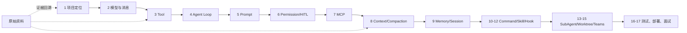

# JiMI Code 最终学习文档

这是 `jimi-code` 唯一推荐的学习入口。之前分散在 `docs/`、`study-notes/`、`deep-dive/`、`deep-learning/` 中的教材已经按段落和主题重新整理；相同内容在最终主教材中只保留一次，源码证据和独有细节继续保留在补充资料中。

## 先读哪一个文件

1. [JIMICODE-最终版学习教材.md](./JIMICODE-最终版学习教材.md)：唯一主教材，按“定义 → 模型 → 工具 → Agent Loop → 权限 → 上下文 → 记忆 → 协作 → 测试/面试”重建脉络。
2. [最终版融合统计.md](./最终版融合统计.md)：记录来源、保留段落和重复折叠统计。
3. [来源文档索引.md](./来源文档索引.md)：列出原始教材的分类、用途和回溯路径。
4. [chapters/](./chapters/README.md)：把最终主教材拆成可逐章阅读的 Markdown 文件。
5. `原始资料/`：原始 Markdown 归档，仅在需要核对旧版表述、完整索引或历史上下文时阅读。

## 最终版阅读路线



## 目录结构

```text
docs/learning-final/
├─ README.md                         # 本导航
├─ JIMICODE-最终版学习教材.md          # 唯一主教材
├─ 最终版融合统计.md                    # 段落去重和来源统计
├─ 来源文档索引.md                      # 82 个来源文档的分类索引
├─ chapters/                            # 分章阅读版（来源于最终主教材）
└─ 原始资料/
   ├─ course/                         # 原课程章节和附录
   ├─ deep-dive/                      # 源码专题深潜
   ├─ deep-learning/                  # 深度架构/逐文件教材
   ├─ study-notes/                    # 旧版教材和 sourcebook
   ├─ 历史整合版/                      # 之前生成的整合版，仅作历史对照
   └─ 根目录与配置/                    # README、构建指南、项目指南
```

## 合并规则

- 原始文档不删除、不覆盖；归档副本用于在本目录内集中查阅。
- 主教材以课程主线为骨架；相同段落只保留一次。
- 同一事实若有不同源码路径、实验、异常或设计取舍，不视为重复，作为补充保留。
- 超大文件/方法级索引不重复粘贴到每章，统一在主教材末尾提供反查入口。
- 第三方库和 Claude Code 闭源行为只写当前项目可证实的调用契约。

## 学习建议

不要从 `原始资料/` 随机打开文件。先完成主教材一轮，再根据主教材中的源码路径回到归档核对，最后运行实验和测试。每个结论至少保留一项证据：源码路径、方法、测试、事件、日志或 Git diff。
