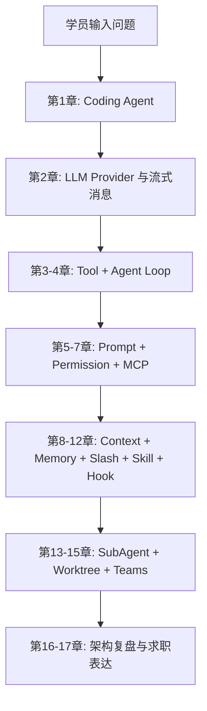

# 第 0 章：学习攻略与课程地图

> 返回总稿：[JIMICODE-最终版学习教材.md](../JIMICODE-最终版学习教材.md)

<!-- 主干来源：docs/course/00-必读-课程学习攻略.md -->

这一章是整套课程的导航和学习契约。JiMI Code 的目标不是教你调用一次聊天 API，而是带你沿着一条工程能力演进路线，把一个“只能接收文本”的空壳逐步扩展成能够理解仓库、选择工具、修改文件、执行命令、控制风险、压缩上下文、跨会话记忆、拆分子任务并协调团队的 Coding Agent。

- 说清楚 0～17 章分别解决什么问题，以及为什么顺序不能随意打乱；
- 在本地完成 Java 21、Maven 和一个安全的测试配置；
- 用源码路径定位入口、Agent Loop、工具、权限、会话、压缩和协作模块；
- 选择适合自己的速通、扎实或研究路径，并产出可验证的学习记录；
- 区分【课程概念】、【jimicode 实现】和【待源码确认】，避免把通用设计误说成当前项目事实。

这里的“源码对齐”以 `D:/code/JA/project/others/jimi-code` 当前工作区为准。项目 README 已声明 Java 21 + Maven；POM 中的主要依赖包括 TUI4J、Mordant、MCP SDK、Anthropic Java SDK、OpenAI Java SDK、SnakeYAML、Jackson 和 JUnit。入口类是 `src/main/java/com/jimicode/JimiCode.java`，不是一个 Spring Boot `main`，也没有传统 Controller/Service/Mapper 三层。

如果没有学习攻略，学习 Coding Agent 很容易出现至少三种真实失败。

第一种失败是“从产品表面跳到源码细节”。你看到 Claude Code 或 JiMI Code 能改文件，就直接打开 `Agent.java`，却不知道消息、工具 schema、权限和会话为何存在。结果是能读懂几行 Java，却无法解释一次请求从输入到文件修改的完整因果链。

第二种失败是“把仓库清单当成理解”。自动生成的文件索引可以告诉你有 `ContextCompactor.java`，但不告诉你它为什么同时依赖 token usage、工具结果预算和恢复附件。如果只追求覆盖率，最终会得到很多标题和很少的工程判断。

第三种失败是“把闭源产品体验误写成官方实现”。JiMI Code 借鉴了 Claude Code 的终端 Agent 理念，但它是课程项目/自研实现。若简历或面试中说成 Anthropic 官方代码，属于事实错误；若没有实测数据却声称“节省 80% token”，也属于不可验证的夸大。

第四种失败是“没有安全边界地做实验”。直接让 Agent 在真实仓库执行 shell、删除文件或修改配置，容易造成不可逆损失。学习必须使用临时仓库、明确 workdir、最小权限和可回滚的 Git 分支。

第五种失败是“只看正常路径”。Coding Agent 的难点通常在模型返回半截 JSON、工具超时、权限拒绝、上下文超过窗口、进程被 Ctrl-C 中断和多个 Agent 同时修改文件。课程每章都要求实验、排障和面试题，目的就是把失败路径纳入学习。

适合一到两周内需要形成项目表达的人。顺序是：第 1 章 → 第 2 章 → 第 3 章 → 第 4 章 → 第 6 章 → 第 8 章 → 第 13～15 章 → 第 17 章。重点掌握一张全链路图、十个关键类、十个失败场景和 STAR 项目讲解。

可验证产出：一页架构图、5 分钟讲解词、15 道深挖题答纲、一个只读工具和一个需要确认的写文件工具。

适合三到六周，希望能够真正修改项目的人。顺序是完整的第 0～12 章，再做 SubAgent、Worktree 和 Teams。每一章都必须完成实验，并在源码中找到调用者和测试。你要能独立增加一个 Tool、增加一个 Slash Command、扩展 Provider 配置字段，并为异常路径写测试。

可验证产出：一个自定义搜索工具、一个权限规则、一个上下文预算策略、一个 Skill 包、一个 Hook，以及对应的 JUnit 测试。

### 3. 研究路径：Teams/Worktree 与系统治理

适合想研究多 Agent 编排、并发隔离和生产可靠性的人。重点深入第 8、13、14、15、16 章，阅读 `SubAgentTaskManager`、`WorktreeManager`、`TeamManager`、`FileMailBox`、`SharedTaskStore` 和 `TeammateRunner`。除了功能，还要研究崩溃恢复、重复消息、锁、取消传播、成本上限和审计。

可验证产出：两个 Agent 在独立 worktree 中完成不同任务，Team 通过邮箱汇报，主 Agent 汇总结果；同时写出失败演练记录和清理策略。

| 阶段 | 你拥有的能力 | 还没有解决的问题 |
|---|---|---|
| 只有聊天 | 能发送消息和显示文本 | 不知道仓库事实，不能可靠改文件 |
| 有 Tool | 能读文件、搜索、执行动作 | 不知道何时调用，可能越权或死循环 |
| 有 Agent Loop | 能根据观察继续推理 | 仍可能无限循环、上下文爆炸、误执行 |
| 有权限和上下文 | 能控制风险和 token | 复杂任务仍需分工和隔离 |
| 有 SubAgent/Worktree | 能并行拆分任务 | 协作协议、合并和成本更复杂 |
| 有 Teams | 能形成长期角色协作 | 需要治理、可观测性、恢复和人类监督 |



| 数据/产物 | 生产者 | 消费者 | 学习时要记录什么 |
|---|---|---|---|
| `AppConfig` | SnakeYAML/`ConfigLoader` | `JimiCodeModel`、`Agent` | 字段来源、默认值、校验错误 |
| `Message` | TUI/ConversationManager | PromptBuilder、LlmClient | role、content、顺序、序列化 |
| `StreamEvent` | Provider Client | StreamingExecutor、TUI | delta 类型、结束条件、错误 |
| Tool Schema | ToolRegistry | LLM Client | name、description、参数 schema |
| ToolResult | Tool 实现 | Agent、ConversationManager | output、isError、toolUseId |
| PermissionResponse | PermissionChecker/UI | Agent Loop | allow/ask/deny、确认范围 |
| RecoveryState | ReadFile/Skill/Compactor | ContextCompactor/Resume | 快照、技能 SOP、恢复顺序 |
| TaskNotification | SubAgentTaskManager | 父 Agent | 状态、输出、失败和超时 |
| WorktreeSession | WorktreeManager | Team/Agent | 路径、分支、创建和清理时间 |

第一遍是“能聊”：只读 README、POM、入口和总架构，能描述系统用途但不改代码。第二遍是“能读文件”：从 `JimiCode.main` 进入 `ConfigLoader`、`JimiCodeModel`、`Agent`、`LlmClient` 和 `ToolRegistry`，沿调用者反查。第三遍是“能改文件+权限”：在临时仓库里增加工具、触发确认、制造异常、恢复会话，并跑测试。

【jimicode 实现】要求 Java 21+、Maven 3.9+。Windows 下可使用 `mvn.cmd clean verify`；构建产物为 `target/jimicode.jar`，运行命令为 `java -jar target\\jimicode.jar`。首次配置可复制 `config.example.yaml` 到 `.JimiCode/config.yaml`，填入 provider 的协议、base_url、model 和 API key。API key 不要提交 Git，也不要写进学习笔记或截图。

```text
learning-sandbox/       # 专门做破坏性实验的临时仓库
learning-notes/         # 每章的时序图、失败记录、面试答纲
jimi-code/              # 课程项目源码，只读分析后再改动
```

```text
src/main/java/com/jimicode/JimiCode.java                  # 启动入口
src/main/java/com/jimicode/config/                        # YAML 与 Provider 配置
src/main/java/com/jimicode/agent/                         # Agent Loop 与事件
src/main/java/com/jimicode/llm/                           # Anthropic/OpenAI 适配
src/main/java/com/jimicode/conversation/                  # 消息模型
src/main/java/com/jimicode/tool/                          # Tool SPI、注册表、实现
src/main/java/com/jimicode/permission/                    # 权限模式与检查
src/main/java/com/jimicode/compact/                       # 上下文压缩与恢复
src/main/java/com/jimicode/memory/                        # 记忆扫描、召回、管理
src/main/java/com/jimicode/worktree/                     # Git worktree 隔离
src/main/java/com/jimicode/subagent/teams/                # 子 Agent 与团队协作
src/test/java/com/jimicode/                               # 边界条件和回归测试
```

```markdown
## 类名
- 文件：
- 一句话职责：
- 创建者/调用者：
- 输入与输出：
- 可变状态：
- IO/网络/线程副作用：
- 异常与恢复：
- 对应测试：
- 如果替换它，必须保持的契约：
```

每做一次实验，记录“前置配置、输入、模型/工具事件、文件 diff、日志、结果、失败原因、是否可回滚”。数字指标如果没有实测，统一写“示例/需实测”。

对照的是公开产品体验和通用理念，不是闭源内部实现。可以比较：是否支持流式输出、工具确认、项目规则文件、上下文压缩、子任务、工作树和终端交互；不要猜测其内部类名、提示词原文或未公开策略。记录对照表时写“Claude Code 的公开体验”“jimicode 当前源码行为”“差异与改进假设”三列。

**目标**：确认 Java/Maven、配置解析和启动失败边界。

1. 执行 `java -version`、`mvn -version`，记录版本。
2. 复制 `config.example.yaml`，将 API key 放在本地未跟踪文件。
3. 故意把 protocol 改为 `unknown`，执行 `mvn.cmd test` 或启动 jar。
4. 恢复正确协议，使用只读请求启动 TUI。

**预期现象**：错误发生在 Agent Loop 之前，提示协议无效；日志/终端不应打印完整 API key。

**成功标准**：能解释参数路径、环境变量路径和默认配置路径的优先级，并能恢复终端光标。

**常见报错**：Java 版本低于 21、Maven 下载依赖失败、配置文件路径错误、终端不支持 TUI。排查时先看 `JimiCode.main` 和 `ConfigLoader.load`，不要先改 Agent。

1. 打开 `JimiCode.java`，标出配置、权限、模型和 Program 的创建点。
2. 搜索 `new Agent`、`.run(`、`getAllSchemas`、`ToolResult`。
3. 画出 `main → JimiCodeModel → Agent → LlmClient → ToolRegistry` 时序图。
4. 找一个对应测试，例如 `ToolSearchTest` 或 `ConfigLoaderValidationTest`。

**预期现象**：你会发现项目没有 Controller，TUI 事件和 BlockingQueue 是用户交互边界。

**成功标准**：能在 3 分钟内指出一次 turn 的输入、输出、状态和异常出口。

**常见报错**：搜索结果太多、把 `target/` 反编译文件当源码、看不懂第三方 SDK。排查命令应排除 `target`，第三方库只学习当前项目调用契约。

| 症状 | 可能原因 | 排查命令/日志点 |
|---|---|---|
| 找不到配置 | 路径、文件名或工作目录不对 | `Get-Location`；检查 `ConfigLoader` candidates |
| 启动即退出 | provider 缺字段或 protocol 非法 | 看 `ConfigException`，检查 `ProviderConfig` |
| TUI 光标消失 | 异常未进入 finally 或终端状态残留 | 检查 `JimiCode.main` 的 finally，重新打开终端 |
| 不知道从哪读 | 先读了扩展/生成文件 | 回到入口、Agent、消息、ToolRegistry |
| 文档与源码不一致 | 课程概念误当项目事实 | 添加【待源码确认】，以当前路径和测试为证据 |
| 测试结果不稳定 | 使用真实网络/API | 用 mock、临时目录和固定输入隔离外部状态 |

学习环境必须最小化权限：使用临时 Git 仓库，避免把真实项目根目录交给会执行 shell 的 Agent；敏感配置使用环境变量或本地未跟踪文件；涉及写文件、安装依赖、删除内容、网络访问时采用一次性确认；任何“自动允许所有命令”的模式只在隔离沙箱实验，不用于真实仓库。安全策略要落在 PermissionChecker 和工具实现中，不能只写在 System Prompt，因为模型可能忽略提示而权限引擎仍能阻断。

### 题 1：为什么学习 Coding Agent 要先学消息和 Tool，而不是先学 Prompt？

**回答提纲**：Prompt 决定行为偏好，但消息和 Tool 定义可执行边界；没有结构化 Tool schema，模型无法可靠请求动作；没有 ToolResult，Agent 无法根据观察继续推理。**加分点**：提到 provider-neutral 内部表示和 toolUseId 因果关联。

### 题 2：JiMI Code 与 Claude Code 是什么关系？

**回答提纲**：产品理念对标终端 Coding Agent，JiMI Code 是自研课程项目；不能声称 Anthropic 官方实现，也不应猜测闭源内部细节。**加分点**：能列出真实源码路径和差异验证方法。

**回答提纲**：面试表达、源码修改、并发协作的深度不同；研究路径需要额外掌握取消、隔离、恢复、成本和审计。**加分点**：每条路径都有可验证产出而不是只列阅读章节。

**回答提纲**：看是否有真实路径、调用者、测试、异常和副作用；区分索引与语义；数字指标注明是否实测。**加分点**：用“职责—输入—状态—输出—失败—协作—替换”模板审查。

- [ ] 我能说清 JiMI Code 不是 Anthropic 官方实现。
- [ ] 我能说明 0～17 章从聊天到团队的能力演进。
- [ ] 我已准备 Java 21、Maven 和隔离实验目录。
- [ ] 我能从 `JimiCode.main` 找到配置、Agent 和 TUI 的创建点。
- [ ] 我知道如何区分【课程概念】【jimicode 实现】【待源码确认】。

只有先建立 Coding Agent 的问题边界，下一章讨论模型 API 时才不会把“会聊天”误认为“会编程”。

### FAQ 1：为什么不把所有章节写在一个 Markdown 文件里？

因为每章都需要实验、排障和源码证据，拆分后可以独立复习、链接和迭代；总导航仍提供完整课程视图。

### FAQ 2：我没有 Anthropic API key，能学习吗？

能。第 0～4 章的大部分内容可用 mock provider、单元测试和本地工具学习；真实模型实验要使用你有权限的 provider，并把密钥留在本地。

索引解决发现性，语义讲解解决因果关系。只有追到调用者、状态、异常和测试，才能真正修改源码。

第一周完成 0～4 章，第二周完成 5～8 章，第三周完成 9～12 章，第四周完成 13～17 章；若走扎实/研究路径，每个实验和失败演练再各留一到两周。

请不要把“能运行 Maven”误认为“已经准备好学习”。开始第 1 章前，尝试不用打开源码回答下面的问题：如果模型返回一个工具调用，系统如何知道工具名称、参数和风险？如果用户拒绝，消息序列应该如何结束？如果进程在文件写入后、ToolResult 落盘前崩溃，下一次恢复凭什么判断文件状态？如果两个子 Agent 修改同一文件，线程锁能不能解决 Git 工作树冲突？如果上下文超出模型窗口，哪些信息必须保留？

如果这些问题只能回答“交给模型自己判断”，就说明你需要把后续章节当作工程课程，而不是 Prompt 技巧课。每一章都会把“模型能力”和“系统控制”分开：模型擅长理解和生成，系统负责状态、权限、资源、持久化和恢复。这个分工是整个课程最重要的架构前提。

- 一张手工绘制、能解释每个箭头的总架构图；
- 一个只读工具的实现和测试；
- 一个写文件工具的权限规则、拒绝案例和回滚记录；
- 一份 Provider 请求/响应脱敏样本；
- 一次上下文压缩前后的 token/字符统计（注明示例或实测）；
- 一个 Skill 目录及其触发条件、脚本和失败说明；
- 一个 Hook 的阻断/放行策略实验；
- 一个 SubAgent + Worktree 的并行任务演练；
- 一页诚实的项目简历描述和 40 道面试题答纲。

这些产物比“读完了多少字”更能证明学习效果。文档很长是为了覆盖复杂性，但学习必须回到代码、命令、测试和可观察结果。

第一，证据优先于直觉。看到一个类名像 `MemoryManager`，不能直接推断它实现了向量数据库；应打开源码、查看字段和调用者，再确认它究竟是扫描文件、拼接文本还是调用外部存储。第二，契约优先于实现细节。一个方法即使只有几行，也可能通过接口、序列化格式或线程边界影响整个系统；学习笔记要记录“别人依赖它什么”，而不只是“它现在怎么写”。第三，失败优先于演示。正常回答只能说明 happy path，真正的工程质量要看拒绝、超时、半截响应、重复调用、崩溃恢复和回滚。

第四，分层讨论安全。System Prompt 可以表达原则，PermissionChecker 才能强制阻断，Tool handler 还要做最后一次参数和路径校验，Git diff 与审计日志负责事后复核。第五，诚实标注不确定性。当前源码没有 Controller，就写“CLI/TUI 项目无传统 Controller”；某个第三方 SDK 的内部行为不可见，就写“依赖契约/待源码确认”；性能数字没有压测，就写“示例/需实测”。这种标注不是保守，而是专业文档的基本可信度。

第 1 章定义 Agent 的边界；第 2 章提供模型输入输出；第 3 章把动作变成 Tool；第 4 章把 Tool 放进循环。第 5 章让行为可预测，第 6 章让动作可治理，第 7 章让能力可扩展。第 8 章控制上下文成本，第 9 章控制跨会话信息，第 10～12 章把显式命令、可复用技能和生命周期自动化组织起来。第 13～15 章才进入多 Agent、工作树和团队协作，因为没有前面的消息、权限、状态和恢复基础，所谓“并行智能”只会放大混乱。第 16 章复盘技术债，第 17 章把真实能力转换成简历和面试表达。

如果你在某章卡住，优先回退到它直接依赖的上一章：工具选不对，回看消息和 schema；循环停不下来，回看工具结果和终止条件；压缩后无法恢复，回看会话序列和 toolUseId；团队互相覆盖，回看 worktree 与权限，而不是先增加更多 Agent。
