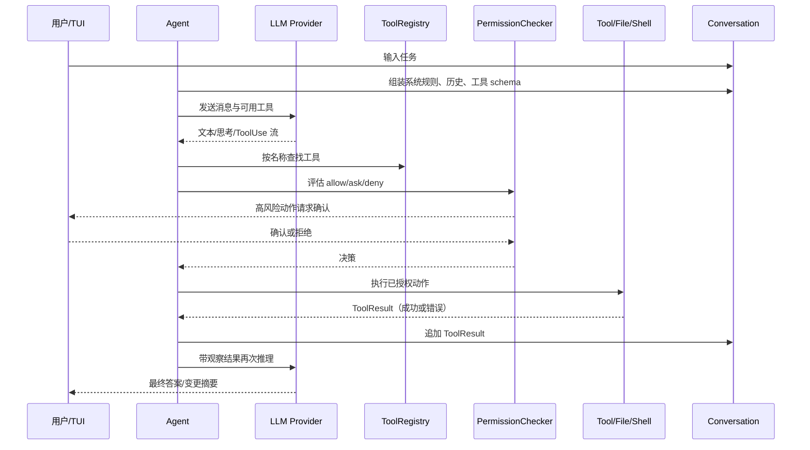

# 第 01 章：初识 Coding Agent

> 返回总稿：[JIMICODE-最终版学习教材.md](../JIMICODE-最终版学习教材.md)

<!-- 主干来源：docs/course/01-第1章-初识-Coding-Agent.md -->

本章建立整套课程的第一性认识：Coding Agent 不是“把聊天窗口搬到终端”，也不是“代码补全再加一个按钮”，而是一个能够观察软件工程环境、选择并执行工具、读取行动结果、继续规划并在权限边界内完成任务的闭环系统。

在“从空壳到团队”的路线中，本章处于起点。你还不会实现完整 Agent，但要先能判断一个产品/项目到底是不是 Coding Agent，知道它的能力边界和风险边界。后续模型 API、工具系统、Agent Loop、权限和协作，都建立在这里的定义上。

1. 画出“用户输入 → 模型 → 工具调用 → 文件/Shell → 观察结果 → 再推理”的全链路；
2. 用一个真实修 bug 故事解释 Chat、Autocomplete、IDE Agent 和 Coding Agent 的差异；
3. 在 `jimi-code` 源码中定位入口 `JimiCode`、编排器 `Agent`、消息模型、工具注册表和 TUI；
4. 能写出三个“看起来像 Agent、实际上不是完整 Coding Agent”的反例。

普通 Chat 可以解释“NullPointerException 通常怎么修”，但它看不到你的 `pom.xml`、调用栈、测试和实际数据流。它给出的修复建议可能与当前 Java 版本、依赖版本或项目约定冲突。Coding Agent 的第一项增量能力是通过 `ReadFileTool`、`GlobTool`、`GrepTool` 等工具取得证据，而不是凭通用知识猜测。

Autocomplete 在光标附近预测几行代码，不负责运行测试，也不会根据编译错误重新修改。一个补全看似合理，但可能引入未导入的类、破坏接口契约或改变并发语义。Coding Agent 会把“修改—编译—观察失败—再修改”作为多步循环，并在每一步保留可审计的工具结果。

如果模型直接拥有 shell 权限，它可能在不理解工作区边界时执行安装、删除或迁移命令。即使意图是修复 bug，副作用也可能超出用户授权。Coding Agent 必须把“模型提出动作”和“系统允许动作”分开，由权限模式、路径约束和确认 UI 决定是否执行。

### 失败场景 4：能调用一次工具，但不会根据观察继续推理

一个脚本可以固定执行 `grep`，但它不知道什么时候该读配置、什么时候该查测试、什么时候该停止。真正的 Agent 需要把 ToolResult 作为下一轮消息输入，根据结果动态选择下一动作，并且有最大步数、超时和取消。

“能自主修复任何 bug”“完全不会误删文件”都不是严谨定义。学习时必须把能力拆成可观察事件、工具权限、失败模式和测试指标；对没有实测的数据写“示例/需实测”。

【课程概念】Coding Agent 是运行在软件工程环境中的智能体：它接收自然语言任务，读取项目上下文，调用一组有明确 schema 和权限的工具，观察工具结果，进行多轮推理与规划，并在用户授权范围内产生代码或环境变化。

1. **环境感知**：能够读取文件、目录、版本信息、测试输出或其他资源；
2. **动作能力**：至少有一个会产生真实影响的工具，而不是只输出文本；
3. **闭环观察**：工具结果必须回到推理上下文；
4. **多步控制**：能根据新结果改变下一步，而不是固定脚本；
5. **治理边界**：有权限、确认、超时、取消、审计或回滚机制。

| 类型 | 输入上下文 | 是否主动调用工具 | 是否修改环境 | 是否多步观察 | 典型风险 |
|---|---|---:|---:|---:|---|
| Chat | 用户粘贴的文本 | 通常否 | 否 | 有限 | 建议脱离项目事实 |
| Autocomplete | 光标附近代码 | 否 | 只写入编辑器当前位置 | 否 | 局部正确、全局不一致 |
| IDE Agent | IDE 索引和工作区 | 是 | 通常是 | 是 | 权限与 diff 审查不足 |
| Coding Agent | 仓库、终端、规则、工具 | 是 | 是 | 是 | 命令、路径、成本和并发风险 |
| 固定脚本 | 预定义参数 | 固定调用 | 是 | 固定流程 | 无法适应未知结果 |

与上一阶段“普通聊天”的差异，不是模型名称，而是控制平面是否存在：Tool schema、权限网关、状态、循环、事件和恢复共同构成 Agent。

【jimicode 实现】JiMI Code 是本地 Java CLI/TUI Coding Agent。`JimiCode.main` 创建配置和 `JimiCodeModel`；`JimiCodeModel` 负责 TUI 交互状态；`Agent` 负责循环；`LlmClient` 抽象 Anthropic/OpenAI/OpenAI-compatible provider；`ToolRegistry` 管理工具 schema 和实现；文件、Shell、MCP、权限、Memory、Worktree、SubAgent 和 Teams 提供行动边界。

它不是一个 Web 服务，也不是单纯的 IDE 插件。其“用户界面”是终端，其“数据库”主要是本地会话/历史文件，其“并发基础设施”包括 Java 虚拟线程、文件邮箱和 Git worktree。课程后续会分别解释这些模块，而本章只确认角色，不提前把实现细节混在定义里。



| 数据结构 | 主要字段 | 谁生产 | 谁消费 | 为什么不能只用字符串 |
|---|---|---|---|---|
| `Message` | role、content、metadata | 用户、Agent、工具 | Provider adapter、历史、UI | 需要保留角色、块类型和顺序 |
| `ToolUseBlock` | toolUseId、toolName、arguments | 模型流解析器 | Agent、ToolRegistry | 需要按 id 关联结果和恢复 |
| `ToolResultBlock` | toolUseId、content、isError | Tool 实现 | Agent、模型、历史 | 错误也必须成为可推理观察 |
| `StreamEvent` | text delta、thinking、tool call、usage、error | LLM Client | StreamingExecutor、TUI | 流式 UI 不能等完整字符串 |
| `PermissionMode` | 默认策略、确认策略 | 配置/UI | PermissionChecker | 动作是否允许不是模型决定的 |
| `AgentEvent` | 文本、工具、压缩、错误、完成 | Agent Loop | TUI、父 Agent | 需要把内部状态可观测化 |

用户负责目标和授权；模型负责提出下一步推理/动作；Agent 负责编排与停止条件；Tool 负责执行明确动作；Permission 负责安全裁决；Conversation 负责事实序列；TUI 负责呈现与收集确认。若模型直接绕过 Permission 写文件，架构就失去安全边界；若 UI 直接拼 provider JSON，Provider 抽象就失去意义。

打开 `src/main/java/com/jimicode/JimiCode.java`，可以看到入口不是“读取文本然后调用一个函数”。它先解析命令行参数或 `JimiCode_CONFIG` 环境变量，再调用 `ConfigLoader.load`；之后把配置转换为 `PermissionMode`，创建 `JimiCodeModel`，再交给 TUI4J `Program` 运行。这个顺序表达了一个架构决策：运行 Agent 前先完成配置和权限校验，避免半初始化状态下执行工具。

入口还注册 SIGINT，并在 `finally` 中恢复终端光标。Ctrl-C 在 Coding Agent 中不是简单退出：后续 Agent Loop、子进程、队列和会话都要处理取消；本章先记住“取消是控制流的一等公民”，第 4、13、15 章再深入。

普通函数通常是 `input -> output`。Agent 至少有以下状态：

```text
conversation       当前消息事实
registry            可发现/可调用工具
permission          当前安全策略
iteration           已执行的推理轮数
usageAnchor        provider usage 或字符估算锚点
recoveryState      压缩后恢复所需的文件/技能快照
replacementState   工具结果替换决策
```

【jimicode 实现】`Agent.run` 返回 `BlockingQueue<AgentEvent>`，并在虚拟线程中执行 `agentLoop`。这意味着调用者通过事件消费进度，而不是阻塞等待一个最终字符串。`agentLoop` 在每轮开始检查最大迭代和线程中断，随后组装工具 schema、进行自动压缩、处理计划模式和延迟工具，最后调用 LLM 并执行工具。

```java
// 课程伪代码：展示控制流，不代表可直接复制到生产代码
while (!finished && iteration < maxIterations) {
    checkCancelled();
    injectMemoryAndSystemReminders(conversation);
    maybeCompact(conversation, contextWindow, usageAnchor);

StreamEvent response = llm.stream(conversation, registry.schemas());
    conversation.append(response.asMessageBlocks());

if (!response.hasToolUse()) {
        finished = true;
        emitFinalAnswer(response);
        break;
    }

for (ToolUseBlock call : response.toolCalls()) {
        PermissionResponse decision = permission.check(call);
        if (decision.requiresConfirmation()) {
            emitAskUser(call);
            pauseUntilConfirmed();
        }
        ToolResult result = registry.execute(call);
        conversation.append(result.asToolResultBlock());
    }
    iteration++;
}
```

真正的 `jimi-code` 实现还要处理流式 delta、工具结果预算、Hook、PLAN、SubAgent 通知、恢复附件、协议差异和错误包装，所以这段代码是概念骨架，不应当被误认为完整实现。

假设用户说：“请修复订单模块中一个偶发的 NullPointerException，并运行相关测试。”

第一步，Agent 不应立即写代码。它先调用目录/搜索工具定位订单模块、异常栈或测试名称；ToolResult 可能发现错误发生在 `OrderService` 调用 `discountPolicy` 的路径。

第二步，Agent 读取相关类、配置和测试，比较空值来源：是数据库返回 null、配置未加载，还是并发初始化顺序问题。它把观察结果加入会话，而不是只在 UI 中显示后丢弃。

第三步，模型提出修改方案。若需要 EditFile，PermissionChecker 根据模式判断是否自动允许或询问。用户确认后，工具先记录原始文件状态，再做精确替换；如果匹配文本不唯一，工具应返回错误，不应“猜一个位置”。

第四步，Agent 调用测试命令。测试失败输出成为新的 ToolResult，模型据此调整实现；测试通过后，Agent 汇总修改文件、测试命令、结果和剩余风险。这个故事中每一步都可能失败，但每次失败都能回到结构化观察和权限边界，而不是让模型无条件继续。

Anthropic 和 OpenAI 的请求字段不同，但 Agent 不应在业务循环里写两套分支。`LlmClient` 和 `StreamEvent` 将差异压到适配层，便于新增 OpenAI-compatible endpoint 和测试 mock。

工具失败不一定代表整轮 Agent 失败。把 `isError` 和错误内容回传模型，模型可以换工具、修正参数或请求用户。只有不可恢复的配置/状态错误才应结束主循环。

#### 反模式一：模型直接获得 `Runtime.exec`

这样做把“提出动作”和“执行动作”混成一层，无法按命令、路径、会话和用户进行授权，也难以审计。正确方式是把 Shell 封装成 Tool，先 schema 校验、权限判断、工作区限制和超时，再执行。

#### 反模式二：每轮把所有文件和所有工具结果塞回 Prompt

短期看似信息完整，长期会导致 token 成本、延迟和上下文溢出。正确方式是按相关性切片、限制工具输出、使用摘要和恢复附件；第 8 章会详细讲 Compaction。

固定脚本没有根据未知观察改变计划的能力，也无法处理工具错误和用户拒绝。Agent Loop 必须以模型结果和终止条件驱动下一步。

1. 写一个只调用聊天 API 的 CLI，只能回答用户粘贴的代码。
2. 写一个固定执行 `rg TODO` 的脚本。
3. 阅读 `jimi-code` 的 `Agent.run`、`ToolRegistry` 和 `ConversationManager`。
4. 为三个系统分别填写“环境感知、动作能力、观察闭环、多步控制、治理边界”五列。

**预期现象**：前两个系统缺少至少两项必要条件；jimicode 虽具备完整骨架，但具体能力仍受配置、工具和模型质量限制。

**成功标准**：能解释“有工具”不等于“有 Agent Loop”。

**常见报错**：把固定脚本的输出误认为模型观察；排查时检查下一步是否由结果动态决定。

1. 创建临时 Git 仓库，加入一个会失败的 JUnit 测试和简单 Java 类。
2. 启动 jimicode，权限使用只读或 PLAN 模式。
3. 提出“找出失败原因并给出修改计划”，禁止直接写文件。
4. 检查 Agent 是否先使用 read/search 工具，是否把测试输出作为观察。

**预期现象**：Agent 可以定位问题但无法在只读模式直接修改；计划模式会产生结构化计划和审批点。

**成功标准**：你能列出每个只读工具调用的输入、输出和下一步推理依据。

**常见报错**：模型直接声称已修复但没有文件 diff；检查 ToolResult 和实际 Git 状态，不以自然语言为准。

| 症状 | 可能原因 | 排查命令/日志点 |
|---|---|---|
| Agent 只聊天不读文件 | 工具未注册、schema 未发送或 prompt 未说明 | 查 `ToolRegistry.getAllSchemas`、Provider 请求体 |
| 工具名称正确但无法执行 | 注册表没有该名称或被 filter | 搜索 `register`、`toolNameFilter`、工具列表 |
| 工具执行后模型不继续 | ToolResult 未追加 conversation 或 isError 格式错误 | 检查 `ConversationManager` 消息序列和 toolUseId |
| 循环一直不结束 | 无 maxIterations、终止条件失效或模型反复调用 | 查看 Agent iteration、`AgentEvent` 和工具调用计数 |
| 修改了错误文件 | 路径未规范化、匹配不唯一、缺少 diff 审查 | 检查工具输入、workDir、Git diff |
| 用户拒绝仍继续执行 | Permission 决策未成为执行前置条件 | 检查 `PermissionChecker` 到 Tool handler 的调用链 |

本章只讨论防御设计：所有会改变文件、启动进程或访问网络的动作都应进入 Tool 和 PermissionGateway；工具必须限制工作区 root、规范化路径、设置超时和输出上限；高风险动作使用明确的确认 UX；执行前后记录审计事件；实验使用临时仓库并保留 Git 回滚点。不要把“模型被要求谨慎”当成安全控制，也不要在真实目录验证删除、格式化或迁移命令。

### 题 1：Coding Agent 和 Copilot 补全的本质差异是什么？

**回答提纲**：补全是局部预测，Coding Agent 是环境感知、工具行动、观察反馈和多步治理的闭环。**加分点**：提到权限、状态和可恢复性，而不只说“能改更多文件”。

### 题 2：为什么 ToolResult 的错误也要回传模型？

**回答提纲**：错误是环境观察，模型可以修正参数、选择替代工具或请求用户；但不可恢复的配置/权限错误应结束或暂停。**加分点**：区分业务错误、可重试错误和安全拒绝。

**回答提纲**：最大迭代数、工具调用去重、终止条件、超时、取消、重复错误检测和上下文压缩。**加分点**：把预算和可观测事件纳入治理。

### 题 4：为什么权限不能只写在 System Prompt？

**回答提纲**：Prompt 是模型输入，不能作为强制执行边界；权限必须在 Tool handler 前由独立引擎裁决。**加分点**：路径 root、敏感文件、一次性确认和审计。

### 题 5：如何证明一个 Agent 真的“会编程”？

**回答提纲**：用可复现实验验证读取仓库、修改文件、运行测试、根据失败再推理、遵守权限和输出 diff；不能只看最终自然语言。**加分点**：记录成功率、首 token 延迟、工具错误率等指标，并标明实测范围。

- [ ] 我能用五个必要条件定义 Coding Agent。
- [ ] 我能画出消息、模型、工具、权限和观察结果的时序。
- [ ] 我能解释 JiMI Code 与 Chat、Autocomplete、IDE Agent 的差异。
- [ ] 我能在源码中找到 `JimiCode`、`Agent`、`LlmClient` 和 `ToolRegistry`。
- [ ] 我知道为什么 ToolResult、权限和终止条件是 Agent 的必要组成。

理解 Agent 的角色边界后，下一章才会准确学习“模型如何开口说话”，并把 provider 差异封装成可供 Agent 使用的统一流式接口。

### FAQ 1：只要模型能生成代码，就是 Coding Agent 吗？

不是。生成代码属于输出能力，Coding Agent 还必须能观察环境、调用工具、接收结果并在治理边界内继续行动。

### FAQ 2：jimicode 是不是 Claude Code 的源码？

不是。它是仿 Claude Code 理念的自研 Java 课程项目。可以对比公开体验，但不能声称官方实现或复制闭源内部设计。

### FAQ 3：为什么 Coding Agent 需要多轮，而不是一次生成完整补丁？

真实仓库事实通常未知，测试和工具输出会改变计划；多轮闭环能根据观察修正假设，并在关键动作前插入确认。

### FAQ 4：Agent 一定要支持 Shell 吗？

不一定。Shell 是常见能力但风险较高；一个只读代码分析 Agent 也可以是有效 Coding Agent。关键是是否具备工具、观察、多步和治理闭环。

下面是三句常见宣传，请把它们改写成可验证的工程陈述。

“Agent 可以自主修复 bug。”应改写为：“在给定仓库、测试命令、最大迭代数和权限模式下，Agent 能够读取相关文件，提出并执行有限次修改，运行指定测试，并输出实际 diff；成功率和平均步数需要在公开样本上实测。”

“Agent 永远不会误删文件。”应改写为：“删除类操作默认需要确认，工具限制在 workdir root 内，并记录操作前快照；在定义的测试集合中未观察到越权删除，但不能把有限测试推广为绝对保证。”

“Agent 比人工更高效。”应改写为：“在某组任务、模型、硬件和网络条件下，比较 Agent 与基线人工流程的完成时间、首次可用结果延迟、返工次数、token 成本和错误率；所有数字注明样本和测量方法。”

这项练习会贯穿第 16、17 章：工程师不是把愿望写得更激动，而是把能力写成边界清晰、可重复验证的契约。

## 第一章阅读作业：建立自己的最小 Agent 词汇表

请用不超过两句话分别定义：模型、消息、工具、观察、循环、权限、状态、会话、工作区、回滚。然后在 `jimi-code` 中为每个词填一个真实类或文件路径。若某个词在当前源码中没有一一对应的类，就标记为【课程概念】并解释它由哪些类共同实现。完成后，再用这些词复述一次“修复 NullPointerException”的端到端故事，要求每一步都能指出生产者、消费者和失败出口。

作业的成功标准不是定义写得漂亮，而是别人可以根据你的路径在仓库中复查。比如“观察”不能只写成“模型看到了结果”，而应指出 `ToolResult` 如何进入 `ConversationManager`，下一次 LLM 请求如何消费它；“权限”不能只写成“系统很安全”，而应指出 `PermissionChecker` 在哪个工具副作用之前做决策。
