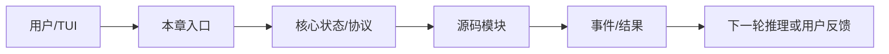

# 第 02 章：让AI开口说话

> 返回总稿：[JIMICODE-最终版学习教材.md](../JIMICODE-最终版学习教材.md)

<!-- 主干来源：docs/course/02-第2章-让AI开口说话.md -->

把第 1 章定义的 Agent 外壳连接到真实 LLM Provider。学完后，你能解释消息列表、请求适配、流式响应、密钥配置和终端展示，并能用 mock 或真实兼容端点完成一次安全聊天。

没有本章时，程序只能返回固定文本；把 Anthropic 字段误发给 OpenAI 导致 400；一次性等待完整响应造成首 token 延迟；API key 写入仓库导致泄露；SSE 分片被错误拼接后工具 JSON 损坏。

模型是推理服务，Message 是 provider-neutral 的内部事实，StreamEvent 是增量事件，Provider adapter 是协议翻译层。`LlmClient` 隔离了 `AnthropicClient`、`OpenAiClient` 与 `OpenAiCompatClient` 的差异；TUI 消费事件而不是直接依赖第三方 SDK。

| 对比维度 | 本章能力 | 上一章能力 | 下一章依赖 |
|---|---|---|---|
| 输入 | 结构化、可校验的本章对象 | 上一层输出 | 为下一层提供稳定契约 |
| 控制 | 明确的状态/权限/预算 | 规则较少 | 可观测、可恢复、可扩展 |
| 失败 | 分类、可见、可恢复 | 可能只返回错误文本 | 由后续治理层接管 |

**本章实际链路**：用户输入 → ConversationManager → PromptBuilder → LlmClient → HTTP/SSE → StreamEvent → StreamingExecutor → AgentEvent → JimiCodeModel/MarkdownRenderer

Message(role/content)、ProviderConfig(protocol/baseUrl/model/apiKey)、StreamEvent(type/text/toolDelta/usage/error)、AgentEvent(streamText/tool/error/complete)。

| 字段 | 生产者 | 消费者 | 失败时必须保留 |
|---|---|---|---|
| 身份/名称 | 配置或注册表 | Agent/Provider/UI | 原始值与规范化值 |
| 参数/内容 | 用户、模型或工具 | 下一阶段模块 | 校验错误与来源 |
| 状态 | 编排器/持久化层 | 恢复、审计、UI | 转移前后状态 |
| 结果 | 本章实现 | Conversation/父任务 | 成功、错误、耗时 |

打开 `src/main/java/com/jimicode/llm/LlmClient.java`，先看它定义的最小契约，再看三个实现如何把消息和工具 schema 映射成供应商请求。`AnthropicClient` 重点是 system、messages、tools、thinking 和 SSE；`OpenAiClient` 重点是 chat/completions、tool_calls 和 usage；`OpenAiCompatClient` 允许自建或第三方兼容端点。Agent 层只接收 `StreamEvent`，因此新增 provider 不应修改 `Agent.agentLoop`。

`ProviderConfig` 的 `protocol` 不是装饰字段，它决定 `ModelResolver` 选择哪个 client；`baseUrl` 决定请求根地址；`model` 参与请求体和日志；上下文窗口与最大输出影响后续 Compaction。API key 必须来自 YAML 未跟踪文件或环境变量，日志只打印 provider 名称和请求 id，不打印 Authorization。

流式解析要处理四种边界：一个事件被拆成多个网络 chunk；一个 chunk 包含多个 SSE event；最后一个 event 没有换行；连接在工具参数 JSON 中间断开。解析器必须保留缓冲区、按 event 分隔符解帧、校验 JSON，并在异常时产生 `StreamEvent.Error` 而不是静默结束。`StreamingExecutor` 再把 text/thinking/tool delta 转成 UI 可消费的 `AgentEvent`。

终端展示和模型协议必须解耦。`MarkdownRenderer` 负责把最终 Markdown 渲染为 TUI 文本；流式文本可以先以纯文本增量展示，完成后再渲染代码块。不要让 UI 直接拼 SSE，也不要在 UI 线程执行阻塞 HTTP。

反模式一是“每个 provider 在 Agent 中写 if/else”：这会让协议差异污染循环，新增 provider 需要修改核心。反模式二是“收到一段文本就当完整答案”：这会丢失后续 delta、usage 和 tool call。反模式三是“为了方便把 key 打印到 debug 日志”：这会让终端日志、trace 和 CI artifact 变成秘密泄露面。

- 不要用自然语言约束替代可执行的系统边界。
- 不要吞掉异常、取消或拒绝事件。
- 不要在没有测试和回滚点的真实仓库执行破坏性操作。

**目标**：用 mock HTTP 服务返回分片 SSE，验证文本跨 chunk 拼接、usage 累积和错误事件；成功标准是最终消息与预期一致且没有重复字符。

**步骤**：在临时仓库或 mock 环境中准备输入；运行最小命令；保存事件、日志和 Git diff；重复一次失败条件。

**预期现象**：能看到本章对应的状态变化，而不是只得到最终文本。

**成功标准**：结果可复现、失败可解释、没有越过工作区和权限边界。

**常见报错**：环境、路径、依赖、超时或配置错误；先看本章排障表，再沿源码调用者反查。

**目标**：配置两个 provider，分别走 anthropic 和 openai-compatible，发送同一条只读问题，比较内部 StreamEvent 而不是比较供应商原始 JSON；成功标准是 Agent Loop 无需改动。

无输出→检查订阅/网络/模型名；首 token 很慢→检查是否错误地等待完整 body；工具参数截断→保存原始 SSE 和解析缓冲区；401→检查 key 来源与 base_url；429→检查重试和退避；TUI 乱码→检查 UTF-8 和 MarkdownRenderer。

涉及文件、命令、网络、MCP、记忆、Hook 或并发时，统一使用临时仓库、最小权限、明确 workdir、超时、输出上限、审计和 Git 回滚点。任何示例数字标记“示例/需实测”；不在真实环境执行删除、覆盖、迁移或未知脚本。

### 题 1：Provider 抽象为什么要放在 LlmClient 而不是 Agent？

**回答提纲**：先给概念定义，再引用一个 jimicode 文件/类，说明一次取舍和一个失败场景。**加分点**：能讲测试、指标和边界。
### 题 2：SSE 分片如何保证幂等拼接？

**回答提纲**：先给概念定义，再引用一个 jimicode 文件/类，说明一次取舍和一个失败场景。**加分点**：能讲测试、指标和边界。
### 题 3：为什么流式输出要区分 UI 事件和模型协议？

**回答提纲**：先给概念定义，再引用一个 jimicode 文件/类，说明一次取舍和一个失败场景。**加分点**：能讲测试、指标和边界。
### 题 4：API key 在配置、日志和异常中如何保护？

**回答提纲**：先给概念定义，再引用一个 jimicode 文件/类，说明一次取舍和一个失败场景。**加分点**：能讲测试、指标和边界。

- [ ] 我能解释本章能力在全链路中的位置
- [ ] 我能解释一个真实失败场景及排查路径
- [ ] 我能解释关键数据结构的生产者和消费者
- [ ] 我能解释至少一个源码文件和调用者
- [ ] 我能解释一个安全/性能取舍

本章建立的契约会被下一章消费：工具系统 只有在输入、状态、失败和权限边界明确后才不会把复杂度继续放大。

### FAQ 1：没有真实 API key 能否学习？可以用 MockWebServer 或固定 StreamEvent 测试。

以当前项目源码和测试为准；第三方或闭源行为要明确标注边界。
### FAQ 2：OpenAI-compatible 是否等同 OpenAI？不等同，只能说明请求协议大体兼容，字段和工具行为仍需实测。

先用最小实验复现，再沿事件、日志、状态和调用者逐层定位。
### FAQ 3：为什么不直接使用第三方 SDK 类型？因为会把 provider 细节泄露到核心 Agent。

可以，但要保留权限、超时、输出上限和可回滚机制。

从当前章节的真实入口开始：用户输入 → ConversationManager → PromptBuilder → LlmClient → HTTP/SSE → StreamEvent → StreamingExecutor → AgentEvent → JimiCodeModel/MarkdownRenderer。打开链路中的第一个 jimicode 类，记录构造器参数、字段初始化和直接调用者；再向后追踪一个结果对象的消费点。不要只搜索类名，要搜索方法调用和事件类型。

本章的输入不能只写成“用户问题”。应拆成配置输入、自然语言输入、模型结构化输入、文件/进程输入和上游模块状态。对每一种输入写明允许为空的字段、长度上限、编码、来源和校验时机。Message(role/content)、ProviderConfig(protocol/baseUrl/model/apiKey)、StreamEvent(type/text/toolDelta/usage/error)、AgentEvent(streamText/tool/error/complete)。 中出现的身份、参数和状态字段都要在进入下一层前规范化。

把状态画成有限状态机：初始、准备、执行、等待确认、成功、失败、取消、恢复。每次转移记录触发事件、允许的前置状态、持久化动作和用户可见反馈。若代码使用 enum、record 或布尔字段表达状态，要检查是否存在互斥状态同时为 true 的问题。

对每个公开方法至少做三次反查：谁创建对象、谁调用方法、谁处理返回值/异常。若返回集合，检查调用方是否修改它；若返回异步对象，检查是否真正订阅；若返回路径或命令，检查调用方是否再次做安全校验。

将本章失败拆成输入错误、依赖错误、业务拒绝、超时、取消、部分成功和持久化失败。针对当前主题 `工具系统` 的前置依赖，写出“失败后能否重试、是否幂等、是否需要人工确认、是否需要回滚”的结论。

至少记录关联 id、阶段、耗时、结果状态和错误类别。不要在日志中记录 API key、完整 Authorization、未脱敏工具参数或整段私有代码。TUI 需要用户可读消息，调试日志需要开发者上下文，两者可以来自同一个事件但不应共享不安全文本。

确认本章对象是进程级、Agent 级、会话级、turn 级还是方法级状态。对可变集合、文件、队列和外部进程分别考虑竞态；不要因为方法加了 synchronized 就认为跨进程安全，也不要把虚拟线程误解成无限资源。

为 CPU、内存、网络、token、文件读取和输出设置上限。上限达到时返回可解释的错误或降级结果，不能静默截断关键协议字段。若本章涉及重试，退避和最大次数必须与总预算一起设计。

单元测试验证纯函数和边界；集成测试验证文件、进程或 HTTP；契约测试验证 provider/Tool/MCP 字段；回归测试固定一个曾经失败的用户故事。测试数据使用虚构密钥、临时目录和固定时间，不依赖个人机器状态。

错误设计通常表现为：把所有逻辑放在一个巨型类；把异常转成空字符串；让模型决定权限；让 UI 直接修改核心状态；让外部脚本绕过统一工具入口。正确设计应保持单向依赖、结构化结果、独立权限、事件通知和可回滚副作用。

先实现最小 happy path，再加入参数校验、错误封装、超时、取消、审计、恢复和测试。每一步保留可运行提交，避免一次性重写多个模块而无法定位回归。

回到上一章的输出，确认本章没有重新发明同一数据结构。例如上一章已经定义 Message/Tool/Provider 时，本章应复用其契约，而不是在新模块中创建第二套近似类型。

下一步是 `工具系统`。提前列出本章必须对外稳定的字段和事件；如果下一章要并发、压缩或扩展，本章的 id、版本、错误和取消语义必须先固定。

完成本章后，提交一页设计记录：问题、方案、替代方案、源码证据、测试、已知限制、后续改进。评审者应能仅凭这页记录复现你的实验，而不是依赖口头解释。

审查时逐条问：输入是否来自不可信源？副作用前是否授权？失败是否可见？重试是否幂等？取消是否传播？状态是否持久化？日志是否脱敏？测试是否覆盖空值、重复、超时和恢复？

回答面试题时先给一句定义，再讲当前项目文件和方法，接着讲一个取舍和失败案例，最后说如何测试。不要只罗列框架名，也不要把示例数字说成生产指标。

把本章放回完整闭环：用户输入 → ConversationManager → PromptBuilder → LlmClient → HTTP/SSE → StreamEvent → StreamingExecutor → AgentEvent → JimiCodeModel/MarkdownRenderer。如果删除本章能力，系统会在这些地方退化：没有本章时，程序只能返回固定文本；把 Anthropic 字段误发给 OpenAI 导致 400；一次性等待完整响应造成首 token 延迟；API key 写入仓库导致泄露；SSE 分片被错误拼接后工具 JSON 损坏。。如果增强本章能力，优先增强契约、测试、可观测性和安全边界，再考虑增加模型或 Agent 数量。最后用一个真实但隔离的实验验证“输入—状态—结果—失败—恢复”五个维度，并把证据保存到学习笔记。
## 综合案例与边界演练

### 场景 1：最小成功路径：使用固定输入、单一依赖和一个工具完成一次操作，记录从入口到结果的每个对象。

本章的具体检查点是：模型是推理服务，Message 是 provider-neutral 的内部事实，StreamEvent 是增量事件，Provider adapter 是协议翻译层。`LlmClient` 隔离了 `AnthropicClient`、`OpenAiClient` 与 `OpenAiCompatClient` 的差异；TUI 消费事件而不是直接依赖第三方 SDK。 生产的输入必须经过本章状态和权限边界，再形成 工具系统 可以消费的结果。实验结束后保存命令、事件、日志、测试、diff 和限制说明。

### 场景 2：空值路径：删除可选字段、返回空集合或让模型不给出内容，确认系统使用默认值、明确错误还是安全退出。

### 场景 3：重复路径：重复提交同一个请求、toolUseId、命令或消息，检查是否幂等、去重或要求人工确认。

### 场景 4：超时路径：让网络、脚本、文件或子任务延迟，检查 timeout、取消、资源释放和用户提示。

### 场景 5：部分成功路径：让多个动作中只有一部分成功，确认结果如何汇总、是否需要补偿或回滚。

### 场景 6：权限路径：使用只读、询问和拒绝三种模式，确保决策发生在副作用之前且结果可审计。

### 场景 7：恢复路径：在关键状态写入前后模拟进程退出，重新启动后检查状态、消息顺序和重复执行风险。

### 场景 8：观测路径：为一次操作关联 id、阶段、耗时和错误类别，确认 UI、日志和 trace 的信息粒度不同但事实一致。

### 场景 9：兼容路径：替换 provider、工具实现或配置版本，确认核心契约不需要大面积改动。

### 场景 10：评审路径：邀请另一位同学只看文档和证据复现实验，记录他无法理解或无法复现的地方。

围绕本章的实际链路 `用户输入 → ConversationManager → PromptBuilder → LlmClient → HTTP/SSE → StreamEvent → StreamingExecutor → AgentEvent → JimiCodeModel/MarkdownRenderer`，在源码中定位一个具体类/方法，写出它的输入、输出、状态、调用者和失败处理。然后在隔离环境执行一个最小验证，保存测试/日志/diff；如果无法从当前仓库证实，明确写【待源码确认】。针对 `工具系统` 的后续能力，补充说明该契约为什么必须稳定、哪些字段不能随意改名，以及发生故障时如何向用户解释。
