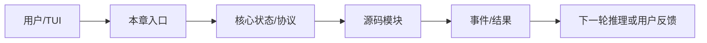

# 第 10 章：Slash Command

> 返回总稿：[JIMICODE-最终版学习教材.md](../JIMICODE-最终版学习教材.md)

<!-- 主干来源：docs/course/10-第10章-Slash-Command.md -->

学习显式命令如何补充自然语言入口，让用户可靠触发 clear、compact、mode、help、resume 等控制操作。

所有控制意图都交给模型导致不确定；命令参数解析不一致；命令和 Tool 重复实现；clear 只清 UI 不清状态；未知命令被静默忽略。

Slash Command 是用户明确表达控制意图的命令层。`Command`、`CommandContext`、`CommandRegistry` 负责解析、注册、执行和帮助。

| 对比维度 | 本章能力 | 上一章能力 | 下一章依赖 |
|---|---|---|---|
| 输入 | 结构化、可校验的本章对象 | 上一层输出 | 为下一层提供稳定契约 |
| 控制 | 明确的状态/权限/预算 | 规则较少 | 可观测、可恢复、可扩展 |
| 失败 | 分类、可见、可恢复 | 可能只返回错误文本 | 由后续治理层接管 |

**本章实际链路**：TUI 输入 → slash 检测 → CommandRegistry 查找 → 参数校验 → Command.execute(CommandContext) → 状态/Agent/会话更新 → UI 反馈

command name/aliases/description、args、CommandContext、AppState、session id、output/error。

| 字段 | 生产者 | 消费者 | 失败时必须保留 |
|---|---|---|---|
| 身份/名称 | 配置或注册表 | Agent/Provider/UI | 原始值与规范化值 |
| 参数/内容 | 用户、模型或工具 | 下一阶段模块 | 校验错误与来源 |
| 状态 | 编排器/持久化层 | 恢复、审计、UI | 转移前后状态 |
| 结果 | 本章实现 | Conversation/父任务 | 成功、错误、耗时 |

阅读 `src/main/java/com/jimicode/command/Command.java`、`CommandContext.java`、`CommandRegistry.java` 以及 `tui/JimiCodeModel.java`。命令层的优势是确定性：`/clear` 不需要模型猜测，`/compact` 可直接调用 ContextCompactor，`/mode plan` 可切换权限模式，`/resume` 进入会话恢复。

命令解析应先识别转义和引号，再拆分 command name 与 args；注册表应支持 aliases、帮助文本和未知命令错误。CommandContext 应提供最小依赖，如当前会话、Agent、输出函数和工作目录，而不是暴露整个 TUI 对象。

Slash、Tool、Skill 的边界：Slash 是用户主动控制；Tool 是模型可调用动作；Skill 是可复用的流程/知识包。三者可以共享底层服务，但入口、权限和可观测事件不同。自然语言“请清空会话”也可以最终映射到相同 service，但不能绕过显式命令的权限和确认。

反模式一是命令字符串直接反射调用任意方法；反模式二是 command handler 修改全局 singleton，导致 resume/多团队状态串线。

**目标**：为项目增加 `/stats` 命令，输出当前消息数、迭代数和 provider 名称，禁止访问 API key；为未知参数写测试。

**目标**：比较自然语言“压缩上下文”和 `/compact` 的行为，确认最终调用同一服务但控制入口不同。

命令不识别→查前缀/注册；参数错→查 tokenizer；clear 后仍有旧消息→查 Conversation/Session；命令阻塞 UI→查执行线程；帮助过时→查注册表元数据。

**回答提纲**：先给概念定义，再引用一个 jimicode 文件/类，说明一次取舍和一个失败场景。**加分点**：能讲测试、指标和边界。
### 题 2：命令解析为什么不能简单 split 空格？

**回答提纲**：先给概念定义，再引用一个 jimicode 文件/类，说明一次取舍和一个失败场景。**加分点**：能讲测试、指标和边界。
### 题 3：/clear 应清哪些状态？

**回答提纲**：先给概念定义，再引用一个 jimicode 文件/类，说明一次取舍和一个失败场景。**加分点**：能讲测试、指标和边界。
### 题 4：如何让自然语言和命令复用服务？

本章建立的契约会被下一章消费：Skill 系统 只有在输入、状态、失败和权限边界明确后才不会把复杂度继续放大。

### FAQ 1：所有功能都应该有 Slash 吗？只有需要确定性和高频控制的功能。

以当前项目源码和测试为准；第三方或闭源行为要明确标注边界。
### FAQ 2：Slash 可以被模型调用吗？通常不直接调用，可复用底层 service。

先用最小实验复现，再沿事件、日志、状态和调用者逐层定位。
### FAQ 3：命令帮助从哪里来？应由 Command 元数据生成，避免手工漂移。

从当前章节的真实入口开始：TUI 输入 → slash 检测 → CommandRegistry 查找 → 参数校验 → Command.execute(CommandContext) → 状态/Agent/会话更新 → UI 反馈。打开链路中的第一个 jimicode 类，记录构造器参数、字段初始化和直接调用者；再向后追踪一个结果对象的消费点。不要只搜索类名，要搜索方法调用和事件类型。

本章的输入不能只写成“用户问题”。应拆成配置输入、自然语言输入、模型结构化输入、文件/进程输入和上游模块状态。对每一种输入写明允许为空的字段、长度上限、编码、来源和校验时机。command name/aliases/description、args、CommandContext、AppState、session id、output/error。 中出现的身份、参数和状态字段都要在进入下一层前规范化。

将本章失败拆成输入错误、依赖错误、业务拒绝、超时、取消、部分成功和持久化失败。针对当前主题 `Skill 系统` 的前置依赖，写出“失败后能否重试、是否幂等、是否需要人工确认、是否需要回滚”的结论。

下一步是 `Skill 系统`。提前列出本章必须对外稳定的字段和事件；如果下一章要并发、压缩或扩展，本章的 id、版本、错误和取消语义必须先固定。

把本章放回完整闭环：TUI 输入 → slash 检测 → CommandRegistry 查找 → 参数校验 → Command.execute(CommandContext) → 状态/Agent/会话更新 → UI 反馈。如果删除本章能力，系统会在这些地方退化：所有控制意图都交给模型导致不确定；命令参数解析不一致；命令和 Tool 重复实现；clear 只清 UI 不清状态；未知命令被静默忽略。。如果增强本章能力，优先增强契约、测试、可观测性和安全边界，再考虑增加模型或 Agent 数量。最后用一个真实但隔离的实验验证“输入—状态—结果—失败—恢复”五个维度，并把证据保存到学习笔记。
## 综合案例与边界演练

### 场景 1：最小成功路径：使用固定输入、单一依赖和一个工具完成一次操作，记录从入口到结果的每个对象。

本章的具体检查点是：Slash Command 是用户明确表达控制意图的命令层。`Command`、`CommandContext`、`CommandRegistry` 负责解析、注册、执行和帮助。 生产的输入必须经过本章状态和权限边界，再形成 Skill 系统 可以消费的结果。实验结束后保存命令、事件、日志、测试、diff 和限制说明。

### 场景 2：空值路径：删除可选字段、返回空集合或让模型不给出内容，确认系统使用默认值、明确错误还是安全退出。

### 场景 3：重复路径：重复提交同一个请求、toolUseId、命令或消息，检查是否幂等、去重或要求人工确认。

### 场景 4：超时路径：让网络、脚本、文件或子任务延迟，检查 timeout、取消、资源释放和用户提示。

### 场景 5：部分成功路径：让多个动作中只有一部分成功，确认结果如何汇总、是否需要补偿或回滚。

### 场景 6：权限路径：使用只读、询问和拒绝三种模式，确保决策发生在副作用之前且结果可审计。

### 场景 7：恢复路径：在关键状态写入前后模拟进程退出，重新启动后检查状态、消息顺序和重复执行风险。

### 场景 8：观测路径：为一次操作关联 id、阶段、耗时和错误类别，确认 UI、日志和 trace 的信息粒度不同但事实一致。

### 场景 9：兼容路径：替换 provider、工具实现或配置版本，确认核心契约不需要大面积改动。

### 场景 10：评审路径：邀请另一位同学只看文档和证据复现实验，记录他无法理解或无法复现的地方。

围绕本章的实际链路 `TUI 输入 → slash 检测 → CommandRegistry 查找 → 参数校验 → Command.execute(CommandContext) → 状态/Agent/会话更新 → UI 反馈`，在源码中定位一个具体类/方法，写出它的输入、输出、状态、调用者和失败处理。然后在隔离环境执行一个最小验证，保存测试/日志/diff；如果无法从当前仓库证实，明确写【待源码确认】。针对 `Skill 系统` 的后续能力，补充说明该契约为什么必须稳定、哪些字段不能随意改名，以及发生故障时如何向用户解释。
