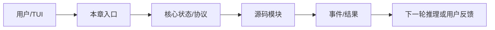

# 第 12 章：Hook系统

> 返回总稿：[JIMICODE-最终版学习教材.md](../JIMICODE-最终版学习教材.md)

<!-- 主干来源：docs/course/12-第12章-Hook系统.md -->

学习在会话、模型调用、工具执行和提交等生命周期节点插入自动化、审计和质量门禁。

格式化只靠模型记忆；工具执行后没有 lint；hook 失败被吞掉；hook 无限递归触发 Agent；审计与实际动作不一致。

Hook 是生命周期事件的订阅/自动化机制。`HookEngine`、`HookConfig` 将事件节点与外部命令或处理器连接；Hook 可观察、修改或阻断，但必须定义失败策略。

| 对比维度 | 本章能力 | 上一章能力 | 下一章依赖 |
|---|---|---|---|
| 输入 | 结构化、可校验的本章对象 | 上一层输出 | 为下一层提供稳定契约 |
| 控制 | 明确的状态/权限/预算 | 规则较少 | 可观测、可恢复、可扩展 |
| 失败 | 分类、可见、可恢复 | 可能只返回错误文本 | 由后续治理层接管 |

**本章实际链路**：Agent event → HookEngine dispatch → pre hook allow/deny or post automation → main action/next event → audit/log

hook event type、command/script、matcher、timeout、blocking policy、stdin payload、exit code、stdout/stderr、audit id。

| 字段 | 生产者 | 消费者 | 失败时必须保留 |
|---|---|---|---|
| 身份/名称 | 配置或注册表 | Agent/Provider/UI | 原始值与规范化值 |
| 参数/内容 | 用户、模型或工具 | 下一阶段模块 | 校验错误与来源 |
| 状态 | 编排器/持久化层 | 恢复、审计、UI | 转移前后状态 |
| 结果 | 本章实现 | Conversation/父任务 | 成功、错误、耗时 |

阅读 `src/main/java/com/jimicode/hook/HookEngine.java`、`config/HookConfig.java` 以及 Agent 中 Hook 调用点。Hook 类型可分会话开始/结束、模型调用前后、工具调用前后、文件修改后、提交前。pre hook 可以校验或阻断，post hook 适合格式化、lint、通知和指标。

Hook 设计要明确四个契约：触发条件、输入 payload、失败是否阻断、执行超时。阻断型 hook 适合安全扫描和提交前测试；非阻断型 hook 适合桌面通知或统计。hook 的 stdout/stderr 应限制大小并脱敏；退出码、耗时和关联 toolUseId 写入审计。

避免 hook 递归：hook 执行的命令不应再次触发同一 hook，或者使用 depth/id 标记。外部脚本需要 workdir、环境变量 allowlist 和权限检查。Hook 失败不能简单 catch 后丢弃，至少要在 AgentEvent/TUI 中可见。

反模式一是把业务逻辑全部塞进 shell hook，导致不可测试；反模式二是把阻断策略写死在脚本退出码而不在配置中声明；反模式三是 post hook 修改文件却不记录第二次 diff。

**目标**：配置一个工具完成后的 `mvn -q -DskipTests compile` 非阻断 hook，记录退出码和耗时。

**目标**：配置一个提交前只读 lint 阻断 hook，在临时仓库制造失败，验证 Agent 是否停在明确的质量门禁上。

hook 不触发→查 event matcher；主流程被卡→查 timeout/阻塞策略；失败无提示→查 HookEngine 异常事件；递归→查触发 id/depth；脚本找不到→查 PATH/workdir。

### 题 1：Hook、Middleware、Interceptor 如何区分？

**回答提纲**：先给概念定义，再引用一个 jimicode 文件/类，说明一次取舍和一个失败场景。**加分点**：能讲测试、指标和边界。
### 题 2：阻断型和非阻断型 hook 如何选择？

**回答提纲**：先给概念定义，再引用一个 jimicode 文件/类，说明一次取舍和一个失败场景。**加分点**：能讲测试、指标和边界。
### 题 3：如何防 hook 递归？

**回答提纲**：先给概念定义，再引用一个 jimicode 文件/类，说明一次取舍和一个失败场景。**加分点**：能讲测试、指标和边界。
### 题 4：Hook 输出为什么要审计和脱敏？

本章建立的契约会被下一章消费：SubAgent 只有在输入、状态、失败和权限边界明确后才不会把复杂度继续放大。

### FAQ 1：Hook 可以替代权限吗？不能，权限必须在副作用前独立裁决。

以当前项目源码和测试为准；第三方或闭源行为要明确标注边界。
### FAQ 2：Hook 失败是否一定终止？取决于事件风险和显式策略。

先用最小实验复现，再沿事件、日志、状态和调用者逐层定位。
### FAQ 3：为什么不直接在 Agent 里写 lint？Hook 让策略可配置、可替换、可测试。

从当前章节的真实入口开始：Agent event → HookEngine dispatch → pre hook allow/deny or post automation → main action/next event → audit/log。打开链路中的第一个 jimicode 类，记录构造器参数、字段初始化和直接调用者；再向后追踪一个结果对象的消费点。不要只搜索类名，要搜索方法调用和事件类型。

本章的输入不能只写成“用户问题”。应拆成配置输入、自然语言输入、模型结构化输入、文件/进程输入和上游模块状态。对每一种输入写明允许为空的字段、长度上限、编码、来源和校验时机。hook event type、command/script、matcher、timeout、blocking policy、stdin payload、exit code、stdout/stderr、audit id。 中出现的身份、参数和状态字段都要在进入下一层前规范化。

将本章失败拆成输入错误、依赖错误、业务拒绝、超时、取消、部分成功和持久化失败。针对当前主题 `SubAgent` 的前置依赖，写出“失败后能否重试、是否幂等、是否需要人工确认、是否需要回滚”的结论。

下一步是 `SubAgent`。提前列出本章必须对外稳定的字段和事件；如果下一章要并发、压缩或扩展，本章的 id、版本、错误和取消语义必须先固定。

把本章放回完整闭环：Agent event → HookEngine dispatch → pre hook allow/deny or post automation → main action/next event → audit/log。如果删除本章能力，系统会在这些地方退化：格式化只靠模型记忆；工具执行后没有 lint；hook 失败被吞掉；hook 无限递归触发 Agent；审计与实际动作不一致。。如果增强本章能力，优先增强契约、测试、可观测性和安全边界，再考虑增加模型或 Agent 数量。最后用一个真实但隔离的实验验证“输入—状态—结果—失败—恢复”五个维度，并把证据保存到学习笔记。
## 综合案例与边界演练

### 场景 1：最小成功路径：使用固定输入、单一依赖和一个工具完成一次操作，记录从入口到结果的每个对象。

本章的具体检查点是：Hook 是生命周期事件的订阅/自动化机制。`HookEngine`、`HookConfig` 将事件节点与外部命令或处理器连接；Hook 可观察、修改或阻断，但必须定义失败策略。 生产的输入必须经过本章状态和权限边界，再形成 SubAgent 可以消费的结果。实验结束后保存命令、事件、日志、测试、diff 和限制说明。

### 场景 2：空值路径：删除可选字段、返回空集合或让模型不给出内容，确认系统使用默认值、明确错误还是安全退出。

### 场景 3：重复路径：重复提交同一个请求、toolUseId、命令或消息，检查是否幂等、去重或要求人工确认。

### 场景 4：超时路径：让网络、脚本、文件或子任务延迟，检查 timeout、取消、资源释放和用户提示。

### 场景 5：部分成功路径：让多个动作中只有一部分成功，确认结果如何汇总、是否需要补偿或回滚。

### 场景 6：权限路径：使用只读、询问和拒绝三种模式，确保决策发生在副作用之前且结果可审计。

### 场景 7：恢复路径：在关键状态写入前后模拟进程退出，重新启动后检查状态、消息顺序和重复执行风险。

### 场景 8：观测路径：为一次操作关联 id、阶段、耗时和错误类别，确认 UI、日志和 trace 的信息粒度不同但事实一致。

### 场景 9：兼容路径：替换 provider、工具实现或配置版本，确认核心契约不需要大面积改动。

### 场景 10：评审路径：邀请另一位同学只看文档和证据复现实验，记录他无法理解或无法复现的地方。

围绕本章的实际链路 `Agent event → HookEngine dispatch → pre hook allow/deny or post automation → main action/next event → audit/log`，在源码中定位一个具体类/方法，写出它的输入、输出、状态、调用者和失败处理。然后在隔离环境执行一个最小验证，保存测试/日志/diff；如果无法从当前仓库证实，明确写【待源码确认】。针对 `SubAgent` 的后续能力，补充说明该契约为什么必须稳定、哪些字段不能随意改名，以及发生故障时如何向用户解释。
