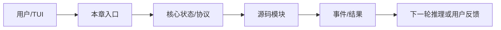

# 第 13 章：SubAgent

> 返回总稿：[JIMICODE-最终版学习教材.md](../JIMICODE-最终版学习教材.md)

<!-- 主干来源：docs/course/13-第13章-SubAgent.md -->

学习如何用子 Agent 做上下文隔离、专业分工和并行任务，并处理权限继承、超时、取消和结果汇总。

父 Agent 上下文过长；所有任务混在一条会话；子 Agent 无限运行；子 Agent 越权使用工具；父 Agent 收不到失败结果。

SubAgent 是由父 Agent 创建、具有独立 conversation/工具过滤/迭代预算的 Agent。`SubAgentTaskManager` 跟踪状态，`AgentTool` 提供模型可调用入口，`SubAgentSpec` 描述任务。

| 对比维度 | 本章能力 | 上一章能力 | 下一章依赖 |
|---|---|---|---|
| 输入 | 结构化、可校验的本章对象 | 上一层输出 | 为下一层提供稳定契约 |
| 控制 | 明确的状态/权限/预算 | 规则较少 | 可观测、可恢复、可扩展 |
| 失败 | 分类、可见、可恢复 | 可能只返回错误文本 | 由后续治理层接管 |

**本章实际链路**：父 Agent → AgentTool/SubAgentTaskManager → SubAgentSpec → child Agent + filtered registry → virtual thread → events → TaskNotification → parent conversation

task id/name/status、SubAgentSpec、child conversation、tool filter、maxTurns、parent replacement state、output/error、notification。

| 字段 | 生产者 | 消费者 | 失败时必须保留 |
|---|---|---|---|
| 身份/名称 | 配置或注册表 | Agent/Provider/UI | 原始值与规范化值 |
| 参数/内容 | 用户、模型或工具 | 下一阶段模块 | 校验错误与来源 |
| 状态 | 编排器/持久化层 | 恢复、审计、UI | 转移前后状态 |
| 结果 | 本章实现 | Conversation/父任务 | 成功、错误、耗时 |

阅读 `src/main/java/com/jimicode/subagent/SubAgentSpec.java`、`ToolFilter.java`、`SubAgentTaskManager.java`、`AgentTool.java`。创建子 Agent 时应明确 name、system prompt override、maxTurns、工具白名单、是否继承 workdir/session/permission。父 Agent 的 `ContentReplacementState` 可以 copy 给子 Agent，以保持共享历史的 prompt 前缀稳定，但不能共享可变 conversation。

任务管理器用 PENDING/RUNNING/COMPLETED/FAILED/CANCELLED 状态，并通过虚拟线程消费 `AgentEvent`。父 Agent 不应忙等；它在每轮开始 drain notifications，把子任务结果作为 system reminder 或结构化消息注入。超时、线程中断、队列 60 秒无事件都要进入失败状态。

权限继承要最小化：子 Agent 默认不应获得父 Agent 没有的权限；如果任务需要升级，交给人类确认。结果汇总要保留 task id、输出、错误和证据路径，不能只把多个字符串拼起来。

反模式一是子 Agent 共享父 conversation 导致消息串线；反模式二是只返回最终文本不返回失败状态；反模式三是并行启动数量没有上限，造成 provider 限流和本地资源耗尽。

**目标**：创建两个子 Agent，一个只读分析、一个运行测试，分别限制工具；父 Agent 汇总结果并显示 task 状态。

**目标**：取消一个长时间子任务，验证状态变为 CANCELLED/FAILED，父 Agent 能收到通知且不会继续执行其结果。

子任务不启动→查 spec/registry；状态卡 RUNNING→查线程和 queue poll；结果不回父→查 drainNotifications；权限过宽→查 ToolFilter/继承；成本暴涨→查 maxTurns/并发上限。

**回答提纲**：先给概念定义，再引用一个 jimicode 文件/类，说明一次取舍和一个失败场景。**加分点**：能讲测试、指标和边界。
### 题 2：权限如何继承？

**回答提纲**：先给概念定义，再引用一个 jimicode 文件/类，说明一次取舍和一个失败场景。**加分点**：能讲测试、指标和边界。
### 题 3：为什么需要独立 conversation？

**回答提纲**：先给概念定义，再引用一个 jimicode 文件/类，说明一次取舍和一个失败场景。**加分点**：能讲测试、指标和边界。
### 题 4：超时和取消如何传递？

本章建立的契约会被下一章消费：Worktree 只有在输入、状态、失败和权限边界明确后才不会把复杂度继续放大。

### FAQ 1：子 Agent 一定要并行吗？不一定，隔离本身就有价值。

以当前项目源码和测试为准；第三方或闭源行为要明确标注边界。
### FAQ 2：父 Agent 能直接读取子 Agent 内存吗？应通过结构化结果/通知，避免共享可变状态。

先用最小实验复现，再沿事件、日志、状态和调用者逐层定位。
### FAQ 3：子 Agent 失败是否让主任务失败？按任务关键性决定，可降级但必须可见。

从当前章节的真实入口开始：父 Agent → AgentTool/SubAgentTaskManager → SubAgentSpec → child Agent + filtered registry → virtual thread → events → TaskNotification → parent conversation。打开链路中的第一个 jimicode 类，记录构造器参数、字段初始化和直接调用者；再向后追踪一个结果对象的消费点。不要只搜索类名，要搜索方法调用和事件类型。

本章的输入不能只写成“用户问题”。应拆成配置输入、自然语言输入、模型结构化输入、文件/进程输入和上游模块状态。对每一种输入写明允许为空的字段、长度上限、编码、来源和校验时机。task id/name/status、SubAgentSpec、child conversation、tool filter、maxTurns、parent replacement state、output/error、notification。 中出现的身份、参数和状态字段都要在进入下一层前规范化。

将本章失败拆成输入错误、依赖错误、业务拒绝、超时、取消、部分成功和持久化失败。针对当前主题 `Worktree` 的前置依赖，写出“失败后能否重试、是否幂等、是否需要人工确认、是否需要回滚”的结论。

下一步是 `Worktree`。提前列出本章必须对外稳定的字段和事件；如果下一章要并发、压缩或扩展，本章的 id、版本、错误和取消语义必须先固定。

把本章放回完整闭环：父 Agent → AgentTool/SubAgentTaskManager → SubAgentSpec → child Agent + filtered registry → virtual thread → events → TaskNotification → parent conversation。如果删除本章能力，系统会在这些地方退化：父 Agent 上下文过长；所有任务混在一条会话；子 Agent 无限运行；子 Agent 越权使用工具；父 Agent 收不到失败结果。。如果增强本章能力，优先增强契约、测试、可观测性和安全边界，再考虑增加模型或 Agent 数量。最后用一个真实但隔离的实验验证“输入—状态—结果—失败—恢复”五个维度，并把证据保存到学习笔记。
## 综合案例与边界演练

### 场景 1：最小成功路径：使用固定输入、单一依赖和一个工具完成一次操作，记录从入口到结果的每个对象。

本章的具体检查点是：SubAgent 是由父 Agent 创建、具有独立 conversation/工具过滤/迭代预算的 Agent。`SubAgentTaskManager` 跟踪状态，`AgentTool` 提供模型可调用入口，`SubAgentSpec` 描述任务。 生产的输入必须经过本章状态和权限边界，再形成 Worktree 可以消费的结果。实验结束后保存命令、事件、日志、测试、diff 和限制说明。

### 场景 2：空值路径：删除可选字段、返回空集合或让模型不给出内容，确认系统使用默认值、明确错误还是安全退出。

### 场景 3：重复路径：重复提交同一个请求、toolUseId、命令或消息，检查是否幂等、去重或要求人工确认。

### 场景 4：超时路径：让网络、脚本、文件或子任务延迟，检查 timeout、取消、资源释放和用户提示。

### 场景 5：部分成功路径：让多个动作中只有一部分成功，确认结果如何汇总、是否需要补偿或回滚。

### 场景 6：权限路径：使用只读、询问和拒绝三种模式，确保决策发生在副作用之前且结果可审计。

### 场景 7：恢复路径：在关键状态写入前后模拟进程退出，重新启动后检查状态、消息顺序和重复执行风险。

### 场景 8：观测路径：为一次操作关联 id、阶段、耗时和错误类别，确认 UI、日志和 trace 的信息粒度不同但事实一致。

### 场景 9：兼容路径：替换 provider、工具实现或配置版本，确认核心契约不需要大面积改动。

### 场景 10：评审路径：邀请另一位同学只看文档和证据复现实验，记录他无法理解或无法复现的地方。

围绕本章的实际链路 `父 Agent → AgentTool/SubAgentTaskManager → SubAgentSpec → child Agent + filtered registry → virtual thread → events → TaskNotification → parent conversation`，在源码中定位一个具体类/方法，写出它的输入、输出、状态、调用者和失败处理。然后在隔离环境执行一个最小验证，保存测试/日志/diff；如果无法从当前仓库证实，明确写【待源码确认】。针对 `Worktree` 的后续能力，补充说明该契约为什么必须稳定、哪些字段不能随意改名，以及发生故障时如何向用户解释。
