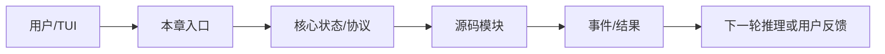

# 第 14 章：Worktree

> 返回总稿：[JIMICODE-最终版学习教材.md](../JIMICODE-最终版学习教材.md)

<!-- 主干来源：docs/course/14-第14章-Worktree.md -->

学习 Git worktree 如何隔离并行修改，理解分支、清理、diff、合并和冲突边界。

两个 Agent 修改同一工作区互相覆盖；临时目录残留；分支名含危险字符；合并前不知道未提交改动；删除 worktree 时丢失用户文件。

Worktree 是 Git 层面的文件系统隔离，不是线程锁。`WorktreeManager`、`WorktreeSession`、`SlugValidator`、`StaleCleanup` 管理生命周期。

| 对比维度 | 本章能力 | 上一章能力 | 下一章依赖 |
|---|---|---|---|
| 输入 | 结构化、可校验的本章对象 | 上一层输出 | 为下一层提供稳定契约 |
| 控制 | 明确的状态/权限/预算 | 规则较少 | 可观测、可恢复、可扩展 |
| 失败 | 分类、可见、可恢复 | 可能只返回错误文本 | 由后续治理层接管 |

**本章实际链路**：任务 → slug/branch 校验 → git worktree add → PostCreationSetup → Agent 在独立 cwd 工作 → detectChanges → review/merge → remove/cleanup

branch、path、createdAt、session id、diff stat、base commit、cleanup cutoff、symlink dirs、changes。

| 字段 | 生产者 | 消费者 | 失败时必须保留 |
|---|---|---|---|
| 身份/名称 | 配置或注册表 | Agent/Provider/UI | 原始值与规范化值 |
| 参数/内容 | 用户、模型或工具 | 下一阶段模块 | 校验错误与来源 |
| 状态 | 编排器/持久化层 | 恢复、审计、UI | 转移前后状态 |
| 结果 | 本章实现 | Conversation/父任务 | 成功、错误、耗时 |

阅读 `src/main/java/com/jimicode/worktree/WorktreeManager.java`、`WorktreeSession.java`、`WorktreeChanges.java`、`SlugValidator.java`、`StaleCleanup.java`。创建时要校验项目根是 Git 仓库、branch/目录 slug 安全、目标目录不存在或可回收，并给 Git 命令设置超时。`PostCreationSetup` 负责 settings、hooks、symlinks 等初始化，失败要可诊断。

`git worktree list --porcelain` 的解析是边界重点：block 以空行分隔，最后一个 block 可能没有尾随空行；detached HEAD 和 branch 行也要处理。`detectChanges` 使用 `git diff --stat` 只能说明未提交变化，不能代替完整 diff 审查。合并前必须检查 base commit、未提交文件、测试结果和冲突。

Worktree 不适合数据库共享状态、外部服务副作用或同一 lockfile 的无协调修改。清理应 best-effort 但有监控；过期 worktree 删除前要确认路径在受控根目录，并保留用户可恢复信息。

反模式一是用 synchronized 代替 worktree；它无法隔离文件系统。反模式二是 `git worktree remove --force` 作为默认清理；这可能丢失未提交改动。反模式三是分支名直接拼接用户输入。

**目标**：在临时 Git 仓库创建两个 worktree，各自修改不同文件，运行测试并比较 diff。

**目标**：制造未提交变更和过期时间，验证 detectChanges、cleanupStale 的提示和失败处理；不要在真实项目执行强制删除。

创建失败→查 Git 状态/branch/路径；列表为空→查 porcelain 解析；清理失败→查进程占用/未提交变更；文件仍互相覆盖→确认 Agent cwd；分支注入风险→查 SlugValidator。

**回答提纲**：先给概念定义，再引用一个 jimicode 文件/类，说明一次取舍和一个失败场景。**加分点**：能讲测试、指标和边界。
### 题 2：如何安全清理？

**回答提纲**：先给概念定义，再引用一个 jimicode 文件/类，说明一次取舍和一个失败场景。**加分点**：能讲测试、指标和边界。
### 题 3：porcelain 解析有哪些边界？

**回答提纲**：先给概念定义，再引用一个 jimicode 文件/类，说明一次取舍和一个失败场景。**加分点**：能讲测试、指标和边界。
### 题 4：什么场景不适合 Worktree？

本章建立的契约会被下一章消费：Agent Teams 只有在输入、状态、失败和权限边界明确后才不会把复杂度继续放大。

### FAQ 1：每个 Agent 都要一个 worktree 吗？只在有并行修改风险时使用。

以当前项目源码和测试为准；第三方或闭源行为要明确标注边界。
### FAQ 2：worktree 能隔离数据库吗？不能，它只隔离 Git 文件树。

先用最小实验复现，再沿事件、日志、状态和调用者逐层定位。
### FAQ 3：强制删除安全吗？只有在明确确认无未提交数据且路径受控时才考虑。

从当前章节的真实入口开始：任务 → slug/branch 校验 → git worktree add → PostCreationSetup → Agent 在独立 cwd 工作 → detectChanges → review/merge → remove/cleanup。打开链路中的第一个 jimicode 类，记录构造器参数、字段初始化和直接调用者；再向后追踪一个结果对象的消费点。不要只搜索类名，要搜索方法调用和事件类型。

本章的输入不能只写成“用户问题”。应拆成配置输入、自然语言输入、模型结构化输入、文件/进程输入和上游模块状态。对每一种输入写明允许为空的字段、长度上限、编码、来源和校验时机。branch、path、createdAt、session id、diff stat、base commit、cleanup cutoff、symlink dirs、changes。 中出现的身份、参数和状态字段都要在进入下一层前规范化。

将本章失败拆成输入错误、依赖错误、业务拒绝、超时、取消、部分成功和持久化失败。针对当前主题 `Agent Teams` 的前置依赖，写出“失败后能否重试、是否幂等、是否需要人工确认、是否需要回滚”的结论。

下一步是 `Agent Teams`。提前列出本章必须对外稳定的字段和事件；如果下一章要并发、压缩或扩展，本章的 id、版本、错误和取消语义必须先固定。

把本章放回完整闭环：任务 → slug/branch 校验 → git worktree add → PostCreationSetup → Agent 在独立 cwd 工作 → detectChanges → review/merge → remove/cleanup。如果删除本章能力，系统会在这些地方退化：两个 Agent 修改同一工作区互相覆盖；临时目录残留；分支名含危险字符；合并前不知道未提交改动；删除 worktree 时丢失用户文件。。如果增强本章能力，优先增强契约、测试、可观测性和安全边界，再考虑增加模型或 Agent 数量。最后用一个真实但隔离的实验验证“输入—状态—结果—失败—恢复”五个维度，并把证据保存到学习笔记。
## 综合案例与边界演练

### 场景 1：最小成功路径：使用固定输入、单一依赖和一个工具完成一次操作，记录从入口到结果的每个对象。

本章的具体检查点是：Worktree 是 Git 层面的文件系统隔离，不是线程锁。`WorktreeManager`、`WorktreeSession`、`SlugValidator`、`StaleCleanup` 管理生命周期。 生产的输入必须经过本章状态和权限边界，再形成 Agent Teams 可以消费的结果。实验结束后保存命令、事件、日志、测试、diff 和限制说明。

### 场景 2：空值路径：删除可选字段、返回空集合或让模型不给出内容，确认系统使用默认值、明确错误还是安全退出。

### 场景 3：重复路径：重复提交同一个请求、toolUseId、命令或消息，检查是否幂等、去重或要求人工确认。

### 场景 4：超时路径：让网络、脚本、文件或子任务延迟，检查 timeout、取消、资源释放和用户提示。

### 场景 5：部分成功路径：让多个动作中只有一部分成功，确认结果如何汇总、是否需要补偿或回滚。

### 场景 6：权限路径：使用只读、询问和拒绝三种模式，确保决策发生在副作用之前且结果可审计。

### 场景 7：恢复路径：在关键状态写入前后模拟进程退出，重新启动后检查状态、消息顺序和重复执行风险。

### 场景 8：观测路径：为一次操作关联 id、阶段、耗时和错误类别，确认 UI、日志和 trace 的信息粒度不同但事实一致。

### 场景 9：兼容路径：替换 provider、工具实现或配置版本，确认核心契约不需要大面积改动。

### 场景 10：评审路径：邀请另一位同学只看文档和证据复现实验，记录他无法理解或无法复现的地方。

围绕本章的实际链路 `任务 → slug/branch 校验 → git worktree add → PostCreationSetup → Agent 在独立 cwd 工作 → detectChanges → review/merge → remove/cleanup`，在源码中定位一个具体类/方法，写出它的输入、输出、状态、调用者和失败处理。然后在隔离环境执行一个最小验证，保存测试/日志/diff；如果无法从当前仓库证实，明确写【待源码确认】。针对 `Agent Teams` 的后续能力，补充说明该契约为什么必须稳定、哪些字段不能随意改名，以及发生故障时如何向用户解释。
