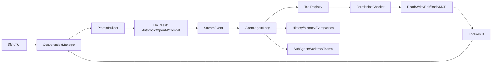

# 最终复习：一页纸速查

> 返回总稿：[JIMICODE-最终版学习教材.md](../JIMICODE-最终版学习教材.md)

<!-- 主干来源：docs/course/最终复习-一页纸速查.md -->

> 本页用于复习和面试前快速回忆，不替代各章正文。JiMI Code 是 Java 21 + Maven 的自研、仿 Claude Code 理念的终端 Coding Agent，不是 Anthropic 官方实现。

Coding Agent = 在软件工程环境中接收任务、读取项目上下文、调用受控工具、观察结果、继续多轮推理，并在权限和回滚边界内产生代码/环境变化的智能体。

| 能力 | 真实路径 | 记忆要点 |
|---|---|---|
| 启动 | `src/main/java/com/jimicode/JimiCode.java` | 配置、权限、TUI、SIGINT、finally 恢复光标 |
| 配置 | `config/ConfigLoader.java` | 显式路径、候选文件、SnakeYAML、校验和合并 |
| Agent Loop | `agent/Agent.java` | 虚拟线程、BlockingQueue、iteration、取消、压缩 |
| 消息 | `conversation/Message.java` | 角色、内容块、顺序、toolUseId |
| 模型 | `llm/LlmClient.java` 与三个实现 | provider-neutral、流式 StreamEvent、usage |
| 工具 | `tool/Tool.java`、`ToolRegistry.java` | schema、注册、过滤、分发、结果 |
| 权限 | `permission/PermissionChecker.java` | allow/ask/deny、模式、确认、路径约束 |
| Prompt | `prompt/PromptBuilder.java` | 稳定前缀、规则、工具、记忆、计划 |
| 压缩 | `compact/ContextCompactor.java` | token/字符预算、Layer1/Layer2、恢复附件 |
| 记忆 | `memory/MemoryScanner.java` 等 | session 与长期 memory 的边界 |
| Slash | `command/CommandRegistry.java` | 确定性控制入口、CommandContext |
| Skill | `skill/SkillCatalog.java` 等 | 文档/SOP/脚本、渐进披露 |
| Hook | `hook/HookEngine.java` | 生命周期、阻断/非阻断、审计 |
| SubAgent | `subagent/SubAgentTaskManager.java` | 状态、任务、虚拟线程、通知、取消 |
| Worktree | `worktree/WorktreeManager.java` | Git 隔离、分支、diff、清理 |
| Teams | `teams/TeamManager.java` | 成员、邮箱、任务状态、人类主管 |

模型产生 `ToolUseBlock`；Agent 根据名称访问 `ToolRegistry`；PermissionChecker 在 handler 前裁决；Tool 产生 `ToolResult`/`ToolResultBlock`；结果追加回 `ConversationManager`；下一轮模型消费观察。`toolUseId` 是调用与结果、压缩、恢复、审计之间的关联键，不能随意丢弃或重写。

1. 这个动作有没有副作用？
2. 路径是否位于 workDir root，是否经过 normalize/realpath？
3. 是否需要一次性确认、会话允许或永久规则？
4. 用户拒绝、工具失败、进程中断后，状态和审计如何落盘？

Prompt 只能表达原则，PermissionChecker、Tool handler、工作区限制和 Git 回滚才是强制边界。

1. 使用了 provider 真实 usage 还是字符估算？
2. 系统规则、当前任务、未完成 ToolUse 和恢复附件是否保留？
3. 大型 ToolResult 是否先做稳定替换？
4. 压缩失败时是保留原会话、降级还是明确停止？

- Agent 实例是否线程安全？当前 `Agent`/TUI 状态通常按调用或实例隔离。
- 子 Agent 是否独立 conversation、工具过滤和 maxTurns？
- Worktree 是否真的隔离了文件系统？
- FileMailBox/TaskStore 是否支持原子写、唯一 id、ack、重放和清理？

- 把 jimicode 写成 Claude Code 官方实现。
- 把所有工具合成 `run(command)`。
- 只靠 Prompt 阻止危险操作。
- 无限 Agent Loop，没有 maxIterations/timeout/cancel。
- 把完整日志和文件全部塞进上下文。
- 只写最终答案，不保存 ToolResult、diff 和失败事件。
- 在真实仓库直接测试删除、迁移和未知脚本。
- 用未经实测的数字描述成功率、节省 token 或性能提升。

使用临时 Git 仓库；配置只读 provider；先用 Glob/Grep/ReadFile 分析；写文件进入 PLAN/ASK；确认后做最小 EditFile；运行固定测试；查看 `git diff`；故意制造失败和 Ctrl-C；删除临时目录前确认无未提交数据。实验记录包括版本、输入、事件、日志、diff、结果和限制。

定义概念 → 引用源码路径 → 描述调用链 → 讲一个取舍/失败 → 说明测试和限制。

当前 POM 的核心技术事实：Java 21、Maven、TUI4J、Mordant、MCP SDK、Anthropic Java SDK、OpenAI Java SDK、SnakeYAML、Jackson、JUnit。第三方 SDK 内部实现不属于本项目源码；对其行为只说明当前调用契约。

能在 5 分钟内画出总链路；能解释一次 ToolUse 的完整生命周期；能说出配置错误、权限拒绝、SSE 断裂、压缩失败、子任务取消和 worktree 冲突的处理方式；能为简历中的每个亮点提供源码、测试或实验依据。

复习 `入口定位` 时，先用一句话说明它在 `全链路速查` 中的位置，再打开一个真实源码文件或课程章节确认字段和调用者。写出正常路径、一个失败路径和一个恢复/回滚动作；把测试命令、事件顺序、日志摘要和 Git diff 保存下来。不要把模型自然语言当成事实，也不要把未测量的数字当成项目指标。

复习 `配置优先级` 时，先用一句话说明它在 `全链路速查` 中的位置，再打开一个真实源码文件或课程章节确认字段和调用者。写出正常路径、一个失败路径和一个恢复/回滚动作；把测试命令、事件顺序、日志摘要和 Git diff 保存下来。不要把模型自然语言当成事实，也不要把未测量的数字当成项目指标。

复习 `Provider 抽象` 时，先用一句话说明它在 `全链路速查` 中的位置，再打开一个真实源码文件或课程章节确认字段和调用者。写出正常路径、一个失败路径和一个恢复/回滚动作；把测试命令、事件顺序、日志摘要和 Git diff 保存下来。不要把模型自然语言当成事实，也不要把未测量的数字当成项目指标。

复习 `消息角色` 时，先用一句话说明它在 `全链路速查` 中的位置，再打开一个真实源码文件或课程章节确认字段和调用者。写出正常路径、一个失败路径和一个恢复/回滚动作；把测试命令、事件顺序、日志摘要和 Git diff 保存下来。不要把模型自然语言当成事实，也不要把未测量的数字当成项目指标。

复习 `流式帧` 时，先用一句话说明它在 `全链路速查` 中的位置，再打开一个真实源码文件或课程章节确认字段和调用者。写出正常路径、一个失败路径和一个恢复/回滚动作；把测试命令、事件顺序、日志摘要和 Git diff 保存下来。不要把模型自然语言当成事实，也不要把未测量的数字当成项目指标。

复习 `Tool schema` 时，先用一句话说明它在 `全链路速查` 中的位置，再打开一个真实源码文件或课程章节确认字段和调用者。写出正常路径、一个失败路径和一个恢复/回滚动作；把测试命令、事件顺序、日志摘要和 Git diff 保存下来。不要把模型自然语言当成事实，也不要把未测量的数字当成项目指标。

复习 `ToolUse id` 时，先用一句话说明它在 `全链路速查` 中的位置，再打开一个真实源码文件或课程章节确认字段和调用者。写出正常路径、一个失败路径和一个恢复/回滚动作；把测试命令、事件顺序、日志摘要和 Git diff 保存下来。不要把模型自然语言当成事实，也不要把未测量的数字当成项目指标。

复习 `ToolResult` 时，先用一句话说明它在 `全链路速查` 中的位置，再打开一个真实源码文件或课程章节确认字段和调用者。写出正常路径、一个失败路径和一个恢复/回滚动作；把测试命令、事件顺序、日志摘要和 Git diff 保存下来。不要把模型自然语言当成事实，也不要把未测量的数字当成项目指标。

复习 `Agent iteration` 时，先用一句话说明它在 `全链路速查` 中的位置，再打开一个真实源码文件或课程章节确认字段和调用者。写出正常路径、一个失败路径和一个恢复/回滚动作；把测试命令、事件顺序、日志摘要和 Git diff 保存下来。不要把模型自然语言当成事实，也不要把未测量的数字当成项目指标。

复习 `终止条件` 时，先用一句话说明它在 `全链路速查` 中的位置，再打开一个真实源码文件或课程章节确认字段和调用者。写出正常路径、一个失败路径和一个恢复/回滚动作；把测试命令、事件顺序、日志摘要和 Git diff 保存下来。不要把模型自然语言当成事实，也不要把未测量的数字当成项目指标。

复习 `权限模式` 时，先用一句话说明它在 `全链路速查` 中的位置，再打开一个真实源码文件或课程章节确认字段和调用者。写出正常路径、一个失败路径和一个恢复/回滚动作；把测试命令、事件顺序、日志摘要和 Git diff 保存下来。不要把模型自然语言当成事实，也不要把未测量的数字当成项目指标。

复习 `路径 root` 时，先用一句话说明它在 `全链路速查` 中的位置，再打开一个真实源码文件或课程章节确认字段和调用者。写出正常路径、一个失败路径和一个恢复/回滚动作；把测试命令、事件顺序、日志摘要和 Git diff 保存下来。不要把模型自然语言当成事实，也不要把未测量的数字当成项目指标。

复习 `敏感文件` 时，先用一句话说明它在 `全链路速查` 中的位置，再打开一个真实源码文件或课程章节确认字段和调用者。写出正常路径、一个失败路径和一个恢复/回滚动作；把测试命令、事件顺序、日志摘要和 Git diff 保存下来。不要把模型自然语言当成事实，也不要把未测量的数字当成项目指标。

复习 `MCP 信任` 时，先用一句话说明它在 `全链路速查` 中的位置，再打开一个真实源码文件或课程章节确认字段和调用者。写出正常路径、一个失败路径和一个恢复/回滚动作；把测试命令、事件顺序、日志摘要和 Git diff 保存下来。不要把模型自然语言当成事实，也不要把未测量的数字当成项目指标。

复习 `上下文预算` 时，先用一句话说明它在 `全链路速查` 中的位置，再打开一个真实源码文件或课程章节确认字段和调用者。写出正常路径、一个失败路径和一个恢复/回滚动作；把测试命令、事件顺序、日志摘要和 Git diff 保存下来。不要把模型自然语言当成事实，也不要把未测量的数字当成项目指标。

复习 `工具结果替换` 时，先用一句话说明它在 `全链路速查` 中的位置，再打开一个真实源码文件或课程章节确认字段和调用者。写出正常路径、一个失败路径和一个恢复/回滚动作；把测试命令、事件顺序、日志摘要和 Git diff 保存下来。不要把模型自然语言当成事实，也不要把未测量的数字当成项目指标。

复习 `压缩恢复` 时，先用一句话说明它在 `全链路速查` 中的位置，再打开一个真实源码文件或课程章节确认字段和调用者。写出正常路径、一个失败路径和一个恢复/回滚动作；把测试命令、事件顺序、日志摘要和 Git diff 保存下来。不要把模型自然语言当成事实，也不要把未测量的数字当成项目指标。

复习 `Memory scope` 时，先用一句话说明它在 `全链路速查` 中的位置，再打开一个真实源码文件或课程章节确认字段和调用者。写出正常路径、一个失败路径和一个恢复/回滚动作；把测试命令、事件顺序、日志摘要和 Git diff 保存下来。不要把模型自然语言当成事实，也不要把未测量的数字当成项目指标。

复习 `Slash 确定性` 时，先用一句话说明它在 `全链路速查` 中的位置，再打开一个真实源码文件或课程章节确认字段和调用者。写出正常路径、一个失败路径和一个恢复/回滚动作；把测试命令、事件顺序、日志摘要和 Git diff 保存下来。不要把模型自然语言当成事实，也不要把未测量的数字当成项目指标。

复习 `Skill 触发` 时，先用一句话说明它在 `全链路速查` 中的位置，再打开一个真实源码文件或课程章节确认字段和调用者。写出正常路径、一个失败路径和一个恢复/回滚动作；把测试命令、事件顺序、日志摘要和 Git diff 保存下来。不要把模型自然语言当成事实，也不要把未测量的数字当成项目指标。

复习 `Hook 阻断` 时，先用一句话说明它在 `全链路速查` 中的位置，再打开一个真实源码文件或课程章节确认字段和调用者。写出正常路径、一个失败路径和一个恢复/回滚动作；把测试命令、事件顺序、日志摘要和 Git diff 保存下来。不要把模型自然语言当成事实，也不要把未测量的数字当成项目指标。

复习 `子 Agent 状态` 时，先用一句话说明它在 `全链路速查` 中的位置，再打开一个真实源码文件或课程章节确认字段和调用者。写出正常路径、一个失败路径和一个恢复/回滚动作；把测试命令、事件顺序、日志摘要和 Git diff 保存下来。不要把模型自然语言当成事实，也不要把未测量的数字当成项目指标。

复习 `任务通知` 时，先用一句话说明它在 `全链路速查` 中的位置，再打开一个真实源码文件或课程章节确认字段和调用者。写出正常路径、一个失败路径和一个恢复/回滚动作；把测试命令、事件顺序、日志摘要和 Git diff 保存下来。不要把模型自然语言当成事实，也不要把未测量的数字当成项目指标。

复习 `Worktree 分支` 时，先用一句话说明它在 `全链路速查` 中的位置，再打开一个真实源码文件或课程章节确认字段和调用者。写出正常路径、一个失败路径和一个恢复/回滚动作；把测试命令、事件顺序、日志摘要和 Git diff 保存下来。不要把模型自然语言当成事实，也不要把未测量的数字当成项目指标。

复习 `Git diff` 时，先用一句话说明它在 `全链路速查` 中的位置，再打开一个真实源码文件或课程章节确认字段和调用者。写出正常路径、一个失败路径和一个恢复/回滚动作；把测试命令、事件顺序、日志摘要和 Git diff 保存下来。不要把模型自然语言当成事实，也不要把未测量的数字当成项目指标。

复习 `邮箱协议` 时，先用一句话说明它在 `全链路速查` 中的位置，再打开一个真实源码文件或课程章节确认字段和调用者。写出正常路径、一个失败路径和一个恢复/回滚动作；把测试命令、事件顺序、日志摘要和 Git diff 保存下来。不要把模型自然语言当成事实，也不要把未测量的数字当成项目指标。

复习 `人类主管` 时，先用一句话说明它在 `全链路速查` 中的位置，再打开一个真实源码文件或课程章节确认字段和调用者。写出正常路径、一个失败路径和一个恢复/回滚动作；把测试命令、事件顺序、日志摘要和 Git diff 保存下来。不要把模型自然语言当成事实，也不要把未测量的数字当成项目指标。

复习 `测试替身` 时，先用一句话说明它在 `全链路速查` 中的位置，再打开一个真实源码文件或课程章节确认字段和调用者。写出正常路径、一个失败路径和一个恢复/回滚动作；把测试命令、事件顺序、日志摘要和 Git diff 保存下来。不要把模型自然语言当成事实，也不要把未测量的数字当成项目指标。

复习 `指标实测` 时，先用一句话说明它在 `全链路速查` 中的位置，再打开一个真实源码文件或课程章节确认字段和调用者。写出正常路径、一个失败路径和一个恢复/回滚动作；把测试命令、事件顺序、日志摘要和 Git diff 保存下来。不要把模型自然语言当成事实，也不要把未测量的数字当成项目指标。

复习 `简历边界` 时，先用一句话说明它在 `全链路速查` 中的位置，再打开一个真实源码文件或课程章节确认字段和调用者。写出正常路径、一个失败路径和一个恢复/回滚动作；把测试命令、事件顺序、日志摘要和 Git diff 保存下来。不要把模型自然语言当成事实，也不要把未测量的数字当成项目指标。

复习 `演示回滚` 时，先用一句话说明它在 `全链路速查` 中的位置，再打开一个真实源码文件或课程章节确认字段和调用者。写出正常路径、一个失败路径和一个恢复/回滚动作；把测试命令、事件顺序、日志摘要和 Git diff 保存下来。不要把模型自然语言当成事实，也不要把未测量的数字当成项目指标。

复习 `依赖版本` 时，先用一句话说明它在 `全链路速查` 中的位置，再打开一个真实源码文件或课程章节确认字段和调用者。写出正常路径、一个失败路径和一个恢复/回滚动作；把测试命令、事件顺序、日志摘要和 Git diff 保存下来。不要把模型自然语言当成事实，也不要把未测量的数字当成项目指标。

复习 `日志脱敏` 时，先用一句话说明它在 `全链路速查` 中的位置，再打开一个真实源码文件或课程章节确认字段和调用者。写出正常路径、一个失败路径和一个恢复/回滚动作；把测试命令、事件顺序、日志摘要和 Git diff 保存下来。不要把模型自然语言当成事实，也不要把未测量的数字当成项目指标。

复习 `故障定位` 时，先用一句话说明它在 `全链路速查` 中的位置，再打开一个真实源码文件或课程章节确认字段和调用者。写出正常路径、一个失败路径和一个恢复/回滚动作；把测试命令、事件顺序、日志摘要和 Git diff 保存下来。不要把模型自然语言当成事实，也不要把未测量的数字当成项目指标。

复习 `技术债` 时，先用一句话说明它在 `全链路速查` 中的位置，再打开一个真实源码文件或课程章节确认字段和调用者。写出正常路径、一个失败路径和一个恢复/回滚动作；把测试命令、事件顺序、日志摘要和 Git diff 保存下来。不要把模型自然语言当成事实，也不要把未测量的数字当成项目指标。

复习 `学习迁移` 时，先用一句话说明它在 `全链路速查` 中的位置，再打开一个真实源码文件或课程章节确认字段和调用者。写出正常路径、一个失败路径和一个恢复/回滚动作；把测试命令、事件顺序、日志摘要和 Git diff 保存下来。不要把模型自然语言当成事实，也不要把未测量的数字当成项目指标。

回答 `启动到最终答案` 时采用六步：定义概念；引用 jimicode 真实路径；说明生产者和消费者；描述一个正常时序；描述一个异常/取消/拒绝分支；给出测试、指标和已知限制。若涉及文件、Shell、网络、MCP、记忆或并发，额外说明 workdir、权限、超时、输出上限、审计和回滚。

回答 `模型到工具调用` 时采用六步：定义概念；引用 jimicode 真实路径；说明生产者和消费者；描述一个正常时序；描述一个异常/取消/拒绝分支；给出测试、指标和已知限制。若涉及文件、Shell、网络、MCP、记忆或并发，额外说明 workdir、权限、超时、输出上限、审计和回滚。

回答 `工具到观察结果` 时采用六步：定义概念；引用 jimicode 真实路径；说明生产者和消费者；描述一个正常时序；描述一个异常/取消/拒绝分支；给出测试、指标和已知限制。若涉及文件、Shell、网络、MCP、记忆或并发，额外说明 workdir、权限、超时、输出上限、审计和回滚。

回答 `权限到用户确认` 时采用六步：定义概念；引用 jimicode 真实路径；说明生产者和消费者；描述一个正常时序；描述一个异常/取消/拒绝分支；给出测试、指标和已知限制。若涉及文件、Shell、网络、MCP、记忆或并发，额外说明 workdir、权限、超时、输出上限、审计和回滚。

回答 `压缩到恢复` 时采用六步：定义概念；引用 jimicode 真实路径；说明生产者和消费者；描述一个正常时序；描述一个异常/取消/拒绝分支；给出测试、指标和已知限制。若涉及文件、Shell、网络、MCP、记忆或并发，额外说明 workdir、权限、超时、输出上限、审计和回滚。

回答 `子任务到汇总` 时采用六步：定义概念；引用 jimicode 真实路径；说明生产者和消费者；描述一个正常时序；描述一个异常/取消/拒绝分支；给出测试、指标和已知限制。若涉及文件、Shell、网络、MCP、记忆或并发，额外说明 workdir、权限、超时、输出上限、审计和回滚。

回答 `Worktree 到合并` 时采用六步：定义概念；引用 jimicode 真实路径；说明生产者和消费者；描述一个正常时序；描述一个异常/取消/拒绝分支；给出测试、指标和已知限制。若涉及文件、Shell、网络、MCP、记忆或并发，额外说明 workdir、权限、超时、输出上限、审计和回滚。

回答 `Teams 到主管裁决` 时采用六步：定义概念；引用 jimicode 真实路径；说明生产者和消费者；描述一个正常时序；描述一个异常/取消/拒绝分支；给出测试、指标和已知限制。若涉及文件、Shell、网络、MCP、记忆或并发，额外说明 workdir、权限、超时、输出上限、审计和回滚。

回答 `源码到测试` 时采用六步：定义概念；引用 jimicode 真实路径；说明生产者和消费者；描述一个正常时序；描述一个异常/取消/拒绝分支；给出测试、指标和已知限制。若涉及文件、Shell、网络、MCP、记忆或并发，额外说明 workdir、权限、超时、输出上限、审计和回滚。

回答 `项目到简历` 时采用六步：定义概念；引用 jimicode 真实路径；说明生产者和消费者；描述一个正常时序；描述一个异常/取消/拒绝分支；给出测试、指标和已知限制。若涉及文件、Shell、网络、MCP、记忆或并发，额外说明 workdir、权限、超时、输出上限、审计和回滚。
