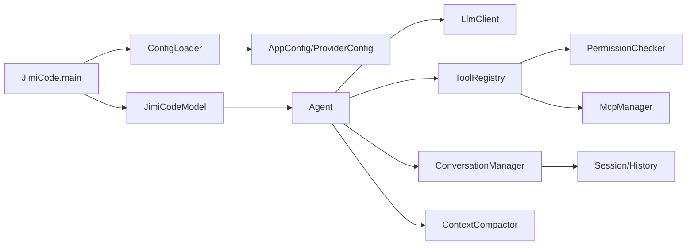
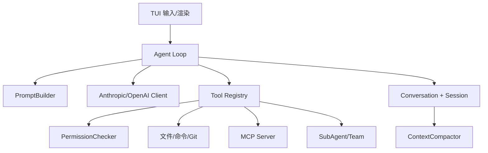
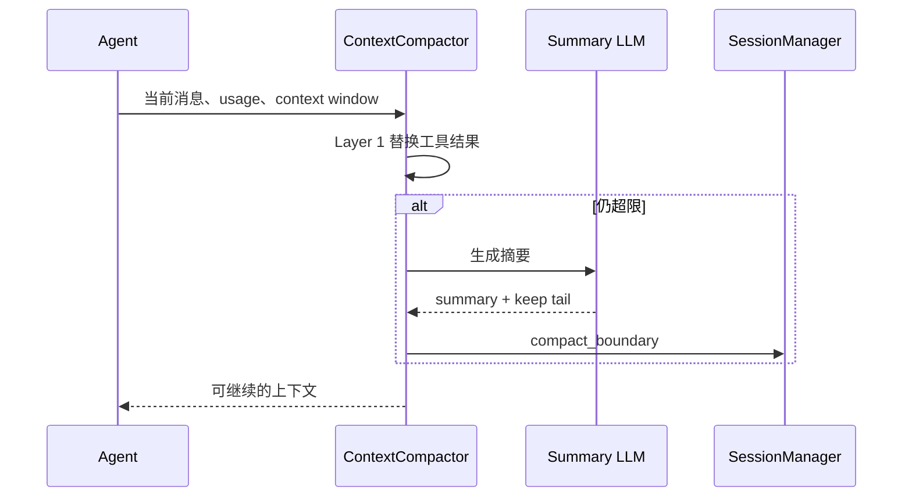

# 其余来源的独有补充

> 返回总稿：[JIMICODE-最终版学习教材.md](../JIMICODE-最终版学习教材.md)

以下文件未被主干或专题清单直接选作来源；仍逐段参与去重，只有前文没有出现的独有内容才保留。

### 独有来源：`docs/course/README.md`

> 项目定位声明：JiMI Code、jimicode、Jimecode Agent 在本文中指同一个课程项目的不同写法。它是一个“仿 Claude Code 理念的课程项目/自研实现”，用于学习 Coding Agent 的架构与工程实践，不是 Anthropic Claude Code 的官方实现，也不声称复制了任何闭源内部代码。

### 独有来源：`docs/course/README.md`

本课程以仓库当前源码为准。已确认的事实会标记为【jimicode 实现】；用于解释通用原理、但不一定由本仓库实现的内容标记为【课程概念】；没有足够源码证据的内容标记为【待源码确认】。源码路径均以 `jimi-code/` 为根目录。

### 独有来源：`docs/course/README.md`

0. [必读｜JiMI Code 课程学习攻略](./00-必读-课程学习攻略.md)
1. [第1章：初识 Coding Agent](./01-第1章-初识-Coding-Agent.md)
2. [第2章：让 AI 开口说话](./02-第2章-让AI开口说话.md)
3. [第3章：工具系统](./03-第3章-工具系统.md)
4. [第4章：让 Agent 自己干活](./04-第4章-Agent-Loop.md)
5. [第5章：System Prompt 设计](./05-第5章-System-Prompt.md)
6. [第6章：权限系统，给 Agent 装上安全刹车](./06-第6章-权限系统.md)
7. [第7章：MCP 协议 - 开放式工具生态](./07-第7章-MCP协议.md)
8. [第8章：上下文管理，当 Token 开始烧钱](./08-第8章-上下文管理.md)
9. [第9章：记忆系统 - 跨会话的 Agent 记忆](./09-第9章-记忆系统.md)
10. [第10章：Slash Command，内置命令框架](./10-第10章-Slash-Command.md)
11. [第11章：Skill 系统，可复用的技能包](./11-第11章-Skill系统.md)
12. [第12章：Hook 系统 - 生命周期钩子与自动化](./12-第12章-Hook系统.md)
13. [第13章：SubAgent，子 Agent 与任务分发](./13-第13章-SubAgent.md)
14. [第14章：Worktree，Git 工作树并行开发](./14-第14章-Worktree.md)
15. [第15章：Agent Teams，从一次性子任务到长期协作团队](./15-第15章-Agent-Teams.md)
16. [第16章：回顾与展望，从一个空壳到一支团队](./16-第16章-回顾与展望.md)
17. [第17章：面试求职全攻略](./17-第17章-面试求职全攻略.md)

### 独有来源：`docs/course/README.md`

- [附录 A：Claude Code 配置教程（对标与迁移）](./A-Claude-Code配置教程.md)
- [附录 B：Jimecode Agent 源码阅读与目录导读](./B-jimicode源码导读.md)
- [附录 C：项目简历模板](./C-项目简历模板.md)
- [附录 D：Vibe Coding 提示词复用手册](./D-Vibe-Coding提示词手册.md)

### 独有来源：`docs/course/README.md`

| 术语 | 课程统一定义 | 在 jimicode 中的对应证据 |
|---|---|---|
| Coding Agent | 能读取环境、调用工具、修改代码并根据结果继续推理的智能体 | `Agent`、`ToolRegistry`、文件工具、`BashTool` |
| LLM Provider | 提供模型推理 API 的服务方或兼容端点 | `AnthropicClient`、`OpenAiClient`、`OpenAiCompatClient` |
| Message | 发送给模型或从模型返回的一条带角色的消息 | `conversation/Message.java` |
| ToolUse | 模型请求执行某个工具的结构化调用 | `ToolUseBlock` |
| ToolResult | 工具执行后回传模型的结果 | `ToolResultBlock`、`ToolResult` |
| Agent Loop | 推理→行动→观察→再推理的循环 | `Agent.agentLoop` |
| ReAct | Reasoning and Acting，交替进行思考与行动 | 课程概念；jimicode 以 Agent Loop 实现 |
| System Prompt | 规定 Agent 角色、规则、工具规范和输出约束的系统消息 | `PromptBuilder`、`PromptSections` |
| Permission Mode | 决定工具自动允许、询问确认还是拒绝的策略 | `PermissionMode`、`PermissionChecker` |
| MCP | Model Context Protocol，标准化外部工具/资源接入的协议 | `McpManager`、`McpServerConfig` |
| Context Window | 模型一次请求可接收的上下文 token 上限 | `ProviderConfig` 的 context window 字段 |
| Compaction | 在预算不足时压缩历史、替换工具结果并保存恢复附件 | `ContextCompactor`、`RecoveryState` |
| Memory | 跨 turn 或跨会话可召回的长期信息 | `MemoryScanner`、`MemoryRecall`、`MemoryManager` |
| Slash Command | 以 `/` 开头的显式用户命令 | `CommandRegistry`、`Command` |
| Skill | 文档、脚本和触发条件组成的可复用能力包 | `SkillCatalog`、`SkillExecutor` |
| Hook | 在生命周期节点执行的观察/自动化逻辑 | `HookEngine`、`HookConfig` |
| SubAgent | 为隔离上下文或专业任务创建的子 Agent | `SubAgentTaskManager`、`AgentTool` |
| Worktree | Git 提供的独立工作树，用于并行修改而不互相覆盖 | `WorktreeManager`、`WorktreeSession` |
| Agent Teams | 多个长期运行的 Agent 成员及其协作协议 | `TeamManager`、`FileMailBox` |
| TUI | Terminal User Interface，终端交互界面 | `JimiCodeModel`、`MarkdownRenderer` |
| Provider-neutral | 不绑定某一个模型厂商的内部消息/事件表示 | `LlmClient` 与 `StreamEvent` 的抽象边界 |
| HITL | Human-in-the-loop，人类在高风险动作前确认 | `AskUserDialog`、`PlanApprovalDialog` |

### 独有来源：`docs/course/README.md`


### 独有来源：`docs/course/README.md`

- 2026-08-29：根据当前 `jimi-code` 的 Java 21、Maven、TUI4J、Anthropic/OpenAI、MCP、权限、压缩、Memory、Worktree 和 Teams 源码对课程入口进行了对齐。
- 2026-08-29：明确“索引文档”和“语义学习文档”的差异；本课程从第 0 章、第 1 章开始逐章补齐。

### 独有来源：`docs/course/README.md`

- [一页纸速查](./最终复习-一页纸速查.md)
- [作业总表](./最终复习-作业总表.md)
- [面试题索引](./最终复习-面试题索引.md)

### 独有来源：`docs/deep-dive/README.md`

这不是一个只介绍功能的 README，而是一套围绕当前源码建立的学习材料。项目包含 117 个 Java 文件、单模块 Maven 构建、Java 21、TUI、多个 LLM provider、MCP、工具执行、权限、Hook、上下文压缩、会话、记忆、文件历史、Worktree、SubAgent、Team、Skill 和 Task。单篇文章无法在一个上下文中同时保持逐文件准确和链路完整，因此文档采用三种粒度：

### 独有来源：`docs/deep-dive/README.md`

1. 文件索引：每个文件都有路径、行数、类型、方法入口和依赖；
2. 模块分册：解释包内文件怎样分工、字段怎样流转、异常怎样恢复；
3. 系统链路：把启动、用户输入、模型流、工具副作用、持久化和 TUI 串起来，并补充面试原理、实验和排障。

### 独有来源：`docs/deep-dive/README.md`

文档中的“源码行为”来自当前工作区扫描和源码阅读；“工程建议”会明确使用建议、应该、风险等措辞，不把尚未实现的功能说成已有能力。

### 独有来源：`docs/deep-dive/README.md`

| 文件 | 作用 | 阅读顺序 |
|---|---|---:|
| 00-源码逐文件覆盖矩阵.md | 117 个 Java 文件的总地址簿、包职责、覆盖统计 | 1 |
| 01-入口配置消息与Agent主循环.md | 从 main 到 Agent Loop、Prompt、消息和 UI | 2 |
| 02-工具权限Hook-MCP与文件变更.md | Tool、Registry、文件工具、Bash、权限、Hook、MCP | 3 |
| 03-会话记忆压缩历史与Worktree.md | Session、JSONL、Memory、Budget、FileHistory、Git worktree | 4 |
| 04-依赖库Maven构建与面试原理.md | 每个直接依赖、SDK、Jackson/SnakeYAML、Maven、fat jar | 5 |
| 05-SubAgent团队Skill任务与TUI.md | 子 Agent、团队 mailbox、技能、任务、对话框和进度 | 6 |
| 06-系统架构逐模块调用链与异常体系.md | 包级架构、状态所有权、链路、错误域和设计面试 | 7 |
| 07-构建部署配置调试测试与常见问题.md | 从环境准备到发布、调试、性能、安全和故障处理 | 8 |
| 08-测试源码逐文件精读与行为契约.md | 14 个测试文件逐个解释和测试补强建议 | 9 |
| 09-117个Java文件逐文件精读索引.md | 每个生产/测试文件的独立条目和方法依赖索引 | 10 |

### 独有来源：`docs/deep-dive/README.md`

第一遍不要一上来读所有 117 个文件。先读 01 的主链路，知道一次请求发生什么；再读 00 和 09，建立每个文件的地图；随后按 02、03 读取工具安全和状态恢复；再读 05 理解并发协作；最后用 04、07、08 补齐依赖、构建和验证。

### 独有来源：`docs/deep-dive/README.md`

- 入口：JimiCode.java；
- 配置：AppConfig、ConfigLoader、ProviderConfig、HookConfig、McpServerConfig；
- UI 编排：JimiCodeModel、ChatMessage、AppState；
- 消息：Message、ConversationManager、ThinkingBlock、ToolUseBlock、ToolResultBlock；
- Agent：AgentEvent、Agent、StreamingExecutor；
- LLM：LlmClient、StreamEvent、ModelResolver、三个 client、LlmException；
- 工具：Tool、ToolCategory、ToolRegistry、ToolResult、FileStateCache、impl；
- 安全：PermissionMode、PermissionResponse、PermissionChecker、HookEngine；
- 上下文：ContextCompactor、RecoveryState、toolresult 子包；
- 持久化：SessionManager、HistoryStore、Memory、FileHistory；
- 协作：SubAgent、Teams、Skill、Task；
- 隔离：Worktree；
- UI 细节：dialog、MarkdownRenderer、Styles、SpinnerVerbs；
- 测试：按 08 的测试契约回看生产实现。

### 独有来源：`docs/deep-dive/README.md`

用户启动程序时：JimiCode → ConfigLoader → AppConfig/ProviderConfig → PermissionMode → JimiCodeModel → Program。

### 独有来源：`docs/deep-dive/README.md`

用户提交普通文本时：JimiCodeModel.update → CommandRegistry 判断命令/普通输入 → HistoryStore → ConversationManager → PromptBuilder/PromptSections → Agent.run。

### 独有来源：`docs/deep-dive/README.md`

模型请求时：Agent.agentLoop → ContextCompactor → ToolResultBudget → LlmClient → AnthropicClient/OpenAiClient/OpenAiCompatClient → StreamEvent → AgentEvent。

### 独有来源：`docs/deep-dive/README.md`

模型返回工具时：StreamingExecutor → ToolRegistry → HookEngine.runPreToolHooks → PermissionChecker → Tool 实现 → ToolResult → ConversationManager → 下一轮 Agent。

### 独有来源：`docs/deep-dive/README.md`

需要文件时：ReadFileTool/GrepTool/GlobTool → Path/Files/ProcessBuilder → FileStateCache/RecoveryState → ToolResultBudget。

### 独有来源：`docs/deep-dive/README.md`

需要写入时：WriteFileTool/EditFileTool → FileHistory → FileStateCache → 磁盘 → ToolResult；若隔离则 EnterWorktreeTool/WorktreeManager/WorktreeSessionStore。

### 独有来源：`docs/deep-dive/README.md`

需要恢复时：SessionManager.loadSession → findLastCompactBoundary → rebuildConversation；若上下文太长则 ContextCompactor.forceCompact → ReplacementRecordsIO/Session boundary。

### 独有来源：`docs/deep-dive/README.md`

需要协作时：AgentTool → SubAgentTaskManager 或 TeamManager → child Agent/TeammateRunner → FileMailBox/SharedTaskStore → notificationFn → system reminder → JimiCodeModel。

### 独有来源：`docs/deep-dive/README.md`

第一等级是实际代码路径：方法调用、字段写入、异常分支、文件写入和测试断言。第二等级是类型和命名：接口、record、enum、包路径反映的设计意图。第三等级是 README/已有学习文档：适合了解背景，但遇到与源码冲突时以源码和测试为准。第四等级是工程推断：可以用于面试和改进建议，但必须标注为建议，不得混成已实现功能。

### 独有来源：`docs/deep-dive/README.md`

例如，源码中确实有 ContextCompactor 和 RecoveryState，可以说项目已经实现压缩和恢复附件；源码中只有 best-effort catch，则不能说“持久化强一致”；源码没有 GlobalExceptionHandler，则应说“异常按层分域处理”；源码没有数据库实体和 Controller，则不要套用 CRUD 项目模板。

### 独有来源：`docs/deep-dive/README.md`

1. 文件的顶层类型是什么，为什么放在这个 package？
2. 构造器接收什么依赖，哪些依赖由自身创建？
3. 字段中哪些是跨调用状态，哪些是一轮临时状态？
4. 谁调用公共方法，公共方法又调用谁？
5. 正常输入、空输入、非法输入分别怎样走？
6. IO、网络、进程、线程中断和用户取消分别如何处理？
7. 返回值是给 UI、模型、磁盘还是另一个内部对象？
8. 是否修改了共享集合、文件、Git、权限或工具 registry？
9. 哪个测试锁定了这项行为，是否缺少集成测试？
10. 如果要替换实现，应该依赖哪个 interface/record，而不是修改调用方？

### 独有来源：`docs/deep-dive/README.md`

1. 这个库在哪些源码文件中直接出现？
2. 它解决的是协议、UI、序列化、网络、并发还是构建问题？
3. 它引入了什么资源生命周期或版本兼容边界？
4. fat jar、ServiceLoader、反射或 runtime scope 会不会改变行为？
5. 升级它需要哪些 fixture、集成测试和安全审查？

### 独有来源：`docs/deep-dive/README.md`

直接依赖包括 tui4j、Mordant、mordant-markdown、MCP SDK、SLF4J NOP、Anthropic Java、OpenAI Java、SnakeYAML、Jackson databind、Jackson JSR310 和 JUnit Jupiter；Maven plugins 还决定 JDK 门禁、编译参数、测试执行和 Shade 产物。

### 独有来源：`docs/deep-dive/README.md`

实验 A：用一个最小 provider 配置启动，检查 ConfigLoader、PermissionMode、JimiCodeModel 和 TUI。

### 独有来源：`docs/deep-dive/README.md`

实验 B：让模型只回答文本，记录 StreamEvent、AgentEvent、ConversationManager 和 UsageEvent。

### 独有来源：`docs/deep-dive/README.md`

实验 C：让模型调用 ReadFile，比较 tool schema、Permission、ToolResult 和下一轮消息。

### 独有来源：`docs/deep-dive/README.md`

实验 D：设置小 contextWindow，观察 Layer 1 工具结果预算、Layer 2 compact、RecoveryState 和 session boundary。

### 独有来源：`docs/deep-dive/README.md`

实验 E：配置一个拒绝 Bash 的规则，比较 Permission deny、Hook reject 和用户取消。

### 独有来源：`docs/deep-dive/README.md`

实验 F：创建一个 worktree，写一个文件，查看 WorktreeSessionStore、git status/diff 和退出结果。

### 独有来源：`docs/deep-dive/README.md`

实验 G：启动 SubAgent 或 Team，观察 task id、progress、mailbox、notification 和 UI block。

### 独有来源：`docs/deep-dive/README.md`

实验 H：故意写坏 JSONL 最后一行，测试 SessionManager 的恢复策略。

### 独有来源：`docs/deep-dive/README.md`

介绍项目时可以说：这是一个 Java 21 的终端 coding agent，核心不是 CRUD，而是事件驱动的 ReAct Agent Loop。JimiCodeModel 负责 TUI 与应用编排，Agent 负责迭代和流，LlmClient 通过 adapter 统一 Anthropic/OpenAI/兼容协议，ToolRegistry/StreamingExecutor 负责工具调用，PermissionChecker/HookEngine 负责副作用控制，ContextCompactor/ToolResultBudget 负责上下文治理，Session/Memory/FileHistory/Worktree 负责可恢复和可回滚，SubAgent/Team/Skill/Task 负责协作工作流。

### 独有来源：`docs/deep-dive/README.md`

被问全局异常时说：没有一个 Web 式 GlobalExceptionHandler，而是按故障域处理：配置入口直接失败，模型异常分类重试/压缩，工具异常转 ToolResult，权限返回控制决定，TUI转 ErrorEvent，持久化按 best-effort 与恢复关键程度区分。然后指出统一 error code、correlation id 和结构化日志是可改进点。

### 独有来源：`docs/deep-dive/README.md`

被问性能时说：token 是主成本，ToolResultBudget 和 ContextCompactor 控制上下文，ToolSearch 延迟 schema，FileStateCache 减少重复读取，虚拟线程承载阻塞等待，队列和输出上限避免内存爆炸；但需要对进程、HTTP、MCP、队列和并发 SubAgent 设置 timeout/limit。

### 独有来源：`docs/deep-dive/README.md`

文档阅读完成后，不要求背出所有行号，但要求能够：

### 独有来源：`docs/deep-dive/README.md`

- 打开任意一个 Java 文件并定位它在主链路中的位置；
- 用实际类名解释一次普通请求和一次工具请求；
- 解释 provider adapter 如何归一化 StreamEvent；
- 解释权限、Hook、工具校验和工作区为什么是多层安全边界；
- 解释 apiConv、live conversation、session audit 的差异；
- 解释 compact boundary 怎样支撑 resume；
- 解释 FileHistory、Git worktree 和 SessionStore 的边界；
- 解释 SubAgent/Team/Skill/Task 的生命周期；
- 运行测试和 fat jar，并根据症状定位故障域；
- 在面试中区分“源码已实现”“测试已证明”和“工程上建议”。

### 独有来源：`docs/deep-dive/README.md`

源码新增文件时，先更新 00/09 索引，再把文件加入所属模块分册；新增依赖时更新 04 的库表和 pom 映射；新增测试时更新 08；修改 Agent/Tool/Session 状态机时同步更新 01、02、03、06。每次维护后重新统计字符数、Java 文件数量、索引覆盖率和链接路径。

### 独有来源：`docs/deep-dive/README.md`

不要把 target、.git、真实 session、memory、API key 和个人 worktree 纳入学习文档；不要把自动生成的临时输出提交进项目；不要为了满足字数重复粘贴相同段落，应该补充字段、调用链、故障、测试和原理。

### 独有来源：`docs/deep-dive/README.md`

最有效的方式不是从第一行读到最后一行，而是带着一次具体任务读：例如“读取一个文件、修改一个方法、运行测试并恢复会话”。沿着这条任务追踪 JimiCodeModel、Agent、LLM、Tool、Permission、FileHistory、Session 和 UI；然后换一个会触发压缩或 SubAgent 的长任务，观察状态如何扩展。源码中的设计只有在状态变化和失败场景中才真正显现。

### 独有来源：`docs/deep-learning/00-项目总览与学习路线.md`

`jimi-code` 是一个 Java CLI/TUI 编程代理。入口是 `src/main/java/com/jimicode/JimiCode.java`，运行时把配置、会话、Prompt、LLM 客户端、工具注册、权限确认、工作树和终端 UI 串成一条事件驱动链路。它没有传统 Web Controller/数据库表；“接口”主要是命令、工具 schema、LLM provider 协议和本地文件格式。

### 独有来源：`docs/deep-learning/00-项目总览与学习路线.md`

1. 启动类读取命令行参数和工作目录，`ConfigLoader` 合并默认值、用户配置与环境变量，并由 `ProviderConfig` 校验 API key、base URL、模型及上下文窗口。
2. `JimiCodeModel` 创建 TUI 状态机；`CommandRegistry` 把斜杠命令映射到 `Command` 与 `CommandContext`。
3. 用户输入进入 `ConversationManager`，消息由 `PromptBuilder` 拼接系统段、技能说明、记忆、计划和工具 schema。
4. `Agent` 通过 `ModelResolver` 选择 `AnthropicClient`、`OpenAiClient` 或 `OpenAiCompatClient`，以 `StreamEvent` 逐块消费文本、思考和工具调用。
5. `ToolRegistry` 找到具体 `Tool` 实现；`PermissionChecker` 决定是否需要 `AskUserDialog`；执行结果封装为 `ToolResult` 并写回会话。
6. 达到上下文阈值时，`ContextCompactor` 生成摘要并用 `RecoveryState` 保存恢复附件；`HistoryStore` 与 `FileHistory` 负责可追溯性。
7. 多 Agent 场景通过 `SubAgentTaskManager`、`TeamManager`、`FileMailBox` 和 `WorktreeManager` 隔离并发修改。

### 独有来源：`docs/deep-learning/00-项目总览与学习路线.md`

- `(default/未声明)`：6 个 Java 文件，约 254 行；通常按接口/实现/模型/适配器分层，需结合调用方判断实际职责。
- `com.jimicode`：2 个 Java 文件，约 160 行；通常按接口/实现/模型/适配器分层，需结合调用方判断实际职责。
- `com.jimicode.agent`：6 个 Java 文件，约 1379 行；通常按接口/实现/模型/适配器分层，需结合调用方判断实际职责。
- `com.jimicode.command`：6 个 Java 文件，约 764 行；通常按接口/实现/模型/适配器分层，需结合调用方判断实际职责。
- `com.jimicode.compact`：8 个 Java 文件，约 2542 行；通常按接口/实现/模型/适配器分层，需结合调用方判断实际职责。
- `com.jimicode.config`：12 个 Java 文件，约 1118 行；通常按接口/实现/模型/适配器分层，需结合调用方判断实际职责。
- `com.jimicode.conversation`：10 个 Java 文件，约 306 行；通常按接口/实现/模型/适配器分层，需结合调用方判断实际职责。
- `com.jimicode.filehistory`：2 个 Java 文件，约 310 行；通常按接口/实现/模型/适配器分层，需结合调用方判断实际职责。
- `com.jimicode.history`：2 个 Java 文件，约 310 行；通常按接口/实现/模型/适配器分层，需结合调用方判断实际职责。
- `com.jimicode.hook`：2 个 Java 文件，约 442 行；通常按接口/实现/模型/适配器分层，需结合调用方判断实际职责。
- `com.jimicode.llm`：18 个 Java 文件，约 2904 行；通常按接口/实现/模型/适配器分层，需结合调用方判断实际职责。
- `com.jimicode.mcp`：2 个 Java 文件，约 418 行；通常按接口/实现/模型/适配器分层，需结合调用方判断实际职责。
- `com.jimicode.memory`：8 个 Java 文件，约 1532 行；通常按接口/实现/模型/适配器分层，需结合调用方判断实际职责。
- `com.jimicode.permission`：6 个 Java 文件，约 828 行；通常按接口/实现/模型/适配器分层，需结合调用方判断实际职责。
- `com.jimicode.plan`：2 个 Java 文件，约 256 行；通常按接口/实现/模型/适配器分层，需结合调用方判断实际职责。
- `com.jimicode.prompt`：6 个 Java 文件，约 1076 行；通常按接口/实现/模型/适配器分层，需结合调用方判断实际职责。
- `com.jimicode.session`：4 个 Java 文件，约 1148 行；通常按接口/实现/模型/适配器分层，需结合调用方判断实际职责。
- `com.jimicode.skill`：8 个 Java 文件，约 954 行；通常按接口/实现/模型/适配器分层，需结合调用方判断实际职责。
- `com.jimicode.subagent`：12 个 Java 文件，约 2396 行；通常按接口/实现/模型/适配器分层，需结合调用方判断实际职责。
- `com.jimicode.task`：4 个 Java 文件，约 1453 行；通常按接口/实现/模型/适配器分层，需结合调用方判断实际职责。
- `com.jimicode.teams`：24 个 Java 文件，约 2660 行；通常按接口/实现/模型/适配器分层，需结合调用方判断实际职责。
- `com.jimicode.tool`：12 个 Java 文件，约 974 行；通常按接口/实现/模型/适配器分层，需结合调用方判断实际职责。
- `com.jimicode.tool.impl`：22 个 Java 文件，约 2992 行；通常按接口/实现/模型/适配器分层，需结合调用方判断实际职责。
- `com.jimicode.toolresult`：18 个 Java 文件，约 1510 行；通常按接口/实现/模型/适配器分层，需结合调用方判断实际职责。
- `com.jimicode.tui`：12 个 Java 文件，约 5488 行；通常按接口/实现/模型/适配器分层，需结合调用方判断实际职责。
- `com.jimicode.tui.dialog`：4 个 Java 文件，约 1556 行；通常按接口/实现/模型/适配器分层，需结合调用方判断实际职责。
- `com.jimicode.worktree`：16 个 Java 文件，约 1718 行；通常按接口/实现/模型/适配器分层，需结合调用方判断实际职责。

### 独有来源：`docs/deep-learning/00-项目总览与学习路线.md`

先读配置和消息模型，再读 Agent Loop，之后读工具/权限/MCP，最后读记忆压缩、Worktree、Teams 与 TUI。每读一个类都要回答：谁创建它、谁调用它、状态存在哪里、异常如何传播、是否可替换。

### 独有来源：`docs/deep-learning/00-项目总览与学习路线.md`

### `jimi-code/.idea/compiler.xml`
- 文件类型：`.xml`；行数：18。
- 阅读重点：把它与同目录 Java/配置文件对照，确认它是构建入口、运行时配置、文档还是示例，不把示例误当生产 API。

### 独有来源：`docs/deep-learning/00-项目总览与学习路线.md`

### `jimi-code/.idea/encodings.xml`
- 文件类型：`.xml`；行数：7。
- 阅读重点：把它与同目录 Java/配置文件对照，确认它是构建入口、运行时配置、文档还是示例，不把示例误当生产 API。

### 独有来源：`docs/deep-learning/00-项目总览与学习路线.md`

### `jimi-code/.idea/jarRepositories.xml`
- 文件类型：`.xml`；行数：20。
- 阅读重点：把它与同目录 Java/配置文件对照，确认它是构建入口、运行时配置、文档还是示例，不把示例误当生产 API。

### 独有来源：`docs/deep-learning/00-项目总览与学习路线.md`

### `jimi-code/.idea/MarsCodeWorkspaceAppSettings.xml`
- 文件类型：`.xml`；行数：7。
- 阅读重点：把它与同目录 Java/配置文件对照，确认它是构建入口、运行时配置、文档还是示例，不把示例误当生产 API。

### 独有来源：`docs/deep-learning/00-项目总览与学习路线.md`

### `jimi-code/.idea/misc.xml`
- 文件类型：`.xml`；行数：12。
- 阅读重点：把它与同目录 Java/配置文件对照，确认它是构建入口、运行时配置、文档还是示例，不把示例误当生产 API。

### 独有来源：`docs/deep-learning/00-项目总览与学习路线.md`

### `jimi-code/.idea/vcs.xml`
- 文件类型：`.xml`；行数：6。
- 阅读重点：把它与同目录 Java/配置文件对照，确认它是构建入口、运行时配置、文档还是示例，不把示例误当生产 API。

### 独有来源：`docs/deep-learning/00-项目总览与学习路线.md`

### `jimi-code/.idea/workspace.xml`
- 文件类型：`.xml`；行数：105。
- 阅读重点：把它与同目录 Java/配置文件对照，确认它是构建入口、运行时配置、文档还是示例，不把示例误当生产 API。

### 独有来源：`docs/deep-learning/00-项目总览与学习路线.md`

### `jimi-code/.mvn/wrapper/maven-wrapper.properties`
- 文件类型：`.properties`；行数：19。
- 阅读重点：把它与同目录 Java/配置文件对照，确认它是构建入口、运行时配置、文档还是示例，不把示例误当生产 API。

### 独有来源：`docs/deep-learning/00-项目总览与学习路线.md`

### `jimi-code/.workbuddy/memory/2026-08-11.md`
- 文件类型：`.md`；行数：25。
- 阅读重点：把它与同目录 Java/配置文件对照，确认它是构建入口、运行时配置、文档还是示例，不把示例误当生产 API。

### 独有来源：`docs/deep-learning/00-项目总览与学习路线.md`

### `jimi-code/config.example.yaml`
- 文件类型：`.yaml`；行数：14。
- 阅读重点：把它与同目录 Java/配置文件对照，确认它是构建入口、运行时配置、文档还是示例，不把示例误当生产 API。

### 独有来源：`docs/deep-learning/00-项目总览与学习路线.md`

### `jimi-code/docs/deep-dive/00-源码逐文件覆盖矩阵.md`
- 文件类型：`.md`；行数：173。
- 阅读重点：把它与同目录 Java/配置文件对照，确认它是构建入口、运行时配置、文档还是示例，不把示例误当生产 API。

### 独有来源：`docs/deep-learning/00-项目总览与学习路线.md`

### `jimi-code/docs/deep-dive/01-入口配置消息与Agent主循环.md`
- 文件类型：`.md`；行数：209。
- 阅读重点：把它与同目录 Java/配置文件对照，确认它是构建入口、运行时配置、文档还是示例，不把示例误当生产 API。

### 独有来源：`docs/deep-learning/00-项目总览与学习路线.md`

### `jimi-code/docs/deep-dive/02-工具权限Hook-MCP与文件变更.md`
- 文件类型：`.md`；行数：218。
- 阅读重点：把它与同目录 Java/配置文件对照，确认它是构建入口、运行时配置、文档还是示例，不把示例误当生产 API。

### 独有来源：`docs/deep-learning/00-项目总览与学习路线.md`

### `jimi-code/docs/deep-dive/03-会话记忆压缩历史与Worktree.md`
- 文件类型：`.md`；行数：249。
- 阅读重点：把它与同目录 Java/配置文件对照，确认它是构建入口、运行时配置、文档还是示例，不把示例误当生产 API。

### 独有来源：`docs/deep-learning/00-项目总览与学习路线.md`

### `jimi-code/docs/deep-dive/04-依赖库Maven构建与面试原理.md`
- 文件类型：`.md`；行数：215。
- 阅读重点：把它与同目录 Java/配置文件对照，确认它是构建入口、运行时配置、文档还是示例，不把示例误当生产 API。

### 独有来源：`docs/deep-learning/00-项目总览与学习路线.md`

### `jimi-code/docs/deep-dive/05-SubAgent团队Skill任务与TUI.md`
- 文件类型：`.md`；行数：142。
- 阅读重点：把它与同目录 Java/配置文件对照，确认它是构建入口、运行时配置、文档还是示例，不把示例误当生产 API。

### 独有来源：`docs/deep-learning/00-项目总览与学习路线.md`

### `jimi-code/docs/deep-dive/06-系统架构逐模块调用链与异常体系.md`
- 文件类型：`.md`；行数：161。
- 阅读重点：把它与同目录 Java/配置文件对照，确认它是构建入口、运行时配置、文档还是示例，不把示例误当生产 API。

### 独有来源：`docs/deep-learning/00-项目总览与学习路线.md`

### `jimi-code/docs/deep-dive/07-构建部署配置调试测试与常见问题.md`
- 文件类型：`.md`；行数：175。
- 阅读重点：把它与同目录 Java/配置文件对照，确认它是构建入口、运行时配置、文档还是示例，不把示例误当生产 API。

### 独有来源：`docs/deep-learning/00-项目总览与学习路线.md`

### `jimi-code/docs/deep-dive/08-测试源码逐文件精读与行为契约.md`
- 文件类型：`.md`；行数：174。
- 阅读重点：把它与同目录 Java/配置文件对照，确认它是构建入口、运行时配置、文档还是示例，不把示例误当生产 API。

### 独有来源：`docs/deep-learning/00-项目总览与学习路线.md`

### `jimi-code/docs/deep-dive/09-117个Java文件逐文件精读索引.md`
- 文件类型：`.md`；行数：746。
- 阅读重点：把它与同目录 Java/配置文件对照，确认它是构建入口、运行时配置、文档还是示例，不把示例误当生产 API。

### 独有来源：`docs/deep-learning/00-项目总览与学习路线.md`

### `jimi-code/docs/deep-dive/README.md`
- 文件类型：`.md`；行数：146。
- 阅读重点：把它与同目录 Java/配置文件对照，确认它是构建入口、运行时配置、文档还是示例，不把示例误当生产 API。

### 独有来源：`docs/deep-learning/00-项目总览与学习路线.md`

### `jimi-code/docs/deep-learning/00-项目总览与学习路线.md`
- 文件类型：`.md`；行数：1666。
- 阅读重点：把它与同目录 Java/配置文件对照，确认它是构建入口、运行时配置、文档还是示例，不把示例误当生产 API。

### 独有来源：`docs/deep-learning/00-项目总览与学习路线.md`

### `jimi-code/docs/deep-learning/01-架构与核心链路.md`
- 文件类型：`.md`；行数：1645。
- 阅读重点：把它与同目录 Java/配置文件对照，确认它是构建入口、运行时配置、文档还是示例，不把示例误当生产 API。

### 独有来源：`docs/deep-learning/00-项目总览与学习路线.md`

### `jimi-code/docs/deep-learning/02-逐文件源码精读.md`
- 文件类型：`.md`；行数：1630。
- 阅读重点：把它与同目录 Java/配置文件对照，确认它是构建入口、运行时配置、文档还是示例，不把示例误当生产 API。

### 独有来源：`docs/deep-learning/00-项目总览与学习路线.md`

### `jimi-code/docs/deep-learning/03-依赖库构建配置与运行.md`
- 文件类型：`.md`；行数：1637。
- 阅读重点：把它与同目录 Java/配置文件对照，确认它是构建入口、运行时配置、文档还是示例，不把示例误当生产 API。

### 独有来源：`docs/deep-learning/00-项目总览与学习路线.md`

### `jimi-code/docs/deep-learning/04-异常测试安全性能与面试.md`
- 文件类型：`.md`；行数：1638。
- 阅读重点：把它与同目录 Java/配置文件对照，确认它是构建入口、运行时配置、文档还是示例，不把示例误当生产 API。

### 独有来源：`docs/deep-learning/00-项目总览与学习路线.md`

### `jimi-code/docs/deep-learning/05-核心Java文件逐方法讲解.md`
- 文件类型：`.md`；行数：5344。
- 阅读重点：把它与同目录 Java/配置文件对照，确认它是构建入口、运行时配置、文档还是示例，不把示例误当生产 API。

### 独有来源：`docs/deep-learning/00-项目总览与学习路线.md`

### `jimi-code/docs/deep-learning/06-核心链路语义讲解.md`
- 文件类型：`.md`；行数：127。
- 阅读重点：把它与同目录 Java/配置文件对照，确认它是构建入口、运行时配置、文档还是示例，不把示例误当生产 API。

### 独有来源：`docs/deep-learning/00-项目总览与学习路线.md`

### `jimi-code/docs/deep-learning/README-深度学习文档导航.md`
- 文件类型：`.md`；行数：34。
- 阅读重点：把它与同目录 Java/配置文件对照，确认它是构建入口、运行时配置、文档还是示例，不把示例误当生产 API。

### 独有来源：`docs/deep-learning/00-项目总览与学习路线.md`

### `jimi-code/docs/JAVA_MAVEN_GUIDE.md`
- 文件类型：`.md`；行数：67。
- 阅读重点：把它与同目录 Java/配置文件对照，确认它是构建入口、运行时配置、文档还是示例，不把示例误当生产 API。

### 独有来源：`docs/deep-learning/00-项目总览与学习路线.md`

### `jimi-code/docs/PROJECT_GUIDE.md`
- 文件类型：`.md`；行数：848。
- 阅读重点：把它与同目录 Java/配置文件对照，确认它是构建入口、运行时配置、文档还是示例，不把示例误当生产 API。

### 独有来源：`docs/deep-learning/00-项目总览与学习路线.md`

### `jimi-code/JIMICODE.md`
- 文件类型：`.md`；行数：12。
- 阅读重点：把它与同目录 Java/配置文件对照，确认它是构建入口、运行时配置、文档还是示例，不把示例误当生产 API。

### 独有来源：`docs/deep-learning/00-项目总览与学习路线.md`

### `jimi-code/LEARNING_GUIDE.md`
- 文件类型：`.md`；行数：915。
- 阅读重点：把它与同目录 Java/配置文件对照，确认它是构建入口、运行时配置、文档还是示例，不把示例误当生产 API。

### 独有来源：`docs/deep-learning/00-项目总览与学习路线.md`

### `jimi-code/mewcode-maven/.mewcode/config.yaml`
- 文件类型：`.yaml`；行数：14。
- 阅读重点：把它与同目录 Java/配置文件对照，确认它是构建入口、运行时配置、文档还是示例，不把示例误当生产 API。

### 独有来源：`docs/deep-learning/00-项目总览与学习路线.md`

### `jimi-code/mewcode-maven/.mvn/wrapper/maven-wrapper.properties`
- 文件类型：`.properties`；行数：19。
- 阅读重点：把它与同目录 Java/配置文件对照，确认它是构建入口、运行时配置、文档还是示例，不把示例误当生产 API。

### 独有来源：`docs/deep-learning/00-项目总览与学习路线.md`

### `jimi-code/mewcode-maven/config.example.yaml`
- 文件类型：`.yaml`；行数：14。
- 阅读重点：把它与同目录 Java/配置文件对照，确认它是构建入口、运行时配置、文档还是示例，不把示例误当生产 API。

### 独有来源：`docs/deep-learning/00-项目总览与学习路线.md`

### `jimi-code/mewcode-maven/pom.xml`
- Maven 模块标识线索：jimicode, tui4j, mordant, mordant-markdown, mcp, slf4j-nop, anthropic-java, openai-java
- 依赖：`com.williamcallahan:tui4j`（0.3.3）；`com.github.ajalt.mordant:mordant`（3.0.2）；`com.github.ajalt.mordant:mordant-markdown`（3.0.2）；`io.modelcontextprotocol.sdk:mcp`（1.1.3）；`org.slf4j:slf4j-nop`（2.0.16）；`com.anthropic:anthropic-java`（2.34.0）；`com.openai:openai-java`（4.37.0）；`org.yaml:snakeyaml`（2.2）；`com.fasterxml.jackson.core:jackson-databind`（${jackson.version}）；`com.fasterxml.jackson.datatype:jackson-datatype-jsr310`（${jackson.version}）；`org.junit.jupiter:junit-jupiter`（${junit.version}）
- 阅读重点：确认 dependencyManagement、插件生命周期、Java 版本、测试与发布配置。

### 独有来源：`docs/deep-learning/00-项目总览与学习路线.md`

### `jimi-code/mewcode-maven/README.md`
- 文件类型：`.md`；行数：96。
- 阅读重点：把它与同目录 Java/配置文件对照，确认它是构建入口、运行时配置、文档还是示例，不把示例误当生产 API。

### 独有来源：`docs/deep-learning/00-项目总览与学习路线.md`

### `jimi-code/mewcode-maven/src/main/java/com/mewcode/agent/Agent.java`
- 包：`com.jimicode.agent`；行数：434；类型：Agent, into, ToolCallInfo, ToolCallResult
- 方法/构造器线索：getReplacementState, setReplacementState, setFileHistory, getRegistry, getProtocol, Agent, setChecker, setHookEngine, setMaxIterations, setWorkDir, setSessionId, getSessionId, setNotificationFn, setToolNameFilter, setInstructions, setMemoryContent, getHookEngine, run, agentLoop, putSafe, if, for, while, switch, events_drain_last_error, ToolCallInfo, ToolCallResult
- 直接导入：com.jimicode.config.ProviderConfig, com.jimicode.conversation.ConversationManager, com.jimicode.conversation.ThinkingBlock, com.jimicode.conversation.ToolResultBlock, com.jimicode.conversation.ToolUseBlock, com.jimicode.hook.HookEngine, com.jimicode.llm.LlmClient, com.jimicode.llm.StreamEvent, com.j
- 阅读重点：先看类型声明和构造器，再沿方法中的 `Mono`/`Flux`、异常、事件或文件 IO 调用向下追踪；测试应验证边界条件、空值、重试和资源释放。

### 独有来源：`docs/deep-learning/00-项目总览与学习路线.md`

### `jimi-code/mewcode-maven/src/main/java/com/mewcode/agent/AgentEvent.java`
- 包：`com.jimicode.agent`；行数：44；类型：AgentEvent, StreamText, ThinkingText, ThinkingComplete, ToolUseEvent, ToolResultEvent, TurnComplete, LoopComplete, UsageEvent, ErrorEvent, CompactEvent, RetryEvent, PermissionRequestEvent, AskUserRequestEvent
- 方法/构造器线索：未匹配到公开方法；需结合源码阅读静态初始化/记录组件
- 直接导入：com.jimicode.permission.PermissionResponse, java.util.Map, java.util.concurrent.CompletableFuture
- 阅读重点：先看类型声明和构造器，再沿方法中的 `Mono`/`Flux`、异常、事件或文件 IO 调用向下追踪；测试应验证边界条件、空值、重试和资源释放。

### 独有来源：`docs/deep-learning/00-项目总览与学习路线.md`

### `jimi-code/mewcode-maven/src/main/java/com/mewcode/agent/StreamingExecutor.java`
- 包：`com.jimicode.agent`；行数：212；类型：StreamingExecutor, ToolCallInfo, ToolExecResult
- 方法/构造器线索：ToolCallInfo, ToolExecResult, StreamingExecutor, this, executeAll, for, if, try, catch, executeSingle, putSafe, switch, snapshotForRecovery, extractContent
- 直接导入：com.jimicode.compact.RecoveryState, com.jimicode.hook.HookEngine, com.jimicode.permission.PermissionChecker, com.jimicode.permission.PermissionResponse, com.jimicode.tool.Tool, com.jimicode.tool.ToolCategory, com.jimicode.tool.ToolRegistry, com.jimicode.tool.ToolResult, java.io.IOException, java.nio
- 阅读重点：先看类型声明和构造器，再沿方法中的 `Mono`/`Flux`、异常、事件或文件 IO 调用向下追踪；测试应验证边界条件、空值、重试和资源释放。

### 独有来源：`docs/deep-learning/00-项目总览与学习路线.md`

### `jimi-code/mewcode-maven/src/main/java/com/mewcode/command/Command.java`
- 包：`com.jimicode.command`；行数：52；类型：Command, CommandType
- 方法/构造器线索：Command, matches, if, for
- 直接导入：无 import（仅使用 java.lang 或同包类型）
- 阅读重点：先看类型声明和构造器，再沿方法中的 `Mono`/`Flux`、异常、事件或文件 IO 调用向下追踪；测试应验证边界条件、空值、重试和资源释放。

### 独有来源：`docs/deep-learning/00-项目总览与学习路线.md`

### `jimi-code/mewcode-maven/src/main/java/com/mewcode/command/CommandContext.java`
- 包：`com.jimicode.command`；行数：30；类型：CommandContext
- 方法/构造器线索：CommandContext
- 直接导入：java.util.List, java.util.function.IntSupplier, java.util.function.Supplier
- 阅读重点：先看类型声明和构造器，再沿方法中的 `Mono`/`Flux`、异常、事件或文件 IO 调用向下追踪；测试应验证边界条件、空值、重试和资源释放。

### 独有来源：`docs/deep-learning/00-项目总览与学习路线.md`

### `jimi-code/mewcode-maven/src/main/java/com/mewcode/command/CommandRegistry.java`
- 包：`com.jimicode.command`；行数：300；类型：CommandRegistry
- 方法/构造器线索：CommandRegistry, registerDefaults, register, if, for, search, find, execute, listAll, listVisible, switch
- 直接导入：com.jimicode.command.Command.CommandType, java.util.*, java.util.function.Function, java.util.stream.Collectors
- 阅读重点：先看类型声明和构造器，再沿方法中的 `Mono`/`Flux`、异常、事件或文件 IO 调用向下追踪；测试应验证边界条件、空值、重试和资源释放。

### 独有来源：`docs/deep-learning/00-项目总览与学习路线.md`

### `jimi-code/mewcode-maven/src/main/java/com/mewcode/compact/ContextCompactor.java`
- 包：`com.jimicode.compact`；行数：729；类型：ContextCompactor, AutoCompactTrackingState, UsageAnchor, so
- 方法/构造器线索：ContextCompactor, isTripped, recordFailure, reset, computeCompactThreshold, if, manage, forceCompact, autoCompact, UsageAnchor, currentTokens, estimateTokens, for, offloadAndSnip, rebuildConversation, computeKeepStartIndex, while, isToolResultMessage, appendMessage, replaceConversation, buildRecoveryAttachment, approxTokens, return, truncateByTokens, firstLine, alreadyProcessed, writeSpill, formatCompactSummary, requestSummary, RuntimeException, serializeForSummary, safeLength, nullSafe
- 直接导入：com.fasterxml.jackson.core.JsonProcessingException, com.fasterxml.jackson.databind.ObjectMapper, com.jimicode.conversation.ConversationManager, com.jimicode.conversation.Message, com.jimicode.conversation.ThinkingBlock, com.jimicode.conversation.ToolResultBlock, com.jimicode.conversation.ToolUseBloc
- 阅读重点：先看类型声明和构造器，再沿方法中的 `Mono`/`Flux`、异常、事件或文件 IO 调用向下追踪；测试应验证边界条件、空值、重试和资源释放。

### 独有来源：`docs/deep-learning/00-项目总览与学习路线.md`

### `jimi-code/mewcode-maven/src/main/java/com/mewcode/compact/RecoveryState.java`
- 包：`com.jimicode.compact`；行数：79；类型：RecoveryState, FileReadRecord, SkillInvocationRecord, for, for
- 方法/构造器线索：FileReadRecord, SkillInvocationRecord, recordFileRead, synchronized, recordSkillInvocation, snapshotFiles, if, snapshotSkills
- 直接导入：java.time.Instant, java.util.ArrayList, java.util.Comparator, java.util.HashMap, java.util.List, java.util.Map
- 阅读重点：先看类型声明和构造器，再沿方法中的 `Mono`/`Flux`、异常、事件或文件 IO 调用向下追踪；测试应验证边界条件、空值、重试和资源释放。

### 独有来源：`docs/deep-learning/00-项目总览与学习路线.md`

### `jimi-code/mewcode-maven/src/main/java/com/mewcode/config/AppConfig.java`
- 包：`com.jimicode.config`；行数：31；类型：AppConfig
- 方法/构造器线索：getProviders, setProviders, getPermissionMode, setPermissionMode, getMcpServers, setMcpServers, getHooks, setHooks
- 直接导入：java.util.List
- 阅读重点：先看类型声明和构造器，再沿方法中的 `Mono`/`Flux`、异常、事件或文件 IO 调用向下追踪；测试应验证边界条件、空值、重试和资源释放。

### 独有来源：`docs/deep-learning/00-项目总览与学习路线.md`

### `jimi-code/mewcode-maven/src/main/java/com/mewcode/config/ConfigLoader.java`
- 包：`com.jimicode.config`；行数：182；类型：ConfigLoader, SnakeCasePropertyUtils, ConfigException
- 方法/构造器线索：load, if, validate, for, mergeConfig, ConfigException, loadSingleFile, isBlank, getProperty, snakeToCamel, super
- 直接导入：org.yaml.snakeyaml.LoaderOptions, org.yaml.snakeyaml.Yaml, org.yaml.snakeyaml.constructor.Constructor, org.yaml.snakeyaml.introspector.Property, org.yaml.snakeyaml.introspector.PropertyUtils, java.io.IOException, java.nio.file.Files, java.nio.file.Path, java.util.ArrayList, java.util.List, java.util
- 阅读重点：先看类型声明和构造器，再沿方法中的 `Mono`/`Flux`、异常、事件或文件 IO 调用向下追踪；测试应验证边界条件、空值、重试和资源释放。

### 独有来源：`docs/deep-learning/00-项目总览与学习路线.md`

### `jimi-code/mewcode-maven/src/main/java/com/mewcode/config/HookConfig.java`
- 包：`com.jimicode.config`；行数：41；类型：HookConfig
- 方法/构造器线索：getId, setId, getEvent, setEvent, getCondition, setCondition, getType, setType, getCommand, setCommand, getMessage, setMessage, isReject, setReject
- 直接导入：无 import（仅使用 java.lang 或同包类型）
- 阅读重点：先看类型声明和构造器，再沿方法中的 `Mono`/`Flux`、异常、事件或文件 IO 调用向下追踪；测试应验证边界条件、空值、重试和资源释放。

### 独有来源：`docs/deep-learning/00-项目总览与学习路线.md`

### `jimi-code/mewcode-maven/src/main/java/com/mewcode/config/McpServerConfig.java`
- 包：`com.jimicode.config`；行数：39；类型：McpServerConfig
- 方法/构造器线索：getName, setName, getCommand, setCommand, getArgs, setArgs, getUrl, setUrl, getHeaders, setHeaders, getEnv, setEnv
- 直接导入：java.util.List, java.util.Map
- 阅读重点：先看类型声明和构造器，再沿方法中的 `Mono`/`Flux`、异常、事件或文件 IO 调用向下追踪；测试应验证边界条件、空值、重试和资源释放。

### 独有来源：`docs/deep-learning/00-项目总览与学习路线.md`

### `jimi-code/mewcode-maven/src/main/java/com/mewcode/config/ProviderConfig.java`
- 包：`com.jimicode.config`；行数：149；类型：ProviderConfig
- 方法/构造器线索：getName, setName, getProtocol, setProtocol, getBaseUrl, setBaseUrl, getModel, setModel, getApiKey, setApiKey, isThinking, setThinking, getContextWindow, setContextWindow, getMaxOutputTokens, setMaxOutputTokens, setFetchedContextWindow, resolvedContextWindow, windowForModel, resolvedMaxOutputTokens, resolvedApiKey, envApiKey
- 直接导入：java.util.Map
- 阅读重点：先看类型声明和构造器，再沿方法中的 `Mono`/`Flux`、异常、事件或文件 IO 调用向下追踪；测试应验证边界条件、空值、重试和资源释放。

### 独有来源：`docs/deep-learning/00-项目总览与学习路线.md`

### `jimi-code/mewcode-maven/src/main/java/com/mewcode/conversation/ConversationManager.java`
- 包：`com.jimicode.conversation`；行数：85；类型：ConversationManager
- 方法/构造器线索：addUserMessage, addAssistantMessage, addAssistantFull, addAssistantMessageWithTools, addToolResultsMessage, injectLongTermMemory, if, addSystemReminder, getMessages, getMessagesMutable, size, truncateTo
- 直接导入：java.util.ArrayList, java.util.List
- 阅读重点：先看类型声明和构造器，再沿方法中的 `Mono`/`Flux`、异常、事件或文件 IO 调用向下追踪；测试应验证边界条件、空值、重试和资源释放。

### 独有来源：`docs/deep-learning/00-项目总览与学习路线.md`

### `jimi-code/mewcode-maven/src/main/java/com/mewcode/conversation/Message.java`
- 包：`com.jimicode.conversation`；行数：41；类型：Message
- 方法/构造器线索：Message, getRole, setRole, getContent, setContent, getThinkingBlocks, setThinkingBlocks, getToolUses, setToolUses, getToolResults, setToolResults
- 直接导入：java.util.List
- 阅读重点：先看类型声明和构造器，再沿方法中的 `Mono`/`Flux`、异常、事件或文件 IO 调用向下追踪；测试应验证边界条件、空值、重试和资源释放。

### 独有来源：`docs/deep-learning/00-项目总览与学习路线.md`

### `jimi-code/mewcode-maven/src/main/java/com/mewcode/conversation/ThinkingBlock.java`
- 包：`com.jimicode.conversation`；行数：8；类型：ThinkingBlock
- 方法/构造器线索：ThinkingBlock
- 直接导入：无 import（仅使用 java.lang 或同包类型）
- 阅读重点：先看类型声明和构造器，再沿方法中的 `Mono`/`Flux`、异常、事件或文件 IO 调用向下追踪；测试应验证边界条件、空值、重试和资源释放。

### 独有来源：`docs/deep-learning/00-项目总览与学习路线.md`

### `jimi-code/mewcode-maven/src/main/java/com/mewcode/conversation/ToolResultBlock.java`
- 包：`com.jimicode.conversation`；行数：8；类型：ToolResultBlock
- 方法/构造器线索：ToolResultBlock
- 直接导入：无 import（仅使用 java.lang 或同包类型）
- 阅读重点：先看类型声明和构造器，再沿方法中的 `Mono`/`Flux`、异常、事件或文件 IO 调用向下追踪；测试应验证边界条件、空值、重试和资源释放。

### 独有来源：`docs/deep-learning/00-项目总览与学习路线.md`

### `jimi-code/mewcode-maven/src/main/java/com/mewcode/conversation/ToolUseBlock.java`
- 包：`com.jimicode.conversation`；行数：11；类型：ToolUseBlock
- 方法/构造器线索：ToolUseBlock
- 直接导入：java.util.Map
- 阅读重点：先看类型声明和构造器，再沿方法中的 `Mono`/`Flux`、异常、事件或文件 IO 调用向下追踪；测试应验证边界条件、空值、重试和资源释放。

### 独有来源：`docs/deep-learning/00-项目总览与学习路线.md`

### `jimi-code/mewcode-maven/src/main/java/com/mewcode/filehistory/FileHistory.java`
- 包：`com.jimicode.filehistory`；行数：155；类型：FileHistory, Backup, Snapshot
- 方法/构造器线索：Backup, Snapshot, FileHistory, backupName, trackEdit, makeSnapshot, for, if, while, getSnapshots, hasSnapshots, rewind
- 直接导入：java.io.IOException, java.nio.file.*, java.security.MessageDigest, java.time.Instant, java.util.*, java.util.concurrent.CopyOnWriteArrayList
- 阅读重点：先看类型声明和构造器，再沿方法中的 `Mono`/`Flux`、异常、事件或文件 IO 调用向下追踪；测试应验证边界条件、空值、重试和资源释放。

### 独有来源：`docs/deep-learning/00-项目总览与学习路线.md`

### `jimi-code/mewcode-maven/src/main/java/com/mewcode/history/HistoryStore.java`
- 包：`com.jimicode.history`；行数：155；类型：HistoryStore
- 方法/构造器线索：HistoryStore, this, load, if, try, while, append, writeToDisk, getEntries, size, get, for
- 直接导入：com.fasterxml.jackson.databind.ObjectMapper, java.io.*, java.nio.file.*, java.time.Instant, java.util.*
- 阅读重点：先看类型声明和构造器，再沿方法中的 `Mono`/`Flux`、异常、事件或文件 IO 调用向下追踪；测试应验证边界条件、空值、重试和资源释放。

### 独有来源：`docs/deep-learning/00-项目总览与学习路线.md`

### `jimi-code/mewcode-maven/src/main/java/com/mewcode/hook/HookEngine.java`
- 包：`com.jimicode.hook`；行数：221；类型：HookEngine, EventName, ActionType, Action, Hook, HookContext, HookResult, PreToolResult
- 方法/构造器线索：SESSION_START, EventName, value, COMMAND, ActionType, Action, Hook, HookContext, HookResult, PreToolResult, addHook, loadHooks, runHooks, for, if, runPreToolHooks, drainNotifications, evaluateCondition, resolveVar, switch, stripQuotes, executeAction, executeCommand
- 直接导入：java.io.IOException, java.util.*, java.util.regex.Pattern, java.util.regex.PatternSyntaxException
- 阅读重点：先看类型声明和构造器，再沿方法中的 `Mono`/`Flux`、异常、事件或文件 IO 调用向下追踪；测试应验证边界条件、空值、重试和资源释放。

### 独有来源：`docs/deep-learning/00-项目总览与学习路线.md`

### `jimi-code/mewcode-maven/src/main/java/com/mewcode/llm/AnthropicClient.java`
- 包：`com.jimicode.llm`；行数：458；类型：AnthropicClient
- 方法/构造器线索：AnthropicClient, if, fetchModelContextWindow, setMaxOutputTokens, stream, doStream, catch, markLastUserTailForCache, try, while, buildMessages, for, mergeConsecutiveSameRole, buildTool, toJsonValueMap, classifyError, LlmException
- 直接导入：com.anthropic.client.okhttp.AnthropicOkHttpClient, com.anthropic.core.JsonValue, com.anthropic.core.http.StreamResponse, com.anthropic.models.messages.*, com.fasterxml.jackson.databind.ObjectMapper, com.jimicode.config.ProviderConfig, com.jimicode.conversation.ConversationManager, com.jimicode.conve
- 阅读重点：先看类型声明和构造器，再沿方法中的 `Mono`/`Flux`、异常、事件或文件 IO 调用向下追踪；测试应验证边界条件、空值、重试和资源释放。

### 独有来源：`docs/deep-learning/00-项目总览与学习路线.md`

### `jimi-code/mewcode-maven/src/main/java/com/mewcode/llm/LlmClient.java`
- 包：`com.jimicode.llm`；行数：31；类型：LlmClient
- 方法/构造器线索：stream, setMaxOutputTokens, create, switch
- 直接导入：com.jimicode.config.ProviderConfig, com.jimicode.conversation.ConversationManager, java.util.List, java.util.Map, java.util.concurrent.BlockingQueue
- 阅读重点：先看类型声明和构造器，再沿方法中的 `Mono`/`Flux`、异常、事件或文件 IO 调用向下追踪；测试应验证边界条件、空值、重试和资源释放。

### 独有来源：`docs/deep-learning/00-项目总览与学习路线.md`

### `jimi-code/mewcode-maven/src/main/java/com/mewcode/llm/LlmException.java`
- 包：`com.jimicode.llm`；行数：47；类型：LlmException, AuthenticationException, RateLimitException, ContextTooLongException, NetworkException
- 方法/构造器线索：LlmException, super, AuthenticationException, RateLimitException, getRetryAfter, ContextTooLongException, NetworkException
- 直接导入：无 import（仅使用 java.lang 或同包类型）
- 阅读重点：先看类型声明和构造器，再沿方法中的 `Mono`/`Flux`、异常、事件或文件 IO 调用向下追踪；测试应验证边界条件、空值、重试和资源释放。

### 独有来源：`docs/deep-learning/00-项目总览与学习路线.md`

### `jimi-code/mewcode-maven/src/main/java/com/mewcode/llm/ModelResolver.java`
- 包：`com.jimicode.llm`；行数：31；类型：ModelResolver
- 方法/构造器线索：resolve, supportsAdaptiveThinking, supportsThinking
- 直接导入：java.util.Map
- 阅读重点：先看类型声明和构造器，再沿方法中的 `Mono`/`Flux`、异常、事件或文件 IO 调用向下追踪；测试应验证边界条件、空值、重试和资源释放。

### 独有来源：`docs/deep-learning/00-项目总览与学习路线.md`

### `jimi-code/mewcode-maven/src/main/java/com/mewcode/llm/OpenAiClient.java`
- 包：`com.jimicode.llm`；行数：258；类型：OpenAiClient
- 方法/构造器线索：OpenAiClient, if, setMaxOutputTokens, stream, doStream, catch, for, try, while, buildInput, buildFunctionTool, toJsonValueMap, classifyError, LlmException
- 直接导入：com.fasterxml.jackson.databind.ObjectMapper, com.jimicode.config.ProviderConfig, com.jimicode.conversation.ConversationManager, com.jimicode.conversation.Message, com.openai.client.okhttp.OpenAIOkHttpClient, com.openai.core.JsonValue, com.openai.core.http.StreamResponse, com.openai.models.Reasoning,
- 阅读重点：先看类型声明和构造器，再沿方法中的 `Mono`/`Flux`、异常、事件或文件 IO 调用向下追踪；测试应验证边界条件、空值、重试和资源释放。

### 独有来源：`docs/deep-learning/00-项目总览与学习路线.md`

### `jimi-code/mewcode-maven/src/main/java/com/mewcode/llm/OpenAiCompatClient.java`
- 包：`com.jimicode.llm`；行数：449；类型：OpenAiCompatClient
- 方法/构造器线索：OpenAiCompatClient, if, setMaxOutputTokens, stream, doStream, try, IOException, while, flushPendingToolCalls, handleSseData, emitUsageIfPresent, for, extractUsage, buildRequestBody, buildChatMessages, buildToolsArray, classifyError, LlmException
- 直接导入：com.fasterxml.jackson.core.JsonProcessingException, com.fasterxml.jackson.databind.JsonNode, com.fasterxml.jackson.databind.ObjectMapper, com.fasterxml.jackson.databind.node.ArrayNode, com.fasterxml.jackson.databind.node.ObjectNode, com.jimicode.config.ProviderConfig, com.jimicode.conversation.Conve
- 阅读重点：先看类型声明和构造器，再沿方法中的 `Mono`/`Flux`、异常、事件或文件 IO 调用向下追踪；测试应验证边界条件、空值、重试和资源释放。

### 独有来源：`docs/deep-learning/00-项目总览与学习路线.md`

### `jimi-code/mewcode-maven/src/main/java/com/mewcode/llm/StreamEvent.java`
- 包：`com.jimicode.llm`；行数：34；类型：StreamEvent, TextDelta, ThinkingDelta, ThinkingComplete, ToolCallStart, ToolCallDelta, ToolCallComplete, StreamEnd, Error
- 方法/构造器线索：StreamEnd, this
- 直接导入：java.util.Map
- 阅读重点：先看类型声明和构造器，再沿方法中的 `Mono`/`Flux`、异常、事件或文件 IO 调用向下追踪；测试应验证边界条件、空值、重试和资源释放。

### 独有来源：`docs/deep-learning/00-项目总览与学习路线.md`

### `jimi-code/mewcode-maven/src/main/java/com/mewcode/mcp/McpManager.java`
- 包：`com.jimicode.mcp`；行数：209；类型：McpManager, ServerInfo, ConnectResult, McpToolWrapper
- 方法/构造器线索：ServerInfo, ConnectResult, McpManager, if, for, connectAll, registerAllTools, shutdown, createClient, IllegalArgumentException, windowsSafe, sanitizeName, resolveEnvVars, McpToolWrapper, extractTextContent
- 直接导入：com.jimicode.config.McpServerConfig, com.jimicode.tool.Tool, com.jimicode.tool.ToolCategory, com.jimicode.tool.ToolRegistry, com.jimicode.tool.ToolResult, io.modelcontextprotocol.client.McpClient, io.modelcontextprotocol.client.McpSyncClient, io.modelcontextprotocol.client.transport.HttpClientStream
- 阅读重点：先看类型声明和构造器，再沿方法中的 `Mono`/`Flux`、异常、事件或文件 IO 调用向下追踪；测试应验证边界条件、空值、重试和资源释放。

### 独有来源：`docs/deep-learning/00-项目总览与学习路线.md`

### `jimi-code/mewcode-maven/src/main/java/com/mewcode/memory/MemoryAge.java`
- 包：`com.jimicode.memory`；行数：48；类型：MemoryAge
- 方法/构造器线索：MemoryAge, ageDays, age, freshnessText
- 直接导入：无 import（仅使用 java.lang 或同包类型）
- 阅读重点：先看类型声明和构造器，再沿方法中的 `Mono`/`Flux`、异常、事件或文件 IO 调用向下追踪；测试应验证边界条件、空值、重试和资源释放。

### 独有来源：`docs/deep-learning/00-项目总览与学习路线.md`

### `jimi-code/mewcode-maven/src/main/java/com/mewcode/memory/MemoryManager.java`
- 包：`com.jimicode.memory`；行数：276；类型：MemoryManager, MemoryEntry
- 方法/构造器线索：MemoryEntry, this, MemoryManager, load, userMemDir, projectMemDir, loadFile, if, save, for, writeJson, getMemories, shouldExtract, clear, extract, while, parseTypedSections, injectMemories, loadInstructions
- 直接导入：com.fasterxml.jackson.annotation.JsonInclude, com.fasterxml.jackson.core.type.TypeReference, com.fasterxml.jackson.databind.ObjectMapper, com.jimicode.conversation.ConversationManager, com.jimicode.conversation.Message, com.jimicode.llm.LlmClient, com.jimicode.llm.StreamEvent, java.io.IOException, j
- 阅读重点：先看类型声明和构造器，再沿方法中的 `Mono`/`Flux`、异常、事件或文件 IO 调用向下追踪；测试应验证边界条件、空值、重试和资源释放。

### 独有来源：`docs/deep-learning/00-项目总览与学习路线.md`

### `jimi-code/mewcode-maven/src/main/java/com/mewcode/memory/MemoryRecall.java`
- 包：`com.jimicode.memory`；行数：231；类型：MemoryRecall, RelevantMemory, SelectorFn
- 方法/构造器线索：MemoryRecall, RelevantMemory, select, if, for, selectRelevantMemories, extractJsonObject, renderReminder
- 直接导入：com.fasterxml.jackson.databind.JsonNode, com.fasterxml.jackson.databind.ObjectMapper, java.io.IOException, java.nio.file.Files, java.nio.file.Path, java.util.*
- 阅读重点：先看类型声明和构造器，再沿方法中的 `Mono`/`Flux`、异常、事件或文件 IO 调用向下追踪；测试应验证边界条件、空值、重试和资源释放。

### 独有来源：`docs/deep-learning/00-项目总览与学习路线.md`

### `jimi-code/mewcode-maven/src/main/java/com/mewcode/memory/MemoryScanner.java`
- 包：`com.jimicode.memory`；行数：211；类型：MemoryScanner, MemoryHeader, Frontmatter
- 方法/构造器线索：MemoryScanner, scanMemoryFiles, if, try, for, readMemoryHeader, MemoryHeader, Frontmatter, parseFrontmatter, switch, isValidType, formatMemoryManifest
- 直接导入：java.io.BufferedReader, java.io.IOException, java.nio.file.*, java.time.Instant, java.time.ZoneOffset, java.time.format.DateTimeFormatter, java.util.*, java.util.regex.Matcher, java.util.regex.Pattern, java.util.stream.Stream
- 阅读重点：先看类型声明和构造器，再沿方法中的 `Mono`/`Flux`、异常、事件或文件 IO 调用向下追踪；测试应验证边界条件、空值、重试和资源释放。

### 独有来源：`docs/deep-learning/00-项目总览与学习路线.md`

### `jimi-code/mewcode-maven/src/main/java/com/mewcode/MewCode.java`
- 包：`com.jimicode`；行数：80；类型：JimiCode
- 方法/构造器线索：main, if
- 直接导入：com.jimicode.config.AppConfig, com.jimicode.config.ConfigLoader, com.jimicode.permission.PermissionMode, com.jimicode.tui.JimiCodeModel, com.williamcallahan.tui4j.compat.bubbletea.Program, java.util.List, sun.misc.Signal
- 阅读重点：先看类型声明和构造器，再沿方法中的 `Mono`/`Flux`、异常、事件或文件 IO 调用向下追踪；测试应验证边界条件、空值、重试和资源释放。

### 独有来源：`docs/deep-learning/00-项目总览与学习路线.md`

### `jimi-code/mewcode-maven/src/main/java/com/mewcode/permission/PermissionChecker.java`
- 包：`com.jimicode.permission`；行数：351；类型：PermissionChecker, PermissionRule, RuleEffect, CheckResult
- 方法/构造器线索：PermissionRule, matches, if, PermissionChecker, getMode, setMode, setPlanFilePath, CheckResult, allow, deny, ask, check, for, switch, addAllowAlwaysRule, loadRules, appendLocalRule, loadRulesFile, isSafeCommand, isPathTool, isPathAllowed, extractContent, stringArg, describeToolAction
- 直接导入：com.jimicode.tool.Tool, com.jimicode.tool.ToolCategory, org.yaml.snakeyaml.Yaml, java.io.IOException, java.nio.file.FileSystems, java.nio.file.Files, java.nio.file.Path, java.nio.file.PathMatcher, java.util.ArrayList, java.util.Collections, java.util.List, java.util.Map, java.util.Set, java.util.reg
- 阅读重点：先看类型声明和构造器，再沿方法中的 `Mono`/`Flux`、异常、事件或文件 IO 调用向下追踪；测试应验证边界条件、空值、重试和资源释放。

### 独有来源：`docs/deep-learning/00-项目总览与学习路线.md`

### `jimi-code/mewcode-maven/src/main/java/com/mewcode/permission/PermissionMode.java`
- 包：`com.jimicode.permission`；行数：50；类型：PermissionMode, Decision
- 方法/构造器线索：fromConfig, switch, decide
- 直接导入：com.jimicode.tool.ToolCategory, java.util.Locale
- 阅读重点：先看类型声明和构造器，再沿方法中的 `Mono`/`Flux`、异常、事件或文件 IO 调用向下追踪；测试应验证边界条件、空值、重试和资源释放。

### 独有来源：`docs/deep-learning/00-项目总览与学习路线.md`

### `jimi-code/mewcode-maven/src/main/java/com/mewcode/permission/PermissionResponse.java`
- 包：`com.jimicode.permission`；行数：13；类型：PermissionResponse
- 方法/构造器线索：未匹配到公开方法；需结合源码阅读静态初始化/记录组件
- 直接导入：无 import（仅使用 java.lang 或同包类型）
- 阅读重点：先看类型声明和构造器，再沿方法中的 `Mono`/`Flux`、异常、事件或文件 IO 调用向下追踪；测试应验证边界条件、空值、重试和资源释放。

### 独有来源：`docs/deep-learning/00-项目总览与学习路线.md`

### `jimi-code/mewcode-maven/src/main/java/com/mewcode/plan/PlanFile.java`
- 包：`com.jimicode.plan`；行数：128；类型：PlanFile
- 方法/构造器线索：generateSlug, getOrCreatePlanPath, if, getPlanFilePath, setPlanFilePath, resetPlanPath, planExists, loadPlan, savePlan, isPlanFilePath
- 直接导入：java.io.IOException, java.nio.file.*, java.time.LocalDateTime, java.time.format.DateTimeFormatter
- 阅读重点：先看类型声明和构造器，再沿方法中的 `Mono`/`Flux`、异常、事件或文件 IO 调用向下追踪；测试应验证边界条件、空值、重试和资源释放。

### 独有来源：`docs/deep-learning/00-项目总览与学习路线.md`

### `jimi-code/mewcode-maven/src/main/java/com/mewcode/prompt/PlanModePrompt.java`
- 包：`com.jimicode.prompt`；行数：182；类型：PlanModePrompt
- 方法/构造器线索：PlanModePrompt, buildReminder, if, buildReentryReminder, buildExitReminder
- 直接导入：无 import（仅使用 java.lang 或同包类型）
- 阅读重点：先看类型声明和构造器，再沿方法中的 `Mono`/`Flux`、异常、事件或文件 IO 调用向下追踪；测试应验证边界条件、空值、重试和资源释放。

### 独有来源：`docs/deep-learning/00-项目总览与学习路线.md`

### `jimi-code/mewcode-maven/src/main/java/com/mewcode/prompt/PromptBuilder.java`
- 包：`com.jimicode.prompt`；行数：129；类型：PromptBuilder, Section, EnvironmentContext, BuildOptions
- 方法/构造器线索：Section, EnvironmentContext, BuildOptions, add, build, for, if, detectEnvironment, try, buildSystemPrompt
- 直接导入：java.io.BufferedReader, java.io.InputStreamReader, java.time.LocalDate, java.util.ArrayList, java.util.Comparator, java.util.List
- 阅读重点：先看类型声明和构造器，再沿方法中的 `Mono`/`Flux`、异常、事件或文件 IO 调用向下追踪；测试应验证边界条件、空值、重试和资源释放。

### 独有来源：`docs/deep-learning/00-项目总览与学习路线.md`

### `jimi-code/mewcode-maven/src/main/java/com/mewcode/prompt/PromptSections.java`
- 包：`com.jimicode.prompt`；行数：227；类型：PromptSections
- 方法/构造器线索：PromptSections, identitySection, Section, systemSection, doingTasksSection, executingActionsSection, usingToolsSection, toneStyleSection, outputEfficiencySection, environmentSection, if
- 直接导入：com.jimicode.prompt.PromptBuilder.EnvironmentContext, com.jimicode.prompt.PromptBuilder.Section
- 阅读重点：先看类型声明和构造器，再沿方法中的 `Mono`/`Flux`、异常、事件或文件 IO 调用向下追踪；测试应验证边界条件、空值、重试和资源释放。

### 独有来源：`docs/deep-learning/00-项目总览与学习路线.md`

### `jimi-code/mewcode-maven/src/main/java/com/mewcode/session/SessionManager.java`
- 包：`com.jimicode.session`；行数：343；类型：SessionManager, as, kinds, SessionMessage, KeepMessage, CompactBoundary, BoundaryScan, SessionInfo, so
- 方法/构造器线索：SessionMessage, this, isCompactBoundary, KeepMessage, CompactBoundary, BoundaryScan, SessionInfo, sessionsDir, newId, saveMessage, saveRecord, saveCompactBoundary, if, loadSession, try, while, findLastCompactBoundary, rebuildConversation, replay, for, switch, listSessions, currentGitBranch, formatRelativeTime, formatFileSize, matchesSearch
- 直接导入：com.fasterxml.jackson.core.JsonProcessingException, com.fasterxml.jackson.databind.ObjectMapper, com.jimicode.conversation.ConversationManager, java.io.BufferedReader, java.io.IOException, java.nio.file.*, java.time.*, java.time.format.DateTimeFormatter, java.util.*, java.util.stream.Stream
- 阅读重点：先看类型声明和构造器，再沿方法中的 `Mono`/`Flux`、异常、事件或文件 IO 调用向下追踪；测试应验证边界条件、空值、重试和资源释放。

### 独有来源：`docs/deep-learning/00-项目总览与学习路线.md`

### `jimi-code/mewcode-maven/src/main/java/com/mewcode/skill/SkillCatalog.java`
- 包：`com.jimicode.skill`；行数：325；类型：SkillCatalog, SkillMeta, Skill
- 方法/构造器线索：SkillMeta, Skill, withBody, register, getSkills, get, getFull, if, list, source, loadCatalog, reload, loadFromDirectory, loadTier, try, buildActiveContext, for, loadSkill, loadFromYamlAndPrompt, parseSkillMD, metaFromMap, stringVal
- 直接导入：org.yaml.snakeyaml.Yaml, java.io.IOException, java.nio.file.*, java.util.*, java.util.stream.Stream
- 阅读重点：先看类型声明和构造器，再沿方法中的 `Mono`/`Flux`、异常、事件或文件 IO 调用向下追踪；测试应验证边界条件、空值、重试和资源释放。

### 独有来源：`docs/deep-learning/00-项目总览与学习路线.md`

### `jimi-code/mewcode-maven/src/main/java/com/mewcode/skill/SkillExecutor.java`
- 包：`com.jimicode.skill`；行数：95；类型：SkillExecutor
- 方法/构造器线索：SkillExecutor, executeInline, assertAllowedToolsExist, if, executeFork, substituteArguments, buildForkSeed, switch, for, IllegalStateException
- 直接导入：com.jimicode.conversation.Message, com.jimicode.skill.SkillCatalog.Skill, com.jimicode.skill.SkillCatalog.SkillMeta, com.jimicode.tool.Tool, com.jimicode.tool.ToolRegistry, java.util.*
- 阅读重点：先看类型声明和构造器，再沿方法中的 `Mono`/`Flux`、异常、事件或文件 IO 调用向下追踪；测试应验证边界条件、空值、重试和资源释放。

### 独有来源：`docs/deep-learning/00-项目总览与学习路线.md`

### `jimi-code/mewcode-maven/src/main/java/com/mewcode/skill/SkillForkHost.java`
- 包：`com.jimicode.skill`；行数：24；类型：SkillForkHost
- 方法/构造器线索：runSubAgent, snapshotParentMessages
- 直接导入：com.jimicode.conversation.Message, java.util.List
- 阅读重点：先看类型声明和构造器，再沿方法中的 `Mono`/`Flux`、异常、事件或文件 IO 调用向下追踪；测试应验证边界条件、空值、重试和资源释放。

### 独有来源：`docs/deep-learning/00-项目总览与学习路线.md`

### `jimi-code/mewcode-maven/src/main/java/com/mewcode/skill/SkillHost.java`
- 包：`com.jimicode.skill`；行数：33；类型：so, SkillHost
- 方法/构造器线索：activateSkill, setToolFilter, toolRegistry, recordSkillInvocation
- 直接导入：com.jimicode.tool.ToolRegistry, java.util.function.Predicate
- 阅读重点：先看类型声明和构造器，再沿方法中的 `Mono`/`Flux`、异常、事件或文件 IO 调用向下追踪；测试应验证边界条件、空值、重试和资源释放。

### 独有来源：`docs/deep-learning/00-项目总览与学习路线.md`

### `jimi-code/mewcode-maven/src/main/java/com/mewcode/subagent/AgentLoader.java`
- 包：`com.jimicode.subagent`；行数：176；类型：AgentLoader
- 方法/构造器线索：AgentLoader, loadAll, if, listNames, loadBuiltins, loadDir, try, for, parseAgentFile, IllegalArgumentException, SubAgentSpec, getString, getStringList
- 直接导入：org.yaml.snakeyaml.Yaml, java.io.IOException, java.nio.file.DirectoryStream, java.nio.file.Files, java.nio.file.Path, java.util.*
- 阅读重点：先看类型声明和构造器，再沿方法中的 `Mono`/`Flux`、异常、事件或文件 IO 调用向下追踪；测试应验证边界条件、空值、重试和资源释放。

### 独有来源：`docs/deep-learning/00-项目总览与学习路线.md`

### `jimi-code/mewcode-maven/src/main/java/com/mewcode/subagent/AgentTool.java`
- 包：`com.jimicode.subagent`；行数：560；类型：AgentTool
- 方法/构造器线索：AgentTool, setModelResolver, setAgentSpecs, setProgressListener, setTaskManager, getTaskManager, setParentConversation, setParentReplacementState, setWorktreeManager, setTeamManager, name, description, if, for, category, schema, shouldDefer, execute, resolveSpec, runAsTeammate, runFork, runAsync, runSync, buildForkedConversation, while, emitProgress, switch, selectClient, elapsedSeconds, getStringArg
- 直接导入：com.jimicode.agent.Agent, com.jimicode.agent.AgentEvent, com.jimicode.config.ProviderConfig, com.jimicode.conversation.ConversationManager, com.jimicode.llm.LlmClient, com.jimicode.tool.Tool, com.jimicode.tool.ToolCategory, com.jimicode.tool.ToolRegistry, com.jimicode.tool.ToolResult, java.util.*, j
- 阅读重点：先看类型声明和构造器，再沿方法中的 `Mono`/`Flux`、异常、事件或文件 IO 调用向下追踪；测试应验证边界条件、空值、重试和资源释放。

### 独有来源：`docs/deep-learning/00-项目总览与学习路线.md`

### `jimi-code/mewcode-maven/src/main/java/com/mewcode/subagent/SubAgentProgress.java`
- 包：`com.jimicode.subagent`；行数：31；类型：SubAgentProgress
- 方法/构造器线索：SubAgentProgress
- 直接导入：无 import（仅使用 java.lang 或同包类型）
- 阅读重点：先看类型声明和构造器，再沿方法中的 `Mono`/`Flux`、异常、事件或文件 IO 调用向下追踪；测试应验证边界条件、空值、重试和资源释放。

### 独有来源：`docs/deep-learning/00-项目总览与学习路线.md`

### `jimi-code/mewcode-maven/src/main/java/com/mewcode/subagent/SubAgentSpec.java`
- 包：`com.jimicode.subagent`；行数：91；类型：SubAgentSpec
- 方法/构造器线索：SubAgentSpec
- 直接导入：java.util.List
- 阅读重点：先看类型声明和构造器，再沿方法中的 `Mono`/`Flux`、异常、事件或文件 IO 调用向下追踪；测试应验证边界条件、空值、重试和资源释放。

### 独有来源：`docs/deep-learning/00-项目总览与学习路线.md`

### `jimi-code/mewcode-maven/src/main/java/com/mewcode/subagent/SubAgentTaskManager.java`
- 包：`com.jimicode.subagent`；行数：197；类型：SubAgentTaskManager, TaskStatus, Task, TaskNotification, TaskEntry
- 方法/构造器线索：Task, TaskNotification, TaskEntry, createTask, setRunning, if, setCompleted, setFailed, cancelTask, drainNotifications, getTask, listTasks, spawnSubAgent, while, switch, truncate
- 直接导入：com.jimicode.agent.AgentEvent, java.util.ArrayList, java.util.LinkedHashMap, java.util.List, java.util.Map, java.util.concurrent.BlockingQueue, java.util.concurrent.TimeUnit, java.util.concurrent.atomic.AtomicInteger
- 阅读重点：先看类型声明和构造器，再沿方法中的 `Mono`/`Flux`、异常、事件或文件 IO 调用向下追踪；测试应验证边界条件、空值、重试和资源释放。

### 独有来源：`docs/deep-learning/00-项目总览与学习路线.md`

### `jimi-code/mewcode-maven/src/main/java/com/mewcode/subagent/ToolFilter.java`
- 包：`com.jimicode.subagent`；行数：143；类型：ToolFilter
- 方法/构造器线索：ToolFilter, filterForAgent, for, if, isMcpTool
- 直接导入：com.jimicode.tool.Tool, com.jimicode.tool.ToolRegistry, java.util.HashSet, java.util.Set
- 阅读重点：先看类型声明和构造器，再沿方法中的 `Mono`/`Flux`、异常、事件或文件 IO 调用向下追踪；测试应验证边界条件、空值、重试和资源释放。

### 独有来源：`docs/deep-learning/00-项目总览与学习路线.md`

### `jimi-code/mewcode-maven/src/main/java/com/mewcode/task/TaskList.java`
- 包：`com.jimicode.task`；行数：342；类型：TaskList, Status, Task, UpdateResult
- 方法/构造器线索：PENDING, Status, value, fromString, for, if, IllegalArgumentException, Task, getId, setId, getSubject, setSubject, getDescription, setDescription, getActiveForm, setActiveForm, getStatus, setStatus, getOwner, setOwner, getBlocks, setBlocks, getBlockedBy, setBlockedBy, getMetadata, setMetadata, TaskList, getListId, create, save, get, load, list, update, UpdateResult, RuntimeException, generateId, asString, toStringList
- 直接导入：com.fasterxml.jackson.core.type.TypeReference, com.fasterxml.jackson.databind.ObjectMapper, com.fasterxml.jackson.databind.SerializationFeature, java.io.IOException, java.nio.file.Files, java.nio.file.Path, java.security.SecureRandom, java.util.ArrayList, java.util.LinkedHashMap, java.util.List, jav
- 阅读重点：先看类型声明和构造器，再沿方法中的 `Mono`/`Flux`、异常、事件或文件 IO 调用向下追踪；测试应验证边界条件、空值、重试和资源释放。

### 独有来源：`docs/deep-learning/00-项目总览与学习路线.md`

### `jimi-code/mewcode-maven/src/main/java/com/mewcode/task/TaskTools.java`
- 包：`com.jimicode.task`；行数：385；类型：TaskTools, TaskCreateTool, TaskGetTool, TaskListTool, TaskUpdateTool
- 方法/构造器线索：TaskTools, TaskCreateTool, name, description, category, shouldDefer, schema, execute, if, for, TaskGetTool, TaskListTool, TaskUpdateTool, orderedProps, asString
- 直接导入：com.jimicode.tool.Tool, com.jimicode.tool.ToolCategory, com.jimicode.tool.ToolResult, java.util.ArrayList, java.util.LinkedHashMap, java.util.LinkedHashSet, java.util.List, java.util.Map, java.util.Optional, java.util.StringJoiner
- 阅读重点：先看类型声明和构造器，再沿方法中的 `Mono`/`Flux`、异常、事件或文件 IO 调用向下追踪；测试应验证边界条件、空值、重试和资源释放。

### 独有来源：`docs/deep-learning/00-项目总览与学习路线.md`

### `jimi-code/mewcode-maven/src/main/java/com/mewcode/teams/AgentNameRegistry.java`
- 包：`com.jimicode.teams`；行数：41；类型：AgentNameRegistry
- 方法/构造器线索：AgentNameRegistry, getInstance, register, resolve, if, unregister, listAll
- 直接导入：java.util.LinkedHashMap, java.util.Map
- 阅读重点：先看类型声明和构造器，再沿方法中的 `Mono`/`Flux`、异常、事件或文件 IO 调用向下追踪；测试应验证边界条件、空值、重试和资源释放。

### 独有来源：`docs/deep-learning/00-项目总览与学习路线.md`

### `jimi-code/mewcode-maven/src/main/java/com/mewcode/teams/Coordinator.java`
- 包：`com.jimicode.teams`；行数：43；类型：Coordinator
- 方法/构造器线索：Coordinator, isCoordinatorTool
- 直接导入：java.util.Set
- 阅读重点：先看类型声明和构造器，再沿方法中的 `Mono`/`Flux`、异常、事件或文件 IO 调用向下追踪；测试应验证边界条件、空值、重试和资源释放。

### 独有来源：`docs/deep-learning/00-项目总览与学习路线.md`

### `jimi-code/mewcode-maven/src/main/java/com/mewcode/teams/FileMailBox.java`
- 包：`com.jimicode.teams`；行数：137；类型：FileMailBox, MailMessage, MutationFn
- 方法/构造器线索：MailMessage, this, FileMailBox, inboxPath, lockPath, send, readUnread, for, if, markAllRead, apply, withLock, writeInbox, readInbox
- 直接导入：com.fasterxml.jackson.core.type.TypeReference, com.fasterxml.jackson.databind.ObjectMapper, java.io.IOException, java.nio.file.*, java.time.Instant, java.time.format.DateTimeFormatter, java.util.ArrayList, java.util.List, java.util.concurrent.ThreadLocalRandom
- 阅读重点：先看类型声明和构造器，再沿方法中的 `Mono`/`Flux`、异常、事件或文件 IO 调用向下追踪；测试应验证边界条件、空值、重试和资源释放。

### 独有来源：`docs/deep-learning/00-项目总览与学习路线.md`

### `jimi-code/mewcode-maven/src/main/java/com/mewcode/teams/ITermBackend.java`
- 包：`com.jimicode.teams`；行数：66；类型：ITermBackend
- 方法/构造器线索：ITermBackend, spawnITermTeammate, if, RuntimeException, stopITermTeammate, ProcessBuilder
- 直接导入：java.util.concurrent.TimeUnit, java.util.logging.Logger
- 阅读重点：先看类型声明和构造器，再沿方法中的 `Mono`/`Flux`、异常、事件或文件 IO 调用向下追踪；测试应验证边界条件、空值、重试和资源释放。

### 独有来源：`docs/deep-learning/00-项目总览与学习路线.md`

### `jimi-code/mewcode-maven/src/main/java/com/mewcode/teams/SharedTaskStore.java`
- 包：`com.jimicode.teams`；行数：109；类型：SharedTaskStore, SharedTask
- 方法/构造器线索：SharedTask, withStatus, withAssignee, SharedTaskStore, load, create, save, get, listTasks, update, if
- 直接导入：com.fasterxml.jackson.annotation.JsonIgnoreProperties, com.fasterxml.jackson.core.type.TypeReference, com.fasterxml.jackson.databind.ObjectMapper, java.io.IOException, java.nio.file.Files, java.nio.file.Path, java.util.ArrayList, java.util.List, java.util.concurrent.atomic.AtomicInteger
- 阅读重点：先看类型声明和构造器，再沿方法中的 `Mono`/`Flux`、异常、事件或文件 IO 调用向下追踪；测试应验证边界条件、空值、重试和资源释放。

### 独有来源：`docs/deep-learning/00-项目总览与学习路线.md`

### `jimi-code/mewcode-maven/src/main/java/com/mewcode/teams/SpawnDispatcher.java`
- 包：`com.jimicode.teams`；行数：94；类型：SpawnDispatcher, SpawnConfig, SpawnResult
- 方法/构造器线索：SpawnConfig, SpawnResult, SpawnDispatcher, spawnTeammate, switch, if, recordExternalMember, buildTeammateCLI, shellQuote, synchronized
- 直接导入：com.jimicode.llm.LlmClient, com.jimicode.tool.ToolRegistry, java.nio.file.Path, java.util.List
- 阅读重点：先看类型声明和构造器，再沿方法中的 `Mono`/`Flux`、异常、事件或文件 IO 调用向下追踪；测试应验证边界条件、空值、重试和资源释放。

### 独有来源：`docs/deep-learning/00-项目总览与学习路线.md`

### `jimi-code/mewcode-maven/src/main/java/com/mewcode/teams/TeamManager.java`
- 包：`com.jimicode.teams`；行数：179；类型：TeamManager, TeamMode, Team, Member
- 方法/构造器线索：createTeam, getTeam, deleteTeam, if, listTeams, closeAll, for, getAllTeammateProgress, detectBackend, detectPaneBackend, teamsBaseDir, Team, getName, getMode, getMailBox, addMember, startMember, stopMember, stopAll, getMember, hasMember, memberNames, sendMessage, getTeammateProgressList, Member, isActive
- 直接导入：com.jimicode.agent.Agent, com.jimicode.agent.AgentEvent, com.jimicode.config.ProviderConfig, com.jimicode.conversation.ConversationManager, com.jimicode.llm.LlmClient, com.jimicode.tool.ToolRegistry, java.nio.file.Path, java.util.ArrayList, java.util.LinkedHashMap, java.util.List, java.util.Map, jav
- 阅读重点：先看类型声明和构造器，再沿方法中的 `Mono`/`Flux`、异常、事件或文件 IO 调用向下追踪；测试应验证边界条件、空值、重试和资源释放。

### 独有来源：`docs/deep-learning/00-项目总览与学习路线.md`

### `jimi-code/mewcode-maven/src/main/java/com/mewcode/teams/TeammateProgress.java`
- 包：`com.jimicode.teams`；行数：85；类型：TeammateProgress, ToolActivity
- 方法/构造器线索：ToolActivity, describeActivity, switch, TeammateProgress, recordToolUse, if, recordTokens, setStatus, getName, getTeamName, getToolUseCount, getTokenCount, getStatus, getSpinnerVerb, getLastActivity, getActivitySummary, formatTokens
- 直接导入：java.util.ArrayDeque, java.util.Deque, java.util.Map
- 阅读重点：先看类型声明和构造器，再沿方法中的 `Mono`/`Flux`、异常、事件或文件 IO 调用向下追踪；测试应验证边界条件、空值、重试和资源释放。

### 独有来源：`docs/deep-learning/00-项目总览与学习路线.md`

### `jimi-code/mewcode-maven/src/main/java/com/mewcode/teams/TeammateRunner.java`
- 包：`com.jimicode.teams`；行数：210；类型：TeammateRunner, WaitResult
- 方法/构造器线索：TeammateRunner, runInProcessTeammate, if, injectPendingMessages, drainAgentEvents, createIdleNotification, while, drainLeadMailbox, for, buildTeammateAddendum, isShutdownRequest, WaitResult, waitForNextPromptOrShutdown
- 直接导入：com.jimicode.agent.AgentEvent, com.jimicode.tui.SpinnerVerbs, java.util.List, java.util.concurrent.BlockingQueue, java.util.concurrent.LinkedBlockingQueue, java.util.concurrent.TimeUnit
- 阅读重点：先看类型声明和构造器，再沿方法中的 `Mono`/`Flux`、异常、事件或文件 IO 调用向下追踪；测试应验证边界条件、空值、重试和资源释放。

### 独有来源：`docs/deep-learning/00-项目总览与学习路线.md`

### `jimi-code/mewcode-maven/src/main/java/com/mewcode/teams/TeamTools.java`
- 包：`com.jimicode.teams`；行数：238；类型：TeamTools, SendMessageTool, TeamCreateTool, TeamDeleteTool
- 方法/构造器线索：TeamTools, SendMessageTool, description, schema, execute, if, for, TeamCreateTool, TeamDeleteTool
- 直接导入：com.jimicode.tool.Tool, com.jimicode.tool.ToolCategory, com.jimicode.tool.ToolResult, java.util.LinkedHashMap, java.util.List, java.util.Map
- 阅读重点：先看类型声明和构造器，再沿方法中的 `Mono`/`Flux`、异常、事件或文件 IO 调用向下追踪；测试应验证边界条件、空值、重试和资源释放。

### 独有来源：`docs/deep-learning/00-项目总览与学习路线.md`

### `jimi-code/mewcode-maven/src/main/java/com/mewcode/teams/TmuxBackend.java`
- 包：`com.jimicode.teams`；行数：46；类型：TmuxBackend
- 方法/构造器线索：TmuxBackend, spawnTmuxTeammate, if, RuntimeException, stopTmuxTeammate, ProcessBuilder
- 直接导入：java.util.concurrent.TimeUnit, java.util.logging.Logger
- 阅读重点：先看类型声明和构造器，再沿方法中的 `Mono`/`Flux`、异常、事件或文件 IO 调用向下追踪；测试应验证边界条件、空值、重试和资源释放。

### 独有来源：`docs/deep-learning/00-项目总览与学习路线.md`

### `jimi-code/mewcode-maven/src/main/java/com/mewcode/tool/FileStateCache.java`
- 包：`com.jimicode.tool`；行数：67；类型：FileStateCache, FileState
- 方法/构造器线索：FileState, record, update, get, validate, if
- 直接导入：java.io.IOException, java.nio.file.Files, java.nio.file.Path, java.util.concurrent.ConcurrentHashMap
- 阅读重点：先看类型声明和构造器，再沿方法中的 `Mono`/`Flux`、异常、事件或文件 IO 调用向下追踪；测试应验证边界条件、空值、重试和资源释放。

### 独有来源：`docs/deep-learning/00-项目总览与学习路线.md`

### `jimi-code/mewcode-maven/src/main/java/com/mewcode/tool/impl/AskUserTool.java`
- 包：`com.jimicode.tool.impl`；行数：164；类型：AskUserTool
- 方法/构造器线索：setEventQueue, name, description, category, shouldDefer, schema, execute, if, for
- 直接导入：com.jimicode.agent.AgentEvent, com.jimicode.tool.Tool, com.jimicode.tool.ToolCategory, com.jimicode.tool.ToolResult, com.jimicode.tui.dialog.AskUserDialog, java.util.ArrayList, java.util.LinkedHashMap, java.util.List, java.util.Map, java.util.concurrent.BlockingQueue, java.util.concurrent.Completabl
- 阅读重点：先看类型声明和构造器，再沿方法中的 `Mono`/`Flux`、异常、事件或文件 IO 调用向下追踪；测试应验证边界条件、空值、重试和资源释放。

### 独有来源：`docs/deep-learning/00-项目总览与学习路线.md`

### `jimi-code/mewcode-maven/src/main/java/com/mewcode/tool/impl/BashTool.java`
- 包：`com.jimicode.tool.impl`；行数：148；类型：BashTool
- 方法/构造器线索：name, description, category, schema, execute, if, try, ToolResult, stringArg, intArg
- 直接导入：com.jimicode.tool.Tool, com.jimicode.tool.ToolCategory, com.jimicode.tool.ToolResult, java.io.IOException, java.io.InputStream, java.util.List, java.util.Map, java.util.concurrent.TimeUnit
- 阅读重点：先看类型声明和构造器，再沿方法中的 `Mono`/`Flux`、异常、事件或文件 IO 调用向下追踪；测试应验证边界条件、空值、重试和资源释放。

### 独有来源：`docs/deep-learning/00-项目总览与学习路线.md`

### `jimi-code/mewcode-maven/src/main/java/com/mewcode/tool/impl/EditFileTool.java`
- 包：`com.jimicode.tool.impl`；行数：144；类型：EditFileTool
- 方法/构造器线索：setFileStateCache, name, description, category, schema, setFileHistory, execute, if, countOccurrences, while, stringArg
- 直接导入：com.jimicode.tool.FileStateCache, com.jimicode.tool.Tool, com.jimicode.tool.ToolCategory, com.jimicode.tool.ToolResult, java.io.IOException, java.nio.file.Files, java.nio.file.Path, java.util.List, java.util.Map
- 阅读重点：先看类型声明和构造器，再沿方法中的 `Mono`/`Flux`、异常、事件或文件 IO 调用向下追踪；测试应验证边界条件、空值、重试和资源释放。

### 独有来源：`docs/deep-learning/00-项目总览与学习路线.md`

### `jimi-code/mewcode-maven/src/main/java/com/mewcode/tool/impl/EnterWorktreeTool.java`
- 包：`com.jimicode.tool.impl`；行数：96；类型：EnterWorktreeTool
- 方法/构造器线索：EnterWorktreeTool, description, schema, execute, if
- 直接导入：com.jimicode.tool.Tool, com.jimicode.tool.ToolCategory, com.jimicode.tool.ToolResult, com.jimicode.worktree.WorktreeManager, com.jimicode.worktree.WorktreeSessionStore, com.jimicode.worktree.SlugValidator, java.security.SecureRandom, java.util.Map
- 阅读重点：先看类型声明和构造器，再沿方法中的 `Mono`/`Flux`、异常、事件或文件 IO 调用向下追踪；测试应验证边界条件、空值、重试和资源释放。

### 独有来源：`docs/deep-learning/00-项目总览与学习路线.md`

### `jimi-code/mewcode-maven/src/main/java/com/mewcode/tool/impl/ExitPlanModeTool.java`
- 包：`com.jimicode.tool.impl`；行数：77；类型：ExitPlanModeTool
- 方法/构造器线索：setIsPlanMode, setPlanExists, name, description, category, schema, execute, if, ToolResult
- 直接导入：com.jimicode.tool.Tool, com.jimicode.tool.ToolCategory, com.jimicode.tool.ToolResult, java.util.Map, java.util.function.BooleanSupplier
- 阅读重点：先看类型声明和构造器，再沿方法中的 `Mono`/`Flux`、异常、事件或文件 IO 调用向下追踪；测试应验证边界条件、空值、重试和资源释放。

### 独有来源：`docs/deep-learning/00-项目总览与学习路线.md`

### `jimi-code/mewcode-maven/src/main/java/com/mewcode/tool/impl/ExitWorktreeTool.java`
- 包：`com.jimicode.tool.impl`；行数：126；类型：ExitWorktreeTool
- 方法/构造器线索：ExitWorktreeTool, description, schema, execute, if
- 直接导入：com.jimicode.tool.Tool, com.jimicode.tool.ToolCategory, com.jimicode.tool.ToolResult, com.jimicode.worktree.WorktreeChanges, com.jimicode.worktree.WorktreeManager, com.jimicode.worktree.WorktreeSessionStore, java.util.ArrayList, java.util.Map
- 阅读重点：先看类型声明和构造器，再沿方法中的 `Mono`/`Flux`、异常、事件或文件 IO 调用向下追踪；测试应验证边界条件、空值、重试和资源释放。

### 独有来源：`docs/deep-learning/00-项目总览与学习路线.md`

### `jimi-code/mewcode-maven/src/main/java/com/mewcode/tool/impl/GlobTool.java`
- 包：`com.jimicode.tool.impl`；行数：126；类型：GlobTool
- 方法/构造器线索：name, description, category, schema, execute, if, preVisitDirectory, visitFile, visitFileFailed, stringArg
- 直接导入：com.jimicode.tool.Tool, com.jimicode.tool.ToolCategory, com.jimicode.tool.ToolResult, java.io.IOException, java.nio.file.*, java.nio.file.attribute.BasicFileAttributes, java.util.ArrayList, java.util.Collections, java.util.List, java.util.Map, java.util.Set
- 阅读重点：先看类型声明和构造器，再沿方法中的 `Mono`/`Flux`、异常、事件或文件 IO 调用向下追踪；测试应验证边界条件、空值、重试和资源释放。

### 独有来源：`docs/deep-learning/00-项目总览与学习路线.md`

### `jimi-code/mewcode-maven/src/main/java/com/mewcode/tool/impl/GrepTool.java`
- 包：`com.jimicode.tool.impl`；行数：191；类型：GrepTool
- 方法/构造器线索：name, description, category, schema, execute, if, preVisitDirectory, visitFile, visitFileFailed, for, try, while, isBinaryFile, stringArg
- 直接导入：com.jimicode.tool.Tool, com.jimicode.tool.ToolCategory, com.jimicode.tool.ToolRegistry, com.jimicode.tool.ToolResult, java.io.BufferedReader, java.io.IOException, java.io.InputStream, java.nio.file.*, java.nio.file.attribute.BasicFileAttributes, java.util.*, java.util.regex.Pattern, java.util.regex.
- 阅读重点：先看类型声明和构造器，再沿方法中的 `Mono`/`Flux`、异常、事件或文件 IO 调用向下追踪；测试应验证边界条件、空值、重试和资源释放。

### 独有来源：`docs/deep-learning/00-项目总览与学习路线.md`

### `jimi-code/mewcode-maven/src/main/java/com/mewcode/tool/impl/ReadFileTool.java`
- 包：`com.jimicode.tool.impl`；行数：137；类型：ReadFileTool
- 方法/构造器线索：setFileStateCache, name, description, category, schema, execute, if, stringArg, intArg
- 直接导入：com.jimicode.tool.Tool, com.jimicode.tool.ToolCategory, com.jimicode.tool.ToolResult, com.jimicode.tool.FileStateCache, java.io.IOException, java.nio.file.Files, java.nio.file.Path, java.util.List, java.util.Map
- 阅读重点：先看类型声明和构造器，再沿方法中的 `Mono`/`Flux`、异常、事件或文件 IO 调用向下追踪；测试应验证边界条件、空值、重试和资源释放。

### 独有来源：`docs/deep-learning/00-项目总览与学习路线.md`

### `jimi-code/mewcode-maven/src/main/java/com/mewcode/tool/impl/ToolSearchTool.java`
- 包：`com.jimicode.tool.impl`；行数：159；类型：ToolSearchTool
- 方法/构造器线索：ToolSearchTool, this, name, description, category, shouldDefer, schema, execute, if, for, stringArg, intArg
- 直接导入：com.fasterxml.jackson.core.JsonProcessingException, com.fasterxml.jackson.databind.ObjectMapper, com.fasterxml.jackson.databind.SerializationFeature, com.jimicode.tool.Tool, com.jimicode.tool.ToolCategory, com.jimicode.tool.ToolRegistry, com.jimicode.tool.ToolResult, java.util.Arrays, java.util.List
- 阅读重点：先看类型声明和构造器，再沿方法中的 `Mono`/`Flux`、异常、事件或文件 IO 调用向下追踪；测试应验证边界条件、空值、重试和资源释放。

### 独有来源：`docs/deep-learning/00-项目总览与学习路线.md`

### `jimi-code/mewcode-maven/src/main/java/com/mewcode/tool/impl/WriteFileTool.java`
- 包：`com.jimicode.tool.impl`；行数：128；类型：WriteFileTool
- 方法/构造器线索：setFileHistory, setFileStateCache, name, description, category, schema, execute, if, stringArg
- 直接导入：com.jimicode.tool.FileStateCache, com.jimicode.tool.Tool, com.jimicode.tool.ToolCategory, com.jimicode.tool.ToolResult, java.io.IOException, java.nio.file.Files, java.nio.file.Path, java.nio.file.attribute.PosixFilePermission, java.nio.file.attribute.PosixFilePermissions, java.util.List, java.util.M
- 阅读重点：先看类型声明和构造器，再沿方法中的 `Mono`/`Flux`、异常、事件或文件 IO 调用向下追踪；测试应验证边界条件、空值、重试和资源释放。

### 独有来源：`docs/deep-learning/00-项目总览与学习路线.md`

### `jimi-code/mewcode-maven/src/main/java/com/mewcode/tool/Tool.java`
- 包：`com.jimicode.tool`；行数：27；类型：Tool
- 方法/构造器线索：name, description, category, schema, execute, shouldDefer
- 直接导入：java.util.Map
- 阅读重点：先看类型声明和构造器，再沿方法中的 `Mono`/`Flux`、异常、事件或文件 IO 调用向下追踪；测试应验证边界条件、空值、重试和资源释放。

### 独有来源：`docs/deep-learning/00-项目总览与学习路线.md`

### `jimi-code/mewcode-maven/src/main/java/com/mewcode/tool/ToolCategory.java`
- 包：`com.jimicode.tool`；行数：11；类型：ToolCategory
- 方法/构造器线索：未匹配到公开方法；需结合源码阅读静态初始化/记录组件
- 直接导入：无 import（仅使用 java.lang 或同包类型）
- 阅读重点：先看类型声明和构造器，再沿方法中的 `Mono`/`Flux`、异常、事件或文件 IO 调用向下追踪；测试应验证边界条件、空值、重试和资源释放。

### 独有来源：`docs/deep-learning/00-项目总览与学习路线.md`

### `jimi-code/mewcode-maven/src/main/java/com/mewcode/tool/ToolRegistry.java`
- 包：`com.jimicode.tool`；行数：126；类型：ToolRegistry
- 方法/构造器线索：markDiscovered, isDiscovered, getDeferredToolNames, register, get, listTools, getAllSchemas, for, if, getDeferredTools, searchDeferred, findDeferredByNames, createDefault
- 直接导入：java.util.*
- 阅读重点：先看类型声明和构造器，再沿方法中的 `Mono`/`Flux`、异常、事件或文件 IO 调用向下追踪；测试应验证边界条件、空值、重试和资源释放。

### 独有来源：`docs/deep-learning/00-项目总览与学习路线.md`

### `jimi-code/mewcode-maven/src/main/java/com/mewcode/tool/ToolResult.java`
- 包：`com.jimicode.tool`；行数：18；类型：ToolResult
- 方法/构造器线索：ToolResult, success, error
- 直接导入：无 import（仅使用 java.lang 或同包类型）
- 阅读重点：先看类型声明和构造器，再沿方法中的 `Mono`/`Flux`、异常、事件或文件 IO 调用向下追踪；测试应验证边界条件、空值、重试和资源释放。

### 独有来源：`docs/deep-learning/00-项目总览与学习路线.md`

### `jimi-code/mewcode-maven/src/main/java/com/mewcode/toolresult/ApplyResult.java`
- 包：`com.jimicode.toolresult`；行数：22；类型：ApplyResult
- 方法/构造器线索：ApplyResult
- 直接导入：com.jimicode.conversation.ConversationManager, java.util.List
- 阅读重点：先看类型声明和构造器，再沿方法中的 `Mono`/`Flux`、异常、事件或文件 IO 调用向下追踪；测试应验证边界条件、空值、重试和资源释放。

### 独有来源：`docs/deep-learning/00-项目总览与学习路线.md`

### `jimi-code/mewcode-maven/src/main/java/com/mewcode/toolresult/ContentReplacementLifecycle.java`
- 包：`com.jimicode.toolresult`；行数：63；类型：ContentReplacementLifecycle
- 方法/构造器线索：ContentReplacementLifecycle, reconstruct, for, if
- 直接导入：com.jimicode.conversation.Message, com.jimicode.conversation.ToolResultBlock, java.util.HashSet, java.util.List, java.util.Map, java.util.Set
- 阅读重点：先看类型声明和构造器，再沿方法中的 `Mono`/`Flux`、异常、事件或文件 IO 调用向下追踪；测试应验证边界条件、空值、重试和资源释放。

### 独有来源：`docs/deep-learning/00-项目总览与学习路线.md`

### `jimi-code/mewcode-maven/src/main/java/com/mewcode/toolresult/ContentReplacementRecord.java`
- 包：`com.jimicode.toolresult`；行数：22；类型：ContentReplacementRecord
- 方法/构造器线索：ContentReplacementRecord, toolResult
- 直接导入：无 import（仅使用 java.lang 或同包类型）
- 阅读重点：先看类型声明和构造器，再沿方法中的 `Mono`/`Flux`、异常、事件或文件 IO 调用向下追踪；测试应验证边界条件、空值、重试和资源释放。

### 独有来源：`docs/deep-learning/00-项目总览与学习路线.md`

### `jimi-code/mewcode-maven/src/main/java/com/mewcode/toolresult/ContentReplacementState.java`
- 包：`com.jimicode.toolresult`；行数：52；类型：ContentReplacementState
- 方法/构造器线索：seenIds, replacements, copy
- 直接导入：java.util.HashMap, java.util.HashSet, java.util.Map, java.util.Set
- 阅读重点：先看类型声明和构造器，再沿方法中的 `Mono`/`Flux`、异常、事件或文件 IO 调用向下追踪；测试应验证边界条件、空值、重试和资源释放。

### 独有来源：`docs/deep-learning/00-项目总览与学习路线.md`

### `jimi-code/mewcode-maven/src/main/java/com/mewcode/toolresult/ReplacementRecordsIO.java`
- 包：`com.jimicode.toolresult`；行数：70；类型：per, ReplacementRecordsIO
- 方法/构造器线索：ReplacementRecordsIO, append, try, for, IOException, load, if
- 直接导入：com.fasterxml.jackson.core.JsonProcessingException, com.fasterxml.jackson.databind.ObjectMapper, java.io.BufferedWriter, java.io.IOException, java.nio.charset.StandardCharsets, java.nio.file.Files, java.nio.file.Path, java.nio.file.StandardOpenOption, java.util.ArrayList, java.util.Collections, java
- 阅读重点：先看类型声明和构造器，再沿方法中的 `Mono`/`Flux`、异常、事件或文件 IO 调用向下追踪；测试应验证边界条件、空值、重试和资源释放。

### 独有来源：`docs/deep-learning/00-项目总览与学习路线.md`

### `jimi-code/mewcode-maven/src/main/java/com/mewcode/toolresult/ToolResultBudget.java`
- 包：`com.jimicode.toolresult`；行数：276；类型：this, ToolResultBudget
- 方法/构造器线索：ToolResultBudget, apply, if, ApplyResult, for, buildSpillPreview, spillAndPreview, isAlreadyReplaced, snipStale, copyMessageWithResults, buildManager
- 直接导入：com.jimicode.conversation.ConversationManager, com.jimicode.conversation.Message, com.jimicode.conversation.ToolResultBlock, java.io.IOException, java.nio.file.Files, java.nio.file.Path, java.util.ArrayList, java.util.Comparator, java.util.HashMap, java.util.HashSet, java.util.List, java.util.Map, j
- 阅读重点：先看类型声明和构造器，再沿方法中的 `Mono`/`Flux`、异常、事件或文件 IO 调用向下追踪；测试应验证边界条件、空值、重试和资源释放。

### 独有来源：`docs/deep-learning/00-项目总览与学习路线.md`

### `jimi-code/mewcode-maven/src/main/java/com/mewcode/tui/AppState.java`
- 包：`com.jimicode.tui`；行数：8；类型：AppState
- 方法/构造器线索：未匹配到公开方法；需结合源码阅读静态初始化/记录组件
- 直接导入：无 import（仅使用 java.lang 或同包类型）
- 阅读重点：先看类型声明和构造器，再沿方法中的 `Mono`/`Flux`、异常、事件或文件 IO 调用向下追踪；测试应验证边界条件、空值、重试和资源释放。

### 独有来源：`docs/deep-learning/00-项目总览与学习路线.md`

### `jimi-code/mewcode-maven/src/main/java/com/mewcode/tui/ChatMessage.java`
- 包：`com.jimicode.tui`；行数：60；类型：ChatMessage, ToolBlockInfo, SubAgentBlockState
- 方法/构造器线索：ChatMessage, ToolBlockInfo
- 直接导入：java.util.ArrayList, java.util.List, java.util.Map
- 阅读重点：先看类型声明和构造器，再沿方法中的 `Mono`/`Flux`、异常、事件或文件 IO 调用向下追踪；测试应验证边界条件、空值、重试和资源释放。

### 独有来源：`docs/deep-learning/00-项目总览与学习路线.md`

### `jimi-code/mewcode-maven/src/main/java/com/mewcode/tui/dialog/AskUserDialog.java`
- 包：`com.jimicode.tui.dialog`；行数：560；类型：AskUserDialog, Question, Option
- 方法/构造器线索：Question, Option, activate, isActive, handleKey, if, handleSubmitTabKey, switch, saveCurrentAnswer, submitAllAnswers, cancelDialog, render, renderNavBar, renderQuestionView, while, renderSubmitView, maxLines, for
- 直接导入：com.williamcallahan.tui4j.compat.bubbletea.lipgloss.Style, com.williamcallahan.tui4j.compat.bubbletea.lipgloss.color.ANSI256Color, java.util.ArrayList, java.util.HashMap, java.util.LinkedHashMap, java.util.List, java.util.Map, java.util.Set, java.util.TreeSet
- 阅读重点：先看类型声明和构造器，再沿方法中的 `Mono`/`Flux`、异常、事件或文件 IO 调用向下追踪；测试应验证边界条件、空值、重试和资源释放。

### 独有来源：`docs/deep-learning/00-项目总览与学习路线.md`

### `jimi-code/mewcode-maven/src/main/java/com/mewcode/tui/dialog/PlanApprovalDialog.java`
- 包：`com.jimicode.tui.dialog`；行数：218；类型：PlanApprovalDialog, Result, DialogResult
- 方法/构造器线索：DialogResult, activate, isActive, handleKey, switch, if, render
- 直接导入：com.jimicode.tui.Styles, com.williamcallahan.tui4j.compat.bubbletea.lipgloss.Style, com.williamcallahan.tui4j.compat.bubbletea.lipgloss.color.ANSI256Color
- 阅读重点：先看类型声明和构造器，再沿方法中的 `Mono`/`Flux`、异常、事件或文件 IO 调用向下追踪；测试应验证边界条件、空值、重试和资源释放。

### 独有来源：`docs/deep-learning/00-项目总览与学习路线.md`

### `jimi-code/mewcode-maven/src/main/java/com/mewcode/tui/MarkdownRenderer.java`
- 包：`com.jimicode.tui`；行数：102；类型：MarkdownRenderer
- 方法/构造器线索：MarkdownRenderer, render, if, renderInline
- 直接导入：java.util.regex.Pattern
- 阅读重点：先看类型声明和构造器，再沿方法中的 `Mono`/`Flux`、异常、事件或文件 IO 调用向下追踪；测试应验证边界条件、空值、重试和资源释放。

### 独有来源：`docs/deep-learning/00-项目总览与学习路线.md`

### `jimi-code/mewcode-maven/src/main/java/com/mewcode/tui/MewCodeModel.java`
- 包：`com.jimicode.tui`；行数：2220；类型：JimiCodeModel, AgentEventMessage, MailboxPollMessage
- 方法/构造器线索：JimiCodeModel, this, if, switch, setProgram, handleSigint, savePartialResponse, init, update, initializeProvider, handleAgentEvents, for, handlePermDialogKey, handleRewindKey, handlePlanApprovalKey, handleAskUserDialogKey, view, handleProviderSelectKey, synchronized, wireSkillsToAgent, fireHook, registerSkillCommand, renderBanner, viewProviderSelect, handleChatKey, executeSlashCommand, updateSlashMenu, updateAtMenu, sendUserMessage, try, collectPrefetchedRecall, drainSubAgentProgress, commitTool
- 直接导入：com.jimicode.agent.Agent, com.jimicode.agent.AgentEvent, com.jimicode.command.CommandRegistry, com.jimicode.config.HookConfig, com.jimicode.config.McpServerConfig, com.jimicode.config.ProviderConfig, com.jimicode.conversation.ConversationManager, com.jimicode.history.HistoryStore, com.jimicode.hook.
- 阅读重点：先看类型声明和构造器，再沿方法中的 `Mono`/`Flux`、异常、事件或文件 IO 调用向下追踪；测试应验证边界条件、空值、重试和资源释放。

### 独有来源：`docs/deep-learning/00-项目总览与学习路线.md`

### `jimi-code/mewcode-maven/src/main/java/com/mewcode/tui/SpinnerVerbs.java`
- 包：`com.jimicode.tui`；行数：207；类型：SpinnerVerbs
- 方法/构造器线索：SpinnerVerbs, random, all, pastTense, if, switch, convertRegular, isDoubledConsonant
- 直接导入：java.util.List, java.util.concurrent.ThreadLocalRandom
- 阅读重点：先看类型声明和构造器，再沿方法中的 `Mono`/`Flux`、异常、事件或文件 IO 调用向下追踪；测试应验证边界条件、空值、重试和资源释放。

### 独有来源：`docs/deep-learning/00-项目总览与学习路线.md`

### `jimi-code/mewcode-maven/src/main/java/com/mewcode/tui/Styles.java`
- 包：`com.jimicode.tui`；行数：147；类型：Styles
- 方法/构造器线索：Styles, cyan, dim, green, red, yellow
- 直接导入：com.williamcallahan.tui4j.compat.bubbletea.lipgloss.Style, com.williamcallahan.tui4j.compat.bubbletea.lipgloss.color.ANSI256Color
- 阅读重点：先看类型声明和构造器，再沿方法中的 `Mono`/`Flux`、异常、事件或文件 IO 调用向下追踪；测试应验证边界条件、空值、重试和资源释放。

### 独有来源：`docs/deep-learning/00-项目总览与学习路线.md`

### `jimi-code/mewcode-maven/src/main/java/com/mewcode/worktree/AgentWorktree.java`
- 包：`com.jimicode.worktree`；行数：122；类型：AgentWorktree, Result
- 方法/构造器线索：Result, AgentWorktree, create, if, IOException, remove, buildNotice, readHead
- 直接导入：java.io.IOException, java.nio.file.Files, java.nio.file.Path, java.time.Instant, java.util.List, java.util.concurrent.TimeUnit, java.util.logging.Logger
- 阅读重点：先看类型声明和构造器，再沿方法中的 `Mono`/`Flux`、异常、事件或文件 IO 调用向下追踪；测试应验证边界条件、空值、重试和资源释放。

### 独有来源：`docs/deep-learning/00-项目总览与学习路线.md`

### `jimi-code/mewcode-maven/src/main/java/com/mewcode/worktree/PostCreationSetup.java`
- 包：`com.jimicode.worktree`；行数：121；类型：PostCreationSetup
- 方法/构造器线索：PostCreationSetup, perform, copySettingsLocal, configureHooksPath, symlinkDirectories, copyWorktreeIncludeFiles, for, if, matchesAnyPattern
- 直接导入：java.io.IOException, java.nio.file.Files, java.nio.file.Path, java.util.List, java.util.logging.Logger
- 阅读重点：先看类型声明和构造器，再沿方法中的 `Mono`/`Flux`、异常、事件或文件 IO 调用向下追踪；测试应验证边界条件、空值、重试和资源释放。

### 独有来源：`docs/deep-learning/00-项目总览与学习路线.md`

### `jimi-code/mewcode-maven/src/main/java/com/mewcode/worktree/SlugValidator.java`
- 包：`com.jimicode.worktree`；行数：51；类型：SlugValidator
- 方法/构造器线索：SlugValidator, validate, if, IllegalArgumentException, for, flatten, branchName
- 直接导入：java.util.regex.Pattern
- 阅读重点：先看类型声明和构造器，再沿方法中的 `Mono`/`Flux`、异常、事件或文件 IO 调用向下追踪；测试应验证边界条件、空值、重试和资源释放。

### 独有来源：`docs/deep-learning/00-项目总览与学习路线.md`

### `jimi-code/mewcode-maven/src/main/java/com/mewcode/worktree/StaleCleanup.java`
- 包：`com.jimicode.worktree`；行数：139；类型：StaleCleanup
- 方法/构造器线索：StaleCleanup, isEphemeral, cleanup, if, try, for, runGitQuiet, startCleanupLoop
- 直接导入：java.io.IOException, java.nio.file.Files, java.nio.file.Path, java.nio.file.attribute.BasicFileAttributes, java.time.Instant, java.util.List, java.util.concurrent.ScheduledExecutorService, java.util.concurrent.TimeUnit, java.util.logging.Logger, java.util.regex.Pattern, java.util.stream.Stream
- 阅读重点：先看类型声明和构造器，再沿方法中的 `Mono`/`Flux`、异常、事件或文件 IO 调用向下追踪；测试应验证边界条件、空值、重试和资源释放。

### 独有来源：`docs/deep-learning/00-项目总览与学习路线.md`

### `jimi-code/mewcode-maven/src/main/java/com/mewcode/worktree/WorktreeChanges.java`
- 包：`com.jimicode.worktree`；行数：92；类型：WorktreeChanges, ChangeSummary
- 方法/构造器线索：ChangeSummary, WorktreeChanges, hasChanges, countChanges, if, for, runGit
- 直接导入：java.nio.file.Path, java.util.concurrent.TimeUnit
- 阅读重点：先看类型声明和构造器，再沿方法中的 `Mono`/`Flux`、异常、事件或文件 IO 调用向下追踪；测试应验证边界条件、空值、重试和资源释放。

### 独有来源：`docs/deep-learning/00-项目总览与学习路线.md`

### `jimi-code/mewcode-maven/src/main/java/com/mewcode/worktree/WorktreeManager.java`
- 包：`com.jimicode.worktree`；行数：247；类型：WorktreeManager, WorktreeInfo
- 方法/构造器线索：WorktreeInfo, WorktreeManager, getProjectRoot, getSymlinkDirs, getStaleCutoffHours, create, remove, if, IllegalArgumentException, runGit, list, get, cleanupStale, while, removeAll, detectChanges, try, IOException, parsePorcelain, for
- 直接导入：java.io.IOException, java.io.InputStream, java.nio.file.Files, java.nio.file.Path, java.time.Instant, java.util.ArrayList, java.util.LinkedHashMap, java.util.List, java.util.Map, java.util.Optional, java.util.concurrent.TimeUnit
- 阅读重点：先看类型声明和构造器，再沿方法中的 `Mono`/`Flux`、异常、事件或文件 IO 调用向下追踪；测试应验证边界条件、空值、重试和资源释放。

### 独有来源：`docs/deep-learning/00-项目总览与学习路线.md`

### `jimi-code/mewcode-maven/src/main/java/com/mewcode/worktree/WorktreeSession.java`
- 包：`com.jimicode.worktree`；行数：26；类型：WorktreeSession
- 方法/构造器线索：WorktreeSession
- 直接导入：com.fasterxml.jackson.annotation.JsonIgnoreProperties, com.fasterxml.jackson.annotation.JsonProperty
- 阅读重点：先看类型声明和构造器，再沿方法中的 `Mono`/`Flux`、异常、事件或文件 IO 调用向下追踪；测试应验证边界条件、空值、重试和资源释放。

### 独有来源：`docs/deep-learning/00-项目总览与学习路线.md`

### `jimi-code/mewcode-maven/src/main/java/com/mewcode/worktree/WorktreeSessionStore.java`
- 包：`com.jimicode.worktree`；行数：61；类型：WorktreeSessionStore
- 方法/构造器线索：WorktreeSessionStore, getCurrentSession, restoreSession, save, if, load, clearForTesting, sessionPath
- 直接导入：com.fasterxml.jackson.databind.ObjectMapper, java.io.IOException, java.nio.file.Files, java.nio.file.Path
- 阅读重点：先看类型声明和构造器，再沿方法中的 `Mono`/`Flux`、异常、事件或文件 IO 调用向下追踪；测试应验证边界条件、空值、重试和资源释放。

### 独有来源：`docs/deep-learning/00-项目总览与学习路线.md`

### `jimi-code/mewcode-maven/src/test/java/com/mewcode/compact/ContextCompactorTest.java`
- 包：`com.jimicode.compact`；行数：354；类型：ContextCompactorTest, StubSummaryClient
- 方法/构造器线索：stream, estimateTokensEmpty, assertEquals, estimateTokensWithContent, assertTrue, currentTokensFallsBackToCharEstimateWhenNoAnchor, currentTokensUsesBaselinePlusIncrementWhenAnchored, currentTokensFallsBackWhenAnchorCountOutOfRange, offloadSpillsLargeResult, ToolResultBlock, assertFalse, offloadIsIdempotent, snipsStaleResults, doesNotSnipRecentResults, formatCompactSummaryExtractsSummaryTag, formatCompactSummaryFallback, keepStartReturnsZeroWhenEverythingFitsInKeepWindow, keepStartLeavesAtLeastM
- 直接导入：com.jimicode.conversation.ConversationManager, com.jimicode.conversation.Message, com.jimicode.conversation.ToolResultBlock, com.jimicode.conversation.ToolUseBlock, com.jimicode.llm.LlmClient, com.jimicode.llm.StreamEvent, org.junit.jupiter.api.Test, org.junit.jupiter.api.io.TempDir, java.nio.file.F
- 阅读重点：先看类型声明和构造器，再沿方法中的 `Mono`/`Flux`、异常、事件或文件 IO 调用向下追踪；测试应验证边界条件、空值、重试和资源释放。

### 独有来源：`docs/deep-learning/00-项目总览与学习路线.md`

### `jimi-code/mewcode-maven/src/test/java/com/mewcode/compact/RecoveryAttachmentTest.java`
- 包：`com.jimicode.compact`；行数：109；类型：RecoveryAttachmentTest, A
- 方法/构造器线索：emptyWhenNothingRecorded, assertEquals, emitsAllSections, assertTrue, fileLimitAndNewestFirst, truncatesPerFile, skillBudget, while
- 直接导入：org.junit.jupiter.api.Test, java.lang.reflect.Field, java.time.Instant, java.util.List, java.util.Map, org.junit.jupiter.api.Assertions.*
- 阅读重点：先看类型声明和构造器，再沿方法中的 `Mono`/`Flux`、异常、事件或文件 IO 调用向下追踪；测试应验证边界条件、空值、重试和资源释放。

### 独有来源：`docs/deep-learning/00-项目总览与学习路线.md`

### `jimi-code/mewcode-maven/src/test/java/com/mewcode/config/ConfigLoaderValidationTest.java`
- 包：`(default/未声明)`；行数：36；类型：ConfigLoaderValidationTest
- 方法/构造器线索：rejectsEmptyProviders, assertTrue, rejectsNullProviderEntry
- 直接导入：org.junit.jupiter.api.Test, org.junit.jupiter.api.io.TempDir, java.io.IOException, java.nio.file.Files, java.nio.file.Path, org.junit.jupiter.api.Assertions.assertThrows, org.junit.jupiter.api.Assertions.assertTrue
- 阅读重点：先看类型声明和构造器，再沿方法中的 `Mono`/`Flux`、异常、事件或文件 IO 调用向下追踪；测试应验证边界条件、空值、重试和资源释放。

### 独有来源：`docs/deep-learning/00-项目总览与学习路线.md`

### `jimi-code/mewcode-maven/src/test/java/com/mewcode/config/ProviderConfigApiKeyTest.java`
- 包：`(default/未声明)`；行数：69；类型：ProviderConfigApiKeyTest
- 方法/构造器线索：readsApiKeyFromConfigFile, assertEquals, configApiKeyWinsOverEnvironmentFallback, emptyConfigApiKeyFallsBackToEnvironmentVariable, missingEverythingResolvesToEmptyString
- 直接导入：org.junit.jupiter.api.Test, org.junit.jupiter.api.io.TempDir, java.nio.file.Files, java.nio.file.Path, org.junit.jupiter.api.Assertions.assertEquals
- 阅读重点：先看类型声明和构造器，再沿方法中的 `Mono`/`Flux`、异常、事件或文件 IO 调用向下追踪；测试应验证边界条件、空值、重试和资源释放。

### 独有来源：`docs/deep-learning/00-项目总览与学习路线.md`

### `jimi-code/mewcode-maven/src/test/java/com/mewcode/config/ProviderConfigContextWindowTest.java`
- 包：`com.jimicode.config`；行数：117；类型：ProviderConfigContextWindowTest
- 方法/构造器线索：cfg, configContextWindowWinsOverEverything, assertEquals, configContextWindowWinsForUnknownModel, fetchedValueUsedWhenNoConfigOverride, fetchedNonPositiveIsIgnoredAndFallsThrough, tableMatchesEachModelToExpectedWindow, oneMillionBeatsMoreGenericMatches, defaultsWhenNothingMatches, resolveFallsBackToTableThenDefaultWithoutFetch
- 直接导入：org.junit.jupiter.api.Test, org.junit.jupiter.api.Assertions.*
- 阅读重点：先看类型声明和构造器，再沿方法中的 `Mono`/`Flux`、异常、事件或文件 IO 调用向下追踪；测试应验证边界条件、空值、重试和资源释放。

### 独有来源：`docs/deep-learning/00-项目总览与学习路线.md`

### `jimi-code/mewcode-maven/src/test/java/com/mewcode/llm/AnthropicClientContextWindowTest.java`
- 包：`com.jimicode.llm`；行数：66；类型：AnthropicClientContextWindowTest
- 方法/构造器线索：anthropicCfg, constructionDoesNotThrowWhenFetchFails, assertDoesNotThrow, fetchReturnsZeroOnUnreachableEndpoint, assertEquals, resolvedWindowFallsBackToTableWhenFetchFails, AnthropicClient, configOverrideStillWinsEvenWithFailedFetch
- 直接导入：com.jimicode.config.ProviderConfig, org.junit.jupiter.api.Test, org.junit.jupiter.api.Assertions.*
- 阅读重点：先看类型声明和构造器，再沿方法中的 `Mono`/`Flux`、异常、事件或文件 IO 调用向下追踪；测试应验证边界条件、空值、重试和资源释放。

### 独有来源：`docs/deep-learning/00-项目总览与学习路线.md`

### `jimi-code/mewcode-maven/src/test/java/com/mewcode/llm/UsageParsingTest.java`
- 包：`com.jimicode.llm`；行数：78；类型：carries, UsageParsingTest
- 方法/构造器线索：parse, RuntimeException, streamEndDefaultsCacheFieldsToZero, assertEquals, streamEndCarriesCacheFields, openAiCompatUsageSplitsCachedFromPrompt, openAiCompatUsageDefaultsCacheToZeroWhenAbsent, openAiCompatUsageMissingReturnsZeros
- 直接导入：com.fasterxml.jackson.databind.JsonNode, com.fasterxml.jackson.databind.ObjectMapper, org.junit.jupiter.api.Test, org.junit.jupiter.api.Assertions.*
- 阅读重点：先看类型声明和构造器，再沿方法中的 `Mono`/`Flux`、异常、事件或文件 IO 调用向下追踪；测试应验证边界条件、空值、重试和资源释放。

### 独有来源：`docs/deep-learning/00-项目总览与学习路线.md`

### `jimi-code/mewcode-maven/src/test/java/com/mewcode/permission/PermissionModeTest.java`
- 包：`(default/未声明)`；行数：22；类型：PermissionModeTest
- 方法/构造器线索：parsesConfiguredAliases, assertEquals, rejectsUnknownMode, assertThrows
- 直接导入：org.junit.jupiter.api.Test, org.junit.jupiter.api.Assertions.assertEquals, org.junit.jupiter.api.Assertions.assertThrows
- 阅读重点：先看类型声明和构造器，再沿方法中的 `Mono`/`Flux`、异常、事件或文件 IO 调用向下追踪；测试应验证边界条件、空值、重试和资源释放。

### 独有来源：`docs/deep-learning/00-项目总览与学习路线.md`

### `jimi-code/mewcode-maven/src/test/java/com/mewcode/session/SessionManagerTest.java`
- 包：`com.jimicode.session`；行数：231；类型：SessionManagerTest
- 方法/构造器线索：saveAndLoadRoundtripPreservesOrderRoleAndContent, assertEquals, rebuildConversationFromPersistedSessionPreservesRoles, loadSessionReturnsEmptyListForMissingSession, assertNotNull, assertTrue, newIdIsNonEmpty, assertFalse, resumeRebuildsCompactedStateFromBoundary, resumeReplaysEverythingWhenNoBoundary, onlyLastBoundaryWinsAcrossChainedCompactions, saveCompactBoundaryIsNoOpWhenSessionIdBlank
- 直接导入：com.jimicode.conversation.ConversationManager, com.jimicode.conversation.Message, org.junit.jupiter.api.Test, org.junit.jupiter.api.io.TempDir, java.nio.file.Path, java.util.List, org.junit.jupiter.api.Assertions.*
- 阅读重点：先看类型声明和构造器，再沿方法中的 `Mono`/`Flux`、异常、事件或文件 IO 调用向下追踪；测试应验证边界条件、空值、重试和资源释放。

### 独有来源：`docs/deep-learning/00-项目总览与学习路线.md`

### `jimi-code/mewcode-maven/src/test/java/com/mewcode/teams/FileMailBoxTest.java`
- 包：`com.jimicode.teams`；行数：82；类型：FileMailBoxTest
- 方法/构造器线索：sendCreatesFileWithMessage, assertTrue, readUnreadReturnsOnlyUnread, assertEquals, markAllReadMakesUnreadEmpty, nonexistentAgentReturnsEmpty, teamSendMessageIntegration
- 直接导入：org.junit.jupiter.api.Test, org.junit.jupiter.api.io.TempDir, java.nio.file.Files, java.nio.file.Path, java.util.List, org.junit.jupiter.api.Assertions.*
- 阅读重点：先看类型声明和构造器，再沿方法中的 `Mono`/`Flux`、异常、事件或文件 IO 调用向下追踪；测试应验证边界条件、空值、重试和资源释放。

### 独有来源：`docs/deep-learning/00-项目总览与学习路线.md`

### `jimi-code/mewcode-maven/src/test/java/com/mewcode/tool/ToolSearchTest.java`
- 包：`com.jimicode.tool`；行数：238；类型：ToolSearchTest
- 方法/构造器线索：heavyDeferredTool, Tool, deferredTool, normalTool, setUp, testDeferredNotInSchemas, assertTrue, assertFalse, testToolSearchMarksDiscovered, testDiscoveredInSchemas, testGetDeferredToolNames, testDeferredTokenSavings, testDeferredEndToEndDiscovery
- 直接导入：com.fasterxml.jackson.databind.ObjectMapper, com.jimicode.tool.impl.ToolSearchTool, org.junit.jupiter.api.BeforeEach, org.junit.jupiter.api.Test, java.util.HashMap, java.util.List, java.util.Map, org.junit.jupiter.api.Assertions.*
- 阅读重点：先看类型声明和构造器，再沿方法中的 `Mono`/`Flux`、异常、事件或文件 IO 调用向下追踪；测试应验证边界条件、空值、重试和资源释放。

### 独有来源：`docs/deep-learning/00-项目总览与学习路线.md`

### `jimi-code/mewcode-maven/src/test/java/com/mewcode/toolresult/ContentReplacementStateTest.java`
- 包：`com.jimicode.toolresult`；行数：38；类型：ContentReplacementStateTest
- 方法/构造器线索：newReturnsEmpty, assertTrue, copyIsIndependent, assertFalse, assertEquals
- 直接导入：org.junit.jupiter.api.Test, org.junit.jupiter.api.Assertions.*
- 阅读重点：先看类型声明和构造器，再沿方法中的 `Mono`/`Flux`、异常、事件或文件 IO 调用向下追踪；测试应验证边界条件、空值、重试和资源释放。

### 独有来源：`docs/deep-learning/00-项目总览与学习路线.md`

### `jimi-code/mewcode-maven/src/test/java/com/mewcode/toolresult/ReplacementRecordsIOTest.java`
- 包：`com.jimicode.toolresult`；行数：46；类型：ReplacementRecordsIOTest
- 方法/构造器线索：appendAndLoadRoundtrip, assertEquals, for, loadMissingFile, assertTrue
- 直接导入：org.junit.jupiter.api.Test, org.junit.jupiter.api.io.TempDir, java.nio.file.Path, java.util.List, org.junit.jupiter.api.Assertions.*
- 阅读重点：先看类型声明和构造器，再沿方法中的 `Mono`/`Flux`、异常、事件或文件 IO 调用向下追踪；测试应验证边界条件、空值、重试和资源释放。

### 独有来源：`docs/deep-learning/00-项目总览与学习路线.md`

### `jimi-code/mewcode-maven/src/test/java/com/mewcode/toolresult/ToolResultBudgetTest.java`
- 包：`com.jimicode.toolresult`；行数：166；类型：ToolResultBudgetTest
- 方法/构造器线索：repeat, oneToolResultMsg, applyDoesNotMutateConv, assertNotSame, assertEquals, assertTrue, firstCallFreezesUnreplaced, assertFalse, replacementByteIdentical, frozenNeverReplaced, aggregateOnlyPicksFresh, for, reconstructFromRecords, ToolResultBlock, reconstructWithInheritedParent
- 直接导入：com.jimicode.conversation.ConversationManager, com.jimicode.conversation.Message, com.jimicode.conversation.ToolResultBlock, org.junit.jupiter.api.Test, org.junit.jupiter.api.io.TempDir, java.nio.file.Path, java.util.ArrayList, java.util.List, java.util.Map, org.junit.jupiter.api.Assertions.*
- 阅读重点：先看类型声明和构造器，再沿方法中的 `Mono`/`Flux`、异常、事件或文件 IO 调用向下追踪；测试应验证边界条件、空值、重试和资源释放。

### 独有来源：`docs/deep-learning/00-项目总览与学习路线.md`

### `jimi-code/pom.xml`
- Maven 模块标识线索：jimicode, tui4j, mordant, mordant-markdown, mcp, slf4j-nop, anthropic-java, openai-java
- 依赖：`com.williamcallahan:tui4j`（0.3.3）；`com.github.ajalt.mordant:mordant`（3.0.2）；`com.github.ajalt.mordant:mordant-markdown`（3.0.2）；`io.modelcontextprotocol.sdk:mcp`（1.1.3）；`org.slf4j:slf4j-nop`（2.0.16）；`com.anthropic:anthropic-java`（2.34.0）；`com.openai:openai-java`（4.37.0）；`org.yaml:snakeyaml`（2.2）；`com.fasterxml.jackson.core:jackson-databind`（${jackson.version}）；`com.fasterxml.jackson.datatype:jackson-datatype-jsr310`（${jackson.version}）；`org.junit.jupiter:junit-jupiter`（${junit.version}）
- 阅读重点：确认 dependencyManagement、插件生命周期、Java 版本、测试与发布配置。

### 独有来源：`docs/deep-learning/00-项目总览与学习路线.md`

### `jimi-code/README.md`
- 文件类型：`.md`；行数：60。
- 阅读重点：把它与同目录 Java/配置文件对照，确认它是构建入口、运行时配置、文档还是示例，不把示例误当生产 API。

### 独有来源：`docs/deep-learning/00-项目总览与学习路线.md`

### `jimi-code/src/main/java/com/jimicode/agent/Agent.java`
- 包：`com.jimicode.agent`；行数：433；类型：Agent, into, ToolCallInfo, ToolCallResult
- 方法/构造器线索：getReplacementState, setReplacementState, setFileHistory, getRegistry, getProtocol, Agent, setChecker, setHookEngine, setMaxIterations, setWorkDir, setSessionId, getSessionId, setNotificationFn, setToolNameFilter, setInstructions, setMemoryContent, getHookEngine, run, agentLoop, putSafe, if, for, while, switch, events_drain_last_error, ToolCallInfo, ToolCallResult
- 直接导入：com.jimicode.config.ProviderConfig, com.jimicode.conversation.ConversationManager, com.jimicode.conversation.ThinkingBlock, com.jimicode.conversation.ToolResultBlock, com.jimicode.conversation.ToolUseBlock, com.jimicode.hook.HookEngine, com.jimicode.llm.LlmClient, com.jimicode.llm.StreamEvent, com.j
- 阅读重点：先看类型声明和构造器，再沿方法中的 `Mono`/`Flux`、异常、事件或文件 IO 调用向下追踪；测试应验证边界条件、空值、重试和资源释放。

### 独有来源：`docs/deep-learning/00-项目总览与学习路线.md`

### `jimi-code/src/main/java/com/jimicode/agent/AgentEvent.java`
- 包：`com.jimicode.agent`；行数：44；类型：AgentEvent, StreamText, ThinkingText, ThinkingComplete, ToolUseEvent, ToolResultEvent, TurnComplete, LoopComplete, UsageEvent, ErrorEvent, CompactEvent, RetryEvent, PermissionRequestEvent, AskUserRequestEvent
- 方法/构造器线索：未匹配到公开方法；需结合源码阅读静态初始化/记录组件
- 直接导入：com.jimicode.permission.PermissionResponse, java.util.Map, java.util.concurrent.CompletableFuture
- 阅读重点：先看类型声明和构造器，再沿方法中的 `Mono`/`Flux`、异常、事件或文件 IO 调用向下追踪；测试应验证边界条件、空值、重试和资源释放。

### 独有来源：`docs/deep-learning/00-项目总览与学习路线.md`

### `jimi-code/src/main/java/com/jimicode/agent/StreamingExecutor.java`
- 包：`com.jimicode.agent`；行数：212；类型：StreamingExecutor, ToolCallInfo, ToolExecResult
- 方法/构造器线索：ToolCallInfo, ToolExecResult, StreamingExecutor, this, executeAll, for, if, try, catch, executeSingle, putSafe, switch, snapshotForRecovery, extractContent
- 直接导入：com.jimicode.compact.RecoveryState, com.jimicode.hook.HookEngine, com.jimicode.permission.PermissionChecker, com.jimicode.permission.PermissionResponse, com.jimicode.tool.Tool, com.jimicode.tool.ToolCategory, com.jimicode.tool.ToolRegistry, com.jimicode.tool.ToolResult, java.io.IOException, java.nio
- 阅读重点：先看类型声明和构造器，再沿方法中的 `Mono`/`Flux`、异常、事件或文件 IO 调用向下追踪；测试应验证边界条件、空值、重试和资源释放。

### 独有来源：`docs/deep-learning/00-项目总览与学习路线.md`

### `jimi-code/src/main/java/com/jimicode/command/Command.java`
- 包：`com.jimicode.command`；行数：52；类型：Command, CommandType
- 方法/构造器线索：Command, matches, if, for
- 直接导入：无 import（仅使用 java.lang 或同包类型）
- 阅读重点：先看类型声明和构造器，再沿方法中的 `Mono`/`Flux`、异常、事件或文件 IO 调用向下追踪；测试应验证边界条件、空值、重试和资源释放。

### 独有来源：`docs/deep-learning/00-项目总览与学习路线.md`

### `jimi-code/src/main/java/com/jimicode/command/CommandContext.java`
- 包：`com.jimicode.command`；行数：30；类型：CommandContext
- 方法/构造器线索：CommandContext
- 直接导入：java.util.List, java.util.function.IntSupplier, java.util.function.Supplier
- 阅读重点：先看类型声明和构造器，再沿方法中的 `Mono`/`Flux`、异常、事件或文件 IO 调用向下追踪；测试应验证边界条件、空值、重试和资源释放。

### 独有来源：`docs/deep-learning/00-项目总览与学习路线.md`

### `jimi-code/src/main/java/com/jimicode/command/CommandRegistry.java`
- 包：`com.jimicode.command`；行数：300；类型：CommandRegistry
- 方法/构造器线索：CommandRegistry, registerDefaults, register, if, for, search, find, execute, listAll, listVisible, switch
- 直接导入：com.jimicode.command.Command.CommandType, java.util.*, java.util.function.Function, java.util.stream.Collectors
- 阅读重点：先看类型声明和构造器，再沿方法中的 `Mono`/`Flux`、异常、事件或文件 IO 调用向下追踪；测试应验证边界条件、空值、重试和资源释放。

### 独有来源：`docs/deep-learning/00-项目总览与学习路线.md`

### `jimi-code/src/main/java/com/jimicode/compact/ContextCompactor.java`
- 包：`com.jimicode.compact`；行数：729；类型：ContextCompactor, AutoCompactTrackingState, UsageAnchor, so
- 方法/构造器线索：ContextCompactor, isTripped, recordFailure, reset, computeCompactThreshold, if, manage, forceCompact, autoCompact, UsageAnchor, currentTokens, estimateTokens, for, offloadAndSnip, rebuildConversation, computeKeepStartIndex, while, isToolResultMessage, appendMessage, replaceConversation, buildRecoveryAttachment, approxTokens, return, truncateByTokens, firstLine, alreadyProcessed, writeSpill, formatCompactSummary, requestSummary, RuntimeException, serializeForSummary, safeLength, nullSafe
- 直接导入：com.fasterxml.jackson.core.JsonProcessingException, com.fasterxml.jackson.databind.ObjectMapper, com.jimicode.conversation.ConversationManager, com.jimicode.conversation.Message, com.jimicode.conversation.ThinkingBlock, com.jimicode.conversation.ToolResultBlock, com.jimicode.conversation.ToolUseBloc
- 阅读重点：先看类型声明和构造器，再沿方法中的 `Mono`/`Flux`、异常、事件或文件 IO 调用向下追踪；测试应验证边界条件、空值、重试和资源释放。

### 独有来源：`docs/deep-learning/00-项目总览与学习路线.md`

### `jimi-code/src/main/java/com/jimicode/compact/RecoveryState.java`
- 包：`com.jimicode.compact`；行数：79；类型：RecoveryState, FileReadRecord, SkillInvocationRecord, for, for
- 方法/构造器线索：FileReadRecord, SkillInvocationRecord, recordFileRead, synchronized, recordSkillInvocation, snapshotFiles, if, snapshotSkills
- 直接导入：java.time.Instant, java.util.ArrayList, java.util.Comparator, java.util.HashMap, java.util.List, java.util.Map
- 阅读重点：先看类型声明和构造器，再沿方法中的 `Mono`/`Flux`、异常、事件或文件 IO 调用向下追踪；测试应验证边界条件、空值、重试和资源释放。

### 独有来源：`docs/deep-learning/00-项目总览与学习路线.md`

### `jimi-code/src/main/java/com/jimicode/config/AppConfig.java`
- 包：`com.jimicode.config`；行数：31；类型：AppConfig
- 方法/构造器线索：getProviders, setProviders, getPermissionMode, setPermissionMode, getMcpServers, setMcpServers, getHooks, setHooks
- 直接导入：java.util.List
- 阅读重点：先看类型声明和构造器，再沿方法中的 `Mono`/`Flux`、异常、事件或文件 IO 调用向下追踪；测试应验证边界条件、空值、重试和资源释放。

### 独有来源：`docs/deep-learning/00-项目总览与学习路线.md`

### `jimi-code/src/main/java/com/jimicode/config/ConfigLoader.java`
- 包：`com.jimicode.config`；行数：182；类型：ConfigLoader, SnakeCasePropertyUtils, ConfigException
- 方法/构造器线索：load, if, validate, for, mergeConfig, ConfigException, loadSingleFile, isBlank, getProperty, snakeToCamel, super
- 直接导入：org.yaml.snakeyaml.LoaderOptions, org.yaml.snakeyaml.Yaml, org.yaml.snakeyaml.constructor.Constructor, org.yaml.snakeyaml.introspector.Property, org.yaml.snakeyaml.introspector.PropertyUtils, java.io.IOException, java.nio.file.Files, java.nio.file.Path, java.util.ArrayList, java.util.List, java.util
- 阅读重点：先看类型声明和构造器，再沿方法中的 `Mono`/`Flux`、异常、事件或文件 IO 调用向下追踪；测试应验证边界条件、空值、重试和资源释放。

### 独有来源：`docs/deep-learning/00-项目总览与学习路线.md`

### `jimi-code/src/main/java/com/jimicode/config/HookConfig.java`
- 包：`com.jimicode.config`；行数：41；类型：HookConfig
- 方法/构造器线索：getId, setId, getEvent, setEvent, getCondition, setCondition, getType, setType, getCommand, setCommand, getMessage, setMessage, isReject, setReject
- 直接导入：无 import（仅使用 java.lang 或同包类型）
- 阅读重点：先看类型声明和构造器，再沿方法中的 `Mono`/`Flux`、异常、事件或文件 IO 调用向下追踪；测试应验证边界条件、空值、重试和资源释放。

### 独有来源：`docs/deep-learning/00-项目总览与学习路线.md`

### `jimi-code/src/main/java/com/jimicode/config/McpServerConfig.java`
- 包：`com.jimicode.config`；行数：39；类型：McpServerConfig
- 方法/构造器线索：getName, setName, getCommand, setCommand, getArgs, setArgs, getUrl, setUrl, getHeaders, setHeaders, getEnv, setEnv
- 直接导入：java.util.List, java.util.Map
- 阅读重点：先看类型声明和构造器，再沿方法中的 `Mono`/`Flux`、异常、事件或文件 IO 调用向下追踪；测试应验证边界条件、空值、重试和资源释放。

### 独有来源：`docs/deep-learning/00-项目总览与学习路线.md`

### `jimi-code/src/main/java/com/jimicode/config/ProviderConfig.java`
- 包：`com.jimicode.config`；行数：149；类型：ProviderConfig
- 方法/构造器线索：getName, setName, getProtocol, setProtocol, getBaseUrl, setBaseUrl, getModel, setModel, getApiKey, setApiKey, isThinking, setThinking, getContextWindow, setContextWindow, getMaxOutputTokens, setMaxOutputTokens, setFetchedContextWindow, resolvedContextWindow, windowForModel, resolvedMaxOutputTokens, resolvedApiKey, envApiKey
- 直接导入：java.util.Map
- 阅读重点：先看类型声明和构造器，再沿方法中的 `Mono`/`Flux`、异常、事件或文件 IO 调用向下追踪；测试应验证边界条件、空值、重试和资源释放。

### 独有来源：`docs/deep-learning/00-项目总览与学习路线.md`

### `jimi-code/src/main/java/com/jimicode/conversation/ConversationManager.java`
- 包：`com.jimicode.conversation`；行数：85；类型：ConversationManager
- 方法/构造器线索：addUserMessage, addAssistantMessage, addAssistantFull, addAssistantMessageWithTools, addToolResultsMessage, injectLongTermMemory, if, addSystemReminder, getMessages, getMessagesMutable, size, truncateTo
- 直接导入：java.util.ArrayList, java.util.List
- 阅读重点：先看类型声明和构造器，再沿方法中的 `Mono`/`Flux`、异常、事件或文件 IO 调用向下追踪；测试应验证边界条件、空值、重试和资源释放。

### 独有来源：`docs/deep-learning/00-项目总览与学习路线.md`

### `jimi-code/src/main/java/com/jimicode/conversation/Message.java`
- 包：`com.jimicode.conversation`；行数：41；类型：Message
- 方法/构造器线索：Message, getRole, setRole, getContent, setContent, getThinkingBlocks, setThinkingBlocks, getToolUses, setToolUses, getToolResults, setToolResults
- 直接导入：java.util.List
- 阅读重点：先看类型声明和构造器，再沿方法中的 `Mono`/`Flux`、异常、事件或文件 IO 调用向下追踪；测试应验证边界条件、空值、重试和资源释放。

### 独有来源：`docs/deep-learning/00-项目总览与学习路线.md`

### `jimi-code/src/main/java/com/jimicode/conversation/ThinkingBlock.java`
- 包：`com.jimicode.conversation`；行数：8；类型：ThinkingBlock
- 方法/构造器线索：ThinkingBlock
- 直接导入：无 import（仅使用 java.lang 或同包类型）
- 阅读重点：先看类型声明和构造器，再沿方法中的 `Mono`/`Flux`、异常、事件或文件 IO 调用向下追踪；测试应验证边界条件、空值、重试和资源释放。

### 独有来源：`docs/deep-learning/00-项目总览与学习路线.md`

### `jimi-code/src/main/java/com/jimicode/conversation/ToolResultBlock.java`
- 包：`com.jimicode.conversation`；行数：8；类型：ToolResultBlock
- 方法/构造器线索：ToolResultBlock
- 直接导入：无 import（仅使用 java.lang 或同包类型）
- 阅读重点：先看类型声明和构造器，再沿方法中的 `Mono`/`Flux`、异常、事件或文件 IO 调用向下追踪；测试应验证边界条件、空值、重试和资源释放。

### 独有来源：`docs/deep-learning/00-项目总览与学习路线.md`

### `jimi-code/src/main/java/com/jimicode/conversation/ToolUseBlock.java`
- 包：`com.jimicode.conversation`；行数：11；类型：ToolUseBlock
- 方法/构造器线索：ToolUseBlock
- 直接导入：java.util.Map
- 阅读重点：先看类型声明和构造器，再沿方法中的 `Mono`/`Flux`、异常、事件或文件 IO 调用向下追踪；测试应验证边界条件、空值、重试和资源释放。

### 独有来源：`docs/deep-learning/00-项目总览与学习路线.md`

### `jimi-code/src/main/java/com/jimicode/filehistory/FileHistory.java`
- 包：`com.jimicode.filehistory`；行数：155；类型：FileHistory, Backup, Snapshot
- 方法/构造器线索：Backup, Snapshot, FileHistory, backupName, trackEdit, makeSnapshot, for, if, while, getSnapshots, hasSnapshots, rewind
- 直接导入：java.io.IOException, java.nio.file.*, java.security.MessageDigest, java.time.Instant, java.util.*, java.util.concurrent.CopyOnWriteArrayList
- 阅读重点：先看类型声明和构造器，再沿方法中的 `Mono`/`Flux`、异常、事件或文件 IO 调用向下追踪；测试应验证边界条件、空值、重试和资源释放。

### 独有来源：`docs/deep-learning/00-项目总览与学习路线.md`

### `jimi-code/src/main/java/com/jimicode/history/HistoryStore.java`
- 包：`com.jimicode.history`；行数：155；类型：HistoryStore
- 方法/构造器线索：HistoryStore, this, load, if, try, while, append, writeToDisk, getEntries, size, get, for
- 直接导入：com.fasterxml.jackson.databind.ObjectMapper, java.io.*, java.nio.file.*, java.time.Instant, java.util.*
- 阅读重点：先看类型声明和构造器，再沿方法中的 `Mono`/`Flux`、异常、事件或文件 IO 调用向下追踪；测试应验证边界条件、空值、重试和资源释放。

### 独有来源：`docs/deep-learning/00-项目总览与学习路线.md`

### `jimi-code/src/main/java/com/jimicode/hook/HookEngine.java`
- 包：`com.jimicode.hook`；行数：221；类型：HookEngine, EventName, ActionType, Action, Hook, HookContext, HookResult, PreToolResult
- 方法/构造器线索：SESSION_START, EventName, value, COMMAND, ActionType, Action, Hook, HookContext, HookResult, PreToolResult, addHook, loadHooks, runHooks, for, if, runPreToolHooks, drainNotifications, evaluateCondition, resolveVar, switch, stripQuotes, executeAction, executeCommand
- 直接导入：java.io.IOException, java.util.*, java.util.regex.Pattern, java.util.regex.PatternSyntaxException
- 阅读重点：先看类型声明和构造器，再沿方法中的 `Mono`/`Flux`、异常、事件或文件 IO 调用向下追踪；测试应验证边界条件、空值、重试和资源释放。

### 独有来源：`docs/deep-learning/00-项目总览与学习路线.md`

### `jimi-code/src/main/java/com/jimicode/JimiCode.java`
- 包：`com.jimicode`；行数：80；类型：JimiCode
- 方法/构造器线索：main, if
- 直接导入：com.jimicode.config.AppConfig, com.jimicode.config.ConfigLoader, com.jimicode.permission.PermissionMode, com.jimicode.tui.JimiCodeModel, com.williamcallahan.tui4j.compat.bubbletea.Program, java.util.List, sun.misc.Signal
- 阅读重点：先看类型声明和构造器，再沿方法中的 `Mono`/`Flux`、异常、事件或文件 IO 调用向下追踪；测试应验证边界条件、空值、重试和资源释放。

### 独有来源：`docs/deep-learning/00-项目总览与学习路线.md`

### `jimi-code/src/main/java/com/jimicode/llm/AnthropicClient.java`
- 包：`com.jimicode.llm`；行数：458；类型：AnthropicClient
- 方法/构造器线索：AnthropicClient, if, fetchModelContextWindow, setMaxOutputTokens, stream, doStream, catch, markLastUserTailForCache, try, while, buildMessages, for, mergeConsecutiveSameRole, buildTool, toJsonValueMap, classifyError, LlmException
- 直接导入：com.anthropic.client.okhttp.AnthropicOkHttpClient, com.anthropic.core.JsonValue, com.anthropic.core.http.StreamResponse, com.anthropic.models.messages.*, com.fasterxml.jackson.databind.ObjectMapper, com.jimicode.config.ProviderConfig, com.jimicode.conversation.ConversationManager, com.jimicode.conve
- 阅读重点：先看类型声明和构造器，再沿方法中的 `Mono`/`Flux`、异常、事件或文件 IO 调用向下追踪；测试应验证边界条件、空值、重试和资源释放。

### 独有来源：`docs/deep-learning/00-项目总览与学习路线.md`

### `jimi-code/src/main/java/com/jimicode/llm/LlmClient.java`
- 包：`com.jimicode.llm`；行数：31；类型：LlmClient
- 方法/构造器线索：stream, setMaxOutputTokens, create, switch
- 直接导入：com.jimicode.config.ProviderConfig, com.jimicode.conversation.ConversationManager, java.util.List, java.util.Map, java.util.concurrent.BlockingQueue
- 阅读重点：先看类型声明和构造器，再沿方法中的 `Mono`/`Flux`、异常、事件或文件 IO 调用向下追踪；测试应验证边界条件、空值、重试和资源释放。

### 独有来源：`docs/deep-learning/00-项目总览与学习路线.md`

### `jimi-code/src/main/java/com/jimicode/llm/LlmException.java`
- 包：`com.jimicode.llm`；行数：47；类型：LlmException, AuthenticationException, RateLimitException, ContextTooLongException, NetworkException
- 方法/构造器线索：LlmException, super, AuthenticationException, RateLimitException, getRetryAfter, ContextTooLongException, NetworkException
- 直接导入：无 import（仅使用 java.lang 或同包类型）
- 阅读重点：先看类型声明和构造器，再沿方法中的 `Mono`/`Flux`、异常、事件或文件 IO 调用向下追踪；测试应验证边界条件、空值、重试和资源释放。

### 独有来源：`docs/deep-learning/00-项目总览与学习路线.md`

### `jimi-code/src/main/java/com/jimicode/llm/ModelResolver.java`
- 包：`com.jimicode.llm`；行数：31；类型：ModelResolver
- 方法/构造器线索：resolve, supportsAdaptiveThinking, supportsThinking
- 直接导入：java.util.Map
- 阅读重点：先看类型声明和构造器，再沿方法中的 `Mono`/`Flux`、异常、事件或文件 IO 调用向下追踪；测试应验证边界条件、空值、重试和资源释放。

### 独有来源：`docs/deep-learning/00-项目总览与学习路线.md`

### `jimi-code/src/main/java/com/jimicode/llm/OpenAiClient.java`
- 包：`com.jimicode.llm`；行数：258；类型：OpenAiClient
- 方法/构造器线索：OpenAiClient, if, setMaxOutputTokens, stream, doStream, catch, for, try, while, buildInput, buildFunctionTool, toJsonValueMap, classifyError, LlmException
- 直接导入：com.fasterxml.jackson.databind.ObjectMapper, com.jimicode.config.ProviderConfig, com.jimicode.conversation.ConversationManager, com.jimicode.conversation.Message, com.openai.client.okhttp.OpenAIOkHttpClient, com.openai.core.JsonValue, com.openai.core.http.StreamResponse, com.openai.models.Reasoning,
- 阅读重点：先看类型声明和构造器，再沿方法中的 `Mono`/`Flux`、异常、事件或文件 IO 调用向下追踪；测试应验证边界条件、空值、重试和资源释放。

### 独有来源：`docs/deep-learning/00-项目总览与学习路线.md`

### `jimi-code/src/main/java/com/jimicode/llm/OpenAiCompatClient.java`
- 包：`com.jimicode.llm`；行数：449；类型：OpenAiCompatClient
- 方法/构造器线索：OpenAiCompatClient, if, setMaxOutputTokens, stream, doStream, try, IOException, while, flushPendingToolCalls, handleSseData, emitUsageIfPresent, for, extractUsage, buildRequestBody, buildChatMessages, buildToolsArray, classifyError, LlmException
- 直接导入：com.fasterxml.jackson.core.JsonProcessingException, com.fasterxml.jackson.databind.JsonNode, com.fasterxml.jackson.databind.ObjectMapper, com.fasterxml.jackson.databind.node.ArrayNode, com.fasterxml.jackson.databind.node.ObjectNode, com.jimicode.config.ProviderConfig, com.jimicode.conversation.Conve
- 阅读重点：先看类型声明和构造器，再沿方法中的 `Mono`/`Flux`、异常、事件或文件 IO 调用向下追踪；测试应验证边界条件、空值、重试和资源释放。

### 独有来源：`docs/deep-learning/00-项目总览与学习路线.md`

### `jimi-code/src/main/java/com/jimicode/llm/StreamEvent.java`
- 包：`com.jimicode.llm`；行数：34；类型：StreamEvent, TextDelta, ThinkingDelta, ThinkingComplete, ToolCallStart, ToolCallDelta, ToolCallComplete, StreamEnd, Error
- 方法/构造器线索：StreamEnd, this
- 直接导入：java.util.Map
- 阅读重点：先看类型声明和构造器，再沿方法中的 `Mono`/`Flux`、异常、事件或文件 IO 调用向下追踪；测试应验证边界条件、空值、重试和资源释放。

### 独有来源：`docs/deep-learning/00-项目总览与学习路线.md`

### `jimi-code/src/main/java/com/jimicode/mcp/McpManager.java`
- 包：`com.jimicode.mcp`；行数：209；类型：McpManager, ServerInfo, ConnectResult, McpToolWrapper
- 方法/构造器线索：ServerInfo, ConnectResult, McpManager, if, for, connectAll, registerAllTools, shutdown, createClient, IllegalArgumentException, windowsSafe, sanitizeName, resolveEnvVars, McpToolWrapper, extractTextContent
- 直接导入：com.jimicode.config.McpServerConfig, com.jimicode.tool.Tool, com.jimicode.tool.ToolCategory, com.jimicode.tool.ToolRegistry, com.jimicode.tool.ToolResult, io.modelcontextprotocol.client.McpClient, io.modelcontextprotocol.client.McpSyncClient, io.modelcontextprotocol.client.transport.HttpClientStream
- 阅读重点：先看类型声明和构造器，再沿方法中的 `Mono`/`Flux`、异常、事件或文件 IO 调用向下追踪；测试应验证边界条件、空值、重试和资源释放。

### 独有来源：`docs/deep-learning/00-项目总览与学习路线.md`

### `jimi-code/src/main/java/com/jimicode/memory/MemoryAge.java`
- 包：`com.jimicode.memory`；行数：48；类型：MemoryAge
- 方法/构造器线索：MemoryAge, ageDays, age, freshnessText
- 直接导入：无 import（仅使用 java.lang 或同包类型）
- 阅读重点：先看类型声明和构造器，再沿方法中的 `Mono`/`Flux`、异常、事件或文件 IO 调用向下追踪；测试应验证边界条件、空值、重试和资源释放。

### 独有来源：`docs/deep-learning/00-项目总览与学习路线.md`

### `jimi-code/src/main/java/com/jimicode/memory/MemoryManager.java`
- 包：`com.jimicode.memory`；行数：276；类型：MemoryManager, MemoryEntry
- 方法/构造器线索：MemoryEntry, this, MemoryManager, load, userMemDir, projectMemDir, loadFile, if, save, for, writeJson, getMemories, shouldExtract, clear, extract, while, parseTypedSections, injectMemories, loadInstructions
- 直接导入：com.fasterxml.jackson.annotation.JsonInclude, com.fasterxml.jackson.core.type.TypeReference, com.fasterxml.jackson.databind.ObjectMapper, com.jimicode.conversation.ConversationManager, com.jimicode.conversation.Message, com.jimicode.llm.LlmClient, com.jimicode.llm.StreamEvent, java.io.IOException, j
- 阅读重点：先看类型声明和构造器，再沿方法中的 `Mono`/`Flux`、异常、事件或文件 IO 调用向下追踪；测试应验证边界条件、空值、重试和资源释放。

### 独有来源：`docs/deep-learning/00-项目总览与学习路线.md`

### `jimi-code/src/main/java/com/jimicode/memory/MemoryRecall.java`
- 包：`com.jimicode.memory`；行数：231；类型：MemoryRecall, RelevantMemory, SelectorFn
- 方法/构造器线索：MemoryRecall, RelevantMemory, select, if, for, selectRelevantMemories, extractJsonObject, renderReminder
- 直接导入：com.fasterxml.jackson.databind.JsonNode, com.fasterxml.jackson.databind.ObjectMapper, java.io.IOException, java.nio.file.Files, java.nio.file.Path, java.util.*
- 阅读重点：先看类型声明和构造器，再沿方法中的 `Mono`/`Flux`、异常、事件或文件 IO 调用向下追踪；测试应验证边界条件、空值、重试和资源释放。

### 独有来源：`docs/deep-learning/00-项目总览与学习路线.md`

### `jimi-code/src/main/java/com/jimicode/memory/MemoryScanner.java`
- 包：`com.jimicode.memory`；行数：211；类型：MemoryScanner, MemoryHeader, Frontmatter
- 方法/构造器线索：MemoryScanner, scanMemoryFiles, if, try, for, readMemoryHeader, MemoryHeader, Frontmatter, parseFrontmatter, switch, isValidType, formatMemoryManifest
- 直接导入：java.io.BufferedReader, java.io.IOException, java.nio.file.*, java.time.Instant, java.time.ZoneOffset, java.time.format.DateTimeFormatter, java.util.*, java.util.regex.Matcher, java.util.regex.Pattern, java.util.stream.Stream
- 阅读重点：先看类型声明和构造器，再沿方法中的 `Mono`/`Flux`、异常、事件或文件 IO 调用向下追踪；测试应验证边界条件、空值、重试和资源释放。

### 独有来源：`docs/deep-learning/00-项目总览与学习路线.md`

### `jimi-code/src/main/java/com/jimicode/permission/PermissionChecker.java`
- 包：`com.jimicode.permission`；行数：351；类型：PermissionChecker, PermissionRule, RuleEffect, CheckResult
- 方法/构造器线索：PermissionRule, matches, if, PermissionChecker, getMode, setMode, setPlanFilePath, CheckResult, allow, deny, ask, check, for, switch, addAllowAlwaysRule, loadRules, appendLocalRule, loadRulesFile, isSafeCommand, isPathTool, isPathAllowed, extractContent, stringArg, describeToolAction
- 直接导入：com.jimicode.tool.Tool, com.jimicode.tool.ToolCategory, org.yaml.snakeyaml.Yaml, java.io.IOException, java.nio.file.FileSystems, java.nio.file.Files, java.nio.file.Path, java.nio.file.PathMatcher, java.util.ArrayList, java.util.Collections, java.util.List, java.util.Map, java.util.Set, java.util.reg
- 阅读重点：先看类型声明和构造器，再沿方法中的 `Mono`/`Flux`、异常、事件或文件 IO 调用向下追踪；测试应验证边界条件、空值、重试和资源释放。

### 独有来源：`docs/deep-learning/00-项目总览与学习路线.md`

### `jimi-code/src/main/java/com/jimicode/permission/PermissionMode.java`
- 包：`com.jimicode.permission`；行数：50；类型：PermissionMode, Decision
- 方法/构造器线索：fromConfig, switch, decide
- 直接导入：com.jimicode.tool.ToolCategory, java.util.Locale
- 阅读重点：先看类型声明和构造器，再沿方法中的 `Mono`/`Flux`、异常、事件或文件 IO 调用向下追踪；测试应验证边界条件、空值、重试和资源释放。

### 独有来源：`docs/deep-learning/00-项目总览与学习路线.md`

### `jimi-code/src/main/java/com/jimicode/permission/PermissionResponse.java`
- 包：`com.jimicode.permission`；行数：13；类型：PermissionResponse
- 方法/构造器线索：未匹配到公开方法；需结合源码阅读静态初始化/记录组件
- 直接导入：无 import（仅使用 java.lang 或同包类型）
- 阅读重点：先看类型声明和构造器，再沿方法中的 `Mono`/`Flux`、异常、事件或文件 IO 调用向下追踪；测试应验证边界条件、空值、重试和资源释放。

### 独有来源：`docs/deep-learning/00-项目总览与学习路线.md`

### `jimi-code/src/main/java/com/jimicode/plan/PlanFile.java`
- 包：`com.jimicode.plan`；行数：128；类型：PlanFile
- 方法/构造器线索：generateSlug, getOrCreatePlanPath, if, getPlanFilePath, setPlanFilePath, resetPlanPath, planExists, loadPlan, savePlan, isPlanFilePath
- 直接导入：java.io.IOException, java.nio.file.*, java.time.LocalDateTime, java.time.format.DateTimeFormatter
- 阅读重点：先看类型声明和构造器，再沿方法中的 `Mono`/`Flux`、异常、事件或文件 IO 调用向下追踪；测试应验证边界条件、空值、重试和资源释放。

### 独有来源：`docs/deep-learning/00-项目总览与学习路线.md`

### `jimi-code/src/main/java/com/jimicode/prompt/PlanModePrompt.java`
- 包：`com.jimicode.prompt`；行数：182；类型：PlanModePrompt
- 方法/构造器线索：PlanModePrompt, buildReminder, if, buildReentryReminder, buildExitReminder
- 直接导入：无 import（仅使用 java.lang 或同包类型）
- 阅读重点：先看类型声明和构造器，再沿方法中的 `Mono`/`Flux`、异常、事件或文件 IO 调用向下追踪；测试应验证边界条件、空值、重试和资源释放。

### 独有来源：`docs/deep-learning/00-项目总览与学习路线.md`

### `jimi-code/src/main/java/com/jimicode/prompt/PromptBuilder.java`
- 包：`com.jimicode.prompt`；行数：129；类型：PromptBuilder, Section, EnvironmentContext, BuildOptions
- 方法/构造器线索：Section, EnvironmentContext, BuildOptions, add, build, for, if, detectEnvironment, try, buildSystemPrompt
- 直接导入：java.io.BufferedReader, java.io.InputStreamReader, java.time.LocalDate, java.util.ArrayList, java.util.Comparator, java.util.List
- 阅读重点：先看类型声明和构造器，再沿方法中的 `Mono`/`Flux`、异常、事件或文件 IO 调用向下追踪；测试应验证边界条件、空值、重试和资源释放。

### 独有来源：`docs/deep-learning/00-项目总览与学习路线.md`

### `jimi-code/src/main/java/com/jimicode/prompt/PromptSections.java`
- 包：`com.jimicode.prompt`；行数：227；类型：PromptSections
- 方法/构造器线索：PromptSections, identitySection, Section, systemSection, doingTasksSection, executingActionsSection, usingToolsSection, toneStyleSection, outputEfficiencySection, environmentSection, if
- 直接导入：com.jimicode.prompt.PromptBuilder.EnvironmentContext, com.jimicode.prompt.PromptBuilder.Section
- 阅读重点：先看类型声明和构造器，再沿方法中的 `Mono`/`Flux`、异常、事件或文件 IO 调用向下追踪；测试应验证边界条件、空值、重试和资源释放。

### 独有来源：`docs/deep-learning/00-项目总览与学习路线.md`

### `jimi-code/src/main/java/com/jimicode/session/SessionManager.java`
- 包：`com.jimicode.session`；行数：343；类型：SessionManager, as, kinds, SessionMessage, KeepMessage, CompactBoundary, BoundaryScan, SessionInfo, so
- 方法/构造器线索：SessionMessage, this, isCompactBoundary, KeepMessage, CompactBoundary, BoundaryScan, SessionInfo, sessionsDir, newId, saveMessage, saveRecord, saveCompactBoundary, if, loadSession, try, while, findLastCompactBoundary, rebuildConversation, replay, for, switch, listSessions, currentGitBranch, formatRelativeTime, formatFileSize, matchesSearch
- 直接导入：com.fasterxml.jackson.core.JsonProcessingException, com.fasterxml.jackson.databind.ObjectMapper, com.jimicode.conversation.ConversationManager, java.io.BufferedReader, java.io.IOException, java.nio.file.*, java.time.*, java.time.format.DateTimeFormatter, java.util.*, java.util.stream.Stream
- 阅读重点：先看类型声明和构造器，再沿方法中的 `Mono`/`Flux`、异常、事件或文件 IO 调用向下追踪；测试应验证边界条件、空值、重试和资源释放。

### 独有来源：`docs/deep-learning/00-项目总览与学习路线.md`

### `jimi-code/src/main/java/com/jimicode/skill/SkillCatalog.java`
- 包：`com.jimicode.skill`；行数：325；类型：SkillCatalog, SkillMeta, Skill
- 方法/构造器线索：SkillMeta, Skill, withBody, register, getSkills, get, getFull, if, list, source, loadCatalog, reload, loadFromDirectory, loadTier, try, buildActiveContext, for, loadSkill, loadFromYamlAndPrompt, parseSkillMD, metaFromMap, stringVal
- 直接导入：org.yaml.snakeyaml.Yaml, java.io.IOException, java.nio.file.*, java.util.*, java.util.stream.Stream
- 阅读重点：先看类型声明和构造器，再沿方法中的 `Mono`/`Flux`、异常、事件或文件 IO 调用向下追踪；测试应验证边界条件、空值、重试和资源释放。

### 独有来源：`docs/deep-learning/00-项目总览与学习路线.md`

### `jimi-code/src/main/java/com/jimicode/skill/SkillExecutor.java`
- 包：`com.jimicode.skill`；行数：95；类型：SkillExecutor
- 方法/构造器线索：SkillExecutor, executeInline, assertAllowedToolsExist, if, executeFork, substituteArguments, buildForkSeed, switch, for, IllegalStateException
- 直接导入：com.jimicode.conversation.Message, com.jimicode.skill.SkillCatalog.Skill, com.jimicode.skill.SkillCatalog.SkillMeta, com.jimicode.tool.Tool, com.jimicode.tool.ToolRegistry, java.util.*
- 阅读重点：先看类型声明和构造器，再沿方法中的 `Mono`/`Flux`、异常、事件或文件 IO 调用向下追踪；测试应验证边界条件、空值、重试和资源释放。

### 独有来源：`docs/deep-learning/00-项目总览与学习路线.md`

### `jimi-code/src/main/java/com/jimicode/skill/SkillForkHost.java`
- 包：`com.jimicode.skill`；行数：24；类型：SkillForkHost
- 方法/构造器线索：runSubAgent, snapshotParentMessages
- 直接导入：com.jimicode.conversation.Message, java.util.List
- 阅读重点：先看类型声明和构造器，再沿方法中的 `Mono`/`Flux`、异常、事件或文件 IO 调用向下追踪；测试应验证边界条件、空值、重试和资源释放。

### 独有来源：`docs/deep-learning/00-项目总览与学习路线.md`

### `jimi-code/src/main/java/com/jimicode/skill/SkillHost.java`
- 包：`com.jimicode.skill`；行数：33；类型：so, SkillHost
- 方法/构造器线索：activateSkill, setToolFilter, toolRegistry, recordSkillInvocation
- 直接导入：com.jimicode.tool.ToolRegistry, java.util.function.Predicate
- 阅读重点：先看类型声明和构造器，再沿方法中的 `Mono`/`Flux`、异常、事件或文件 IO 调用向下追踪；测试应验证边界条件、空值、重试和资源释放。

### 独有来源：`docs/deep-learning/00-项目总览与学习路线.md`

### `jimi-code/src/main/java/com/jimicode/subagent/AgentLoader.java`
- 包：`com.jimicode.subagent`；行数：176；类型：AgentLoader
- 方法/构造器线索：AgentLoader, loadAll, if, listNames, loadBuiltins, loadDir, try, for, parseAgentFile, IllegalArgumentException, SubAgentSpec, getString, getStringList
- 直接导入：org.yaml.snakeyaml.Yaml, java.io.IOException, java.nio.file.DirectoryStream, java.nio.file.Files, java.nio.file.Path, java.util.*
- 阅读重点：先看类型声明和构造器，再沿方法中的 `Mono`/`Flux`、异常、事件或文件 IO 调用向下追踪；测试应验证边界条件、空值、重试和资源释放。

### 独有来源：`docs/deep-learning/00-项目总览与学习路线.md`

### `jimi-code/src/main/java/com/jimicode/subagent/AgentTool.java`
- 包：`com.jimicode.subagent`；行数：560；类型：AgentTool
- 方法/构造器线索：AgentTool, setModelResolver, setAgentSpecs, setProgressListener, setTaskManager, getTaskManager, setParentConversation, setParentReplacementState, setWorktreeManager, setTeamManager, name, description, if, for, category, schema, shouldDefer, execute, resolveSpec, runAsTeammate, runFork, runAsync, runSync, buildForkedConversation, while, emitProgress, switch, selectClient, elapsedSeconds, getStringArg
- 直接导入：com.jimicode.agent.Agent, com.jimicode.agent.AgentEvent, com.jimicode.config.ProviderConfig, com.jimicode.conversation.ConversationManager, com.jimicode.llm.LlmClient, com.jimicode.tool.Tool, com.jimicode.tool.ToolCategory, com.jimicode.tool.ToolRegistry, com.jimicode.tool.ToolResult, java.util.*, j
- 阅读重点：先看类型声明和构造器，再沿方法中的 `Mono`/`Flux`、异常、事件或文件 IO 调用向下追踪；测试应验证边界条件、空值、重试和资源释放。

### 独有来源：`docs/deep-learning/00-项目总览与学习路线.md`

### `jimi-code/src/main/java/com/jimicode/subagent/SubAgentProgress.java`
- 包：`com.jimicode.subagent`；行数：31；类型：SubAgentProgress
- 方法/构造器线索：SubAgentProgress
- 直接导入：无 import（仅使用 java.lang 或同包类型）
- 阅读重点：先看类型声明和构造器，再沿方法中的 `Mono`/`Flux`、异常、事件或文件 IO 调用向下追踪；测试应验证边界条件、空值、重试和资源释放。

### 独有来源：`docs/deep-learning/00-项目总览与学习路线.md`

### `jimi-code/src/main/java/com/jimicode/subagent/SubAgentSpec.java`
- 包：`com.jimicode.subagent`；行数：91；类型：SubAgentSpec
- 方法/构造器线索：SubAgentSpec
- 直接导入：java.util.List
- 阅读重点：先看类型声明和构造器，再沿方法中的 `Mono`/`Flux`、异常、事件或文件 IO 调用向下追踪；测试应验证边界条件、空值、重试和资源释放。

### 独有来源：`docs/deep-learning/00-项目总览与学习路线.md`

### `jimi-code/src/main/java/com/jimicode/subagent/SubAgentTaskManager.java`
- 包：`com.jimicode.subagent`；行数：197；类型：SubAgentTaskManager, TaskStatus, Task, TaskNotification, TaskEntry
- 方法/构造器线索：Task, TaskNotification, TaskEntry, createTask, setRunning, if, setCompleted, setFailed, cancelTask, drainNotifications, getTask, listTasks, spawnSubAgent, while, switch, truncate
- 直接导入：com.jimicode.agent.AgentEvent, java.util.ArrayList, java.util.LinkedHashMap, java.util.List, java.util.Map, java.util.concurrent.BlockingQueue, java.util.concurrent.TimeUnit, java.util.concurrent.atomic.AtomicInteger
- 阅读重点：先看类型声明和构造器，再沿方法中的 `Mono`/`Flux`、异常、事件或文件 IO 调用向下追踪；测试应验证边界条件、空值、重试和资源释放。

### 独有来源：`docs/deep-learning/00-项目总览与学习路线.md`

### `jimi-code/src/main/java/com/jimicode/subagent/ToolFilter.java`
- 包：`com.jimicode.subagent`；行数：143；类型：ToolFilter
- 方法/构造器线索：ToolFilter, filterForAgent, for, if, isMcpTool
- 直接导入：com.jimicode.tool.Tool, com.jimicode.tool.ToolRegistry, java.util.HashSet, java.util.Set
- 阅读重点：先看类型声明和构造器，再沿方法中的 `Mono`/`Flux`、异常、事件或文件 IO 调用向下追踪；测试应验证边界条件、空值、重试和资源释放。

### 独有来源：`docs/deep-learning/00-项目总览与学习路线.md`

### `jimi-code/src/main/java/com/jimicode/task/TaskList.java`
- 包：`com.jimicode.task`；行数：341；类型：TaskList, Status, Task, UpdateResult
- 方法/构造器线索：PENDING, Status, value, fromString, for, if, IllegalArgumentException, Task, getId, setId, getSubject, setSubject, getDescription, setDescription, getActiveForm, setActiveForm, getStatus, setStatus, getOwner, setOwner, getBlocks, setBlocks, getBlockedBy, setBlockedBy, getMetadata, setMetadata, TaskList, getListId, create, save, get, load, list, update, UpdateResult, RuntimeException, generateId, asString, toStringList
- 直接导入：com.fasterxml.jackson.core.type.TypeReference, com.fasterxml.jackson.databind.ObjectMapper, com.fasterxml.jackson.databind.SerializationFeature, java.io.IOException, java.nio.file.Files, java.nio.file.Path, java.security.SecureRandom, java.util.ArrayList, java.util.LinkedHashMap, java.util.List, jav
- 阅读重点：先看类型声明和构造器，再沿方法中的 `Mono`/`Flux`、异常、事件或文件 IO 调用向下追踪；测试应验证边界条件、空值、重试和资源释放。

### 独有来源：`docs/deep-learning/00-项目总览与学习路线.md`

### `jimi-code/src/main/java/com/jimicode/task/TaskTools.java`
- 包：`com.jimicode.task`；行数：385；类型：TaskTools, TaskCreateTool, TaskGetTool, TaskListTool, TaskUpdateTool
- 方法/构造器线索：TaskTools, TaskCreateTool, name, description, category, shouldDefer, schema, execute, if, for, TaskGetTool, TaskListTool, TaskUpdateTool, orderedProps, asString
- 直接导入：com.jimicode.tool.Tool, com.jimicode.tool.ToolCategory, com.jimicode.tool.ToolResult, java.util.ArrayList, java.util.LinkedHashMap, java.util.LinkedHashSet, java.util.List, java.util.Map, java.util.Optional, java.util.StringJoiner
- 阅读重点：先看类型声明和构造器，再沿方法中的 `Mono`/`Flux`、异常、事件或文件 IO 调用向下追踪；测试应验证边界条件、空值、重试和资源释放。

### 独有来源：`docs/deep-learning/00-项目总览与学习路线.md`

### `jimi-code/src/main/java/com/jimicode/teams/AgentNameRegistry.java`
- 包：`com.jimicode.teams`；行数：41；类型：AgentNameRegistry
- 方法/构造器线索：AgentNameRegistry, getInstance, register, resolve, if, unregister, listAll
- 直接导入：java.util.LinkedHashMap, java.util.Map
- 阅读重点：先看类型声明和构造器，再沿方法中的 `Mono`/`Flux`、异常、事件或文件 IO 调用向下追踪；测试应验证边界条件、空值、重试和资源释放。

### 独有来源：`docs/deep-learning/00-项目总览与学习路线.md`

### `jimi-code/src/main/java/com/jimicode/teams/Coordinator.java`
- 包：`com.jimicode.teams`；行数：43；类型：Coordinator
- 方法/构造器线索：Coordinator, isCoordinatorTool
- 直接导入：java.util.Set
- 阅读重点：先看类型声明和构造器，再沿方法中的 `Mono`/`Flux`、异常、事件或文件 IO 调用向下追踪；测试应验证边界条件、空值、重试和资源释放。

### 独有来源：`docs/deep-learning/00-项目总览与学习路线.md`

### `jimi-code/src/main/java/com/jimicode/teams/FileMailBox.java`
- 包：`com.jimicode.teams`；行数：137；类型：FileMailBox, MailMessage, MutationFn
- 方法/构造器线索：MailMessage, this, FileMailBox, inboxPath, lockPath, send, readUnread, for, if, markAllRead, apply, withLock, writeInbox, readInbox
- 直接导入：com.fasterxml.jackson.core.type.TypeReference, com.fasterxml.jackson.databind.ObjectMapper, java.io.IOException, java.nio.file.*, java.time.Instant, java.time.format.DateTimeFormatter, java.util.ArrayList, java.util.List, java.util.concurrent.ThreadLocalRandom
- 阅读重点：先看类型声明和构造器，再沿方法中的 `Mono`/`Flux`、异常、事件或文件 IO 调用向下追踪；测试应验证边界条件、空值、重试和资源释放。

### 独有来源：`docs/deep-learning/00-项目总览与学习路线.md`

### `jimi-code/src/main/java/com/jimicode/teams/ITermBackend.java`
- 包：`com.jimicode.teams`；行数：66；类型：ITermBackend
- 方法/构造器线索：ITermBackend, spawnITermTeammate, if, RuntimeException, stopITermTeammate, ProcessBuilder
- 直接导入：java.util.concurrent.TimeUnit, java.util.logging.Logger
- 阅读重点：先看类型声明和构造器，再沿方法中的 `Mono`/`Flux`、异常、事件或文件 IO 调用向下追踪；测试应验证边界条件、空值、重试和资源释放。

### 独有来源：`docs/deep-learning/00-项目总览与学习路线.md`

### `jimi-code/src/main/java/com/jimicode/teams/SharedTaskStore.java`
- 包：`com.jimicode.teams`；行数：109；类型：SharedTaskStore, SharedTask
- 方法/构造器线索：SharedTask, withStatus, withAssignee, SharedTaskStore, load, create, save, get, listTasks, update, if
- 直接导入：com.fasterxml.jackson.annotation.JsonIgnoreProperties, com.fasterxml.jackson.core.type.TypeReference, com.fasterxml.jackson.databind.ObjectMapper, java.io.IOException, java.nio.file.Files, java.nio.file.Path, java.util.ArrayList, java.util.List, java.util.concurrent.atomic.AtomicInteger
- 阅读重点：先看类型声明和构造器，再沿方法中的 `Mono`/`Flux`、异常、事件或文件 IO 调用向下追踪；测试应验证边界条件、空值、重试和资源释放。

### 独有来源：`docs/deep-learning/00-项目总览与学习路线.md`

### `jimi-code/src/main/java/com/jimicode/teams/SpawnDispatcher.java`
- 包：`com.jimicode.teams`；行数：94；类型：SpawnDispatcher, SpawnConfig, SpawnResult
- 方法/构造器线索：SpawnConfig, SpawnResult, SpawnDispatcher, spawnTeammate, switch, if, recordExternalMember, buildTeammateCLI, shellQuote, synchronized
- 直接导入：com.jimicode.llm.LlmClient, com.jimicode.tool.ToolRegistry, java.nio.file.Path, java.util.List
- 阅读重点：先看类型声明和构造器，再沿方法中的 `Mono`/`Flux`、异常、事件或文件 IO 调用向下追踪；测试应验证边界条件、空值、重试和资源释放。

### 独有来源：`docs/deep-learning/00-项目总览与学习路线.md`

### `jimi-code/src/main/java/com/jimicode/teams/TeamManager.java`
- 包：`com.jimicode.teams`；行数：179；类型：TeamManager, TeamMode, Team, Member
- 方法/构造器线索：createTeam, getTeam, deleteTeam, if, listTeams, closeAll, for, getAllTeammateProgress, detectBackend, detectPaneBackend, teamsBaseDir, Team, getName, getMode, getMailBox, addMember, startMember, stopMember, stopAll, getMember, hasMember, memberNames, sendMessage, getTeammateProgressList, Member, isActive
- 直接导入：com.jimicode.agent.Agent, com.jimicode.agent.AgentEvent, com.jimicode.config.ProviderConfig, com.jimicode.conversation.ConversationManager, com.jimicode.llm.LlmClient, com.jimicode.tool.ToolRegistry, java.nio.file.Path, java.util.ArrayList, java.util.LinkedHashMap, java.util.List, java.util.Map, jav
- 阅读重点：先看类型声明和构造器，再沿方法中的 `Mono`/`Flux`、异常、事件或文件 IO 调用向下追踪；测试应验证边界条件、空值、重试和资源释放。

### 独有来源：`docs/deep-learning/00-项目总览与学习路线.md`

### `jimi-code/src/main/java/com/jimicode/teams/TeammateProgress.java`
- 包：`com.jimicode.teams`；行数：85；类型：TeammateProgress, ToolActivity
- 方法/构造器线索：ToolActivity, describeActivity, switch, TeammateProgress, recordToolUse, if, recordTokens, setStatus, getName, getTeamName, getToolUseCount, getTokenCount, getStatus, getSpinnerVerb, getLastActivity, getActivitySummary, formatTokens
- 直接导入：java.util.ArrayDeque, java.util.Deque, java.util.Map
- 阅读重点：先看类型声明和构造器，再沿方法中的 `Mono`/`Flux`、异常、事件或文件 IO 调用向下追踪；测试应验证边界条件、空值、重试和资源释放。

### 独有来源：`docs/deep-learning/00-项目总览与学习路线.md`

### `jimi-code/src/main/java/com/jimicode/teams/TeammateRunner.java`
- 包：`com.jimicode.teams`；行数：210；类型：TeammateRunner, WaitResult
- 方法/构造器线索：TeammateRunner, runInProcessTeammate, if, injectPendingMessages, drainAgentEvents, createIdleNotification, while, drainLeadMailbox, for, buildTeammateAddendum, isShutdownRequest, WaitResult, waitForNextPromptOrShutdown
- 直接导入：com.jimicode.agent.AgentEvent, com.jimicode.tui.SpinnerVerbs, java.util.List, java.util.concurrent.BlockingQueue, java.util.concurrent.LinkedBlockingQueue, java.util.concurrent.TimeUnit
- 阅读重点：先看类型声明和构造器，再沿方法中的 `Mono`/`Flux`、异常、事件或文件 IO 调用向下追踪；测试应验证边界条件、空值、重试和资源释放。

### 独有来源：`docs/deep-learning/00-项目总览与学习路线.md`

### `jimi-code/src/main/java/com/jimicode/teams/TeamTools.java`
- 包：`com.jimicode.teams`；行数：238；类型：TeamTools, SendMessageTool, TeamCreateTool, TeamDeleteTool
- 方法/构造器线索：TeamTools, SendMessageTool, description, schema, execute, if, for, TeamCreateTool, TeamDeleteTool
- 直接导入：com.jimicode.tool.Tool, com.jimicode.tool.ToolCategory, com.jimicode.tool.ToolResult, java.util.LinkedHashMap, java.util.List, java.util.Map
- 阅读重点：先看类型声明和构造器，再沿方法中的 `Mono`/`Flux`、异常、事件或文件 IO 调用向下追踪；测试应验证边界条件、空值、重试和资源释放。

### 独有来源：`docs/deep-learning/00-项目总览与学习路线.md`

### `jimi-code/src/main/java/com/jimicode/teams/TmuxBackend.java`
- 包：`com.jimicode.teams`；行数：46；类型：TmuxBackend
- 方法/构造器线索：TmuxBackend, spawnTmuxTeammate, if, RuntimeException, stopTmuxTeammate, ProcessBuilder
- 直接导入：java.util.concurrent.TimeUnit, java.util.logging.Logger
- 阅读重点：先看类型声明和构造器，再沿方法中的 `Mono`/`Flux`、异常、事件或文件 IO 调用向下追踪；测试应验证边界条件、空值、重试和资源释放。

### 独有来源：`docs/deep-learning/00-项目总览与学习路线.md`

### `jimi-code/src/main/java/com/jimicode/tool/FileStateCache.java`
- 包：`com.jimicode.tool`；行数：67；类型：FileStateCache, FileState
- 方法/构造器线索：FileState, record, update, get, validate, if
- 直接导入：java.io.IOException, java.nio.file.Files, java.nio.file.Path, java.util.concurrent.ConcurrentHashMap
- 阅读重点：先看类型声明和构造器，再沿方法中的 `Mono`/`Flux`、异常、事件或文件 IO 调用向下追踪；测试应验证边界条件、空值、重试和资源释放。

### 独有来源：`docs/deep-learning/00-项目总览与学习路线.md`

### `jimi-code/src/main/java/com/jimicode/tool/impl/AskUserTool.java`
- 包：`com.jimicode.tool.impl`；行数：164；类型：AskUserTool
- 方法/构造器线索：setEventQueue, name, description, category, shouldDefer, schema, execute, if, for
- 直接导入：com.jimicode.agent.AgentEvent, com.jimicode.tool.Tool, com.jimicode.tool.ToolCategory, com.jimicode.tool.ToolResult, com.jimicode.tui.dialog.AskUserDialog, java.util.ArrayList, java.util.LinkedHashMap, java.util.List, java.util.Map, java.util.concurrent.BlockingQueue, java.util.concurrent.Completabl
- 阅读重点：先看类型声明和构造器，再沿方法中的 `Mono`/`Flux`、异常、事件或文件 IO 调用向下追踪；测试应验证边界条件、空值、重试和资源释放。

### 独有来源：`docs/deep-learning/00-项目总览与学习路线.md`

### `jimi-code/src/main/java/com/jimicode/tool/impl/BashTool.java`
- 包：`com.jimicode.tool.impl`；行数：148；类型：BashTool
- 方法/构造器线索：name, description, category, schema, execute, if, try, ToolResult, stringArg, intArg
- 直接导入：com.jimicode.tool.Tool, com.jimicode.tool.ToolCategory, com.jimicode.tool.ToolResult, java.io.IOException, java.io.InputStream, java.util.List, java.util.Map, java.util.concurrent.TimeUnit
- 阅读重点：先看类型声明和构造器，再沿方法中的 `Mono`/`Flux`、异常、事件或文件 IO 调用向下追踪；测试应验证边界条件、空值、重试和资源释放。

### 独有来源：`docs/deep-learning/00-项目总览与学习路线.md`

### `jimi-code/src/main/java/com/jimicode/tool/impl/EditFileTool.java`
- 包：`com.jimicode.tool.impl`；行数：144；类型：EditFileTool
- 方法/构造器线索：setFileStateCache, name, description, category, schema, setFileHistory, execute, if, countOccurrences, while, stringArg
- 直接导入：com.jimicode.tool.FileStateCache, com.jimicode.tool.Tool, com.jimicode.tool.ToolCategory, com.jimicode.tool.ToolResult, java.io.IOException, java.nio.file.Files, java.nio.file.Path, java.util.List, java.util.Map
- 阅读重点：先看类型声明和构造器，再沿方法中的 `Mono`/`Flux`、异常、事件或文件 IO 调用向下追踪；测试应验证边界条件、空值、重试和资源释放。

### 独有来源：`docs/deep-learning/00-项目总览与学习路线.md`

### `jimi-code/src/main/java/com/jimicode/tool/impl/EnterWorktreeTool.java`
- 包：`com.jimicode.tool.impl`；行数：96；类型：EnterWorktreeTool
- 方法/构造器线索：EnterWorktreeTool, description, schema, execute, if
- 直接导入：com.jimicode.tool.Tool, com.jimicode.tool.ToolCategory, com.jimicode.tool.ToolResult, com.jimicode.worktree.WorktreeManager, com.jimicode.worktree.WorktreeSessionStore, com.jimicode.worktree.SlugValidator, java.security.SecureRandom, java.util.Map
- 阅读重点：先看类型声明和构造器，再沿方法中的 `Mono`/`Flux`、异常、事件或文件 IO 调用向下追踪；测试应验证边界条件、空值、重试和资源释放。

### 独有来源：`docs/deep-learning/00-项目总览与学习路线.md`

### `jimi-code/src/main/java/com/jimicode/tool/impl/ExitPlanModeTool.java`
- 包：`com.jimicode.tool.impl`；行数：77；类型：ExitPlanModeTool
- 方法/构造器线索：setIsPlanMode, setPlanExists, name, description, category, schema, execute, if, ToolResult
- 直接导入：com.jimicode.tool.Tool, com.jimicode.tool.ToolCategory, com.jimicode.tool.ToolResult, java.util.Map, java.util.function.BooleanSupplier
- 阅读重点：先看类型声明和构造器，再沿方法中的 `Mono`/`Flux`、异常、事件或文件 IO 调用向下追踪；测试应验证边界条件、空值、重试和资源释放。

### 独有来源：`docs/deep-learning/00-项目总览与学习路线.md`

### `jimi-code/src/main/java/com/jimicode/tool/impl/ExitWorktreeTool.java`
- 包：`com.jimicode.tool.impl`；行数：126；类型：ExitWorktreeTool
- 方法/构造器线索：ExitWorktreeTool, description, schema, execute, if
- 直接导入：com.jimicode.tool.Tool, com.jimicode.tool.ToolCategory, com.jimicode.tool.ToolResult, com.jimicode.worktree.WorktreeChanges, com.jimicode.worktree.WorktreeManager, com.jimicode.worktree.WorktreeSessionStore, java.util.ArrayList, java.util.Map
- 阅读重点：先看类型声明和构造器，再沿方法中的 `Mono`/`Flux`、异常、事件或文件 IO 调用向下追踪；测试应验证边界条件、空值、重试和资源释放。

### 独有来源：`docs/deep-learning/00-项目总览与学习路线.md`

### `jimi-code/src/main/java/com/jimicode/tool/impl/GlobTool.java`
- 包：`com.jimicode.tool.impl`；行数：126；类型：GlobTool
- 方法/构造器线索：name, description, category, schema, execute, if, preVisitDirectory, visitFile, visitFileFailed, stringArg
- 直接导入：com.jimicode.tool.Tool, com.jimicode.tool.ToolCategory, com.jimicode.tool.ToolResult, java.io.IOException, java.nio.file.*, java.nio.file.attribute.BasicFileAttributes, java.util.ArrayList, java.util.Collections, java.util.List, java.util.Map, java.util.Set
- 阅读重点：先看类型声明和构造器，再沿方法中的 `Mono`/`Flux`、异常、事件或文件 IO 调用向下追踪；测试应验证边界条件、空值、重试和资源释放。

### 独有来源：`docs/deep-learning/00-项目总览与学习路线.md`

### `jimi-code/src/main/java/com/jimicode/tool/impl/GrepTool.java`
- 包：`com.jimicode.tool.impl`；行数：191；类型：GrepTool
- 方法/构造器线索：name, description, category, schema, execute, if, preVisitDirectory, visitFile, visitFileFailed, for, try, while, isBinaryFile, stringArg
- 直接导入：com.jimicode.tool.Tool, com.jimicode.tool.ToolCategory, com.jimicode.tool.ToolRegistry, com.jimicode.tool.ToolResult, java.io.BufferedReader, java.io.IOException, java.io.InputStream, java.nio.file.*, java.nio.file.attribute.BasicFileAttributes, java.util.*, java.util.regex.Pattern, java.util.regex.
- 阅读重点：先看类型声明和构造器，再沿方法中的 `Mono`/`Flux`、异常、事件或文件 IO 调用向下追踪；测试应验证边界条件、空值、重试和资源释放。

### 独有来源：`docs/deep-learning/00-项目总览与学习路线.md`

### `jimi-code/src/main/java/com/jimicode/tool/impl/ReadFileTool.java`
- 包：`com.jimicode.tool.impl`；行数：137；类型：ReadFileTool
- 方法/构造器线索：setFileStateCache, name, description, category, schema, execute, if, stringArg, intArg
- 直接导入：com.jimicode.tool.Tool, com.jimicode.tool.ToolCategory, com.jimicode.tool.ToolResult, com.jimicode.tool.FileStateCache, java.io.IOException, java.nio.file.Files, java.nio.file.Path, java.util.List, java.util.Map
- 阅读重点：先看类型声明和构造器，再沿方法中的 `Mono`/`Flux`、异常、事件或文件 IO 调用向下追踪；测试应验证边界条件、空值、重试和资源释放。

### 独有来源：`docs/deep-learning/00-项目总览与学习路线.md`

### `jimi-code/src/main/java/com/jimicode/tool/impl/ToolSearchTool.java`
- 包：`com.jimicode.tool.impl`；行数：159；类型：ToolSearchTool
- 方法/构造器线索：ToolSearchTool, this, name, description, category, shouldDefer, schema, execute, if, for, stringArg, intArg
- 直接导入：com.fasterxml.jackson.core.JsonProcessingException, com.fasterxml.jackson.databind.ObjectMapper, com.fasterxml.jackson.databind.SerializationFeature, com.jimicode.tool.Tool, com.jimicode.tool.ToolCategory, com.jimicode.tool.ToolRegistry, com.jimicode.tool.ToolResult, java.util.Arrays, java.util.List
- 阅读重点：先看类型声明和构造器，再沿方法中的 `Mono`/`Flux`、异常、事件或文件 IO 调用向下追踪；测试应验证边界条件、空值、重试和资源释放。

### 独有来源：`docs/deep-learning/00-项目总览与学习路线.md`

### `jimi-code/src/main/java/com/jimicode/tool/impl/WriteFileTool.java`
- 包：`com.jimicode.tool.impl`；行数：128；类型：WriteFileTool
- 方法/构造器线索：setFileHistory, setFileStateCache, name, description, category, schema, execute, if, stringArg
- 直接导入：com.jimicode.tool.FileStateCache, com.jimicode.tool.Tool, com.jimicode.tool.ToolCategory, com.jimicode.tool.ToolResult, java.io.IOException, java.nio.file.Files, java.nio.file.Path, java.nio.file.attribute.PosixFilePermission, java.nio.file.attribute.PosixFilePermissions, java.util.List, java.util.M
- 阅读重点：先看类型声明和构造器，再沿方法中的 `Mono`/`Flux`、异常、事件或文件 IO 调用向下追踪；测试应验证边界条件、空值、重试和资源释放。

### 独有来源：`docs/deep-learning/00-项目总览与学习路线.md`

### `jimi-code/src/main/java/com/jimicode/tool/Tool.java`
- 包：`com.jimicode.tool`；行数：27；类型：Tool
- 方法/构造器线索：name, description, category, schema, execute, shouldDefer
- 直接导入：java.util.Map
- 阅读重点：先看类型声明和构造器，再沿方法中的 `Mono`/`Flux`、异常、事件或文件 IO 调用向下追踪；测试应验证边界条件、空值、重试和资源释放。

### 独有来源：`docs/deep-learning/00-项目总览与学习路线.md`

### `jimi-code/src/main/java/com/jimicode/tool/ToolCategory.java`
- 包：`com.jimicode.tool`；行数：11；类型：ToolCategory
- 方法/构造器线索：未匹配到公开方法；需结合源码阅读静态初始化/记录组件
- 直接导入：无 import（仅使用 java.lang 或同包类型）
- 阅读重点：先看类型声明和构造器，再沿方法中的 `Mono`/`Flux`、异常、事件或文件 IO 调用向下追踪；测试应验证边界条件、空值、重试和资源释放。

### 独有来源：`docs/deep-learning/00-项目总览与学习路线.md`

### `jimi-code/src/main/java/com/jimicode/tool/ToolRegistry.java`
- 包：`com.jimicode.tool`；行数：126；类型：ToolRegistry
- 方法/构造器线索：markDiscovered, isDiscovered, getDeferredToolNames, register, get, listTools, getAllSchemas, for, if, getDeferredTools, searchDeferred, findDeferredByNames, createDefault
- 直接导入：java.util.*
- 阅读重点：先看类型声明和构造器，再沿方法中的 `Mono`/`Flux`、异常、事件或文件 IO 调用向下追踪；测试应验证边界条件、空值、重试和资源释放。

### 独有来源：`docs/deep-learning/00-项目总览与学习路线.md`

### `jimi-code/src/main/java/com/jimicode/tool/ToolResult.java`
- 包：`com.jimicode.tool`；行数：18；类型：ToolResult
- 方法/构造器线索：ToolResult, success, error
- 直接导入：无 import（仅使用 java.lang 或同包类型）
- 阅读重点：先看类型声明和构造器，再沿方法中的 `Mono`/`Flux`、异常、事件或文件 IO 调用向下追踪；测试应验证边界条件、空值、重试和资源释放。

### 独有来源：`docs/deep-learning/00-项目总览与学习路线.md`

### `jimi-code/src/main/java/com/jimicode/toolresult/ApplyResult.java`
- 包：`com.jimicode.toolresult`；行数：22；类型：ApplyResult
- 方法/构造器线索：ApplyResult
- 直接导入：com.jimicode.conversation.ConversationManager, java.util.List
- 阅读重点：先看类型声明和构造器，再沿方法中的 `Mono`/`Flux`、异常、事件或文件 IO 调用向下追踪；测试应验证边界条件、空值、重试和资源释放。

### 独有来源：`docs/deep-learning/00-项目总览与学习路线.md`

### `jimi-code/src/main/java/com/jimicode/toolresult/ContentReplacementLifecycle.java`
- 包：`com.jimicode.toolresult`；行数：63；类型：ContentReplacementLifecycle
- 方法/构造器线索：ContentReplacementLifecycle, reconstruct, for, if
- 直接导入：com.jimicode.conversation.Message, com.jimicode.conversation.ToolResultBlock, java.util.HashSet, java.util.List, java.util.Map, java.util.Set
- 阅读重点：先看类型声明和构造器，再沿方法中的 `Mono`/`Flux`、异常、事件或文件 IO 调用向下追踪；测试应验证边界条件、空值、重试和资源释放。

### 独有来源：`docs/deep-learning/00-项目总览与学习路线.md`

### `jimi-code/src/main/java/com/jimicode/toolresult/ContentReplacementRecord.java`
- 包：`com.jimicode.toolresult`；行数：22；类型：ContentReplacementRecord
- 方法/构造器线索：ContentReplacementRecord, toolResult
- 直接导入：无 import（仅使用 java.lang 或同包类型）
- 阅读重点：先看类型声明和构造器，再沿方法中的 `Mono`/`Flux`、异常、事件或文件 IO 调用向下追踪；测试应验证边界条件、空值、重试和资源释放。

### 独有来源：`docs/deep-learning/00-项目总览与学习路线.md`

### `jimi-code/src/main/java/com/jimicode/toolresult/ContentReplacementState.java`
- 包：`com.jimicode.toolresult`；行数：52；类型：ContentReplacementState
- 方法/构造器线索：seenIds, replacements, copy
- 直接导入：java.util.HashMap, java.util.HashSet, java.util.Map, java.util.Set
- 阅读重点：先看类型声明和构造器，再沿方法中的 `Mono`/`Flux`、异常、事件或文件 IO 调用向下追踪；测试应验证边界条件、空值、重试和资源释放。

### 独有来源：`docs/deep-learning/00-项目总览与学习路线.md`

### `jimi-code/src/main/java/com/jimicode/toolresult/ReplacementRecordsIO.java`
- 包：`com.jimicode.toolresult`；行数：70；类型：per, ReplacementRecordsIO
- 方法/构造器线索：ReplacementRecordsIO, append, try, for, IOException, load, if
- 直接导入：com.fasterxml.jackson.core.JsonProcessingException, com.fasterxml.jackson.databind.ObjectMapper, java.io.BufferedWriter, java.io.IOException, java.nio.charset.StandardCharsets, java.nio.file.Files, java.nio.file.Path, java.nio.file.StandardOpenOption, java.util.ArrayList, java.util.Collections, java
- 阅读重点：先看类型声明和构造器，再沿方法中的 `Mono`/`Flux`、异常、事件或文件 IO 调用向下追踪；测试应验证边界条件、空值、重试和资源释放。

### 独有来源：`docs/deep-learning/00-项目总览与学习路线.md`

### `jimi-code/src/main/java/com/jimicode/toolresult/ToolResultBudget.java`
- 包：`com.jimicode.toolresult`；行数：276；类型：this, ToolResultBudget
- 方法/构造器线索：ToolResultBudget, apply, if, ApplyResult, for, buildSpillPreview, spillAndPreview, isAlreadyReplaced, snipStale, copyMessageWithResults, buildManager
- 直接导入：com.jimicode.conversation.ConversationManager, com.jimicode.conversation.Message, com.jimicode.conversation.ToolResultBlock, java.io.IOException, java.nio.file.Files, java.nio.file.Path, java.util.ArrayList, java.util.Comparator, java.util.HashMap, java.util.HashSet, java.util.List, java.util.Map, j
- 阅读重点：先看类型声明和构造器，再沿方法中的 `Mono`/`Flux`、异常、事件或文件 IO 调用向下追踪；测试应验证边界条件、空值、重试和资源释放。

### 独有来源：`docs/deep-learning/00-项目总览与学习路线.md`

### `jimi-code/src/main/java/com/jimicode/tui/AppState.java`
- 包：`com.jimicode.tui`；行数：8；类型：AppState
- 方法/构造器线索：未匹配到公开方法；需结合源码阅读静态初始化/记录组件
- 直接导入：无 import（仅使用 java.lang 或同包类型）
- 阅读重点：先看类型声明和构造器，再沿方法中的 `Mono`/`Flux`、异常、事件或文件 IO 调用向下追踪；测试应验证边界条件、空值、重试和资源释放。

### 独有来源：`docs/deep-learning/00-项目总览与学习路线.md`

### `jimi-code/src/main/java/com/jimicode/tui/ChatMessage.java`
- 包：`com.jimicode.tui`；行数：60；类型：ChatMessage, ToolBlockInfo, SubAgentBlockState
- 方法/构造器线索：ChatMessage, ToolBlockInfo
- 直接导入：java.util.ArrayList, java.util.List, java.util.Map
- 阅读重点：先看类型声明和构造器，再沿方法中的 `Mono`/`Flux`、异常、事件或文件 IO 调用向下追踪；测试应验证边界条件、空值、重试和资源释放。

### 独有来源：`docs/deep-learning/00-项目总览与学习路线.md`

### `jimi-code/src/main/java/com/jimicode/tui/dialog/AskUserDialog.java`
- 包：`com.jimicode.tui.dialog`；行数：560；类型：AskUserDialog, Question, Option
- 方法/构造器线索：Question, Option, activate, isActive, handleKey, if, handleSubmitTabKey, switch, saveCurrentAnswer, submitAllAnswers, cancelDialog, render, renderNavBar, renderQuestionView, while, renderSubmitView, maxLines, for
- 直接导入：com.williamcallahan.tui4j.compat.bubbletea.lipgloss.Style, com.williamcallahan.tui4j.compat.bubbletea.lipgloss.color.ANSI256Color, java.util.ArrayList, java.util.HashMap, java.util.LinkedHashMap, java.util.List, java.util.Map, java.util.Set, java.util.TreeSet
- 阅读重点：先看类型声明和构造器，再沿方法中的 `Mono`/`Flux`、异常、事件或文件 IO 调用向下追踪；测试应验证边界条件、空值、重试和资源释放。

### 独有来源：`docs/deep-learning/00-项目总览与学习路线.md`

### `jimi-code/src/main/java/com/jimicode/tui/dialog/PlanApprovalDialog.java`
- 包：`com.jimicode.tui.dialog`；行数：218；类型：PlanApprovalDialog, Result, DialogResult
- 方法/构造器线索：DialogResult, activate, isActive, handleKey, switch, if, render
- 直接导入：com.jimicode.tui.Styles, com.williamcallahan.tui4j.compat.bubbletea.lipgloss.Style, com.williamcallahan.tui4j.compat.bubbletea.lipgloss.color.ANSI256Color
- 阅读重点：先看类型声明和构造器，再沿方法中的 `Mono`/`Flux`、异常、事件或文件 IO 调用向下追踪；测试应验证边界条件、空值、重试和资源释放。

### 独有来源：`docs/deep-learning/00-项目总览与学习路线.md`

### `jimi-code/src/main/java/com/jimicode/tui/JimiCodeModel.java`
- 包：`com.jimicode.tui`；行数：2220；类型：JimiCodeModel, AgentEventMessage, MailboxPollMessage
- 方法/构造器线索：JimiCodeModel, this, if, switch, setProgram, handleSigint, savePartialResponse, init, update, initializeProvider, handleAgentEvents, for, handlePermDialogKey, handleRewindKey, handlePlanApprovalKey, handleAskUserDialogKey, view, handleProviderSelectKey, synchronized, wireSkillsToAgent, fireHook, registerSkillCommand, renderBanner, viewProviderSelect, handleChatKey, executeSlashCommand, updateSlashMenu, updateAtMenu, sendUserMessage, try, collectPrefetchedRecall, drainSubAgentProgress, commitTool
- 直接导入：com.jimicode.agent.Agent, com.jimicode.agent.AgentEvent, com.jimicode.command.CommandRegistry, com.jimicode.config.HookConfig, com.jimicode.config.McpServerConfig, com.jimicode.config.ProviderConfig, com.jimicode.conversation.ConversationManager, com.jimicode.history.HistoryStore, com.jimicode.hook.
- 阅读重点：先看类型声明和构造器，再沿方法中的 `Mono`/`Flux`、异常、事件或文件 IO 调用向下追踪；测试应验证边界条件、空值、重试和资源释放。

### 独有来源：`docs/deep-learning/00-项目总览与学习路线.md`

### `jimi-code/src/main/java/com/jimicode/tui/MarkdownRenderer.java`
- 包：`com.jimicode.tui`；行数：102；类型：MarkdownRenderer
- 方法/构造器线索：MarkdownRenderer, render, if, renderInline
- 直接导入：java.util.regex.Pattern
- 阅读重点：先看类型声明和构造器，再沿方法中的 `Mono`/`Flux`、异常、事件或文件 IO 调用向下追踪；测试应验证边界条件、空值、重试和资源释放。

### 独有来源：`docs/deep-learning/00-项目总览与学习路线.md`

### `jimi-code/src/main/java/com/jimicode/tui/SpinnerVerbs.java`
- 包：`com.jimicode.tui`；行数：207；类型：SpinnerVerbs
- 方法/构造器线索：SpinnerVerbs, random, all, pastTense, if, switch, convertRegular, isDoubledConsonant
- 直接导入：java.util.List, java.util.concurrent.ThreadLocalRandom
- 阅读重点：先看类型声明和构造器，再沿方法中的 `Mono`/`Flux`、异常、事件或文件 IO 调用向下追踪；测试应验证边界条件、空值、重试和资源释放。

### 独有来源：`docs/deep-learning/00-项目总览与学习路线.md`

### `jimi-code/src/main/java/com/jimicode/tui/Styles.java`
- 包：`com.jimicode.tui`；行数：147；类型：Styles
- 方法/构造器线索：Styles, cyan, dim, green, red, yellow
- 直接导入：com.williamcallahan.tui4j.compat.bubbletea.lipgloss.Style, com.williamcallahan.tui4j.compat.bubbletea.lipgloss.color.ANSI256Color
- 阅读重点：先看类型声明和构造器，再沿方法中的 `Mono`/`Flux`、异常、事件或文件 IO 调用向下追踪；测试应验证边界条件、空值、重试和资源释放。

### 独有来源：`docs/deep-learning/00-项目总览与学习路线.md`

### `jimi-code/src/main/java/com/jimicode/worktree/AgentWorktree.java`
- 包：`com.jimicode.worktree`；行数：122；类型：AgentWorktree, Result
- 方法/构造器线索：Result, AgentWorktree, create, if, IOException, remove, buildNotice, readHead
- 直接导入：java.io.IOException, java.nio.file.Files, java.nio.file.Path, java.time.Instant, java.util.List, java.util.concurrent.TimeUnit, java.util.logging.Logger
- 阅读重点：先看类型声明和构造器，再沿方法中的 `Mono`/`Flux`、异常、事件或文件 IO 调用向下追踪；测试应验证边界条件、空值、重试和资源释放。

### 独有来源：`docs/deep-learning/00-项目总览与学习路线.md`

### `jimi-code/src/main/java/com/jimicode/worktree/PostCreationSetup.java`
- 包：`com.jimicode.worktree`；行数：121；类型：PostCreationSetup
- 方法/构造器线索：PostCreationSetup, perform, copySettingsLocal, configureHooksPath, symlinkDirectories, copyWorktreeIncludeFiles, for, if, matchesAnyPattern
- 直接导入：java.io.IOException, java.nio.file.Files, java.nio.file.Path, java.util.List, java.util.logging.Logger
- 阅读重点：先看类型声明和构造器，再沿方法中的 `Mono`/`Flux`、异常、事件或文件 IO 调用向下追踪；测试应验证边界条件、空值、重试和资源释放。

### 独有来源：`docs/deep-learning/00-项目总览与学习路线.md`

### `jimi-code/src/main/java/com/jimicode/worktree/SlugValidator.java`
- 包：`com.jimicode.worktree`；行数：51；类型：SlugValidator
- 方法/构造器线索：SlugValidator, validate, if, IllegalArgumentException, for, flatten, branchName
- 直接导入：java.util.regex.Pattern
- 阅读重点：先看类型声明和构造器，再沿方法中的 `Mono`/`Flux`、异常、事件或文件 IO 调用向下追踪；测试应验证边界条件、空值、重试和资源释放。

### 独有来源：`docs/deep-learning/00-项目总览与学习路线.md`

### `jimi-code/src/main/java/com/jimicode/worktree/StaleCleanup.java`
- 包：`com.jimicode.worktree`；行数：139；类型：StaleCleanup
- 方法/构造器线索：StaleCleanup, isEphemeral, cleanup, if, try, for, runGitQuiet, startCleanupLoop
- 直接导入：java.io.IOException, java.nio.file.Files, java.nio.file.Path, java.nio.file.attribute.BasicFileAttributes, java.time.Instant, java.util.List, java.util.concurrent.ScheduledExecutorService, java.util.concurrent.TimeUnit, java.util.logging.Logger, java.util.regex.Pattern, java.util.stream.Stream
- 阅读重点：先看类型声明和构造器，再沿方法中的 `Mono`/`Flux`、异常、事件或文件 IO 调用向下追踪；测试应验证边界条件、空值、重试和资源释放。

### 独有来源：`docs/deep-learning/00-项目总览与学习路线.md`

### `jimi-code/src/main/java/com/jimicode/worktree/WorktreeChanges.java`
- 包：`com.jimicode.worktree`；行数：92；类型：WorktreeChanges, ChangeSummary
- 方法/构造器线索：ChangeSummary, WorktreeChanges, hasChanges, countChanges, if, for, runGit
- 直接导入：java.nio.file.Path, java.util.concurrent.TimeUnit
- 阅读重点：先看类型声明和构造器，再沿方法中的 `Mono`/`Flux`、异常、事件或文件 IO 调用向下追踪；测试应验证边界条件、空值、重试和资源释放。

### 独有来源：`docs/deep-learning/00-项目总览与学习路线.md`

### `jimi-code/src/main/java/com/jimicode/worktree/WorktreeManager.java`
- 包：`com.jimicode.worktree`；行数：247；类型：WorktreeManager, WorktreeInfo
- 方法/构造器线索：WorktreeInfo, WorktreeManager, getProjectRoot, getSymlinkDirs, getStaleCutoffHours, create, remove, if, IllegalArgumentException, runGit, list, get, cleanupStale, while, removeAll, detectChanges, try, IOException, parsePorcelain, for
- 直接导入：java.io.IOException, java.io.InputStream, java.nio.file.Files, java.nio.file.Path, java.time.Instant, java.util.ArrayList, java.util.LinkedHashMap, java.util.List, java.util.Map, java.util.Optional, java.util.concurrent.TimeUnit
- 阅读重点：先看类型声明和构造器，再沿方法中的 `Mono`/`Flux`、异常、事件或文件 IO 调用向下追踪；测试应验证边界条件、空值、重试和资源释放。

### 独有来源：`docs/deep-learning/00-项目总览与学习路线.md`

### `jimi-code/src/main/java/com/jimicode/worktree/WorktreeSession.java`
- 包：`com.jimicode.worktree`；行数：26；类型：WorktreeSession
- 方法/构造器线索：WorktreeSession
- 直接导入：com.fasterxml.jackson.annotation.JsonIgnoreProperties, com.fasterxml.jackson.annotation.JsonProperty
- 阅读重点：先看类型声明和构造器，再沿方法中的 `Mono`/`Flux`、异常、事件或文件 IO 调用向下追踪；测试应验证边界条件、空值、重试和资源释放。

### 独有来源：`docs/deep-learning/00-项目总览与学习路线.md`

### `jimi-code/src/main/java/com/jimicode/worktree/WorktreeSessionStore.java`
- 包：`com.jimicode.worktree`；行数：61；类型：WorktreeSessionStore
- 方法/构造器线索：WorktreeSessionStore, getCurrentSession, restoreSession, save, if, load, clearForTesting, sessionPath
- 直接导入：com.fasterxml.jackson.databind.ObjectMapper, java.io.IOException, java.nio.file.Files, java.nio.file.Path
- 阅读重点：先看类型声明和构造器，再沿方法中的 `Mono`/`Flux`、异常、事件或文件 IO 调用向下追踪；测试应验证边界条件、空值、重试和资源释放。

### 独有来源：`docs/deep-learning/00-项目总览与学习路线.md`

### `jimi-code/src/test/java/com/jimicode/compact/ContextCompactorTest.java`
- 包：`com.jimicode.compact`；行数：354；类型：ContextCompactorTest, StubSummaryClient
- 方法/构造器线索：stream, estimateTokensEmpty, assertEquals, estimateTokensWithContent, assertTrue, currentTokensFallsBackToCharEstimateWhenNoAnchor, currentTokensUsesBaselinePlusIncrementWhenAnchored, currentTokensFallsBackWhenAnchorCountOutOfRange, offloadSpillsLargeResult, ToolResultBlock, assertFalse, offloadIsIdempotent, snipsStaleResults, doesNotSnipRecentResults, formatCompactSummaryExtractsSummaryTag, formatCompactSummaryFallback, keepStartReturnsZeroWhenEverythingFitsInKeepWindow, keepStartLeavesAtLeastM
- 直接导入：com.jimicode.conversation.ConversationManager, com.jimicode.conversation.Message, com.jimicode.conversation.ToolResultBlock, com.jimicode.conversation.ToolUseBlock, com.jimicode.llm.LlmClient, com.jimicode.llm.StreamEvent, org.junit.jupiter.api.Test, org.junit.jupiter.api.io.TempDir, java.nio.file.F
- 阅读重点：先看类型声明和构造器，再沿方法中的 `Mono`/`Flux`、异常、事件或文件 IO 调用向下追踪；测试应验证边界条件、空值、重试和资源释放。

### 独有来源：`docs/deep-learning/00-项目总览与学习路线.md`

### `jimi-code/src/test/java/com/jimicode/compact/RecoveryAttachmentTest.java`
- 包：`com.jimicode.compact`；行数：109；类型：RecoveryAttachmentTest, A
- 方法/构造器线索：emptyWhenNothingRecorded, assertEquals, emitsAllSections, assertTrue, fileLimitAndNewestFirst, truncatesPerFile, skillBudget, while
- 直接导入：org.junit.jupiter.api.Test, java.lang.reflect.Field, java.time.Instant, java.util.List, java.util.Map, org.junit.jupiter.api.Assertions.*
- 阅读重点：先看类型声明和构造器，再沿方法中的 `Mono`/`Flux`、异常、事件或文件 IO 调用向下追踪；测试应验证边界条件、空值、重试和资源释放。

### 独有来源：`docs/deep-learning/00-项目总览与学习路线.md`

### `jimi-code/src/test/java/com/jimicode/config/ConfigLoaderValidationTest.java`
- 包：`(default/未声明)`；行数：36；类型：ConfigLoaderValidationTest
- 方法/构造器线索：rejectsEmptyProviders, assertTrue, rejectsNullProviderEntry
- 直接导入：org.junit.jupiter.api.Test, org.junit.jupiter.api.io.TempDir, java.io.IOException, java.nio.file.Files, java.nio.file.Path, org.junit.jupiter.api.Assertions.assertThrows, org.junit.jupiter.api.Assertions.assertTrue
- 阅读重点：先看类型声明和构造器，再沿方法中的 `Mono`/`Flux`、异常、事件或文件 IO 调用向下追踪；测试应验证边界条件、空值、重试和资源释放。

### 独有来源：`docs/deep-learning/00-项目总览与学习路线.md`

### `jimi-code/src/test/java/com/jimicode/config/ProviderConfigApiKeyTest.java`
- 包：`(default/未声明)`；行数：69；类型：ProviderConfigApiKeyTest
- 方法/构造器线索：readsApiKeyFromConfigFile, assertEquals, configApiKeyWinsOverEnvironmentFallback, emptyConfigApiKeyFallsBackToEnvironmentVariable, missingEverythingResolvesToEmptyString
- 直接导入：org.junit.jupiter.api.Test, org.junit.jupiter.api.io.TempDir, java.nio.file.Files, java.nio.file.Path, org.junit.jupiter.api.Assertions.assertEquals
- 阅读重点：先看类型声明和构造器，再沿方法中的 `Mono`/`Flux`、异常、事件或文件 IO 调用向下追踪；测试应验证边界条件、空值、重试和资源释放。

### 独有来源：`docs/deep-learning/00-项目总览与学习路线.md`

### `jimi-code/src/test/java/com/jimicode/config/ProviderConfigContextWindowTest.java`
- 包：`com.jimicode.config`；行数：117；类型：ProviderConfigContextWindowTest
- 方法/构造器线索：cfg, configContextWindowWinsOverEverything, assertEquals, configContextWindowWinsForUnknownModel, fetchedValueUsedWhenNoConfigOverride, fetchedNonPositiveIsIgnoredAndFallsThrough, tableMatchesEachModelToExpectedWindow, oneMillionBeatsMoreGenericMatches, defaultsWhenNothingMatches, resolveFallsBackToTableThenDefaultWithoutFetch
- 直接导入：org.junit.jupiter.api.Test, org.junit.jupiter.api.Assertions.*
- 阅读重点：先看类型声明和构造器，再沿方法中的 `Mono`/`Flux`、异常、事件或文件 IO 调用向下追踪；测试应验证边界条件、空值、重试和资源释放。

### 独有来源：`docs/deep-learning/00-项目总览与学习路线.md`

### `jimi-code/src/test/java/com/jimicode/llm/AnthropicClientContextWindowTest.java`
- 包：`com.jimicode.llm`；行数：66；类型：AnthropicClientContextWindowTest
- 方法/构造器线索：anthropicCfg, constructionDoesNotThrowWhenFetchFails, assertDoesNotThrow, fetchReturnsZeroOnUnreachableEndpoint, assertEquals, resolvedWindowFallsBackToTableWhenFetchFails, AnthropicClient, configOverrideStillWinsEvenWithFailedFetch
- 直接导入：com.jimicode.config.ProviderConfig, org.junit.jupiter.api.Test, org.junit.jupiter.api.Assertions.*
- 阅读重点：先看类型声明和构造器，再沿方法中的 `Mono`/`Flux`、异常、事件或文件 IO 调用向下追踪；测试应验证边界条件、空值、重试和资源释放。

### 独有来源：`docs/deep-learning/00-项目总览与学习路线.md`

### `jimi-code/src/test/java/com/jimicode/llm/UsageParsingTest.java`
- 包：`com.jimicode.llm`；行数：78；类型：carries, UsageParsingTest
- 方法/构造器线索：parse, RuntimeException, streamEndDefaultsCacheFieldsToZero, assertEquals, streamEndCarriesCacheFields, openAiCompatUsageSplitsCachedFromPrompt, openAiCompatUsageDefaultsCacheToZeroWhenAbsent, openAiCompatUsageMissingReturnsZeros
- 直接导入：com.fasterxml.jackson.databind.JsonNode, com.fasterxml.jackson.databind.ObjectMapper, org.junit.jupiter.api.Test, org.junit.jupiter.api.Assertions.*
- 阅读重点：先看类型声明和构造器，再沿方法中的 `Mono`/`Flux`、异常、事件或文件 IO 调用向下追踪；测试应验证边界条件、空值、重试和资源释放。

### 独有来源：`docs/deep-learning/00-项目总览与学习路线.md`

### `jimi-code/src/test/java/com/jimicode/permission/PermissionModeTest.java`
- 包：`(default/未声明)`；行数：22；类型：PermissionModeTest
- 方法/构造器线索：parsesConfiguredAliases, assertEquals, rejectsUnknownMode, assertThrows
- 直接导入：org.junit.jupiter.api.Test, org.junit.jupiter.api.Assertions.assertEquals, org.junit.jupiter.api.Assertions.assertThrows
- 阅读重点：先看类型声明和构造器，再沿方法中的 `Mono`/`Flux`、异常、事件或文件 IO 调用向下追踪；测试应验证边界条件、空值、重试和资源释放。

### 独有来源：`docs/deep-learning/00-项目总览与学习路线.md`

### `jimi-code/src/test/java/com/jimicode/session/SessionManagerTest.java`
- 包：`com.jimicode.session`；行数：231；类型：SessionManagerTest
- 方法/构造器线索：saveAndLoadRoundtripPreservesOrderRoleAndContent, assertEquals, rebuildConversationFromPersistedSessionPreservesRoles, loadSessionReturnsEmptyListForMissingSession, assertNotNull, assertTrue, newIdIsNonEmpty, assertFalse, resumeRebuildsCompactedStateFromBoundary, resumeReplaysEverythingWhenNoBoundary, onlyLastBoundaryWinsAcrossChainedCompactions, saveCompactBoundaryIsNoOpWhenSessionIdBlank
- 直接导入：com.jimicode.conversation.ConversationManager, com.jimicode.conversation.Message, org.junit.jupiter.api.Test, org.junit.jupiter.api.io.TempDir, java.nio.file.Path, java.util.List, org.junit.jupiter.api.Assertions.*
- 阅读重点：先看类型声明和构造器，再沿方法中的 `Mono`/`Flux`、异常、事件或文件 IO 调用向下追踪；测试应验证边界条件、空值、重试和资源释放。

### 独有来源：`docs/deep-learning/00-项目总览与学习路线.md`

### `jimi-code/src/test/java/com/jimicode/teams/FileMailBoxTest.java`
- 包：`com.jimicode.teams`；行数：82；类型：FileMailBoxTest
- 方法/构造器线索：sendCreatesFileWithMessage, assertTrue, readUnreadReturnsOnlyUnread, assertEquals, markAllReadMakesUnreadEmpty, nonexistentAgentReturnsEmpty, teamSendMessageIntegration
- 直接导入：org.junit.jupiter.api.Test, org.junit.jupiter.api.io.TempDir, java.nio.file.Files, java.nio.file.Path, java.util.List, org.junit.jupiter.api.Assertions.*
- 阅读重点：先看类型声明和构造器，再沿方法中的 `Mono`/`Flux`、异常、事件或文件 IO 调用向下追踪；测试应验证边界条件、空值、重试和资源释放。

### 独有来源：`docs/deep-learning/00-项目总览与学习路线.md`

### `jimi-code/src/test/java/com/jimicode/tool/ToolSearchTest.java`
- 包：`com.jimicode.tool`；行数：238；类型：ToolSearchTest
- 方法/构造器线索：heavyDeferredTool, Tool, deferredTool, normalTool, setUp, testDeferredNotInSchemas, assertTrue, assertFalse, testToolSearchMarksDiscovered, testDiscoveredInSchemas, testGetDeferredToolNames, testDeferredTokenSavings, testDeferredEndToEndDiscovery
- 直接导入：com.fasterxml.jackson.databind.ObjectMapper, com.jimicode.tool.impl.ToolSearchTool, org.junit.jupiter.api.BeforeEach, org.junit.jupiter.api.Test, java.util.HashMap, java.util.List, java.util.Map, org.junit.jupiter.api.Assertions.*
- 阅读重点：先看类型声明和构造器，再沿方法中的 `Mono`/`Flux`、异常、事件或文件 IO 调用向下追踪；测试应验证边界条件、空值、重试和资源释放。

### 独有来源：`docs/deep-learning/00-项目总览与学习路线.md`

### `jimi-code/src/test/java/com/jimicode/toolresult/ContentReplacementStateTest.java`
- 包：`com.jimicode.toolresult`；行数：38；类型：ContentReplacementStateTest
- 方法/构造器线索：newReturnsEmpty, assertTrue, copyIsIndependent, assertFalse, assertEquals
- 直接导入：org.junit.jupiter.api.Test, org.junit.jupiter.api.Assertions.*
- 阅读重点：先看类型声明和构造器，再沿方法中的 `Mono`/`Flux`、异常、事件或文件 IO 调用向下追踪；测试应验证边界条件、空值、重试和资源释放。

### 独有来源：`docs/deep-learning/00-项目总览与学习路线.md`

### `jimi-code/src/test/java/com/jimicode/toolresult/ReplacementRecordsIOTest.java`
- 包：`com.jimicode.toolresult`；行数：46；类型：ReplacementRecordsIOTest
- 方法/构造器线索：appendAndLoadRoundtrip, assertEquals, for, loadMissingFile, assertTrue
- 直接导入：org.junit.jupiter.api.Test, org.junit.jupiter.api.io.TempDir, java.nio.file.Path, java.util.List, org.junit.jupiter.api.Assertions.*
- 阅读重点：先看类型声明和构造器，再沿方法中的 `Mono`/`Flux`、异常、事件或文件 IO 调用向下追踪；测试应验证边界条件、空值、重试和资源释放。

### 独有来源：`docs/deep-learning/00-项目总览与学习路线.md`

### `jimi-code/src/test/java/com/jimicode/toolresult/ToolResultBudgetTest.java`
- 包：`com.jimicode.toolresult`；行数：166；类型：ToolResultBudgetTest
- 方法/构造器线索：repeat, oneToolResultMsg, applyDoesNotMutateConv, assertNotSame, assertEquals, assertTrue, firstCallFreezesUnreplaced, assertFalse, replacementByteIdentical, frozenNeverReplaced, aggregateOnlyPicksFresh, for, reconstructFromRecords, ToolResultBlock, reconstructWithInheritedParent
- 直接导入：com.jimicode.conversation.ConversationManager, com.jimicode.conversation.Message, com.jimicode.conversation.ToolResultBlock, org.junit.jupiter.api.Test, org.junit.jupiter.api.io.TempDir, java.nio.file.Path, java.util.ArrayList, java.util.List, java.util.Map, org.junit.jupiter.api.Assertions.*
- 阅读重点：先看类型声明和构造器，再沿方法中的 `Mono`/`Flux`、异常、事件或文件 IO 调用向下追踪；测试应验证边界条件、空值、重试和资源释放。

### 独有来源：`docs/deep-learning/00-项目总览与学习路线.md`

### `jimi-code/study-notes/sourcebook/00-依赖覆盖清单.md`
- 文件类型：`.md`；行数：20。
- 阅读重点：把它与同目录 Java/配置文件对照，确认它是构建入口、运行时配置、文档还是示例，不把示例误当生产 API。

### 独有来源：`docs/deep-learning/00-项目总览与学习路线.md`

### `jimi-code/study-notes/sourcebook/00-文件覆盖清单.md`
- 文件类型：`.md`；行数：150。
- 阅读重点：把它与同目录 Java/配置文件对照，确认它是构建入口、运行时配置、文档还是示例，不把示例误当生产 API。

### 独有来源：`docs/deep-learning/00-项目总览与学习路线.md`

### `jimi-code/study-notes/sourcebook/01-项目总览与学习地图.md`
- 文件类型：`.md`；行数：49。
- 阅读重点：把它与同目录 Java/配置文件对照，确认它是构建入口、运行时配置、文档还是示例，不把示例误当生产 API。

### 独有来源：`docs/deep-learning/00-项目总览与学习路线.md`

### `jimi-code/study-notes/sourcebook/02-环境配置与构建.md`
- 文件类型：`.md`；行数：28。
- 阅读重点：把它与同目录 Java/配置文件对照，确认它是构建入口、运行时配置、文档还是示例，不把示例误当生产 API。

### 独有来源：`docs/deep-learning/00-项目总览与学习路线.md`

### `jimi-code/study-notes/sourcebook/03-Java-Maven架构.md`
- 文件类型：`.md`；行数：35。
- 阅读重点：把它与同目录 Java/配置文件对照，确认它是构建入口、运行时配置、文档还是示例，不把示例误当生产 API。

### 独有来源：`docs/deep-learning/00-项目总览与学习路线.md`

### `jimi-code/study-notes/sourcebook/04-Agent-Loop-LLM与上下文压缩.md`
- 文件类型：`.md`；行数：35。
- 阅读重点：把它与同目录 Java/配置文件对照，确认它是构建入口、运行时配置、文档还是示例，不把示例误当生产 API。

### 独有来源：`docs/deep-learning/00-项目总览与学习路线.md`

### `jimi-code/study-notes/sourcebook/05-工具权限MCP与SubAgent.md`
- 文件类型：`.md`；行数：21。
- 阅读重点：把它与同目录 Java/配置文件对照，确认它是构建入口、运行时配置、文档还是示例，不把示例误当生产 API。

### 独有来源：`docs/deep-learning/00-项目总览与学习路线.md`

### `jimi-code/study-notes/sourcebook/05-核心源码逐文件精读/05-01-入口配置与消息模型.md`
- 文件类型：`.md`；行数：186。
- 阅读重点：把它与同目录 Java/配置文件对照，确认它是构建入口、运行时配置、文档还是示例，不把示例误当生产 API。

### 独有来源：`docs/deep-learning/00-项目总览与学习路线.md`

### `jimi-code/study-notes/sourcebook/05-核心源码逐文件精读/05-02-Agent与LLM适配器.md`
- 文件类型：`.md`；行数：208。
- 阅读重点：把它与同目录 Java/配置文件对照，确认它是构建入口、运行时配置、文档还是示例，不把示例误当生产 API。

### 独有来源：`docs/deep-learning/00-项目总览与学习路线.md`

### `jimi-code/study-notes/sourcebook/05-核心源码逐文件精读/05-03-工具权限钩子与MCP.md`
- 文件类型：`.md`；行数：194。
- 阅读重点：把它与同目录 Java/配置文件对照，确认它是构建入口、运行时配置、文档还是示例，不把示例误当生产 API。

### 独有来源：`docs/deep-learning/00-项目总览与学习路线.md`

### `jimi-code/study-notes/sourcebook/05-核心源码逐文件精读/05-04-会话记忆压缩与文件历史.md`
- 文件类型：`.md`；行数：202。
- 阅读重点：把它与同目录 Java/配置文件对照，确认它是构建入口、运行时配置、文档还是示例，不把示例误当生产 API。

### 独有来源：`docs/deep-learning/00-项目总览与学习路线.md`

### `jimi-code/study-notes/sourcebook/05-核心源码逐文件精读/05-05-SubAgent团队与Worktree.md`
- 文件类型：`.md`；行数：184。
- 阅读重点：把它与同目录 Java/配置文件对照，确认它是构建入口、运行时配置、文档还是示例，不把示例误当生产 API。

### 独有来源：`docs/deep-learning/00-项目总览与学习路线.md`

### `jimi-code/study-notes/sourcebook/05-核心源码逐文件精读/05-06-命令任务Prompt与工具结果稳定性.md`
- 文件类型：`.md`；行数：102。
- 阅读重点：把它与同目录 Java/配置文件对照，确认它是构建入口、运行时配置、文档还是示例，不把示例误当生产 API。

### 独有来源：`docs/deep-learning/00-项目总览与学习路线.md`

### `jimi-code/study-notes/sourcebook/05-核心源码逐文件精读/05-07-TUI事件循环与对话框.md`
- 文件类型：`.md`；行数：128。
- 阅读重点：把它与同目录 Java/配置文件对照，确认它是构建入口、运行时配置、文档还是示例，不把示例误当生产 API。

### 独有来源：`docs/deep-learning/00-项目总览与学习路线.md`

### `jimi-code/study-notes/sourcebook/05-核心源码逐文件精读/05-99-核心源码真实证据.md`
- 文件类型：`.md`；行数：104。
- 阅读重点：把它与同目录 Java/配置文件对照，确认它是构建入口、运行时配置、文档还是示例，不把示例误当生产 API。

### 独有来源：`docs/deep-learning/00-项目总览与学习路线.md`

### `jimi-code/study-notes/sourcebook/06-会话MemoryWorktree与恢复.md`
- 文件类型：`.md`；行数：29。
- 阅读重点：把它与同目录 Java/配置文件对照，确认它是构建入口、运行时配置、文档还是示例，不把示例误当生产 API。

### 独有来源：`docs/deep-learning/00-项目总览与学习路线.md`

### `jimi-code/study-notes/sourcebook/07-源码文件与依赖索引.md`
- 文件类型：`.md`；行数：32。
- 阅读重点：把它与同目录 Java/配置文件对照，确认它是构建入口、运行时配置、文档还是示例，不把示例误当生产 API。

### 独有来源：`docs/deep-learning/00-项目总览与学习路线.md`

### `jimi-code/study-notes/sourcebook/08-调试实验复刻项目与面试.md`
- 文件类型：`.md`；行数：40。
- 阅读重点：把它与同目录 Java/配置文件对照，确认它是构建入口、运行时配置、文档还是示例，不把示例误当生产 API。

### 独有来源：`docs/deep-learning/00-项目总览与学习路线.md`

### `jimi-code/study-notes/sourcebook/10-验收报告.md`
- 文件类型：`.md`；行数：12。
- 阅读重点：把它与同目录 Java/配置文件对照，确认它是构建入口、运行时配置、文档还是示例，不把示例误当生产 API。

### 独有来源：`docs/deep-learning/00-项目总览与学习路线.md`

### `jimi-code/study-notes/sourcebook/README.md`
- 文件类型：`.md`；行数：40。
- 阅读重点：把它与同目录 Java/配置文件对照，确认它是构建入口、运行时配置、文档还是示例，不把示例误当生产 API。

### 独有来源：`docs/deep-learning/01-架构与核心链路.md`

接入层是 TUI 与命令；编排层是 `Agent`/`StreamingExecutor`；模型层是 `LlmClient` SPI 与三个 provider；能力层是 `ToolRegistry`、MCP、Skill、SubAgent、Teams；状态层是 Conversation、Session、History、Memory、Plan、Worktree；安全层是 Permission 与 Hook；基础设施层是文件 IO、tmux/iTerm 和 Markdown 渲染。

### 独有来源：`docs/deep-learning/01-架构与核心链路.md`

`JimiCodeModel` 的 UI 状态（PROVIDER_SELECT/CHAT/RESUME）不等于 Agent 状态。一次 turn 具有“接收输入→构造 prompt→模型流→累积块→工具确认→执行→追加结果→再次模型流→完成/失败”阶段。`AgentEvent` 把阶段变化暴露给 UI，避免 UI 直接依赖 HTTP/SDK 回调。

### 独有来源：`docs/deep-learning/01-架构与核心链路.md`

工具 schema 来自 `Tool` 接口；注册表按名称索引并按 `ToolCategory` 分类。`ToolSearchTool` 解决工具过多时的发现问题。文件工具组合 `FileStateCache` 做修改前状态，`EditFileTool`/`WriteFileTool` 写入后由 `ContentReplacementLifecycle` 和 `ReplacementRecordsIO` 记录替换，便于撤销、压缩和审计。Bash 工具必须经过权限模式判断；`EnterWorktreeTool` 在执行前建立隔离目录。

### 独有来源：`docs/deep-learning/01-架构与核心链路.md`

`ConversationManager` 维护 API 消息与 UI 消息的双向映射；`SessionManager` 负责会话目录和元数据；`HistoryStore` 记录历史；`MemoryScanner`/`MemoryRecall` 将项目级记忆注入 prompt；`ContextCompactor` 根据 provider context window 预算做摘要，而不是简单截断。恢复附件要保持 toolUseId、替换记录和原始文件状态的一致性。

### 独有来源：`docs/deep-learning/01-架构与核心链路.md`

SubAgent 是逻辑并发，Teams 是进程/终端并发，Worktree 是 Git 文件系统隔离。`SharedTaskStore` 和 `FileMailBox` 采用文件协议，优点是跨进程简单、可诊断；缺点是锁、崩溃恢复、重复消费和时钟问题需要额外处理。

### 独有来源：`docs/deep-learning/01-架构与核心链路.md`

- SPI：`LlmClient`、`Tool`、`SkillHost` 让 provider 和能力可替换。
- 事件溯源思想：流式块、工具结果、替换记录可重建 UI。
- 预算控制：token/字节预算优先于“尽量多塞上下文”。
- 最小权限：PermissionMode 决定 shell、写文件、工作树操作的确认策略。

### 独有来源：`docs/deep-learning/03-依赖库构建配置与运行.md`

项目同时保留 Maven（`pom.xml`、`mvnw`）与 Gradle 目录（`.gradle`、`gradle`），实际脚本以 `build.ps1`/`build.cmd` 为准。先确认 JDK 版本、Maven Wrapper、终端能力和 Git；再复制 `config.example.yaml`，通过环境变量注入密钥。

### 独有来源：`docs/deep-learning/03-依赖库构建配置与运行.md`

POM 中重点关注 LangChain4j/Anthropic/OpenAI 兼容客户端、Jackson/YAML、JLine/Lanterna 类 TUI、JUnit/Mockito 测试及日志库。依赖不是越多越好：模型 SDK 负责协议序列化，Reactor/流库负责背压（若存在），Git/tmux 负责隔离，测试库负责模拟 provider 和文件系统。升级时应检查 JSON schema、工具调用字段和上下文窗口语义。

### 独有来源：`docs/deep-learning/03-依赖库构建配置与运行.md`

`ConfigLoader` 的优先级应通过测试确认：默认值 < 用户文件 < 项目文件 < 环境变量/命令行。`ProviderConfig` 既保存 endpoint/model，又决定 token 预算；错误 key 不应在日志中打印。Hook、MCP server、skills、permission mode、worktree 根目录和 history 路径都应记录其默认行为与生产建议。

### 独有来源：`docs/deep-learning/03-依赖库构建配置与运行.md`

开发时先跑单元测试，再用一个无副作用工具验证 Agent Loop；涉及 Bash/写文件时使用临时 worktree。调试流式问题要同时保存原始 SSE、解析后的 `StreamEvent`、最终 `Message` 和工具结果。

### 独有来源：`docs/deep-learning/03-依赖库构建配置与运行.md`

- `jimi-code/mewcode-maven/pom.xml`：artifactId 线索 `jimicode, tui4j, mordant, mordant-markdown, mcp`；直接依赖 11 个。 关键库：com.williamcallahan:tui4j, com.github.ajalt.mordant:mordant, com.github.ajalt.mordant:mordant-markdown, io.modelcontextprotocol.sdk:mcp, org.slf4j:slf4j-nop, com.anthropic:anthropic-java, com.openai:openai-java, org.yaml:snakeyaml, com.fasterxml.jackson.core:jackson-databind, com.fasterxml.jackson.datatype:jackson-datatype-jsr310, org.junit.jupiter:junit-jupiter
- `jimi-code/pom.xml`：artifactId 线索 `jimicode, tui4j, mordant, mordant-markdown, mcp`；直接依赖 11 个。 关键库：com.williamcallahan:tui4j, com.github.ajalt.mordant:mordant, com.github.ajalt.mordant:mordant-markdown, io.modelcontextprotocol.sdk:mcp, org.slf4j:slf4j-nop, com.anthropic:anthropic-java, com.openai:openai-java, org.yaml:snakeyaml, com.fasterxml.jackson.core:jackson-databind, com.fasterxml.jackson.datatype:jackson-datatype-jsr310, org.junit.jupiter:junit-jupiter

### 独有来源：`docs/deep-learning/04-异常测试安全性能与面试.md`

`LlmException` 表示 provider/协议层失败；工具错误应进入 `ToolResult.isError` 并回传模型，而不是直接让 UI 崩溃；配置错误应在启动期失败；文件历史和恢复失败要保留原始路径与 toolUseId。全局上要区分可重试（429、瞬时网络）、不可重试（schema 错、权限拒绝）和需要人工确认（破坏性命令）。

### 独有来源：`docs/deep-learning/04-异常测试安全性能与面试.md`

已有测试覆盖配置 API key/context window、Anthropic 解析、Usage、PermissionMode、Session、ContextCompactor、ToolSearch、ToolResult budget 与替换记录。建议补充：SSE 分片边界、重复 delta、工具超时、并发写同一文件、tmux 不存在、worktree 创建失败、摘要失败回退、恶意 prompt 注入和超长输出截断。

### 独有来源：`docs/deep-learning/04-异常测试安全性能与面试.md`

安全重点是命令注入、路径穿越、密钥泄露、MCP server 任意执行和 worktree 越权。性能重点是 token 预算、流式 UI 刷新频率、文件读取上限、并发 Agent 数量和历史文件增长。使用白名单工具、规范化路径、输出截断、超时、熔断和结构化日志。

### 独有来源：`docs/deep-learning/04-异常测试安全性能与面试.md`

- 为什么用流式而不是一次性响应：首 token 延迟、用户体验和长输出内存占用。
- 如何实现上下文压缩：保留系统约束、未完成任务、工具调用闭环和最近消息，摘要必须可恢复。
- 为什么需要 Worktree：并行修改的冲突隔离与可回滚性。
- Tool schema 如何防止模型乱传参数：JSON Schema 校验、服务端二次校验和权限层。
- 文件邮箱如何保证一致性：原子写、唯一消息 ID、消费确认、崩溃重放。

### 独有来源：`docs/deep-learning/README-深度学习文档导航.md`

1. `00`～`04` 是项目级学习材料，解释架构、依赖、运行、异常、安全、性能和面试原理。
2. `02-逐文件源码精读.md` 是全仓库覆盖索引，保证文件不漏，但其中配置/文档文件只做定位说明。
3. `05` 与 `06` 是源码语义层：`05` 给出 Java 类型、方法和源码片段证据，`06` 把入口、Agent Loop、工具、压缩、并发和恢复串成真实调用链。

### 独有来源：`docs/deep-learning/README-深度学习文档导航.md`

因此，看到一个文件时先在 02 定位，再在 05 找方法证据，最后用 06 理解它在系统中的位置。

### 独有来源：`docs/deep-learning/README-深度学习文档导航.md`

`00` → `01` → `06` → `05` → `02` → `03` → `04`。

### 独有来源：`docs/deep-learning/README-深度学习文档导航.md`

读完每个核心类后，至少完成一次：查找调用者、查找测试、运行相关测试、记录异常路径和副作用。只有完成这五步，才算“学会”而不是“看过”。

### 独有来源：`docs/deep-learning/README-深度学习文档导航.md`

- `src/main/java/com/jimicode/JimiCode.java`
- `src/main/java/com/jimicode/config/ConfigLoader.java`
- `src/main/java/com/jimicode/agent/Agent.java`
- `src/main/java/com/jimicode/conversation/ConversationManager.java`
- `src/main/java/com/jimicode/llm/LlmClient.java`
- `src/main/java/com/jimicode/tool/ToolRegistry.java`
- `src/main/java/com/jimicode/permission/PermissionChecker.java`
- `src/main/java/com/jimicode/compact/ContextCompactor.java`
- `src/main/java/com/jimicode/worktree/WorktreeManager.java`
- `src/main/java/com/jimicode/teams/TeamManager.java`

### 独有来源：`docs/deep-learning/README-深度学习文档导航.md`

当前主源码为 103 个 Java 文件。TUI 框架、Maven 插件和外部模型 SDK 的内部实现不属于本仓库源码；文档解释它们在本项目中的调用契约，不声称解释第三方库的每一行实现。

### 独有来源：`study-notes/02-逐课精讲-第1课-入口与配置.md`

> 对应清单：`study-notes/01-逐文件学习清单.md` 第 1 课（8 文件，已完成）
> 覆盖：README.md / pom.xml / JimiCode.java / config 包（AppConfig / ConfigLoader / ProviderConfig / HookConfig / McpServerConfig）

### 独有来源：`study-notes/02-逐课精讲-第1课-入口与配置.md`

## 1.1 `README.md` — 3 分钟看懂项目

### 独有来源：`study-notes/02-逐课精讲-第1课-入口与配置.md`

一句话定位：**"JimiCode 是一个 AI Coding Agent 的完整 Java 实现，帮助你理解 AI Agent 的核心原理与工程实践。"** 这仓库是学习素材不是产品，代码刻意清晰、包划分整齐。

### 独有来源：`study-notes/02-逐课精讲-第1课-入口与配置.md`

- 环境要求 Java 21+ / Maven 3.9+，与 `pom.xml` 里 enforcer 插件的强制校验一致。
- README 与代码的差异（读代码永远比读文档准）：
  - README 写 `.jimicode/config.yaml`，代码实际找 **`.JimiCode/`**（大小写不同），且有三层候选路径。
  - README 说支持 anthropic / openai 两种协议，代码实际支持三种（`openai-compat`）。
- 启动命令 `mvn clean package && java -jar target/jimicode.jar` 能跑，全靠 shade 插件打了 fat jar 并指定 `mainClass=com.jimicode.JimiCode`。

### 独有来源：`study-notes/02-逐课精讲-第1课-入口与配置.md`

## 1.2 `pom.xml` — 依赖就是模块地图

### 独有来源：`study-notes/02-逐课精讲-第1课-入口与配置.md`

| 依赖 | 用途 | 对应模块 |
|---|---|---|
| `tui4j 0.3.3` | 终端 UI（BubbleTea 风格） | `tui` 包 |
| `mordant 3.0.2` | 终端彩色 / Markdown 渲染 | `tui` 包 |
| `mcp 1.1.3` | MCP 协议 SDK | `mcp` 包 |
| `anthropic-java 2.34.0` | Anthropic 官方 SDK | `llm` 包 |
| `openai-java 4.37.0` | OpenAI 官方 SDK | `llm` 包 |
| `snakeyaml 2.2` | YAML 解析 | `config` 包 |
| `jackson-databind` | JSON 序列化 | 全局 |
| `junit-jupiter` | 测试 | test |

### 独有来源：`study-notes/02-逐课精讲-第1课-入口与配置.md`

构建要点：
- `<maven.compiler.release>21</maven.compiler.release>`：按 Java 21 编译。
- **maven-enforcer-plugin**：强制 `[21,)` Java 与 `[3.9,)` Maven，版本不符构建失败（fail fast）。
- **maven-shade-plugin**：打 fat jar，`mainClass` 指定，exclude `META-INF/*.SF` 去签名防冲突。

### 独有来源：`study-notes/02-逐课精讲-第1课-入口与配置.md`

## 1.3 `JimiCode.java` — 80 行的入口

### 独有来源：`study-notes/02-逐课精讲-第1课-入口与配置.md`

```java
public static void main(String[] args) {
    String configPath = null;                       // ① 默认没给路径
    if (args.length > 0) configPath = args[0];      // ② CLI 第一个参数 = 路径
    else {
        String envPath = System.getenv("JimiCode_CONFIG");  // ③ 环境变量兜底
        if (envPath != null && !envPath.isBlank()) configPath = envPath;
    }

### 独有来源：`study-notes/02-逐课精讲-第1课-入口与配置.md`

AppConfig config;
    try {
        config = ConfigLoader.load(configPath);     // 配置错误 → checked exception
    } catch (ConfigLoader.ConfigException e) {
        System.err.println("Configuration error: " + e.getMessage());
        System.exit(1);                             // fail fast：配置错直接退出
        return;
    }
    ...
    var model = new JimiCodeModel(config.getProviders(), mcpServers, hooks, permissionMode);
    var program = new Program(model);               // tui4j 终端程序
    model.setProgram(program);                      // 双向引用
    program.run();
}
```

### 独有来源：`study-notes/02-逐课精讲-第1课-入口与配置.md`

关键点：
- **配置来源优先级**：CLI 参数 > 环境变量 `JimiCode_CONFIG` > 默认查找。
- **fail-fast**：配置错误是不可恢复错误，直接 `System.exit(1)`。
- **双向引用**：`Program` 持有 `model`，`model` 持有 `program`（TUI 应用的常见模式）。
- **Ctrl+C 处理**：`Thread.ofVirtual().start(...)` 延迟 500ms 注册 SIGINT 处理器，覆盖框架默认退出行为。
- **终端控制序列**：`\033[?25l`（隐藏光标）`\033[?25h`（恢复光标）。

### 独有来源：`study-notes/02-逐课精讲-第1课-入口与配置.md`

## 1.4 `config/AppConfig.java` — 配置根模型

### 独有来源：`study-notes/02-逐课精讲-第1课-入口与配置.md`

4 个字段的 POJO：`providers`（LLM 提供商列表）、`permissionMode`（权限模式）、`mcpServers`、`hooks`。

### 独有来源：`study-notes/02-逐课精讲-第1课-入口与配置.md`

**为什么用 POJO 不用 record？** snakeyaml 反射构造需要无参构造 + setter，record 是构造时定死字段的，不适合反序列化填充。**"要配反射库当数据容器时，老式 POJO 更好用"**。

### 独有来源：`study-notes/02-逐课精讲-第1课-入口与配置.md`

## 1.5 `config/ConfigLoader.java` — 重头戏（183 行）

### 独有来源：`study-notes/02-逐课精讲-第1课-入口与配置.md`

```java
var candidates = List.of(
        home.resolve(".JimiCode").resolve("config.yaml"),      // ① 用户级全局
        cwd.resolve(".JimiCode").resolve("config.yaml"),       // ② 项目级共享
        cwd.resolve(".JimiCode").resolve("config.local.yaml")  // ③ 本地覆盖（不进 git）
);
for (var p : candidates) {
    if (!Files.exists(p)) continue;            // 不存在跳过
    var layer = loadSingleFile(p);
    if (merged == null) merged = layer;        // 第一个存在的做底
    else mergeConfig(merged, layer);           // 后层盖前层
}
if (merged == null) throw new ConfigException("No config file found. Expected ...");
```

### 独有来源：`study-notes/02-逐课精讲-第1课-入口与配置.md`

- 顺序：用户级 → 项目级 → 本地级，**后加载覆盖先加载，`config.local.yaml` 优先级最高**。
- 报错信息把"找过哪些路径"写进去，用户一看就知道去哪建文件。

### 独有来源：`study-notes/02-逐课精讲-第1课-入口与配置.md`

### ② mergeConfig 四种合并策略（重点）

### 独有来源：`study-notes/02-逐课精讲-第1课-入口与配置.md`

| 字段 | 策略 | 代码依据 |
|---|---|---|
| `providers` | 非空则**整体替换** | `base.setProviders(override.getProviders())` |
| `permission_mode` | 非空白则**覆盖** | `if (!isBlank) setPermissionMode(...)` |
| `mcp_servers` | **按 name 同名替换 / 新名追加** | `LinkedHashMap<String,Integer>` 索引 + `servers.set/add` |
| `hooks` | **直接追加**（不排重） | `hooks.addAll(...)` |

### 独有来源：`study-notes/02-逐课精讲-第1课-入口与配置.md`

为什么策略不同？server 有 `name` 可作身份（点名替换），providers 通常一套够了（整体替换更直觉），hooks 无唯一标识（只能追加）。

### 独有来源：`study-notes/02-逐课精讲-第1课-入口与配置.md`

### ③ snakeyaml 反序列化 + snake→camel

### 独有来源：`study-notes/02-逐课精讲-第1课-入口与配置.md`

```java
var loaderOptions = new LoaderOptions();
var constructor = new Constructor(AppConfig.class, loaderOptions);
constructor.setPropertyUtils(new SnakeCasePropertyUtils());   // 自定义属性映射
var yaml = new Yaml(constructor);
cfg = yaml.load(content);
```

### 独有来源：`study-notes/02-逐课精讲-第1课-入口与配置.md`

`SnakeCasePropertyUtils.snakeToCamel`：遇到 `_` 就把下一个字母转大写。`"base_url" → "baseUrl"`。YAML 用 snake_case、Java 用 camelCase，不映射就配了不生效。

### 独有来源：`study-notes/02-逐课精讲-第1课-入口与配置.md`

### ④ validate 校验（fail fast + 友好报错）

### 独有来源：`study-notes/02-逐课精讲-第1课-入口与配置.md`

- 必须有至少一个 provider；
- 每个 provider 必填 `name/protocol/base_url/model`，缺失字段**累积列表**一次报全：
  `"Provider #2: missing fields: name, base_url"`；
- 协议白名单 `Set.of("anthropic","openai","openai-compat")`。
- 用 `String.formatted`（Java 15+）做编号占位；`isBlank` 用 `String.isBlank()`（null 和空白都算空）。

### 独有来源：`study-notes/02-逐课精讲-第1课-入口与配置.md`

## 1.6 `config/ProviderConfig.java` — 最有含金量的配置类

### 独有来源：`study-notes/02-逐课精讲-第1课-入口与配置.md`

```java
public int resolvedContextWindow() {
    if (contextWindow > 0) return contextWindow;         // 1. 手写配置，最高优先
    Integer fetched = fetchedContextWindow;              // 2. provider /v1/models 接口探测（volatile 缓存）
    if (fetched != null && fetched > 0) return fetched;
    return windowForModel(model);                        // 3. 模型名子串查表；4. 保守默认
}
```

### 独有来源：`study-notes/02-逐课精讲-第1课-入口与配置.md`

- `fetchedContextWindow` 是 `volatile`：由 LLM 客户端另一线程写入，保证可见性。
- 模型查表从具体到通用：`1m` → 1M，`gpt-4.1` → 1M，`claude` → 200k，默认 128k。**宁可保守也不能吹大**。
- `setFetchedContextWindow` 里 `if (window > 0)` 防止失败值污染缓存。

### 独有来源：`study-notes/02-逐课精讲-第1课-入口与配置.md`

### ② API Key 解析（`:136-148`）

### 独有来源：`study-notes/02-逐课精讲-第1课-入口与配置.md`

```java
public String resolvedApiKey() {
    if (apiKey != null && !apiKey.isEmpty()) return apiKey;  // 1. 配置文件优先
    return envApiKey();                                      // 2. 环境变量兜底
}
```

### 独有来源：`study-notes/02-逐课精讲-第1课-入口与配置.md`

环境变量映射表：anthropic → `ANTHROPIC_API_KEY`，openai/openai-compat → `OPENAI_API_KEY`。返回空串时调用方视为认证失败。

### 独有来源：`study-notes/02-逐课精讲-第1课-入口与配置.md`

### ③ 输出 token 上限（`:117-120`）

### 独有来源：`study-notes/02-逐课精讲-第1课-入口与配置.md`

```java
public int resolvedMaxOutputTokens() {
    if (maxOutputTokens > 0) return maxOutputTokens;
    return thinking ? 64_000 : 8192;   // 开 thinking 给大上限
}
```

### 独有来源：`study-notes/02-逐课精讲-第1课-入口与配置.md`

推理模型的输出就是"思考本身"，必须有更大的出口。

### 独有来源：`study-notes/02-逐课精讲-第1课-入口与配置.md`

## 1.7 `config/HookConfig.java` / `config/McpServerConfig.java`

### 独有来源：`study-notes/02-逐课精讲-第1课-入口与配置.md`

- `HookConfig`：`id/event/condition/type/command/message/reject`——"某些事件发生时触发外部命令"。
- `McpServerConfig`：`name/command/args`（stdio 方式）+ `url/headers`（HTTP 方式）+ `env`。先记住字段，第 12 课对照实现读。

### 独有来源：`study-notes/02-逐课精讲-第1课-入口与配置.md`

启动流程 = `配置加载(可合并/可校验) → 模型构造 → TUI 启动`。

### 独有来源：`study-notes/02-逐课精讲-第1课-入口与配置.md`

配置层演示了三个工程原则：
1. **fail fast**：配置错误启动即爆，错误消息带路径、带编号；
2. **智能默认**：上下文窗口四层回退、API key 环境变量兜底、thinking 决定默认输出上限；
3. **分层覆盖**：用户级 / 项目级 / 本地级三层，四种字段四种合并策略。

### 独有来源：`study-notes/03-逐课精讲-第2课-对话模型.md`

> 对应清单：`study-notes/01-逐文件学习清单.md` 第 2 课（5 文件，已完成）
> 覆盖：Message / ToolUseBlock / ToolResultBlock / ThinkingBlock / ConversationManager

### 独有来源：`study-notes/03-逐课精讲-第2课-对话模型.md`

> **`conversation` 包 = Agent 的"工作台"**。

### 独有来源：`study-notes/03-逐课精讲-第2课-对话模型.md`

Agent 每轮都要把"到目前为止说过的话、干过的事"整理成历史发给 LLM，这个包负责组织和保存这份历史。

### 独有来源：`study-notes/03-逐课精讲-第2课-对话模型.md`

```
ConversationManager（整份聊天记录）
└── List<Message>（每条消息）
     └── Message = role + content
           ├── ThinkingBlock（思考过程）
           ├── ToolUseBlock（工具调用请求）
           └── ToolResultBlock（工具执行结果）
```

### 独有来源：`study-notes/03-逐课精讲-第2课-对话模型.md`

```java
public record ToolUseBlock(String toolUseId, String toolName, Map<String, Object> arguments) {}
public record ToolResultBlock(String toolUseId, String content, boolean isError) {}
public record ThinkingBlock(String thinking, String signature) {}
```

### 独有来源：`study-notes/03-逐课精讲-第2课-对话模型.md`

| record | 字段 | 场景 |
|---|---|---|
| `ToolUseBlock` | toolUseId（唯一ID）、toolName、arguments（参数JSON） | **模型说"我要调用 ReadFile，参数是 {...}"** |
| `ToolResultBlock` | toolUseId（回填对应调用）、content（输出）、isError | **工具执行完，"ReadFile 返回了 ..."** |
| `ThinkingBlock` | thinking（思考文本）、signature（Anthropic 续思考签名） | **模型"想的过程"（extended thinking）** |

### 独有来源：`study-notes/03-逐课精讲-第2课-对话模型.md`

关键点：
- **`toolUseId` 是 ToolUseBlock 和 ToolResultBlock 之间的"接线"**——工具结果必须知道自己响应哪次调用。Anthropic API 严格依赖该 id 对应关系。
- **为什么用 record？** 无继承、无可变需求，纯数据壳；不可变 → 并发安全、防篡改（对话历史很重要）。

### 独有来源：`study-notes/03-逐课精讲-第2课-对话模型.md`

## 2. `Message.java` — 万能消息结构

### 独有来源：`study-notes/03-逐课精讲-第2课-对话模型.md`

```java
public class Message {
    private String role;                        // 只有 "user" / "assistant"
    private String content;                     // 文本内容（可空）
    private List<ThinkingBlock> thinkingBlocks; // 思考过程
    private List<ToolUseBlock> toolUses;        // 工具调用请求（assistant 消息上）
    private List<ToolResultBlock> toolResults;  // 工具执行结果（user 消息上）
}
```

### 独有来源：`study-notes/03-逐课精讲-第2课-对话模型.md`

两个关键设计：
1. **`role` 没有 "system"**：系统提示走独立 `system` 参数（Anthropic 客户端），或包装成 user 消息的 `<system-reminder>`。避免各家 API 对 system 处理不一致。
2. **`toolResults` 挂在 user 消息上**：Anthropic 协议要求 `tool_result` 放进 user 消息，所以 Message 是"角色 + 文本 + 若干附件"的万能结构。

### 独有来源：`study-notes/03-逐课精讲-第2课-对话模型.md`

**为什么 Message 不用 record？** 字段组合太多（纯文本 / 带思考 / 带工具调用 / 带工具结果），且要 setter 分步填充。**"字段是否固定"是选 record 还是 class 的判断标准**。

### 独有来源：`study-notes/03-逐课精讲-第2课-对话模型.md`

## 3. `ConversationManager.java` — 对话的大管家

### 独有来源：`study-notes/03-逐课精讲-第2课-对话模型.md`

核心就是一个 `List<Message> history` + 一个 `boolean ltmInjected`。

### 独有来源：`study-notes/03-逐课精讲-第2课-对话模型.md`

| 方法 | 干的事 | 场景 |
|---|---|---|
| `addUserMessage(content)` | 加 user 消息 | 用户输入 |
| `addAssistantMessage(content)` | 加 assistant 纯文本 | 助手回复 |
| `addAssistantFull(text, thinking, toolUses)` | 加 assistant + 思考 + 工具调用 | **Agent 主循环每轮调用**（Agent.java:356） |
| `addAssistantMessageWithTools(text, toolUses)` | 只带工具调用不带思考 | 特殊场景 |
| `addToolResultsMessage(results)` | 加空 content 的 user 消息 + toolResults | 工具执行完毕 |
| `addSystemReminder(content)` | 加包着 `<system-reminder>` 标签的 user 消息 | 运行时系统提醒 |

### 独有来源：`study-notes/03-逐课精讲-第2课-对话模型.md`

### 3.2 `injectLongTermMemory` — 长期记忆注入（幂等）

### 独有来源：`study-notes/03-逐课精讲-第2课-对话模型.md`

```java
public void injectLongTermMemory(String instructions, String memories) {
    if (ltmInjected) return;                       // 只注入一次
    var sections = new ArrayList<String>();
    if (instructions != null && !instructions.isEmpty())
        sections.add("# JimiCodeMd\n..." + instructions);   // ① 系统指令段
    if (memories != null && !memories.isEmpty())
        sections.add("# autoMemory\n" + memories);          // ② 自动记忆段
    if (sections.isEmpty()) return;
    sections.add("# currentDate\nToday's date is " + LocalDate.now() + ".");  // ③ 当前日期
    String body = String.join("\n\n", sections);
    String wrapped = "<system-reminder>\nAs you answer...context...\n</system-reminder>";
    history.add(0, new Message("user", wrapped));   // 插入索引 0 = 永远在开头（全局背景）
    ltmInjected = true;
}
```

### 独有来源：`study-notes/03-逐课精讲-第2课-对话模型.md`

三个设计点：
- `history.add(0, ...)`：长期记忆永远在对话最开头。
- `ltmInjected` 标志：保证只注入一次，避免每轮循环重复膨胀。
- `<system-reminder>` 包装 + 措辞："this context may or may not be relevant...You should not respond to this context unless it is highly relevant"——告诉模型这是背景资料，别没事回应。

### 独有来源：`study-notes/03-逐课精讲-第2课-对话模型.md`

```java
public List<Message> getMessages() { return List.copyOf(history); }   // 不可变副本，安全
public List<Message> getMessagesMutable() { return history; }         // 内部列表，高效但危险
```

### 独有来源：`study-notes/03-逐课精讲-第2课-对话模型.md`

"默认安全，需要性能时显式选择危险接口"——有教育意义的 API 取舍。`ToolResultBudget`（第 6 课）要改内部列表，所以需要可变版。

### 独有来源：`study-notes/03-逐课精讲-第2课-对话模型.md`

### 3.4 `truncateTo(index)` — 截断历史

### 独有来源：`study-notes/03-逐课精讲-第2课-对话模型.md`

```java
public void truncateTo(int index) {
    if (index >= 0 && index < history.size()) {
        history.subList(index, history.size()).clear();   // 删掉 index 之后所有消息
    }
}
```

### 独有来源：`study-notes/03-逐课精讲-第2课-对话模型.md`

`subList().clear()` 是删除区间的标准写法。第 7 课 ContextCompactor 压缩时会用到这个钩子。

### 独有来源：`study-notes/03-逐课精讲-第2课-对话模型.md`

三个"为什么"（面试可讲）：
1. **为什么工具结果消息 role 是 user？** 协议要求（Anthropic tool_result 必须在 user 消息里），Message 因此是"角色+附件"万能结构。
2. **为什么 `getMessages()` 要复制？** 对外安全只读；真要改内部用 `getMessagesMutable()` 显式选择高风险。
3. **为什么长期记忆插在索引 0？** 作为全局背景永远在开头，`ltmInjected` 保证只注入一次。

### 独有来源：`study-notes/03-逐课精讲-第2课-对话模型.md`

核心一句话：**`ConversationManager` 是一张 `List<Message>`，`Message` 是"角色 + 文本 + 三类附件"的万能结构——Agent 的记忆全在这一个列表里流动。**

### 独有来源：`study-notes/sourcebook/01-项目总览与学习地图.md`

读完本章后，应该能回答：JimiCode 的入口在哪里；用户输入如何进入 Agent Loop；模型如何返回文本、思考和工具调用；工具怎样经过权限检查；会话和压缩状态保存在哪里；MCP、SubAgent、Team 与 Worktree 如何协作；Maven 如何构建和验证 Java 程序。

### 独有来源：`study-notes/sourcebook/01-项目总览与学习地图.md`

Java 入口是 `src/main/java/com/JimiCode/JimiCode.java`。`main` 先按“命令行第一个参数→`JimiCode_CONFIG`→默认配置层”的顺序确定配置，再调用 `ConfigLoader.load`。配置成功后创建 `JimiCodeModel`，把 providers、MCP servers 和 hooks 注入 TUI4J `Program`，最后注册 SIGINT 处理并运行终端程序。Maven 根入口是 `pom.xml`、`mvnw` 和 `src/main/java`。

### 独有来源：`study-notes/sourcebook/01-项目总览与学习地图.md`



### 独有来源：`study-notes/sourcebook/01-项目总览与学习地图.md`

Java 的事件通过 `BlockingQueue<StreamEvent>` 在 LLM 虚拟线程和 Agent 消费线程之间传递；队列容量、Error event 和终止事件是学习并发模型的重点。

### 独有来源：`study-notes/sourcebook/01-项目总览与学习地图.md`

这不是一个网页聊天机器人，而是一个能够读取代码、搜索文件、编辑文件、执行命令、调用 MCP、创建子 Agent、写计划、保留会话并在上下文接近上限时压缩的终端 coding agent。系统的“业务成功”不是返回一句文本，而是工具动作在权限、工作目录、文件历史和会话恢复约束下完成。

### 独有来源：`study-notes/sourcebook/01-项目总览与学习地图.md`

第一阶段只阅读 `JimiCode`、`ConfigLoader`、`AppConfig`、`pom.xml` 和 README，能启动配置解析。第二阶段阅读 `JimiCodeModel`、`Agent`、`ConversationManager`，能画出一轮模型调用。第三阶段阅读 `ToolRegistry`、`PermissionChecker`、`Bash`/`ReadFile`/`EditFile`，能说明一次工具调用为什么被允许或拒绝。第四阶段阅读 `ContextCompactor`、`SessionManager`、`MemoryManager` 和 `WorktreeManager`，能解释长会话、恢复和隔离。第五阶段完成 Maven 构建、测试替身和复刻实验。

### 独有来源：`study-notes/sourcebook/01-项目总览与学习地图.md`

- Agent Loop：模型输出工具调用，工具执行结果追加到消息，再请求模型的循环。
- Tool schema：给模型看的参数形状，不等于授权。
- Permission：服务端对工具、路径、命令的实际放行/拒绝。
- Compaction：减少上下文体积，不是删除所有历史。
- Recovery state：压缩后重建文件和技能上下文所需的快照。
- Worktree：为并行 Agent 隔离 Git 工作目录，不是普通临时文件夹。

### 独有来源：`study-notes/sourcebook/01-项目总览与学习地图.md`

画出一次“读取文件→模型决定修改→权限检查→写入备份→编辑→返回结果”的时序图；再画出一次客户端 Ctrl+C 后 Java SIGINT、Agent 取消、TUI 恢复终端光标的时序。最后使用 fake provider 比较普通文本、工具调用、错误和压缩四类事件。

### 独有来源：`study-notes/sourcebook/02-环境配置与构建.md`

根 `build.gradle.kts` 将 Java toolchain 固定为 21，主类是 `com.JimiCode.JimiCode`，通过 Shadow 插件生成 `build/libs/JimiCode.jar`。典型命令是 `gradlew.bat shadowJar`、`gradlew.bat test` 和 `java -jar build/libs/JimiCode.jar`。配置层读取用户目录 `.JimiCode/config.yaml`、当前目录 `.JimiCode/config.yaml` 和 `config.local.yaml`，后者覆盖前者；也可以通过 `JimiCode_CONFIG` 或命令行传入显式路径。

### 独有来源：`study-notes/sourcebook/02-环境配置与构建.md`

工作区根目录 [java-maven](../../java-maven/README.md) 使用 Java 21、Maven Wrapper、`build.cmd`、`pom.xml` 和标准 `src/main/java`/`src/test/java`。不要在 `jimi-code` 根目录运行 Maven，也不要把 Gradle 的 `build/libs` 当作 Maven 的构建证据。Maven 版本配置通过 `config.example.yaml` 复制到 `.JimiCode/config.yaml`，支持 `ANTHROPIC_API_KEY`、`OPENAI_API_KEY` 和 `JimiCode_CONFIG`。

### 独有来源：`study-notes/sourcebook/02-环境配置与构建.md`

`providers` 是模型提供商列表；`protocol` 可为 anthropic、openai 或 openai-compat；`base_url` 决定 SDK 请求目标；`api_key` 可以是显式值或环境变量；`model` 是模型名；`thinking` 控制 extended thinking；`mcp_servers` 描述 stdio 或 HTTP MCP Server；`hooks` 定义工具前后事件动作。配置对象通过 SnakeYAML 的 snake_case 属性工具绑定 Java Bean。

### 独有来源：`study-notes/sourcebook/02-环境配置与构建.md`

成功不只是进程存在。应看到配置加载成功、TUI 绘制、模型 provider 可用、MCP Server 连接结果和第一条流式事件。API Key 错误应在 Client 构造或首次调用时变成清晰的认证异常；YAML 错误应在 ConfigLoader 阶段失败；MCP 单个 Server 失败不应掩盖其他 Server 的工具发现结果。

### 独有来源：`study-notes/sourcebook/02-环境配置与构建.md`

Java 21 不存在时 Gradle toolchain 或 Maven Enforcer 失败；Key 为空时 Anthropic/OpenAI client 抛 `AuthenticationException`；base URL 少了协议时网络异常；上下文窗口过小会触发压缩；Windows 下 MCP command 需要 `windowsSafe` 处理；Linux/PowerShell 的环境变量和 `mvnw`/`mvnw.cmd` 不同。排错时先确认当前工作目录，因为配置搜索使用 `user.dir`。

### 独有来源：`study-notes/sourcebook/02-环境配置与构建.md`

不要把真实 API Key 写入版本库或学习文档。`config.example.yaml` 使用占位符；日志只记录 provider、model 和 request id，不记录完整 token。MCP Server 命令可以启动外部进程，必须经过用户确认和工作区审查。

### 独有来源：`study-notes/sourcebook/03-Java-Maven架构.md`

项目统一使用 Java 21、Maven Wrapper 和 TUI4J。Java 代码使用对象、接口、record、虚拟线程和 `BlockingQueue`；Maven 负责 Enforcer、Compiler、Surefire 和 Shade 打包。根目录的 `pom.xml`、`mvnw`、`src/main/java` 和 `src/test/java` 是唯一 Java 构建入口。

### 独有来源：`study-notes/sourcebook/03-Java-Maven架构.md`

接入层是 TUI：`JimiCodeModel`、`ChatMessage`、`AppState` 和 `MarkdownRenderer`。应用层是 `Agent`，负责循环、Prompt、工具结果、压缩和通知。领域层包括 conversation、permission、plan、memory、subagent、task、team。基础设施层包括 LLM SDK、MCP transport、文件历史、Git worktree 和配置加载。

### 独有来源：`study-notes/sourcebook/03-Java-Maven架构.md`



### 独有来源：`study-notes/sourcebook/03-Java-Maven架构.md`

Maven 通过 POM 管理 Java 21 版本、LLM/MCP/TUI 依赖和测试插件；Shade 生成包含传递依赖的可执行 jar。Maven 与业务代码解耦，但构建失败可能阻止所有运行时验证，因此先核对 Enforcer、依赖树、资源路径和 manifest。

### 独有来源：`study-notes/sourcebook/03-Java-Maven架构.md`

TUI 只能展示状态，不能代替权限；LLM 只提出工具调用，不能直接修改文件；ToolRegistry 只负责发现，PermissionChecker 才决定是否执行；Session 只保存可恢复记录，不能回滚已经执行的外部命令；Worktree 隔离目录，但不能自动解决数据库、MCP 或模型副作用。

### 独有来源：`study-notes/sourcebook/03-Java-Maven架构.md`

选 `Agent.java` 和 `LlmClient.java`，逐段标记循环变量、消息追加、工具执行、错误恢复、压缩和完成事件。再对照 `pom.xml`，将每个 import 映射到依赖、自动配置或本地类。最后执行 `mvnw -o -DskipTests package`，查看 shade 警告并区分编译错误、测试依赖缺失和运行时 API Key 错误。

### 独有来源：`study-notes/sourcebook/04-Agent-Loop-LLM与上下文压缩.md`

# 04 Agent Loop、LLM 与上下文压缩

### 独有来源：`study-notes/sourcebook/04-Agent-Loop-LLM与上下文压缩.md`

`Agent` 接收 `ConversationManager`、工具注册表、协议、工作目录、权限检查器和 HookEngine。每轮把系统 Prompt、memory、计划提示和 conversation 转换为 provider 请求，调用 `LlmClient.stream`。事件可能是普通文本、thinking、tool use、tool result、usage、error 或完成标记。文本追加到 assistant 消息；tool use 被解析为工具名、tool id 和参数；执行前过滤工具 schema，执行后把 `ToolResultBlock` 加入会话，下一轮继续。

### 独有来源：`study-notes/sourcebook/04-Agent-Loop-LLM与上下文压缩.md`

Anthropic 与 OpenAI 的差异集中在 `AnthropicClient`、`OpenAiClient` 和 `OpenAiCompatClient`：Anthropic 使用 Messages/ContentBlock，OpenAI 使用 Responses 事件；项目把它们归一化为 `StreamEvent`，但 tool call id、thinking 签名、usage 和错误类型仍需分别处理。`LlmException` 将认证、限流、上下文过长、网络和未知错误分开，Agent 才能决定重试、压缩还是终止。

### 独有来源：`study-notes/sourcebook/04-Agent-Loop-LLM与上下文压缩.md`

`ContextCompactor` 不是简单截断字符串。它先估算或读取 provider usage，判断有效上下文窗口；Layer 1 通过 `ToolResultBudget` 和 `ContentReplacementState` 压缩旧工具结果；Layer 2 使用 LLM 生成摘要，保留最近消息、文件读取快照和技能 SOP，并写入 `compact_boundary`。`RecoveryState` 记录最近文件读取和 Skill 调用，后续 resume 可重新注入环境。

### 独有来源：`study-notes/sourcebook/04-Agent-Loop-LLM与上下文压缩.md`



### 独有来源：`study-notes/sourcebook/04-Agent-Loop-LLM与上下文压缩.md`

压缩不是事务；摘要成功不等于文件状态成功；保留文件快照不代表文件仍未被外部修改；token 估算可能与供应商不同；一旦模型返回 tool call，必须等待工具结果配对后再继续。压缩期间如果用户 Ctrl+C，应检查 session 是否写入半截 boundary。

### 独有来源：`study-notes/sourcebook/04-Agent-Loop-LLM与上下文压缩.md`

构造一个超长工具输出，观察 `ToolResultBudget` 如何决定完整、截断或替换；连续读取多个文件后触发 Layer 2，检查 `RecoveryState`；模拟 provider 返回 context-too-long，验证 Agent 是否降低 max output 并重试；让摘要请求失败，确认原始会话仍可恢复。

### 独有来源：`study-notes/sourcebook/05-工具权限MCP与SubAgent.md`

# 05 工具、权限、MCP 与 SubAgent

### 独有来源：`study-notes/sourcebook/05-工具权限MCP与SubAgent.md`

`Tool` 接口要求名称、描述、类别、schema 和 `execute`。`ToolRegistry` 保存工具并支持 deferred tool：模型先调用 `ToolSearch` 找到延迟工具，再由 `MarkDiscovered` 标记。工具 schema 是模型可见契约，`ToolCategory` 将工具分为 read/write/command，`SystemTool` 用于不应被技能白名单隐藏的内部工具。

### 独有来源：`study-notes/sourcebook/05-工具权限MCP与SubAgent.md`

`PermissionChecker` 同时检查 permission mode、工具类别、计划模式允许列表、路径规则、命令危险模式和 YAML permissions 文件。`Bash` 不能因为模型选择了它就直接执行；`WriteFile`/`EditFile` 要校验路径是否在项目根或允许区域；`Glob`/`Grep` 的 pattern 也可能造成大量扫描。危险命令模式包括根目录递归删除、mkfs、dd、管道执行脚本等。权限检查失败应返回可读原因，并由 TUI 决定是否询问用户。

### 独有来源：`study-notes/sourcebook/05-工具权限MCP与SubAgent.md`

`McpManager.connectAll` 对每个配置创建 stdio 或 streamable HTTP transport，初始化客户端，读取 server instructions，列出工具，并包装成内部 `Tool` 注册到 `ToolRegistry`。一个 Server 连接失败会进入 errors 列表，其他 Server 仍可成功。`shutdown` 关闭所有 sync client。环境变量占位符在连接前解析，Windows command 需要适配。

### 独有来源：`study-notes/sourcebook/05-工具权限MCP与SubAgent.md`

`AgentTool`/`SubAgentTaskManager` 为子 Agent 复制必要状态、过滤工具并回传进度；Team 通过 mailbox、session 和 worktree 协作。父 Agent 不能假定子任务已完成，必须根据 `AgentEvent`、文件状态和 mailbox 消息判断。并发编辑需要 `WorktreeManager` 或明确的冲突策略。

### 独有来源：`study-notes/sourcebook/05-工具权限MCP与SubAgent.md`

让模型请求 `rm -rf /`、写出工作区外路径、调用被 skill 禁止的工具、连接一个不存在的 MCP Server；记录 PermissionChecker、HookEngine、McpManager 和 TUI 的错误路径。再写出生产改进：最小权限、命令 allowlist、路径 canonicalization、MCP Server 签名、审计、超时和 kill process。

### 独有来源：`study-notes/sourcebook/10-验收报告.md`

- 目录：`jimi-code`，由原 `JimiCode-java` 改名。
- 形态：纯 Java 21/Maven；根目录已移除 Gradle 构建入口。原 `JimiCode-maven` 已独立复制到工作区根目录的 `java-maven`，本仓库只保留被 `.gitignore` 忽略的本地运行残留。
- 生产规模：当前仓库约 103 个 Java 生产文件，另有 Java 测试、配置和文档。
- 文档：sourcebook README、文件覆盖清单、依赖清单、8 个学习章节、核心源码真实证据卷。
- 链接检查：通过。
- Mermaid/代码围栏：通过静态检查。
- 运行验证：根目录执行 `mvnw -o -DskipTests package` 成功，编译 103 个 Java 文件并生成 `target/JimiCode.jar`；`mvnw -o test` 被离线缓存中缺少 `surefire-junit-platform:3.5.3` 阻断，不是编译错误。
- 外部依赖：未启动模型 API、MCP Server 或真实 TUI 会话。

### 独有来源：`study-notes/sourcebook/10-验收报告.md`

“核心证据卷完成”不等于全部 Java 文件已经逐行展开；全量文件仍以覆盖清单为索引，需按包继续补充。

### 独有来源：`study-notes/sourcebook/README.md`

`jimi-code` 是从 `JimiCode-java` 改名后的 Java 项目。它现在统一使用 Java 21/Maven，代码位于 `src/main/java/com/JimiCode`。原 Maven 子项目已独立复制为工作区根目录下的 [java-maven](../../../java-maven/README.md)。

### 独有来源：`study-notes/sourcebook/README.md`

1. [项目总览与学习地图](01-项目总览与学习地图.md)
2. [环境、配置与构建](02-环境配置与构建.md)
3. [Java/Maven 架构](03-Java-Maven架构.md)
4. [Agent Loop、LLM 与上下文压缩](04-Agent-Loop-LLM与上下文压缩.md)
5. [工具、权限、MCP 与 SubAgent](05-工具权限MCP与SubAgent.md)
6. [会话、Memory、Worktree 与恢复](06-会话MemoryWorktree与恢复.md)
7. [源码文件与依赖索引](07-源码文件与依赖索引.md)
8. [调试实验、复刻项目与面试](08-调试实验复刻项目与面试.md)

### 独有来源：`study-notes/sourcebook/README.md`

- [生产文件覆盖清单](00-文件覆盖清单.md)
- [依赖覆盖清单](00-依赖覆盖清单.md)

### 独有来源：`study-notes/sourcebook/README.md`

清单记录了当前源码规模和阅读入口；它不应被误解为所有文件都已经逐行讲解。核心类会在正文中展开，普通支撑文件按同一模板补读。

### 独有来源：`study-notes/sourcebook/README.md`

文档以当前本地源码为准。`jimi-code` 是 Java/Maven 终端 coding agent，不是 Spring Boot 服务；它通过终端 UI、LLM SDK、工具注册表、权限规则、会话文件、MCP 和 Git Worktree 组合成 coding agent。`java-maven` 是独立构建变体，依赖和源码应单独核对。
