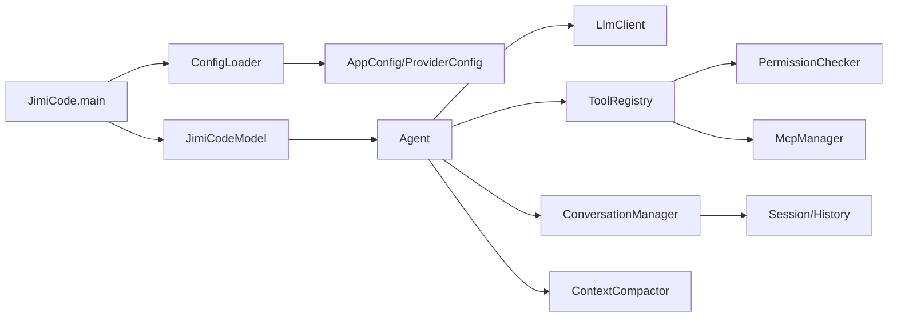

# 01 项目总览与学习地图

## 学习目标

读完本章后，应该能回答：JimiCode 的入口在哪里；用户输入如何进入 Agent Loop；模型如何返回文本、思考和工具调用；工具怎样经过权限检查；会话和压缩状态保存在哪里；MCP、SubAgent、Team 与 Worktree 如何协作；Maven 如何构建和验证 Java 程序。

## 当前源码事实

Java 入口是 `src/main/java/com/JimiCode/JimiCode.java`。`main` 先按“命令行第一个参数→`JimiCode_CONFIG`→默认配置层”的顺序确定配置，再调用 `ConfigLoader.load`。配置成功后创建 `JimiCodeModel`，把 providers、MCP servers 和 hooks 注入 TUI4J `Program`，最后注册 SIGINT 处理并运行终端程序。Maven 根入口是 `pom.xml`、`mvnw` 和 `src/main/java`。

Java 的核心对象关系可以概括为：

Java 的事件通过 `BlockingQueue<StreamEvent>` 在 LLM 虚拟线程和 Agent 消费线程之间传递；队列容量、Error event 和终止事件是学习并发模型的重点。

## 业务定位

这不是一个网页聊天机器人，而是一个能够读取代码、搜索文件、编辑文件、执行命令、调用 MCP、创建子 Agent、写计划、保留会话并在上下文接近上限时压缩的终端 coding agent。系统的“业务成功”不是返回一句文本，而是工具动作在权限、工作目录、文件历史和会话恢复约束下完成。

## 分阶段学习

第一阶段只阅读 `JimiCode`、`ConfigLoader`、`AppConfig`、`pom.xml` 和 README，能启动配置解析。第二阶段阅读 `JimiCodeModel`、`Agent`、`ConversationManager`，能画出一轮模型调用。第三阶段阅读 `ToolRegistry`、`PermissionChecker`、`Bash`/`ReadFile`/`EditFile`，能说明一次工具调用为什么被允许或拒绝。第四阶段阅读 `ContextCompactor`、`SessionManager`、`MemoryManager` 和 `WorktreeManager`，能解释长会话、恢复和隔离。第五阶段完成 Maven 构建、测试替身和复刻实验。

## 术语提醒

- Agent Loop：模型输出工具调用，工具执行结果追加到消息，再请求模型的循环。
- Tool schema：给模型看的参数形状，不等于授权。
- Permission：服务端对工具、路径、命令的实际放行/拒绝。
- Compaction：减少上下文体积，不是删除所有历史。
- Recovery state：压缩后重建文件和技能上下文所需的快照。
- Worktree：为并行 Agent 隔离 Git 工作目录，不是普通临时文件夹。

## 练习

画出一次“读取文件→模型决定修改→权限检查→写入备份→编辑→返回结果”的时序图；再画出一次客户端 Ctrl+C 后 Java SIGINT、Agent 取消、TUI 恢复终端光标的时序。最后使用 fake provider 比较普通文本、工具调用、错误和压缩四类事件。
