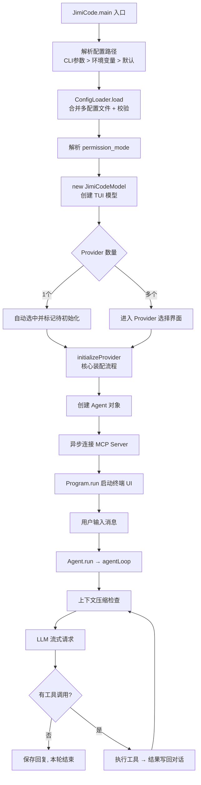

# JimiCode 启动流程详解

> 适用版本：Java 21 + Maven（当前仓库唯一实现）
> 阅读建议：配合源码逐段对照，重点看 `JimiCode.java`、`ConfigLoader.java`、`JimiCodeModel.java`、`Agent.java` 四个文件。
> 核心结论：**启动 = 加载配置 → 构建系统提示词 → 创建 LLM 客户端 → 注册工具全家桶 → 连接 MCP / 加载技能 → 起终端聊天界面**，之后进入"调用 LLM → 执行工具 → 再调用 LLM"的 Agent 循环。

---

## 1. 启动流程全景图



---

## 2. 程序入口 `JimiCode.main()`

文件：`src/main/java/com/jimicode/JimiCode.java`

启动时按顺序做四件事：

### 2.1 解析配置路径

```java
// 优先级：第一个 CLI 参数 > 环境变量 JimiCode_CONFIG > 默认候选路径
String configPath = null;
if (args.length > 0) {
    configPath = args[0];
} else {
    String envPath = System.getenv("JimiCode_CONFIG");
    if (envPath != null && !envPath.isBlank()) {
        configPath = envPath;
    }
}
```

### 2.2 加载并校验配置

```java
config = ConfigLoader.load(configPath);          // 失败 → 打印错误并 exit(1)
permissionMode = PermissionMode.fromConfig(...); // 非法模式 → exit(1)
```

### 2.3 创建 TUI 模型

```java
var model = new JimiCodeModel(
        config.getProviders(),
        config.getMcpServers() != null ? config.getMcpServers() : List.of(),
        config.getHooks() != null ? config.getHooks() : List.of(),
        permissionMode
);
var program = new Program(model);
model.setProgram(program);   // 让后台线程能向 TUI 发消息
```

### 2.4 终端准备与信号处理

- `System.out.print("\033[?25l")` 隐藏光标（退出时恢复）。
- 500ms 后在**虚拟线程**里重注册 SIGINT：流式输出中 Ctrl+C = 打断当前回答；空闲时 Ctrl+C = 退出程序。

```java
Thread.ofVirtual().start(() -> {
    try { Thread.sleep(500); } catch (InterruptedException ignored) {}
    try {
        Signal.handle(new Signal("INT"), sig -> model.handleSigint());
    } catch (IllegalArgumentException ignored) {}
});
```

---

## 3. 配置加载 `ConfigLoader`

文件：`src/main/java/com/jimicode/config/ConfigLoader.java`

### 3.1 多文件合并

未显式指定路径时，按以下候选顺序查找，**后面的层覆盖前面的层**：

| 优先级 | 路径 |
|---|---|
| 1（最底层） | `~/.JimiCode/config.yaml` |
| 2 | `<当前工作目录>/.JimiCode/config.yaml` |
| 3（最高层） | `<当前工作目录>/.JimiCode/config.local.yaml` |

合并规则：
- `providers`：整体替换
- `mcp_servers`：按 `name` 合并/覆盖
- `hooks`：追加
- `permission_mode`：非空时覆盖

### 3.2 解析与校验

- 用 SnakeYAML + 自定义 `SnakeCasePropertyUtils` 实现 **下划线转驼峰**（`base_url` → `baseUrl`）。
- 校验规则：至少一个 Provider，且每个 Provider 必须包含 `name / protocol / base_url / model`。
- `protocol` 只能是：`anthropic`、`openai`、`openai-compat` 三种。

### 3.3 配置内容速查

```yaml
providers:
  - name: anthropic
    protocol: anthropic                 # anthropic / openai / openai-compat
    base_url: https://api.anthropic.com
    model: claude-sonnet-4-6
    context_window: 200000
    max_output_tokens: 8192
    api_key: "sk-ant-..."               # 留空则读环境变量 ANTHROPIC_API_KEY
    thinking: false

permission_mode: default                # default / accept_edits / plan / bypass

mcp_servers:
  - name: context7
    command: npx
    args: ["-y", "@upstash/context7-mcp"]

hooks: []
```

---

## 4. TUI 模型创建 `JimiCodeModel`

文件：`src/main/java/com/jimicode/tui/JimiCodeModel.java`

构造函数里完成：

| 项目 | 说明 |
|---|---|
| 状态分支 | 只有一个 Provider → 直接 `CHAT` 态 + 标记 `pendingSingleProviderInit`；多个 → `PROVIDER_SELECT` 态 |
| HookEngine | 把配置里的 hooks 解析成事件/动作/条件，加载进引擎 |
| CommandRegistry | 斜杠命令注册表 |
| HistoryStore | 加载用户输入历史 |
| ConversationManager | 创建空对话管理器 |

---

## 5. 核心装配 `initializeProvider()`

这是**启动后最重要的初始化**，全部失败都会被 catch 后作为错误消息显示在聊天区。按执行顺序拆解：

### 5.1 记忆与系统提示词

```java
memoryManager = new MemoryManager(workDir);                    // 记忆管理器
instructionsContent = MemoryManager.loadInstructions(workDir); // 项目指令(AGENTS.md等)
memoryContentField = buildMemorySection();                     // 长期记忆片段
String systemPrompt = PromptBuilder.buildSystemPrompt(env, options); // 系统提示词
```

### 5.2 创建 LLM 客户端

```java
client = LlmClient.create(selectedProvider, systemPrompt);     // 按 protocol 创建适配器
String protocol = selectedProvider.getProtocol();
```

### 5.3 注册工具（ToolRegistry 全家桶）

**第一批：基础工具**（`ToolRegistry.createDefault()`）

| 工具 | 类别 | 用途 |
|---|---|---|
| `ReadFile` | read | 读取文件，带行号 |
| `WriteFile` | write | 写文件 |
| `EditFile` | write | 精确字符串替换 |
| `Bash` | command | 执行 `bash -c` 命令 |
| `Glob` | read | 文件通配搜索 |
| `Grep` | read | 正则内容搜索 |

**第二批：高级工具**（逐个注册）

| 工具 | 说明 |
|---|---|
| `ToolSearch` | deferred 工具搜索/精确加载 |
| `ExitPlanMode` | 退出计划模式并触发审批对话框 |
| `AskUserQuestion` | 向用户弹出结构化选择题 |
| `Agent` | 启动子 Agent（同步/后台/fork/teammate） |
| `EnterWorktree` / `ExitWorktree` | Git worktree 隔离 |
| `TaskCreate/Get/List/Update` | 持久化任务列表 |
| `TeamCreate/Delete`、`SendMessage` | 多 Agent 团队 |

### 5.4 Worktree 崩溃恢复

```java
var savedSession = WorktreeSessionStore.load(workDir);
if (savedSession != null && 目录存在) {
    WorktreeSessionStore.restoreSession(savedSession);  // 恢复上次崩溃前的隔离工作区
}
```

### 5.5 权限检查器

```java
permChecker = new PermissionChecker(initialPermissionMode, Path.of(workDir));
```

### 5.6 会话与文件历史

```java
sessionId = SessionManager.newId();                 // 新会话 ID
fileHistory = new FileHistory(workDir, sessionId);  // 编辑前快照/回滚
```

### 5.7 组装 Agent

把上面所有组件注入 `Agent`：文件历史、指令、记忆、权限检查器、工作目录、sessionId、通知回调、工具过滤（团队协调模式）。

### 5.8 异步连接 MCP

```java
Thread.ofVirtual().name("mcp-connect").start(() -> {
    mcpManager = new McpManager(mcpServers);
    var result = mcpManager.connectAll();
    for (var t : result.tools()) registryRef.register(t);   // 工具命名 mcp__<server>__<tool>
    // 汇总 server instructions 与工具清单，作为 system reminder 注入
});
```

### 5.9 加载技能 Skill

```java
skillCatalog = new SkillCatalog();
var skillDir = Path.of(workDir, ".JimiCode", "skills");
if (Files.isDirectory(skillDir)) {
    skillCatalog.loadFromDirectory(skillDir);   // 扫描技能并注册为斜杠命令
}
```

### 5.10 触发启动钩子

```java
agent.setHookEngine(hookEngine);
fireHook(HookEngine.EventName.SESSION_START, null, null);
```

### 5.11 初始化清单总表

| 序号 | 内容 | 关键类 |
|---|---|---|
| 1 | 记忆/指令加载 | `MemoryManager` |
| 2 | 系统提示词构建 | `PromptBuilder` |
| 3 | LLM 客户端 | `LlmClient.create()` |
| 4 | 6 个基础工具 | `ToolRegistry.createDefault()` |
| 5 | 高级工具(子Agent/任务/团队/worktree) | `AgentTool`、`TaskTools`、`TeamTools` 等 |
| 6 | Worktree 崩溃恢复 | `WorktreeSessionStore` |
| 7 | 权限检查器 | `PermissionChecker` |
| 8 | 会话 + 文件历史 | `SessionManager`、`FileHistory` |
| 9 | Agent 装配 | `Agent` |
| 10 | MCP 异步连接 | `McpManager` |
| 11 | Skill 技能扫描 | `SkillCatalog` |
| 12 | SESSION_START 钩子 | `HookEngine` |

---

## 6. 启动 TUI

- `Program.run()` 启动 Bubble Tea 风格的终端界面。
- 显示 Provider 选择界面（多 Provider 时）或直接进入聊天界面（单 Provider 时自动触发初始化）。

---

## 7. 用户发消息后的 Agent Loop

文件：`src/main/java/com/jimicode/agent/Agent.java`（核心中的核心）

### 7.1 消息入口 `sendUserMessage()`

```java
conversation.addUserMessage(userText);
SessionManager.saveMessage(workDir, sessionId, "user", userText);
historyStore.append(userText);                        // 输入历史
conversation.addSystemReminder(mcpInstructions);      // 首次注入 MCP 说明
prefetchRelevantMemories(userText);                   // 预取相关记忆(虚拟线程, 8s 超时)
fireHook(TURN_START);                                 // 触发 turn_start 钩子
agentQueue = agent.run(conversation);                 // 启动 Agent 循环(虚拟线程)
Command.tick(50ms, AgentEventMessage);                // 定时轮询事件队列
```

### 7.2 循环核心 `agentLoop()`

每轮迭代做的事：

1. **注入长期记忆**（仅首轮）：`conv.injectLongTermMemory(instructions, memoryContent)`
2. **收集后台通知**：子 Agent 任务完成、团队邮箱消息 → 注入为 `<system-reminder>`
3. **计算工具 schema**：每轮按协议生成（支持技能/协调过滤）
4. **上下文压缩检查**：`ContextCompactor.manage()` 超限自动压缩
5. **deferred 工具提醒**：提示模型可用 `ToolSearch` 加载未发现工具
6. **计划模式提醒**：注入计划文件路径 + 五阶段工作流
7. **Layer 1 工具结果预算**：`ToolResultBudget.apply()` 生成不含大结果的 API 视图
8. **调用 LLM**：`client.stream()` 流式返回事件队列
9. **处理事件**：文本增量、thinking、工具调用、usage、错误
10. **错误恢复**：
    - `context too long` → 强制压缩重试（最多 3 次）
    - `rate limit` → 等待 5s 重试
    - `max_tokens` → 首次提升上限到 64000，之后最多 3 次"从中断处继续"
11. **执行工具**：`StreamingExecutor.executeAll()` 并行执行同一轮里的工具调用
12. **结果写回**：tool-result 消息加入对话
13. **结束条件**：无工具调用 → 结束；调用了 `ExitPlanMode` → 结束；超迭代上限 → 报错结束

### 7.3 事件流向

```
LLM 流事件 StreamEvent  ──归一化──▶  Agent 内部处理  ──▶  AgentEvent 队列  ──▶  TUI 渲染
(text/thinking/tool/usage)          (压缩/重试/权限)     (StreamText/ToolUse/...)   (聊天区展示)
```

---

## 8. 关键类速查表

| 类 | 职责 |
|---|---|
| `JimiCode` | 程序入口，配置加载、TUI 启动、SIGINT |
| `ConfigLoader` | YAML 多文件合并 + 校验 |
| `AppConfig` | 根配置模型（providers/mcp/hooks/permission_mode） |
| `ProviderConfig` | LLM 提供商配置，解析 context_window/max_output_tokens |
| `JimiCodeModel` | TUI 主模型，负责整体装配与事件循环 |
| `Agent` | Agent Loop 核心状态机 |
| `AgentEvent` | 交给 TUI 的运行事件 |
| `StreamingExecutor` | 并行执行一轮内的工具调用 |
| `ToolRegistry` | 工具注册/协议 schema 生成/deferred 管理 |
| `LlmClient` | LLM 统一接口，按协议创建适配器 |
| `AnthropicClient` / `OpenAiClient` / `OpenAiCompatClient` | 三种协议适配器 |
| `ConversationManager` | 消息序列管理 |
| `PermissionChecker` | 权限分层检查 |
| `McpManager` | MCP Server 连接与工具注册 |
| `ContextCompactor` | Layer 2 上下文压缩 |
| `ToolResultBudget` | Layer 1 工具结果预算 |
| `MemoryManager` / `MemoryRecall` | 长期记忆管理与相关记忆召回 |
| `SkillCatalog` | 技能扫描与斜杠命令注册 |
| `SessionManager` | 会话 JSONL 持久化/恢复 |
| `FileHistory` | 编辑前快照与回滚 |
| `TeamManager` | 多 Agent 团队管理 |

---

## 9. 运行时数据目录

| 路径 | 内容 |
|---|---|
| `.JimiCode/config.yaml` | 项目配置 |
| `.JimiCode/config.local.yaml` | 本地覆盖配置 |
| `.JimiCode/sessions/*.jsonl` | 会话记录 + compact boundary |
| `.JimiCode/file-history/<session>/` | 编辑前备份和 rewind 快照 |
| `.JimiCode/memory/` | 项目级记忆 |
| `.JimiCode/skills/` | 项目级技能 |
| `.JimiCode/tasks/` | 任务列表 |
| `.JimiCode/teams/` | 团队邮箱与共享状态 |
| `.JimiCode/worktrees/` | Git worktree |
| `.JimiCode/worktree_session.json` | 当前 worktree session |
| `.JimiCode/plans/` | 计划模式文件 |
| `.JimiCode/tool_results/` | 大工具结果 spill |
| `.JimiCode/replacement_records.jsonl` | 工具结果替换决策 |

---

## 10. 一句话总结

> 启动后 JimiCode 依次做了：**加载配置 → 构建系统提示词 → 创建 LLM 客户端 → 注册一整套编码工具（文件/命令/子代理/团队/任务/worktree）→ 连接 MCP 与加载技能 → 起一个终端聊天界面**，等你发消息后进入"调用 LLM → 执行工具 → 再调用 LLM"的 Agent 循环。
