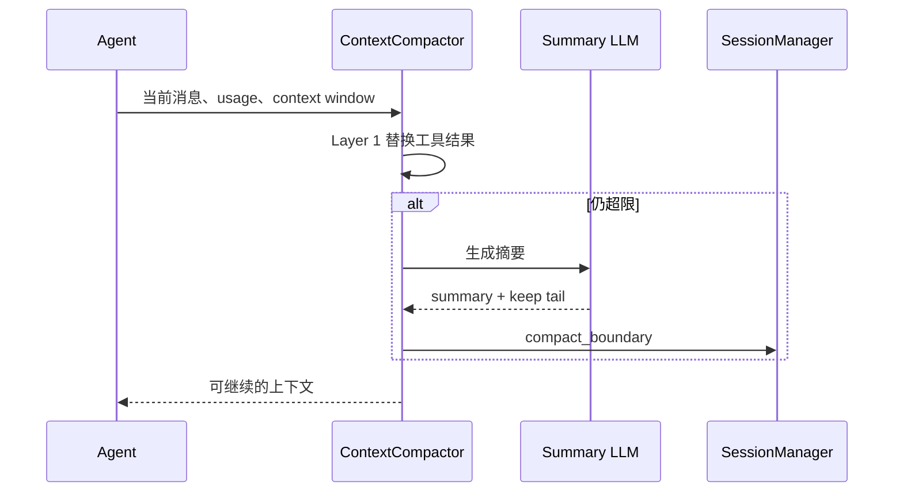

# 04 Agent Loop、LLM 与上下文压缩

## 一轮循环

`Agent` 接收 `ConversationManager`、工具注册表、协议、工作目录、权限检查器和 HookEngine。每轮把系统 Prompt、memory、计划提示和 conversation 转换为 provider 请求，调用 `LlmClient.stream`。事件可能是普通文本、thinking、tool use、tool result、usage、error 或完成标记。文本追加到 assistant 消息；tool use 被解析为工具名、tool id 和参数；执行前过滤工具 schema，执行后把 `ToolResultBlock` 加入会话，下一轮继续。

Anthropic 与 OpenAI 的差异集中在 `AnthropicClient`、`OpenAiClient` 和 `OpenAiCompatClient`：Anthropic 使用 Messages/ContentBlock，OpenAI 使用 Responses 事件；项目把它们归一化为 `StreamEvent`，但 tool call id、thinking 签名、usage 和错误类型仍需分别处理。`LlmException` 将认证、限流、上下文过长、网络和未知错误分开，Agent 才能决定重试、压缩还是终止。

## 上下文压缩

`ContextCompactor` 不是简单截断字符串。它先估算或读取 provider usage，判断有效上下文窗口；Layer 1 通过 `ToolResultBudget` 和 `ContentReplacementState` 压缩旧工具结果；Layer 2 使用 LLM 生成摘要，保留最近消息、文件读取快照和技能 SOP，并写入 `compact_boundary`。`RecoveryState` 记录最近文件读取和 Skill 调用，后续 resume 可重新注入环境。

## 容易误解的点

压缩不是事务；摘要成功不等于文件状态成功；保留文件快照不代表文件仍未被外部修改；token 估算可能与供应商不同；一旦模型返回 tool call，必须等待工具结果配对后再继续。压缩期间如果用户 Ctrl+C，应检查 session 是否写入半截 boundary。

## 实验

构造一个超长工具输出，观察 `ToolResultBudget` 如何决定完整、截断或替换；连续读取多个文件后触发 Layer 2，检查 `RecoveryState`；模拟 provider 返回 context-too-long，验证 Agent 是否降低 max output 并重试；让摘要请求失败，确认原始会话仍可恢复。
