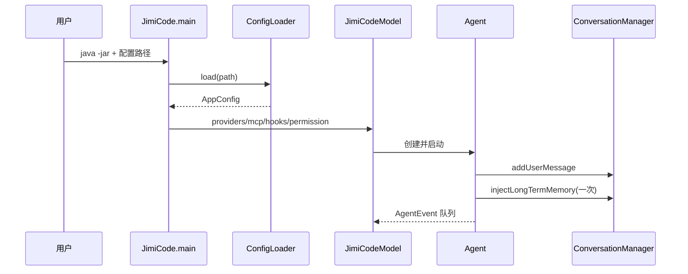

# 05-01 入口、配置与消息模型逐文件精读

本卷覆盖启动链路、YAML 配置对象和会话消息数据结构。阅读这组文件的价值在于：Agent 并不是凭空出现的，它必须先被入口装配；模型也不能直接接收任意 Java 对象，而要由 `Message`、`ThinkingBlock`、`ToolUseBlock` 和 `ToolResultBlock` 组成稳定的跨供应商表示。

> 路径均相对于 `jimi-code` 根目录。以下“源码事实”来自当前文件；“原理”解释 Java/SnakeYAML/TUI4J 的机制；“建议”不代表项目已经实现。

## 1. 启动文件 `src/main/java/com/jimicode/JimiCode.java`

### 1.1 package、import 与职责

文件 package 是 `com.jimicode`，唯一 public 类型是 `JimiCode`。它导入 `AppConfig`、`ConfigLoader`、`PermissionMode`、`JimiCodeModel`、TUI4J 的 `Program`、`List` 和 JDK 内部的 `sun.misc.Signal`。入口没有把 LLM SDK、工具类或 MCP 类直接 import 进来，这是一种装配边界：入口只关心配置、权限模式、UI 和进程生命周期，具体能力由 `JimiCodeModel` 再组装。

### 1.2 `main(String[] args)` 的逐步控制流

第一步确定配置路径。`args.length > 0` 时取第一个参数，即 `java -jar target/jimicode.jar D:\\demo\\config.yaml` 的显式配置；否则读取环境变量 `JimiCode_CONFIG`，空字符串视为未提供。注意 README 示例使用的目录名是 `.jimicode`，而 `ConfigLoader` 实际查找的是大小写为 `.JimiCode` 的目录，Windows 通常不敏感，Linux/macOS 会区分大小写，学习时必须以源码为准。

第二步调用 `ConfigLoader.load(configPath)`。它声明抛出受检异常 `ConfigLoader.ConfigException`，入口捕获后把错误写入 `System.err`，调用 `System.exit(1)`，并用 `return` 让静态分析器知道后续不会继续。这里没有把 YAML 解析栈、API Key 或完整配置打印出来，避免秘密泄漏。

第三步把字符串权限模式转换为枚举：`PermissionMode.fromConfig(config.getPermissionMode())`。这一步在配置读取之后、TUI 创建之前发生，因此非法的 `permission_mode` 不会让用户进入一个半初始化界面。`fromConfig` 抛出的 `IllegalArgumentException` 与 YAML 的 `ConfigException` 分开捕获，但用户看到的都是 `Configuration error` 前缀。

第四步构造 `JimiCodeModel`。MCP 和 hooks 可能为 null，因此入口用 `List.of()` 归一化为空列表；providers 不做同样的替换，因为 `ConfigLoader.validate` 已保证至少一个 provider。构造器参数把依赖显式传入，便于测试时注入假的 provider 或空 MCP 配置。

第五步创建 TUI4J `Program`，随后 `model.setProgram(program)` 形成反向引用。反向引用不是循环调用；它允许 Model 在收到 Agent 事件、退出命令或对话框结果时向 TUI 发送命令。创建后打印 ANSI `\033[?25l` 隐藏光标，提升流式输出体验。

第六步启动虚拟线程，延迟 500 毫秒重新注册 SIGINT。TUI4J 默认可能把 Ctrl+C 解释为立即退出；这里把信号转交给 `model.handleSigint()`，使模型在生成中停止当前回答、空闲时再退出。`sun.misc.Signal` 属于 JDK 内部 API，编译时可能给出警告，跨平台行为也不是 Java 标准库长期承诺的一部分。

第七步 `program.run()` 阻塞直到 UI 结束。`finally` 必定执行，重新显示光标并 flush stdout。即使构造 UI 后发生运行时异常，也不会把用户终端留在隐藏光标状态，这是一个典型的资源清理模式。

### 1.3 异常、线程和副作用

启动期副作用包括读取配置文件、读取环境变量、创建终端 UI、注册操作系统信号。模型和工具的网络/文件副作用不在 `main` 线程直接发生。虚拟线程只负责延迟安装 signal handler；真正的 Agent 虚拟线程由 `Agent.run` 创建。配置失败不会创建 Program，模型运行期异常则由事件队列转成 UI 可见错误。

### 1.4 调试实验

在 `ConfigLoader.load` 返回处断点，传入不存在路径，观察 `System.exit` 前的错误；再把 `permission_mode` 改为 `unknown`，观察第二个 catch。启动一个可用配置后，在 `program.run` 与 `finally` 打断点按 Ctrl+C，确认光标恢复。Linux 上可分别测试 `.JimiCode` 和 `.jimicode`，验证大小写差异。

## 2. `config/AppConfig.java`

`AppConfig` 是 SnakeYAML 的根绑定对象，字段只有 `providers`、`permissionMode`、`mcpServers`、`hooks`。它没有构造器逻辑、校验注解或业务方法，全部是 JavaBean getter/setter。SnakeYAML 的 `Constructor(AppConfig.class, loaderOptions)` 需要公开的无参构造器（编译器会生成），并通过 setter 写入 YAML 值。

`providers` 是 `List<ProviderConfig>`，缺失时保持 null，最终由 `ConfigLoader.validate` 拒绝；`permissionMode` 是字符串而不是枚举，原因是配置层要允许大小写、连字符和下划线的用户写法，真正的枚举转换延迟到入口。`mcpServers` 和 `hooks` 允许 null，入口与 `JimiCodeModel` 将 null 视为空列表。

这里的“简单 DTO”仍有重要边界：getter 返回原始可变列表，调用者可以改变配置对象；配置加载完成后项目没有做深拷贝。如果在生产服务中需要热加载，应使用不可变快照或复制列表，避免一个线程遍历 provider 时另一个线程替换列表。

## 3. `config/ProviderConfig.java`

### 3.1 字段和绑定

字段 `name`、`protocol`、`baseUrl`、`model`、`apiKey`、`thinking`、`contextWindow`、`maxOutputTokens` 对应 YAML 的 snake_case 属性；`fetchedContextWindow` 是运行期 volatile 缓存，不由 YAML 绑定。`ENV_KEY_MAP` 把三个协议映射到 `ANTHROPIC_API_KEY` 或 `OPENAI_API_KEY`。

### 3.2 `resolvedApiKey()`

方法先判断 `apiKey != null && !apiKey.isEmpty()`，配置文件非空值优先；否则调用私有 `envApiKey()`。环境变量名由 `protocol` 查表，未知协议得到空字符串而不是异常，真正的协议合法性由 `ConfigLoader.validate` 承担。返回空字符串代表调用方应在客户端构造阶段报告认证错误。不要把 API Key 放进日志或 `toString`；该类没有重写 `toString`，这是安全上的好处。

### 3.3 `resolvedContextWindow()` 与 `windowForModel(String)`

上下文窗口有四层优先级：显式 `contextWindow > 0`；Anthropic 客户端探测后调用 `setFetchedContextWindow` 写入的 volatile 值；按模型名称子串匹配的内置表；保守默认值。`windowForModel` 先匹配 `1m`/`-1m`，再匹配 `gpt-4.1`、`gpt-4o`、`gpt-4-turbo`、`o1/o3/o4`、`gpt-3.5`、`claude`，最后返回 128000。顺序很关键，例如 `gpt-4.1-1m` 必须命中百万窗口，而不是先命中通用 GPT 值。

缓存字段使用 `volatile`，保证客户端构造线程写入后，Agent 线程读取时至少看到最新引用；它不保证复杂更新的原子事务，因为这里只写一个 Integer。模型厂商变更窗口后，内置表可能过时，源码明确建议用 `context_window` 覆盖。

### 3.4 `resolvedMaxOutputTokens()`

显式值大于 0 时直接返回；缺失时 thinking 模式返回 64000，普通模式返回 8192。该值是输出上限，不是上下文窗口；`Agent` 在遇到 `max_tokens` 时还会临时提升客户端上限到自己的天花板。新手常把两者相加当作模型可用 token，正确理解是“输入窗口 + 单轮输出约束”。

## 4. `config/McpServerConfig.java`

这个 Bean 描述 MCP 连接，不执行连接。`name` 用于配置层合并和工具名前缀；`command` 与 `args` 用于 stdio 子进程；`url` 与 `headers` 用于 streamable HTTP；`env` 注入子进程环境。当前类没有互斥校验，`command` 和 `url` 同时提供时由 `McpManager` 的分支决定，学习时应继续跟读而不是假设 YAML 校验已经阻止。

## 5. `config/HookConfig.java`

字段 `id`、`event`、`condition`、`type`、`command`、`message`、`reject` 只是序列化模型。`HookEngine` 将字符串事件转换为枚举，将 type 转为动作并解释条件。配置类保留 `reject` 布尔值意味着“钩子既可以观察，也可以拒绝”，但真正拒绝发生在工具前置阶段，不能只看这个 Bean 判断行为。

## 6. `ConfigLoader.java`

### 6.1 显式路径和默认层

`load(String path)` 在显式路径非空时只调用一次 `loadSingleFile` 并校验。默认模式构造 home、cwd 两个 `Path`，按固定顺序遍历三个候选文件。`merged == null` 时直接使用第一层对象；后续层调用 `mergeConfig` 原地更新，因此返回对象就是第一层对象的引用，而不是新对象。

### 6.2 YAML 解析

`loadSingleFile` 先 `Files.exists`，再 `Files.readString`。使用 SnakeYAML `LoaderOptions` 和 `Constructor(AppConfig.class, loaderOptions)`，替换 `PropertyUtils` 为内部 `SnakeCasePropertyUtils`。该类的 `getProperty` 将含下划线的键转换成驼峰，例如 `max_output_tokens`→`maxOutputTokens`。解析异常被统一包装为 `ConfigException`，空文档变成新的 `AppConfig`。

### 6.3 合并规则

providers 只有在 override 列表非空时整体替换；permissionMode 只有非空白时覆盖；MCP 使用 `LinkedHashMap<String,Integer>` 按 name 做替换或追加，保留原顺序；hooks 只要 override 列表非 null 就追加，即使它是空列表也不会清除已有 hooks。这个差异是一个常见坑：YAML `hooks: []` 不等于“清空此前钩子”。

### 6.4 `validate` 与异常

校验 provider 列表非空、元素非 null、name/protocol/base_url/model 非空，并把协议限制为 `anthropic`、`openai`、`openai-compat`。API Key 不在此处校验，因为它可以来自环境变量；模型客户端构造时才知道最终 key。`ConfigException` 是受检异常，使启动调用者必须显式处理配置错误。

### 6.5 面试原理

问“为什么不用 Spring `@ConfigurationProperties`”：因为这是独立 CLI，不启动 Spring 容器；SnakeYAML 直接绑定更轻量。问“多层配置如何保证可预测”：固定顺序、字段级规则、MCP 按名称合并，且不把空列表一律解释为删除。生产建议是把 merge 规则写成表格测试，使用秘密管理器替代明文 `api_key`，并在加载后生成不可变配置快照。

## 7. 消息数据模型

### `conversation/Message.java`

`Message` 保存 `role`、`content` 和三个可选列表：thinking blocks、tool uses、tool results。构造器只设置 role/content，列表由 setter 后置填充。Anthropic 需要 thinking signature 和 tool-use id，OpenAI 需要 function call/output 对应关系，所以不能把所有内容压成一个字符串。当前列表可能为 null，适配器必须按 null 安全处理；生产建议在构造时使用空不可变列表，减少 NPE。

### 三个 record

`ThinkingBlock(String thinking, String signature)` 保存推理文本及供应商签名；签名不可随意修改，否则 Anthropic 续写可能拒绝。`ToolUseBlock(String toolUseId, String toolName, Map<String,Object> arguments)` 记录模型发出的调用；id 是后续结果配对的主键。`ToolResultBlock(String toolUseId, String content, boolean isError)` 记录工具回传和错误标志。record 自动生成访问器、equals、hashCode、toString，适合事件和序列化，但 Map 仍可能可变。

### `ConversationManager.java`

内部 `history` 是 `ArrayList`，所有追加方法都按 Agent Loop 的消息顺序写入。`addUserMessage`/`addAssistantMessage` 创建单纯文本；`addAssistantFull` 同时写 thinking 和 tool uses；`addToolResultsMessage` 用 role=`user` 的消息承载结果，这是供应商 API 的兼容表示，并不意味着真实用户输入了工具文本。

`injectLongTermMemory` 用 `ltmInjected` 保证只注入一次，把 instructions、memory、当天日期包装成 `<system-reminder>`，插入列表头部。空 instructions 与空 memories 都不会触发日期注入。`addSystemReminder` 每次追加一个 user-role 包装消息，计划模式和 deferred tool 提示都走此通道。

`getMessages` 返回 `List.copyOf` 的不可变视图，供 LLM 适配器安全读取；`getMessagesMutable` 暴露内部列表，压缩器需要原地重排时使用，调用者必须谨慎。`truncateTo(index)` 只在 index 合法且小于 size 时删除 index 及之后的消息；传入等于 size 或更大值是 no-op，传入负数也是 no-op。

## 8. 完整链路示例

## 9. 练习与验收

1. 写一个只读单元测试，给 `ConfigLoader` 三层临时 YAML，验证 provider 替换、MCP 同名覆盖、Hook 追加。
2. 构造一条 assistant tool-use 消息和一条 tool result，验证两个 id 相同且顺序为 assistant→user(result)。
3. 连续调用 `injectLongTermMemory` 两次，确认只出现一条 system-reminder。
4. 在 Linux 上分别创建 `.JimiCode` 与 `.jimicode`，解释哪个能被当前源码发现。
5. 设计一个不可变 `AppConfigSnapshot`，说明它如何解决 getter 暴露可变列表的问题。

## 10. 小结

入口文件解决生命周期，配置文件解决外部化装配，消息模型解决跨模型协议的内部中间表示。三者共同决定 Agent 后续能否稳定运行：配置错误必须在 UI 前失败；消息必须保留 tool id、thinking signature 和错误位；列表修改与线程边界要有明确约束。读完本卷后，再进入 `05-02-Agent与LLM` 才不会把 Agent Loop 误解成一个没有状态的 while 循环。

## 11. import 依赖逐项追踪

`JimiCode.java` 的 `java.util.List` 只用于 null 列表归一化；如果误删，编译器会提示 `List.of()` 无法解析。`sun.misc.Signal` 不是标准业务 API，依赖 JDK 的 `jdk.unsupported` 模块；Shade 打包时它不会被第三方替换。TUI4J `Program` 和 `JimiCodeModel` 的关系是外部框架接口，Program 调用 Model.init/update/view，Model 不能依赖具体终端实现之外的业务类。

配置包的 SnakeYAML import 可以分为解析器（Yaml）、构造器（Constructor）、安全选项（LoaderOptions）和属性映射（Property/PropertyUtils）。这四类依赖组合在一起才完成 snake_case 绑定；只使用 `new Yaml().loadAs` 会绕过自定义 PropertyUtils，`base_url` 可能无法写入 `baseUrl`。Java NIO 的 `Files`/`Path` 负责读取，不负责文件权限提示；IOException 被 ConfigException 包装时应保留 path。

会话包没有 Jackson import，因为 ConversationManager 只维护内存对象；序列化职责放在 SessionManager 和 LLM 适配器。这个分层让 ConversationManager 可以在不引入 JSON 库的情况下被单测，代价是恢复时必须由外部重建消息结构。

## 12. 方法验收清单

|文件|方法|必须验证的边界|
|---|---|---|
|JimiCode|`main`|无参数、显式路径、环境变量、配置异常、非法权限、SIGINT、finally|
|AppConfig|每个 setter|null 列表、SnakeYAML 绑定、外部修改列表后的可见性|
|ProviderConfig|`resolvedApiKey`|配置 key 优先、环境变量 fallback、未知协议为空|
|ProviderConfig|`windowForModel`|null、1m、gpt-4.1、claude、未知模型|
|ProviderConfig|`resolvedMaxOutputTokens`|显式正值、thinking 默认、普通默认|
|ConfigLoader|`load`|候选层顺序、空文件、单层显式路径、无 provider|
|ConfigLoader|`mergeConfig`|provider 整体替换、MCP 同名替换、hook 空列表不清空|
|ConversationManager|`injectLongTermMemory`|两次调用只注入一次、只有日期不应单独注入|
|ConversationManager|`truncateTo`|负数、0、size-1、size、超大值|
|Message|setter|thinking/tool list null 与空列表在各客户端的差异|

## 13. 配置合并的具体例子

假设用户层有 provider `anthropic`、MCP `docs`、Hook `h1`；项目层有 provider `openai`、MCP 同名 `docs` 和新 MCP `db`、空 `hooks: []`；本地层只有 permission_mode。最终 providers 是项目层的 openai 列表而非两者拼接；MCP docs 使用项目层定义、db 被追加且顺序为 docs→db；hooks 仍保留 h1，因为空列表只触发 `override.getHooks()!=null` 的追加；permission_mode 使用本地值。这个例子应写进测试而非依赖口头记忆。

## 14. 测试源码如何对应

`ConfigLoaderValidationTest` 对应 `validate` 的 provider 缺字段/协议分支；`ProviderConfigApiKeyTest` 对应配置优先和环境 fallback；`ProviderConfigContextWindowTest` 对应窗口表和 fetched cache；`AnthropicClientContextWindowTest` 验证客户端构造后写回 ProviderConfig；`SessionManagerTest`/`ContextCompactorTest` 间接验证消息结构在边界后仍可重建。当前没有专门的 `JimiCode.main` 集成测试，启动失败只能通过手工临时配置验证。

## 15. 新手阅读实验：不用真实模型

可以只编译配置与消息包，写一个 `ConfigLoaderDemo` 测试：创建临时目录、写三层 YAML、设置 `user.dir`（测试后恢复）、调用 load，再把 providers/mcp/hooks 打印为不含 key 的摘要。然后创建 ConversationManager，加入 user、assistant thinking、assistant tool use、tool result，调用 `getMessages`，用断言检查 role 和 id。这个实验把“外部 YAML→Java Bean→内部消息”闭环起来，不需要网络 API Key，也不会启动 TUI。

## 16. 生产化审查问题

配置热刷新时，是否会在 Agent 正在使用 provider 列表时替换 List？多租户时，`System.getProperty("user.home")` 是否会把用户配置误共享？Windows 和 Linux 的 `.JimiCode` 大小写是否统一？API key 是否可能出现在 `ConfigException` 的 YAML parse message？SIGINT 线程是否被重复注册？Program 启动失败时光标是否恢复？Message 的 tool result 是否验证 toolUseId 与最近 assistant tool use 相配对？这些问题不是理论题，均可用断点、临时文件和故障注入复现。

## 17. 本卷最终验收

读者应能不看其他章节写出：一个显式配置路径启动命令；一个包含三层覆盖的 YAML；一个 provider key/context window 的解析测试；一个 assistant tool-use/result 消息；一个配置错误退出而光标恢复的解释。若只能复述“ConfigLoader 读取 YAML”，说明还没有掌握本卷的字段级和异常级细节。
