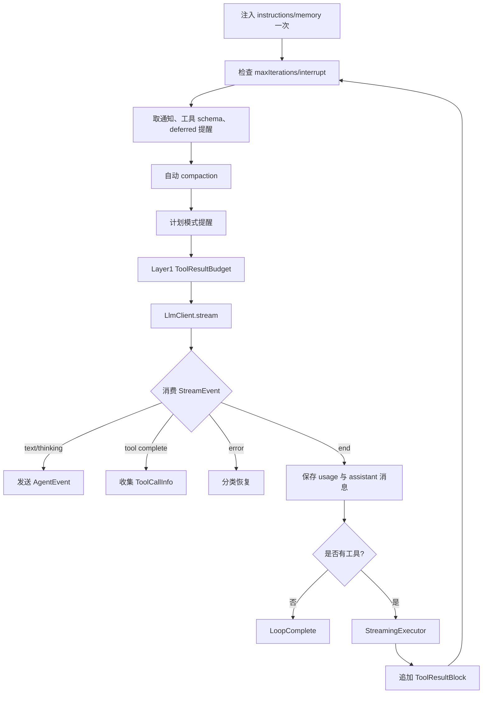
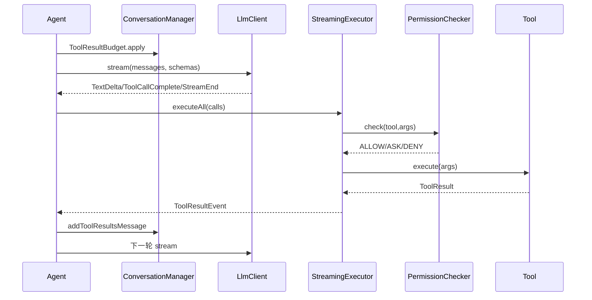

# 05-02 Agent 循环与 LLM 适配器逐文件精读

本卷是项目的核心：`Agent` 把会话、提示、模型流和工具执行串成状态机；`LlmClient` 把供应商 SDK 的不同事件统一成 `StreamEvent`。如果只把 Agent 看成“调用一次模型”，就无法解释工具多轮、上下文压缩、权限等待、限流重试和 Ctrl+C。

## 1. 统一事件协议：`llm/StreamEvent.java`

`StreamEvent` 是 sealed interface，当前允许八类 record：

|事件|字段|在 Agent 中的用途|
|---|---|---|
|`TextDelta`|`text`|增量拼接回答并实时发给 TUI|
|`ThinkingDelta`|`text`|显示供应商的思考摘要|
|`ThinkingComplete`|`thinking`,`signature`|保存完整 thinking block|
|`ToolCallStart`|`toolId`,`toolName`|通知 UI 工具开始|
|`ToolCallDelta`|`text`|传递增量 JSON，当前 Agent 不拼接此事件|
|`ToolCallComplete`|id/name/arguments|得到可执行的结构化参数|
|`StreamEnd`|stopReason、token、缓存 token|结束一轮并更新压缩锚点|
|`Error`|`message`|进入重试或终止分支|

`StreamEnd` 有五参数主构造器和三参数便捷构造器，后者把缓存 token 置零。这样兼容没有缓存统计的 provider，同时让 `Agent` 不必用 null 表示“无缓存”。record 的 pattern matching 由 Java 21 的 `switch` 使用，新增事件类型时编译器可帮助发现未处理分支。

## 2. `llm/LlmClient.java`

接口只有 `stream(ConversationManager,List<Map<String,Object>>)` 和默认空实现 `setMaxOutputTokens`。stream 返回容量为 64 的 `BlockingQueue<StreamEvent>`，调用方先拿到队列，再异步消费；它不会阻塞等待首字节。静态工厂 `create` 按 `ProviderConfig.protocol` 选择 `AnthropicClient`、`OpenAiClient` 或 `OpenAiCompatClient`，未知协议抛 `IllegalArgumentException`。配置层已经校验协议，但工厂仍保留防御性分支，防止测试直接构造非法对象。

为什么用接口而不是让 Agent 直接依赖三个 SDK？这是 Adapter + Dependency Inversion：Agent 只依赖内部事件，供应商变化被限制在 llm 包；单元测试可以提供 fake client，把一串确定性事件放入队列而不消耗真实 API Key。

## 3. `llm/LlmException.java`

基类继承 RuntimeException，子类分别是 `AuthenticationException`、`RateLimitException`（额外保存 `retryAfter`）、`ContextTooLongException` 和 `NetworkException`。这些类型不是为了展示漂亮的错误，而是给 Agent 恢复策略提供分类：认证错误通常立即终止；限流等待后重试；上下文过长触发压缩；网络错误需要考虑请求是否已经被服务端接受，不能盲目重复写操作。

当前异常只在 LLM 客户端线程转成 `StreamEvent.Error`，不直接抛到 TUI 线程。生产建议在错误中保留 provider、HTTP 状态和 request id，但必须过滤 API Key、完整 prompt 和敏感工具参数。

## 4. `llm/ModelResolver.java`

`ALIASES` 把 `haiku`、`sonnet`、`opus` 映射为固定 Claude 模型 ID。`resolve` 对未知值原样返回，便于用户直接填厂商模型名。`supportsAdaptiveThinking` 只对解析后包含 `opus-4-6` 或 `sonnet-4-6` 的模型返回 true；`supportsThinking` 以 `claude` 子串判断。这里是启发式表，不是从 provider 元数据查询，模型重命名会造成误判，配置中的 thinking 仍由 `ProviderConfig` 控制。

## 5. `agent/AgentEvent.java`

Agent 对 UI 的协议同样是 sealed interface。`PermissionRequestEvent` 携带 `CompletableFuture<PermissionResponse>`，工具线程把事件放入队列后等待 UI 完成 future；`AskUserRequestEvent` 携带问题列表和答案 future。`TurnComplete` 表示本轮工具结果已经加入会话，`LoopComplete` 表示整个循环退出；两者不能混用，否则 TUI 可能提前清空最终文本。

事件队列是跨线程边界：生产者是 Agent/StreamingExecutor，消费者是 `JimiCodeModel`。事件对象尽量使用不可变 record，避免 UI 线程读取时被后台修改。`UsageEvent` 的 token 是累计值，不是只读本轮值，适合状态栏显示但不适合直接计算本轮成本。

## 6. `agent/Agent.java`：字段、构造和生命周期

Agent 的字段可以分成六组：

1. **模型与工具**：`client`、`registry`、`protocol`。
2. **预算**：`contextWindow`、`maxOutput`、`maxIterations`、`usageAnchor`。
3. **交互策略**：`checker`、`hookEngine`、`toolNameFilter`、`instructions`、`memoryContent`、`notificationFn`。
4. **恢复状态**：`replacementState`、`recoveryState`、`fileHistory`、`sessionId`、`workDir`。
5. **运行统计**：`lastStreamError`、累计 input/output token。
6. **内部 record**：`ToolCallInfo` 和 `ToolCallResult`。

构造器接收 `LlmClient`、`ToolRegistry`、协议和 `ProviderConfig`，立即解析上下文窗口和输出上限；它不启动线程、不连接 MCP。setter 用于 TUI 装配运行期对象，这也是测试能够替换 PermissionChecker、HookEngine、工作目录的原因。

## 7. `run(ConversationManager)`

`run` 创建容量 64 的 `LinkedBlockingQueue<AgentEvent>`，使用 `Thread.startVirtualThread` 执行 `agentLoop`，立即返回队列。顶层 catch 把未分类异常转成 `ErrorEvent`，避免虚拟线程异常无人消费。注意它没有返回 Future；调用方通过 `LoopComplete` 或 `ErrorEvent` 判断结束，取消需要配合线程中断/模型 client 的关闭策略。

## 8. `agentLoop` 一轮的真实顺序

### 8.1 循环前置阶段

`injectLongTermMemory` 只在第一次有效写入；`maxIterations > 0` 且 iteration 超限时发 ErrorEvent 并 break；线程被中断时直接 break。`notificationFn` 的每条消息转成 system reminder。每一轮计算一次 `iterToolSchemas`，并用 `toolNameFilter` 过滤；同一列表同时用于恢复附件和 stream，避免技能在中间修改造成 schema 不一致。

自动压缩调用 `ContextCompactor.manage`。异常被忽略，表示压缩是 best-effort，不应因摘要失败让普通请求立刻崩溃；但这也意味着上下文可能继续膨胀，直到 provider 返回 context error。若消息数量减少，清空 `usageAnchor`，下一轮重新建立真实 token 基线。

### 8.2 流事件消费

Agent 用 `poll(30, TimeUnit.SECONDS)` 读取队列。30 秒没有事件即发 `Stream timeout` 并返回；InterruptedException 恢复中断标志并退出。TextDelta 拼到 `StringBuilder text` 并转为 `AgentEvent.StreamText`；ThinkingComplete 收集到列表；ToolCallComplete 追加内部 record；StreamEnd 保存停止原因、token 和缓存 token。

收到 Error 时设置 `lastStreamError`、发 ErrorEvent，并跳出消费循环。这里的队列 Error 不是 Java 异常，必须看 `lastStreamError` 做分类。

### 8.3 错误恢复

上下文错误且 `contextRetries < 3` 时发 RetryEvent，调用 `forceCompact`，压缩成功后 continue；最多三次防止无限循环。消息含 `rate limit` 时固定等待 5 秒再 continue，没有使用异常对象中的 `retryAfter`，这是当前实现事实。其他错误直接 break，finally 会补发 LoopComplete(0)。生产建议采用指数退避、Retry-After、抖动和可取消 sleep。

### 8.4 max_tokens 分支

首次 `stopReason == max_tokens` 时把 client 输出上限提升到 `MAX_TOKENS_CEILING`，保存已经产生的 assistant 文本和 thinking，然后追加一条用户提醒要求从中断位置继续。后续最多 `MAX_OUTPUT_RECOVERIES` 次以“拆小任务”提示恢复。恢复次数耗尽后落入普通完成，避免模型永远循环。

### 8.5 保存 assistant 和工具结果

模型轮次结束后，把文本、thinking、tool calls 组成一个 `Message`。有真实 usage 时建立 `UsageAnchor(baseline, conv.size())`，其中 baseline 是非缓存 input + cacheRead + cacheCreation + output。没有工具调用就做 FileHistory 快照、发 LoopComplete 并结束；有工具调用则创建 `StreamingExecutor`，执行结果转换为 `ToolResultBlock`，若调用 `ExitPlanMode` 则立即发 TurnComplete+LoopComplete，否则只发 TurnComplete，下一轮继续。

### 8.6 finally 和 `putSafe`

如果不是正常 `loopCompleted`，finally 发 `LoopComplete(0)`；这保证 UI 不会永远等待。`putSafe` 捕获队列阻塞时的中断并恢复标志。队列容量有限，UI 停止消费时 Agent 可能阻塞在 put，生产环境需要取消传播和有界丢弃策略。

## 9. `agent/StreamingExecutor.java`

### 9.1 读并行、写串行

`executeAll` 先按工具类别把调用分为 READ 和 other。多个读调用使用 `Executors.newVirtualThreadPerTaskExecutor()` 并行，按 futures 原列表顺序收集结果；写、命令、未知工具全部串行。并行只改变开始时间，不改变返回顺序。写工具串行是为了避免两个模型调用同时修改同一文件。

### 9.2 `executeSingle`

找不到工具时立即发错误 ToolResultEvent。然后运行 pre-tool hook；hook reject 不进入权限和执行。权限决策 DENY/ASK/ALLOW 分支中，ASK 发 PermissionRequestEvent 并最多等待五分钟；超时按 DENY；ALLOW_ALWAYS 会从参数提取 command/file_path/pattern 并写入 checker 的持久规则。获得允许后计时执行 `tool.execute`，异常被转为 `ToolResult.error`，结果写入 recovery snapshot，输出超过 `ToolRegistry.MAX_OUTPUT_CHARS` 截断，再发 ToolResultEvent，最后运行 post-tool hook。

### 9.3 recovery snapshot

只对成功的 `ReadFile` 处理，从参数取 `file_path`，重新 `Files.readString` 保存完整内容和时间。工具输出可能带行号，重新读取保证压缩恢复得到原文件文本。文件在工具返回后消失时静默跳过，模型仍保留原工具输出。

## 10. Anthropic/OpenAI/OpenAI-compatible 的差异

`AnthropicClient` 使用 Messages 流，处理文本增量、thinking 签名、tool input JSON 增量和 usage；构造消息时需要保留连续 role 合并和 cache breakpoint。`OpenAiClient` 使用 Responses API，把 assistant tool use 转为 function call，把 tool result 转为 function call output，并从 `usage.inputTokensDetails.cachedTokens` 拆出缓存 token。`OpenAiCompatClient` 通过 HTTP Chat Completions SSE 读取 `data:` 行，自己拼接增量 tool-call JSON，兼容不支持 reasoning item 的第三方服务。

三个适配器都在虚拟线程中生产容量 64 的队列；任何异常必须转成 `StreamEvent.Error`。这是一种“生产者 SDK → 内部事件总线 → Agent 消费者”的 Adapter/Pipeline 组合。不能把 OpenAI 的 function call id、Anthropic 的 tool_use id 或兼容服务的 index 直接混用，必须在 `ToolUseBlock` 中保存适配器最终确认的字符串 id。

## 11. 完整工具轮次时序

## 12. 新手常见误区

- `BlockingQueue` 不是消息持久化；进程崩溃后只能靠 Session。
- `StreamEnd` 不是一定代表业务成功，stop reason 可能是 max_tokens。
- 模型 schema 可见不等于工具已授权，权限检查必须在执行前再次发生。
- 读工具并行不意味着所有工具都可并行；写和命令仍串行。
- 压缩失败被忽略不表示上下文无限；下一次 provider 可能拒绝。
- `finally` 的 LoopComplete 是兜底事件，不代表最后一个工具成功。

## 13. 面试题与实验

1. 为什么使用虚拟线程而不是固定线程池？回答：单次网络流和阻塞队列等待适合轻量虚拟线程，但仍要限制并发和外部服务配额。
2. 如何保证工具调用结果按模型给出的顺序返回？读并行 futures 按原列表遍历，写调用按原列表串行。
3. 发生 429 能否无脑重试？不能，模型调用可能已被计费；应使用幂等请求、Retry-After、指数退避和取消。
4. 构造 fake client，让第一次返回工具调用、第二次返回文本，观察 AgentEvent 顺序并断点验证 conversation。
5. 让 fake client 返回三次 context error，确认第三次后退出而不是死循环。
6. 让 ReadFile 成功后删除文件，再触发压缩，观察 recovery snapshot 的 best-effort 行为。

## 14. 小结

Agent 的难点在状态和边界，不在 while 语法：每一轮都要决定 schema、预算、消息、事件、权限、工具副作用和恢复方式。LLM 适配器的价值是隔离供应商语义，统一事件协议。真正掌握本卷后，读 `ToolResultBudget`、`PermissionChecker` 和 `SessionManager` 才能理解它们为什么嵌在循环的特定位置。

## 15. Agent 字段到生命周期的对应表

|字段|写入位置|读取位置|生命周期|
|---|---|---|---|
|`client`|构造器|每轮 stream、max_tokens 调整|一次 Agent|
|`registry`|构造器/Model 装配|每轮 schema、Executor|可运行期注册|
|`protocol`|构造器|schema 转换|只读|
|`contextWindow`|ProviderConfig 解析|Compactor|一次 Agent|
|`replacementState`|默认/parent copy|ToolResultBudget|跨 iteration，fork 拷贝|
|`recoveryState`|构造器|ReadFile/Compactor|跨 iteration|
|`usageAnchor`|StreamEnd 后|下一轮 Compactor|压缩后清空|
|`lastStreamError`|Error event|恢复分支|最近一次错误|
|`fileHistory`|TUI setter|terminal turn 快照|session 生命周期|

这张表说明为什么 Agent 不能被复用到另一个 ConversationManager：replacement、recovery、usage anchor 和 sessionId 都绑定一个线程。复用会让第二个用户看到第一个用户的恢复附件，属于严重的数据隔离错误。

## 16. LLM 适配器逐方法阅读问题

对 `AnthropicClient`，重点追 `buildMessages` 的 role 合并、thinking block 序列化、tool input JSON 增量、usage 拆分和错误分类；对 `OpenAiClient`，重点追 `buildInput` 如何把 tool use/output 转成 Responses item、reasoning summary 如何变成 ThinkingComplete；对 `OpenAiCompatClient`，重点追 SSE `data:` 行、`[DONE]`、choices.delta.tool_calls.index 的累积和最终 usage chunk。三个类的 public API 相同，但 private 转换完全不同。

调试时不要只在 `stream` 入口打断点：真正的 bug 常发生在“SDK 事件已经到达、内部队列尚未 put”之间。可以用本地 HTTP mock 返回固定 SSE，依次发送文本、tool call arguments 分片、usage、done；断言 Agent 收到的事件顺序和 arguments Map。JSON 参数解析失败时当前客户端会使用空 Map，工具之后会返回参数缺失错误，模型有机会修正；生产建议把“解析失败”标记成结构化错误而不是静默空参数。

## 17. 重试幂等性检查

上下文错误重试通常安全，因为请求没有工具副作用；限流重试通常也安全，但可能重复计费；max_tokens 恢复会把已经输出的文本追加到 conversation，再发“继续”消息，不能把上一次 tool call 重复加入，否则会执行两次。工具执行完成后模型流断开，Agent 当前代码可能在下一轮重试而重新生成相同 tool call，必须依赖 tool id、FileHistory、业务幂等 key 或人工确认降低风险。

## 18. 性能与资源预算

每次 stream 一个虚拟线程和一个 64 容量队列；读工具多个虚拟线程，写工具串行。队列满时 producer 阻塞，UI 卡死或用户关闭终端都可能造成资源滞留。模型 SDK 的 HTTP connection pool、MCP client、文件 spill 目录和 session JSONL 也会累积。生产优化包括：每 Agent 最大并发 read 数、队列 put 超时、client close、spill TTL、token cost meter 和取消信号传播。

## 19. 最终实验

使用 fake LlmClient 构造四轮：第一轮 TextDelta+StreamEnd；第二轮 ToolCallComplete+StreamEnd；第三轮 StreamEnd(stop=max_tokens)；第四轮 Error("context too long")。逐轮记录 ConversationManager 消息数、AgentEvent、usageAnchor 和 contextRetries。验收标准是：普通文本 LoopComplete；有工具调用 TurnComplete 后继续；max_tokens 至少追加 continuation user message；context error 最多三次 forceCompact 后结束。这个实验比直接调用真实模型更适合新手理解状态机。
