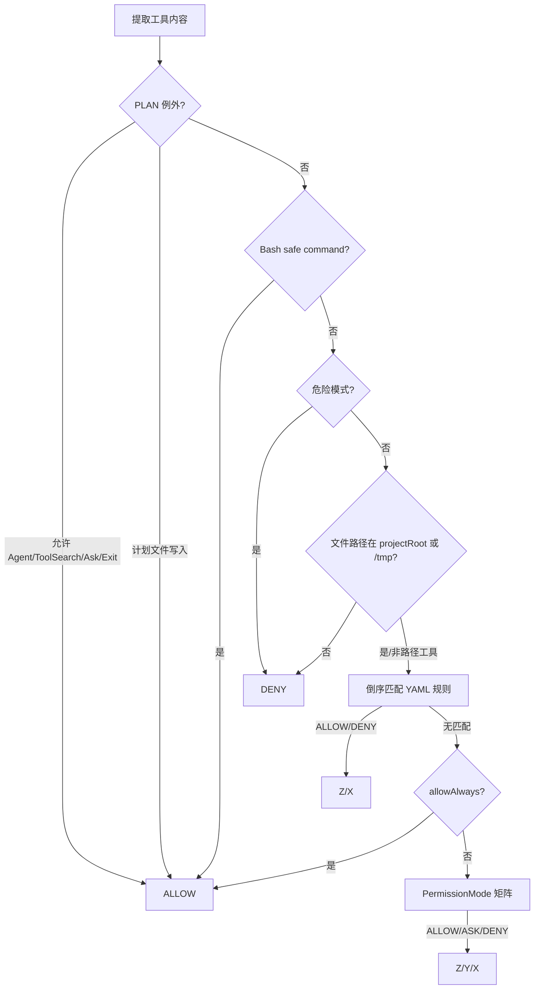

# 05-03 工具、权限、Hook 与 MCP 逐文件精读

这一卷解释模型“能看见什么、能调用什么、真正被允许做什么”。工具 schema 是提示词层协议；`ToolRegistry` 是发现与适配层；`PermissionChecker` 是安全决策层；`StreamingExecutor` 才在决策后产生文件、进程或网络副作用；MCP 则把外部服务器包装成同一套 Tool 接口。

## 1. 工具接口和结果对象

### `tool/Tool.java`

接口要求每个工具实现 `name()`、`description()`、`category()`、`schema()`、`execute(Map<String,Object>)`。`shouldDefer()` 默认 false，工具可覆写为 true 表示启动时不把完整 schema 发送给模型。这里没有泛型参数校验和异步方法，所有执行都以 Map 输入和 `ToolResult` 输出，优点是与 Anthropic/OpenAI 的 JSON schema 对齐，缺点是编译器不能检查参数名称和类型。

### `ToolCategory.java`

枚举只有 READ、WRITE、COMMAND。它同时影响 `StreamingExecutor` 的并发策略和 `PermissionMode.decide` 的默认授权。分类是粗粒度安全标签，不应被理解为完整能力证明：一个 READ 工具仍可能读取密钥，一个 COMMAND 工具也可能只是查询状态。

### `ToolResult.java`

record 字段 `output`、`isError`。静态工厂 `success`/`error`（以当前源码为准）让工具少写重复构造。错误结果仍作为正常消息回到模型，Agent 不会因单个工具错误自动抛出 Java 异常；模型可以根据错误继续修正参数。

## 2. `ToolRegistry.java`

注册表使用 `ConcurrentHashMap<String,Tool>`，允许 MCP 或 TUI 线程在运行期注册工具；`discoveredTools` 是并发 Set，用于 deferred schema。`register` 按名称覆盖旧工具，意味着同名 MCP 工具会替换内置实现，生产建议在注册时检测冲突并记录来源。

`get` 是 O(1) 查找；`listTools` 返回 `List.copyOf`；`getDeferredToolNames` 只列出 shouldDefer 且尚未发现的工具。`getAllSchemas(protocol)` 遍历工具，跳过未发现的 deferred 工具；OpenAI 需要 `{type:function,name,description,parameters}`，Anthropic/兼容协议直接返回工具自身 schema。这里完成的是协议形状转换，不是 JSON Schema 验证。

`searchDeferred(query,maxResults,protocol)` 以名称或描述的大小写不敏感子串匹配，最多返回 maxResults；`findDeferredByNames` 按名称集合精确选择。两者都没有把命中的工具自动标记 discovered，调用 `ToolSearchTool` 负责写入 discovered 状态。`createDefault` 当前只注册 ReadFile、WriteFile、EditFile、Bash、Glob、Grep；AskUser、Agent、Worktree 等由 `JimiCodeModel` 额外装配。

## 3. `permission/PermissionMode.java`

`fromConfig` 先 trim、小写、移除下划线与连字符，所以 `accept-edits`、`ACCEPT_EDITS`、`acceptedits` 都能转换。未知值抛异常。`decide` 的矩阵：DEFAULT 允许 READ、询问 WRITE/COMMAND；ACCEPT_EDITS 允许 READ/WRITE、询问 COMMAND；PLAN 与 DEFAULT 相同；BYPASS 全部允许。PLAN 的特殊限制不是在此枚举中，而在 Checker 的 Layer 0。

面试中要区分“模式默认决策”和“最终授权”：最终结果还要经过计划例外、safe command、危险命令、路径沙箱、文件规则和 allow-always。

## 4. `permission/PermissionResponse.java`

枚举表示 UI 对 ASK 的回答，当前包含 DENY、ALLOW、ALLOW_ALWAYS。`ALLOW_ALWAYS` 不是永久全局信任，而是把当前工具与内容组合写入 checker 的会话集合，并由 `appendLocalRule` 持久化本地规则（具体是否调用持久化取决于 UI 选择）。

## 5. `PermissionChecker.java`：五层决策链

### 5.1 构造和规则加载

构造器保存 mode/projectRoot，并从用户级 `~/.JimiCode/permissions.yaml`、项目 `.JimiCode/permissions.yaml`、本地 `.JimiCode/permissions.local.yaml` 加载规则。规则解析为内部 record `PermissionRule(toolName,pattern,effect)`。YAML 每项要求 `rule: "Bash(git *)"` 与 `effect: allow|deny`；坏文件、未知 effect、正则不匹配都静默跳过。

### 5.2 `check(Tool, args)`

Layer 0 允许计划模式的 Agent、ToolSearch、AskUserQuestion、ExitPlanMode；写入 `.JimiCode/plans/` 的 WriteFile/EditFile 也允许。Layer 1 对没有管道、分号、重定向、命令替换的安全命令自动允许。当前安全集合包括 ls/dir/pwd/git status/git diff/java -version 等；删除 Go 后不再包含 Go 命令。Layer 2 对根目录递归删除、mkfs、向设备 dd、chmod 777、fork bomb、curl/wget 管道 shell、写入 `/dev/sd` 拒绝。

Layer 3 只对 ReadFile/WriteFile/EditFile 检查路径；normalize 后要求位于 projectRoot 或 `/tmp`。如果 Path 解析抛异常，当前实现返回 true，这是跨平台容错但有安全风险。Layer 4 倒序匹配文件规则，实现“最后匹配优先”；Layer 4b 检查内存 allow-always；Layer 5 执行模式矩阵。

### 5.3 规则持久化

`appendLocalRule` 创建父目录，读取本地规则，追加 allow，使用 SnakeYAML dump 写回，再重新加载全部规则。写失败静默忽略，调用方看不到持久化错误；生产建议返回结果或记录 warning。`addAllowAlwaysRule` 只改内存 HashSet，线程安全性弱于 ConcurrentHashMap，当前主要由单个工具执行线程调用。

### 5.4 `describeToolAction`

把参数摘要转换成 UI 文案，例如 `Execute: git diff`、`Write: path`。它不执行校验、不截断命令；UI 展示前应避免把超长或秘密参数完整回显。

## 6. `hook/HookEngine.java`

HookEngine 定义 EventName、ActionType、Action、Hook、HookContext、HookResult、PreToolResult。事件包括工具前后、会话/回合等生命周期；条件表达式支持变量解析和简单比较。`runPreToolHooks` 返回 rejected/message，供 StreamingExecutor 在权限前短路；`runHooks` 执行动作。ActionType 的 command 会启动外部进程，message 只输出提醒，reject 影响执行，因此 Hook 本身也属于安全边界。

阅读条件表达式时要注意：这是项目自定义的小语言，不是 JavaScript；未识别变量和异常应看源码的默认布尔值。生产建议使用白名单命令、超时、输出上限和审计，避免把配置文件变成任意代码执行入口。

## 7. 内置文件工具文件级卡片

### `ReadFileTool.java`

输入 `file_path`、可选 `offset`/`limit`；读取文本并附行号和截断提示，成功后写入 `FileStateCache`，同时由 StreamingExecutor 再写 RecoveryState。路径校验由 PermissionChecker 和工具自身的 normalize 双重承担。文件不存在、读取权限不足、非 UTF-8 都转为 `ToolResult.error`。实验：先读取后让另一个进程修改，再调用 EditFile，观察 mtime 检测。

### `WriteFileTool.java`

输入 `file_path`、`content`。创建父目录并写完整内容；覆盖已有文件前要求 FileStateCache 中存在先前读取且 mtime 未变化，编辑前交给 FileHistory 备份，成功后刷新缓存。首次创建文件没有旧快照。异常不会回滚已创建的父目录，生产建议临时文件写入后原子 move。

### `EditFileTool.java`

输入路径、`old_string`、`new_string`，要求 old_string 在文件中唯一；非唯一、找不到、缓存过期都返回错误。先备份再精确替换，避免模型使用模糊 patch 修改错误位置。练习是构造两个相同 old_string，验证拒绝而不是替换全部。

### `BashTool.java`

输入 command、timeout；以 `ProcessBuilder` 启动 shell，合并 stdout/stderr，等待退出并处理超时/中断。PermissionChecker 先做危险检测，但 BashTool 仍应限制工作目录和环境。命令结果包含 exit code，非零通常 `isError=true`。不要把 shell 字符串拼接成新的高权限命令。

### `GlobTool.java` 与 `GrepTool.java`

Glob 在根目录递归匹配 `**`，跳过 `.git`、依赖和虚拟环境目录，排序并限制输出；Grep 编译正则、按文件逐行搜索，支持 include glob，输出 `path:line:content` 并限制字符数。它们属于 READ，多个查询可以并行；正则灾难回溯和符号链接循环是生产风险。

### `AskUserTool.java`

把结构化问题放入 AgentEvent 的 future，阻塞等待 TUI 提交；取消或超时应返回错误。它不是普通命令行 input，因为 TUI 需要在主事件循环显示多问题、多选项对话框。

### `ToolSearchTool.java`

解析 `select:name1,name2` 的精确语法或关键词，调用 Registry 的 deferred 搜索，命中后标记 discovered 并返回 schema。工具本身通常分类 READ/系统，允许模型按需加载 schema，降低 prompt token。

### `EnterWorktreeTool.java`、`ExitWorktreeTool.java`、`ExitPlanModeTool.java`

三者分别把 WorktreeManager、计划文件和 TUI 回调包装成模型可调用接口。Enter 校验 slug 并创建/恢复 session；ExitWorktree 的 keep/remove 需要检查变更；ExitPlanMode 只有计划文件存在并处于 PLAN 时成功。

## 8. MCP：`mcp/McpManager.java`

### 8.1 配置到连接

构造器按 server name 放入 LinkedHashMap，同名配置后者覆盖。`connectAll` 逐个 `createClient`、initialize、读取 server instructions、listTools；单个失败加入 errors，其他 server 继续。`registerAllTools` 把成功 wrapper 注册到 ToolRegistry 并返回 errors，适合部分可用。

`createClient` 在 command 非空时建立 `StdioClientTransport`，把 args、env（支持 `${VAR}` 替换）传给子进程；url 非空时建立 `HttpClientStreamableHttpTransport`，headers 也支持变量替换；两者都为空抛异常。Windows 上 npx/npm/node/uvx 等命令自动追加 `.cmd`。

### 8.2 wrapper

`McpToolWrapper.name()` 生成 `mcp__server__tool` 并把非字母数字替换为下划线；category 固定 COMMAND，shouldDefer 固定 true。schema 从 SDK inputSchema 转为内部 `input_schema`；execute 构造 `CallToolRequest`，调用同步 client，合并 TextContent，按 SDK isError 返回 ToolResult。MCP 返回图片或结构化内容时，当前 `extractTextContent` 只保留文本，非文本会丢失，这是已确认限制。

### 8.3 生命周期和失败

`shutdown` 对 clients 调用 closeGracefully 并清空 map。客户端连接成功但 listTools 失败会落入整个 server error，已建立 client 仍可能留在 map，生产建议失败时显式关闭。MCP 工具是外部网络/进程副作用，schema 不等于安全授权，仍会经过 PermissionChecker；默认 deferred 只降低可见性，不降低危险性。

## 9. 端到端失败矩阵

|阶段|现象|当前处理|学习关注|
|配置|command/url 都空|connectAll errors|部分 server 不影响内置工具|
|initialize|握手超时|记录错误|是否关闭半连接|
|listTools|schema 无效|wrapper 可能调用失败|运行期验证|
|权限|MCP 分类 COMMAND|ASK/拒绝|不能因为 MCP 来自可信服务器而绕过|
|调用|SDK 异常|ToolResult.error|模型可重试但可能重复副作用|
|输出|非文本 content|`(no output)`|当前信息丢失|

## 10. 面试和实验

1. 为什么 schema 和 permission 必须分离？schema 只是模型可生成的形状，权限是服务端最终信任边界。
2. 为什么读工具并行、写工具串行？读通常无共享可变状态，写会发生冲突；实际仍需考虑两个 ReadFile 后文件被修改。
3. 写一个假的 MCP server command，验证 `ConnectResult.errors` 不会清空内置 Registry。
4. 配置 `${MCP_TOKEN}`，分别设置和不设置环境变量，观察未解析占位符如何进入 header。
5. 添加 `permissions.local.yaml` 的 `Bash(git status)` allow，验证最后匹配和 reload。
6. 设计一个 prompt injection：文件内容要求执行 `rm -rf /`，说明它只能作为 ReadFile 输出，仍要经过工具权限层。

## 11. 小结

工具系统是从模型到真实世界的“受控执行层”。Registry 管理可见性，Hook 管理策略扩展，PermissionChecker 管理最终授权，Executor 管理并发和副作用，MCP 管理外部能力接入。任何一层缺失都会让“模型想做什么”和“程序实际做什么”混在一起；源码阅读应沿 `Agent → Registry → Hook → Permission → Tool/MCP → Result → Conversation` 这条链逐步打断点。

## 12. 每个内置工具的 schema 学习表

|工具|类别|核心参数|成功副作用|失败时模型看到的内容|
|---|---|---|---|---|
|ReadFile|READ|file_path,offset,limit|读取文件、更新缓存/恢复状态|文件不存在或编码错误|
|Glob|READ|pattern,path|遍历目录但不修改|匹配为空或越界|
|Grep|READ|pattern,path,include|编译正则并读取文件|正则非法、结果截断|
|WriteFile|WRITE|file_path,content|创建父目录并覆盖文件、历史备份|未先读取、mtime 变化、写失败|
|EditFile|WRITE|file_path,old_string,new_string|唯一字符串替换、历史备份|old_string 不唯一/不存在|
|Bash|COMMAND|command,timeout|启动本地 shell 进程|非零退出、超时、权限拒绝|
|ToolSearch|READ|query|maxResults|标记 deferred 工具 discovered|没有命中 schema|
|AskUserQuestion|READ|questions|阻塞等待用户 future|取消或超时|

schema 的 `required` 只影响模型生成参数；工具实现仍必须对 null、错误类型、空字符串做运行时校验。比如 `WriteFile` 的 content 不是 String 时不能直接 cast 后让 ClassCastException 穿出，应该返回 ToolResult.error 并保留 tool id。

## 13. 权限规则的安全边界

`isSafeCommand` 只接受完整命令或以安全命令加空格开头，并拒绝管道、分号、&&、重定向、命令替换和反引号。这不是完整 shell parser：引号、换行、Unicode 同形字符和 shell alias 仍可能绕过简单字符串判断。因此它适合教学级默认保护，不适合生产级沙箱。生产应在独立容器/沙箱执行，使用 argv 数组、系统调用策略和资源限制。

`isPathAllowed` 只保护三类文件工具，Bash 中的 `cat /etc/passwd` 仍依赖命令策略而非路径沙箱。模型可通过 Bash 读取任意可读文件，说明“工具分类+路径检查”不是完整的数据防泄漏方案。企业改造应让 Bash 使用工作目录、只读 mount、环境白名单，并对输出做 secret scanning。

## 14. Hook 与 Permission 的先后顺序

当前 `StreamingExecutor.executeSingle` 先找工具，再运行 pre-hook，再 PermissionChecker，再 execute，最后 post-hook。这样 Hook 可以实现业务拒绝（例如禁止修改锁定文件），但 Hook command 自身并不经过 PermissionChecker，必须在 HookEngine 内部限制动作。若把 Permission 放在 Hook 之后，恶意 hook 可能成为权限绕过；若把 post-hook 放在结果截断之前，审计看到的输出可能与模型看到的不一致。调试时分别在四个边界断点，记录时间戳和 tool id。

## 15. MCP 协议调用点

项目直接使用 MCP SDK 的 `McpClient.sync(transport)`、`initialize()`、`getServerInstructions()`、`listTools()`、`callTool()` 和 `closeGracefully()`。这些是已确认的外部 API；SDK 内部的 JSON-RPC 重试、线程模型和连接池没有在仓库中实现，若 source jar 不可用，不应把推断写成事实。MCP server instructions 当前只被收集为 ServerInfo，是否拼入系统 Prompt 取决于 Model 装配代码，学习时要在 `initializeProvider` 断点确认。

## 16. 故障注入验收

1. 让 `ReadFile` 返回 60,000 字符，确认工具原始输出、AgentEvent 截断输出、ToolResultBudget spill 三种视图的差异。
2. 用 `Bash` 参数 `git status; echo x`，确认 safe command 不允许自动通过并进入 ASK。
3. 用 `WriteFile` 写 `..\\outside.txt`，确认 normalize 后被路径规则拒绝。
4. 创建 pre-hook reject，确认 PermissionChecker 没被调用；创建 post-hook 抛异常，确认工具结果已经回传且 UI 不崩溃。
5. 配置一个不可执行 MCP command 和一个正常 HTTP server，确认 ConnectResult 同时返回成功工具与错误列表。

## 17. 复盘问题

工具执行后如果 JVM 立即崩溃，哪些状态可能落盘？FileHistory 备份可能已经存在，Session 可能尚未 append，MCP 外部副作用无法回滚，Worktree 可能留下未提交分支。权限 ASK 等待期间用户关闭终端，future 是否完成？当前需要依赖 TUI 的 quit/interrupt 路径，单独测试 Executor 才能发现死等。MCP schema 被标记 deferred 后，模型是否知道如何调用 ToolSearch？Agent 每轮会注入 deferred names reminder，若 reminder 被压缩掉则需要 recovery attachment 重新列工具。
