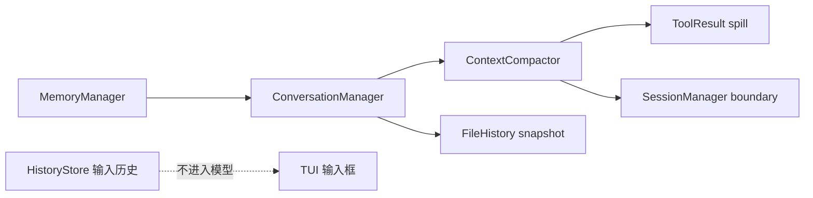
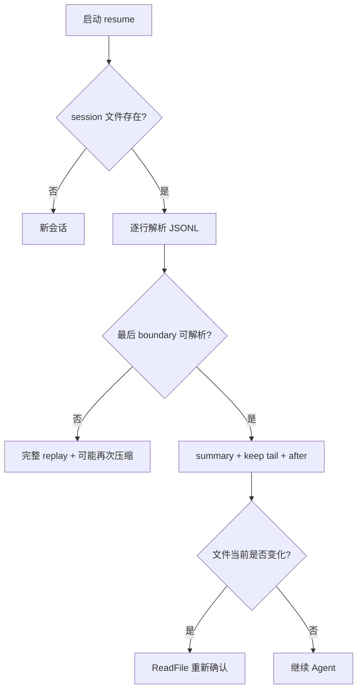

# 05-04 会话、Memory、上下文压缩与文件历史逐文件精读

长对话 Agent 的两个不同问题经常被初学者混在一起：会话持久化解决“进程重启后还能不能继续”，上下文压缩解决“本次请求还能不能塞进模型窗口”。Memory 解决“跨会话留下哪些稳定事实”，FileHistory 解决“工具改错后能不能回退”。当前源码把四者放在不同包中，职责边界非常清楚。

## 1. `compact/RecoveryState.java`

RecoveryState 用两个 HashMap 保存最近文件读取和 Skill 调用。`recordFileRead(path,content)`、`recordSkillInvocation(name,body)` 都在 null/空键时 no-op，并在 synchronized(lock) 中覆盖同路径/同名称旧记录；因此“最新快照赢”，不会无限累积同一个文件的每次版本。`snapshotFiles(limit)` 复制 values 后按 timestamp 倒序，limit>0 时截断；`snapshotSkills()` 返回全部倒序。工具执行器可由多个虚拟线程调用，所以锁保护写与复制，排序发生在锁外。

它只保存内存状态，不直接写磁盘。压缩后由 `ContextCompactor.buildRecoveryAttachment` 把快照重新附加到 summary。文件内容可能包含密钥，生产建议对路径和内容脱敏、设置大小预算、按租户隔离。

## 2. `compact/ContextCompactor.java`

### 2.1 两层策略

Layer 1 `offloadAndSnip` 不调用模型：单个 tool result 超过 50,000 字符写入 `.JimiCode/tool_results`，消息只保留可回读提示；旧轮次结果裁剪为前 2,000 字符。Layer 2 在 token 使用量接近窗口时调用 LLM 生成摘要，保留最近若干原始消息和 recovery 附件。

核心常量包括摘要输出预留 20,000、自动安全边距 13,000、硬阻断边距 3,000、最近 10 轮、连续失败 3 次熔断、最近保留目标 10,000 token（上限 40,000，至少 5 条消息）。这些数字是当前实现事实，不是模型厂商通用标准。

### 2.2 `manage(...)`

`manage` 先无条件执行 Layer 1，然后用 `currentTokens(messages,anchor)` 估算使用量。低于 `effectiveWindow - 13000` 直接返回 Layer 1 提示；超过硬线 `effectiveWindow - 3000` 强制 `forceCompact`；处于软线区间时，如果 tracking 未熔断，尝试 autoCompact，成功 reset，异常 recordFailure。三次失败后只继续 Layer 1，不再自动调用摘要，直到硬线强制压缩。

`UsageAnchor` 由 Agent 在 provider 返回真实 usage 后创建，baseline 是输入+缓存读+缓存写+输出，anchorCount 是当时消息数量。后续只估算 anchor 之后追加的消息，避免缓存命中时用原始字符重复计算。冷启动或压缩后 anchor 为 null，回退到全量估算。

### 2.3 token 估算

`estimateTokens` 对每条 content 按长度/3.5 加 4，tool use 参数序列化后额外加 50，tool result 加长度/3.5+10，thinking 按长度/3.5。它不是 tokenizer，中文、代码、JSON 的真实比例会变化；因此显式上下文窗口配置和 provider usage 更可靠。

### 2.4 Layer 1 offload/snipping

遍历可变消息，找到 tool result。单结果大于 50,000 且有 workDir 就写 spill 文件，替换内容为 `[Result of N chars saved to path]`；一条消息聚合超过 200,000 时对较大结果重复 offload。早于最近边界的结果若未处理，则保留前 2,000 字符并追加 `... [snipped]`。已处理内容通过提示前缀识别，避免每轮重复写 spill。

写 spill 使用创建目录、文件名清洗和异常回退（当前实现以 tool id 生成路径）；工具结果不会因为写 spill 失败而删除，只会继续原内容。生产建议限制磁盘总量、定时清理、路径使用随机 ID 防碰撞，并在提示中提供受权限保护的读取工具而不是让模型直接访问任意文件路径。

### 2.5 Layer 2 摘要与尾部保留

压缩器选择旧前缀发送给 client，要求输出 `<summary>`，解析失败则使用原始返回或错误；保留最近完整 tool-use/result 配对，避免只保留 function call 而丢结果。摘要后附 recovery attachment：最多 5 个文件、每文件约 5,000 token，Skill 总预算 25,000，并列出当前可用工具 schema。

如果提供 workDir+sessionId，压缩器调用 SessionManager.appendCompactBoundary 写入 summary 和 keep tail；子 Agent/一次性调用传 null，不写主会话边界。压缩是状态替换而非删除审计：旧 JSONL 仍保留，resume 根据最后 boundary 重建有效上下文。

## 3. `session/SessionManager.java`

### 3.1 数据结构

`SessionMessage(role,type,content,timestamp)` 对应 JSONL 一行；`type=compact_boundary` 表示特殊记录。`KeepMessage` 是 boundary 中保留的消息；`CompactBoundary(summary,keep)` 是 JSON blob；`BoundaryScan(boundary,after,found)` 表示扫描结果；`SessionInfo` 用于列表显示。

### 3.2 写入和读取

`appendMessage(workDir,sessionId,role,content,type)` 创建 `.JimiCode/sessions`，Jackson 写一个 JSON 对象并追加换行，写入失败 best-effort。`loadSession` 逐行解析，坏行跳过，缺 content 的行跳过，返回已成功读取部分。JSONL 的优点是追加和人工审计容易，缺点是并发追加可能交错，当前没有跨进程锁。

`appendCompactBoundary` 把 summary/keep 序列化为 content，type 写 boundary。`findLastCompactBoundary` 只取最后一个 boundary，blob 损坏时 found=false，调用方回退完整重放，优先保证不丢对话。`rebuildConversation` 在有 boundary 时构造“压缩说明 user 消息 + keep tail + boundary 后新消息”，旧前缀只留在文件中；无 boundary 时按原序 replay。

`replay` 将 assistant role 调用 `addAssistantMessage`，其他 role 调用 `addUserMessage`，因此原始 tool-use/thinking 结构在简单恢复路径会丢失；当前 boundary keep 也只保存 role/content。真正需要供应商级 tool call 恢复时必须扩展 JSON schema，这是一个重要限制。

### 3.3 列表、搜索和 Git

`listSessions` 扫描 `.jsonl`，读取首个 user 消息、文件大小、修改时间和 `currentGitBranch(workDir)`，按时间倒序。Git 分支通过 `ProcessBuilder("git","-C",workDir,"rev-parse",...)` 获取，失败返回空字符串。`formatRelativeTime`、`formatFileSize`、`matchesSearch` 是纯展示辅助，不影响会话语义。

## 4. `history/HistoryStore.java`

这是输入框历史，不是 Agent 会话。默认文件 `~/.JimiCode/prompt_history.jsonl`，上限 200 条；`load` 逐行读 `{text,ts}`，坏行和空文本跳过；`append` 忽略空值、抑制连续重复、超过上限从头删除，并每次重写整个文件；`getEntries` 返回不可变副本。它把每条记录时间写成当前时间，因此重启后无法保留原始时间语义，但 UI 只需要文本导航。

## 5. `filehistory/FileHistory.java`

### 5.1 目录和版本

构造器把 sessionDir 设为 `<baseDir>/.JimiCode/file-history/<sessionId>` 并创建目录。`trackedFiles` 记录绝对路径→版本号，`snapshots` 使用 CopyOnWriteArrayList，最多 100 个。`backupName` 对路径取 SHA-256 前 8 字节并附 `@vN`，避免路径包含斜杠造成非法文件名。

### 5.2 `trackEdit(path)`

同步方法把路径转绝对路径，版本加一，读取当前文件写入备份；新文件读取失败时不写备份但仍记录版本。这里的语义是“编辑前备份”，所以调用者必须在实际写入前调用。写备份失败被忽略，意味着回退可能不可用，生产建议把备份失败升级为工具错误而不是继续修改。

### 5.3 `makeSnapshot(msgIndex,userText)`

遍历 trackedFiles，为新文件补做当前状态备份，组装 `Snapshot` 并追加；超过 100 删除最旧。Agent 在无工具的 terminal turn 会调用它，因此一个用户回合的文件变更被归档到消息索引和摘要文本。

### 5.4 `rewind(snapshotIndex)`

校验索引后，读取每个 backup 与当前文件比较；不同则写回并把路径加入 changed。备份缺失时把当前文件删除，表示目标快照时文件不存在。然后截断目标之后的 snapshot，重置 tracked version。该操作改变工作区但不创建新的 Git commit，必须经过用户确认；目录创建使用 `Path.of(filePath).getParent()`，极端相对路径可能得到 null，生产应加保护。

## 6. Memory 包

### `MemoryAge.java`

纯函数工具，根据文件修改时间计算年龄天数、freshness 文案和过期提醒。没有全局状态，适合单元测试；时间基于 `Instant.now()`，测试应注入 clock 才能避免抖动。

### `MemoryScanner.java`

扫描 memory 目录，解析 Markdown frontmatter 的 name、description、type，生成轻量 `MemoryHeader`，启动阶段只读头不加载正文。坏 frontmatter 跳过或使用默认值（以当前方法为准），目的是控制 prompt 体积。

### `MemoryRecall.java`

定义 `SelectorFn`，让调用方注入一次轻量模型选择器；`RelevantMemory(path,mtimeMs)` 是选择结果。流程是把未展示 memory 的 manifest 和用户问题发给 selector，解析 JSON 文件名，最多选择有限条，过滤已展示和普通参考噪声；selector 失败返回空列表而不是阻塞主 Agent。

### `MemoryManager.java`

管理用户级与项目级目录，创建 `MEMORY.md` 索引，列出、清除和格式化 `/memory` 命令内容。`MemoryEntry(content,timestamp,type)` 是对单文件的展示对象。它不是向量数据库，也没有 embedding；相关性依赖 `MemoryRecall` 的 selector，生产可替换为向量检索但要保留租户隔离和过期策略。

## 7. 数据边界图



## 8. 故障与恢复矩阵

|故障|当前行为|可能损失|改进实验|
|---|---|---|---|
|spill 写失败|保留原结果|继续超限|填满只读目录观察日志|
|摘要模型超时|tracking 失败，最多三次|上下文继续增长|fake client 连续 Error|
|boundary 损坏|完整 replay|token 可能再次超限|手工破坏 JSONL|
|session 追加失败|内存继续|重启丢记录|让目录只读|
|备份失败|继续编辑|无法 rewind|模拟权限错误|
|memory selector 失败|不注入相关 memory|回答缺背景|fake selector 抛异常|

## 9. 面试题

1. 为什么要同时保留摘要和最近尾部？摘要保留长期目标与决策，尾部保留精确参数和未完成工具配对。
2. 为什么 usage anchor 能改善压缩？缓存命中时 provider 报告的新增输入少，按全量字符估算会重复计算；anchor 只估算新增消息。
3. JSONL 的原子性问题如何解决？写临时文件+原子替换或文件锁；当前 SessionManager 主要是 best-effort append。
4. FileHistory 与 Git worktree 有何不同？前者是文件级版本快照和回退，后者是目录/分支隔离；两者可以叠加。
5. Memory 为什么不等于 Conversation？Memory 跨会话、可筛选、需要生命周期治理；Conversation 是当前线程的事实序列。

## 10. 练习验收

- 写测试验证 `currentTokens` 在 anchorCount 后只估算追加消息。
- 生成 60,000 字符 ToolResult，确认 spill 提示包含原长度和路径。
- 触发一次 compact boundary，重启后 `rebuildConversation` 不重放旧前缀。
- 修改文件后调用 `rewind`，确认只恢复目标 snapshot 中 tracked 文件。
- 创建过期 memory，验证扫描头和年龄文案，确认主 Prompt 没有加载全部正文。

## 11. 小结

会话是可审计日志，压缩是上下文状态机，Memory 是跨线程知识索引，FileHistory 是可回退副作用记录。它们共同构成“模型可能犯错但系统还能恢复”的基础。源码阅读要特别关注 best-effort 的地方：当前实现为了不中断交互会吞掉若干 IOException/摘要错误，生产系统需要把这些静默降级变成指标、告警和可见状态。

## 12. 会话 JSONL 示例与逐字段解释

普通消息行类似：

```json
{"role":"user","content":"读取 README","ts":1710000000}
```

`role` 决定 replay 时调用 addUserMessage 还是 addAssistantMessage；`type` 缺失或为空代表普通消息；`content` 是已经格式化的文本，不包含独立的 thinking/tool-use JSON；`ts` 是 epoch second，列表界面用文件 mtime 计算相对时间。压缩边界行的 content 是另一个 JSON 字符串，里面有 summary 和 keep 数组，不能把它当普通 user 内容展示给模型。

当前 replay 会跳过 boundary 行，但不会验证普通消息是否有连续的 user/assistant 合法交替。手工编辑 JSONL 可以制造两个 assistant 连续或空 user；provider 适配器可能接受，也可能返回 400。生产恢复应增加 schema 校验、tool id 配对和最大行大小。

## 13. `ContextCompactor` 的阈值推导

假设 contextWindow=200000、maxOutput=8192：reserve=min(8192,20000)=8192，effectiveWindow=191808，自动阈值=178808，硬阈值=188808。也就是说不是简单的 80% 固定比例；源码保留 `AUTOCOMPACT_THRESHOLD=0.80` 只是旧常量，实时决策走绝对 token 公式。若 maxOutput=64000，reserve=20000，effectiveWindow=180000，自动阈值=167000。读者可用测试验证 maxOutput 越大，留给历史的空间越小。

`UsageAnchor` 例子：provider 报告 baseline=12000、anchorCount=8，之后 ConversationManager 追加两条共估算 3000 token 的 tool result，则 currentTokens=15000；若压缩让消息数从 10 变成 4，anchorCount=8 已失效，Agent 会清空 anchor，下一轮重新估算。这个细节防止“压缩后错误地把旧 baseline 加在新消息上”。

## 14. 恢复附件的内容安全

RecoveryState 保存文件原文和 Skill SOP，压缩器把它们放入模型可见的 attachment。文件原文可能包含密码、证书和个人数据，Skill body 也可能包含“执行某命令”的提示。当前实现没有脱敏或签名，依赖工具权限和模型遵循系统提醒。生产建议：读取时做 secret detector；RecoveryState 只保留 hash+必要片段；附件标记来源和时间；跨租户绝不复用同一个 Agent 实例。

## 15. FileHistory 与 EditFile 的竞态

理想时序是 ReadFile(t0,mtime=1)→EditFile 校验缓存→FileHistory.trackEdit 备份旧字节→写新字节→刷新 cache→Agent terminal turn makeSnapshot。若外部进程在校验后、备份前修改，备份的可能已经不是模型看到的版本；若备份写失败，当前代码仍继续写，rewind 无法保证。可以通过在 trackEdit 前再次比较 mtime、使用文件锁或原子 rename 改进。实验：后台 PowerShell 循环写文件，主线程执行 EditFile，观察是否能检测到全部竞态。

## 16. Memory 生命周期练习

创建四种 frontmatter：`type: user`、`feedback`、`project`、`reference`，分别放入用户目录和项目目录；调用 MemoryScanner 只读 headers，调用 MemoryRecall 让 fake selector 选择其中两条，再调用 MemoryManager 格式化 Prompt。把一个文件改成超过最大行数/大小，观察是否被限制；调用 clear 后确认只删除索引允许的 Markdown，不删除源码。验收标准是用户记忆不会出现在另一个项目的 project scope 中。

## 17. 恢复故障的决策树



如果 session 读取成功但 worktree 路径不存在，SessionManager 仍可能重建文本；真正执行工具时 Permission/Worktree 层才失败。恢复流程应把“会话可读”和“工作目录可用”分别提示用户。

## 18. 生产改造清单

- Session JSONL：文件锁、临时文件、fsync、最大行/最大文件、加密或租户目录。
- Compaction：真实 tokenizer、摘要质量评估、失败指标、可取消请求、摘要版本号。
- Spill：随机文件名、目录配额、TTL、权限 600、工具专用读取接口。
- FileHistory：备份失败阻断写、原子写、磁盘配额、回退审计。
- Memory：frontmatter schema、敏感信息检测、向量检索隔离、删除合规。
- Resume：provider/model 兼容性检查、tool id 结构恢复、工作目录/分支校验。

## 19. 面试追问

“压缩是不是丢数据？”回答：当前代码保留旧 JSONL 审计和最近 tail，模型上下文只看到摘要+tail；是否可完整恢复取决于 boundary 中保存的结构，当前 replay 对 thinking/tool-use 不是完全无损。 “FileHistory 能否替代 Git？”回答：不能，它是 session 级文件快照，Git 负责团队版本、分支和提交；FileHistory 甚至可能恢复未提交的临时状态。 “Memory selector 为什么允许失败静默？”回答：记忆是增强信息，主请求应可继续；但生产需指标和用户可见告警。

最后做一次“从零恢复”验收：删除内存中的 Agent，只保留 `.JimiCode/sessions/<id>.jsonl`、`file-history/<id>` 和 memory 目录，重新启动程序选择 resume。记录哪些内容被恢复、哪些必须重新读取、哪些外部 MCP 连接需要重新初始化；把结果写成当前事实与生产建议两列，这比只看单元测试更能暴露边界。
