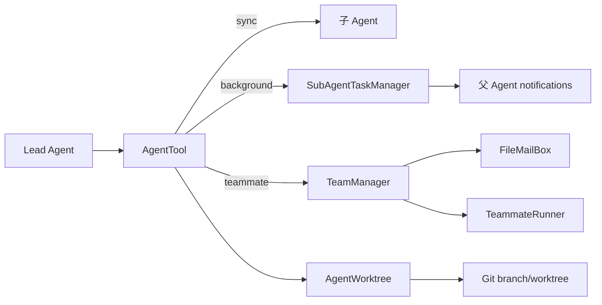

# 05-05 SubAgent、Team、任务和 Git Worktree 逐文件精读

这一卷回答一个问题：当一个 Agent 把工作交给另一个 Agent 时，哪些状态共享，哪些状态隔离，任务结果如何回来，代码改动如何避免互相覆盖。当前 Java 实现既支持同进程虚拟线程，也保留 tmux/iTerm 后端；它不是分布式微服务，通信主要是内存对象和 `.JimiCode/teams` 文件。

## 1. SubAgent 数据模型

### `subagent/SubAgentSpec.java`

record 字段：`name`、`description`、允许工具列表、禁用工具列表、系统提示覆盖、最大轮数、模型选择。内置 `GENERAL_PURPOSE` 允许所有工具、200 轮；`PLAN` 禁止 EditFile/WriteFile、15 轮，附带只读架构师 Prompt；`EXPLORE` 禁止写工具、30 轮、模型别名 haiku。record 本身不可变，但 List 引用若来自外部可变，生产建议复制为 `List.copyOf`。

### `AgentLoader.java`

`loadAll(projectRoot)` 先加载内置，再用户目录 `~/.JimiCode/agents/*.md`，最后项目 `.JimiCode/agents/*.md`，后层同名覆盖前层。`parseAgentFile` 支持 `---` YAML frontmatter 和 Markdown 正文：name/description 必填，model 只能空、inherit、haiku、sonnet、opus，tools/disallowedTools 为字符串列表，maxTurns 为数字。坏文件静默跳过，启动不会因一个用户 Agent 文档失败而退出；代价是用户可能不知道为什么 Agent 没出现。

## 2. `ToolFilter.java`

ToolFilter 根据 SubAgentSpec 复制或筛选 Registry：先应用 disallowedTools，再应用 tools 白名单，后台/teammate/fork 还有额外限制，MCP 工具按名称前缀过滤。它的职责是减少 child 能见到的 schema，不是代替父级 PermissionChecker；子 Agent 执行时仍然要检查权限。

## 3. `AgentTool.java`：路由入口

AgentTool 实现 Tool，schema 包含 description、prompt、subagent_type、model、run_in_background、isolation 等参数。执行时先解析 spec，再按参数选择：teammate 路由到 TeamManager；fork 创建独立 conversation；async 交给 SubAgentTaskManager；普通 sync 在当前进程阻塞等待结果。互斥参数会被拒绝，例如 isolation=worktree 与已存在的 child worktree 冲突。

父 Agent 的 `ContentReplacementState` 可以 clone 给 fork，使共享历史中的 tool_use_id 具有稳定的 prompt cache 前缀；但 fork 的文件、session、工作目录可以独立。禁止 fork 套 fork 是为了避免指数级任务树和权限传播失控。

## 4. `SubAgentTaskManager.java`

### 4.1 状态机

TaskStatus 为 PENDING、RUNNING、COMPLETED、FAILED、CANCELLED。`createTask` 在 synchronized 下生成 `task_1` 风格 id；`setRunning` 保存虚拟线程；完成/失败/取消都追加 TaskNotification；`drainNotifications` 一次取出并清空，Agent 主循环通过 `notificationFn` 将通知注入 system reminder。

### 4.2 `spawnSubAgent`

方法先创建任务，再 `Thread.startVirtualThread`：按 spec 过滤 registry，创建 child Agent，设置 maxIterations，必要时复制 replacement state，构造 ConversationManager，注入系统 Prompt 和用户 prompt，然后消费 child AgentEvent 队列。Text 累加输出；ErrorEvent 失败；LoopComplete 成功；60 秒没有事件则失败 Timeout。父线程立即得到 task id，不等待 child 完成。

取消只 interrupt 记录的线程；如果 child 正在阻塞 SDK 网络调用，中断能否终止取决于 SDK 和 HTTP client，不能假设一定立即停止。任务状态由 synchronized 方法更新，但 `TaskEntry` 字段也标 volatile，兼顾列表读取和线程可见性。

## 5. Team 模型

### `teams/TeamManager.java`

TeamMode 只有 IN_PROCESS、TMUX；Team 包含 name、mode、members 和邮箱根目录；Member 保存 name、Agent、ConversationManager、线程/进度信息。TeamManager 负责 create/delete、add/remove member、send message、聚合进度、shutdown。IN_PROCESS 直接启动 TeammateRunner；TMUX/iTerm 由 SpawnDispatcher 创建外部 pane。

### `TeamTools.java`

`SendMessageTool` 校验 sender、recipient 和消息内容，把消息写入目标邮箱；`TeamCreateTool` 创建团队并选择 mode；`TeamDeleteTool` 关闭成员并清理目录。它们是 Lead 的协调工具，不是普通写文件工具，因此 Team 存在时 `Coordinator` 可以收窄 Lead 的工具集，避免 Lead 与 teammate 同时编辑同一文件。

### `AgentNameRegistry.java`

工具类负责校验/生成 teammate 名称，避免路径和邮箱文件名注入。名称必须可预测、可安全拼入 `.JimiCode/teams` 子目录；生产建议同一团队内做大小写不敏感唯一约束。

## 6. 文件邮箱与共享任务

### `FileMailBox.java`

`MailMessage` 包含 from/text/timestamp/read；邮箱以 JSON 文件保存。发送、读取未读、标记已读通过文件锁/临时文件原子替换（具体锁范围以方法为准），避免两个 teammate 同时写丢消息。坏 JSON 行通常跳过，读取到的消息仍可继续消费。

### `SharedTaskStore.java`

把 Team 任务保存为 JSON，状态、owner、description、result 等字段供多个进程观察。更新采用读—改—写，必须配合锁；并发下最后写入可能覆盖前一更新。它与 SubAgentTaskManager 的区别是跨进程持久化，不依赖父进程内存。

### `Coordinator.java`

静态工具集中定义 Lead 在团队运行期间可见的协调工具白名单，并解释为什么隐藏 Bash/WriteFile：协调阶段 Lead 应通过 SendMessage 指挥成员，而不是直接造成共享工作区冲突。

## 7. teammate 运行和外部后端

### `TeammateRunner.java`

长期循环先注入团队身份，启动 Agent 执行任务，消费事件更新 `TeammateProgress`；完成一轮后进入 idle，轮询邮箱等待新 prompt 或 shutdown。`WaitResult` 区分新任务与关闭。轮询周期、邮箱读取失败和 Agent timeout 是运行稳定性的关键，生产建议使用文件系统 watch 或真正消息队列替代忙轮询。

### `TeammateProgress.java`

维护最近工具、工具次数、token 用量、spinner 文案和状态。`ToolActivity` 根据工具名生成用户友好描述，例如 ReadFile→读取文件、Bash→执行命令。它是展示状态，不应作为权限来源。

### `SpawnDispatcher.java`

校验成员名、工作目录和 TeamMode，生成带 `--teammate` 参数的命令并按 mode 调用进程内、tmux 或 iTerm。shell quote 是安全重点：不能把用户提供的 team name 直接拼进 shell 字符串。

### `TmuxBackend.java` 与 `ITermBackend.java`

Tmux 使用 `tmux split-window` 创建 pane、`send-keys C-c` 中断、`kill-pane` 清理；iTerm 使用 macOS `osascript`/iTerm CLI。Windows/Linux 没有 iTerm，Dispatcher 应回退进程内。外部 pane 的 stdout 不直接进入父 JVM，主要通过邮箱和状态文件同步。

## 8. Git Worktree 文件级详解

### `SlugValidator.java`

校验 slug 不能为空、包含路径穿越或危险字符，并提供 flatten 把层级转换成分支安全形式。它是 worktree 路径安全的第一道防线，不能只依赖 Git 自己报错。

### `WorktreeManager.java`

构造器保存 projectRoot、symlinkDirs 和 staleCutoffHours（<=0 使用 24 小时）。`create` 默认路径 `<root>/.JimiCode/worktrees/<branch>`，执行 `git worktree add -B branch path`，再调用 `PostCreationSetup` 复制设置、hooks、symlink 和 `.worktreeinclude`，最后登记 WorktreeInfo。`remove` 只允许移除内存登记的分支；`list` 优先解析 `git worktree list --porcelain`，失败回退内存 map；`cleanupStale` 按创建时间强制删除过期登记；`detectChanges` 在指定目录执行 `git diff --stat`，30 秒超时杀进程。

当前 WorktreeInfo 的 createdAt 在解析 porcelain 时使用当前时间，而不是 Git 创建时间，因此 stale 只对本进程内 create 的对象可靠。`removeAll` best-effort，不检查未提交变更；调用前必须得到用户确认。

### `AgentWorktree.java`

这是给一次性 SubAgent 的无全局 session 版本。`create(slug,repoRoot,symlinkDirs)` 验证 slug，路径使用 flatten，分支为 `worktree-<slug>`；目录存在时 bump mtime 并快速恢复 HEAD；否则执行 `git worktree add -B branch path HEAD`，设置 GIT_TERMINAL_PROMPT=0/GIT_ASKPASS 空值防止等待凭据，完成后做 PostCreationSetup。`remove` 强制移除 worktree 再删除分支，失败只记录 fine 日志；`buildNotice` 生成告知 child 翻译父路径的系统提示。

### 其余 Worktree 文件

`WorktreeSession` record 保存当前 worktree path/branch/root/head；`WorktreeSessionStore` 用 Jackson 写读 session JSON，缺失返回空；`WorktreeChanges` 统计 changedFiles、commits 和未推送提交；`StaleCleanup` 扫描 `.JimiCode/worktrees`，检查命名、年龄、session、脏状态和未推送 commit，任何不确定都跳过；`PostCreationSetup` 复制 `.JimiCode` 设置、共享 Git hooks、创建 symlink，并读取 `.worktreeinclude`；`AgentWorktree` 与 `WorktreeManager` 的区别是前者面向 child 的轻量静态 API，后者面向 TUI 全局管理。

## 9. 状态与副作用拓扑

## 10. 一次 worktree 隔离实验

1. 在 Git 仓库根运行 `AgentWorktree.create("demo",root,List.of())`，记录 path/branch/head。
2. 在 child path 修改文件但不提交，调用 `WorktreeChanges`/`git diff --stat`。
3. 父目录检查文件不应变化，证明工作目录隔离。
4. `remove` 后确认 branch 删除；如果有未提交改动，解释 `--force` 的数据风险。
5. 模拟进程中断，留下目录，再调用 `StaleCleanup`，观察它何时保守跳过。

## 11. 面试题

1. SubAgent 与线程池任务有什么区别？SubAgent 有独立消息上下文、工具过滤、最大轮数和事件协议；线程只是执行载体。
2. 为什么 fork 要复制 replacement state？共享历史中的替换决策必须保持字节稳定，避免 prompt cache 前缀变化。
3. Worktree 能隔离 MCP/数据库副作用吗？不能，它只隔离 Git 文件；外部服务仍需租户、session 和幂等设计。
4. 如何避免 Team 两个成员改同一文件？角色分工、Lead 协调白名单、worktree 隔离、提交后合并冲突检测；当前实现不提供自动语义合并。
5. 为什么 tmux 后端不是默认？依赖终端能力和操作系统，失败时应回退同进程以减少部署条件。

## 12. 小结

SubAgent 解决任务分解，Team 解决持续协作，TaskManager 解决后台生命周期，Mailbox/SharedTaskStore 解决跨线程或跨进程通信，Worktree 解决文件隔离。它们的共同难点是取消、重复、崩溃恢复和副作用边界。源码阅读时要沿“父事件→子上下文→工具过滤→工作目录→结果通知→父会话”逐段跟踪，而不是只看 AgentTool 的 schema。

## 13. 参数与状态验收表

|入口|关键参数|必须拒绝/处理的异常|
|---|---|---|
|AgentTool|description、prompt、agent type|prompt 为空、未知 agent、fork 套 fork、isolation 冲突|
|AgentLoader|frontmatter path|缺 name/description、非法 model、坏 YAML、同名覆盖|
|SubAgentTaskManager|client/registry/spec/prompt|队列 60s timeout、interrupt、child ErrorEvent|
|TeamCreate|team name/mode|非法名称、重复团队、不可用 tmux/iTerm|
|SendMessage|sender/recipient/text|不存在成员、空文本、邮箱写失败|
|WorktreeManager.create|branch,targetDir|路径穿越、Git 非仓库、分支锁、创建后 setup 失败|
|AgentWorktree.remove|path/branch/gitRoot|root 为空、git remove 失败、分支删除失败|

## 14. 子 Agent 的上下文边界

同步 child 通常只收到父 prompt 和 spec.systemPromptOverride；它不会自动看到父 Conversation 的所有历史，除非 fork 分支显式 seed。后台 child 完成后只把最终文本通过 TaskNotification 注入父 Agent，工具中间事件不进入父上下文。这样可以节省 token，却可能让父 Agent 不知道 child 为什么失败。生产可保留结构化摘要：已读文件、修改文件、命令、测试结果、失败原因和建议，而不是只传一段自然语言。

Team teammate 是另一种边界：它有长期 ConversationManager 和邮箱，可接收多轮消息；Lead 看到的是协调工具和聚合进度。邮箱消息不一定与模型 token 顺序一致，TeammateRunner 每轮 idle 后才读取下一封，多个消息可能合并。需要强一致工作流时应给消息编号、ack、幂等 key 和 dead-letter 文件。

## 15. 取消、超时、重复执行分析

取消父 Agent 不一定取消 child：`SubAgentTaskManager.cancelTask` 只 interrupt child thread，Team 外部 pane 需要 TmuxBackend/ITermBackend 发送 Ctrl+C。若 child 正在执行 Bash，ProcessBuilder 子进程可能继续运行；如果 child 正在 MCP call，SDK timeout 才会结束。重复点击“重试”可能创建两个 task；当前 task id 由 manager 生成但没有业务去重。生产建议为每个任务设置 parent cancellation token、子进程树 kill、MCP request id 和幂等任务键。

## 16. Worktree 创建后的文件复制

`PostCreationSetup` 的职责不是业务合并，而是让 child 环境可运行：复制用户/项目 `.JimiCode` 只读设置、共享 Git hooks、按配置 symlink 大目录（例如 node_modules）、读取 `.worktreeinclude` 复制被 gitignore 的配置。symlink 在 Windows 可能需要开发者权限，失败时应让 child 继续但把 warning 传回。复制本地 config 时必须排除 api_key，当前实现以文件模式和 ignore 规则为准，使用者应实际检查。

## 17. Git 状态与合并实验

在临时仓库创建 `main`，调用 `AgentWorktree.create("feature/ui",root,List.of())`。child 修改 A.java 并提交，父目录修改同一 A.java；使用 `WorktreeChanges` 统计 changedFiles/commits，再尝试 cherry-pick child branch。记录无冲突、文本冲突、删除冲突三种结果。实验说明 Worktree 只减少工作区互相覆盖，不会自动解决语义冲突，也不会自动把 child commit 合并到主分支。

## 18. 跨平台后端选择

Windows 默认没有 tmux/iTerm，IN_PROCESS 是最稳妥路径；macOS 可选择 iTerm，但需要允许 AppleScript；Linux 常见 tmux，需确认命令在 PATH。`SpawnDispatcher` 应先检测能力再选择，不能把 OS name 当作唯一依据；例如远程 SSH 终端可能没有 `$TERM` 或 pane。部署文档应列出 fallback 和如何查看 teammate 日志。

## 19. 安全审查

Agent spec 的 systemPromptOverride 是用户可写自然语言，不能赋予它超出 PermissionChecker 的权限；disallowedTools 只能收窄不能放宽。Worktree branch/slug 必须阻止 `../`、控制字符和超长名；邮箱文件名必须防路径穿越；TeamTools 的 SendMessage 不能让模型伪造 sender；tmux/iTerm 命令必须 argv 化并 shell quote。MCP/数据库/网络副作用不因 worktree 隔离而消失。

## 20. 面试深挖

“为什么子 Agent 不是简单递归调用 Agent.run？”因为需要独立 token/iteration、工具过滤、取消、进度和结果生命周期。 “同进程 Team 与多进程 Team 如何选？”同进程共享内存简单、延迟低；多进程故障隔离和终端可观察性更好，但要处理邮箱、序列化和进程回收。 “Worktree stale cleanup 为什么保守？”误删未提交代码代价高，无法确认 session、脏状态或未推送 commit 时宁可泄漏目录。

## 21. 课后验收

完成一个最小 child Agent：使用 fake LlmClient，只允许 ReadFile，maxTurns=2，返回结果后父 Agent 收到一条通知；再加 Worktree 隔离、FileMailBox 消息和取消测试。验收必须记录 task status、child worktree、父 Conversation 的新增文本和任何未清理资源，证明你理解的不只是接口，而是完整生命周期。

把这个实验运行两次并比较：第一次 child 正常完成，第二次在 Git 命令中途终止。若第二次留下 worktree、branch、邮箱或 task 状态，分别说明应由哪个类负责清理；不要用 `removeAll` 盲目删除整个仓库的 worktree。
