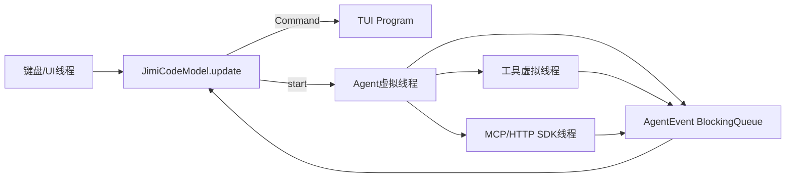

# 05-07 TUI、事件循环、渲染与对话框逐文件精读

JimiCode 没有 Web Controller；`JimiCodeModel` 就是它的交互入口。它实现 TUI4J/Bubble-Tea 风格的 Model：`init` 返回初始命令，`update(Message)` 消费键盘、定时器和 Agent 事件，`view()` 把当前状态渲染为字符串。理解 Model 的状态转换，等价于理解 Web 项目的 Controller→Service→View 链路。

## 1. `tui/AppState.java`

枚举只有 PROVIDER_SELECT、CHAT、RESUME。状态决定 `update` 把 KeyPress 转发给哪个 handler，也决定 `view` 显示 provider 选择、聊天或会话恢复界面。状态转换必须通过 Model 的 update 线程完成，后台 Agent 不能直接修改 state。

## 2. `tui/ChatMessage.java`

ChatMessage 是展示模型，不是发送给 provider 的 Message。role 可以是 user、assistant、system、error、tool、tool_collapsed、tool_group、sub_agent、thinking；`ToolBlockInfo` 保存工具名、参数、输出、错误、耗时、折叠和 loading；`SubAgentBlockState` 保存描述、类型、工具列表、完成状态、工具数和总耗时。把展示对象与 conversation 对象分离，避免 UI 为了折叠一条工具结果而改变模型上下文。

## 3. `JimiCodeModel.java` 的装配字段

Model 持有 provider 列表、MCP 配置、Hook 配置、当前 PermissionMode、Program 引用、AppState、选中 provider、Agent、ConversationManager、ToolRegistry、Session/History/FileHistory、CommandRegistry、Memory/Skill/Team/SubAgent 管理器、输入缓冲、slash/at 补全列表、Permission/AskUser/Plan/Rewind 对话框和消息列表。这个类很大不是偶然：它是 CLI 的 composition root，同时承担 TUI 状态和模块生命周期；生产重构可拆成 ProviderController、ChatController、DialogController，但教学代码把装配集中便于跟踪。

## 4. 构造与环境初始化

两个构造器最终调用完整版本，保存 providers/mcpServers/hooks/permissionMode，创建 `CommandRegistry`、`HistoryStore`、`TeamManager` 等。`parseEventName`/`parseActionType` 把配置字符串转 HookEngine 枚举，未知值通常回退默认或忽略。`setProgram` 保存 TUI 引用；`handleSigint` 根据 Agent 是否运行决定取消当前请求或发 quit 命令。

## 5. TUI4J Model 三个入口

### `init()`

加载 HistoryStore，设置 provider selection 初始光标，返回定时轮询 Agent/邮箱的 Command。它不创建模型 client，真正初始化发生在用户选择 provider 后。

### `update(Message msg)`

先处理 WindowSize、KeyPress、AgentEventMessage、MailboxPollMessage、定时器等类型，再根据 AppState 转发。键盘在 provider 选择状态调用 `handleProviderSelectKey`；CHAT 状态调用 `handleChatKey`；RESUME 调用 `handleResumeKey`；对话框激活时优先由对应 handler 消费。返回 `UpdateResult`，可附带下一条 TUI Command（例如 50ms 后继续轮询）。

### `view()`

按 AppState 调 `viewProviderSelect`/`viewChat`/`viewResume`，再叠加 active Permission、AskUser、PlanApproval、Rewind dialog。视图只读状态，不执行工具。渲染超长 Markdown 时应注意 terminal width，当前 MarkdownRenderer 主要做 ANSI 样式而非真正中文换行。

## 6. Provider 选择到 Agent 初始化链路

`handleProviderSelectKey` 处理上下移动和 Enter；Enter 调 `initializeProvider`。初始化步骤通常包括：选择 ProviderConfig；创建 LlmClient；创建默认 ToolRegistry；连接 MCP 并注册 wrappers；创建 PermissionChecker；装载 Skill/Agent/Team/Task 工具；构建 PromptBuilder 环境 Prompt；创建 ConversationManager、SessionManager、FileHistory；实例化 Agent 并设置 workDir/sessionId/filters/hooks/memory。任何认证或 MCP 错误应转为系统消息而不是让 TUI 线程崩溃。

## 7. Chat 输入处理：`handleChatKey`

普通字符追加到输入缓冲；Enter 调 `sendUserMessage`；Escape 在流式阶段调用 `handleSigint`；上下键读取 HistoryStore；Tab 选择 slash 或 @ 文件补全；Shift+Tab 切换 PermissionMode。`updateSlashMenu` 在输入以 `/` 开头时调用 CommandRegistry，`updateAtMenu` 扫描工作目录并跳过 `.git`、target、node_modules 等目录。补全只改变 UI 输入，不直接读取模型。

## 8. `sendUserMessage()` 完整链路

1. trim 输入，空字符串返回。
2. 如果以 `/` 开头，解析 Command；LOCAL/LOCAL_UI 直接执行，PROMPT 变成 Agent 的 user message。
3. 普通消息追加 ChatMessage(user) 和 ConversationManager.addUserMessage。
4. 通过 MemoryRecall 异步预取相关 memory，避免阻塞首屏；完成后注入下一轮上下文。
5. 触发 `SESSION_START`/`TURN_START` hooks。
6. 调 `agent.run(conversation)`，保存返回的 AgentEvent 队列，启动 50ms AgentEventMessage 轮询。
7. UI 继续可响应 Ctrl+C、权限对话框和 AskUser。

## 9. `handleAgentEvents()`

它从 Agent 队列 poll 事件并更新展示：StreamText 追加当前 assistant stream buffer；ThinkingText/Complete 维护 thinking block；ToolUseEvent 创建 loading ToolBlock；ToolResultEvent 填充 output、elapsed、error；UsageEvent 更新 token；CompactEvent 显示压缩；RetryEvent 显示等待；PermissionRequestEvent 激活权限对话框并完成 future；AskUserRequestEvent 激活 AskUserDialog；LoopComplete 调 `savePartialResponse`/`commitToolBlocks`，写 Session，并触发 TURN_END/MEMORY extraction。

事件处理必须保持顺序。尤其不能在最终 no-tool turn 先发送 TurnComplete 再清空 stream buffer，因为 Agent 注释明确指出这会导致 LoopComplete 看到空缓冲而无法持久化最终回复。

## 10. 工具块与子 Agent 渲染

`commitToolBlocks` 把连续工具调用合并为可折叠 group；`renderToolBlockText` 生成单个工具摘要；`renderToolGroupSummary` 显示“读取 3 个文件，耗时 1.2s”；`renderToolBlock` 根据 loading/error/collapsed 使用 Styles。`handleSubAgentProgress` 将后台进度加入队列，`drainSubAgentProgress` 合并到 ChatMessage.SubAgentBlockState；`renderSubAgentBlock` 展开时列出子工具，折叠时只显示总数和耗时。

## 11. 对话框文件

### `dialog/AskUserDialog.java`

支持 Question(text,header,options,multiSelect) 和 Option(label,description)。状态包括当前问题、光标、选择集合、输入模式和 active。上下键移动，空格选择，多选允许多个答案，Enter 提交当前/全部，Escape 取消。`submitAllAnswers` 完成 future；关闭对话框必须在异常和 Ctrl+C 时也完成，否则 Agent 工具线程会等待五分钟。

### `dialog/PlanApprovalDialog.java`

三项结果 YOLO、MANUAL、FEEDBACK，另有 CANCEL。`activate` 重置 cursor/input；`handleKey` 支持 up/down/enter/shift+tab/backspace/可打印字符；选择 feedback 但输入为空时不关闭。YOLO 会把 PermissionMode 切到 BYPASS，风险极高，当前实现把这一能力作为显式用户选择，而不是模型自行决定。

## 12. 渲染辅助

### `MarkdownRenderer.java`

`render(markdown,width)` 按行处理代码围栏、标题、列表、引用、分隔线和空行；代码块用灰色边框，普通行走 `renderInline`。正则替换粗体、斜体、反引号和 Markdown 链接，链接只显示文字、不创建终端可点击 URL。它不解析嵌套 Markdown、表格或 ANSI 转义，恶意模型输出 ANSI 可能污染终端，生产建议先过滤控制字符。

### `Styles.java`

集中定义品牌紫、灰、绿、红、黄、青等 ANSI256 样式，覆盖 banner、prompt、AI 文本、工具状态、错误、权限模式、provider 选择和 placeholder；静态 helper `cyan/dim/green/red/yellow` 用于内联团队树。样式不是业务状态，禁止用颜色判断权限。

### `SpinnerVerbs.java`

保存运行中动词和过去式转换，随机返回 spinner 文案。随机性只影响展示，不应进入会话或 Prompt，否则同一请求的审计文本会不稳定。

## 13. Resume、Rewind、Memory 与 Hook

`handleResumeKey` 在 RESUME 状态过滤 SessionInfo，Enter 调 SessionManager.rebuildConversation，重新初始化 Agent；`filterResumeSessions` 按 id/firstMessage 搜索；`viewResume` 显示相对时间、分支和大小。`handleRewindKey` 展示 FileHistory snapshots，`executeRewindOption` 调 rewind 并刷新文件状态，不能只清除 UI 消息。

`buildMemorySection` 合并 MemoryManager 的索引和 MemoryRecall 结果；`triggerMemoryExtraction` 启动后台 headless child，完成后向 UI 提示新 memory。`fireHook` 把事件、toolName、args 交给 HookEngine，Hook 错误不应阻塞终端循环。

## 14. 线程模型

只有 UI 线程修改 `ChatMessage` 和对话框状态；后台线程通过 queue/message 回传。`ConcurrentLinkedQueue<SubAgentProgress>`、`CompletableFuture`、`BlockingQueue` 分别承担无锁进度缓存、HITL 回复和有界流事件。

## 15. 新手调试路线

1. 在 `update` 断点输入普通文本，记录 state、inputBuffer。
2. 在 `sendUserMessage` 记录 ConversationManager size、sessionId。
3. 在 `handleAgentEvents` 按事件类型单步，确认 UI 不直接执行工具。
4. 在 Permission dialog 中不点击，观察 Agent 线程等待；五分钟后确认 DENY。
5. 在 LoopComplete 断点检查 stream buffer、ChatMessage 和 session JSONL。
6. 关闭终端模拟 SIGINT，确认 `finally` 光标恢复和 queue 不再增长。

## 16. 面试题

- TUI Model 与 MVC Controller 有何区别？Model 的 update 同时承担事件路由和状态转换，view 是纯字符串渲染；它更接近 Elm/Bubble Tea 的单向数据流。
- 为什么后台线程不能直接改 UI？会造成竞态和终端输出交错；统一消息队列还能记录事件顺序。
- 如何保证权限请求不死锁？future 必须有超时，dialog cancel/quit 必须完成 future，Agent 捕获 InterruptedException。
- 为什么展示 Message 与 Conversation Message 分离？一个保留供应商协议字段，一个支持折叠、耗时和 loading，两者生命周期不同。

## 17. 小结

`JimiCodeModel` 是项目中最像“控制器”的文件，但它不是业务服务。它把键盘、定时器、AgentEvent、对话框和持久化统一到一个事件循环；其余 TUI 文件提供状态枚举、展示 DTO、ANSI 样式和纯字符串渲染。学习时要把“事件来了如何改变状态”写成表，而不是只看最终屏幕长什么样。
