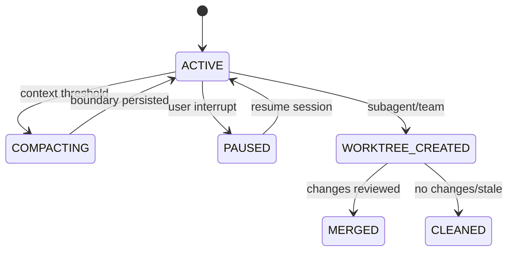

# 06 会话、Memory、Worktree 与恢复

## 会话模型

`ConversationManager` 管理消息、thinking block、tool use/result block；`SessionManager` 将会话写为可追加记录，提供 session id、消息统计、compact boundary 和 resume 所需扫描。`HistoryStore` 管理历史列表或索引，`FileHistory` 为编辑操作保存备份和快照。学习时要区分“模型上下文”与“磁盘审计记录”：前者可能被压缩，后者用于恢复和追责。

## Memory

`MemoryManager`、`MemoryScanner` 和 `MemoryRecall` 根据项目路径和时间选择记忆文件，把相关内容注入 Prompt。Memory 是辅助上下文，不是事实数据库；旧记忆可能过时，跨项目复用可能泄露路径或凭证。`/clear` 或新会话时要确认 memory content 是否仍被保留。

## Worktree

`WorktreeManager`/`AgentWorktree` 负责创建、状态、变更摘要、清理和 stale cleanup；`SlugValidator` 防止不安全名称，`PostCreationSetup` 负责初始化。Worktree 隔离 Git 文件，却不能隔离模型 API、MCP Server 或共享外部服务。删除 worktree 前必须检查未提交变更和 active session。

## 恢复实验

在工具写文件后强制退出，使用 session id 恢复并核对 file history；在压缩 boundary 后退出，确认 summary、keep tail 和 RecoveryState 能重建；创建 worktree 后模拟 stale cleanup，确认未提交变更不会静默丢失；在子 Agent 运行时终止父进程，记录 mailbox、session 和 worktree 的残留。
