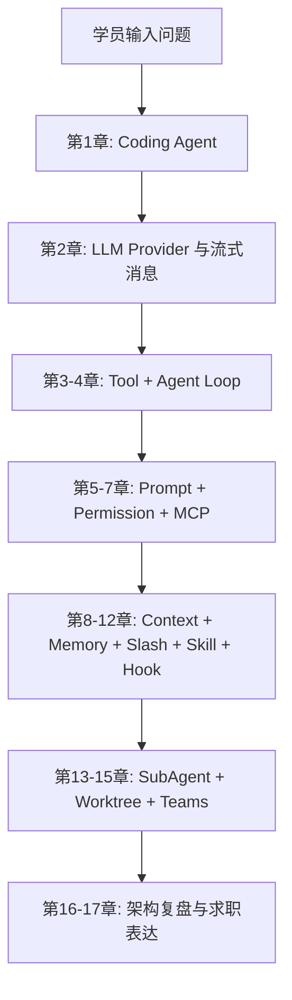
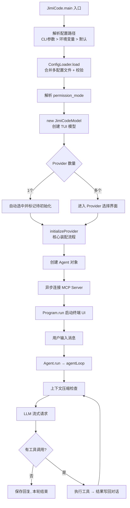
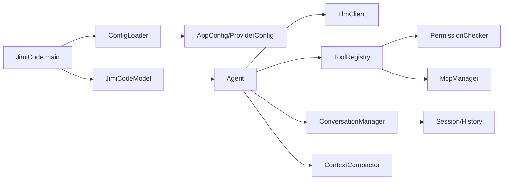
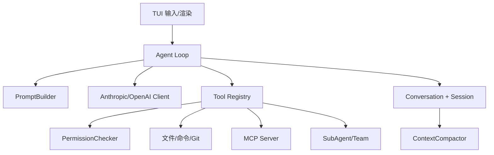

# JiMI Code 整合学习文档：01-基础架构与学习路线.md

> 本文由 `docs/` 与 `study-notes/` 下的教材按段落级别整理生成。原始文件不删除；相同段落在本主题内只保留一次，保留版本最完整或最接近课程主线的那一段，其余来源记录在末尾的合并审计中。内容涉及当前源码时以 `jimi-code` 工作区为准；对 Claude Code 的描述只代表公开体验对标。

## 本主题的融合说明

本主题按“课程概念 → jimicode 源码 → 实验/排障 → 面试与边界”排序。段落之间出现同一事实时，优先保留包含真实路径、调用关系或失败处理的版本；只有标题/目录性质的短段被折叠。

> 来源：`docs/course/00-必读-课程学习攻略.md`

### 0. 必读｜JiMI Code 课程学习攻略

> 来源：`docs/course/00-必读-课程学习攻略.md`

这一章是整套课程的导航和学习契约。JiMI Code 的目标不是教你调用一次聊天 API，而是带你沿着一条工程能力演进路线，把一个“只能接收文本”的空壳逐步扩展成能够理解仓库、选择工具、修改文件、执行命令、控制风险、压缩上下文、跨会话记忆、拆分子任务并协调团队的 Coding Agent。

> 来源：`docs/course/00-必读-课程学习攻略.md`

- 说清楚 0～17 章分别解决什么问题，以及为什么顺序不能随意打乱；
- 在本地完成 Java 21、Maven 和一个安全的测试配置；
- 用源码路径定位入口、Agent Loop、工具、权限、会话、压缩和协作模块；
- 选择适合自己的速通、扎实或研究路径，并产出可验证的学习记录；
- 区分【课程概念】、【jimicode 实现】和【待源码确认】，避免把通用设计误说成当前项目事实。

> 来源：`docs/course/00-必读-课程学习攻略.md`

这里的“源码对齐”以 `D:/code/JA/project/others/jimi-code` 当前工作区为准。项目 README 已声明 Java 21 + Maven；POM 中的主要依赖包括 TUI4J、Mordant、MCP SDK、Anthropic Java SDK、OpenAI Java SDK、SnakeYAML、Jackson 和 JUnit。入口类是 `src/main/java/com/jimicode/JimiCode.java`，不是一个 Spring Boot `main`，也没有传统 Controller/Service/Mapper 三层。

> 来源：`docs/course/00-必读-课程学习攻略.md`

如果没有学习攻略，学习 Coding Agent 很容易出现至少三种真实失败。

> 来源：`docs/course/00-必读-课程学习攻略.md`

第一种失败是“从产品表面跳到源码细节”。你看到 Claude Code 或 JiMI Code 能改文件，就直接打开 `Agent.java`，却不知道消息、工具 schema、权限和会话为何存在。结果是能读懂几行 Java，却无法解释一次请求从输入到文件修改的完整因果链。

> 来源：`docs/course/00-必读-课程学习攻略.md`

第二种失败是“把仓库清单当成理解”。自动生成的文件索引可以告诉你有 `ContextCompactor.java`，但不告诉你它为什么同时依赖 token usage、工具结果预算和恢复附件。如果只追求覆盖率，最终会得到很多标题和很少的工程判断。

> 来源：`docs/course/00-必读-课程学习攻略.md`

第三种失败是“把闭源产品体验误写成官方实现”。JiMI Code 借鉴了 Claude Code 的终端 Agent 理念，但它是课程项目/自研实现。若简历或面试中说成 Anthropic 官方代码，属于事实错误；若没有实测数据却声称“节省 80% token”，也属于不可验证的夸大。

> 来源：`docs/course/00-必读-课程学习攻略.md`

第四种失败是“没有安全边界地做实验”。直接让 Agent 在真实仓库执行 shell、删除文件或修改配置，容易造成不可逆损失。学习必须使用临时仓库、明确 workdir、最小权限和可回滚的 Git 分支。

> 来源：`docs/course/00-必读-课程学习攻略.md`

第五种失败是“只看正常路径”。Coding Agent 的难点通常在模型返回半截 JSON、工具超时、权限拒绝、上下文超过窗口、进程被 Ctrl-C 中断和多个 Agent 同时修改文件。课程每章都要求实验、排障和面试题，目的就是把失败路径纳入学习。

> 来源：`docs/course/00-必读-课程学习攻略.md`

适合一到两周内需要形成项目表达的人。顺序是：第 1 章 → 第 2 章 → 第 3 章 → 第 4 章 → 第 6 章 → 第 8 章 → 第 13～15 章 → 第 17 章。重点掌握一张全链路图、十个关键类、十个失败场景和 STAR 项目讲解。

> 来源：`docs/course/00-必读-课程学习攻略.md`

可验证产出：一页架构图、5 分钟讲解词、15 道深挖题答纲、一个只读工具和一个需要确认的写文件工具。

> 来源：`docs/course/00-必读-课程学习攻略.md`

适合三到六周，希望能够真正修改项目的人。顺序是完整的第 0～12 章，再做 SubAgent、Worktree 和 Teams。每一章都必须完成实验，并在源码中找到调用者和测试。你要能独立增加一个 Tool、增加一个 Slash Command、扩展 Provider 配置字段，并为异常路径写测试。

> 来源：`docs/course/00-必读-课程学习攻略.md`

可验证产出：一个自定义搜索工具、一个权限规则、一个上下文预算策略、一个 Skill 包、一个 Hook，以及对应的 JUnit 测试。

> 来源：`docs/course/00-必读-课程学习攻略.md`

### 3. 研究路径：Teams/Worktree 与系统治理

> 来源：`docs/course/00-必读-课程学习攻略.md`

适合想研究多 Agent 编排、并发隔离和生产可靠性的人。重点深入第 8、13、14、15、16 章，阅读 `SubAgentTaskManager`、`WorktreeManager`、`TeamManager`、`FileMailBox`、`SharedTaskStore` 和 `TeammateRunner`。除了功能，还要研究崩溃恢复、重复消息、锁、取消传播、成本上限和审计。

> 来源：`docs/course/00-必读-课程学习攻略.md`

可验证产出：两个 Agent 在独立 worktree 中完成不同任务，Team 通过邮箱汇报，主 Agent 汇总结果；同时写出失败演练记录和清理策略。

> 来源：`docs/course/00-必读-课程学习攻略.md`

| 阶段 | 你拥有的能力 | 还没有解决的问题 |
|---|---|---|
| 只有聊天 | 能发送消息和显示文本 | 不知道仓库事实，不能可靠改文件 |
| 有 Tool | 能读文件、搜索、执行动作 | 不知道何时调用，可能越权或死循环 |
| 有 Agent Loop | 能根据观察继续推理 | 仍可能无限循环、上下文爆炸、误执行 |
| 有权限和上下文 | 能控制风险和 token | 复杂任务仍需分工和隔离 |
| 有 SubAgent/Worktree | 能并行拆分任务 | 协作协议、合并和成本更复杂 |
| 有 Teams | 能形成长期角色协作 | 需要治理、可观测性、恢复和人类监督 |

> 来源：`docs/course/00-必读-课程学习攻略.md`



> 来源：`docs/course/00-必读-课程学习攻略.md`

| 数据/产物 | 生产者 | 消费者 | 学习时要记录什么 |
|---|---|---|---|
| `AppConfig` | SnakeYAML/`ConfigLoader` | `JimiCodeModel`、`Agent` | 字段来源、默认值、校验错误 |
| `Message` | TUI/ConversationManager | PromptBuilder、LlmClient | role、content、顺序、序列化 |
| `StreamEvent` | Provider Client | StreamingExecutor、TUI | delta 类型、结束条件、错误 |
| Tool Schema | ToolRegistry | LLM Client | name、description、参数 schema |
| ToolResult | Tool 实现 | Agent、ConversationManager | output、isError、toolUseId |
| PermissionResponse | PermissionChecker/UI | Agent Loop | allow/ask/deny、确认范围 |
| RecoveryState | ReadFile/Skill/Compactor | ContextCompactor/Resume | 快照、技能 SOP、恢复顺序 |
| TaskNotification | SubAgentTaskManager | 父 Agent | 状态、输出、失败和超时 |
| WorktreeSession | WorktreeManager | Team/Agent | 路径、分支、创建和清理时间 |

> 来源：`docs/course/00-必读-课程学习攻略.md`

第一遍是“能聊”：只读 README、POM、入口和总架构，能描述系统用途但不改代码。第二遍是“能读文件”：从 `JimiCode.main` 进入 `ConfigLoader`、`JimiCodeModel`、`Agent`、`LlmClient` 和 `ToolRegistry`，沿调用者反查。第三遍是“能改文件+权限”：在临时仓库里增加工具、触发确认、制造异常、恢复会话，并跑测试。

> 来源：`docs/course/00-必读-课程学习攻略.md`

【jimicode 实现】要求 Java 21+、Maven 3.9+。Windows 下可使用 `mvn.cmd clean verify`；构建产物为 `target/jimicode.jar`，运行命令为 `java -jar target\\jimicode.jar`。首次配置可复制 `config.example.yaml` 到 `.JimiCode/config.yaml`，填入 provider 的协议、base_url、model 和 API key。API key 不要提交 Git，也不要写进学习笔记或截图。

> 来源：`docs/course/00-必读-课程学习攻略.md`

```text
learning-sandbox/       # 专门做破坏性实验的临时仓库
learning-notes/         # 每章的时序图、失败记录、面试答纲
jimi-code/              # 课程项目源码，只读分析后再改动
```

> 来源：`docs/course/00-必读-课程学习攻略.md`

```text
src/main/java/com/jimicode/JimiCode.java                  # 启动入口
src/main/java/com/jimicode/config/                        # YAML 与 Provider 配置
src/main/java/com/jimicode/agent/                         # Agent Loop 与事件
src/main/java/com/jimicode/llm/                           # Anthropic/OpenAI 适配
src/main/java/com/jimicode/conversation/                  # 消息模型
src/main/java/com/jimicode/tool/                          # Tool SPI、注册表、实现
src/main/java/com/jimicode/permission/                    # 权限模式与检查
src/main/java/com/jimicode/compact/                       # 上下文压缩与恢复
src/main/java/com/jimicode/memory/                        # 记忆扫描、召回、管理
src/main/java/com/jimicode/worktree/                     # Git worktree 隔离
src/main/java/com/jimicode/subagent/teams/                # 子 Agent 与团队协作
src/test/java/com/jimicode/                               # 边界条件和回归测试
```

> 来源：`docs/course/00-必读-课程学习攻略.md`

```markdown
## 类名
- 文件：
- 一句话职责：
- 创建者/调用者：
- 输入与输出：
- 可变状态：
- IO/网络/线程副作用：
- 异常与恢复：
- 对应测试：
- 如果替换它，必须保持的契约：
```

> 来源：`docs/course/00-必读-课程学习攻略.md`

每做一次实验，记录“前置配置、输入、模型/工具事件、文件 diff、日志、结果、失败原因、是否可回滚”。数字指标如果没有实测，统一写“示例/需实测”。

> 来源：`docs/course/00-必读-课程学习攻略.md`

### 如何对照 Claude Code 行为学习

> 来源：`docs/course/00-必读-课程学习攻略.md`

对照的是公开产品体验和通用理念，不是闭源内部实现。可以比较：是否支持流式输出、工具确认、项目规则文件、上下文压缩、子任务、工作树和终端交互；不要猜测其内部类名、提示词原文或未公开策略。记录对照表时写“Claude Code 的公开体验”“jimicode 当前源码行为”“差异与改进假设”三列。

> 来源：`docs/course/00-必读-课程学习攻略.md`

**目标**：确认 Java/Maven、配置解析和启动失败边界。

> 来源：`docs/course/00-必读-课程学习攻略.md`

1. 执行 `java -version`、`mvn -version`，记录版本。
2. 复制 `config.example.yaml`，将 API key 放在本地未跟踪文件。
3. 故意把 protocol 改为 `unknown`，执行 `mvn.cmd test` 或启动 jar。
4. 恢复正确协议，使用只读请求启动 TUI。

> 来源：`docs/course/00-必读-课程学习攻略.md`

**预期现象**：错误发生在 Agent Loop 之前，提示协议无效；日志/终端不应打印完整 API key。

> 来源：`docs/course/00-必读-课程学习攻略.md`

**成功标准**：能解释参数路径、环境变量路径和默认配置路径的优先级，并能恢复终端光标。

> 来源：`docs/course/00-必读-课程学习攻略.md`

**常见报错**：Java 版本低于 21、Maven 下载依赖失败、配置文件路径错误、终端不支持 TUI。排查时先看 `JimiCode.main` 和 `ConfigLoader.load`，不要先改 Agent。

> 来源：`docs/course/00-必读-课程学习攻略.md`

**目标**：从入口走到一个工具，不依赖猜测。

> 来源：`docs/course/00-必读-课程学习攻略.md`

1. 打开 `JimiCode.java`，标出配置、权限、模型和 Program 的创建点。
2. 搜索 `new Agent`、`.run(`、`getAllSchemas`、`ToolResult`。
3. 画出 `main → JimiCodeModel → Agent → LlmClient → ToolRegistry` 时序图。
4. 找一个对应测试，例如 `ToolSearchTest` 或 `ConfigLoaderValidationTest`。

> 来源：`docs/course/00-必读-课程学习攻略.md`

**预期现象**：你会发现项目没有 Controller，TUI 事件和 BlockingQueue 是用户交互边界。

> 来源：`docs/course/00-必读-课程学习攻略.md`

**成功标准**：能在 3 分钟内指出一次 turn 的输入、输出、状态和异常出口。

> 来源：`docs/course/00-必读-课程学习攻略.md`

**常见报错**：搜索结果太多、把 `target/` 反编译文件当源码、看不懂第三方 SDK。排查命令应排除 `target`，第三方库只学习当前项目调用契约。

> 来源：`docs/course/00-必读-课程学习攻略.md`

| 症状 | 可能原因 | 排查命令/日志点 |
|---|---|---|
| 找不到配置 | 路径、文件名或工作目录不对 | `Get-Location`；检查 `ConfigLoader` candidates |
| 启动即退出 | provider 缺字段或 protocol 非法 | 看 `ConfigException`，检查 `ProviderConfig` |
| TUI 光标消失 | 异常未进入 finally 或终端状态残留 | 检查 `JimiCode.main` 的 finally，重新打开终端 |
| 不知道从哪读 | 先读了扩展/生成文件 | 回到入口、Agent、消息、ToolRegistry |
| 文档与源码不一致 | 课程概念误当项目事实 | 添加【待源码确认】，以当前路径和测试为证据 |
| 测试结果不稳定 | 使用真实网络/API | 用 mock、临时目录和固定输入隔离外部状态 |

> 来源：`docs/course/00-必读-课程学习攻略.md`

学习环境必须最小化权限：使用临时 Git 仓库，避免把真实项目根目录交给会执行 shell 的 Agent；敏感配置使用环境变量或本地未跟踪文件；涉及写文件、安装依赖、删除内容、网络访问时采用一次性确认；任何“自动允许所有命令”的模式只在隔离沙箱实验，不用于真实仓库。安全策略要落在 PermissionChecker 和工具实现中，不能只写在 System Prompt，因为模型可能忽略提示而权限引擎仍能阻断。

> 来源：`docs/course/00-必读-课程学习攻略.md`

### 题 1：为什么学习 Coding Agent 要先学消息和 Tool，而不是先学 Prompt？

> 来源：`docs/course/00-必读-课程学习攻略.md`

**回答提纲**：Prompt 决定行为偏好，但消息和 Tool 定义可执行边界；没有结构化 Tool schema，模型无法可靠请求动作；没有 ToolResult，Agent 无法根据观察继续推理。**加分点**：提到 provider-neutral 内部表示和 toolUseId 因果关联。

> 来源：`docs/course/00-必读-课程学习攻略.md`

### 题 2：JiMI Code 与 Claude Code 是什么关系？

> 来源：`docs/course/00-必读-课程学习攻略.md`

**回答提纲**：产品理念对标终端 Coding Agent，JiMI Code 是自研课程项目；不能声称 Anthropic 官方实现，也不应猜测闭源内部细节。**加分点**：能列出真实源码路径和差异验证方法。

> 来源：`docs/course/00-必读-课程学习攻略.md`

**回答提纲**：面试表达、源码修改、并发协作的深度不同；研究路径需要额外掌握取消、隔离、恢复、成本和审计。**加分点**：每条路径都有可验证产出而不是只列阅读章节。

> 来源：`docs/course/00-必读-课程学习攻略.md`

### 题 4：如何判断一份源码学习文档是否可靠？

> 来源：`docs/course/00-必读-课程学习攻略.md`

**回答提纲**：看是否有真实路径、调用者、测试、异常和副作用；区分索引与语义；数字指标注明是否实测。**加分点**：用“职责—输入—状态—输出—失败—协作—替换”模板审查。

> 来源：`docs/course/00-必读-课程学习攻略.md`

- [ ] 我能说清 JiMI Code 不是 Anthropic 官方实现。
- [ ] 我能说明 0～17 章从聊天到团队的能力演进。
- [ ] 我已准备 Java 21、Maven 和隔离实验目录。
- [ ] 我能从 `JimiCode.main` 找到配置、Agent 和 TUI 的创建点。
- [ ] 我知道如何区分【课程概念】【jimicode 实现】【待源码确认】。

> 来源：`docs/course/00-必读-课程学习攻略.md`

只有先建立 Coding Agent 的问题边界，下一章讨论模型 API 时才不会把“会聊天”误认为“会编程”。

> 来源：`docs/course/00-必读-课程学习攻略.md`

### FAQ 1：为什么不把所有章节写在一个 Markdown 文件里？

> 来源：`docs/course/00-必读-课程学习攻略.md`

因为每章都需要实验、排障和源码证据，拆分后可以独立复习、链接和迭代；总导航仍提供完整课程视图。

> 来源：`docs/course/00-必读-课程学习攻略.md`

### FAQ 2：我没有 Anthropic API key，能学习吗？

> 来源：`docs/course/00-必读-课程学习攻略.md`

能。第 0～4 章的大部分内容可用 mock provider、单元测试和本地工具学习；真实模型实验要使用你有权限的 provider，并把密钥留在本地。

> 来源：`docs/course/00-必读-课程学习攻略.md`

### FAQ 3：为什么课程强调“索引不等于理解”？

> 来源：`docs/course/00-必读-课程学习攻略.md`

索引解决发现性，语义讲解解决因果关系。只有追到调用者、状态、异常和测试，才能真正修改源码。

> 来源：`docs/course/00-必读-课程学习攻略.md`

第一周完成 0～4 章，第二周完成 5～8 章，第三周完成 9～12 章，第四周完成 13～17 章；若走扎实/研究路径，每个实验和失败演练再各留一到两周。

> 来源：`docs/course/00-必读-课程学习攻略.md`

请不要把“能运行 Maven”误认为“已经准备好学习”。开始第 1 章前，尝试不用打开源码回答下面的问题：如果模型返回一个工具调用，系统如何知道工具名称、参数和风险？如果用户拒绝，消息序列应该如何结束？如果进程在文件写入后、ToolResult 落盘前崩溃，下一次恢复凭什么判断文件状态？如果两个子 Agent 修改同一文件，线程锁能不能解决 Git 工作树冲突？如果上下文超出模型窗口，哪些信息必须保留？

> 来源：`docs/course/00-必读-课程学习攻略.md`

如果这些问题只能回答“交给模型自己判断”，就说明你需要把后续章节当作工程课程，而不是 Prompt 技巧课。每一章都会把“模型能力”和“系统控制”分开：模型擅长理解和生成，系统负责状态、权限、资源、持久化和恢复。这个分工是整个课程最重要的架构前提。

> 来源：`docs/course/00-必读-课程学习攻略.md`

完成课程时，建议仓库中至少存在以下学习产物：

> 来源：`docs/course/00-必读-课程学习攻略.md`

- 一张手工绘制、能解释每个箭头的总架构图；
- 一个只读工具的实现和测试；
- 一个写文件工具的权限规则、拒绝案例和回滚记录；
- 一份 Provider 请求/响应脱敏样本；
- 一次上下文压缩前后的 token/字符统计（注明示例或实测）；
- 一个 Skill 目录及其触发条件、脚本和失败说明；
- 一个 Hook 的阻断/放行策略实验；
- 一个 SubAgent + Worktree 的并行任务演练；
- 一页诚实的项目简历描述和 40 道面试题答纲。

> 来源：`docs/course/00-必读-课程学习攻略.md`

这些产物比“读完了多少字”更能证明学习效果。文档很长是为了覆盖复杂性，但学习必须回到代码、命令、测试和可观察结果。

> 来源：`docs/course/00-必读-课程学习攻略.md`

第一，证据优先于直觉。看到一个类名像 `MemoryManager`，不能直接推断它实现了向量数据库；应打开源码、查看字段和调用者，再确认它究竟是扫描文件、拼接文本还是调用外部存储。第二，契约优先于实现细节。一个方法即使只有几行，也可能通过接口、序列化格式或线程边界影响整个系统；学习笔记要记录“别人依赖它什么”，而不只是“它现在怎么写”。第三，失败优先于演示。正常回答只能说明 happy path，真正的工程质量要看拒绝、超时、半截响应、重复调用、崩溃恢复和回滚。

> 来源：`docs/course/00-必读-课程学习攻略.md`

第四，分层讨论安全。System Prompt 可以表达原则，PermissionChecker 才能强制阻断，Tool handler 还要做最后一次参数和路径校验，Git diff 与审计日志负责事后复核。第五，诚实标注不确定性。当前源码没有 Controller，就写“CLI/TUI 项目无传统 Controller”；某个第三方 SDK 的内部行为不可见，就写“依赖契约/待源码确认”；性能数字没有压测，就写“示例/需实测”。这种标注不是保守，而是专业文档的基本可信度。

> 来源：`docs/course/00-必读-课程学习攻略.md`

第 1 章定义 Agent 的边界；第 2 章提供模型输入输出；第 3 章把动作变成 Tool；第 4 章把 Tool 放进循环。第 5 章让行为可预测，第 6 章让动作可治理，第 7 章让能力可扩展。第 8 章控制上下文成本，第 9 章控制跨会话信息，第 10～12 章把显式命令、可复用技能和生命周期自动化组织起来。第 13～15 章才进入多 Agent、工作树和团队协作，因为没有前面的消息、权限、状态和恢复基础，所谓“并行智能”只会放大混乱。第 16 章复盘技术债，第 17 章把真实能力转换成简历和面试表达。

> 来源：`docs/course/00-必读-课程学习攻略.md`

如果你在某章卡住，优先回退到它直接依赖的上一章：工具选不对，回看消息和 schema；循环停不下来，回看工具结果和终止条件；压缩后无法恢复，回看会话序列和 toolUseId；团队互相覆盖，回看 worktree 与权限，而不是先增加更多 Agent。

> 来源：`docs/course/00-必读-课程学习攻略.md`

把每次回退也记录下来，它会成为你的排障经验库。

> 来源：`docs/course/01-第1章-初识-Coding-Agent.md`

### 1. 第1章：初识 Coding Agent

> 来源：`docs/course/01-第1章-初识-Coding-Agent.md`

本章建立整套课程的第一性认识：Coding Agent 不是“把聊天窗口搬到终端”，也不是“代码补全再加一个按钮”，而是一个能够观察软件工程环境、选择并执行工具、读取行动结果、继续规划并在权限边界内完成任务的闭环系统。

> 来源：`docs/course/01-第1章-初识-Coding-Agent.md`

在“从空壳到团队”的路线中，本章处于起点。你还不会实现完整 Agent，但要先能判断一个产品/项目到底是不是 Coding Agent，知道它的能力边界和风险边界。后续模型 API、工具系统、Agent Loop、权限和协作，都建立在这里的定义上。

> 来源：`docs/course/01-第1章-初识-Coding-Agent.md`

1. 画出“用户输入 → 模型 → 工具调用 → 文件/Shell → 观察结果 → 再推理”的全链路；
2. 用一个真实修 bug 故事解释 Chat、Autocomplete、IDE Agent 和 Coding Agent 的差异；
3. 在 `jimi-code` 源码中定位入口 `JimiCode`、编排器 `Agent`、消息模型、工具注册表和 TUI；
4. 能写出三个“看起来像 Agent、实际上不是完整 Coding Agent”的反例。

> 来源：`docs/course/01-第1章-初识-Coding-Agent.md`

普通 Chat 可以解释“NullPointerException 通常怎么修”，但它看不到你的 `pom.xml`、调用栈、测试和实际数据流。它给出的修复建议可能与当前 Java 版本、依赖版本或项目约定冲突。Coding Agent 的第一项增量能力是通过 `ReadFileTool`、`GlobTool`、`GrepTool` 等工具取得证据，而不是凭通用知识猜测。

> 来源：`docs/course/01-第1章-初识-Coding-Agent.md`

Autocomplete 在光标附近预测几行代码，不负责运行测试，也不会根据编译错误重新修改。一个补全看似合理，但可能引入未导入的类、破坏接口契约或改变并发语义。Coding Agent 会把“修改—编译—观察失败—再修改”作为多步循环，并在每一步保留可审计的工具结果。

> 来源：`docs/course/01-第1章-初识-Coding-Agent.md`

如果模型直接拥有 shell 权限，它可能在不理解工作区边界时执行安装、删除或迁移命令。即使意图是修复 bug，副作用也可能超出用户授权。Coding Agent 必须把“模型提出动作”和“系统允许动作”分开，由权限模式、路径约束和确认 UI 决定是否执行。

> 来源：`docs/course/01-第1章-初识-Coding-Agent.md`

### 失败场景 4：能调用一次工具，但不会根据观察继续推理

> 来源：`docs/course/01-第1章-初识-Coding-Agent.md`

一个脚本可以固定执行 `grep`，但它不知道什么时候该读配置、什么时候该查测试、什么时候该停止。真正的 Agent 需要把 ToolResult 作为下一轮消息输入，根据结果动态选择下一动作，并且有最大步数、超时和取消。

> 来源：`docs/course/01-第1章-初识-Coding-Agent.md`

“能自主修复任何 bug”“完全不会误删文件”都不是严谨定义。学习时必须把能力拆成可观察事件、工具权限、失败模式和测试指标；对没有实测的数据写“示例/需实测”。

> 来源：`docs/course/01-第1章-初识-Coding-Agent.md`

【课程概念】Coding Agent 是运行在软件工程环境中的智能体：它接收自然语言任务，读取项目上下文，调用一组有明确 schema 和权限的工具，观察工具结果，进行多轮推理与规划，并在用户授权范围内产生代码或环境变化。

> 来源：`docs/course/01-第1章-初识-Coding-Agent.md`

1. **环境感知**：能够读取文件、目录、版本信息、测试输出或其他资源；
2. **动作能力**：至少有一个会产生真实影响的工具，而不是只输出文本；
3. **闭环观察**：工具结果必须回到推理上下文；
4. **多步控制**：能根据新结果改变下一步，而不是固定脚本；
5. **治理边界**：有权限、确认、超时、取消、审计或回滚机制。

> 来源：`docs/course/01-第1章-初识-Coding-Agent.md`

| 类型 | 输入上下文 | 是否主动调用工具 | 是否修改环境 | 是否多步观察 | 典型风险 |
|---|---|---:|---:|---:|---|
| Chat | 用户粘贴的文本 | 通常否 | 否 | 有限 | 建议脱离项目事实 |
| Autocomplete | 光标附近代码 | 否 | 只写入编辑器当前位置 | 否 | 局部正确、全局不一致 |
| IDE Agent | IDE 索引和工作区 | 是 | 通常是 | 是 | 权限与 diff 审查不足 |
| Coding Agent | 仓库、终端、规则、工具 | 是 | 是 | 是 | 命令、路径、成本和并发风险 |
| 固定脚本 | 预定义参数 | 固定调用 | 是 | 固定流程 | 无法适应未知结果 |

> 来源：`docs/course/01-第1章-初识-Coding-Agent.md`

与上一阶段“普通聊天”的差异，不是模型名称，而是控制平面是否存在：Tool schema、权限网关、状态、循环、事件和恢复共同构成 Agent。

> 来源：`docs/course/01-第1章-初识-Coding-Agent.md`

### 3. JiMI Code 在这张地图中的位置

> 来源：`docs/course/01-第1章-初识-Coding-Agent.md`

【jimicode 实现】JiMI Code 是本地 Java CLI/TUI Coding Agent。`JimiCode.main` 创建配置和 `JimiCodeModel`；`JimiCodeModel` 负责 TUI 交互状态；`Agent` 负责循环；`LlmClient` 抽象 Anthropic/OpenAI/OpenAI-compatible provider；`ToolRegistry` 管理工具 schema 和实现；文件、Shell、MCP、权限、Memory、Worktree、SubAgent 和 Teams 提供行动边界。

> 来源：`docs/course/01-第1章-初识-Coding-Agent.md`

它不是一个 Web 服务，也不是单纯的 IDE 插件。其“用户界面”是终端，其“数据库”主要是本地会话/历史文件，其“并发基础设施”包括 Java 虚拟线程、文件邮箱和 Git worktree。课程后续会分别解释这些模块，而本章只确认角色，不提前把实现细节混在定义里。

> 来源：`docs/course/01-第1章-初识-Coding-Agent.md`

```mermaid
sequenceDiagram
    participant U as 用户/TUI
    participant A as Agent
    participant L as LLM Provider
    participant R as ToolRegistry
    participant P as PermissionChecker
    participant T as Tool/File/Shell
    participant C as Conversation

> 来源：`docs/course/01-第1章-初识-Coding-Agent.md`

U->>C: 输入任务
    A->>C: 组装系统规则、历史、工具 schema
    A->>L: 发送消息与可用工具
    L-->>A: 文本/思考/ToolUse 流
    A->>R: 按名称查找工具
    A->>P: 评估 allow/ask/deny
    P-->>U: 高风险动作请求确认
    U-->>P: 确认或拒绝
    P-->>A: 决策
    A->>T: 执行已授权动作
    T-->>A: ToolResult（成功或错误）
    A->>C: 追加 ToolResult
    A->>L: 带观察结果再次推理
    L-->>U: 最终答案/变更摘要
```

> 来源：`docs/course/01-第1章-初识-Coding-Agent.md`

| 数据结构 | 主要字段 | 谁生产 | 谁消费 | 为什么不能只用字符串 |
|---|---|---|---|---|
| `Message` | role、content、metadata | 用户、Agent、工具 | Provider adapter、历史、UI | 需要保留角色、块类型和顺序 |
| `ToolUseBlock` | toolUseId、toolName、arguments | 模型流解析器 | Agent、ToolRegistry | 需要按 id 关联结果和恢复 |
| `ToolResultBlock` | toolUseId、content、isError | Tool 实现 | Agent、模型、历史 | 错误也必须成为可推理观察 |
| `StreamEvent` | text delta、thinking、tool call、usage、error | LLM Client | StreamingExecutor、TUI | 流式 UI 不能等完整字符串 |
| `PermissionMode` | 默认策略、确认策略 | 配置/UI | PermissionChecker | 动作是否允许不是模型决定的 |
| `AgentEvent` | 文本、工具、压缩、错误、完成 | Agent Loop | TUI、父 Agent | 需要把内部状态可观测化 |

> 来源：`docs/course/01-第1章-初识-Coding-Agent.md`

用户负责目标和授权；模型负责提出下一步推理/动作；Agent 负责编排与停止条件；Tool 负责执行明确动作；Permission 负责安全裁决；Conversation 负责事实序列；TUI 负责呈现与收集确认。若模型直接绕过 Permission 写文件，架构就失去安全边界；若 UI 直接拼 provider JSON，Provider 抽象就失去意义。

> 来源：`docs/course/01-第1章-初识-Coding-Agent.md`

打开 `src/main/java/com/jimicode/JimiCode.java`，可以看到入口不是“读取文本然后调用一个函数”。它先解析命令行参数或 `JimiCode_CONFIG` 环境变量，再调用 `ConfigLoader.load`；之后把配置转换为 `PermissionMode`，创建 `JimiCodeModel`，再交给 TUI4J `Program` 运行。这个顺序表达了一个架构决策：运行 Agent 前先完成配置和权限校验，避免半初始化状态下执行工具。

> 来源：`docs/course/01-第1章-初识-Coding-Agent.md`

入口还注册 SIGINT，并在 `finally` 中恢复终端光标。Ctrl-C 在 Coding Agent 中不是简单退出：后续 Agent Loop、子进程、队列和会话都要处理取消；本章先记住“取消是控制流的一等公民”，第 4、13、15 章再深入。

> 来源：`docs/course/01-第1章-初识-Coding-Agent.md`

普通函数通常是 `input -> output`。Agent 至少有以下状态：

> 来源：`docs/course/01-第1章-初识-Coding-Agent.md`

```text
conversation       当前消息事实
registry            可发现/可调用工具
permission          当前安全策略
iteration           已执行的推理轮数
usageAnchor        provider usage 或字符估算锚点
recoveryState      压缩后恢复所需的文件/技能快照
replacementState   工具结果替换决策
```

> 来源：`docs/course/01-第1章-初识-Coding-Agent.md`

【jimicode 实现】`Agent.run` 返回 `BlockingQueue<AgentEvent>`，并在虚拟线程中执行 `agentLoop`。这意味着调用者通过事件消费进度，而不是阻塞等待一个最终字符串。`agentLoop` 在每轮开始检查最大迭代和线程中断，随后组装工具 schema、进行自动压缩、处理计划模式和延迟工具，最后调用 LLM 并执行工具。

> 来源：`docs/course/01-第1章-初识-Coding-Agent.md`

```java
// 课程伪代码：展示控制流，不代表可直接复制到生产代码
while (!finished && iteration < maxIterations) {
    checkCancelled();
    injectMemoryAndSystemReminders(conversation);
    maybeCompact(conversation, contextWindow, usageAnchor);

> 来源：`docs/course/01-第1章-初识-Coding-Agent.md`

StreamEvent response = llm.stream(conversation, registry.schemas());
    conversation.append(response.asMessageBlocks());

> 来源：`docs/course/01-第1章-初识-Coding-Agent.md`

if (!response.hasToolUse()) {
        finished = true;
        emitFinalAnswer(response);
        break;
    }

> 来源：`docs/course/01-第1章-初识-Coding-Agent.md`

for (ToolUseBlock call : response.toolCalls()) {
        PermissionResponse decision = permission.check(call);
        if (decision.requiresConfirmation()) {
            emitAskUser(call);
            pauseUntilConfirmed();
        }
        ToolResult result = registry.execute(call);
        conversation.append(result.asToolResultBlock());
    }
    iteration++;
}
```

> 来源：`docs/course/01-第1章-初识-Coding-Agent.md`

真正的 `jimi-code` 实现还要处理流式 delta、工具结果预算、Hook、PLAN、SubAgent 通知、恢复附件、协议差异和错误包装，所以这段代码是概念骨架，不应当被误认为完整实现。

> 来源：`docs/course/01-第1章-初识-Coding-Agent.md`

假设用户说：“请修复订单模块中一个偶发的 NullPointerException，并运行相关测试。”

> 来源：`docs/course/01-第1章-初识-Coding-Agent.md`

第一步，Agent 不应立即写代码。它先调用目录/搜索工具定位订单模块、异常栈或测试名称；ToolResult 可能发现错误发生在 `OrderService` 调用 `discountPolicy` 的路径。

> 来源：`docs/course/01-第1章-初识-Coding-Agent.md`

第二步，Agent 读取相关类、配置和测试，比较空值来源：是数据库返回 null、配置未加载，还是并发初始化顺序问题。它把观察结果加入会话，而不是只在 UI 中显示后丢弃。

> 来源：`docs/course/01-第1章-初识-Coding-Agent.md`

第三步，模型提出修改方案。若需要 EditFile，PermissionChecker 根据模式判断是否自动允许或询问。用户确认后，工具先记录原始文件状态，再做精确替换；如果匹配文本不唯一，工具应返回错误，不应“猜一个位置”。

> 来源：`docs/course/01-第1章-初识-Coding-Agent.md`

第四步，Agent 调用测试命令。测试失败输出成为新的 ToolResult，模型据此调整实现；测试通过后，Agent 汇总修改文件、测试命令、结果和剩余风险。这个故事中每一步都可能失败，但每次失败都能回到结构化观察和权限边界，而不是让模型无条件继续。

> 来源：`docs/course/01-第1章-初识-Coding-Agent.md`

#### 决策一：Provider-neutral 消息

> 来源：`docs/course/01-第1章-初识-Coding-Agent.md`

Anthropic 和 OpenAI 的请求字段不同，但 Agent 不应在业务循环里写两套分支。`LlmClient` 和 `StreamEvent` 将差异压到适配层，便于新增 OpenAI-compatible endpoint 和测试 mock。

> 来源：`docs/course/01-第1章-初识-Coding-Agent.md`

工具失败不一定代表整轮 Agent 失败。把 `isError` 和错误内容回传模型，模型可以换工具、修正参数或请求用户。只有不可恢复的配置/状态错误才应结束主循环。

> 来源：`docs/course/01-第1章-初识-Coding-Agent.md`

#### 反模式一：模型直接获得 `Runtime.exec`

> 来源：`docs/course/01-第1章-初识-Coding-Agent.md`

这样做把“提出动作”和“执行动作”混成一层，无法按命令、路径、会话和用户进行授权，也难以审计。正确方式是把 Shell 封装成 Tool，先 schema 校验、权限判断、工作区限制和超时，再执行。

> 来源：`docs/course/01-第1章-初识-Coding-Agent.md`

#### 反模式二：每轮把所有文件和所有工具结果塞回 Prompt

> 来源：`docs/course/01-第1章-初识-Coding-Agent.md`

短期看似信息完整，长期会导致 token 成本、延迟和上下文溢出。正确方式是按相关性切片、限制工具输出、使用摘要和恢复附件；第 8 章会详细讲 Compaction。

> 来源：`docs/course/01-第1章-初识-Coding-Agent.md`

#### 反模式三：把 Tool 调用写成固定脚本

> 来源：`docs/course/01-第1章-初识-Coding-Agent.md`

固定脚本没有根据未知观察改变计划的能力，也无法处理工具错误和用户拒绝。Agent Loop 必须以模型结果和终止条件驱动下一步。

> 来源：`docs/course/01-第1章-初识-Coding-Agent.md`

1. 写一个只调用聊天 API 的 CLI，只能回答用户粘贴的代码。
2. 写一个固定执行 `rg TODO` 的脚本。
3. 阅读 `jimi-code` 的 `Agent.run`、`ToolRegistry` 和 `ConversationManager`。
4. 为三个系统分别填写“环境感知、动作能力、观察闭环、多步控制、治理边界”五列。

> 来源：`docs/course/01-第1章-初识-Coding-Agent.md`

**预期现象**：前两个系统缺少至少两项必要条件；jimicode 虽具备完整骨架，但具体能力仍受配置、工具和模型质量限制。

> 来源：`docs/course/01-第1章-初识-Coding-Agent.md`

**成功标准**：能解释“有工具”不等于“有 Agent Loop”。

> 来源：`docs/course/01-第1章-初识-Coding-Agent.md`

**常见报错**：把固定脚本的输出误认为模型观察；排查时检查下一步是否由结果动态决定。

> 来源：`docs/course/01-第1章-初识-Coding-Agent.md`

**目标**：体验“观察优先，不立即修改”。

> 来源：`docs/course/01-第1章-初识-Coding-Agent.md`

1. 创建临时 Git 仓库，加入一个会失败的 JUnit 测试和简单 Java 类。
2. 启动 jimicode，权限使用只读或 PLAN 模式。
3. 提出“找出失败原因并给出修改计划”，禁止直接写文件。
4. 检查 Agent 是否先使用 read/search 工具，是否把测试输出作为观察。

> 来源：`docs/course/01-第1章-初识-Coding-Agent.md`

**预期现象**：Agent 可以定位问题但无法在只读模式直接修改；计划模式会产生结构化计划和审批点。

> 来源：`docs/course/01-第1章-初识-Coding-Agent.md`

**成功标准**：你能列出每个只读工具调用的输入、输出和下一步推理依据。

> 来源：`docs/course/01-第1章-初识-Coding-Agent.md`

**常见报错**：模型直接声称已修复但没有文件 diff；检查 ToolResult 和实际 Git 状态，不以自然语言为准。

> 来源：`docs/course/01-第1章-初识-Coding-Agent.md`

| 症状 | 可能原因 | 排查命令/日志点 |
|---|---|---|
| Agent 只聊天不读文件 | 工具未注册、schema 未发送或 prompt 未说明 | 查 `ToolRegistry.getAllSchemas`、Provider 请求体 |
| 工具名称正确但无法执行 | 注册表没有该名称或被 filter | 搜索 `register`、`toolNameFilter`、工具列表 |
| 工具执行后模型不继续 | ToolResult 未追加 conversation 或 isError 格式错误 | 检查 `ConversationManager` 消息序列和 toolUseId |
| 循环一直不结束 | 无 maxIterations、终止条件失效或模型反复调用 | 查看 Agent iteration、`AgentEvent` 和工具调用计数 |
| 修改了错误文件 | 路径未规范化、匹配不唯一、缺少 diff 审查 | 检查工具输入、workDir、Git diff |
| 用户拒绝仍继续执行 | Permission 决策未成为执行前置条件 | 检查 `PermissionChecker` 到 Tool handler 的调用链 |

> 来源：`docs/course/01-第1章-初识-Coding-Agent.md`

本章只讨论防御设计：所有会改变文件、启动进程或访问网络的动作都应进入 Tool 和 PermissionGateway；工具必须限制工作区 root、规范化路径、设置超时和输出上限；高风险动作使用明确的确认 UX；执行前后记录审计事件；实验使用临时仓库并保留 Git 回滚点。不要把“模型被要求谨慎”当成安全控制，也不要在真实目录验证删除、格式化或迁移命令。

> 来源：`docs/course/01-第1章-初识-Coding-Agent.md`

### 题 1：Coding Agent 和 Copilot 补全的本质差异是什么？

> 来源：`docs/course/01-第1章-初识-Coding-Agent.md`

**回答提纲**：补全是局部预测，Coding Agent 是环境感知、工具行动、观察反馈和多步治理的闭环。**加分点**：提到权限、状态和可恢复性，而不只说“能改更多文件”。

> 来源：`docs/course/01-第1章-初识-Coding-Agent.md`

### 题 2：为什么 ToolResult 的错误也要回传模型？

> 来源：`docs/course/01-第1章-初识-Coding-Agent.md`

**回答提纲**：错误是环境观察，模型可以修正参数、选择替代工具或请求用户；但不可恢复的配置/权限错误应结束或暂停。**加分点**：区分业务错误、可重试错误和安全拒绝。

> 来源：`docs/course/01-第1章-初识-Coding-Agent.md`

### 题 3：Agent Loop 如何避免死循环？

> 来源：`docs/course/01-第1章-初识-Coding-Agent.md`

**回答提纲**：最大迭代数、工具调用去重、终止条件、超时、取消、重复错误检测和上下文压缩。**加分点**：把预算和可观测事件纳入治理。

> 来源：`docs/course/01-第1章-初识-Coding-Agent.md`

### 题 4：为什么权限不能只写在 System Prompt？

> 来源：`docs/course/01-第1章-初识-Coding-Agent.md`

**回答提纲**：Prompt 是模型输入，不能作为强制执行边界；权限必须在 Tool handler 前由独立引擎裁决。**加分点**：路径 root、敏感文件、一次性确认和审计。

> 来源：`docs/course/01-第1章-初识-Coding-Agent.md`

### 题 5：如何证明一个 Agent 真的“会编程”？

> 来源：`docs/course/01-第1章-初识-Coding-Agent.md`

**回答提纲**：用可复现实验验证读取仓库、修改文件、运行测试、根据失败再推理、遵守权限和输出 diff；不能只看最终自然语言。**加分点**：记录成功率、首 token 延迟、工具错误率等指标，并标明实测范围。

> 来源：`docs/course/01-第1章-初识-Coding-Agent.md`

- [ ] 我能用五个必要条件定义 Coding Agent。
- [ ] 我能画出消息、模型、工具、权限和观察结果的时序。
- [ ] 我能解释 JiMI Code 与 Chat、Autocomplete、IDE Agent 的差异。
- [ ] 我能在源码中找到 `JimiCode`、`Agent`、`LlmClient` 和 `ToolRegistry`。
- [ ] 我知道为什么 ToolResult、权限和终止条件是 Agent 的必要组成。

> 来源：`docs/course/01-第1章-初识-Coding-Agent.md`

理解 Agent 的角色边界后，下一章才会准确学习“模型如何开口说话”，并把 provider 差异封装成可供 Agent 使用的统一流式接口。

> 来源：`docs/course/01-第1章-初识-Coding-Agent.md`

### FAQ 1：只要模型能生成代码，就是 Coding Agent 吗？

> 来源：`docs/course/01-第1章-初识-Coding-Agent.md`

不是。生成代码属于输出能力，Coding Agent 还必须能观察环境、调用工具、接收结果并在治理边界内继续行动。

> 来源：`docs/course/01-第1章-初识-Coding-Agent.md`

### FAQ 2：jimicode 是不是 Claude Code 的源码？

> 来源：`docs/course/01-第1章-初识-Coding-Agent.md`

不是。它是仿 Claude Code 理念的自研 Java 课程项目。可以对比公开体验，但不能声称官方实现或复制闭源内部设计。

> 来源：`docs/course/01-第1章-初识-Coding-Agent.md`

### FAQ 3：为什么 Coding Agent 需要多轮，而不是一次生成完整补丁？

> 来源：`docs/course/01-第1章-初识-Coding-Agent.md`

真实仓库事实通常未知，测试和工具输出会改变计划；多轮闭环能根据观察修正假设，并在关键动作前插入确认。

> 来源：`docs/course/01-第1章-初识-Coding-Agent.md`

### FAQ 4：Agent 一定要支持 Shell 吗？

> 来源：`docs/course/01-第1章-初识-Coding-Agent.md`

不一定。Shell 是常见能力但风险较高；一个只读代码分析 Agent 也可以是有效 Coding Agent。关键是是否具备工具、观察、多步和治理闭环。

> 来源：`docs/course/01-第1章-初识-Coding-Agent.md`

下面是三句常见宣传，请把它们改写成可验证的工程陈述。

> 来源：`docs/course/01-第1章-初识-Coding-Agent.md`

“Agent 可以自主修复 bug。”应改写为：“在给定仓库、测试命令、最大迭代数和权限模式下，Agent 能够读取相关文件，提出并执行有限次修改，运行指定测试，并输出实际 diff；成功率和平均步数需要在公开样本上实测。”

> 来源：`docs/course/01-第1章-初识-Coding-Agent.md`

“Agent 永远不会误删文件。”应改写为：“删除类操作默认需要确认，工具限制在 workdir root 内，并记录操作前快照；在定义的测试集合中未观察到越权删除，但不能把有限测试推广为绝对保证。”

> 来源：`docs/course/01-第1章-初识-Coding-Agent.md`

“Agent 比人工更高效。”应改写为：“在某组任务、模型、硬件和网络条件下，比较 Agent 与基线人工流程的完成时间、首次可用结果延迟、返工次数、token 成本和错误率；所有数字注明样本和测量方法。”

> 来源：`docs/course/01-第1章-初识-Coding-Agent.md`

这项练习会贯穿第 16、17 章：工程师不是把愿望写得更激动，而是把能力写成边界清晰、可重复验证的契约。

> 来源：`docs/course/01-第1章-初识-Coding-Agent.md`

## 第一章阅读作业：建立自己的最小 Agent 词汇表

> 来源：`docs/course/01-第1章-初识-Coding-Agent.md`

请用不超过两句话分别定义：模型、消息、工具、观察、循环、权限、状态、会话、工作区、回滚。然后在 `jimi-code` 中为每个词填一个真实类或文件路径。若某个词在当前源码中没有一一对应的类，就标记为【课程概念】并解释它由哪些类共同实现。完成后，再用这些词复述一次“修复 NullPointerException”的端到端故事，要求每一步都能指出生产者、消费者和失败出口。

> 来源：`docs/course/01-第1章-初识-Coding-Agent.md`

作业的成功标准不是定义写得漂亮，而是别人可以根据你的路径在仓库中复查。比如“观察”不能只写成“模型看到了结果”，而应指出 `ToolResult` 如何进入 `ConversationManager`，下一次 LLM 请求如何消费它；“权限”不能只写成“系统很安全”，而应指出 `PermissionChecker` 在哪个工具副作用之前做决策。

> 来源：`docs/deep-learning/00-项目总览与学习路线.md`

### jimi-code：00-项目总览与学习路线.md

> 来源：`docs/deep-learning/00-项目总览与学习路线.md`

`jimi-code` 是一个 Java CLI/TUI 编程代理。入口是 `src/main/java/com/jimicode/JimiCode.java`，运行时把配置、会话、Prompt、LLM 客户端、工具注册、权限确认、工作树和终端 UI 串成一条事件驱动链路。它没有传统 Web Controller/数据库表；“接口”主要是命令、工具 schema、LLM provider 协议和本地文件格式。

> 来源：`docs/deep-learning/00-项目总览与学习路线.md`

1. 启动类读取命令行参数和工作目录，`ConfigLoader` 合并默认值、用户配置与环境变量，并由 `ProviderConfig` 校验 API key、base URL、模型及上下文窗口。
2. `JimiCodeModel` 创建 TUI 状态机；`CommandRegistry` 把斜杠命令映射到 `Command` 与 `CommandContext`。
3. 用户输入进入 `ConversationManager`，消息由 `PromptBuilder` 拼接系统段、技能说明、记忆、计划和工具 schema。
4. `Agent` 通过 `ModelResolver` 选择 `AnthropicClient`、`OpenAiClient` 或 `OpenAiCompatClient`，以 `StreamEvent` 逐块消费文本、思考和工具调用。
5. `ToolRegistry` 找到具体 `Tool` 实现；`PermissionChecker` 决定是否需要 `AskUserDialog`；执行结果封装为 `ToolResult` 并写回会话。
6. 达到上下文阈值时，`ContextCompactor` 生成摘要并用 `RecoveryState` 保存恢复附件；`HistoryStore` 与 `FileHistory` 负责可追溯性。
7. 多 Agent 场景通过 `SubAgentTaskManager`、`TeamManager`、`FileMailBox` 和 `WorktreeManager` 隔离并发修改。

> 来源：`docs/deep-learning/00-项目总览与学习路线.md`

- `(default/未声明)`：6 个 Java 文件，约 254 行；通常按接口/实现/模型/适配器分层，需结合调用方判断实际职责。
- `com.jimicode`：2 个 Java 文件，约 160 行；通常按接口/实现/模型/适配器分层，需结合调用方判断实际职责。
- `com.jimicode.agent`：6 个 Java 文件，约 1379 行；通常按接口/实现/模型/适配器分层，需结合调用方判断实际职责。
- `com.jimicode.command`：6 个 Java 文件，约 764 行；通常按接口/实现/模型/适配器分层，需结合调用方判断实际职责。
- `com.jimicode.compact`：8 个 Java 文件，约 2542 行；通常按接口/实现/模型/适配器分层，需结合调用方判断实际职责。
- `com.jimicode.config`：12 个 Java 文件，约 1118 行；通常按接口/实现/模型/适配器分层，需结合调用方判断实际职责。
- `com.jimicode.conversation`：10 个 Java 文件，约 306 行；通常按接口/实现/模型/适配器分层，需结合调用方判断实际职责。
- `com.jimicode.filehistory`：2 个 Java 文件，约 310 行；通常按接口/实现/模型/适配器分层，需结合调用方判断实际职责。
- `com.jimicode.history`：2 个 Java 文件，约 310 行；通常按接口/实现/模型/适配器分层，需结合调用方判断实际职责。
- `com.jimicode.hook`：2 个 Java 文件，约 442 行；通常按接口/实现/模型/适配器分层，需结合调用方判断实际职责。
- `com.jimicode.llm`：18 个 Java 文件，约 2904 行；通常按接口/实现/模型/适配器分层，需结合调用方判断实际职责。
- `com.jimicode.mcp`：2 个 Java 文件，约 418 行；通常按接口/实现/模型/适配器分层，需结合调用方判断实际职责。
- `com.jimicode.memory`：8 个 Java 文件，约 1532 行；通常按接口/实现/模型/适配器分层，需结合调用方判断实际职责。
- `com.jimicode.permission`：6 个 Java 文件，约 828 行；通常按接口/实现/模型/适配器分层，需结合调用方判断实际职责。
- `com.jimicode.plan`：2 个 Java 文件，约 256 行；通常按接口/实现/模型/适配器分层，需结合调用方判断实际职责。
- `com.jimicode.prompt`：6 个 Java 文件，约 1076 行；通常按接口/实现/模型/适配器分层，需结合调用方判断实际职责。
- `com.jimicode.session`：4 个 Java 文件，约 1148 行；通常按接口/实现/模型/适配器分层，需结合调用方判断实际职责。
- `com.jimicode.skill`：8 个 Java 文件，约 954 行；通常按接口/实现/模型/适配器分层，需结合调用方判断实际职责。
- `com.jimicode.subagent`：12 个 Java 文件，约 2396 行；通常按接口/实现/模型/适配器分层，需结合调用方判断实际职责。
- `com.jimicode.task`：4 个 Java 文件，约 1453 行；通常按接口/实现/模型/适配器分层，需结合调用方判断实际职责。
- `com.jimicode.teams`：24 个 Java 文件，约 2660 行；通常按接口/实现/模型/适配器分层，需结合调用方判断实际职责。
- `com.jimicode.tool`：12 个 Java 文件，约 974 行；通常按接口/实现/模型/适配器分层，需结合调用方判断实际职责。
- `com.jimicode.tool.impl`：22 个 Java 文件，约 2992 行；通常按接口/实现/模型/适配器分层，需结合调用方判断实际职责。
- `com.jimicode.toolresult`：18 个 Java 文件，约 1510 行；通常按接口/实现/模型/适配器分层，需结合调用方判断实际职责。
- `com.jimicode.tui`：12 个 Java 文件，约 5488 行；通常按接口/实现/模型/适配器分层，需结合调用方判断实际职责。
- `com.jimicode.tui.dialog`：4 个 Java 文件，约 1556 行；通常按接口/实现/模型/适配器分层，需结合调用方判断实际职责。
- `com.jimicode.worktree`：16 个 Java 文件，约 1718 行；通常按接口/实现/模型/适配器分层，需结合调用方判断实际职责。

> 来源：`docs/deep-learning/00-项目总览与学习路线.md`

先读配置和消息模型，再读 Agent Loop，之后读工具/权限/MCP，最后读记忆压缩、Worktree、Teams 与 TUI。每读一个类都要回答：谁创建它、谁调用它、状态存在哪里、异常如何传播、是否可替换。

> 来源：`docs/deep-learning/00-项目总览与学习路线.md`

### `jimi-code/.idea/compiler.xml`
- 文件类型：`.xml`；行数：18。
- 阅读重点：把它与同目录 Java/配置文件对照，确认它是构建入口、运行时配置、文档还是示例，不把示例误当生产 API。

> 来源：`docs/deep-learning/00-项目总览与学习路线.md`

### `jimi-code/.idea/encodings.xml`
- 文件类型：`.xml`；行数：7。
- 阅读重点：把它与同目录 Java/配置文件对照，确认它是构建入口、运行时配置、文档还是示例，不把示例误当生产 API。

> 来源：`docs/deep-learning/00-项目总览与学习路线.md`

### `jimi-code/.idea/jarRepositories.xml`
- 文件类型：`.xml`；行数：20。
- 阅读重点：把它与同目录 Java/配置文件对照，确认它是构建入口、运行时配置、文档还是示例，不把示例误当生产 API。

> 来源：`docs/deep-learning/00-项目总览与学习路线.md`

### `jimi-code/.idea/MarsCodeWorkspaceAppSettings.xml`
- 文件类型：`.xml`；行数：7。
- 阅读重点：把它与同目录 Java/配置文件对照，确认它是构建入口、运行时配置、文档还是示例，不把示例误当生产 API。

> 来源：`docs/deep-learning/00-项目总览与学习路线.md`

### `jimi-code/.idea/misc.xml`
- 文件类型：`.xml`；行数：12。
- 阅读重点：把它与同目录 Java/配置文件对照，确认它是构建入口、运行时配置、文档还是示例，不把示例误当生产 API。

> 来源：`docs/deep-learning/00-项目总览与学习路线.md`

### `jimi-code/.idea/vcs.xml`
- 文件类型：`.xml`；行数：6。
- 阅读重点：把它与同目录 Java/配置文件对照，确认它是构建入口、运行时配置、文档还是示例，不把示例误当生产 API。

> 来源：`docs/deep-learning/00-项目总览与学习路线.md`

### `jimi-code/.idea/workspace.xml`
- 文件类型：`.xml`；行数：105。
- 阅读重点：把它与同目录 Java/配置文件对照，确认它是构建入口、运行时配置、文档还是示例，不把示例误当生产 API。

> 来源：`docs/deep-learning/00-项目总览与学习路线.md`

### `jimi-code/.mvn/wrapper/maven-wrapper.properties`
- 文件类型：`.properties`；行数：19。
- 阅读重点：把它与同目录 Java/配置文件对照，确认它是构建入口、运行时配置、文档还是示例，不把示例误当生产 API。

> 来源：`docs/deep-learning/00-项目总览与学习路线.md`

### `jimi-code/.workbuddy/memory/2026-08-11.md`
- 文件类型：`.md`；行数：25。
- 阅读重点：把它与同目录 Java/配置文件对照，确认它是构建入口、运行时配置、文档还是示例，不把示例误当生产 API。

> 来源：`docs/deep-learning/00-项目总览与学习路线.md`

### `jimi-code/config.example.yaml`
- 文件类型：`.yaml`；行数：14。
- 阅读重点：把它与同目录 Java/配置文件对照，确认它是构建入口、运行时配置、文档还是示例，不把示例误当生产 API。

> 来源：`docs/deep-learning/00-项目总览与学习路线.md`

### `jimi-code/docs/deep-dive/00-源码逐文件覆盖矩阵.md`
- 文件类型：`.md`；行数：173。
- 阅读重点：把它与同目录 Java/配置文件对照，确认它是构建入口、运行时配置、文档还是示例，不把示例误当生产 API。

> 来源：`docs/deep-learning/00-项目总览与学习路线.md`

### `jimi-code/docs/deep-dive/01-入口配置消息与Agent主循环.md`
- 文件类型：`.md`；行数：209。
- 阅读重点：把它与同目录 Java/配置文件对照，确认它是构建入口、运行时配置、文档还是示例，不把示例误当生产 API。

> 来源：`docs/deep-learning/00-项目总览与学习路线.md`

### `jimi-code/docs/deep-dive/02-工具权限Hook-MCP与文件变更.md`
- 文件类型：`.md`；行数：218。
- 阅读重点：把它与同目录 Java/配置文件对照，确认它是构建入口、运行时配置、文档还是示例，不把示例误当生产 API。

> 来源：`docs/deep-learning/00-项目总览与学习路线.md`

### `jimi-code/docs/deep-dive/03-会话记忆压缩历史与Worktree.md`
- 文件类型：`.md`；行数：249。
- 阅读重点：把它与同目录 Java/配置文件对照，确认它是构建入口、运行时配置、文档还是示例，不把示例误当生产 API。

> 来源：`docs/deep-learning/00-项目总览与学习路线.md`

### `jimi-code/docs/deep-dive/04-依赖库Maven构建与面试原理.md`
- 文件类型：`.md`；行数：215。
- 阅读重点：把它与同目录 Java/配置文件对照，确认它是构建入口、运行时配置、文档还是示例，不把示例误当生产 API。

> 来源：`docs/deep-learning/00-项目总览与学习路线.md`

### `jimi-code/docs/deep-dive/05-SubAgent团队Skill任务与TUI.md`
- 文件类型：`.md`；行数：142。
- 阅读重点：把它与同目录 Java/配置文件对照，确认它是构建入口、运行时配置、文档还是示例，不把示例误当生产 API。

> 来源：`docs/deep-learning/00-项目总览与学习路线.md`

### `jimi-code/docs/deep-dive/06-系统架构逐模块调用链与异常体系.md`
- 文件类型：`.md`；行数：161。
- 阅读重点：把它与同目录 Java/配置文件对照，确认它是构建入口、运行时配置、文档还是示例，不把示例误当生产 API。

> 来源：`docs/deep-learning/00-项目总览与学习路线.md`

### `jimi-code/docs/deep-dive/07-构建部署配置调试测试与常见问题.md`
- 文件类型：`.md`；行数：175。
- 阅读重点：把它与同目录 Java/配置文件对照，确认它是构建入口、运行时配置、文档还是示例，不把示例误当生产 API。

> 来源：`docs/deep-learning/00-项目总览与学习路线.md`

### `jimi-code/docs/deep-dive/08-测试源码逐文件精读与行为契约.md`
- 文件类型：`.md`；行数：174。
- 阅读重点：把它与同目录 Java/配置文件对照，确认它是构建入口、运行时配置、文档还是示例，不把示例误当生产 API。

> 来源：`docs/deep-learning/00-项目总览与学习路线.md`

### `jimi-code/docs/deep-dive/09-117个Java文件逐文件精读索引.md`
- 文件类型：`.md`；行数：746。
- 阅读重点：把它与同目录 Java/配置文件对照，确认它是构建入口、运行时配置、文档还是示例，不把示例误当生产 API。

> 来源：`docs/deep-learning/00-项目总览与学习路线.md`

### `jimi-code/docs/deep-dive/README.md`
- 文件类型：`.md`；行数：146。
- 阅读重点：把它与同目录 Java/配置文件对照，确认它是构建入口、运行时配置、文档还是示例，不把示例误当生产 API。

> 来源：`docs/deep-learning/00-项目总览与学习路线.md`

### `jimi-code/docs/deep-learning/00-项目总览与学习路线.md`
- 文件类型：`.md`；行数：1666。
- 阅读重点：把它与同目录 Java/配置文件对照，确认它是构建入口、运行时配置、文档还是示例，不把示例误当生产 API。

> 来源：`docs/deep-learning/00-项目总览与学习路线.md`

### `jimi-code/docs/deep-learning/01-架构与核心链路.md`
- 文件类型：`.md`；行数：1645。
- 阅读重点：把它与同目录 Java/配置文件对照，确认它是构建入口、运行时配置、文档还是示例，不把示例误当生产 API。

> 来源：`docs/deep-learning/00-项目总览与学习路线.md`

### `jimi-code/docs/deep-learning/02-逐文件源码精读.md`
- 文件类型：`.md`；行数：1630。
- 阅读重点：把它与同目录 Java/配置文件对照，确认它是构建入口、运行时配置、文档还是示例，不把示例误当生产 API。

> 来源：`docs/deep-learning/00-项目总览与学习路线.md`

### `jimi-code/docs/deep-learning/03-依赖库构建配置与运行.md`
- 文件类型：`.md`；行数：1637。
- 阅读重点：把它与同目录 Java/配置文件对照，确认它是构建入口、运行时配置、文档还是示例，不把示例误当生产 API。

> 来源：`docs/deep-learning/00-项目总览与学习路线.md`

### `jimi-code/docs/deep-learning/04-异常测试安全性能与面试.md`
- 文件类型：`.md`；行数：1638。
- 阅读重点：把它与同目录 Java/配置文件对照，确认它是构建入口、运行时配置、文档还是示例，不把示例误当生产 API。

> 来源：`docs/deep-learning/00-项目总览与学习路线.md`

### `jimi-code/docs/deep-learning/05-核心Java文件逐方法讲解.md`
- 文件类型：`.md`；行数：5344。
- 阅读重点：把它与同目录 Java/配置文件对照，确认它是构建入口、运行时配置、文档还是示例，不把示例误当生产 API。

> 来源：`docs/deep-learning/00-项目总览与学习路线.md`

### `jimi-code/docs/deep-learning/06-核心链路语义讲解.md`
- 文件类型：`.md`；行数：127。
- 阅读重点：把它与同目录 Java/配置文件对照，确认它是构建入口、运行时配置、文档还是示例，不把示例误当生产 API。

> 来源：`docs/deep-learning/00-项目总览与学习路线.md`

### `jimi-code/docs/deep-learning/README-深度学习文档导航.md`
- 文件类型：`.md`；行数：34。
- 阅读重点：把它与同目录 Java/配置文件对照，确认它是构建入口、运行时配置、文档还是示例，不把示例误当生产 API。

> 来源：`docs/deep-learning/00-项目总览与学习路线.md`

### `jimi-code/docs/JAVA_MAVEN_GUIDE.md`
- 文件类型：`.md`；行数：67。
- 阅读重点：把它与同目录 Java/配置文件对照，确认它是构建入口、运行时配置、文档还是示例，不把示例误当生产 API。

> 来源：`docs/deep-learning/00-项目总览与学习路线.md`

### `jimi-code/docs/PROJECT_GUIDE.md`
- 文件类型：`.md`；行数：848。
- 阅读重点：把它与同目录 Java/配置文件对照，确认它是构建入口、运行时配置、文档还是示例，不把示例误当生产 API。

> 来源：`docs/deep-learning/00-项目总览与学习路线.md`

### `jimi-code/JIMICODE.md`
- 文件类型：`.md`；行数：12。
- 阅读重点：把它与同目录 Java/配置文件对照，确认它是构建入口、运行时配置、文档还是示例，不把示例误当生产 API。

> 来源：`docs/deep-learning/00-项目总览与学习路线.md`

### `jimi-code/LEARNING_GUIDE.md`
- 文件类型：`.md`；行数：915。
- 阅读重点：把它与同目录 Java/配置文件对照，确认它是构建入口、运行时配置、文档还是示例，不把示例误当生产 API。

> 来源：`docs/deep-learning/00-项目总览与学习路线.md`

### `jimi-code/mewcode-maven/.mewcode/config.yaml`
- 文件类型：`.yaml`；行数：14。
- 阅读重点：把它与同目录 Java/配置文件对照，确认它是构建入口、运行时配置、文档还是示例，不把示例误当生产 API。

> 来源：`docs/deep-learning/00-项目总览与学习路线.md`

### `jimi-code/mewcode-maven/.mvn/wrapper/maven-wrapper.properties`
- 文件类型：`.properties`；行数：19。
- 阅读重点：把它与同目录 Java/配置文件对照，确认它是构建入口、运行时配置、文档还是示例，不把示例误当生产 API。

> 来源：`docs/deep-learning/00-项目总览与学习路线.md`

### `jimi-code/mewcode-maven/config.example.yaml`
- 文件类型：`.yaml`；行数：14。
- 阅读重点：把它与同目录 Java/配置文件对照，确认它是构建入口、运行时配置、文档还是示例，不把示例误当生产 API。

> 来源：`docs/deep-learning/00-项目总览与学习路线.md`

### `jimi-code/mewcode-maven/pom.xml`
- Maven 模块标识线索：jimicode, tui4j, mordant, mordant-markdown, mcp, slf4j-nop, anthropic-java, openai-java
- 依赖：`com.williamcallahan:tui4j`（0.3.3）；`com.github.ajalt.mordant:mordant`（3.0.2）；`com.github.ajalt.mordant:mordant-markdown`（3.0.2）；`io.modelcontextprotocol.sdk:mcp`（1.1.3）；`org.slf4j:slf4j-nop`（2.0.16）；`com.anthropic:anthropic-java`（2.34.0）；`com.openai:openai-java`（4.37.0）；`org.yaml:snakeyaml`（2.2）；`com.fasterxml.jackson.core:jackson-databind`（${jackson.version}）；`com.fasterxml.jackson.datatype:jackson-datatype-jsr310`（${jackson.version}）；`org.junit.jupiter:junit-jupiter`（${junit.version}）
- 阅读重点：确认 dependencyManagement、插件生命周期、Java 版本、测试与发布配置。

> 来源：`docs/deep-learning/00-项目总览与学习路线.md`

### `jimi-code/mewcode-maven/README.md`
- 文件类型：`.md`；行数：96。
- 阅读重点：把它与同目录 Java/配置文件对照，确认它是构建入口、运行时配置、文档还是示例，不把示例误当生产 API。

> 来源：`docs/deep-learning/00-项目总览与学习路线.md`

### `jimi-code/mewcode-maven/src/main/java/com/mewcode/agent/Agent.java`
- 包：`com.jimicode.agent`；行数：434；类型：Agent, into, ToolCallInfo, ToolCallResult
- 方法/构造器线索：getReplacementState, setReplacementState, setFileHistory, getRegistry, getProtocol, Agent, setChecker, setHookEngine, setMaxIterations, setWorkDir, setSessionId, getSessionId, setNotificationFn, setToolNameFilter, setInstructions, setMemoryContent, getHookEngine, run, agentLoop, putSafe, if, for, while, switch, events_drain_last_error, ToolCallInfo, ToolCallResult
- 直接导入：com.jimicode.config.ProviderConfig, com.jimicode.conversation.ConversationManager, com.jimicode.conversation.ThinkingBlock, com.jimicode.conversation.ToolResultBlock, com.jimicode.conversation.ToolUseBlock, com.jimicode.hook.HookEngine, com.jimicode.llm.LlmClient, com.jimicode.llm.StreamEvent, com.j
- 阅读重点：先看类型声明和构造器，再沿方法中的 `Mono`/`Flux`、异常、事件或文件 IO 调用向下追踪；测试应验证边界条件、空值、重试和资源释放。

> 来源：`docs/deep-learning/00-项目总览与学习路线.md`

### `jimi-code/mewcode-maven/src/main/java/com/mewcode/agent/AgentEvent.java`
- 包：`com.jimicode.agent`；行数：44；类型：AgentEvent, StreamText, ThinkingText, ThinkingComplete, ToolUseEvent, ToolResultEvent, TurnComplete, LoopComplete, UsageEvent, ErrorEvent, CompactEvent, RetryEvent, PermissionRequestEvent, AskUserRequestEvent
- 方法/构造器线索：未匹配到公开方法；需结合源码阅读静态初始化/记录组件
- 直接导入：com.jimicode.permission.PermissionResponse, java.util.Map, java.util.concurrent.CompletableFuture
- 阅读重点：先看类型声明和构造器，再沿方法中的 `Mono`/`Flux`、异常、事件或文件 IO 调用向下追踪；测试应验证边界条件、空值、重试和资源释放。

> 来源：`docs/deep-learning/00-项目总览与学习路线.md`

### `jimi-code/mewcode-maven/src/main/java/com/mewcode/agent/StreamingExecutor.java`
- 包：`com.jimicode.agent`；行数：212；类型：StreamingExecutor, ToolCallInfo, ToolExecResult
- 方法/构造器线索：ToolCallInfo, ToolExecResult, StreamingExecutor, this, executeAll, for, if, try, catch, executeSingle, putSafe, switch, snapshotForRecovery, extractContent
- 直接导入：com.jimicode.compact.RecoveryState, com.jimicode.hook.HookEngine, com.jimicode.permission.PermissionChecker, com.jimicode.permission.PermissionResponse, com.jimicode.tool.Tool, com.jimicode.tool.ToolCategory, com.jimicode.tool.ToolRegistry, com.jimicode.tool.ToolResult, java.io.IOException, java.nio
- 阅读重点：先看类型声明和构造器，再沿方法中的 `Mono`/`Flux`、异常、事件或文件 IO 调用向下追踪；测试应验证边界条件、空值、重试和资源释放。

> 来源：`docs/deep-learning/00-项目总览与学习路线.md`

### `jimi-code/mewcode-maven/src/main/java/com/mewcode/command/Command.java`
- 包：`com.jimicode.command`；行数：52；类型：Command, CommandType
- 方法/构造器线索：Command, matches, if, for
- 直接导入：无 import（仅使用 java.lang 或同包类型）
- 阅读重点：先看类型声明和构造器，再沿方法中的 `Mono`/`Flux`、异常、事件或文件 IO 调用向下追踪；测试应验证边界条件、空值、重试和资源释放。

> 来源：`docs/deep-learning/00-项目总览与学习路线.md`

### `jimi-code/mewcode-maven/src/main/java/com/mewcode/command/CommandContext.java`
- 包：`com.jimicode.command`；行数：30；类型：CommandContext
- 方法/构造器线索：CommandContext
- 直接导入：java.util.List, java.util.function.IntSupplier, java.util.function.Supplier
- 阅读重点：先看类型声明和构造器，再沿方法中的 `Mono`/`Flux`、异常、事件或文件 IO 调用向下追踪；测试应验证边界条件、空值、重试和资源释放。

> 来源：`docs/deep-learning/00-项目总览与学习路线.md`

### `jimi-code/mewcode-maven/src/main/java/com/mewcode/command/CommandRegistry.java`
- 包：`com.jimicode.command`；行数：300；类型：CommandRegistry
- 方法/构造器线索：CommandRegistry, registerDefaults, register, if, for, search, find, execute, listAll, listVisible, switch
- 直接导入：com.jimicode.command.Command.CommandType, java.util.*, java.util.function.Function, java.util.stream.Collectors
- 阅读重点：先看类型声明和构造器，再沿方法中的 `Mono`/`Flux`、异常、事件或文件 IO 调用向下追踪；测试应验证边界条件、空值、重试和资源释放。

> 来源：`docs/deep-learning/00-项目总览与学习路线.md`

### `jimi-code/mewcode-maven/src/main/java/com/mewcode/compact/ContextCompactor.java`
- 包：`com.jimicode.compact`；行数：729；类型：ContextCompactor, AutoCompactTrackingState, UsageAnchor, so
- 方法/构造器线索：ContextCompactor, isTripped, recordFailure, reset, computeCompactThreshold, if, manage, forceCompact, autoCompact, UsageAnchor, currentTokens, estimateTokens, for, offloadAndSnip, rebuildConversation, computeKeepStartIndex, while, isToolResultMessage, appendMessage, replaceConversation, buildRecoveryAttachment, approxTokens, return, truncateByTokens, firstLine, alreadyProcessed, writeSpill, formatCompactSummary, requestSummary, RuntimeException, serializeForSummary, safeLength, nullSafe
- 直接导入：com.fasterxml.jackson.core.JsonProcessingException, com.fasterxml.jackson.databind.ObjectMapper, com.jimicode.conversation.ConversationManager, com.jimicode.conversation.Message, com.jimicode.conversation.ThinkingBlock, com.jimicode.conversation.ToolResultBlock, com.jimicode.conversation.ToolUseBloc
- 阅读重点：先看类型声明和构造器，再沿方法中的 `Mono`/`Flux`、异常、事件或文件 IO 调用向下追踪；测试应验证边界条件、空值、重试和资源释放。

> 来源：`docs/deep-learning/00-项目总览与学习路线.md`

### `jimi-code/mewcode-maven/src/main/java/com/mewcode/compact/RecoveryState.java`
- 包：`com.jimicode.compact`；行数：79；类型：RecoveryState, FileReadRecord, SkillInvocationRecord, for, for
- 方法/构造器线索：FileReadRecord, SkillInvocationRecord, recordFileRead, synchronized, recordSkillInvocation, snapshotFiles, if, snapshotSkills
- 直接导入：java.time.Instant, java.util.ArrayList, java.util.Comparator, java.util.HashMap, java.util.List, java.util.Map
- 阅读重点：先看类型声明和构造器，再沿方法中的 `Mono`/`Flux`、异常、事件或文件 IO 调用向下追踪；测试应验证边界条件、空值、重试和资源释放。

> 来源：`docs/deep-learning/00-项目总览与学习路线.md`

### `jimi-code/mewcode-maven/src/main/java/com/mewcode/config/AppConfig.java`
- 包：`com.jimicode.config`；行数：31；类型：AppConfig
- 方法/构造器线索：getProviders, setProviders, getPermissionMode, setPermissionMode, getMcpServers, setMcpServers, getHooks, setHooks
- 直接导入：java.util.List
- 阅读重点：先看类型声明和构造器，再沿方法中的 `Mono`/`Flux`、异常、事件或文件 IO 调用向下追踪；测试应验证边界条件、空值、重试和资源释放。

> 来源：`docs/deep-learning/00-项目总览与学习路线.md`

### `jimi-code/mewcode-maven/src/main/java/com/mewcode/config/ConfigLoader.java`
- 包：`com.jimicode.config`；行数：182；类型：ConfigLoader, SnakeCasePropertyUtils, ConfigException
- 方法/构造器线索：load, if, validate, for, mergeConfig, ConfigException, loadSingleFile, isBlank, getProperty, snakeToCamel, super
- 直接导入：org.yaml.snakeyaml.LoaderOptions, org.yaml.snakeyaml.Yaml, org.yaml.snakeyaml.constructor.Constructor, org.yaml.snakeyaml.introspector.Property, org.yaml.snakeyaml.introspector.PropertyUtils, java.io.IOException, java.nio.file.Files, java.nio.file.Path, java.util.ArrayList, java.util.List, java.util
- 阅读重点：先看类型声明和构造器，再沿方法中的 `Mono`/`Flux`、异常、事件或文件 IO 调用向下追踪；测试应验证边界条件、空值、重试和资源释放。

> 来源：`docs/deep-learning/00-项目总览与学习路线.md`

### `jimi-code/mewcode-maven/src/main/java/com/mewcode/config/HookConfig.java`
- 包：`com.jimicode.config`；行数：41；类型：HookConfig
- 方法/构造器线索：getId, setId, getEvent, setEvent, getCondition, setCondition, getType, setType, getCommand, setCommand, getMessage, setMessage, isReject, setReject
- 直接导入：无 import（仅使用 java.lang 或同包类型）
- 阅读重点：先看类型声明和构造器，再沿方法中的 `Mono`/`Flux`、异常、事件或文件 IO 调用向下追踪；测试应验证边界条件、空值、重试和资源释放。

> 来源：`docs/deep-learning/00-项目总览与学习路线.md`

### `jimi-code/mewcode-maven/src/main/java/com/mewcode/config/McpServerConfig.java`
- 包：`com.jimicode.config`；行数：39；类型：McpServerConfig
- 方法/构造器线索：getName, setName, getCommand, setCommand, getArgs, setArgs, getUrl, setUrl, getHeaders, setHeaders, getEnv, setEnv
- 直接导入：java.util.List, java.util.Map
- 阅读重点：先看类型声明和构造器，再沿方法中的 `Mono`/`Flux`、异常、事件或文件 IO 调用向下追踪；测试应验证边界条件、空值、重试和资源释放。

> 来源：`docs/deep-learning/00-项目总览与学习路线.md`

### `jimi-code/mewcode-maven/src/main/java/com/mewcode/config/ProviderConfig.java`
- 包：`com.jimicode.config`；行数：149；类型：ProviderConfig
- 方法/构造器线索：getName, setName, getProtocol, setProtocol, getBaseUrl, setBaseUrl, getModel, setModel, getApiKey, setApiKey, isThinking, setThinking, getContextWindow, setContextWindow, getMaxOutputTokens, setMaxOutputTokens, setFetchedContextWindow, resolvedContextWindow, windowForModel, resolvedMaxOutputTokens, resolvedApiKey, envApiKey
- 直接导入：java.util.Map
- 阅读重点：先看类型声明和构造器，再沿方法中的 `Mono`/`Flux`、异常、事件或文件 IO 调用向下追踪；测试应验证边界条件、空值、重试和资源释放。

> 来源：`docs/deep-learning/00-项目总览与学习路线.md`

### `jimi-code/mewcode-maven/src/main/java/com/mewcode/conversation/ConversationManager.java`
- 包：`com.jimicode.conversation`；行数：85；类型：ConversationManager
- 方法/构造器线索：addUserMessage, addAssistantMessage, addAssistantFull, addAssistantMessageWithTools, addToolResultsMessage, injectLongTermMemory, if, addSystemReminder, getMessages, getMessagesMutable, size, truncateTo
- 直接导入：java.util.ArrayList, java.util.List
- 阅读重点：先看类型声明和构造器，再沿方法中的 `Mono`/`Flux`、异常、事件或文件 IO 调用向下追踪；测试应验证边界条件、空值、重试和资源释放。

> 来源：`docs/deep-learning/00-项目总览与学习路线.md`

### `jimi-code/mewcode-maven/src/main/java/com/mewcode/conversation/Message.java`
- 包：`com.jimicode.conversation`；行数：41；类型：Message
- 方法/构造器线索：Message, getRole, setRole, getContent, setContent, getThinkingBlocks, setThinkingBlocks, getToolUses, setToolUses, getToolResults, setToolResults
- 直接导入：java.util.List
- 阅读重点：先看类型声明和构造器，再沿方法中的 `Mono`/`Flux`、异常、事件或文件 IO 调用向下追踪；测试应验证边界条件、空值、重试和资源释放。

> 来源：`docs/deep-learning/00-项目总览与学习路线.md`

### `jimi-code/mewcode-maven/src/main/java/com/mewcode/conversation/ThinkingBlock.java`
- 包：`com.jimicode.conversation`；行数：8；类型：ThinkingBlock
- 方法/构造器线索：ThinkingBlock
- 直接导入：无 import（仅使用 java.lang 或同包类型）
- 阅读重点：先看类型声明和构造器，再沿方法中的 `Mono`/`Flux`、异常、事件或文件 IO 调用向下追踪；测试应验证边界条件、空值、重试和资源释放。

> 来源：`docs/deep-learning/00-项目总览与学习路线.md`

### `jimi-code/mewcode-maven/src/main/java/com/mewcode/conversation/ToolResultBlock.java`
- 包：`com.jimicode.conversation`；行数：8；类型：ToolResultBlock
- 方法/构造器线索：ToolResultBlock
- 直接导入：无 import（仅使用 java.lang 或同包类型）
- 阅读重点：先看类型声明和构造器，再沿方法中的 `Mono`/`Flux`、异常、事件或文件 IO 调用向下追踪；测试应验证边界条件、空值、重试和资源释放。

> 来源：`docs/deep-learning/00-项目总览与学习路线.md`

### `jimi-code/mewcode-maven/src/main/java/com/mewcode/conversation/ToolUseBlock.java`
- 包：`com.jimicode.conversation`；行数：11；类型：ToolUseBlock
- 方法/构造器线索：ToolUseBlock
- 直接导入：java.util.Map
- 阅读重点：先看类型声明和构造器，再沿方法中的 `Mono`/`Flux`、异常、事件或文件 IO 调用向下追踪；测试应验证边界条件、空值、重试和资源释放。

> 来源：`docs/deep-learning/00-项目总览与学习路线.md`

### `jimi-code/mewcode-maven/src/main/java/com/mewcode/filehistory/FileHistory.java`
- 包：`com.jimicode.filehistory`；行数：155；类型：FileHistory, Backup, Snapshot
- 方法/构造器线索：Backup, Snapshot, FileHistory, backupName, trackEdit, makeSnapshot, for, if, while, getSnapshots, hasSnapshots, rewind
- 直接导入：java.io.IOException, java.nio.file.*, java.security.MessageDigest, java.time.Instant, java.util.*, java.util.concurrent.CopyOnWriteArrayList
- 阅读重点：先看类型声明和构造器，再沿方法中的 `Mono`/`Flux`、异常、事件或文件 IO 调用向下追踪；测试应验证边界条件、空值、重试和资源释放。

> 来源：`docs/deep-learning/00-项目总览与学习路线.md`

### `jimi-code/mewcode-maven/src/main/java/com/mewcode/history/HistoryStore.java`
- 包：`com.jimicode.history`；行数：155；类型：HistoryStore
- 方法/构造器线索：HistoryStore, this, load, if, try, while, append, writeToDisk, getEntries, size, get, for
- 直接导入：com.fasterxml.jackson.databind.ObjectMapper, java.io.*, java.nio.file.*, java.time.Instant, java.util.*
- 阅读重点：先看类型声明和构造器，再沿方法中的 `Mono`/`Flux`、异常、事件或文件 IO 调用向下追踪；测试应验证边界条件、空值、重试和资源释放。

> 来源：`docs/deep-learning/00-项目总览与学习路线.md`

### `jimi-code/mewcode-maven/src/main/java/com/mewcode/hook/HookEngine.java`
- 包：`com.jimicode.hook`；行数：221；类型：HookEngine, EventName, ActionType, Action, Hook, HookContext, HookResult, PreToolResult
- 方法/构造器线索：SESSION_START, EventName, value, COMMAND, ActionType, Action, Hook, HookContext, HookResult, PreToolResult, addHook, loadHooks, runHooks, for, if, runPreToolHooks, drainNotifications, evaluateCondition, resolveVar, switch, stripQuotes, executeAction, executeCommand
- 直接导入：java.io.IOException, java.util.*, java.util.regex.Pattern, java.util.regex.PatternSyntaxException
- 阅读重点：先看类型声明和构造器，再沿方法中的 `Mono`/`Flux`、异常、事件或文件 IO 调用向下追踪；测试应验证边界条件、空值、重试和资源释放。

> 来源：`docs/deep-learning/00-项目总览与学习路线.md`

### `jimi-code/mewcode-maven/src/main/java/com/mewcode/llm/AnthropicClient.java`
- 包：`com.jimicode.llm`；行数：458；类型：AnthropicClient
- 方法/构造器线索：AnthropicClient, if, fetchModelContextWindow, setMaxOutputTokens, stream, doStream, catch, markLastUserTailForCache, try, while, buildMessages, for, mergeConsecutiveSameRole, buildTool, toJsonValueMap, classifyError, LlmException
- 直接导入：com.anthropic.client.okhttp.AnthropicOkHttpClient, com.anthropic.core.JsonValue, com.anthropic.core.http.StreamResponse, com.anthropic.models.messages.*, com.fasterxml.jackson.databind.ObjectMapper, com.jimicode.config.ProviderConfig, com.jimicode.conversation.ConversationManager, com.jimicode.conve
- 阅读重点：先看类型声明和构造器，再沿方法中的 `Mono`/`Flux`、异常、事件或文件 IO 调用向下追踪；测试应验证边界条件、空值、重试和资源释放。

> 来源：`docs/deep-learning/00-项目总览与学习路线.md`

### `jimi-code/mewcode-maven/src/main/java/com/mewcode/llm/LlmClient.java`
- 包：`com.jimicode.llm`；行数：31；类型：LlmClient
- 方法/构造器线索：stream, setMaxOutputTokens, create, switch
- 直接导入：com.jimicode.config.ProviderConfig, com.jimicode.conversation.ConversationManager, java.util.List, java.util.Map, java.util.concurrent.BlockingQueue
- 阅读重点：先看类型声明和构造器，再沿方法中的 `Mono`/`Flux`、异常、事件或文件 IO 调用向下追踪；测试应验证边界条件、空值、重试和资源释放。

> 来源：`docs/deep-learning/00-项目总览与学习路线.md`

### `jimi-code/mewcode-maven/src/main/java/com/mewcode/llm/LlmException.java`
- 包：`com.jimicode.llm`；行数：47；类型：LlmException, AuthenticationException, RateLimitException, ContextTooLongException, NetworkException
- 方法/构造器线索：LlmException, super, AuthenticationException, RateLimitException, getRetryAfter, ContextTooLongException, NetworkException
- 直接导入：无 import（仅使用 java.lang 或同包类型）
- 阅读重点：先看类型声明和构造器，再沿方法中的 `Mono`/`Flux`、异常、事件或文件 IO 调用向下追踪；测试应验证边界条件、空值、重试和资源释放。

> 来源：`docs/deep-learning/00-项目总览与学习路线.md`

### `jimi-code/mewcode-maven/src/main/java/com/mewcode/llm/ModelResolver.java`
- 包：`com.jimicode.llm`；行数：31；类型：ModelResolver
- 方法/构造器线索：resolve, supportsAdaptiveThinking, supportsThinking
- 直接导入：java.util.Map
- 阅读重点：先看类型声明和构造器，再沿方法中的 `Mono`/`Flux`、异常、事件或文件 IO 调用向下追踪；测试应验证边界条件、空值、重试和资源释放。

> 来源：`docs/deep-learning/00-项目总览与学习路线.md`

### `jimi-code/mewcode-maven/src/main/java/com/mewcode/llm/OpenAiClient.java`
- 包：`com.jimicode.llm`；行数：258；类型：OpenAiClient
- 方法/构造器线索：OpenAiClient, if, setMaxOutputTokens, stream, doStream, catch, for, try, while, buildInput, buildFunctionTool, toJsonValueMap, classifyError, LlmException
- 直接导入：com.fasterxml.jackson.databind.ObjectMapper, com.jimicode.config.ProviderConfig, com.jimicode.conversation.ConversationManager, com.jimicode.conversation.Message, com.openai.client.okhttp.OpenAIOkHttpClient, com.openai.core.JsonValue, com.openai.core.http.StreamResponse, com.openai.models.Reasoning,
- 阅读重点：先看类型声明和构造器，再沿方法中的 `Mono`/`Flux`、异常、事件或文件 IO 调用向下追踪；测试应验证边界条件、空值、重试和资源释放。

> 来源：`docs/deep-learning/00-项目总览与学习路线.md`

### `jimi-code/mewcode-maven/src/main/java/com/mewcode/llm/OpenAiCompatClient.java`
- 包：`com.jimicode.llm`；行数：449；类型：OpenAiCompatClient
- 方法/构造器线索：OpenAiCompatClient, if, setMaxOutputTokens, stream, doStream, try, IOException, while, flushPendingToolCalls, handleSseData, emitUsageIfPresent, for, extractUsage, buildRequestBody, buildChatMessages, buildToolsArray, classifyError, LlmException
- 直接导入：com.fasterxml.jackson.core.JsonProcessingException, com.fasterxml.jackson.databind.JsonNode, com.fasterxml.jackson.databind.ObjectMapper, com.fasterxml.jackson.databind.node.ArrayNode, com.fasterxml.jackson.databind.node.ObjectNode, com.jimicode.config.ProviderConfig, com.jimicode.conversation.Conve
- 阅读重点：先看类型声明和构造器，再沿方法中的 `Mono`/`Flux`、异常、事件或文件 IO 调用向下追踪；测试应验证边界条件、空值、重试和资源释放。

> 来源：`docs/deep-learning/00-项目总览与学习路线.md`

### `jimi-code/mewcode-maven/src/main/java/com/mewcode/llm/StreamEvent.java`
- 包：`com.jimicode.llm`；行数：34；类型：StreamEvent, TextDelta, ThinkingDelta, ThinkingComplete, ToolCallStart, ToolCallDelta, ToolCallComplete, StreamEnd, Error
- 方法/构造器线索：StreamEnd, this
- 直接导入：java.util.Map
- 阅读重点：先看类型声明和构造器，再沿方法中的 `Mono`/`Flux`、异常、事件或文件 IO 调用向下追踪；测试应验证边界条件、空值、重试和资源释放。

> 来源：`docs/deep-learning/00-项目总览与学习路线.md`

### `jimi-code/mewcode-maven/src/main/java/com/mewcode/mcp/McpManager.java`
- 包：`com.jimicode.mcp`；行数：209；类型：McpManager, ServerInfo, ConnectResult, McpToolWrapper
- 方法/构造器线索：ServerInfo, ConnectResult, McpManager, if, for, connectAll, registerAllTools, shutdown, createClient, IllegalArgumentException, windowsSafe, sanitizeName, resolveEnvVars, McpToolWrapper, extractTextContent
- 直接导入：com.jimicode.config.McpServerConfig, com.jimicode.tool.Tool, com.jimicode.tool.ToolCategory, com.jimicode.tool.ToolRegistry, com.jimicode.tool.ToolResult, io.modelcontextprotocol.client.McpClient, io.modelcontextprotocol.client.McpSyncClient, io.modelcontextprotocol.client.transport.HttpClientStream
- 阅读重点：先看类型声明和构造器，再沿方法中的 `Mono`/`Flux`、异常、事件或文件 IO 调用向下追踪；测试应验证边界条件、空值、重试和资源释放。

> 来源：`docs/deep-learning/00-项目总览与学习路线.md`

### `jimi-code/mewcode-maven/src/main/java/com/mewcode/memory/MemoryAge.java`
- 包：`com.jimicode.memory`；行数：48；类型：MemoryAge
- 方法/构造器线索：MemoryAge, ageDays, age, freshnessText
- 直接导入：无 import（仅使用 java.lang 或同包类型）
- 阅读重点：先看类型声明和构造器，再沿方法中的 `Mono`/`Flux`、异常、事件或文件 IO 调用向下追踪；测试应验证边界条件、空值、重试和资源释放。

> 来源：`docs/deep-learning/00-项目总览与学习路线.md`

### `jimi-code/mewcode-maven/src/main/java/com/mewcode/memory/MemoryManager.java`
- 包：`com.jimicode.memory`；行数：276；类型：MemoryManager, MemoryEntry
- 方法/构造器线索：MemoryEntry, this, MemoryManager, load, userMemDir, projectMemDir, loadFile, if, save, for, writeJson, getMemories, shouldExtract, clear, extract, while, parseTypedSections, injectMemories, loadInstructions
- 直接导入：com.fasterxml.jackson.annotation.JsonInclude, com.fasterxml.jackson.core.type.TypeReference, com.fasterxml.jackson.databind.ObjectMapper, com.jimicode.conversation.ConversationManager, com.jimicode.conversation.Message, com.jimicode.llm.LlmClient, com.jimicode.llm.StreamEvent, java.io.IOException, j
- 阅读重点：先看类型声明和构造器，再沿方法中的 `Mono`/`Flux`、异常、事件或文件 IO 调用向下追踪；测试应验证边界条件、空值、重试和资源释放。

> 来源：`docs/deep-learning/00-项目总览与学习路线.md`

### `jimi-code/mewcode-maven/src/main/java/com/mewcode/memory/MemoryRecall.java`
- 包：`com.jimicode.memory`；行数：231；类型：MemoryRecall, RelevantMemory, SelectorFn
- 方法/构造器线索：MemoryRecall, RelevantMemory, select, if, for, selectRelevantMemories, extractJsonObject, renderReminder
- 直接导入：com.fasterxml.jackson.databind.JsonNode, com.fasterxml.jackson.databind.ObjectMapper, java.io.IOException, java.nio.file.Files, java.nio.file.Path, java.util.*
- 阅读重点：先看类型声明和构造器，再沿方法中的 `Mono`/`Flux`、异常、事件或文件 IO 调用向下追踪；测试应验证边界条件、空值、重试和资源释放。

> 来源：`docs/deep-learning/00-项目总览与学习路线.md`

### `jimi-code/mewcode-maven/src/main/java/com/mewcode/memory/MemoryScanner.java`
- 包：`com.jimicode.memory`；行数：211；类型：MemoryScanner, MemoryHeader, Frontmatter
- 方法/构造器线索：MemoryScanner, scanMemoryFiles, if, try, for, readMemoryHeader, MemoryHeader, Frontmatter, parseFrontmatter, switch, isValidType, formatMemoryManifest
- 直接导入：java.io.BufferedReader, java.io.IOException, java.nio.file.*, java.time.Instant, java.time.ZoneOffset, java.time.format.DateTimeFormatter, java.util.*, java.util.regex.Matcher, java.util.regex.Pattern, java.util.stream.Stream
- 阅读重点：先看类型声明和构造器，再沿方法中的 `Mono`/`Flux`、异常、事件或文件 IO 调用向下追踪；测试应验证边界条件、空值、重试和资源释放。

> 来源：`docs/deep-learning/00-项目总览与学习路线.md`

### `jimi-code/mewcode-maven/src/main/java/com/mewcode/MewCode.java`
- 包：`com.jimicode`；行数：80；类型：JimiCode
- 方法/构造器线索：main, if
- 直接导入：com.jimicode.config.AppConfig, com.jimicode.config.ConfigLoader, com.jimicode.permission.PermissionMode, com.jimicode.tui.JimiCodeModel, com.williamcallahan.tui4j.compat.bubbletea.Program, java.util.List, sun.misc.Signal
- 阅读重点：先看类型声明和构造器，再沿方法中的 `Mono`/`Flux`、异常、事件或文件 IO 调用向下追踪；测试应验证边界条件、空值、重试和资源释放。

> 来源：`docs/deep-learning/00-项目总览与学习路线.md`

### `jimi-code/mewcode-maven/src/main/java/com/mewcode/permission/PermissionChecker.java`
- 包：`com.jimicode.permission`；行数：351；类型：PermissionChecker, PermissionRule, RuleEffect, CheckResult
- 方法/构造器线索：PermissionRule, matches, if, PermissionChecker, getMode, setMode, setPlanFilePath, CheckResult, allow, deny, ask, check, for, switch, addAllowAlwaysRule, loadRules, appendLocalRule, loadRulesFile, isSafeCommand, isPathTool, isPathAllowed, extractContent, stringArg, describeToolAction
- 直接导入：com.jimicode.tool.Tool, com.jimicode.tool.ToolCategory, org.yaml.snakeyaml.Yaml, java.io.IOException, java.nio.file.FileSystems, java.nio.file.Files, java.nio.file.Path, java.nio.file.PathMatcher, java.util.ArrayList, java.util.Collections, java.util.List, java.util.Map, java.util.Set, java.util.reg
- 阅读重点：先看类型声明和构造器，再沿方法中的 `Mono`/`Flux`、异常、事件或文件 IO 调用向下追踪；测试应验证边界条件、空值、重试和资源释放。

> 来源：`docs/deep-learning/00-项目总览与学习路线.md`

### `jimi-code/mewcode-maven/src/main/java/com/mewcode/permission/PermissionMode.java`
- 包：`com.jimicode.permission`；行数：50；类型：PermissionMode, Decision
- 方法/构造器线索：fromConfig, switch, decide
- 直接导入：com.jimicode.tool.ToolCategory, java.util.Locale
- 阅读重点：先看类型声明和构造器，再沿方法中的 `Mono`/`Flux`、异常、事件或文件 IO 调用向下追踪；测试应验证边界条件、空值、重试和资源释放。

> 来源：`docs/deep-learning/00-项目总览与学习路线.md`

### `jimi-code/mewcode-maven/src/main/java/com/mewcode/permission/PermissionResponse.java`
- 包：`com.jimicode.permission`；行数：13；类型：PermissionResponse
- 方法/构造器线索：未匹配到公开方法；需结合源码阅读静态初始化/记录组件
- 直接导入：无 import（仅使用 java.lang 或同包类型）
- 阅读重点：先看类型声明和构造器，再沿方法中的 `Mono`/`Flux`、异常、事件或文件 IO 调用向下追踪；测试应验证边界条件、空值、重试和资源释放。

> 来源：`docs/deep-learning/00-项目总览与学习路线.md`

### `jimi-code/mewcode-maven/src/main/java/com/mewcode/plan/PlanFile.java`
- 包：`com.jimicode.plan`；行数：128；类型：PlanFile
- 方法/构造器线索：generateSlug, getOrCreatePlanPath, if, getPlanFilePath, setPlanFilePath, resetPlanPath, planExists, loadPlan, savePlan, isPlanFilePath
- 直接导入：java.io.IOException, java.nio.file.*, java.time.LocalDateTime, java.time.format.DateTimeFormatter
- 阅读重点：先看类型声明和构造器，再沿方法中的 `Mono`/`Flux`、异常、事件或文件 IO 调用向下追踪；测试应验证边界条件、空值、重试和资源释放。

> 来源：`docs/deep-learning/00-项目总览与学习路线.md`

### `jimi-code/mewcode-maven/src/main/java/com/mewcode/prompt/PlanModePrompt.java`
- 包：`com.jimicode.prompt`；行数：182；类型：PlanModePrompt
- 方法/构造器线索：PlanModePrompt, buildReminder, if, buildReentryReminder, buildExitReminder
- 直接导入：无 import（仅使用 java.lang 或同包类型）
- 阅读重点：先看类型声明和构造器，再沿方法中的 `Mono`/`Flux`、异常、事件或文件 IO 调用向下追踪；测试应验证边界条件、空值、重试和资源释放。

> 来源：`docs/deep-learning/00-项目总览与学习路线.md`

### `jimi-code/mewcode-maven/src/main/java/com/mewcode/prompt/PromptBuilder.java`
- 包：`com.jimicode.prompt`；行数：129；类型：PromptBuilder, Section, EnvironmentContext, BuildOptions
- 方法/构造器线索：Section, EnvironmentContext, BuildOptions, add, build, for, if, detectEnvironment, try, buildSystemPrompt
- 直接导入：java.io.BufferedReader, java.io.InputStreamReader, java.time.LocalDate, java.util.ArrayList, java.util.Comparator, java.util.List
- 阅读重点：先看类型声明和构造器，再沿方法中的 `Mono`/`Flux`、异常、事件或文件 IO 调用向下追踪；测试应验证边界条件、空值、重试和资源释放。

> 来源：`docs/deep-learning/00-项目总览与学习路线.md`

### `jimi-code/mewcode-maven/src/main/java/com/mewcode/prompt/PromptSections.java`
- 包：`com.jimicode.prompt`；行数：227；类型：PromptSections
- 方法/构造器线索：PromptSections, identitySection, Section, systemSection, doingTasksSection, executingActionsSection, usingToolsSection, toneStyleSection, outputEfficiencySection, environmentSection, if
- 直接导入：com.jimicode.prompt.PromptBuilder.EnvironmentContext, com.jimicode.prompt.PromptBuilder.Section
- 阅读重点：先看类型声明和构造器，再沿方法中的 `Mono`/`Flux`、异常、事件或文件 IO 调用向下追踪；测试应验证边界条件、空值、重试和资源释放。

> 来源：`docs/deep-learning/00-项目总览与学习路线.md`

### `jimi-code/mewcode-maven/src/main/java/com/mewcode/session/SessionManager.java`
- 包：`com.jimicode.session`；行数：343；类型：SessionManager, as, kinds, SessionMessage, KeepMessage, CompactBoundary, BoundaryScan, SessionInfo, so
- 方法/构造器线索：SessionMessage, this, isCompactBoundary, KeepMessage, CompactBoundary, BoundaryScan, SessionInfo, sessionsDir, newId, saveMessage, saveRecord, saveCompactBoundary, if, loadSession, try, while, findLastCompactBoundary, rebuildConversation, replay, for, switch, listSessions, currentGitBranch, formatRelativeTime, formatFileSize, matchesSearch
- 直接导入：com.fasterxml.jackson.core.JsonProcessingException, com.fasterxml.jackson.databind.ObjectMapper, com.jimicode.conversation.ConversationManager, java.io.BufferedReader, java.io.IOException, java.nio.file.*, java.time.*, java.time.format.DateTimeFormatter, java.util.*, java.util.stream.Stream
- 阅读重点：先看类型声明和构造器，再沿方法中的 `Mono`/`Flux`、异常、事件或文件 IO 调用向下追踪；测试应验证边界条件、空值、重试和资源释放。

> 来源：`docs/deep-learning/00-项目总览与学习路线.md`

### `jimi-code/mewcode-maven/src/main/java/com/mewcode/skill/SkillCatalog.java`
- 包：`com.jimicode.skill`；行数：325；类型：SkillCatalog, SkillMeta, Skill
- 方法/构造器线索：SkillMeta, Skill, withBody, register, getSkills, get, getFull, if, list, source, loadCatalog, reload, loadFromDirectory, loadTier, try, buildActiveContext, for, loadSkill, loadFromYamlAndPrompt, parseSkillMD, metaFromMap, stringVal
- 直接导入：org.yaml.snakeyaml.Yaml, java.io.IOException, java.nio.file.*, java.util.*, java.util.stream.Stream
- 阅读重点：先看类型声明和构造器，再沿方法中的 `Mono`/`Flux`、异常、事件或文件 IO 调用向下追踪；测试应验证边界条件、空值、重试和资源释放。

> 来源：`docs/deep-learning/00-项目总览与学习路线.md`

### `jimi-code/mewcode-maven/src/main/java/com/mewcode/skill/SkillExecutor.java`
- 包：`com.jimicode.skill`；行数：95；类型：SkillExecutor
- 方法/构造器线索：SkillExecutor, executeInline, assertAllowedToolsExist, if, executeFork, substituteArguments, buildForkSeed, switch, for, IllegalStateException
- 直接导入：com.jimicode.conversation.Message, com.jimicode.skill.SkillCatalog.Skill, com.jimicode.skill.SkillCatalog.SkillMeta, com.jimicode.tool.Tool, com.jimicode.tool.ToolRegistry, java.util.*
- 阅读重点：先看类型声明和构造器，再沿方法中的 `Mono`/`Flux`、异常、事件或文件 IO 调用向下追踪；测试应验证边界条件、空值、重试和资源释放。

> 来源：`docs/deep-learning/00-项目总览与学习路线.md`

### `jimi-code/mewcode-maven/src/main/java/com/mewcode/skill/SkillForkHost.java`
- 包：`com.jimicode.skill`；行数：24；类型：SkillForkHost
- 方法/构造器线索：runSubAgent, snapshotParentMessages
- 直接导入：com.jimicode.conversation.Message, java.util.List
- 阅读重点：先看类型声明和构造器，再沿方法中的 `Mono`/`Flux`、异常、事件或文件 IO 调用向下追踪；测试应验证边界条件、空值、重试和资源释放。

> 来源：`docs/deep-learning/00-项目总览与学习路线.md`

### `jimi-code/mewcode-maven/src/main/java/com/mewcode/skill/SkillHost.java`
- 包：`com.jimicode.skill`；行数：33；类型：so, SkillHost
- 方法/构造器线索：activateSkill, setToolFilter, toolRegistry, recordSkillInvocation
- 直接导入：com.jimicode.tool.ToolRegistry, java.util.function.Predicate
- 阅读重点：先看类型声明和构造器，再沿方法中的 `Mono`/`Flux`、异常、事件或文件 IO 调用向下追踪；测试应验证边界条件、空值、重试和资源释放。

> 来源：`docs/deep-learning/00-项目总览与学习路线.md`

### `jimi-code/mewcode-maven/src/main/java/com/mewcode/subagent/AgentLoader.java`
- 包：`com.jimicode.subagent`；行数：176；类型：AgentLoader
- 方法/构造器线索：AgentLoader, loadAll, if, listNames, loadBuiltins, loadDir, try, for, parseAgentFile, IllegalArgumentException, SubAgentSpec, getString, getStringList
- 直接导入：org.yaml.snakeyaml.Yaml, java.io.IOException, java.nio.file.DirectoryStream, java.nio.file.Files, java.nio.file.Path, java.util.*
- 阅读重点：先看类型声明和构造器，再沿方法中的 `Mono`/`Flux`、异常、事件或文件 IO 调用向下追踪；测试应验证边界条件、空值、重试和资源释放。

> 来源：`docs/deep-learning/00-项目总览与学习路线.md`

### `jimi-code/mewcode-maven/src/main/java/com/mewcode/subagent/AgentTool.java`
- 包：`com.jimicode.subagent`；行数：560；类型：AgentTool
- 方法/构造器线索：AgentTool, setModelResolver, setAgentSpecs, setProgressListener, setTaskManager, getTaskManager, setParentConversation, setParentReplacementState, setWorktreeManager, setTeamManager, name, description, if, for, category, schema, shouldDefer, execute, resolveSpec, runAsTeammate, runFork, runAsync, runSync, buildForkedConversation, while, emitProgress, switch, selectClient, elapsedSeconds, getStringArg
- 直接导入：com.jimicode.agent.Agent, com.jimicode.agent.AgentEvent, com.jimicode.config.ProviderConfig, com.jimicode.conversation.ConversationManager, com.jimicode.llm.LlmClient, com.jimicode.tool.Tool, com.jimicode.tool.ToolCategory, com.jimicode.tool.ToolRegistry, com.jimicode.tool.ToolResult, java.util.*, j
- 阅读重点：先看类型声明和构造器，再沿方法中的 `Mono`/`Flux`、异常、事件或文件 IO 调用向下追踪；测试应验证边界条件、空值、重试和资源释放。

> 来源：`docs/deep-learning/00-项目总览与学习路线.md`

### `jimi-code/mewcode-maven/src/main/java/com/mewcode/subagent/SubAgentProgress.java`
- 包：`com.jimicode.subagent`；行数：31；类型：SubAgentProgress
- 方法/构造器线索：SubAgentProgress
- 直接导入：无 import（仅使用 java.lang 或同包类型）
- 阅读重点：先看类型声明和构造器，再沿方法中的 `Mono`/`Flux`、异常、事件或文件 IO 调用向下追踪；测试应验证边界条件、空值、重试和资源释放。

> 来源：`docs/deep-learning/00-项目总览与学习路线.md`

### `jimi-code/mewcode-maven/src/main/java/com/mewcode/subagent/SubAgentSpec.java`
- 包：`com.jimicode.subagent`；行数：91；类型：SubAgentSpec
- 方法/构造器线索：SubAgentSpec
- 直接导入：java.util.List
- 阅读重点：先看类型声明和构造器，再沿方法中的 `Mono`/`Flux`、异常、事件或文件 IO 调用向下追踪；测试应验证边界条件、空值、重试和资源释放。

> 来源：`docs/deep-learning/00-项目总览与学习路线.md`

### `jimi-code/mewcode-maven/src/main/java/com/mewcode/subagent/SubAgentTaskManager.java`
- 包：`com.jimicode.subagent`；行数：197；类型：SubAgentTaskManager, TaskStatus, Task, TaskNotification, TaskEntry
- 方法/构造器线索：Task, TaskNotification, TaskEntry, createTask, setRunning, if, setCompleted, setFailed, cancelTask, drainNotifications, getTask, listTasks, spawnSubAgent, while, switch, truncate
- 直接导入：com.jimicode.agent.AgentEvent, java.util.ArrayList, java.util.LinkedHashMap, java.util.List, java.util.Map, java.util.concurrent.BlockingQueue, java.util.concurrent.TimeUnit, java.util.concurrent.atomic.AtomicInteger
- 阅读重点：先看类型声明和构造器，再沿方法中的 `Mono`/`Flux`、异常、事件或文件 IO 调用向下追踪；测试应验证边界条件、空值、重试和资源释放。

> 来源：`docs/deep-learning/00-项目总览与学习路线.md`

### `jimi-code/mewcode-maven/src/main/java/com/mewcode/subagent/ToolFilter.java`
- 包：`com.jimicode.subagent`；行数：143；类型：ToolFilter
- 方法/构造器线索：ToolFilter, filterForAgent, for, if, isMcpTool
- 直接导入：com.jimicode.tool.Tool, com.jimicode.tool.ToolRegistry, java.util.HashSet, java.util.Set
- 阅读重点：先看类型声明和构造器，再沿方法中的 `Mono`/`Flux`、异常、事件或文件 IO 调用向下追踪；测试应验证边界条件、空值、重试和资源释放。

> 来源：`docs/deep-learning/00-项目总览与学习路线.md`

### `jimi-code/mewcode-maven/src/main/java/com/mewcode/task/TaskList.java`
- 包：`com.jimicode.task`；行数：342；类型：TaskList, Status, Task, UpdateResult
- 方法/构造器线索：PENDING, Status, value, fromString, for, if, IllegalArgumentException, Task, getId, setId, getSubject, setSubject, getDescription, setDescription, getActiveForm, setActiveForm, getStatus, setStatus, getOwner, setOwner, getBlocks, setBlocks, getBlockedBy, setBlockedBy, getMetadata, setMetadata, TaskList, getListId, create, save, get, load, list, update, UpdateResult, RuntimeException, generateId, asString, toStringList
- 直接导入：com.fasterxml.jackson.core.type.TypeReference, com.fasterxml.jackson.databind.ObjectMapper, com.fasterxml.jackson.databind.SerializationFeature, java.io.IOException, java.nio.file.Files, java.nio.file.Path, java.security.SecureRandom, java.util.ArrayList, java.util.LinkedHashMap, java.util.List, jav
- 阅读重点：先看类型声明和构造器，再沿方法中的 `Mono`/`Flux`、异常、事件或文件 IO 调用向下追踪；测试应验证边界条件、空值、重试和资源释放。

> 来源：`docs/deep-learning/00-项目总览与学习路线.md`

### `jimi-code/mewcode-maven/src/main/java/com/mewcode/task/TaskTools.java`
- 包：`com.jimicode.task`；行数：385；类型：TaskTools, TaskCreateTool, TaskGetTool, TaskListTool, TaskUpdateTool
- 方法/构造器线索：TaskTools, TaskCreateTool, name, description, category, shouldDefer, schema, execute, if, for, TaskGetTool, TaskListTool, TaskUpdateTool, orderedProps, asString
- 直接导入：com.jimicode.tool.Tool, com.jimicode.tool.ToolCategory, com.jimicode.tool.ToolResult, java.util.ArrayList, java.util.LinkedHashMap, java.util.LinkedHashSet, java.util.List, java.util.Map, java.util.Optional, java.util.StringJoiner
- 阅读重点：先看类型声明和构造器，再沿方法中的 `Mono`/`Flux`、异常、事件或文件 IO 调用向下追踪；测试应验证边界条件、空值、重试和资源释放。

> 来源：`docs/deep-learning/00-项目总览与学习路线.md`

### `jimi-code/mewcode-maven/src/main/java/com/mewcode/teams/AgentNameRegistry.java`
- 包：`com.jimicode.teams`；行数：41；类型：AgentNameRegistry
- 方法/构造器线索：AgentNameRegistry, getInstance, register, resolve, if, unregister, listAll
- 直接导入：java.util.LinkedHashMap, java.util.Map
- 阅读重点：先看类型声明和构造器，再沿方法中的 `Mono`/`Flux`、异常、事件或文件 IO 调用向下追踪；测试应验证边界条件、空值、重试和资源释放。

> 来源：`docs/deep-learning/00-项目总览与学习路线.md`

### `jimi-code/mewcode-maven/src/main/java/com/mewcode/teams/Coordinator.java`
- 包：`com.jimicode.teams`；行数：43；类型：Coordinator
- 方法/构造器线索：Coordinator, isCoordinatorTool
- 直接导入：java.util.Set
- 阅读重点：先看类型声明和构造器，再沿方法中的 `Mono`/`Flux`、异常、事件或文件 IO 调用向下追踪；测试应验证边界条件、空值、重试和资源释放。

> 来源：`docs/deep-learning/00-项目总览与学习路线.md`

### `jimi-code/mewcode-maven/src/main/java/com/mewcode/teams/FileMailBox.java`
- 包：`com.jimicode.teams`；行数：137；类型：FileMailBox, MailMessage, MutationFn
- 方法/构造器线索：MailMessage, this, FileMailBox, inboxPath, lockPath, send, readUnread, for, if, markAllRead, apply, withLock, writeInbox, readInbox
- 直接导入：com.fasterxml.jackson.core.type.TypeReference, com.fasterxml.jackson.databind.ObjectMapper, java.io.IOException, java.nio.file.*, java.time.Instant, java.time.format.DateTimeFormatter, java.util.ArrayList, java.util.List, java.util.concurrent.ThreadLocalRandom
- 阅读重点：先看类型声明和构造器，再沿方法中的 `Mono`/`Flux`、异常、事件或文件 IO 调用向下追踪；测试应验证边界条件、空值、重试和资源释放。

> 来源：`docs/deep-learning/00-项目总览与学习路线.md`

### `jimi-code/mewcode-maven/src/main/java/com/mewcode/teams/ITermBackend.java`
- 包：`com.jimicode.teams`；行数：66；类型：ITermBackend
- 方法/构造器线索：ITermBackend, spawnITermTeammate, if, RuntimeException, stopITermTeammate, ProcessBuilder
- 直接导入：java.util.concurrent.TimeUnit, java.util.logging.Logger
- 阅读重点：先看类型声明和构造器，再沿方法中的 `Mono`/`Flux`、异常、事件或文件 IO 调用向下追踪；测试应验证边界条件、空值、重试和资源释放。

> 来源：`docs/deep-learning/00-项目总览与学习路线.md`

### `jimi-code/mewcode-maven/src/main/java/com/mewcode/teams/SharedTaskStore.java`
- 包：`com.jimicode.teams`；行数：109；类型：SharedTaskStore, SharedTask
- 方法/构造器线索：SharedTask, withStatus, withAssignee, SharedTaskStore, load, create, save, get, listTasks, update, if
- 直接导入：com.fasterxml.jackson.annotation.JsonIgnoreProperties, com.fasterxml.jackson.core.type.TypeReference, com.fasterxml.jackson.databind.ObjectMapper, java.io.IOException, java.nio.file.Files, java.nio.file.Path, java.util.ArrayList, java.util.List, java.util.concurrent.atomic.AtomicInteger
- 阅读重点：先看类型声明和构造器，再沿方法中的 `Mono`/`Flux`、异常、事件或文件 IO 调用向下追踪；测试应验证边界条件、空值、重试和资源释放。

> 来源：`docs/deep-learning/00-项目总览与学习路线.md`

### `jimi-code/mewcode-maven/src/main/java/com/mewcode/teams/SpawnDispatcher.java`
- 包：`com.jimicode.teams`；行数：94；类型：SpawnDispatcher, SpawnConfig, SpawnResult
- 方法/构造器线索：SpawnConfig, SpawnResult, SpawnDispatcher, spawnTeammate, switch, if, recordExternalMember, buildTeammateCLI, shellQuote, synchronized
- 直接导入：com.jimicode.llm.LlmClient, com.jimicode.tool.ToolRegistry, java.nio.file.Path, java.util.List
- 阅读重点：先看类型声明和构造器，再沿方法中的 `Mono`/`Flux`、异常、事件或文件 IO 调用向下追踪；测试应验证边界条件、空值、重试和资源释放。

> 来源：`docs/deep-learning/00-项目总览与学习路线.md`

### `jimi-code/mewcode-maven/src/main/java/com/mewcode/teams/TeamManager.java`
- 包：`com.jimicode.teams`；行数：179；类型：TeamManager, TeamMode, Team, Member
- 方法/构造器线索：createTeam, getTeam, deleteTeam, if, listTeams, closeAll, for, getAllTeammateProgress, detectBackend, detectPaneBackend, teamsBaseDir, Team, getName, getMode, getMailBox, addMember, startMember, stopMember, stopAll, getMember, hasMember, memberNames, sendMessage, getTeammateProgressList, Member, isActive
- 直接导入：com.jimicode.agent.Agent, com.jimicode.agent.AgentEvent, com.jimicode.config.ProviderConfig, com.jimicode.conversation.ConversationManager, com.jimicode.llm.LlmClient, com.jimicode.tool.ToolRegistry, java.nio.file.Path, java.util.ArrayList, java.util.LinkedHashMap, java.util.List, java.util.Map, jav
- 阅读重点：先看类型声明和构造器，再沿方法中的 `Mono`/`Flux`、异常、事件或文件 IO 调用向下追踪；测试应验证边界条件、空值、重试和资源释放。

> 来源：`docs/deep-learning/00-项目总览与学习路线.md`

### `jimi-code/mewcode-maven/src/main/java/com/mewcode/teams/TeammateProgress.java`
- 包：`com.jimicode.teams`；行数：85；类型：TeammateProgress, ToolActivity
- 方法/构造器线索：ToolActivity, describeActivity, switch, TeammateProgress, recordToolUse, if, recordTokens, setStatus, getName, getTeamName, getToolUseCount, getTokenCount, getStatus, getSpinnerVerb, getLastActivity, getActivitySummary, formatTokens
- 直接导入：java.util.ArrayDeque, java.util.Deque, java.util.Map
- 阅读重点：先看类型声明和构造器，再沿方法中的 `Mono`/`Flux`、异常、事件或文件 IO 调用向下追踪；测试应验证边界条件、空值、重试和资源释放。

> 来源：`docs/deep-learning/00-项目总览与学习路线.md`

### `jimi-code/mewcode-maven/src/main/java/com/mewcode/teams/TeammateRunner.java`
- 包：`com.jimicode.teams`；行数：210；类型：TeammateRunner, WaitResult
- 方法/构造器线索：TeammateRunner, runInProcessTeammate, if, injectPendingMessages, drainAgentEvents, createIdleNotification, while, drainLeadMailbox, for, buildTeammateAddendum, isShutdownRequest, WaitResult, waitForNextPromptOrShutdown
- 直接导入：com.jimicode.agent.AgentEvent, com.jimicode.tui.SpinnerVerbs, java.util.List, java.util.concurrent.BlockingQueue, java.util.concurrent.LinkedBlockingQueue, java.util.concurrent.TimeUnit
- 阅读重点：先看类型声明和构造器，再沿方法中的 `Mono`/`Flux`、异常、事件或文件 IO 调用向下追踪；测试应验证边界条件、空值、重试和资源释放。

> 来源：`docs/deep-learning/00-项目总览与学习路线.md`

### `jimi-code/mewcode-maven/src/main/java/com/mewcode/teams/TeamTools.java`
- 包：`com.jimicode.teams`；行数：238；类型：TeamTools, SendMessageTool, TeamCreateTool, TeamDeleteTool
- 方法/构造器线索：TeamTools, SendMessageTool, description, schema, execute, if, for, TeamCreateTool, TeamDeleteTool
- 直接导入：com.jimicode.tool.Tool, com.jimicode.tool.ToolCategory, com.jimicode.tool.ToolResult, java.util.LinkedHashMap, java.util.List, java.util.Map
- 阅读重点：先看类型声明和构造器，再沿方法中的 `Mono`/`Flux`、异常、事件或文件 IO 调用向下追踪；测试应验证边界条件、空值、重试和资源释放。

> 来源：`docs/deep-learning/00-项目总览与学习路线.md`

### `jimi-code/mewcode-maven/src/main/java/com/mewcode/teams/TmuxBackend.java`
- 包：`com.jimicode.teams`；行数：46；类型：TmuxBackend
- 方法/构造器线索：TmuxBackend, spawnTmuxTeammate, if, RuntimeException, stopTmuxTeammate, ProcessBuilder
- 直接导入：java.util.concurrent.TimeUnit, java.util.logging.Logger
- 阅读重点：先看类型声明和构造器，再沿方法中的 `Mono`/`Flux`、异常、事件或文件 IO 调用向下追踪；测试应验证边界条件、空值、重试和资源释放。

> 来源：`docs/deep-learning/00-项目总览与学习路线.md`

### `jimi-code/mewcode-maven/src/main/java/com/mewcode/tool/FileStateCache.java`
- 包：`com.jimicode.tool`；行数：67；类型：FileStateCache, FileState
- 方法/构造器线索：FileState, record, update, get, validate, if
- 直接导入：java.io.IOException, java.nio.file.Files, java.nio.file.Path, java.util.concurrent.ConcurrentHashMap
- 阅读重点：先看类型声明和构造器，再沿方法中的 `Mono`/`Flux`、异常、事件或文件 IO 调用向下追踪；测试应验证边界条件、空值、重试和资源释放。

> 来源：`docs/deep-learning/00-项目总览与学习路线.md`

### `jimi-code/mewcode-maven/src/main/java/com/mewcode/tool/impl/AskUserTool.java`
- 包：`com.jimicode.tool.impl`；行数：164；类型：AskUserTool
- 方法/构造器线索：setEventQueue, name, description, category, shouldDefer, schema, execute, if, for
- 直接导入：com.jimicode.agent.AgentEvent, com.jimicode.tool.Tool, com.jimicode.tool.ToolCategory, com.jimicode.tool.ToolResult, com.jimicode.tui.dialog.AskUserDialog, java.util.ArrayList, java.util.LinkedHashMap, java.util.List, java.util.Map, java.util.concurrent.BlockingQueue, java.util.concurrent.Completabl
- 阅读重点：先看类型声明和构造器，再沿方法中的 `Mono`/`Flux`、异常、事件或文件 IO 调用向下追踪；测试应验证边界条件、空值、重试和资源释放。

> 来源：`docs/deep-learning/00-项目总览与学习路线.md`

### `jimi-code/mewcode-maven/src/main/java/com/mewcode/tool/impl/BashTool.java`
- 包：`com.jimicode.tool.impl`；行数：148；类型：BashTool
- 方法/构造器线索：name, description, category, schema, execute, if, try, ToolResult, stringArg, intArg
- 直接导入：com.jimicode.tool.Tool, com.jimicode.tool.ToolCategory, com.jimicode.tool.ToolResult, java.io.IOException, java.io.InputStream, java.util.List, java.util.Map, java.util.concurrent.TimeUnit
- 阅读重点：先看类型声明和构造器，再沿方法中的 `Mono`/`Flux`、异常、事件或文件 IO 调用向下追踪；测试应验证边界条件、空值、重试和资源释放。

> 来源：`docs/deep-learning/00-项目总览与学习路线.md`

### `jimi-code/mewcode-maven/src/main/java/com/mewcode/tool/impl/EditFileTool.java`
- 包：`com.jimicode.tool.impl`；行数：144；类型：EditFileTool
- 方法/构造器线索：setFileStateCache, name, description, category, schema, setFileHistory, execute, if, countOccurrences, while, stringArg
- 直接导入：com.jimicode.tool.FileStateCache, com.jimicode.tool.Tool, com.jimicode.tool.ToolCategory, com.jimicode.tool.ToolResult, java.io.IOException, java.nio.file.Files, java.nio.file.Path, java.util.List, java.util.Map
- 阅读重点：先看类型声明和构造器，再沿方法中的 `Mono`/`Flux`、异常、事件或文件 IO 调用向下追踪；测试应验证边界条件、空值、重试和资源释放。

> 来源：`docs/deep-learning/00-项目总览与学习路线.md`

### `jimi-code/mewcode-maven/src/main/java/com/mewcode/tool/impl/EnterWorktreeTool.java`
- 包：`com.jimicode.tool.impl`；行数：96；类型：EnterWorktreeTool
- 方法/构造器线索：EnterWorktreeTool, description, schema, execute, if
- 直接导入：com.jimicode.tool.Tool, com.jimicode.tool.ToolCategory, com.jimicode.tool.ToolResult, com.jimicode.worktree.WorktreeManager, com.jimicode.worktree.WorktreeSessionStore, com.jimicode.worktree.SlugValidator, java.security.SecureRandom, java.util.Map
- 阅读重点：先看类型声明和构造器，再沿方法中的 `Mono`/`Flux`、异常、事件或文件 IO 调用向下追踪；测试应验证边界条件、空值、重试和资源释放。

> 来源：`docs/deep-learning/00-项目总览与学习路线.md`

### `jimi-code/mewcode-maven/src/main/java/com/mewcode/tool/impl/ExitPlanModeTool.java`
- 包：`com.jimicode.tool.impl`；行数：77；类型：ExitPlanModeTool
- 方法/构造器线索：setIsPlanMode, setPlanExists, name, description, category, schema, execute, if, ToolResult
- 直接导入：com.jimicode.tool.Tool, com.jimicode.tool.ToolCategory, com.jimicode.tool.ToolResult, java.util.Map, java.util.function.BooleanSupplier
- 阅读重点：先看类型声明和构造器，再沿方法中的 `Mono`/`Flux`、异常、事件或文件 IO 调用向下追踪；测试应验证边界条件、空值、重试和资源释放。

> 来源：`docs/deep-learning/00-项目总览与学习路线.md`

### `jimi-code/mewcode-maven/src/main/java/com/mewcode/tool/impl/ExitWorktreeTool.java`
- 包：`com.jimicode.tool.impl`；行数：126；类型：ExitWorktreeTool
- 方法/构造器线索：ExitWorktreeTool, description, schema, execute, if
- 直接导入：com.jimicode.tool.Tool, com.jimicode.tool.ToolCategory, com.jimicode.tool.ToolResult, com.jimicode.worktree.WorktreeChanges, com.jimicode.worktree.WorktreeManager, com.jimicode.worktree.WorktreeSessionStore, java.util.ArrayList, java.util.Map
- 阅读重点：先看类型声明和构造器，再沿方法中的 `Mono`/`Flux`、异常、事件或文件 IO 调用向下追踪；测试应验证边界条件、空值、重试和资源释放。

> 来源：`docs/deep-learning/00-项目总览与学习路线.md`

### `jimi-code/mewcode-maven/src/main/java/com/mewcode/tool/impl/GlobTool.java`
- 包：`com.jimicode.tool.impl`；行数：126；类型：GlobTool
- 方法/构造器线索：name, description, category, schema, execute, if, preVisitDirectory, visitFile, visitFileFailed, stringArg
- 直接导入：com.jimicode.tool.Tool, com.jimicode.tool.ToolCategory, com.jimicode.tool.ToolResult, java.io.IOException, java.nio.file.*, java.nio.file.attribute.BasicFileAttributes, java.util.ArrayList, java.util.Collections, java.util.List, java.util.Map, java.util.Set
- 阅读重点：先看类型声明和构造器，再沿方法中的 `Mono`/`Flux`、异常、事件或文件 IO 调用向下追踪；测试应验证边界条件、空值、重试和资源释放。

> 来源：`docs/deep-learning/00-项目总览与学习路线.md`

### `jimi-code/mewcode-maven/src/main/java/com/mewcode/tool/impl/GrepTool.java`
- 包：`com.jimicode.tool.impl`；行数：191；类型：GrepTool
- 方法/构造器线索：name, description, category, schema, execute, if, preVisitDirectory, visitFile, visitFileFailed, for, try, while, isBinaryFile, stringArg
- 直接导入：com.jimicode.tool.Tool, com.jimicode.tool.ToolCategory, com.jimicode.tool.ToolRegistry, com.jimicode.tool.ToolResult, java.io.BufferedReader, java.io.IOException, java.io.InputStream, java.nio.file.*, java.nio.file.attribute.BasicFileAttributes, java.util.*, java.util.regex.Pattern, java.util.regex.
- 阅读重点：先看类型声明和构造器，再沿方法中的 `Mono`/`Flux`、异常、事件或文件 IO 调用向下追踪；测试应验证边界条件、空值、重试和资源释放。

> 来源：`docs/deep-learning/00-项目总览与学习路线.md`

### `jimi-code/mewcode-maven/src/main/java/com/mewcode/tool/impl/ReadFileTool.java`
- 包：`com.jimicode.tool.impl`；行数：137；类型：ReadFileTool
- 方法/构造器线索：setFileStateCache, name, description, category, schema, execute, if, stringArg, intArg
- 直接导入：com.jimicode.tool.Tool, com.jimicode.tool.ToolCategory, com.jimicode.tool.ToolResult, com.jimicode.tool.FileStateCache, java.io.IOException, java.nio.file.Files, java.nio.file.Path, java.util.List, java.util.Map
- 阅读重点：先看类型声明和构造器，再沿方法中的 `Mono`/`Flux`、异常、事件或文件 IO 调用向下追踪；测试应验证边界条件、空值、重试和资源释放。

> 来源：`docs/deep-learning/00-项目总览与学习路线.md`

### `jimi-code/mewcode-maven/src/main/java/com/mewcode/tool/impl/ToolSearchTool.java`
- 包：`com.jimicode.tool.impl`；行数：159；类型：ToolSearchTool
- 方法/构造器线索：ToolSearchTool, this, name, description, category, shouldDefer, schema, execute, if, for, stringArg, intArg
- 直接导入：com.fasterxml.jackson.core.JsonProcessingException, com.fasterxml.jackson.databind.ObjectMapper, com.fasterxml.jackson.databind.SerializationFeature, com.jimicode.tool.Tool, com.jimicode.tool.ToolCategory, com.jimicode.tool.ToolRegistry, com.jimicode.tool.ToolResult, java.util.Arrays, java.util.List
- 阅读重点：先看类型声明和构造器，再沿方法中的 `Mono`/`Flux`、异常、事件或文件 IO 调用向下追踪；测试应验证边界条件、空值、重试和资源释放。

> 来源：`docs/deep-learning/00-项目总览与学习路线.md`

### `jimi-code/mewcode-maven/src/main/java/com/mewcode/tool/impl/WriteFileTool.java`
- 包：`com.jimicode.tool.impl`；行数：128；类型：WriteFileTool
- 方法/构造器线索：setFileHistory, setFileStateCache, name, description, category, schema, execute, if, stringArg
- 直接导入：com.jimicode.tool.FileStateCache, com.jimicode.tool.Tool, com.jimicode.tool.ToolCategory, com.jimicode.tool.ToolResult, java.io.IOException, java.nio.file.Files, java.nio.file.Path, java.nio.file.attribute.PosixFilePermission, java.nio.file.attribute.PosixFilePermissions, java.util.List, java.util.M
- 阅读重点：先看类型声明和构造器，再沿方法中的 `Mono`/`Flux`、异常、事件或文件 IO 调用向下追踪；测试应验证边界条件、空值、重试和资源释放。

> 来源：`docs/deep-learning/00-项目总览与学习路线.md`

### `jimi-code/mewcode-maven/src/main/java/com/mewcode/tool/Tool.java`
- 包：`com.jimicode.tool`；行数：27；类型：Tool
- 方法/构造器线索：name, description, category, schema, execute, shouldDefer
- 直接导入：java.util.Map
- 阅读重点：先看类型声明和构造器，再沿方法中的 `Mono`/`Flux`、异常、事件或文件 IO 调用向下追踪；测试应验证边界条件、空值、重试和资源释放。

> 来源：`docs/deep-learning/00-项目总览与学习路线.md`

### `jimi-code/mewcode-maven/src/main/java/com/mewcode/tool/ToolCategory.java`
- 包：`com.jimicode.tool`；行数：11；类型：ToolCategory
- 方法/构造器线索：未匹配到公开方法；需结合源码阅读静态初始化/记录组件
- 直接导入：无 import（仅使用 java.lang 或同包类型）
- 阅读重点：先看类型声明和构造器，再沿方法中的 `Mono`/`Flux`、异常、事件或文件 IO 调用向下追踪；测试应验证边界条件、空值、重试和资源释放。

> 来源：`docs/deep-learning/00-项目总览与学习路线.md`

### `jimi-code/mewcode-maven/src/main/java/com/mewcode/tool/ToolRegistry.java`
- 包：`com.jimicode.tool`；行数：126；类型：ToolRegistry
- 方法/构造器线索：markDiscovered, isDiscovered, getDeferredToolNames, register, get, listTools, getAllSchemas, for, if, getDeferredTools, searchDeferred, findDeferredByNames, createDefault
- 直接导入：java.util.*
- 阅读重点：先看类型声明和构造器，再沿方法中的 `Mono`/`Flux`、异常、事件或文件 IO 调用向下追踪；测试应验证边界条件、空值、重试和资源释放。

> 来源：`docs/deep-learning/00-项目总览与学习路线.md`

### `jimi-code/mewcode-maven/src/main/java/com/mewcode/tool/ToolResult.java`
- 包：`com.jimicode.tool`；行数：18；类型：ToolResult
- 方法/构造器线索：ToolResult, success, error
- 直接导入：无 import（仅使用 java.lang 或同包类型）
- 阅读重点：先看类型声明和构造器，再沿方法中的 `Mono`/`Flux`、异常、事件或文件 IO 调用向下追踪；测试应验证边界条件、空值、重试和资源释放。

> 来源：`docs/deep-learning/00-项目总览与学习路线.md`

### `jimi-code/mewcode-maven/src/main/java/com/mewcode/toolresult/ApplyResult.java`
- 包：`com.jimicode.toolresult`；行数：22；类型：ApplyResult
- 方法/构造器线索：ApplyResult
- 直接导入：com.jimicode.conversation.ConversationManager, java.util.List
- 阅读重点：先看类型声明和构造器，再沿方法中的 `Mono`/`Flux`、异常、事件或文件 IO 调用向下追踪；测试应验证边界条件、空值、重试和资源释放。

> 来源：`docs/deep-learning/00-项目总览与学习路线.md`

### `jimi-code/mewcode-maven/src/main/java/com/mewcode/toolresult/ContentReplacementLifecycle.java`
- 包：`com.jimicode.toolresult`；行数：63；类型：ContentReplacementLifecycle
- 方法/构造器线索：ContentReplacementLifecycle, reconstruct, for, if
- 直接导入：com.jimicode.conversation.Message, com.jimicode.conversation.ToolResultBlock, java.util.HashSet, java.util.List, java.util.Map, java.util.Set
- 阅读重点：先看类型声明和构造器，再沿方法中的 `Mono`/`Flux`、异常、事件或文件 IO 调用向下追踪；测试应验证边界条件、空值、重试和资源释放。

> 来源：`docs/deep-learning/00-项目总览与学习路线.md`

### `jimi-code/mewcode-maven/src/main/java/com/mewcode/toolresult/ContentReplacementRecord.java`
- 包：`com.jimicode.toolresult`；行数：22；类型：ContentReplacementRecord
- 方法/构造器线索：ContentReplacementRecord, toolResult
- 直接导入：无 import（仅使用 java.lang 或同包类型）
- 阅读重点：先看类型声明和构造器，再沿方法中的 `Mono`/`Flux`、异常、事件或文件 IO 调用向下追踪；测试应验证边界条件、空值、重试和资源释放。

> 来源：`docs/deep-learning/00-项目总览与学习路线.md`

### `jimi-code/mewcode-maven/src/main/java/com/mewcode/toolresult/ContentReplacementState.java`
- 包：`com.jimicode.toolresult`；行数：52；类型：ContentReplacementState
- 方法/构造器线索：seenIds, replacements, copy
- 直接导入：java.util.HashMap, java.util.HashSet, java.util.Map, java.util.Set
- 阅读重点：先看类型声明和构造器，再沿方法中的 `Mono`/`Flux`、异常、事件或文件 IO 调用向下追踪；测试应验证边界条件、空值、重试和资源释放。

> 来源：`docs/deep-learning/00-项目总览与学习路线.md`

### `jimi-code/mewcode-maven/src/main/java/com/mewcode/toolresult/ReplacementRecordsIO.java`
- 包：`com.jimicode.toolresult`；行数：70；类型：per, ReplacementRecordsIO
- 方法/构造器线索：ReplacementRecordsIO, append, try, for, IOException, load, if
- 直接导入：com.fasterxml.jackson.core.JsonProcessingException, com.fasterxml.jackson.databind.ObjectMapper, java.io.BufferedWriter, java.io.IOException, java.nio.charset.StandardCharsets, java.nio.file.Files, java.nio.file.Path, java.nio.file.StandardOpenOption, java.util.ArrayList, java.util.Collections, java
- 阅读重点：先看类型声明和构造器，再沿方法中的 `Mono`/`Flux`、异常、事件或文件 IO 调用向下追踪；测试应验证边界条件、空值、重试和资源释放。

> 来源：`docs/deep-learning/00-项目总览与学习路线.md`

### `jimi-code/mewcode-maven/src/main/java/com/mewcode/toolresult/ToolResultBudget.java`
- 包：`com.jimicode.toolresult`；行数：276；类型：this, ToolResultBudget
- 方法/构造器线索：ToolResultBudget, apply, if, ApplyResult, for, buildSpillPreview, spillAndPreview, isAlreadyReplaced, snipStale, copyMessageWithResults, buildManager
- 直接导入：com.jimicode.conversation.ConversationManager, com.jimicode.conversation.Message, com.jimicode.conversation.ToolResultBlock, java.io.IOException, java.nio.file.Files, java.nio.file.Path, java.util.ArrayList, java.util.Comparator, java.util.HashMap, java.util.HashSet, java.util.List, java.util.Map, j
- 阅读重点：先看类型声明和构造器，再沿方法中的 `Mono`/`Flux`、异常、事件或文件 IO 调用向下追踪；测试应验证边界条件、空值、重试和资源释放。

> 来源：`docs/deep-learning/00-项目总览与学习路线.md`

### `jimi-code/mewcode-maven/src/main/java/com/mewcode/tui/AppState.java`
- 包：`com.jimicode.tui`；行数：8；类型：AppState
- 方法/构造器线索：未匹配到公开方法；需结合源码阅读静态初始化/记录组件
- 直接导入：无 import（仅使用 java.lang 或同包类型）
- 阅读重点：先看类型声明和构造器，再沿方法中的 `Mono`/`Flux`、异常、事件或文件 IO 调用向下追踪；测试应验证边界条件、空值、重试和资源释放。

> 来源：`docs/deep-learning/00-项目总览与学习路线.md`

### `jimi-code/mewcode-maven/src/main/java/com/mewcode/tui/ChatMessage.java`
- 包：`com.jimicode.tui`；行数：60；类型：ChatMessage, ToolBlockInfo, SubAgentBlockState
- 方法/构造器线索：ChatMessage, ToolBlockInfo
- 直接导入：java.util.ArrayList, java.util.List, java.util.Map
- 阅读重点：先看类型声明和构造器，再沿方法中的 `Mono`/`Flux`、异常、事件或文件 IO 调用向下追踪；测试应验证边界条件、空值、重试和资源释放。

> 来源：`docs/deep-learning/00-项目总览与学习路线.md`

### `jimi-code/mewcode-maven/src/main/java/com/mewcode/tui/dialog/AskUserDialog.java`
- 包：`com.jimicode.tui.dialog`；行数：560；类型：AskUserDialog, Question, Option
- 方法/构造器线索：Question, Option, activate, isActive, handleKey, if, handleSubmitTabKey, switch, saveCurrentAnswer, submitAllAnswers, cancelDialog, render, renderNavBar, renderQuestionView, while, renderSubmitView, maxLines, for
- 直接导入：com.williamcallahan.tui4j.compat.bubbletea.lipgloss.Style, com.williamcallahan.tui4j.compat.bubbletea.lipgloss.color.ANSI256Color, java.util.ArrayList, java.util.HashMap, java.util.LinkedHashMap, java.util.List, java.util.Map, java.util.Set, java.util.TreeSet
- 阅读重点：先看类型声明和构造器，再沿方法中的 `Mono`/`Flux`、异常、事件或文件 IO 调用向下追踪；测试应验证边界条件、空值、重试和资源释放。

> 来源：`docs/deep-learning/00-项目总览与学习路线.md`

### `jimi-code/mewcode-maven/src/main/java/com/mewcode/tui/dialog/PlanApprovalDialog.java`
- 包：`com.jimicode.tui.dialog`；行数：218；类型：PlanApprovalDialog, Result, DialogResult
- 方法/构造器线索：DialogResult, activate, isActive, handleKey, switch, if, render
- 直接导入：com.jimicode.tui.Styles, com.williamcallahan.tui4j.compat.bubbletea.lipgloss.Style, com.williamcallahan.tui4j.compat.bubbletea.lipgloss.color.ANSI256Color
- 阅读重点：先看类型声明和构造器，再沿方法中的 `Mono`/`Flux`、异常、事件或文件 IO 调用向下追踪；测试应验证边界条件、空值、重试和资源释放。

> 来源：`docs/deep-learning/00-项目总览与学习路线.md`

### `jimi-code/mewcode-maven/src/main/java/com/mewcode/tui/MarkdownRenderer.java`
- 包：`com.jimicode.tui`；行数：102；类型：MarkdownRenderer
- 方法/构造器线索：MarkdownRenderer, render, if, renderInline
- 直接导入：java.util.regex.Pattern
- 阅读重点：先看类型声明和构造器，再沿方法中的 `Mono`/`Flux`、异常、事件或文件 IO 调用向下追踪；测试应验证边界条件、空值、重试和资源释放。

> 来源：`docs/deep-learning/00-项目总览与学习路线.md`

### `jimi-code/mewcode-maven/src/main/java/com/mewcode/tui/MewCodeModel.java`
- 包：`com.jimicode.tui`；行数：2220；类型：JimiCodeModel, AgentEventMessage, MailboxPollMessage
- 方法/构造器线索：JimiCodeModel, this, if, switch, setProgram, handleSigint, savePartialResponse, init, update, initializeProvider, handleAgentEvents, for, handlePermDialogKey, handleRewindKey, handlePlanApprovalKey, handleAskUserDialogKey, view, handleProviderSelectKey, synchronized, wireSkillsToAgent, fireHook, registerSkillCommand, renderBanner, viewProviderSelect, handleChatKey, executeSlashCommand, updateSlashMenu, updateAtMenu, sendUserMessage, try, collectPrefetchedRecall, drainSubAgentProgress, commitTool
- 直接导入：com.jimicode.agent.Agent, com.jimicode.agent.AgentEvent, com.jimicode.command.CommandRegistry, com.jimicode.config.HookConfig, com.jimicode.config.McpServerConfig, com.jimicode.config.ProviderConfig, com.jimicode.conversation.ConversationManager, com.jimicode.history.HistoryStore, com.jimicode.hook.
- 阅读重点：先看类型声明和构造器，再沿方法中的 `Mono`/`Flux`、异常、事件或文件 IO 调用向下追踪；测试应验证边界条件、空值、重试和资源释放。

> 来源：`docs/deep-learning/00-项目总览与学习路线.md`

### `jimi-code/mewcode-maven/src/main/java/com/mewcode/tui/SpinnerVerbs.java`
- 包：`com.jimicode.tui`；行数：207；类型：SpinnerVerbs
- 方法/构造器线索：SpinnerVerbs, random, all, pastTense, if, switch, convertRegular, isDoubledConsonant
- 直接导入：java.util.List, java.util.concurrent.ThreadLocalRandom
- 阅读重点：先看类型声明和构造器，再沿方法中的 `Mono`/`Flux`、异常、事件或文件 IO 调用向下追踪；测试应验证边界条件、空值、重试和资源释放。

> 来源：`docs/deep-learning/00-项目总览与学习路线.md`

### `jimi-code/mewcode-maven/src/main/java/com/mewcode/tui/Styles.java`
- 包：`com.jimicode.tui`；行数：147；类型：Styles
- 方法/构造器线索：Styles, cyan, dim, green, red, yellow
- 直接导入：com.williamcallahan.tui4j.compat.bubbletea.lipgloss.Style, com.williamcallahan.tui4j.compat.bubbletea.lipgloss.color.ANSI256Color
- 阅读重点：先看类型声明和构造器，再沿方法中的 `Mono`/`Flux`、异常、事件或文件 IO 调用向下追踪；测试应验证边界条件、空值、重试和资源释放。

> 来源：`docs/deep-learning/00-项目总览与学习路线.md`

### `jimi-code/mewcode-maven/src/main/java/com/mewcode/worktree/AgentWorktree.java`
- 包：`com.jimicode.worktree`；行数：122；类型：AgentWorktree, Result
- 方法/构造器线索：Result, AgentWorktree, create, if, IOException, remove, buildNotice, readHead
- 直接导入：java.io.IOException, java.nio.file.Files, java.nio.file.Path, java.time.Instant, java.util.List, java.util.concurrent.TimeUnit, java.util.logging.Logger
- 阅读重点：先看类型声明和构造器，再沿方法中的 `Mono`/`Flux`、异常、事件或文件 IO 调用向下追踪；测试应验证边界条件、空值、重试和资源释放。

> 来源：`docs/deep-learning/00-项目总览与学习路线.md`

### `jimi-code/mewcode-maven/src/main/java/com/mewcode/worktree/PostCreationSetup.java`
- 包：`com.jimicode.worktree`；行数：121；类型：PostCreationSetup
- 方法/构造器线索：PostCreationSetup, perform, copySettingsLocal, configureHooksPath, symlinkDirectories, copyWorktreeIncludeFiles, for, if, matchesAnyPattern
- 直接导入：java.io.IOException, java.nio.file.Files, java.nio.file.Path, java.util.List, java.util.logging.Logger
- 阅读重点：先看类型声明和构造器，再沿方法中的 `Mono`/`Flux`、异常、事件或文件 IO 调用向下追踪；测试应验证边界条件、空值、重试和资源释放。

> 来源：`docs/deep-learning/00-项目总览与学习路线.md`

### `jimi-code/mewcode-maven/src/main/java/com/mewcode/worktree/SlugValidator.java`
- 包：`com.jimicode.worktree`；行数：51；类型：SlugValidator
- 方法/构造器线索：SlugValidator, validate, if, IllegalArgumentException, for, flatten, branchName
- 直接导入：java.util.regex.Pattern
- 阅读重点：先看类型声明和构造器，再沿方法中的 `Mono`/`Flux`、异常、事件或文件 IO 调用向下追踪；测试应验证边界条件、空值、重试和资源释放。

> 来源：`docs/deep-learning/00-项目总览与学习路线.md`

### `jimi-code/mewcode-maven/src/main/java/com/mewcode/worktree/StaleCleanup.java`
- 包：`com.jimicode.worktree`；行数：139；类型：StaleCleanup
- 方法/构造器线索：StaleCleanup, isEphemeral, cleanup, if, try, for, runGitQuiet, startCleanupLoop
- 直接导入：java.io.IOException, java.nio.file.Files, java.nio.file.Path, java.nio.file.attribute.BasicFileAttributes, java.time.Instant, java.util.List, java.util.concurrent.ScheduledExecutorService, java.util.concurrent.TimeUnit, java.util.logging.Logger, java.util.regex.Pattern, java.util.stream.Stream
- 阅读重点：先看类型声明和构造器，再沿方法中的 `Mono`/`Flux`、异常、事件或文件 IO 调用向下追踪；测试应验证边界条件、空值、重试和资源释放。

> 来源：`docs/deep-learning/00-项目总览与学习路线.md`

### `jimi-code/mewcode-maven/src/main/java/com/mewcode/worktree/WorktreeChanges.java`
- 包：`com.jimicode.worktree`；行数：92；类型：WorktreeChanges, ChangeSummary
- 方法/构造器线索：ChangeSummary, WorktreeChanges, hasChanges, countChanges, if, for, runGit
- 直接导入：java.nio.file.Path, java.util.concurrent.TimeUnit
- 阅读重点：先看类型声明和构造器，再沿方法中的 `Mono`/`Flux`、异常、事件或文件 IO 调用向下追踪；测试应验证边界条件、空值、重试和资源释放。

> 来源：`docs/deep-learning/00-项目总览与学习路线.md`

### `jimi-code/mewcode-maven/src/main/java/com/mewcode/worktree/WorktreeManager.java`
- 包：`com.jimicode.worktree`；行数：247；类型：WorktreeManager, WorktreeInfo
- 方法/构造器线索：WorktreeInfo, WorktreeManager, getProjectRoot, getSymlinkDirs, getStaleCutoffHours, create, remove, if, IllegalArgumentException, runGit, list, get, cleanupStale, while, removeAll, detectChanges, try, IOException, parsePorcelain, for
- 直接导入：java.io.IOException, java.io.InputStream, java.nio.file.Files, java.nio.file.Path, java.time.Instant, java.util.ArrayList, java.util.LinkedHashMap, java.util.List, java.util.Map, java.util.Optional, java.util.concurrent.TimeUnit
- 阅读重点：先看类型声明和构造器，再沿方法中的 `Mono`/`Flux`、异常、事件或文件 IO 调用向下追踪；测试应验证边界条件、空值、重试和资源释放。

> 来源：`docs/deep-learning/00-项目总览与学习路线.md`

### `jimi-code/mewcode-maven/src/main/java/com/mewcode/worktree/WorktreeSession.java`
- 包：`com.jimicode.worktree`；行数：26；类型：WorktreeSession
- 方法/构造器线索：WorktreeSession
- 直接导入：com.fasterxml.jackson.annotation.JsonIgnoreProperties, com.fasterxml.jackson.annotation.JsonProperty
- 阅读重点：先看类型声明和构造器，再沿方法中的 `Mono`/`Flux`、异常、事件或文件 IO 调用向下追踪；测试应验证边界条件、空值、重试和资源释放。

> 来源：`docs/deep-learning/00-项目总览与学习路线.md`

### `jimi-code/mewcode-maven/src/main/java/com/mewcode/worktree/WorktreeSessionStore.java`
- 包：`com.jimicode.worktree`；行数：61；类型：WorktreeSessionStore
- 方法/构造器线索：WorktreeSessionStore, getCurrentSession, restoreSession, save, if, load, clearForTesting, sessionPath
- 直接导入：com.fasterxml.jackson.databind.ObjectMapper, java.io.IOException, java.nio.file.Files, java.nio.file.Path
- 阅读重点：先看类型声明和构造器，再沿方法中的 `Mono`/`Flux`、异常、事件或文件 IO 调用向下追踪；测试应验证边界条件、空值、重试和资源释放。

> 来源：`docs/deep-learning/00-项目总览与学习路线.md`

### `jimi-code/mewcode-maven/src/test/java/com/mewcode/compact/ContextCompactorTest.java`
- 包：`com.jimicode.compact`；行数：354；类型：ContextCompactorTest, StubSummaryClient
- 方法/构造器线索：stream, estimateTokensEmpty, assertEquals, estimateTokensWithContent, assertTrue, currentTokensFallsBackToCharEstimateWhenNoAnchor, currentTokensUsesBaselinePlusIncrementWhenAnchored, currentTokensFallsBackWhenAnchorCountOutOfRange, offloadSpillsLargeResult, ToolResultBlock, assertFalse, offloadIsIdempotent, snipsStaleResults, doesNotSnipRecentResults, formatCompactSummaryExtractsSummaryTag, formatCompactSummaryFallback, keepStartReturnsZeroWhenEverythingFitsInKeepWindow, keepStartLeavesAtLeastM
- 直接导入：com.jimicode.conversation.ConversationManager, com.jimicode.conversation.Message, com.jimicode.conversation.ToolResultBlock, com.jimicode.conversation.ToolUseBlock, com.jimicode.llm.LlmClient, com.jimicode.llm.StreamEvent, org.junit.jupiter.api.Test, org.junit.jupiter.api.io.TempDir, java.nio.file.F
- 阅读重点：先看类型声明和构造器，再沿方法中的 `Mono`/`Flux`、异常、事件或文件 IO 调用向下追踪；测试应验证边界条件、空值、重试和资源释放。

> 来源：`docs/deep-learning/00-项目总览与学习路线.md`

### `jimi-code/mewcode-maven/src/test/java/com/mewcode/compact/RecoveryAttachmentTest.java`
- 包：`com.jimicode.compact`；行数：109；类型：RecoveryAttachmentTest, A
- 方法/构造器线索：emptyWhenNothingRecorded, assertEquals, emitsAllSections, assertTrue, fileLimitAndNewestFirst, truncatesPerFile, skillBudget, while
- 直接导入：org.junit.jupiter.api.Test, java.lang.reflect.Field, java.time.Instant, java.util.List, java.util.Map, org.junit.jupiter.api.Assertions.*
- 阅读重点：先看类型声明和构造器，再沿方法中的 `Mono`/`Flux`、异常、事件或文件 IO 调用向下追踪；测试应验证边界条件、空值、重试和资源释放。

> 来源：`docs/deep-learning/00-项目总览与学习路线.md`

### `jimi-code/mewcode-maven/src/test/java/com/mewcode/config/ConfigLoaderValidationTest.java`
- 包：`(default/未声明)`；行数：36；类型：ConfigLoaderValidationTest
- 方法/构造器线索：rejectsEmptyProviders, assertTrue, rejectsNullProviderEntry
- 直接导入：org.junit.jupiter.api.Test, org.junit.jupiter.api.io.TempDir, java.io.IOException, java.nio.file.Files, java.nio.file.Path, org.junit.jupiter.api.Assertions.assertThrows, org.junit.jupiter.api.Assertions.assertTrue
- 阅读重点：先看类型声明和构造器，再沿方法中的 `Mono`/`Flux`、异常、事件或文件 IO 调用向下追踪；测试应验证边界条件、空值、重试和资源释放。

> 来源：`docs/deep-learning/00-项目总览与学习路线.md`

### `jimi-code/mewcode-maven/src/test/java/com/mewcode/config/ProviderConfigApiKeyTest.java`
- 包：`(default/未声明)`；行数：69；类型：ProviderConfigApiKeyTest
- 方法/构造器线索：readsApiKeyFromConfigFile, assertEquals, configApiKeyWinsOverEnvironmentFallback, emptyConfigApiKeyFallsBackToEnvironmentVariable, missingEverythingResolvesToEmptyString
- 直接导入：org.junit.jupiter.api.Test, org.junit.jupiter.api.io.TempDir, java.nio.file.Files, java.nio.file.Path, org.junit.jupiter.api.Assertions.assertEquals
- 阅读重点：先看类型声明和构造器，再沿方法中的 `Mono`/`Flux`、异常、事件或文件 IO 调用向下追踪；测试应验证边界条件、空值、重试和资源释放。

> 来源：`docs/deep-learning/00-项目总览与学习路线.md`

### `jimi-code/mewcode-maven/src/test/java/com/mewcode/config/ProviderConfigContextWindowTest.java`
- 包：`com.jimicode.config`；行数：117；类型：ProviderConfigContextWindowTest
- 方法/构造器线索：cfg, configContextWindowWinsOverEverything, assertEquals, configContextWindowWinsForUnknownModel, fetchedValueUsedWhenNoConfigOverride, fetchedNonPositiveIsIgnoredAndFallsThrough, tableMatchesEachModelToExpectedWindow, oneMillionBeatsMoreGenericMatches, defaultsWhenNothingMatches, resolveFallsBackToTableThenDefaultWithoutFetch
- 直接导入：org.junit.jupiter.api.Test, org.junit.jupiter.api.Assertions.*
- 阅读重点：先看类型声明和构造器，再沿方法中的 `Mono`/`Flux`、异常、事件或文件 IO 调用向下追踪；测试应验证边界条件、空值、重试和资源释放。

> 来源：`docs/deep-learning/00-项目总览与学习路线.md`

### `jimi-code/mewcode-maven/src/test/java/com/mewcode/llm/AnthropicClientContextWindowTest.java`
- 包：`com.jimicode.llm`；行数：66；类型：AnthropicClientContextWindowTest
- 方法/构造器线索：anthropicCfg, constructionDoesNotThrowWhenFetchFails, assertDoesNotThrow, fetchReturnsZeroOnUnreachableEndpoint, assertEquals, resolvedWindowFallsBackToTableWhenFetchFails, AnthropicClient, configOverrideStillWinsEvenWithFailedFetch
- 直接导入：com.jimicode.config.ProviderConfig, org.junit.jupiter.api.Test, org.junit.jupiter.api.Assertions.*
- 阅读重点：先看类型声明和构造器，再沿方法中的 `Mono`/`Flux`、异常、事件或文件 IO 调用向下追踪；测试应验证边界条件、空值、重试和资源释放。

> 来源：`docs/deep-learning/00-项目总览与学习路线.md`

### `jimi-code/mewcode-maven/src/test/java/com/mewcode/llm/UsageParsingTest.java`
- 包：`com.jimicode.llm`；行数：78；类型：carries, UsageParsingTest
- 方法/构造器线索：parse, RuntimeException, streamEndDefaultsCacheFieldsToZero, assertEquals, streamEndCarriesCacheFields, openAiCompatUsageSplitsCachedFromPrompt, openAiCompatUsageDefaultsCacheToZeroWhenAbsent, openAiCompatUsageMissingReturnsZeros
- 直接导入：com.fasterxml.jackson.databind.JsonNode, com.fasterxml.jackson.databind.ObjectMapper, org.junit.jupiter.api.Test, org.junit.jupiter.api.Assertions.*
- 阅读重点：先看类型声明和构造器，再沿方法中的 `Mono`/`Flux`、异常、事件或文件 IO 调用向下追踪；测试应验证边界条件、空值、重试和资源释放。

> 来源：`docs/deep-learning/00-项目总览与学习路线.md`

### `jimi-code/mewcode-maven/src/test/java/com/mewcode/permission/PermissionModeTest.java`
- 包：`(default/未声明)`；行数：22；类型：PermissionModeTest
- 方法/构造器线索：parsesConfiguredAliases, assertEquals, rejectsUnknownMode, assertThrows
- 直接导入：org.junit.jupiter.api.Test, org.junit.jupiter.api.Assertions.assertEquals, org.junit.jupiter.api.Assertions.assertThrows
- 阅读重点：先看类型声明和构造器，再沿方法中的 `Mono`/`Flux`、异常、事件或文件 IO 调用向下追踪；测试应验证边界条件、空值、重试和资源释放。

> 来源：`docs/deep-learning/00-项目总览与学习路线.md`

### `jimi-code/mewcode-maven/src/test/java/com/mewcode/session/SessionManagerTest.java`
- 包：`com.jimicode.session`；行数：231；类型：SessionManagerTest
- 方法/构造器线索：saveAndLoadRoundtripPreservesOrderRoleAndContent, assertEquals, rebuildConversationFromPersistedSessionPreservesRoles, loadSessionReturnsEmptyListForMissingSession, assertNotNull, assertTrue, newIdIsNonEmpty, assertFalse, resumeRebuildsCompactedStateFromBoundary, resumeReplaysEverythingWhenNoBoundary, onlyLastBoundaryWinsAcrossChainedCompactions, saveCompactBoundaryIsNoOpWhenSessionIdBlank
- 直接导入：com.jimicode.conversation.ConversationManager, com.jimicode.conversation.Message, org.junit.jupiter.api.Test, org.junit.jupiter.api.io.TempDir, java.nio.file.Path, java.util.List, org.junit.jupiter.api.Assertions.*
- 阅读重点：先看类型声明和构造器，再沿方法中的 `Mono`/`Flux`、异常、事件或文件 IO 调用向下追踪；测试应验证边界条件、空值、重试和资源释放。

> 来源：`docs/deep-learning/00-项目总览与学习路线.md`

### `jimi-code/mewcode-maven/src/test/java/com/mewcode/teams/FileMailBoxTest.java`
- 包：`com.jimicode.teams`；行数：82；类型：FileMailBoxTest
- 方法/构造器线索：sendCreatesFileWithMessage, assertTrue, readUnreadReturnsOnlyUnread, assertEquals, markAllReadMakesUnreadEmpty, nonexistentAgentReturnsEmpty, teamSendMessageIntegration
- 直接导入：org.junit.jupiter.api.Test, org.junit.jupiter.api.io.TempDir, java.nio.file.Files, java.nio.file.Path, java.util.List, org.junit.jupiter.api.Assertions.*
- 阅读重点：先看类型声明和构造器，再沿方法中的 `Mono`/`Flux`、异常、事件或文件 IO 调用向下追踪；测试应验证边界条件、空值、重试和资源释放。

> 来源：`docs/deep-learning/00-项目总览与学习路线.md`

### `jimi-code/mewcode-maven/src/test/java/com/mewcode/tool/ToolSearchTest.java`
- 包：`com.jimicode.tool`；行数：238；类型：ToolSearchTest
- 方法/构造器线索：heavyDeferredTool, Tool, deferredTool, normalTool, setUp, testDeferredNotInSchemas, assertTrue, assertFalse, testToolSearchMarksDiscovered, testDiscoveredInSchemas, testGetDeferredToolNames, testDeferredTokenSavings, testDeferredEndToEndDiscovery
- 直接导入：com.fasterxml.jackson.databind.ObjectMapper, com.jimicode.tool.impl.ToolSearchTool, org.junit.jupiter.api.BeforeEach, org.junit.jupiter.api.Test, java.util.HashMap, java.util.List, java.util.Map, org.junit.jupiter.api.Assertions.*
- 阅读重点：先看类型声明和构造器，再沿方法中的 `Mono`/`Flux`、异常、事件或文件 IO 调用向下追踪；测试应验证边界条件、空值、重试和资源释放。

> 来源：`docs/deep-learning/00-项目总览与学习路线.md`

### `jimi-code/mewcode-maven/src/test/java/com/mewcode/toolresult/ContentReplacementStateTest.java`
- 包：`com.jimicode.toolresult`；行数：38；类型：ContentReplacementStateTest
- 方法/构造器线索：newReturnsEmpty, assertTrue, copyIsIndependent, assertFalse, assertEquals
- 直接导入：org.junit.jupiter.api.Test, org.junit.jupiter.api.Assertions.*
- 阅读重点：先看类型声明和构造器，再沿方法中的 `Mono`/`Flux`、异常、事件或文件 IO 调用向下追踪；测试应验证边界条件、空值、重试和资源释放。

> 来源：`docs/deep-learning/00-项目总览与学习路线.md`

### `jimi-code/mewcode-maven/src/test/java/com/mewcode/toolresult/ReplacementRecordsIOTest.java`
- 包：`com.jimicode.toolresult`；行数：46；类型：ReplacementRecordsIOTest
- 方法/构造器线索：appendAndLoadRoundtrip, assertEquals, for, loadMissingFile, assertTrue
- 直接导入：org.junit.jupiter.api.Test, org.junit.jupiter.api.io.TempDir, java.nio.file.Path, java.util.List, org.junit.jupiter.api.Assertions.*
- 阅读重点：先看类型声明和构造器，再沿方法中的 `Mono`/`Flux`、异常、事件或文件 IO 调用向下追踪；测试应验证边界条件、空值、重试和资源释放。

> 来源：`docs/deep-learning/00-项目总览与学习路线.md`

### `jimi-code/mewcode-maven/src/test/java/com/mewcode/toolresult/ToolResultBudgetTest.java`
- 包：`com.jimicode.toolresult`；行数：166；类型：ToolResultBudgetTest
- 方法/构造器线索：repeat, oneToolResultMsg, applyDoesNotMutateConv, assertNotSame, assertEquals, assertTrue, firstCallFreezesUnreplaced, assertFalse, replacementByteIdentical, frozenNeverReplaced, aggregateOnlyPicksFresh, for, reconstructFromRecords, ToolResultBlock, reconstructWithInheritedParent
- 直接导入：com.jimicode.conversation.ConversationManager, com.jimicode.conversation.Message, com.jimicode.conversation.ToolResultBlock, org.junit.jupiter.api.Test, org.junit.jupiter.api.io.TempDir, java.nio.file.Path, java.util.ArrayList, java.util.List, java.util.Map, org.junit.jupiter.api.Assertions.*
- 阅读重点：先看类型声明和构造器，再沿方法中的 `Mono`/`Flux`、异常、事件或文件 IO 调用向下追踪；测试应验证边界条件、空值、重试和资源释放。

> 来源：`docs/deep-learning/00-项目总览与学习路线.md`

### `jimi-code/pom.xml`
- Maven 模块标识线索：jimicode, tui4j, mordant, mordant-markdown, mcp, slf4j-nop, anthropic-java, openai-java
- 依赖：`com.williamcallahan:tui4j`（0.3.3）；`com.github.ajalt.mordant:mordant`（3.0.2）；`com.github.ajalt.mordant:mordant-markdown`（3.0.2）；`io.modelcontextprotocol.sdk:mcp`（1.1.3）；`org.slf4j:slf4j-nop`（2.0.16）；`com.anthropic:anthropic-java`（2.34.0）；`com.openai:openai-java`（4.37.0）；`org.yaml:snakeyaml`（2.2）；`com.fasterxml.jackson.core:jackson-databind`（${jackson.version}）；`com.fasterxml.jackson.datatype:jackson-datatype-jsr310`（${jackson.version}）；`org.junit.jupiter:junit-jupiter`（${junit.version}）
- 阅读重点：确认 dependencyManagement、插件生命周期、Java 版本、测试与发布配置。

> 来源：`docs/deep-learning/00-项目总览与学习路线.md`

### `jimi-code/README.md`
- 文件类型：`.md`；行数：60。
- 阅读重点：把它与同目录 Java/配置文件对照，确认它是构建入口、运行时配置、文档还是示例，不把示例误当生产 API。

> 来源：`docs/deep-learning/00-项目总览与学习路线.md`

### `jimi-code/src/main/java/com/jimicode/agent/Agent.java`
- 包：`com.jimicode.agent`；行数：433；类型：Agent, into, ToolCallInfo, ToolCallResult
- 方法/构造器线索：getReplacementState, setReplacementState, setFileHistory, getRegistry, getProtocol, Agent, setChecker, setHookEngine, setMaxIterations, setWorkDir, setSessionId, getSessionId, setNotificationFn, setToolNameFilter, setInstructions, setMemoryContent, getHookEngine, run, agentLoop, putSafe, if, for, while, switch, events_drain_last_error, ToolCallInfo, ToolCallResult
- 直接导入：com.jimicode.config.ProviderConfig, com.jimicode.conversation.ConversationManager, com.jimicode.conversation.ThinkingBlock, com.jimicode.conversation.ToolResultBlock, com.jimicode.conversation.ToolUseBlock, com.jimicode.hook.HookEngine, com.jimicode.llm.LlmClient, com.jimicode.llm.StreamEvent, com.j
- 阅读重点：先看类型声明和构造器，再沿方法中的 `Mono`/`Flux`、异常、事件或文件 IO 调用向下追踪；测试应验证边界条件、空值、重试和资源释放。

> 来源：`docs/deep-learning/00-项目总览与学习路线.md`

### `jimi-code/src/main/java/com/jimicode/agent/AgentEvent.java`
- 包：`com.jimicode.agent`；行数：44；类型：AgentEvent, StreamText, ThinkingText, ThinkingComplete, ToolUseEvent, ToolResultEvent, TurnComplete, LoopComplete, UsageEvent, ErrorEvent, CompactEvent, RetryEvent, PermissionRequestEvent, AskUserRequestEvent
- 方法/构造器线索：未匹配到公开方法；需结合源码阅读静态初始化/记录组件
- 直接导入：com.jimicode.permission.PermissionResponse, java.util.Map, java.util.concurrent.CompletableFuture
- 阅读重点：先看类型声明和构造器，再沿方法中的 `Mono`/`Flux`、异常、事件或文件 IO 调用向下追踪；测试应验证边界条件、空值、重试和资源释放。

> 来源：`docs/deep-learning/00-项目总览与学习路线.md`

### `jimi-code/src/main/java/com/jimicode/agent/StreamingExecutor.java`
- 包：`com.jimicode.agent`；行数：212；类型：StreamingExecutor, ToolCallInfo, ToolExecResult
- 方法/构造器线索：ToolCallInfo, ToolExecResult, StreamingExecutor, this, executeAll, for, if, try, catch, executeSingle, putSafe, switch, snapshotForRecovery, extractContent
- 直接导入：com.jimicode.compact.RecoveryState, com.jimicode.hook.HookEngine, com.jimicode.permission.PermissionChecker, com.jimicode.permission.PermissionResponse, com.jimicode.tool.Tool, com.jimicode.tool.ToolCategory, com.jimicode.tool.ToolRegistry, com.jimicode.tool.ToolResult, java.io.IOException, java.nio
- 阅读重点：先看类型声明和构造器，再沿方法中的 `Mono`/`Flux`、异常、事件或文件 IO 调用向下追踪；测试应验证边界条件、空值、重试和资源释放。

> 来源：`docs/deep-learning/00-项目总览与学习路线.md`

### `jimi-code/src/main/java/com/jimicode/command/Command.java`
- 包：`com.jimicode.command`；行数：52；类型：Command, CommandType
- 方法/构造器线索：Command, matches, if, for
- 直接导入：无 import（仅使用 java.lang 或同包类型）
- 阅读重点：先看类型声明和构造器，再沿方法中的 `Mono`/`Flux`、异常、事件或文件 IO 调用向下追踪；测试应验证边界条件、空值、重试和资源释放。

> 来源：`docs/deep-learning/00-项目总览与学习路线.md`

### `jimi-code/src/main/java/com/jimicode/command/CommandContext.java`
- 包：`com.jimicode.command`；行数：30；类型：CommandContext
- 方法/构造器线索：CommandContext
- 直接导入：java.util.List, java.util.function.IntSupplier, java.util.function.Supplier
- 阅读重点：先看类型声明和构造器，再沿方法中的 `Mono`/`Flux`、异常、事件或文件 IO 调用向下追踪；测试应验证边界条件、空值、重试和资源释放。

> 来源：`docs/deep-learning/00-项目总览与学习路线.md`

### `jimi-code/src/main/java/com/jimicode/command/CommandRegistry.java`
- 包：`com.jimicode.command`；行数：300；类型：CommandRegistry
- 方法/构造器线索：CommandRegistry, registerDefaults, register, if, for, search, find, execute, listAll, listVisible, switch
- 直接导入：com.jimicode.command.Command.CommandType, java.util.*, java.util.function.Function, java.util.stream.Collectors
- 阅读重点：先看类型声明和构造器，再沿方法中的 `Mono`/`Flux`、异常、事件或文件 IO 调用向下追踪；测试应验证边界条件、空值、重试和资源释放。

> 来源：`docs/deep-learning/00-项目总览与学习路线.md`

### `jimi-code/src/main/java/com/jimicode/compact/ContextCompactor.java`
- 包：`com.jimicode.compact`；行数：729；类型：ContextCompactor, AutoCompactTrackingState, UsageAnchor, so
- 方法/构造器线索：ContextCompactor, isTripped, recordFailure, reset, computeCompactThreshold, if, manage, forceCompact, autoCompact, UsageAnchor, currentTokens, estimateTokens, for, offloadAndSnip, rebuildConversation, computeKeepStartIndex, while, isToolResultMessage, appendMessage, replaceConversation, buildRecoveryAttachment, approxTokens, return, truncateByTokens, firstLine, alreadyProcessed, writeSpill, formatCompactSummary, requestSummary, RuntimeException, serializeForSummary, safeLength, nullSafe
- 直接导入：com.fasterxml.jackson.core.JsonProcessingException, com.fasterxml.jackson.databind.ObjectMapper, com.jimicode.conversation.ConversationManager, com.jimicode.conversation.Message, com.jimicode.conversation.ThinkingBlock, com.jimicode.conversation.ToolResultBlock, com.jimicode.conversation.ToolUseBloc
- 阅读重点：先看类型声明和构造器，再沿方法中的 `Mono`/`Flux`、异常、事件或文件 IO 调用向下追踪；测试应验证边界条件、空值、重试和资源释放。

> 来源：`docs/deep-learning/00-项目总览与学习路线.md`

### `jimi-code/src/main/java/com/jimicode/compact/RecoveryState.java`
- 包：`com.jimicode.compact`；行数：79；类型：RecoveryState, FileReadRecord, SkillInvocationRecord, for, for
- 方法/构造器线索：FileReadRecord, SkillInvocationRecord, recordFileRead, synchronized, recordSkillInvocation, snapshotFiles, if, snapshotSkills
- 直接导入：java.time.Instant, java.util.ArrayList, java.util.Comparator, java.util.HashMap, java.util.List, java.util.Map
- 阅读重点：先看类型声明和构造器，再沿方法中的 `Mono`/`Flux`、异常、事件或文件 IO 调用向下追踪；测试应验证边界条件、空值、重试和资源释放。

> 来源：`docs/deep-learning/00-项目总览与学习路线.md`

### `jimi-code/src/main/java/com/jimicode/config/AppConfig.java`
- 包：`com.jimicode.config`；行数：31；类型：AppConfig
- 方法/构造器线索：getProviders, setProviders, getPermissionMode, setPermissionMode, getMcpServers, setMcpServers, getHooks, setHooks
- 直接导入：java.util.List
- 阅读重点：先看类型声明和构造器，再沿方法中的 `Mono`/`Flux`、异常、事件或文件 IO 调用向下追踪；测试应验证边界条件、空值、重试和资源释放。

> 来源：`docs/deep-learning/00-项目总览与学习路线.md`

### `jimi-code/src/main/java/com/jimicode/config/ConfigLoader.java`
- 包：`com.jimicode.config`；行数：182；类型：ConfigLoader, SnakeCasePropertyUtils, ConfigException
- 方法/构造器线索：load, if, validate, for, mergeConfig, ConfigException, loadSingleFile, isBlank, getProperty, snakeToCamel, super
- 直接导入：org.yaml.snakeyaml.LoaderOptions, org.yaml.snakeyaml.Yaml, org.yaml.snakeyaml.constructor.Constructor, org.yaml.snakeyaml.introspector.Property, org.yaml.snakeyaml.introspector.PropertyUtils, java.io.IOException, java.nio.file.Files, java.nio.file.Path, java.util.ArrayList, java.util.List, java.util
- 阅读重点：先看类型声明和构造器，再沿方法中的 `Mono`/`Flux`、异常、事件或文件 IO 调用向下追踪；测试应验证边界条件、空值、重试和资源释放。

> 来源：`docs/deep-learning/00-项目总览与学习路线.md`

### `jimi-code/src/main/java/com/jimicode/config/HookConfig.java`
- 包：`com.jimicode.config`；行数：41；类型：HookConfig
- 方法/构造器线索：getId, setId, getEvent, setEvent, getCondition, setCondition, getType, setType, getCommand, setCommand, getMessage, setMessage, isReject, setReject
- 直接导入：无 import（仅使用 java.lang 或同包类型）
- 阅读重点：先看类型声明和构造器，再沿方法中的 `Mono`/`Flux`、异常、事件或文件 IO 调用向下追踪；测试应验证边界条件、空值、重试和资源释放。

> 来源：`docs/deep-learning/00-项目总览与学习路线.md`

### `jimi-code/src/main/java/com/jimicode/config/McpServerConfig.java`
- 包：`com.jimicode.config`；行数：39；类型：McpServerConfig
- 方法/构造器线索：getName, setName, getCommand, setCommand, getArgs, setArgs, getUrl, setUrl, getHeaders, setHeaders, getEnv, setEnv
- 直接导入：java.util.List, java.util.Map
- 阅读重点：先看类型声明和构造器，再沿方法中的 `Mono`/`Flux`、异常、事件或文件 IO 调用向下追踪；测试应验证边界条件、空值、重试和资源释放。

> 来源：`docs/deep-learning/00-项目总览与学习路线.md`

### `jimi-code/src/main/java/com/jimicode/config/ProviderConfig.java`
- 包：`com.jimicode.config`；行数：149；类型：ProviderConfig
- 方法/构造器线索：getName, setName, getProtocol, setProtocol, getBaseUrl, setBaseUrl, getModel, setModel, getApiKey, setApiKey, isThinking, setThinking, getContextWindow, setContextWindow, getMaxOutputTokens, setMaxOutputTokens, setFetchedContextWindow, resolvedContextWindow, windowForModel, resolvedMaxOutputTokens, resolvedApiKey, envApiKey
- 直接导入：java.util.Map
- 阅读重点：先看类型声明和构造器，再沿方法中的 `Mono`/`Flux`、异常、事件或文件 IO 调用向下追踪；测试应验证边界条件、空值、重试和资源释放。

> 来源：`docs/deep-learning/00-项目总览与学习路线.md`

### `jimi-code/src/main/java/com/jimicode/conversation/ConversationManager.java`
- 包：`com.jimicode.conversation`；行数：85；类型：ConversationManager
- 方法/构造器线索：addUserMessage, addAssistantMessage, addAssistantFull, addAssistantMessageWithTools, addToolResultsMessage, injectLongTermMemory, if, addSystemReminder, getMessages, getMessagesMutable, size, truncateTo
- 直接导入：java.util.ArrayList, java.util.List
- 阅读重点：先看类型声明和构造器，再沿方法中的 `Mono`/`Flux`、异常、事件或文件 IO 调用向下追踪；测试应验证边界条件、空值、重试和资源释放。

> 来源：`docs/deep-learning/00-项目总览与学习路线.md`

### `jimi-code/src/main/java/com/jimicode/conversation/Message.java`
- 包：`com.jimicode.conversation`；行数：41；类型：Message
- 方法/构造器线索：Message, getRole, setRole, getContent, setContent, getThinkingBlocks, setThinkingBlocks, getToolUses, setToolUses, getToolResults, setToolResults
- 直接导入：java.util.List
- 阅读重点：先看类型声明和构造器，再沿方法中的 `Mono`/`Flux`、异常、事件或文件 IO 调用向下追踪；测试应验证边界条件、空值、重试和资源释放。

> 来源：`docs/deep-learning/00-项目总览与学习路线.md`

### `jimi-code/src/main/java/com/jimicode/conversation/ThinkingBlock.java`
- 包：`com.jimicode.conversation`；行数：8；类型：ThinkingBlock
- 方法/构造器线索：ThinkingBlock
- 直接导入：无 import（仅使用 java.lang 或同包类型）
- 阅读重点：先看类型声明和构造器，再沿方法中的 `Mono`/`Flux`、异常、事件或文件 IO 调用向下追踪；测试应验证边界条件、空值、重试和资源释放。

> 来源：`docs/deep-learning/00-项目总览与学习路线.md`

### `jimi-code/src/main/java/com/jimicode/conversation/ToolResultBlock.java`
- 包：`com.jimicode.conversation`；行数：8；类型：ToolResultBlock
- 方法/构造器线索：ToolResultBlock
- 直接导入：无 import（仅使用 java.lang 或同包类型）
- 阅读重点：先看类型声明和构造器，再沿方法中的 `Mono`/`Flux`、异常、事件或文件 IO 调用向下追踪；测试应验证边界条件、空值、重试和资源释放。

> 来源：`docs/deep-learning/00-项目总览与学习路线.md`

### `jimi-code/src/main/java/com/jimicode/conversation/ToolUseBlock.java`
- 包：`com.jimicode.conversation`；行数：11；类型：ToolUseBlock
- 方法/构造器线索：ToolUseBlock
- 直接导入：java.util.Map
- 阅读重点：先看类型声明和构造器，再沿方法中的 `Mono`/`Flux`、异常、事件或文件 IO 调用向下追踪；测试应验证边界条件、空值、重试和资源释放。

> 来源：`docs/deep-learning/00-项目总览与学习路线.md`

### `jimi-code/src/main/java/com/jimicode/filehistory/FileHistory.java`
- 包：`com.jimicode.filehistory`；行数：155；类型：FileHistory, Backup, Snapshot
- 方法/构造器线索：Backup, Snapshot, FileHistory, backupName, trackEdit, makeSnapshot, for, if, while, getSnapshots, hasSnapshots, rewind
- 直接导入：java.io.IOException, java.nio.file.*, java.security.MessageDigest, java.time.Instant, java.util.*, java.util.concurrent.CopyOnWriteArrayList
- 阅读重点：先看类型声明和构造器，再沿方法中的 `Mono`/`Flux`、异常、事件或文件 IO 调用向下追踪；测试应验证边界条件、空值、重试和资源释放。

> 来源：`docs/deep-learning/00-项目总览与学习路线.md`

### `jimi-code/src/main/java/com/jimicode/history/HistoryStore.java`
- 包：`com.jimicode.history`；行数：155；类型：HistoryStore
- 方法/构造器线索：HistoryStore, this, load, if, try, while, append, writeToDisk, getEntries, size, get, for
- 直接导入：com.fasterxml.jackson.databind.ObjectMapper, java.io.*, java.nio.file.*, java.time.Instant, java.util.*
- 阅读重点：先看类型声明和构造器，再沿方法中的 `Mono`/`Flux`、异常、事件或文件 IO 调用向下追踪；测试应验证边界条件、空值、重试和资源释放。

> 来源：`docs/deep-learning/00-项目总览与学习路线.md`

### `jimi-code/src/main/java/com/jimicode/hook/HookEngine.java`
- 包：`com.jimicode.hook`；行数：221；类型：HookEngine, EventName, ActionType, Action, Hook, HookContext, HookResult, PreToolResult
- 方法/构造器线索：SESSION_START, EventName, value, COMMAND, ActionType, Action, Hook, HookContext, HookResult, PreToolResult, addHook, loadHooks, runHooks, for, if, runPreToolHooks, drainNotifications, evaluateCondition, resolveVar, switch, stripQuotes, executeAction, executeCommand
- 直接导入：java.io.IOException, java.util.*, java.util.regex.Pattern, java.util.regex.PatternSyntaxException
- 阅读重点：先看类型声明和构造器，再沿方法中的 `Mono`/`Flux`、异常、事件或文件 IO 调用向下追踪；测试应验证边界条件、空值、重试和资源释放。

> 来源：`docs/deep-learning/00-项目总览与学习路线.md`

### `jimi-code/src/main/java/com/jimicode/JimiCode.java`
- 包：`com.jimicode`；行数：80；类型：JimiCode
- 方法/构造器线索：main, if
- 直接导入：com.jimicode.config.AppConfig, com.jimicode.config.ConfigLoader, com.jimicode.permission.PermissionMode, com.jimicode.tui.JimiCodeModel, com.williamcallahan.tui4j.compat.bubbletea.Program, java.util.List, sun.misc.Signal
- 阅读重点：先看类型声明和构造器，再沿方法中的 `Mono`/`Flux`、异常、事件或文件 IO 调用向下追踪；测试应验证边界条件、空值、重试和资源释放。

> 来源：`docs/deep-learning/00-项目总览与学习路线.md`

### `jimi-code/src/main/java/com/jimicode/llm/AnthropicClient.java`
- 包：`com.jimicode.llm`；行数：458；类型：AnthropicClient
- 方法/构造器线索：AnthropicClient, if, fetchModelContextWindow, setMaxOutputTokens, stream, doStream, catch, markLastUserTailForCache, try, while, buildMessages, for, mergeConsecutiveSameRole, buildTool, toJsonValueMap, classifyError, LlmException
- 直接导入：com.anthropic.client.okhttp.AnthropicOkHttpClient, com.anthropic.core.JsonValue, com.anthropic.core.http.StreamResponse, com.anthropic.models.messages.*, com.fasterxml.jackson.databind.ObjectMapper, com.jimicode.config.ProviderConfig, com.jimicode.conversation.ConversationManager, com.jimicode.conve
- 阅读重点：先看类型声明和构造器，再沿方法中的 `Mono`/`Flux`、异常、事件或文件 IO 调用向下追踪；测试应验证边界条件、空值、重试和资源释放。

> 来源：`docs/deep-learning/00-项目总览与学习路线.md`

### `jimi-code/src/main/java/com/jimicode/llm/LlmClient.java`
- 包：`com.jimicode.llm`；行数：31；类型：LlmClient
- 方法/构造器线索：stream, setMaxOutputTokens, create, switch
- 直接导入：com.jimicode.config.ProviderConfig, com.jimicode.conversation.ConversationManager, java.util.List, java.util.Map, java.util.concurrent.BlockingQueue
- 阅读重点：先看类型声明和构造器，再沿方法中的 `Mono`/`Flux`、异常、事件或文件 IO 调用向下追踪；测试应验证边界条件、空值、重试和资源释放。

> 来源：`docs/deep-learning/00-项目总览与学习路线.md`

### `jimi-code/src/main/java/com/jimicode/llm/LlmException.java`
- 包：`com.jimicode.llm`；行数：47；类型：LlmException, AuthenticationException, RateLimitException, ContextTooLongException, NetworkException
- 方法/构造器线索：LlmException, super, AuthenticationException, RateLimitException, getRetryAfter, ContextTooLongException, NetworkException
- 直接导入：无 import（仅使用 java.lang 或同包类型）
- 阅读重点：先看类型声明和构造器，再沿方法中的 `Mono`/`Flux`、异常、事件或文件 IO 调用向下追踪；测试应验证边界条件、空值、重试和资源释放。

> 来源：`docs/deep-learning/00-项目总览与学习路线.md`

### `jimi-code/src/main/java/com/jimicode/llm/ModelResolver.java`
- 包：`com.jimicode.llm`；行数：31；类型：ModelResolver
- 方法/构造器线索：resolve, supportsAdaptiveThinking, supportsThinking
- 直接导入：java.util.Map
- 阅读重点：先看类型声明和构造器，再沿方法中的 `Mono`/`Flux`、异常、事件或文件 IO 调用向下追踪；测试应验证边界条件、空值、重试和资源释放。

> 来源：`docs/deep-learning/00-项目总览与学习路线.md`

### `jimi-code/src/main/java/com/jimicode/llm/OpenAiClient.java`
- 包：`com.jimicode.llm`；行数：258；类型：OpenAiClient
- 方法/构造器线索：OpenAiClient, if, setMaxOutputTokens, stream, doStream, catch, for, try, while, buildInput, buildFunctionTool, toJsonValueMap, classifyError, LlmException
- 直接导入：com.fasterxml.jackson.databind.ObjectMapper, com.jimicode.config.ProviderConfig, com.jimicode.conversation.ConversationManager, com.jimicode.conversation.Message, com.openai.client.okhttp.OpenAIOkHttpClient, com.openai.core.JsonValue, com.openai.core.http.StreamResponse, com.openai.models.Reasoning,
- 阅读重点：先看类型声明和构造器，再沿方法中的 `Mono`/`Flux`、异常、事件或文件 IO 调用向下追踪；测试应验证边界条件、空值、重试和资源释放。

> 来源：`docs/deep-learning/00-项目总览与学习路线.md`

### `jimi-code/src/main/java/com/jimicode/llm/OpenAiCompatClient.java`
- 包：`com.jimicode.llm`；行数：449；类型：OpenAiCompatClient
- 方法/构造器线索：OpenAiCompatClient, if, setMaxOutputTokens, stream, doStream, try, IOException, while, flushPendingToolCalls, handleSseData, emitUsageIfPresent, for, extractUsage, buildRequestBody, buildChatMessages, buildToolsArray, classifyError, LlmException
- 直接导入：com.fasterxml.jackson.core.JsonProcessingException, com.fasterxml.jackson.databind.JsonNode, com.fasterxml.jackson.databind.ObjectMapper, com.fasterxml.jackson.databind.node.ArrayNode, com.fasterxml.jackson.databind.node.ObjectNode, com.jimicode.config.ProviderConfig, com.jimicode.conversation.Conve
- 阅读重点：先看类型声明和构造器，再沿方法中的 `Mono`/`Flux`、异常、事件或文件 IO 调用向下追踪；测试应验证边界条件、空值、重试和资源释放。

> 来源：`docs/deep-learning/00-项目总览与学习路线.md`

### `jimi-code/src/main/java/com/jimicode/llm/StreamEvent.java`
- 包：`com.jimicode.llm`；行数：34；类型：StreamEvent, TextDelta, ThinkingDelta, ThinkingComplete, ToolCallStart, ToolCallDelta, ToolCallComplete, StreamEnd, Error
- 方法/构造器线索：StreamEnd, this
- 直接导入：java.util.Map
- 阅读重点：先看类型声明和构造器，再沿方法中的 `Mono`/`Flux`、异常、事件或文件 IO 调用向下追踪；测试应验证边界条件、空值、重试和资源释放。

> 来源：`docs/deep-learning/00-项目总览与学习路线.md`

### `jimi-code/src/main/java/com/jimicode/mcp/McpManager.java`
- 包：`com.jimicode.mcp`；行数：209；类型：McpManager, ServerInfo, ConnectResult, McpToolWrapper
- 方法/构造器线索：ServerInfo, ConnectResult, McpManager, if, for, connectAll, registerAllTools, shutdown, createClient, IllegalArgumentException, windowsSafe, sanitizeName, resolveEnvVars, McpToolWrapper, extractTextContent
- 直接导入：com.jimicode.config.McpServerConfig, com.jimicode.tool.Tool, com.jimicode.tool.ToolCategory, com.jimicode.tool.ToolRegistry, com.jimicode.tool.ToolResult, io.modelcontextprotocol.client.McpClient, io.modelcontextprotocol.client.McpSyncClient, io.modelcontextprotocol.client.transport.HttpClientStream
- 阅读重点：先看类型声明和构造器，再沿方法中的 `Mono`/`Flux`、异常、事件或文件 IO 调用向下追踪；测试应验证边界条件、空值、重试和资源释放。

> 来源：`docs/deep-learning/00-项目总览与学习路线.md`

### `jimi-code/src/main/java/com/jimicode/memory/MemoryAge.java`
- 包：`com.jimicode.memory`；行数：48；类型：MemoryAge
- 方法/构造器线索：MemoryAge, ageDays, age, freshnessText
- 直接导入：无 import（仅使用 java.lang 或同包类型）
- 阅读重点：先看类型声明和构造器，再沿方法中的 `Mono`/`Flux`、异常、事件或文件 IO 调用向下追踪；测试应验证边界条件、空值、重试和资源释放。

> 来源：`docs/deep-learning/00-项目总览与学习路线.md`

### `jimi-code/src/main/java/com/jimicode/memory/MemoryManager.java`
- 包：`com.jimicode.memory`；行数：276；类型：MemoryManager, MemoryEntry
- 方法/构造器线索：MemoryEntry, this, MemoryManager, load, userMemDir, projectMemDir, loadFile, if, save, for, writeJson, getMemories, shouldExtract, clear, extract, while, parseTypedSections, injectMemories, loadInstructions
- 直接导入：com.fasterxml.jackson.annotation.JsonInclude, com.fasterxml.jackson.core.type.TypeReference, com.fasterxml.jackson.databind.ObjectMapper, com.jimicode.conversation.ConversationManager, com.jimicode.conversation.Message, com.jimicode.llm.LlmClient, com.jimicode.llm.StreamEvent, java.io.IOException, j
- 阅读重点：先看类型声明和构造器，再沿方法中的 `Mono`/`Flux`、异常、事件或文件 IO 调用向下追踪；测试应验证边界条件、空值、重试和资源释放。

> 来源：`docs/deep-learning/00-项目总览与学习路线.md`

### `jimi-code/src/main/java/com/jimicode/memory/MemoryRecall.java`
- 包：`com.jimicode.memory`；行数：231；类型：MemoryRecall, RelevantMemory, SelectorFn
- 方法/构造器线索：MemoryRecall, RelevantMemory, select, if, for, selectRelevantMemories, extractJsonObject, renderReminder
- 直接导入：com.fasterxml.jackson.databind.JsonNode, com.fasterxml.jackson.databind.ObjectMapper, java.io.IOException, java.nio.file.Files, java.nio.file.Path, java.util.*
- 阅读重点：先看类型声明和构造器，再沿方法中的 `Mono`/`Flux`、异常、事件或文件 IO 调用向下追踪；测试应验证边界条件、空值、重试和资源释放。

> 来源：`docs/deep-learning/00-项目总览与学习路线.md`

### `jimi-code/src/main/java/com/jimicode/memory/MemoryScanner.java`
- 包：`com.jimicode.memory`；行数：211；类型：MemoryScanner, MemoryHeader, Frontmatter
- 方法/构造器线索：MemoryScanner, scanMemoryFiles, if, try, for, readMemoryHeader, MemoryHeader, Frontmatter, parseFrontmatter, switch, isValidType, formatMemoryManifest
- 直接导入：java.io.BufferedReader, java.io.IOException, java.nio.file.*, java.time.Instant, java.time.ZoneOffset, java.time.format.DateTimeFormatter, java.util.*, java.util.regex.Matcher, java.util.regex.Pattern, java.util.stream.Stream
- 阅读重点：先看类型声明和构造器，再沿方法中的 `Mono`/`Flux`、异常、事件或文件 IO 调用向下追踪；测试应验证边界条件、空值、重试和资源释放。

> 来源：`docs/deep-learning/00-项目总览与学习路线.md`

### `jimi-code/src/main/java/com/jimicode/permission/PermissionChecker.java`
- 包：`com.jimicode.permission`；行数：351；类型：PermissionChecker, PermissionRule, RuleEffect, CheckResult
- 方法/构造器线索：PermissionRule, matches, if, PermissionChecker, getMode, setMode, setPlanFilePath, CheckResult, allow, deny, ask, check, for, switch, addAllowAlwaysRule, loadRules, appendLocalRule, loadRulesFile, isSafeCommand, isPathTool, isPathAllowed, extractContent, stringArg, describeToolAction
- 直接导入：com.jimicode.tool.Tool, com.jimicode.tool.ToolCategory, org.yaml.snakeyaml.Yaml, java.io.IOException, java.nio.file.FileSystems, java.nio.file.Files, java.nio.file.Path, java.nio.file.PathMatcher, java.util.ArrayList, java.util.Collections, java.util.List, java.util.Map, java.util.Set, java.util.reg
- 阅读重点：先看类型声明和构造器，再沿方法中的 `Mono`/`Flux`、异常、事件或文件 IO 调用向下追踪；测试应验证边界条件、空值、重试和资源释放。

> 来源：`docs/deep-learning/00-项目总览与学习路线.md`

### `jimi-code/src/main/java/com/jimicode/permission/PermissionMode.java`
- 包：`com.jimicode.permission`；行数：50；类型：PermissionMode, Decision
- 方法/构造器线索：fromConfig, switch, decide
- 直接导入：com.jimicode.tool.ToolCategory, java.util.Locale
- 阅读重点：先看类型声明和构造器，再沿方法中的 `Mono`/`Flux`、异常、事件或文件 IO 调用向下追踪；测试应验证边界条件、空值、重试和资源释放。

> 来源：`docs/deep-learning/00-项目总览与学习路线.md`

### `jimi-code/src/main/java/com/jimicode/permission/PermissionResponse.java`
- 包：`com.jimicode.permission`；行数：13；类型：PermissionResponse
- 方法/构造器线索：未匹配到公开方法；需结合源码阅读静态初始化/记录组件
- 直接导入：无 import（仅使用 java.lang 或同包类型）
- 阅读重点：先看类型声明和构造器，再沿方法中的 `Mono`/`Flux`、异常、事件或文件 IO 调用向下追踪；测试应验证边界条件、空值、重试和资源释放。

> 来源：`docs/deep-learning/00-项目总览与学习路线.md`

### `jimi-code/src/main/java/com/jimicode/plan/PlanFile.java`
- 包：`com.jimicode.plan`；行数：128；类型：PlanFile
- 方法/构造器线索：generateSlug, getOrCreatePlanPath, if, getPlanFilePath, setPlanFilePath, resetPlanPath, planExists, loadPlan, savePlan, isPlanFilePath
- 直接导入：java.io.IOException, java.nio.file.*, java.time.LocalDateTime, java.time.format.DateTimeFormatter
- 阅读重点：先看类型声明和构造器，再沿方法中的 `Mono`/`Flux`、异常、事件或文件 IO 调用向下追踪；测试应验证边界条件、空值、重试和资源释放。

> 来源：`docs/deep-learning/00-项目总览与学习路线.md`

### `jimi-code/src/main/java/com/jimicode/prompt/PlanModePrompt.java`
- 包：`com.jimicode.prompt`；行数：182；类型：PlanModePrompt
- 方法/构造器线索：PlanModePrompt, buildReminder, if, buildReentryReminder, buildExitReminder
- 直接导入：无 import（仅使用 java.lang 或同包类型）
- 阅读重点：先看类型声明和构造器，再沿方法中的 `Mono`/`Flux`、异常、事件或文件 IO 调用向下追踪；测试应验证边界条件、空值、重试和资源释放。

> 来源：`docs/deep-learning/00-项目总览与学习路线.md`

### `jimi-code/src/main/java/com/jimicode/prompt/PromptBuilder.java`
- 包：`com.jimicode.prompt`；行数：129；类型：PromptBuilder, Section, EnvironmentContext, BuildOptions
- 方法/构造器线索：Section, EnvironmentContext, BuildOptions, add, build, for, if, detectEnvironment, try, buildSystemPrompt
- 直接导入：java.io.BufferedReader, java.io.InputStreamReader, java.time.LocalDate, java.util.ArrayList, java.util.Comparator, java.util.List
- 阅读重点：先看类型声明和构造器，再沿方法中的 `Mono`/`Flux`、异常、事件或文件 IO 调用向下追踪；测试应验证边界条件、空值、重试和资源释放。

> 来源：`docs/deep-learning/00-项目总览与学习路线.md`

### `jimi-code/src/main/java/com/jimicode/prompt/PromptSections.java`
- 包：`com.jimicode.prompt`；行数：227；类型：PromptSections
- 方法/构造器线索：PromptSections, identitySection, Section, systemSection, doingTasksSection, executingActionsSection, usingToolsSection, toneStyleSection, outputEfficiencySection, environmentSection, if
- 直接导入：com.jimicode.prompt.PromptBuilder.EnvironmentContext, com.jimicode.prompt.PromptBuilder.Section
- 阅读重点：先看类型声明和构造器，再沿方法中的 `Mono`/`Flux`、异常、事件或文件 IO 调用向下追踪；测试应验证边界条件、空值、重试和资源释放。

> 来源：`docs/deep-learning/00-项目总览与学习路线.md`

### `jimi-code/src/main/java/com/jimicode/session/SessionManager.java`
- 包：`com.jimicode.session`；行数：343；类型：SessionManager, as, kinds, SessionMessage, KeepMessage, CompactBoundary, BoundaryScan, SessionInfo, so
- 方法/构造器线索：SessionMessage, this, isCompactBoundary, KeepMessage, CompactBoundary, BoundaryScan, SessionInfo, sessionsDir, newId, saveMessage, saveRecord, saveCompactBoundary, if, loadSession, try, while, findLastCompactBoundary, rebuildConversation, replay, for, switch, listSessions, currentGitBranch, formatRelativeTime, formatFileSize, matchesSearch
- 直接导入：com.fasterxml.jackson.core.JsonProcessingException, com.fasterxml.jackson.databind.ObjectMapper, com.jimicode.conversation.ConversationManager, java.io.BufferedReader, java.io.IOException, java.nio.file.*, java.time.*, java.time.format.DateTimeFormatter, java.util.*, java.util.stream.Stream
- 阅读重点：先看类型声明和构造器，再沿方法中的 `Mono`/`Flux`、异常、事件或文件 IO 调用向下追踪；测试应验证边界条件、空值、重试和资源释放。

> 来源：`docs/deep-learning/00-项目总览与学习路线.md`

### `jimi-code/src/main/java/com/jimicode/skill/SkillCatalog.java`
- 包：`com.jimicode.skill`；行数：325；类型：SkillCatalog, SkillMeta, Skill
- 方法/构造器线索：SkillMeta, Skill, withBody, register, getSkills, get, getFull, if, list, source, loadCatalog, reload, loadFromDirectory, loadTier, try, buildActiveContext, for, loadSkill, loadFromYamlAndPrompt, parseSkillMD, metaFromMap, stringVal
- 直接导入：org.yaml.snakeyaml.Yaml, java.io.IOException, java.nio.file.*, java.util.*, java.util.stream.Stream
- 阅读重点：先看类型声明和构造器，再沿方法中的 `Mono`/`Flux`、异常、事件或文件 IO 调用向下追踪；测试应验证边界条件、空值、重试和资源释放。

> 来源：`docs/deep-learning/00-项目总览与学习路线.md`

### `jimi-code/src/main/java/com/jimicode/skill/SkillExecutor.java`
- 包：`com.jimicode.skill`；行数：95；类型：SkillExecutor
- 方法/构造器线索：SkillExecutor, executeInline, assertAllowedToolsExist, if, executeFork, substituteArguments, buildForkSeed, switch, for, IllegalStateException
- 直接导入：com.jimicode.conversation.Message, com.jimicode.skill.SkillCatalog.Skill, com.jimicode.skill.SkillCatalog.SkillMeta, com.jimicode.tool.Tool, com.jimicode.tool.ToolRegistry, java.util.*
- 阅读重点：先看类型声明和构造器，再沿方法中的 `Mono`/`Flux`、异常、事件或文件 IO 调用向下追踪；测试应验证边界条件、空值、重试和资源释放。

> 来源：`docs/deep-learning/00-项目总览与学习路线.md`

### `jimi-code/src/main/java/com/jimicode/skill/SkillForkHost.java`
- 包：`com.jimicode.skill`；行数：24；类型：SkillForkHost
- 方法/构造器线索：runSubAgent, snapshotParentMessages
- 直接导入：com.jimicode.conversation.Message, java.util.List
- 阅读重点：先看类型声明和构造器，再沿方法中的 `Mono`/`Flux`、异常、事件或文件 IO 调用向下追踪；测试应验证边界条件、空值、重试和资源释放。

> 来源：`docs/deep-learning/00-项目总览与学习路线.md`

### `jimi-code/src/main/java/com/jimicode/skill/SkillHost.java`
- 包：`com.jimicode.skill`；行数：33；类型：so, SkillHost
- 方法/构造器线索：activateSkill, setToolFilter, toolRegistry, recordSkillInvocation
- 直接导入：com.jimicode.tool.ToolRegistry, java.util.function.Predicate
- 阅读重点：先看类型声明和构造器，再沿方法中的 `Mono`/`Flux`、异常、事件或文件 IO 调用向下追踪；测试应验证边界条件、空值、重试和资源释放。

> 来源：`docs/deep-learning/00-项目总览与学习路线.md`

### `jimi-code/src/main/java/com/jimicode/subagent/AgentLoader.java`
- 包：`com.jimicode.subagent`；行数：176；类型：AgentLoader
- 方法/构造器线索：AgentLoader, loadAll, if, listNames, loadBuiltins, loadDir, try, for, parseAgentFile, IllegalArgumentException, SubAgentSpec, getString, getStringList
- 直接导入：org.yaml.snakeyaml.Yaml, java.io.IOException, java.nio.file.DirectoryStream, java.nio.file.Files, java.nio.file.Path, java.util.*
- 阅读重点：先看类型声明和构造器，再沿方法中的 `Mono`/`Flux`、异常、事件或文件 IO 调用向下追踪；测试应验证边界条件、空值、重试和资源释放。

> 来源：`docs/deep-learning/00-项目总览与学习路线.md`

### `jimi-code/src/main/java/com/jimicode/subagent/AgentTool.java`
- 包：`com.jimicode.subagent`；行数：560；类型：AgentTool
- 方法/构造器线索：AgentTool, setModelResolver, setAgentSpecs, setProgressListener, setTaskManager, getTaskManager, setParentConversation, setParentReplacementState, setWorktreeManager, setTeamManager, name, description, if, for, category, schema, shouldDefer, execute, resolveSpec, runAsTeammate, runFork, runAsync, runSync, buildForkedConversation, while, emitProgress, switch, selectClient, elapsedSeconds, getStringArg
- 直接导入：com.jimicode.agent.Agent, com.jimicode.agent.AgentEvent, com.jimicode.config.ProviderConfig, com.jimicode.conversation.ConversationManager, com.jimicode.llm.LlmClient, com.jimicode.tool.Tool, com.jimicode.tool.ToolCategory, com.jimicode.tool.ToolRegistry, com.jimicode.tool.ToolResult, java.util.*, j
- 阅读重点：先看类型声明和构造器，再沿方法中的 `Mono`/`Flux`、异常、事件或文件 IO 调用向下追踪；测试应验证边界条件、空值、重试和资源释放。

> 来源：`docs/deep-learning/00-项目总览与学习路线.md`

### `jimi-code/src/main/java/com/jimicode/subagent/SubAgentProgress.java`
- 包：`com.jimicode.subagent`；行数：31；类型：SubAgentProgress
- 方法/构造器线索：SubAgentProgress
- 直接导入：无 import（仅使用 java.lang 或同包类型）
- 阅读重点：先看类型声明和构造器，再沿方法中的 `Mono`/`Flux`、异常、事件或文件 IO 调用向下追踪；测试应验证边界条件、空值、重试和资源释放。

> 来源：`docs/deep-learning/00-项目总览与学习路线.md`

### `jimi-code/src/main/java/com/jimicode/subagent/SubAgentSpec.java`
- 包：`com.jimicode.subagent`；行数：91；类型：SubAgentSpec
- 方法/构造器线索：SubAgentSpec
- 直接导入：java.util.List
- 阅读重点：先看类型声明和构造器，再沿方法中的 `Mono`/`Flux`、异常、事件或文件 IO 调用向下追踪；测试应验证边界条件、空值、重试和资源释放。

> 来源：`docs/deep-learning/00-项目总览与学习路线.md`

### `jimi-code/src/main/java/com/jimicode/subagent/SubAgentTaskManager.java`
- 包：`com.jimicode.subagent`；行数：197；类型：SubAgentTaskManager, TaskStatus, Task, TaskNotification, TaskEntry
- 方法/构造器线索：Task, TaskNotification, TaskEntry, createTask, setRunning, if, setCompleted, setFailed, cancelTask, drainNotifications, getTask, listTasks, spawnSubAgent, while, switch, truncate
- 直接导入：com.jimicode.agent.AgentEvent, java.util.ArrayList, java.util.LinkedHashMap, java.util.List, java.util.Map, java.util.concurrent.BlockingQueue, java.util.concurrent.TimeUnit, java.util.concurrent.atomic.AtomicInteger
- 阅读重点：先看类型声明和构造器，再沿方法中的 `Mono`/`Flux`、异常、事件或文件 IO 调用向下追踪；测试应验证边界条件、空值、重试和资源释放。

> 来源：`docs/deep-learning/00-项目总览与学习路线.md`

### `jimi-code/src/main/java/com/jimicode/subagent/ToolFilter.java`
- 包：`com.jimicode.subagent`；行数：143；类型：ToolFilter
- 方法/构造器线索：ToolFilter, filterForAgent, for, if, isMcpTool
- 直接导入：com.jimicode.tool.Tool, com.jimicode.tool.ToolRegistry, java.util.HashSet, java.util.Set
- 阅读重点：先看类型声明和构造器，再沿方法中的 `Mono`/`Flux`、异常、事件或文件 IO 调用向下追踪；测试应验证边界条件、空值、重试和资源释放。

> 来源：`docs/deep-learning/00-项目总览与学习路线.md`

### `jimi-code/src/main/java/com/jimicode/task/TaskList.java`
- 包：`com.jimicode.task`；行数：341；类型：TaskList, Status, Task, UpdateResult
- 方法/构造器线索：PENDING, Status, value, fromString, for, if, IllegalArgumentException, Task, getId, setId, getSubject, setSubject, getDescription, setDescription, getActiveForm, setActiveForm, getStatus, setStatus, getOwner, setOwner, getBlocks, setBlocks, getBlockedBy, setBlockedBy, getMetadata, setMetadata, TaskList, getListId, create, save, get, load, list, update, UpdateResult, RuntimeException, generateId, asString, toStringList
- 直接导入：com.fasterxml.jackson.core.type.TypeReference, com.fasterxml.jackson.databind.ObjectMapper, com.fasterxml.jackson.databind.SerializationFeature, java.io.IOException, java.nio.file.Files, java.nio.file.Path, java.security.SecureRandom, java.util.ArrayList, java.util.LinkedHashMap, java.util.List, jav
- 阅读重点：先看类型声明和构造器，再沿方法中的 `Mono`/`Flux`、异常、事件或文件 IO 调用向下追踪；测试应验证边界条件、空值、重试和资源释放。

> 来源：`docs/deep-learning/00-项目总览与学习路线.md`

### `jimi-code/src/main/java/com/jimicode/task/TaskTools.java`
- 包：`com.jimicode.task`；行数：385；类型：TaskTools, TaskCreateTool, TaskGetTool, TaskListTool, TaskUpdateTool
- 方法/构造器线索：TaskTools, TaskCreateTool, name, description, category, shouldDefer, schema, execute, if, for, TaskGetTool, TaskListTool, TaskUpdateTool, orderedProps, asString
- 直接导入：com.jimicode.tool.Tool, com.jimicode.tool.ToolCategory, com.jimicode.tool.ToolResult, java.util.ArrayList, java.util.LinkedHashMap, java.util.LinkedHashSet, java.util.List, java.util.Map, java.util.Optional, java.util.StringJoiner
- 阅读重点：先看类型声明和构造器，再沿方法中的 `Mono`/`Flux`、异常、事件或文件 IO 调用向下追踪；测试应验证边界条件、空值、重试和资源释放。

> 来源：`docs/deep-learning/00-项目总览与学习路线.md`

### `jimi-code/src/main/java/com/jimicode/teams/AgentNameRegistry.java`
- 包：`com.jimicode.teams`；行数：41；类型：AgentNameRegistry
- 方法/构造器线索：AgentNameRegistry, getInstance, register, resolve, if, unregister, listAll
- 直接导入：java.util.LinkedHashMap, java.util.Map
- 阅读重点：先看类型声明和构造器，再沿方法中的 `Mono`/`Flux`、异常、事件或文件 IO 调用向下追踪；测试应验证边界条件、空值、重试和资源释放。

> 来源：`docs/deep-learning/00-项目总览与学习路线.md`

### `jimi-code/src/main/java/com/jimicode/teams/Coordinator.java`
- 包：`com.jimicode.teams`；行数：43；类型：Coordinator
- 方法/构造器线索：Coordinator, isCoordinatorTool
- 直接导入：java.util.Set
- 阅读重点：先看类型声明和构造器，再沿方法中的 `Mono`/`Flux`、异常、事件或文件 IO 调用向下追踪；测试应验证边界条件、空值、重试和资源释放。

> 来源：`docs/deep-learning/00-项目总览与学习路线.md`

### `jimi-code/src/main/java/com/jimicode/teams/FileMailBox.java`
- 包：`com.jimicode.teams`；行数：137；类型：FileMailBox, MailMessage, MutationFn
- 方法/构造器线索：MailMessage, this, FileMailBox, inboxPath, lockPath, send, readUnread, for, if, markAllRead, apply, withLock, writeInbox, readInbox
- 直接导入：com.fasterxml.jackson.core.type.TypeReference, com.fasterxml.jackson.databind.ObjectMapper, java.io.IOException, java.nio.file.*, java.time.Instant, java.time.format.DateTimeFormatter, java.util.ArrayList, java.util.List, java.util.concurrent.ThreadLocalRandom
- 阅读重点：先看类型声明和构造器，再沿方法中的 `Mono`/`Flux`、异常、事件或文件 IO 调用向下追踪；测试应验证边界条件、空值、重试和资源释放。

> 来源：`docs/deep-learning/00-项目总览与学习路线.md`

### `jimi-code/src/main/java/com/jimicode/teams/ITermBackend.java`
- 包：`com.jimicode.teams`；行数：66；类型：ITermBackend
- 方法/构造器线索：ITermBackend, spawnITermTeammate, if, RuntimeException, stopITermTeammate, ProcessBuilder
- 直接导入：java.util.concurrent.TimeUnit, java.util.logging.Logger
- 阅读重点：先看类型声明和构造器，再沿方法中的 `Mono`/`Flux`、异常、事件或文件 IO 调用向下追踪；测试应验证边界条件、空值、重试和资源释放。

> 来源：`docs/deep-learning/00-项目总览与学习路线.md`

### `jimi-code/src/main/java/com/jimicode/teams/SharedTaskStore.java`
- 包：`com.jimicode.teams`；行数：109；类型：SharedTaskStore, SharedTask
- 方法/构造器线索：SharedTask, withStatus, withAssignee, SharedTaskStore, load, create, save, get, listTasks, update, if
- 直接导入：com.fasterxml.jackson.annotation.JsonIgnoreProperties, com.fasterxml.jackson.core.type.TypeReference, com.fasterxml.jackson.databind.ObjectMapper, java.io.IOException, java.nio.file.Files, java.nio.file.Path, java.util.ArrayList, java.util.List, java.util.concurrent.atomic.AtomicInteger
- 阅读重点：先看类型声明和构造器，再沿方法中的 `Mono`/`Flux`、异常、事件或文件 IO 调用向下追踪；测试应验证边界条件、空值、重试和资源释放。

> 来源：`docs/deep-learning/00-项目总览与学习路线.md`

### `jimi-code/src/main/java/com/jimicode/teams/SpawnDispatcher.java`
- 包：`com.jimicode.teams`；行数：94；类型：SpawnDispatcher, SpawnConfig, SpawnResult
- 方法/构造器线索：SpawnConfig, SpawnResult, SpawnDispatcher, spawnTeammate, switch, if, recordExternalMember, buildTeammateCLI, shellQuote, synchronized
- 直接导入：com.jimicode.llm.LlmClient, com.jimicode.tool.ToolRegistry, java.nio.file.Path, java.util.List
- 阅读重点：先看类型声明和构造器，再沿方法中的 `Mono`/`Flux`、异常、事件或文件 IO 调用向下追踪；测试应验证边界条件、空值、重试和资源释放。

> 来源：`docs/deep-learning/00-项目总览与学习路线.md`

### `jimi-code/src/main/java/com/jimicode/teams/TeamManager.java`
- 包：`com.jimicode.teams`；行数：179；类型：TeamManager, TeamMode, Team, Member
- 方法/构造器线索：createTeam, getTeam, deleteTeam, if, listTeams, closeAll, for, getAllTeammateProgress, detectBackend, detectPaneBackend, teamsBaseDir, Team, getName, getMode, getMailBox, addMember, startMember, stopMember, stopAll, getMember, hasMember, memberNames, sendMessage, getTeammateProgressList, Member, isActive
- 直接导入：com.jimicode.agent.Agent, com.jimicode.agent.AgentEvent, com.jimicode.config.ProviderConfig, com.jimicode.conversation.ConversationManager, com.jimicode.llm.LlmClient, com.jimicode.tool.ToolRegistry, java.nio.file.Path, java.util.ArrayList, java.util.LinkedHashMap, java.util.List, java.util.Map, jav
- 阅读重点：先看类型声明和构造器，再沿方法中的 `Mono`/`Flux`、异常、事件或文件 IO 调用向下追踪；测试应验证边界条件、空值、重试和资源释放。

> 来源：`docs/deep-learning/00-项目总览与学习路线.md`

### `jimi-code/src/main/java/com/jimicode/teams/TeammateProgress.java`
- 包：`com.jimicode.teams`；行数：85；类型：TeammateProgress, ToolActivity
- 方法/构造器线索：ToolActivity, describeActivity, switch, TeammateProgress, recordToolUse, if, recordTokens, setStatus, getName, getTeamName, getToolUseCount, getTokenCount, getStatus, getSpinnerVerb, getLastActivity, getActivitySummary, formatTokens
- 直接导入：java.util.ArrayDeque, java.util.Deque, java.util.Map
- 阅读重点：先看类型声明和构造器，再沿方法中的 `Mono`/`Flux`、异常、事件或文件 IO 调用向下追踪；测试应验证边界条件、空值、重试和资源释放。

> 来源：`docs/deep-learning/00-项目总览与学习路线.md`

### `jimi-code/src/main/java/com/jimicode/teams/TeammateRunner.java`
- 包：`com.jimicode.teams`；行数：210；类型：TeammateRunner, WaitResult
- 方法/构造器线索：TeammateRunner, runInProcessTeammate, if, injectPendingMessages, drainAgentEvents, createIdleNotification, while, drainLeadMailbox, for, buildTeammateAddendum, isShutdownRequest, WaitResult, waitForNextPromptOrShutdown
- 直接导入：com.jimicode.agent.AgentEvent, com.jimicode.tui.SpinnerVerbs, java.util.List, java.util.concurrent.BlockingQueue, java.util.concurrent.LinkedBlockingQueue, java.util.concurrent.TimeUnit
- 阅读重点：先看类型声明和构造器，再沿方法中的 `Mono`/`Flux`、异常、事件或文件 IO 调用向下追踪；测试应验证边界条件、空值、重试和资源释放。

> 来源：`docs/deep-learning/00-项目总览与学习路线.md`

### `jimi-code/src/main/java/com/jimicode/teams/TeamTools.java`
- 包：`com.jimicode.teams`；行数：238；类型：TeamTools, SendMessageTool, TeamCreateTool, TeamDeleteTool
- 方法/构造器线索：TeamTools, SendMessageTool, description, schema, execute, if, for, TeamCreateTool, TeamDeleteTool
- 直接导入：com.jimicode.tool.Tool, com.jimicode.tool.ToolCategory, com.jimicode.tool.ToolResult, java.util.LinkedHashMap, java.util.List, java.util.Map
- 阅读重点：先看类型声明和构造器，再沿方法中的 `Mono`/`Flux`、异常、事件或文件 IO 调用向下追踪；测试应验证边界条件、空值、重试和资源释放。

> 来源：`docs/deep-learning/00-项目总览与学习路线.md`

### `jimi-code/src/main/java/com/jimicode/teams/TmuxBackend.java`
- 包：`com.jimicode.teams`；行数：46；类型：TmuxBackend
- 方法/构造器线索：TmuxBackend, spawnTmuxTeammate, if, RuntimeException, stopTmuxTeammate, ProcessBuilder
- 直接导入：java.util.concurrent.TimeUnit, java.util.logging.Logger
- 阅读重点：先看类型声明和构造器，再沿方法中的 `Mono`/`Flux`、异常、事件或文件 IO 调用向下追踪；测试应验证边界条件、空值、重试和资源释放。

> 来源：`docs/deep-learning/00-项目总览与学习路线.md`

### `jimi-code/src/main/java/com/jimicode/tool/FileStateCache.java`
- 包：`com.jimicode.tool`；行数：67；类型：FileStateCache, FileState
- 方法/构造器线索：FileState, record, update, get, validate, if
- 直接导入：java.io.IOException, java.nio.file.Files, java.nio.file.Path, java.util.concurrent.ConcurrentHashMap
- 阅读重点：先看类型声明和构造器，再沿方法中的 `Mono`/`Flux`、异常、事件或文件 IO 调用向下追踪；测试应验证边界条件、空值、重试和资源释放。

> 来源：`docs/deep-learning/00-项目总览与学习路线.md`

### `jimi-code/src/main/java/com/jimicode/tool/impl/AskUserTool.java`
- 包：`com.jimicode.tool.impl`；行数：164；类型：AskUserTool
- 方法/构造器线索：setEventQueue, name, description, category, shouldDefer, schema, execute, if, for
- 直接导入：com.jimicode.agent.AgentEvent, com.jimicode.tool.Tool, com.jimicode.tool.ToolCategory, com.jimicode.tool.ToolResult, com.jimicode.tui.dialog.AskUserDialog, java.util.ArrayList, java.util.LinkedHashMap, java.util.List, java.util.Map, java.util.concurrent.BlockingQueue, java.util.concurrent.Completabl
- 阅读重点：先看类型声明和构造器，再沿方法中的 `Mono`/`Flux`、异常、事件或文件 IO 调用向下追踪；测试应验证边界条件、空值、重试和资源释放。

> 来源：`docs/deep-learning/00-项目总览与学习路线.md`

### `jimi-code/src/main/java/com/jimicode/tool/impl/BashTool.java`
- 包：`com.jimicode.tool.impl`；行数：148；类型：BashTool
- 方法/构造器线索：name, description, category, schema, execute, if, try, ToolResult, stringArg, intArg
- 直接导入：com.jimicode.tool.Tool, com.jimicode.tool.ToolCategory, com.jimicode.tool.ToolResult, java.io.IOException, java.io.InputStream, java.util.List, java.util.Map, java.util.concurrent.TimeUnit
- 阅读重点：先看类型声明和构造器，再沿方法中的 `Mono`/`Flux`、异常、事件或文件 IO 调用向下追踪；测试应验证边界条件、空值、重试和资源释放。

> 来源：`docs/deep-learning/00-项目总览与学习路线.md`

### `jimi-code/src/main/java/com/jimicode/tool/impl/EditFileTool.java`
- 包：`com.jimicode.tool.impl`；行数：144；类型：EditFileTool
- 方法/构造器线索：setFileStateCache, name, description, category, schema, setFileHistory, execute, if, countOccurrences, while, stringArg
- 直接导入：com.jimicode.tool.FileStateCache, com.jimicode.tool.Tool, com.jimicode.tool.ToolCategory, com.jimicode.tool.ToolResult, java.io.IOException, java.nio.file.Files, java.nio.file.Path, java.util.List, java.util.Map
- 阅读重点：先看类型声明和构造器，再沿方法中的 `Mono`/`Flux`、异常、事件或文件 IO 调用向下追踪；测试应验证边界条件、空值、重试和资源释放。

> 来源：`docs/deep-learning/00-项目总览与学习路线.md`

### `jimi-code/src/main/java/com/jimicode/tool/impl/EnterWorktreeTool.java`
- 包：`com.jimicode.tool.impl`；行数：96；类型：EnterWorktreeTool
- 方法/构造器线索：EnterWorktreeTool, description, schema, execute, if
- 直接导入：com.jimicode.tool.Tool, com.jimicode.tool.ToolCategory, com.jimicode.tool.ToolResult, com.jimicode.worktree.WorktreeManager, com.jimicode.worktree.WorktreeSessionStore, com.jimicode.worktree.SlugValidator, java.security.SecureRandom, java.util.Map
- 阅读重点：先看类型声明和构造器，再沿方法中的 `Mono`/`Flux`、异常、事件或文件 IO 调用向下追踪；测试应验证边界条件、空值、重试和资源释放。

> 来源：`docs/deep-learning/00-项目总览与学习路线.md`

### `jimi-code/src/main/java/com/jimicode/tool/impl/ExitPlanModeTool.java`
- 包：`com.jimicode.tool.impl`；行数：77；类型：ExitPlanModeTool
- 方法/构造器线索：setIsPlanMode, setPlanExists, name, description, category, schema, execute, if, ToolResult
- 直接导入：com.jimicode.tool.Tool, com.jimicode.tool.ToolCategory, com.jimicode.tool.ToolResult, java.util.Map, java.util.function.BooleanSupplier
- 阅读重点：先看类型声明和构造器，再沿方法中的 `Mono`/`Flux`、异常、事件或文件 IO 调用向下追踪；测试应验证边界条件、空值、重试和资源释放。

> 来源：`docs/deep-learning/00-项目总览与学习路线.md`

### `jimi-code/src/main/java/com/jimicode/tool/impl/ExitWorktreeTool.java`
- 包：`com.jimicode.tool.impl`；行数：126；类型：ExitWorktreeTool
- 方法/构造器线索：ExitWorktreeTool, description, schema, execute, if
- 直接导入：com.jimicode.tool.Tool, com.jimicode.tool.ToolCategory, com.jimicode.tool.ToolResult, com.jimicode.worktree.WorktreeChanges, com.jimicode.worktree.WorktreeManager, com.jimicode.worktree.WorktreeSessionStore, java.util.ArrayList, java.util.Map
- 阅读重点：先看类型声明和构造器，再沿方法中的 `Mono`/`Flux`、异常、事件或文件 IO 调用向下追踪；测试应验证边界条件、空值、重试和资源释放。

> 来源：`docs/deep-learning/00-项目总览与学习路线.md`

### `jimi-code/src/main/java/com/jimicode/tool/impl/GlobTool.java`
- 包：`com.jimicode.tool.impl`；行数：126；类型：GlobTool
- 方法/构造器线索：name, description, category, schema, execute, if, preVisitDirectory, visitFile, visitFileFailed, stringArg
- 直接导入：com.jimicode.tool.Tool, com.jimicode.tool.ToolCategory, com.jimicode.tool.ToolResult, java.io.IOException, java.nio.file.*, java.nio.file.attribute.BasicFileAttributes, java.util.ArrayList, java.util.Collections, java.util.List, java.util.Map, java.util.Set
- 阅读重点：先看类型声明和构造器，再沿方法中的 `Mono`/`Flux`、异常、事件或文件 IO 调用向下追踪；测试应验证边界条件、空值、重试和资源释放。

> 来源：`docs/deep-learning/00-项目总览与学习路线.md`

### `jimi-code/src/main/java/com/jimicode/tool/impl/GrepTool.java`
- 包：`com.jimicode.tool.impl`；行数：191；类型：GrepTool
- 方法/构造器线索：name, description, category, schema, execute, if, preVisitDirectory, visitFile, visitFileFailed, for, try, while, isBinaryFile, stringArg
- 直接导入：com.jimicode.tool.Tool, com.jimicode.tool.ToolCategory, com.jimicode.tool.ToolRegistry, com.jimicode.tool.ToolResult, java.io.BufferedReader, java.io.IOException, java.io.InputStream, java.nio.file.*, java.nio.file.attribute.BasicFileAttributes, java.util.*, java.util.regex.Pattern, java.util.regex.
- 阅读重点：先看类型声明和构造器，再沿方法中的 `Mono`/`Flux`、异常、事件或文件 IO 调用向下追踪；测试应验证边界条件、空值、重试和资源释放。

> 来源：`docs/deep-learning/00-项目总览与学习路线.md`

### `jimi-code/src/main/java/com/jimicode/tool/impl/ReadFileTool.java`
- 包：`com.jimicode.tool.impl`；行数：137；类型：ReadFileTool
- 方法/构造器线索：setFileStateCache, name, description, category, schema, execute, if, stringArg, intArg
- 直接导入：com.jimicode.tool.Tool, com.jimicode.tool.ToolCategory, com.jimicode.tool.ToolResult, com.jimicode.tool.FileStateCache, java.io.IOException, java.nio.file.Files, java.nio.file.Path, java.util.List, java.util.Map
- 阅读重点：先看类型声明和构造器，再沿方法中的 `Mono`/`Flux`、异常、事件或文件 IO 调用向下追踪；测试应验证边界条件、空值、重试和资源释放。

> 来源：`docs/deep-learning/00-项目总览与学习路线.md`

### `jimi-code/src/main/java/com/jimicode/tool/impl/ToolSearchTool.java`
- 包：`com.jimicode.tool.impl`；行数：159；类型：ToolSearchTool
- 方法/构造器线索：ToolSearchTool, this, name, description, category, shouldDefer, schema, execute, if, for, stringArg, intArg
- 直接导入：com.fasterxml.jackson.core.JsonProcessingException, com.fasterxml.jackson.databind.ObjectMapper, com.fasterxml.jackson.databind.SerializationFeature, com.jimicode.tool.Tool, com.jimicode.tool.ToolCategory, com.jimicode.tool.ToolRegistry, com.jimicode.tool.ToolResult, java.util.Arrays, java.util.List
- 阅读重点：先看类型声明和构造器，再沿方法中的 `Mono`/`Flux`、异常、事件或文件 IO 调用向下追踪；测试应验证边界条件、空值、重试和资源释放。

> 来源：`docs/deep-learning/00-项目总览与学习路线.md`

### `jimi-code/src/main/java/com/jimicode/tool/impl/WriteFileTool.java`
- 包：`com.jimicode.tool.impl`；行数：128；类型：WriteFileTool
- 方法/构造器线索：setFileHistory, setFileStateCache, name, description, category, schema, execute, if, stringArg
- 直接导入：com.jimicode.tool.FileStateCache, com.jimicode.tool.Tool, com.jimicode.tool.ToolCategory, com.jimicode.tool.ToolResult, java.io.IOException, java.nio.file.Files, java.nio.file.Path, java.nio.file.attribute.PosixFilePermission, java.nio.file.attribute.PosixFilePermissions, java.util.List, java.util.M
- 阅读重点：先看类型声明和构造器，再沿方法中的 `Mono`/`Flux`、异常、事件或文件 IO 调用向下追踪；测试应验证边界条件、空值、重试和资源释放。

> 来源：`docs/deep-learning/00-项目总览与学习路线.md`

### `jimi-code/src/main/java/com/jimicode/tool/Tool.java`
- 包：`com.jimicode.tool`；行数：27；类型：Tool
- 方法/构造器线索：name, description, category, schema, execute, shouldDefer
- 直接导入：java.util.Map
- 阅读重点：先看类型声明和构造器，再沿方法中的 `Mono`/`Flux`、异常、事件或文件 IO 调用向下追踪；测试应验证边界条件、空值、重试和资源释放。

> 来源：`docs/deep-learning/00-项目总览与学习路线.md`

### `jimi-code/src/main/java/com/jimicode/tool/ToolCategory.java`
- 包：`com.jimicode.tool`；行数：11；类型：ToolCategory
- 方法/构造器线索：未匹配到公开方法；需结合源码阅读静态初始化/记录组件
- 直接导入：无 import（仅使用 java.lang 或同包类型）
- 阅读重点：先看类型声明和构造器，再沿方法中的 `Mono`/`Flux`、异常、事件或文件 IO 调用向下追踪；测试应验证边界条件、空值、重试和资源释放。

> 来源：`docs/deep-learning/00-项目总览与学习路线.md`

### `jimi-code/src/main/java/com/jimicode/tool/ToolRegistry.java`
- 包：`com.jimicode.tool`；行数：126；类型：ToolRegistry
- 方法/构造器线索：markDiscovered, isDiscovered, getDeferredToolNames, register, get, listTools, getAllSchemas, for, if, getDeferredTools, searchDeferred, findDeferredByNames, createDefault
- 直接导入：java.util.*
- 阅读重点：先看类型声明和构造器，再沿方法中的 `Mono`/`Flux`、异常、事件或文件 IO 调用向下追踪；测试应验证边界条件、空值、重试和资源释放。

> 来源：`docs/deep-learning/00-项目总览与学习路线.md`

### `jimi-code/src/main/java/com/jimicode/tool/ToolResult.java`
- 包：`com.jimicode.tool`；行数：18；类型：ToolResult
- 方法/构造器线索：ToolResult, success, error
- 直接导入：无 import（仅使用 java.lang 或同包类型）
- 阅读重点：先看类型声明和构造器，再沿方法中的 `Mono`/`Flux`、异常、事件或文件 IO 调用向下追踪；测试应验证边界条件、空值、重试和资源释放。

> 来源：`docs/deep-learning/00-项目总览与学习路线.md`

### `jimi-code/src/main/java/com/jimicode/toolresult/ApplyResult.java`
- 包：`com.jimicode.toolresult`；行数：22；类型：ApplyResult
- 方法/构造器线索：ApplyResult
- 直接导入：com.jimicode.conversation.ConversationManager, java.util.List
- 阅读重点：先看类型声明和构造器，再沿方法中的 `Mono`/`Flux`、异常、事件或文件 IO 调用向下追踪；测试应验证边界条件、空值、重试和资源释放。

> 来源：`docs/deep-learning/00-项目总览与学习路线.md`

### `jimi-code/src/main/java/com/jimicode/toolresult/ContentReplacementLifecycle.java`
- 包：`com.jimicode.toolresult`；行数：63；类型：ContentReplacementLifecycle
- 方法/构造器线索：ContentReplacementLifecycle, reconstruct, for, if
- 直接导入：com.jimicode.conversation.Message, com.jimicode.conversation.ToolResultBlock, java.util.HashSet, java.util.List, java.util.Map, java.util.Set
- 阅读重点：先看类型声明和构造器，再沿方法中的 `Mono`/`Flux`、异常、事件或文件 IO 调用向下追踪；测试应验证边界条件、空值、重试和资源释放。

> 来源：`docs/deep-learning/00-项目总览与学习路线.md`

### `jimi-code/src/main/java/com/jimicode/toolresult/ContentReplacementRecord.java`
- 包：`com.jimicode.toolresult`；行数：22；类型：ContentReplacementRecord
- 方法/构造器线索：ContentReplacementRecord, toolResult
- 直接导入：无 import（仅使用 java.lang 或同包类型）
- 阅读重点：先看类型声明和构造器，再沿方法中的 `Mono`/`Flux`、异常、事件或文件 IO 调用向下追踪；测试应验证边界条件、空值、重试和资源释放。

> 来源：`docs/deep-learning/00-项目总览与学习路线.md`

### `jimi-code/src/main/java/com/jimicode/toolresult/ContentReplacementState.java`
- 包：`com.jimicode.toolresult`；行数：52；类型：ContentReplacementState
- 方法/构造器线索：seenIds, replacements, copy
- 直接导入：java.util.HashMap, java.util.HashSet, java.util.Map, java.util.Set
- 阅读重点：先看类型声明和构造器，再沿方法中的 `Mono`/`Flux`、异常、事件或文件 IO 调用向下追踪；测试应验证边界条件、空值、重试和资源释放。

> 来源：`docs/deep-learning/00-项目总览与学习路线.md`

### `jimi-code/src/main/java/com/jimicode/toolresult/ReplacementRecordsIO.java`
- 包：`com.jimicode.toolresult`；行数：70；类型：per, ReplacementRecordsIO
- 方法/构造器线索：ReplacementRecordsIO, append, try, for, IOException, load, if
- 直接导入：com.fasterxml.jackson.core.JsonProcessingException, com.fasterxml.jackson.databind.ObjectMapper, java.io.BufferedWriter, java.io.IOException, java.nio.charset.StandardCharsets, java.nio.file.Files, java.nio.file.Path, java.nio.file.StandardOpenOption, java.util.ArrayList, java.util.Collections, java
- 阅读重点：先看类型声明和构造器，再沿方法中的 `Mono`/`Flux`、异常、事件或文件 IO 调用向下追踪；测试应验证边界条件、空值、重试和资源释放。

> 来源：`docs/deep-learning/00-项目总览与学习路线.md`

### `jimi-code/src/main/java/com/jimicode/toolresult/ToolResultBudget.java`
- 包：`com.jimicode.toolresult`；行数：276；类型：this, ToolResultBudget
- 方法/构造器线索：ToolResultBudget, apply, if, ApplyResult, for, buildSpillPreview, spillAndPreview, isAlreadyReplaced, snipStale, copyMessageWithResults, buildManager
- 直接导入：com.jimicode.conversation.ConversationManager, com.jimicode.conversation.Message, com.jimicode.conversation.ToolResultBlock, java.io.IOException, java.nio.file.Files, java.nio.file.Path, java.util.ArrayList, java.util.Comparator, java.util.HashMap, java.util.HashSet, java.util.List, java.util.Map, j
- 阅读重点：先看类型声明和构造器，再沿方法中的 `Mono`/`Flux`、异常、事件或文件 IO 调用向下追踪；测试应验证边界条件、空值、重试和资源释放。

> 来源：`docs/deep-learning/00-项目总览与学习路线.md`

### `jimi-code/src/main/java/com/jimicode/tui/AppState.java`
- 包：`com.jimicode.tui`；行数：8；类型：AppState
- 方法/构造器线索：未匹配到公开方法；需结合源码阅读静态初始化/记录组件
- 直接导入：无 import（仅使用 java.lang 或同包类型）
- 阅读重点：先看类型声明和构造器，再沿方法中的 `Mono`/`Flux`、异常、事件或文件 IO 调用向下追踪；测试应验证边界条件、空值、重试和资源释放。

> 来源：`docs/deep-learning/00-项目总览与学习路线.md`

### `jimi-code/src/main/java/com/jimicode/tui/ChatMessage.java`
- 包：`com.jimicode.tui`；行数：60；类型：ChatMessage, ToolBlockInfo, SubAgentBlockState
- 方法/构造器线索：ChatMessage, ToolBlockInfo
- 直接导入：java.util.ArrayList, java.util.List, java.util.Map
- 阅读重点：先看类型声明和构造器，再沿方法中的 `Mono`/`Flux`、异常、事件或文件 IO 调用向下追踪；测试应验证边界条件、空值、重试和资源释放。

> 来源：`docs/deep-learning/00-项目总览与学习路线.md`

### `jimi-code/src/main/java/com/jimicode/tui/dialog/AskUserDialog.java`
- 包：`com.jimicode.tui.dialog`；行数：560；类型：AskUserDialog, Question, Option
- 方法/构造器线索：Question, Option, activate, isActive, handleKey, if, handleSubmitTabKey, switch, saveCurrentAnswer, submitAllAnswers, cancelDialog, render, renderNavBar, renderQuestionView, while, renderSubmitView, maxLines, for
- 直接导入：com.williamcallahan.tui4j.compat.bubbletea.lipgloss.Style, com.williamcallahan.tui4j.compat.bubbletea.lipgloss.color.ANSI256Color, java.util.ArrayList, java.util.HashMap, java.util.LinkedHashMap, java.util.List, java.util.Map, java.util.Set, java.util.TreeSet
- 阅读重点：先看类型声明和构造器，再沿方法中的 `Mono`/`Flux`、异常、事件或文件 IO 调用向下追踪；测试应验证边界条件、空值、重试和资源释放。

> 来源：`docs/deep-learning/00-项目总览与学习路线.md`

### `jimi-code/src/main/java/com/jimicode/tui/dialog/PlanApprovalDialog.java`
- 包：`com.jimicode.tui.dialog`；行数：218；类型：PlanApprovalDialog, Result, DialogResult
- 方法/构造器线索：DialogResult, activate, isActive, handleKey, switch, if, render
- 直接导入：com.jimicode.tui.Styles, com.williamcallahan.tui4j.compat.bubbletea.lipgloss.Style, com.williamcallahan.tui4j.compat.bubbletea.lipgloss.color.ANSI256Color
- 阅读重点：先看类型声明和构造器，再沿方法中的 `Mono`/`Flux`、异常、事件或文件 IO 调用向下追踪；测试应验证边界条件、空值、重试和资源释放。

> 来源：`docs/deep-learning/00-项目总览与学习路线.md`

### `jimi-code/src/main/java/com/jimicode/tui/JimiCodeModel.java`
- 包：`com.jimicode.tui`；行数：2220；类型：JimiCodeModel, AgentEventMessage, MailboxPollMessage
- 方法/构造器线索：JimiCodeModel, this, if, switch, setProgram, handleSigint, savePartialResponse, init, update, initializeProvider, handleAgentEvents, for, handlePermDialogKey, handleRewindKey, handlePlanApprovalKey, handleAskUserDialogKey, view, handleProviderSelectKey, synchronized, wireSkillsToAgent, fireHook, registerSkillCommand, renderBanner, viewProviderSelect, handleChatKey, executeSlashCommand, updateSlashMenu, updateAtMenu, sendUserMessage, try, collectPrefetchedRecall, drainSubAgentProgress, commitTool
- 直接导入：com.jimicode.agent.Agent, com.jimicode.agent.AgentEvent, com.jimicode.command.CommandRegistry, com.jimicode.config.HookConfig, com.jimicode.config.McpServerConfig, com.jimicode.config.ProviderConfig, com.jimicode.conversation.ConversationManager, com.jimicode.history.HistoryStore, com.jimicode.hook.
- 阅读重点：先看类型声明和构造器，再沿方法中的 `Mono`/`Flux`、异常、事件或文件 IO 调用向下追踪；测试应验证边界条件、空值、重试和资源释放。

> 来源：`docs/deep-learning/00-项目总览与学习路线.md`

### `jimi-code/src/main/java/com/jimicode/tui/MarkdownRenderer.java`
- 包：`com.jimicode.tui`；行数：102；类型：MarkdownRenderer
- 方法/构造器线索：MarkdownRenderer, render, if, renderInline
- 直接导入：java.util.regex.Pattern
- 阅读重点：先看类型声明和构造器，再沿方法中的 `Mono`/`Flux`、异常、事件或文件 IO 调用向下追踪；测试应验证边界条件、空值、重试和资源释放。

> 来源：`docs/deep-learning/00-项目总览与学习路线.md`

### `jimi-code/src/main/java/com/jimicode/tui/SpinnerVerbs.java`
- 包：`com.jimicode.tui`；行数：207；类型：SpinnerVerbs
- 方法/构造器线索：SpinnerVerbs, random, all, pastTense, if, switch, convertRegular, isDoubledConsonant
- 直接导入：java.util.List, java.util.concurrent.ThreadLocalRandom
- 阅读重点：先看类型声明和构造器，再沿方法中的 `Mono`/`Flux`、异常、事件或文件 IO 调用向下追踪；测试应验证边界条件、空值、重试和资源释放。

> 来源：`docs/deep-learning/00-项目总览与学习路线.md`

### `jimi-code/src/main/java/com/jimicode/tui/Styles.java`
- 包：`com.jimicode.tui`；行数：147；类型：Styles
- 方法/构造器线索：Styles, cyan, dim, green, red, yellow
- 直接导入：com.williamcallahan.tui4j.compat.bubbletea.lipgloss.Style, com.williamcallahan.tui4j.compat.bubbletea.lipgloss.color.ANSI256Color
- 阅读重点：先看类型声明和构造器，再沿方法中的 `Mono`/`Flux`、异常、事件或文件 IO 调用向下追踪；测试应验证边界条件、空值、重试和资源释放。

> 来源：`docs/deep-learning/00-项目总览与学习路线.md`

### `jimi-code/src/main/java/com/jimicode/worktree/AgentWorktree.java`
- 包：`com.jimicode.worktree`；行数：122；类型：AgentWorktree, Result
- 方法/构造器线索：Result, AgentWorktree, create, if, IOException, remove, buildNotice, readHead
- 直接导入：java.io.IOException, java.nio.file.Files, java.nio.file.Path, java.time.Instant, java.util.List, java.util.concurrent.TimeUnit, java.util.logging.Logger
- 阅读重点：先看类型声明和构造器，再沿方法中的 `Mono`/`Flux`、异常、事件或文件 IO 调用向下追踪；测试应验证边界条件、空值、重试和资源释放。

> 来源：`docs/deep-learning/00-项目总览与学习路线.md`

### `jimi-code/src/main/java/com/jimicode/worktree/PostCreationSetup.java`
- 包：`com.jimicode.worktree`；行数：121；类型：PostCreationSetup
- 方法/构造器线索：PostCreationSetup, perform, copySettingsLocal, configureHooksPath, symlinkDirectories, copyWorktreeIncludeFiles, for, if, matchesAnyPattern
- 直接导入：java.io.IOException, java.nio.file.Files, java.nio.file.Path, java.util.List, java.util.logging.Logger
- 阅读重点：先看类型声明和构造器，再沿方法中的 `Mono`/`Flux`、异常、事件或文件 IO 调用向下追踪；测试应验证边界条件、空值、重试和资源释放。

> 来源：`docs/deep-learning/00-项目总览与学习路线.md`

### `jimi-code/src/main/java/com/jimicode/worktree/SlugValidator.java`
- 包：`com.jimicode.worktree`；行数：51；类型：SlugValidator
- 方法/构造器线索：SlugValidator, validate, if, IllegalArgumentException, for, flatten, branchName
- 直接导入：java.util.regex.Pattern
- 阅读重点：先看类型声明和构造器，再沿方法中的 `Mono`/`Flux`、异常、事件或文件 IO 调用向下追踪；测试应验证边界条件、空值、重试和资源释放。

> 来源：`docs/deep-learning/00-项目总览与学习路线.md`

### `jimi-code/src/main/java/com/jimicode/worktree/StaleCleanup.java`
- 包：`com.jimicode.worktree`；行数：139；类型：StaleCleanup
- 方法/构造器线索：StaleCleanup, isEphemeral, cleanup, if, try, for, runGitQuiet, startCleanupLoop
- 直接导入：java.io.IOException, java.nio.file.Files, java.nio.file.Path, java.nio.file.attribute.BasicFileAttributes, java.time.Instant, java.util.List, java.util.concurrent.ScheduledExecutorService, java.util.concurrent.TimeUnit, java.util.logging.Logger, java.util.regex.Pattern, java.util.stream.Stream
- 阅读重点：先看类型声明和构造器，再沿方法中的 `Mono`/`Flux`、异常、事件或文件 IO 调用向下追踪；测试应验证边界条件、空值、重试和资源释放。

> 来源：`docs/deep-learning/00-项目总览与学习路线.md`

### `jimi-code/src/main/java/com/jimicode/worktree/WorktreeChanges.java`
- 包：`com.jimicode.worktree`；行数：92；类型：WorktreeChanges, ChangeSummary
- 方法/构造器线索：ChangeSummary, WorktreeChanges, hasChanges, countChanges, if, for, runGit
- 直接导入：java.nio.file.Path, java.util.concurrent.TimeUnit
- 阅读重点：先看类型声明和构造器，再沿方法中的 `Mono`/`Flux`、异常、事件或文件 IO 调用向下追踪；测试应验证边界条件、空值、重试和资源释放。

> 来源：`docs/deep-learning/00-项目总览与学习路线.md`

### `jimi-code/src/main/java/com/jimicode/worktree/WorktreeManager.java`
- 包：`com.jimicode.worktree`；行数：247；类型：WorktreeManager, WorktreeInfo
- 方法/构造器线索：WorktreeInfo, WorktreeManager, getProjectRoot, getSymlinkDirs, getStaleCutoffHours, create, remove, if, IllegalArgumentException, runGit, list, get, cleanupStale, while, removeAll, detectChanges, try, IOException, parsePorcelain, for
- 直接导入：java.io.IOException, java.io.InputStream, java.nio.file.Files, java.nio.file.Path, java.time.Instant, java.util.ArrayList, java.util.LinkedHashMap, java.util.List, java.util.Map, java.util.Optional, java.util.concurrent.TimeUnit
- 阅读重点：先看类型声明和构造器，再沿方法中的 `Mono`/`Flux`、异常、事件或文件 IO 调用向下追踪；测试应验证边界条件、空值、重试和资源释放。

> 来源：`docs/deep-learning/00-项目总览与学习路线.md`

### `jimi-code/src/main/java/com/jimicode/worktree/WorktreeSession.java`
- 包：`com.jimicode.worktree`；行数：26；类型：WorktreeSession
- 方法/构造器线索：WorktreeSession
- 直接导入：com.fasterxml.jackson.annotation.JsonIgnoreProperties, com.fasterxml.jackson.annotation.JsonProperty
- 阅读重点：先看类型声明和构造器，再沿方法中的 `Mono`/`Flux`、异常、事件或文件 IO 调用向下追踪；测试应验证边界条件、空值、重试和资源释放。

> 来源：`docs/deep-learning/00-项目总览与学习路线.md`

### `jimi-code/src/main/java/com/jimicode/worktree/WorktreeSessionStore.java`
- 包：`com.jimicode.worktree`；行数：61；类型：WorktreeSessionStore
- 方法/构造器线索：WorktreeSessionStore, getCurrentSession, restoreSession, save, if, load, clearForTesting, sessionPath
- 直接导入：com.fasterxml.jackson.databind.ObjectMapper, java.io.IOException, java.nio.file.Files, java.nio.file.Path
- 阅读重点：先看类型声明和构造器，再沿方法中的 `Mono`/`Flux`、异常、事件或文件 IO 调用向下追踪；测试应验证边界条件、空值、重试和资源释放。

> 来源：`docs/deep-learning/00-项目总览与学习路线.md`

### `jimi-code/src/test/java/com/jimicode/compact/ContextCompactorTest.java`
- 包：`com.jimicode.compact`；行数：354；类型：ContextCompactorTest, StubSummaryClient
- 方法/构造器线索：stream, estimateTokensEmpty, assertEquals, estimateTokensWithContent, assertTrue, currentTokensFallsBackToCharEstimateWhenNoAnchor, currentTokensUsesBaselinePlusIncrementWhenAnchored, currentTokensFallsBackWhenAnchorCountOutOfRange, offloadSpillsLargeResult, ToolResultBlock, assertFalse, offloadIsIdempotent, snipsStaleResults, doesNotSnipRecentResults, formatCompactSummaryExtractsSummaryTag, formatCompactSummaryFallback, keepStartReturnsZeroWhenEverythingFitsInKeepWindow, keepStartLeavesAtLeastM
- 直接导入：com.jimicode.conversation.ConversationManager, com.jimicode.conversation.Message, com.jimicode.conversation.ToolResultBlock, com.jimicode.conversation.ToolUseBlock, com.jimicode.llm.LlmClient, com.jimicode.llm.StreamEvent, org.junit.jupiter.api.Test, org.junit.jupiter.api.io.TempDir, java.nio.file.F
- 阅读重点：先看类型声明和构造器，再沿方法中的 `Mono`/`Flux`、异常、事件或文件 IO 调用向下追踪；测试应验证边界条件、空值、重试和资源释放。

> 来源：`docs/deep-learning/00-项目总览与学习路线.md`

### `jimi-code/src/test/java/com/jimicode/compact/RecoveryAttachmentTest.java`
- 包：`com.jimicode.compact`；行数：109；类型：RecoveryAttachmentTest, A
- 方法/构造器线索：emptyWhenNothingRecorded, assertEquals, emitsAllSections, assertTrue, fileLimitAndNewestFirst, truncatesPerFile, skillBudget, while
- 直接导入：org.junit.jupiter.api.Test, java.lang.reflect.Field, java.time.Instant, java.util.List, java.util.Map, org.junit.jupiter.api.Assertions.*
- 阅读重点：先看类型声明和构造器，再沿方法中的 `Mono`/`Flux`、异常、事件或文件 IO 调用向下追踪；测试应验证边界条件、空值、重试和资源释放。

> 来源：`docs/deep-learning/00-项目总览与学习路线.md`

### `jimi-code/src/test/java/com/jimicode/config/ConfigLoaderValidationTest.java`
- 包：`(default/未声明)`；行数：36；类型：ConfigLoaderValidationTest
- 方法/构造器线索：rejectsEmptyProviders, assertTrue, rejectsNullProviderEntry
- 直接导入：org.junit.jupiter.api.Test, org.junit.jupiter.api.io.TempDir, java.io.IOException, java.nio.file.Files, java.nio.file.Path, org.junit.jupiter.api.Assertions.assertThrows, org.junit.jupiter.api.Assertions.assertTrue
- 阅读重点：先看类型声明和构造器，再沿方法中的 `Mono`/`Flux`、异常、事件或文件 IO 调用向下追踪；测试应验证边界条件、空值、重试和资源释放。

> 来源：`docs/deep-learning/00-项目总览与学习路线.md`

### `jimi-code/src/test/java/com/jimicode/config/ProviderConfigApiKeyTest.java`
- 包：`(default/未声明)`；行数：69；类型：ProviderConfigApiKeyTest
- 方法/构造器线索：readsApiKeyFromConfigFile, assertEquals, configApiKeyWinsOverEnvironmentFallback, emptyConfigApiKeyFallsBackToEnvironmentVariable, missingEverythingResolvesToEmptyString
- 直接导入：org.junit.jupiter.api.Test, org.junit.jupiter.api.io.TempDir, java.nio.file.Files, java.nio.file.Path, org.junit.jupiter.api.Assertions.assertEquals
- 阅读重点：先看类型声明和构造器，再沿方法中的 `Mono`/`Flux`、异常、事件或文件 IO 调用向下追踪；测试应验证边界条件、空值、重试和资源释放。

> 来源：`docs/deep-learning/00-项目总览与学习路线.md`

### `jimi-code/src/test/java/com/jimicode/config/ProviderConfigContextWindowTest.java`
- 包：`com.jimicode.config`；行数：117；类型：ProviderConfigContextWindowTest
- 方法/构造器线索：cfg, configContextWindowWinsOverEverything, assertEquals, configContextWindowWinsForUnknownModel, fetchedValueUsedWhenNoConfigOverride, fetchedNonPositiveIsIgnoredAndFallsThrough, tableMatchesEachModelToExpectedWindow, oneMillionBeatsMoreGenericMatches, defaultsWhenNothingMatches, resolveFallsBackToTableThenDefaultWithoutFetch
- 直接导入：org.junit.jupiter.api.Test, org.junit.jupiter.api.Assertions.*
- 阅读重点：先看类型声明和构造器，再沿方法中的 `Mono`/`Flux`、异常、事件或文件 IO 调用向下追踪；测试应验证边界条件、空值、重试和资源释放。

> 来源：`docs/deep-learning/00-项目总览与学习路线.md`

### `jimi-code/src/test/java/com/jimicode/llm/AnthropicClientContextWindowTest.java`
- 包：`com.jimicode.llm`；行数：66；类型：AnthropicClientContextWindowTest
- 方法/构造器线索：anthropicCfg, constructionDoesNotThrowWhenFetchFails, assertDoesNotThrow, fetchReturnsZeroOnUnreachableEndpoint, assertEquals, resolvedWindowFallsBackToTableWhenFetchFails, AnthropicClient, configOverrideStillWinsEvenWithFailedFetch
- 直接导入：com.jimicode.config.ProviderConfig, org.junit.jupiter.api.Test, org.junit.jupiter.api.Assertions.*
- 阅读重点：先看类型声明和构造器，再沿方法中的 `Mono`/`Flux`、异常、事件或文件 IO 调用向下追踪；测试应验证边界条件、空值、重试和资源释放。

> 来源：`docs/deep-learning/00-项目总览与学习路线.md`

### `jimi-code/src/test/java/com/jimicode/llm/UsageParsingTest.java`
- 包：`com.jimicode.llm`；行数：78；类型：carries, UsageParsingTest
- 方法/构造器线索：parse, RuntimeException, streamEndDefaultsCacheFieldsToZero, assertEquals, streamEndCarriesCacheFields, openAiCompatUsageSplitsCachedFromPrompt, openAiCompatUsageDefaultsCacheToZeroWhenAbsent, openAiCompatUsageMissingReturnsZeros
- 直接导入：com.fasterxml.jackson.databind.JsonNode, com.fasterxml.jackson.databind.ObjectMapper, org.junit.jupiter.api.Test, org.junit.jupiter.api.Assertions.*
- 阅读重点：先看类型声明和构造器，再沿方法中的 `Mono`/`Flux`、异常、事件或文件 IO 调用向下追踪；测试应验证边界条件、空值、重试和资源释放。

> 来源：`docs/deep-learning/00-项目总览与学习路线.md`

### `jimi-code/src/test/java/com/jimicode/permission/PermissionModeTest.java`
- 包：`(default/未声明)`；行数：22；类型：PermissionModeTest
- 方法/构造器线索：parsesConfiguredAliases, assertEquals, rejectsUnknownMode, assertThrows
- 直接导入：org.junit.jupiter.api.Test, org.junit.jupiter.api.Assertions.assertEquals, org.junit.jupiter.api.Assertions.assertThrows
- 阅读重点：先看类型声明和构造器，再沿方法中的 `Mono`/`Flux`、异常、事件或文件 IO 调用向下追踪；测试应验证边界条件、空值、重试和资源释放。

> 来源：`docs/deep-learning/00-项目总览与学习路线.md`

### `jimi-code/src/test/java/com/jimicode/session/SessionManagerTest.java`
- 包：`com.jimicode.session`；行数：231；类型：SessionManagerTest
- 方法/构造器线索：saveAndLoadRoundtripPreservesOrderRoleAndContent, assertEquals, rebuildConversationFromPersistedSessionPreservesRoles, loadSessionReturnsEmptyListForMissingSession, assertNotNull, assertTrue, newIdIsNonEmpty, assertFalse, resumeRebuildsCompactedStateFromBoundary, resumeReplaysEverythingWhenNoBoundary, onlyLastBoundaryWinsAcrossChainedCompactions, saveCompactBoundaryIsNoOpWhenSessionIdBlank
- 直接导入：com.jimicode.conversation.ConversationManager, com.jimicode.conversation.Message, org.junit.jupiter.api.Test, org.junit.jupiter.api.io.TempDir, java.nio.file.Path, java.util.List, org.junit.jupiter.api.Assertions.*
- 阅读重点：先看类型声明和构造器，再沿方法中的 `Mono`/`Flux`、异常、事件或文件 IO 调用向下追踪；测试应验证边界条件、空值、重试和资源释放。

> 来源：`docs/deep-learning/00-项目总览与学习路线.md`

### `jimi-code/src/test/java/com/jimicode/teams/FileMailBoxTest.java`
- 包：`com.jimicode.teams`；行数：82；类型：FileMailBoxTest
- 方法/构造器线索：sendCreatesFileWithMessage, assertTrue, readUnreadReturnsOnlyUnread, assertEquals, markAllReadMakesUnreadEmpty, nonexistentAgentReturnsEmpty, teamSendMessageIntegration
- 直接导入：org.junit.jupiter.api.Test, org.junit.jupiter.api.io.TempDir, java.nio.file.Files, java.nio.file.Path, java.util.List, org.junit.jupiter.api.Assertions.*
- 阅读重点：先看类型声明和构造器，再沿方法中的 `Mono`/`Flux`、异常、事件或文件 IO 调用向下追踪；测试应验证边界条件、空值、重试和资源释放。

> 来源：`docs/deep-learning/00-项目总览与学习路线.md`

### `jimi-code/src/test/java/com/jimicode/tool/ToolSearchTest.java`
- 包：`com.jimicode.tool`；行数：238；类型：ToolSearchTest
- 方法/构造器线索：heavyDeferredTool, Tool, deferredTool, normalTool, setUp, testDeferredNotInSchemas, assertTrue, assertFalse, testToolSearchMarksDiscovered, testDiscoveredInSchemas, testGetDeferredToolNames, testDeferredTokenSavings, testDeferredEndToEndDiscovery
- 直接导入：com.fasterxml.jackson.databind.ObjectMapper, com.jimicode.tool.impl.ToolSearchTool, org.junit.jupiter.api.BeforeEach, org.junit.jupiter.api.Test, java.util.HashMap, java.util.List, java.util.Map, org.junit.jupiter.api.Assertions.*
- 阅读重点：先看类型声明和构造器，再沿方法中的 `Mono`/`Flux`、异常、事件或文件 IO 调用向下追踪；测试应验证边界条件、空值、重试和资源释放。

> 来源：`docs/deep-learning/00-项目总览与学习路线.md`

### `jimi-code/src/test/java/com/jimicode/toolresult/ContentReplacementStateTest.java`
- 包：`com.jimicode.toolresult`；行数：38；类型：ContentReplacementStateTest
- 方法/构造器线索：newReturnsEmpty, assertTrue, copyIsIndependent, assertFalse, assertEquals
- 直接导入：org.junit.jupiter.api.Test, org.junit.jupiter.api.Assertions.*
- 阅读重点：先看类型声明和构造器，再沿方法中的 `Mono`/`Flux`、异常、事件或文件 IO 调用向下追踪；测试应验证边界条件、空值、重试和资源释放。

> 来源：`docs/deep-learning/00-项目总览与学习路线.md`

### `jimi-code/src/test/java/com/jimicode/toolresult/ReplacementRecordsIOTest.java`
- 包：`com.jimicode.toolresult`；行数：46；类型：ReplacementRecordsIOTest
- 方法/构造器线索：appendAndLoadRoundtrip, assertEquals, for, loadMissingFile, assertTrue
- 直接导入：org.junit.jupiter.api.Test, org.junit.jupiter.api.io.TempDir, java.nio.file.Path, java.util.List, org.junit.jupiter.api.Assertions.*
- 阅读重点：先看类型声明和构造器，再沿方法中的 `Mono`/`Flux`、异常、事件或文件 IO 调用向下追踪；测试应验证边界条件、空值、重试和资源释放。

> 来源：`docs/deep-learning/00-项目总览与学习路线.md`

### `jimi-code/src/test/java/com/jimicode/toolresult/ToolResultBudgetTest.java`
- 包：`com.jimicode.toolresult`；行数：166；类型：ToolResultBudgetTest
- 方法/构造器线索：repeat, oneToolResultMsg, applyDoesNotMutateConv, assertNotSame, assertEquals, assertTrue, firstCallFreezesUnreplaced, assertFalse, replacementByteIdentical, frozenNeverReplaced, aggregateOnlyPicksFresh, for, reconstructFromRecords, ToolResultBlock, reconstructWithInheritedParent
- 直接导入：com.jimicode.conversation.ConversationManager, com.jimicode.conversation.Message, com.jimicode.conversation.ToolResultBlock, org.junit.jupiter.api.Test, org.junit.jupiter.api.io.TempDir, java.nio.file.Path, java.util.ArrayList, java.util.List, java.util.Map, org.junit.jupiter.api.Assertions.*
- 阅读重点：先看类型声明和构造器，再沿方法中的 `Mono`/`Flux`、异常、事件或文件 IO 调用向下追踪；测试应验证边界条件、空值、重试和资源释放。

> 来源：`docs/deep-learning/00-项目总览与学习路线.md`

### `jimi-code/study-notes/sourcebook/00-依赖覆盖清单.md`
- 文件类型：`.md`；行数：20。
- 阅读重点：把它与同目录 Java/配置文件对照，确认它是构建入口、运行时配置、文档还是示例，不把示例误当生产 API。

> 来源：`docs/deep-learning/00-项目总览与学习路线.md`

### `jimi-code/study-notes/sourcebook/00-文件覆盖清单.md`
- 文件类型：`.md`；行数：150。
- 阅读重点：把它与同目录 Java/配置文件对照，确认它是构建入口、运行时配置、文档还是示例，不把示例误当生产 API。

> 来源：`docs/deep-learning/00-项目总览与学习路线.md`

### `jimi-code/study-notes/sourcebook/01-项目总览与学习地图.md`
- 文件类型：`.md`；行数：49。
- 阅读重点：把它与同目录 Java/配置文件对照，确认它是构建入口、运行时配置、文档还是示例，不把示例误当生产 API。

> 来源：`docs/deep-learning/00-项目总览与学习路线.md`

### `jimi-code/study-notes/sourcebook/02-环境配置与构建.md`
- 文件类型：`.md`；行数：28。
- 阅读重点：把它与同目录 Java/配置文件对照，确认它是构建入口、运行时配置、文档还是示例，不把示例误当生产 API。

> 来源：`docs/deep-learning/00-项目总览与学习路线.md`

### `jimi-code/study-notes/sourcebook/03-Java-Maven架构.md`
- 文件类型：`.md`；行数：35。
- 阅读重点：把它与同目录 Java/配置文件对照，确认它是构建入口、运行时配置、文档还是示例，不把示例误当生产 API。

> 来源：`docs/deep-learning/00-项目总览与学习路线.md`

### `jimi-code/study-notes/sourcebook/04-Agent-Loop-LLM与上下文压缩.md`
- 文件类型：`.md`；行数：35。
- 阅读重点：把它与同目录 Java/配置文件对照，确认它是构建入口、运行时配置、文档还是示例，不把示例误当生产 API。

> 来源：`docs/deep-learning/00-项目总览与学习路线.md`

### `jimi-code/study-notes/sourcebook/05-工具权限MCP与SubAgent.md`
- 文件类型：`.md`；行数：21。
- 阅读重点：把它与同目录 Java/配置文件对照，确认它是构建入口、运行时配置、文档还是示例，不把示例误当生产 API。

> 来源：`docs/deep-learning/00-项目总览与学习路线.md`

### `jimi-code/study-notes/sourcebook/05-核心源码逐文件精读/05-01-入口配置与消息模型.md`
- 文件类型：`.md`；行数：186。
- 阅读重点：把它与同目录 Java/配置文件对照，确认它是构建入口、运行时配置、文档还是示例，不把示例误当生产 API。

> 来源：`docs/deep-learning/00-项目总览与学习路线.md`

### `jimi-code/study-notes/sourcebook/05-核心源码逐文件精读/05-02-Agent与LLM适配器.md`
- 文件类型：`.md`；行数：208。
- 阅读重点：把它与同目录 Java/配置文件对照，确认它是构建入口、运行时配置、文档还是示例，不把示例误当生产 API。

> 来源：`docs/deep-learning/00-项目总览与学习路线.md`

### `jimi-code/study-notes/sourcebook/05-核心源码逐文件精读/05-03-工具权限钩子与MCP.md`
- 文件类型：`.md`；行数：194。
- 阅读重点：把它与同目录 Java/配置文件对照，确认它是构建入口、运行时配置、文档还是示例，不把示例误当生产 API。

> 来源：`docs/deep-learning/00-项目总览与学习路线.md`

### `jimi-code/study-notes/sourcebook/05-核心源码逐文件精读/05-04-会话记忆压缩与文件历史.md`
- 文件类型：`.md`；行数：202。
- 阅读重点：把它与同目录 Java/配置文件对照，确认它是构建入口、运行时配置、文档还是示例，不把示例误当生产 API。

> 来源：`docs/deep-learning/00-项目总览与学习路线.md`

### `jimi-code/study-notes/sourcebook/05-核心源码逐文件精读/05-05-SubAgent团队与Worktree.md`
- 文件类型：`.md`；行数：184。
- 阅读重点：把它与同目录 Java/配置文件对照，确认它是构建入口、运行时配置、文档还是示例，不把示例误当生产 API。

> 来源：`docs/deep-learning/00-项目总览与学习路线.md`

### `jimi-code/study-notes/sourcebook/05-核心源码逐文件精读/05-06-命令任务Prompt与工具结果稳定性.md`
- 文件类型：`.md`；行数：102。
- 阅读重点：把它与同目录 Java/配置文件对照，确认它是构建入口、运行时配置、文档还是示例，不把示例误当生产 API。

> 来源：`docs/deep-learning/00-项目总览与学习路线.md`

### `jimi-code/study-notes/sourcebook/05-核心源码逐文件精读/05-07-TUI事件循环与对话框.md`
- 文件类型：`.md`；行数：128。
- 阅读重点：把它与同目录 Java/配置文件对照，确认它是构建入口、运行时配置、文档还是示例，不把示例误当生产 API。

> 来源：`docs/deep-learning/00-项目总览与学习路线.md`

### `jimi-code/study-notes/sourcebook/05-核心源码逐文件精读/05-99-核心源码真实证据.md`
- 文件类型：`.md`；行数：104。
- 阅读重点：把它与同目录 Java/配置文件对照，确认它是构建入口、运行时配置、文档还是示例，不把示例误当生产 API。

> 来源：`docs/deep-learning/00-项目总览与学习路线.md`

### `jimi-code/study-notes/sourcebook/06-会话MemoryWorktree与恢复.md`
- 文件类型：`.md`；行数：29。
- 阅读重点：把它与同目录 Java/配置文件对照，确认它是构建入口、运行时配置、文档还是示例，不把示例误当生产 API。

> 来源：`docs/deep-learning/00-项目总览与学习路线.md`

### `jimi-code/study-notes/sourcebook/07-源码文件与依赖索引.md`
- 文件类型：`.md`；行数：32。
- 阅读重点：把它与同目录 Java/配置文件对照，确认它是构建入口、运行时配置、文档还是示例，不把示例误当生产 API。

> 来源：`docs/deep-learning/00-项目总览与学习路线.md`

### `jimi-code/study-notes/sourcebook/08-调试实验复刻项目与面试.md`
- 文件类型：`.md`；行数：40。
- 阅读重点：把它与同目录 Java/配置文件对照，确认它是构建入口、运行时配置、文档还是示例，不把示例误当生产 API。

> 来源：`docs/deep-learning/00-项目总览与学习路线.md`

### `jimi-code/study-notes/sourcebook/10-验收报告.md`
- 文件类型：`.md`；行数：12。
- 阅读重点：把它与同目录 Java/配置文件对照，确认它是构建入口、运行时配置、文档还是示例，不把示例误当生产 API。

> 来源：`docs/deep-learning/00-项目总览与学习路线.md`

### `jimi-code/study-notes/sourcebook/README.md`
- 文件类型：`.md`；行数：40。
- 阅读重点：把它与同目录 Java/配置文件对照，确认它是构建入口、运行时配置、文档还是示例，不把示例误当生产 API。

> 来源：`docs/deep-learning/01-架构与核心链路.md`

### jimi-code：01-架构与核心链路.md

> 来源：`docs/deep-learning/01-架构与核心链路.md`

接入层是 TUI 与命令；编排层是 `Agent`/`StreamingExecutor`；模型层是 `LlmClient` SPI 与三个 provider；能力层是 `ToolRegistry`、MCP、Skill、SubAgent、Teams；状态层是 Conversation、Session、History、Memory、Plan、Worktree；安全层是 Permission 与 Hook；基础设施层是文件 IO、tmux/iTerm 和 Markdown 渲染。

> 来源：`docs/deep-learning/01-架构与核心链路.md`

`JimiCodeModel` 的 UI 状态（PROVIDER_SELECT/CHAT/RESUME）不等于 Agent 状态。一次 turn 具有“接收输入→构造 prompt→模型流→累积块→工具确认→执行→追加结果→再次模型流→完成/失败”阶段。`AgentEvent` 把阶段变化暴露给 UI，避免 UI 直接依赖 HTTP/SDK 回调。

> 来源：`docs/deep-learning/01-架构与核心链路.md`

工具 schema 来自 `Tool` 接口；注册表按名称索引并按 `ToolCategory` 分类。`ToolSearchTool` 解决工具过多时的发现问题。文件工具组合 `FileStateCache` 做修改前状态，`EditFileTool`/`WriteFileTool` 写入后由 `ContentReplacementLifecycle` 和 `ReplacementRecordsIO` 记录替换，便于撤销、压缩和审计。Bash 工具必须经过权限模式判断；`EnterWorktreeTool` 在执行前建立隔离目录。

> 来源：`docs/deep-learning/01-架构与核心链路.md`

`ConversationManager` 维护 API 消息与 UI 消息的双向映射；`SessionManager` 负责会话目录和元数据；`HistoryStore` 记录历史；`MemoryScanner`/`MemoryRecall` 将项目级记忆注入 prompt；`ContextCompactor` 根据 provider context window 预算做摘要，而不是简单截断。恢复附件要保持 toolUseId、替换记录和原始文件状态的一致性。

> 来源：`docs/deep-learning/01-架构与核心链路.md`

SubAgent 是逻辑并发，Teams 是进程/终端并发，Worktree 是 Git 文件系统隔离。`SharedTaskStore` 和 `FileMailBox` 采用文件协议，优点是跨进程简单、可诊断；缺点是锁、崩溃恢复、重复消费和时钟问题需要额外处理。

> 来源：`docs/deep-learning/01-架构与核心链路.md`

- SPI：`LlmClient`、`Tool`、`SkillHost` 让 provider 和能力可替换。
- 事件溯源思想：流式块、工具结果、替换记录可重建 UI。
- 预算控制：token/字节预算优先于“尽量多塞上下文”。
- 最小权限：PermissionMode 决定 shell、写文件、工作树操作的确认策略。

> 来源：`docs/deep-dive/01-入口配置消息与Agent主循环.md`

### JimiCode 主链路深度解析：入口、配置、Prompt、消息与 Agent Loop

> 来源：`docs/deep-dive/01-入口配置消息与Agent主循环.md`

> 本册面向希望真正读懂 JimiCode 执行机制的 Java 开发者。重点不是重复 README，而是把一次用户输入从进程启动一直追到模型流、工具执行、消息回写和下一轮迭代。文中所有类名均来自当前源码；遇到“源码行为”和“工程建议”时会明确区分。

> 来源：`docs/deep-dive/01-入口配置消息与Agent主循环.md`

JimiCode 是一个终端里的 coding agent。它没有传统 Web 项目的 Controller/Service/DAO 三层结构，最接近的架构是“事件驱动的状态机 + 模型驱动的工具循环”。用户看到的是 TUI，模型看到的是一组带有文本、思考、工具调用和工具结果的消息，操作系统看到的是进程、文件、Git worktree 和外部模型连接。真正的系统边界如下：

> 来源：`docs/deep-dive/01-入口配置消息与Agent主循环.md`

```
命令行参数/环境变量
        |
        v
JimiCode.main
        |
        v
ConfigLoader -> AppConfig -> ProviderConfig/McpServerConfig/HookConfig
        |
        v
JimiCodeModel（Bubble Tea Model，保存 UI 与业务状态）
        |
        +--> ConversationManager（消息序列）
        +--> PromptBuilder（系统提示与环境）
        +--> Agent（迭代控制）
                  |
                  +--> LlmClient.stream
                  +--> ContextCompactor
                  +--> ToolResultBudget
                  +--> StreamingExecutor
                              |
                              +--> PermissionChecker
                              +--> HookEngine
                              +--> ToolRegistry / concrete Tool
        |
        v
AgentEvent -> JimiCodeModel.update/view -> 终端
```

> 来源：`docs/deep-dive/01-入口配置消息与Agent主循环.md`

这张图的关键是：Agent 不直接把字符串返回给 UI，而是通过 BlockingQueue 产生 AgentEvent；工具也不直接操作 UI，而是把权限请求、用户问题、工具结果和进度转成事件。这样做让 Agent 线程可以和 TUI 线程解耦，但同时带来队列满、线程中断、生命周期和异常转译问题。

> 来源：`docs/deep-dive/01-入口配置消息与Agent主循环.md`

1. 启动时解析配置，并把 provider、MCP、Hook、权限模式传给 JimiCodeModel。
2. 用户输入经过命令识别；普通文本会进入 ConversationManager。
3. JimiCodeModel 组装系统提示、环境信息、记忆内容和历史消息。
4. Agent.run 创建虚拟线程和有限容量队列，进入 agentLoop。
5. 每轮先注入后台通知、检查自动压缩、注入延迟工具名和 Plan reminder。
6. ToolResultBudget 根据过去工具结果的大小和生命周期构造给 API 的视图。
7. LlmClient.stream 将消息和工具 schema 发给 Anthropic、OpenAI 或兼容端点。
8. Agent 消费 StreamEvent，边消费边发 AgentEvent；完成的工具调用进入 StreamingExecutor。
9. StreamingExecutor 做 Hook 和 Permission 检查，再调用 Tool。
10. 工具结果以 ToolResultBlock 写入会话，下一轮模型根据结果继续推理。
11. stop reason 是 end_turn 时结束；tool_use 时继续；context 太长、rate limit、max_tokens 时进入不同恢复路径。
12. JimiCodeModel 消费 LoopComplete/TurnComplete/Usage/Error 等事件，并落盘 session/history。

> 来源：`docs/deep-dive/01-入口配置消息与Agent主循环.md`

## 2. JimiCode.java：进程入口的责任边界

> 来源：`docs/deep-dive/01-入口配置消息与Agent主循环.md`

文件：`src/main/java/com/jimicode/JimiCode.java`

> 来源：`docs/deep-dive/01-入口配置消息与Agent主循环.md`

`main(String[] args)` 做了四件事：确定配置路径、加载配置、构造 UI 模型、启动 TUI 程序。它没有把业务逻辑写进 main，这是一种很重要的边界。第一优先级是 CLI 第一个参数；没有参数时读取 `JimiCode_CONFIG` 环境变量；两者都没有时交给 `ConfigLoader.load(null)` 使用默认路径。源码使用的是大写风格的自定义环境变量名，部署时不要想当然地改成常见的 `JIMICODE_CONFIG`。

> 来源：`docs/deep-dive/01-入口配置消息与Agent主循环.md`

配置异常被转换成标准错误输出并以退出码 1 结束。权限模式再次解析时单独捕获 `IllegalArgumentException`，说明“YAML 能反序列化”不等于“语义配置合法”。接着构造 `JimiCodeModel`，对 mcpServers 和 hooks 做 null-to-empty 归一化，再把模型交给 tui4j 的 `Program`。`model.setProgram(program)` 是反向注入：JimiCodeModel 在收到需要退出、重绘或异步命令时需要知道 Program 实例。

> 来源：`docs/deep-dive/01-入口配置消息与Agent主循环.md`

这里还有两个容易错过的运行时细节。第一，启动时输出 `ESC[?25l` 隐藏光标，finally 中输出 `ESC[?25h` 恢复光标；如果在初始化阶段直接抛出未捕获错误，终端可能残留隐藏光标，因此生产化版本应该把更多启动异常纳入统一清理。第二，代码用虚拟线程延迟 500ms 后重新注册 SIGINT，目的是覆盖 TUI4J 默认的 Ctrl-C 退出行为，让 `model.handleSigint()` 接管中断。这个方案依赖时序：如果 Program 启动时间变化，500ms 可能过早或过晚；面试时可以把它当成“框架默认信号处理如何被安全替换”的问题。

> 来源：`docs/deep-dive/01-入口配置消息与Agent主循环.md`

## 3. AppConfig、ProviderConfig 与 ConfigLoader

> 来源：`docs/deep-dive/01-入口配置消息与Agent主循环.md`

### 3.1 AppConfig 是配置聚合根

> 来源：`docs/deep-dive/01-入口配置消息与Agent主循环.md`

`AppConfig` 保存 providers、mcpServers、hooks、permissionMode 等顶层项。它本身应该尽量是数据对象，而不应在 getter 中发起网络或读文件。配置加载的顺序是：文件文本 -> SnakeYAML -> Java 对象 -> 默认值/语义校验 -> 运行时组件。不要把 AppConfig 当成 Spring ConfigurationProperties；这里没有容器，生命周期完全由 main 和 JimiCodeModel 管理。

> 来源：`docs/deep-dive/01-入口配置消息与Agent主循环.md`

### 3.2 ConfigLoader 的 YAML 映射

> 来源：`docs/deep-dive/01-入口配置消息与Agent主循环.md`

ConfigLoader 使用 SnakeYAML 的 LoaderOptions、Constructor 和自定义 PropertyUtils。自定义的 `SnakeCasePropertyUtils` 解决配置字段命名与 Java bean 属性之间的映射问题。阅读它时要区分三类失败：

> 来源：`docs/deep-dive/01-入口配置消息与Agent主循环.md`

- 文件不存在：默认路径不存在时是“未配置”还是启动错误，要看 load 的分支；
- YAML 语法错误：解析阶段失败，应该给用户位置和原因；
- 字段语义错误：比如 provider 类型、协议、权限模式非法，可能要到 ProviderConfig 或 PermissionMode 才暴露。

> 来源：`docs/deep-dive/01-入口配置消息与Agent主循环.md`

配置对象常有默认值，因此测试 `ConfigLoaderValidationTest` 和 `ProviderConfigApiKeyTest` 的意义很大：它们锁定环境变量覆盖、临时文件加载、非法配置不应静默启动等行为。配置系统最危险的 bug 不是立即崩溃，而是把拼写错误当成未知字段忽略，最后使用错误默认值。学习时应检查 SnakeYAML 是否允许未知属性、空列表、null、重复键，以及默认配置路径是否位于用户 home。

> 来源：`docs/deep-dive/01-入口配置消息与Agent主循环.md`

### 3.3 ProviderConfig 的解析优先级

> 来源：`docs/deep-dive/01-入口配置消息与Agent主循环.md`

ProviderConfig 不只是 endpoint、apiKey、modelName 的 DTO，它还负责 resolvedContextWindow、resolvedMaxOutputTokens 等推导。模型调用时，contextWindow 决定何时压缩，maxOutput 决定请求输出上限；如果配置值为零或未给出，resolved 方法会根据 provider/model 的默认规则返回可用值。这里的设计要点是：将“原始配置”与“已解析运行参数”分开，便于诊断；但如果 resolved 方法内部含有较多隐式默认值，文档和测试就必须明确列出每个 provider 的行为。

> 来源：`docs/deep-dive/01-入口配置消息与Agent主循环.md`

API key 的优先级通常是配置项、环境变量、provider 专属环境变量之间的组合。源码测试专门验证 key 获取，说明密钥不是简单字段。学习时要特别检查是否将 key 写入异常消息、日志、session 或 Hook 环境变量；任何请求失败时打印完整 URL 和 headers 都可能泄露凭证。

> 来源：`docs/deep-dive/01-入口配置消息与Agent主循环.md`

## 4. PromptBuilder 与 PromptSections：系统提示是执行协议

> 来源：`docs/deep-dive/01-入口配置消息与Agent主循环.md`

Prompt 不是装饰性文案，而是模型与工具系统之间的协议。PromptBuilder 读取环境、日期、工作目录、Git 信息和可用工具说明，PromptSections 则把这些内容分成稳定段落。稳定前缀非常重要：Anthropic prompt cache 依赖字节稳定的前缀；如果每轮都把动态通知插在最前面，缓存命中和成本都会下降。

> 来源：`docs/deep-dive/01-入口配置消息与Agent主循环.md`

一个成熟的 Prompt 组装过程应当区分：

> 来源：`docs/deep-dive/01-入口配置消息与Agent主循环.md`

- 身份与能力边界：模型是谁，能做什么，不能假装做什么；
- 工作目录：相对路径应该相对于哪个目录，是否允许跳出目录；
- 工具契约：工具名、参数 schema、危险操作说明；
- 权限与 Plan 模式：先计划还是直接执行，什么时候要求用户确认；
- 记忆：长期规则与当前任务背景，避免把旧任务结论伪装成当前事实；
- 动态通知：后台 SubAgent、Team mailbox、任务更新；
- 当前用户消息：应当保持在消息序列的正确 role 中，而不是拼进 system 字符串。

> 来源：`docs/deep-dive/01-入口配置消息与Agent主循环.md`

PlanModePrompt 不是普通提示，它把“先读计划文件、更新步骤、经批准后执行”结构化。ExitPlanModeTool 则把这种模式从 Prompt 约束连接到 PermissionChecker 的状态。面试可以问：为什么不只在 UI 中显示“Plan mode”，还要把它注入模型上下文？因为模型的决策空间必须知道当前工具权限和完成条件；UI 标识无法改变模型是否调用写文件工具。

> 来源：`docs/deep-dive/01-入口配置消息与Agent主循环.md`

## 5. ConversationManager 与消息块

> 来源：`docs/deep-dive/01-入口配置消息与Agent主循环.md`

ConversationManager 保存的是 Message 列表，负责添加用户消息、助手文本、ThinkingBlock、ToolUseBlock、ToolResultBlock 和系统提醒。Message 的设计把一次 assistant 输出拆成多个内容块，而不是把所有内容拼成一个字符串。这是模型协议适配的基础：Anthropic 的 thinking signature、tool_use id、tool_result 对应关系不能通过纯文本可靠恢复。

> 来源：`docs/deep-dive/01-入口配置消息与Agent主循环.md`

理解消息序列要抓住 role 和顺序约束：

> 来源：`docs/deep-dive/01-入口配置消息与Agent主循环.md`

```
user: 需求
assistant: thinking + tool_use(id=A)
user/tool: tool_result(tool_use_id=A)
assistant: 解释或下一次 tool_use
...
assistant: 最终答案
```

> 来源：`docs/deep-dive/01-入口配置消息与Agent主循环.md`

如果工具结果没有引用正确的 tool use id，Anthropic/OpenAI 适配器可能拒绝请求；如果把 thinking signature 丢掉，部分模型的后续请求也会失败。ConversationManager 的 helper 方法应当保证调用者不需要直接操作裸 List，从而集中处理空消息、复制、截断和恢复。

> 来源：`docs/deep-dive/01-入口配置消息与Agent主循环.md`

`addSystemReminder` 是一种特殊机制：它把后台通知、Plan reminder、deferred tool notice 以可识别方式插入上下文。通知不是用户输入，也不应被当成最终对话内容永久保存；但如果它影响下一轮模型选择，应该确保会话恢复时能解释其来源。阅读时要追踪这些 reminder 是否写入 session、是否会重复注入、压缩后是否保留。

> 来源：`docs/deep-dive/01-入口配置消息与Agent主循环.md`

## 6. Agent.agentLoop：逐轮解释

> 来源：`docs/deep-dive/01-入口配置消息与Agent主循环.md`

Agent 是本项目的核心。构造器接收 LlmClient、ToolRegistry、协议和 ProviderConfig，解析上下文窗口与最大输出；随后通过 setter 注入 PermissionChecker、HookEngine、maxIterations、workDir、sessionId、notificationFn、instructions 和 memoryContent。这是一种“手工依赖注入”，优点是无框架依赖、便于子 Agent 复用；缺点是 setter 顺序错误可能产生半初始化对象，建议生产化时增加不可变配置或 builder。

> 来源：`docs/deep-dive/01-入口配置消息与Agent主循环.md`

run 方法创建容量为 64 的 LinkedBlockingQueue，并用虚拟线程执行 agentLoop。队列容量是背压设计：UI 消费太慢时，putSafe 需要决定阻塞、丢弃还是失败。AgentEvent 是对 UI 的稳定协议，模型 SDK 的事件不会直接暴露给 UI。

> 来源：`docs/deep-dive/01-入口配置消息与Agent主循环.md`

每一轮开始先检查 maxIterations 和线程中断。随后注入 notificationFn 的后台消息，再计算当前工具 schema。toolNameFilter 允许 SubAgent 或 Skill 缩小工具集合；注意它既影响模型看到的 schema，也影响恢复附件使用的 schema，源码注释明确要求两者一致，避免压缩后模型看到一套工具、恢复提示却描述另一套工具。

> 来源：`docs/deep-dive/01-入口配置消息与Agent主循环.md`

自动压缩调用 ContextCompactor.manage。压缩前记录 conv.size，压缩后如果消息数减少，就清空 usageAnchor，因为原来的 token 用量锚点对应的是旧消息序列。这个细节体现了“估算值与真实值不能跨状态变换直接复用”。随后注入 deferred tool names，告诉模型这些工具只有名称没有 schema，必须先调用 ToolSearch 的 select 协议加载；Plan 模式则创建或定位计划文件并注入 reminder。

> 来源：`docs/deep-dive/01-入口配置消息与Agent主循环.md`

接下来 ToolResultBudget.apply 创建 apiConv。关键点是 conv 不被原地修改，应用层只替换发送给模型的视图；新 records 追加到 replacement records 文件，失败时内存状态仍然作为进程内权威。这让工具完整输出可留在会话审计中，同时让下一次模型请求不超过预算。

> 来源：`docs/deep-dive/01-入口配置消息与Agent主循环.md`

LlmClient.stream 返回 BlockingQueue<StreamEvent>。Agent 以 30 秒 poll 读取，TextDelta 累加到 text 并发出 StreamText；ThinkingDelta 发出 ThinkingText；ThinkingComplete 形成 ThinkingBlock；ToolCallStart/Complete 发出 ToolUseEvent；StreamEnd 记录 stop reason 和 token 使用；Error 发出 ErrorEvent 并退出本轮。这里的事件消费是一个小型解析器，必须保证“完成事件”只落盘一次，特别是网络重试和重复 SSE 片段。

> 来源：`docs/deep-dive/01-入口配置消息与Agent主循环.md`

错误恢复按原因分流。上下文超长时最多尝试三次 forceCompact；rate limit 等待 5 秒后继续；其他错误结束当前 Agent。max_tokens 首次出现会提升 max output ceiling 并注入“从停止处继续”的用户消息，后续最多 MAX_OUTPUT_RECOVERIES 次把剩余工作拆小。这不是简单重试：重试改变了 conversation，因为模型必须知道上一次输出在哪里中断。若 blindly 重新发相同请求，可能产生重复写文件或重复工具调用。

> 来源：`docs/deep-dive/01-入口配置消息与Agent主循环.md`

正常返回后累加 token，发 UsageEvent。若 stopReason 是 tool_use，工具调用必须执行并将结果写回 conversation，再进入下一轮；若是 end_turn，发 LoopComplete/TurnComplete 并结束。实际源码还包含替换状态、恢复状态和 sessionId 边界写入，阅读时一定要把这些副作用与“模型输出解析”分开记录。

> 来源：`docs/deep-dive/01-入口配置消息与Agent主循环.md`

## 7. JimiCodeModel 如何把 Agent 接入 TUI

> 来源：`docs/deep-dive/01-入口配置消息与Agent主循环.md`

JimiCodeModel 是 2221 行的大型编排类，是理解系统真实行为不可绕过的文件。它同时实现 tui4j Model 生命周期、消息分发、命令处理、Agent 事件消费、会话选择、权限问答、Plan 审批、SubAgent 和 Team 进度显示。不要把它当成“视图类”；它更像应用层 coordinator。

> 来源：`docs/deep-dive/01-入口配置消息与Agent主循环.md`

Bubble Tea 风格通常是 `init`、`update`、`view`：update 接收键盘消息、窗口尺寸、异步命令返回消息；命令可以在后台运行并把结果再次送入 update。JimiCodeModel 还必须把 AgentEvent 转成 UI 状态：流文本追加到当前 ChatMessage，thinking 展示或折叠，tool use 创建工具块，tool result 更新工具块，permission request 打开确认，AskUser request 打开问题对话框，usage 更新统计，error 写入可见错误。

> 来源：`docs/deep-dive/01-入口配置消息与Agent主循环.md`

这里的并发模型是“单一 UI 状态线程 + 多个后台生产者”。因此不要在 Agent 线程直接修改 UI 的 ArrayList；应该通过消息或队列。后台邮箱轮询同样要通过 MailboxPollMessage。面试题可以问：为什么线程安全集合不能替代单线程 UI 模型？因为线程安全只保证数据结构不崩，不保证多个字段的状态变更原子，也无法保证绘制时观察到一致快照。

> 来源：`docs/deep-dive/01-入口配置消息与Agent主循环.md`

```
StreamEvent.ToolCallComplete
  -> AgentEvent.ToolUseEvent
  -> Agent 收集 ToolCallInfo
  -> StreamingExecutor.execute
  -> HookEngine.runPreToolHooks
  -> PermissionChecker.check
  -> PermissionResponse / 用户确认
  -> ToolRegistry.find
  -> BashTool.execute
  -> ToolResult
  -> AgentEvent.ToolResultEvent
  -> ConversationManager.addToolResult
  -> 下一次 LlmClient.stream
```

> 来源：`docs/deep-dive/01-入口配置消息与Agent主循环.md`

每一层只负责一件事：模型层负责解析参数，执行层负责生命周期，Hook 负责策略，Permission 负责授权，Registry 负责发现，具体 Tool 负责副作用，Conversation 负责协议回写，UI 负责呈现。任何一层绕过下一层都会制造安全漏洞或消息不一致。例如 BashTool 不能自己决定“用户已同意”，因为同意可能来自规则、模式或异步 UI；Tool 也不能自己把结果写进 Conversation，因为执行器还要处理替换、恢复和 UI 事件。

> 来源：`docs/deep-dive/01-入口配置消息与Agent主循环.md`

本项目没有统一的 GlobalExceptionHandler，异常在不同层被分类处理。LlmException 的子类把认证、限流、上下文过长和网络错误映射成 Agent 的不同恢复策略；ConfigException 在入口直接阻止启动；工具异常通常转成 ToolResult 错误文本，让模型决定是否修复；UI 异常转成 ErrorEvent 或可见消息；持久化异常很多是 best effort。

> 来源：`docs/deep-dive/01-入口配置消息与Agent主循环.md`

这种策略适合交互式 Agent，但有风险：如果把所有异常都作为工具文本返回，模型可能把权限拒绝或内部错误误认为普通业务失败；如果把所有异常都直接退出，用户无法继续会话。改进方向是给 ToolResult 增加 machine-readable error category，同时保留 human-readable message；给 AgentEvent.ErrorEvent 增加 retryable、userActionRequired 和 correlation id。

> 来源：`docs/deep-dive/01-入口配置消息与Agent主循环.md`

### 10.1 ReAct 与普通聊天有什么区别

> 来源：`docs/deep-dive/01-入口配置消息与Agent主循环.md`

普通聊天是一问一答；ReAct 是 Reason → Act → Observe 的闭环。JimiCode 的 thinking/text 对应 Reason，ToolUse 对应 Act，ToolResult 对应 Observe。循环结束条件不是“收到一段文本”，而是模型 stop reason 表示 end_turn，或者达到迭代上限/错误恢复上限。

> 来源：`docs/deep-dive/01-入口配置消息与Agent主循环.md`

### 10.2 为什么需要流式事件而不是一次性响应

> 来源：`docs/deep-dive/01-入口配置消息与Agent主循环.md`

流式输出降低首 token 延迟，允许 UI 显示思考和工具进度，也能在长任务中及时感知中断。代价是需要处理增量 JSON、工具参数跨片段拼接、连接断开、重复事件、半完成工具调用和最终 usage。StreamEvent 归一化了不同 provider 的差异，让 Agent 不直接依赖某一家 SDK。

> 来源：`docs/deep-dive/01-入口配置消息与Agent主循环.md`

### 10.3 为什么上下文压缩不能简单删除最旧消息

> 来源：`docs/deep-dive/01-入口配置消息与Agent主循环.md`

旧消息可能包含文件内容、工具约束、用户决策和未完成任务状态。直接删除会让模型失去因果链。ContextCompactor 通过摘要、保留尾部和 RecoveryState 附件重建工作上下文；ToolResultBudget 则按结果生命周期替换，尽可能保留结构而不是所有原文。

> 来源：`docs/deep-dive/01-入口配置消息与Agent主循环.md`

JimiCode 的 Agent loop、Shell 进程等待、阻塞式 SDK 和队列 poll 都是阻塞友好型任务，虚拟线程降低了创建大量平台线程的成本。但虚拟线程不等于异步：Thread.sleep、Process.waitFor、InputStream.readAllBytes 仍然会阻塞逻辑；如果调用外部资源没有超时，虚拟线程也会无限占用任务生命周期。

> 来源：`docs/deep-dive/01-入口配置消息与Agent主循环.md`

### 10.5 如何回答“这个项目的全局异常处理在哪里”

> 来源：`docs/deep-dive/01-入口配置消息与Agent主循环.md`

准确回答是：它没有 Web 意义上的单一全局异常处理器，而是分层恢复协议。入口捕获 ConfigException；Agent 捕获模型流异常并按 context/rate-limit/max_tokens 分类；工具执行把业务失败变成 ToolResult；UI 把 AgentEvent.ErrorEvent 呈现给用户；持久化部分采用 best effort。面试时要继续指出优点是恢复策略贴近故障来源，缺点是错误语义分散、观测和统一告警较弱。

> 来源：`docs/deep-dive/01-入口配置消息与Agent主循环.md`

1. 使用错误 provider 配置，观察 ConfigLoader、ModelResolver 和 LlmException 的边界。
2. 设置很小的 contextWindow，触发自动压缩，比较 conv 与 apiConv。
3. 让模型返回 max_tokens，观察 maxOutput escalation 和恢复消息如何进入 ConversationManager。
4. 对 BashTool 配置 pre_tool reject Hook，验证 Hook 与 Permission 的先后顺序。
5. 让 ReadFileTool 读取大文件，观察 ToolResultBudget 是否只压缩发送视图而不破坏文件历史。
6. 启动 SubAgent 并观察父 Agent 的 notificationFn 如何把后台进度变成 system reminder。
7. 在 TUI 中发送 Ctrl-C，验证信号处理、Agent 中断和光标恢复是否一致。

> 来源：`docs/deep-dive/01-入口配置消息与Agent主循环.md`

完成这些实验后，学习者应该能从任意一个入口反向定位到模型调用、工具副作用和持久化位置，而不是只记住类名。

> 来源：`docs/deep-dive/06-系统架构逐模块调用链与异常体系.md`

### JimiCode 系统架构、逐模块调用链、异常体系与设计原理

> 来源：`docs/deep-dive/06-系统架构逐模块调用链与异常体系.md`

JimiCode 是一个 Java 21/Maven 实现的终端 coding agent。它的输入是命令行参数、环境变量、配置 YAML 和用户键盘；它的输出是终端 UI、文件变更、Git worktree、会话 JSONL、memory 文件和模型请求。它不是 Web API 服务，因此不存在传统 Controller/Service/Mapper 的业务分层；最合适的架构描述是“终端事件循环 + Agent 状态机 + 工具副作用边界 + 本地持久化”。

> 来源：`docs/deep-dive/06-系统架构逐模块调用链与异常体系.md`

源码规模为 117 个 Java 文件：103 个生产文件和 14 个测试文件。包级边界如下：

> 来源：`docs/deep-dive/06-系统架构逐模块调用链与异常体系.md`

| 包 | 核心文件 | 架构职责 |
|---|---|---|
| com.jimicode | JimiCode | 进程入口 |
| agent | Agent、StreamingExecutor、AgentEvent | Agent Loop、流和工具编排 |
| tui | JimiCodeModel、ChatMessage、Renderer、Styles | UI 状态和事件消费 |
| config | AppConfig、ProviderConfig、ConfigLoader | 配置加载与默认值 |
| conversation | ConversationManager、Message、内容块 | 消息领域模型 |
| llm | LlmClient、Anthropic/OpenAI clients | provider 适配 |
| tool | Tool、Registry、Result、impl | 工具发现和副作用 |
| permission | Checker、Mode、Response | 安全策略 |
| hook | HookEngine | 生命周期 hook |
| compact/toolresult | 压缩、预算、替换状态 | 上下文治理 |
| memory/session/history | 记忆、会话、历史 | 长期与短期持久化 |
| subagent/teams | 子 Agent 和团队 | 协作 |
| skill/task | SOP 技能和任务清单 | 工作流 |
| worktree | Git 隔离 | 代码变更隔离 |

> 来源：`docs/deep-dive/06-系统架构逐模块调用链与异常体系.md`

理想的依赖方向是入口依赖编排，编排依赖领域和基础设施，具体工具依赖文件/进程，UI 依赖事件和状态；领域模型不应该反向依赖 UI。当前 JimiCodeModel 是一个大型 coordinator，直接依赖很多包，这是现实架构中的应用层聚合点。

> 来源：`docs/deep-dive/06-系统架构逐模块调用链与异常体系.md`

状态所有权比 package 名更重要：

> 来源：`docs/deep-dive/06-系统架构逐模块调用链与异常体系.md`

- JimiCode.main 拥有启动生命周期和 Program；
- JimiCodeModel 拥有 UI 状态、当前 Agent、待确认 Future 和对话显示；
- Agent 拥有一次执行的迭代状态、usage anchor、replacement state、recovery state；
- ConversationManager 拥有当前消息列表；
- ToolRegistry 拥有工具和 deferred schema；
- PermissionChecker 拥有模式、规则和当前判断；
- SessionManager/HistoryStore/FileHistory/WorktreeSessionStore 拥有各自文件；
- 子 Agent/Team manager 拥有协作状态；
- 外部模型 client 拥有 SDK/HTTP 请求资源。

> 来源：`docs/deep-dive/06-系统架构逐模块调用链与异常体系.md`

如果两个对象都认为自己拥有同一份可变 List、线程或 Future，就会出现竞态和重复关闭。源码阅读时应把 setter 注入的依赖标成 borrowed，把构造器创建的资源标成 owned，再决定谁负责 close。

> 来源：`docs/deep-dive/06-系统架构逐模块调用链与异常体系.md`

JimiCode.main 解析 args[0]、JimiCode_CONFIG 或默认路径，调用 ConfigLoader.load。ConfigLoader 使用 SnakeYAML 把 YAML 转成 AppConfig；ProviderConfig 决定 provider、model、endpoint、key、protocol、contextWindow 和 maxOutput；McpServerConfig 和 HookConfig 留给 JimiCodeModel 初始化扩展。

> 来源：`docs/deep-dive/06-系统架构逐模块调用链与异常体系.md`

PermissionMode.fromConfig 将文本模式变成 enum/Decision。失败时 main 输出 Configuration error 并退出，不进入 TUI。JimiCodeModel 构造 provider list、MCP list、Hook list 和 PermissionMode；它创建或准备 HistoryStore、SessionManager、MemoryManager、TaskList、ToolRegistry、AgentTool、CommandRegistry 等对象。Program(model) 启动事件循环，setProgram 让 model 可发出退出/异步命令。

> 来源：`docs/deep-dive/06-系统架构逐模块调用链与异常体系.md`

启动异常应按阶段分类：配置文件找不到/解析失败、密钥缺失、provider 未知、MCP 连接失败、终端初始化失败。并非所有错误都应该阻止 UI：一个可选 MCP server 失败可以显示 warning 并继续；主 provider 缺失则不能正常运行。源码文档应明确 required 与 optional，而不是笼统写“启动失败”。

> 来源：`docs/deep-dive/06-系统架构逐模块调用链与异常体系.md`

键盘输入首先进入 tui4j 的 KeyPressMessage/update。JimiCodeModel 判断是否是输入编辑、历史导航、斜杠命令、Ctrl-C、窗口尺寸或对话框按键。普通文本写入 HistoryStore，连续重复被抑制，然后加入 ConversationManager 的 user message。命令文本交给 CommandRegistry，命令可以改变 session、memory、permission、plan、worktree 或 UI，而不是进入模型。

> 来源：`docs/deep-dive/06-系统架构逐模块调用链与异常体系.md`

普通输入要经过 PromptBuilder，构造 system sections：身份、工作目录、时间、Git、工具规则、权限模式、Plan 约束、memory 和 skill 摘要。动态通知可能追加为 system reminder。JimiCodeModel 读取当前 provider 的协议和工具 schema，配置 Agent，调用 Agent.run 返回 BlockingQueue<AgentEvent>，再由 TUI 命令轮询和投递。

> 来源：`docs/deep-dive/06-系统架构逐模块调用链与异常体系.md`

这里的一个重要设计是 command 和 user prompt 分离。若所有以斜杠开头的文本都直接送模型，用户无法可靠控制 session/plan；若所有文本都当命令，又会误伤自然语言。CommandRegistry 的识别规则、别名、参数解析和错误输出应单独测试。

> 来源：`docs/deep-dive/06-系统架构逐模块调用链与异常体系.md`

Agent.run 使用虚拟线程进入 agentLoop。每轮：

> 来源：`docs/deep-dive/06-系统架构逐模块调用链与异常体系.md`

1. 检查 maxIterations 和 interrupt；
2. 注入后台通知；
3. 获取工具 schema 并应用 toolNameFilter；
4. 调 ContextCompactor.manage；
5. 注入 deferred tool names；
6. Plan 模式注入 reminder；
7. ToolResultBudget.apply 创建 API conversation；
8. client.stream；
9. poll StreamEvent；
10. 发 AgentEvent 给 UI；
11. 记录文本、thinking、tool calls、stop reason、usage；
12. 分类处理错误；
13. 若需要工具，交给 StreamingExecutor；
14. 将 ToolResultBlock 写回 ConversationManager；
15. 继续下一轮或结束。

> 来源：`docs/deep-dive/06-系统架构逐模块调用链与异常体系.md`

AgentEvent 是 UI 协议，不要把 provider SDK 类型暴露给 JimiCodeModel。StreamEvent 是模型协议归一化，不要把它直接作为持久化格式。ConversationManager 是模型请求的事实状态，apiConv 是一次请求的预算视图，session file 是可恢复/审计视图；三者可能不同，文档必须讲清楚。

> 来源：`docs/deep-dive/06-系统架构逐模块调用链与异常体系.md`

LlmClient 统一提供 protocol、stream、setMaxOutputTokens、contextWindow/usage 相关能力。AnthropicClient 走 Messages SDK，OpenAiClient 走 Responses SDK，OpenAiCompatClient 走 JDK HttpClient/SSE/JsonNode。ModelResolver 根据 provider/protocol/model 选择实现。

> 来源：`docs/deep-dive/06-系统架构逐模块调用链与异常体系.md`

流式事件需要处理 text delta、thinking delta/completion、tool call start/delta/complete、stream end、error。工具参数通常跨多个 SSE 片段，必须在 adapter 内累积和解析；Agent 只应该看到完整 ToolCallComplete。usage 在不同 provider/SDK 版本中字段不同，adapter 统一为 input/output/cache tokens。

> 来源：`docs/deep-dive/06-系统架构逐模块调用链与异常体系.md`

模型异常由 LlmException 分类：AuthenticationException 不应无限重试；RateLimitException 可以延迟重试；ContextTooLongException 触发 forceCompact；NetworkException 可以有限重试；解析错误通常需要停止并保留诊断。OpenAI-compatible 服务不能假设遵循全部 Responses 语义，Capability/配置应说明是否支持 tool、thinking、stream、usage。

> 来源：`docs/deep-dive/06-系统架构逐模块调用链与异常体系.md`

ToolRegistry 为模型生成 schemas，PermissionChecker 与 HookEngine 在执行器前拦截，具体 Tool 产生副作用。文件工具还经过 FileStateCache/FileHistory，Worktree 工具经过 Git Manager，MCP 工具经过外部 transport。工具结果回写 ConversationManager，可能经过 ToolResultBudget 视图压缩。

> 来源：`docs/deep-dive/06-系统架构逐模块调用链与异常体系.md`

权限是纵深防御而非一个 if：模式给默认策略，规则按工具/路径/参数细化，Hook 可执行配置策略，具体工具再次做输入校验，工作区路径约束保护文件范围，sandbox/worktree 隔离进程或目录。任意一层放宽都可能导致越权，因此子 Agent/MCP/Skill 必须继承或重新计算权限。

> 来源：`docs/deep-dive/06-系统架构逐模块调用链与异常体系.md`

SessionManager 保存完整消息和 compact boundary；HistoryStore 保存 prompt history；MemoryManager/Scanner/Recall 维护长期记忆；FileHistory 保存文件副作用版本；TaskList 保存任务；FileMailBox/SharedTaskStore 保存团队状态；WorktreeSessionStore 保存 Git 隔离会话；ReplacementRecordsIO 保存工具结果替换决策。

> 来源：`docs/deep-dive/06-系统架构逐模块调用链与异常体系.md`

这些文件可能同时失败，但恢复优先级不同。会话 boundary 和文件备份直接关系到任务恢复，应尽量强一致；prompt history/Hook notification 可以 best effort；memory 写入失败要警告但不应阻止最终回答；team mailbox 失败要转 task 状态而不能静默丢成员结果。不要在一个统一 catch(Exception ignored) 中吞掉所有持久化异常。

> 来源：`docs/deep-dive/06-系统架构逐模块调用链与异常体系.md`

## 9. SubAgent/Team/Skill 作为扩展工作流

> 来源：`docs/deep-dive/06-系统架构逐模块调用链与异常体系.md`

AgentTool 创建子 Agent，SubAgentTaskManager 维护生命周期，ToolFilter 限制能力，AgentEvent/SubAgentProgress 回传状态；TeamManager、FileMailBox、SharedTaskStore 提供多成员协作；SkillCatalog/Executor 将文件 SOP 转为 prompt/tool scope；TaskList/TaskTools 让模型显式管理进度。

> 来源：`docs/deep-dive/06-系统架构逐模块调用链与异常体系.md`

它们共享 notificationFn：后台完成消息转成 system reminder，避免直接修改 ConversationManager 的用户消息。通知要幂等，不能每轮重复注入同一完成消息。父 Agent 中断时要决定 child 是 cancel、continue background 还是 orphan；Session/Task 记录必须支持恢复。

> 来源：`docs/deep-dive/06-系统架构逐模块调用链与异常体系.md`

Agent、MCP、Bash、SubAgent、tmux 可能阻塞或异步，JimiCodeModel 的 UI 状态应只在 tui update 中修改。AgentEvent 通过 BlockingQueue 和 Program command 进入 UI。UI 不应直接读后台可变 List，也不应在 view 中调用文件/网络/ProcessBuilder。

> 来源：`docs/deep-dive/06-系统架构逐模块调用链与异常体系.md`

ChatMessage 保存渲染快照，ToolBlockInfo/SubAgentBlockState 保存工具和子任务显示；AskUserDialog/PlanApprovalDialog 负责用户决策，CompletableFuture 让执行线程获得结果。用户关闭窗口、Ctrl-C、网络错误、tool timeout 时，所有 pending dialog/future 都要完成或取消，否则任务会泄漏。

> 来源：`docs/deep-dive/06-系统架构逐模块调用链与异常体系.md`

没有单一 GlobalExceptionHandler。入口处理 ConfigException；provider adapter 产生 LlmException；Agent 按 context/rate/max tokens 分类；StreamingExecutor 把工具异常转 ToolResult；Permission/Hook 返回控制结果；TUI 把 AgentEvent.ErrorEvent 显示；持久化分 best effort 与强恢复；Worktree/Git 通过结果对象报告。

> 来源：`docs/deep-dive/06-系统架构逐模块调用链与异常体系.md`

错误对象应至少有 domain、message、cause、retryable、userActionRequired、correlationId。当前源码的部分路径只用字符串，这是可以作为改进点的架构审查结论。日志要记录完整 cause，但模型和用户只接收安全摘要，避免 API key、源码全文和内部路径泄露。

> 来源：`docs/deep-dive/06-系统架构逐模块调用链与异常体系.md`

Agent：IDLE → RUNNING → WAITING_TOOL/WAITING_USER → RUNNING → COMPLETED/FAILED/INTERRUPTED。

> 来源：`docs/deep-dive/06-系统架构逐模块调用链与异常体系.md`

Tool permission：UNDECIDED → ALLOWED/DENIED/ASKING → EXECUTING → SUCCEEDED/FAILED/CANCELLED。

> 来源：`docs/deep-dive/06-系统架构逐模块调用链与异常体系.md`

Session compaction：NORMAL → NEAR_LIMIT → SUMMARIZING → BOUNDARY_WRITTEN → RECOVERED；摘要失败回到 NORMAL/ERROR，不能进入假成功。

> 来源：`docs/deep-dive/06-系统架构逐模块调用链与异常体系.md`

Task：PENDING → IN_PROGRESS → BLOCKED/WAITING → COMPLETED/FAILED/CANCELLED。

> 来源：`docs/deep-dive/06-系统架构逐模块调用链与异常体系.md`

Worktree：ABSENT → CREATING → ACTIVE → EXITING → RETAINED/REMOVED/STALE。

> 来源：`docs/deep-dive/06-系统架构逐模块调用链与异常体系.md`

对状态机的每个边都要记录触发事件、持久化动作、UI 显示和取消行为。枚举/record 看似很小，但它们决定了跨文件的协议稳定性。

> 来源：`docs/deep-dive/06-系统架构逐模块调用链与异常体系.md`

性能瓶颈主要是模型 token、工具输出、文件扫描、MCP 网络和 TUI 重绘。ToolResultBudget/ContextCompactor 降低 token，ToolSearch 延迟 schema，FileStateCache 减少重复读取，Workspace/Glob/Grep 限制遍历，异步 SubAgent 并行工作。优化不能牺牲协议正确性和安全。

> 来源：`docs/deep-dive/06-系统架构逐模块调用链与异常体系.md`

可靠性来自：JSONL 追加与坏行隔离、compact boundary、FileHistory、Git worktree、tool call id、任务状态、future timeout、process kill、MCP close 和 shutdown hook。扩展性来自 LlmClient、Tool、ProviderConfig、HookEngine、SkillHost、ITermBackend 等边界，但大而全的 JimiCodeModel 是未来可以拆分的地方。

> 来源：`docs/deep-dive/06-系统架构逐模块调用链与异常体系.md`

第一阶段读 JimiCode、AppConfig、ConfigLoader、ProviderConfig、JimiCodeModel 的初始化；第二阶段读 Message/ConversationManager、PromptBuilder、AgentEvent、Agent；第三阶段读 LlmClient、Anthropic/OpenAI/Compat、StreamEvent；第四阶段读 Tool/Registry/impl、StreamingExecutor、Permission/Hook；第五阶段读 ContextCompactor、ToolResultBudget、SessionManager、Memory、FileHistory；第六阶段读 SubAgent/Team/Skill/Task；第七阶段读 TUI dialog/renderer/styles 和全部测试。

> 来源：`docs/deep-dive/06-系统架构逐模块调用链与异常体系.md`

每读一个文件记录：公共入口、字段、调用者、被调用者、线程、IO、副作用、异常、测试、扩展点和一个面试问题。短 record/enum 也要说明协议意义；长 coordinator 要画状态图，不要只按行号机械阅读。

> 来源：`docs/deep-dive/06-系统架构逐模块调用链与异常体系.md`

为什么这是 Agent Loop 而不是 CRUD？因为状态由模型输出驱动，工具观察反馈形成闭环，结束条件是 stop reason/状态而非一次 HTTP response。

> 来源：`docs/deep-dive/06-系统架构逐模块调用链与异常体系.md`

全局异常在哪里？没有单点，在入口、adapter、Agent、executor、permission、UI 和持久化层分域处理。

> 来源：`docs/deep-dive/06-系统架构逐模块调用链与异常体系.md`

如何保证模型不能越权？工具 schema、Permission、Hook、PathPolicy/Worktree、FileStateCache、具体工具校验和 sandbox 形成纵深防御。

> 来源：`docs/deep-dive/06-系统架构逐模块调用链与异常体系.md`

上下文为什么需要两层治理？工具结果预算控制单项大输出，消息压缩控制整体窗口；前者产生 API 视图，后者改变可恢复 session 状态。

> 来源：`docs/deep-dive/06-系统架构逐模块调用链与异常体系.md`

为什么 TUI 和 Agent 解耦？Agent 可能阻塞/异步/多线程，UI 需要单向事件和一致状态；直接共享可变字段会导致竞态。

> 来源：`docs/deep-dive/06-系统架构逐模块调用链与异常体系.md`

读者完成本册后，应能从用户输入定位到 JimiCodeModel.update、Agent.run、LlmClient.stream、ToolRegistry、PermissionChecker、具体 Tool、ConversationManager、SessionManager 和 UI；能指出每一步的输入输出和失败处理；能解释所有 30 个左右核心 package 的层次关系；能用源码中的实际类名说明依赖库为何存在；能设计一个新 provider、一个新工具、一个新 permission rule、一个新 skill 和一个新 TUI dialog 的接入位置；能在模型超限、工具超时、用户拒绝、session 损坏、worktree stale、子 Agent orphan 六种故障下画出恢复路径。

> 来源：`study-notes/00-源码精讲-Java21复刻ClaudeCode.md`

### JimiCode 源码精讲：用 Java 21 复刻一个 Claude Code

> 来源：`study-notes/00-源码精讲-Java21复刻ClaudeCode.md`

> 讲解对象：`d:/code/others/jimi-code`，103 个 Java 源文件、25 个包、纯 Java 21 + Maven 构建。
> 本讲按「主干 → 精华 → 支撑」顺序展开，目标是让你能看懂整个项目的运行脉络，并学到可以直接写进简历/面试话术的设计点。

> 来源：`study-notes/00-源码精讲-Java21复刻ClaudeCode.md`

1. [项目定位：这是什么](#一项目定位这是什么)
2. [架构全景：模块地图](#二架构全景模块地图)
3. [主干：Agent Loop（核心主线）](#三主干agent-loop核心主线)
4. [精华①：上下文工程（两层压缩 + 工具结果预算）](#四精华上下文工程两层压缩--工具结果预算)
5. [精华②：LLM 协议抽象层](#五精华llm-协议抽象层)
6. [精华③：权限体系](#六精华权限体系)
7. [进阶：子代理与多智能体团队](#七进阶子代理与多智能体团队)
8. [工具体系与延迟加载](#八工具体系与延迟加载)
9. [Java 21 特性运用一览](#九java-21-特性运用一览)
10. [学习路径建议](#十学习路径建议)

> 来源：`study-notes/00-源码精讲-Java21复刻ClaudeCode.md`

一句话：**一个跑在终端里的 AI 编程助手，相当于用 Java 21 重写的 Claude Code**。

> 来源：`study-notes/00-源码精讲-Java21复刻ClaudeCode.md`

- **对话式编程**：你在终端里跟它说话，它自己会读文件、改文件、跑命令，像 Claude Code / Cursor 那样"干活"而不是"聊天"。
- **多模型支持**：同一套代码接 Anthropic（Claude）、OpenAI（GPT）、以及任何 OpenAI 兼容接口（vLLM、DeepSeek、Ollama 等都算）。
- **工程化完整**：有权限审批、上下文压缩、会话恢复、多智能体团队、git worktree 隔离、MCP 工具、TUI 界面，不是玩具 demo。
- **技术栈前沿**：`record`、`sealed interface`、switch 模式匹配、虚拟线程、text block 全用上了，是 Java 21 特性的"活教材"。

> 来源：`study-notes/00-源码精讲-Java21复刻ClaudeCode.md`

入口在 `JimiCode.java`（`src/main/java/com/jimicode/JimiCode.java`）：加载 YAML 配置 → 解析权限模式 → 构造 TUI 模型 → 用 `tui4j`（一个 Java 的 BubbleTea 风格终端 UI 库）启动界面。

> 来源：`study-notes/00-源码精讲-Java21复刻ClaudeCode.md`

```java
var model = new JimiCodeModel(config.getProviders(), mcpServers, hooks, permissionMode);
var program = new Program(model);   // tui4j 终端程序
model.setProgram(program);
program.run();
```

> 来源：`study-notes/00-源码精讲-Java21复刻ClaudeCode.md`

按包划分，全项目 25 个包如下（括号内为文件数）：

> 来源：`study-notes/00-源码精讲-Java21复刻ClaudeCode.md`

| 包 | 职责 |
|---|---|
| `agent` (3) | **核心**：Agent 主循环 + 事件模型 |
| `conversation` (5) | 对话消息管理（内存中的"会话"） |
| `llm` (7) | 三家协议的流式客户端 |
| `tool` (5) + `tool/impl` (11) | 工具抽象 + 11 个内置工具实现 |
| `toolresult` (6) | **精华**：工具结果预算 / 内容替换（省 token 的工程） |
| `compact` (2) | **精华**：两层上下文压缩 |
| `permission` (3) | **精华**：权限五层检查 |
| `subagent` (6) | 子代理机制（fork/同步/异步） |
| `teams` (11) | 多智能体团队（文件信箱通信） |
| `worktree` (8) | git worktree 隔离 |
| `mcp` (1) | MCP 工具桥接 |
| `skill` (4) | 技能（SOP）加载与注入 |
| `memory` (4) | 长期记忆 |
| `hook` (1) | 生命周期钩子 |
| `plan` (1) | Plan 模式 |
| `session` (1) | 会话持久化（磁盘 transcript） |
| `filehistory` (1) + `history` (1) | 快照 / 历史 |
| `config` (5) | 配置加载 |
| `prompt` (3) | 系统提示词组装 |
| `tui` (6) + `tui/dialog` (2) | 终端 UI |
| `task` (2) | 后台任务 |
| `command` (3) | 斜杠命令 |

> 来源：`study-notes/00-源码精讲-Java21复刻ClaudeCode.md`

整体数据流一句话：**用户在 TUI 输入 → ConversationManager 存消息 → LLM 流式返回（含工具调用请求）→ Agent 执行工具 → 结果塞回对话 → 再问 LLM → 循环，直到 LLM 不再要求调用工具为止。**

> 来源：`study-notes/00-源码精讲-Java21复刻ClaudeCode.md`

## 三、主干：Agent Loop（核心主线）

> 来源：`study-notes/00-源码精讲-Java21复刻ClaudeCode.md`

`agent` 包只有 3 个文件，是全部复杂度的集散地：

> 来源：`study-notes/00-源码精讲-Java21复刻ClaudeCode.md`

- `Agent.java`（434 行）——主循环，下面重点讲。
- `StreamingExecutor.java`——工具执行器，负责执行本轮的多个工具调用（可并行）。
- `AgentEvent.java`——事件模型，Agent 通过一个 `BlockingQueue<AgentEvent>` 把"过程"推给 TUI 展示。

> 来源：`study-notes/00-源码精讲-Java21复刻ClaudeCode.md`

关键设计：**Agent 跑在虚拟线程里，通过有界队列（容量 64）对外发事件**。

> 来源：`study-notes/00-源码精讲-Java21复刻ClaudeCode.md`

```java
public BlockingQueue<AgentEvent> run(ConversationManager conv) {
    var queue = new LinkedBlockingQueue<AgentEvent>(64);
    Thread.startVirtualThread(() -> {          // Java 21 虚拟线程，一个对话一个线程
        try { agentLoop(conv, queue); }
        catch (Exception e) { putSafe(queue, new AgentEvent.ErrorEvent(...)); }
    });
    return queue;
}
```

> 来源：`study-notes/00-源码精讲-Java21复刻ClaudeCode.md`

这保证了 TUI 不会被 Agent 阻塞；TUI 只管 `poll` 事件、刷新界面。

> 来源：`study-notes/00-源码精讲-Java21复刻ClaudeCode.md`

### 3.2 循环体（`agentLoop`）逐步拆解

> 来源：`study-notes/00-源码精讲-Java21复刻ClaudeCode.md`

一次迭代（iteration）做的事，按代码顺序（`Agent.java:130-410`）：

> 来源：`study-notes/00-源码精讲-Java21复刻ClaudeCode.md`

1. **注入长期记忆**（`:131`）：把 instructions + memory 混入系统提示。
2. **注入后台通知**（`:151-155`）：异步子代理完成的通知，以 system reminder 形式追加。
3. **准备工具 schema**（`:160-168`）：每轮从 `ToolRegistry` 取全量 schema；若有 `toolNameFilter`（子代理场景）则过滤。**关键点：schemas 每轮只算一次，供压缩与请求共用，保证字节一致**。
4. **自动压缩检查**（`:171-186`）：`ContextCompactor.manage(...)` 判断是否需要压缩；若压缩过（消息数变少），丢弃旧的 token 锚点。
5. **注入延迟工具提示**（`:189-199`）：那些 `shouldDefer()` 的工具（如 MCP 工具），schema 不加载，只通知模型"你要用的话先调 ToolSearch"。
6. **Plan 模式提示**（`:202-209`）：若处于 plan 模式，注入结构化的计划工作流 reminder。
7. **应用工具结果预算**（`:222-230`）：`ToolResultBudget.apply(...)`——这就是省 token 的核心，见第四节。
8. **流式调用 LLM**（`:231`）：`client.stream(conv, tools)` 返回 `BlockingQueue<StreamEvent>`，然后 `poll(30s)` 消费。
9. **消费流事件**（`:242-290`）：`switch` 模式匹配处理 8 种事件（文本增量、思考、工具调用开始/增量/完成、流结束、错误）。注意 `ToolCallDelta` 是空实现（`:269`）——参数增量不逐字转发，只在完成时整体解析。
10. **错误恢复**（`:293-322`）：上下文过长 → 最多重试 3 次强制压缩；限流 → 睡 5 秒重试。
11. **max_tokens 恢复**（`:329-350`）：若 stopReason 是 `max_tokens`，先升级输出上限到 64_000（`MAX_TOKENS_CEILING`），再不行就注入"接着上次继续"的消息重试，最多 3 次（`MAX_OUTPUT_RECOVERIES`）。
12. **保存 assistant 消息**（`:353-356`）：把文本 + thinking + 工具调用块写回对话。
13. **重新锚定用量**（`:365-369`）：拿本轮真实 token 用量更新 `usageAnchor`，让压缩判断更准。
14. **终止判断**（`:372-385`）：**没有工具调用 → 任务完成**，发 `LoopComplete` 退出。这是 Agent 循环的退出条件，也是最容易理解的"AI 会自己停下来"的原理。
15. **执行工具**（`:388-398`）：`StreamingExecutor.executeAll(...)` 并行执行所有工具调用，把结果 `ToolResultBlock` 加进对话。
16. **Plan 模式退出**（`:400-407`）：调用了 `ExitPlanMode` 就结束循环。

> 来源：`study-notes/00-源码精讲-Java21复刻ClaudeCode.md`

> **Agent = while(模型还想调工具) { 调工具; 把结果放回对话; }**

> 来源：`study-notes/00-源码精讲-Java21复刻ClaudeCode.md`

"AI 自主干活"在代码层面就这一句话。模型是否结束，完全由它自己的 stop_reason 和是否产出工具调用决定。剩下的工程复杂度，全在"把对话喂得又便宜又不溢出的上下文工程"上。

> 来源：`study-notes/00-源码精讲-Java21复刻ClaudeCode.md`

## 四、精华：上下文工程（两层压缩 + 工具结果预算）

> 来源：`study-notes/00-源码精讲-Java21复刻ClaudeCode.md`

这是整个项目**技术含量最高的部分**，也是面试时最能讲出深度的点。它要解决的问题是：Agent 对话会无限变长，但模型上下文窗口有限、按 token 计费。两条防线：

> 来源：`study-notes/00-源码精讲-Java21复刻ClaudeCode.md`

- **第一层：工具结果预算**（`toolresult` 包）——在**本地**把占 token 的大块工具结果替换成小标签，零成本。
- **第二层：上下文压缩**（`compact` 包）——超过阈值时，**用 LLM 自己总结旧对话**，把历史折叠成一段 summary。

> 来源：`study-notes/00-源码精讲-Java21复刻ClaudeCode.md`

### 4.1 工具结果预算：ToolResultBudget（`ToolResultBudget.java`）

> 来源：`study-notes/00-源码精讲-Java21复刻ClaudeCode.md`

问题背景：一个 `ReadFile` 可能返回 5 万字符，`grep -r` 可能更大。这些东西塞回对话，一轮就撑爆窗口。做法是**不真正删，而是"落盘替换 + 预览串"**：

> 来源：`study-notes/00-源码精讲-Java21复刻ClaudeCode.md`

| 常量 | 值 | 含义 |
|---|---|---|
| `SINGLE_RESULT_LIMIT` | 50_000 字符 | 单条结果超过就落盘替换 |
| `MESSAGE_AGGREGATE_LIMIT` | 200_000 字符 | 单条消息聚合超过，把最大的几条落盘 |
| `OLD_RESULT_SNIP_CHARS` | 2_000 字符 | 陈旧结果超过就裁剪成短标签 |
| `KEEP_RECENT_TURNS` | 10 轮 | 最近 10 轮的结果不裁剪 |

> 来源：`study-notes/00-源码精讲-Java21复刻ClaudeCode.md`

算法核心 `apply()`（`:59-180`），**输入会话永不被修改**，返回一个新的 `ConversationManager`：

> 来源：`study-notes/00-源码精讲-Java21复刻ClaudeCode.md`

- **Pass 0 复用决策**（`:84-93`）：`ContentReplacementState` 里记录每个工具调用 id 的决策，之前决定过"替换成某预览串"就原样复用。这是为了 **prompt cache 字节稳定**——后面细说。
- **Pass 1 单条落盘**（`:105-122`）：超 50k 的结果写入 `.JimiCode/tool_results/<toolUseId>` 文件，对话里替换成 `[Result of N chars saved to ... — read with ReadFile if needed]`。
- **Pass 2 聚合落盘**（`:124-154`）：整条消息累计超 200k，按内容长度降序落盘，直到压回限制内。
- **Pass 3 陈旧裁剪**（`:205-243`）：超过最近 10 轮（`KEEP_RECENT_TURNS`）的旧工具结果，只要超 2k 就替换成 `[Stale output snipped: N chars]`。

> 来源：`study-notes/00-源码精讲-Java21复刻ClaudeCode.md`

**为什么强调"byte-stable prefix / prompt cache"？**

> 来源：`study-notes/00-源码精讲-Java21复刻ClaudeCode.md`

这是全项目最值得品的设计（`ContentReplacementState.java:20-22`）。LLM 提供商的 prompt cache 以"前缀逐字节相同"为命中条件。如果每次循环把工具结果替换成**不同**的预览串，前缀一变，缓存全失效，等于每次都全量重新计费。所以：

> 来源：`study-notes/00-源码精讲-Java21复刻ClaudeCode.md`

- `seenIds`：一旦某个工具调用 id 被决策过，**永久冻结**，不再改判。
- `replacements`：保存字节精确的预览串，后续轮次**原样复用**。
- fork 子代理时用 `copy()` 继承父的决策（`AgentTool` 里传入），让子代理共享同一前缀。

> 来源：`study-notes/00-源码精讲-Java21复刻ClaudeCode.md`

`ReplacementRecordsIO` 把每次决策以 JSONL 追加到 `.JimiCode/session/replacement_records.jsonl`，配合 `ContentReplacementLifecycle.reconstruct()` 在 resume/恢复会话时重建决策状态。

> 来源：`study-notes/00-源码精讲-Java21复刻ClaudeCode.md`

### 4.2 上下文压缩：ContextCompactor（`ContextCompactor.java`）

> 来源：`study-notes/00-源码精讲-Java21复刻ClaudeCode.md`

触发公式对齐了 Claude Code 的 `autoCompact.ts`：**已用 token ≥ 有效窗口 − 安全边际**。

> 来源：`study-notes/00-源码精讲-Java21复刻ClaudeCode.md`

| 常量 | 值 | 含义 |
|---|---|---|
| `SUMMARY_OUTPUT_RESERVE` | 20_000 | 给总结输出预留的空间 |
| `AUTO_COMPACT_SAFETY_MARGIN` | 13_000 | 软触发线 |
| `MANUAL_COMPACT_SAFETY_MARGIN` | 3_000 | 硬触发线，越过强制压缩 |
| `KEEP_RECENT_TOKENS` | 10_000 | 保留最近原文的 token 预算 |
| `MIN_KEEP_MESSAGES` | 5 | 最少保留的消息数 |
| `KEEP_MAX_TOKENS` | 40_000 | 保留原文上限 |
| `MAX_CONSECUTIVE_FAILURES` | 3 | 熔断器：连续失败 3 次不再自动压缩 |

> 来源：`study-notes/00-源码精讲-Java21复刻ClaudeCode.md`

- `manage(...)`：每轮迭代前调用的自动压缩。判断依据是 `usageAnchor`（上一轮真实的 token 用量）+ 字符估算。
- `forceCompact(...)`：上下文超长报错时的兜底强制压缩。

> 来源：`study-notes/00-源码精讲-Java21复刻ClaudeCode.md`

**Layer 2 压缩策略**（`:62-70`）：不是把整个对话折叠成孤零零一段 summary，而是 **保留最近原文尾巴 + 只总结老前缀**——`KEEP_RECENT_TOKENS` 保底、`MIN_KEEP_MESSAGES` 保证至少 5 条原文。这比"全量总结"聪明得多：模型对最近的上下文记忆最强，丢的都是老历史。

> 来源：`study-notes/00-源码精讲-Java21复刻ClaudeCode.md`

**压缩后的恢复附件（Recovery）**：压缩会丢失"最近读过哪些文件、哪些技能 SOP 在用"这些工作状态，所以 `Agent.java` 里维护一个 `RecoveryState`，每次 ReadFile / 调 skill 时记录快照；压缩发生后，把这些快照作为附件追加到总结后面（`RECOVERY_FILE_LIMIT=5` 个文件、每个 5000 token、技能预算 25k）。这样压缩后模型还能"接得上"。

> 来源：`study-notes/00-源码精讲-Java21复刻ClaudeCode.md`

**熔断器**：`AutoCompactTrackingState` 记录连续失败次数，达到 3 次就停掉自动压缩，避免"压缩请求本身反复失败 → 无限重试"的恶性循环。

> 来源：`study-notes/00-源码精讲-Java21复刻ClaudeCode.md`

`Agent.java` 每轮：先 `ContextCompactor.manage()`（第二层判断）→ 再 `ToolResultBudget.apply()`（第一层本地替换）→ 才把 `conv` 送进 `client.stream()`。第一层省钱，第二层防爆，两层叠加把上下文控制得非常紧。

> 来源：`study-notes/00-源码精讲-Java21复刻ClaudeCode.md`

### 5.1 统一事件模型：StreamEvent（`StreamEvent.java:10-34`）

> 来源：`study-notes/00-源码精讲-Java21复刻ClaudeCode.md`

用 `sealed interface` 定义 8 种事件，把三家协议的流式响应统一成一个"翻译层"：

> 来源：`study-notes/00-源码精讲-Java21复刻ClaudeCode.md`

```java
public sealed interface StreamEvent {
    record TextDelta(String text) {}
    record ThinkingDelta(String text) {}
    record ThinkingComplete(String thinking, String signature) {}
    record ToolCallStart(String toolId, String toolName) {}
    record ToolCallDelta(String text) {}
    record ToolCallComplete(String toolId, String toolName, Map<String,Object> arguments) {}
    record StreamEnd(String stopReason, int inputTokens, int outputTokens,
                     int cacheReadTokens, int cacheCreationTokens) {}
    record Error(String message) {}
}
```

> 来源：`study-notes/00-源码精讲-Java21复刻ClaudeCode.md`

`Agent` 只依赖这套事件，完全不知道背后是 Anthropic 还是 OpenAI。

> 来源：`study-notes/00-源码精讲-Java21复刻ClaudeCode.md`

### 5.2 三个客户端（`AnthropicClient` / `OpenAiClient` / `OpenAiCompatClient`）

> 来源：`study-notes/00-源码精讲-Java21复刻ClaudeCode.md`

由 `LlmClient.create(cfg, systemPrompt)` 按 `protocol` 配置分派：

> 来源：`study-notes/00-源码精讲-Java21复刻ClaudeCode.md`

| 维度 | Anthropic | OpenAI | OpenAI Compat |
|---|---|---|---|
| API | Anthropic Messages SDK | OpenAI **Responses** API SDK | **手写** `java.net.http.HttpClient` 调 `/chat/completions` |
| 系统提示 | `system` 字段（block，可加 cache） | `instructions` 字段 | messages 里的 `role:"system"` |
| 思考 | `ThinkingConfigAdaptive/Enabled` | `Reasoning` + `ReasoningEffort.HIGH` | 不支持（注释明确 skip thinking） |
| prompt cache | 三处 `cache_control`（system/tools/user-tail） | 无（仅读用量） | 无 |

> 来源：`study-notes/00-源码精讲-Java21复刻ClaudeCode.md`

**注意 OpenAiCompatClient 是手写 HTTP 的**——这说明作者对协议细节掌握得很透，也是学"如何不用 SDK 调 LLM"的好教材。它把 SSE 解析、tool_calls 组装、错误分类全自己实现了一遍。

> 来源：`study-notes/00-源码精讲-Java21复刻ClaudeCode.md`

三个客户端都用**虚拟线程**驱动流式解析，`LinkedBlockingQueue<>(64)` 队列向上抛事件。

> 来源：`study-notes/00-源码精讲-Java21复刻ClaudeCode.md`

对话消息（`ConversationManager.Message`）到各家请求体的映射是统一的：

> 来源：`study-notes/00-源码精讲-Java21复刻ClaudeCode.md`

- **assistant 文本 + 工具调用** → Anthropic 的 `ContentBlockParam.ofToolUse` / OpenAI 的 `ofFunctionCall`（带 `callId/name/arguments`）。
- **工具结果** → Anthropic 的 `ofToolResult`（`toolUseId/content/isError`）/ OpenAI 的 `ofFunctionCallOutput`（`callId/output`）。
- **纯文本** → 各家文本消息，并 `mergeConsecutiveSameRole` 合并相邻同角色消息（很多 API 不允许连续同角色消息）。

> 来源：`study-notes/00-源码精讲-Java21复刻ClaudeCode.md`

这套映射是"如何把统一消息模型适配到各家 API"的标准答案。

> 来源：`study-notes/00-源码精讲-Java21复刻ClaudeCode.md`

权限是"AI 自主执行代码"的护栏。`PermissionChecker.java` 实现了多层检查，核心是 `check(toolName, content)` 返回三种决策：**ALLOW / DENY / ASK**（`PermissionMode.Decision`）。

> 来源：`study-notes/00-源码精讲-Java21复刻ClaudeCode.md`

### 6.1 五种权限模式（`PermissionMode`）

> 来源：`study-notes/00-源码精讲-Java21复刻ClaudeCode.md`

- `acceptEdits`：改文件前问，但跑命令不问。
- `bypassPermissions`：全放行（最危险）。
- `default`：跑命令前问，改文件不问。
- `plan`：只准做规划（只读 + 写 plan 文件），所有改动都禁。
- `dontAsk`：只读只写，命令一概不执行。

> 来源：`study-notes/00-源码精讲-Java21复刻ClaudeCode.md`

### 6.2 检查器的分层策略（`PermissionChecker.java`）

> 来源：`study-notes/00-源码精讲-Java21复刻ClaudeCode.md`

1. **危险命令黑名单**（`:76-85`）：`rm -rf /`、`mkfs.*`、`dd if=... of=/dev/`、`chmod -R 777 /`、fork bomb、`curl|sh`、`wget|sh`、`>/dev/sd`——正则命中直接 DENY。
2. **安全命令白名单**（`:62-74`）：`ls/pwd/cat/grep/git status/git log/...` 这类只读命令，`default` 模式下直接放行不弹窗。
3. **文件模式规则**（`:38-52`）：从 `permissions.yaml` 加载 `ALLOW`/`DENY` 规则，用 `PathMatcher` 的 **glob 匹配**文件路径。rule 是一个 `record PermissionRule(String toolName, String pattern, RuleEffect effect)`。
4. **内容字段映射**（`:87-94`）：不同工具要检查的内容字段不同——Bash 查 `command`、ReadFile/WriteFile/EditFile 查 `file_path`、Glob/Grep 查 `pattern`。
5. **Plan 模式工具白名单**（`:58-60`）：plan 模式下只允许 `Agent/ToolSearch/AskUserQuestion/ExitPlanMode`。

> 来源：`study-notes/00-源码精讲-Java21复刻ClaudeCode.md`

**RuleEffect 的 ALLOW/DENY 可以覆盖默认行为**——即"我明确允许你读某个目录"或"你永远不许动某个目录"，比纯问询更精细。

> 来源：`study-notes/00-源码精讲-Java21复刻ClaudeCode.md`

"AI Agent 的执行安全"是行业热门话题。这个模块展示了完整的分层策略：黑名单兜底 + 白名单免打扰 + 文件级规则 + 模式开关，四种手段叠加，比只做"弹窗问用户"成熟得多。

> 来源：`study-notes/00-源码精讲-Java21复刻ClaudeCode.md`

### 7.1 子代理（`subagent` 包）

> 来源：`study-notes/00-源码精讲-Java21复刻ClaudeCode.md`

父 Agent 通过标准工具调用 **`Agent`** 工具来 fork 子代理（`AgentTool.java`，560 行）。`execute()` 按参数分派 4 条路径（`:243-272`）：

> 来源：`study-notes/00-源码精讲-Java21复刻ClaudeCode.md`

| 路径 | 触发条件 | 语义 |
|---|---|---|
| `runFork` | `subagent_type` 为空 | 克隆父对话上下文，后台跑（`:287-316`） |
| `runAsync` | `run_in_background=true` | 后台跑，不阻塞父 Agent（`:276`） |
| `runSync` | 默认 | 前台阻塞，事件逐条回传（`:344-447`） |
| `runAsTeammate` | `team_name` + `name` 同时给 | 变成长驻团队成员（`:461`） |

> 来源：`study-notes/00-源码精讲-Java21复刻ClaudeCode.md`

**Fork 的细节**（`:318-342`）：克隆父消息时，对"有 tool_use 但没有 tool_result"的 assistant 消息补占位结果 `"(tool execution interrupted by fork)"`，防止对话结构不合法；最后追加一段 `FORK_BOILERPLATE` + 任务作为 user 消息。还禁止嵌套 fork（检测到 `<fork_boilerplate>` 标签就报错）。

> 来源：`study-notes/00-源码精讲-Java21复刻ClaudeCode.md`

**内置子代理类型**（`SubAgentSpec.java:61-90`）：
- `general-purpose`：全工具，maxTurns=200。
- `plan`：禁 EditFile/WriteFile，只读架构师，maxTurns=15。
- `explore`：禁改文件，用 Haiku 便宜模型，maxTurns=30。

> 来源：`study-notes/00-源码精讲-Java21复刻ClaudeCode.md`

**子代理也可从 Markdown 加载**（`AgentLoader.java`）：`~/.JimiCode/agents/*.md` 和项目 `.JimiCode/agents/*.md`，YAML frontmatter 定义 `name/description/tools/disallowedTools/model/maxTurns`，正文作为系统提示覆盖。

> 来源：`study-notes/00-源码精讲-Java21复刻ClaudeCode.md`

**权限隔离的关键——`ToolFilter` 的 6 层过滤**（`ToolFilter.java:82-138`）：
1. `mcp__` 前缀工具一律放行；
2. 全局禁用 `{TaskOutput, ExitPlanMode, EnterPlanMode, Agent, AskUserQuestion, TaskStop, Workflow}`——**子代理不能再 fork 子代理**；
3. 自定义代理额外禁用同集合；
4. 异步模式只允许 `ASYNC_ALLOWED` 白名单；
5. 按 spec 的 `disallowedTools` 排除；
6. 按 spec 的 `tools` 白名单取交集（`*` 为全放行）。

> 来源：`study-notes/00-源码精讲-Java21复刻ClaudeCode.md`

### 7.2 多智能体团队（`teams` 包，11 个文件）

> 来源：`study-notes/00-源码精讲-Java21复刻ClaudeCode.md`

团队的本质是**一群长驻、可被消息唤醒的 Agent**。与普通 subagent 的判定就一个开关：`Agent` 工具是否同时传 `team_name` + `name`（`TeamTools.java:129-137`）。

> 来源：`study-notes/00-源码精讲-Java21复刻ClaudeCode.md`

**通信靠文件信箱 `FileMailBox`**：每个成员一个 JSON 收件箱 `.JimiCode/teams/<team>/inboxes/<agentId>.json` + `.lock` 锁文件。
- 写锁采用**随机退避**（`MAX_RETRIES=10`，退避 5–100ms，检测到超过 10s 的陈旧锁自动删）——一个可讲的并发控制范式。
- 成员循环每 500ms（`IDLE_POLL_MS`）轮询一次 mailbox。
- 消息用**文本前缀**约定语义：普通任务、`[idle]` 空闲通知、`[shutdown]` 关闭指令。
- 成员完成一轮自动给 lead 发 `[idle]`；lead 通过 `drainLeadMailbox` 聚合为 `<team-notification>` XML 块注入上下文。

> 来源：`study-notes/00-源码精讲-Java21复刻ClaudeCode.md`

**调度两种后端**（`SpawnDispatcher`）：
- `IN_PROCESS`：`Thread.startVirtualThread` 起虚拟线程跑成员，一个团队就几个虚拟线程，非常轻。
- `TMUX`：`tmux new-window` 启动独立子进程（可真正跨终端并行）。

> 来源：`study-notes/00-源码精讲-Java21复刻ClaudeCode.md`

**Lead 的协调者模式**（`Coordinator.java`）：coordinator 模式下 Lead 只能用白名单工具 `{TeamCreate, TeamDelete, SendMessage, Task*, Agent, ReadFile, Glob, Grep, Bash}`——**Lead 只协调、不出手**，靠 `SendMessage` + 任务依赖图（`SharedTask` 的 `blocks/blockedBy`）驱动成员干活，分四阶段：Research → Synthesis（分解任务）→ Implementation（spawn 成员）→ Verification。

> 来源：`study-notes/00-源码精讲-Java21复刻ClaudeCode.md`

**团队与 git worktree 解耦**：worktree 模块完全不知道 teams 存在，teams 只把 `workdir` 传给成员——"先给每个成员建一个 worktree，再把 worktree 路径当 workdir 传给 spawn"由上层（父 agent）编排。

> 来源：`study-notes/00-源码精讲-Java21复刻ClaudeCode.md`

### 7.3 Worktree 隔离（`worktree` 包）

> 来源：`study-notes/00-源码精讲-Java21复刻ClaudeCode.md`

- **为什么**：多个 Agent 并行改同一仓库，用 `git worktree add -B <branch> <path> HEAD` 建独立分支 + 独立目录（`.JimiCode/worktrees/<slug>`），`node_modules` 等大目录**软链接**回主项目共享。
- **建树后初始化**（`PostCreationSetup`）：拷贝 `settings.local.json`、配置 `core.hooksPath`（husky）、软链目录、按 `.worktreeinclude` 清单拷贝忽略文件。
- **slug 校验**（`SlugValidator`）：`MAX_LENGTH=64`，每段只能 `[a-zA-Z0-9._-]+`，禁 `.`/`..`。
- **清理的安全性（fail-closed）**：`StaleCleanup` 三层过滤才敢删：① 名字匹配临时模式（`agent-aXXXXXXX`、`wf_*` 等）② 超过 24h ③ `git status --porcelain` 干净且**没有未推送的提交**。拿不准就当它有改动，绝不删。
- **没有自动 merge**：改动留在各分支，由用户/父 agent 审阅后决定合并——这是保守但安全的设计。

> 来源：`study-notes/00-源码精讲-Java21复刻ClaudeCode.md`

```java
public interface Tool {
    String name();
    String description();
    ToolCategory category();
    Map<String, Object> schema();          // JSON Schema，交给 LLM
    ToolResult execute(Map<String, Object> args);
    default boolean shouldDefer() { return false; }
}
```

> 来源：`study-notes/00-源码精讲-Java21复刻ClaudeCode.md`

`schema()` 返回的 JSON Schema 会被 `ToolRegistry.getAllSchemas(protocol)` 转成各家协议格式——OpenAI 用 `type:function/name/parameters`，Anthropic 用 `input_schema`（`ToolRegistry.java:44-61`）。

> 来源：`study-notes/00-源码精讲-Java21复刻ClaudeCode.md`

内置 11 个工具实现（`tool/impl` 包）：ReadFile / WriteFile / EditFile / Bash / Glob / Grep / Agent / Task / AskUserQuestion / PlanMode / MCP 桥接等。输出统一 `ToolResult`，且有 `MAX_OUTPUT_CHARS = 10_000` 的输出截断上限（`ToolRegistry.java:12`）。

> 来源：`study-notes/00-源码精讲-Java21复刻ClaudeCode.md`

### 8.2 延迟工具（deferred）机制

> 来源：`study-notes/00-源码精讲-Java21复刻ClaudeCode.md`

不是所有工具都值得把 schema 塞进每一轮请求——schema 本身也占 token。所以：
- `shouldDefer() = true` 的工具（如 MCP 工具）默认**不加载 schema**。
- Agent 循环每轮注入一条 system reminder："以下工具通过 ToolSearch 按需加载"（`Agent.java:189-199`）。
- 模型想用时先调 `ToolSearch`（`searchDeferred` / `findDeferredByNames`），把 schema 拉进来（`markDiscovered`），之后轮次 `getDeferredToolNames()` 就不再提示它。

> 来源：`study-notes/00-源码精讲-Java21复刻ClaudeCode.md`

这是一个"**schema 按需加载**"的 token 优化手段，和 tool-result 预算一脉相承：能省就省。

> 来源：`study-notes/00-源码精讲-Java21复刻ClaudeCode.md`

### 8.3 工具执行器 StreamingExecutor

> 来源：`study-notes/00-源码精讲-Java21复刻ClaudeCode.md`

`executeAll` 可以并行执行多轮收集到的工具调用，通过事件队列回传结果。每条工具结果最后被包成 `ToolResultBlock` 塞回对话，作为下一轮请求的一部分（`Agent.java:388-398`）。

> 来源：`study-notes/00-源码精讲-Java21复刻ClaudeCode.md`

这个项目本身是 Java 21 的"使用范例"，边读边对照：

> 来源：`study-notes/00-源码精讲-Java21复刻ClaudeCode.md`

| Java 21 特性 | 用在哪 |
|---|---|
| `record` | `StreamEvent` 的 8 种事件、`ToolCallInfo`、`ContentReplacementRecord`、`WorktreeSession`、`PermissionRule`…… 大量不可变数据载体 |
| `sealed interface` + 模式匹配 `switch` | `StreamEvent`（8 变体）+ `Agent` 里 `switch (event) { case StreamEvent.TextDelta td -> ... }` |
| 虚拟线程 `Thread.startVirtualThread` | Agent 主循环、三个 LLM 客户端流式解析、子代理后台任务、teammate 进程内运行——**一 Agent 一虚拟线程** |
| `String.formatted()` / text block | `"Agent reached maximum iterations (%d)".formatted(max)`、压缩用的 SUMMARY_SYSTEM_PROMPT 大段文本 |
| `Path.of()` / NIO | 文件读取、worktree 路径处理 |
| `List.copyOf` / `Stream.toList()` | 不可变集合贯穿全项目 |
| 本地变量 `var` | 全项目风格 |

> 来源：`study-notes/00-源码精讲-Java21复刻ClaudeCode.md`

**注意**：`record` 里嵌套 `record`、`sealed` 分层、`switch` 穷尽性保证——这些都是编译器替你保证"处理了所有分支"的地方，读 `StreamEvent` + `Agent` 的 switch 就能体会穷尽检查的威力。

> 来源：`study-notes/00-源码精讲-Java21复刻ClaudeCode.md`

按你自己的目标（学习 Agent 架构）推荐阅读顺序：

> 来源：`study-notes/00-源码精讲-Java21复刻ClaudeCode.md`

1. **第一遍（1 小时，搭骨架）**：`JimiCode.java` → `Agent.java` 的 `agentLoop` → `StreamingExecutor` → `AgentEvent`。看懂"循环 + 事件 + 工具执行"这条主线。
2. **第二遍（2 小时，学精华）**：`ToolResultBudget` → `ContentReplacementState` → `ContextCompactor`。重点理解"省 token / 保前缀 / 防溢出"的工程思路。
3. **第三遍（按需，学细节）**：`llm` 包三个客户端对照读——同一套接口怎么适配 Anthropic 和 OpenAI；再看 `permission` 的分层检查。
4. **进阶**：`subagent`（fork/工具过滤）→ `teams`（文件信箱通信）→ `worktree`（并行隔离）。这三个组合起来就是一个完整的"多 Agent 并行编程"架构。
5. **动手**：项目自带了 `study-notes/sourcebook/`（小林coding 的源码教材）和 `docs/PROJECT_GUIDE.md`，可以配合阅读。改点小功能（比如加一个自定义工具、调预算阈值）最能加深理解。

> 来源：`study-notes/00-源码精讲-Java21复刻ClaudeCode.md`

- **上下文预算**：本地落盘替换 + LLM 总结压缩两层防线，以及"byte-stable prefix 保 prompt cache"。
- **统一协议层**：sealed interface 事件模型 + 三客户端适配。
- **权限护栏**：黑名单/白名单/文件 glob 规则/模式开关四层。
- **并发模型**：虚拟线程一个对话一个线程，团队进程内/进程外两种调度。
- **工具生态**：deferred schema 按需加载、MCP 桥接、skill SOP。

> 来源：`study-notes/00-源码精讲-Java21复刻ClaudeCode.md`

*本文基于对 `jimi-code` 源码的直接阅读整理，行号对应仓库当前版本。祝你学得愉快。*

> 来源：`study-notes/02-启动流程详解.md`

> 适用版本：Java 21 + Maven（当前仓库唯一实现）
> 阅读建议：配合源码逐段对照，重点看 `JimiCode.java`、`ConfigLoader.java`、`JimiCodeModel.java`、`Agent.java` 四个文件。
> 核心结论：**启动 = 加载配置 → 构建系统提示词 → 创建 LLM 客户端 → 注册工具全家桶 → 连接 MCP / 加载技能 → 起终端聊天界面**，之后进入"调用 LLM → 执行工具 → 再调用 LLM"的 Agent 循环。

> 来源：`study-notes/02-启动流程详解.md`



> 来源：`study-notes/02-启动流程详解.md`

## 2. 程序入口 `JimiCode.main()`

> 来源：`study-notes/02-启动流程详解.md`

```java
// 优先级：第一个 CLI 参数 > 环境变量 JimiCode_CONFIG > 默认候选路径
String configPath = null;
if (args.length > 0) {
    configPath = args[0];
} else {
    String envPath = System.getenv("JimiCode_CONFIG");
    if (envPath != null && !envPath.isBlank()) {
        configPath = envPath;
    }
}
```

> 来源：`study-notes/02-启动流程详解.md`

```java
config = ConfigLoader.load(configPath);          // 失败 → 打印错误并 exit(1)
permissionMode = PermissionMode.fromConfig(...); // 非法模式 → exit(1)
```

> 来源：`study-notes/02-启动流程详解.md`

```java
var model = new JimiCodeModel(
        config.getProviders(),
        config.getMcpServers() != null ? config.getMcpServers() : List.of(),
        config.getHooks() != null ? config.getHooks() : List.of(),
        permissionMode
);
var program = new Program(model);
model.setProgram(program);   // 让后台线程能向 TUI 发消息
```

> 来源：`study-notes/02-启动流程详解.md`

- `System.out.print("\033[?25l")` 隐藏光标（退出时恢复）。
- 500ms 后在**虚拟线程**里重注册 SIGINT：流式输出中 Ctrl+C = 打断当前回答；空闲时 Ctrl+C = 退出程序。

> 来源：`study-notes/02-启动流程详解.md`

```java
Thread.ofVirtual().start(() -> {
    try { Thread.sleep(500); } catch (InterruptedException ignored) {}
    try {
        Signal.handle(new Signal("INT"), sig -> model.handleSigint());
    } catch (IllegalArgumentException ignored) {}
});
```

> 来源：`study-notes/02-启动流程详解.md`

## 3. 配置加载 `ConfigLoader`

> 来源：`study-notes/02-启动流程详解.md`

文件：`src/main/java/com/jimicode/config/ConfigLoader.java`

> 来源：`study-notes/02-启动流程详解.md`

未显式指定路径时，按以下候选顺序查找，**后面的层覆盖前面的层**：

> 来源：`study-notes/02-启动流程详解.md`

| 优先级 | 路径 |
|---|---|
| 1（最底层） | `~/.JimiCode/config.yaml` |
| 2 | `<当前工作目录>/.JimiCode/config.yaml` |
| 3（最高层） | `<当前工作目录>/.JimiCode/config.local.yaml` |

> 来源：`study-notes/02-启动流程详解.md`

合并规则：
- `providers`：整体替换
- `mcp_servers`：按 `name` 合并/覆盖
- `hooks`：追加
- `permission_mode`：非空时覆盖

> 来源：`study-notes/02-启动流程详解.md`

- 用 SnakeYAML + 自定义 `SnakeCasePropertyUtils` 实现 **下划线转驼峰**（`base_url` → `baseUrl`）。
- 校验规则：至少一个 Provider，且每个 Provider 必须包含 `name / protocol / base_url / model`。
- `protocol` 只能是：`anthropic`、`openai`、`openai-compat` 三种。

> 来源：`study-notes/02-启动流程详解.md`

```yaml
providers:
  - name: anthropic
    protocol: anthropic                 # anthropic / openai / openai-compat
    base_url: https://api.anthropic.com
    model: claude-sonnet-4-6
    context_window: 200000
    max_output_tokens: 8192
    api_key: "sk-ant-..."               # 留空则读环境变量 ANTHROPIC_API_KEY
    thinking: false

> 来源：`study-notes/02-启动流程详解.md`

permission_mode: default                # default / accept_edits / plan / bypass

> 来源：`study-notes/02-启动流程详解.md`

mcp_servers:
  - name: context7
    command: npx
    args: ["-y", "@upstash/context7-mcp"]

> 来源：`study-notes/02-启动流程详解.md`

## 4. TUI 模型创建 `JimiCodeModel`

> 来源：`study-notes/02-启动流程详解.md`

文件：`src/main/java/com/jimicode/tui/JimiCodeModel.java`

> 来源：`study-notes/02-启动流程详解.md`

| 项目 | 说明 |
|---|---|
| 状态分支 | 只有一个 Provider → 直接 `CHAT` 态 + 标记 `pendingSingleProviderInit`；多个 → `PROVIDER_SELECT` 态 |
| HookEngine | 把配置里的 hooks 解析成事件/动作/条件，加载进引擎 |
| CommandRegistry | 斜杠命令注册表 |
| HistoryStore | 加载用户输入历史 |
| ConversationManager | 创建空对话管理器 |

> 来源：`study-notes/02-启动流程详解.md`

## 5. 核心装配 `initializeProvider()`

> 来源：`study-notes/02-启动流程详解.md`

这是**启动后最重要的初始化**，全部失败都会被 catch 后作为错误消息显示在聊天区。按执行顺序拆解：

> 来源：`study-notes/02-启动流程详解.md`

```java
memoryManager = new MemoryManager(workDir);                    // 记忆管理器
instructionsContent = MemoryManager.loadInstructions(workDir); // 项目指令(AGENTS.md等)
memoryContentField = buildMemorySection();                     // 长期记忆片段
String systemPrompt = PromptBuilder.buildSystemPrompt(env, options); // 系统提示词
```

> 来源：`study-notes/02-启动流程详解.md`

```java
client = LlmClient.create(selectedProvider, systemPrompt);     // 按 protocol 创建适配器
String protocol = selectedProvider.getProtocol();
```

> 来源：`study-notes/02-启动流程详解.md`

### 5.3 注册工具（ToolRegistry 全家桶）

> 来源：`study-notes/02-启动流程详解.md`

**第一批：基础工具**（`ToolRegistry.createDefault()`）

> 来源：`study-notes/02-启动流程详解.md`

| 工具 | 类别 | 用途 |
|---|---|---|
| `ReadFile` | read | 读取文件，带行号 |
| `WriteFile` | write | 写文件 |
| `EditFile` | write | 精确字符串替换 |
| `Bash` | command | 执行 `bash -c` 命令 |
| `Glob` | read | 文件通配搜索 |
| `Grep` | read | 正则内容搜索 |

> 来源：`study-notes/02-启动流程详解.md`

| 工具 | 说明 |
|---|---|
| `ToolSearch` | deferred 工具搜索/精确加载 |
| `ExitPlanMode` | 退出计划模式并触发审批对话框 |
| `AskUserQuestion` | 向用户弹出结构化选择题 |
| `Agent` | 启动子 Agent（同步/后台/fork/teammate） |
| `EnterWorktree` / `ExitWorktree` | Git worktree 隔离 |
| `TaskCreate/Get/List/Update` | 持久化任务列表 |
| `TeamCreate/Delete`、`SendMessage` | 多 Agent 团队 |

> 来源：`study-notes/02-启动流程详解.md`

```java
var savedSession = WorktreeSessionStore.load(workDir);
if (savedSession != null && 目录存在) {
    WorktreeSessionStore.restoreSession(savedSession);  // 恢复上次崩溃前的隔离工作区
}
```

> 来源：`study-notes/02-启动流程详解.md`

```java
permChecker = new PermissionChecker(initialPermissionMode, Path.of(workDir));
```

> 来源：`study-notes/02-启动流程详解.md`

```java
sessionId = SessionManager.newId();                 // 新会话 ID
fileHistory = new FileHistory(workDir, sessionId);  // 编辑前快照/回滚
```

> 来源：`study-notes/02-启动流程详解.md`

把上面所有组件注入 `Agent`：文件历史、指令、记忆、权限检查器、工作目录、sessionId、通知回调、工具过滤（团队协调模式）。

> 来源：`study-notes/02-启动流程详解.md`

```java
Thread.ofVirtual().name("mcp-connect").start(() -> {
    mcpManager = new McpManager(mcpServers);
    var result = mcpManager.connectAll();
    for (var t : result.tools()) registryRef.register(t);   // 工具命名 mcp__<server>__<tool>
    // 汇总 server instructions 与工具清单，作为 system reminder 注入
});
```

> 来源：`study-notes/02-启动流程详解.md`

```java
skillCatalog = new SkillCatalog();
var skillDir = Path.of(workDir, ".JimiCode", "skills");
if (Files.isDirectory(skillDir)) {
    skillCatalog.loadFromDirectory(skillDir);   // 扫描技能并注册为斜杠命令
}
```

> 来源：`study-notes/02-启动流程详解.md`

```java
agent.setHookEngine(hookEngine);
fireHook(HookEngine.EventName.SESSION_START, null, null);
```

> 来源：`study-notes/02-启动流程详解.md`

| 序号 | 内容 | 关键类 |
|---|---|---|
| 1 | 记忆/指令加载 | `MemoryManager` |
| 2 | 系统提示词构建 | `PromptBuilder` |
| 3 | LLM 客户端 | `LlmClient.create()` |
| 4 | 6 个基础工具 | `ToolRegistry.createDefault()` |
| 5 | 高级工具(子Agent/任务/团队/worktree) | `AgentTool`、`TaskTools`、`TeamTools` 等 |
| 6 | Worktree 崩溃恢复 | `WorktreeSessionStore` |
| 7 | 权限检查器 | `PermissionChecker` |
| 8 | 会话 + 文件历史 | `SessionManager`、`FileHistory` |
| 9 | Agent 装配 | `Agent` |
| 10 | MCP 异步连接 | `McpManager` |
| 11 | Skill 技能扫描 | `SkillCatalog` |
| 12 | SESSION_START 钩子 | `HookEngine` |

> 来源：`study-notes/02-启动流程详解.md`

- `Program.run()` 启动 Bubble Tea 风格的终端界面。
- 显示 Provider 选择界面（多 Provider 时）或直接进入聊天界面（单 Provider 时自动触发初始化）。

> 来源：`study-notes/02-启动流程详解.md`

## 7. 用户发消息后的 Agent Loop

> 来源：`study-notes/02-启动流程详解.md`

文件：`src/main/java/com/jimicode/agent/Agent.java`（核心中的核心）

> 来源：`study-notes/02-启动流程详解.md`

### 7.1 消息入口 `sendUserMessage()`

> 来源：`study-notes/02-启动流程详解.md`

```java
conversation.addUserMessage(userText);
SessionManager.saveMessage(workDir, sessionId, "user", userText);
historyStore.append(userText);                        // 输入历史
conversation.addSystemReminder(mcpInstructions);      // 首次注入 MCP 说明
prefetchRelevantMemories(userText);                   // 预取相关记忆(虚拟线程, 8s 超时)
fireHook(TURN_START);                                 // 触发 turn_start 钩子
agentQueue = agent.run(conversation);                 // 启动 Agent 循环(虚拟线程)
Command.tick(50ms, AgentEventMessage);                // 定时轮询事件队列
```

> 来源：`study-notes/02-启动流程详解.md`

### 7.2 循环核心 `agentLoop()`

> 来源：`study-notes/02-启动流程详解.md`

1. **注入长期记忆**（仅首轮）：`conv.injectLongTermMemory(instructions, memoryContent)`
2. **收集后台通知**：子 Agent 任务完成、团队邮箱消息 → 注入为 `<system-reminder>`
3. **计算工具 schema**：每轮按协议生成（支持技能/协调过滤）
4. **上下文压缩检查**：`ContextCompactor.manage()` 超限自动压缩
5. **deferred 工具提醒**：提示模型可用 `ToolSearch` 加载未发现工具
6. **计划模式提醒**：注入计划文件路径 + 五阶段工作流
7. **Layer 1 工具结果预算**：`ToolResultBudget.apply()` 生成不含大结果的 API 视图
8. **调用 LLM**：`client.stream()` 流式返回事件队列
9. **处理事件**：文本增量、thinking、工具调用、usage、错误
10. **错误恢复**：
    - `context too long` → 强制压缩重试（最多 3 次）
    - `rate limit` → 等待 5s 重试
    - `max_tokens` → 首次提升上限到 64000，之后最多 3 次"从中断处继续"
11. **执行工具**：`StreamingExecutor.executeAll()` 并行执行同一轮里的工具调用
12. **结果写回**：tool-result 消息加入对话
13. **结束条件**：无工具调用 → 结束；调用了 `ExitPlanMode` → 结束；超迭代上限 → 报错结束

> 来源：`study-notes/02-启动流程详解.md`

```
LLM 流事件 StreamEvent  ──归一化──▶  Agent 内部处理  ──▶  AgentEvent 队列  ──▶  TUI 渲染
(text/thinking/tool/usage)          (压缩/重试/权限)     (StreamText/ToolUse/...)   (聊天区展示)
```

> 来源：`study-notes/02-启动流程详解.md`

| 类 | 职责 |
|---|---|
| `JimiCode` | 程序入口，配置加载、TUI 启动、SIGINT |
| `ConfigLoader` | YAML 多文件合并 + 校验 |
| `AppConfig` | 根配置模型（providers/mcp/hooks/permission_mode） |
| `ProviderConfig` | LLM 提供商配置，解析 context_window/max_output_tokens |
| `JimiCodeModel` | TUI 主模型，负责整体装配与事件循环 |
| `Agent` | Agent Loop 核心状态机 |
| `AgentEvent` | 交给 TUI 的运行事件 |
| `StreamingExecutor` | 并行执行一轮内的工具调用 |
| `ToolRegistry` | 工具注册/协议 schema 生成/deferred 管理 |
| `LlmClient` | LLM 统一接口，按协议创建适配器 |
| `AnthropicClient` / `OpenAiClient` / `OpenAiCompatClient` | 三种协议适配器 |
| `ConversationManager` | 消息序列管理 |
| `PermissionChecker` | 权限分层检查 |
| `McpManager` | MCP Server 连接与工具注册 |
| `ContextCompactor` | Layer 2 上下文压缩 |
| `ToolResultBudget` | Layer 1 工具结果预算 |
| `MemoryManager` / `MemoryRecall` | 长期记忆管理与相关记忆召回 |
| `SkillCatalog` | 技能扫描与斜杠命令注册 |
| `SessionManager` | 会话 JSONL 持久化/恢复 |
| `FileHistory` | 编辑前快照与回滚 |
| `TeamManager` | 多 Agent 团队管理 |

> 来源：`study-notes/02-启动流程详解.md`

| 路径 | 内容 |
|---|---|
| `.JimiCode/config.yaml` | 项目配置 |
| `.JimiCode/config.local.yaml` | 本地覆盖配置 |
| `.JimiCode/sessions/*.jsonl` | 会话记录 + compact boundary |
| `.JimiCode/file-history/<session>/` | 编辑前备份和 rewind 快照 |
| `.JimiCode/memory/` | 项目级记忆 |
| `.JimiCode/skills/` | 项目级技能 |
| `.JimiCode/tasks/` | 任务列表 |
| `.JimiCode/teams/` | 团队邮箱与共享状态 |
| `.JimiCode/worktrees/` | Git worktree |
| `.JimiCode/worktree_session.json` | 当前 worktree session |
| `.JimiCode/plans/` | 计划模式文件 |
| `.JimiCode/tool_results/` | 大工具结果 spill |
| `.JimiCode/replacement_records.jsonl` | 工具结果替换决策 |

> 来源：`study-notes/02-启动流程详解.md`

> 启动后 JimiCode 依次做了：**加载配置 → 构建系统提示词 → 创建 LLM 客户端 → 注册一整套编码工具（文件/命令/子代理/团队/任务/worktree）→ 连接 MCP 与加载技能 → 起一个终端聊天界面**，等你发消息后进入"调用 LLM → 执行工具 → 再调用 LLM"的 Agent 循环。

> 来源：`study-notes/sourcebook/01-项目总览与学习地图.md`

读完本章后，应该能回答：JimiCode 的入口在哪里；用户输入如何进入 Agent Loop；模型如何返回文本、思考和工具调用；工具怎样经过权限检查；会话和压缩状态保存在哪里；MCP、SubAgent、Team 与 Worktree 如何协作；Maven 如何构建和验证 Java 程序。

> 来源：`study-notes/sourcebook/01-项目总览与学习地图.md`

Java 入口是 `src/main/java/com/JimiCode/JimiCode.java`。`main` 先按“命令行第一个参数→`JimiCode_CONFIG`→默认配置层”的顺序确定配置，再调用 `ConfigLoader.load`。配置成功后创建 `JimiCodeModel`，把 providers、MCP servers 和 hooks 注入 TUI4J `Program`，最后注册 SIGINT 处理并运行终端程序。Maven 根入口是 `pom.xml`、`mvnw` 和 `src/main/java`。

> 来源：`study-notes/sourcebook/01-项目总览与学习地图.md`



> 来源：`study-notes/sourcebook/01-项目总览与学习地图.md`

Java 的事件通过 `BlockingQueue<StreamEvent>` 在 LLM 虚拟线程和 Agent 消费线程之间传递；队列容量、Error event 和终止事件是学习并发模型的重点。

> 来源：`study-notes/sourcebook/01-项目总览与学习地图.md`

这不是一个网页聊天机器人，而是一个能够读取代码、搜索文件、编辑文件、执行命令、调用 MCP、创建子 Agent、写计划、保留会话并在上下文接近上限时压缩的终端 coding agent。系统的“业务成功”不是返回一句文本，而是工具动作在权限、工作目录、文件历史和会话恢复约束下完成。

> 来源：`study-notes/sourcebook/01-项目总览与学习地图.md`

第一阶段只阅读 `JimiCode`、`ConfigLoader`、`AppConfig`、`pom.xml` 和 README，能启动配置解析。第二阶段阅读 `JimiCodeModel`、`Agent`、`ConversationManager`，能画出一轮模型调用。第三阶段阅读 `ToolRegistry`、`PermissionChecker`、`Bash`/`ReadFile`/`EditFile`，能说明一次工具调用为什么被允许或拒绝。第四阶段阅读 `ContextCompactor`、`SessionManager`、`MemoryManager` 和 `WorktreeManager`，能解释长会话、恢复和隔离。第五阶段完成 Maven 构建、测试替身和复刻实验。

> 来源：`study-notes/sourcebook/01-项目总览与学习地图.md`

- Agent Loop：模型输出工具调用，工具执行结果追加到消息，再请求模型的循环。
- Tool schema：给模型看的参数形状，不等于授权。
- Permission：服务端对工具、路径、命令的实际放行/拒绝。
- Compaction：减少上下文体积，不是删除所有历史。
- Recovery state：压缩后重建文件和技能上下文所需的快照。
- Worktree：为并行 Agent 隔离 Git 工作目录，不是普通临时文件夹。

> 来源：`study-notes/sourcebook/01-项目总览与学习地图.md`

画出一次“读取文件→模型决定修改→权限检查→写入备份→编辑→返回结果”的时序图；再画出一次客户端 Ctrl+C 后 Java SIGINT、Agent 取消、TUI 恢复终端光标的时序。最后使用 fake provider 比较普通文本、工具调用、错误和压缩四类事件。

> 来源：`study-notes/sourcebook/03-Java-Maven架构.md`

项目统一使用 Java 21、Maven Wrapper 和 TUI4J。Java 代码使用对象、接口、record、虚拟线程和 `BlockingQueue`；Maven 负责 Enforcer、Compiler、Surefire 和 Shade 打包。根目录的 `pom.xml`、`mvnw`、`src/main/java` 和 `src/test/java` 是唯一 Java 构建入口。

> 来源：`study-notes/sourcebook/03-Java-Maven架构.md`

接入层是 TUI：`JimiCodeModel`、`ChatMessage`、`AppState` 和 `MarkdownRenderer`。应用层是 `Agent`，负责循环、Prompt、工具结果、压缩和通知。领域层包括 conversation、permission、plan、memory、subagent、task、team。基础设施层包括 LLM SDK、MCP transport、文件历史、Git worktree 和配置加载。

> 来源：`study-notes/sourcebook/03-Java-Maven架构.md`



> 来源：`study-notes/sourcebook/03-Java-Maven架构.md`

Maven 通过 POM 管理 Java 21 版本、LLM/MCP/TUI 依赖和测试插件；Shade 生成包含传递依赖的可执行 jar。Maven 与业务代码解耦，但构建失败可能阻止所有运行时验证，因此先核对 Enforcer、依赖树、资源路径和 manifest。

> 来源：`study-notes/sourcebook/03-Java-Maven架构.md`

TUI 只能展示状态，不能代替权限；LLM 只提出工具调用，不能直接修改文件；ToolRegistry 只负责发现，PermissionChecker 才决定是否执行；Session 只保存可恢复记录，不能回滚已经执行的外部命令；Worktree 隔离目录，但不能自动解决数据库、MCP 或模型副作用。

> 来源：`study-notes/sourcebook/03-Java-Maven架构.md`

选 `Agent.java` 和 `LlmClient.java`，逐段标记循环变量、消息追加、工具执行、错误恢复、压缩和完成事件。再对照 `pom.xml`，将每个 import 映射到依赖、自动配置或本地类。最后执行 `mvnw -o -DskipTests package`，查看 shade 警告并区分编译错误、测试依赖缺失和运行时 API Key 错误。

