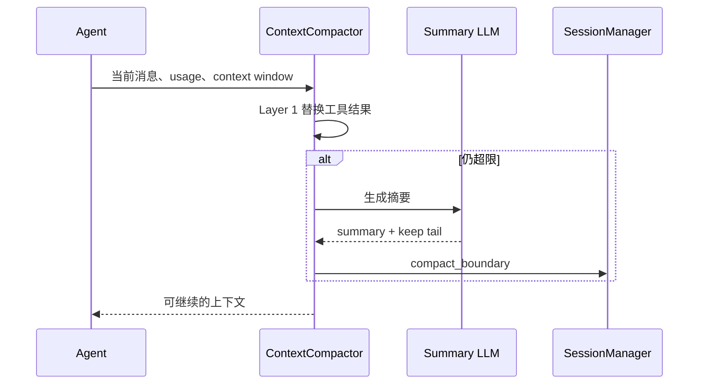
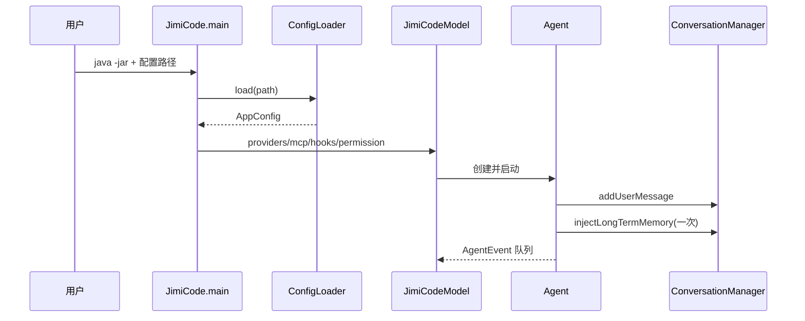
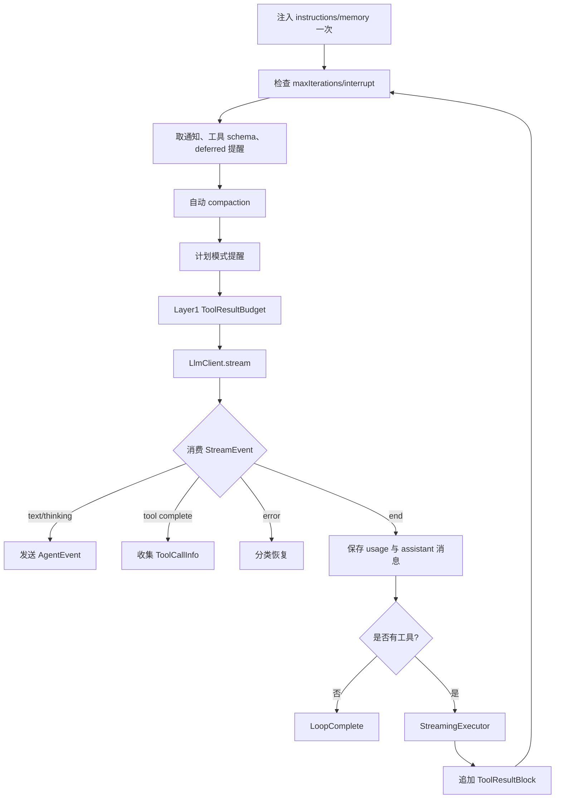
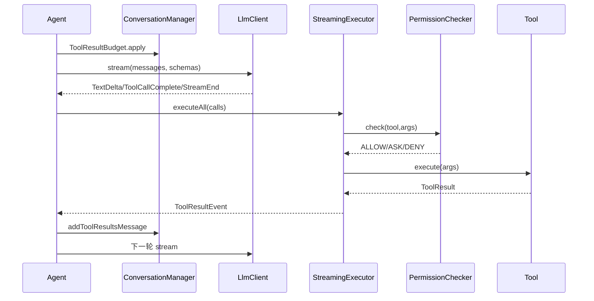

# JiMI Code 整合学习文档：02-模型工具与AgentLoop.md

> 本文由 `docs/` 与 `study-notes/` 下的教材按段落级别整理生成。原始文件不删除；相同段落在本主题内只保留一次，保留版本最完整或最接近课程主线的那一段，其余来源记录在末尾的合并审计中。内容涉及当前源码时以 `jimi-code` 工作区为准；对 Claude Code 的描述只代表公开体验对标。

## 本主题的融合说明

本主题按“课程概念 → jimicode 源码 → 实验/排障 → 面试与边界”排序。段落之间出现同一事实时，优先保留包含真实路径、调用关系或失败处理的版本；只有标题/目录性质的短段被折叠。

> 来源：`docs/course/02-第2章-让AI开口说话.md`

把第 1 章定义的 Agent 外壳连接到真实 LLM Provider。学完后，你能解释消息列表、请求适配、流式响应、密钥配置和终端展示，并能用 mock 或真实兼容端点完成一次安全聊天。

> 来源：`docs/course/02-第2章-让AI开口说话.md`

没有本章时，程序只能返回固定文本；把 Anthropic 字段误发给 OpenAI 导致 400；一次性等待完整响应造成首 token 延迟；API key 写入仓库导致泄露；SSE 分片被错误拼接后工具 JSON 损坏。

> 来源：`docs/course/02-第2章-让AI开口说话.md`

模型是推理服务，Message 是 provider-neutral 的内部事实，StreamEvent 是增量事件，Provider adapter 是协议翻译层。`LlmClient` 隔离了 `AnthropicClient`、`OpenAiClient` 与 `OpenAiCompatClient` 的差异；TUI 消费事件而不是直接依赖第三方 SDK。

> 来源：`docs/course/02-第2章-让AI开口说话.md`

| 对比维度 | 本章能力 | 上一章能力 | 下一章依赖 |
|---|---|---|---|
| 输入 | 结构化、可校验的本章对象 | 上一层输出 | 为下一层提供稳定契约 |
| 控制 | 明确的状态/权限/预算 | 规则较少 | 可观测、可恢复、可扩展 |
| 失败 | 分类、可见、可恢复 | 可能只返回错误文本 | 由后续治理层接管 |

> 来源：`docs/course/02-第2章-让AI开口说话.md`


> 来源：`docs/course/02-第2章-让AI开口说话.md`

**本章实际链路**：用户输入 → ConversationManager → PromptBuilder → LlmClient → HTTP/SSE → StreamEvent → StreamingExecutor → AgentEvent → JimiCodeModel/MarkdownRenderer

> 来源：`docs/course/02-第2章-让AI开口说话.md`

Message(role/content)、ProviderConfig(protocol/baseUrl/model/apiKey)、StreamEvent(type/text/toolDelta/usage/error)、AgentEvent(streamText/tool/error/complete)。

> 来源：`docs/course/02-第2章-让AI开口说话.md`

| 字段 | 生产者 | 消费者 | 失败时必须保留 |
|---|---|---|---|
| 身份/名称 | 配置或注册表 | Agent/Provider/UI | 原始值与规范化值 |
| 参数/内容 | 用户、模型或工具 | 下一阶段模块 | 校验错误与来源 |
| 状态 | 编排器/持久化层 | 恢复、审计、UI | 转移前后状态 |
| 结果 | 本章实现 | Conversation/父任务 | 成功、错误、耗时 |

> 来源：`docs/course/02-第2章-让AI开口说话.md`

打开 `src/main/java/com/jimicode/llm/LlmClient.java`，先看它定义的最小契约，再看三个实现如何把消息和工具 schema 映射成供应商请求。`AnthropicClient` 重点是 system、messages、tools、thinking 和 SSE；`OpenAiClient` 重点是 chat/completions、tool_calls 和 usage；`OpenAiCompatClient` 允许自建或第三方兼容端点。Agent 层只接收 `StreamEvent`，因此新增 provider 不应修改 `Agent.agentLoop`。

> 来源：`docs/course/02-第2章-让AI开口说话.md`

`ProviderConfig` 的 `protocol` 不是装饰字段，它决定 `ModelResolver` 选择哪个 client；`baseUrl` 决定请求根地址；`model` 参与请求体和日志；上下文窗口与最大输出影响后续 Compaction。API key 必须来自 YAML 未跟踪文件或环境变量，日志只打印 provider 名称和请求 id，不打印 Authorization。

> 来源：`docs/course/02-第2章-让AI开口说话.md`

流式解析要处理四种边界：一个事件被拆成多个网络 chunk；一个 chunk 包含多个 SSE event；最后一个 event 没有换行；连接在工具参数 JSON 中间断开。解析器必须保留缓冲区、按 event 分隔符解帧、校验 JSON，并在异常时产生 `StreamEvent.Error` 而不是静默结束。`StreamingExecutor` 再把 text/thinking/tool delta 转成 UI 可消费的 `AgentEvent`。

> 来源：`docs/course/02-第2章-让AI开口说话.md`

终端展示和模型协议必须解耦。`MarkdownRenderer` 负责把最终 Markdown 渲染为 TUI 文本；流式文本可以先以纯文本增量展示，完成后再渲染代码块。不要让 UI 直接拼 SSE，也不要在 UI 线程执行阻塞 HTTP。

> 来源：`docs/course/02-第2章-让AI开口说话.md`

反模式一是“每个 provider 在 Agent 中写 if/else”：这会让协议差异污染循环，新增 provider 需要修改核心。反模式二是“收到一段文本就当完整答案”：这会丢失后续 delta、usage 和 tool call。反模式三是“为了方便把 key 打印到 debug 日志”：这会让终端日志、trace 和 CI artifact 变成秘密泄露面。

> 来源：`docs/course/02-第2章-让AI开口说话.md`

- 不要用自然语言约束替代可执行的系统边界。
- 不要吞掉异常、取消或拒绝事件。
- 不要在没有测试和回滚点的真实仓库执行破坏性操作。

> 来源：`docs/course/02-第2章-让AI开口说话.md`

**目标**：用 mock HTTP 服务返回分片 SSE，验证文本跨 chunk 拼接、usage 累积和错误事件；成功标准是最终消息与预期一致且没有重复字符。

> 来源：`docs/course/02-第2章-让AI开口说话.md`

**步骤**：在临时仓库或 mock 环境中准备输入；运行最小命令；保存事件、日志和 Git diff；重复一次失败条件。

> 来源：`docs/course/02-第2章-让AI开口说话.md`

**预期现象**：能看到本章对应的状态变化，而不是只得到最终文本。

> 来源：`docs/course/02-第2章-让AI开口说话.md`

**成功标准**：结果可复现、失败可解释、没有越过工作区和权限边界。

> 来源：`docs/course/02-第2章-让AI开口说话.md`

**常见报错**：环境、路径、依赖、超时或配置错误；先看本章排障表，再沿源码调用者反查。

> 来源：`docs/course/02-第2章-让AI开口说话.md`

**目标**：配置两个 provider，分别走 anthropic 和 openai-compatible，发送同一条只读问题，比较内部 StreamEvent 而不是比较供应商原始 JSON；成功标准是 Agent Loop 无需改动。

> 来源：`docs/course/02-第2章-让AI开口说话.md`

无输出→检查订阅/网络/模型名；首 token 很慢→检查是否错误地等待完整 body；工具参数截断→保存原始 SSE 和解析缓冲区；401→检查 key 来源与 base_url；429→检查重试和退避；TUI 乱码→检查 UTF-8 和 MarkdownRenderer。

> 来源：`docs/course/02-第2章-让AI开口说话.md`

涉及文件、命令、网络、MCP、记忆、Hook 或并发时，统一使用临时仓库、最小权限、明确 workdir、超时、输出上限、审计和 Git 回滚点。任何示例数字标记“示例/需实测”；不在真实环境执行删除、覆盖、迁移或未知脚本。

> 来源：`docs/course/02-第2章-让AI开口说话.md`

### 题 1：Provider 抽象为什么要放在 LlmClient 而不是 Agent？

> 来源：`docs/course/02-第2章-让AI开口说话.md`

**回答提纲**：先给概念定义，再引用一个 jimicode 文件/类，说明一次取舍和一个失败场景。**加分点**：能讲测试、指标和边界。
### 题 2：SSE 分片如何保证幂等拼接？

> 来源：`docs/course/02-第2章-让AI开口说话.md`

**回答提纲**：先给概念定义，再引用一个 jimicode 文件/类，说明一次取舍和一个失败场景。**加分点**：能讲测试、指标和边界。
### 题 3：为什么流式输出要区分 UI 事件和模型协议？

> 来源：`docs/course/02-第2章-让AI开口说话.md`

**回答提纲**：先给概念定义，再引用一个 jimicode 文件/类，说明一次取舍和一个失败场景。**加分点**：能讲测试、指标和边界。
### 题 4：API key 在配置、日志和异常中如何保护？

> 来源：`docs/course/02-第2章-让AI开口说话.md`

**回答提纲**：先给概念定义，再引用一个 jimicode 文件/类，说明一次取舍和一个失败场景。**加分点**：能讲测试、指标和边界。

> 来源：`docs/course/02-第2章-让AI开口说话.md`

- [ ] 我能解释本章能力在全链路中的位置
- [ ] 我能解释一个真实失败场景及排查路径
- [ ] 我能解释关键数据结构的生产者和消费者
- [ ] 我能解释至少一个源码文件和调用者
- [ ] 我能解释一个安全/性能取舍

> 来源：`docs/course/02-第2章-让AI开口说话.md`

本章建立的契约会被下一章消费：工具系统 只有在输入、状态、失败和权限边界明确后才不会把复杂度继续放大。

> 来源：`docs/course/02-第2章-让AI开口说话.md`

### FAQ 1：没有真实 API key 能否学习？可以用 MockWebServer 或固定 StreamEvent 测试。

> 来源：`docs/course/02-第2章-让AI开口说话.md`

以当前项目源码和测试为准；第三方或闭源行为要明确标注边界。
### FAQ 2：OpenAI-compatible 是否等同 OpenAI？不等同，只能说明请求协议大体兼容，字段和工具行为仍需实测。

> 来源：`docs/course/02-第2章-让AI开口说话.md`

先用最小实验复现，再沿事件、日志、状态和调用者逐层定位。
### FAQ 3：为什么不直接使用第三方 SDK 类型？因为会把 provider 细节泄露到核心 Agent。

> 来源：`docs/course/02-第2章-让AI开口说话.md`

可以，但要保留权限、超时、输出上限和可回滚机制。

> 来源：`docs/course/02-第2章-让AI开口说话.md`

从当前章节的真实入口开始：用户输入 → ConversationManager → PromptBuilder → LlmClient → HTTP/SSE → StreamEvent → StreamingExecutor → AgentEvent → JimiCodeModel/MarkdownRenderer。打开链路中的第一个 jimicode 类，记录构造器参数、字段初始化和直接调用者；再向后追踪一个结果对象的消费点。不要只搜索类名，要搜索方法调用和事件类型。

> 来源：`docs/course/02-第2章-让AI开口说话.md`

本章的输入不能只写成“用户问题”。应拆成配置输入、自然语言输入、模型结构化输入、文件/进程输入和上游模块状态。对每一种输入写明允许为空的字段、长度上限、编码、来源和校验时机。Message(role/content)、ProviderConfig(protocol/baseUrl/model/apiKey)、StreamEvent(type/text/toolDelta/usage/error)、AgentEvent(streamText/tool/error/complete)。 中出现的身份、参数和状态字段都要在进入下一层前规范化。

> 来源：`docs/course/02-第2章-让AI开口说话.md`

把状态画成有限状态机：初始、准备、执行、等待确认、成功、失败、取消、恢复。每次转移记录触发事件、允许的前置状态、持久化动作和用户可见反馈。若代码使用 enum、record 或布尔字段表达状态，要检查是否存在互斥状态同时为 true 的问题。

> 来源：`docs/course/02-第2章-让AI开口说话.md`

对每个公开方法至少做三次反查：谁创建对象、谁调用方法、谁处理返回值/异常。若返回集合，检查调用方是否修改它；若返回异步对象，检查是否真正订阅；若返回路径或命令，检查调用方是否再次做安全校验。

> 来源：`docs/course/02-第2章-让AI开口说话.md`

将本章失败拆成输入错误、依赖错误、业务拒绝、超时、取消、部分成功和持久化失败。针对当前主题 `工具系统` 的前置依赖，写出“失败后能否重试、是否幂等、是否需要人工确认、是否需要回滚”的结论。

> 来源：`docs/course/02-第2章-让AI开口说话.md`

至少记录关联 id、阶段、耗时、结果状态和错误类别。不要在日志中记录 API key、完整 Authorization、未脱敏工具参数或整段私有代码。TUI 需要用户可读消息，调试日志需要开发者上下文，两者可以来自同一个事件但不应共享不安全文本。

> 来源：`docs/course/02-第2章-让AI开口说话.md`

确认本章对象是进程级、Agent 级、会话级、turn 级还是方法级状态。对可变集合、文件、队列和外部进程分别考虑竞态；不要因为方法加了 synchronized 就认为跨进程安全，也不要把虚拟线程误解成无限资源。

> 来源：`docs/course/02-第2章-让AI开口说话.md`

为 CPU、内存、网络、token、文件读取和输出设置上限。上限达到时返回可解释的错误或降级结果，不能静默截断关键协议字段。若本章涉及重试，退避和最大次数必须与总预算一起设计。

> 来源：`docs/course/02-第2章-让AI开口说话.md`

单元测试验证纯函数和边界；集成测试验证文件、进程或 HTTP；契约测试验证 provider/Tool/MCP 字段；回归测试固定一个曾经失败的用户故事。测试数据使用虚构密钥、临时目录和固定时间，不依赖个人机器状态。

> 来源：`docs/course/02-第2章-让AI开口说话.md`

错误设计通常表现为：把所有逻辑放在一个巨型类；把异常转成空字符串；让模型决定权限；让 UI 直接修改核心状态；让外部脚本绕过统一工具入口。正确设计应保持单向依赖、结构化结果、独立权限、事件通知和可回滚副作用。

> 来源：`docs/course/02-第2章-让AI开口说话.md`

先实现最小 happy path，再加入参数校验、错误封装、超时、取消、审计、恢复和测试。每一步保留可运行提交，避免一次性重写多个模块而无法定位回归。

> 来源：`docs/course/02-第2章-让AI开口说话.md`

回到上一章的输出，确认本章没有重新发明同一数据结构。例如上一章已经定义 Message/Tool/Provider 时，本章应复用其契约，而不是在新模块中创建第二套近似类型。

> 来源：`docs/course/02-第2章-让AI开口说话.md`

下一步是 `工具系统`。提前列出本章必须对外稳定的字段和事件；如果下一章要并发、压缩或扩展，本章的 id、版本、错误和取消语义必须先固定。

> 来源：`docs/course/02-第2章-让AI开口说话.md`

完成本章后，提交一页设计记录：问题、方案、替代方案、源码证据、测试、已知限制、后续改进。评审者应能仅凭这页记录复现你的实验，而不是依赖口头解释。

> 来源：`docs/course/02-第2章-让AI开口说话.md`

审查时逐条问：输入是否来自不可信源？副作用前是否授权？失败是否可见？重试是否幂等？取消是否传播？状态是否持久化？日志是否脱敏？测试是否覆盖空值、重复、超时和恢复？

> 来源：`docs/course/02-第2章-让AI开口说话.md`

回答面试题时先给一句定义，再讲当前项目文件和方法，接着讲一个取舍和失败案例，最后说如何测试。不要只罗列框架名，也不要把示例数字说成生产指标。

> 来源：`docs/course/02-第2章-让AI开口说话.md`

把本章放回完整闭环：用户输入 → ConversationManager → PromptBuilder → LlmClient → HTTP/SSE → StreamEvent → StreamingExecutor → AgentEvent → JimiCodeModel/MarkdownRenderer。如果删除本章能力，系统会在这些地方退化：没有本章时，程序只能返回固定文本；把 Anthropic 字段误发给 OpenAI 导致 400；一次性等待完整响应造成首 token 延迟；API key 写入仓库导致泄露；SSE 分片被错误拼接后工具 JSON 损坏。。如果增强本章能力，优先增强契约、测试、可观测性和安全边界，再考虑增加模型或 Agent 数量。最后用一个真实但隔离的实验验证“输入—状态—结果—失败—恢复”五个维度，并把证据保存到学习笔记。
## 综合案例与边界演练

> 来源：`docs/course/02-第2章-让AI开口说话.md`

### 场景 1：最小成功路径：使用固定输入、单一依赖和一个工具完成一次操作，记录从入口到结果的每个对象。

> 来源：`docs/course/02-第2章-让AI开口说话.md`

本章的具体检查点是：模型是推理服务，Message 是 provider-neutral 的内部事实，StreamEvent 是增量事件，Provider adapter 是协议翻译层。`LlmClient` 隔离了 `AnthropicClient`、`OpenAiClient` 与 `OpenAiCompatClient` 的差异；TUI 消费事件而不是直接依赖第三方 SDK。 生产的输入必须经过本章状态和权限边界，再形成 工具系统 可以消费的结果。实验结束后保存命令、事件、日志、测试、diff 和限制说明。

> 来源：`docs/course/02-第2章-让AI开口说话.md`

### 场景 2：空值路径：删除可选字段、返回空集合或让模型不给出内容，确认系统使用默认值、明确错误还是安全退出。

> 来源：`docs/course/02-第2章-让AI开口说话.md`

### 场景 3：重复路径：重复提交同一个请求、toolUseId、命令或消息，检查是否幂等、去重或要求人工确认。

> 来源：`docs/course/02-第2章-让AI开口说话.md`

### 场景 4：超时路径：让网络、脚本、文件或子任务延迟，检查 timeout、取消、资源释放和用户提示。

> 来源：`docs/course/02-第2章-让AI开口说话.md`

### 场景 5：部分成功路径：让多个动作中只有一部分成功，确认结果如何汇总、是否需要补偿或回滚。

> 来源：`docs/course/02-第2章-让AI开口说话.md`

### 场景 6：权限路径：使用只读、询问和拒绝三种模式，确保决策发生在副作用之前且结果可审计。

> 来源：`docs/course/02-第2章-让AI开口说话.md`

### 场景 7：恢复路径：在关键状态写入前后模拟进程退出，重新启动后检查状态、消息顺序和重复执行风险。

> 来源：`docs/course/02-第2章-让AI开口说话.md`

### 场景 8：观测路径：为一次操作关联 id、阶段、耗时和错误类别，确认 UI、日志和 trace 的信息粒度不同但事实一致。

> 来源：`docs/course/02-第2章-让AI开口说话.md`

### 场景 9：兼容路径：替换 provider、工具实现或配置版本，确认核心契约不需要大面积改动。

> 来源：`docs/course/02-第2章-让AI开口说话.md`

### 场景 10：评审路径：邀请另一位同学只看文档和证据复现实验，记录他无法理解或无法复现的地方。

> 来源：`docs/course/02-第2章-让AI开口说话.md`

围绕本章的实际链路 `用户输入 → ConversationManager → PromptBuilder → LlmClient → HTTP/SSE → StreamEvent → StreamingExecutor → AgentEvent → JimiCodeModel/MarkdownRenderer`，在源码中定位一个具体类/方法，写出它的输入、输出、状态、调用者和失败处理。然后在隔离环境执行一个最小验证，保存测试/日志/diff；如果无法从当前仓库证实，明确写【待源码确认】。针对 `工具系统` 的后续能力，补充说明该契约为什么必须稳定、哪些字段不能随意改名，以及发生故障时如何向用户解释。

> 来源：`docs/course/03-第3章-工具系统.md`

把模型的“想做某事”变成受控、可验证、可审计的动作。学完能实现一个 Tool、注册到 ToolRegistry、生成 schema、执行并把 ToolResult 回传。

> 来源：`docs/course/03-第3章-工具系统.md`

没有工具时模型无法看到真实文件；schema 不准确导致参数缺失；注册名重复导致调用错工具；结果不回传导致模型重复调用；文件工具不限制路径导致越权。

> 来源：`docs/course/03-第3章-工具系统.md`

Tool 由 name、description、参数 schema 和 handler 组成；Registry 负责发现和分发；Observation/ToolResult 把执行结果变成下一轮推理输入。只读 read/list/search 与写入/edit/shell 的风险不同。

> 来源：`docs/course/03-第3章-工具系统.md`

**本章实际链路**：Tool 实现 → ToolRegistry 注册 → getAllSchemas → LlmClient 请求 → ToolUseBlock → Registry 查找 → PermissionChecker → handler → ToolResultBlock → ConversationManager

> 来源：`docs/course/03-第3章-工具系统.md`

Tool schema(name/description/input_schema)、ToolUseBlock(toolUseId/toolName/arguments)、ToolResult(output/isError)、ToolCategory、权限上下文。

> 来源：`docs/course/03-第3章-工具系统.md`

`src/main/java/com/jimicode/tool/Tool.java` 是能力 SPI；`ToolRegistry` 保存名称到实例的映射，并按协议生成 schema。阅读时先确认注册发生在 `JimiCodeModel` 组装阶段还是 SubAgent 创建阶段，再追踪 `getAllSchemas` 的调用者。工具名称是模型可见 API，改名会破坏历史会话和 Prompt 中的选择。

> 来源：`docs/course/03-第3章-工具系统.md`

文件工具的最小安全闭环是：解析参数 → 规范化路径 → 检查 workDir root → 检查敏感文件/目录 → 检查权限 → 执行 IO → 限制输出 → 封装 ToolResult。`ReadFileTool` 应限制最大字节数并记录恢复附件；`GlobTool`/`GrepTool` 应限制搜索范围和结果数量；`WriteFileTool`/`EditFileTool` 应在修改前保存快照并在匹配不唯一时失败。

> 来源：`docs/course/03-第3章-工具系统.md`

description 不是文案，而是模型决策输入。应写清何时使用、输入字段、输出格式、不可做什么和示例；避免把多个动作塞进一个“万能工具”。schema 必须在服务端再次校验，不能信任模型传来的 JSON。

> 来源：`docs/course/03-第3章-工具系统.md`

反模式一是把所有能力暴露成一个 `run(command)`；这让模型难以选择，也让权限无法精细化。反模式二是 handler 直接返回异常堆栈；正确做法是保留可诊断上下文，同时向模型返回安全、有限的错误信息。

> 来源：`docs/course/03-第3章-工具系统.md`

**目标**：实现一个只读 `count_lines` Tool：输入 path，限制在 workDir，输出行数；为正常、文件不存在、路径越界写测试。

> 来源：`docs/course/03-第3章-工具系统.md`

**目标**：实现一个 `summarize_diff` Tool 并注册，观察 schema 是否出现在请求中；故意改错 description，比较模型是否更容易误选。

> 来源：`docs/course/03-第3章-工具系统.md`

工具未出现在请求→查 registry 注册和 schema 过滤；名称找不到→查大小写/重复注册；参数为空→查 schema required；结果过长→查输出预算；写错路径→查 root 规范化和 symlink；重复执行→查 toolUseId 和 Agent Loop。

> 来源：`docs/course/03-第3章-工具系统.md`

### 题 1：Tool schema 如何影响模型选型？

> 来源：`docs/course/03-第3章-工具系统.md`

**回答提纲**：先给概念定义，再引用一个 jimicode 文件/类，说明一次取舍和一个失败场景。**加分点**：能讲测试、指标和边界。
### 题 2：为什么 Registry 不能只保存反射 Method？

> 来源：`docs/course/03-第3章-工具系统.md`

**回答提纲**：先给概念定义，再引用一个 jimicode 文件/类，说明一次取舍和一个失败场景。**加分点**：能讲测试、指标和边界。
### 题 3：ToolResult 为什么必须带 isError？

> 来源：`docs/course/03-第3章-工具系统.md`

**回答提纲**：先给概念定义，再引用一个 jimicode 文件/类，说明一次取舍和一个失败场景。**加分点**：能讲测试、指标和边界。
### 题 4：文件工具如何防路径穿越？

> 来源：`docs/course/03-第3章-工具系统.md`

本章建立的契约会被下一章消费：让 Agent 自己干活 只有在输入、状态、失败和权限边界明确后才不会把复杂度继续放大。

> 来源：`docs/course/03-第3章-工具系统.md`

### FAQ 1：工具越多越好吗？不是，过多 schema 会增加 token 和选择歧义。

> 来源：`docs/course/03-第3章-工具系统.md`

以当前项目源码和测试为准；第三方或闭源行为要明确标注边界。
### FAQ 2：只读工具需要权限吗？仍可能读取敏感信息，应按资源和租户判断。

> 来源：`docs/course/03-第3章-工具系统.md`

先用最小实验复现，再沿事件、日志、状态和调用者逐层定位。
### FAQ 3：工具异常应该抛出还是返回？边界错误可返回 ToolResult，框架级不可恢复错误应抛出并记录。

> 来源：`docs/course/03-第3章-工具系统.md`

从当前章节的真实入口开始：Tool 实现 → ToolRegistry 注册 → getAllSchemas → LlmClient 请求 → ToolUseBlock → Registry 查找 → PermissionChecker → handler → ToolResultBlock → ConversationManager。打开链路中的第一个 jimicode 类，记录构造器参数、字段初始化和直接调用者；再向后追踪一个结果对象的消费点。不要只搜索类名，要搜索方法调用和事件类型。

> 来源：`docs/course/03-第3章-工具系统.md`

本章的输入不能只写成“用户问题”。应拆成配置输入、自然语言输入、模型结构化输入、文件/进程输入和上游模块状态。对每一种输入写明允许为空的字段、长度上限、编码、来源和校验时机。Tool schema(name/description/input_schema)、ToolUseBlock(toolUseId/toolName/arguments)、ToolResult(output/isError)、ToolCategory、权限上下文。 中出现的身份、参数和状态字段都要在进入下一层前规范化。

> 来源：`docs/course/03-第3章-工具系统.md`

将本章失败拆成输入错误、依赖错误、业务拒绝、超时、取消、部分成功和持久化失败。针对当前主题 `让 Agent 自己干活` 的前置依赖，写出“失败后能否重试、是否幂等、是否需要人工确认、是否需要回滚”的结论。

> 来源：`docs/course/03-第3章-工具系统.md`

下一步是 `让 Agent 自己干活`。提前列出本章必须对外稳定的字段和事件；如果下一章要并发、压缩或扩展，本章的 id、版本、错误和取消语义必须先固定。

> 来源：`docs/course/03-第3章-工具系统.md`

把本章放回完整闭环：Tool 实现 → ToolRegistry 注册 → getAllSchemas → LlmClient 请求 → ToolUseBlock → Registry 查找 → PermissionChecker → handler → ToolResultBlock → ConversationManager。如果删除本章能力，系统会在这些地方退化：没有工具时模型无法看到真实文件；schema 不准确导致参数缺失；注册名重复导致调用错工具；结果不回传导致模型重复调用；文件工具不限制路径导致越权。。如果增强本章能力，优先增强契约、测试、可观测性和安全边界，再考虑增加模型或 Agent 数量。最后用一个真实但隔离的实验验证“输入—状态—结果—失败—恢复”五个维度，并把证据保存到学习笔记。
## 综合案例与边界演练

> 来源：`docs/course/03-第3章-工具系统.md`

本章的具体检查点是：Tool 由 name、description、参数 schema 和 handler 组成；Registry 负责发现和分发；Observation/ToolResult 把执行结果变成下一轮推理输入。只读 read/list/search 与写入/edit/shell 的风险不同。 生产的输入必须经过本章状态和权限边界，再形成 让 Agent 自己干活 可以消费的结果。实验结束后保存命令、事件、日志、测试、diff 和限制说明。

> 来源：`docs/course/03-第3章-工具系统.md`

围绕本章的实际链路 `Tool 实现 → ToolRegistry 注册 → getAllSchemas → LlmClient 请求 → ToolUseBlock → Registry 查找 → PermissionChecker → handler → ToolResultBlock → ConversationManager`，在源码中定位一个具体类/方法，写出它的输入、输出、状态、调用者和失败处理。然后在隔离环境执行一个最小验证，保存测试/日志/diff；如果无法从当前仓库证实，明确写【待源码确认】。针对 `让 Agent 自己干活` 的后续能力，补充说明该契约为什么必须稳定、哪些字段不能随意改名，以及发生故障时如何向用户解释。

> 来源：`docs/course/04-第4章-Agent-Loop.md`

把模型和工具连接成 ReAct/Agent Loop。学完能追踪一次“读文件—分析—修改—测试”的完整时序，并治理最大步数、终止条件、取消和死循环。

> 来源：`docs/course/04-第4章-Agent-Loop.md`

只调用一次模型就结束；工具结果没有回灌；模型反复调用同一个失败工具；无上限循环烧光 token；Ctrl-C 后留下孤儿工具调用。

> 来源：`docs/course/04-第4章-Agent-Loop.md`

ReAct = Reasoning + Acting；Loop 维护 iteration、conversation、工具结果和终止状态。`Agent.agentLoop` 是 jimicode 的核心循环，`AgentEvent` 让 TUI 观察过程。

> 来源：`docs/course/04-第4章-Agent-Loop.md`

**本章实际链路**：输入 → agentLoop iteration → schema/compact → LLM stream → text/thinking/tool use → permission → tool → result → conversation → next iteration/complete

> 来源：`docs/course/04-第4章-Agent-Loop.md`

iteration、maxIterations、ConversationManager、BlockingQueue<AgentEvent>、ToolUseBlock、ToolResultBlock、LoopComplete/ErrorEvent、cancel/interrupted。

> 来源：`docs/course/04-第4章-Agent-Loop.md`

阅读 `src/main/java/com/jimicode/agent/Agent.java` 的 `run` 与 `agentLoop`。`run` 创建容量有限的 `LinkedBlockingQueue` 并启动虚拟线程；`agentLoop` 先注入 instructions/memory，再在每轮检查最大迭代和线程中断，计算工具 schema、执行压缩、注入系统提醒，然后调用模型。收到工具调用后执行并把结果写回 conversation，下一轮重新推理。

> 来源：`docs/course/04-第4章-Agent-Loop.md`

终止条件至少包括：模型返回无 ToolUse 的最终文本；达到 `maxIterations`；用户拒绝或取消；不可恢复的配置/协议异常。成功与失败都要有 AgentEvent，让 TUI、父 Agent 和历史记录获得一致事实。队列容量 64 是一个背压边界，不能在事件生产速度远大于 UI 消费速度时无限缓存。

> 来源：`docs/course/04-第4章-Agent-Loop.md`

死循环治理要组合使用 maxIterations、相同 toolUse/参数去重、连续相同错误检测、每轮 token 预算、超时和人工确认。不要只依赖 Prompt 告诉模型“不要循环”，因为这是软约束。取消时要先检查线程中断，再让 HTTP、子进程和工具执行响应取消；若已有 ToolUse 没有结果，应合成错误 ToolResult，保证消息协议完整。

> 来源：`docs/course/04-第4章-Agent-Loop.md`

反模式一是递归调用 Agent 而没有计数器，栈和 token 都不可控。反模式二是把所有工具执行放在 UI 线程，导致界面冻结且无法取消。反模式三是 catch(Exception) 后直接返回空字符串，用户无法判断是模型完成还是系统失败。

> 来源：`docs/course/04-第4章-Agent-Loop.md`

**目标**：在临时仓库让 Agent 先读取一个 Java 文件再回答，记录每个 AgentEvent 的顺序、iteration 和 ToolResult。

> 来源：`docs/course/04-第4章-Agent-Loop.md`

**目标**：构造一个总是返回错误的 mock Tool，验证 maxIterations、重复错误检测和 Ctrl-C 取消；成功标准是不会无限请求。

> 来源：`docs/course/04-第4章-Agent-Loop.md`

只执行一轮→查 ToolResult 是否追加；无限循环→查 maxIterations/终止条件；UI 卡顿→查工具是否跑在虚拟线程；取消无效→查 interrupt 是否传到 HTTP/进程；队列超时→查消费者和 putSafe。

> 来源：`docs/course/04-第4章-Agent-Loop.md`

### 题 1：ReAct Loop 与工作流引擎有何不同？

> 来源：`docs/course/04-第4章-Agent-Loop.md`

**回答提纲**：先给概念定义，再引用一个 jimicode 文件/类，说明一次取舍和一个失败场景。**加分点**：能讲测试、指标和边界。
### 题 2：最大迭代数放在哪里配置？

> 来源：`docs/course/04-第4章-Agent-Loop.md`

**回答提纲**：先给概念定义，再引用一个 jimicode 文件/类，说明一次取舍和一个失败场景。**加分点**：能讲测试、指标和边界。
### 题 3：如何处理孤儿 ToolUse？

> 来源：`docs/course/04-第4章-Agent-Loop.md`

**回答提纲**：先给概念定义，再引用一个 jimicode 文件/类，说明一次取舍和一个失败场景。**加分点**：能讲测试、指标和边界。
### 题 4：背压和取消为什么是 Agent 的核心问题？

> 来源：`docs/course/04-第4章-Agent-Loop.md`

本章建立的契约会被下一章消费：System Prompt 设计 只有在输入、状态、失败和权限边界明确后才不会把复杂度继续放大。

> 来源：`docs/course/04-第4章-Agent-Loop.md`

### FAQ 1：模型一次返回多个工具怎么办？按 id 保存并执行，必要时按 concurrencySafe 决定并发。

> 来源：`docs/course/04-第4章-Agent-Loop.md`

以当前项目源码和测试为准；第三方或闭源行为要明确标注边界。
### FAQ 2：达到最大迭代算成功吗？通常应产生明确错误/未完成事件，不能冒充最终答案。

> 来源：`docs/course/04-第4章-Agent-Loop.md`

先用最小实验复现，再沿事件、日志、状态和调用者逐层定位。
### FAQ 3：为什么不直接 while(true)？因为循环必须可预算、可取消、可观测。

> 来源：`docs/course/04-第4章-Agent-Loop.md`

从当前章节的真实入口开始：输入 → agentLoop iteration → schema/compact → LLM stream → text/thinking/tool use → permission → tool → result → conversation → next iteration/complete。打开链路中的第一个 jimicode 类，记录构造器参数、字段初始化和直接调用者；再向后追踪一个结果对象的消费点。不要只搜索类名，要搜索方法调用和事件类型。

> 来源：`docs/course/04-第4章-Agent-Loop.md`

本章的输入不能只写成“用户问题”。应拆成配置输入、自然语言输入、模型结构化输入、文件/进程输入和上游模块状态。对每一种输入写明允许为空的字段、长度上限、编码、来源和校验时机。iteration、maxIterations、ConversationManager、BlockingQueue<AgentEvent>、ToolUseBlock、ToolResultBlock、LoopComplete/ErrorEvent、cancel/interrupted。 中出现的身份、参数和状态字段都要在进入下一层前规范化。

> 来源：`docs/course/04-第4章-Agent-Loop.md`

将本章失败拆成输入错误、依赖错误、业务拒绝、超时、取消、部分成功和持久化失败。针对当前主题 `System Prompt 设计` 的前置依赖，写出“失败后能否重试、是否幂等、是否需要人工确认、是否需要回滚”的结论。

> 来源：`docs/course/04-第4章-Agent-Loop.md`

下一步是 `System Prompt 设计`。提前列出本章必须对外稳定的字段和事件；如果下一章要并发、压缩或扩展，本章的 id、版本、错误和取消语义必须先固定。

> 来源：`docs/course/04-第4章-Agent-Loop.md`

把本章放回完整闭环：输入 → agentLoop iteration → schema/compact → LLM stream → text/thinking/tool use → permission → tool → result → conversation → next iteration/complete。如果删除本章能力，系统会在这些地方退化：只调用一次模型就结束；工具结果没有回灌；模型反复调用同一个失败工具；无上限循环烧光 token；Ctrl-C 后留下孤儿工具调用。。如果增强本章能力，优先增强契约、测试、可观测性和安全边界，再考虑增加模型或 Agent 数量。最后用一个真实但隔离的实验验证“输入—状态—结果—失败—恢复”五个维度，并把证据保存到学习笔记。
## 综合案例与边界演练

> 来源：`docs/course/04-第4章-Agent-Loop.md`

本章的具体检查点是：ReAct = Reasoning + Acting；Loop 维护 iteration、conversation、工具结果和终止状态。`Agent.agentLoop` 是 jimicode 的核心循环，`AgentEvent` 让 TUI 观察过程。 生产的输入必须经过本章状态和权限边界，再形成 System Prompt 设计 可以消费的结果。实验结束后保存命令、事件、日志、测试、diff 和限制说明。

> 来源：`docs/course/04-第4章-Agent-Loop.md`

围绕本章的实际链路 `输入 → agentLoop iteration → schema/compact → LLM stream → text/thinking/tool use → permission → tool → result → conversation → next iteration/complete`，在源码中定位一个具体类/方法，写出它的输入、输出、状态、调用者和失败处理。然后在隔离环境执行一个最小验证，保存测试/日志/diff；如果无法从当前仓库证实，明确写【待源码确认】。针对 `System Prompt 设计` 的后续能力，补充说明该契约为什么必须稳定、哪些字段不能随意改名，以及发生故障时如何向用户解释。

> 来源：`docs/deep-learning/01-架构与核心链路.md`

### jimi-code：01-架构与核心链路.md

> 来源：`docs/deep-learning/01-架构与核心链路.md`

接入层是 TUI 与命令；编排层是 `Agent`/`StreamingExecutor`；模型层是 `LlmClient` SPI 与三个 provider；能力层是 `ToolRegistry`、MCP、Skill、SubAgent、Teams；状态层是 Conversation、Session、History、Memory、Plan、Worktree；安全层是 Permission 与 Hook；基础设施层是文件 IO、tmux/iTerm 和 Markdown 渲染。

> 来源：`docs/deep-learning/01-架构与核心链路.md`

`JimiCodeModel` 的 UI 状态（PROVIDER_SELECT/CHAT/RESUME）不等于 Agent 状态。一次 turn 具有“接收输入→构造 prompt→模型流→累积块→工具确认→执行→追加结果→再次模型流→完成/失败”阶段。`AgentEvent` 把阶段变化暴露给 UI，避免 UI 直接依赖 HTTP/SDK 回调。

> 来源：`docs/deep-learning/01-架构与核心链路.md`

工具 schema 来自 `Tool` 接口；注册表按名称索引并按 `ToolCategory` 分类。`ToolSearchTool` 解决工具过多时的发现问题。文件工具组合 `FileStateCache` 做修改前状态，`EditFileTool`/`WriteFileTool` 写入后由 `ContentReplacementLifecycle` 和 `ReplacementRecordsIO` 记录替换，便于撤销、压缩和审计。Bash 工具必须经过权限模式判断；`EnterWorktreeTool` 在执行前建立隔离目录。

> 来源：`docs/deep-learning/01-架构与核心链路.md`

`ConversationManager` 维护 API 消息与 UI 消息的双向映射；`SessionManager` 负责会话目录和元数据；`HistoryStore` 记录历史；`MemoryScanner`/`MemoryRecall` 将项目级记忆注入 prompt；`ContextCompactor` 根据 provider context window 预算做摘要，而不是简单截断。恢复附件要保持 toolUseId、替换记录和原始文件状态的一致性。

> 来源：`docs/deep-learning/01-架构与核心链路.md`

SubAgent 是逻辑并发，Teams 是进程/终端并发，Worktree 是 Git 文件系统隔离。`SharedTaskStore` 和 `FileMailBox` 采用文件协议，优点是跨进程简单、可诊断；缺点是锁、崩溃恢复、重复消费和时钟问题需要额外处理。

> 来源：`docs/deep-learning/01-架构与核心链路.md`

- SPI：`LlmClient`、`Tool`、`SkillHost` 让 provider 和能力可替换。
- 事件溯源思想：流式块、工具结果、替换记录可重建 UI。
- 预算控制：token/字节预算优先于“尽量多塞上下文”。
- 最小权限：PermissionMode 决定 shell、写文件、工作树操作的确认策略。

> 来源：`docs/deep-learning/01-架构与核心链路.md`

### `jimi-code/.idea/compiler.xml`
- 文件类型：`.xml`；行数：18。
- 阅读重点：把它与同目录 Java/配置文件对照，确认它是构建入口、运行时配置、文档还是示例，不把示例误当生产 API。

> 来源：`docs/deep-learning/01-架构与核心链路.md`

### `jimi-code/.idea/encodings.xml`
- 文件类型：`.xml`；行数：7。
- 阅读重点：把它与同目录 Java/配置文件对照，确认它是构建入口、运行时配置、文档还是示例，不把示例误当生产 API。

> 来源：`docs/deep-learning/01-架构与核心链路.md`

### `jimi-code/.idea/jarRepositories.xml`
- 文件类型：`.xml`；行数：20。
- 阅读重点：把它与同目录 Java/配置文件对照，确认它是构建入口、运行时配置、文档还是示例，不把示例误当生产 API。

> 来源：`docs/deep-learning/01-架构与核心链路.md`

### `jimi-code/.idea/MarsCodeWorkspaceAppSettings.xml`
- 文件类型：`.xml`；行数：7。
- 阅读重点：把它与同目录 Java/配置文件对照，确认它是构建入口、运行时配置、文档还是示例，不把示例误当生产 API。

> 来源：`docs/deep-learning/01-架构与核心链路.md`

### `jimi-code/.idea/misc.xml`
- 文件类型：`.xml`；行数：12。
- 阅读重点：把它与同目录 Java/配置文件对照，确认它是构建入口、运行时配置、文档还是示例，不把示例误当生产 API。

> 来源：`docs/deep-learning/01-架构与核心链路.md`

### `jimi-code/.idea/vcs.xml`
- 文件类型：`.xml`；行数：6。
- 阅读重点：把它与同目录 Java/配置文件对照，确认它是构建入口、运行时配置、文档还是示例，不把示例误当生产 API。

> 来源：`docs/deep-learning/01-架构与核心链路.md`

### `jimi-code/.idea/workspace.xml`
- 文件类型：`.xml`；行数：105。
- 阅读重点：把它与同目录 Java/配置文件对照，确认它是构建入口、运行时配置、文档还是示例，不把示例误当生产 API。

> 来源：`docs/deep-learning/01-架构与核心链路.md`

### `jimi-code/.mvn/wrapper/maven-wrapper.properties`
- 文件类型：`.properties`；行数：19。
- 阅读重点：把它与同目录 Java/配置文件对照，确认它是构建入口、运行时配置、文档还是示例，不把示例误当生产 API。

> 来源：`docs/deep-learning/01-架构与核心链路.md`

### `jimi-code/.workbuddy/memory/2026-08-11.md`
- 文件类型：`.md`；行数：25。
- 阅读重点：把它与同目录 Java/配置文件对照，确认它是构建入口、运行时配置、文档还是示例，不把示例误当生产 API。

> 来源：`docs/deep-learning/01-架构与核心链路.md`

### `jimi-code/config.example.yaml`
- 文件类型：`.yaml`；行数：14。
- 阅读重点：把它与同目录 Java/配置文件对照，确认它是构建入口、运行时配置、文档还是示例，不把示例误当生产 API。

> 来源：`docs/deep-learning/01-架构与核心链路.md`

### `jimi-code/docs/deep-dive/00-源码逐文件覆盖矩阵.md`
- 文件类型：`.md`；行数：173。
- 阅读重点：把它与同目录 Java/配置文件对照，确认它是构建入口、运行时配置、文档还是示例，不把示例误当生产 API。

> 来源：`docs/deep-learning/01-架构与核心链路.md`

### `jimi-code/docs/deep-dive/01-入口配置消息与Agent主循环.md`
- 文件类型：`.md`；行数：209。
- 阅读重点：把它与同目录 Java/配置文件对照，确认它是构建入口、运行时配置、文档还是示例，不把示例误当生产 API。

> 来源：`docs/deep-learning/01-架构与核心链路.md`

### `jimi-code/docs/deep-dive/02-工具权限Hook-MCP与文件变更.md`
- 文件类型：`.md`；行数：218。
- 阅读重点：把它与同目录 Java/配置文件对照，确认它是构建入口、运行时配置、文档还是示例，不把示例误当生产 API。

> 来源：`docs/deep-learning/01-架构与核心链路.md`

### `jimi-code/docs/deep-dive/03-会话记忆压缩历史与Worktree.md`
- 文件类型：`.md`；行数：249。
- 阅读重点：把它与同目录 Java/配置文件对照，确认它是构建入口、运行时配置、文档还是示例，不把示例误当生产 API。

> 来源：`docs/deep-learning/01-架构与核心链路.md`

### `jimi-code/docs/deep-dive/04-依赖库Maven构建与面试原理.md`
- 文件类型：`.md`；行数：215。
- 阅读重点：把它与同目录 Java/配置文件对照，确认它是构建入口、运行时配置、文档还是示例，不把示例误当生产 API。

> 来源：`docs/deep-learning/01-架构与核心链路.md`

### `jimi-code/docs/deep-dive/05-SubAgent团队Skill任务与TUI.md`
- 文件类型：`.md`；行数：142。
- 阅读重点：把它与同目录 Java/配置文件对照，确认它是构建入口、运行时配置、文档还是示例，不把示例误当生产 API。

> 来源：`docs/deep-learning/01-架构与核心链路.md`

### `jimi-code/docs/deep-dive/06-系统架构逐模块调用链与异常体系.md`
- 文件类型：`.md`；行数：161。
- 阅读重点：把它与同目录 Java/配置文件对照，确认它是构建入口、运行时配置、文档还是示例，不把示例误当生产 API。

> 来源：`docs/deep-learning/01-架构与核心链路.md`

### `jimi-code/docs/deep-dive/07-构建部署配置调试测试与常见问题.md`
- 文件类型：`.md`；行数：175。
- 阅读重点：把它与同目录 Java/配置文件对照，确认它是构建入口、运行时配置、文档还是示例，不把示例误当生产 API。

> 来源：`docs/deep-learning/01-架构与核心链路.md`

### `jimi-code/docs/deep-dive/08-测试源码逐文件精读与行为契约.md`
- 文件类型：`.md`；行数：174。
- 阅读重点：把它与同目录 Java/配置文件对照，确认它是构建入口、运行时配置、文档还是示例，不把示例误当生产 API。

> 来源：`docs/deep-learning/01-架构与核心链路.md`

### `jimi-code/docs/deep-dive/09-117个Java文件逐文件精读索引.md`
- 文件类型：`.md`；行数：746。
- 阅读重点：把它与同目录 Java/配置文件对照，确认它是构建入口、运行时配置、文档还是示例，不把示例误当生产 API。

> 来源：`docs/deep-learning/01-架构与核心链路.md`

### `jimi-code/docs/deep-dive/README.md`
- 文件类型：`.md`；行数：146。
- 阅读重点：把它与同目录 Java/配置文件对照，确认它是构建入口、运行时配置、文档还是示例，不把示例误当生产 API。

> 来源：`docs/deep-learning/01-架构与核心链路.md`

### `jimi-code/docs/deep-learning/00-项目总览与学习路线.md`
- 文件类型：`.md`；行数：1666。
- 阅读重点：把它与同目录 Java/配置文件对照，确认它是构建入口、运行时配置、文档还是示例，不把示例误当生产 API。

> 来源：`docs/deep-learning/01-架构与核心链路.md`

### `jimi-code/docs/deep-learning/01-架构与核心链路.md`
- 文件类型：`.md`；行数：1645。
- 阅读重点：把它与同目录 Java/配置文件对照，确认它是构建入口、运行时配置、文档还是示例，不把示例误当生产 API。

> 来源：`docs/deep-learning/01-架构与核心链路.md`

### `jimi-code/docs/deep-learning/02-逐文件源码精读.md`
- 文件类型：`.md`；行数：1630。
- 阅读重点：把它与同目录 Java/配置文件对照，确认它是构建入口、运行时配置、文档还是示例，不把示例误当生产 API。

> 来源：`docs/deep-learning/01-架构与核心链路.md`

### `jimi-code/docs/deep-learning/03-依赖库构建配置与运行.md`
- 文件类型：`.md`；行数：1637。
- 阅读重点：把它与同目录 Java/配置文件对照，确认它是构建入口、运行时配置、文档还是示例，不把示例误当生产 API。

> 来源：`docs/deep-learning/01-架构与核心链路.md`

### `jimi-code/docs/deep-learning/04-异常测试安全性能与面试.md`
- 文件类型：`.md`；行数：1638。
- 阅读重点：把它与同目录 Java/配置文件对照，确认它是构建入口、运行时配置、文档还是示例，不把示例误当生产 API。

> 来源：`docs/deep-learning/01-架构与核心链路.md`

### `jimi-code/docs/deep-learning/05-核心Java文件逐方法讲解.md`
- 文件类型：`.md`；行数：5344。
- 阅读重点：把它与同目录 Java/配置文件对照，确认它是构建入口、运行时配置、文档还是示例，不把示例误当生产 API。

> 来源：`docs/deep-learning/01-架构与核心链路.md`

### `jimi-code/docs/deep-learning/06-核心链路语义讲解.md`
- 文件类型：`.md`；行数：127。
- 阅读重点：把它与同目录 Java/配置文件对照，确认它是构建入口、运行时配置、文档还是示例，不把示例误当生产 API。

> 来源：`docs/deep-learning/01-架构与核心链路.md`

### `jimi-code/docs/deep-learning/README-深度学习文档导航.md`
- 文件类型：`.md`；行数：34。
- 阅读重点：把它与同目录 Java/配置文件对照，确认它是构建入口、运行时配置、文档还是示例，不把示例误当生产 API。

> 来源：`docs/deep-learning/01-架构与核心链路.md`

### `jimi-code/docs/JAVA_MAVEN_GUIDE.md`
- 文件类型：`.md`；行数：67。
- 阅读重点：把它与同目录 Java/配置文件对照，确认它是构建入口、运行时配置、文档还是示例，不把示例误当生产 API。

> 来源：`docs/deep-learning/01-架构与核心链路.md`

### `jimi-code/docs/PROJECT_GUIDE.md`
- 文件类型：`.md`；行数：848。
- 阅读重点：把它与同目录 Java/配置文件对照，确认它是构建入口、运行时配置、文档还是示例，不把示例误当生产 API。

> 来源：`docs/deep-learning/01-架构与核心链路.md`

### `jimi-code/JIMICODE.md`
- 文件类型：`.md`；行数：12。
- 阅读重点：把它与同目录 Java/配置文件对照，确认它是构建入口、运行时配置、文档还是示例，不把示例误当生产 API。

> 来源：`docs/deep-learning/01-架构与核心链路.md`

### `jimi-code/LEARNING_GUIDE.md`
- 文件类型：`.md`；行数：915。
- 阅读重点：把它与同目录 Java/配置文件对照，确认它是构建入口、运行时配置、文档还是示例，不把示例误当生产 API。

> 来源：`docs/deep-learning/01-架构与核心链路.md`

### `jimi-code/mewcode-maven/.mewcode/config.yaml`
- 文件类型：`.yaml`；行数：14。
- 阅读重点：把它与同目录 Java/配置文件对照，确认它是构建入口、运行时配置、文档还是示例，不把示例误当生产 API。

> 来源：`docs/deep-learning/01-架构与核心链路.md`

### `jimi-code/mewcode-maven/.mvn/wrapper/maven-wrapper.properties`
- 文件类型：`.properties`；行数：19。
- 阅读重点：把它与同目录 Java/配置文件对照，确认它是构建入口、运行时配置、文档还是示例，不把示例误当生产 API。

> 来源：`docs/deep-learning/01-架构与核心链路.md`

### `jimi-code/mewcode-maven/config.example.yaml`
- 文件类型：`.yaml`；行数：14。
- 阅读重点：把它与同目录 Java/配置文件对照，确认它是构建入口、运行时配置、文档还是示例，不把示例误当生产 API。

> 来源：`docs/deep-learning/01-架构与核心链路.md`

### `jimi-code/mewcode-maven/pom.xml`
- Maven 模块标识线索：jimicode, tui4j, mordant, mordant-markdown, mcp, slf4j-nop, anthropic-java, openai-java
- 依赖：`com.williamcallahan:tui4j`（0.3.3）；`com.github.ajalt.mordant:mordant`（3.0.2）；`com.github.ajalt.mordant:mordant-markdown`（3.0.2）；`io.modelcontextprotocol.sdk:mcp`（1.1.3）；`org.slf4j:slf4j-nop`（2.0.16）；`com.anthropic:anthropic-java`（2.34.0）；`com.openai:openai-java`（4.37.0）；`org.yaml:snakeyaml`（2.2）；`com.fasterxml.jackson.core:jackson-databind`（${jackson.version}）；`com.fasterxml.jackson.datatype:jackson-datatype-jsr310`（${jackson.version}）；`org.junit.jupiter:junit-jupiter`（${junit.version}）
- 阅读重点：确认 dependencyManagement、插件生命周期、Java 版本、测试与发布配置。

> 来源：`docs/deep-learning/01-架构与核心链路.md`

### `jimi-code/mewcode-maven/README.md`
- 文件类型：`.md`；行数：96。
- 阅读重点：把它与同目录 Java/配置文件对照，确认它是构建入口、运行时配置、文档还是示例，不把示例误当生产 API。

> 来源：`docs/deep-learning/01-架构与核心链路.md`

### `jimi-code/mewcode-maven/src/main/java/com/mewcode/agent/Agent.java`
- 包：`com.jimicode.agent`；行数：434；类型：Agent, into, ToolCallInfo, ToolCallResult
- 方法/构造器线索：getReplacementState, setReplacementState, setFileHistory, getRegistry, getProtocol, Agent, setChecker, setHookEngine, setMaxIterations, setWorkDir, setSessionId, getSessionId, setNotificationFn, setToolNameFilter, setInstructions, setMemoryContent, getHookEngine, run, agentLoop, putSafe, if, for, while, switch, events_drain_last_error, ToolCallInfo, ToolCallResult
- 直接导入：com.jimicode.config.ProviderConfig, com.jimicode.conversation.ConversationManager, com.jimicode.conversation.ThinkingBlock, com.jimicode.conversation.ToolResultBlock, com.jimicode.conversation.ToolUseBlock, com.jimicode.hook.HookEngine, com.jimicode.llm.LlmClient, com.jimicode.llm.StreamEvent, com.j
- 阅读重点：先看类型声明和构造器，再沿方法中的 `Mono`/`Flux`、异常、事件或文件 IO 调用向下追踪；测试应验证边界条件、空值、重试和资源释放。

> 来源：`docs/deep-learning/01-架构与核心链路.md`

### `jimi-code/mewcode-maven/src/main/java/com/mewcode/agent/AgentEvent.java`
- 包：`com.jimicode.agent`；行数：44；类型：AgentEvent, StreamText, ThinkingText, ThinkingComplete, ToolUseEvent, ToolResultEvent, TurnComplete, LoopComplete, UsageEvent, ErrorEvent, CompactEvent, RetryEvent, PermissionRequestEvent, AskUserRequestEvent
- 方法/构造器线索：未匹配到公开方法；需结合源码阅读静态初始化/记录组件
- 直接导入：com.jimicode.permission.PermissionResponse, java.util.Map, java.util.concurrent.CompletableFuture
- 阅读重点：先看类型声明和构造器，再沿方法中的 `Mono`/`Flux`、异常、事件或文件 IO 调用向下追踪；测试应验证边界条件、空值、重试和资源释放。

> 来源：`docs/deep-learning/01-架构与核心链路.md`

### `jimi-code/mewcode-maven/src/main/java/com/mewcode/agent/StreamingExecutor.java`
- 包：`com.jimicode.agent`；行数：212；类型：StreamingExecutor, ToolCallInfo, ToolExecResult
- 方法/构造器线索：ToolCallInfo, ToolExecResult, StreamingExecutor, this, executeAll, for, if, try, catch, executeSingle, putSafe, switch, snapshotForRecovery, extractContent
- 直接导入：com.jimicode.compact.RecoveryState, com.jimicode.hook.HookEngine, com.jimicode.permission.PermissionChecker, com.jimicode.permission.PermissionResponse, com.jimicode.tool.Tool, com.jimicode.tool.ToolCategory, com.jimicode.tool.ToolRegistry, com.jimicode.tool.ToolResult, java.io.IOException, java.nio
- 阅读重点：先看类型声明和构造器，再沿方法中的 `Mono`/`Flux`、异常、事件或文件 IO 调用向下追踪；测试应验证边界条件、空值、重试和资源释放。

> 来源：`docs/deep-learning/01-架构与核心链路.md`

### `jimi-code/mewcode-maven/src/main/java/com/mewcode/command/Command.java`
- 包：`com.jimicode.command`；行数：52；类型：Command, CommandType
- 方法/构造器线索：Command, matches, if, for
- 直接导入：无 import（仅使用 java.lang 或同包类型）
- 阅读重点：先看类型声明和构造器，再沿方法中的 `Mono`/`Flux`、异常、事件或文件 IO 调用向下追踪；测试应验证边界条件、空值、重试和资源释放。

> 来源：`docs/deep-learning/01-架构与核心链路.md`

### `jimi-code/mewcode-maven/src/main/java/com/mewcode/command/CommandContext.java`
- 包：`com.jimicode.command`；行数：30；类型：CommandContext
- 方法/构造器线索：CommandContext
- 直接导入：java.util.List, java.util.function.IntSupplier, java.util.function.Supplier
- 阅读重点：先看类型声明和构造器，再沿方法中的 `Mono`/`Flux`、异常、事件或文件 IO 调用向下追踪；测试应验证边界条件、空值、重试和资源释放。

> 来源：`docs/deep-learning/01-架构与核心链路.md`

### `jimi-code/mewcode-maven/src/main/java/com/mewcode/command/CommandRegistry.java`
- 包：`com.jimicode.command`；行数：300；类型：CommandRegistry
- 方法/构造器线索：CommandRegistry, registerDefaults, register, if, for, search, find, execute, listAll, listVisible, switch
- 直接导入：com.jimicode.command.Command.CommandType, java.util.*, java.util.function.Function, java.util.stream.Collectors
- 阅读重点：先看类型声明和构造器，再沿方法中的 `Mono`/`Flux`、异常、事件或文件 IO 调用向下追踪；测试应验证边界条件、空值、重试和资源释放。

> 来源：`docs/deep-learning/01-架构与核心链路.md`

### `jimi-code/mewcode-maven/src/main/java/com/mewcode/compact/ContextCompactor.java`
- 包：`com.jimicode.compact`；行数：729；类型：ContextCompactor, AutoCompactTrackingState, UsageAnchor, so
- 方法/构造器线索：ContextCompactor, isTripped, recordFailure, reset, computeCompactThreshold, if, manage, forceCompact, autoCompact, UsageAnchor, currentTokens, estimateTokens, for, offloadAndSnip, rebuildConversation, computeKeepStartIndex, while, isToolResultMessage, appendMessage, replaceConversation, buildRecoveryAttachment, approxTokens, return, truncateByTokens, firstLine, alreadyProcessed, writeSpill, formatCompactSummary, requestSummary, RuntimeException, serializeForSummary, safeLength, nullSafe
- 直接导入：com.fasterxml.jackson.core.JsonProcessingException, com.fasterxml.jackson.databind.ObjectMapper, com.jimicode.conversation.ConversationManager, com.jimicode.conversation.Message, com.jimicode.conversation.ThinkingBlock, com.jimicode.conversation.ToolResultBlock, com.jimicode.conversation.ToolUseBloc
- 阅读重点：先看类型声明和构造器，再沿方法中的 `Mono`/`Flux`、异常、事件或文件 IO 调用向下追踪；测试应验证边界条件、空值、重试和资源释放。

> 来源：`docs/deep-learning/01-架构与核心链路.md`

### `jimi-code/mewcode-maven/src/main/java/com/mewcode/compact/RecoveryState.java`
- 包：`com.jimicode.compact`；行数：79；类型：RecoveryState, FileReadRecord, SkillInvocationRecord, for, for
- 方法/构造器线索：FileReadRecord, SkillInvocationRecord, recordFileRead, synchronized, recordSkillInvocation, snapshotFiles, if, snapshotSkills
- 直接导入：java.time.Instant, java.util.ArrayList, java.util.Comparator, java.util.HashMap, java.util.List, java.util.Map
- 阅读重点：先看类型声明和构造器，再沿方法中的 `Mono`/`Flux`、异常、事件或文件 IO 调用向下追踪；测试应验证边界条件、空值、重试和资源释放。

> 来源：`docs/deep-learning/01-架构与核心链路.md`

### `jimi-code/mewcode-maven/src/main/java/com/mewcode/config/AppConfig.java`
- 包：`com.jimicode.config`；行数：31；类型：AppConfig
- 方法/构造器线索：getProviders, setProviders, getPermissionMode, setPermissionMode, getMcpServers, setMcpServers, getHooks, setHooks
- 直接导入：java.util.List
- 阅读重点：先看类型声明和构造器，再沿方法中的 `Mono`/`Flux`、异常、事件或文件 IO 调用向下追踪；测试应验证边界条件、空值、重试和资源释放。

> 来源：`docs/deep-learning/01-架构与核心链路.md`

### `jimi-code/mewcode-maven/src/main/java/com/mewcode/config/ConfigLoader.java`
- 包：`com.jimicode.config`；行数：182；类型：ConfigLoader, SnakeCasePropertyUtils, ConfigException
- 方法/构造器线索：load, if, validate, for, mergeConfig, ConfigException, loadSingleFile, isBlank, getProperty, snakeToCamel, super
- 直接导入：org.yaml.snakeyaml.LoaderOptions, org.yaml.snakeyaml.Yaml, org.yaml.snakeyaml.constructor.Constructor, org.yaml.snakeyaml.introspector.Property, org.yaml.snakeyaml.introspector.PropertyUtils, java.io.IOException, java.nio.file.Files, java.nio.file.Path, java.util.ArrayList, java.util.List, java.util
- 阅读重点：先看类型声明和构造器，再沿方法中的 `Mono`/`Flux`、异常、事件或文件 IO 调用向下追踪；测试应验证边界条件、空值、重试和资源释放。

> 来源：`docs/deep-learning/01-架构与核心链路.md`

### `jimi-code/mewcode-maven/src/main/java/com/mewcode/config/HookConfig.java`
- 包：`com.jimicode.config`；行数：41；类型：HookConfig
- 方法/构造器线索：getId, setId, getEvent, setEvent, getCondition, setCondition, getType, setType, getCommand, setCommand, getMessage, setMessage, isReject, setReject
- 直接导入：无 import（仅使用 java.lang 或同包类型）
- 阅读重点：先看类型声明和构造器，再沿方法中的 `Mono`/`Flux`、异常、事件或文件 IO 调用向下追踪；测试应验证边界条件、空值、重试和资源释放。

> 来源：`docs/deep-learning/01-架构与核心链路.md`

### `jimi-code/mewcode-maven/src/main/java/com/mewcode/config/McpServerConfig.java`
- 包：`com.jimicode.config`；行数：39；类型：McpServerConfig
- 方法/构造器线索：getName, setName, getCommand, setCommand, getArgs, setArgs, getUrl, setUrl, getHeaders, setHeaders, getEnv, setEnv
- 直接导入：java.util.List, java.util.Map
- 阅读重点：先看类型声明和构造器，再沿方法中的 `Mono`/`Flux`、异常、事件或文件 IO 调用向下追踪；测试应验证边界条件、空值、重试和资源释放。

> 来源：`docs/deep-learning/01-架构与核心链路.md`

### `jimi-code/mewcode-maven/src/main/java/com/mewcode/config/ProviderConfig.java`
- 包：`com.jimicode.config`；行数：149；类型：ProviderConfig
- 方法/构造器线索：getName, setName, getProtocol, setProtocol, getBaseUrl, setBaseUrl, getModel, setModel, getApiKey, setApiKey, isThinking, setThinking, getContextWindow, setContextWindow, getMaxOutputTokens, setMaxOutputTokens, setFetchedContextWindow, resolvedContextWindow, windowForModel, resolvedMaxOutputTokens, resolvedApiKey, envApiKey
- 直接导入：java.util.Map
- 阅读重点：先看类型声明和构造器，再沿方法中的 `Mono`/`Flux`、异常、事件或文件 IO 调用向下追踪；测试应验证边界条件、空值、重试和资源释放。

> 来源：`docs/deep-learning/01-架构与核心链路.md`

### `jimi-code/mewcode-maven/src/main/java/com/mewcode/conversation/ConversationManager.java`
- 包：`com.jimicode.conversation`；行数：85；类型：ConversationManager
- 方法/构造器线索：addUserMessage, addAssistantMessage, addAssistantFull, addAssistantMessageWithTools, addToolResultsMessage, injectLongTermMemory, if, addSystemReminder, getMessages, getMessagesMutable, size, truncateTo
- 直接导入：java.util.ArrayList, java.util.List
- 阅读重点：先看类型声明和构造器，再沿方法中的 `Mono`/`Flux`、异常、事件或文件 IO 调用向下追踪；测试应验证边界条件、空值、重试和资源释放。

> 来源：`docs/deep-learning/01-架构与核心链路.md`

### `jimi-code/mewcode-maven/src/main/java/com/mewcode/conversation/Message.java`
- 包：`com.jimicode.conversation`；行数：41；类型：Message
- 方法/构造器线索：Message, getRole, setRole, getContent, setContent, getThinkingBlocks, setThinkingBlocks, getToolUses, setToolUses, getToolResults, setToolResults
- 直接导入：java.util.List
- 阅读重点：先看类型声明和构造器，再沿方法中的 `Mono`/`Flux`、异常、事件或文件 IO 调用向下追踪；测试应验证边界条件、空值、重试和资源释放。

> 来源：`docs/deep-learning/01-架构与核心链路.md`

### `jimi-code/mewcode-maven/src/main/java/com/mewcode/conversation/ThinkingBlock.java`
- 包：`com.jimicode.conversation`；行数：8；类型：ThinkingBlock
- 方法/构造器线索：ThinkingBlock
- 直接导入：无 import（仅使用 java.lang 或同包类型）
- 阅读重点：先看类型声明和构造器，再沿方法中的 `Mono`/`Flux`、异常、事件或文件 IO 调用向下追踪；测试应验证边界条件、空值、重试和资源释放。

> 来源：`docs/deep-learning/01-架构与核心链路.md`

### `jimi-code/mewcode-maven/src/main/java/com/mewcode/conversation/ToolResultBlock.java`
- 包：`com.jimicode.conversation`；行数：8；类型：ToolResultBlock
- 方法/构造器线索：ToolResultBlock
- 直接导入：无 import（仅使用 java.lang 或同包类型）
- 阅读重点：先看类型声明和构造器，再沿方法中的 `Mono`/`Flux`、异常、事件或文件 IO 调用向下追踪；测试应验证边界条件、空值、重试和资源释放。

> 来源：`docs/deep-learning/01-架构与核心链路.md`

### `jimi-code/mewcode-maven/src/main/java/com/mewcode/conversation/ToolUseBlock.java`
- 包：`com.jimicode.conversation`；行数：11；类型：ToolUseBlock
- 方法/构造器线索：ToolUseBlock
- 直接导入：java.util.Map
- 阅读重点：先看类型声明和构造器，再沿方法中的 `Mono`/`Flux`、异常、事件或文件 IO 调用向下追踪；测试应验证边界条件、空值、重试和资源释放。

> 来源：`docs/deep-learning/01-架构与核心链路.md`

### `jimi-code/mewcode-maven/src/main/java/com/mewcode/filehistory/FileHistory.java`
- 包：`com.jimicode.filehistory`；行数：155；类型：FileHistory, Backup, Snapshot
- 方法/构造器线索：Backup, Snapshot, FileHistory, backupName, trackEdit, makeSnapshot, for, if, while, getSnapshots, hasSnapshots, rewind
- 直接导入：java.io.IOException, java.nio.file.*, java.security.MessageDigest, java.time.Instant, java.util.*, java.util.concurrent.CopyOnWriteArrayList
- 阅读重点：先看类型声明和构造器，再沿方法中的 `Mono`/`Flux`、异常、事件或文件 IO 调用向下追踪；测试应验证边界条件、空值、重试和资源释放。

> 来源：`docs/deep-learning/01-架构与核心链路.md`

### `jimi-code/mewcode-maven/src/main/java/com/mewcode/history/HistoryStore.java`
- 包：`com.jimicode.history`；行数：155；类型：HistoryStore
- 方法/构造器线索：HistoryStore, this, load, if, try, while, append, writeToDisk, getEntries, size, get, for
- 直接导入：com.fasterxml.jackson.databind.ObjectMapper, java.io.*, java.nio.file.*, java.time.Instant, java.util.*
- 阅读重点：先看类型声明和构造器，再沿方法中的 `Mono`/`Flux`、异常、事件或文件 IO 调用向下追踪；测试应验证边界条件、空值、重试和资源释放。

> 来源：`docs/deep-learning/01-架构与核心链路.md`

### `jimi-code/mewcode-maven/src/main/java/com/mewcode/hook/HookEngine.java`
- 包：`com.jimicode.hook`；行数：221；类型：HookEngine, EventName, ActionType, Action, Hook, HookContext, HookResult, PreToolResult
- 方法/构造器线索：SESSION_START, EventName, value, COMMAND, ActionType, Action, Hook, HookContext, HookResult, PreToolResult, addHook, loadHooks, runHooks, for, if, runPreToolHooks, drainNotifications, evaluateCondition, resolveVar, switch, stripQuotes, executeAction, executeCommand
- 直接导入：java.io.IOException, java.util.*, java.util.regex.Pattern, java.util.regex.PatternSyntaxException
- 阅读重点：先看类型声明和构造器，再沿方法中的 `Mono`/`Flux`、异常、事件或文件 IO 调用向下追踪；测试应验证边界条件、空值、重试和资源释放。

> 来源：`docs/deep-learning/01-架构与核心链路.md`

### `jimi-code/mewcode-maven/src/main/java/com/mewcode/llm/AnthropicClient.java`
- 包：`com.jimicode.llm`；行数：458；类型：AnthropicClient
- 方法/构造器线索：AnthropicClient, if, fetchModelContextWindow, setMaxOutputTokens, stream, doStream, catch, markLastUserTailForCache, try, while, buildMessages, for, mergeConsecutiveSameRole, buildTool, toJsonValueMap, classifyError, LlmException
- 直接导入：com.anthropic.client.okhttp.AnthropicOkHttpClient, com.anthropic.core.JsonValue, com.anthropic.core.http.StreamResponse, com.anthropic.models.messages.*, com.fasterxml.jackson.databind.ObjectMapper, com.jimicode.config.ProviderConfig, com.jimicode.conversation.ConversationManager, com.jimicode.conve
- 阅读重点：先看类型声明和构造器，再沿方法中的 `Mono`/`Flux`、异常、事件或文件 IO 调用向下追踪；测试应验证边界条件、空值、重试和资源释放。

> 来源：`docs/deep-learning/01-架构与核心链路.md`

### `jimi-code/mewcode-maven/src/main/java/com/mewcode/llm/LlmClient.java`
- 包：`com.jimicode.llm`；行数：31；类型：LlmClient
- 方法/构造器线索：stream, setMaxOutputTokens, create, switch
- 直接导入：com.jimicode.config.ProviderConfig, com.jimicode.conversation.ConversationManager, java.util.List, java.util.Map, java.util.concurrent.BlockingQueue
- 阅读重点：先看类型声明和构造器，再沿方法中的 `Mono`/`Flux`、异常、事件或文件 IO 调用向下追踪；测试应验证边界条件、空值、重试和资源释放。

> 来源：`docs/deep-learning/01-架构与核心链路.md`

### `jimi-code/mewcode-maven/src/main/java/com/mewcode/llm/LlmException.java`
- 包：`com.jimicode.llm`；行数：47；类型：LlmException, AuthenticationException, RateLimitException, ContextTooLongException, NetworkException
- 方法/构造器线索：LlmException, super, AuthenticationException, RateLimitException, getRetryAfter, ContextTooLongException, NetworkException
- 直接导入：无 import（仅使用 java.lang 或同包类型）
- 阅读重点：先看类型声明和构造器，再沿方法中的 `Mono`/`Flux`、异常、事件或文件 IO 调用向下追踪；测试应验证边界条件、空值、重试和资源释放。

> 来源：`docs/deep-learning/01-架构与核心链路.md`

### `jimi-code/mewcode-maven/src/main/java/com/mewcode/llm/ModelResolver.java`
- 包：`com.jimicode.llm`；行数：31；类型：ModelResolver
- 方法/构造器线索：resolve, supportsAdaptiveThinking, supportsThinking
- 直接导入：java.util.Map
- 阅读重点：先看类型声明和构造器，再沿方法中的 `Mono`/`Flux`、异常、事件或文件 IO 调用向下追踪；测试应验证边界条件、空值、重试和资源释放。

> 来源：`docs/deep-learning/01-架构与核心链路.md`

### `jimi-code/mewcode-maven/src/main/java/com/mewcode/llm/OpenAiClient.java`
- 包：`com.jimicode.llm`；行数：258；类型：OpenAiClient
- 方法/构造器线索：OpenAiClient, if, setMaxOutputTokens, stream, doStream, catch, for, try, while, buildInput, buildFunctionTool, toJsonValueMap, classifyError, LlmException
- 直接导入：com.fasterxml.jackson.databind.ObjectMapper, com.jimicode.config.ProviderConfig, com.jimicode.conversation.ConversationManager, com.jimicode.conversation.Message, com.openai.client.okhttp.OpenAIOkHttpClient, com.openai.core.JsonValue, com.openai.core.http.StreamResponse, com.openai.models.Reasoning,
- 阅读重点：先看类型声明和构造器，再沿方法中的 `Mono`/`Flux`、异常、事件或文件 IO 调用向下追踪；测试应验证边界条件、空值、重试和资源释放。

> 来源：`docs/deep-learning/01-架构与核心链路.md`

### `jimi-code/mewcode-maven/src/main/java/com/mewcode/llm/OpenAiCompatClient.java`
- 包：`com.jimicode.llm`；行数：449；类型：OpenAiCompatClient
- 方法/构造器线索：OpenAiCompatClient, if, setMaxOutputTokens, stream, doStream, try, IOException, while, flushPendingToolCalls, handleSseData, emitUsageIfPresent, for, extractUsage, buildRequestBody, buildChatMessages, buildToolsArray, classifyError, LlmException
- 直接导入：com.fasterxml.jackson.core.JsonProcessingException, com.fasterxml.jackson.databind.JsonNode, com.fasterxml.jackson.databind.ObjectMapper, com.fasterxml.jackson.databind.node.ArrayNode, com.fasterxml.jackson.databind.node.ObjectNode, com.jimicode.config.ProviderConfig, com.jimicode.conversation.Conve
- 阅读重点：先看类型声明和构造器，再沿方法中的 `Mono`/`Flux`、异常、事件或文件 IO 调用向下追踪；测试应验证边界条件、空值、重试和资源释放。

> 来源：`docs/deep-learning/01-架构与核心链路.md`

### `jimi-code/mewcode-maven/src/main/java/com/mewcode/llm/StreamEvent.java`
- 包：`com.jimicode.llm`；行数：34；类型：StreamEvent, TextDelta, ThinkingDelta, ThinkingComplete, ToolCallStart, ToolCallDelta, ToolCallComplete, StreamEnd, Error
- 方法/构造器线索：StreamEnd, this
- 直接导入：java.util.Map
- 阅读重点：先看类型声明和构造器，再沿方法中的 `Mono`/`Flux`、异常、事件或文件 IO 调用向下追踪；测试应验证边界条件、空值、重试和资源释放。

> 来源：`docs/deep-learning/01-架构与核心链路.md`

### `jimi-code/mewcode-maven/src/main/java/com/mewcode/mcp/McpManager.java`
- 包：`com.jimicode.mcp`；行数：209；类型：McpManager, ServerInfo, ConnectResult, McpToolWrapper
- 方法/构造器线索：ServerInfo, ConnectResult, McpManager, if, for, connectAll, registerAllTools, shutdown, createClient, IllegalArgumentException, windowsSafe, sanitizeName, resolveEnvVars, McpToolWrapper, extractTextContent
- 直接导入：com.jimicode.config.McpServerConfig, com.jimicode.tool.Tool, com.jimicode.tool.ToolCategory, com.jimicode.tool.ToolRegistry, com.jimicode.tool.ToolResult, io.modelcontextprotocol.client.McpClient, io.modelcontextprotocol.client.McpSyncClient, io.modelcontextprotocol.client.transport.HttpClientStream
- 阅读重点：先看类型声明和构造器，再沿方法中的 `Mono`/`Flux`、异常、事件或文件 IO 调用向下追踪；测试应验证边界条件、空值、重试和资源释放。

> 来源：`docs/deep-learning/01-架构与核心链路.md`

### `jimi-code/mewcode-maven/src/main/java/com/mewcode/memory/MemoryAge.java`
- 包：`com.jimicode.memory`；行数：48；类型：MemoryAge
- 方法/构造器线索：MemoryAge, ageDays, age, freshnessText
- 直接导入：无 import（仅使用 java.lang 或同包类型）
- 阅读重点：先看类型声明和构造器，再沿方法中的 `Mono`/`Flux`、异常、事件或文件 IO 调用向下追踪；测试应验证边界条件、空值、重试和资源释放。

> 来源：`docs/deep-learning/01-架构与核心链路.md`

### `jimi-code/mewcode-maven/src/main/java/com/mewcode/memory/MemoryManager.java`
- 包：`com.jimicode.memory`；行数：276；类型：MemoryManager, MemoryEntry
- 方法/构造器线索：MemoryEntry, this, MemoryManager, load, userMemDir, projectMemDir, loadFile, if, save, for, writeJson, getMemories, shouldExtract, clear, extract, while, parseTypedSections, injectMemories, loadInstructions
- 直接导入：com.fasterxml.jackson.annotation.JsonInclude, com.fasterxml.jackson.core.type.TypeReference, com.fasterxml.jackson.databind.ObjectMapper, com.jimicode.conversation.ConversationManager, com.jimicode.conversation.Message, com.jimicode.llm.LlmClient, com.jimicode.llm.StreamEvent, java.io.IOException, j
- 阅读重点：先看类型声明和构造器，再沿方法中的 `Mono`/`Flux`、异常、事件或文件 IO 调用向下追踪；测试应验证边界条件、空值、重试和资源释放。

> 来源：`docs/deep-learning/01-架构与核心链路.md`

### `jimi-code/mewcode-maven/src/main/java/com/mewcode/memory/MemoryRecall.java`
- 包：`com.jimicode.memory`；行数：231；类型：MemoryRecall, RelevantMemory, SelectorFn
- 方法/构造器线索：MemoryRecall, RelevantMemory, select, if, for, selectRelevantMemories, extractJsonObject, renderReminder
- 直接导入：com.fasterxml.jackson.databind.JsonNode, com.fasterxml.jackson.databind.ObjectMapper, java.io.IOException, java.nio.file.Files, java.nio.file.Path, java.util.*
- 阅读重点：先看类型声明和构造器，再沿方法中的 `Mono`/`Flux`、异常、事件或文件 IO 调用向下追踪；测试应验证边界条件、空值、重试和资源释放。

> 来源：`docs/deep-learning/01-架构与核心链路.md`

### `jimi-code/mewcode-maven/src/main/java/com/mewcode/memory/MemoryScanner.java`
- 包：`com.jimicode.memory`；行数：211；类型：MemoryScanner, MemoryHeader, Frontmatter
- 方法/构造器线索：MemoryScanner, scanMemoryFiles, if, try, for, readMemoryHeader, MemoryHeader, Frontmatter, parseFrontmatter, switch, isValidType, formatMemoryManifest
- 直接导入：java.io.BufferedReader, java.io.IOException, java.nio.file.*, java.time.Instant, java.time.ZoneOffset, java.time.format.DateTimeFormatter, java.util.*, java.util.regex.Matcher, java.util.regex.Pattern, java.util.stream.Stream
- 阅读重点：先看类型声明和构造器，再沿方法中的 `Mono`/`Flux`、异常、事件或文件 IO 调用向下追踪；测试应验证边界条件、空值、重试和资源释放。

> 来源：`docs/deep-learning/01-架构与核心链路.md`

### `jimi-code/mewcode-maven/src/main/java/com/mewcode/MewCode.java`
- 包：`com.jimicode`；行数：80；类型：JimiCode
- 方法/构造器线索：main, if
- 直接导入：com.jimicode.config.AppConfig, com.jimicode.config.ConfigLoader, com.jimicode.permission.PermissionMode, com.jimicode.tui.JimiCodeModel, com.williamcallahan.tui4j.compat.bubbletea.Program, java.util.List, sun.misc.Signal
- 阅读重点：先看类型声明和构造器，再沿方法中的 `Mono`/`Flux`、异常、事件或文件 IO 调用向下追踪；测试应验证边界条件、空值、重试和资源释放。

> 来源：`docs/deep-learning/01-架构与核心链路.md`

### `jimi-code/mewcode-maven/src/main/java/com/mewcode/permission/PermissionChecker.java`
- 包：`com.jimicode.permission`；行数：351；类型：PermissionChecker, PermissionRule, RuleEffect, CheckResult
- 方法/构造器线索：PermissionRule, matches, if, PermissionChecker, getMode, setMode, setPlanFilePath, CheckResult, allow, deny, ask, check, for, switch, addAllowAlwaysRule, loadRules, appendLocalRule, loadRulesFile, isSafeCommand, isPathTool, isPathAllowed, extractContent, stringArg, describeToolAction
- 直接导入：com.jimicode.tool.Tool, com.jimicode.tool.ToolCategory, org.yaml.snakeyaml.Yaml, java.io.IOException, java.nio.file.FileSystems, java.nio.file.Files, java.nio.file.Path, java.nio.file.PathMatcher, java.util.ArrayList, java.util.Collections, java.util.List, java.util.Map, java.util.Set, java.util.reg
- 阅读重点：先看类型声明和构造器，再沿方法中的 `Mono`/`Flux`、异常、事件或文件 IO 调用向下追踪；测试应验证边界条件、空值、重试和资源释放。

> 来源：`docs/deep-learning/01-架构与核心链路.md`

### `jimi-code/mewcode-maven/src/main/java/com/mewcode/permission/PermissionMode.java`
- 包：`com.jimicode.permission`；行数：50；类型：PermissionMode, Decision
- 方法/构造器线索：fromConfig, switch, decide
- 直接导入：com.jimicode.tool.ToolCategory, java.util.Locale
- 阅读重点：先看类型声明和构造器，再沿方法中的 `Mono`/`Flux`、异常、事件或文件 IO 调用向下追踪；测试应验证边界条件、空值、重试和资源释放。

> 来源：`docs/deep-learning/01-架构与核心链路.md`

### `jimi-code/mewcode-maven/src/main/java/com/mewcode/permission/PermissionResponse.java`
- 包：`com.jimicode.permission`；行数：13；类型：PermissionResponse
- 方法/构造器线索：未匹配到公开方法；需结合源码阅读静态初始化/记录组件
- 直接导入：无 import（仅使用 java.lang 或同包类型）
- 阅读重点：先看类型声明和构造器，再沿方法中的 `Mono`/`Flux`、异常、事件或文件 IO 调用向下追踪；测试应验证边界条件、空值、重试和资源释放。

> 来源：`docs/deep-learning/01-架构与核心链路.md`

### `jimi-code/mewcode-maven/src/main/java/com/mewcode/plan/PlanFile.java`
- 包：`com.jimicode.plan`；行数：128；类型：PlanFile
- 方法/构造器线索：generateSlug, getOrCreatePlanPath, if, getPlanFilePath, setPlanFilePath, resetPlanPath, planExists, loadPlan, savePlan, isPlanFilePath
- 直接导入：java.io.IOException, java.nio.file.*, java.time.LocalDateTime, java.time.format.DateTimeFormatter
- 阅读重点：先看类型声明和构造器，再沿方法中的 `Mono`/`Flux`、异常、事件或文件 IO 调用向下追踪；测试应验证边界条件、空值、重试和资源释放。

> 来源：`docs/deep-learning/01-架构与核心链路.md`

### `jimi-code/mewcode-maven/src/main/java/com/mewcode/prompt/PlanModePrompt.java`
- 包：`com.jimicode.prompt`；行数：182；类型：PlanModePrompt
- 方法/构造器线索：PlanModePrompt, buildReminder, if, buildReentryReminder, buildExitReminder
- 直接导入：无 import（仅使用 java.lang 或同包类型）
- 阅读重点：先看类型声明和构造器，再沿方法中的 `Mono`/`Flux`、异常、事件或文件 IO 调用向下追踪；测试应验证边界条件、空值、重试和资源释放。

> 来源：`docs/deep-learning/01-架构与核心链路.md`

### `jimi-code/mewcode-maven/src/main/java/com/mewcode/prompt/PromptBuilder.java`
- 包：`com.jimicode.prompt`；行数：129；类型：PromptBuilder, Section, EnvironmentContext, BuildOptions
- 方法/构造器线索：Section, EnvironmentContext, BuildOptions, add, build, for, if, detectEnvironment, try, buildSystemPrompt
- 直接导入：java.io.BufferedReader, java.io.InputStreamReader, java.time.LocalDate, java.util.ArrayList, java.util.Comparator, java.util.List
- 阅读重点：先看类型声明和构造器，再沿方法中的 `Mono`/`Flux`、异常、事件或文件 IO 调用向下追踪；测试应验证边界条件、空值、重试和资源释放。

> 来源：`docs/deep-learning/01-架构与核心链路.md`

### `jimi-code/mewcode-maven/src/main/java/com/mewcode/prompt/PromptSections.java`
- 包：`com.jimicode.prompt`；行数：227；类型：PromptSections
- 方法/构造器线索：PromptSections, identitySection, Section, systemSection, doingTasksSection, executingActionsSection, usingToolsSection, toneStyleSection, outputEfficiencySection, environmentSection, if
- 直接导入：com.jimicode.prompt.PromptBuilder.EnvironmentContext, com.jimicode.prompt.PromptBuilder.Section
- 阅读重点：先看类型声明和构造器，再沿方法中的 `Mono`/`Flux`、异常、事件或文件 IO 调用向下追踪；测试应验证边界条件、空值、重试和资源释放。

> 来源：`docs/deep-learning/01-架构与核心链路.md`

### `jimi-code/mewcode-maven/src/main/java/com/mewcode/session/SessionManager.java`
- 包：`com.jimicode.session`；行数：343；类型：SessionManager, as, kinds, SessionMessage, KeepMessage, CompactBoundary, BoundaryScan, SessionInfo, so
- 方法/构造器线索：SessionMessage, this, isCompactBoundary, KeepMessage, CompactBoundary, BoundaryScan, SessionInfo, sessionsDir, newId, saveMessage, saveRecord, saveCompactBoundary, if, loadSession, try, while, findLastCompactBoundary, rebuildConversation, replay, for, switch, listSessions, currentGitBranch, formatRelativeTime, formatFileSize, matchesSearch
- 直接导入：com.fasterxml.jackson.core.JsonProcessingException, com.fasterxml.jackson.databind.ObjectMapper, com.jimicode.conversation.ConversationManager, java.io.BufferedReader, java.io.IOException, java.nio.file.*, java.time.*, java.time.format.DateTimeFormatter, java.util.*, java.util.stream.Stream
- 阅读重点：先看类型声明和构造器，再沿方法中的 `Mono`/`Flux`、异常、事件或文件 IO 调用向下追踪；测试应验证边界条件、空值、重试和资源释放。

> 来源：`docs/deep-learning/01-架构与核心链路.md`

### `jimi-code/mewcode-maven/src/main/java/com/mewcode/skill/SkillCatalog.java`
- 包：`com.jimicode.skill`；行数：325；类型：SkillCatalog, SkillMeta, Skill
- 方法/构造器线索：SkillMeta, Skill, withBody, register, getSkills, get, getFull, if, list, source, loadCatalog, reload, loadFromDirectory, loadTier, try, buildActiveContext, for, loadSkill, loadFromYamlAndPrompt, parseSkillMD, metaFromMap, stringVal
- 直接导入：org.yaml.snakeyaml.Yaml, java.io.IOException, java.nio.file.*, java.util.*, java.util.stream.Stream
- 阅读重点：先看类型声明和构造器，再沿方法中的 `Mono`/`Flux`、异常、事件或文件 IO 调用向下追踪；测试应验证边界条件、空值、重试和资源释放。

> 来源：`docs/deep-learning/01-架构与核心链路.md`

### `jimi-code/mewcode-maven/src/main/java/com/mewcode/skill/SkillExecutor.java`
- 包：`com.jimicode.skill`；行数：95；类型：SkillExecutor
- 方法/构造器线索：SkillExecutor, executeInline, assertAllowedToolsExist, if, executeFork, substituteArguments, buildForkSeed, switch, for, IllegalStateException
- 直接导入：com.jimicode.conversation.Message, com.jimicode.skill.SkillCatalog.Skill, com.jimicode.skill.SkillCatalog.SkillMeta, com.jimicode.tool.Tool, com.jimicode.tool.ToolRegistry, java.util.*
- 阅读重点：先看类型声明和构造器，再沿方法中的 `Mono`/`Flux`、异常、事件或文件 IO 调用向下追踪；测试应验证边界条件、空值、重试和资源释放。

> 来源：`docs/deep-learning/01-架构与核心链路.md`

### `jimi-code/mewcode-maven/src/main/java/com/mewcode/skill/SkillForkHost.java`
- 包：`com.jimicode.skill`；行数：24；类型：SkillForkHost
- 方法/构造器线索：runSubAgent, snapshotParentMessages
- 直接导入：com.jimicode.conversation.Message, java.util.List
- 阅读重点：先看类型声明和构造器，再沿方法中的 `Mono`/`Flux`、异常、事件或文件 IO 调用向下追踪；测试应验证边界条件、空值、重试和资源释放。

> 来源：`docs/deep-learning/01-架构与核心链路.md`

### `jimi-code/mewcode-maven/src/main/java/com/mewcode/skill/SkillHost.java`
- 包：`com.jimicode.skill`；行数：33；类型：so, SkillHost
- 方法/构造器线索：activateSkill, setToolFilter, toolRegistry, recordSkillInvocation
- 直接导入：com.jimicode.tool.ToolRegistry, java.util.function.Predicate
- 阅读重点：先看类型声明和构造器，再沿方法中的 `Mono`/`Flux`、异常、事件或文件 IO 调用向下追踪；测试应验证边界条件、空值、重试和资源释放。

> 来源：`docs/deep-learning/01-架构与核心链路.md`

### `jimi-code/mewcode-maven/src/main/java/com/mewcode/subagent/AgentLoader.java`
- 包：`com.jimicode.subagent`；行数：176；类型：AgentLoader
- 方法/构造器线索：AgentLoader, loadAll, if, listNames, loadBuiltins, loadDir, try, for, parseAgentFile, IllegalArgumentException, SubAgentSpec, getString, getStringList
- 直接导入：org.yaml.snakeyaml.Yaml, java.io.IOException, java.nio.file.DirectoryStream, java.nio.file.Files, java.nio.file.Path, java.util.*
- 阅读重点：先看类型声明和构造器，再沿方法中的 `Mono`/`Flux`、异常、事件或文件 IO 调用向下追踪；测试应验证边界条件、空值、重试和资源释放。

> 来源：`docs/deep-learning/01-架构与核心链路.md`

### `jimi-code/mewcode-maven/src/main/java/com/mewcode/subagent/AgentTool.java`
- 包：`com.jimicode.subagent`；行数：560；类型：AgentTool
- 方法/构造器线索：AgentTool, setModelResolver, setAgentSpecs, setProgressListener, setTaskManager, getTaskManager, setParentConversation, setParentReplacementState, setWorktreeManager, setTeamManager, name, description, if, for, category, schema, shouldDefer, execute, resolveSpec, runAsTeammate, runFork, runAsync, runSync, buildForkedConversation, while, emitProgress, switch, selectClient, elapsedSeconds, getStringArg
- 直接导入：com.jimicode.agent.Agent, com.jimicode.agent.AgentEvent, com.jimicode.config.ProviderConfig, com.jimicode.conversation.ConversationManager, com.jimicode.llm.LlmClient, com.jimicode.tool.Tool, com.jimicode.tool.ToolCategory, com.jimicode.tool.ToolRegistry, com.jimicode.tool.ToolResult, java.util.*, j
- 阅读重点：先看类型声明和构造器，再沿方法中的 `Mono`/`Flux`、异常、事件或文件 IO 调用向下追踪；测试应验证边界条件、空值、重试和资源释放。

> 来源：`docs/deep-learning/01-架构与核心链路.md`

### `jimi-code/mewcode-maven/src/main/java/com/mewcode/subagent/SubAgentProgress.java`
- 包：`com.jimicode.subagent`；行数：31；类型：SubAgentProgress
- 方法/构造器线索：SubAgentProgress
- 直接导入：无 import（仅使用 java.lang 或同包类型）
- 阅读重点：先看类型声明和构造器，再沿方法中的 `Mono`/`Flux`、异常、事件或文件 IO 调用向下追踪；测试应验证边界条件、空值、重试和资源释放。

> 来源：`docs/deep-learning/01-架构与核心链路.md`

### `jimi-code/mewcode-maven/src/main/java/com/mewcode/subagent/SubAgentSpec.java`
- 包：`com.jimicode.subagent`；行数：91；类型：SubAgentSpec
- 方法/构造器线索：SubAgentSpec
- 直接导入：java.util.List
- 阅读重点：先看类型声明和构造器，再沿方法中的 `Mono`/`Flux`、异常、事件或文件 IO 调用向下追踪；测试应验证边界条件、空值、重试和资源释放。

> 来源：`docs/deep-learning/01-架构与核心链路.md`

### `jimi-code/mewcode-maven/src/main/java/com/mewcode/subagent/SubAgentTaskManager.java`
- 包：`com.jimicode.subagent`；行数：197；类型：SubAgentTaskManager, TaskStatus, Task, TaskNotification, TaskEntry
- 方法/构造器线索：Task, TaskNotification, TaskEntry, createTask, setRunning, if, setCompleted, setFailed, cancelTask, drainNotifications, getTask, listTasks, spawnSubAgent, while, switch, truncate
- 直接导入：com.jimicode.agent.AgentEvent, java.util.ArrayList, java.util.LinkedHashMap, java.util.List, java.util.Map, java.util.concurrent.BlockingQueue, java.util.concurrent.TimeUnit, java.util.concurrent.atomic.AtomicInteger
- 阅读重点：先看类型声明和构造器，再沿方法中的 `Mono`/`Flux`、异常、事件或文件 IO 调用向下追踪；测试应验证边界条件、空值、重试和资源释放。

> 来源：`docs/deep-learning/01-架构与核心链路.md`

### `jimi-code/mewcode-maven/src/main/java/com/mewcode/subagent/ToolFilter.java`
- 包：`com.jimicode.subagent`；行数：143；类型：ToolFilter
- 方法/构造器线索：ToolFilter, filterForAgent, for, if, isMcpTool
- 直接导入：com.jimicode.tool.Tool, com.jimicode.tool.ToolRegistry, java.util.HashSet, java.util.Set
- 阅读重点：先看类型声明和构造器，再沿方法中的 `Mono`/`Flux`、异常、事件或文件 IO 调用向下追踪；测试应验证边界条件、空值、重试和资源释放。

> 来源：`docs/deep-learning/01-架构与核心链路.md`

### `jimi-code/mewcode-maven/src/main/java/com/mewcode/task/TaskList.java`
- 包：`com.jimicode.task`；行数：342；类型：TaskList, Status, Task, UpdateResult
- 方法/构造器线索：PENDING, Status, value, fromString, for, if, IllegalArgumentException, Task, getId, setId, getSubject, setSubject, getDescription, setDescription, getActiveForm, setActiveForm, getStatus, setStatus, getOwner, setOwner, getBlocks, setBlocks, getBlockedBy, setBlockedBy, getMetadata, setMetadata, TaskList, getListId, create, save, get, load, list, update, UpdateResult, RuntimeException, generateId, asString, toStringList
- 直接导入：com.fasterxml.jackson.core.type.TypeReference, com.fasterxml.jackson.databind.ObjectMapper, com.fasterxml.jackson.databind.SerializationFeature, java.io.IOException, java.nio.file.Files, java.nio.file.Path, java.security.SecureRandom, java.util.ArrayList, java.util.LinkedHashMap, java.util.List, jav
- 阅读重点：先看类型声明和构造器，再沿方法中的 `Mono`/`Flux`、异常、事件或文件 IO 调用向下追踪；测试应验证边界条件、空值、重试和资源释放。

> 来源：`docs/deep-learning/01-架构与核心链路.md`

### `jimi-code/mewcode-maven/src/main/java/com/mewcode/task/TaskTools.java`
- 包：`com.jimicode.task`；行数：385；类型：TaskTools, TaskCreateTool, TaskGetTool, TaskListTool, TaskUpdateTool
- 方法/构造器线索：TaskTools, TaskCreateTool, name, description, category, shouldDefer, schema, execute, if, for, TaskGetTool, TaskListTool, TaskUpdateTool, orderedProps, asString
- 直接导入：com.jimicode.tool.Tool, com.jimicode.tool.ToolCategory, com.jimicode.tool.ToolResult, java.util.ArrayList, java.util.LinkedHashMap, java.util.LinkedHashSet, java.util.List, java.util.Map, java.util.Optional, java.util.StringJoiner
- 阅读重点：先看类型声明和构造器，再沿方法中的 `Mono`/`Flux`、异常、事件或文件 IO 调用向下追踪；测试应验证边界条件、空值、重试和资源释放。

> 来源：`docs/deep-learning/01-架构与核心链路.md`

### `jimi-code/mewcode-maven/src/main/java/com/mewcode/teams/AgentNameRegistry.java`
- 包：`com.jimicode.teams`；行数：41；类型：AgentNameRegistry
- 方法/构造器线索：AgentNameRegistry, getInstance, register, resolve, if, unregister, listAll
- 直接导入：java.util.LinkedHashMap, java.util.Map
- 阅读重点：先看类型声明和构造器，再沿方法中的 `Mono`/`Flux`、异常、事件或文件 IO 调用向下追踪；测试应验证边界条件、空值、重试和资源释放。

> 来源：`docs/deep-learning/01-架构与核心链路.md`

### `jimi-code/mewcode-maven/src/main/java/com/mewcode/teams/Coordinator.java`
- 包：`com.jimicode.teams`；行数：43；类型：Coordinator
- 方法/构造器线索：Coordinator, isCoordinatorTool
- 直接导入：java.util.Set
- 阅读重点：先看类型声明和构造器，再沿方法中的 `Mono`/`Flux`、异常、事件或文件 IO 调用向下追踪；测试应验证边界条件、空值、重试和资源释放。

> 来源：`docs/deep-learning/01-架构与核心链路.md`

### `jimi-code/mewcode-maven/src/main/java/com/mewcode/teams/FileMailBox.java`
- 包：`com.jimicode.teams`；行数：137；类型：FileMailBox, MailMessage, MutationFn
- 方法/构造器线索：MailMessage, this, FileMailBox, inboxPath, lockPath, send, readUnread, for, if, markAllRead, apply, withLock, writeInbox, readInbox
- 直接导入：com.fasterxml.jackson.core.type.TypeReference, com.fasterxml.jackson.databind.ObjectMapper, java.io.IOException, java.nio.file.*, java.time.Instant, java.time.format.DateTimeFormatter, java.util.ArrayList, java.util.List, java.util.concurrent.ThreadLocalRandom
- 阅读重点：先看类型声明和构造器，再沿方法中的 `Mono`/`Flux`、异常、事件或文件 IO 调用向下追踪；测试应验证边界条件、空值、重试和资源释放。

> 来源：`docs/deep-learning/01-架构与核心链路.md`

### `jimi-code/mewcode-maven/src/main/java/com/mewcode/teams/ITermBackend.java`
- 包：`com.jimicode.teams`；行数：66；类型：ITermBackend
- 方法/构造器线索：ITermBackend, spawnITermTeammate, if, RuntimeException, stopITermTeammate, ProcessBuilder
- 直接导入：java.util.concurrent.TimeUnit, java.util.logging.Logger
- 阅读重点：先看类型声明和构造器，再沿方法中的 `Mono`/`Flux`、异常、事件或文件 IO 调用向下追踪；测试应验证边界条件、空值、重试和资源释放。

> 来源：`docs/deep-learning/01-架构与核心链路.md`

### `jimi-code/mewcode-maven/src/main/java/com/mewcode/teams/SharedTaskStore.java`
- 包：`com.jimicode.teams`；行数：109；类型：SharedTaskStore, SharedTask
- 方法/构造器线索：SharedTask, withStatus, withAssignee, SharedTaskStore, load, create, save, get, listTasks, update, if
- 直接导入：com.fasterxml.jackson.annotation.JsonIgnoreProperties, com.fasterxml.jackson.core.type.TypeReference, com.fasterxml.jackson.databind.ObjectMapper, java.io.IOException, java.nio.file.Files, java.nio.file.Path, java.util.ArrayList, java.util.List, java.util.concurrent.atomic.AtomicInteger
- 阅读重点：先看类型声明和构造器，再沿方法中的 `Mono`/`Flux`、异常、事件或文件 IO 调用向下追踪；测试应验证边界条件、空值、重试和资源释放。

> 来源：`docs/deep-learning/01-架构与核心链路.md`

### `jimi-code/mewcode-maven/src/main/java/com/mewcode/teams/SpawnDispatcher.java`
- 包：`com.jimicode.teams`；行数：94；类型：SpawnDispatcher, SpawnConfig, SpawnResult
- 方法/构造器线索：SpawnConfig, SpawnResult, SpawnDispatcher, spawnTeammate, switch, if, recordExternalMember, buildTeammateCLI, shellQuote, synchronized
- 直接导入：com.jimicode.llm.LlmClient, com.jimicode.tool.ToolRegistry, java.nio.file.Path, java.util.List
- 阅读重点：先看类型声明和构造器，再沿方法中的 `Mono`/`Flux`、异常、事件或文件 IO 调用向下追踪；测试应验证边界条件、空值、重试和资源释放。

> 来源：`docs/deep-learning/01-架构与核心链路.md`

### `jimi-code/mewcode-maven/src/main/java/com/mewcode/teams/TeamManager.java`
- 包：`com.jimicode.teams`；行数：179；类型：TeamManager, TeamMode, Team, Member
- 方法/构造器线索：createTeam, getTeam, deleteTeam, if, listTeams, closeAll, for, getAllTeammateProgress, detectBackend, detectPaneBackend, teamsBaseDir, Team, getName, getMode, getMailBox, addMember, startMember, stopMember, stopAll, getMember, hasMember, memberNames, sendMessage, getTeammateProgressList, Member, isActive
- 直接导入：com.jimicode.agent.Agent, com.jimicode.agent.AgentEvent, com.jimicode.config.ProviderConfig, com.jimicode.conversation.ConversationManager, com.jimicode.llm.LlmClient, com.jimicode.tool.ToolRegistry, java.nio.file.Path, java.util.ArrayList, java.util.LinkedHashMap, java.util.List, java.util.Map, jav
- 阅读重点：先看类型声明和构造器，再沿方法中的 `Mono`/`Flux`、异常、事件或文件 IO 调用向下追踪；测试应验证边界条件、空值、重试和资源释放。

> 来源：`docs/deep-learning/01-架构与核心链路.md`

### `jimi-code/mewcode-maven/src/main/java/com/mewcode/teams/TeammateProgress.java`
- 包：`com.jimicode.teams`；行数：85；类型：TeammateProgress, ToolActivity
- 方法/构造器线索：ToolActivity, describeActivity, switch, TeammateProgress, recordToolUse, if, recordTokens, setStatus, getName, getTeamName, getToolUseCount, getTokenCount, getStatus, getSpinnerVerb, getLastActivity, getActivitySummary, formatTokens
- 直接导入：java.util.ArrayDeque, java.util.Deque, java.util.Map
- 阅读重点：先看类型声明和构造器，再沿方法中的 `Mono`/`Flux`、异常、事件或文件 IO 调用向下追踪；测试应验证边界条件、空值、重试和资源释放。

> 来源：`docs/deep-learning/01-架构与核心链路.md`

### `jimi-code/mewcode-maven/src/main/java/com/mewcode/teams/TeammateRunner.java`
- 包：`com.jimicode.teams`；行数：210；类型：TeammateRunner, WaitResult
- 方法/构造器线索：TeammateRunner, runInProcessTeammate, if, injectPendingMessages, drainAgentEvents, createIdleNotification, while, drainLeadMailbox, for, buildTeammateAddendum, isShutdownRequest, WaitResult, waitForNextPromptOrShutdown
- 直接导入：com.jimicode.agent.AgentEvent, com.jimicode.tui.SpinnerVerbs, java.util.List, java.util.concurrent.BlockingQueue, java.util.concurrent.LinkedBlockingQueue, java.util.concurrent.TimeUnit
- 阅读重点：先看类型声明和构造器，再沿方法中的 `Mono`/`Flux`、异常、事件或文件 IO 调用向下追踪；测试应验证边界条件、空值、重试和资源释放。

> 来源：`docs/deep-learning/01-架构与核心链路.md`

### `jimi-code/mewcode-maven/src/main/java/com/mewcode/teams/TeamTools.java`
- 包：`com.jimicode.teams`；行数：238；类型：TeamTools, SendMessageTool, TeamCreateTool, TeamDeleteTool
- 方法/构造器线索：TeamTools, SendMessageTool, description, schema, execute, if, for, TeamCreateTool, TeamDeleteTool
- 直接导入：com.jimicode.tool.Tool, com.jimicode.tool.ToolCategory, com.jimicode.tool.ToolResult, java.util.LinkedHashMap, java.util.List, java.util.Map
- 阅读重点：先看类型声明和构造器，再沿方法中的 `Mono`/`Flux`、异常、事件或文件 IO 调用向下追踪；测试应验证边界条件、空值、重试和资源释放。

> 来源：`docs/deep-learning/01-架构与核心链路.md`

### `jimi-code/mewcode-maven/src/main/java/com/mewcode/teams/TmuxBackend.java`
- 包：`com.jimicode.teams`；行数：46；类型：TmuxBackend
- 方法/构造器线索：TmuxBackend, spawnTmuxTeammate, if, RuntimeException, stopTmuxTeammate, ProcessBuilder
- 直接导入：java.util.concurrent.TimeUnit, java.util.logging.Logger
- 阅读重点：先看类型声明和构造器，再沿方法中的 `Mono`/`Flux`、异常、事件或文件 IO 调用向下追踪；测试应验证边界条件、空值、重试和资源释放。

> 来源：`docs/deep-learning/01-架构与核心链路.md`

### `jimi-code/mewcode-maven/src/main/java/com/mewcode/tool/FileStateCache.java`
- 包：`com.jimicode.tool`；行数：67；类型：FileStateCache, FileState
- 方法/构造器线索：FileState, record, update, get, validate, if
- 直接导入：java.io.IOException, java.nio.file.Files, java.nio.file.Path, java.util.concurrent.ConcurrentHashMap
- 阅读重点：先看类型声明和构造器，再沿方法中的 `Mono`/`Flux`、异常、事件或文件 IO 调用向下追踪；测试应验证边界条件、空值、重试和资源释放。

> 来源：`docs/deep-learning/01-架构与核心链路.md`

### `jimi-code/mewcode-maven/src/main/java/com/mewcode/tool/impl/AskUserTool.java`
- 包：`com.jimicode.tool.impl`；行数：164；类型：AskUserTool
- 方法/构造器线索：setEventQueue, name, description, category, shouldDefer, schema, execute, if, for
- 直接导入：com.jimicode.agent.AgentEvent, com.jimicode.tool.Tool, com.jimicode.tool.ToolCategory, com.jimicode.tool.ToolResult, com.jimicode.tui.dialog.AskUserDialog, java.util.ArrayList, java.util.LinkedHashMap, java.util.List, java.util.Map, java.util.concurrent.BlockingQueue, java.util.concurrent.Completabl
- 阅读重点：先看类型声明和构造器，再沿方法中的 `Mono`/`Flux`、异常、事件或文件 IO 调用向下追踪；测试应验证边界条件、空值、重试和资源释放。

> 来源：`docs/deep-learning/01-架构与核心链路.md`

### `jimi-code/mewcode-maven/src/main/java/com/mewcode/tool/impl/BashTool.java`
- 包：`com.jimicode.tool.impl`；行数：148；类型：BashTool
- 方法/构造器线索：name, description, category, schema, execute, if, try, ToolResult, stringArg, intArg
- 直接导入：com.jimicode.tool.Tool, com.jimicode.tool.ToolCategory, com.jimicode.tool.ToolResult, java.io.IOException, java.io.InputStream, java.util.List, java.util.Map, java.util.concurrent.TimeUnit
- 阅读重点：先看类型声明和构造器，再沿方法中的 `Mono`/`Flux`、异常、事件或文件 IO 调用向下追踪；测试应验证边界条件、空值、重试和资源释放。

> 来源：`docs/deep-learning/01-架构与核心链路.md`

### `jimi-code/mewcode-maven/src/main/java/com/mewcode/tool/impl/EditFileTool.java`
- 包：`com.jimicode.tool.impl`；行数：144；类型：EditFileTool
- 方法/构造器线索：setFileStateCache, name, description, category, schema, setFileHistory, execute, if, countOccurrences, while, stringArg
- 直接导入：com.jimicode.tool.FileStateCache, com.jimicode.tool.Tool, com.jimicode.tool.ToolCategory, com.jimicode.tool.ToolResult, java.io.IOException, java.nio.file.Files, java.nio.file.Path, java.util.List, java.util.Map
- 阅读重点：先看类型声明和构造器，再沿方法中的 `Mono`/`Flux`、异常、事件或文件 IO 调用向下追踪；测试应验证边界条件、空值、重试和资源释放。

> 来源：`docs/deep-learning/01-架构与核心链路.md`

### `jimi-code/mewcode-maven/src/main/java/com/mewcode/tool/impl/EnterWorktreeTool.java`
- 包：`com.jimicode.tool.impl`；行数：96；类型：EnterWorktreeTool
- 方法/构造器线索：EnterWorktreeTool, description, schema, execute, if
- 直接导入：com.jimicode.tool.Tool, com.jimicode.tool.ToolCategory, com.jimicode.tool.ToolResult, com.jimicode.worktree.WorktreeManager, com.jimicode.worktree.WorktreeSessionStore, com.jimicode.worktree.SlugValidator, java.security.SecureRandom, java.util.Map
- 阅读重点：先看类型声明和构造器，再沿方法中的 `Mono`/`Flux`、异常、事件或文件 IO 调用向下追踪；测试应验证边界条件、空值、重试和资源释放。

> 来源：`docs/deep-learning/01-架构与核心链路.md`

### `jimi-code/mewcode-maven/src/main/java/com/mewcode/tool/impl/ExitPlanModeTool.java`
- 包：`com.jimicode.tool.impl`；行数：77；类型：ExitPlanModeTool
- 方法/构造器线索：setIsPlanMode, setPlanExists, name, description, category, schema, execute, if, ToolResult
- 直接导入：com.jimicode.tool.Tool, com.jimicode.tool.ToolCategory, com.jimicode.tool.ToolResult, java.util.Map, java.util.function.BooleanSupplier
- 阅读重点：先看类型声明和构造器，再沿方法中的 `Mono`/`Flux`、异常、事件或文件 IO 调用向下追踪；测试应验证边界条件、空值、重试和资源释放。

> 来源：`docs/deep-learning/01-架构与核心链路.md`

### `jimi-code/mewcode-maven/src/main/java/com/mewcode/tool/impl/ExitWorktreeTool.java`
- 包：`com.jimicode.tool.impl`；行数：126；类型：ExitWorktreeTool
- 方法/构造器线索：ExitWorktreeTool, description, schema, execute, if
- 直接导入：com.jimicode.tool.Tool, com.jimicode.tool.ToolCategory, com.jimicode.tool.ToolResult, com.jimicode.worktree.WorktreeChanges, com.jimicode.worktree.WorktreeManager, com.jimicode.worktree.WorktreeSessionStore, java.util.ArrayList, java.util.Map
- 阅读重点：先看类型声明和构造器，再沿方法中的 `Mono`/`Flux`、异常、事件或文件 IO 调用向下追踪；测试应验证边界条件、空值、重试和资源释放。

> 来源：`docs/deep-learning/01-架构与核心链路.md`

### `jimi-code/mewcode-maven/src/main/java/com/mewcode/tool/impl/GlobTool.java`
- 包：`com.jimicode.tool.impl`；行数：126；类型：GlobTool
- 方法/构造器线索：name, description, category, schema, execute, if, preVisitDirectory, visitFile, visitFileFailed, stringArg
- 直接导入：com.jimicode.tool.Tool, com.jimicode.tool.ToolCategory, com.jimicode.tool.ToolResult, java.io.IOException, java.nio.file.*, java.nio.file.attribute.BasicFileAttributes, java.util.ArrayList, java.util.Collections, java.util.List, java.util.Map, java.util.Set
- 阅读重点：先看类型声明和构造器，再沿方法中的 `Mono`/`Flux`、异常、事件或文件 IO 调用向下追踪；测试应验证边界条件、空值、重试和资源释放。

> 来源：`docs/deep-learning/01-架构与核心链路.md`

### `jimi-code/mewcode-maven/src/main/java/com/mewcode/tool/impl/GrepTool.java`
- 包：`com.jimicode.tool.impl`；行数：191；类型：GrepTool
- 方法/构造器线索：name, description, category, schema, execute, if, preVisitDirectory, visitFile, visitFileFailed, for, try, while, isBinaryFile, stringArg
- 直接导入：com.jimicode.tool.Tool, com.jimicode.tool.ToolCategory, com.jimicode.tool.ToolRegistry, com.jimicode.tool.ToolResult, java.io.BufferedReader, java.io.IOException, java.io.InputStream, java.nio.file.*, java.nio.file.attribute.BasicFileAttributes, java.util.*, java.util.regex.Pattern, java.util.regex.
- 阅读重点：先看类型声明和构造器，再沿方法中的 `Mono`/`Flux`、异常、事件或文件 IO 调用向下追踪；测试应验证边界条件、空值、重试和资源释放。

> 来源：`docs/deep-learning/01-架构与核心链路.md`

### `jimi-code/mewcode-maven/src/main/java/com/mewcode/tool/impl/ReadFileTool.java`
- 包：`com.jimicode.tool.impl`；行数：137；类型：ReadFileTool
- 方法/构造器线索：setFileStateCache, name, description, category, schema, execute, if, stringArg, intArg
- 直接导入：com.jimicode.tool.Tool, com.jimicode.tool.ToolCategory, com.jimicode.tool.ToolResult, com.jimicode.tool.FileStateCache, java.io.IOException, java.nio.file.Files, java.nio.file.Path, java.util.List, java.util.Map
- 阅读重点：先看类型声明和构造器，再沿方法中的 `Mono`/`Flux`、异常、事件或文件 IO 调用向下追踪；测试应验证边界条件、空值、重试和资源释放。

> 来源：`docs/deep-learning/01-架构与核心链路.md`

### `jimi-code/mewcode-maven/src/main/java/com/mewcode/tool/impl/ToolSearchTool.java`
- 包：`com.jimicode.tool.impl`；行数：159；类型：ToolSearchTool
- 方法/构造器线索：ToolSearchTool, this, name, description, category, shouldDefer, schema, execute, if, for, stringArg, intArg
- 直接导入：com.fasterxml.jackson.core.JsonProcessingException, com.fasterxml.jackson.databind.ObjectMapper, com.fasterxml.jackson.databind.SerializationFeature, com.jimicode.tool.Tool, com.jimicode.tool.ToolCategory, com.jimicode.tool.ToolRegistry, com.jimicode.tool.ToolResult, java.util.Arrays, java.util.List
- 阅读重点：先看类型声明和构造器，再沿方法中的 `Mono`/`Flux`、异常、事件或文件 IO 调用向下追踪；测试应验证边界条件、空值、重试和资源释放。

> 来源：`docs/deep-learning/01-架构与核心链路.md`

### `jimi-code/mewcode-maven/src/main/java/com/mewcode/tool/impl/WriteFileTool.java`
- 包：`com.jimicode.tool.impl`；行数：128；类型：WriteFileTool
- 方法/构造器线索：setFileHistory, setFileStateCache, name, description, category, schema, execute, if, stringArg
- 直接导入：com.jimicode.tool.FileStateCache, com.jimicode.tool.Tool, com.jimicode.tool.ToolCategory, com.jimicode.tool.ToolResult, java.io.IOException, java.nio.file.Files, java.nio.file.Path, java.nio.file.attribute.PosixFilePermission, java.nio.file.attribute.PosixFilePermissions, java.util.List, java.util.M
- 阅读重点：先看类型声明和构造器，再沿方法中的 `Mono`/`Flux`、异常、事件或文件 IO 调用向下追踪；测试应验证边界条件、空值、重试和资源释放。

> 来源：`docs/deep-learning/01-架构与核心链路.md`

### `jimi-code/mewcode-maven/src/main/java/com/mewcode/tool/Tool.java`
- 包：`com.jimicode.tool`；行数：27；类型：Tool
- 方法/构造器线索：name, description, category, schema, execute, shouldDefer
- 直接导入：java.util.Map
- 阅读重点：先看类型声明和构造器，再沿方法中的 `Mono`/`Flux`、异常、事件或文件 IO 调用向下追踪；测试应验证边界条件、空值、重试和资源释放。

> 来源：`docs/deep-learning/01-架构与核心链路.md`

### `jimi-code/mewcode-maven/src/main/java/com/mewcode/tool/ToolCategory.java`
- 包：`com.jimicode.tool`；行数：11；类型：ToolCategory
- 方法/构造器线索：未匹配到公开方法；需结合源码阅读静态初始化/记录组件
- 直接导入：无 import（仅使用 java.lang 或同包类型）
- 阅读重点：先看类型声明和构造器，再沿方法中的 `Mono`/`Flux`、异常、事件或文件 IO 调用向下追踪；测试应验证边界条件、空值、重试和资源释放。

> 来源：`docs/deep-learning/01-架构与核心链路.md`

### `jimi-code/mewcode-maven/src/main/java/com/mewcode/tool/ToolRegistry.java`
- 包：`com.jimicode.tool`；行数：126；类型：ToolRegistry
- 方法/构造器线索：markDiscovered, isDiscovered, getDeferredToolNames, register, get, listTools, getAllSchemas, for, if, getDeferredTools, searchDeferred, findDeferredByNames, createDefault
- 直接导入：java.util.*
- 阅读重点：先看类型声明和构造器，再沿方法中的 `Mono`/`Flux`、异常、事件或文件 IO 调用向下追踪；测试应验证边界条件、空值、重试和资源释放。

> 来源：`docs/deep-learning/01-架构与核心链路.md`

### `jimi-code/mewcode-maven/src/main/java/com/mewcode/tool/ToolResult.java`
- 包：`com.jimicode.tool`；行数：18；类型：ToolResult
- 方法/构造器线索：ToolResult, success, error
- 直接导入：无 import（仅使用 java.lang 或同包类型）
- 阅读重点：先看类型声明和构造器，再沿方法中的 `Mono`/`Flux`、异常、事件或文件 IO 调用向下追踪；测试应验证边界条件、空值、重试和资源释放。

> 来源：`docs/deep-learning/01-架构与核心链路.md`

### `jimi-code/mewcode-maven/src/main/java/com/mewcode/toolresult/ApplyResult.java`
- 包：`com.jimicode.toolresult`；行数：22；类型：ApplyResult
- 方法/构造器线索：ApplyResult
- 直接导入：com.jimicode.conversation.ConversationManager, java.util.List
- 阅读重点：先看类型声明和构造器，再沿方法中的 `Mono`/`Flux`、异常、事件或文件 IO 调用向下追踪；测试应验证边界条件、空值、重试和资源释放。

> 来源：`docs/deep-learning/01-架构与核心链路.md`

### `jimi-code/mewcode-maven/src/main/java/com/mewcode/toolresult/ContentReplacementLifecycle.java`
- 包：`com.jimicode.toolresult`；行数：63；类型：ContentReplacementLifecycle
- 方法/构造器线索：ContentReplacementLifecycle, reconstruct, for, if
- 直接导入：com.jimicode.conversation.Message, com.jimicode.conversation.ToolResultBlock, java.util.HashSet, java.util.List, java.util.Map, java.util.Set
- 阅读重点：先看类型声明和构造器，再沿方法中的 `Mono`/`Flux`、异常、事件或文件 IO 调用向下追踪；测试应验证边界条件、空值、重试和资源释放。

> 来源：`docs/deep-learning/01-架构与核心链路.md`

### `jimi-code/mewcode-maven/src/main/java/com/mewcode/toolresult/ContentReplacementRecord.java`
- 包：`com.jimicode.toolresult`；行数：22；类型：ContentReplacementRecord
- 方法/构造器线索：ContentReplacementRecord, toolResult
- 直接导入：无 import（仅使用 java.lang 或同包类型）
- 阅读重点：先看类型声明和构造器，再沿方法中的 `Mono`/`Flux`、异常、事件或文件 IO 调用向下追踪；测试应验证边界条件、空值、重试和资源释放。

> 来源：`docs/deep-learning/01-架构与核心链路.md`

### `jimi-code/mewcode-maven/src/main/java/com/mewcode/toolresult/ContentReplacementState.java`
- 包：`com.jimicode.toolresult`；行数：52；类型：ContentReplacementState
- 方法/构造器线索：seenIds, replacements, copy
- 直接导入：java.util.HashMap, java.util.HashSet, java.util.Map, java.util.Set
- 阅读重点：先看类型声明和构造器，再沿方法中的 `Mono`/`Flux`、异常、事件或文件 IO 调用向下追踪；测试应验证边界条件、空值、重试和资源释放。

> 来源：`docs/deep-learning/01-架构与核心链路.md`

### `jimi-code/mewcode-maven/src/main/java/com/mewcode/toolresult/ReplacementRecordsIO.java`
- 包：`com.jimicode.toolresult`；行数：70；类型：per, ReplacementRecordsIO
- 方法/构造器线索：ReplacementRecordsIO, append, try, for, IOException, load, if
- 直接导入：com.fasterxml.jackson.core.JsonProcessingException, com.fasterxml.jackson.databind.ObjectMapper, java.io.BufferedWriter, java.io.IOException, java.nio.charset.StandardCharsets, java.nio.file.Files, java.nio.file.Path, java.nio.file.StandardOpenOption, java.util.ArrayList, java.util.Collections, java
- 阅读重点：先看类型声明和构造器，再沿方法中的 `Mono`/`Flux`、异常、事件或文件 IO 调用向下追踪；测试应验证边界条件、空值、重试和资源释放。

> 来源：`docs/deep-learning/01-架构与核心链路.md`

### `jimi-code/mewcode-maven/src/main/java/com/mewcode/toolresult/ToolResultBudget.java`
- 包：`com.jimicode.toolresult`；行数：276；类型：this, ToolResultBudget
- 方法/构造器线索：ToolResultBudget, apply, if, ApplyResult, for, buildSpillPreview, spillAndPreview, isAlreadyReplaced, snipStale, copyMessageWithResults, buildManager
- 直接导入：com.jimicode.conversation.ConversationManager, com.jimicode.conversation.Message, com.jimicode.conversation.ToolResultBlock, java.io.IOException, java.nio.file.Files, java.nio.file.Path, java.util.ArrayList, java.util.Comparator, java.util.HashMap, java.util.HashSet, java.util.List, java.util.Map, j
- 阅读重点：先看类型声明和构造器，再沿方法中的 `Mono`/`Flux`、异常、事件或文件 IO 调用向下追踪；测试应验证边界条件、空值、重试和资源释放。

> 来源：`docs/deep-learning/01-架构与核心链路.md`

### `jimi-code/mewcode-maven/src/main/java/com/mewcode/tui/AppState.java`
- 包：`com.jimicode.tui`；行数：8；类型：AppState
- 方法/构造器线索：未匹配到公开方法；需结合源码阅读静态初始化/记录组件
- 直接导入：无 import（仅使用 java.lang 或同包类型）
- 阅读重点：先看类型声明和构造器，再沿方法中的 `Mono`/`Flux`、异常、事件或文件 IO 调用向下追踪；测试应验证边界条件、空值、重试和资源释放。

> 来源：`docs/deep-learning/01-架构与核心链路.md`

### `jimi-code/mewcode-maven/src/main/java/com/mewcode/tui/ChatMessage.java`
- 包：`com.jimicode.tui`；行数：60；类型：ChatMessage, ToolBlockInfo, SubAgentBlockState
- 方法/构造器线索：ChatMessage, ToolBlockInfo
- 直接导入：java.util.ArrayList, java.util.List, java.util.Map
- 阅读重点：先看类型声明和构造器，再沿方法中的 `Mono`/`Flux`、异常、事件或文件 IO 调用向下追踪；测试应验证边界条件、空值、重试和资源释放。

> 来源：`docs/deep-learning/01-架构与核心链路.md`

### `jimi-code/mewcode-maven/src/main/java/com/mewcode/tui/dialog/AskUserDialog.java`
- 包：`com.jimicode.tui.dialog`；行数：560；类型：AskUserDialog, Question, Option
- 方法/构造器线索：Question, Option, activate, isActive, handleKey, if, handleSubmitTabKey, switch, saveCurrentAnswer, submitAllAnswers, cancelDialog, render, renderNavBar, renderQuestionView, while, renderSubmitView, maxLines, for
- 直接导入：com.williamcallahan.tui4j.compat.bubbletea.lipgloss.Style, com.williamcallahan.tui4j.compat.bubbletea.lipgloss.color.ANSI256Color, java.util.ArrayList, java.util.HashMap, java.util.LinkedHashMap, java.util.List, java.util.Map, java.util.Set, java.util.TreeSet
- 阅读重点：先看类型声明和构造器，再沿方法中的 `Mono`/`Flux`、异常、事件或文件 IO 调用向下追踪；测试应验证边界条件、空值、重试和资源释放。

> 来源：`docs/deep-learning/01-架构与核心链路.md`

### `jimi-code/mewcode-maven/src/main/java/com/mewcode/tui/dialog/PlanApprovalDialog.java`
- 包：`com.jimicode.tui.dialog`；行数：218；类型：PlanApprovalDialog, Result, DialogResult
- 方法/构造器线索：DialogResult, activate, isActive, handleKey, switch, if, render
- 直接导入：com.jimicode.tui.Styles, com.williamcallahan.tui4j.compat.bubbletea.lipgloss.Style, com.williamcallahan.tui4j.compat.bubbletea.lipgloss.color.ANSI256Color
- 阅读重点：先看类型声明和构造器，再沿方法中的 `Mono`/`Flux`、异常、事件或文件 IO 调用向下追踪；测试应验证边界条件、空值、重试和资源释放。

> 来源：`docs/deep-learning/01-架构与核心链路.md`

### `jimi-code/mewcode-maven/src/main/java/com/mewcode/tui/MarkdownRenderer.java`
- 包：`com.jimicode.tui`；行数：102；类型：MarkdownRenderer
- 方法/构造器线索：MarkdownRenderer, render, if, renderInline
- 直接导入：java.util.regex.Pattern
- 阅读重点：先看类型声明和构造器，再沿方法中的 `Mono`/`Flux`、异常、事件或文件 IO 调用向下追踪；测试应验证边界条件、空值、重试和资源释放。

> 来源：`docs/deep-learning/01-架构与核心链路.md`

### `jimi-code/mewcode-maven/src/main/java/com/mewcode/tui/MewCodeModel.java`
- 包：`com.jimicode.tui`；行数：2220；类型：JimiCodeModel, AgentEventMessage, MailboxPollMessage
- 方法/构造器线索：JimiCodeModel, this, if, switch, setProgram, handleSigint, savePartialResponse, init, update, initializeProvider, handleAgentEvents, for, handlePermDialogKey, handleRewindKey, handlePlanApprovalKey, handleAskUserDialogKey, view, handleProviderSelectKey, synchronized, wireSkillsToAgent, fireHook, registerSkillCommand, renderBanner, viewProviderSelect, handleChatKey, executeSlashCommand, updateSlashMenu, updateAtMenu, sendUserMessage, try, collectPrefetchedRecall, drainSubAgentProgress, commitTool
- 直接导入：com.jimicode.agent.Agent, com.jimicode.agent.AgentEvent, com.jimicode.command.CommandRegistry, com.jimicode.config.HookConfig, com.jimicode.config.McpServerConfig, com.jimicode.config.ProviderConfig, com.jimicode.conversation.ConversationManager, com.jimicode.history.HistoryStore, com.jimicode.hook.
- 阅读重点：先看类型声明和构造器，再沿方法中的 `Mono`/`Flux`、异常、事件或文件 IO 调用向下追踪；测试应验证边界条件、空值、重试和资源释放。

> 来源：`docs/deep-learning/01-架构与核心链路.md`

### `jimi-code/mewcode-maven/src/main/java/com/mewcode/tui/SpinnerVerbs.java`
- 包：`com.jimicode.tui`；行数：207；类型：SpinnerVerbs
- 方法/构造器线索：SpinnerVerbs, random, all, pastTense, if, switch, convertRegular, isDoubledConsonant
- 直接导入：java.util.List, java.util.concurrent.ThreadLocalRandom
- 阅读重点：先看类型声明和构造器，再沿方法中的 `Mono`/`Flux`、异常、事件或文件 IO 调用向下追踪；测试应验证边界条件、空值、重试和资源释放。

> 来源：`docs/deep-learning/01-架构与核心链路.md`

### `jimi-code/mewcode-maven/src/main/java/com/mewcode/tui/Styles.java`
- 包：`com.jimicode.tui`；行数：147；类型：Styles
- 方法/构造器线索：Styles, cyan, dim, green, red, yellow
- 直接导入：com.williamcallahan.tui4j.compat.bubbletea.lipgloss.Style, com.williamcallahan.tui4j.compat.bubbletea.lipgloss.color.ANSI256Color
- 阅读重点：先看类型声明和构造器，再沿方法中的 `Mono`/`Flux`、异常、事件或文件 IO 调用向下追踪；测试应验证边界条件、空值、重试和资源释放。

> 来源：`docs/deep-learning/01-架构与核心链路.md`

### `jimi-code/mewcode-maven/src/main/java/com/mewcode/worktree/AgentWorktree.java`
- 包：`com.jimicode.worktree`；行数：122；类型：AgentWorktree, Result
- 方法/构造器线索：Result, AgentWorktree, create, if, IOException, remove, buildNotice, readHead
- 直接导入：java.io.IOException, java.nio.file.Files, java.nio.file.Path, java.time.Instant, java.util.List, java.util.concurrent.TimeUnit, java.util.logging.Logger
- 阅读重点：先看类型声明和构造器，再沿方法中的 `Mono`/`Flux`、异常、事件或文件 IO 调用向下追踪；测试应验证边界条件、空值、重试和资源释放。

> 来源：`docs/deep-learning/01-架构与核心链路.md`

### `jimi-code/mewcode-maven/src/main/java/com/mewcode/worktree/PostCreationSetup.java`
- 包：`com.jimicode.worktree`；行数：121；类型：PostCreationSetup
- 方法/构造器线索：PostCreationSetup, perform, copySettingsLocal, configureHooksPath, symlinkDirectories, copyWorktreeIncludeFiles, for, if, matchesAnyPattern
- 直接导入：java.io.IOException, java.nio.file.Files, java.nio.file.Path, java.util.List, java.util.logging.Logger
- 阅读重点：先看类型声明和构造器，再沿方法中的 `Mono`/`Flux`、异常、事件或文件 IO 调用向下追踪；测试应验证边界条件、空值、重试和资源释放。

> 来源：`docs/deep-learning/01-架构与核心链路.md`

### `jimi-code/mewcode-maven/src/main/java/com/mewcode/worktree/SlugValidator.java`
- 包：`com.jimicode.worktree`；行数：51；类型：SlugValidator
- 方法/构造器线索：SlugValidator, validate, if, IllegalArgumentException, for, flatten, branchName
- 直接导入：java.util.regex.Pattern
- 阅读重点：先看类型声明和构造器，再沿方法中的 `Mono`/`Flux`、异常、事件或文件 IO 调用向下追踪；测试应验证边界条件、空值、重试和资源释放。

> 来源：`docs/deep-learning/01-架构与核心链路.md`

### `jimi-code/mewcode-maven/src/main/java/com/mewcode/worktree/StaleCleanup.java`
- 包：`com.jimicode.worktree`；行数：139；类型：StaleCleanup
- 方法/构造器线索：StaleCleanup, isEphemeral, cleanup, if, try, for, runGitQuiet, startCleanupLoop
- 直接导入：java.io.IOException, java.nio.file.Files, java.nio.file.Path, java.nio.file.attribute.BasicFileAttributes, java.time.Instant, java.util.List, java.util.concurrent.ScheduledExecutorService, java.util.concurrent.TimeUnit, java.util.logging.Logger, java.util.regex.Pattern, java.util.stream.Stream
- 阅读重点：先看类型声明和构造器，再沿方法中的 `Mono`/`Flux`、异常、事件或文件 IO 调用向下追踪；测试应验证边界条件、空值、重试和资源释放。

> 来源：`docs/deep-learning/01-架构与核心链路.md`

### `jimi-code/mewcode-maven/src/main/java/com/mewcode/worktree/WorktreeChanges.java`
- 包：`com.jimicode.worktree`；行数：92；类型：WorktreeChanges, ChangeSummary
- 方法/构造器线索：ChangeSummary, WorktreeChanges, hasChanges, countChanges, if, for, runGit
- 直接导入：java.nio.file.Path, java.util.concurrent.TimeUnit
- 阅读重点：先看类型声明和构造器，再沿方法中的 `Mono`/`Flux`、异常、事件或文件 IO 调用向下追踪；测试应验证边界条件、空值、重试和资源释放。

> 来源：`docs/deep-learning/01-架构与核心链路.md`

### `jimi-code/mewcode-maven/src/main/java/com/mewcode/worktree/WorktreeManager.java`
- 包：`com.jimicode.worktree`；行数：247；类型：WorktreeManager, WorktreeInfo
- 方法/构造器线索：WorktreeInfo, WorktreeManager, getProjectRoot, getSymlinkDirs, getStaleCutoffHours, create, remove, if, IllegalArgumentException, runGit, list, get, cleanupStale, while, removeAll, detectChanges, try, IOException, parsePorcelain, for
- 直接导入：java.io.IOException, java.io.InputStream, java.nio.file.Files, java.nio.file.Path, java.time.Instant, java.util.ArrayList, java.util.LinkedHashMap, java.util.List, java.util.Map, java.util.Optional, java.util.concurrent.TimeUnit
- 阅读重点：先看类型声明和构造器，再沿方法中的 `Mono`/`Flux`、异常、事件或文件 IO 调用向下追踪；测试应验证边界条件、空值、重试和资源释放。

> 来源：`docs/deep-learning/01-架构与核心链路.md`

### `jimi-code/mewcode-maven/src/main/java/com/mewcode/worktree/WorktreeSession.java`
- 包：`com.jimicode.worktree`；行数：26；类型：WorktreeSession
- 方法/构造器线索：WorktreeSession
- 直接导入：com.fasterxml.jackson.annotation.JsonIgnoreProperties, com.fasterxml.jackson.annotation.JsonProperty
- 阅读重点：先看类型声明和构造器，再沿方法中的 `Mono`/`Flux`、异常、事件或文件 IO 调用向下追踪；测试应验证边界条件、空值、重试和资源释放。

> 来源：`docs/deep-learning/01-架构与核心链路.md`

### `jimi-code/mewcode-maven/src/main/java/com/mewcode/worktree/WorktreeSessionStore.java`
- 包：`com.jimicode.worktree`；行数：61；类型：WorktreeSessionStore
- 方法/构造器线索：WorktreeSessionStore, getCurrentSession, restoreSession, save, if, load, clearForTesting, sessionPath
- 直接导入：com.fasterxml.jackson.databind.ObjectMapper, java.io.IOException, java.nio.file.Files, java.nio.file.Path
- 阅读重点：先看类型声明和构造器，再沿方法中的 `Mono`/`Flux`、异常、事件或文件 IO 调用向下追踪；测试应验证边界条件、空值、重试和资源释放。

> 来源：`docs/deep-learning/01-架构与核心链路.md`

### `jimi-code/mewcode-maven/src/test/java/com/mewcode/compact/ContextCompactorTest.java`
- 包：`com.jimicode.compact`；行数：354；类型：ContextCompactorTest, StubSummaryClient
- 方法/构造器线索：stream, estimateTokensEmpty, assertEquals, estimateTokensWithContent, assertTrue, currentTokensFallsBackToCharEstimateWhenNoAnchor, currentTokensUsesBaselinePlusIncrementWhenAnchored, currentTokensFallsBackWhenAnchorCountOutOfRange, offloadSpillsLargeResult, ToolResultBlock, assertFalse, offloadIsIdempotent, snipsStaleResults, doesNotSnipRecentResults, formatCompactSummaryExtractsSummaryTag, formatCompactSummaryFallback, keepStartReturnsZeroWhenEverythingFitsInKeepWindow, keepStartLeavesAtLeastM
- 直接导入：com.jimicode.conversation.ConversationManager, com.jimicode.conversation.Message, com.jimicode.conversation.ToolResultBlock, com.jimicode.conversation.ToolUseBlock, com.jimicode.llm.LlmClient, com.jimicode.llm.StreamEvent, org.junit.jupiter.api.Test, org.junit.jupiter.api.io.TempDir, java.nio.file.F
- 阅读重点：先看类型声明和构造器，再沿方法中的 `Mono`/`Flux`、异常、事件或文件 IO 调用向下追踪；测试应验证边界条件、空值、重试和资源释放。

> 来源：`docs/deep-learning/01-架构与核心链路.md`

### `jimi-code/mewcode-maven/src/test/java/com/mewcode/compact/RecoveryAttachmentTest.java`
- 包：`com.jimicode.compact`；行数：109；类型：RecoveryAttachmentTest, A
- 方法/构造器线索：emptyWhenNothingRecorded, assertEquals, emitsAllSections, assertTrue, fileLimitAndNewestFirst, truncatesPerFile, skillBudget, while
- 直接导入：org.junit.jupiter.api.Test, java.lang.reflect.Field, java.time.Instant, java.util.List, java.util.Map, org.junit.jupiter.api.Assertions.*
- 阅读重点：先看类型声明和构造器，再沿方法中的 `Mono`/`Flux`、异常、事件或文件 IO 调用向下追踪；测试应验证边界条件、空值、重试和资源释放。

> 来源：`docs/deep-learning/01-架构与核心链路.md`

### `jimi-code/mewcode-maven/src/test/java/com/mewcode/config/ConfigLoaderValidationTest.java`
- 包：`(default/未声明)`；行数：36；类型：ConfigLoaderValidationTest
- 方法/构造器线索：rejectsEmptyProviders, assertTrue, rejectsNullProviderEntry
- 直接导入：org.junit.jupiter.api.Test, org.junit.jupiter.api.io.TempDir, java.io.IOException, java.nio.file.Files, java.nio.file.Path, org.junit.jupiter.api.Assertions.assertThrows, org.junit.jupiter.api.Assertions.assertTrue
- 阅读重点：先看类型声明和构造器，再沿方法中的 `Mono`/`Flux`、异常、事件或文件 IO 调用向下追踪；测试应验证边界条件、空值、重试和资源释放。

> 来源：`docs/deep-learning/01-架构与核心链路.md`

### `jimi-code/mewcode-maven/src/test/java/com/mewcode/config/ProviderConfigApiKeyTest.java`
- 包：`(default/未声明)`；行数：69；类型：ProviderConfigApiKeyTest
- 方法/构造器线索：readsApiKeyFromConfigFile, assertEquals, configApiKeyWinsOverEnvironmentFallback, emptyConfigApiKeyFallsBackToEnvironmentVariable, missingEverythingResolvesToEmptyString
- 直接导入：org.junit.jupiter.api.Test, org.junit.jupiter.api.io.TempDir, java.nio.file.Files, java.nio.file.Path, org.junit.jupiter.api.Assertions.assertEquals
- 阅读重点：先看类型声明和构造器，再沿方法中的 `Mono`/`Flux`、异常、事件或文件 IO 调用向下追踪；测试应验证边界条件、空值、重试和资源释放。

> 来源：`docs/deep-learning/01-架构与核心链路.md`

### `jimi-code/mewcode-maven/src/test/java/com/mewcode/config/ProviderConfigContextWindowTest.java`
- 包：`com.jimicode.config`；行数：117；类型：ProviderConfigContextWindowTest
- 方法/构造器线索：cfg, configContextWindowWinsOverEverything, assertEquals, configContextWindowWinsForUnknownModel, fetchedValueUsedWhenNoConfigOverride, fetchedNonPositiveIsIgnoredAndFallsThrough, tableMatchesEachModelToExpectedWindow, oneMillionBeatsMoreGenericMatches, defaultsWhenNothingMatches, resolveFallsBackToTableThenDefaultWithoutFetch
- 直接导入：org.junit.jupiter.api.Test, org.junit.jupiter.api.Assertions.*
- 阅读重点：先看类型声明和构造器，再沿方法中的 `Mono`/`Flux`、异常、事件或文件 IO 调用向下追踪；测试应验证边界条件、空值、重试和资源释放。

> 来源：`docs/deep-learning/01-架构与核心链路.md`

### `jimi-code/mewcode-maven/src/test/java/com/mewcode/llm/AnthropicClientContextWindowTest.java`
- 包：`com.jimicode.llm`；行数：66；类型：AnthropicClientContextWindowTest
- 方法/构造器线索：anthropicCfg, constructionDoesNotThrowWhenFetchFails, assertDoesNotThrow, fetchReturnsZeroOnUnreachableEndpoint, assertEquals, resolvedWindowFallsBackToTableWhenFetchFails, AnthropicClient, configOverrideStillWinsEvenWithFailedFetch
- 直接导入：com.jimicode.config.ProviderConfig, org.junit.jupiter.api.Test, org.junit.jupiter.api.Assertions.*
- 阅读重点：先看类型声明和构造器，再沿方法中的 `Mono`/`Flux`、异常、事件或文件 IO 调用向下追踪；测试应验证边界条件、空值、重试和资源释放。

> 来源：`docs/deep-learning/01-架构与核心链路.md`

### `jimi-code/mewcode-maven/src/test/java/com/mewcode/llm/UsageParsingTest.java`
- 包：`com.jimicode.llm`；行数：78；类型：carries, UsageParsingTest
- 方法/构造器线索：parse, RuntimeException, streamEndDefaultsCacheFieldsToZero, assertEquals, streamEndCarriesCacheFields, openAiCompatUsageSplitsCachedFromPrompt, openAiCompatUsageDefaultsCacheToZeroWhenAbsent, openAiCompatUsageMissingReturnsZeros
- 直接导入：com.fasterxml.jackson.databind.JsonNode, com.fasterxml.jackson.databind.ObjectMapper, org.junit.jupiter.api.Test, org.junit.jupiter.api.Assertions.*
- 阅读重点：先看类型声明和构造器，再沿方法中的 `Mono`/`Flux`、异常、事件或文件 IO 调用向下追踪；测试应验证边界条件、空值、重试和资源释放。

> 来源：`docs/deep-learning/01-架构与核心链路.md`

### `jimi-code/mewcode-maven/src/test/java/com/mewcode/permission/PermissionModeTest.java`
- 包：`(default/未声明)`；行数：22；类型：PermissionModeTest
- 方法/构造器线索：parsesConfiguredAliases, assertEquals, rejectsUnknownMode, assertThrows
- 直接导入：org.junit.jupiter.api.Test, org.junit.jupiter.api.Assertions.assertEquals, org.junit.jupiter.api.Assertions.assertThrows
- 阅读重点：先看类型声明和构造器，再沿方法中的 `Mono`/`Flux`、异常、事件或文件 IO 调用向下追踪；测试应验证边界条件、空值、重试和资源释放。

> 来源：`docs/deep-learning/01-架构与核心链路.md`

### `jimi-code/mewcode-maven/src/test/java/com/mewcode/session/SessionManagerTest.java`
- 包：`com.jimicode.session`；行数：231；类型：SessionManagerTest
- 方法/构造器线索：saveAndLoadRoundtripPreservesOrderRoleAndContent, assertEquals, rebuildConversationFromPersistedSessionPreservesRoles, loadSessionReturnsEmptyListForMissingSession, assertNotNull, assertTrue, newIdIsNonEmpty, assertFalse, resumeRebuildsCompactedStateFromBoundary, resumeReplaysEverythingWhenNoBoundary, onlyLastBoundaryWinsAcrossChainedCompactions, saveCompactBoundaryIsNoOpWhenSessionIdBlank
- 直接导入：com.jimicode.conversation.ConversationManager, com.jimicode.conversation.Message, org.junit.jupiter.api.Test, org.junit.jupiter.api.io.TempDir, java.nio.file.Path, java.util.List, org.junit.jupiter.api.Assertions.*
- 阅读重点：先看类型声明和构造器，再沿方法中的 `Mono`/`Flux`、异常、事件或文件 IO 调用向下追踪；测试应验证边界条件、空值、重试和资源释放。

> 来源：`docs/deep-learning/01-架构与核心链路.md`

### `jimi-code/mewcode-maven/src/test/java/com/mewcode/teams/FileMailBoxTest.java`
- 包：`com.jimicode.teams`；行数：82；类型：FileMailBoxTest
- 方法/构造器线索：sendCreatesFileWithMessage, assertTrue, readUnreadReturnsOnlyUnread, assertEquals, markAllReadMakesUnreadEmpty, nonexistentAgentReturnsEmpty, teamSendMessageIntegration
- 直接导入：org.junit.jupiter.api.Test, org.junit.jupiter.api.io.TempDir, java.nio.file.Files, java.nio.file.Path, java.util.List, org.junit.jupiter.api.Assertions.*
- 阅读重点：先看类型声明和构造器，再沿方法中的 `Mono`/`Flux`、异常、事件或文件 IO 调用向下追踪；测试应验证边界条件、空值、重试和资源释放。

> 来源：`docs/deep-learning/01-架构与核心链路.md`

### `jimi-code/mewcode-maven/src/test/java/com/mewcode/tool/ToolSearchTest.java`
- 包：`com.jimicode.tool`；行数：238；类型：ToolSearchTest
- 方法/构造器线索：heavyDeferredTool, Tool, deferredTool, normalTool, setUp, testDeferredNotInSchemas, assertTrue, assertFalse, testToolSearchMarksDiscovered, testDiscoveredInSchemas, testGetDeferredToolNames, testDeferredTokenSavings, testDeferredEndToEndDiscovery
- 直接导入：com.fasterxml.jackson.databind.ObjectMapper, com.jimicode.tool.impl.ToolSearchTool, org.junit.jupiter.api.BeforeEach, org.junit.jupiter.api.Test, java.util.HashMap, java.util.List, java.util.Map, org.junit.jupiter.api.Assertions.*
- 阅读重点：先看类型声明和构造器，再沿方法中的 `Mono`/`Flux`、异常、事件或文件 IO 调用向下追踪；测试应验证边界条件、空值、重试和资源释放。

> 来源：`docs/deep-learning/01-架构与核心链路.md`

### `jimi-code/mewcode-maven/src/test/java/com/mewcode/toolresult/ContentReplacementStateTest.java`
- 包：`com.jimicode.toolresult`；行数：38；类型：ContentReplacementStateTest
- 方法/构造器线索：newReturnsEmpty, assertTrue, copyIsIndependent, assertFalse, assertEquals
- 直接导入：org.junit.jupiter.api.Test, org.junit.jupiter.api.Assertions.*
- 阅读重点：先看类型声明和构造器，再沿方法中的 `Mono`/`Flux`、异常、事件或文件 IO 调用向下追踪；测试应验证边界条件、空值、重试和资源释放。

> 来源：`docs/deep-learning/01-架构与核心链路.md`

### `jimi-code/mewcode-maven/src/test/java/com/mewcode/toolresult/ReplacementRecordsIOTest.java`
- 包：`com.jimicode.toolresult`；行数：46；类型：ReplacementRecordsIOTest
- 方法/构造器线索：appendAndLoadRoundtrip, assertEquals, for, loadMissingFile, assertTrue
- 直接导入：org.junit.jupiter.api.Test, org.junit.jupiter.api.io.TempDir, java.nio.file.Path, java.util.List, org.junit.jupiter.api.Assertions.*
- 阅读重点：先看类型声明和构造器，再沿方法中的 `Mono`/`Flux`、异常、事件或文件 IO 调用向下追踪；测试应验证边界条件、空值、重试和资源释放。

> 来源：`docs/deep-learning/01-架构与核心链路.md`

### `jimi-code/mewcode-maven/src/test/java/com/mewcode/toolresult/ToolResultBudgetTest.java`
- 包：`com.jimicode.toolresult`；行数：166；类型：ToolResultBudgetTest
- 方法/构造器线索：repeat, oneToolResultMsg, applyDoesNotMutateConv, assertNotSame, assertEquals, assertTrue, firstCallFreezesUnreplaced, assertFalse, replacementByteIdentical, frozenNeverReplaced, aggregateOnlyPicksFresh, for, reconstructFromRecords, ToolResultBlock, reconstructWithInheritedParent
- 直接导入：com.jimicode.conversation.ConversationManager, com.jimicode.conversation.Message, com.jimicode.conversation.ToolResultBlock, org.junit.jupiter.api.Test, org.junit.jupiter.api.io.TempDir, java.nio.file.Path, java.util.ArrayList, java.util.List, java.util.Map, org.junit.jupiter.api.Assertions.*
- 阅读重点：先看类型声明和构造器，再沿方法中的 `Mono`/`Flux`、异常、事件或文件 IO 调用向下追踪；测试应验证边界条件、空值、重试和资源释放。

> 来源：`docs/deep-learning/01-架构与核心链路.md`

### `jimi-code/pom.xml`
- Maven 模块标识线索：jimicode, tui4j, mordant, mordant-markdown, mcp, slf4j-nop, anthropic-java, openai-java
- 依赖：`com.williamcallahan:tui4j`（0.3.3）；`com.github.ajalt.mordant:mordant`（3.0.2）；`com.github.ajalt.mordant:mordant-markdown`（3.0.2）；`io.modelcontextprotocol.sdk:mcp`（1.1.3）；`org.slf4j:slf4j-nop`（2.0.16）；`com.anthropic:anthropic-java`（2.34.0）；`com.openai:openai-java`（4.37.0）；`org.yaml:snakeyaml`（2.2）；`com.fasterxml.jackson.core:jackson-databind`（${jackson.version}）；`com.fasterxml.jackson.datatype:jackson-datatype-jsr310`（${jackson.version}）；`org.junit.jupiter:junit-jupiter`（${junit.version}）
- 阅读重点：确认 dependencyManagement、插件生命周期、Java 版本、测试与发布配置。

> 来源：`docs/deep-learning/01-架构与核心链路.md`

### `jimi-code/README.md`
- 文件类型：`.md`；行数：60。
- 阅读重点：把它与同目录 Java/配置文件对照，确认它是构建入口、运行时配置、文档还是示例，不把示例误当生产 API。

> 来源：`docs/deep-learning/01-架构与核心链路.md`

### `jimi-code/src/main/java/com/jimicode/agent/Agent.java`
- 包：`com.jimicode.agent`；行数：433；类型：Agent, into, ToolCallInfo, ToolCallResult
- 方法/构造器线索：getReplacementState, setReplacementState, setFileHistory, getRegistry, getProtocol, Agent, setChecker, setHookEngine, setMaxIterations, setWorkDir, setSessionId, getSessionId, setNotificationFn, setToolNameFilter, setInstructions, setMemoryContent, getHookEngine, run, agentLoop, putSafe, if, for, while, switch, events_drain_last_error, ToolCallInfo, ToolCallResult
- 直接导入：com.jimicode.config.ProviderConfig, com.jimicode.conversation.ConversationManager, com.jimicode.conversation.ThinkingBlock, com.jimicode.conversation.ToolResultBlock, com.jimicode.conversation.ToolUseBlock, com.jimicode.hook.HookEngine, com.jimicode.llm.LlmClient, com.jimicode.llm.StreamEvent, com.j
- 阅读重点：先看类型声明和构造器，再沿方法中的 `Mono`/`Flux`、异常、事件或文件 IO 调用向下追踪；测试应验证边界条件、空值、重试和资源释放。

> 来源：`docs/deep-learning/01-架构与核心链路.md`

### `jimi-code/src/main/java/com/jimicode/agent/AgentEvent.java`
- 包：`com.jimicode.agent`；行数：44；类型：AgentEvent, StreamText, ThinkingText, ThinkingComplete, ToolUseEvent, ToolResultEvent, TurnComplete, LoopComplete, UsageEvent, ErrorEvent, CompactEvent, RetryEvent, PermissionRequestEvent, AskUserRequestEvent
- 方法/构造器线索：未匹配到公开方法；需结合源码阅读静态初始化/记录组件
- 直接导入：com.jimicode.permission.PermissionResponse, java.util.Map, java.util.concurrent.CompletableFuture
- 阅读重点：先看类型声明和构造器，再沿方法中的 `Mono`/`Flux`、异常、事件或文件 IO 调用向下追踪；测试应验证边界条件、空值、重试和资源释放。

> 来源：`docs/deep-learning/01-架构与核心链路.md`

### `jimi-code/src/main/java/com/jimicode/agent/StreamingExecutor.java`
- 包：`com.jimicode.agent`；行数：212；类型：StreamingExecutor, ToolCallInfo, ToolExecResult
- 方法/构造器线索：ToolCallInfo, ToolExecResult, StreamingExecutor, this, executeAll, for, if, try, catch, executeSingle, putSafe, switch, snapshotForRecovery, extractContent
- 直接导入：com.jimicode.compact.RecoveryState, com.jimicode.hook.HookEngine, com.jimicode.permission.PermissionChecker, com.jimicode.permission.PermissionResponse, com.jimicode.tool.Tool, com.jimicode.tool.ToolCategory, com.jimicode.tool.ToolRegistry, com.jimicode.tool.ToolResult, java.io.IOException, java.nio
- 阅读重点：先看类型声明和构造器，再沿方法中的 `Mono`/`Flux`、异常、事件或文件 IO 调用向下追踪；测试应验证边界条件、空值、重试和资源释放。

> 来源：`docs/deep-learning/01-架构与核心链路.md`

### `jimi-code/src/main/java/com/jimicode/command/Command.java`
- 包：`com.jimicode.command`；行数：52；类型：Command, CommandType
- 方法/构造器线索：Command, matches, if, for
- 直接导入：无 import（仅使用 java.lang 或同包类型）
- 阅读重点：先看类型声明和构造器，再沿方法中的 `Mono`/`Flux`、异常、事件或文件 IO 调用向下追踪；测试应验证边界条件、空值、重试和资源释放。

> 来源：`docs/deep-learning/01-架构与核心链路.md`

### `jimi-code/src/main/java/com/jimicode/command/CommandContext.java`
- 包：`com.jimicode.command`；行数：30；类型：CommandContext
- 方法/构造器线索：CommandContext
- 直接导入：java.util.List, java.util.function.IntSupplier, java.util.function.Supplier
- 阅读重点：先看类型声明和构造器，再沿方法中的 `Mono`/`Flux`、异常、事件或文件 IO 调用向下追踪；测试应验证边界条件、空值、重试和资源释放。

> 来源：`docs/deep-learning/01-架构与核心链路.md`

### `jimi-code/src/main/java/com/jimicode/command/CommandRegistry.java`
- 包：`com.jimicode.command`；行数：300；类型：CommandRegistry
- 方法/构造器线索：CommandRegistry, registerDefaults, register, if, for, search, find, execute, listAll, listVisible, switch
- 直接导入：com.jimicode.command.Command.CommandType, java.util.*, java.util.function.Function, java.util.stream.Collectors
- 阅读重点：先看类型声明和构造器，再沿方法中的 `Mono`/`Flux`、异常、事件或文件 IO 调用向下追踪；测试应验证边界条件、空值、重试和资源释放。

> 来源：`docs/deep-learning/01-架构与核心链路.md`

### `jimi-code/src/main/java/com/jimicode/compact/ContextCompactor.java`
- 包：`com.jimicode.compact`；行数：729；类型：ContextCompactor, AutoCompactTrackingState, UsageAnchor, so
- 方法/构造器线索：ContextCompactor, isTripped, recordFailure, reset, computeCompactThreshold, if, manage, forceCompact, autoCompact, UsageAnchor, currentTokens, estimateTokens, for, offloadAndSnip, rebuildConversation, computeKeepStartIndex, while, isToolResultMessage, appendMessage, replaceConversation, buildRecoveryAttachment, approxTokens, return, truncateByTokens, firstLine, alreadyProcessed, writeSpill, formatCompactSummary, requestSummary, RuntimeException, serializeForSummary, safeLength, nullSafe
- 直接导入：com.fasterxml.jackson.core.JsonProcessingException, com.fasterxml.jackson.databind.ObjectMapper, com.jimicode.conversation.ConversationManager, com.jimicode.conversation.Message, com.jimicode.conversation.ThinkingBlock, com.jimicode.conversation.ToolResultBlock, com.jimicode.conversation.ToolUseBloc
- 阅读重点：先看类型声明和构造器，再沿方法中的 `Mono`/`Flux`、异常、事件或文件 IO 调用向下追踪；测试应验证边界条件、空值、重试和资源释放。

> 来源：`docs/deep-learning/01-架构与核心链路.md`

### `jimi-code/src/main/java/com/jimicode/compact/RecoveryState.java`
- 包：`com.jimicode.compact`；行数：79；类型：RecoveryState, FileReadRecord, SkillInvocationRecord, for, for
- 方法/构造器线索：FileReadRecord, SkillInvocationRecord, recordFileRead, synchronized, recordSkillInvocation, snapshotFiles, if, snapshotSkills
- 直接导入：java.time.Instant, java.util.ArrayList, java.util.Comparator, java.util.HashMap, java.util.List, java.util.Map
- 阅读重点：先看类型声明和构造器，再沿方法中的 `Mono`/`Flux`、异常、事件或文件 IO 调用向下追踪；测试应验证边界条件、空值、重试和资源释放。

> 来源：`docs/deep-learning/01-架构与核心链路.md`

### `jimi-code/src/main/java/com/jimicode/config/AppConfig.java`
- 包：`com.jimicode.config`；行数：31；类型：AppConfig
- 方法/构造器线索：getProviders, setProviders, getPermissionMode, setPermissionMode, getMcpServers, setMcpServers, getHooks, setHooks
- 直接导入：java.util.List
- 阅读重点：先看类型声明和构造器，再沿方法中的 `Mono`/`Flux`、异常、事件或文件 IO 调用向下追踪；测试应验证边界条件、空值、重试和资源释放。

> 来源：`docs/deep-learning/01-架构与核心链路.md`

### `jimi-code/src/main/java/com/jimicode/config/ConfigLoader.java`
- 包：`com.jimicode.config`；行数：182；类型：ConfigLoader, SnakeCasePropertyUtils, ConfigException
- 方法/构造器线索：load, if, validate, for, mergeConfig, ConfigException, loadSingleFile, isBlank, getProperty, snakeToCamel, super
- 直接导入：org.yaml.snakeyaml.LoaderOptions, org.yaml.snakeyaml.Yaml, org.yaml.snakeyaml.constructor.Constructor, org.yaml.snakeyaml.introspector.Property, org.yaml.snakeyaml.introspector.PropertyUtils, java.io.IOException, java.nio.file.Files, java.nio.file.Path, java.util.ArrayList, java.util.List, java.util
- 阅读重点：先看类型声明和构造器，再沿方法中的 `Mono`/`Flux`、异常、事件或文件 IO 调用向下追踪；测试应验证边界条件、空值、重试和资源释放。

> 来源：`docs/deep-learning/01-架构与核心链路.md`

### `jimi-code/src/main/java/com/jimicode/config/HookConfig.java`
- 包：`com.jimicode.config`；行数：41；类型：HookConfig
- 方法/构造器线索：getId, setId, getEvent, setEvent, getCondition, setCondition, getType, setType, getCommand, setCommand, getMessage, setMessage, isReject, setReject
- 直接导入：无 import（仅使用 java.lang 或同包类型）
- 阅读重点：先看类型声明和构造器，再沿方法中的 `Mono`/`Flux`、异常、事件或文件 IO 调用向下追踪；测试应验证边界条件、空值、重试和资源释放。

> 来源：`docs/deep-learning/01-架构与核心链路.md`

### `jimi-code/src/main/java/com/jimicode/config/McpServerConfig.java`
- 包：`com.jimicode.config`；行数：39；类型：McpServerConfig
- 方法/构造器线索：getName, setName, getCommand, setCommand, getArgs, setArgs, getUrl, setUrl, getHeaders, setHeaders, getEnv, setEnv
- 直接导入：java.util.List, java.util.Map
- 阅读重点：先看类型声明和构造器，再沿方法中的 `Mono`/`Flux`、异常、事件或文件 IO 调用向下追踪；测试应验证边界条件、空值、重试和资源释放。

> 来源：`docs/deep-learning/01-架构与核心链路.md`

### `jimi-code/src/main/java/com/jimicode/config/ProviderConfig.java`
- 包：`com.jimicode.config`；行数：149；类型：ProviderConfig
- 方法/构造器线索：getName, setName, getProtocol, setProtocol, getBaseUrl, setBaseUrl, getModel, setModel, getApiKey, setApiKey, isThinking, setThinking, getContextWindow, setContextWindow, getMaxOutputTokens, setMaxOutputTokens, setFetchedContextWindow, resolvedContextWindow, windowForModel, resolvedMaxOutputTokens, resolvedApiKey, envApiKey
- 直接导入：java.util.Map
- 阅读重点：先看类型声明和构造器，再沿方法中的 `Mono`/`Flux`、异常、事件或文件 IO 调用向下追踪；测试应验证边界条件、空值、重试和资源释放。

> 来源：`docs/deep-learning/01-架构与核心链路.md`

### `jimi-code/src/main/java/com/jimicode/conversation/ConversationManager.java`
- 包：`com.jimicode.conversation`；行数：85；类型：ConversationManager
- 方法/构造器线索：addUserMessage, addAssistantMessage, addAssistantFull, addAssistantMessageWithTools, addToolResultsMessage, injectLongTermMemory, if, addSystemReminder, getMessages, getMessagesMutable, size, truncateTo
- 直接导入：java.util.ArrayList, java.util.List
- 阅读重点：先看类型声明和构造器，再沿方法中的 `Mono`/`Flux`、异常、事件或文件 IO 调用向下追踪；测试应验证边界条件、空值、重试和资源释放。

> 来源：`docs/deep-learning/01-架构与核心链路.md`

### `jimi-code/src/main/java/com/jimicode/conversation/Message.java`
- 包：`com.jimicode.conversation`；行数：41；类型：Message
- 方法/构造器线索：Message, getRole, setRole, getContent, setContent, getThinkingBlocks, setThinkingBlocks, getToolUses, setToolUses, getToolResults, setToolResults
- 直接导入：java.util.List
- 阅读重点：先看类型声明和构造器，再沿方法中的 `Mono`/`Flux`、异常、事件或文件 IO 调用向下追踪；测试应验证边界条件、空值、重试和资源释放。

> 来源：`docs/deep-learning/01-架构与核心链路.md`

### `jimi-code/src/main/java/com/jimicode/conversation/ThinkingBlock.java`
- 包：`com.jimicode.conversation`；行数：8；类型：ThinkingBlock
- 方法/构造器线索：ThinkingBlock
- 直接导入：无 import（仅使用 java.lang 或同包类型）
- 阅读重点：先看类型声明和构造器，再沿方法中的 `Mono`/`Flux`、异常、事件或文件 IO 调用向下追踪；测试应验证边界条件、空值、重试和资源释放。

> 来源：`docs/deep-learning/01-架构与核心链路.md`

### `jimi-code/src/main/java/com/jimicode/conversation/ToolResultBlock.java`
- 包：`com.jimicode.conversation`；行数：8；类型：ToolResultBlock
- 方法/构造器线索：ToolResultBlock
- 直接导入：无 import（仅使用 java.lang 或同包类型）
- 阅读重点：先看类型声明和构造器，再沿方法中的 `Mono`/`Flux`、异常、事件或文件 IO 调用向下追踪；测试应验证边界条件、空值、重试和资源释放。

> 来源：`docs/deep-learning/01-架构与核心链路.md`

### `jimi-code/src/main/java/com/jimicode/conversation/ToolUseBlock.java`
- 包：`com.jimicode.conversation`；行数：11；类型：ToolUseBlock
- 方法/构造器线索：ToolUseBlock
- 直接导入：java.util.Map
- 阅读重点：先看类型声明和构造器，再沿方法中的 `Mono`/`Flux`、异常、事件或文件 IO 调用向下追踪；测试应验证边界条件、空值、重试和资源释放。

> 来源：`docs/deep-learning/01-架构与核心链路.md`

### `jimi-code/src/main/java/com/jimicode/filehistory/FileHistory.java`
- 包：`com.jimicode.filehistory`；行数：155；类型：FileHistory, Backup, Snapshot
- 方法/构造器线索：Backup, Snapshot, FileHistory, backupName, trackEdit, makeSnapshot, for, if, while, getSnapshots, hasSnapshots, rewind
- 直接导入：java.io.IOException, java.nio.file.*, java.security.MessageDigest, java.time.Instant, java.util.*, java.util.concurrent.CopyOnWriteArrayList
- 阅读重点：先看类型声明和构造器，再沿方法中的 `Mono`/`Flux`、异常、事件或文件 IO 调用向下追踪；测试应验证边界条件、空值、重试和资源释放。

> 来源：`docs/deep-learning/01-架构与核心链路.md`

### `jimi-code/src/main/java/com/jimicode/history/HistoryStore.java`
- 包：`com.jimicode.history`；行数：155；类型：HistoryStore
- 方法/构造器线索：HistoryStore, this, load, if, try, while, append, writeToDisk, getEntries, size, get, for
- 直接导入：com.fasterxml.jackson.databind.ObjectMapper, java.io.*, java.nio.file.*, java.time.Instant, java.util.*
- 阅读重点：先看类型声明和构造器，再沿方法中的 `Mono`/`Flux`、异常、事件或文件 IO 调用向下追踪；测试应验证边界条件、空值、重试和资源释放。

> 来源：`docs/deep-learning/01-架构与核心链路.md`

### `jimi-code/src/main/java/com/jimicode/hook/HookEngine.java`
- 包：`com.jimicode.hook`；行数：221；类型：HookEngine, EventName, ActionType, Action, Hook, HookContext, HookResult, PreToolResult
- 方法/构造器线索：SESSION_START, EventName, value, COMMAND, ActionType, Action, Hook, HookContext, HookResult, PreToolResult, addHook, loadHooks, runHooks, for, if, runPreToolHooks, drainNotifications, evaluateCondition, resolveVar, switch, stripQuotes, executeAction, executeCommand
- 直接导入：java.io.IOException, java.util.*, java.util.regex.Pattern, java.util.regex.PatternSyntaxException
- 阅读重点：先看类型声明和构造器，再沿方法中的 `Mono`/`Flux`、异常、事件或文件 IO 调用向下追踪；测试应验证边界条件、空值、重试和资源释放。

> 来源：`docs/deep-learning/01-架构与核心链路.md`

### `jimi-code/src/main/java/com/jimicode/JimiCode.java`
- 包：`com.jimicode`；行数：80；类型：JimiCode
- 方法/构造器线索：main, if
- 直接导入：com.jimicode.config.AppConfig, com.jimicode.config.ConfigLoader, com.jimicode.permission.PermissionMode, com.jimicode.tui.JimiCodeModel, com.williamcallahan.tui4j.compat.bubbletea.Program, java.util.List, sun.misc.Signal
- 阅读重点：先看类型声明和构造器，再沿方法中的 `Mono`/`Flux`、异常、事件或文件 IO 调用向下追踪；测试应验证边界条件、空值、重试和资源释放。

> 来源：`docs/deep-learning/01-架构与核心链路.md`

### `jimi-code/src/main/java/com/jimicode/llm/AnthropicClient.java`
- 包：`com.jimicode.llm`；行数：458；类型：AnthropicClient
- 方法/构造器线索：AnthropicClient, if, fetchModelContextWindow, setMaxOutputTokens, stream, doStream, catch, markLastUserTailForCache, try, while, buildMessages, for, mergeConsecutiveSameRole, buildTool, toJsonValueMap, classifyError, LlmException
- 直接导入：com.anthropic.client.okhttp.AnthropicOkHttpClient, com.anthropic.core.JsonValue, com.anthropic.core.http.StreamResponse, com.anthropic.models.messages.*, com.fasterxml.jackson.databind.ObjectMapper, com.jimicode.config.ProviderConfig, com.jimicode.conversation.ConversationManager, com.jimicode.conve
- 阅读重点：先看类型声明和构造器，再沿方法中的 `Mono`/`Flux`、异常、事件或文件 IO 调用向下追踪；测试应验证边界条件、空值、重试和资源释放。

> 来源：`docs/deep-learning/01-架构与核心链路.md`

### `jimi-code/src/main/java/com/jimicode/llm/LlmClient.java`
- 包：`com.jimicode.llm`；行数：31；类型：LlmClient
- 方法/构造器线索：stream, setMaxOutputTokens, create, switch
- 直接导入：com.jimicode.config.ProviderConfig, com.jimicode.conversation.ConversationManager, java.util.List, java.util.Map, java.util.concurrent.BlockingQueue
- 阅读重点：先看类型声明和构造器，再沿方法中的 `Mono`/`Flux`、异常、事件或文件 IO 调用向下追踪；测试应验证边界条件、空值、重试和资源释放。

> 来源：`docs/deep-learning/01-架构与核心链路.md`

### `jimi-code/src/main/java/com/jimicode/llm/LlmException.java`
- 包：`com.jimicode.llm`；行数：47；类型：LlmException, AuthenticationException, RateLimitException, ContextTooLongException, NetworkException
- 方法/构造器线索：LlmException, super, AuthenticationException, RateLimitException, getRetryAfter, ContextTooLongException, NetworkException
- 直接导入：无 import（仅使用 java.lang 或同包类型）
- 阅读重点：先看类型声明和构造器，再沿方法中的 `Mono`/`Flux`、异常、事件或文件 IO 调用向下追踪；测试应验证边界条件、空值、重试和资源释放。

> 来源：`docs/deep-learning/01-架构与核心链路.md`

### `jimi-code/src/main/java/com/jimicode/llm/ModelResolver.java`
- 包：`com.jimicode.llm`；行数：31；类型：ModelResolver
- 方法/构造器线索：resolve, supportsAdaptiveThinking, supportsThinking
- 直接导入：java.util.Map
- 阅读重点：先看类型声明和构造器，再沿方法中的 `Mono`/`Flux`、异常、事件或文件 IO 调用向下追踪；测试应验证边界条件、空值、重试和资源释放。

> 来源：`docs/deep-learning/01-架构与核心链路.md`

### `jimi-code/src/main/java/com/jimicode/llm/OpenAiClient.java`
- 包：`com.jimicode.llm`；行数：258；类型：OpenAiClient
- 方法/构造器线索：OpenAiClient, if, setMaxOutputTokens, stream, doStream, catch, for, try, while, buildInput, buildFunctionTool, toJsonValueMap, classifyError, LlmException
- 直接导入：com.fasterxml.jackson.databind.ObjectMapper, com.jimicode.config.ProviderConfig, com.jimicode.conversation.ConversationManager, com.jimicode.conversation.Message, com.openai.client.okhttp.OpenAIOkHttpClient, com.openai.core.JsonValue, com.openai.core.http.StreamResponse, com.openai.models.Reasoning,
- 阅读重点：先看类型声明和构造器，再沿方法中的 `Mono`/`Flux`、异常、事件或文件 IO 调用向下追踪；测试应验证边界条件、空值、重试和资源释放。

> 来源：`docs/deep-learning/01-架构与核心链路.md`

### `jimi-code/src/main/java/com/jimicode/llm/OpenAiCompatClient.java`
- 包：`com.jimicode.llm`；行数：449；类型：OpenAiCompatClient
- 方法/构造器线索：OpenAiCompatClient, if, setMaxOutputTokens, stream, doStream, try, IOException, while, flushPendingToolCalls, handleSseData, emitUsageIfPresent, for, extractUsage, buildRequestBody, buildChatMessages, buildToolsArray, classifyError, LlmException
- 直接导入：com.fasterxml.jackson.core.JsonProcessingException, com.fasterxml.jackson.databind.JsonNode, com.fasterxml.jackson.databind.ObjectMapper, com.fasterxml.jackson.databind.node.ArrayNode, com.fasterxml.jackson.databind.node.ObjectNode, com.jimicode.config.ProviderConfig, com.jimicode.conversation.Conve
- 阅读重点：先看类型声明和构造器，再沿方法中的 `Mono`/`Flux`、异常、事件或文件 IO 调用向下追踪；测试应验证边界条件、空值、重试和资源释放。

> 来源：`docs/deep-learning/01-架构与核心链路.md`

### `jimi-code/src/main/java/com/jimicode/llm/StreamEvent.java`
- 包：`com.jimicode.llm`；行数：34；类型：StreamEvent, TextDelta, ThinkingDelta, ThinkingComplete, ToolCallStart, ToolCallDelta, ToolCallComplete, StreamEnd, Error
- 方法/构造器线索：StreamEnd, this
- 直接导入：java.util.Map
- 阅读重点：先看类型声明和构造器，再沿方法中的 `Mono`/`Flux`、异常、事件或文件 IO 调用向下追踪；测试应验证边界条件、空值、重试和资源释放。

> 来源：`docs/deep-learning/01-架构与核心链路.md`

### `jimi-code/src/main/java/com/jimicode/mcp/McpManager.java`
- 包：`com.jimicode.mcp`；行数：209；类型：McpManager, ServerInfo, ConnectResult, McpToolWrapper
- 方法/构造器线索：ServerInfo, ConnectResult, McpManager, if, for, connectAll, registerAllTools, shutdown, createClient, IllegalArgumentException, windowsSafe, sanitizeName, resolveEnvVars, McpToolWrapper, extractTextContent
- 直接导入：com.jimicode.config.McpServerConfig, com.jimicode.tool.Tool, com.jimicode.tool.ToolCategory, com.jimicode.tool.ToolRegistry, com.jimicode.tool.ToolResult, io.modelcontextprotocol.client.McpClient, io.modelcontextprotocol.client.McpSyncClient, io.modelcontextprotocol.client.transport.HttpClientStream
- 阅读重点：先看类型声明和构造器，再沿方法中的 `Mono`/`Flux`、异常、事件或文件 IO 调用向下追踪；测试应验证边界条件、空值、重试和资源释放。

> 来源：`docs/deep-learning/01-架构与核心链路.md`

### `jimi-code/src/main/java/com/jimicode/memory/MemoryAge.java`
- 包：`com.jimicode.memory`；行数：48；类型：MemoryAge
- 方法/构造器线索：MemoryAge, ageDays, age, freshnessText
- 直接导入：无 import（仅使用 java.lang 或同包类型）
- 阅读重点：先看类型声明和构造器，再沿方法中的 `Mono`/`Flux`、异常、事件或文件 IO 调用向下追踪；测试应验证边界条件、空值、重试和资源释放。

> 来源：`docs/deep-learning/01-架构与核心链路.md`

### `jimi-code/src/main/java/com/jimicode/memory/MemoryManager.java`
- 包：`com.jimicode.memory`；行数：276；类型：MemoryManager, MemoryEntry
- 方法/构造器线索：MemoryEntry, this, MemoryManager, load, userMemDir, projectMemDir, loadFile, if, save, for, writeJson, getMemories, shouldExtract, clear, extract, while, parseTypedSections, injectMemories, loadInstructions
- 直接导入：com.fasterxml.jackson.annotation.JsonInclude, com.fasterxml.jackson.core.type.TypeReference, com.fasterxml.jackson.databind.ObjectMapper, com.jimicode.conversation.ConversationManager, com.jimicode.conversation.Message, com.jimicode.llm.LlmClient, com.jimicode.llm.StreamEvent, java.io.IOException, j
- 阅读重点：先看类型声明和构造器，再沿方法中的 `Mono`/`Flux`、异常、事件或文件 IO 调用向下追踪；测试应验证边界条件、空值、重试和资源释放。

> 来源：`docs/deep-learning/01-架构与核心链路.md`

### `jimi-code/src/main/java/com/jimicode/memory/MemoryRecall.java`
- 包：`com.jimicode.memory`；行数：231；类型：MemoryRecall, RelevantMemory, SelectorFn
- 方法/构造器线索：MemoryRecall, RelevantMemory, select, if, for, selectRelevantMemories, extractJsonObject, renderReminder
- 直接导入：com.fasterxml.jackson.databind.JsonNode, com.fasterxml.jackson.databind.ObjectMapper, java.io.IOException, java.nio.file.Files, java.nio.file.Path, java.util.*
- 阅读重点：先看类型声明和构造器，再沿方法中的 `Mono`/`Flux`、异常、事件或文件 IO 调用向下追踪；测试应验证边界条件、空值、重试和资源释放。

> 来源：`docs/deep-learning/01-架构与核心链路.md`

### `jimi-code/src/main/java/com/jimicode/memory/MemoryScanner.java`
- 包：`com.jimicode.memory`；行数：211；类型：MemoryScanner, MemoryHeader, Frontmatter
- 方法/构造器线索：MemoryScanner, scanMemoryFiles, if, try, for, readMemoryHeader, MemoryHeader, Frontmatter, parseFrontmatter, switch, isValidType, formatMemoryManifest
- 直接导入：java.io.BufferedReader, java.io.IOException, java.nio.file.*, java.time.Instant, java.time.ZoneOffset, java.time.format.DateTimeFormatter, java.util.*, java.util.regex.Matcher, java.util.regex.Pattern, java.util.stream.Stream
- 阅读重点：先看类型声明和构造器，再沿方法中的 `Mono`/`Flux`、异常、事件或文件 IO 调用向下追踪；测试应验证边界条件、空值、重试和资源释放。

> 来源：`docs/deep-learning/01-架构与核心链路.md`

### `jimi-code/src/main/java/com/jimicode/permission/PermissionChecker.java`
- 包：`com.jimicode.permission`；行数：351；类型：PermissionChecker, PermissionRule, RuleEffect, CheckResult
- 方法/构造器线索：PermissionRule, matches, if, PermissionChecker, getMode, setMode, setPlanFilePath, CheckResult, allow, deny, ask, check, for, switch, addAllowAlwaysRule, loadRules, appendLocalRule, loadRulesFile, isSafeCommand, isPathTool, isPathAllowed, extractContent, stringArg, describeToolAction
- 直接导入：com.jimicode.tool.Tool, com.jimicode.tool.ToolCategory, org.yaml.snakeyaml.Yaml, java.io.IOException, java.nio.file.FileSystems, java.nio.file.Files, java.nio.file.Path, java.nio.file.PathMatcher, java.util.ArrayList, java.util.Collections, java.util.List, java.util.Map, java.util.Set, java.util.reg
- 阅读重点：先看类型声明和构造器，再沿方法中的 `Mono`/`Flux`、异常、事件或文件 IO 调用向下追踪；测试应验证边界条件、空值、重试和资源释放。

> 来源：`docs/deep-learning/01-架构与核心链路.md`

### `jimi-code/src/main/java/com/jimicode/permission/PermissionMode.java`
- 包：`com.jimicode.permission`；行数：50；类型：PermissionMode, Decision
- 方法/构造器线索：fromConfig, switch, decide
- 直接导入：com.jimicode.tool.ToolCategory, java.util.Locale
- 阅读重点：先看类型声明和构造器，再沿方法中的 `Mono`/`Flux`、异常、事件或文件 IO 调用向下追踪；测试应验证边界条件、空值、重试和资源释放。

> 来源：`docs/deep-learning/01-架构与核心链路.md`

### `jimi-code/src/main/java/com/jimicode/permission/PermissionResponse.java`
- 包：`com.jimicode.permission`；行数：13；类型：PermissionResponse
- 方法/构造器线索：未匹配到公开方法；需结合源码阅读静态初始化/记录组件
- 直接导入：无 import（仅使用 java.lang 或同包类型）
- 阅读重点：先看类型声明和构造器，再沿方法中的 `Mono`/`Flux`、异常、事件或文件 IO 调用向下追踪；测试应验证边界条件、空值、重试和资源释放。

> 来源：`docs/deep-learning/01-架构与核心链路.md`

### `jimi-code/src/main/java/com/jimicode/plan/PlanFile.java`
- 包：`com.jimicode.plan`；行数：128；类型：PlanFile
- 方法/构造器线索：generateSlug, getOrCreatePlanPath, if, getPlanFilePath, setPlanFilePath, resetPlanPath, planExists, loadPlan, savePlan, isPlanFilePath
- 直接导入：java.io.IOException, java.nio.file.*, java.time.LocalDateTime, java.time.format.DateTimeFormatter
- 阅读重点：先看类型声明和构造器，再沿方法中的 `Mono`/`Flux`、异常、事件或文件 IO 调用向下追踪；测试应验证边界条件、空值、重试和资源释放。

> 来源：`docs/deep-learning/01-架构与核心链路.md`

### `jimi-code/src/main/java/com/jimicode/prompt/PlanModePrompt.java`
- 包：`com.jimicode.prompt`；行数：182；类型：PlanModePrompt
- 方法/构造器线索：PlanModePrompt, buildReminder, if, buildReentryReminder, buildExitReminder
- 直接导入：无 import（仅使用 java.lang 或同包类型）
- 阅读重点：先看类型声明和构造器，再沿方法中的 `Mono`/`Flux`、异常、事件或文件 IO 调用向下追踪；测试应验证边界条件、空值、重试和资源释放。

> 来源：`docs/deep-learning/01-架构与核心链路.md`

### `jimi-code/src/main/java/com/jimicode/prompt/PromptBuilder.java`
- 包：`com.jimicode.prompt`；行数：129；类型：PromptBuilder, Section, EnvironmentContext, BuildOptions
- 方法/构造器线索：Section, EnvironmentContext, BuildOptions, add, build, for, if, detectEnvironment, try, buildSystemPrompt
- 直接导入：java.io.BufferedReader, java.io.InputStreamReader, java.time.LocalDate, java.util.ArrayList, java.util.Comparator, java.util.List
- 阅读重点：先看类型声明和构造器，再沿方法中的 `Mono`/`Flux`、异常、事件或文件 IO 调用向下追踪；测试应验证边界条件、空值、重试和资源释放。

> 来源：`docs/deep-learning/01-架构与核心链路.md`

### `jimi-code/src/main/java/com/jimicode/prompt/PromptSections.java`
- 包：`com.jimicode.prompt`；行数：227；类型：PromptSections
- 方法/构造器线索：PromptSections, identitySection, Section, systemSection, doingTasksSection, executingActionsSection, usingToolsSection, toneStyleSection, outputEfficiencySection, environmentSection, if
- 直接导入：com.jimicode.prompt.PromptBuilder.EnvironmentContext, com.jimicode.prompt.PromptBuilder.Section
- 阅读重点：先看类型声明和构造器，再沿方法中的 `Mono`/`Flux`、异常、事件或文件 IO 调用向下追踪；测试应验证边界条件、空值、重试和资源释放。

> 来源：`docs/deep-learning/01-架构与核心链路.md`

### `jimi-code/src/main/java/com/jimicode/session/SessionManager.java`
- 包：`com.jimicode.session`；行数：343；类型：SessionManager, as, kinds, SessionMessage, KeepMessage, CompactBoundary, BoundaryScan, SessionInfo, so
- 方法/构造器线索：SessionMessage, this, isCompactBoundary, KeepMessage, CompactBoundary, BoundaryScan, SessionInfo, sessionsDir, newId, saveMessage, saveRecord, saveCompactBoundary, if, loadSession, try, while, findLastCompactBoundary, rebuildConversation, replay, for, switch, listSessions, currentGitBranch, formatRelativeTime, formatFileSize, matchesSearch
- 直接导入：com.fasterxml.jackson.core.JsonProcessingException, com.fasterxml.jackson.databind.ObjectMapper, com.jimicode.conversation.ConversationManager, java.io.BufferedReader, java.io.IOException, java.nio.file.*, java.time.*, java.time.format.DateTimeFormatter, java.util.*, java.util.stream.Stream
- 阅读重点：先看类型声明和构造器，再沿方法中的 `Mono`/`Flux`、异常、事件或文件 IO 调用向下追踪；测试应验证边界条件、空值、重试和资源释放。

> 来源：`docs/deep-learning/01-架构与核心链路.md`

### `jimi-code/src/main/java/com/jimicode/skill/SkillCatalog.java`
- 包：`com.jimicode.skill`；行数：325；类型：SkillCatalog, SkillMeta, Skill
- 方法/构造器线索：SkillMeta, Skill, withBody, register, getSkills, get, getFull, if, list, source, loadCatalog, reload, loadFromDirectory, loadTier, try, buildActiveContext, for, loadSkill, loadFromYamlAndPrompt, parseSkillMD, metaFromMap, stringVal
- 直接导入：org.yaml.snakeyaml.Yaml, java.io.IOException, java.nio.file.*, java.util.*, java.util.stream.Stream
- 阅读重点：先看类型声明和构造器，再沿方法中的 `Mono`/`Flux`、异常、事件或文件 IO 调用向下追踪；测试应验证边界条件、空值、重试和资源释放。

> 来源：`docs/deep-learning/01-架构与核心链路.md`

### `jimi-code/src/main/java/com/jimicode/skill/SkillExecutor.java`
- 包：`com.jimicode.skill`；行数：95；类型：SkillExecutor
- 方法/构造器线索：SkillExecutor, executeInline, assertAllowedToolsExist, if, executeFork, substituteArguments, buildForkSeed, switch, for, IllegalStateException
- 直接导入：com.jimicode.conversation.Message, com.jimicode.skill.SkillCatalog.Skill, com.jimicode.skill.SkillCatalog.SkillMeta, com.jimicode.tool.Tool, com.jimicode.tool.ToolRegistry, java.util.*
- 阅读重点：先看类型声明和构造器，再沿方法中的 `Mono`/`Flux`、异常、事件或文件 IO 调用向下追踪；测试应验证边界条件、空值、重试和资源释放。

> 来源：`docs/deep-learning/01-架构与核心链路.md`

### `jimi-code/src/main/java/com/jimicode/skill/SkillForkHost.java`
- 包：`com.jimicode.skill`；行数：24；类型：SkillForkHost
- 方法/构造器线索：runSubAgent, snapshotParentMessages
- 直接导入：com.jimicode.conversation.Message, java.util.List
- 阅读重点：先看类型声明和构造器，再沿方法中的 `Mono`/`Flux`、异常、事件或文件 IO 调用向下追踪；测试应验证边界条件、空值、重试和资源释放。

> 来源：`docs/deep-learning/01-架构与核心链路.md`

### `jimi-code/src/main/java/com/jimicode/skill/SkillHost.java`
- 包：`com.jimicode.skill`；行数：33；类型：so, SkillHost
- 方法/构造器线索：activateSkill, setToolFilter, toolRegistry, recordSkillInvocation
- 直接导入：com.jimicode.tool.ToolRegistry, java.util.function.Predicate
- 阅读重点：先看类型声明和构造器，再沿方法中的 `Mono`/`Flux`、异常、事件或文件 IO 调用向下追踪；测试应验证边界条件、空值、重试和资源释放。

> 来源：`docs/deep-learning/01-架构与核心链路.md`

### `jimi-code/src/main/java/com/jimicode/subagent/AgentLoader.java`
- 包：`com.jimicode.subagent`；行数：176；类型：AgentLoader
- 方法/构造器线索：AgentLoader, loadAll, if, listNames, loadBuiltins, loadDir, try, for, parseAgentFile, IllegalArgumentException, SubAgentSpec, getString, getStringList
- 直接导入：org.yaml.snakeyaml.Yaml, java.io.IOException, java.nio.file.DirectoryStream, java.nio.file.Files, java.nio.file.Path, java.util.*
- 阅读重点：先看类型声明和构造器，再沿方法中的 `Mono`/`Flux`、异常、事件或文件 IO 调用向下追踪；测试应验证边界条件、空值、重试和资源释放。

> 来源：`docs/deep-learning/01-架构与核心链路.md`

### `jimi-code/src/main/java/com/jimicode/subagent/AgentTool.java`
- 包：`com.jimicode.subagent`；行数：560；类型：AgentTool
- 方法/构造器线索：AgentTool, setModelResolver, setAgentSpecs, setProgressListener, setTaskManager, getTaskManager, setParentConversation, setParentReplacementState, setWorktreeManager, setTeamManager, name, description, if, for, category, schema, shouldDefer, execute, resolveSpec, runAsTeammate, runFork, runAsync, runSync, buildForkedConversation, while, emitProgress, switch, selectClient, elapsedSeconds, getStringArg
- 直接导入：com.jimicode.agent.Agent, com.jimicode.agent.AgentEvent, com.jimicode.config.ProviderConfig, com.jimicode.conversation.ConversationManager, com.jimicode.llm.LlmClient, com.jimicode.tool.Tool, com.jimicode.tool.ToolCategory, com.jimicode.tool.ToolRegistry, com.jimicode.tool.ToolResult, java.util.*, j
- 阅读重点：先看类型声明和构造器，再沿方法中的 `Mono`/`Flux`、异常、事件或文件 IO 调用向下追踪；测试应验证边界条件、空值、重试和资源释放。

> 来源：`docs/deep-learning/01-架构与核心链路.md`

### `jimi-code/src/main/java/com/jimicode/subagent/SubAgentProgress.java`
- 包：`com.jimicode.subagent`；行数：31；类型：SubAgentProgress
- 方法/构造器线索：SubAgentProgress
- 直接导入：无 import（仅使用 java.lang 或同包类型）
- 阅读重点：先看类型声明和构造器，再沿方法中的 `Mono`/`Flux`、异常、事件或文件 IO 调用向下追踪；测试应验证边界条件、空值、重试和资源释放。

> 来源：`docs/deep-learning/01-架构与核心链路.md`

### `jimi-code/src/main/java/com/jimicode/subagent/SubAgentSpec.java`
- 包：`com.jimicode.subagent`；行数：91；类型：SubAgentSpec
- 方法/构造器线索：SubAgentSpec
- 直接导入：java.util.List
- 阅读重点：先看类型声明和构造器，再沿方法中的 `Mono`/`Flux`、异常、事件或文件 IO 调用向下追踪；测试应验证边界条件、空值、重试和资源释放。

> 来源：`docs/deep-learning/01-架构与核心链路.md`

### `jimi-code/src/main/java/com/jimicode/subagent/SubAgentTaskManager.java`
- 包：`com.jimicode.subagent`；行数：197；类型：SubAgentTaskManager, TaskStatus, Task, TaskNotification, TaskEntry
- 方法/构造器线索：Task, TaskNotification, TaskEntry, createTask, setRunning, if, setCompleted, setFailed, cancelTask, drainNotifications, getTask, listTasks, spawnSubAgent, while, switch, truncate
- 直接导入：com.jimicode.agent.AgentEvent, java.util.ArrayList, java.util.LinkedHashMap, java.util.List, java.util.Map, java.util.concurrent.BlockingQueue, java.util.concurrent.TimeUnit, java.util.concurrent.atomic.AtomicInteger
- 阅读重点：先看类型声明和构造器，再沿方法中的 `Mono`/`Flux`、异常、事件或文件 IO 调用向下追踪；测试应验证边界条件、空值、重试和资源释放。

> 来源：`docs/deep-learning/01-架构与核心链路.md`

### `jimi-code/src/main/java/com/jimicode/subagent/ToolFilter.java`
- 包：`com.jimicode.subagent`；行数：143；类型：ToolFilter
- 方法/构造器线索：ToolFilter, filterForAgent, for, if, isMcpTool
- 直接导入：com.jimicode.tool.Tool, com.jimicode.tool.ToolRegistry, java.util.HashSet, java.util.Set
- 阅读重点：先看类型声明和构造器，再沿方法中的 `Mono`/`Flux`、异常、事件或文件 IO 调用向下追踪；测试应验证边界条件、空值、重试和资源释放。

> 来源：`docs/deep-learning/01-架构与核心链路.md`

### `jimi-code/src/main/java/com/jimicode/task/TaskList.java`
- 包：`com.jimicode.task`；行数：341；类型：TaskList, Status, Task, UpdateResult
- 方法/构造器线索：PENDING, Status, value, fromString, for, if, IllegalArgumentException, Task, getId, setId, getSubject, setSubject, getDescription, setDescription, getActiveForm, setActiveForm, getStatus, setStatus, getOwner, setOwner, getBlocks, setBlocks, getBlockedBy, setBlockedBy, getMetadata, setMetadata, TaskList, getListId, create, save, get, load, list, update, UpdateResult, RuntimeException, generateId, asString, toStringList
- 直接导入：com.fasterxml.jackson.core.type.TypeReference, com.fasterxml.jackson.databind.ObjectMapper, com.fasterxml.jackson.databind.SerializationFeature, java.io.IOException, java.nio.file.Files, java.nio.file.Path, java.security.SecureRandom, java.util.ArrayList, java.util.LinkedHashMap, java.util.List, jav
- 阅读重点：先看类型声明和构造器，再沿方法中的 `Mono`/`Flux`、异常、事件或文件 IO 调用向下追踪；测试应验证边界条件、空值、重试和资源释放。

> 来源：`docs/deep-learning/01-架构与核心链路.md`

### `jimi-code/src/main/java/com/jimicode/task/TaskTools.java`
- 包：`com.jimicode.task`；行数：385；类型：TaskTools, TaskCreateTool, TaskGetTool, TaskListTool, TaskUpdateTool
- 方法/构造器线索：TaskTools, TaskCreateTool, name, description, category, shouldDefer, schema, execute, if, for, TaskGetTool, TaskListTool, TaskUpdateTool, orderedProps, asString
- 直接导入：com.jimicode.tool.Tool, com.jimicode.tool.ToolCategory, com.jimicode.tool.ToolResult, java.util.ArrayList, java.util.LinkedHashMap, java.util.LinkedHashSet, java.util.List, java.util.Map, java.util.Optional, java.util.StringJoiner
- 阅读重点：先看类型声明和构造器，再沿方法中的 `Mono`/`Flux`、异常、事件或文件 IO 调用向下追踪；测试应验证边界条件、空值、重试和资源释放。

> 来源：`docs/deep-learning/01-架构与核心链路.md`

### `jimi-code/src/main/java/com/jimicode/teams/AgentNameRegistry.java`
- 包：`com.jimicode.teams`；行数：41；类型：AgentNameRegistry
- 方法/构造器线索：AgentNameRegistry, getInstance, register, resolve, if, unregister, listAll
- 直接导入：java.util.LinkedHashMap, java.util.Map
- 阅读重点：先看类型声明和构造器，再沿方法中的 `Mono`/`Flux`、异常、事件或文件 IO 调用向下追踪；测试应验证边界条件、空值、重试和资源释放。

> 来源：`docs/deep-learning/01-架构与核心链路.md`

### `jimi-code/src/main/java/com/jimicode/teams/Coordinator.java`
- 包：`com.jimicode.teams`；行数：43；类型：Coordinator
- 方法/构造器线索：Coordinator, isCoordinatorTool
- 直接导入：java.util.Set
- 阅读重点：先看类型声明和构造器，再沿方法中的 `Mono`/`Flux`、异常、事件或文件 IO 调用向下追踪；测试应验证边界条件、空值、重试和资源释放。

> 来源：`docs/deep-learning/01-架构与核心链路.md`

### `jimi-code/src/main/java/com/jimicode/teams/FileMailBox.java`
- 包：`com.jimicode.teams`；行数：137；类型：FileMailBox, MailMessage, MutationFn
- 方法/构造器线索：MailMessage, this, FileMailBox, inboxPath, lockPath, send, readUnread, for, if, markAllRead, apply, withLock, writeInbox, readInbox
- 直接导入：com.fasterxml.jackson.core.type.TypeReference, com.fasterxml.jackson.databind.ObjectMapper, java.io.IOException, java.nio.file.*, java.time.Instant, java.time.format.DateTimeFormatter, java.util.ArrayList, java.util.List, java.util.concurrent.ThreadLocalRandom
- 阅读重点：先看类型声明和构造器，再沿方法中的 `Mono`/`Flux`、异常、事件或文件 IO 调用向下追踪；测试应验证边界条件、空值、重试和资源释放。

> 来源：`docs/deep-learning/01-架构与核心链路.md`

### `jimi-code/src/main/java/com/jimicode/teams/ITermBackend.java`
- 包：`com.jimicode.teams`；行数：66；类型：ITermBackend
- 方法/构造器线索：ITermBackend, spawnITermTeammate, if, RuntimeException, stopITermTeammate, ProcessBuilder
- 直接导入：java.util.concurrent.TimeUnit, java.util.logging.Logger
- 阅读重点：先看类型声明和构造器，再沿方法中的 `Mono`/`Flux`、异常、事件或文件 IO 调用向下追踪；测试应验证边界条件、空值、重试和资源释放。

> 来源：`docs/deep-learning/01-架构与核心链路.md`

### `jimi-code/src/main/java/com/jimicode/teams/SharedTaskStore.java`
- 包：`com.jimicode.teams`；行数：109；类型：SharedTaskStore, SharedTask
- 方法/构造器线索：SharedTask, withStatus, withAssignee, SharedTaskStore, load, create, save, get, listTasks, update, if
- 直接导入：com.fasterxml.jackson.annotation.JsonIgnoreProperties, com.fasterxml.jackson.core.type.TypeReference, com.fasterxml.jackson.databind.ObjectMapper, java.io.IOException, java.nio.file.Files, java.nio.file.Path, java.util.ArrayList, java.util.List, java.util.concurrent.atomic.AtomicInteger
- 阅读重点：先看类型声明和构造器，再沿方法中的 `Mono`/`Flux`、异常、事件或文件 IO 调用向下追踪；测试应验证边界条件、空值、重试和资源释放。

> 来源：`docs/deep-learning/01-架构与核心链路.md`

### `jimi-code/src/main/java/com/jimicode/teams/SpawnDispatcher.java`
- 包：`com.jimicode.teams`；行数：94；类型：SpawnDispatcher, SpawnConfig, SpawnResult
- 方法/构造器线索：SpawnConfig, SpawnResult, SpawnDispatcher, spawnTeammate, switch, if, recordExternalMember, buildTeammateCLI, shellQuote, synchronized
- 直接导入：com.jimicode.llm.LlmClient, com.jimicode.tool.ToolRegistry, java.nio.file.Path, java.util.List
- 阅读重点：先看类型声明和构造器，再沿方法中的 `Mono`/`Flux`、异常、事件或文件 IO 调用向下追踪；测试应验证边界条件、空值、重试和资源释放。

> 来源：`docs/deep-learning/01-架构与核心链路.md`

### `jimi-code/src/main/java/com/jimicode/teams/TeamManager.java`
- 包：`com.jimicode.teams`；行数：179；类型：TeamManager, TeamMode, Team, Member
- 方法/构造器线索：createTeam, getTeam, deleteTeam, if, listTeams, closeAll, for, getAllTeammateProgress, detectBackend, detectPaneBackend, teamsBaseDir, Team, getName, getMode, getMailBox, addMember, startMember, stopMember, stopAll, getMember, hasMember, memberNames, sendMessage, getTeammateProgressList, Member, isActive
- 直接导入：com.jimicode.agent.Agent, com.jimicode.agent.AgentEvent, com.jimicode.config.ProviderConfig, com.jimicode.conversation.ConversationManager, com.jimicode.llm.LlmClient, com.jimicode.tool.ToolRegistry, java.nio.file.Path, java.util.ArrayList, java.util.LinkedHashMap, java.util.List, java.util.Map, jav
- 阅读重点：先看类型声明和构造器，再沿方法中的 `Mono`/`Flux`、异常、事件或文件 IO 调用向下追踪；测试应验证边界条件、空值、重试和资源释放。

> 来源：`docs/deep-learning/01-架构与核心链路.md`

### `jimi-code/src/main/java/com/jimicode/teams/TeammateProgress.java`
- 包：`com.jimicode.teams`；行数：85；类型：TeammateProgress, ToolActivity
- 方法/构造器线索：ToolActivity, describeActivity, switch, TeammateProgress, recordToolUse, if, recordTokens, setStatus, getName, getTeamName, getToolUseCount, getTokenCount, getStatus, getSpinnerVerb, getLastActivity, getActivitySummary, formatTokens
- 直接导入：java.util.ArrayDeque, java.util.Deque, java.util.Map
- 阅读重点：先看类型声明和构造器，再沿方法中的 `Mono`/`Flux`、异常、事件或文件 IO 调用向下追踪；测试应验证边界条件、空值、重试和资源释放。

> 来源：`docs/deep-learning/01-架构与核心链路.md`

### `jimi-code/src/main/java/com/jimicode/teams/TeammateRunner.java`
- 包：`com.jimicode.teams`；行数：210；类型：TeammateRunner, WaitResult
- 方法/构造器线索：TeammateRunner, runInProcessTeammate, if, injectPendingMessages, drainAgentEvents, createIdleNotification, while, drainLeadMailbox, for, buildTeammateAddendum, isShutdownRequest, WaitResult, waitForNextPromptOrShutdown
- 直接导入：com.jimicode.agent.AgentEvent, com.jimicode.tui.SpinnerVerbs, java.util.List, java.util.concurrent.BlockingQueue, java.util.concurrent.LinkedBlockingQueue, java.util.concurrent.TimeUnit
- 阅读重点：先看类型声明和构造器，再沿方法中的 `Mono`/`Flux`、异常、事件或文件 IO 调用向下追踪；测试应验证边界条件、空值、重试和资源释放。

> 来源：`docs/deep-learning/01-架构与核心链路.md`

### `jimi-code/src/main/java/com/jimicode/teams/TeamTools.java`
- 包：`com.jimicode.teams`；行数：238；类型：TeamTools, SendMessageTool, TeamCreateTool, TeamDeleteTool
- 方法/构造器线索：TeamTools, SendMessageTool, description, schema, execute, if, for, TeamCreateTool, TeamDeleteTool
- 直接导入：com.jimicode.tool.Tool, com.jimicode.tool.ToolCategory, com.jimicode.tool.ToolResult, java.util.LinkedHashMap, java.util.List, java.util.Map
- 阅读重点：先看类型声明和构造器，再沿方法中的 `Mono`/`Flux`、异常、事件或文件 IO 调用向下追踪；测试应验证边界条件、空值、重试和资源释放。

> 来源：`docs/deep-learning/01-架构与核心链路.md`

### `jimi-code/src/main/java/com/jimicode/teams/TmuxBackend.java`
- 包：`com.jimicode.teams`；行数：46；类型：TmuxBackend
- 方法/构造器线索：TmuxBackend, spawnTmuxTeammate, if, RuntimeException, stopTmuxTeammate, ProcessBuilder
- 直接导入：java.util.concurrent.TimeUnit, java.util.logging.Logger
- 阅读重点：先看类型声明和构造器，再沿方法中的 `Mono`/`Flux`、异常、事件或文件 IO 调用向下追踪；测试应验证边界条件、空值、重试和资源释放。

> 来源：`docs/deep-learning/01-架构与核心链路.md`

### `jimi-code/src/main/java/com/jimicode/tool/FileStateCache.java`
- 包：`com.jimicode.tool`；行数：67；类型：FileStateCache, FileState
- 方法/构造器线索：FileState, record, update, get, validate, if
- 直接导入：java.io.IOException, java.nio.file.Files, java.nio.file.Path, java.util.concurrent.ConcurrentHashMap
- 阅读重点：先看类型声明和构造器，再沿方法中的 `Mono`/`Flux`、异常、事件或文件 IO 调用向下追踪；测试应验证边界条件、空值、重试和资源释放。

> 来源：`docs/deep-learning/01-架构与核心链路.md`

### `jimi-code/src/main/java/com/jimicode/tool/impl/AskUserTool.java`
- 包：`com.jimicode.tool.impl`；行数：164；类型：AskUserTool
- 方法/构造器线索：setEventQueue, name, description, category, shouldDefer, schema, execute, if, for
- 直接导入：com.jimicode.agent.AgentEvent, com.jimicode.tool.Tool, com.jimicode.tool.ToolCategory, com.jimicode.tool.ToolResult, com.jimicode.tui.dialog.AskUserDialog, java.util.ArrayList, java.util.LinkedHashMap, java.util.List, java.util.Map, java.util.concurrent.BlockingQueue, java.util.concurrent.Completabl
- 阅读重点：先看类型声明和构造器，再沿方法中的 `Mono`/`Flux`、异常、事件或文件 IO 调用向下追踪；测试应验证边界条件、空值、重试和资源释放。

> 来源：`docs/deep-learning/01-架构与核心链路.md`

### `jimi-code/src/main/java/com/jimicode/tool/impl/BashTool.java`
- 包：`com.jimicode.tool.impl`；行数：148；类型：BashTool
- 方法/构造器线索：name, description, category, schema, execute, if, try, ToolResult, stringArg, intArg
- 直接导入：com.jimicode.tool.Tool, com.jimicode.tool.ToolCategory, com.jimicode.tool.ToolResult, java.io.IOException, java.io.InputStream, java.util.List, java.util.Map, java.util.concurrent.TimeUnit
- 阅读重点：先看类型声明和构造器，再沿方法中的 `Mono`/`Flux`、异常、事件或文件 IO 调用向下追踪；测试应验证边界条件、空值、重试和资源释放。

> 来源：`docs/deep-learning/01-架构与核心链路.md`

### `jimi-code/src/main/java/com/jimicode/tool/impl/EditFileTool.java`
- 包：`com.jimicode.tool.impl`；行数：144；类型：EditFileTool
- 方法/构造器线索：setFileStateCache, name, description, category, schema, setFileHistory, execute, if, countOccurrences, while, stringArg
- 直接导入：com.jimicode.tool.FileStateCache, com.jimicode.tool.Tool, com.jimicode.tool.ToolCategory, com.jimicode.tool.ToolResult, java.io.IOException, java.nio.file.Files, java.nio.file.Path, java.util.List, java.util.Map
- 阅读重点：先看类型声明和构造器，再沿方法中的 `Mono`/`Flux`、异常、事件或文件 IO 调用向下追踪；测试应验证边界条件、空值、重试和资源释放。

> 来源：`docs/deep-learning/01-架构与核心链路.md`

### `jimi-code/src/main/java/com/jimicode/tool/impl/EnterWorktreeTool.java`
- 包：`com.jimicode.tool.impl`；行数：96；类型：EnterWorktreeTool
- 方法/构造器线索：EnterWorktreeTool, description, schema, execute, if
- 直接导入：com.jimicode.tool.Tool, com.jimicode.tool.ToolCategory, com.jimicode.tool.ToolResult, com.jimicode.worktree.WorktreeManager, com.jimicode.worktree.WorktreeSessionStore, com.jimicode.worktree.SlugValidator, java.security.SecureRandom, java.util.Map
- 阅读重点：先看类型声明和构造器，再沿方法中的 `Mono`/`Flux`、异常、事件或文件 IO 调用向下追踪；测试应验证边界条件、空值、重试和资源释放。

> 来源：`docs/deep-learning/01-架构与核心链路.md`

### `jimi-code/src/main/java/com/jimicode/tool/impl/ExitPlanModeTool.java`
- 包：`com.jimicode.tool.impl`；行数：77；类型：ExitPlanModeTool
- 方法/构造器线索：setIsPlanMode, setPlanExists, name, description, category, schema, execute, if, ToolResult
- 直接导入：com.jimicode.tool.Tool, com.jimicode.tool.ToolCategory, com.jimicode.tool.ToolResult, java.util.Map, java.util.function.BooleanSupplier
- 阅读重点：先看类型声明和构造器，再沿方法中的 `Mono`/`Flux`、异常、事件或文件 IO 调用向下追踪；测试应验证边界条件、空值、重试和资源释放。

> 来源：`docs/deep-learning/01-架构与核心链路.md`

### `jimi-code/src/main/java/com/jimicode/tool/impl/ExitWorktreeTool.java`
- 包：`com.jimicode.tool.impl`；行数：126；类型：ExitWorktreeTool
- 方法/构造器线索：ExitWorktreeTool, description, schema, execute, if
- 直接导入：com.jimicode.tool.Tool, com.jimicode.tool.ToolCategory, com.jimicode.tool.ToolResult, com.jimicode.worktree.WorktreeChanges, com.jimicode.worktree.WorktreeManager, com.jimicode.worktree.WorktreeSessionStore, java.util.ArrayList, java.util.Map
- 阅读重点：先看类型声明和构造器，再沿方法中的 `Mono`/`Flux`、异常、事件或文件 IO 调用向下追踪；测试应验证边界条件、空值、重试和资源释放。

> 来源：`docs/deep-learning/01-架构与核心链路.md`

### `jimi-code/src/main/java/com/jimicode/tool/impl/GlobTool.java`
- 包：`com.jimicode.tool.impl`；行数：126；类型：GlobTool
- 方法/构造器线索：name, description, category, schema, execute, if, preVisitDirectory, visitFile, visitFileFailed, stringArg
- 直接导入：com.jimicode.tool.Tool, com.jimicode.tool.ToolCategory, com.jimicode.tool.ToolResult, java.io.IOException, java.nio.file.*, java.nio.file.attribute.BasicFileAttributes, java.util.ArrayList, java.util.Collections, java.util.List, java.util.Map, java.util.Set
- 阅读重点：先看类型声明和构造器，再沿方法中的 `Mono`/`Flux`、异常、事件或文件 IO 调用向下追踪；测试应验证边界条件、空值、重试和资源释放。

> 来源：`docs/deep-learning/01-架构与核心链路.md`

### `jimi-code/src/main/java/com/jimicode/tool/impl/GrepTool.java`
- 包：`com.jimicode.tool.impl`；行数：191；类型：GrepTool
- 方法/构造器线索：name, description, category, schema, execute, if, preVisitDirectory, visitFile, visitFileFailed, for, try, while, isBinaryFile, stringArg
- 直接导入：com.jimicode.tool.Tool, com.jimicode.tool.ToolCategory, com.jimicode.tool.ToolRegistry, com.jimicode.tool.ToolResult, java.io.BufferedReader, java.io.IOException, java.io.InputStream, java.nio.file.*, java.nio.file.attribute.BasicFileAttributes, java.util.*, java.util.regex.Pattern, java.util.regex.
- 阅读重点：先看类型声明和构造器，再沿方法中的 `Mono`/`Flux`、异常、事件或文件 IO 调用向下追踪；测试应验证边界条件、空值、重试和资源释放。

> 来源：`docs/deep-learning/01-架构与核心链路.md`

### `jimi-code/src/main/java/com/jimicode/tool/impl/ReadFileTool.java`
- 包：`com.jimicode.tool.impl`；行数：137；类型：ReadFileTool
- 方法/构造器线索：setFileStateCache, name, description, category, schema, execute, if, stringArg, intArg
- 直接导入：com.jimicode.tool.Tool, com.jimicode.tool.ToolCategory, com.jimicode.tool.ToolResult, com.jimicode.tool.FileStateCache, java.io.IOException, java.nio.file.Files, java.nio.file.Path, java.util.List, java.util.Map
- 阅读重点：先看类型声明和构造器，再沿方法中的 `Mono`/`Flux`、异常、事件或文件 IO 调用向下追踪；测试应验证边界条件、空值、重试和资源释放。

> 来源：`docs/deep-learning/01-架构与核心链路.md`

### `jimi-code/src/main/java/com/jimicode/tool/impl/ToolSearchTool.java`
- 包：`com.jimicode.tool.impl`；行数：159；类型：ToolSearchTool
- 方法/构造器线索：ToolSearchTool, this, name, description, category, shouldDefer, schema, execute, if, for, stringArg, intArg
- 直接导入：com.fasterxml.jackson.core.JsonProcessingException, com.fasterxml.jackson.databind.ObjectMapper, com.fasterxml.jackson.databind.SerializationFeature, com.jimicode.tool.Tool, com.jimicode.tool.ToolCategory, com.jimicode.tool.ToolRegistry, com.jimicode.tool.ToolResult, java.util.Arrays, java.util.List
- 阅读重点：先看类型声明和构造器，再沿方法中的 `Mono`/`Flux`、异常、事件或文件 IO 调用向下追踪；测试应验证边界条件、空值、重试和资源释放。

> 来源：`docs/deep-learning/01-架构与核心链路.md`

### `jimi-code/src/main/java/com/jimicode/tool/impl/WriteFileTool.java`
- 包：`com.jimicode.tool.impl`；行数：128；类型：WriteFileTool
- 方法/构造器线索：setFileHistory, setFileStateCache, name, description, category, schema, execute, if, stringArg
- 直接导入：com.jimicode.tool.FileStateCache, com.jimicode.tool.Tool, com.jimicode.tool.ToolCategory, com.jimicode.tool.ToolResult, java.io.IOException, java.nio.file.Files, java.nio.file.Path, java.nio.file.attribute.PosixFilePermission, java.nio.file.attribute.PosixFilePermissions, java.util.List, java.util.M
- 阅读重点：先看类型声明和构造器，再沿方法中的 `Mono`/`Flux`、异常、事件或文件 IO 调用向下追踪；测试应验证边界条件、空值、重试和资源释放。

> 来源：`docs/deep-learning/01-架构与核心链路.md`

### `jimi-code/src/main/java/com/jimicode/tool/Tool.java`
- 包：`com.jimicode.tool`；行数：27；类型：Tool
- 方法/构造器线索：name, description, category, schema, execute, shouldDefer
- 直接导入：java.util.Map
- 阅读重点：先看类型声明和构造器，再沿方法中的 `Mono`/`Flux`、异常、事件或文件 IO 调用向下追踪；测试应验证边界条件、空值、重试和资源释放。

> 来源：`docs/deep-learning/01-架构与核心链路.md`

### `jimi-code/src/main/java/com/jimicode/tool/ToolCategory.java`
- 包：`com.jimicode.tool`；行数：11；类型：ToolCategory
- 方法/构造器线索：未匹配到公开方法；需结合源码阅读静态初始化/记录组件
- 直接导入：无 import（仅使用 java.lang 或同包类型）
- 阅读重点：先看类型声明和构造器，再沿方法中的 `Mono`/`Flux`、异常、事件或文件 IO 调用向下追踪；测试应验证边界条件、空值、重试和资源释放。

> 来源：`docs/deep-learning/01-架构与核心链路.md`

### `jimi-code/src/main/java/com/jimicode/tool/ToolRegistry.java`
- 包：`com.jimicode.tool`；行数：126；类型：ToolRegistry
- 方法/构造器线索：markDiscovered, isDiscovered, getDeferredToolNames, register, get, listTools, getAllSchemas, for, if, getDeferredTools, searchDeferred, findDeferredByNames, createDefault
- 直接导入：java.util.*
- 阅读重点：先看类型声明和构造器，再沿方法中的 `Mono`/`Flux`、异常、事件或文件 IO 调用向下追踪；测试应验证边界条件、空值、重试和资源释放。

> 来源：`docs/deep-learning/01-架构与核心链路.md`

### `jimi-code/src/main/java/com/jimicode/tool/ToolResult.java`
- 包：`com.jimicode.tool`；行数：18；类型：ToolResult
- 方法/构造器线索：ToolResult, success, error
- 直接导入：无 import（仅使用 java.lang 或同包类型）
- 阅读重点：先看类型声明和构造器，再沿方法中的 `Mono`/`Flux`、异常、事件或文件 IO 调用向下追踪；测试应验证边界条件、空值、重试和资源释放。

> 来源：`docs/deep-learning/01-架构与核心链路.md`

### `jimi-code/src/main/java/com/jimicode/toolresult/ApplyResult.java`
- 包：`com.jimicode.toolresult`；行数：22；类型：ApplyResult
- 方法/构造器线索：ApplyResult
- 直接导入：com.jimicode.conversation.ConversationManager, java.util.List
- 阅读重点：先看类型声明和构造器，再沿方法中的 `Mono`/`Flux`、异常、事件或文件 IO 调用向下追踪；测试应验证边界条件、空值、重试和资源释放。

> 来源：`docs/deep-learning/01-架构与核心链路.md`

### `jimi-code/src/main/java/com/jimicode/toolresult/ContentReplacementLifecycle.java`
- 包：`com.jimicode.toolresult`；行数：63；类型：ContentReplacementLifecycle
- 方法/构造器线索：ContentReplacementLifecycle, reconstruct, for, if
- 直接导入：com.jimicode.conversation.Message, com.jimicode.conversation.ToolResultBlock, java.util.HashSet, java.util.List, java.util.Map, java.util.Set
- 阅读重点：先看类型声明和构造器，再沿方法中的 `Mono`/`Flux`、异常、事件或文件 IO 调用向下追踪；测试应验证边界条件、空值、重试和资源释放。

> 来源：`docs/deep-learning/01-架构与核心链路.md`

### `jimi-code/src/main/java/com/jimicode/toolresult/ContentReplacementRecord.java`
- 包：`com.jimicode.toolresult`；行数：22；类型：ContentReplacementRecord
- 方法/构造器线索：ContentReplacementRecord, toolResult
- 直接导入：无 import（仅使用 java.lang 或同包类型）
- 阅读重点：先看类型声明和构造器，再沿方法中的 `Mono`/`Flux`、异常、事件或文件 IO 调用向下追踪；测试应验证边界条件、空值、重试和资源释放。

> 来源：`docs/deep-learning/01-架构与核心链路.md`

### `jimi-code/src/main/java/com/jimicode/toolresult/ContentReplacementState.java`
- 包：`com.jimicode.toolresult`；行数：52；类型：ContentReplacementState
- 方法/构造器线索：seenIds, replacements, copy
- 直接导入：java.util.HashMap, java.util.HashSet, java.util.Map, java.util.Set
- 阅读重点：先看类型声明和构造器，再沿方法中的 `Mono`/`Flux`、异常、事件或文件 IO 调用向下追踪；测试应验证边界条件、空值、重试和资源释放。

> 来源：`docs/deep-learning/01-架构与核心链路.md`

### `jimi-code/src/main/java/com/jimicode/toolresult/ReplacementRecordsIO.java`
- 包：`com.jimicode.toolresult`；行数：70；类型：per, ReplacementRecordsIO
- 方法/构造器线索：ReplacementRecordsIO, append, try, for, IOException, load, if
- 直接导入：com.fasterxml.jackson.core.JsonProcessingException, com.fasterxml.jackson.databind.ObjectMapper, java.io.BufferedWriter, java.io.IOException, java.nio.charset.StandardCharsets, java.nio.file.Files, java.nio.file.Path, java.nio.file.StandardOpenOption, java.util.ArrayList, java.util.Collections, java
- 阅读重点：先看类型声明和构造器，再沿方法中的 `Mono`/`Flux`、异常、事件或文件 IO 调用向下追踪；测试应验证边界条件、空值、重试和资源释放。

> 来源：`docs/deep-learning/01-架构与核心链路.md`

### `jimi-code/src/main/java/com/jimicode/toolresult/ToolResultBudget.java`
- 包：`com.jimicode.toolresult`；行数：276；类型：this, ToolResultBudget
- 方法/构造器线索：ToolResultBudget, apply, if, ApplyResult, for, buildSpillPreview, spillAndPreview, isAlreadyReplaced, snipStale, copyMessageWithResults, buildManager
- 直接导入：com.jimicode.conversation.ConversationManager, com.jimicode.conversation.Message, com.jimicode.conversation.ToolResultBlock, java.io.IOException, java.nio.file.Files, java.nio.file.Path, java.util.ArrayList, java.util.Comparator, java.util.HashMap, java.util.HashSet, java.util.List, java.util.Map, j
- 阅读重点：先看类型声明和构造器，再沿方法中的 `Mono`/`Flux`、异常、事件或文件 IO 调用向下追踪；测试应验证边界条件、空值、重试和资源释放。

> 来源：`docs/deep-learning/01-架构与核心链路.md`

### `jimi-code/src/main/java/com/jimicode/tui/AppState.java`
- 包：`com.jimicode.tui`；行数：8；类型：AppState
- 方法/构造器线索：未匹配到公开方法；需结合源码阅读静态初始化/记录组件
- 直接导入：无 import（仅使用 java.lang 或同包类型）
- 阅读重点：先看类型声明和构造器，再沿方法中的 `Mono`/`Flux`、异常、事件或文件 IO 调用向下追踪；测试应验证边界条件、空值、重试和资源释放。

> 来源：`docs/deep-learning/01-架构与核心链路.md`

### `jimi-code/src/main/java/com/jimicode/tui/ChatMessage.java`
- 包：`com.jimicode.tui`；行数：60；类型：ChatMessage, ToolBlockInfo, SubAgentBlockState
- 方法/构造器线索：ChatMessage, ToolBlockInfo
- 直接导入：java.util.ArrayList, java.util.List, java.util.Map
- 阅读重点：先看类型声明和构造器，再沿方法中的 `Mono`/`Flux`、异常、事件或文件 IO 调用向下追踪；测试应验证边界条件、空值、重试和资源释放。

> 来源：`docs/deep-learning/01-架构与核心链路.md`

### `jimi-code/src/main/java/com/jimicode/tui/dialog/AskUserDialog.java`
- 包：`com.jimicode.tui.dialog`；行数：560；类型：AskUserDialog, Question, Option
- 方法/构造器线索：Question, Option, activate, isActive, handleKey, if, handleSubmitTabKey, switch, saveCurrentAnswer, submitAllAnswers, cancelDialog, render, renderNavBar, renderQuestionView, while, renderSubmitView, maxLines, for
- 直接导入：com.williamcallahan.tui4j.compat.bubbletea.lipgloss.Style, com.williamcallahan.tui4j.compat.bubbletea.lipgloss.color.ANSI256Color, java.util.ArrayList, java.util.HashMap, java.util.LinkedHashMap, java.util.List, java.util.Map, java.util.Set, java.util.TreeSet
- 阅读重点：先看类型声明和构造器，再沿方法中的 `Mono`/`Flux`、异常、事件或文件 IO 调用向下追踪；测试应验证边界条件、空值、重试和资源释放。

> 来源：`docs/deep-learning/01-架构与核心链路.md`

### `jimi-code/src/main/java/com/jimicode/tui/dialog/PlanApprovalDialog.java`
- 包：`com.jimicode.tui.dialog`；行数：218；类型：PlanApprovalDialog, Result, DialogResult
- 方法/构造器线索：DialogResult, activate, isActive, handleKey, switch, if, render
- 直接导入：com.jimicode.tui.Styles, com.williamcallahan.tui4j.compat.bubbletea.lipgloss.Style, com.williamcallahan.tui4j.compat.bubbletea.lipgloss.color.ANSI256Color
- 阅读重点：先看类型声明和构造器，再沿方法中的 `Mono`/`Flux`、异常、事件或文件 IO 调用向下追踪；测试应验证边界条件、空值、重试和资源释放。

> 来源：`docs/deep-learning/01-架构与核心链路.md`

### `jimi-code/src/main/java/com/jimicode/tui/JimiCodeModel.java`
- 包：`com.jimicode.tui`；行数：2220；类型：JimiCodeModel, AgentEventMessage, MailboxPollMessage
- 方法/构造器线索：JimiCodeModel, this, if, switch, setProgram, handleSigint, savePartialResponse, init, update, initializeProvider, handleAgentEvents, for, handlePermDialogKey, handleRewindKey, handlePlanApprovalKey, handleAskUserDialogKey, view, handleProviderSelectKey, synchronized, wireSkillsToAgent, fireHook, registerSkillCommand, renderBanner, viewProviderSelect, handleChatKey, executeSlashCommand, updateSlashMenu, updateAtMenu, sendUserMessage, try, collectPrefetchedRecall, drainSubAgentProgress, commitTool
- 直接导入：com.jimicode.agent.Agent, com.jimicode.agent.AgentEvent, com.jimicode.command.CommandRegistry, com.jimicode.config.HookConfig, com.jimicode.config.McpServerConfig, com.jimicode.config.ProviderConfig, com.jimicode.conversation.ConversationManager, com.jimicode.history.HistoryStore, com.jimicode.hook.
- 阅读重点：先看类型声明和构造器，再沿方法中的 `Mono`/`Flux`、异常、事件或文件 IO 调用向下追踪；测试应验证边界条件、空值、重试和资源释放。

> 来源：`docs/deep-learning/01-架构与核心链路.md`

### `jimi-code/src/main/java/com/jimicode/tui/MarkdownRenderer.java`
- 包：`com.jimicode.tui`；行数：102；类型：MarkdownRenderer
- 方法/构造器线索：MarkdownRenderer, render, if, renderInline
- 直接导入：java.util.regex.Pattern
- 阅读重点：先看类型声明和构造器，再沿方法中的 `Mono`/`Flux`、异常、事件或文件 IO 调用向下追踪；测试应验证边界条件、空值、重试和资源释放。

> 来源：`docs/deep-learning/01-架构与核心链路.md`

### `jimi-code/src/main/java/com/jimicode/tui/SpinnerVerbs.java`
- 包：`com.jimicode.tui`；行数：207；类型：SpinnerVerbs
- 方法/构造器线索：SpinnerVerbs, random, all, pastTense, if, switch, convertRegular, isDoubledConsonant
- 直接导入：java.util.List, java.util.concurrent.ThreadLocalRandom
- 阅读重点：先看类型声明和构造器，再沿方法中的 `Mono`/`Flux`、异常、事件或文件 IO 调用向下追踪；测试应验证边界条件、空值、重试和资源释放。

> 来源：`docs/deep-learning/01-架构与核心链路.md`

### `jimi-code/src/main/java/com/jimicode/tui/Styles.java`
- 包：`com.jimicode.tui`；行数：147；类型：Styles
- 方法/构造器线索：Styles, cyan, dim, green, red, yellow
- 直接导入：com.williamcallahan.tui4j.compat.bubbletea.lipgloss.Style, com.williamcallahan.tui4j.compat.bubbletea.lipgloss.color.ANSI256Color
- 阅读重点：先看类型声明和构造器，再沿方法中的 `Mono`/`Flux`、异常、事件或文件 IO 调用向下追踪；测试应验证边界条件、空值、重试和资源释放。

> 来源：`docs/deep-learning/01-架构与核心链路.md`

### `jimi-code/src/main/java/com/jimicode/worktree/AgentWorktree.java`
- 包：`com.jimicode.worktree`；行数：122；类型：AgentWorktree, Result
- 方法/构造器线索：Result, AgentWorktree, create, if, IOException, remove, buildNotice, readHead
- 直接导入：java.io.IOException, java.nio.file.Files, java.nio.file.Path, java.time.Instant, java.util.List, java.util.concurrent.TimeUnit, java.util.logging.Logger
- 阅读重点：先看类型声明和构造器，再沿方法中的 `Mono`/`Flux`、异常、事件或文件 IO 调用向下追踪；测试应验证边界条件、空值、重试和资源释放。

> 来源：`docs/deep-learning/01-架构与核心链路.md`

### `jimi-code/src/main/java/com/jimicode/worktree/PostCreationSetup.java`
- 包：`com.jimicode.worktree`；行数：121；类型：PostCreationSetup
- 方法/构造器线索：PostCreationSetup, perform, copySettingsLocal, configureHooksPath, symlinkDirectories, copyWorktreeIncludeFiles, for, if, matchesAnyPattern
- 直接导入：java.io.IOException, java.nio.file.Files, java.nio.file.Path, java.util.List, java.util.logging.Logger
- 阅读重点：先看类型声明和构造器，再沿方法中的 `Mono`/`Flux`、异常、事件或文件 IO 调用向下追踪；测试应验证边界条件、空值、重试和资源释放。

> 来源：`docs/deep-learning/01-架构与核心链路.md`

### `jimi-code/src/main/java/com/jimicode/worktree/SlugValidator.java`
- 包：`com.jimicode.worktree`；行数：51；类型：SlugValidator
- 方法/构造器线索：SlugValidator, validate, if, IllegalArgumentException, for, flatten, branchName
- 直接导入：java.util.regex.Pattern
- 阅读重点：先看类型声明和构造器，再沿方法中的 `Mono`/`Flux`、异常、事件或文件 IO 调用向下追踪；测试应验证边界条件、空值、重试和资源释放。

> 来源：`docs/deep-learning/01-架构与核心链路.md`

### `jimi-code/src/main/java/com/jimicode/worktree/StaleCleanup.java`
- 包：`com.jimicode.worktree`；行数：139；类型：StaleCleanup
- 方法/构造器线索：StaleCleanup, isEphemeral, cleanup, if, try, for, runGitQuiet, startCleanupLoop
- 直接导入：java.io.IOException, java.nio.file.Files, java.nio.file.Path, java.nio.file.attribute.BasicFileAttributes, java.time.Instant, java.util.List, java.util.concurrent.ScheduledExecutorService, java.util.concurrent.TimeUnit, java.util.logging.Logger, java.util.regex.Pattern, java.util.stream.Stream
- 阅读重点：先看类型声明和构造器，再沿方法中的 `Mono`/`Flux`、异常、事件或文件 IO 调用向下追踪；测试应验证边界条件、空值、重试和资源释放。

> 来源：`docs/deep-learning/01-架构与核心链路.md`

### `jimi-code/src/main/java/com/jimicode/worktree/WorktreeChanges.java`
- 包：`com.jimicode.worktree`；行数：92；类型：WorktreeChanges, ChangeSummary
- 方法/构造器线索：ChangeSummary, WorktreeChanges, hasChanges, countChanges, if, for, runGit
- 直接导入：java.nio.file.Path, java.util.concurrent.TimeUnit
- 阅读重点：先看类型声明和构造器，再沿方法中的 `Mono`/`Flux`、异常、事件或文件 IO 调用向下追踪；测试应验证边界条件、空值、重试和资源释放。

> 来源：`docs/deep-learning/01-架构与核心链路.md`

### `jimi-code/src/main/java/com/jimicode/worktree/WorktreeManager.java`
- 包：`com.jimicode.worktree`；行数：247；类型：WorktreeManager, WorktreeInfo
- 方法/构造器线索：WorktreeInfo, WorktreeManager, getProjectRoot, getSymlinkDirs, getStaleCutoffHours, create, remove, if, IllegalArgumentException, runGit, list, get, cleanupStale, while, removeAll, detectChanges, try, IOException, parsePorcelain, for
- 直接导入：java.io.IOException, java.io.InputStream, java.nio.file.Files, java.nio.file.Path, java.time.Instant, java.util.ArrayList, java.util.LinkedHashMap, java.util.List, java.util.Map, java.util.Optional, java.util.concurrent.TimeUnit
- 阅读重点：先看类型声明和构造器，再沿方法中的 `Mono`/`Flux`、异常、事件或文件 IO 调用向下追踪；测试应验证边界条件、空值、重试和资源释放。

> 来源：`docs/deep-learning/01-架构与核心链路.md`

### `jimi-code/src/main/java/com/jimicode/worktree/WorktreeSession.java`
- 包：`com.jimicode.worktree`；行数：26；类型：WorktreeSession
- 方法/构造器线索：WorktreeSession
- 直接导入：com.fasterxml.jackson.annotation.JsonIgnoreProperties, com.fasterxml.jackson.annotation.JsonProperty
- 阅读重点：先看类型声明和构造器，再沿方法中的 `Mono`/`Flux`、异常、事件或文件 IO 调用向下追踪；测试应验证边界条件、空值、重试和资源释放。

> 来源：`docs/deep-learning/01-架构与核心链路.md`

### `jimi-code/src/main/java/com/jimicode/worktree/WorktreeSessionStore.java`
- 包：`com.jimicode.worktree`；行数：61；类型：WorktreeSessionStore
- 方法/构造器线索：WorktreeSessionStore, getCurrentSession, restoreSession, save, if, load, clearForTesting, sessionPath
- 直接导入：com.fasterxml.jackson.databind.ObjectMapper, java.io.IOException, java.nio.file.Files, java.nio.file.Path
- 阅读重点：先看类型声明和构造器，再沿方法中的 `Mono`/`Flux`、异常、事件或文件 IO 调用向下追踪；测试应验证边界条件、空值、重试和资源释放。

> 来源：`docs/deep-learning/01-架构与核心链路.md`

### `jimi-code/src/test/java/com/jimicode/compact/ContextCompactorTest.java`
- 包：`com.jimicode.compact`；行数：354；类型：ContextCompactorTest, StubSummaryClient
- 方法/构造器线索：stream, estimateTokensEmpty, assertEquals, estimateTokensWithContent, assertTrue, currentTokensFallsBackToCharEstimateWhenNoAnchor, currentTokensUsesBaselinePlusIncrementWhenAnchored, currentTokensFallsBackWhenAnchorCountOutOfRange, offloadSpillsLargeResult, ToolResultBlock, assertFalse, offloadIsIdempotent, snipsStaleResults, doesNotSnipRecentResults, formatCompactSummaryExtractsSummaryTag, formatCompactSummaryFallback, keepStartReturnsZeroWhenEverythingFitsInKeepWindow, keepStartLeavesAtLeastM
- 直接导入：com.jimicode.conversation.ConversationManager, com.jimicode.conversation.Message, com.jimicode.conversation.ToolResultBlock, com.jimicode.conversation.ToolUseBlock, com.jimicode.llm.LlmClient, com.jimicode.llm.StreamEvent, org.junit.jupiter.api.Test, org.junit.jupiter.api.io.TempDir, java.nio.file.F
- 阅读重点：先看类型声明和构造器，再沿方法中的 `Mono`/`Flux`、异常、事件或文件 IO 调用向下追踪；测试应验证边界条件、空值、重试和资源释放。

> 来源：`docs/deep-learning/01-架构与核心链路.md`

### `jimi-code/src/test/java/com/jimicode/compact/RecoveryAttachmentTest.java`
- 包：`com.jimicode.compact`；行数：109；类型：RecoveryAttachmentTest, A
- 方法/构造器线索：emptyWhenNothingRecorded, assertEquals, emitsAllSections, assertTrue, fileLimitAndNewestFirst, truncatesPerFile, skillBudget, while
- 直接导入：org.junit.jupiter.api.Test, java.lang.reflect.Field, java.time.Instant, java.util.List, java.util.Map, org.junit.jupiter.api.Assertions.*
- 阅读重点：先看类型声明和构造器，再沿方法中的 `Mono`/`Flux`、异常、事件或文件 IO 调用向下追踪；测试应验证边界条件、空值、重试和资源释放。

> 来源：`docs/deep-learning/01-架构与核心链路.md`

### `jimi-code/src/test/java/com/jimicode/config/ConfigLoaderValidationTest.java`
- 包：`(default/未声明)`；行数：36；类型：ConfigLoaderValidationTest
- 方法/构造器线索：rejectsEmptyProviders, assertTrue, rejectsNullProviderEntry
- 直接导入：org.junit.jupiter.api.Test, org.junit.jupiter.api.io.TempDir, java.io.IOException, java.nio.file.Files, java.nio.file.Path, org.junit.jupiter.api.Assertions.assertThrows, org.junit.jupiter.api.Assertions.assertTrue
- 阅读重点：先看类型声明和构造器，再沿方法中的 `Mono`/`Flux`、异常、事件或文件 IO 调用向下追踪；测试应验证边界条件、空值、重试和资源释放。

> 来源：`docs/deep-learning/01-架构与核心链路.md`

### `jimi-code/src/test/java/com/jimicode/config/ProviderConfigApiKeyTest.java`
- 包：`(default/未声明)`；行数：69；类型：ProviderConfigApiKeyTest
- 方法/构造器线索：readsApiKeyFromConfigFile, assertEquals, configApiKeyWinsOverEnvironmentFallback, emptyConfigApiKeyFallsBackToEnvironmentVariable, missingEverythingResolvesToEmptyString
- 直接导入：org.junit.jupiter.api.Test, org.junit.jupiter.api.io.TempDir, java.nio.file.Files, java.nio.file.Path, org.junit.jupiter.api.Assertions.assertEquals
- 阅读重点：先看类型声明和构造器，再沿方法中的 `Mono`/`Flux`、异常、事件或文件 IO 调用向下追踪；测试应验证边界条件、空值、重试和资源释放。

> 来源：`docs/deep-learning/01-架构与核心链路.md`

### `jimi-code/src/test/java/com/jimicode/config/ProviderConfigContextWindowTest.java`
- 包：`com.jimicode.config`；行数：117；类型：ProviderConfigContextWindowTest
- 方法/构造器线索：cfg, configContextWindowWinsOverEverything, assertEquals, configContextWindowWinsForUnknownModel, fetchedValueUsedWhenNoConfigOverride, fetchedNonPositiveIsIgnoredAndFallsThrough, tableMatchesEachModelToExpectedWindow, oneMillionBeatsMoreGenericMatches, defaultsWhenNothingMatches, resolveFallsBackToTableThenDefaultWithoutFetch
- 直接导入：org.junit.jupiter.api.Test, org.junit.jupiter.api.Assertions.*
- 阅读重点：先看类型声明和构造器，再沿方法中的 `Mono`/`Flux`、异常、事件或文件 IO 调用向下追踪；测试应验证边界条件、空值、重试和资源释放。

> 来源：`docs/deep-learning/01-架构与核心链路.md`

### `jimi-code/src/test/java/com/jimicode/llm/AnthropicClientContextWindowTest.java`
- 包：`com.jimicode.llm`；行数：66；类型：AnthropicClientContextWindowTest
- 方法/构造器线索：anthropicCfg, constructionDoesNotThrowWhenFetchFails, assertDoesNotThrow, fetchReturnsZeroOnUnreachableEndpoint, assertEquals, resolvedWindowFallsBackToTableWhenFetchFails, AnthropicClient, configOverrideStillWinsEvenWithFailedFetch
- 直接导入：com.jimicode.config.ProviderConfig, org.junit.jupiter.api.Test, org.junit.jupiter.api.Assertions.*
- 阅读重点：先看类型声明和构造器，再沿方法中的 `Mono`/`Flux`、异常、事件或文件 IO 调用向下追踪；测试应验证边界条件、空值、重试和资源释放。

> 来源：`docs/deep-learning/01-架构与核心链路.md`

### `jimi-code/src/test/java/com/jimicode/llm/UsageParsingTest.java`
- 包：`com.jimicode.llm`；行数：78；类型：carries, UsageParsingTest
- 方法/构造器线索：parse, RuntimeException, streamEndDefaultsCacheFieldsToZero, assertEquals, streamEndCarriesCacheFields, openAiCompatUsageSplitsCachedFromPrompt, openAiCompatUsageDefaultsCacheToZeroWhenAbsent, openAiCompatUsageMissingReturnsZeros
- 直接导入：com.fasterxml.jackson.databind.JsonNode, com.fasterxml.jackson.databind.ObjectMapper, org.junit.jupiter.api.Test, org.junit.jupiter.api.Assertions.*
- 阅读重点：先看类型声明和构造器，再沿方法中的 `Mono`/`Flux`、异常、事件或文件 IO 调用向下追踪；测试应验证边界条件、空值、重试和资源释放。

> 来源：`docs/deep-learning/01-架构与核心链路.md`

### `jimi-code/src/test/java/com/jimicode/permission/PermissionModeTest.java`
- 包：`(default/未声明)`；行数：22；类型：PermissionModeTest
- 方法/构造器线索：parsesConfiguredAliases, assertEquals, rejectsUnknownMode, assertThrows
- 直接导入：org.junit.jupiter.api.Test, org.junit.jupiter.api.Assertions.assertEquals, org.junit.jupiter.api.Assertions.assertThrows
- 阅读重点：先看类型声明和构造器，再沿方法中的 `Mono`/`Flux`、异常、事件或文件 IO 调用向下追踪；测试应验证边界条件、空值、重试和资源释放。

> 来源：`docs/deep-learning/01-架构与核心链路.md`

### `jimi-code/src/test/java/com/jimicode/session/SessionManagerTest.java`
- 包：`com.jimicode.session`；行数：231；类型：SessionManagerTest
- 方法/构造器线索：saveAndLoadRoundtripPreservesOrderRoleAndContent, assertEquals, rebuildConversationFromPersistedSessionPreservesRoles, loadSessionReturnsEmptyListForMissingSession, assertNotNull, assertTrue, newIdIsNonEmpty, assertFalse, resumeRebuildsCompactedStateFromBoundary, resumeReplaysEverythingWhenNoBoundary, onlyLastBoundaryWinsAcrossChainedCompactions, saveCompactBoundaryIsNoOpWhenSessionIdBlank
- 直接导入：com.jimicode.conversation.ConversationManager, com.jimicode.conversation.Message, org.junit.jupiter.api.Test, org.junit.jupiter.api.io.TempDir, java.nio.file.Path, java.util.List, org.junit.jupiter.api.Assertions.*
- 阅读重点：先看类型声明和构造器，再沿方法中的 `Mono`/`Flux`、异常、事件或文件 IO 调用向下追踪；测试应验证边界条件、空值、重试和资源释放。

> 来源：`docs/deep-learning/01-架构与核心链路.md`

### `jimi-code/src/test/java/com/jimicode/teams/FileMailBoxTest.java`
- 包：`com.jimicode.teams`；行数：82；类型：FileMailBoxTest
- 方法/构造器线索：sendCreatesFileWithMessage, assertTrue, readUnreadReturnsOnlyUnread, assertEquals, markAllReadMakesUnreadEmpty, nonexistentAgentReturnsEmpty, teamSendMessageIntegration
- 直接导入：org.junit.jupiter.api.Test, org.junit.jupiter.api.io.TempDir, java.nio.file.Files, java.nio.file.Path, java.util.List, org.junit.jupiter.api.Assertions.*
- 阅读重点：先看类型声明和构造器，再沿方法中的 `Mono`/`Flux`、异常、事件或文件 IO 调用向下追踪；测试应验证边界条件、空值、重试和资源释放。

> 来源：`docs/deep-learning/01-架构与核心链路.md`

### `jimi-code/src/test/java/com/jimicode/tool/ToolSearchTest.java`
- 包：`com.jimicode.tool`；行数：238；类型：ToolSearchTest
- 方法/构造器线索：heavyDeferredTool, Tool, deferredTool, normalTool, setUp, testDeferredNotInSchemas, assertTrue, assertFalse, testToolSearchMarksDiscovered, testDiscoveredInSchemas, testGetDeferredToolNames, testDeferredTokenSavings, testDeferredEndToEndDiscovery
- 直接导入：com.fasterxml.jackson.databind.ObjectMapper, com.jimicode.tool.impl.ToolSearchTool, org.junit.jupiter.api.BeforeEach, org.junit.jupiter.api.Test, java.util.HashMap, java.util.List, java.util.Map, org.junit.jupiter.api.Assertions.*
- 阅读重点：先看类型声明和构造器，再沿方法中的 `Mono`/`Flux`、异常、事件或文件 IO 调用向下追踪；测试应验证边界条件、空值、重试和资源释放。

> 来源：`docs/deep-learning/01-架构与核心链路.md`

### `jimi-code/src/test/java/com/jimicode/toolresult/ContentReplacementStateTest.java`
- 包：`com.jimicode.toolresult`；行数：38；类型：ContentReplacementStateTest
- 方法/构造器线索：newReturnsEmpty, assertTrue, copyIsIndependent, assertFalse, assertEquals
- 直接导入：org.junit.jupiter.api.Test, org.junit.jupiter.api.Assertions.*
- 阅读重点：先看类型声明和构造器，再沿方法中的 `Mono`/`Flux`、异常、事件或文件 IO 调用向下追踪；测试应验证边界条件、空值、重试和资源释放。

> 来源：`docs/deep-learning/01-架构与核心链路.md`

### `jimi-code/src/test/java/com/jimicode/toolresult/ReplacementRecordsIOTest.java`
- 包：`com.jimicode.toolresult`；行数：46；类型：ReplacementRecordsIOTest
- 方法/构造器线索：appendAndLoadRoundtrip, assertEquals, for, loadMissingFile, assertTrue
- 直接导入：org.junit.jupiter.api.Test, org.junit.jupiter.api.io.TempDir, java.nio.file.Path, java.util.List, org.junit.jupiter.api.Assertions.*
- 阅读重点：先看类型声明和构造器，再沿方法中的 `Mono`/`Flux`、异常、事件或文件 IO 调用向下追踪；测试应验证边界条件、空值、重试和资源释放。

> 来源：`docs/deep-learning/01-架构与核心链路.md`

### `jimi-code/src/test/java/com/jimicode/toolresult/ToolResultBudgetTest.java`
- 包：`com.jimicode.toolresult`；行数：166；类型：ToolResultBudgetTest
- 方法/构造器线索：repeat, oneToolResultMsg, applyDoesNotMutateConv, assertNotSame, assertEquals, assertTrue, firstCallFreezesUnreplaced, assertFalse, replacementByteIdentical, frozenNeverReplaced, aggregateOnlyPicksFresh, for, reconstructFromRecords, ToolResultBlock, reconstructWithInheritedParent
- 直接导入：com.jimicode.conversation.ConversationManager, com.jimicode.conversation.Message, com.jimicode.conversation.ToolResultBlock, org.junit.jupiter.api.Test, org.junit.jupiter.api.io.TempDir, java.nio.file.Path, java.util.ArrayList, java.util.List, java.util.Map, org.junit.jupiter.api.Assertions.*
- 阅读重点：先看类型声明和构造器，再沿方法中的 `Mono`/`Flux`、异常、事件或文件 IO 调用向下追踪；测试应验证边界条件、空值、重试和资源释放。

> 来源：`docs/deep-learning/01-架构与核心链路.md`

### `jimi-code/study-notes/sourcebook/00-依赖覆盖清单.md`
- 文件类型：`.md`；行数：20。
- 阅读重点：把它与同目录 Java/配置文件对照，确认它是构建入口、运行时配置、文档还是示例，不把示例误当生产 API。

> 来源：`docs/deep-learning/01-架构与核心链路.md`

### `jimi-code/study-notes/sourcebook/00-文件覆盖清单.md`
- 文件类型：`.md`；行数：150。
- 阅读重点：把它与同目录 Java/配置文件对照，确认它是构建入口、运行时配置、文档还是示例，不把示例误当生产 API。

> 来源：`docs/deep-learning/01-架构与核心链路.md`

### `jimi-code/study-notes/sourcebook/01-项目总览与学习地图.md`
- 文件类型：`.md`；行数：49。
- 阅读重点：把它与同目录 Java/配置文件对照，确认它是构建入口、运行时配置、文档还是示例，不把示例误当生产 API。

> 来源：`docs/deep-learning/01-架构与核心链路.md`

### `jimi-code/study-notes/sourcebook/02-环境配置与构建.md`
- 文件类型：`.md`；行数：28。
- 阅读重点：把它与同目录 Java/配置文件对照，确认它是构建入口、运行时配置、文档还是示例，不把示例误当生产 API。

> 来源：`docs/deep-learning/01-架构与核心链路.md`

### `jimi-code/study-notes/sourcebook/03-Java-Maven架构.md`
- 文件类型：`.md`；行数：35。
- 阅读重点：把它与同目录 Java/配置文件对照，确认它是构建入口、运行时配置、文档还是示例，不把示例误当生产 API。

> 来源：`docs/deep-learning/01-架构与核心链路.md`

### `jimi-code/study-notes/sourcebook/04-Agent-Loop-LLM与上下文压缩.md`
- 文件类型：`.md`；行数：35。
- 阅读重点：把它与同目录 Java/配置文件对照，确认它是构建入口、运行时配置、文档还是示例，不把示例误当生产 API。

> 来源：`docs/deep-learning/01-架构与核心链路.md`

### `jimi-code/study-notes/sourcebook/05-工具权限MCP与SubAgent.md`
- 文件类型：`.md`；行数：21。
- 阅读重点：把它与同目录 Java/配置文件对照，确认它是构建入口、运行时配置、文档还是示例，不把示例误当生产 API。

> 来源：`docs/deep-learning/01-架构与核心链路.md`

### `jimi-code/study-notes/sourcebook/05-核心源码逐文件精读/05-01-入口配置与消息模型.md`
- 文件类型：`.md`；行数：186。
- 阅读重点：把它与同目录 Java/配置文件对照，确认它是构建入口、运行时配置、文档还是示例，不把示例误当生产 API。

> 来源：`docs/deep-learning/01-架构与核心链路.md`

### `jimi-code/study-notes/sourcebook/05-核心源码逐文件精读/05-02-Agent与LLM适配器.md`
- 文件类型：`.md`；行数：208。
- 阅读重点：把它与同目录 Java/配置文件对照，确认它是构建入口、运行时配置、文档还是示例，不把示例误当生产 API。

> 来源：`docs/deep-learning/01-架构与核心链路.md`

### `jimi-code/study-notes/sourcebook/05-核心源码逐文件精读/05-03-工具权限钩子与MCP.md`
- 文件类型：`.md`；行数：194。
- 阅读重点：把它与同目录 Java/配置文件对照，确认它是构建入口、运行时配置、文档还是示例，不把示例误当生产 API。

> 来源：`docs/deep-learning/01-架构与核心链路.md`

### `jimi-code/study-notes/sourcebook/05-核心源码逐文件精读/05-04-会话记忆压缩与文件历史.md`
- 文件类型：`.md`；行数：202。
- 阅读重点：把它与同目录 Java/配置文件对照，确认它是构建入口、运行时配置、文档还是示例，不把示例误当生产 API。

> 来源：`docs/deep-learning/01-架构与核心链路.md`

### `jimi-code/study-notes/sourcebook/05-核心源码逐文件精读/05-05-SubAgent团队与Worktree.md`
- 文件类型：`.md`；行数：184。
- 阅读重点：把它与同目录 Java/配置文件对照，确认它是构建入口、运行时配置、文档还是示例，不把示例误当生产 API。

> 来源：`docs/deep-learning/01-架构与核心链路.md`

### `jimi-code/study-notes/sourcebook/05-核心源码逐文件精读/05-06-命令任务Prompt与工具结果稳定性.md`
- 文件类型：`.md`；行数：102。
- 阅读重点：把它与同目录 Java/配置文件对照，确认它是构建入口、运行时配置、文档还是示例，不把示例误当生产 API。

> 来源：`docs/deep-learning/01-架构与核心链路.md`

### `jimi-code/study-notes/sourcebook/05-核心源码逐文件精读/05-07-TUI事件循环与对话框.md`
- 文件类型：`.md`；行数：128。
- 阅读重点：把它与同目录 Java/配置文件对照，确认它是构建入口、运行时配置、文档还是示例，不把示例误当生产 API。

> 来源：`docs/deep-learning/01-架构与核心链路.md`

### `jimi-code/study-notes/sourcebook/05-核心源码逐文件精读/05-99-核心源码真实证据.md`
- 文件类型：`.md`；行数：104。
- 阅读重点：把它与同目录 Java/配置文件对照，确认它是构建入口、运行时配置、文档还是示例，不把示例误当生产 API。

> 来源：`docs/deep-learning/01-架构与核心链路.md`

### `jimi-code/study-notes/sourcebook/06-会话MemoryWorktree与恢复.md`
- 文件类型：`.md`；行数：29。
- 阅读重点：把它与同目录 Java/配置文件对照，确认它是构建入口、运行时配置、文档还是示例，不把示例误当生产 API。

> 来源：`docs/deep-learning/01-架构与核心链路.md`

### `jimi-code/study-notes/sourcebook/07-源码文件与依赖索引.md`
- 文件类型：`.md`；行数：32。
- 阅读重点：把它与同目录 Java/配置文件对照，确认它是构建入口、运行时配置、文档还是示例，不把示例误当生产 API。

> 来源：`docs/deep-learning/01-架构与核心链路.md`

### `jimi-code/study-notes/sourcebook/08-调试实验复刻项目与面试.md`
- 文件类型：`.md`；行数：40。
- 阅读重点：把它与同目录 Java/配置文件对照，确认它是构建入口、运行时配置、文档还是示例，不把示例误当生产 API。

> 来源：`docs/deep-learning/01-架构与核心链路.md`

### `jimi-code/study-notes/sourcebook/10-验收报告.md`
- 文件类型：`.md`；行数：12。
- 阅读重点：把它与同目录 Java/配置文件对照，确认它是构建入口、运行时配置、文档还是示例，不把示例误当生产 API。

> 来源：`docs/deep-learning/01-架构与核心链路.md`

### `jimi-code/study-notes/sourcebook/README.md`
- 文件类型：`.md`；行数：40。
- 阅读重点：把它与同目录 Java/配置文件对照，确认它是构建入口、运行时配置、文档还是示例，不把示例误当生产 API。

> 来源：`docs/deep-learning/05-核心Java文件逐方法讲解.md`

### jimi-code：05-核心Java文件逐方法讲解.md

> 来源：`docs/deep-learning/05-核心Java文件逐方法讲解.md`

上一份 02 文档回答“仓库里有哪些文件”；本文件回答“每个 Java 文件中有哪些可执行方法、方法体开头做了什么、应该沿哪条调用链验证”。方法体片段来自当前源码，最多展示每个方法前 10 行，避免把摘要冒充完整源码；完整实现仍以链接文件为准。

> 来源：`docs/deep-learning/05-核心Java文件逐方法讲解.md`

`JimiCode.main`/启动组装 → `ConfigLoader` → `JimiCodeModel` → `CommandRegistry`/用户输入 → `Agent` → `PromptBuilder` + `ConversationManager` → `LlmClient` 流 → `StreamingExecutor` → `ToolRegistry` → `PermissionChecker` → 具体 Tool → `ToolResult` → 会话追加/再次模型调用。

> 来源：`docs/deep-learning/05-核心Java文件逐方法讲解.md`

### `jimi-code/src/main/java/com/jimicode/agent/Agent.java`

> 来源：`docs/deep-learning/05-核心Java文件逐方法讲解.md`

**类型与边界。** 包 `com.jimicode.agent`；类型 `Agent, into, ToolCallInfo, ToolCallResult`；433 行；直接依赖 `com.jimicode.config.ProviderConfig, com.jimicode.conversation.ConversationManager, com.jimicode.conversation.ThinkingBlock, com.jimicode.conversation.ToolResultBlock, com.jimicode.conversation.ToolUseBlock, com.jimicode.hook.HookEngine, com.jimicode.llm.LlmClient, com.jimicode.llm.StreamEvent, com.jimicode.permission.PermissionChecker, com.jimicode.permission.PermissionMode`。先判断它是 API、实现、数据载体、适配器还是测试辅助，决定阅读方式。

> 来源：`docs/deep-learning/05-核心Java文件逐方法讲解.md`

**方法级证据。**
- `public ContentReplacementState getReplacementState() { return replacementState; }`（源码行 76-76）：先确认参数校验与返回类型，再观察副作用。源码片段：
```java
    public ContentReplacementState getReplacementState() { return replacementState; }
```
  调用关系线索：该方法中出现的类型/方法名需要用 IDE 的“查找用法”反查；若返回 `Mono`/`Flux`，沿订阅边界检查取消、重试和错误传播；若读写文件/网络，检查超时、关闭和幂等。
- `public void setReplacementState(ContentReplacementState state) { this.replacementState = state; }`（源码行 77-77）：先确认参数校验与返回类型，再观察副作用。源码片段：
```java
    public void setReplacementState(ContentReplacementState state) { this.replacementState = state; }
```
  调用关系线索：该方法中出现的类型/方法名需要用 IDE 的“查找用法”反查；若返回 `Mono`/`Flux`，沿订阅边界检查取消、重试和错误传播；若读写文件/网络，检查超时、关闭和幂等。
- `public void setFileHistory(com.jimicode.filehistory.FileHistory fh) { this.fileHistory = fh; }`（源码行 91-91）：先确认参数校验与返回类型，再观察副作用。源码片段：
```java
    public void setFileHistory(com.jimicode.filehistory.FileHistory fh) { this.fileHistory = fh; }
```
  调用关系线索：该方法中出现的类型/方法名需要用 IDE 的“查找用法”反查；若返回 `Mono`/`Flux`，沿订阅边界检查取消、重试和错误传播；若读写文件/网络，检查超时、关闭和幂等。
- `public ToolRegistry getRegistry() { return registry; }`（源码行 94-94）：先确认参数校验与返回类型，再观察副作用。源码片段：
```java
    public ToolRegistry getRegistry() { return registry; }
```
  调用关系线索：该方法中出现的类型/方法名需要用 IDE 的“查找用法”反查；若返回 `Mono`/`Flux`，沿订阅边界检查取消、重试和错误传播；若读写文件/网络，检查超时、关闭和幂等。
- `public String getProtocol() { return protocol; }`（源码行 95-95）：先确认参数校验与返回类型，再观察副作用。源码片段：
```java
    public String getProtocol() { return protocol; }
```
  调用关系线索：该方法中出现的类型/方法名需要用 IDE 的“查找用法”反查；若返回 `Mono`/`Flux`，沿订阅边界检查取消、重试和错误传播；若读写文件/网络，检查超时、关闭和幂等。
- `public Agent(LlmClient client, ToolRegistry registry, String protocol, ProviderConfig cfg) {`（源码行 97-103）：先确认参数校验与返回类型，再观察副作用。源码片段：
```java
    public Agent(LlmClient client, ToolRegistry registry, String protocol, ProviderConfig cfg) {
        this.client = client;
        this.registry = registry;
        this.protocol = protocol;
        this.contextWindow = cfg.resolvedContextWindow();
        this.maxOutput = cfg.resolvedMaxOutputTokens();
    }
```
  调用关系线索：该方法中出现的类型/方法名需要用 IDE 的“查找用法”反查；若返回 `Mono`/`Flux`，沿订阅边界检查取消、重试和错误传播；若读写文件/网络，检查超时、关闭和幂等。
- `public void setChecker(PermissionChecker checker) { this.checker = checker; }`（源码行 105-105）：先确认参数校验与返回类型，再观察副作用。源码片段：
```java
    public void setChecker(PermissionChecker checker) { this.checker = checker; }
```
  调用关系线索：该方法中出现的类型/方法名需要用 IDE 的“查找用法”反查；若返回 `Mono`/`Flux`，沿订阅边界检查取消、重试和错误传播；若读写文件/网络，检查超时、关闭和幂等。
- `public void setHookEngine(HookEngine hookEngine) { this.hookEngine = hookEngine; }`（源码行 106-106）：先确认参数校验与返回类型，再观察副作用。源码片段：
```java
    public void setHookEngine(HookEngine hookEngine) { this.hookEngine = hookEngine; }
```
  调用关系线索：该方法中出现的类型/方法名需要用 IDE 的“查找用法”反查；若返回 `Mono`/`Flux`，沿订阅边界检查取消、重试和错误传播；若读写文件/网络，检查超时、关闭和幂等。
- `public void setMaxIterations(int max) { this.maxIterations = max; }`（源码行 107-107）：先确认参数校验与返回类型，再观察副作用。源码片段：
```java
    public void setMaxIterations(int max) { this.maxIterations = max; }
```
  调用关系线索：该方法中出现的类型/方法名需要用 IDE 的“查找用法”反查；若返回 `Mono`/`Flux`，沿订阅边界检查取消、重试和错误传播；若读写文件/网络，检查超时、关闭和幂等。
- `public void setWorkDir(String workDir) { this.workDir = workDir; }`（源码行 108-108）：先确认参数校验与返回类型，再观察副作用。源码片段：
```java
    public void setWorkDir(String workDir) { this.workDir = workDir; }
```
  调用关系线索：该方法中出现的类型/方法名需要用 IDE 的“查找用法”反查；若返回 `Mono`/`Flux`，沿订阅边界检查取消、重试和错误传播；若读写文件/网络，检查超时、关闭和幂等。
- `public void setSessionId(String sessionId) { this.sessionId = sessionId; }`（源码行 109-109）：先确认参数校验与返回类型，再观察副作用。源码片段：
```java
    public void setSessionId(String sessionId) { this.sessionId = sessionId; }
```
  调用关系线索：该方法中出现的类型/方法名需要用 IDE 的“查找用法”反查；若返回 `Mono`/`Flux`，沿订阅边界检查取消、重试和错误传播；若读写文件/网络，检查超时、关闭和幂等。
- `public String getSessionId() { return sessionId; }`（源码行 110-110）：先确认参数校验与返回类型，再观察副作用。源码片段：
```java
    public String getSessionId() { return sessionId; }
```
  调用关系线索：该方法中出现的类型/方法名需要用 IDE 的“查找用法”反查；若返回 `Mono`/`Flux`，沿订阅边界检查取消、重试和错误传播；若读写文件/网络，检查超时、关闭和幂等。
- `public void setNotificationFn(java.util.function.Supplier<List<String>> fn) { this.notificationFn = fn; }`（源码行 111-111）：先确认参数校验与返回类型，再观察副作用。源码片段：
```java
    public void setNotificationFn(java.util.function.Supplier<List<String>> fn) { this.notificationFn = fn; }
```
  调用关系线索：该方法中出现的类型/方法名需要用 IDE 的“查找用法”反查；若返回 `Mono`/`Flux`，沿订阅边界检查取消、重试和错误传播；若读写文件/网络，检查超时、关闭和幂等。
- `public void setToolNameFilter(java.util.function.Predicate<String> filter) { this.toolNameFilter = filter; }`（源码行 113-113）：先确认参数校验与返回类型，再观察副作用。源码片段：
```java
    public void setToolNameFilter(java.util.function.Predicate<String> filter) { this.toolNameFilter = filter; }
```
  调用关系线索：该方法中出现的类型/方法名需要用 IDE 的“查找用法”反查；若返回 `Mono`/`Flux`，沿订阅边界检查取消、重试和错误传播；若读写文件/网络，检查超时、关闭和幂等。
- `public void setInstructions(String instructions) { this.instructions = instructions; }`（源码行 114-114）：先确认参数校验与返回类型，再观察副作用。源码片段：
```java
    public void setInstructions(String instructions) { this.instructions = instructions; }
```
  调用关系线索：该方法中出现的类型/方法名需要用 IDE 的“查找用法”反查；若返回 `Mono`/`Flux`，沿订阅边界检查取消、重试和错误传播；若读写文件/网络，检查超时、关闭和幂等。
- `public void setMemoryContent(String memoryContent) { this.memoryContent = memoryContent; }`（源码行 115-115）：先确认参数校验与返回类型，再观察副作用。源码片段：
```java
    public void setMemoryContent(String memoryContent) { this.memoryContent = memoryContent; }
```
  调用关系线索：该方法中出现的类型/方法名需要用 IDE 的“查找用法”反查；若返回 `Mono`/`Flux`，沿订阅边界检查取消、重试和错误传播；若读写文件/网络，检查超时、关闭和幂等。
- `public HookEngine getHookEngine() { return hookEngine; }`（源码行 116-116）：先确认参数校验与返回类型，再观察副作用。源码片段：
```java
    public HookEngine getHookEngine() { return hookEngine; }
```
  调用关系线索：该方法中出现的类型/方法名需要用 IDE 的“查找用法”反查；若返回 `Mono`/`Flux`，沿订阅边界检查取消、重试和错误传播；若读写文件/网络，检查超时、关闭和幂等。
- `public BlockingQueue<AgentEvent> run(ConversationManager conv) {`（源码行 118-128）：先确认参数校验与返回类型，再观察副作用。源码片段：
```java
    public BlockingQueue<AgentEvent> run(ConversationManager conv) {
        var queue = new LinkedBlockingQueue<AgentEvent>(64);
        Thread.startVirtualThread(() -> {
            try {
                agentLoop(conv, queue);
            } catch (Exception e) {
                putSafe(queue, new AgentEvent.ErrorEvent("Agent error: " + e.getMessage()));
            }
        });
        return queue;
```
  调用关系线索：该方法中出现的类型/方法名需要用 IDE 的“查找用法”反查；若返回 `Mono`/`Flux`，沿订阅边界检查取消、重试和错误传播；若读写文件/网络，检查超时、关闭和幂等。
- `private void agentLoop(ConversationManager conv, BlockingQueue<AgentEvent> queue) {`（源码行 130-250）：先确认参数校验与返回类型，再观察副作用。源码片段：
```java
    private void agentLoop(ConversationManager conv, BlockingQueue<AgentEvent> queue) {
        conv.injectLongTermMemory(instructions, memoryContent);

> 来源：`docs/deep-learning/05-核心Java文件逐方法讲解.md`

int totalInput = 0, totalOutput = 0;
        int outputRecoveries = 0;
        boolean maxTokensEscalated = false;

> 来源：`docs/deep-learning/05-核心Java文件逐方法讲解.md`

int contextRetries = 0;
        boolean loopCompleted = false;

> 来源：`docs/deep-learning/05-核心Java文件逐方法讲解.md`

```
  调用关系线索：该方法中出现的类型/方法名需要用 IDE 的“查找用法”反查；若返回 `Mono`/`Flux`，沿订阅边界检查取消、重试和错误传播；若读写文件/网络，检查超时、关闭和幂等。
- `if (event == null) {`（源码行 251-254）：先确认参数校验与返回类型，再观察副作用。源码片段：
```java
                if (event == null) {
                    putSafe(queue, new AgentEvent.ErrorEvent("Stream timeout"));
                    return;
                }
```
  调用关系线索：该方法中出现的类型/方法名需要用 IDE 的“查找用法”反查；若返回 `Mono`/`Flux`，沿订阅边界检查取消、重试和错误传播；若读写文件/网络，检查超时、关闭和幂等。
- `switch (event) {`（源码行 256-287）：先确认参数校验与返回类型，再观察副作用。源码片段：
```java
                switch (event) {
                    case StreamEvent.TextDelta td -> {
                        text.append(td.text());
                        putSafe(queue, new AgentEvent.StreamText(td.text()));
                    }
                    case StreamEvent.ThinkingDelta td ->
                            putSafe(queue, new AgentEvent.ThinkingText(td.text()));
                    case StreamEvent.ThinkingComplete tc -> {
                        thinkingBlocks.add(new ThinkingBlock(tc.thinking(), tc.signature()));
                        putSafe(queue, new AgentEvent.ThinkingComplete(tc.thinking(), tc.signature()));
```
  调用关系线索：该方法中出现的类型/方法名需要用 IDE 的“查找用法”反查；若返回 `Mono`/`Flux`，沿订阅边界检查取消、重试和错误传播；若读写文件/网络，检查超时、关闭和幂等。
- `if (event instanceof StreamEvent.StreamEnd || event instanceof StreamEvent.Error) break;`（源码行 289-293）：先确认参数校验与返回类型，再观察副作用。源码片段：
```java
                if (event instanceof StreamEvent.StreamEnd || event instanceof StreamEvent.Error) break;
            }

> 来源：`docs/deep-learning/05-核心Java文件逐方法讲解.md`

// Error recovery
            if (streamError) {
```
  调用关系线索：该方法中出现的类型/方法名需要用 IDE 的“查找用法”反查；若返回 `Mono`/`Flux`，沿订阅边界检查取消、重试和错误传播；若读写文件/网络，检查超时、关闭和幂等。
- `if (lastErr != null && (lastErr.contains("context") || lastErr.contains("too long")`（源码行 295-315）：先确认参数校验与返回类型，再观察副作用。源码片段：
```java
                if (lastErr != null && (lastErr.contains("context") || lastErr.contains("too long")
                        || lastErr.contains("prompt"))) {
                    if (contextRetries < 3) {
                        contextRetries++;
                        putSafe(queue, new AgentEvent.RetryEvent("Context too long, compacting...", 0));
                        int sizeBeforeForce = conv.size();
                        try {
                            String wdForce = workDir != null ? workDir : System.getProperty("user.dir");
                            com.jimicode.compact.ContextCompactor.forceCompact(
                                    conv, client, contextWindow, wdForce, sessionId,
```
  调用关系线索：该方法中出现的类型/方法名需要用 IDE 的“查找用法”反查；若返回 `Mono`/`Flux`，沿订阅边界检查取消、重试和错误传播；若读写文件/网络，检查超时、关闭和幂等。
- `if (lastErr != null && lastErr.toLowerCase().contains("rate limit")) {`（源码行 316-320）：先确认参数校验与返回类型，再观察副作用。源码片段：
```java
                if (lastErr != null && lastErr.toLowerCase().contains("rate limit")) {
                    putSafe(queue, new AgentEvent.RetryEvent("Rate limited, waiting 5s...", 5000));
                    try { Thread.sleep(5000); } catch (InterruptedException e) { break; }
                    continue;
                }
```
  调用关系线索：该方法中出现的类型/方法名需要用 IDE 的“查找用法”反查；若返回 `Mono`/`Flux`，沿订阅边界检查取消、重试和错误传播；若读写文件/网络，检查超时、关闭和幂等。
- `putSafe(queue, new AgentEvent.UsageEvent(totalInput, totalOutput));`（源码行 326-350）：先确认参数校验与返回类型，再观察副作用。源码片段：
```java
            putSafe(queue, new AgentEvent.UsageEvent(totalInput, totalOutput));

> 来源：`docs/deep-learning/05-核心Java文件逐方法讲解.md`

// Max tokens handling
            if ("max_tokens".equals(stopReason)) {
                if (!maxTokensEscalated) {
                    maxTokensEscalated = true;
                    client.setMaxOutputTokens(MAX_TOKENS_CEILING);
                    if (!text.isEmpty()) {
                        conv.addAssistantFull(text.toString(), thinkingBlocks, List.of());
                        conv.addUserMessage("Output token limit hit. Resume directly from where you stopped. Do not apologize or repeat previous content. Pick up mid-thought if needed.");
```
  调用关系线索：该方法中出现的类型/方法名需要用 IDE 的“查找用法”反查；若返回 `Mono`/`Flux`，沿订阅边界检查取消、重试和错误传播；若读写文件/网络，检查超时、关闭和幂等。
- `if (turnInput > 0 || turnOutput > 0 || turnCacheRead > 0 || turnCacheCreation > 0) {`（源码行 365-369）：先确认参数校验与返回类型，再观察副作用。源码片段：
```java
            if (turnInput > 0 || turnOutput > 0 || turnCacheRead > 0 || turnCacheCreation > 0) {
                int baseline = turnInput + turnCacheRead + turnCacheCreation + turnOutput;
                usageAnchor = new com.jimicode.compact.ContextCompactor.UsageAnchor(
                        baseline, conv.size());
            }
```
  调用关系线索：该方法中出现的类型/方法名需要用 IDE 的“查找用法”反查；若返回 `Mono`/`Flux`，沿订阅边界检查取消、重试和错误传播；若读写文件/网络，检查超时、关闭和幂等。
- `if (toolCalls.isEmpty()) {`（源码行 372-384）：先确认参数校验与返回类型，再观察副作用。源码片段：
```java
            if (toolCalls.isEmpty()) {
                if (fileHistory != null) {
                    String summary = text.length() > 60 ? text.substring(0, 60) + "..." : text.toString();
                    fileHistory.makeSnapshot(conv.size(), summary);
                }
                // No TurnComplete on the terminal (no-tool) turn. The TUI's TurnComplete
                // handler flushes+clears streamBuf without persisting; if we emitted
                // it first, LoopComplete would see an empty buffer and the final
                // assistant message would never be saved to the session file.
                putSafe(queue, new AgentEvent.LoopComplete(iteration));
```
  调用关系线索：该方法中出现的类型/方法名需要用 IDE 的“查找用法”反查；若返回 `Mono`/`Flux`，沿订阅边界检查取消、重试和错误传播；若读写文件/网络，检查超时、关闭和幂等。
- `if (exitPlanCalled) {`（源码行 401-406）：先确认参数校验与返回类型，再观察副作用。源码片段：
```java
            if (exitPlanCalled) {
                putSafe(queue, new AgentEvent.TurnComplete(iteration));
                putSafe(queue, new AgentEvent.LoopComplete(iteration));
                loopCompleted = true;
                break;
            }
```
  调用关系线索：该方法中出现的类型/方法名需要用 IDE 的“查找用法”反查；若返回 `Mono`/`Flux`，沿订阅边界检查取消、重试和错误传播；若读写文件/网络，检查超时、关闭和幂等。
- `putSafe(queue, new AgentEvent.TurnComplete(iteration));`（源码行 408-410）：先确认参数校验与返回类型，再观察副作用。源码片段：
```java
            putSafe(queue, new AgentEvent.TurnComplete(iteration));
        }
        } finally {
```
  调用关系线索：该方法中出现的类型/方法名需要用 IDE 的“查找用法”反查；若返回 `Mono`/`Flux`，沿订阅边界检查取消、重试和错误传播；若读写文件/网络，检查超时、关闭和幂等。
- `if (!loopCompleted) {`（源码行 411-413）：先确认参数校验与返回类型，再观察副作用。源码片段：
```java
            if (!loopCompleted) {
                putSafe(queue, new AgentEvent.LoopComplete(0));
            }
```
  调用关系线索：该方法中出现的类型/方法名需要用 IDE 的“查找用法”反查；若返回 `Mono`/`Flux`，沿订阅边界检查取消、重试和错误传播；若读写文件/网络，检查超时、关闭和幂等。
- `private String events_drain_last_error(BlockingQueue<AgentEvent> queue) {`（源码行 419-421）：先确认参数校验与返回类型，再观察副作用。源码片段：
```java
    private String events_drain_last_error(BlockingQueue<AgentEvent> queue) {
        return lastStreamError;
    }
```
  调用关系线索：该方法中出现的类型/方法名需要用 IDE 的“查找用法”反查；若返回 `Mono`/`Flux`，沿订阅边界检查取消、重试和错误传播；若读写文件/网络，检查超时、关闭和幂等。
- `private static void putSafe(BlockingQueue<AgentEvent> queue, AgentEvent event) {`（源码行 423-429）：先确认参数校验与返回类型，再观察副作用。源码片段：
```java
    private static void putSafe(BlockingQueue<AgentEvent> queue, AgentEvent event) {
        try {
            queue.put(event);
        } catch (InterruptedException e) {
            Thread.currentThread().interrupt();
        }
    }
```
  调用关系线索：该方法中出现的类型/方法名需要用 IDE 的“查找用法”反查；若返回 `Mono`/`Flux`，沿订阅边界检查取消、重试和错误传播；若读写文件/网络，检查超时、关闭和幂等。
- `private record ToolCallInfo(String toolId, String toolName, Map<String, Object> args) {}`（源码行 431-431）：先确认参数校验与返回类型，再观察副作用。源码片段：
```java
    private record ToolCallInfo(String toolId, String toolName, Map<String, Object> args) {}
```
  调用关系线索：该方法中出现的类型/方法名需要用 IDE 的“查找用法”反查；若返回 `Mono`/`Flux`，沿订阅边界检查取消、重试和错误传播；若读写文件/网络，检查超时、关闭和幂等。
- `private record ToolCallResult(String toolId, String output, boolean isError) {}`（源码行 432-432）：先确认参数校验与返回类型，再观察副作用。源码片段：
```java
    private record ToolCallResult(String toolId, String output, boolean isError) {}
```
  调用关系线索：该方法中出现的类型/方法名需要用 IDE 的“查找用法”反查；若返回 `Mono`/`Flux`，沿订阅边界检查取消、重试和错误传播；若读写文件/网络，检查超时、关闭和幂等。
**学习问题。** 谁创建此对象？状态是否可变？异常由谁捕获？线程模型是什么？替换该类需要实现哪个接口或保持哪个序列化格式？

> 来源：`docs/deep-learning/05-核心Java文件逐方法讲解.md`

### `jimi-code/src/main/java/com/jimicode/agent/AgentEvent.java`

> 来源：`docs/deep-learning/05-核心Java文件逐方法讲解.md`

**类型与边界。** 包 `com.jimicode.agent`；类型 `AgentEvent, StreamText, ThinkingText, ThinkingComplete, ToolUseEvent, ToolResultEvent, TurnComplete, LoopComplete, UsageEvent, ErrorEvent, CompactEvent, RetryEvent, PermissionRequestEvent, AskUserRequestEvent`；44 行；直接依赖 `com.jimicode.permission.PermissionResponse, java.util.Map, java.util.concurrent.CompletableFuture`。先判断它是 API、实现、数据载体、适配器还是测试辅助，决定阅读方式。

> 来源：`docs/deep-learning/05-核心Java文件逐方法讲解.md`

**方法级证据。**
- `record StreamText(String text) implements AgentEvent {}`（源码行 15-15）：先确认参数校验与返回类型，再观察副作用。源码片段：
```java
    record StreamText(String text) implements AgentEvent {}
```
  调用关系线索：该方法中出现的类型/方法名需要用 IDE 的“查找用法”反查；若返回 `Mono`/`Flux`，沿订阅边界检查取消、重试和错误传播；若读写文件/网络，检查超时、关闭和幂等。
- `record ThinkingText(String text) implements AgentEvent {}`（源码行 17-17）：先确认参数校验与返回类型，再观察副作用。源码片段：
```java
    record ThinkingText(String text) implements AgentEvent {}
```
  调用关系线索：该方法中出现的类型/方法名需要用 IDE 的“查找用法”反查；若返回 `Mono`/`Flux`，沿订阅边界检查取消、重试和错误传播；若读写文件/网络，检查超时、关闭和幂等。
- `record ThinkingComplete(String thinking, String signature) implements AgentEvent {}`（源码行 19-19）：先确认参数校验与返回类型，再观察副作用。源码片段：
```java
    record ThinkingComplete(String thinking, String signature) implements AgentEvent {}
```
  调用关系线索：该方法中出现的类型/方法名需要用 IDE 的“查找用法”反查；若返回 `Mono`/`Flux`，沿订阅边界检查取消、重试和错误传播；若读写文件/网络，检查超时、关闭和幂等。
- `record ToolUseEvent(String toolId, String toolName, Map<String, Object> args) implements AgentEvent {}`（源码行 21-21）：先确认参数校验与返回类型，再观察副作用。源码片段：
```java
    record ToolUseEvent(String toolId, String toolName, Map<String, Object> args) implements AgentEvent {}
```
  调用关系线索：该方法中出现的类型/方法名需要用 IDE 的“查找用法”反查；若返回 `Mono`/`Flux`，沿订阅边界检查取消、重试和错误传播；若读写文件/网络，检查超时、关闭和幂等。
- `record TurnComplete(int turn) implements AgentEvent {}`（源码行 26-26）：先确认参数校验与返回类型，再观察副作用。源码片段：
```java
    record TurnComplete(int turn) implements AgentEvent {}
```
  调用关系线索：该方法中出现的类型/方法名需要用 IDE 的“查找用法”反查；若返回 `Mono`/`Flux`，沿订阅边界检查取消、重试和错误传播；若读写文件/网络，检查超时、关闭和幂等。
- `record LoopComplete(int totalTurns) implements AgentEvent {}`（源码行 28-28）：先确认参数校验与返回类型，再观察副作用。源码片段：
```java
    record LoopComplete(int totalTurns) implements AgentEvent {}
```
  调用关系线索：该方法中出现的类型/方法名需要用 IDE 的“查找用法”反查；若返回 `Mono`/`Flux`，沿订阅边界检查取消、重试和错误传播；若读写文件/网络，检查超时、关闭和幂等。
- `record UsageEvent(int inputTokens, int outputTokens) implements AgentEvent {}`（源码行 30-30）：先确认参数校验与返回类型，再观察副作用。源码片段：
```java
    record UsageEvent(int inputTokens, int outputTokens) implements AgentEvent {}
```
  调用关系线索：该方法中出现的类型/方法名需要用 IDE 的“查找用法”反查；若返回 `Mono`/`Flux`，沿订阅边界检查取消、重试和错误传播；若读写文件/网络，检查超时、关闭和幂等。
- `record ErrorEvent(String message) implements AgentEvent {}`（源码行 32-32）：先确认参数校验与返回类型，再观察副作用。源码片段：
```java
    record ErrorEvent(String message) implements AgentEvent {}
```
  调用关系线索：该方法中出现的类型/方法名需要用 IDE 的“查找用法”反查；若返回 `Mono`/`Flux`，沿订阅边界检查取消、重试和错误传播；若读写文件/网络，检查超时、关闭和幂等。
- `record CompactEvent(String message) implements AgentEvent {}`（源码行 34-34）：先确认参数校验与返回类型，再观察副作用。源码片段：
```java
    record CompactEvent(String message) implements AgentEvent {}
```
  调用关系线索：该方法中出现的类型/方法名需要用 IDE 的“查找用法”反查；若返回 `Mono`/`Flux`，沿订阅边界检查取消、重试和错误传播；若读写文件/网络，检查超时、关闭和幂等。
- `record RetryEvent(String reason, long waitMs) implements AgentEvent {}`（源码行 36-36）：先确认参数校验与返回类型，再观察副作用。源码片段：
```java
    record RetryEvent(String reason, long waitMs) implements AgentEvent {}
```
  调用关系线索：该方法中出现的类型/方法名需要用 IDE 的“查找用法”反查；若返回 `Mono`/`Flux`，沿订阅边界检查取消、重试和错误传播；若读写文件/网络，检查超时、关闭和幂等。
**学习问题。** 谁创建此对象？状态是否可变？异常由谁捕获？线程模型是什么？替换该类需要实现哪个接口或保持哪个序列化格式？

> 来源：`docs/deep-learning/05-核心Java文件逐方法讲解.md`

### `jimi-code/src/main/java/com/jimicode/agent/StreamingExecutor.java`

> 来源：`docs/deep-learning/05-核心Java文件逐方法讲解.md`

**类型与边界。** 包 `com.jimicode.agent`；类型 `StreamingExecutor, ToolCallInfo, ToolExecResult`；212 行；直接依赖 `com.jimicode.compact.RecoveryState, com.jimicode.hook.HookEngine, com.jimicode.permission.PermissionChecker, com.jimicode.permission.PermissionResponse, com.jimicode.tool.Tool, com.jimicode.tool.ToolCategory, com.jimicode.tool.ToolRegistry, com.jimicode.tool.ToolResult, java.io.IOException, java.nio.file.Files`。先判断它是 API、实现、数据载体、适配器还是测试辅助，决定阅读方式。

> 来源：`docs/deep-learning/05-核心Java文件逐方法讲解.md`

**方法级证据。**
- `public record ToolCallInfo(String toolId, String toolName, Map<String, Object> args) {}`（源码行 41-41）：先确认参数校验与返回类型，再观察副作用。源码片段：
```java
    public record ToolCallInfo(String toolId, String toolName, Map<String, Object> args) {}
```
  调用关系线索：该方法中出现的类型/方法名需要用 IDE 的“查找用法”反查；若返回 `Mono`/`Flux`，沿订阅边界检查取消、重试和错误传播；若读写文件/网络，检查超时、关闭和幂等。
- `public record ToolExecResult(String toolId, String output, boolean isError) {}`（源码行 42-42）：先确认参数校验与返回类型，再观察副作用。源码片段：
```java
    public record ToolExecResult(String toolId, String output, boolean isError) {}
```
  调用关系线索：该方法中出现的类型/方法名需要用 IDE 的“查找用法”反查；若返回 `Mono`/`Flux`，沿订阅边界检查取消、重试和错误传播；若读写文件/网络，检查超时、关闭和幂等。
- `this(registry, checker, hookEngine, eventQueue, null);`（源码行 46-51）：先确认参数校验与返回类型，再观察副作用。源码片段：
```java
        this(registry, checker, hookEngine, eventQueue, null);
    }

> 来源：`docs/deep-learning/05-核心Java文件逐方法讲解.md`

public StreamingExecutor(ToolRegistry registry, PermissionChecker checker,
                             HookEngine hookEngine, BlockingQueue<AgentEvent> eventQueue,
                             RecoveryState recoveryState) {
```
  调用关系线索：该方法中出现的类型/方法名需要用 IDE 的“查找用法”反查；若返回 `Mono`/`Flux`，沿订阅边界检查取消、重试和错误传播；若读写文件/网络，检查超时、关闭和幂等。
- `public List<ToolExecResult> executeAll(List<ToolCallInfo> calls) {`（源码行 59-90）：先确认参数校验与返回类型，再观察副作用。源码片段：
```java
    public List<ToolExecResult> executeAll(List<ToolCallInfo> calls) {
        var readCalls = new ArrayList<ToolCallInfo>();
        var otherCalls = new ArrayList<ToolCallInfo>();
        for (var call : calls) {
            var tool = registry.get(call.toolName());
            if (tool != null && tool.category() == ToolCategory.READ) {
                readCalls.add(call);
            } else {
                otherCalls.add(call);
            }
```
  调用关系线索：该方法中出现的类型/方法名需要用 IDE 的“查找用法”反查；若返回 `Mono`/`Flux`，沿订阅边界检查取消、重试和错误传播；若读写文件/网络，检查超时、关闭和幂等。
- `private ToolExecResult executeSingle(ToolCallInfo call) {`（源码行 92-169）：先确认参数校验与返回类型，再观察副作用。源码片段：
```java
    private ToolExecResult executeSingle(ToolCallInfo call) {
        Tool tool = registry.get(call.toolName());
        if (tool == null) {
            putSafe(new AgentEvent.ToolResultEvent(call.toolId(), call.toolName(), "Unknown tool", true, 0));
            return new ToolExecResult(call.toolId(), "Error: unknown tool '" + call.toolName() + "'", true);
        }

> 来源：`docs/deep-learning/05-核心Java文件逐方法讲解.md`

// Pre-tool hooks can reject execution
        if (hookEngine != null) {
            var hookResult = hookEngine.runPreToolHooks(call.toolName(), call.args());
```
  调用关系线索：该方法中出现的类型/方法名需要用 IDE 的“查找用法”反查；若返回 `Mono`/`Flux`，沿订阅边界检查取消、重试和错误传播；若读写文件/网络，检查超时、关闭和幂等。
- `private void putSafe(AgentEvent event) {`（源码行 171-177）：先确认参数校验与返回类型，再观察副作用。源码片段：
```java
    private void putSafe(AgentEvent event) {
        try {
            eventQueue.put(event);
        } catch (InterruptedException e) {
            Thread.currentThread().interrupt();
        }
    }
```
  调用关系线索：该方法中出现的类型/方法名需要用 IDE 的“查找用法”反查；若返回 `Mono`/`Flux`，沿订阅边界检查取消、重试和错误传播；若读写文件/网络，检查超时、关闭和幂等。
- `private void snapshotForRecovery(ToolCallInfo call, ToolResult result) {`（源码行 185-199）：先确认参数校验与返回类型，再观察副作用。源码片段：
```java
    private void snapshotForRecovery(ToolCallInfo call, ToolResult result) {
        if (recoveryState == null || result.isError()) return;
        if (!"ReadFile".equals(call.toolName())) return;
        Object pathObj = call.args() == null ? null : call.args().get("file_path");
        if (!(pathObj instanceof String) || ((String) pathObj).isEmpty()) return;
        String path = (String) pathObj;
        try {
            String content = Files.readString(Path.of(path));
            recoveryState.recordFileRead(path, content);
        } catch (IOException ignored) {
```
  调用关系线索：该方法中出现的类型/方法名需要用 IDE 的“查找用法”反查；若返回 `Mono`/`Flux`，沿订阅边界检查取消、重试和错误传播；若读写文件/网络，检查超时、关闭和幂等。
- `private static String extractContent(String toolName, Map<String, Object> args) {`（源码行 201-211）：先确认参数校验与返回类型，再观察副作用。源码片段：
```java
    private static String extractContent(String toolName, Map<String, Object> args) {
        String field = switch (toolName) {
            case "Bash" -> "command";
            case "ReadFile", "WriteFile", "EditFile" -> "file_path";
            case "Glob", "Grep" -> "pattern";
            default -> null;
        };
        if (field == null) return null;
        var v = args.get(field);
        return v instanceof String s ? s : null;
```
  调用关系线索：该方法中出现的类型/方法名需要用 IDE 的“查找用法”反查；若返回 `Mono`/`Flux`，沿订阅边界检查取消、重试和错误传播；若读写文件/网络，检查超时、关闭和幂等。
**学习问题。** 谁创建此对象？状态是否可变？异常由谁捕获？线程模型是什么？替换该类需要实现哪个接口或保持哪个序列化格式？

> 来源：`docs/deep-learning/05-核心Java文件逐方法讲解.md`

### `jimi-code/src/main/java/com/jimicode/command/Command.java`

> 来源：`docs/deep-learning/05-核心Java文件逐方法讲解.md`

**类型与边界。** 包 `com.jimicode.command`；类型 `Command, CommandType`；52 行；直接依赖 `java.lang/同包`。先判断它是 API、实现、数据载体、适配器还是测试辅助，决定阅读方式。

> 来源：`docs/deep-learning/05-核心Java文件逐方法讲解.md`

**方法级证据。**
- `public boolean matches(String input) {`（源码行 40-50）：先确认参数校验与返回类型，再观察副作用。源码片段：
```java
    public boolean matches(String input) {
        if (name.equals(input)) {
            return true;
        }
        for (var alias : aliases) {
            if (alias.equals(input)) {
                return true;
            }
        }
        return false;
```
  调用关系线索：该方法中出现的类型/方法名需要用 IDE 的“查找用法”反查；若返回 `Mono`/`Flux`，沿订阅边界检查取消、重试和错误传播；若读写文件/网络，检查超时、关闭和幂等。
**学习问题。** 谁创建此对象？状态是否可变？异常由谁捕获？线程模型是什么？替换该类需要实现哪个接口或保持哪个序列化格式？

> 来源：`docs/deep-learning/05-核心Java文件逐方法讲解.md`

### `jimi-code/src/main/java/com/jimicode/command/CommandContext.java`

> 来源：`docs/deep-learning/05-核心Java文件逐方法讲解.md`

**类型与边界。** 包 `com.jimicode.command`；类型 `CommandContext`；30 行；直接依赖 `java.util.List, java.util.function.IntSupplier, java.util.function.Supplier`。先判断它是 API、实现、数据载体、适配器还是测试辅助，决定阅读方式。

> 来源：`docs/deep-learning/05-核心Java文件逐方法讲解.md`

**方法级证据。**
- 未识别到常规方法签名；重点检查 record 组件、重写方法、lambda、静态初始化块和注解处理器生成代码。
**学习问题。** 谁创建此对象？状态是否可变？异常由谁捕获？线程模型是什么？替换该类需要实现哪个接口或保持哪个序列化格式？

> 来源：`docs/deep-learning/05-核心Java文件逐方法讲解.md`

### `jimi-code/src/main/java/com/jimicode/command/CommandRegistry.java`

> 来源：`docs/deep-learning/05-核心Java文件逐方法讲解.md`

**类型与边界。** 包 `com.jimicode.command`；类型 `CommandRegistry`；300 行；直接依赖 `com.jimicode.command.Command.CommandType, java.util.*, java.util.function.Function, java.util.stream.Collectors`。先判断它是 API、实现、数据载体、适配器还是测试辅助，决定阅读方式。

> 来源：`docs/deep-learning/05-核心Java文件逐方法讲解.md`

**方法级证据。**
- `public CommandRegistry() {`（源码行 24-26）：先确认参数校验与返回类型，再观察副作用。源码片段：
```java
    public CommandRegistry() {
        registerDefaults();
    }
```
  调用关系线索：该方法中出现的类型/方法名需要用 IDE 的“查找用法”反查；若返回 `Mono`/`Flux`，沿订阅边界检查取消、重试和错误传播；若读写文件/网络，检查超时、关闭和幂等。
- `public void register(Command cmd, Function<CommandContext, String> handler) {`（源码行 38-46）：先确认参数校验与返回类型，再观察副作用。源码片段：
```java
    public void register(Command cmd, Function<CommandContext, String> handler) {
        commands.add(cmd);
        if (handler != null) {
            handlers.put(cmd.name(), handler);
            for (var alias : cmd.aliases()) {
                handlers.put(alias, handler);
            }
        }
    }
```
  调用关系线索：该方法中出现的类型/方法名需要用 IDE 的“查找用法”反查；若返回 `Mono`/`Flux`，沿订阅边界检查取消、重试和错误传播；若读写文件/网络，检查超时、关闭和幂等。
- `public List<Command> search(String prefix) {`（源码行 52-69）：先确认参数校验与返回类型，再观察副作用。源码片段：
```java
    public List<Command> search(String prefix) {
        String lower = prefix.toLowerCase(Locale.ROOT);
        return commands.stream()
                .filter(c -> !c.hidden())
                .filter(c -> {
                    if (c.name().toLowerCase(Locale.ROOT).startsWith(lower)) {
                        return true;
                    }
                    for (var alias : c.aliases()) {
                        if (alias.toLowerCase(Locale.ROOT).startsWith(lower)) {
```
  调用关系线索：该方法中出现的类型/方法名需要用 IDE 的“查找用法”反查；若返回 `Mono`/`Flux`，沿订阅边界检查取消、重试和错误传播；若读写文件/网络，检查超时、关闭和幂等。
- `public Optional<Command> find(String name) {`（源码行 72-76）：先确认参数校验与返回类型，再观察副作用。源码片段：
```java
    public Optional<Command> find(String name) {
        return commands.stream()
                .filter(c -> c.matches(name))
                .findFirst();
    }
```
  调用关系线索：该方法中出现的类型/方法名需要用 IDE 的“查找用法”反查；若返回 `Mono`/`Flux`，沿订阅边界检查取消、重试和错误传播；若读写文件/网络，检查超时、关闭和幂等。
- `public String execute(String name, CommandContext ctx) {`（源码行 85-99）：先确认参数校验与返回类型，再观察副作用。源码片段：
```java
    public String execute(String name, CommandContext ctx) {
        Function<CommandContext, String> handler = handlers.get(name);
        if (handler != null) {
            return handler.apply(ctx);
        }
        Optional<Command> cmd = find(name);
        if (cmd.isEmpty()) {
            return "Unknown command: " + name;
        }
        handler = handlers.get(cmd.get().name());
```
  调用关系线索：该方法中出现的类型/方法名需要用 IDE 的“查找用法”反查；若返回 `Mono`/`Flux`，沿订阅边界检查取消、重试和错误传播；若读写文件/网络，检查超时、关闭和幂等。
- `public List<Command> listAll() {`（源码行 102-104）：先确认参数校验与返回类型，再观察副作用。源码片段：
```java
    public List<Command> listAll() {
        return Collections.unmodifiableList(commands);
    }
```
  调用关系线索：该方法中出现的类型/方法名需要用 IDE 的“查找用法”反查；若返回 `Mono`/`Flux`，沿订阅边界检查取消、重试和错误传播；若读写文件/网络，检查超时、关闭和幂等。
- `public List<Command> listVisible() {`（源码行 107-112）：先确认参数校验与返回类型，再观察副作用。源码片段：
```java
    public List<Command> listVisible() {
        return commands.stream()
                .filter(c -> !c.hidden())
                .sorted(Comparator.comparing(Command::name))
                .collect(Collectors.toList());
    }
```
  调用关系线索：该方法中出现的类型/方法名需要用 IDE 的“查找用法”反查；若返回 `Mono`/`Flux`，沿订阅边界检查取消、重试和错误传播；若读写文件/网络，检查超时、关闭和幂等。
- `private void registerDefaults() {`（源码行 118-238）：先确认参数校验与返回类型，再观察副作用。源码片段：
```java
    private void registerDefaults() {
        // /help (LOCAL, aliases: h, ?)
        register(
                new Command("help", "Show available commands",
                        new String[]{"h", "?"}, CommandType.LOCAL, false),
                ctx -> {
                    String args = ctx.args();
                    if (args != null && !args.isBlank()) {
                        Optional<Command> target = find(args.strip());
                        if (target.isEmpty()) {
```
  调用关系线索：该方法中出现的类型/方法名需要用 IDE 的“查找用法”反查；若返回 `Mono`/`Flux`，沿订阅边界检查取消、重试和错误传播；若读写文件/网络，检查超时、关闭和幂等。
- `return switch (sub) {`（源码行 249-254）：先确认参数校验与返回类型，再观察副作用。源码片段：
```java
                    return switch (sub) {
                        case "info" -> "Current permission mode: " + ctx.permissionMode().get();
                        case "mode" -> "Usage: /permission mode <default|acceptEdits|plan|bypassPermissions>";

> 来源：`docs/deep-learning/05-核心Java文件逐方法讲解.md`

default -> "Usage: /permission [info|mode <mode>|rules]";
                    };
```
  调用关系线索：该方法中出现的类型/方法名需要用 IDE 的“查找用法”反查；若返回 `Mono`/`Flux`，沿订阅边界检查取消、重试和错误传播；若读写文件/网络，检查超时、关闭和幂等。
- `if (skills.isEmpty()) return "No skills installed.

> 来源：`docs/deep-learning/05-核心Java文件逐方法讲解.md`

Add skills to .JimiCode/skills/<skill-name>/SKILL.md";`（源码行 278-288）：先确认参数校验与返回类型，再观察副作用。源码片段：
```java
                    if (skills.isEmpty()) return "No skills installed.

> 来源：`docs/deep-learning/05-核心Java文件逐方法讲解.md`

Add skills to .JimiCode/skills/<skill-name>/SKILL.md";
                    var sb = new StringBuilder("Installed skills (%d):
".formatted(skills.size()));
                    for (var s : skills) sb.append("  • ").append(s).append("
");
                    return sb.toString();
                }
        );

> 来源：`docs/deep-learning/05-核心Java文件逐方法讲解.md`

// /review (PROMPT)
        register(
                new Command("review", "Review current code changes",
```
  调用关系线索：该方法中出现的类型/方法名需要用 IDE 的“查找用法”反查；若返回 `Mono`/`Flux`，沿订阅边界检查取消、重试和错误传播；若读写文件/网络，检查超时、关闭和幂等。
- `if (args != null && !args.isBlank()) {`（源码行 293-295）：先确认参数校验与返回类型，再观察副作用。源码片段：
```java
                    if (args != null && !args.isBlank()) {
                        prompt += "

> 来源：`docs/deep-learning/05-核心Java文件逐方法讲解.md`

Additional focus: " + args.strip();
                    }
```
  调用关系线索：该方法中出现的类型/方法名需要用 IDE 的“查找用法”反查；若返回 `Mono`/`Flux`，沿订阅边界检查取消、重试和错误传播；若读写文件/网络，检查超时、关闭和幂等。
**学习问题。** 谁创建此对象？状态是否可变？异常由谁捕获？线程模型是什么？替换该类需要实现哪个接口或保持哪个序列化格式？

> 来源：`docs/deep-learning/05-核心Java文件逐方法讲解.md`

### `jimi-code/src/main/java/com/jimicode/compact/ContextCompactor.java`

> 来源：`docs/deep-learning/05-核心Java文件逐方法讲解.md`

**类型与边界。** 包 `com.jimicode.compact`；类型 `ContextCompactor, AutoCompactTrackingState, UsageAnchor, so`；729 行；直接依赖 `com.fasterxml.jackson.core.JsonProcessingException, com.fasterxml.jackson.databind.ObjectMapper, com.jimicode.conversation.ConversationManager, com.jimicode.conversation.Message, com.jimicode.conversation.ThinkingBlock, com.jimicode.conversation.ToolResultBlock, com.jimicode.conversation.ToolUseBlock, com.jimicode.llm.LlmClient, com.jimicode.llm.StreamEvent, com.jimicode.session.SessionManager`。先判断它是 API、实现、数据载体、适配器还是测试辅助，决定阅读方式。

> 来源：`docs/deep-learning/05-核心Java文件逐方法讲解.md`

**方法级证据。**
- `private ContextCompactor() {}`（源码行 108-108）：先确认参数校验与返回类型，再观察副作用。源码片段：
```java
    private ContextCompactor() {}
```
  调用关系线索：该方法中出现的类型/方法名需要用 IDE 的“查找用法”反查；若返回 `Mono`/`Flux`，沿订阅边界检查取消、重试和错误传播；若读写文件/网络，检查超时、关闭和幂等。
- `public boolean isTripped() {`（源码行 115-117）：先确认参数校验与返回类型，再观察副作用。源码片段：
```java
        public boolean isTripped() {
            return consecutiveFailures >= MAX_CONSECUTIVE_FAILURES;
        }
```
  调用关系线索：该方法中出现的类型/方法名需要用 IDE 的“查找用法”反查；若返回 `Mono`/`Flux`，沿订阅边界检查取消、重试和错误传播；若读写文件/网络，检查超时、关闭和幂等。
- `public void recordFailure() {`（源码行 119-121）：先确认参数校验与返回类型，再观察副作用。源码片段：
```java
        public void recordFailure() {
            consecutiveFailures++;
        }
```
  调用关系线索：该方法中出现的类型/方法名需要用 IDE 的“查找用法”反查；若返回 `Mono`/`Flux`，沿订阅边界检查取消、重试和错误传播；若读写文件/网络，检查超时、关闭和幂等。
- `public void reset() {`（源码行 123-125）：先确认参数校验与返回类型，再观察副作用。源码片段：
```java
        public void reset() {
            consecutiveFailures = 0;
        }
```
  调用关系线索：该方法中出现的类型/方法名需要用 IDE 的“查找用法”反查；若返回 `Mono`/`Flux`，沿订阅边界检查取消、重试和错误传播；若读写文件/网络，检查超时、关闭和幂等。
- `private static int computeCompactThreshold(int contextWindow, int maxOutput, boolean manual) {`（源码行 136-144）：先确认参数校验与返回类型，再观察副作用。源码片段：
```java
    private static int computeCompactThreshold(int contextWindow, int maxOutput, boolean manual) {
        int reserve = SUMMARY_OUTPUT_RESERVE;
        if (maxOutput > 0 && maxOutput < reserve) {
            reserve = maxOutput;
        }
        int effectiveWindow = contextWindow - reserve;
        int margin = manual ? MANUAL_COMPACT_SAFETY_MARGIN : AUTO_COMPACT_SAFETY_MARGIN;
        return effectiveWindow - margin;
    }
```
  调用关系线索：该方法中出现的类型/方法名需要用 IDE 的“查找用法”反查；若返回 `Mono`/`Flux`，沿订阅边界检查取消、重试和错误传播；若读写文件/网络，检查超时、关闭和幂等。
- `if (tokens < computeCompactThreshold(contextWindow, maxOutput, false)) {`（源码行 188-190）：先确认参数校验与返回类型，再观察副作用。源码片段：
```java
        if (tokens < computeCompactThreshold(contextWindow, maxOutput, false)) {
            return l1;
        }
```
  调用关系线索：该方法中出现的类型/方法名需要用 IDE 的“查找用法”反查；若返回 `Mono`/`Flux`，沿订阅边界检查取消、重试和错误传播；若读写文件/网络，检查超时、关闭和幂等。
- `if (tokens >= computeCompactThreshold(contextWindow, maxOutput, true)) {`（源码行 195-197）：先确认参数校验与返回类型，再观察副作用。源码片段：
```java
        if (tokens >= computeCompactThreshold(contextWindow, maxOutput, true)) {
            return forceCompact(conv, client, contextWindow, workDir, sessionId, recovery, toolSchemas);
        }
```
  调用关系线索：该方法中出现的类型/方法名需要用 IDE 的“查找用法”反查；若返回 `Mono`/`Flux`，沿订阅边界检查取消、重试和错误传播；若读写文件/网络，检查超时、关闭和幂等。
- `if (tracking == null || !tracking.isTripped()) {`（源码行 199-207）：先确认参数校验与返回类型，再观察副作用。源码片段：
```java
        if (tracking == null || !tracking.isTripped()) {
            try {
                String l2 = autoCompact(conv, client, contextWindow, workDir, sessionId, recovery, toolSchemas);
                if (tracking != null) tracking.reset();
                return l2;
            } catch (Exception e) {
                if (tracking != null) tracking.recordFailure();
            }
        }
```
  调用关系线索：该方法中出现的类型/方法名需要用 IDE 的“查找用法”反查；若返回 `Mono`/`Flux`，沿订阅边界检查取消、重试和错误传播；若读写文件/网络，检查超时、关闭和幂等。
- `return autoCompact(conv, client, contextWindow, null, null, recovery, toolSchemas);`（源码行 214-219）：先确认参数校验与返回类型，再观察副作用。源码片段：
```java
        return autoCompact(conv, client, contextWindow, null, null, recovery, toolSchemas);
    }

> 来源：`docs/deep-learning/05-核心Java文件逐方法讲解.md`

/**
     * Force a full auto-compact, writing a compact_boundary into the session log
     * when {@code workDir}/{@code sessionId} are provided.
```
  调用关系线索：该方法中出现的类型/方法名需要用 IDE 的“查找用法”反查；若返回 `Mono`/`Flux`，沿订阅边界检查取消、重试和错误传播；若读写文件/网络，检查超时、关闭和幂等。
- `return autoCompact(conv, client, contextWindow, workDir, sessionId, recovery, toolSchemas);`（源码行 224-229）：先确认参数校验与返回类型，再观察副作用。源码片段：
```java
        return autoCompact(conv, client, contextWindow, workDir, sessionId, recovery, toolSchemas);
    }

> 来源：`docs/deep-learning/05-核心Java文件逐方法讲解.md`

/**
     * Real API-usage anchor for context-window accounting. Captured after each
     * stream ends: {@code baselineTokens} = input + cacheRead + cacheCreation +
```
  调用关系线索：该方法中出现的类型/方法名需要用 IDE 的“查找用法”反查；若返回 `Mono`/`Flux`，沿订阅边界检查取消、重试和错误传播；若读写文件/网络，检查超时、关闭和幂等。
- `public record UsageAnchor(int baselineTokens, int anchorCount) {}`（源码行 236-236）：先确认参数校验与返回类型，再观察副作用。源码片段：
```java
    public record UsageAnchor(int baselineTokens, int anchorCount) {}
```
  调用关系线索：该方法中出现的类型/方法名需要用 IDE 的“查找用法”反查；若返回 `Mono`/`Flux`，沿订阅边界检查取消、重试和错误传播；若读写文件/网络，检查超时、关闭和幂等。
- `public static int currentTokens(List<Message> messages, UsageAnchor anchor) {`（源码行 247-254）：先确认参数校验与返回类型，再观察副作用。源码片段：
```java
    public static int currentTokens(List<Message> messages, UsageAnchor anchor) {
        if (anchor == null || anchor.anchorCount() < 0
                || anchor.anchorCount() > messages.size()) {
            return estimateTokens(messages);
        }
        List<Message> appended = messages.subList(anchor.anchorCount(), messages.size());
        return anchor.baselineTokens() + estimateTokens(appended);
    }
```
  调用关系线索：该方法中出现的类型/方法名需要用 IDE 的“查找用法”反查；若返回 `Mono`/`Flux`，沿订阅边界检查取消、重试和错误传播；若读写文件/网络，检查超时、关闭和幂等。
- `public static int estimateTokens(List<Message> messages) {`（源码行 257-287）：先确认参数校验与返回类型，再观察副作用。源码片段：
```java
    public static int estimateTokens(List<Message> messages) {
        int total = 0;
        for (Message m : messages) {
            total += (int) (safeLength(m.getContent()) / 3.5) + 4;

> 来源：`docs/deep-learning/05-核心Java文件逐方法讲解.md`

if (m.getToolUses() != null) {
                for (ToolUseBlock tu : m.getToolUses()) {
                    String argsJson;
                    try {
                        argsJson = MAPPER.writeValueAsString(tu.arguments());
```
  调用关系线索：该方法中出现的类型/方法名需要用 IDE 的“查找用法”反查；若返回 `Mono`/`Flux`，沿订阅边界检查取消、重试和错误传播；若读写文件/网络，检查超时、关闭和幂等。
- `static String offloadAndSnip(ConversationManager conv, String workDir) {`（源码行 291-386）：先确认参数校验与返回类型，再观察副作用。源码片段：
```java
    static String offloadAndSnip(ConversationManager conv, String workDir) {
        List<Message> messages = conv.getMessagesMutable();
        if (messages.isEmpty()) return "";

> 来源：`docs/deep-learning/05-核心Java文件逐方法讲解.md`

String spillDir = workDir != null
                ? Path.of(workDir, SPILL_SUBDIR).toString()
                : null;
        int spillCount = 0;
        int snipCount = 0;
        int savedChars = 0;
```
  调用关系线索：该方法中出现的类型/方法名需要用 IDE 的“查找用法”反查；若返回 `Mono`/`Flux`，沿订阅边界检查取消、重试和错误传播；若读写文件/网络，检查超时、关闭和幂等。
- `static int computeKeepStartIndex(List<Message> messages) {`（源码行 409-440）：先确认参数校验与返回类型，再观察副作用。源码片段：
```java
    static int computeKeepStartIndex(List<Message> messages) {
        int n = messages.size();
        if (n == 0) return 0;

> 来源：`docs/deep-learning/05-核心Java文件逐方法讲解.md`

int accumulated = 0;
        int kept = 0;
        int keepStart = n; // exclusive walk: keepStart is the first kept index
        for (int i = n - 1; i >= 0; i--) {
            int msgTokens = estimateTokens(List.of(messages.get(i)));
            // Cap: if this message would push the kept tail past the ceiling,
```
  调用关系线索：该方法中出现的类型/方法名需要用 IDE 的“查找用法”反查；若返回 `Mono`/`Flux`，沿订阅边界检查取消、重试和错误传播；若读写文件/网络，检查超时、关闭和幂等。
- `private static boolean isToolResultMessage(Message m) {`（源码行 442-446）：先确认参数校验与返回类型，再观察副作用。源码片段：
```java
    private static boolean isToolResultMessage(Message m) {
        return "user".equals(m.getRole())
                && m.getToolResults() != null
                && !m.getToolResults().isEmpty();
    }
```
  调用关系线索：该方法中出现的类型/方法名需要用 IDE 的“查找用法”反查；若返回 `Mono`/`Flux`，沿订阅边界检查取消、重试和错误传播；若读写文件/网络，检查超时、关闭和幂等。
- `if (keepStartIndex <= 0 || keepStartIndex < MIN_KEEP_MESSAGES) {`（源码行 460-462）：先确认参数校验与返回类型，再观察副作用。源码片段：
```java
        if (keepStartIndex <= 0 || keepStartIndex < MIN_KEEP_MESSAGES) {
            return "";
        }
```
  调用关系线索：该方法中出现的类型/方法名需要用 IDE 的“查找用法”反查；若返回 `Mono`/`Flux`，沿订阅边界检查取消、重试和错误传播；若读写文件/网络，检查超时、关闭和幂等。
- `if (workDir != null && !workDir.isBlank() && sessionId != null && !sessionId.isBlank()) {`（源码行 481-487）：先确认参数校验与返回类型，再观察副作用。源码片段：
```java
        if (workDir != null && !workDir.isBlank() && sessionId != null && !sessionId.isBlank()) {
            List<SessionManager.KeepMessage> keepRecords = new ArrayList<>(toKeep.size());
            for (Message m : toKeep) {
                keepRecords.add(new SessionManager.KeepMessage(m.getRole(), nullSafe(m.getContent())));
            }
            SessionManager.saveCompactBoundary(workDir, sessionId, summaryText, keepRecords);
        }
```
  调用关系线索：该方法中出现的类型/方法名需要用 IDE 的“查找用法”反查；若返回 `Mono`/`Flux`，沿订阅边界检查取消、重试和错误传播；若读写文件/网络，检查超时、关闭和幂等。
- `if (!toKeep.isEmpty()) {`（源码行 490-492）：先确认参数校验与返回类型，再观察副作用。源码片段：
```java
        if (!toKeep.isEmpty()) {
            content += "

> 来源：`docs/deep-learning/05-核心Java文件逐方法讲解.md`

近期消息已原样保留。";
        }
```
  调用关系线索：该方法中出现的类型/方法名需要用 IDE 的“查找用法”反查；若返回 `Mono`/`Flux`，沿订阅边界检查取消、重试和错误传播；若读写文件/网络，检查超时、关闭和幂等。
- `if (workDir != null && !workDir.isBlank() && sessionId != null && !sessionId.isBlank()) {`（源码行 493-496）：先确认参数校验与返回类型，再观察副作用。源码片段：
```java
        if (workDir != null && !workDir.isBlank() && sessionId != null && !sessionId.isBlank()) {
            content += "

> 来源：`docs/deep-learning/05-核心Java文件逐方法讲解.md`

如果你需要压缩前的具体细节（代码片段、报错信息等），请用 ReadFile 读取完整会话记录："
                    + Path.of(workDir, ".JimiCode", "sessions", sessionId + ".jsonl");
        }
```
  调用关系线索：该方法中出现的类型/方法名需要用 IDE 的“查找用法”反查；若返回 `Mono`/`Flux`，沿订阅边界检查取消、重试和错误传播；若读写文件/网络，检查超时、关闭和幂等。
- `if (!attachment.isEmpty()) {`（源码行 498-500）：先确认参数校验与返回类型，再观察副作用。源码片段：
```java
        if (!attachment.isEmpty()) {
            content += "

> 来源：`docs/deep-learning/05-核心Java文件逐方法讲解.md`

" + attachment;
        }
```
  调用关系线索：该方法中出现的类型/方法名需要用 IDE 的“查找用法”反查；若返回 `Mono`/`Flux`，沿订阅边界检查取消、重试和错误传播；若读写文件/网络，检查超时、关闭和幂等。
- `for (Message m : toKeep) {`（源码行 505-507）：先确认参数校验与返回类型，再观察副作用。源码片段：
```java
        for (Message m : toKeep) {
            appendMessage(compacted, m);
        }
```
  调用关系线索：该方法中出现的类型/方法名需要用 IDE 的“查找用法”反查；若返回 `Mono`/`Flux`，沿订阅边界检查取消、重试和错误传播；若读写文件/网络，检查超时、关闭和幂等。
- `replaceConversation(conv, compacted);`（源码行 509-526）：先确认参数校验与返回类型，再观察副作用。源码片段：
```java
        replaceConversation(conv, compacted);

> 来源：`docs/deep-learning/05-核心Java文件逐方法讲解.md`

int afterTokens = estimateTokens(conv.getMessages());
        return String.format("Compacted: %d -> %d estimated tokens", beforeTokens, afterTokens);
    }

> 来源：`docs/deep-learning/05-核心Java文件逐方法讲解.md`

// ── Post-compact recovery attachment ───────────────────────────────

> 来源：`docs/deep-learning/05-核心Java文件逐方法讲解.md`

/**
     * Render the four-section recovery block that gets appended to the
```
  调用关系线索：该方法中出现的类型/方法名需要用 IDE 的“查找用法”反查；若返回 `Mono`/`Flux`，沿订阅边界检查取消、重试和错误传播；若读写文件/网络，检查超时、关闭和幂等。
- `if (state != null) {`（源码行 529-544）：先确认参数校验与返回类型，再观察副作用。源码片段：
```java
        if (state != null) {
            var files = state.snapshotFiles(RECOVERY_FILE_LIMIT);
            if (!files.isEmpty()) {
                sb.append("## Recently read files

> 来源：`docs/deep-learning/05-核心Java文件逐方法讲解.md`

")
                  .append("These snapshots are what the file-reading tool last returned. ")
                  .append("Re-open with the tool if you need the current bytes.

> 来源：`docs/deep-learning/05-核心Java文件逐方法讲解.md`

");
                for (var f : files) {
                    String body = truncateByTokens(f.content(), RECOVERY_TOKENS_PER_FILE);
                    sb.append("### ").append(f.path())
                      .append("  (read ").append(RECOVERY_TS.format(f.timestamp())).append(")

> 来源：`docs/deep-learning/05-核心Java文件逐方法讲解.md`

")
```
  调用关系线索：该方法中出现的类型/方法名需要用 IDE 的“查找用法”反查；若返回 `Mono`/`Flux`，沿订阅边界检查取消、重试和错误传播；若读写文件/网络，检查超时、关闭和幂等。
- `if (state != null) {`（源码行 546-566）：先确认参数校验与返回类型，再观察副作用。源码片段：
```java
        if (state != null) {
            var skills = state.snapshotSkills();
            if (!skills.isEmpty()) {
                var section = new StringBuilder();
                section.append("## Active skills

> 来源：`docs/deep-learning/05-核心Java文件逐方法讲解.md`

")
                       .append("These skills were invoked earlier in the session. ")
                       .append("Continue to follow each SOP when its triggering condition applies.

> 来源：`docs/deep-learning/05-核心Java文件逐方法讲解.md`

");
                int used = 0;
                boolean emitted = false;
                for (var sk : skills) {
```
  调用关系线索：该方法中出现的类型/方法名需要用 IDE 的“查找用法”反查；若返回 `Mono`/`Flux`，沿订阅边界检查取消、重试和错误传播；若读写文件/网络，检查超时、关闭和幂等。
- `if (toolSchemas != null && !toolSchemas.isEmpty()) {`（源码行 568-586）：先确认参数校验与返回类型，再观察副作用。源码片段：
```java
        if (toolSchemas != null && !toolSchemas.isEmpty()) {
            sb.append("## Available tools

> 来源：`docs/deep-learning/05-核心Java文件逐方法讲解.md`

")
              .append("You still have access to the following tools — call them directly when the task needs one:

> 来源：`docs/deep-learning/05-核心Java文件逐方法讲解.md`

");
            for (var t : toolSchemas) {
                if (t == null) continue;
                Object nameObj = t.get("name");
                if (nameObj == null) continue;
                String name = nameObj.toString();
                if (name.isEmpty()) continue;
                Object descObj = t.get("description");
```
  调用关系线索：该方法中出现的类型/方法名需要用 IDE 的“查找用法”反查；若返回 `Mono`/`Flux`，沿订阅边界检查取消、重试和错误传播；若读写文件/网络，检查超时、关闭和幂等。
- `if (sb.length() == 0) return "";`（源码行 588-596）：先确认参数校验与返回类型，再观察副作用。源码片段：
```java
        if (sb.length() == 0) return "";

> 来源：`docs/deep-learning/05-核心Java文件逐方法讲解.md`

Everything above the divider is reconstructed context. ")
          .append("For exact code, error strings, or user-typed text, re-read the source rather than ")
          .append("guess from the summary.
");
        return sb.toString();
    }

> 来源：`docs/deep-learning/05-核心Java文件逐方法讲解.md`

private static int approxTokens(String s) {
```
  调用关系线索：该方法中出现的类型/方法名需要用 IDE 的“查找用法”反查；若返回 `Mono`/`Flux`，沿订阅边界检查取消、重试和错误传播；若读写文件/网络，检查超时、关闭和幂等。
- `if (s == null || s.isEmpty()) return 0;`（源码行 597-601）：先确认参数校验与返回类型，再观察副作用。源码片段：
```java
        if (s == null || s.isEmpty()) return 0;
        return (int) (s.length() / RECOVERY_CHARS_PER_TOKEN);
    }

> 来源：`docs/deep-learning/05-核心Java文件逐方法讲解.md`

private static String truncateByTokens(String s, int tokenBudget) {
```
  调用关系线索：该方法中出现的类型/方法名需要用 IDE 的“查找用法”反查；若返回 `Mono`/`Flux`，沿订阅边界检查取消、重试和错误传播；若读写文件/网络，检查超时、关闭和幂等。
- `if (s == null || s.isEmpty() || tokenBudget <= 0) return s == null ? "" : s;`（源码行 602-609）：先确认参数校验与返回类型，再观察副作用。源码片段：
```java
        if (s == null || s.isEmpty() || tokenBudget <= 0) return s == null ? "" : s;
        if (approxTokens(s) <= tokenBudget) return s;
        int maxChars = (int) (tokenBudget * RECOVERY_CHARS_PER_TOKEN);
        if (maxChars <= 0 || maxChars >= s.length()) return s;
        return s.substring(0, maxChars) + "
… (content truncated)";
    }

> 来源：`docs/deep-learning/05-核心Java文件逐方法讲解.md`

private static String firstLine(String s) {
```
  调用关系线索：该方法中出现的类型/方法名需要用 IDE 的“查找用法”反查；若返回 `Mono`/`Flux`，沿订阅边界检查取消、重试和错误传播；若读写文件/网络，检查超时、关闭和幂等。
- `if (s == null) return "";`（源码行 610-614）：先确认参数校验与返回类型，再观察副作用。源码片段：
```java
        if (s == null) return "";
        for (String line : s.split("
")) {
            String trimmed = line.strip();
            if (!trimmed.isEmpty()) return trimmed;
        }
```
  调用关系线索：该方法中出现的类型/方法名需要用 IDE 的“查找用法”反查；若返回 `Mono`/`Flux`，沿订阅边界检查取消、重试和错误传播；若读写文件/网络，检查超时、关闭和幂等。
- `private static boolean alreadyProcessed(String s) {`（源码行 620-622）：先确认参数校验与返回类型，再观察副作用。源码片段：
```java
    private static boolean alreadyProcessed(String s) {
        return s != null && (s.startsWith("[Result of ") || s.startsWith("[Stale output snipped:"));
    }
```
  调用关系线索：该方法中出现的类型/方法名需要用 IDE 的“查找用法”反查；若返回 `Mono`/`Flux`，沿订阅边界检查取消、重试和错误传播；若读写文件/网络，检查超时、关闭和幂等。
- `private static Path writeSpill(String spillDir, String toolUseId, String content) {`（源码行 624-636）：先确认参数校验与返回类型，再观察副作用。源码片段：
```java
    private static Path writeSpill(String spillDir, String toolUseId, String content) {
        try {
            Path dir = Path.of(spillDir);
            Files.createDirectories(dir);
            Path file = dir.resolve(toolUseId);
            Files.writeString(file, content, StandardOpenOption.CREATE_NEW, StandardOpenOption.WRITE);
            return file;
        } catch (FileAlreadyExistsException e) {
            return Path.of(spillDir).resolve(toolUseId);
        } catch (IOException e) {
```
  调用关系线索：该方法中出现的类型/方法名需要用 IDE 的“查找用法”反查；若返回 `Mono`/`Flux`，沿订阅边界检查取消、重试和错误传播；若读写文件/网络，检查超时、关闭和幂等。
- `static String formatCompactSummary(String raw) {`（源码行 638-645）：先确认参数校验与返回类型，再观察副作用。源码片段：
```java
    static String formatCompactSummary(String raw) {
        int start = raw.indexOf("<summary>");
        int end = raw.indexOf("</summary>");
        if (start >= 0 && end > start) {
            return raw.substring(start + "<summary>".length(), end).strip();
        }
        return raw.strip();
    }
```
  调用关系线索：该方法中出现的类型/方法名需要用 IDE 的“查找用法”反查；若返回 `Mono`/`Flux`，沿订阅边界检查取消、重试和错误传播；若读写文件/网络，检查超时、关闭和幂等。
- `private static String requestSummary(LlmClient client, String prompt) {`（源码行 647-671）：先确认参数校验与返回类型，再观察副作用。源码片段：
```java
    private static String requestSummary(LlmClient client, String prompt) {
        ConversationManager summaryConv = new ConversationManager();
        summaryConv.addUserMessage(prompt);

> 来源：`docs/deep-learning/05-核心Java文件逐方法讲解.md`

BlockingQueue<StreamEvent> events = client.stream(summaryConv, null);
        var summary = new StringBuilder();

> 来源：`docs/deep-learning/05-核心Java文件逐方法讲解.md`

try {
            while (true) {
                StreamEvent ev = events.take();
```
  调用关系线索：该方法中出现的类型/方法名需要用 IDE 的“查找用法”反查；若返回 `Mono`/`Flux`，沿订阅边界检查取消、重试和错误传播；若读写文件/网络，检查超时、关闭和幂等。
- `private static String serializeForSummary(List<Message> messages, int toolResultCap) {`（源码行 673-694）：先确认参数校验与返回类型，再观察副作用。源码片段：
```java
    private static String serializeForSummary(List<Message> messages, int toolResultCap) {
        var sb = new StringBuilder();
        for (Message m : messages) {
            sb.append(String.format("[%s]: %s
", m.getRole(), nullSafe(m.getContent())));

> 来源：`docs/deep-learning/05-核心Java文件逐方法讲解.md`

if (m.getToolUses() != null) {
                for (ToolUseBlock tu : m.getToolUses()) {
                    sb.append(String.format("[tool_use %s]: %s
", tu.toolName(), tu.toolUseId()));
                }
            }
```
  调用关系线索：该方法中出现的类型/方法名需要用 IDE 的“查找用法”反查；若返回 `Mono`/`Flux`，沿订阅边界检查取消、重试和错误传播；若读写文件/网络，检查超时、关闭和幂等。
- `private static void appendMessage(ConversationManager conv, Message m) {`（源码行 696-706）：先确认参数校验与返回类型，再观察副作用。源码片段：
```java
    private static void appendMessage(ConversationManager conv, Message m) {
        if (m.getToolUses() != null && !m.getToolUses().isEmpty()) {
            conv.addAssistantFull(m.getContent(), m.getThinkingBlocks(), m.getToolUses());
        } else if (m.getToolResults() != null && !m.getToolResults().isEmpty()) {
            conv.addToolResultsMessage(m.getToolResults());
        } else if ("user".equals(m.getRole())) {
            conv.addUserMessage(m.getContent());
        } else if ("assistant".equals(m.getRole())) {
            conv.addAssistantFull(m.getContent(), m.getThinkingBlocks(), null);
        }
```
  调用关系线索：该方法中出现的类型/方法名需要用 IDE 的“查找用法”反查；若返回 `Mono`/`Flux`，沿订阅边界检查取消、重试和错误传播；若读写文件/网络，检查超时、关闭和幂等。
- `private static void rebuildConversation(ConversationManager conv, List<Message> messages) {`（源码行 708-714）：先确认参数校验与返回类型，再观察副作用。源码片段：
```java
    private static void rebuildConversation(ConversationManager conv, List<Message> messages) {
        ConversationManager rebuilt = new ConversationManager();
        for (Message m : messages) {
            appendMessage(rebuilt, m);
        }
        replaceConversation(conv, rebuilt);
    }
```
  调用关系线索：该方法中出现的类型/方法名需要用 IDE 的“查找用法”反查；若返回 `Mono`/`Flux`，沿订阅边界检查取消、重试和错误传播；若读写文件/网络，检查超时、关闭和幂等。
- `private static void replaceConversation(ConversationManager target, ConversationManager source) {`（源码行 716-720）：先确认参数校验与返回类型，再观察副作用。源码片段：
```java
    private static void replaceConversation(ConversationManager target, ConversationManager source) {
        List<Message> targetList = target.getMessagesMutable();
        targetList.clear();
        targetList.addAll(source.getMessages());
    }
```
  调用关系线索：该方法中出现的类型/方法名需要用 IDE 的“查找用法”反查；若返回 `Mono`/`Flux`，沿订阅边界检查取消、重试和错误传播；若读写文件/网络，检查超时、关闭和幂等。
- `private static int safeLength(String s) {`（源码行 722-724）：先确认参数校验与返回类型，再观察副作用。源码片段：
```java
    private static int safeLength(String s) {
        return s == null ? 0 : s.length();
    }
```
  调用关系线索：该方法中出现的类型/方法名需要用 IDE 的“查找用法”反查；若返回 `Mono`/`Flux`，沿订阅边界检查取消、重试和错误传播；若读写文件/网络，检查超时、关闭和幂等。
- `private static String nullSafe(String s) {`（源码行 726-728）：先确认参数校验与返回类型，再观察副作用。源码片段：
```java
    private static String nullSafe(String s) {
        return s == null ? "" : s;
    }
```
  调用关系线索：该方法中出现的类型/方法名需要用 IDE 的“查找用法”反查；若返回 `Mono`/`Flux`，沿订阅边界检查取消、重试和错误传播；若读写文件/网络，检查超时、关闭和幂等。
**学习问题。** 谁创建此对象？状态是否可变？异常由谁捕获？线程模型是什么？替换该类需要实现哪个接口或保持哪个序列化格式？

> 来源：`docs/deep-learning/05-核心Java文件逐方法讲解.md`

### `jimi-code/src/main/java/com/jimicode/compact/RecoveryState.java`

> 来源：`docs/deep-learning/05-核心Java文件逐方法讲解.md`

**类型与边界。** 包 `com.jimicode.compact`；类型 `RecoveryState, FileReadRecord, SkillInvocationRecord, for, for`；79 行；直接依赖 `java.time.Instant, java.util.ArrayList, java.util.Comparator, java.util.HashMap, java.util.List, java.util.Map`。先判断它是 API、实现、数据载体、适配器还是测试辅助，决定阅读方式。

> 来源：`docs/deep-learning/05-核心Java文件逐方法讲解.md`

**方法级证据。**
- `public record FileReadRecord(String path, String content, Instant timestamp) {}`（源码行 30-30）：先确认参数校验与返回类型，再观察副作用。源码片段：
```java
    public record FileReadRecord(String path, String content, Instant timestamp) {}
```
  调用关系线索：该方法中出现的类型/方法名需要用 IDE 的“查找用法”反查；若返回 `Mono`/`Flux`，沿订阅边界检查取消、重试和错误传播；若读写文件/网络，检查超时、关闭和幂等。
- `public record SkillInvocationRecord(String name, String body, Instant timestamp) {}`（源码行 33-33）：先确认参数校验与返回类型，再观察副作用。源码片段：
```java
    public record SkillInvocationRecord(String name, String body, Instant timestamp) {}
```
  调用关系线索：该方法中出现的类型/方法名需要用 IDE 的“查找用法”反查；若返回 `Mono`/`Flux`，沿订阅边界检查取消、重试和错误传播；若读写文件/网络，检查超时、关闭和幂等。
- `public void recordFileRead(String path, String content) {`（源码行 41-47）：先确认参数校验与返回类型，再观察副作用。源码片段：
```java
    public void recordFileRead(String path, String content) {
        if (path == null || path.isEmpty()) return;

> 来源：`docs/deep-learning/05-核心Java文件逐方法讲解.md`

synchronized (lock) {
            files.put(path, new FileReadRecord(path, content, Instant.now()));
        }
    }
```
  调用关系线索：该方法中出现的类型/方法名需要用 IDE 的“查找用法”反查；若返回 `Mono`/`Flux`，沿订阅边界检查取消、重试和错误传播；若读写文件/网络，检查超时、关闭和幂等。
- `public void recordSkillInvocation(String name, String body) {`（源码行 50-55）：先确认参数校验与返回类型，再观察副作用。源码片段：
```java
    public void recordSkillInvocation(String name, String body) {
        if (name == null || name.isEmpty()) return;
        synchronized (lock) {
            skills.put(name, new SkillInvocationRecord(name, body, Instant.now()));
        }
    }
```
  调用关系线索：该方法中出现的类型/方法名需要用 IDE 的“查找用法”反查；若返回 `Mono`/`Flux`，沿订阅边界检查取消、重试和错误传播；若读写文件/网络，检查超时、关闭和幂等。
- `public List<FileReadRecord> snapshotFiles(int limit) {`（源码行 58-68）：先确认参数校验与返回类型，再观察副作用。源码片段：
```java
    public List<FileReadRecord> snapshotFiles(int limit) {
        List<FileReadRecord> out;
        synchronized (lock) {
            out = new ArrayList<>(files.values());
        }
        out.sort(Comparator.comparing(FileReadRecord::timestamp).reversed());
        if (limit > 0 && out.size() > limit) {
            return out.subList(0, limit);
        }
        return out;
```
  调用关系线索：该方法中出现的类型/方法名需要用 IDE 的“查找用法”反查；若返回 `Mono`/`Flux`，沿订阅边界检查取消、重试和错误传播；若读写文件/网络，检查超时、关闭和幂等。
- `public List<SkillInvocationRecord> snapshotSkills() {`（源码行 71-78）：先确认参数校验与返回类型，再观察副作用。源码片段：
```java
    public List<SkillInvocationRecord> snapshotSkills() {
        List<SkillInvocationRecord> out;
        synchronized (lock) {
            out = new ArrayList<>(skills.values());
        }
        out.sort(Comparator.comparing(SkillInvocationRecord::timestamp).reversed());
        return out;
    }
```
  调用关系线索：该方法中出现的类型/方法名需要用 IDE 的“查找用法”反查；若返回 `Mono`/`Flux`，沿订阅边界检查取消、重试和错误传播；若读写文件/网络，检查超时、关闭和幂等。
**学习问题。** 谁创建此对象？状态是否可变？异常由谁捕获？线程模型是什么？替换该类需要实现哪个接口或保持哪个序列化格式？

> 来源：`docs/deep-learning/05-核心Java文件逐方法讲解.md`

### `jimi-code/src/main/java/com/jimicode/config/AppConfig.java`

> 来源：`docs/deep-learning/05-核心Java文件逐方法讲解.md`

**类型与边界。** 包 `com.jimicode.config`；类型 `AppConfig`；31 行；直接依赖 `java.util.List`。先判断它是 API、实现、数据载体、适配器还是测试辅助，决定阅读方式。

> 来源：`docs/deep-learning/05-核心Java文件逐方法讲解.md`

**方法级证据。**
- `public List<ProviderConfig> getProviders() { return providers; }`（源码行 18-18）：先确认参数校验与返回类型，再观察副作用。源码片段：
```java
    public List<ProviderConfig> getProviders() { return providers; }
```
  调用关系线索：该方法中出现的类型/方法名需要用 IDE 的“查找用法”反查；若返回 `Mono`/`Flux`，沿订阅边界检查取消、重试和错误传播；若读写文件/网络，检查超时、关闭和幂等。
- `public void setProviders(List<ProviderConfig> providers) { this.providers = providers; }`（源码行 20-20）：先确认参数校验与返回类型，再观察副作用。源码片段：
```java
    public void setProviders(List<ProviderConfig> providers) { this.providers = providers; }
```
  调用关系线索：该方法中出现的类型/方法名需要用 IDE 的“查找用法”反查；若返回 `Mono`/`Flux`，沿订阅边界检查取消、重试和错误传播；若读写文件/网络，检查超时、关闭和幂等。
- `public String getPermissionMode() { return permissionMode; }`（源码行 22-22）：先确认参数校验与返回类型，再观察副作用。源码片段：
```java
    public String getPermissionMode() { return permissionMode; }
```
  调用关系线索：该方法中出现的类型/方法名需要用 IDE 的“查找用法”反查；若返回 `Mono`/`Flux`，沿订阅边界检查取消、重试和错误传播；若读写文件/网络，检查超时、关闭和幂等。
- `public void setPermissionMode(String permissionMode) { this.permissionMode = permissionMode; }`（源码行 24-24）：先确认参数校验与返回类型，再观察副作用。源码片段：
```java
    public void setPermissionMode(String permissionMode) { this.permissionMode = permissionMode; }
```
  调用关系线索：该方法中出现的类型/方法名需要用 IDE 的“查找用法”反查；若返回 `Mono`/`Flux`，沿订阅边界检查取消、重试和错误传播；若读写文件/网络，检查超时、关闭和幂等。
- `public List<McpServerConfig> getMcpServers() { return mcpServers; }`（源码行 26-26）：先确认参数校验与返回类型，再观察副作用。源码片段：
```java
    public List<McpServerConfig> getMcpServers() { return mcpServers; }
```
  调用关系线索：该方法中出现的类型/方法名需要用 IDE 的“查找用法”反查；若返回 `Mono`/`Flux`，沿订阅边界检查取消、重试和错误传播；若读写文件/网络，检查超时、关闭和幂等。
- `public void setMcpServers(List<McpServerConfig> mcpServers) { this.mcpServers = mcpServers; }`（源码行 27-27）：先确认参数校验与返回类型，再观察副作用。源码片段：
```java
    public void setMcpServers(List<McpServerConfig> mcpServers) { this.mcpServers = mcpServers; }
```
  调用关系线索：该方法中出现的类型/方法名需要用 IDE 的“查找用法”反查；若返回 `Mono`/`Flux`，沿订阅边界检查取消、重试和错误传播；若读写文件/网络，检查超时、关闭和幂等。
- `public List<HookConfig> getHooks() { return hooks; }`（源码行 29-29）：先确认参数校验与返回类型，再观察副作用。源码片段：
```java
    public List<HookConfig> getHooks() { return hooks; }
```
  调用关系线索：该方法中出现的类型/方法名需要用 IDE 的“查找用法”反查；若返回 `Mono`/`Flux`，沿订阅边界检查取消、重试和错误传播；若读写文件/网络，检查超时、关闭和幂等。
- `public void setHooks(List<HookConfig> hooks) { this.hooks = hooks; }`（源码行 30-30）：先确认参数校验与返回类型，再观察副作用。源码片段：
```java
    public void setHooks(List<HookConfig> hooks) { this.hooks = hooks; }
```
  调用关系线索：该方法中出现的类型/方法名需要用 IDE 的“查找用法”反查；若返回 `Mono`/`Flux`，沿订阅边界检查取消、重试和错误传播；若读写文件/网络，检查超时、关闭和幂等。
**学习问题。** 谁创建此对象？状态是否可变？异常由谁捕获？线程模型是什么？替换该类需要实现哪个接口或保持哪个序列化格式？

> 来源：`docs/deep-learning/05-核心Java文件逐方法讲解.md`

### `jimi-code/src/main/java/com/jimicode/config/ConfigLoader.java`

> 来源：`docs/deep-learning/05-核心Java文件逐方法讲解.md`

**类型与边界。** 包 `com.jimicode.config`；类型 `ConfigLoader, SnakeCasePropertyUtils, ConfigException`；182 行；直接依赖 `org.yaml.snakeyaml.LoaderOptions, org.yaml.snakeyaml.Yaml, org.yaml.snakeyaml.constructor.Constructor, org.yaml.snakeyaml.introspector.Property, org.yaml.snakeyaml.introspector.PropertyUtils, java.io.IOException, java.nio.file.Files, java.nio.file.Path, java.util.ArrayList, java.util.List`。先判断它是 API、实现、数据载体、适配器还是测试辅助，决定阅读方式。

> 来源：`docs/deep-learning/05-核心Java文件逐方法讲解.md`

**方法级证据。**
- `public static AppConfig load(String path) throws ConfigException {`（源码行 25-58）：先确认参数校验与返回类型，再观察副作用。源码片段：
```java
    public static AppConfig load(String path) throws ConfigException {
        if (path != null && !path.isEmpty()) {
            var cfg = loadSingleFile(Path.of(path));
            validate(cfg);
            return cfg;
        }

> 来源：`docs/deep-learning/05-核心Java文件逐方法讲解.md`

var cwd = Path.of(System.getProperty("user.dir"));
        var home = Path.of(System.getProperty("user.home"));
        var candidates = List.of(
```
  调用关系线索：该方法中出现的类型/方法名需要用 IDE 的“查找用法”反查；若返回 `Mono`/`Flux`，沿订阅边界检查取消、重试和错误传播；若读写文件/网络，检查超时、关闭和幂等。
- `private static AppConfig loadSingleFile(Path configPath) throws ConfigException {`（源码行 60-82）：先确认参数校验与返回类型，再观察副作用。源码片段：
```java
    private static AppConfig loadSingleFile(Path configPath) throws ConfigException {
        if (!Files.exists(configPath)) {
            throw new ConfigException("Config file not found: " + configPath);
        }
        String content;
        try {
            content = Files.readString(configPath);
        } catch (IOException e) {
            throw new ConfigException("Failed to read config " + configPath + ": " + e.getMessage());
        }
```
  调用关系线索：该方法中出现的类型/方法名需要用 IDE 的“查找用法”反查；若返回 `Mono`/`Flux`，沿订阅边界检查取消、重试和错误传播；若读写文件/网络，检查超时、关闭和幂等。
- `private static void mergeConfig(AppConfig base, AppConfig override) {`（源码行 84-115）：先确认参数校验与返回类型，再观察副作用。源码片段：
```java
    private static void mergeConfig(AppConfig base, AppConfig override) {
        if (override.getProviders() != null && !override.getProviders().isEmpty()) {
            base.setProviders(override.getProviders());
        }
        if (override.getPermissionMode() != null && !override.getPermissionMode().isBlank()) {
            base.setPermissionMode(override.getPermissionMode());
        }
        if (override.getMcpServers() != null && !override.getMcpServers().isEmpty()) {
            var servers = base.getMcpServers() != null
                    ? new ArrayList<>(base.getMcpServers()) : new ArrayList<McpServerConfig>();
```
  调用关系线索：该方法中出现的类型/方法名需要用 IDE 的“查找用法”反查；若返回 `Mono`/`Flux`，沿订阅边界检查取消、重试和错误传播；若读写文件/网络，检查超时、关闭和幂等。
- `private static void validate(AppConfig cfg) throws ConfigException {`（源码行 117-147）：先确认参数校验与返回类型，再观察副作用。源码片段：
```java
    private static void validate(AppConfig cfg) throws ConfigException {
        if (cfg == null || cfg.getProviders() == null || cfg.getProviders().isEmpty()) {
            throw new ConfigException("At least one provider must be configured");
        }

> 来源：`docs/deep-learning/05-核心Java文件逐方法讲解.md`

for (int i = 0; i < cfg.getProviders().size(); i++) {
            var p = cfg.getProviders().get(i);
            if (p == null) {
                throw new ConfigException("Provider #%d must not be null".formatted(i + 1));
            }
```
  调用关系线索：该方法中出现的类型/方法名需要用 IDE 的“查找用法”反查；若返回 `Mono`/`Flux`，沿订阅边界检查取消、重试和错误传播；若读写文件/网络，检查超时、关闭和幂等。
- `private static boolean isBlank(String s) {`（源码行 149-151）：先确认参数校验与返回类型，再观察副作用。源码片段：
```java
    private static boolean isBlank(String s) {
        return s == null || s.isBlank();
    }
```
  调用关系线索：该方法中出现的类型/方法名需要用 IDE 的“查找用法”反查；若返回 `Mono`/`Flux`，沿订阅边界检查取消、重试和错误传播；若读写文件/网络，检查超时、关闭和幂等。
- `public Property getProperty(Class<?> type, String name) {`（源码行 156-159）：先确认参数校验与返回类型，再观察副作用。源码片段：
```java
        public Property getProperty(Class<?> type, String name) {
            String camel = snakeToCamel(name);
            return super.getProperty(type, camel);
        }
```
  调用关系线索：该方法中出现的类型/方法名需要用 IDE 的“查找用法”反查；若返回 `Mono`/`Flux`，沿订阅边界检查取消、重试和错误传播；若读写文件/网络，检查超时、关闭和幂等。
- `private static String snakeToCamel(String snake) {`（源码行 161-174）：先确认参数校验与返回类型，再观察副作用。源码片段：
```java
        private static String snakeToCamel(String snake) {
            if (!snake.contains("_")) return snake;
            var sb = new StringBuilder();
            boolean upper = false;
            for (char c : snake.toCharArray()) {
                if (c == '_') {
                    upper = true;
                } else {
                    sb.append(upper ? Character.toUpperCase(c) : c);
                    upper = false;
```
  调用关系线索：该方法中出现的类型/方法名需要用 IDE 的“查找用法”反查；若返回 `Mono`/`Flux`，沿订阅边界检查取消、重试和错误传播；若读写文件/网络，检查超时、关闭和幂等。
- `public ConfigException(String message) {`（源码行 178-180）：先确认参数校验与返回类型，再观察副作用。源码片段：
```java
        public ConfigException(String message) {
            super(message);
        }
```
  调用关系线索：该方法中出现的类型/方法名需要用 IDE 的“查找用法”反查；若返回 `Mono`/`Flux`，沿订阅边界检查取消、重试和错误传播；若读写文件/网络，检查超时、关闭和幂等。
**学习问题。** 谁创建此对象？状态是否可变？异常由谁捕获？线程模型是什么？替换该类需要实现哪个接口或保持哪个序列化格式？

> 来源：`docs/deep-learning/05-核心Java文件逐方法讲解.md`

### `jimi-code/src/main/java/com/jimicode/config/HookConfig.java`

> 来源：`docs/deep-learning/05-核心Java文件逐方法讲解.md`

**类型与边界。** 包 `com.jimicode.config`；类型 `HookConfig`；41 行；直接依赖 `java.lang/同包`。先判断它是 API、实现、数据载体、适配器还是测试辅助，决定阅读方式。

> 来源：`docs/deep-learning/05-核心Java文件逐方法讲解.md`

**方法级证据。**
- `public String getId() { return id; }`（源码行 19-19）：先确认参数校验与返回类型，再观察副作用。源码片段：
```java
    public String getId() { return id; }
```
  调用关系线索：该方法中出现的类型/方法名需要用 IDE 的“查找用法”反查；若返回 `Mono`/`Flux`，沿订阅边界检查取消、重试和错误传播；若读写文件/网络，检查超时、关闭和幂等。
- `public void setId(String id) { this.id = id; }`（源码行 21-21）：先确认参数校验与返回类型，再观察副作用。源码片段：
```java
    public void setId(String id) { this.id = id; }
```
  调用关系线索：该方法中出现的类型/方法名需要用 IDE 的“查找用法”反查；若返回 `Mono`/`Flux`，沿订阅边界检查取消、重试和错误传播；若读写文件/网络，检查超时、关闭和幂等。
- `public String getEvent() { return event; }`（源码行 23-23）：先确认参数校验与返回类型，再观察副作用。源码片段：
```java
    public String getEvent() { return event; }
```
  调用关系线索：该方法中出现的类型/方法名需要用 IDE 的“查找用法”反查；若返回 `Mono`/`Flux`，沿订阅边界检查取消、重试和错误传播；若读写文件/网络，检查超时、关闭和幂等。
- `public void setEvent(String event) { this.event = event; }`（源码行 25-25）：先确认参数校验与返回类型，再观察副作用。源码片段：
```java
    public void setEvent(String event) { this.event = event; }
```
  调用关系线索：该方法中出现的类型/方法名需要用 IDE 的“查找用法”反查；若返回 `Mono`/`Flux`，沿订阅边界检查取消、重试和错误传播；若读写文件/网络，检查超时、关闭和幂等。
- `public String getCondition() { return condition; }`（源码行 27-27）：先确认参数校验与返回类型，再观察副作用。源码片段：
```java
    public String getCondition() { return condition; }
```
  调用关系线索：该方法中出现的类型/方法名需要用 IDE 的“查找用法”反查；若返回 `Mono`/`Flux`，沿订阅边界检查取消、重试和错误传播；若读写文件/网络，检查超时、关闭和幂等。
- `public void setCondition(String condition) { this.condition = condition; }`（源码行 28-28）：先确认参数校验与返回类型，再观察副作用。源码片段：
```java
    public void setCondition(String condition) { this.condition = condition; }
```
  调用关系线索：该方法中出现的类型/方法名需要用 IDE 的“查找用法”反查；若返回 `Mono`/`Flux`，沿订阅边界检查取消、重试和错误传播；若读写文件/网络，检查超时、关闭和幂等。
- `public String getType() { return type; }`（源码行 30-30）：先确认参数校验与返回类型，再观察副作用。源码片段：
```java
    public String getType() { return type; }
```
  调用关系线索：该方法中出现的类型/方法名需要用 IDE 的“查找用法”反查；若返回 `Mono`/`Flux`，沿订阅边界检查取消、重试和错误传播；若读写文件/网络，检查超时、关闭和幂等。
- `public void setType(String type) { this.type = type; }`（源码行 31-31）：先确认参数校验与返回类型，再观察副作用。源码片段：
```java
    public void setType(String type) { this.type = type; }
```
  调用关系线索：该方法中出现的类型/方法名需要用 IDE 的“查找用法”反查；若返回 `Mono`/`Flux`，沿订阅边界检查取消、重试和错误传播；若读写文件/网络，检查超时、关闭和幂等。
- `public String getCommand() { return command; }`（源码行 33-33）：先确认参数校验与返回类型，再观察副作用。源码片段：
```java
    public String getCommand() { return command; }
```
  调用关系线索：该方法中出现的类型/方法名需要用 IDE 的“查找用法”反查；若返回 `Mono`/`Flux`，沿订阅边界检查取消、重试和错误传播；若读写文件/网络，检查超时、关闭和幂等。
- `public void setCommand(String command) { this.command = command; }`（源码行 34-34）：先确认参数校验与返回类型，再观察副作用。源码片段：
```java
    public void setCommand(String command) { this.command = command; }
```
  调用关系线索：该方法中出现的类型/方法名需要用 IDE 的“查找用法”反查；若返回 `Mono`/`Flux`，沿订阅边界检查取消、重试和错误传播；若读写文件/网络，检查超时、关闭和幂等。
- `public String getMessage() { return message; }`（源码行 36-36）：先确认参数校验与返回类型，再观察副作用。源码片段：
```java
    public String getMessage() { return message; }
```
  调用关系线索：该方法中出现的类型/方法名需要用 IDE 的“查找用法”反查；若返回 `Mono`/`Flux`，沿订阅边界检查取消、重试和错误传播；若读写文件/网络，检查超时、关闭和幂等。
- `public void setMessage(String message) { this.message = message; }`（源码行 37-37）：先确认参数校验与返回类型，再观察副作用。源码片段：
```java
    public void setMessage(String message) { this.message = message; }
```
  调用关系线索：该方法中出现的类型/方法名需要用 IDE 的“查找用法”反查；若返回 `Mono`/`Flux`，沿订阅边界检查取消、重试和错误传播；若读写文件/网络，检查超时、关闭和幂等。
- `public boolean isReject() { return reject; }`（源码行 39-39）：先确认参数校验与返回类型，再观察副作用。源码片段：
```java
    public boolean isReject() { return reject; }
```
  调用关系线索：该方法中出现的类型/方法名需要用 IDE 的“查找用法”反查；若返回 `Mono`/`Flux`，沿订阅边界检查取消、重试和错误传播；若读写文件/网络，检查超时、关闭和幂等。
- `public void setReject(boolean reject) { this.reject = reject; }`（源码行 40-40）：先确认参数校验与返回类型，再观察副作用。源码片段：
```java
    public void setReject(boolean reject) { this.reject = reject; }
```
  调用关系线索：该方法中出现的类型/方法名需要用 IDE 的“查找用法”反查；若返回 `Mono`/`Flux`，沿订阅边界检查取消、重试和错误传播；若读写文件/网络，检查超时、关闭和幂等。
**学习问题。** 谁创建此对象？状态是否可变？异常由谁捕获？线程模型是什么？替换该类需要实现哪个接口或保持哪个序列化格式？

> 来源：`docs/deep-learning/05-核心Java文件逐方法讲解.md`

### `jimi-code/src/main/java/com/jimicode/config/McpServerConfig.java`

> 来源：`docs/deep-learning/05-核心Java文件逐方法讲解.md`

**类型与边界。** 包 `com.jimicode.config`；类型 `McpServerConfig`；39 行；直接依赖 `java.util.List, java.util.Map`。先判断它是 API、实现、数据载体、适配器还是测试辅助，决定阅读方式。

> 来源：`docs/deep-learning/05-核心Java文件逐方法讲解.md`

**方法级证据。**
- `public String getName() { return name; }`（源码行 20-20）：先确认参数校验与返回类型，再观察副作用。源码片段：
```java
    public String getName() { return name; }
```
  调用关系线索：该方法中出现的类型/方法名需要用 IDE 的“查找用法”反查；若返回 `Mono`/`Flux`，沿订阅边界检查取消、重试和错误传播；若读写文件/网络，检查超时、关闭和幂等。
- `public void setName(String name) { this.name = name; }`（源码行 21-21）：先确认参数校验与返回类型，再观察副作用。源码片段：
```java
    public void setName(String name) { this.name = name; }
```
  调用关系线索：该方法中出现的类型/方法名需要用 IDE 的“查找用法”反查；若返回 `Mono`/`Flux`，沿订阅边界检查取消、重试和错误传播；若读写文件/网络，检查超时、关闭和幂等。
- `public String getCommand() { return command; }`（源码行 23-23）：先确认参数校验与返回类型，再观察副作用。源码片段：
```java
    public String getCommand() { return command; }
```
  调用关系线索：该方法中出现的类型/方法名需要用 IDE 的“查找用法”反查；若返回 `Mono`/`Flux`，沿订阅边界检查取消、重试和错误传播；若读写文件/网络，检查超时、关闭和幂等。
- `public void setCommand(String command) { this.command = command; }`（源码行 25-25）：先确认参数校验与返回类型，再观察副作用。源码片段：
```java
    public void setCommand(String command) { this.command = command; }
```
  调用关系线索：该方法中出现的类型/方法名需要用 IDE 的“查找用法”反查；若返回 `Mono`/`Flux`，沿订阅边界检查取消、重试和错误传播；若读写文件/网络，检查超时、关闭和幂等。
- `public List<String> getArgs() { return args; }`（源码行 27-27）：先确认参数校验与返回类型，再观察副作用。源码片段：
```java
    public List<String> getArgs() { return args; }
```
  调用关系线索：该方法中出现的类型/方法名需要用 IDE 的“查找用法”反查；若返回 `Mono`/`Flux`，沿订阅边界检查取消、重试和错误传播；若读写文件/网络，检查超时、关闭和幂等。
- `public void setArgs(List<String> args) { this.args = args; }`（源码行 28-28）：先确认参数校验与返回类型，再观察副作用。源码片段：
```java
    public void setArgs(List<String> args) { this.args = args; }
```
  调用关系线索：该方法中出现的类型/方法名需要用 IDE 的“查找用法”反查；若返回 `Mono`/`Flux`，沿订阅边界检查取消、重试和错误传播；若读写文件/网络，检查超时、关闭和幂等。
- `public String getUrl() { return url; }`（源码行 30-30）：先确认参数校验与返回类型，再观察副作用。源码片段：
```java
    public String getUrl() { return url; }
```
  调用关系线索：该方法中出现的类型/方法名需要用 IDE 的“查找用法”反查；若返回 `Mono`/`Flux`，沿订阅边界检查取消、重试和错误传播；若读写文件/网络，检查超时、关闭和幂等。
- `public void setUrl(String url) { this.url = url; }`（源码行 31-31）：先确认参数校验与返回类型，再观察副作用。源码片段：
```java
    public void setUrl(String url) { this.url = url; }
```
  调用关系线索：该方法中出现的类型/方法名需要用 IDE 的“查找用法”反查；若返回 `Mono`/`Flux`，沿订阅边界检查取消、重试和错误传播；若读写文件/网络，检查超时、关闭和幂等。
- `public Map<String, String> getHeaders() { return headers; }`（源码行 33-33）：先确认参数校验与返回类型，再观察副作用。源码片段：
```java
    public Map<String, String> getHeaders() { return headers; }
```
  调用关系线索：该方法中出现的类型/方法名需要用 IDE 的“查找用法”反查；若返回 `Mono`/`Flux`，沿订阅边界检查取消、重试和错误传播；若读写文件/网络，检查超时、关闭和幂等。
- `public void setHeaders(Map<String, String> headers) { this.headers = headers; }`（源码行 35-35）：先确认参数校验与返回类型，再观察副作用。源码片段：
```java
    public void setHeaders(Map<String, String> headers) { this.headers = headers; }
```
  调用关系线索：该方法中出现的类型/方法名需要用 IDE 的“查找用法”反查；若返回 `Mono`/`Flux`，沿订阅边界检查取消、重试和错误传播；若读写文件/网络，检查超时、关闭和幂等。
- `public Map<String, String> getEnv() { return env; }`（源码行 37-37）：先确认参数校验与返回类型，再观察副作用。源码片段：
```java
    public Map<String, String> getEnv() { return env; }
```
  调用关系线索：该方法中出现的类型/方法名需要用 IDE 的“查找用法”反查；若返回 `Mono`/`Flux`，沿订阅边界检查取消、重试和错误传播；若读写文件/网络，检查超时、关闭和幂等。
- `public void setEnv(Map<String, String> env) { this.env = env; }`（源码行 38-38）：先确认参数校验与返回类型，再观察副作用。源码片段：
```java
    public void setEnv(Map<String, String> env) { this.env = env; }
```
  调用关系线索：该方法中出现的类型/方法名需要用 IDE 的“查找用法”反查；若返回 `Mono`/`Flux`，沿订阅边界检查取消、重试和错误传播；若读写文件/网络，检查超时、关闭和幂等。
**学习问题。** 谁创建此对象？状态是否可变？异常由谁捕获？线程模型是什么？替换该类需要实现哪个接口或保持哪个序列化格式？

> 来源：`docs/deep-learning/05-核心Java文件逐方法讲解.md`

### `jimi-code/src/main/java/com/jimicode/config/ProviderConfig.java`

> 来源：`docs/deep-learning/05-核心Java文件逐方法讲解.md`

**类型与边界。** 包 `com.jimicode.config`；类型 `ProviderConfig`；149 行；直接依赖 `java.util.Map`。先判断它是 API、实现、数据载体、适配器还是测试辅助，决定阅读方式。

> 来源：`docs/deep-learning/05-核心Java文件逐方法讲解.md`

**方法级证据。**
- `public String getName() { return name; }`（源码行 37-37）：先确认参数校验与返回类型，再观察副作用。源码片段：
```java
    public String getName() { return name; }
```
  调用关系线索：该方法中出现的类型/方法名需要用 IDE 的“查找用法”反查；若返回 `Mono`/`Flux`，沿订阅边界检查取消、重试和错误传播；若读写文件/网络，检查超时、关闭和幂等。
- `public void setName(String name) { this.name = name; }`（源码行 38-38）：先确认参数校验与返回类型，再观察副作用。源码片段：
```java
    public void setName(String name) { this.name = name; }
```
  调用关系线索：该方法中出现的类型/方法名需要用 IDE 的“查找用法”反查；若返回 `Mono`/`Flux`，沿订阅边界检查取消、重试和错误传播；若读写文件/网络，检查超时、关闭和幂等。
- `public String getProtocol() { return protocol; }`（源码行 40-40）：先确认参数校验与返回类型，再观察副作用。源码片段：
```java
    public String getProtocol() { return protocol; }
```
  调用关系线索：该方法中出现的类型/方法名需要用 IDE 的“查找用法”反查；若返回 `Mono`/`Flux`，沿订阅边界检查取消、重试和错误传播；若读写文件/网络，检查超时、关闭和幂等。
- `public void setProtocol(String protocol) { this.protocol = protocol; }`（源码行 42-42）：先确认参数校验与返回类型，再观察副作用。源码片段：
```java
    public void setProtocol(String protocol) { this.protocol = protocol; }
```
  调用关系线索：该方法中出现的类型/方法名需要用 IDE 的“查找用法”反查；若返回 `Mono`/`Flux`，沿订阅边界检查取消、重试和错误传播；若读写文件/网络，检查超时、关闭和幂等。
- `public String getBaseUrl() { return baseUrl; }`（源码行 44-44）：先确认参数校验与返回类型，再观察副作用。源码片段：
```java
    public String getBaseUrl() { return baseUrl; }
```
  调用关系线索：该方法中出现的类型/方法名需要用 IDE 的“查找用法”反查；若返回 `Mono`/`Flux`，沿订阅边界检查取消、重试和错误传播；若读写文件/网络，检查超时、关闭和幂等。
- `public void setBaseUrl(String baseUrl) { this.baseUrl = baseUrl; }`（源码行 45-45）：先确认参数校验与返回类型，再观察副作用。源码片段：
```java
    public void setBaseUrl(String baseUrl) { this.baseUrl = baseUrl; }
```
  调用关系线索：该方法中出现的类型/方法名需要用 IDE 的“查找用法”反查；若返回 `Mono`/`Flux`，沿订阅边界检查取消、重试和错误传播；若读写文件/网络，检查超时、关闭和幂等。
- `public String getModel() { return model; }`（源码行 47-47）：先确认参数校验与返回类型，再观察副作用。源码片段：
```java
    public String getModel() { return model; }
```
  调用关系线索：该方法中出现的类型/方法名需要用 IDE 的“查找用法”反查；若返回 `Mono`/`Flux`，沿订阅边界检查取消、重试和错误传播；若读写文件/网络，检查超时、关闭和幂等。
- `public void setModel(String model) { this.model = model; }`（源码行 48-48）：先确认参数校验与返回类型，再观察副作用。源码片段：
```java
    public void setModel(String model) { this.model = model; }
```
  调用关系线索：该方法中出现的类型/方法名需要用 IDE 的“查找用法”反查；若返回 `Mono`/`Flux`，沿订阅边界检查取消、重试和错误传播；若读写文件/网络，检查超时、关闭和幂等。
- `public String getApiKey() { return apiKey; }`（源码行 50-50）：先确认参数校验与返回类型，再观察副作用。源码片段：
```java
    public String getApiKey() { return apiKey; }
```
  调用关系线索：该方法中出现的类型/方法名需要用 IDE 的“查找用法”反查；若返回 `Mono`/`Flux`，沿订阅边界检查取消、重试和错误传播；若读写文件/网络，检查超时、关闭和幂等。
- `public void setApiKey(String apiKey) { this.apiKey = apiKey; }`（源码行 51-51）：先确认参数校验与返回类型，再观察副作用。源码片段：
```java
    public void setApiKey(String apiKey) { this.apiKey = apiKey; }
```
  调用关系线索：该方法中出现的类型/方法名需要用 IDE 的“查找用法”反查；若返回 `Mono`/`Flux`，沿订阅边界检查取消、重试和错误传播；若读写文件/网络，检查超时、关闭和幂等。
- `public boolean isThinking() { return thinking; }`（源码行 53-53）：先确认参数校验与返回类型，再观察副作用。源码片段：
```java
    public boolean isThinking() { return thinking; }
```
  调用关系线索：该方法中出现的类型/方法名需要用 IDE 的“查找用法”反查；若返回 `Mono`/`Flux`，沿订阅边界检查取消、重试和错误传播；若读写文件/网络，检查超时、关闭和幂等。
- `public void setThinking(boolean thinking) { this.thinking = thinking; }`（源码行 54-54）：先确认参数校验与返回类型，再观察副作用。源码片段：
```java
    public void setThinking(boolean thinking) { this.thinking = thinking; }
```
  调用关系线索：该方法中出现的类型/方法名需要用 IDE 的“查找用法”反查；若返回 `Mono`/`Flux`，沿订阅边界检查取消、重试和错误传播；若读写文件/网络，检查超时、关闭和幂等。
- `public int getContextWindow() { return contextWindow; }`（源码行 56-56）：先确认参数校验与返回类型，再观察副作用。源码片段：
```java
    public int getContextWindow() { return contextWindow; }
```
  调用关系线索：该方法中出现的类型/方法名需要用 IDE 的“查找用法”反查；若返回 `Mono`/`Flux`，沿订阅边界检查取消、重试和错误传播；若读写文件/网络，检查超时、关闭和幂等。
- `public void setContextWindow(int contextWindow) { this.contextWindow = contextWindow; }`（源码行 58-58）：先确认参数校验与返回类型，再观察副作用。源码片段：
```java
    public void setContextWindow(int contextWindow) { this.contextWindow = contextWindow; }
```
  调用关系线索：该方法中出现的类型/方法名需要用 IDE 的“查找用法”反查；若返回 `Mono`/`Flux`，沿订阅边界检查取消、重试和错误传播；若读写文件/网络，检查超时、关闭和幂等。
- `public int getMaxOutputTokens() { return maxOutputTokens; }`（源码行 60-60）：先确认参数校验与返回类型，再观察副作用。源码片段：
```java
    public int getMaxOutputTokens() { return maxOutputTokens; }
```
  调用关系线索：该方法中出现的类型/方法名需要用 IDE 的“查找用法”反查；若返回 `Mono`/`Flux`，沿订阅边界检查取消、重试和错误传播；若读写文件/网络，检查超时、关闭和幂等。
- `public void setMaxOutputTokens(int maxOutputTokens) { this.maxOutputTokens = maxOutputTokens; }`（源码行 61-61）：先确认参数校验与返回类型，再观察副作用。源码片段：
```java
    public void setMaxOutputTokens(int maxOutputTokens) { this.maxOutputTokens = maxOutputTokens; }
```
  调用关系线索：该方法中出现的类型/方法名需要用 IDE 的“查找用法”反查；若返回 `Mono`/`Flux`，沿订阅边界检查取消、重试和错误传播；若读写文件/网络，检查超时、关闭和幂等。
- `public void setFetchedContextWindow(int window) {`（源码行 68-70）：先确认参数校验与返回类型，再观察副作用。源码片段：
```java
    public void setFetchedContextWindow(int window) {
        if (window > 0) this.fetchedContextWindow = window;
    }
```
  调用关系线索：该方法中出现的类型/方法名需要用 IDE 的“查找用法”反查；若返回 `Mono`/`Flux`，沿订阅边界检查取消、重试和错误传播；若读写文件/网络，检查超时、关闭和幂等。
- `public int resolvedContextWindow() {`（源码行 85-93）：先确认参数校验与返回类型，再观察副作用。源码片段：
```java
    public int resolvedContextWindow() {
        // Layer 1: explicit config override.
        if (contextWindow > 0) return contextWindow;
        // Layer 2: auto-fetched from the provider (cached at client creation).
        Integer fetched = fetchedContextWindow;
        if (fetched != null && fetched > 0) return fetched;
        // Layers 3 + 4: built-in table, then conservative default.
        return windowForModel(model);
    }
```
  调用关系线索：该方法中出现的类型/方法名需要用 IDE 的“查找用法”反查；若返回 `Mono`/`Flux`，沿订阅边界检查取消、重试和错误传播；若读写文件/网络，检查超时、关闭和幂等。
- `public static int windowForModel(String model) {`（源码行 104-115）：先确认参数校验与返回类型，再观察副作用。源码片段：
```java
    public static int windowForModel(String model) {
        String m = model == null ? "" : model.toLowerCase();
        // Most specific first.
        if (m.contains("1m") || m.contains("-1m")) return 1_000_000; // explicit 1M-context variants
        if (m.contains("gpt-4.1")) return 1_000_000;
        if (m.contains("gpt-4o")) return 128_000;
        if (m.contains("gpt-4-turbo")) return 128_000;
        if (m.contains("o1") || m.contains("o3") || m.contains("o4")) return 200_000; // OpenAI reasoning models
        if (m.contains("gpt-3.5")) return 16_385;
        if (m.contains("claude")) return 200_000;
```
  调用关系线索：该方法中出现的类型/方法名需要用 IDE 的“查找用法”反查；若返回 `Mono`/`Flux`，沿订阅边界检查取消、重试和错误传播；若读写文件/网络，检查超时、关闭和幂等。
- `public int resolvedMaxOutputTokens() {`（源码行 117-120）：先确认参数校验与返回类型，再观察副作用。源码片段：
```java
    public int resolvedMaxOutputTokens() {
        if (maxOutputTokens > 0) return maxOutputTokens;
        return thinking ? 64_000 : 8192;
    }
```
  调用关系线索：该方法中出现的类型/方法名需要用 IDE 的“查找用法”反查；若返回 `Mono`/`Flux`，沿订阅边界检查取消、重试和错误传播；若读写文件/网络，检查超时、关闭和幂等。
- `public String resolvedApiKey() {`（源码行 136-141）：先确认参数校验与返回类型，再观察副作用。源码片段：
```java
    public String resolvedApiKey() {
        // 1) Config file api_key — highest priority.
        if (apiKey != null && !apiKey.isEmpty()) return apiKey;
        // 2) Fall back to the protocol's standard environment variable.
        return envApiKey();
    }
```
  调用关系线索：该方法中出现的类型/方法名需要用 IDE 的“查找用法”反查；若返回 `Mono`/`Flux`，沿订阅边界检查取消、重试和错误传播；若读写文件/网络，检查超时、关闭和幂等。
- `private String envApiKey() {`（源码行 143-148）：先确认参数校验与返回类型，再观察副作用。源码片段：
```java
    private String envApiKey() {
        String envVar = ENV_KEY_MAP.get(protocol);
        if (envVar == null) return "";
        String val = System.getenv(envVar);
        return val != null ? val : "";
    }
```
  调用关系线索：该方法中出现的类型/方法名需要用 IDE 的“查找用法”反查；若返回 `Mono`/`Flux`，沿订阅边界检查取消、重试和错误传播；若读写文件/网络，检查超时、关闭和幂等。
**学习问题。** 谁创建此对象？状态是否可变？异常由谁捕获？线程模型是什么？替换该类需要实现哪个接口或保持哪个序列化格式？

> 来源：`docs/deep-learning/05-核心Java文件逐方法讲解.md`

### `jimi-code/src/main/java/com/jimicode/conversation/ConversationManager.java`

> 来源：`docs/deep-learning/05-核心Java文件逐方法讲解.md`

**类型与边界。** 包 `com.jimicode.conversation`；类型 `ConversationManager`；85 行；直接依赖 `java.util.ArrayList, java.util.List`。先判断它是 API、实现、数据载体、适配器还是测试辅助，决定阅读方式。

> 来源：`docs/deep-learning/05-核心Java文件逐方法讲解.md`

**方法级证据。**
- `public void addUserMessage(String content) {`（源码行 17-19）：先确认参数校验与返回类型，再观察副作用。源码片段：
```java
    public void addUserMessage(String content) {
        history.add(new Message("user", content));
    }
```
  调用关系线索：该方法中出现的类型/方法名需要用 IDE 的“查找用法”反查；若返回 `Mono`/`Flux`，沿订阅边界检查取消、重试和错误传播；若读写文件/网络，检查超时、关闭和幂等。
- `public void addAssistantMessage(String content) {`（源码行 21-23）：先确认参数校验与返回类型，再观察副作用。源码片段：
```java
    public void addAssistantMessage(String content) {
        history.add(new Message("assistant", content));
    }
```
  调用关系线索：该方法中出现的类型/方法名需要用 IDE 的“查找用法”反查；若返回 `Mono`/`Flux`，沿订阅边界检查取消、重试和错误传播；若读写文件/网络，检查超时、关闭和幂等。
- `public void addAssistantFull(String text, List<ThinkingBlock> thinking, List<ToolUseBlock> toolUses) {`（源码行 25-30）：先确认参数校验与返回类型，再观察副作用。源码片段：
```java
    public void addAssistantFull(String text, List<ThinkingBlock> thinking, List<ToolUseBlock> toolUses) {
        var msg = new Message("assistant", text);
        msg.setThinkingBlocks(thinking);
        msg.setToolUses(toolUses);
        history.add(msg);
    }
```
  调用关系线索：该方法中出现的类型/方法名需要用 IDE 的“查找用法”反查；若返回 `Mono`/`Flux`，沿订阅边界检查取消、重试和错误传播；若读写文件/网络，检查超时、关闭和幂等。
- `public void addAssistantMessageWithTools(String text, List<ToolUseBlock> toolUses) {`（源码行 32-36）：先确认参数校验与返回类型，再观察副作用。源码片段：
```java
    public void addAssistantMessageWithTools(String text, List<ToolUseBlock> toolUses) {
        var msg = new Message("assistant", text);
        msg.setToolUses(toolUses);
        history.add(msg);
    }
```
  调用关系线索：该方法中出现的类型/方法名需要用 IDE 的“查找用法”反查；若返回 `Mono`/`Flux`，沿订阅边界检查取消、重试和错误传播；若读写文件/网络，检查超时、关闭和幂等。
- `public void addToolResultsMessage(List<ToolResultBlock> results) {`（源码行 38-42）：先确认参数校验与返回类型，再观察副作用。源码片段：
```java
    public void addToolResultsMessage(List<ToolResultBlock> results) {
        var msg = new Message("user", "");
        msg.setToolResults(results);
        history.add(msg);
    }
```
  调用关系线索：该方法中出现的类型/方法名需要用 IDE 的“查找用法”反查；若返回 `Mono`/`Flux`，沿订阅边界检查取消、重试和错误传播；若读写文件/网络，检查超时、关闭和幂等。
- `public void injectLongTermMemory(String instructions, String memories) {`（源码行 44-61）：先确认参数校验与返回类型，再观察副作用。源码片段：
```java
    public void injectLongTermMemory(String instructions, String memories) {
        if (ltmInjected) return;
        var sections = new ArrayList<String>();
        if (instructions != null && !instructions.isEmpty()) {
            sections.add("# JimiCodeMd
Codebase and user instructions are shown below. Be sure to adhere to these instructions. IMPORTANT: These instructions OVERRIDE any default behavior and you MUST follow them exactly as written.

> 来源：`docs/deep-learning/05-核心Java文件逐方法讲解.md`

" + instructions);
        }
        if (memories != null && !memories.isEmpty()) {
            sections.add("# autoMemory
" + memories);
        }
        if (sections.isEmpty()) return;
```
  调用关系线索：该方法中出现的类型/方法名需要用 IDE 的“查找用法”反查；若返回 `Mono`/`Flux`，沿订阅边界检查取消、重试和错误传播；若读写文件/网络，检查超时、关闭和幂等。
- `public void addSystemReminder(String content) {`（源码行 63-65）：先确认参数校验与返回类型，再观察副作用。源码片段：
```java
    public void addSystemReminder(String content) {
        history.add(new Message("user", "<system-reminder>
" + content + "
</system-reminder>"));
    }
```
  调用关系线索：该方法中出现的类型/方法名需要用 IDE 的“查找用法”反查；若返回 `Mono`/`Flux`，沿订阅边界检查取消、重试和错误传播；若读写文件/网络，检查超时、关闭和幂等。
- `public List<Message> getMessages() {`（源码行 67-69）：先确认参数校验与返回类型，再观察副作用。源码片段：
```java
    public List<Message> getMessages() {
        return List.copyOf(history);
    }
```
  调用关系线索：该方法中出现的类型/方法名需要用 IDE 的“查找用法”反查；若返回 `Mono`/`Flux`，沿订阅边界检查取消、重试和错误传播；若读写文件/网络，检查超时、关闭和幂等。
- `public List<Message> getMessagesMutable() {`（源码行 71-73）：先确认参数校验与返回类型，再观察副作用。源码片段：
```java
    public List<Message> getMessagesMutable() {
        return history;
    }
```
  调用关系线索：该方法中出现的类型/方法名需要用 IDE 的“查找用法”反查；若返回 `Mono`/`Flux`，沿订阅边界检查取消、重试和错误传播；若读写文件/网络，检查超时、关闭和幂等。
- `public int size() {`（源码行 75-77）：先确认参数校验与返回类型，再观察副作用。源码片段：
```java
    public int size() {
        return history.size();
    }
```
  调用关系线索：该方法中出现的类型/方法名需要用 IDE 的“查找用法”反查；若返回 `Mono`/`Flux`，沿订阅边界检查取消、重试和错误传播；若读写文件/网络，检查超时、关闭和幂等。
- `public void truncateTo(int index) {`（源码行 79-83）：先确认参数校验与返回类型，再观察副作用。源码片段：
```java
    public void truncateTo(int index) {
        if (index >= 0 && index < history.size()) {
            history.subList(index, history.size()).clear();
        }
    }
```
  调用关系线索：该方法中出现的类型/方法名需要用 IDE 的“查找用法”反查；若返回 `Mono`/`Flux`，沿订阅边界检查取消、重试和错误传播；若读写文件/网络，检查超时、关闭和幂等。
**学习问题。** 谁创建此对象？状态是否可变？异常由谁捕获？线程模型是什么？替换该类需要实现哪个接口或保持哪个序列化格式？

> 来源：`docs/deep-learning/05-核心Java文件逐方法讲解.md`

### `jimi-code/src/main/java/com/jimicode/conversation/Message.java`

> 来源：`docs/deep-learning/05-核心Java文件逐方法讲解.md`

**类型与边界。** 包 `com.jimicode.conversation`；类型 `Message`；41 行；直接依赖 `java.util.List`。先判断它是 API、实现、数据载体、适配器还是测试辅助，决定阅读方式。

> 来源：`docs/deep-learning/05-核心Java文件逐方法讲解.md`

**方法级证据。**
- `public Message(String role, String content) {`（源码行 20-23）：先确认参数校验与返回类型，再观察副作用。源码片段：
```java
    public Message(String role, String content) {
        this.role = role;
        this.content = content;
    }
```
  调用关系线索：该方法中出现的类型/方法名需要用 IDE 的“查找用法”反查；若返回 `Mono`/`Flux`，沿订阅边界检查取消、重试和错误传播；若读写文件/网络，检查超时、关闭和幂等。
- `public String getRole() { return role; }`（源码行 25-25）：先确认参数校验与返回类型，再观察副作用。源码片段：
```java
    public String getRole() { return role; }
```
  调用关系线索：该方法中出现的类型/方法名需要用 IDE 的“查找用法”反查；若返回 `Mono`/`Flux`，沿订阅边界检查取消、重试和错误传播；若读写文件/网络，检查超时、关闭和幂等。
- `public void setRole(String role) { this.role = role; }`（源码行 26-26）：先确认参数校验与返回类型，再观察副作用。源码片段：
```java
    public void setRole(String role) { this.role = role; }
```
  调用关系线索：该方法中出现的类型/方法名需要用 IDE 的“查找用法”反查；若返回 `Mono`/`Flux`，沿订阅边界检查取消、重试和错误传播；若读写文件/网络，检查超时、关闭和幂等。
- `public String getContent() { return content; }`（源码行 28-28）：先确认参数校验与返回类型，再观察副作用。源码片段：
```java
    public String getContent() { return content; }
```
  调用关系线索：该方法中出现的类型/方法名需要用 IDE 的“查找用法”反查；若返回 `Mono`/`Flux`，沿订阅边界检查取消、重试和错误传播；若读写文件/网络，检查超时、关闭和幂等。
- `public void setContent(String content) { this.content = content; }`（源码行 29-29）：先确认参数校验与返回类型，再观察副作用。源码片段：
```java
    public void setContent(String content) { this.content = content; }
```
  调用关系线索：该方法中出现的类型/方法名需要用 IDE 的“查找用法”反查；若返回 `Mono`/`Flux`，沿订阅边界检查取消、重试和错误传播；若读写文件/网络，检查超时、关闭和幂等。
- `public List<ThinkingBlock> getThinkingBlocks() { return thinkingBlocks; }`（源码行 31-31）：先确认参数校验与返回类型，再观察副作用。源码片段：
```java
    public List<ThinkingBlock> getThinkingBlocks() { return thinkingBlocks; }
```
  调用关系线索：该方法中出现的类型/方法名需要用 IDE 的“查找用法”反查；若返回 `Mono`/`Flux`，沿订阅边界检查取消、重试和错误传播；若读写文件/网络，检查超时、关闭和幂等。
- `public void setThinkingBlocks(List<ThinkingBlock> thinkingBlocks) { this.thinkingBlocks = thinkingBlocks; }`（源码行 33-33）：先确认参数校验与返回类型，再观察副作用。源码片段：
```java
    public void setThinkingBlocks(List<ThinkingBlock> thinkingBlocks) { this.thinkingBlocks = thinkingBlocks; }
```
  调用关系线索：该方法中出现的类型/方法名需要用 IDE 的“查找用法”反查；若返回 `Mono`/`Flux`，沿订阅边界检查取消、重试和错误传播；若读写文件/网络，检查超时、关闭和幂等。
- `public List<ToolUseBlock> getToolUses() { return toolUses; }`（源码行 35-35）：先确认参数校验与返回类型，再观察副作用。源码片段：
```java
    public List<ToolUseBlock> getToolUses() { return toolUses; }
```
  调用关系线索：该方法中出现的类型/方法名需要用 IDE 的“查找用法”反查；若返回 `Mono`/`Flux`，沿订阅边界检查取消、重试和错误传播；若读写文件/网络，检查超时、关闭和幂等。
- `public void setToolUses(List<ToolUseBlock> toolUses) { this.toolUses = toolUses; }`（源码行 37-37）：先确认参数校验与返回类型，再观察副作用。源码片段：
```java
    public void setToolUses(List<ToolUseBlock> toolUses) { this.toolUses = toolUses; }
```
  调用关系线索：该方法中出现的类型/方法名需要用 IDE 的“查找用法”反查；若返回 `Mono`/`Flux`，沿订阅边界检查取消、重试和错误传播；若读写文件/网络，检查超时、关闭和幂等。
- `public List<ToolResultBlock> getToolResults() { return toolResults; }`（源码行 39-39）：先确认参数校验与返回类型，再观察副作用。源码片段：
```java
    public List<ToolResultBlock> getToolResults() { return toolResults; }
```
  调用关系线索：该方法中出现的类型/方法名需要用 IDE 的“查找用法”反查；若返回 `Mono`/`Flux`，沿订阅边界检查取消、重试和错误传播；若读写文件/网络，检查超时、关闭和幂等。
- `public void setToolResults(List<ToolResultBlock> toolResults) { this.toolResults = toolResults; }`（源码行 40-40）：先确认参数校验与返回类型，再观察副作用。源码片段：
```java
    public void setToolResults(List<ToolResultBlock> toolResults) { this.toolResults = toolResults; }
```
  调用关系线索：该方法中出现的类型/方法名需要用 IDE 的“查找用法”反查；若返回 `Mono`/`Flux`，沿订阅边界检查取消、重试和错误传播；若读写文件/网络，检查超时、关闭和幂等。
**学习问题。** 谁创建此对象？状态是否可变？异常由谁捕获？线程模型是什么？替换该类需要实现哪个接口或保持哪个序列化格式？

> 来源：`docs/deep-learning/05-核心Java文件逐方法讲解.md`

### `jimi-code/src/main/java/com/jimicode/conversation/ThinkingBlock.java`

> 来源：`docs/deep-learning/05-核心Java文件逐方法讲解.md`

**类型与边界。** 包 `com.jimicode.conversation`；类型 `ThinkingBlock`；8 行；直接依赖 `java.lang/同包`。先判断它是 API、实现、数据载体、适配器还是测试辅助，决定阅读方式。

> 来源：`docs/deep-learning/05-核心Java文件逐方法讲解.md`

**方法级证据。**
- `public record ThinkingBlock(String thinking, String signature) {}`（源码行 8-8）：先确认参数校验与返回类型，再观察副作用。源码片段：
```java
public record ThinkingBlock(String thinking, String signature) {}
```
  调用关系线索：该方法中出现的类型/方法名需要用 IDE 的“查找用法”反查；若返回 `Mono`/`Flux`，沿订阅边界检查取消、重试和错误传播；若读写文件/网络，检查超时、关闭和幂等。
**学习问题。** 谁创建此对象？状态是否可变？异常由谁捕获？线程模型是什么？替换该类需要实现哪个接口或保持哪个序列化格式？

> 来源：`docs/deep-learning/05-核心Java文件逐方法讲解.md`

### `jimi-code/src/main/java/com/jimicode/conversation/ToolResultBlock.java`

> 来源：`docs/deep-learning/05-核心Java文件逐方法讲解.md`

**类型与边界。** 包 `com.jimicode.conversation`；类型 `ToolResultBlock`；8 行；直接依赖 `java.lang/同包`。先判断它是 API、实现、数据载体、适配器还是测试辅助，决定阅读方式。

> 来源：`docs/deep-learning/05-核心Java文件逐方法讲解.md`

**方法级证据。**
- `public record ToolResultBlock(String toolUseId, String content, boolean isError) {}`（源码行 8-8）：先确认参数校验与返回类型，再观察副作用。源码片段：
```java
public record ToolResultBlock(String toolUseId, String content, boolean isError) {}
```
  调用关系线索：该方法中出现的类型/方法名需要用 IDE 的“查找用法”反查；若返回 `Mono`/`Flux`，沿订阅边界检查取消、重试和错误传播；若读写文件/网络，检查超时、关闭和幂等。
**学习问题。** 谁创建此对象？状态是否可变？异常由谁捕获？线程模型是什么？替换该类需要实现哪个接口或保持哪个序列化格式？

> 来源：`docs/deep-learning/05-核心Java文件逐方法讲解.md`

### `jimi-code/src/main/java/com/jimicode/conversation/ToolUseBlock.java`

> 来源：`docs/deep-learning/05-核心Java文件逐方法讲解.md`

**类型与边界。** 包 `com.jimicode.conversation`；类型 `ToolUseBlock`；11 行；直接依赖 `java.util.Map`。先判断它是 API、实现、数据载体、适配器还是测试辅助，决定阅读方式。

> 来源：`docs/deep-learning/05-核心Java文件逐方法讲解.md`

**方法级证据。**
- `public record ToolUseBlock(String toolUseId, String toolName, Map<String, Object> arguments) {}`（源码行 11-11）：先确认参数校验与返回类型，再观察副作用。源码片段：
```java
public record ToolUseBlock(String toolUseId, String toolName, Map<String, Object> arguments) {}
```
  调用关系线索：该方法中出现的类型/方法名需要用 IDE 的“查找用法”反查；若返回 `Mono`/`Flux`，沿订阅边界检查取消、重试和错误传播；若读写文件/网络，检查超时、关闭和幂等。
**学习问题。** 谁创建此对象？状态是否可变？异常由谁捕获？线程模型是什么？替换该类需要实现哪个接口或保持哪个序列化格式？

> 来源：`docs/deep-learning/05-核心Java文件逐方法讲解.md`

### `jimi-code/src/main/java/com/jimicode/filehistory/FileHistory.java`

> 来源：`docs/deep-learning/05-核心Java文件逐方法讲解.md`

**类型与边界。** 包 `com.jimicode.filehistory`；类型 `FileHistory, Backup, Snapshot`；155 行；直接依赖 `java.io.IOException, java.nio.file.*, java.security.MessageDigest, java.time.Instant, java.util.*, java.util.concurrent.CopyOnWriteArrayList`。先判断它是 API、实现、数据载体、适配器还是测试辅助，决定阅读方式。

> 来源：`docs/deep-learning/05-核心Java文件逐方法讲解.md`

**方法级证据。**
- `public record Backup(String backupPath, int version, Instant time) {}`（源码行 17-17）：先确认参数校验与返回类型，再观察副作用。源码片段：
```java
    public record Backup(String backupPath, int version, Instant time) {}
```
  调用关系线索：该方法中出现的类型/方法名需要用 IDE 的“查找用法”反查；若返回 `Mono`/`Flux`，沿订阅边界检查取消、重试和错误传播；若读写文件/网络，检查超时、关闭和幂等。
- `public FileHistory(String baseDir, String sessionId) {`（源码行 32-37）：先确认参数校验与返回类型，再观察副作用。源码片段：
```java
    public FileHistory(String baseDir, String sessionId) {
        this.sessionDir = Path.of(baseDir, ".JimiCode", "file-history", sessionId);
        try {
            Files.createDirectories(sessionDir);
        } catch (IOException ignored) {}
    }
```
  调用关系线索：该方法中出现的类型/方法名需要用 IDE 的“查找用法”反查；若返回 `Mono`/`Flux`，沿订阅边界检查取消、重试和错误传播；若读写文件/网络，检查超时、关闭和幂等。
- `private String backupName(String filePath, int version) {`（源码行 39-49）：先确认参数校验与返回类型，再观察副作用。源码片段：
```java
    private String backupName(String filePath, int version) {
        try {
            var md = MessageDigest.getInstance("SHA-256");
            byte[] hash = md.digest(filePath.getBytes());
            return "%02x%02x%02x%02x%02x%02x%02x%02x@v%d".formatted(
                    hash[0], hash[1], hash[2], hash[3],
                    hash[4], hash[5], hash[6], hash[7], version);
        } catch (Exception e) {
            return "backup-" + filePath.hashCode() + "@v" + version;
        }
```
  调用关系线索：该方法中出现的类型/方法名需要用 IDE 的“查找用法”反查；若返回 `Mono`/`Flux`，沿订阅边界检查取消、重试和错误传播；若读写文件/网络，检查超时、关闭和幂等。
- `public synchronized void trackEdit(String path) {`（源码行 51-72）：先确认参数校验与返回类型，再观察副作用。源码片段：
```java
    public synchronized void trackEdit(String path) {
        Path absPath;
        try {
            absPath = Path.of(path).toAbsolutePath();
        } catch (Exception e) {
            absPath = Path.of(path);
        }
        String key = absPath.toString();

> 来源：`docs/deep-learning/05-核心Java文件逐方法讲解.md`

int ver = trackedFiles.getOrDefault(key, 0);
```
  调用关系线索：该方法中出现的类型/方法名需要用 IDE 的“查找用法”反查；若返回 `Mono`/`Flux`，沿订阅边界检查取消、重试和错误传播；若读写文件/网络，检查超时、关闭和幂等。
- `public synchronized void makeSnapshot(int msgIndex, String userText) {`（源码行 74-98）：先确认参数校验与返回类型，再观察副作用。源码片段：
```java
    public synchronized void makeSnapshot(int msgIndex, String userText) {
        var backups = new LinkedHashMap<String, Backup>();
        for (var entry : trackedFiles.entrySet()) {
            String path = entry.getKey();
            int ver = entry.getValue();
            String bpName = backupName(path, ver);
            Path bp = sessionDir.resolve(bpName);

> 来源：`docs/deep-learning/05-核心Java文件逐方法讲解.md`

// If backup file missing (new file created in this turn), backup current state
            if (!Files.exists(bp)) {
```
  调用关系线索：该方法中出现的类型/方法名需要用 IDE 的“查找用法”反查；若返回 `Mono`/`Flux`，沿订阅边界检查取消、重试和错误传播；若读写文件/网络，检查超时、关闭和幂等。
- `public List<Snapshot> getSnapshots() {`（源码行 100-102）：先确认参数校验与返回类型，再观察副作用。源码片段：
```java
    public List<Snapshot> getSnapshots() {
        return List.copyOf(snapshots);
    }
```
  调用关系线索：该方法中出现的类型/方法名需要用 IDE 的“查找用法”反查；若返回 `Mono`/`Flux`，沿订阅边界检查取消、重试和错误传播；若读写文件/网络，检查超时、关闭和幂等。
- `public boolean hasSnapshots() {`（源码行 104-106）：先确认参数校验与返回类型，再观察副作用。源码片段：
```java
    public boolean hasSnapshots() {
        return !snapshots.isEmpty();
    }
```
  调用关系线索：该方法中出现的类型/方法名需要用 IDE 的“查找用法”反查；若返回 `Mono`/`Flux`，沿订阅边界检查取消、重试和错误传播；若读写文件/网络，检查超时、关闭和幂等。
- `public synchronized List<String> rewind(int snapshotIndex) {`（源码行 108-154）：先确认参数校验与返回类型，再观察副作用。源码片段：
```java
    public synchronized List<String> rewind(int snapshotIndex) {
        if (snapshotIndex < 0 || snapshotIndex >= snapshots.size()) {
            return List.of();
        }

> 来源：`docs/deep-learning/05-核心Java文件逐方法讲解.md`

Snapshot target = snapshots.get(snapshotIndex);
        var changed = new ArrayList<String>();

> 来源：`docs/deep-learning/05-核心Java文件逐方法讲解.md`

for (var entry : target.backups().entrySet()) {
            String filePath = entry.getKey();
```
  调用关系线索：该方法中出现的类型/方法名需要用 IDE 的“查找用法”反查；若返回 `Mono`/`Flux`，沿订阅边界检查取消、重试和错误传播；若读写文件/网络，检查超时、关闭和幂等。
**学习问题。** 谁创建此对象？状态是否可变？异常由谁捕获？线程模型是什么？替换该类需要实现哪个接口或保持哪个序列化格式？

> 来源：`docs/deep-learning/05-核心Java文件逐方法讲解.md`

### `jimi-code/src/main/java/com/jimicode/history/HistoryStore.java`

> 来源：`docs/deep-learning/05-核心Java文件逐方法讲解.md`

**类型与边界。** 包 `com.jimicode.history`；类型 `HistoryStore`；155 行；直接依赖 `com.fasterxml.jackson.databind.ObjectMapper, java.io.*, java.nio.file.*, java.time.Instant, java.util.*`。先判断它是 API、实现、数据载体、适配器还是测试辅助，决定阅读方式。

> 来源：`docs/deep-learning/05-核心Java文件逐方法讲解.md`

**方法级证据。**
- `public HistoryStore() {`（源码行 31-33）：先确认参数校验与返回类型，再观察副作用。源码片段：
```java
    public HistoryStore() {
        this(Path.of(System.getProperty("user.home"), ".JimiCode", "prompt_history.jsonl"));
    }
```
  调用关系线索：该方法中出现的类型/方法名需要用 IDE 的“查找用法”反查；若返回 `Mono`/`Flux`，沿订阅边界检查取消、重试和错误传播；若读写文件/网络，检查超时、关闭和幂等。
- `public HistoryStore(Path filePath) {`（源码行 36-38）：先确认参数校验与返回类型，再观察副作用。源码片段：
```java
    public HistoryStore(Path filePath) {
        this.filePath = filePath;
    }
```
  调用关系线索：该方法中出现的类型/方法名需要用 IDE 的“查找用法”反查；若返回 `Mono`/`Flux`，沿订阅边界检查取消、重试和错误传播；若读写文件/网络，检查超时、关闭和幂等。
- `public void load() {`（源码行 49-73）：先确认参数校验与返回类型，再观察副作用。源码片段：
```java
    public void load() {
        entries.clear();
        if (!Files.exists(filePath)) {
            return;
        }
        try (BufferedReader reader = Files.newBufferedReader(filePath)) {
            String line;
            while ((line = reader.readLine()) != null) {
                try {
                    var node = MAPPER.readTree(line);
```
  调用关系线索：该方法中出现的类型/方法名需要用 IDE 的“查找用法”反查；若返回 `Mono`/`Flux`，沿订阅边界检查取消、重试和错误传播；若读写文件/网络，检查超时、关闭和幂等。
- `public void append(String text) {`（源码行 89-108）：先确认参数校验与返回类型，再观察副作用。源码片段：
```java
    public void append(String text) {
        if (text == null || text.isEmpty()) {
            return;
        }

> 来源：`docs/deep-learning/05-核心Java文件逐方法讲解.md`

// Deduplicate consecutive identical entries.
        if (!entries.isEmpty() && entries.getLast().equals(text)) {
            return;
        }

> 来源：`docs/deep-learning/05-核心Java文件逐方法讲解.md`

```
  调用关系线索：该方法中出现的类型/方法名需要用 IDE 的“查找用法”反查；若返回 `Mono`/`Flux`，沿订阅边界检查取消、重试和错误传播；若读写文件/网络，检查超时、关闭和幂等。
- `public List<String> getEntries() {`（源码行 115-117）：先确认参数校验与返回类型，再观察副作用。源码片段：
```java
    public List<String> getEntries() {
        return List.copyOf(entries);
    }
```
  调用关系线索：该方法中出现的类型/方法名需要用 IDE 的“查找用法”反查；若返回 `Mono`/`Flux`，沿订阅边界检查取消、重试和错误传播；若读写文件/网络，检查超时、关闭和幂等。
- `public int size() {`（源码行 120-122）：先确认参数校验与返回类型，再观察副作用。源码片段：
```java
    public int size() {
        return entries.size();
    }
```
  调用关系线索：该方法中出现的类型/方法名需要用 IDE 的“查找用法”反查；若返回 `Mono`/`Flux`，沿订阅边界检查取消、重试和错误传播；若读写文件/网络，检查超时、关闭和幂等。
- `public String get(int index) {`（源码行 125-127）：先确认参数校验与返回类型，再观察副作用。源码片段：
```java
    public String get(int index) {
        return entries.get(index);
    }
```
  调用关系线索：该方法中出现的类型/方法名需要用 IDE 的“查找用法”反查；若返回 `Mono`/`Flux`，沿订阅边界检查取消、重试和错误传播；若读写文件/网络，检查超时、关闭和幂等。
- `private void writeToDisk() {`（源码行 134-154）：先确认参数校验与返回类型，再观察副作用。源码片段：
```java
    private void writeToDisk() {
        try {
            Files.createDirectories(filePath.getParent());
        } catch (IOException e) {
            return;
        }

> 来源：`docs/deep-learning/05-核心Java文件逐方法讲解.md`

try (BufferedWriter writer = Files.newBufferedWriter(filePath,
                StandardOpenOption.CREATE, StandardOpenOption.TRUNCATE_EXISTING)) {
            long now = Instant.now().getEpochSecond();
```
  调用关系线索：该方法中出现的类型/方法名需要用 IDE 的“查找用法”反查；若返回 `Mono`/`Flux`，沿订阅边界检查取消、重试和错误传播；若读写文件/网络，检查超时、关闭和幂等。
**学习问题。** 谁创建此对象？状态是否可变？异常由谁捕获？线程模型是什么？替换该类需要实现哪个接口或保持哪个序列化格式？

> 来源：`docs/deep-learning/05-核心Java文件逐方法讲解.md`

### `jimi-code/src/main/java/com/jimicode/hook/HookEngine.java`

> 来源：`docs/deep-learning/05-核心Java文件逐方法讲解.md`

**类型与边界。** 包 `com.jimicode.hook`；类型 `HookEngine, EventName, ActionType, Action, Hook, HookContext, HookResult, PreToolResult`；221 行；直接依赖 `java.io.IOException, java.util.*, java.util.regex.Pattern, java.util.regex.PatternSyntaxException`。先判断它是 API、实现、数据载体、适配器还是测试辅助，决定阅读方式。

> 来源：`docs/deep-learning/05-核心Java文件逐方法讲解.md`

**方法级证据。**
- `SESSION_START("session_start"),`（源码行 18-30）：先确认参数校验与返回类型，再观察副作用。源码片段：
```java
        SESSION_START("session_start"),
        SESSION_END("session_end"),
        TURN_START("turn_start"),
        TURN_END("turn_end"),
        PRE_SEND("pre_send"),
        POST_RECEIVE("post_receive"),
        PRE_TOOL_USE("pre_tool_use"),
        POST_TOOL_USE("post_tool_use"),
        SHUTDOWN("shutdown");

> 来源：`docs/deep-learning/05-核心Java文件逐方法讲解.md`

```
  调用关系线索：该方法中出现的类型/方法名需要用 IDE 的“查找用法”反查；若返回 `Mono`/`Flux`，沿订阅边界检查取消、重试和错误传播；若读写文件/网络，检查超时、关闭和幂等。
- `public String value() { return value; }`（源码行 32-32）：先确认参数校验与返回类型，再观察副作用。源码片段：
```java
        public String value() { return value; }
```
  调用关系线索：该方法中出现的类型/方法名需要用 IDE 的“查找用法”反查；若返回 `Mono`/`Flux`，沿订阅边界检查取消、重试和错误传播；若读写文件/网络，检查超时、关闭和幂等。
- `COMMAND("command"),`（源码行 38-44）：先确认参数校验与返回类型，再观察副作用。源码片段：
```java
        COMMAND("command"),
        SCRIPT("script"),
        PROMPT("prompt");

> 来源：`docs/deep-learning/05-核心Java文件逐方法讲解.md`

private final String value;

> 来源：`docs/deep-learning/05-核心Java文件逐方法讲解.md`

ActionType(String value) { this.value = value; }
```
  调用关系线索：该方法中出现的类型/方法名需要用 IDE 的“查找用法”反查；若返回 `Mono`/`Flux`，沿订阅边界检查取消、重试和错误传播；若读写文件/网络，检查超时、关闭和幂等。
- `public String value() { return value; }`（源码行 46-46）：先确认参数校验与返回类型，再观察副作用。源码片段：
```java
        public String value() { return value; }
```
  调用关系线索：该方法中出现的类型/方法名需要用 IDE 的“查找用法”反查；若返回 `Mono`/`Flux`，沿订阅边界检查取消、重试和错误传播；若读写文件/网络，检查超时、关闭和幂等。
- `public record Action(ActionType type, String command, String message) {}`（源码行 51-51）：先确认参数校验与返回类型，再观察副作用。源码片段：
```java
    public record Action(ActionType type, String command, String message) {}
```
  调用关系线索：该方法中出现的类型/方法名需要用 IDE 的“查找用法”反查；若返回 `Mono`/`Flux`，沿订阅边界检查取消、重试和错误传播；若读写文件/网络，检查超时、关闭和幂等。
- `public record Hook(String id, EventName event, String condition, Action action, boolean reject) {}`（源码行 53-53）：先确认参数校验与返回类型，再观察副作用。源码片段：
```java
    public record Hook(String id, EventName event, String condition, Action action, boolean reject) {}
```
  调用关系线索：该方法中出现的类型/方法名需要用 IDE 的“查找用法”反查；若返回 `Mono`/`Flux`，沿订阅边界检查取消、重试和错误传播；若读写文件/网络，检查超时、关闭和幂等。
- `public record HookResult(String hookId, String output, boolean success, boolean reject) {}`（源码行 58-58）：先确认参数校验与返回类型，再观察副作用。源码片段：
```java
    public record HookResult(String hookId, String output, boolean success, boolean reject) {}
```
  调用关系线索：该方法中出现的类型/方法名需要用 IDE 的“查找用法”反查；若返回 `Mono`/`Flux`，沿订阅边界检查取消、重试和错误传播；若读写文件/网络，检查超时、关闭和幂等。
- `public record PreToolResult(boolean rejected, String message) {}`（源码行 60-60）：先确认参数校验与返回类型，再观察副作用。源码片段：
```java
    public record PreToolResult(boolean rejected, String message) {}
```
  调用关系线索：该方法中出现的类型/方法名需要用 IDE 的“查找用法”反查；若返回 `Mono`/`Flux`，沿订阅边界检查取消、重试和错误传播；若读写文件/网络，检查超时、关闭和幂等。
- `public void addHook(Hook hook) {`（源码行 69-71）：先确认参数校验与返回类型，再观察副作用。源码片段：
```java
    public void addHook(Hook hook) {
        hooks.add(hook);
    }
```
  调用关系线索：该方法中出现的类型/方法名需要用 IDE 的“查找用法”反查；若返回 `Mono`/`Flux`，沿订阅边界检查取消、重试和错误传播；若读写文件/网络，检查超时、关闭和幂等。
- `public void loadHooks(List<Hook> hookList) {`（源码行 73-76）：先确认参数校验与返回类型，再观察副作用。源码片段：
```java
    public void loadHooks(List<Hook> hookList) {
        hooks.clear();
        hooks.addAll(hookList);
    }
```
  调用关系线索：该方法中出现的类型/方法名需要用 IDE 的“查找用法”反查；若返回 `Mono`/`Flux`，沿订阅边界检查取消、重试和错误传播；若读写文件/网络，检查超时、关闭和幂等。
- `public List<HookResult> runHooks(HookContext ctx) {`（源码行 80-95）：先确认参数校验与返回类型，再观察副作用。源码片段：
```java
    public List<HookResult> runHooks(HookContext ctx) {
        List<HookResult> results = new ArrayList<>();
        for (Hook h : hooks) {
            if (h.event() != ctx.event()) {
                continue;
            }
            if (h.condition() != null && !h.condition().isEmpty()
                    && !evaluateCondition(h.condition(), ctx)) {
                continue;
            }
```
  调用关系线索：该方法中出现的类型/方法名需要用 IDE 的“查找用法”反查；若返回 `Mono`/`Flux`，沿订阅边界检查取消、重试和错误传播；若读写文件/网络，检查超时、关闭和幂等。
- `public PreToolResult runPreToolHooks(String toolName, Map<String, Object> args) {`（源码行 97-114）：先确认参数校验与返回类型，再观察副作用。源码片段：
```java
    public PreToolResult runPreToolHooks(String toolName, Map<String, Object> args) {
        HookContext ctx = new HookContext(
                EventName.PRE_TOOL_USE, toolName, args, null, null, null);
        for (Hook h : hooks) {
            if (h.event() != EventName.PRE_TOOL_USE) {
                continue;
            }
            if (h.condition() != null && !h.condition().isEmpty()
                    && !evaluateCondition(h.condition(), ctx)) {
                continue;
```
  调用关系线索：该方法中出现的类型/方法名需要用 IDE 的“查找用法”反查；若返回 `Mono`/`Flux`，沿订阅边界检查取消、重试和错误传播；若读写文件/网络，检查超时、关闭和幂等。
- `public List<HookResult> drainNotifications() {`（源码行 118-122）：先确认参数校验与返回类型，再观察副作用。源码片段：
```java
    public List<HookResult> drainNotifications() {
        List<HookResult> result = List.copyOf(notifications);
        notifications.clear();
        return result;
    }
```
  调用关系线索：该方法中出现的类型/方法名需要用 IDE 的“查找用法”反查；若返回 `Mono`/`Flux`，沿订阅边界检查取消、重试和错误传播；若读写文件/网络，检查超时、关闭和幂等。
- `private boolean evaluateCondition(String condition, HookContext ctx) {`（源码行 126-152）：先确认参数校验与返回类型，再观察副作用。源码片段：
```java
    private boolean evaluateCondition(String condition, HookContext ctx) {
        String cond = condition.strip();

> 来源：`docs/deep-learning/05-核心Java文件逐方法讲解.md`

// Equality: "tool==bash"
        if (cond.contains("==")) {
            String[] parts = cond.split("==", 2);
            String left = parts[0].strip();
            String right = stripQuotes(parts[1].strip());
            return resolveVar(left, ctx).equals(right);
        }
```
  调用关系线索：该方法中出现的类型/方法名需要用 IDE 的“查找用法”反查；若返回 `Mono`/`Flux`，沿订阅边界检查取消、重试和错误传播；若读写文件/网络，检查超时、关闭和幂等。
- `private String resolveVar(String name, HookContext ctx) {`（源码行 154-170）：先确认参数校验与返回类型，再观察副作用。源码片段：
```java
    private String resolveVar(String name, HookContext ctx) {
        return switch (name) {
            case "tool"      -> ctx.toolName()  != null ? ctx.toolName()  : "";
            case "event"     -> ctx.event()     != null ? ctx.event().value() : "";
            case "file_path" -> ctx.filePath()  != null ? ctx.filePath()  : "";
            case "message"   -> ctx.message()   != null ? ctx.message()   : "";

> 来源：`docs/deep-learning/05-核心Java文件逐方法讲解.md`

default -> {
                if (name.startsWith("args.") && ctx.toolArgs() != null) {
                    String key = name.substring("args.".length());
```
  调用关系线索：该方法中出现的类型/方法名需要用 IDE 的“查找用法”反查；若返回 `Mono`/`Flux`，沿订阅边界检查取消、重试和错误传播；若读写文件/网络，检查超时、关闭和幂等。
- `private static String stripQuotes(String s) {`（源码行 172-183）：先确认参数校验与返回类型，再观察副作用。源码片段：
```java
    private static String stripQuotes(String s) {
        if (s.length() >= 2) {
            char first = s.charAt(0);
            char last  = s.charAt(s.length() - 1);
            if ((first == '"' && last == '"')
                    || (first == '\'' && last == '\'')
                    || (first == '/' && last == '/')) {
                return s.substring(1, s.length() - 1);
            }
        }
```
  调用关系线索：该方法中出现的类型/方法名需要用 IDE 的“查找用法”反查；若返回 `Mono`/`Flux`，沿订阅边界检查取消、重试和错误传播；若读写文件/网络，检查超时、关闭和幂等。
- `private HookResult executeAction(Hook h, HookContext ctx) {`（源码行 187-194）：先确认参数校验与返回类型，再观察副作用。源码片段：
```java
    private HookResult executeAction(Hook h, HookContext ctx) {
        return switch (h.action().type()) {
            case COMMAND -> executeCommand(h, ctx);
            case PROMPT  -> new HookResult(h.id(), h.action().message(), true, h.reject());
            default      -> new HookResult(h.id(),
                    "Unknown action type: " + h.action().type().value(), false, false);
        };
    }
```
  调用关系线索：该方法中出现的类型/方法名需要用 IDE 的“查找用法”反查；若返回 `Mono`/`Flux`，沿订阅边界检查取消、重试和错误传播；若读写文件/网络，检查超时、关闭和幂等。
- `private HookResult executeCommand(Hook h, HookContext ctx) {`（源码行 196-220）：先确认参数校验与返回类型，再观察副作用。源码片段：
```java
    private HookResult executeCommand(Hook h, HookContext ctx) {
        try {
            ProcessBuilder pb = new ProcessBuilder("bash", "-c", h.action().command());
            Map<String, String> env = pb.environment();
            env.put("JimiCode_EVENT", ctx.event() != null ? ctx.event().value() : "");
            env.put("JimiCode_TOOL",  ctx.toolName() != null ? ctx.toolName() : "");
            pb.redirectErrorStream(false);

> 来源：`docs/deep-learning/05-核心Java文件逐方法讲解.md`

Process proc = pb.start();
            String stdout = new String(proc.getInputStream().readAllBytes()).strip();
```
  调用关系线索：该方法中出现的类型/方法名需要用 IDE 的“查找用法”反查；若返回 `Mono`/`Flux`，沿订阅边界检查取消、重试和错误传播；若读写文件/网络，检查超时、关闭和幂等。
**学习问题。** 谁创建此对象？状态是否可变？异常由谁捕获？线程模型是什么？替换该类需要实现哪个接口或保持哪个序列化格式？

> 来源：`docs/deep-learning/05-核心Java文件逐方法讲解.md`

### `jimi-code/src/main/java/com/jimicode/JimiCode.java`

> 来源：`docs/deep-learning/05-核心Java文件逐方法讲解.md`

**类型与边界。** 包 `com.jimicode`；类型 `JimiCode`；80 行；直接依赖 `com.jimicode.config.AppConfig, com.jimicode.config.ConfigLoader, com.jimicode.permission.PermissionMode, com.jimicode.tui.JimiCodeModel, com.williamcallahan.tui4j.compat.bubbletea.Program, java.util.List, sun.misc.Signal`。先判断它是 API、实现、数据载体、适配器还是测试辅助，决定阅读方式。

> 来源：`docs/deep-learning/05-核心Java文件逐方法讲解.md`

**方法级证据。**
- `public static void main(String[] args) {`（源码行 21-79）：先确认参数校验与返回类型，再观察副作用。源码片段：
```java
    public static void main(String[] args) {
        // Resolve config path: first CLI arg, then env var, then default
        String configPath = null;
        if (args.length > 0) {
            configPath = args[0];
        } else {
            String envPath = System.getenv("JimiCode_CONFIG");
            if (envPath != null && !envPath.isBlank()) {
                configPath = envPath;
            }
```
  调用关系线索：该方法中出现的类型/方法名需要用 IDE 的“查找用法”反查；若返回 `Mono`/`Flux`，沿订阅边界检查取消、重试和错误传播；若读写文件/网络，检查超时、关闭和幂等。
**学习问题。** 谁创建此对象？状态是否可变？异常由谁捕获？线程模型是什么？替换该类需要实现哪个接口或保持哪个序列化格式？

> 来源：`docs/deep-learning/05-核心Java文件逐方法讲解.md`

### `jimi-code/src/main/java/com/jimicode/llm/AnthropicClient.java`

> 来源：`docs/deep-learning/05-核心Java文件逐方法讲解.md`

**类型与边界。** 包 `com.jimicode.llm`；类型 `AnthropicClient`；458 行；直接依赖 `com.anthropic.client.okhttp.AnthropicOkHttpClient, com.anthropic.core.JsonValue, com.anthropic.core.http.StreamResponse, com.anthropic.models.messages.*, com.fasterxml.jackson.databind.ObjectMapper, com.jimicode.config.ProviderConfig, com.jimicode.conversation.ConversationManager, com.jimicode.conversation.Message, java.util.*, java.util.concurrent.BlockingQueue`。先判断它是 API、实现、数据载体、适配器还是测试辅助，决定阅读方式。

> 来源：`docs/deep-learning/05-核心Java文件逐方法讲解.md`

**方法级证据。**
- `public AnthropicClient(ProviderConfig cfg, String systemPrompt) {`（源码行 32-52）：先确认参数校验与返回类型，再观察副作用。源码片段：
```java
    public AnthropicClient(ProviderConfig cfg, String systemPrompt) {
        String apiKey = cfg.resolvedApiKey();
        if (apiKey.isEmpty()) {
            throw new LlmException.AuthenticationException(
                    "Anthropic API key not found. Set it in .JimiCode/config.yaml or via ANTHROPIC_API_KEY env var.");
        }
        this.sdkClient = AnthropicOkHttpClient.builder()
                .apiKey(apiKey)
                .baseUrl(cfg.getBaseUrl())
                .build();
```
  调用关系线索：该方法中出现的类型/方法名需要用 IDE 的“查找用法”反查；若返回 `Mono`/`Flux`，沿订阅边界检查取消、重试和错误传播；若读写文件/网络，检查超时、关闭和幂等。
- `int fetchModelContextWindow() {`（源码行 64-79）：先确认参数校验与返回类型，再观察副作用。源码片段：
```java
    int fetchModelContextWindow() {
        try {
            var info = sdkClient.models().retrieve(
                    model,
                    com.anthropic.core.RequestOptions.builder()
                            .timeout(java.time.Duration.ofSeconds(5))
                            .build());
            return info.maxInputTokens()
                    .map(Long::intValue)
                    .filter(v -> v > 0)
```
  调用关系线索：该方法中出现的类型/方法名需要用 IDE 的“查找用法”反查；若返回 `Mono`/`Flux`，沿订阅边界检查取消、重试和错误传播；若读写文件/网络，检查超时、关闭和幂等。
- `public void setMaxOutputTokens(int tokens) {`（源码行 82-84）：先确认参数校验与返回类型，再观察副作用。源码片段：
```java
    public void setMaxOutputTokens(int tokens) {
        this.maxOutputTokens = tokens;
    }
```
  调用关系线索：该方法中出现的类型/方法名需要用 IDE 的“查找用法”反查；若返回 `Mono`/`Flux`，沿订阅边界检查取消、重试和错误传播；若读写文件/网络，检查超时、关闭和幂等。
- `public BlockingQueue<StreamEvent> stream(ConversationManager conv, List<Map<String, Object>> tools) {`（源码行 87-102）：先确认参数校验与返回类型，再观察副作用。源码片段：
```java
    public BlockingQueue<StreamEvent> stream(ConversationManager conv, List<Map<String, Object>> tools) {
        var queue = new LinkedBlockingQueue<StreamEvent>(64);

> 来源：`docs/deep-learning/05-核心Java文件逐方法讲解.md`

Thread.startVirtualThread(() -> {
            try {
                doStream(conv, tools, queue);
            } catch (InterruptedException e) {
                Thread.currentThread().interrupt();
            } catch (Exception e) {
                try { queue.put(new StreamEvent.Error(classifyError(e).getMessage())); }
```
  调用关系线索：该方法中出现的类型/方法名需要用 IDE 的“查找用法”反查；若返回 `Mono`/`Flux`，沿订阅边界检查取消、重试和错误传播；若读写文件/网络，检查超时、关闭和幂等。
- `markLastUserTailForCache(messageParams);`（源码行 116-131）：先确认参数校验与返回类型，再观察副作用。源码片段：
```java
        markLastUserTailForCache(messageParams);
        var paramsBuilder = MessageCreateParams.builder()
                .model(model)
                .maxTokens(maxOutputTokens)
                .system(MessageCreateParams.System.ofTextBlockParams(List.of(systemBlock)))
                .messages(messageParams);

> 来源：`docs/deep-learning/05-核心Java文件逐方法讲解.md`

if (thinking) {
            if (ModelResolver.supportsAdaptiveThinking(model)) {
                paramsBuilder.thinking(ThinkingConfigAdaptive.builder().build());
```
  调用关系线索：该方法中出现的类型/方法名需要用 IDE 的“查找用法”反查；若返回 `Mono`/`Flux`，沿订阅边界检查取消、重试和错误传播；若读写文件/网络，检查超时、关闭和幂等。
- `if (tools != null && !tools.isEmpty()) {`（源码行 133-140）：先确认参数校验与返回类型，再观察副作用。源码片段：
```java
        if (tools != null && !tools.isEmpty()) {
            // Tool schemas are stable across turns, so marking the last
            // tool effectively caches the entire tools block on the wire.
            for (int i = 0; i < tools.size(); i++) {
                boolean isLast = (i == tools.size() - 1);
                paramsBuilder.addTool(buildTool(tools.get(i), isLast));
            }
        }
```
  调用关系线索：该方法中出现的类型/方法名需要用 IDE 的“查找用法”反查；若返回 `Mono`/`Flux`，沿订阅边界检查取消、重试和错误传播；若读写文件/网络，检查超时、关闭和幂等。
- `while (iterator.hasNext()) {`（源码行 156-236）：先确认参数校验与返回类型，再观察副作用。源码片段：
```java
            while (iterator.hasNext()) {
                var event = iterator.next();
                if (event.isContentBlockStart()) {
                    var startEvent = event.asContentBlockStart();
                    var block = startEvent.contentBlock();
                    if (block.isThinking()) {
                        inThinking = true;
                        thinkingAccum.setLength(0);
                        thinkingSignature = "";
                    } else if (block.isToolUse()) {
```
  调用关系线索：该方法中出现的类型/方法名需要用 IDE 的“查找用法”反查；若返回 `Mono`/`Flux`，沿订阅边界检查取消、重试和错误传播；若读写文件/网络，检查超时、关闭和幂等。
- `private List<MessageParam> buildMessages(List<Message> messages) {`（源码行 244-318）：先确认参数校验与返回类型，再观察副作用。源码片段：
```java
    private List<MessageParam> buildMessages(List<Message> messages) {
        var result = new ArrayList<MessageParam>();
        for (var msg : messages) {
            boolean hasThinking = msg.getThinkingBlocks() != null && !msg.getThinkingBlocks().isEmpty();
            boolean hasToolUses = msg.getToolUses() != null && !msg.getToolUses().isEmpty();

> 来源：`docs/deep-learning/05-核心Java文件逐方法讲解.md`

if ("assistant".equals(msg.getRole()) && (hasThinking || hasToolUses)) {
                var content = new ArrayList<ContentBlockParam>();
                if (hasThinking) {
                    for (var tb : msg.getThinkingBlocks()) {
```
  调用关系线索：该方法中出现的类型/方法名需要用 IDE 的“查找用法”反查；若返回 `Mono`/`Flux`，沿订阅边界检查取消、重试和错误传播；若读写文件/网络，检查超时、关闭和幂等。
- `private List<MessageParam> mergeConsecutiveSameRole(List<MessageParam> messages) {`（源码行 320-345）：先确认参数校验与返回类型，再观察副作用。源码片段：
```java
    private List<MessageParam> mergeConsecutiveSameRole(List<MessageParam> messages) {
        if (messages.size() <= 1) return messages;
        var merged = new ArrayList<MessageParam>();
        merged.add(messages.getFirst());
        for (int i = 1; i < messages.size(); i++) {
            var prev = merged.getLast();
            var curr = messages.get(i);
            if (prev.role().equals(curr.role())) {
                // Both are simple text content — merge them
                var prevContent = prev.content();
```
  调用关系线索：该方法中出现的类型/方法名需要用 IDE 的“查找用法”反查；若返回 `Mono`/`Flux`，沿订阅边界检查取消、重试和错误传播；若读写文件/网络，检查超时、关闭和幂等。
- `private Tool buildTool(Map<String, Object> schema, boolean markCache) {`（源码行 348-364）：先确认参数校验与返回类型，再观察副作用。源码片段：
```java
    private Tool buildTool(Map<String, Object> schema, boolean markCache) {
        var builder = Tool.builder()
                .name((String) schema.get("name"));
        if (schema.containsKey("description")) {
            builder.description((String) schema.get("description"));
        }
        var inputSchema = (Map<String, Object>) schema.getOrDefault("input_schema",
                Map.of("type", "object", "properties", Map.of()));
        builder.inputSchema(Tool.InputSchema.builder()
                .type(JsonValue.from(inputSchema.getOrDefault("type", "object")))
```
  调用关系线索：该方法中出现的类型/方法名需要用 IDE 的“查找用法”反查；若返回 `Mono`/`Flux`，沿订阅边界检查取消、重试和错误传播；若读写文件/网络，检查超时、关闭和幂等。
- `private void markLastUserTailForCache(List<MessageParam> messages) {`（源码行 377-421）：先确认参数校验与返回类型，再观察副作用。源码片段：
```java
    private void markLastUserTailForCache(List<MessageParam> messages) {
        for (int i = messages.size() - 1; i >= 0; i--) {
            var msg = messages.get(i);
            if (msg.role() != MessageParam.Role.USER) continue;
            // The user message's content is either a string or block list.
            // We need block form to attach cache_control, so up-convert if
            // it's a string.
            var content = msg.content();
            List<ContentBlockParam> blocks;
            if (content.string().isPresent()) {
```
  调用关系线索：该方法中出现的类型/方法名需要用 IDE 的“查找用法”反查；若返回 `Mono`/`Flux`，沿订阅边界检查取消、重试和错误传播；若读写文件/网络，检查超时、关闭和幂等。
- `private Map<String, JsonValue> toJsonValueMap(Map<String, Object> map) {`（源码行 423-430）：先确认参数校验与返回类型，再观察副作用。源码片段：
```java
    private Map<String, JsonValue> toJsonValueMap(Map<String, Object> map) {
        var result = new LinkedHashMap<String, JsonValue>();
        for (var entry : map.entrySet()) {
            if ("type".equals(entry.getKey())) continue;
            result.put(entry.getKey(), JsonValue.from(entry.getValue()));
        }
        return result;
    }
```
  调用关系线索：该方法中出现的类型/方法名需要用 IDE 的“查找用法”反查；若返回 `Mono`/`Flux`，沿订阅边界检查取消、重试和错误传播；若读写文件/网络，检查超时、关闭和幂等。
- `private LlmException classifyError(Exception e) {`（源码行 432-457）：先确认参数校验与返回类型，再观察副作用。源码片段：
```java
    private LlmException classifyError(Exception e) {
        if (e instanceof LlmException le) return le;
        if (e instanceof com.anthropic.errors.UnauthorizedException ue) {
            return new LlmException.AuthenticationException("Invalid API key: " + ue.getMessage());
        }
        if (e instanceof com.anthropic.errors.RateLimitException) {
            return new LlmException.RateLimitException("Rate limited. Please wait.", "");
        }
        if (e instanceof com.anthropic.errors.BadRequestException bre) {
            String msg = bre.getMessage() != null ? bre.getMessage().toLowerCase() : "";
```
  调用关系线索：该方法中出现的类型/方法名需要用 IDE 的“查找用法”反查；若返回 `Mono`/`Flux`，沿订阅边界检查取消、重试和错误传播；若读写文件/网络，检查超时、关闭和幂等。
**学习问题。** 谁创建此对象？状态是否可变？异常由谁捕获？线程模型是什么？替换该类需要实现哪个接口或保持哪个序列化格式？

> 来源：`docs/deep-learning/05-核心Java文件逐方法讲解.md`

### `jimi-code/src/main/java/com/jimicode/llm/LlmClient.java`

> 来源：`docs/deep-learning/05-核心Java文件逐方法讲解.md`

**类型与边界。** 包 `com.jimicode.llm`；类型 `LlmClient`；31 行；直接依赖 `com.jimicode.config.ProviderConfig, com.jimicode.conversation.ConversationManager, java.util.List, java.util.Map, java.util.concurrent.BlockingQueue`。先判断它是 API、实现、数据载体、适配器还是测试辅助，决定阅读方式。

> 来源：`docs/deep-learning/05-核心Java文件逐方法讲解.md`

**方法级证据。**
- `BlockingQueue<StreamEvent> stream(ConversationManager conv, List<Map<String, Object>> tools);`（源码行 18-20）：先确认参数校验与返回类型，再观察副作用。源码片段：
```java
    BlockingQueue<StreamEvent> stream(ConversationManager conv, List<Map<String, Object>> tools);

> 来源：`docs/deep-learning/05-核心Java文件逐方法讲解.md`

default void setMaxOutputTokens(int tokens) {}
```
  调用关系线索：该方法中出现的类型/方法名需要用 IDE 的“查找用法”反查；若返回 `Mono`/`Flux`，沿订阅边界检查取消、重试和错误传播；若读写文件/网络，检查超时、关闭和幂等。
- `static LlmClient create(ProviderConfig cfg, String systemPrompt) {`（源码行 22-30）：先确认参数校验与返回类型，再观察副作用。源码片段：
```java
    static LlmClient create(ProviderConfig cfg, String systemPrompt) {
        return switch (cfg.getProtocol()) {
            case "anthropic" -> new AnthropicClient(cfg, systemPrompt);
            case "openai" -> new OpenAiClient(cfg, systemPrompt);
            case "openai-compat" -> new OpenAiCompatClient(cfg, systemPrompt);

> 来源：`docs/deep-learning/05-核心Java文件逐方法讲解.md`

default -> throw new IllegalArgumentException("Unknown protocol: " + cfg.getProtocol());
        };
    }
```
  调用关系线索：该方法中出现的类型/方法名需要用 IDE 的“查找用法”反查；若返回 `Mono`/`Flux`，沿订阅边界检查取消、重试和错误传播；若读写文件/网络，检查超时、关闭和幂等。
**学习问题。** 谁创建此对象？状态是否可变？异常由谁捕获？线程模型是什么？替换该类需要实现哪个接口或保持哪个序列化格式？

> 来源：`docs/deep-learning/05-核心Java文件逐方法讲解.md`

### `jimi-code/src/main/java/com/jimicode/llm/LlmException.java`

> 来源：`docs/deep-learning/05-核心Java文件逐方法讲解.md`

**类型与边界。** 包 `com.jimicode.llm`；类型 `LlmException, AuthenticationException, RateLimitException, ContextTooLongException, NetworkException`；47 行；直接依赖 `java.lang/同包`。先判断它是 API、实现、数据载体、适配器还是测试辅助，决定阅读方式。

> 来源：`docs/deep-learning/05-核心Java文件逐方法讲解.md`

**方法级证据。**
- `public LlmException(String message) {`（源码行 10-12）：先确认参数校验与返回类型，再观察副作用。源码片段：
```java
    public LlmException(String message) {
        super(message);
    }
```
  调用关系线索：该方法中出现的类型/方法名需要用 IDE 的“查找用法”反查；若返回 `Mono`/`Flux`，沿订阅边界检查取消、重试和错误传播；若读写文件/网络，检查超时、关闭和幂等。
- `public LlmException(String message, Throwable cause) {`（源码行 14-16）：先确认参数校验与返回类型，再观察副作用。源码片段：
```java
    public LlmException(String message, Throwable cause) {
        super(message, cause);
    }
```
  调用关系线索：该方法中出现的类型/方法名需要用 IDE 的“查找用法”反查；若返回 `Mono`/`Flux`，沿订阅边界检查取消、重试和错误传播；若读写文件/网络，检查超时、关闭和幂等。
- `public AuthenticationException(String message) {`（源码行 20-22）：先确认参数校验与返回类型，再观察副作用。源码片段：
```java
        public AuthenticationException(String message) {
            super(message);
        }
```
  调用关系线索：该方法中出现的类型/方法名需要用 IDE 的“查找用法”反查；若返回 `Mono`/`Flux`，沿订阅边界检查取消、重试和错误传播；若读写文件/网络，检查超时、关闭和幂等。
- `public RateLimitException(String message, String retryAfter) {`（源码行 28-31）：先确认参数校验与返回类型，再观察副作用。源码片段：
```java
        public RateLimitException(String message, String retryAfter) {
            super(message);
            this.retryAfter = retryAfter;
        }
```
  调用关系线索：该方法中出现的类型/方法名需要用 IDE 的“查找用法”反查；若返回 `Mono`/`Flux`，沿订阅边界检查取消、重试和错误传播；若读写文件/网络，检查超时、关闭和幂等。
- `public String getRetryAfter() { return retryAfter; }`（源码行 33-33）：先确认参数校验与返回类型，再观察副作用。源码片段：
```java
        public String getRetryAfter() { return retryAfter; }
```
  调用关系线索：该方法中出现的类型/方法名需要用 IDE 的“查找用法”反查；若返回 `Mono`/`Flux`，沿订阅边界检查取消、重试和错误传播；若读写文件/网络，检查超时、关闭和幂等。
- `public ContextTooLongException(String message) {`（源码行 37-39）：先确认参数校验与返回类型，再观察副作用。源码片段：
```java
        public ContextTooLongException(String message) {
            super(message);
        }
```
  调用关系线索：该方法中出现的类型/方法名需要用 IDE 的“查找用法”反查；若返回 `Mono`/`Flux`，沿订阅边界检查取消、重试和错误传播；若读写文件/网络，检查超时、关闭和幂等。
- `public NetworkException(String message, Throwable cause) {`（源码行 43-45）：先确认参数校验与返回类型，再观察副作用。源码片段：
```java
        public NetworkException(String message, Throwable cause) {
            super(message, cause);
        }
```
  调用关系线索：该方法中出现的类型/方法名需要用 IDE 的“查找用法”反查；若返回 `Mono`/`Flux`，沿订阅边界检查取消、重试和错误传播；若读写文件/网络，检查超时、关闭和幂等。
**学习问题。** 谁创建此对象？状态是否可变？异常由谁捕获？线程模型是什么？替换该类需要实现哪个接口或保持哪个序列化格式？

> 来源：`docs/deep-learning/05-核心Java文件逐方法讲解.md`

### `jimi-code/src/main/java/com/jimicode/llm/ModelResolver.java`

> 来源：`docs/deep-learning/05-核心Java文件逐方法讲解.md`

**类型与边界。** 包 `com.jimicode.llm`；类型 `ModelResolver`；31 行；直接依赖 `java.util.Map`。先判断它是 API、实现、数据载体、适配器还是测试辅助，决定阅读方式。

> 来源：`docs/deep-learning/05-核心Java文件逐方法讲解.md`

**方法级证据。**
- `public static String resolve(String model) {`（源码行 18-20）：先确认参数校验与返回类型，再观察副作用。源码片段：
```java
    public static String resolve(String model) {
        return ALIASES.getOrDefault(model, model);
    }
```
  调用关系线索：该方法中出现的类型/方法名需要用 IDE 的“查找用法”反查；若返回 `Mono`/`Flux`，沿订阅边界检查取消、重试和错误传播；若读写文件/网络，检查超时、关闭和幂等。
- `public static boolean supportsAdaptiveThinking(String model) {`（源码行 22-25）：先确认参数校验与返回类型，再观察副作用。源码片段：
```java
    public static boolean supportsAdaptiveThinking(String model) {
        String resolved = resolve(model);
        return resolved.contains("opus-4-6") || resolved.contains("sonnet-4-6");
    }
```
  调用关系线索：该方法中出现的类型/方法名需要用 IDE 的“查找用法”反查；若返回 `Mono`/`Flux`，沿订阅边界检查取消、重试和错误传播；若读写文件/网络，检查超时、关闭和幂等。
- `public static boolean supportsThinking(String model) {`（源码行 27-30）：先确认参数校验与返回类型，再观察副作用。源码片段：
```java
    public static boolean supportsThinking(String model) {
        String resolved = resolve(model);
        return resolved.contains("claude");
    }
```
  调用关系线索：该方法中出现的类型/方法名需要用 IDE 的“查找用法”反查；若返回 `Mono`/`Flux`，沿订阅边界检查取消、重试和错误传播；若读写文件/网络，检查超时、关闭和幂等。
**学习问题。** 谁创建此对象？状态是否可变？异常由谁捕获？线程模型是什么？替换该类需要实现哪个接口或保持哪个序列化格式？

> 来源：`docs/deep-learning/05-核心Java文件逐方法讲解.md`

### `jimi-code/src/main/java/com/jimicode/llm/OpenAiClient.java`

> 来源：`docs/deep-learning/05-核心Java文件逐方法讲解.md`

**类型与边界。** 包 `com.jimicode.llm`；类型 `OpenAiClient`；258 行；直接依赖 `com.fasterxml.jackson.databind.ObjectMapper, com.jimicode.config.ProviderConfig, com.jimicode.conversation.ConversationManager, com.jimicode.conversation.Message, com.openai.client.okhttp.OpenAIOkHttpClient, com.openai.core.JsonValue, com.openai.core.http.StreamResponse, com.openai.models.Reasoning, com.openai.models.ReasoningEffort, com.openai.models.responses.*`。先判断它是 API、实现、数据载体、适配器还是测试辅助，决定阅读方式。

> 来源：`docs/deep-learning/05-核心Java文件逐方法讲解.md`

**方法级证据。**
- `public OpenAiClient(ProviderConfig cfg, String systemPrompt) {`（源码行 33-47）：先确认参数校验与返回类型，再观察副作用。源码片段：
```java
    public OpenAiClient(ProviderConfig cfg, String systemPrompt) {
        String apiKey = cfg.resolvedApiKey();
        if (apiKey.isEmpty()) {
            throw new LlmException.AuthenticationException(
                    "OpenAI API key not found. Set it in .JimiCode/config.yaml or via OPENAI_API_KEY env var.");
        }
        this.sdkClient = OpenAIOkHttpClient.builder()
                .apiKey(apiKey)
                .baseUrl(cfg.getBaseUrl())
                .build();
```
  调用关系线索：该方法中出现的类型/方法名需要用 IDE 的“查找用法”反查；若返回 `Mono`/`Flux`，沿订阅边界检查取消、重试和错误传播；若读写文件/网络，检查超时、关闭和幂等。
- `public void setMaxOutputTokens(int tokens) {`（源码行 50-52）：先确认参数校验与返回类型，再观察副作用。源码片段：
```java
    public void setMaxOutputTokens(int tokens) {
        this.maxOutputTokens = tokens;
    }
```
  调用关系线索：该方法中出现的类型/方法名需要用 IDE 的“查找用法”反查；若返回 `Mono`/`Flux`，沿订阅边界检查取消、重试和错误传播；若读写文件/网络，检查超时、关闭和幂等。
- `public BlockingQueue<StreamEvent> stream(ConversationManager conv, List<Map<String, Object>> tools) {`（源码行 55-70）：先确认参数校验与返回类型，再观察副作用。源码片段：
```java
    public BlockingQueue<StreamEvent> stream(ConversationManager conv, List<Map<String, Object>> tools) {
        var queue = new LinkedBlockingQueue<StreamEvent>(64);

> 来源：`docs/deep-learning/05-核心Java文件逐方法讲解.md`

Thread.startVirtualThread(() -> {
            try {
                doStream(conv, tools, queue);
            } catch (InterruptedException e) {
                Thread.currentThread().interrupt();
            } catch (Exception e) {
                try { queue.put(new StreamEvent.Error(classifyError(e).getMessage())); }
```
  调用关系线索：该方法中出现的类型/方法名需要用 IDE 的“查找用法”反查；若返回 `Mono`/`Flux`，沿订阅边界检查取消、重试和错误传播；若读写文件/网络，检查超时、关闭和幂等。
- `if (thinking) {`（源码行 80-85）：先确认参数校验与返回类型，再观察副作用。源码片段：
```java
        if (thinking) {
            paramsBuilder.reasoning(Reasoning.builder()
                    .effort(ReasoningEffort.HIGH)
                    .summary(Reasoning.Summary.DETAILED)
                    .build());
        }
```
  调用关系线索：该方法中出现的类型/方法名需要用 IDE 的“查找用法”反查；若返回 `Mono`/`Flux`，沿订阅边界检查取消、重试和错误传播；若读写文件/网络，检查超时、关闭和幂等。
- `if (tools != null && !tools.isEmpty()) {`（源码行 87-91）：先确认参数校验与返回类型，再观察副作用。源码片段：
```java
        if (tools != null && !tools.isEmpty()) {
            for (var schema : tools) {
                paramsBuilder.addTool(buildFunctionTool(schema));
            }
        }
```
  调用关系线索：该方法中出现的类型/方法名需要用 IDE 的“查找用法”反查；若返回 `Mono`/`Flux`，沿订阅边界检查取消、重试和错误传播；若读写文件/网络，检查超时、关闭和幂等。
- `while (iterator.hasNext()) {`（源码行 103-157）：先确认参数校验与返回类型，再观察副作用。源码片段：
```java
            while (iterator.hasNext()) {
                var event = iterator.next();

> 来源：`docs/deep-learning/05-核心Java文件逐方法讲解.md`

if (event.isOutputTextDelta()) {
                    queue.put(new StreamEvent.TextDelta(event.asOutputTextDelta().delta()));
                } else if (event.isOutputItemAdded()) {
                    var item = event.asOutputItemAdded().item();
                    if (item.isFunctionCall()) {
                        var fc = item.asFunctionCall();
                        currentToolName = fc.name();
```
  调用关系线索：该方法中出现的类型/方法名需要用 IDE 的“查找用法”反查；若返回 `Mono`/`Flux`，沿订阅边界检查取消、重试和错误传播；若读写文件/网络，检查超时、关闭和幂等。
- `private List<ResponseInputItem> buildInput(List<Message> messages) {`（源码行 161-206）：先确认参数校验与返回类型，再观察副作用。源码片段：
```java
    private List<ResponseInputItem> buildInput(List<Message> messages) {
        var result = new ArrayList<ResponseInputItem>();
        for (var msg : messages) {
            if (msg.getToolUses() != null && !msg.getToolUses().isEmpty()) {
                if (msg.getContent() != null && !msg.getContent().isEmpty()) {
                    result.add(ResponseInputItem.ofEasyInputMessage(
                            EasyInputMessage.builder()
                                    .role(EasyInputMessage.Role.ASSISTANT)
                                    .content(msg.getContent())
                                    .build()));
```
  调用关系线索：该方法中出现的类型/方法名需要用 IDE 的“查找用法”反查；若返回 `Mono`/`Flux`，沿订阅边界检查取消、重试和错误传播；若读写文件/网络，检查超时、关闭和幂等。
- `private FunctionTool buildFunctionTool(Map<String, Object> schema) {`（源码行 209-222）：先确认参数校验与返回类型，再观察副作用。源码片段：
```java
    private FunctionTool buildFunctionTool(Map<String, Object> schema) {
        var builder = FunctionTool.builder()
                .name((String) schema.get("name"))
                .strict(false);
        if (schema.containsKey("description")) {
            builder.description(Objects.toString(schema.get("description"), ""));
        }
        var params = (Map<String, Object>) schema.getOrDefault("parameters",
                schema.getOrDefault("input_schema", Map.of()));
        builder.parameters(FunctionTool.Parameters.builder()
```
  调用关系线索：该方法中出现的类型/方法名需要用 IDE 的“查找用法”反查；若返回 `Mono`/`Flux`，沿订阅边界检查取消、重试和错误传播；若读写文件/网络，检查超时、关闭和幂等。
- `private Map<String, JsonValue> toJsonValueMap(Map<String, Object> map) {`（源码行 224-230）：先确认参数校验与返回类型，再观察副作用。源码片段：
```java
    private Map<String, JsonValue> toJsonValueMap(Map<String, Object> map) {
        var result = new LinkedHashMap<String, JsonValue>();
        for (var entry : map.entrySet()) {
            result.put(entry.getKey(), JsonValue.from(entry.getValue()));
        }
        return result;
    }
```
  调用关系线索：该方法中出现的类型/方法名需要用 IDE 的“查找用法”反查；若返回 `Mono`/`Flux`，沿订阅边界检查取消、重试和错误传播；若读写文件/网络，检查超时、关闭和幂等。
- `private LlmException classifyError(Exception e) {`（源码行 232-257）：先确认参数校验与返回类型，再观察副作用。源码片段：
```java
    private LlmException classifyError(Exception e) {
        if (e instanceof LlmException le) return le;
        if (e instanceof com.openai.errors.UnauthorizedException) {
            return new LlmException.AuthenticationException("Invalid API key: " + e.getMessage());
        }
        if (e instanceof com.openai.errors.RateLimitException) {
            return new LlmException.RateLimitException("Rate limited. Please wait.", "");
        }
        if (e instanceof com.openai.errors.BadRequestException bre) {
            String msg = bre.getMessage() != null ? bre.getMessage().toLowerCase() : "";
```
  调用关系线索：该方法中出现的类型/方法名需要用 IDE 的“查找用法”反查；若返回 `Mono`/`Flux`，沿订阅边界检查取消、重试和错误传播；若读写文件/网络，检查超时、关闭和幂等。
**学习问题。** 谁创建此对象？状态是否可变？异常由谁捕获？线程模型是什么？替换该类需要实现哪个接口或保持哪个序列化格式？

> 来源：`docs/deep-learning/05-核心Java文件逐方法讲解.md`

### `jimi-code/src/main/java/com/jimicode/llm/OpenAiCompatClient.java`

> 来源：`docs/deep-learning/05-核心Java文件逐方法讲解.md`

**类型与边界。** 包 `com.jimicode.llm`；类型 `OpenAiCompatClient`；449 行；直接依赖 `com.fasterxml.jackson.core.JsonProcessingException, com.fasterxml.jackson.databind.JsonNode, com.fasterxml.jackson.databind.ObjectMapper, com.fasterxml.jackson.databind.node.ArrayNode, com.fasterxml.jackson.databind.node.ObjectNode, com.jimicode.config.ProviderConfig, com.jimicode.conversation.ConversationManager, com.jimicode.conversation.Message, java.io.BufferedReader, java.io.IOException`。先判断它是 API、实现、数据载体、适配器还是测试辅助，决定阅读方式。

> 来源：`docs/deep-learning/05-核心Java文件逐方法讲解.md`

**方法级证据。**
- `public OpenAiCompatClient(ProviderConfig cfg, String systemPrompt) {`（源码行 49-65）：先确认参数校验与返回类型，再观察副作用。源码片段：
```java
    public OpenAiCompatClient(ProviderConfig cfg, String systemPrompt) {
        String key = cfg.resolvedApiKey();
        if (key.isEmpty()) {
            throw new LlmException.AuthenticationException(
                    "API key not found for openai-compat provider '" + cfg.getName()
                            + "'. Set it in .JimiCode/config.yaml or via OPENAI_API_KEY env var.");
        }
        this.apiKey = key;
        this.baseUrl = cfg.getBaseUrl().replaceAll("/+$", "");
        this.model = cfg.getModel();
```
  调用关系线索：该方法中出现的类型/方法名需要用 IDE 的“查找用法”反查；若返回 `Mono`/`Flux`，沿订阅边界检查取消、重试和错误传播；若读写文件/网络，检查超时、关闭和幂等。
- `public void setMaxOutputTokens(int tokens) {`（源码行 68-70）：先确认参数校验与返回类型，再观察副作用。源码片段：
```java
    public void setMaxOutputTokens(int tokens) {
        this.maxOutputTokens = tokens;
    }
```
  调用关系线索：该方法中出现的类型/方法名需要用 IDE 的“查找用法”反查；若返回 `Mono`/`Flux`，沿订阅边界检查取消、重试和错误传播；若读写文件/网络，检查超时、关闭和幂等。
- `public BlockingQueue<StreamEvent> stream(ConversationManager conv, List<Map<String, Object>> tools) {`（源码行 77-95）：先确认参数校验与返回类型，再观察副作用。源码片段：
```java
    public BlockingQueue<StreamEvent> stream(ConversationManager conv, List<Map<String, Object>> tools) {
        var queue = new LinkedBlockingQueue<StreamEvent>(64);

> 来源：`docs/deep-learning/05-核心Java文件逐方法讲解.md`

Thread.startVirtualThread(() -> {
            try {
                doStream(conv, tools, queue);
            } catch (InterruptedException e) {
                Thread.currentThread().interrupt();
            } catch (Exception e) {
                try {
```
  调用关系线索：该方法中出现的类型/方法名需要用 IDE 的“查找用法”反查；若返回 `Mono`/`Flux`，沿订阅边界检查取消、重试和错误传播；若读写文件/网络，检查超时、关闭和幂等。
- `if (statusCode != 200) {`（源码行 115-121）：先确认参数校验与返回类型，再观察副作用。源码片段：
```java
        if (statusCode != 200) {
            String errBody;
            try (var is = response.body()) {
                errBody = new String(is.readAllBytes(), StandardCharsets.UTF_8);
            }
            throw new IOException("HTTP " + statusCode + ": " + errBody);
        }
```
  调用关系线索：该方法中出现的类型/方法名需要用 IDE 的“查找用法”反查；若返回 `Mono`/`Flux`，沿订阅边界检查取消、重试和错误传播；若读写文件/网络，检查超时、关闭和幂等。
- `new InputStreamReader(response.body(), StandardCharsets.UTF_8))) {`（源码行 130-150）：先确认参数校验与返回类型，再观察副作用。源码片段：
```java
                new InputStreamReader(response.body(), StandardCharsets.UTF_8))) {
            String line;
            while ((line = reader.readLine()) != null) {
                if (line.isEmpty()) continue;       // blank SSE separator
                if (line.startsWith(":")) continue;  // SSE comment

> 来源：`docs/deep-learning/05-核心Java文件逐方法讲解.md`

if (!line.startsWith("data: ")) continue;
                String data = line.substring(6).trim();

> 来源：`docs/deep-learning/05-核心Java文件逐方法讲解.md`

if ("[DONE]".equals(data)) {
```
  调用关系线索：该方法中出现的类型/方法名需要用 IDE 的“查找用法”反查；若返回 `Mono`/`Flux`，沿订阅边界检查取消、重试和错误传播；若读写文件/网络，检查超时、关闭和幂等。
- `if (root.has("error")) {`（源码行 174-179）：先确认参数校验与返回类型，再观察副作用。源码片段：
```java
        if (root.has("error")) {
            var errNode = root.get("error");
            String errMsg = errNode.has("message") ? errNode.get("message").asText() : errNode.toString();
            queue.put(new StreamEvent.Error(errMsg));
            return false;
        }
```
  调用关系线索：该方法中出现的类型/方法名需要用 IDE 的“查找用法”反查；若返回 `Mono`/`Flux`，沿订阅边界检查取消、重试和错误传播；若读写文件/网络，检查超时、关闭和幂等。
- `if (!choices.isArray() || choices.isEmpty()) {`（源码行 182-185）：先确认参数校验与返回类型，再观察副作用。源码片段：
```java
        if (!choices.isArray() || choices.isEmpty()) {
            // Might be a usage-only chunk (stream_options.include_usage)
            return emitUsageIfPresent(root, queue);
        }
```
  调用关系线索：该方法中出现的类型/方法名需要用 IDE 的“查找用法”反查；若返回 `Mono`/`Flux`，沿订阅边界检查取消、重试和错误传播；若读写文件/网络，检查超时、关闭和幂等。
- `if (delta.has("content") && !delta.get("content").isNull()) {`（源码行 191-196）：先确认参数校验与返回类型，再观察副作用。源码片段：
```java
        if (delta.has("content") && !delta.get("content").isNull()) {
            String text = delta.get("content").asText();
            if (!text.isEmpty()) {
                queue.put(new StreamEvent.TextDelta(text));
            }
        }
```
  调用关系线索：该方法中出现的类型/方法名需要用 IDE 的“查找用法”反查；若返回 `Mono`/`Flux`，沿订阅边界检查取消、重试和错误传播；若读写文件/网络，检查超时、关闭和幂等。
- `if (delta.has("tool_calls") && delta.get("tool_calls").isArray()) {`（源码行 199-222）：先确认参数校验与返回类型，再观察副作用。源码片段：
```java
        if (delta.has("tool_calls") && delta.get("tool_calls").isArray()) {
            for (JsonNode tc : delta.get("tool_calls")) {
                int idx = tc.path("index").asInt(0);

> 来源：`docs/deep-learning/05-核心Java文件逐方法讲解.md`

// id is present only in the first chunk for a given tool call
                if (tc.has("id") && !tc.get("id").isNull()) {
                    toolIds.put(idx, tc.get("id").asText());
                }

> 来源：`docs/deep-learning/05-核心Java文件逐方法讲解.md`

JsonNode fn = tc.path("function");
```
  调用关系线索：该方法中出现的类型/方法名需要用 IDE 的“查找用法”反查；若返回 `Mono`/`Flux`，沿订阅边界检查取消、重试和错误传播；若读写文件/网络，检查超时、关闭和幂等。
- `if ("tool_calls".equals(finishReason)) {`（源码行 228-237）：先确认参数校验与返回类型，再观察副作用。源码片段：
```java
        if ("tool_calls".equals(finishReason)) {
            flushPendingToolCalls(queue, toolNames, toolArgs, toolIds);
            // Don't emit StreamEnd yet — the agent loop will continue after tool execution
            return false;
        } else if ("stop".equals(finishReason) || "length".equals(finishReason)) {
            String stopReason = "length".equals(finishReason) ? "max_tokens" : "end_turn";
            int[] usage = extractUsage(root);
            queue.put(new StreamEvent.StreamEnd(stopReason, usage[0], usage[1], usage[2], 0));
            return true;
        }
```
  调用关系线索：该方法中出现的类型/方法名需要用 IDE 的“查找用法”反查；若返回 `Mono`/`Flux`，沿订阅边界检查取消、重试和错误传播；若读写文件/网络，检查超时、关闭和幂等。
- `if (toolNames.isEmpty()) return;`（源码行 250-269）：先确认参数校验与返回类型，再观察副作用。源码片段：
```java
        if (toolNames.isEmpty()) return;

> 来源：`docs/deep-learning/05-核心Java文件逐方法讲解.md`

var sorted = new ArrayList<>(toolNames.keySet());
        Collections.sort(sorted);

> 来源：`docs/deep-learning/05-核心Java文件逐方法讲解.md`

for (int idx : sorted) {
            String name = toolNames.get(idx).toString();
            String callId = toolIds.getOrDefault(idx, "call_" + idx);
            String rawArgs = toolArgs.containsKey(idx) ? toolArgs.get(idx).toString() : "{}";

> 来源：`docs/deep-learning/05-核心Java文件逐方法讲解.md`

```
  调用关系线索：该方法中出现的类型/方法名需要用 IDE 的“查找用法”反查；若返回 `Mono`/`Flux`，沿订阅边界检查取消、重试和错误传播；若读写文件/网络，检查超时、关闭和幂等。
- `private boolean emitUsageIfPresent(JsonNode root, BlockingQueue<StreamEvent> queue) throws InterruptedException {`（源码行 280-287）：先确认参数校验与返回类型，再观察副作用。源码片段：
```java
    private boolean emitUsageIfPresent(JsonNode root, BlockingQueue<StreamEvent> queue) throws InterruptedException {
        int[] usage = extractUsage(root);
        if (usage[0] > 0 || usage[1] > 0) {
            queue.put(new StreamEvent.StreamEnd("end_turn", usage[0], usage[1], usage[2], 0));
            return true;
        }
        return false;
    }
```
  调用关系线索：该方法中出现的类型/方法名需要用 IDE 的“查找用法”反查；若返回 `Mono`/`Flux`，沿订阅边界检查取消、重试和错误传播；若读写文件/网络，检查超时、关闭和幂等。
- `static int[] extractUsage(JsonNode root) {`（源码行 294-305）：先确认参数校验与返回类型，再观察副作用。源码片段：
```java
    static int[] extractUsage(JsonNode root) {
        JsonNode usage = root.path("usage");
        if (usage.isMissingNode()) return new int[]{0, 0, 0};
        int promptTokens = usage.path("prompt_tokens").asInt(0);
        int output = usage.path("completion_tokens").asInt(0);
        int cacheRead = usage.path("prompt_tokens_details").path("cached_tokens").asInt(0);
        // OpenAI's prompt_tokens already includes the cached portion; split it out
        // so the anchor's (input + cacheRead + cacheCreation + output) does not
        // double-count the cache hit.
        int input = Math.max(0, promptTokens - cacheRead);
```
  调用关系线索：该方法中出现的类型/方法名需要用 IDE 的“查找用法”反查；若返回 `Mono`/`Flux`，沿订阅边界检查取消、重试和错误传播；若读写文件/网络，检查超时、关闭和幂等。
- `private String buildRequestBody(List<Message> messages, List<Map<String, Object>> tools)`（源码行 311-332）：先确认参数校验与返回类型，再观察副作用。源码片段：
```java
    private String buildRequestBody(List<Message> messages, List<Map<String, Object>> tools)
            throws JsonProcessingException {
        ObjectNode root = MAPPER.createObjectNode();
        root.put("model", model);
        root.put("stream", true);
        root.put("max_tokens", maxOutputTokens);

> 来源：`docs/deep-learning/05-核心Java文件逐方法讲解.md`

// stream_options: ask for usage in stream
        ObjectNode streamOpts = MAPPER.createObjectNode();
        streamOpts.put("include_usage", true);
```
  调用关系线索：该方法中出现的类型/方法名需要用 IDE 的“查找用法”反查；若返回 `Mono`/`Flux`，沿订阅边界检查取消、重试和错误传播；若读写文件/网络，检查超时、关闭和幂等。
- `private ArrayNode buildChatMessages(List<Message> messages) {`（源码行 335-397）：先确认参数校验与返回类型，再观察副作用。源码片段：
```java
    private ArrayNode buildChatMessages(List<Message> messages) {
        ArrayNode arr = MAPPER.createArrayNode();

> 来源：`docs/deep-learning/05-核心Java文件逐方法讲解.md`

// System prompt
        if (systemPrompt != null && !systemPrompt.isEmpty()) {
            ObjectNode sys = MAPPER.createObjectNode();
            sys.put("role", "system");
            sys.put("content", systemPrompt);
            arr.add(sys);
        }
```
  调用关系线索：该方法中出现的类型/方法名需要用 IDE 的“查找用法”反查；若返回 `Mono`/`Flux`，沿订阅边界检查取消、重试和错误传播；若读写文件/网络，检查超时、关闭和幂等。
- `private ArrayNode buildToolsArray(List<Map<String, Object>> tools) {`（源码行 400-420）：先确认参数校验与返回类型，再观察副作用。源码片段：
```java
    private ArrayNode buildToolsArray(List<Map<String, Object>> tools) {
        ArrayNode arr = MAPPER.createArrayNode();
        for (var schema : tools) {
            ObjectNode tool = MAPPER.createObjectNode();
            tool.put("type", "function");

> 来源：`docs/deep-learning/05-核心Java文件逐方法讲解.md`

ObjectNode fn = MAPPER.createObjectNode();
            fn.put("name", (String) schema.get("name"));
            if (schema.containsKey("description")) {
                fn.put("description", Objects.toString(schema.get("description"), ""));
```
  调用关系线索：该方法中出现的类型/方法名需要用 IDE 的“查找用法”反查；若返回 `Mono`/`Flux`，沿订阅边界检查取消、重试和错误传播；若读写文件/网络，检查超时、关闭和幂等。
- `private LlmException classifyError(Exception e) {`（源码行 426-448）：先确认参数校验与返回类型，再观察副作用。源码片段：
```java
    private LlmException classifyError(Exception e) {
        if (e instanceof LlmException le) return le;
        String msg = e.getMessage() != null ? e.getMessage() : "";
        String lower = msg.toLowerCase();

> 来源：`docs/deep-learning/05-核心Java文件逐方法讲解.md`

if (msg.startsWith("HTTP 401") || lower.contains("unauthorized") || lower.contains("invalid api key")) {
            return new LlmException.AuthenticationException("Invalid API key: " + msg);
        }
        if (msg.startsWith("HTTP 429") || lower.contains("rate limit")) {
            return new LlmException.RateLimitException("Rate limited. Please wait.", "");
```
  调用关系线索：该方法中出现的类型/方法名需要用 IDE 的“查找用法”反查；若返回 `Mono`/`Flux`，沿订阅边界检查取消、重试和错误传播；若读写文件/网络，检查超时、关闭和幂等。
**学习问题。** 谁创建此对象？状态是否可变？异常由谁捕获？线程模型是什么？替换该类需要实现哪个接口或保持哪个序列化格式？

> 来源：`docs/deep-learning/05-核心Java文件逐方法讲解.md`

### `jimi-code/src/main/java/com/jimicode/llm/StreamEvent.java`

> 来源：`docs/deep-learning/05-核心Java文件逐方法讲解.md`

**类型与边界。** 包 `com.jimicode.llm`；类型 `StreamEvent, TextDelta, ThinkingDelta, ThinkingComplete, ToolCallStart, ToolCallDelta, ToolCallComplete, StreamEnd, Error`；34 行；直接依赖 `java.util.Map`。先判断它是 API、实现、数据载体、适配器还是测试辅助，决定阅读方式。

> 来源：`docs/deep-learning/05-核心Java文件逐方法讲解.md`

**方法级证据。**
- `record TextDelta(String text) implements StreamEvent {}`（源码行 12-12）：先确认参数校验与返回类型，再观察副作用。源码片段：
```java
    record TextDelta(String text) implements StreamEvent {}
```
  调用关系线索：该方法中出现的类型/方法名需要用 IDE 的“查找用法”反查；若返回 `Mono`/`Flux`，沿订阅边界检查取消、重试和错误传播；若读写文件/网络，检查超时、关闭和幂等。
- `record ThinkingDelta(String text) implements StreamEvent {}`（源码行 14-14）：先确认参数校验与返回类型，再观察副作用。源码片段：
```java
    record ThinkingDelta(String text) implements StreamEvent {}
```
  调用关系线索：该方法中出现的类型/方法名需要用 IDE 的“查找用法”反查；若返回 `Mono`/`Flux`，沿订阅边界检查取消、重试和错误传播；若读写文件/网络，检查超时、关闭和幂等。
- `record ThinkingComplete(String thinking, String signature) implements StreamEvent {}`（源码行 16-16）：先确认参数校验与返回类型，再观察副作用。源码片段：
```java
    record ThinkingComplete(String thinking, String signature) implements StreamEvent {}
```
  调用关系线索：该方法中出现的类型/方法名需要用 IDE 的“查找用法”反查；若返回 `Mono`/`Flux`，沿订阅边界检查取消、重试和错误传播；若读写文件/网络，检查超时、关闭和幂等。
- `record ToolCallStart(String toolId, String toolName) implements StreamEvent {}`（源码行 18-18）：先确认参数校验与返回类型，再观察副作用。源码片段：
```java
    record ToolCallStart(String toolId, String toolName) implements StreamEvent {}
```
  调用关系线索：该方法中出现的类型/方法名需要用 IDE 的“查找用法”反查；若返回 `Mono`/`Flux`，沿订阅边界检查取消、重试和错误传播；若读写文件/网络，检查超时、关闭和幂等。
- `record ToolCallDelta(String text) implements StreamEvent {}`（源码行 20-20）：先确认参数校验与返回类型，再观察副作用。源码片段：
```java
    record ToolCallDelta(String text) implements StreamEvent {}
```
  调用关系线索：该方法中出现的类型/方法名需要用 IDE 的“查找用法”反查；若返回 `Mono`/`Flux`，沿订阅边界检查取消、重试和错误传播；若读写文件/网络，检查超时、关闭和幂等。
- `record ToolCallComplete(String toolId, String toolName, Map<String, Object> arguments) implements StreamEvent {}`（源码行 22-22）：先确认参数校验与返回类型，再观察副作用。源码片段：
```java
    record ToolCallComplete(String toolId, String toolName, Map<String, Object> arguments) implements StreamEvent {}
```
  调用关系线索：该方法中出现的类型/方法名需要用 IDE 的“查找用法”反查；若返回 `Mono`/`Flux`，沿订阅边界检查取消、重试和错误传播；若读写文件/网络，检查超时、关闭和幂等。
- `public StreamEnd(String stopReason, int inputTokens, int outputTokens) {`（源码行 28-30）：先确认参数校验与返回类型，再观察副作用。源码片段：
```java
        public StreamEnd(String stopReason, int inputTokens, int outputTokens) {
            this(stopReason, inputTokens, outputTokens, 0, 0);
        }
```
  调用关系线索：该方法中出现的类型/方法名需要用 IDE 的“查找用法”反查；若返回 `Mono`/`Flux`，沿订阅边界检查取消、重试和错误传播；若读写文件/网络，检查超时、关闭和幂等。
- `record Error(String message) implements StreamEvent {}`（源码行 33-33）：先确认参数校验与返回类型，再观察副作用。源码片段：
```java
    record Error(String message) implements StreamEvent {}
```
  调用关系线索：该方法中出现的类型/方法名需要用 IDE 的“查找用法”反查；若返回 `Mono`/`Flux`，沿订阅边界检查取消、重试和错误传播；若读写文件/网络，检查超时、关闭和幂等。
**学习问题。** 谁创建此对象？状态是否可变？异常由谁捕获？线程模型是什么？替换该类需要实现哪个接口或保持哪个序列化格式？

> 来源：`docs/deep-learning/05-核心Java文件逐方法讲解.md`

### `jimi-code/src/main/java/com/jimicode/mcp/McpManager.java`

> 来源：`docs/deep-learning/05-核心Java文件逐方法讲解.md`

**类型与边界。** 包 `com.jimicode.mcp`；类型 `McpManager, ServerInfo, ConnectResult, McpToolWrapper`；209 行；直接依赖 `com.jimicode.config.McpServerConfig, com.jimicode.tool.Tool, com.jimicode.tool.ToolCategory, com.jimicode.tool.ToolRegistry, com.jimicode.tool.ToolResult, io.modelcontextprotocol.client.McpClient, io.modelcontextprotocol.client.McpSyncClient, io.modelcontextprotocol.client.transport.HttpClientStreamableHttpTransport, io.modelcontextprotocol.client.transport.ServerParameters, io.modelcontextprotocol.client.transport.StdioClientTransport`。先判断它是 API、实现、数据载体、适配器还是测试辅助，决定阅读方式。

> 来源：`docs/deep-learning/05-核心Java文件逐方法讲解.md`

**方法级证据。**
- `public record ServerInfo(String name, String instructions) {}`（源码行 31-31）：先确认参数校验与返回类型，再观察副作用。源码片段：
```java
    public record ServerInfo(String name, String instructions) {}
```
  调用关系线索：该方法中出现的类型/方法名需要用 IDE 的“查找用法”反查；若返回 `Mono`/`Flux`，沿订阅边界检查取消、重试和错误传播；若读写文件/网络，检查超时、关闭和幂等。
- `public record ConnectResult(List<Tool> tools, List<ServerInfo> servers, List<String> errors) {}`（源码行 32-32）：先确认参数校验与返回类型，再观察副作用。源码片段：
```java
    public record ConnectResult(List<Tool> tools, List<ServerInfo> servers, List<String> errors) {}
```
  调用关系线索：该方法中出现的类型/方法名需要用 IDE 的“查找用法”反查；若返回 `Mono`/`Flux`，沿订阅边界检查取消、重试和错误传播；若读写文件/网络，检查超时、关闭和幂等。
- `public McpManager(List<McpServerConfig> configs) {`（源码行 37-41）：先确认参数校验与返回类型，再观察副作用。源码片段：
```java
    public McpManager(List<McpServerConfig> configs) {
        if (configs != null) {
            for (var cfg : configs) this.configs.put(cfg.getName(), cfg);
        }
    }
```
  调用关系线索：该方法中出现的类型/方法名需要用 IDE 的“查找用法”反查；若返回 `Mono`/`Flux`，沿订阅边界检查取消、重试和错误传播；若读写文件/网络，检查超时、关闭和幂等。
- `public ConnectResult connectAll() {`（源码行 43-72）：先确认参数校验与返回类型，再观察副作用。源码片段：
```java
    public ConnectResult connectAll() {
        var tools = new ArrayList<Tool>();
        var servers = new ArrayList<ServerInfo>();
        var errors = new ArrayList<String>();

> 来源：`docs/deep-learning/05-核心Java文件逐方法讲解.md`

for (var entry : configs.entrySet()) {
            String name = entry.getKey();
            var cfg = entry.getValue();

> 来源：`docs/deep-learning/05-核心Java文件逐方法讲解.md`

try {
```
  调用关系线索：该方法中出现的类型/方法名需要用 IDE 的“查找用法”反查；若返回 `Mono`/`Flux`，沿订阅边界检查取消、重试和错误传播；若读写文件/网络，检查超时、关闭和幂等。
- `public List<String> registerAllTools(ToolRegistry registry) {`（源码行 74-78）：先确认参数校验与返回类型，再观察副作用。源码片段：
```java
    public List<String> registerAllTools(ToolRegistry registry) {
        var result = connectAll();
        for (var t : result.tools()) registry.register(t);
        return result.errors();
    }
```
  调用关系线索：该方法中出现的类型/方法名需要用 IDE 的“查找用法”反查；若返回 `Mono`/`Flux`，沿订阅边界检查取消、重试和错误传播；若读写文件/网络，检查超时、关闭和幂等。
- `public void shutdown() {`（源码行 80-85）：先确认参数校验与返回类型，再观察副作用。源码片段：
```java
    public void shutdown() {
        for (var client : clients.values()) {
            try { client.closeGracefully(); } catch (Exception ignored) {}
        }
        clients.clear();
    }
```
  调用关系线索：该方法中出现的类型/方法名需要用 IDE 的“查找用法”反查；若返回 `Mono`/`Flux`，沿订阅边界检查取消、重试和错误传播；若读写文件/网络，检查超时、关闭和幂等。
- `private McpSyncClient createClient(McpServerConfig cfg) {`（源码行 87-121）：先确认参数校验与返回类型，再观察副作用。源码片段：
```java
    private McpSyncClient createClient(McpServerConfig cfg) {
        io.modelcontextprotocol.spec.McpClientTransport transport;

> 来源：`docs/deep-learning/05-核心Java文件逐方法讲解.md`

if (cfg.getCommand() != null && !cfg.getCommand().isBlank()) {
            var paramsBuilder = ServerParameters.builder(windowsSafe(cfg.getCommand()));
            if (cfg.getArgs() != null) {
                paramsBuilder.args(cfg.getArgs());
            }
            if (cfg.getEnv() != null) {
                var resolvedEnv = new HashMap<String, String>();
```
  调用关系线索：该方法中出现的类型/方法名需要用 IDE 的“查找用法”反查；若返回 `Mono`/`Flux`，沿订阅边界检查取消、重试和错误传播；若读写文件/网络，检查超时、关闭和幂等。
- `static String windowsSafe(String command) {`（源码行 126-131）：先确认参数校验与返回类型，再观察副作用。源码片段：
```java
    static String windowsSafe(String command) {
        if (!System.getProperty("os.name", "").toLowerCase().contains("win")) return command;
        String base = command.toLowerCase();
        if (WIN_CMD_SUFFIXED.contains(base)) return command + ".cmd";
        return command;
    }
```
  调用关系线索：该方法中出现的类型/方法名需要用 IDE 的“查找用法”反查；若返回 `Mono`/`Flux`，沿订阅边界检查取消、重试和错误传播；若读写文件/网络，检查超时、关闭和幂等。
- `static String sanitizeName(String name) {`（源码行 133-135）：先确认参数校验与返回类型，再观察副作用。源码片段：
```java
    static String sanitizeName(String name) {
        return NON_ALNUM.matcher(name).replaceAll("_");
    }
```
  调用关系线索：该方法中出现的类型/方法名需要用 IDE 的“查找用法”反查；若返回 `Mono`/`Flux`，沿订阅边界检查取消、重试和错误传播；若读写文件/网络，检查超时、关闭和幂等。
- `static String resolveEnvVars(String value) {`（源码行 137-143）：先确认参数校验与返回类型，再观察副作用。源码片段：
```java
    static String resolveEnvVars(String value) {
        if (value == null) return null;
        return ENV_VAR.matcher(value).replaceAll(m -> {
            String env = System.getenv(m.group(1));
            return env != null ? env : m.group(0);
        });
    }
```
  调用关系线索：该方法中出现的类型/方法名需要用 IDE 的“查找用法”反查；若返回 `Mono`/`Flux`，沿订阅边界检查取消、重试和错误传播；若读写文件/网络，检查超时、关闭和幂等。
- `McpToolWrapper(String serverName, McpSchema.Tool sdkTool, McpSyncClient client) {`（源码行 152-156）：先确认参数校验与返回类型，再观察副作用。源码片段：
```java
        McpToolWrapper(String serverName, McpSchema.Tool sdkTool, McpSyncClient client) {
            this.serverName = serverName;
            this.sdkTool = sdkTool;
            this.client = client;
        }
```
  调用关系线索：该方法中出现的类型/方法名需要用 IDE 的“查找用法”反查；若返回 `Mono`/`Flux`，沿订阅边界检查取消、重试和错误传播；若读写文件/网络，检查超时、关闭和幂等。
- `@Override public String name() {`（源码行 158-160）：先确认参数校验与返回类型，再观察副作用。源码片段：
```java
        @Override public String name() {
            return "mcp__" + sanitizeName(serverName) + "__" + sanitizeName(sdkTool.name());
        }
```
  调用关系线索：该方法中出现的类型/方法名需要用 IDE 的“查找用法”反查；若返回 `Mono`/`Flux`，沿订阅边界检查取消、重试和错误传播；若读写文件/网络，检查超时、关闭和幂等。
- `@Override public String description() {`（源码行 162-164）：先确认参数校验与返回类型，再观察副作用。源码片段：
```java
        @Override public String description() {
            return sdkTool.description() != null ? sdkTool.description() : "";
        }
```
  调用关系线索：该方法中出现的类型/方法名需要用 IDE 的“查找用法”反查；若返回 `Mono`/`Flux`，沿订阅边界检查取消、重试和错误传播；若读写文件/网络，检查超时、关闭和幂等。
- `@Override public ToolCategory category() { return ToolCategory.COMMAND; }`（源码行 166-166）：先确认参数校验与返回类型，再观察副作用。源码片段：
```java
        @Override public ToolCategory category() { return ToolCategory.COMMAND; }
```
  调用关系线索：该方法中出现的类型/方法名需要用 IDE 的“查找用法”反查；若返回 `Mono`/`Flux`，沿订阅边界检查取消、重试和错误传播；若读写文件/网络，检查超时、关闭和幂等。
- `@Override public boolean shouldDefer() { return true; }`（源码行 167-167）：先确认参数校验与返回类型，再观察副作用。源码片段：
```java
        @Override public boolean shouldDefer() { return true; }
```
  调用关系线索：该方法中出现的类型/方法名需要用 IDE 的“查找用法”反查；若返回 `Mono`/`Flux`，沿订阅边界检查取消、重试和错误传播；若读写文件/网络，检查超时、关闭和幂等。
- `@Override public Map<String, Object> schema() {`（源码行 169-182）：先确认参数校验与返回类型，再观察副作用。源码片段：
```java
        @Override public Map<String, Object> schema() {
            var input = new LinkedHashMap<String, Object>();
            var jsonSchema = sdkTool.inputSchema();
            if (jsonSchema != null) {
                if (jsonSchema.type() != null) input.put("type", jsonSchema.type());
                if (jsonSchema.properties() != null) input.put("properties", jsonSchema.properties());
                if (jsonSchema.required() != null) input.put("required", jsonSchema.required());
            }
            if (input.isEmpty()) {
                input.put("type", "object");
```
  调用关系线索：该方法中出现的类型/方法名需要用 IDE 的“查找用法”反查；若返回 `Mono`/`Flux`，沿订阅边界检查取消、重试和错误传播；若读写文件/网络，检查超时、关闭和幂等。
- `@Override public ToolResult execute(Map<String, Object> args) {`（源码行 184-195）：先确认参数校验与返回类型，再观察副作用。源码片段：
```java
        @Override public ToolResult execute(Map<String, Object> args) {
            try {
                var request = new McpSchema.CallToolRequest(
                        sdkTool.name(), args != null ? args : Map.of());
                var result = client.callTool(request);
                String text = extractTextContent(result);
                boolean isError = result.isError() != null && result.isError();
                return isError ? ToolResult.error(text) : ToolResult.success(text);
            } catch (Exception e) {
                return ToolResult.error("MCP tool call failed: " + e.getMessage());
```
  调用关系线索：该方法中出现的类型/方法名需要用 IDE 的“查找用法”反查；若返回 `Mono`/`Flux`，沿订阅边界检查取消、重试和错误传播；若读写文件/网络，检查超时、关闭和幂等。
- `private static String extractTextContent(McpSchema.CallToolResult result) {`（源码行 198-208）：先确认参数校验与返回类型，再观察副作用。源码片段：
```java
    private static String extractTextContent(McpSchema.CallToolResult result) {
        if (result.content() == null || result.content().isEmpty()) return "(no output)";
        var sb = new StringBuilder();
        for (var content : result.content()) {
            if (content instanceof McpSchema.TextContent tc) {
                if (!sb.isEmpty()) sb.append("
");
                sb.append(tc.text());
            }
        }
        return sb.isEmpty() ? "(no output)" : sb.toString();
```
  调用关系线索：该方法中出现的类型/方法名需要用 IDE 的“查找用法”反查；若返回 `Mono`/`Flux`，沿订阅边界检查取消、重试和错误传播；若读写文件/网络，检查超时、关闭和幂等。
**学习问题。** 谁创建此对象？状态是否可变？异常由谁捕获？线程模型是什么？替换该类需要实现哪个接口或保持哪个序列化格式？

> 来源：`docs/deep-learning/05-核心Java文件逐方法讲解.md`

### `jimi-code/src/main/java/com/jimicode/memory/MemoryAge.java`

> 来源：`docs/deep-learning/05-核心Java文件逐方法讲解.md`

**类型与边界。** 包 `com.jimicode.memory`；类型 `MemoryAge`；48 行；直接依赖 `java.lang/同包`。先判断它是 API、实现、数据载体、适配器还是测试辅助，决定阅读方式。

> 来源：`docs/deep-learning/05-核心Java文件逐方法讲解.md`

**方法级证据。**
- `private MemoryAge() {}`（源码行 15-15）：先确认参数校验与返回类型，再观察副作用。源码片段：
```java
    private MemoryAge() {}
```
  调用关系线索：该方法中出现的类型/方法名需要用 IDE 的“查找用法”反查；若返回 `Mono`/`Flux`，沿订阅边界检查取消、重试和错误传播；若读写文件/网络，检查超时、关闭和幂等。
- `public static int ageDays(long mtimeMs) {`（源码行 21-24）：先确认参数校验与返回类型，再观察副作用。源码片段：
```java
    public static int ageDays(long mtimeMs) {
        long d = (System.currentTimeMillis() - mtimeMs) / 86_400_000L;
        return d < 0 ? 0 : (int) d;
    }
```
  调用关系线索：该方法中出现的类型/方法名需要用 IDE 的“查找用法”反查；若返回 `Mono`/`Flux`，沿订阅边界检查取消、重试和错误传播；若读写文件/网络，检查超时、关闭和幂等。
- `public static String age(long mtimeMs) {`（源码行 29-34）：先确认参数校验与返回类型，再观察副作用。源码片段：
```java
    public static String age(long mtimeMs) {
        int d = ageDays(mtimeMs);
        if (d == 0) return "today";
        if (d == 1) return "yesterday";
        return d + " days ago";
    }
```
  调用关系线索：该方法中出现的类型/方法名需要用 IDE 的“查找用法”反查；若返回 `Mono`/`Flux`，沿订阅边界检查取消、重试和错误传播；若读写文件/网络，检查超时、关闭和幂等。
- `public static String freshnessText(long mtimeMs) {`（源码行 40-47）：先确认参数校验与返回类型，再观察副作用。源码片段：
```java
    public static String freshnessText(long mtimeMs) {
        int d = ageDays(mtimeMs);
        if (d <= 1) return "";
        return "This memory is " + d + " days old. "
                + "Memories are point-in-time observations, not live state — "
                + "claims about code behavior or file:line citations may be outdated. "
                + "Verify against current code before asserting as fact.";
    }
```
  调用关系线索：该方法中出现的类型/方法名需要用 IDE 的“查找用法”反查；若返回 `Mono`/`Flux`，沿订阅边界检查取消、重试和错误传播；若读写文件/网络，检查超时、关闭和幂等。
**学习问题。** 谁创建此对象？状态是否可变？异常由谁捕获？线程模型是什么？替换该类需要实现哪个接口或保持哪个序列化格式？

> 来源：`docs/deep-learning/05-核心Java文件逐方法讲解.md`

### `jimi-code/src/main/java/com/jimicode/memory/MemoryManager.java`

> 来源：`docs/deep-learning/05-核心Java文件逐方法讲解.md`

**类型与边界。** 包 `com.jimicode.memory`；类型 `MemoryManager, MemoryEntry`；276 行；直接依赖 `com.fasterxml.jackson.annotation.JsonInclude, com.fasterxml.jackson.core.type.TypeReference, com.fasterxml.jackson.databind.ObjectMapper, com.jimicode.conversation.ConversationManager, com.jimicode.conversation.Message, com.jimicode.llm.LlmClient, com.jimicode.llm.StreamEvent, java.io.IOException, java.nio.file.*, java.time.Instant`。先判断它是 API、实现、数据载体、适配器还是测试辅助，决定阅读方式。

> 来源：`docs/deep-learning/05-核心Java文件逐方法讲解.md`

**方法级证据。**
- `public record MemoryEntry(String content, String timestamp, String type) {`（源码行 26-30）：先确认参数校验与返回类型，再观察副作用。源码片段：
```java
    public record MemoryEntry(String content, String timestamp, String type) {
        public MemoryEntry(String content, String timestamp) {
            this(content, timestamp, null);
        }
    }
```
  调用关系线索：该方法中出现的类型/方法名需要用 IDE 的“查找用法”反查；若返回 `Mono`/`Flux`，沿订阅边界检查取消、重试和错误传播；若读写文件/网络，检查超时、关闭和幂等。
- `public MemoryManager(String workDir) {`（源码行 46-50）：先确认参数校验与返回类型，再观察副作用。源码片段：
```java
    public MemoryManager(String workDir) {
        this.projectFilePath = Path.of(workDir, MEMORY_DIR, MEMORY_FILE);
        this.userFilePath = Path.of(System.getProperty("user.home"), MEMORY_DIR, MEMORY_FILE);
        load();
    }
```
  调用关系线索：该方法中出现的类型/方法名需要用 IDE 的“查找用法”反查；若返回 `Mono`/`Flux`，沿订阅边界检查取消、重试和错误传播；若读写文件/网络，检查超时、关闭和幂等。
- `public Path userMemDir() {`（源码行 58-60）：先确认参数校验与返回类型，再观察副作用。源码片段：
```java
    public Path userMemDir() {
        return userFilePath.getParent();
    }
```
  调用关系线索：该方法中出现的类型/方法名需要用 IDE 的“查找用法”反查；若返回 `Mono`/`Flux`，沿订阅边界检查取消、重试和错误传播；若读写文件/网络，检查超时、关闭和幂等。
- `public Path projectMemDir() {`（源码行 66-68）：先确认参数校验与返回类型，再观察副作用。源码片段：
```java
    public Path projectMemDir() {
        return projectFilePath.getParent();
    }
```
  调用关系线索：该方法中出现的类型/方法名需要用 IDE 的“查找用法”反查；若返回 `Mono`/`Flux`，沿订阅边界检查取消、重试和错误传播；若读写文件/网络，检查超时、关闭和幂等。
- `private void load() {`（源码行 72-76）：先确认参数校验与返回类型，再观察副作用。源码片段：
```java
    private void load() {
        entries = new ArrayList<>();
        loadFile(userFilePath);
        loadFile(projectFilePath);
    }
```
  调用关系线索：该方法中出现的类型/方法名需要用 IDE 的“查找用法”反查；若返回 `Mono`/`Flux`，沿订阅边界检查取消、重试和错误传播；若读写文件/网络，检查超时、关闭和幂等。
- `private void loadFile(Path path) {`（源码行 78-89）：先确认参数校验与返回类型，再观察副作用。源码片段：
```java
    private void loadFile(Path path) {
        if (!Files.exists(path)) {
            return;
        }
        try {
            byte[] data = Files.readAllBytes(path);
            List<MemoryEntry> loaded = MAPPER.readValue(data, new TypeReference<List<MemoryEntry>>() {});
            entries.addAll(loaded);
        } catch (IOException ignored) {
            // best-effort: corrupt file shouldn't kill the manager
```
  调用关系线索：该方法中出现的类型/方法名需要用 IDE 的“查找用法”反查；若返回 `Mono`/`Flux`，沿订阅边界检查取消、重试和错误传播；若读写文件/网络，检查超时、关闭和幂等。
- `private void save() {`（源码行 91-106）：先确认参数校验与返回类型，再观察副作用。源码片段：
```java
    private void save() {
        List<MemoryEntry> userScoped = new ArrayList<>();
        List<MemoryEntry> projectScoped = new ArrayList<>();
        for (MemoryEntry e : entries) {
            if (e.type() != null && USER_TYPES.contains(e.type())) {
                userScoped.add(e);
            } else if (e.type() != null && PROJECT_TYPES.contains(e.type())) {
                projectScoped.add(e);
            } else {
                // Legacy entries without a type stay project-level (matches old behavior).
```
  调用关系线索：该方法中出现的类型/方法名需要用 IDE 的“查找用法”反查；若返回 `Mono`/`Flux`，沿订阅边界检查取消、重试和错误传播；若读写文件/网络，检查超时、关闭和幂等。
- `private void writeJson(Path path, List<MemoryEntry> filtered) {`（源码行 108-116）：先确认参数校验与返回类型，再观察副作用。源码片段：
```java
    private void writeJson(Path path, List<MemoryEntry> filtered) {
        try {
            Files.createDirectories(path.getParent());
            String json = MAPPER.writerWithDefaultPrettyPrinter().writeValueAsString(filtered);
            Files.writeString(path, json);
        } catch (IOException ignored) {
            // best-effort
        }
    }
```
  调用关系线索：该方法中出现的类型/方法名需要用 IDE 的“查找用法”反查；若返回 `Mono`/`Flux`，沿订阅边界检查取消、重试和错误传播；若读写文件/网络，检查超时、关闭和幂等。
- `public List<String> getMemories() {`（源码行 120-122）：先确认参数校验与返回类型，再观察副作用。源码片段：
```java
    public List<String> getMemories() {
        return entries.stream().map(MemoryEntry::content).toList();
    }
```
  调用关系线索：该方法中出现的类型/方法名需要用 IDE 的“查找用法”反查；若返回 `Mono`/`Flux`，沿订阅边界检查取消、重试和错误传播；若读写文件/网络，检查超时、关闭和幂等。
- `public boolean shouldExtract() {`（源码行 124-127）：先确认参数校验与返回类型，再观察副作用。源码片段：
```java
    public boolean shouldExtract() {
        turnCount++;
        return turnCount % EXTRACTION_INTERVAL == 0;
    }
```
  调用关系线索：该方法中出现的类型/方法名需要用 IDE 的“查找用法”反查；若返回 `Mono`/`Flux`，沿订阅边界检查取消、重试和错误传播；若读写文件/网络，检查超时、关闭和幂等。
- `public void clear() {`（源码行 129-133）：先确认参数校验与返回类型，再观察副作用。源码片段：
```java
    public void clear() {
        entries = new ArrayList<>();
        writeJson(userFilePath, List.of());
        writeJson(projectFilePath, List.of());
    }
```
  调用关系线索：该方法中出现的类型/方法名需要用 IDE 的“查找用法”反查；若返回 `Mono`/`Flux`，沿订阅边界检查取消、重试和错误传播；若读写文件/网络，检查超时、关闭和幂等。
- `public void extract(LlmClient client, ConversationManager conv) {`（源码行 137-206）：先确认参数校验与返回类型，再观察副作用。源码片段：
```java
    public void extract(LlmClient client, ConversationManager conv) {
        List<Message> messages = conv.getMessages();
        if (messages.size() < 4) {
            return;
        }

> 来源：`docs/deep-learning/05-核心Java文件逐方法讲解.md`

StringBuilder sb = new StringBuilder();
        for (Message msg : messages) {
            sb.append('[').append(msg.getRole()).append("]: ")
              .append(msg.getContent()).append('
');
```
  调用关系线索：该方法中出现的类型/方法名需要用 IDE 的“查找用法”反查；若返回 `Mono`/`Flux`，沿订阅边界检查取消、重试和错误传播；若读写文件/网络，检查超时、关闭和幂等。
- `static Map<String, String> parseTypedSections(String text) {`（源码行 213-239）：先确认参数校验与返回类型，再观察副作用。源码片段：
```java
    static Map<String, String> parseTypedSections(String text) {
        Map<String, String> out = new LinkedHashMap<>();
        String currentType = null;
        StringBuilder buf = new StringBuilder();
        for (String line : text.split("
", -1)) {
            String trimmed = line.trim();
            if (trimmed.startsWith("### ")) {
                if (currentType != null) {
                    String body = buf.toString().trim();
                    if (!body.isEmpty()) {
```
  调用关系线索：该方法中出现的类型/方法名需要用 IDE 的“查找用法”反查；若返回 `Mono`/`Flux`，沿订阅边界检查取消、重试和错误传播；若读写文件/网络，检查超时、关闭和幂等。
- `public void injectMemories(ConversationManager conv) {`（源码行 243-258）：先确认参数校验与返回类型，再观察副作用。源码片段：
```java
    public void injectMemories(ConversationManager conv) {
        List<String> memories = getMemories();
        if (memories.isEmpty()) {
            return;
        }

> 来源：`docs/deep-learning/05-核心Java文件逐方法讲解.md`

StringBuilder sb = new StringBuilder("## Auto Memory

> 来源：`docs/deep-learning/05-核心Java文件逐方法讲解.md`

");
        for (String mem : memories) {
            sb.append(mem).append("

> 来源：`docs/deep-learning/05-核心Java文件逐方法讲解.md`

");
        }
```
  调用关系线索：该方法中出现的类型/方法名需要用 IDE 的“查找用法”反查；若返回 `Mono`/`Flux`，沿订阅边界检查取消、重试和错误传播；若读写文件/网络，检查超时、关闭和幂等。
- `public static String loadInstructions(String workDir) {`（源码行 262-275）：先确认参数校验与返回类型，再观察副作用。源码片段：
```java
    public static String loadInstructions(String workDir) {
        List<Path> candidates = List.of(
                Path.of(workDir, "JimiCode.md"),
                Path.of(workDir, ".JimiCode", "INSTRUCTIONS.md")
        );
        for (Path p : candidates) {
            try {
                return Files.readString(p);
            } catch (IOException ignored) {
                // try next
```
  调用关系线索：该方法中出现的类型/方法名需要用 IDE 的“查找用法”反查；若返回 `Mono`/`Flux`，沿订阅边界检查取消、重试和错误传播；若读写文件/网络，检查超时、关闭和幂等。
**学习问题。** 谁创建此对象？状态是否可变？异常由谁捕获？线程模型是什么？替换该类需要实现哪个接口或保持哪个序列化格式？

> 来源：`docs/deep-learning/05-核心Java文件逐方法讲解.md`

### `jimi-code/src/main/java/com/jimicode/memory/MemoryRecall.java`

> 来源：`docs/deep-learning/05-核心Java文件逐方法讲解.md`

**类型与边界。** 包 `com.jimicode.memory`；类型 `MemoryRecall, RelevantMemory, SelectorFn`；231 行；直接依赖 `com.fasterxml.jackson.databind.JsonNode, com.fasterxml.jackson.databind.ObjectMapper, java.io.IOException, java.nio.file.Files, java.nio.file.Path, java.util.*`。先判断它是 API、实现、数据载体、适配器还是测试辅助，决定阅读方式。

> 来源：`docs/deep-learning/05-核心Java文件逐方法讲解.md`

**方法级证据。**
- `private MemoryRecall() {}`（源码行 24-24）：先确认参数校验与返回类型，再观察副作用。源码片段：
```java
    private MemoryRecall() {}
```
  调用关系线索：该方法中出现的类型/方法名需要用 IDE 的“查找用法”反查；若返回 `Mono`/`Flux`，沿订阅边界检查取消、重试和错误传播；若读写文件/网络，检查超时、关闭和幂等。
- `or API documentation for those tools (JimiCode is already exercising them). DO still select \`（源码行 41-46）：先确认参数校验与返回类型，再观察副作用。源码片段：
```java
            or API documentation for those tools (JimiCode is already exercising them). DO still select \
            memories containing warnings, gotchas, or known issues about those tools — active use is exactly \
            when those matter.

> 来源：`docs/deep-learning/05-核心Java文件逐方法讲解.md`

Respond with valid JSON only, no markdown, in this exact shape: \
            {"selected_memories": ["filename1.md", "filename2.md"]}""";
```
  调用关系线索：该方法中出现的类型/方法名需要用 IDE 的“查找用法”反查；若返回 `Mono`/`Flux`，沿订阅边界检查取消、重试和错误传播；若读写文件/网络，检查超时、关闭和幂等。
- `public record RelevantMemory(String path, long mtimeMs) {}`（源码行 55-55）：先确认参数校验与返回类型，再观察副作用。源码片段：
```java
    public record RelevantMemory(String path, long mtimeMs) {}
```
  调用关系线索：该方法中出现的类型/方法名需要用 IDE 的“查找用法”反查；若返回 `Mono`/`Flux`，沿订阅边界检查取消、重试和错误传播；若读写文件/网络，检查超时、关闭和幂等。
- `String select(String systemPrompt, String userMessage) throws Exception;`（源码行 67-91）：先确认参数校验与返回类型，再观察副作用。源码片段：
```java
        String select(String systemPrompt, String userMessage) throws Exception;
    }

> 来源：`docs/deep-learning/05-核心Java文件逐方法讲解.md`

// ── Main entry point ───────────────────────────────────────────────

> 来源：`docs/deep-learning/05-核心Java文件逐方法讲解.md`

/**
     * Scans both directories, filters already-surfaced paths, asks the
     * selector to pick up to 5 relevant filenames, and returns the
     * corresponding absolute paths + mtimes.
     *
```
  调用关系线索：该方法中出现的类型/方法名需要用 IDE 的“查找用法”反查；若返回 `Mono`/`Flux`，沿订阅边界检查取消、重试和错误传播；若读写文件/网络，检查超时、关闭和幂等。
- `if (selector == null) return List.of();`（源码行 93-98）：先确认参数校验与返回类型，再观察副作用。源码片段：
```java
        if (selector == null) return List.of();

> 来源：`docs/deep-learning/05-核心Java文件逐方法讲解.md`

List<MemoryScanner.MemoryHeader> all = new ArrayList<>();
        if (userMemDir != null) {
            all.addAll(MemoryScanner.scanMemoryFiles(userMemDir, "user"));
        }
```
  调用关系线索：该方法中出现的类型/方法名需要用 IDE 的“查找用法”反查；若返回 `Mono`/`Flux`，沿订阅边界检查取消、重试和错误传播；若读写文件/网络，检查超时、关闭和幂等。
- `if (projectMemDir != null) {`（源码行 99-101）：先确认参数校验与返回类型，再观察副作用。源码片段：
```java
        if (projectMemDir != null) {
            all.addAll(MemoryScanner.scanMemoryFiles(projectMemDir, "project"));
        }
```
  调用关系线索：该方法中出现的类型/方法名需要用 IDE 的“查找用法”反查；若返回 `Mono`/`Flux`，沿订阅边界检查取消、重试和错误传播；若读写文件/网络，检查超时、关闭和幂等。
- `for (var m : all) {`（源码行 106-110）：先确认参数校验与返回类型，再观察副作用。源码片段：
```java
        for (var m : all) {
            if (!surfaced.contains(m.filePath())) {
                candidates.add(m);
            }
        }
```
  调用关系线索：该方法中出现的类型/方法名需要用 IDE 的“查找用法”反查；若返回 `Mono`/`Flux`，沿订阅边界检查取消、重试和错误传播；若读写文件/网络，检查超时、关闭和幂等。
- `if (candidates.isEmpty()) return List.of();`（源码行 111-121）：先确认参数校验与返回类型，再观察副作用。源码片段：
```java
        if (candidates.isEmpty()) return List.of();

> 来源：`docs/deep-learning/05-核心Java文件逐方法讲解.md`

List<String> selectedFilenames = selectRelevantMemories(
                query, candidates, recentTools, selector);

> 来源：`docs/deep-learning/05-核心Java文件逐方法讲解.md`

// Build a lookup from both filePath and filename to header.
        Map<String, MemoryScanner.MemoryHeader> byKey = new HashMap<>();
        for (var m : candidates) {
            byKey.put(m.filePath(), m);
            byKey.putIfAbsent(m.filename(), m);
```
  调用关系线索：该方法中出现的类型/方法名需要用 IDE 的“查找用法”反查；若返回 `Mono`/`Flux`，沿订阅边界检查取消、重试和错误传播；若读写文件/网络，检查超时、关闭和幂等。
- `for (String fn : selectedFilenames) {`（源码行 124-129）：先确认参数校验与返回类型，再观察副作用。源码片段：
```java
        for (String fn : selectedFilenames) {
            var m = byKey.get(fn);
            if (m != null) {
                result.add(new RelevantMemory(m.filePath(), m.mtimeMs()));
            }
        }
```
  调用关系线索：该方法中出现的类型/方法名需要用 IDE 的“查找用法”反查；若返回 `Mono`/`Flux`，沿订阅边界检查取消、重试和错误传播；若读写文件/网络，检查超时、关闭和幂等。
- `for (var m : memories) {`（源码行 142-144）：先确认参数校验与返回类型，再观察副作用。源码片段：
```java
        for (var m : memories) {
            validFilenames.add(m.filename());
        }
```
  调用关系线索：该方法中出现的类型/方法名需要用 IDE 的“查找用法”反查；若返回 `Mono`/`Flux`，沿订阅边界检查取消、重试和错误传播；若读写文件/网络，检查超时、关闭和幂等。
- `if (recentTools != null && !recentTools.isEmpty()) {`（源码行 149-151）：先确认参数校验与返回类型，再观察副作用。源码片段：
```java
        if (recentTools != null && !recentTools.isEmpty()) {
            toolsSection = "

> 来源：`docs/deep-learning/05-核心Java文件逐方法讲解.md`

Recently used tools: " + String.join(", ", recentTools);
        }
```
  调用关系线索：该方法中出现的类型/方法名需要用 IDE 的“查找用法”反查；若返回 `Mono`/`Flux`，沿订阅边界检查取消、重试和错误传播；若读写文件/网络，检查超时、关闭和幂等。
- `if (clean.isEmpty()) return List.of();`（源码行 163-180）：先确认参数校验与返回类型，再观察副作用。源码片段：
```java
        if (clean.isEmpty()) return List.of();

> 来源：`docs/deep-learning/05-核心Java文件逐方法讲解.md`

try {
            JsonNode root = MAPPER.readTree(clean);
            JsonNode arr = root.get("selected_memories");
            if (arr == null || !arr.isArray()) return List.of();

> 来源：`docs/deep-learning/05-核心Java文件逐方法讲解.md`

List<String> out = new ArrayList<>();
            for (JsonNode node : arr) {
                String f = node.asText();
```
  调用关系线索：该方法中出现的类型/方法名需要用 IDE 的“查找用法”反查；若返回 `Mono`/`Flux`，沿订阅边界检查取消、重试和错误传播；若读写文件/网络，检查超时、关闭和幂等。
- `static String extractJsonObject(String raw) {`（源码行 188-231）：先确认参数校验与返回类型，再观察副作用。源码片段：
```java
    static String extractJsonObject(String raw) {
        if (raw == null) return "";
        String trimmed = raw.trim();
        if (trimmed.startsWith("{")) return trimmed;
        int start = trimmed.indexOf('{');
        if (start < 0) return "";
        int end = trimmed.lastIndexOf('}');
        if (end < start) return "";
        return trimmed.substring(start, end + 1);
    }
```
  调用关系线索：该方法中出现的类型/方法名需要用 IDE 的“查找用法”反查；若返回 `Mono`/`Flux`，沿订阅边界检查取消、重试和错误传播；若读写文件/网络，检查超时、关闭和幂等。
**学习问题。** 谁创建此对象？状态是否可变？异常由谁捕获？线程模型是什么？替换该类需要实现哪个接口或保持哪个序列化格式？

> 来源：`docs/deep-learning/05-核心Java文件逐方法讲解.md`

### `jimi-code/src/main/java/com/jimicode/memory/MemoryScanner.java`

> 来源：`docs/deep-learning/05-核心Java文件逐方法讲解.md`

**类型与边界。** 包 `com.jimicode.memory`；类型 `MemoryScanner, MemoryHeader, Frontmatter`；211 行；直接依赖 `java.io.BufferedReader, java.io.IOException, java.nio.file.*, java.time.Instant, java.time.ZoneOffset, java.time.format.DateTimeFormatter, java.util.*, java.util.regex.Matcher, java.util.regex.Pattern, java.util.stream.Stream`。先判断它是 API、实现、数据载体、适配器还是测试辅助，决定阅读方式。

> 来源：`docs/deep-learning/05-核心Java文件逐方法讲解.md`

**方法级证据。**
- `private MemoryScanner() {}`（源码行 26-26）：先确认参数校验与返回类型，再观察副作用。源码片段：
```java
    private MemoryScanner() {}
```
  调用关系线索：该方法中出现的类型/方法名需要用 IDE 的“查找用法”反查；若返回 `Mono`/`Flux`，沿订阅边界检查取消、重试和错误传播；若读写文件/网络，检查超时、关闭和幂等。
- `public static List<MemoryHeader> scanMemoryFiles(Path memoryDir, String scope) {`（源码行 66-96）：先确认参数校验与返回类型，再观察副作用。源码片段：
```java
    public static List<MemoryHeader> scanMemoryFiles(Path memoryDir, String scope) {
        if (memoryDir == null || !Files.isDirectory(memoryDir)) {
            return List.of();
        }
        List<Path> mdFiles = new ArrayList<>();
        try (Stream<Path> walk = Files.walk(memoryDir)) {
            walk.filter(Files::isRegularFile)
                .filter(p -> {
                    String name = p.getFileName().toString();
                    return name.endsWith(".md") && !name.equals(ENTRYPOINT_NAME);
```
  调用关系线索：该方法中出现的类型/方法名需要用 IDE 的“查找用法”反查；若返回 `Mono`/`Flux`，沿订阅边界检查取消、重试和错误传播；若读写文件/网络，检查超时、关闭和幂等。
- `private static MemoryHeader readMemoryHeader(Path filePath, Path memoryDir, String scope) {`（源码行 100-130）：先确认参数校验与返回类型，再观察副作用。源码片段：
```java
    private static MemoryHeader readMemoryHeader(Path filePath, Path memoryDir, String scope) {
        long mtimeMs;
        try {
            mtimeMs = Files.getLastModifiedTime(filePath).toMillis();
        } catch (IOException e) {
            return null;
        }

> 来源：`docs/deep-learning/05-核心Java文件逐方法讲解.md`

// Read first FRONTMATTER_MAX_LINES for frontmatter parsing.
        StringBuilder sb = new StringBuilder();
```
  调用关系线索：该方法中出现的类型/方法名需要用 IDE 的“查找用法”反查；若返回 `Mono`/`Flux`，沿订阅边界检查取消、重试和错误传播；若读写文件/网络，检查超时、关闭和幂等。
- `record Frontmatter(String name, String description, String type) {}`（源码行 134-134）：先确认参数校验与返回类型，再观察副作用。源码片段：
```java
    record Frontmatter(String name, String description, String type) {}
```
  调用关系线索：该方法中出现的类型/方法名需要用 IDE 的“查找用法”反查；若返回 `Mono`/`Flux`，沿订阅边界检查取消、重试和错误传播；若读写文件/网络，检查超时、关闭和幂等。
- `static Frontmatter parseFrontmatter(String content) {`（源码行 141-169）：先确认参数校验与返回类型，再观察副作用。源码片段：
```java
    static Frontmatter parseFrontmatter(String content) {
        Matcher m = FRONTMATTER_RE.matcher(content);
        if (!m.find()) {
            return new Frontmatter("", "", "");
        }
        String block = m.group(1);
        String name = "";
        String description = "";
        String type = "";
        for (String line : block.split("
")) {
```
  调用关系线索：该方法中出现的类型/方法名需要用 IDE 的“查找用法”反查；若返回 `Mono`/`Flux`，沿订阅边界检查取消、重试和错误传播；若读写文件/网络，检查超时、关闭和幂等。
- `private static boolean isValidType(String raw) {`（源码行 174-176）：先确认参数校验与返回类型，再观察副作用。源码片段：
```java
    private static boolean isValidType(String raw) {
        return VALID_TYPES.contains(raw);
    }
```
  调用关系线索：该方法中出现的类型/方法名需要用 IDE 的“查找用法”反查；若返回 `Mono`/`Flux`，沿订阅边界检查取消、重试和错误传播；若读写文件/网络，检查超时、关闭和幂等。
- `public static String formatMemoryManifest(List<MemoryHeader> memories) {`（源码行 188-210）：先确认参数校验与返回类型，再观察副作用。源码片段：
```java
    public static String formatMemoryManifest(List<MemoryHeader> memories) {
        if (memories.isEmpty()) return "";
        var sb = new StringBuilder();
        for (int i = 0; i < memories.size(); i++) {
            if (i > 0) sb.append('
');
            var m = memories.get(i);
            String scope = (m.scope() != null && !m.scope().isEmpty())
                    ? "[" + m.scope() + "-scope] " : "";
            String tag = (m.type() != null && !m.type().isEmpty())
                    ? "[" + m.type() + "] " : "";
```
  调用关系线索：该方法中出现的类型/方法名需要用 IDE 的“查找用法”反查；若返回 `Mono`/`Flux`，沿订阅边界检查取消、重试和错误传播；若读写文件/网络，检查超时、关闭和幂等。
**学习问题。** 谁创建此对象？状态是否可变？异常由谁捕获？线程模型是什么？替换该类需要实现哪个接口或保持哪个序列化格式？

> 来源：`docs/deep-learning/05-核心Java文件逐方法讲解.md`

### `jimi-code/src/main/java/com/jimicode/permission/PermissionChecker.java`

> 来源：`docs/deep-learning/05-核心Java文件逐方法讲解.md`

**类型与边界。** 包 `com.jimicode.permission`；类型 `PermissionChecker, PermissionRule, RuleEffect, CheckResult`；351 行；直接依赖 `com.jimicode.tool.Tool, com.jimicode.tool.ToolCategory, org.yaml.snakeyaml.Yaml, java.io.IOException, java.nio.file.FileSystems, java.nio.file.Files, java.nio.file.Path, java.nio.file.PathMatcher, java.util.ArrayList, java.util.Collections`。先判断它是 API、实现、数据载体、适配器还是测试辅助，决定阅读方式。

> 来源：`docs/deep-learning/05-核心Java文件逐方法讲解.md`

**方法级证据。**
- `private record PermissionRule(String toolName, String pattern, RuleEffect effect) {`（源码行 38-52）：先确认参数校验与返回类型，再观察副作用。源码片段：
```java
    private record PermissionRule(String toolName, String pattern, RuleEffect effect) {
        boolean matches(String toolName, String content) {
            if (!this.toolName.equals(toolName)) {
                return false;
            }
            // Use glob matching for the pattern against the content
            PathMatcher matcher = FileSystems.getDefault().getPathMatcher("glob:" + pattern);
            try {
                return matcher.matches(Path.of(content));
            } catch (Exception e) {
```
  调用关系线索：该方法中出现的类型/方法名需要用 IDE 的“查找用法”反查；若返回 `Mono`/`Flux`，沿订阅边界检查取消、重试和错误传播；若读写文件/网络，检查超时、关闭和幂等。
- `public PermissionChecker(PermissionMode mode, Path projectRoot) {`（源码行 96-100）：先确认参数校验与返回类型，再观察副作用。源码片段：
```java
    public PermissionChecker(PermissionMode mode, Path projectRoot) {
        this.mode = mode;
        this.projectRoot = projectRoot;
        this.fileRules = new ArrayList<>(loadRules());
    }
```
  调用关系线索：该方法中出现的类型/方法名需要用 IDE 的“查找用法”反查；若返回 `Mono`/`Flux`，沿订阅边界检查取消、重试和错误传播；若读写文件/网络，检查超时、关闭和幂等。
- `public PermissionMode getMode() { return mode; }`（源码行 102-102）：先确认参数校验与返回类型，再观察副作用。源码片段：
```java
    public PermissionMode getMode() { return mode; }
```
  调用关系线索：该方法中出现的类型/方法名需要用 IDE 的“查找用法”反查；若返回 `Mono`/`Flux`，沿订阅边界检查取消、重试和错误传播；若读写文件/网络，检查超时、关闭和幂等。
- `public void setMode(PermissionMode mode) { this.mode = mode; }`（源码行 103-103）：先确认参数校验与返回类型，再观察副作用。源码片段：
```java
    public void setMode(PermissionMode mode) { this.mode = mode; }
```
  调用关系线索：该方法中出现的类型/方法名需要用 IDE 的“查找用法”反查；若返回 `Mono`/`Flux`，沿订阅边界检查取消、重试和错误传播；若读写文件/网络，检查超时、关闭和幂等。
- `public void setPlanFilePath(String path) { this.planFilePath = path; }`（源码行 104-104）：先确认参数校验与返回类型，再观察副作用。源码片段：
```java
    public void setPlanFilePath(String path) { this.planFilePath = path; }
```
  调用关系线索：该方法中出现的类型/方法名需要用 IDE 的“查找用法”反查；若返回 `Mono`/`Flux`，沿订阅边界检查取消、重试和错误传播；若读写文件/网络，检查超时、关闭和幂等。
- `public record CheckResult(PermissionMode.Decision decision, String reason) {`（源码行 106-111）：先确认参数校验与返回类型，再观察副作用。源码片段：
```java
    public record CheckResult(PermissionMode.Decision decision, String reason) {
        public static CheckResult allow() { return new CheckResult(PermissionMode.Decision.ALLOW, ""); }

> 来源：`docs/deep-learning/05-核心Java文件逐方法讲解.md`

public static CheckResult deny(String reason) { return new CheckResult(PermissionMode.Decision.DENY, reason); }
        public static CheckResult ask() { return new CheckResult(PermissionMode.Decision.ASK, ""); }
    }
```
  调用关系线索：该方法中出现的类型/方法名需要用 IDE 的“查找用法”反查；若返回 `Mono`/`Flux`，沿订阅边界检查取消、重试和错误传播；若读写文件/网络，检查超时、关闭和幂等。
- `public CheckResult check(Tool tool, Map<String, Object> args) {`（源码行 113-176）：先确认参数校验与返回类型，再观察副作用。源码片段：
```java
    public CheckResult check(Tool tool, Map<String, Object> args) {
        String toolName = tool.name();
        String content = extractContent(toolName, args);

> 来源：`docs/deep-learning/05-核心Java文件逐方法讲解.md`

// Layer 0: Plan mode exceptions
        if (mode == PermissionMode.PLAN) {
            if (PLAN_MODE_ALLOWED_TOOLS.contains(toolName)) {
                return CheckResult.allow();
            }
            if ("WriteFile".equals(toolName) || "EditFile".equals(toolName)) {
```
  调用关系线索：该方法中出现的类型/方法名需要用 IDE 的“查找用法”反查；若返回 `Mono`/`Flux`，沿订阅边界检查取消、重试和错误传播；若读写文件/网络，检查超时、关闭和幂等。
- `public void addAllowAlwaysRule(String toolName, String content) {`（源码行 178-180）：先确认参数校验与返回类型，再观察副作用。源码片段：
```java
    public void addAllowAlwaysRule(String toolName, String content) {
        allowAlwaysRules.add(toolName + ":" + content);
    }
```
  调用关系线索：该方法中出现的类型/方法名需要用 IDE 的“查找用法”反查；若返回 `Mono`/`Flux`，沿订阅边界检查取消、重试和错误传播；若读写文件/网络，检查超时、关闭和幂等。
- `private List<PermissionRule> loadRules() {`（源码行 194-213）：先确认参数校验与返回类型，再观察副作用。源码片段：
```java
    private List<PermissionRule> loadRules() {
        var rules = new ArrayList<PermissionRule>();

> 来源：`docs/deep-learning/05-核心Java文件逐方法讲解.md`

// User-level rules
        Path userHome = Path.of(System.getProperty("user.home"));
        Path userFile = userHome.resolve(".JimiCode").resolve("permissions.yaml");
        rules.addAll(loadRulesFile(userFile));

> 来源：`docs/deep-learning/05-核心Java文件逐方法讲解.md`

// Project-level rules
        if (projectRoot != null) {
```
  调用关系线索：该方法中出现的类型/方法名需要用 IDE 的“查找用法”反查；若返回 `Mono`/`Flux`，沿订阅边界检查取消、重试和错误传播；若读写文件/网络，检查超时、关闭和幂等。
- `public void appendLocalRule(String toolName, String pattern) {`（源码行 215-234）：先确认参数校验与返回类型，再观察副作用。源码片段：
```java
    public void appendLocalRule(String toolName, String pattern) {
        if (projectRoot == null) return;
        Path localFile = projectRoot.resolve(".JimiCode").resolve("permissions.local.yaml");
        try {
            Files.createDirectories(localFile.getParent());
            var rules = new ArrayList<>(loadRulesFile(localFile));
            rules.add(new PermissionRule(toolName, pattern, RuleEffect.ALLOW));

> 来源：`docs/deep-learning/05-核心Java文件逐方法讲解.md`

var entries = new ArrayList<Map<String, String>>();
            for (var r : rules) {
```
  调用关系线索：该方法中出现的类型/方法名需要用 IDE 的“查找用法”反查；若返回 `Mono`/`Flux`，沿订阅边界检查取消、重试和错误传播；若读写文件/网络，检查超时、关闭和幂等。
- `private List<PermissionRule> loadRulesFile(Path path) {`（源码行 246-297）：先确认参数校验与返回类型，再观察副作用。源码片段：
```java
    private List<PermissionRule> loadRulesFile(Path path) {
        if (!Files.exists(path)) {
            return List.of();
        }

> 来源：`docs/deep-learning/05-核心Java文件逐方法讲解.md`

String content;
        try {
            content = Files.readString(path);
        } catch (IOException e) {
            return List.of();
```
  调用关系线索：该方法中出现的类型/方法名需要用 IDE 的“查找用法”反查；若返回 `Mono`/`Flux`，沿订阅边界检查取消、重试和错误传播；若读写文件/网络，检查超时、关闭和幂等。
- `private boolean isSafeCommand(String command) {`（源码行 299-311）：先确认参数校验与返回类型，再观察副作用。源码片段：
```java
    private boolean isSafeCommand(String command) {
        String trimmed = command.trim();
        if (trimmed.contains("|") || trimmed.contains(";") || trimmed.contains("&&")
                || trimmed.contains(">") || trimmed.contains("$(") || trimmed.contains("`")) {
            return false;
        }
        for (var safe : SAFE_COMMANDS) {
            if (trimmed.equals(safe) || trimmed.startsWith(safe + " ")) {
                return true;
            }
```
  调用关系线索：该方法中出现的类型/方法名需要用 IDE 的“查找用法”反查；若返回 `Mono`/`Flux`，沿订阅边界检查取消、重试和错误传播；若读写文件/网络，检查超时、关闭和幂等。
- `private boolean isPathTool(String toolName) {`（源码行 313-315）：先确认参数校验与返回类型，再观察副作用。源码片段：
```java
    private boolean isPathTool(String toolName) {
        return "ReadFile".equals(toolName) || "WriteFile".equals(toolName) || "EditFile".equals(toolName);
    }
```
  调用关系线索：该方法中出现的类型/方法名需要用 IDE 的“查找用法”反查；若返回 `Mono`/`Flux`，沿订阅边界检查取消、重试和错误传播；若读写文件/网络，检查超时、关闭和幂等。
- `private boolean isPathAllowed(String pathStr) {`（源码行 317-326）：先确认参数校验与返回类型，再观察副作用。源码片段：
```java
    private boolean isPathAllowed(String pathStr) {
        try {
            Path p = Path.of(pathStr).toAbsolutePath().normalize();
            Path root = projectRoot.toAbsolutePath().normalize();
            Path tmp = Path.of("/tmp").toAbsolutePath().normalize();
            return p.startsWith(root) || p.startsWith(tmp);
        } catch (Exception e) {
            return true;
        }
    }
```
  调用关系线索：该方法中出现的类型/方法名需要用 IDE 的“查找用法”反查；若返回 `Mono`/`Flux`，沿订阅边界检查取消、重试和错误传播；若读写文件/网络，检查超时、关闭和幂等。
- `private static String extractContent(String toolName, Map<String, Object> args) {`（源码行 328-333）：先确认参数校验与返回类型，再观察副作用。源码片段：
```java
    private static String extractContent(String toolName, Map<String, Object> args) {
        String field = CONTENT_FIELDS.get(toolName);
        if (field == null) return null;
        var v = args.get(field);
        return v instanceof String s ? s : null;
    }
```
  调用关系线索：该方法中出现的类型/方法名需要用 IDE 的“查找用法”反查；若返回 `Mono`/`Flux`，沿订阅边界检查取消、重试和错误传播；若读写文件/网络，检查超时、关闭和幂等。
- `private static String stringArg(Map<String, Object> args, String key, String def) {`（源码行 335-338）：先确认参数校验与返回类型，再观察副作用。源码片段：
```java
    private static String stringArg(Map<String, Object> args, String key, String def) {
        var v = args.get(key);
        return v instanceof String s ? s : def;
    }
```
  调用关系线索：该方法中出现的类型/方法名需要用 IDE 的“查找用法”反查；若返回 `Mono`/`Flux`，沿订阅边界检查取消、重试和错误传播；若读写文件/网络，检查超时、关闭和幂等。
- `public String describeToolAction(String toolName, Map<String, Object> args) {`（源码行 340-350）：先确认参数校验与返回类型，再观察副作用。源码片段：
```java
    public String describeToolAction(String toolName, Map<String, Object> args) {
        return switch (toolName) {
            case "Bash" -> "Execute: " + stringArg(args, "command", "");
            case "ReadFile" -> "Read: " + stringArg(args, "file_path", "");
            case "WriteFile" -> "Write: " + stringArg(args, "file_path", "");
            case "EditFile" -> "Edit: " + stringArg(args, "file_path", "");
            case "Glob" -> "Glob: " + stringArg(args, "pattern", "");
            case "Grep" -> "Grep: " + stringArg(args, "pattern", "");
            default -> toolName;
        };
```
  调用关系线索：该方法中出现的类型/方法名需要用 IDE 的“查找用法”反查；若返回 `Mono`/`Flux`，沿订阅边界检查取消、重试和错误传播；若读写文件/网络，检查超时、关闭和幂等。
**学习问题。** 谁创建此对象？状态是否可变？异常由谁捕获？线程模型是什么？替换该类需要实现哪个接口或保持哪个序列化格式？

> 来源：`docs/deep-learning/05-核心Java文件逐方法讲解.md`

### `jimi-code/src/main/java/com/jimicode/permission/PermissionMode.java`

> 来源：`docs/deep-learning/05-核心Java文件逐方法讲解.md`

**类型与边界。** 包 `com.jimicode.permission`；类型 `PermissionMode, Decision`；50 行；直接依赖 `com.jimicode.tool.ToolCategory, java.util.Locale`。先判断它是 API、实现、数据载体、适配器还是测试辅助，决定阅读方式。

> 来源：`docs/deep-learning/05-核心Java文件逐方法讲解.md`

**方法级证据。**
- `public static PermissionMode fromConfig(String value) {`（源码行 20-30）：先确认参数校验与返回类型，再观察副作用。源码片段：
```java
    public static PermissionMode fromConfig(String value) {
        if (value == null || value.isBlank()) return DEFAULT;

> 来源：`docs/deep-learning/05-核心Java文件逐方法讲解.md`

return switch (value.trim().toLowerCase(Locale.ROOT).replace("_", "").replace("-", "")) {
            case "default" -> DEFAULT;
            case "acceptedits" -> ACCEPT_EDITS;
            case "plan" -> PLAN;
            case "bypass", "bypasspermissions" -> BYPASS;
            default -> throw new IllegalArgumentException("Unknown permission mode: " + value);
        };
```
  调用关系线索：该方法中出现的类型/方法名需要用 IDE 的“查找用法”反查；若返回 `Mono`/`Flux`，沿订阅边界检查取消、重试和错误传播；若读写文件/网络，检查超时、关闭和幂等。
- `public Decision decide(ToolCategory category) {`（源码行 32-45）：先确认参数校验与返回类型，再观察副作用。源码片段：
```java
    public Decision decide(ToolCategory category) {
        return switch (this) {
            case DEFAULT -> switch (category) {
                case READ -> Decision.ALLOW;
                case WRITE, COMMAND -> Decision.ASK;
            };
            case ACCEPT_EDITS -> switch (category) {
                case READ, WRITE -> Decision.ALLOW;
                case COMMAND -> Decision.ASK;
            };
```
  调用关系线索：该方法中出现的类型/方法名需要用 IDE 的“查找用法”反查；若返回 `Mono`/`Flux`，沿订阅边界检查取消、重试和错误传播；若读写文件/网络，检查超时、关闭和幂等。
**学习问题。** 谁创建此对象？状态是否可变？异常由谁捕获？线程模型是什么？替换该类需要实现哪个接口或保持哪个序列化格式？

> 来源：`docs/deep-learning/05-核心Java文件逐方法讲解.md`

### `jimi-code/src/main/java/com/jimicode/permission/PermissionResponse.java`

> 来源：`docs/deep-learning/05-核心Java文件逐方法讲解.md`

**类型与边界。** 包 `com.jimicode.permission`；类型 `PermissionResponse`；13 行；直接依赖 `java.lang/同包`。先判断它是 API、实现、数据载体、适配器还是测试辅助，决定阅读方式。

> 来源：`docs/deep-learning/05-核心Java文件逐方法讲解.md`

### `jimi-code/src/main/java/com/jimicode/plan/PlanFile.java`

> 来源：`docs/deep-learning/05-核心Java文件逐方法讲解.md`

**类型与边界。** 包 `com.jimicode.plan`；类型 `PlanFile`；128 行；直接依赖 `java.io.IOException, java.nio.file.*, java.time.LocalDateTime, java.time.format.DateTimeFormatter`。先判断它是 API、实现、数据载体、适配器还是测试辅助，决定阅读方式。

> 来源：`docs/deep-learning/05-核心Java文件逐方法讲解.md`

**方法级证据。**
- `public static String generateSlug() {`（源码行 45-54）：先确认参数校验与返回类型，再观察副作用。源码片段：
```java
    public static String generateSlug() {
        long nanos = System.nanoTime();
        int ai = (int) ((nanos / 1000) % ADJECTIVES.length);
        int ni = (int) ((nanos / 100) % NOUNS.length);
        if (ai < 0) ai += ADJECTIVES.length;
        if (ni < 0) ni += NOUNS.length;
        String timestamp = LocalDateTime.now()
                .format(DateTimeFormatter.ofPattern("MMdd-HHmm"));
        return ADJECTIVES[ai] + "-" + NOUNS[ni] + "-" + timestamp;
    }
```
  调用关系线索：该方法中出现的类型/方法名需要用 IDE 的“查找用法”反查；若返回 `Mono`/`Flux`，沿订阅边界检查取消、重试和错误传播；若读写文件/网络，检查超时、关闭和幂等。
- `public static String getOrCreatePlanPath(String workDir) {`（源码行 58-71）：先确认参数校验与返回类型，再观察副作用。源码片段：
```java
    public static String getOrCreatePlanPath(String workDir) {
        if (currentPlanPath != null) {
            return currentPlanPath;
        }
        Path dir = Path.of(workDir, PLANS_DIR);
        try {
            Files.createDirectories(dir);
        } catch (IOException ignored) {
            // best effort
        }
```
  调用关系线索：该方法中出现的类型/方法名需要用 IDE 的“查找用法”反查；若返回 `Mono`/`Flux`，沿订阅边界检查取消、重试和错误传播；若读写文件/网络，检查超时、关闭和幂等。
- `public static String getPlanFilePath(String workDir) {`（源码行 73-78）：先确认参数校验与返回类型，再观察副作用。源码片段：
```java
    public static String getPlanFilePath(String workDir) {
        if (currentPlanPath != null) {
            return currentPlanPath;
        }
        return getOrCreatePlanPath(workDir);
    }
```
  调用关系线索：该方法中出现的类型/方法名需要用 IDE 的“查找用法”反查；若返回 `Mono`/`Flux`，沿订阅边界检查取消、重试和错误传播；若读写文件/网络，检查超时、关闭和幂等。
- `public static void setPlanFilePath(String path) {`（源码行 80-82）：先确认参数校验与返回类型，再观察副作用。源码片段：
```java
    public static void setPlanFilePath(String path) {
        currentPlanPath = path;
    }
```
  调用关系线索：该方法中出现的类型/方法名需要用 IDE 的“查找用法”反查；若返回 `Mono`/`Flux`，沿订阅边界检查取消、重试和错误传播；若读写文件/网络，检查超时、关闭和幂等。
- `public static void resetPlanPath() {`（源码行 84-86）：先确认参数校验与返回类型，再观察副作用。源码片段：
```java
    public static void resetPlanPath() {
        currentPlanPath = null;
    }
```
  调用关系线索：该方法中出现的类型/方法名需要用 IDE 的“查找用法”反查；若返回 `Mono`/`Flux`，沿订阅边界检查取消、重试和错误传播；若读写文件/网络，检查超时、关闭和幂等。
- `public static boolean planExists() {`（源码行 90-92）：先确认参数校验与返回类型，再观察副作用。源码片段：
```java
    public static boolean planExists() {
        return currentPlanPath != null && Files.exists(Path.of(currentPlanPath));
    }
```
  调用关系线索：该方法中出现的类型/方法名需要用 IDE 的“查找用法”反查；若返回 `Mono`/`Flux`，沿订阅边界检查取消、重试和错误传播；若读写文件/网络，检查超时、关闭和幂等。
- `public static String loadPlan() throws IOException {`（源码行 94-103）：先确认参数校验与返回类型，再观察副作用。源码片段：
```java
    public static String loadPlan() throws IOException {
        if (currentPlanPath == null) {
            return "";
        }
        Path path = Path.of(currentPlanPath);
        if (!Files.exists(path)) {
            return "";
        }
        return Files.readString(path);
    }
```
  调用关系线索：该方法中出现的类型/方法名需要用 IDE 的“查找用法”反查；若返回 `Mono`/`Flux`，沿订阅边界检查取消、重试和错误传播；若读写文件/网络，检查超时、关闭和幂等。
- `public static void savePlan(String workDir, String content) throws IOException {`（源码行 105-110）：先确认参数校验与返回类型，再观察副作用。源码片段：
```java
    public static void savePlan(String workDir, String content) throws IOException {
        String path = getOrCreatePlanPath(workDir);
        Path target = Path.of(path);
        Files.createDirectories(target.getParent());
        Files.writeString(target, content);
    }
```
  调用关系线索：该方法中出现的类型/方法名需要用 IDE 的“查找用法”反查；若返回 `Mono`/`Flux`，沿订阅边界检查取消、重试和错误传播；若读写文件/网络，检查超时、关闭和幂等。
- `public static boolean isPlanFilePath(String targetPath, String planPath) {`（源码行 120-127）：先确认参数校验与返回类型，再观察副作用。源码片段：
```java
    public static boolean isPlanFilePath(String targetPath, String planPath) {
        if (planPath == null || planPath.isBlank()) {
            return false;
        }
        String cleanTarget = Path.of(targetPath).normalize().toString();
        String cleanPlan = Path.of(planPath).normalize().toString();
        return cleanTarget.equals(cleanPlan) || cleanTarget.endsWith(cleanPlan);
    }
```
  调用关系线索：该方法中出现的类型/方法名需要用 IDE 的“查找用法”反查；若返回 `Mono`/`Flux`，沿订阅边界检查取消、重试和错误传播；若读写文件/网络，检查超时、关闭和幂等。
**学习问题。** 谁创建此对象？状态是否可变？异常由谁捕获？线程模型是什么？替换该类需要实现哪个接口或保持哪个序列化格式？

> 来源：`docs/deep-learning/05-核心Java文件逐方法讲解.md`

### `jimi-code/src/main/java/com/jimicode/prompt/PlanModePrompt.java`

> 来源：`docs/deep-learning/05-核心Java文件逐方法讲解.md`

**类型与边界。** 包 `com.jimicode.prompt`；类型 `PlanModePrompt`；182 行；直接依赖 `java.lang/同包`。先判断它是 API、实现、数据载体、适配器还是测试辅助，决定阅读方式。

> 来源：`docs/deep-learning/05-核心Java文件逐方法讲解.md`

**方法级证据。**
- `MUST NOT make any edits (with the exception of the plan file mentioned below), run any \`（源码行 18-137）：先确认参数校验与返回类型，再观察副作用。源码片段：
```java
            MUST NOT make any edits (with the exception of the plan file mentioned below), run any \
            non-readonly tools (including changing configs or making commits), or otherwise make any \
            changes to the system. This supercedes any other instructions you have received.

> 来源：`docs/deep-learning/05-核心Java文件逐方法讲解.md`

## Plan File Info:
            %s
            You should build your plan incrementally by writing to or editing this file. NOTE that this \
            is the only file you are allowed to edit - other than this you are only allowed to take \
            READ-ONLY actions.

> 来源：`docs/deep-learning/05-核心Java文件逐方法讲解.md`

```
  调用关系线索：该方法中出现的类型/方法名需要用 IDE 的“查找用法”反查；若返回 `Mono`/`Flux`，沿订阅边界检查取消、重试和错误传播；若读写文件/网络，检查超时、关闭和幂等。
- `public static String buildReminder(String planPath, boolean planExists, int iteration) {`（源码行 147-167）：先确认参数校验与返回类型，再观察副作用。源码片段：
```java
    public static String buildReminder(String planPath, boolean planExists, int iteration) {
        String planFileInfo = "Plan file: " + planPath;
        if (planExists) {
            planFileInfo += "
A plan file already exists at " + planPath
                    + ". You can read it and make incremental edits using the EditFile tool.";
        } else {
            planFileInfo += "
No plan file exists yet. You should create your plan at " + planPath
                    + " using the WriteFile tool.";
        }

> 来源：`docs/deep-learning/05-核心Java文件逐方法讲解.md`

```
  调用关系线索：该方法中出现的类型/方法名需要用 IDE 的“查找用法”反查；若返回 `Mono`/`Flux`，沿订阅边界检查取消、重试和错误传播；若读写文件/网络，检查超时、关闭和幂等。
- `public static String buildReentryReminder(String planPath) {`（源码行 170-172）：先确认参数校验与返回类型，再观察副作用。源码片段：
```java
    public static String buildReentryReminder(String planPath) {
        return String.format(PLAN_MODE_REENTRY_REMINDER, planPath);
    }
```
  调用关系线索：该方法中出现的类型/方法名需要用 IDE 的“查找用法”反查；若返回 `Mono`/`Flux`，沿订阅边界检查取消、重试和错误传播；若读写文件/网络，检查超时、关闭和幂等。
- `public static String buildExitReminder(String planPath, boolean planExists) {`（源码行 175-181）：先确认参数校验与返回类型，再观察副作用。源码片段：
```java
    public static String buildExitReminder(String planPath, boolean planExists) {
        String extra = "";
        if (planExists) {
            extra = " The plan file is located at " + planPath + " if you need to reference it.";
        }
        return String.format(PLAN_MODE_EXIT_REMINDER, extra);
    }
```
  调用关系线索：该方法中出现的类型/方法名需要用 IDE 的“查找用法”反查；若返回 `Mono`/`Flux`，沿订阅边界检查取消、重试和错误传播；若读写文件/网络，检查超时、关闭和幂等。
**学习问题。** 谁创建此对象？状态是否可变？异常由谁捕获？线程模型是什么？替换该类需要实现哪个接口或保持哪个序列化格式？

> 来源：`docs/deep-learning/05-核心Java文件逐方法讲解.md`

### `jimi-code/src/main/java/com/jimicode/prompt/PromptBuilder.java`

> 来源：`docs/deep-learning/05-核心Java文件逐方法讲解.md`

**类型与边界。** 包 `com.jimicode.prompt`；类型 `PromptBuilder, Section, EnvironmentContext, BuildOptions`；129 行；直接依赖 `java.io.BufferedReader, java.io.InputStreamReader, java.time.LocalDate, java.util.ArrayList, java.util.Comparator, java.util.List`。先判断它是 API、实现、数据载体、适配器还是测试辅助，决定阅读方式。

> 来源：`docs/deep-learning/05-核心Java文件逐方法讲解.md`

**方法级证据。**
- `public record Section(String name, int priority, String content) {}`（源码行 22-22）：先确认参数校验与返回类型，再观察副作用。源码片段：
```java
    public record Section(String name, int priority, String content) {}
```
  调用关系线索：该方法中出现的类型/方法名需要用 IDE 的“查找用法”反查；若返回 `Mono`/`Flux`，沿订阅边界检查取消、重试和错误传播；若读写文件/网络，检查超时、关闭和幂等。
- `public PromptBuilder add(Section section) {`（源码行 41-44）：先确认参数校验与返回类型，再观察副作用。源码片段：
```java
    public PromptBuilder add(Section section) {
        sections.add(section);
        return this;
    }
```
  调用关系线索：该方法中出现的类型/方法名需要用 IDE 的“查找用法”反查；若返回 `Mono`/`Flux`，沿订阅边界检查取消、重试和错误传播；若读写文件/网络，检查超时、关闭和幂等。
- `public String build() {`（源码行 46-57）：先确认参数校验与返回类型，再观察副作用。源码片段：
```java
    public String build() {
        sections.sort(Comparator.comparingInt(Section::priority));

> 来源：`docs/deep-learning/05-核心Java文件逐方法讲解.md`

var parts = new ArrayList<String>();
        for (Section s : sections) {
            String content = s.content() == null ? "" : s.content().strip();
            if (!content.isEmpty()) {
                parts.add(content);
            }
        }
```
  调用关系线索：该方法中出现的类型/方法名需要用 IDE 的“查找用法”反查；若返回 `Mono`/`Flux`，沿订阅边界检查取消、重试和错误传播；若读写文件/网络，检查超时、关闭和幂等。
- `public static EnvironmentContext detectEnvironment(String model) {`（源码行 62-108）：先确认参数校验与返回类型，再观察副作用。源码片段：
```java
    public static EnvironmentContext detectEnvironment(String model) {
        String workDir = System.getProperty("user.dir");
        String osName = System.getProperty("os.name", "unknown").toLowerCase();
        String arch = System.getProperty("os.arch", "unknown");
        String shell = System.getenv("SHELL");
        if (shell == null || shell.isEmpty()) {
            shell = "bash";
        }

> 来源：`docs/deep-learning/05-核心Java文件逐方法讲解.md`

boolean isGitRepo = false;
```
  调用关系线索：该方法中出现的类型/方法名需要用 IDE 的“查找用法”反查；若返回 `Mono`/`Flux`，沿订阅边界检查取消、重试和错误传播；若读写文件/网络，检查超时、关闭和幂等。
- `public static String buildSystemPrompt(EnvironmentContext env, BuildOptions options) {`（源码行 111-128）：先确认参数校验与返回类型，再观察副作用。源码片段：
```java
    public static String buildSystemPrompt(EnvironmentContext env, BuildOptions options) {
        var builder = new PromptBuilder();

> 来源：`docs/deep-learning/05-核心Java文件逐方法讲解.md`

builder.add(PromptSections.identitySection());
        builder.add(PromptSections.systemSection());
        builder.add(PromptSections.doingTasksSection());
        builder.add(PromptSections.executingActionsSection());
        builder.add(PromptSections.usingToolsSection());
        builder.add(PromptSections.toneStyleSection());
        builder.add(PromptSections.outputEfficiencySection());
```
  调用关系线索：该方法中出现的类型/方法名需要用 IDE 的“查找用法”反查；若返回 `Mono`/`Flux`，沿订阅边界检查取消、重试和错误传播；若读写文件/网络，检查超时、关闭和幂等。
**学习问题。** 谁创建此对象？状态是否可变？异常由谁捕获？线程模型是什么？替换该类需要实现哪个接口或保持哪个序列化格式？

> 来源：`docs/deep-learning/05-核心Java文件逐方法讲解.md`

### `jimi-code/src/main/java/com/jimicode/prompt/PromptSections.java`

> 来源：`docs/deep-learning/05-核心Java文件逐方法讲解.md`

**类型与边界。** 包 `com.jimicode.prompt`；类型 `PromptSections`；227 行；直接依赖 `com.jimicode.prompt.PromptBuilder.EnvironmentContext, com.jimicode.prompt.PromptBuilder.Section`。先判断它是 API、实现、数据载体、适配器还是测试辅助，决定阅读方式。

> 来源：`docs/deep-learning/05-核心Java文件逐方法讲解.md`

**方法级证据。**
- `private PromptSections() {}`（源码行 16-16）：先确认参数校验与返回类型，再观察副作用。源码片段：
```java
    private PromptSections() {}
```
  调用关系线索：该方法中出现的类型/方法名需要用 IDE 的“查找用法”反查；若返回 `Mono`/`Flux`，沿订阅边界检查取消、重试和错误传播；若读写文件/网络，检查超时、关闭和幂等。
- `public static Section identitySection() {`（源码行 31-33）：先确认参数校验与返回类型，再观察副作用。源码片段：
```java
    public static Section identitySection() {
        return new Section("Identity", 0, IDENTITY_CONTENT);
    }
```
  调用关系线索：该方法中出现的类型/方法名需要用 IDE 的“查找用法”反查；若返回 `Mono`/`Flux`，沿订阅边界检查取消、重试和错误传播；若读写文件/网络，检查超时、关闭和幂等。
- `public static Section systemSection() {`（源码行 52-54）：先确认参数校验与返回类型，再观察副作用。源码片段：
```java
    public static Section systemSection() {
        return new Section("System", 10, SYSTEM_CONTENT);
    }
```
  调用关系线索：该方法中出现的类型/方法名需要用 IDE 的“查找用法”反查；若返回 `Mono`/`Flux`，沿订阅边界检查取消、重试和错误传播；若读写文件/网络，检查超时、关闭和幂等。
- `public static Section doingTasksSection() {`（源码行 97-99）：先确认参数校验与返回类型，再观察副作用。源码片段：
```java
    public static Section doingTasksSection() {
        return new Section("DoingTasks", 20, DOING_TASKS_CONTENT);
    }
```
  调用关系线索：该方法中出现的类型/方法名需要用 IDE 的“查找用法”反查；若返回 `Mono`/`Flux`，沿订阅边界检查取消、重试和错误传播；若读写文件/网络，检查超时、关闭和幂等。
- `public static Section executingActionsSection() {`（源码行 123-125）：先确认参数校验与返回类型，再观察副作用。源码片段：
```java
    public static Section executingActionsSection() {
        return new Section("ExecutingActions", 30, EXECUTING_ACTIONS_CONTENT);
    }
```
  调用关系线索：该方法中出现的类型/方法名需要用 IDE 的“查找用法”反查；若返回 `Mono`/`Flux`，沿订阅边界检查取消、重试和错误传播；若读写文件/网络，检查超时、关闭和幂等。
- `public static Section usingToolsSection() {`（源码行 164-166）：先确认参数校验与返回类型，再观察副作用。源码片段：
```java
    public static Section usingToolsSection() {
        return new Section("UsingTools", 40, USING_TOOLS_CONTENT);
    }
```
  调用关系线索：该方法中出现的类型/方法名需要用 IDE 的“查找用法”反查；若返回 `Mono`/`Flux`，沿订阅边界检查取消、重试和错误传播；若读写文件/网络，检查超时、关闭和幂等。
- `public static Section toneStyleSection() {`（源码行 179-181）：先确认参数校验与返回类型，再观察副作用。源码片段：
```java
    public static Section toneStyleSection() {
        return new Section("ToneStyle", 50, TONE_STYLE_CONTENT);
    }
```
  调用关系线索：该方法中出现的类型/方法名需要用 IDE 的“查找用法”反查；若返回 `Mono`/`Flux`，沿订阅边界检查取消、重试和错误传播；若读写文件/网络，检查超时、关闭和幂等。
- `public static Section outputEfficiencySection() {`（源码行 205-207）：先确认参数校验与返回类型，再观察副作用。源码片段：
```java
    public static Section outputEfficiencySection() {
        return new Section("TextOutput", 60, OUTPUT_EFFICIENCY_CONTENT);
    }
```
  调用关系线索：该方法中出现的类型/方法名需要用 IDE 的“查找用法”反查；若返回 `Mono`/`Flux`，沿订阅边界检查取消、重试和错误传播；若读写文件/网络，检查超时、关闭和幂等。
- `public static Section environmentSection(EnvironmentContext env) {`（源码行 211-226）：先确认参数校验与返回类型，再观察副作用。源码片段：
```java
    public static Section environmentSection(EnvironmentContext env) {
        var sb = new StringBuilder();
        sb.append("# Environment
");
        sb.append(" - Working directory: ").append(env.workDir()).append('
');
        sb.append(" - Platform: ").append(env.os()).append('/').append(env.arch()).append('
');
        sb.append(" - Shell: ").append(env.shell()).append('
');
        sb.append(" - Is git repo: ").append(env.isGitRepo());
        if (env.isGitRepo() && env.gitBranch() != null && !env.gitBranch().isEmpty()) {
            sb.append('
').append(" - Git branch: ").append(env.gitBranch());
        }
```
  调用关系线索：该方法中出现的类型/方法名需要用 IDE 的“查找用法”反查；若返回 `Mono`/`Flux`，沿订阅边界检查取消、重试和错误传播；若读写文件/网络，检查超时、关闭和幂等。
**学习问题。** 谁创建此对象？状态是否可变？异常由谁捕获？线程模型是什么？替换该类需要实现哪个接口或保持哪个序列化格式？

> 来源：`docs/deep-learning/05-核心Java文件逐方法讲解.md`

### `jimi-code/src/main/java/com/jimicode/session/SessionManager.java`

> 来源：`docs/deep-learning/05-核心Java文件逐方法讲解.md`

**类型与边界。** 包 `com.jimicode.session`；类型 `SessionManager, as, kinds, SessionMessage, KeepMessage, CompactBoundary, BoundaryScan, SessionInfo, so`；343 行；直接依赖 `com.fasterxml.jackson.core.JsonProcessingException, com.fasterxml.jackson.databind.ObjectMapper, com.jimicode.conversation.ConversationManager, java.io.BufferedReader, java.io.IOException, java.nio.file.*, java.time.*, java.time.format.DateTimeFormatter, java.util.*, java.util.stream.Stream`。先判断它是 API、实现、数据载体、适配器还是测试辅助，决定阅读方式。

> 来源：`docs/deep-learning/05-核心Java文件逐方法讲解.md`

**方法级证据。**
- `public record SessionMessage(String role, String type, String content, long timestamp) {`（源码行 38-47）：先确认参数校验与返回类型，再观察副作用。源码片段：
```java
    public record SessionMessage(String role, String type, String content, long timestamp) {
        /** Convenience constructor for plain (non-boundary) messages. */
        public SessionMessage(String role, String content, long timestamp) {
            this(role, null, content, timestamp);
        }

> 来源：`docs/deep-learning/05-核心Java文件逐方法讲解.md`

public boolean isCompactBoundary() {
            return TYPE_COMPACT_BOUNDARY.equals(type);
        }
    }
```
  调用关系线索：该方法中出现的类型/方法名需要用 IDE 的“查找用法”反查；若返回 `Mono`/`Flux`，沿订阅边界检查取消、重试和错误传播；若读写文件/网络，检查超时、关闭和幂等。
- `public record KeepMessage(String role, String content) {}`（源码行 54-54）：先确认参数校验与返回类型，再观察副作用。源码片段：
```java
    public record KeepMessage(String role, String content) {}
```
  调用关系线索：该方法中出现的类型/方法名需要用 IDE 的“查找用法”反查；若返回 `Mono`/`Flux`，沿订阅边界检查取消、重试和错误传播；若读写文件/网络，检查超时、关闭和幂等。
- `public record CompactBoundary(String summary, List<KeepMessage> keep) {}`（源码行 63-63）：先确认参数校验与返回类型，再观察副作用。源码片段：
```java
    public record CompactBoundary(String summary, List<KeepMessage> keep) {}
```
  调用关系线索：该方法中出现的类型/方法名需要用 IDE 的“查找用法”反查；若返回 `Mono`/`Flux`，沿订阅边界检查取消、重试和错误传播；若读写文件/网络，检查超时、关闭和幂等。
- `public record BoundaryScan(CompactBoundary boundary, List<SessionMessage> after, boolean found) {}`（源码行 66-66）：先确认参数校验与返回类型，再观察副作用。源码片段：
```java
    public record BoundaryScan(CompactBoundary boundary, List<SessionMessage> after, boolean found) {}
```
  调用关系线索：该方法中出现的类型/方法名需要用 IDE 的“查找用法”反查；若返回 `Mono`/`Flux`，沿订阅边界检查取消、重试和错误传播；若读写文件/网络，检查超时、关闭和幂等。
- `private static Path sessionsDir(String workDir) {`（源码行 73-75）：先确认参数校验与返回类型，再观察副作用。源码片段：
```java
    private static Path sessionsDir(String workDir) {
        return Path.of(workDir, ".JimiCode", "sessions");
    }
```
  调用关系线索：该方法中出现的类型/方法名需要用 IDE 的“查找用法”反查；若返回 `Mono`/`Flux`，沿订阅边界检查取消、重试和错误传播；若读写文件/网络，检查超时、关闭和幂等。
- `public static String newId() {`（源码行 79-81）：先确认参数校验与返回类型，再观察副作用。源码片段：
```java
    public static String newId() {
        return LocalDateTime.now().format(DateTimeFormatter.ofPattern("yyyyMMdd-HHmmss"));
    }
```
  调用关系线索：该方法中出现的类型/方法名需要用 IDE 的“查找用法”反查；若返回 `Mono`/`Flux`，沿订阅边界检查取消、重试和错误传播；若读写文件/网络，检查超时、关闭和幂等。
- `public static void saveMessage(String workDir, String sessionId, String role, String content) {`（源码行 85-87）：先确认参数校验与返回类型，再观察副作用。源码片段：
```java
    public static void saveMessage(String workDir, String sessionId, String role, String content) {
        saveRecord(workDir, sessionId, role, null, content);
    }
```
  调用关系线索：该方法中出现的类型/方法名需要用 IDE 的“查找用法”反查；若返回 `Mono`/`Flux`，沿订阅边界检查取消、重试和错误传播；若读写文件/网络，检查超时、关闭和幂等。
- `if (workDir == null || workDir.isBlank() || sessionId == null || sessionId.isBlank()) {`（源码行 100-102）：先确认参数校验与返回类型，再观察副作用。源码片段：
```java
        if (workDir == null || workDir.isBlank() || sessionId == null || sessionId.isBlank()) {
            return;
        }
```
  调用关系线索：该方法中出现的类型/方法名需要用 IDE 的“查找用法”反查；若返回 `Mono`/`Flux`，沿订阅边界检查取消、重试和错误传播；若读写文件/网络，检查超时、关闭和幂等。
- `new CompactBoundary(summary, keep == null ? List.of() : keep));`（源码行 105-107）：先确认参数校验与返回类型，再观察副作用。源码片段：
```java
                    new CompactBoundary(summary, keep == null ? List.of() : keep));
            saveRecord(workDir, sessionId, "system", TYPE_COMPACT_BOUNDARY, blob);
        } catch (JsonProcessingException ignored) {
```
  调用关系线索：该方法中出现的类型/方法名需要用 IDE 的“查找用法”反查；若返回 `Mono`/`Flux`，沿订阅边界检查取消、重试和错误传播；若读写文件/网络，检查超时、关闭和幂等。
- `if (type != null && !type.isEmpty()) {`（源码行 123-125）：先确认参数校验与返回类型，再观察副作用。源码片段：
```java
            if (type != null && !type.isEmpty()) {
                line.put("type", type);
            }
```
  调用关系线索：该方法中出现的类型/方法名需要用 IDE 的“查找用法”反查；若返回 `Mono`/`Flux`，沿订阅边界检查取消、重试和错误传播；若读写文件/网络，检查超时、关闭和幂等。
- `public static List<SessionMessage> loadSession(String workDir, String sessionId) {`（源码行 135-163）：先确认参数校验与返回类型，再观察副作用。源码片段：
```java
    public static List<SessionMessage> loadSession(String workDir, String sessionId) {
        Path file = sessionsDir(workDir).resolve(sessionId + ".jsonl");
        if (!Files.exists(file)) {
            return List.of();
        }
        List<SessionMessage> messages = new ArrayList<>();
        try (BufferedReader reader = Files.newBufferedReader(file)) {
            String line;
            while ((line = reader.readLine()) != null) {
                if (line.isBlank()) continue;
```
  调用关系线索：该方法中出现的类型/方法名需要用 IDE 的“查找用法”反查；若返回 `Mono`/`Flux`，沿订阅边界检查取消、重试和错误传播；若读写文件/网络，检查超时、关闭和幂等。
- `public static BoundaryScan findLastCompactBoundary(List<SessionMessage> messages) {`（源码行 174-199）：先确认参数校验与返回类型，再观察副作用。源码片段：
```java
    public static BoundaryScan findLastCompactBoundary(List<SessionMessage> messages) {
        int last = -1;
        for (int i = 0; i < messages.size(); i++) {
            if (messages.get(i).isCompactBoundary()) {
                last = i;
            }
        }
        if (last < 0) {
            return new BoundaryScan(null, List.of(), false);
        }
```
  调用关系线索：该方法中出现的类型/方法名需要用 IDE 的“查找用法”反查；若返回 `Mono`/`Flux`，沿订阅边界检查取消、重试和错误传播；若读写文件/网络，检查超时、关闭和幂等。
- `public static ConversationManager rebuildConversation(List<SessionMessage> messages) {`（源码行 210-229）：先确认参数校验与返回类型，再观察副作用。源码片段：
```java
    public static ConversationManager rebuildConversation(List<SessionMessage> messages) {
        BoundaryScan scan = findLastCompactBoundary(messages);
        if (!scan.found()) {
            return replay(messages);
        }
        List<SessionMessage> replay = new ArrayList<>();
        // Summary becomes the leading user message with the same Chinese framing
        // as autoCompact, so the model sees a consistent context header on resume.
        String resumeSummary = "本次会话延续自之前的对话，因上下文空间不足进行了压缩。以下是早期对话的摘要：

> 来源：`docs/deep-learning/05-核心Java文件逐方法讲解.md`

"
                + scan.boundary().summary();
```
  调用关系线索：该方法中出现的类型/方法名需要用 IDE 的“查找用法”反查；若返回 `Mono`/`Flux`，沿订阅边界检查取消、重试和错误传播；若读写文件/网络，检查超时、关闭和幂等。
- `private static ConversationManager replay(List<SessionMessage> messages) {`（源码行 231-241）：先确认参数校验与返回类型，再观察副作用。源码片段：
```java
    private static ConversationManager replay(List<SessionMessage> messages) {
        ConversationManager conversation = new ConversationManager();
        for (SessionMessage msg : messages) {
            if (msg.isCompactBoundary()) continue; // never replay the raw boundary blob
            switch (msg.role()) {
                case "assistant" -> conversation.addAssistantMessage(msg.content());
                default -> conversation.addUserMessage(msg.content());
            }
        }
        return conversation;
```
  调用关系线索：该方法中出现的类型/方法名需要用 IDE 的“查找用法”反查；若返回 `Mono`/`Flux`，沿订阅边界检查取消、重试和错误传播；若读写文件/网络，检查超时、关闭和幂等。
- `public static List<SessionInfo> listSessions(String workDir) {`（源码行 245-278）：先确认参数校验与返回类型，再观察副作用。源码片段：
```java
    public static List<SessionInfo> listSessions(String workDir) {
        Path baseDir = sessionsDir(workDir);
        if (!Files.isDirectory(baseDir)) {
            return List.of();
        }
        String branch = currentGitBranch(workDir);
        List<SessionInfo> sessions = new ArrayList<>();
        try (Stream<Path> paths = Files.list(baseDir)) {
            paths.filter(p -> p.toString().endsWith(".jsonl"))
                 .filter(Files::isRegularFile)
```
  调用关系线索：该方法中出现的类型/方法名需要用 IDE 的“查找用法”反查；若返回 `Mono`/`Flux`，沿订阅边界检查取消、重试和错误传播；若读写文件/网络，检查超时、关闭和幂等。
- `public static String currentGitBranch(String workDir) {`（源码行 282-293）：先确认参数校验与返回类型，再观察副作用。源码片段：
```java
    public static String currentGitBranch(String workDir) {
        try {
            Process proc = new ProcessBuilder("git", "-C", workDir, "rev-parse", "--abbrev-ref", "HEAD")
                    .redirectErrorStream(true)
                    .start();
            String output = new String(proc.getInputStream().readAllBytes()).trim();
            int code = proc.waitFor();
            return code == 0 ? output : "";
        } catch (IOException | InterruptedException e) {
            return "";
```
  调用关系线索：该方法中出现的类型/方法名需要用 IDE 的“查找用法”反查；若返回 `Mono`/`Flux`，沿订阅边界检查取消、重试和错误传播；若读写文件/网络，检查超时、关闭和幂等。
- `public static String formatRelativeTime(Instant t) {`（源码行 297-317）：先确认参数校验与返回类型，再观察副作用。源码片段：
```java
    public static String formatRelativeTime(Instant t) {
        Duration d = Duration.between(t, Instant.now());
        long seconds = d.getSeconds();
        if (seconds < 60) {
            return "just now";
        }
        long minutes = seconds / 60;
        if (minutes < 60) {
            return minutes == 1 ? "1 minute ago" : minutes + " minutes ago";
        }
```
  调用关系线索：该方法中出现的类型/方法名需要用 IDE 的“查找用法”反查；若返回 `Mono`/`Flux`，沿订阅边界检查取消、重试和错误传播；若读写文件/网络，检查超时、关闭和幂等。
- `public static String formatFileSize(long bytes) {`（源码行 319-331）：先确认参数校验与返回类型，再观察副作用。源码片段：
```java
    public static String formatFileSize(long bytes) {
        if (bytes < 1024) {
            return bytes + "B";
        }
        if (bytes < 1024 * 1024) {
            double kb = bytes / 1024.0;
            return kb == (long) kb
                    ? String.format("%.0fKB", kb)
                    : String.format("%.1fKB", kb);
        }
```
  调用关系线索：该方法中出现的类型/方法名需要用 IDE 的“查找用法”反查；若返回 `Mono`/`Flux`，沿订阅边界检查取消、重试和错误传播；若读写文件/网络，检查超时、关闭和幂等。
- `public static boolean matchesSearch(SessionInfo s, String query) {`（源码行 335-342）：先确认参数校验与返回类型，再观察副作用。源码片段：
```java
    public static boolean matchesSearch(SessionInfo s, String query) {
        if (query == null || query.isBlank()) {
            return true;
        }
        String q = query.toLowerCase();
        return s.firstMessage().toLowerCase().contains(q)
                || s.id().toLowerCase().contains(q);
    }
```
  调用关系线索：该方法中出现的类型/方法名需要用 IDE 的“查找用法”反查；若返回 `Mono`/`Flux`，沿订阅边界检查取消、重试和错误传播；若读写文件/网络，检查超时、关闭和幂等。
**学习问题。** 谁创建此对象？状态是否可变？异常由谁捕获？线程模型是什么？替换该类需要实现哪个接口或保持哪个序列化格式？

> 来源：`docs/deep-learning/05-核心Java文件逐方法讲解.md`

### `jimi-code/src/main/java/com/jimicode/skill/SkillCatalog.java`

> 来源：`docs/deep-learning/05-核心Java文件逐方法讲解.md`

**类型与边界。** 包 `com.jimicode.skill`；类型 `SkillCatalog, SkillMeta, Skill`；325 行；直接依赖 `org.yaml.snakeyaml.Yaml, java.io.IOException, java.nio.file.*, java.util.*, java.util.stream.Stream`。先判断它是 API、实现、数据载体、适配器还是测试辅助，决定阅读方式。

> 来源：`docs/deep-learning/05-核心Java文件逐方法讲解.md`

**方法级证据。**
- `public record Skill(SkillMeta meta, String promptBody, Path sourceDir, boolean bodyLoaded) {`（源码行 40-44）：先确认参数校验与返回类型，再观察副作用。源码片段：
```java
    public record Skill(SkillMeta meta, String promptBody, Path sourceDir, boolean bodyLoaded) {
        public Skill withBody(String newBody) {
            return new Skill(meta, newBody, sourceDir, true);
        }
    }
```
  调用关系线索：该方法中出现的类型/方法名需要用 IDE 的“查找用法”反查；若返回 `Mono`/`Flux`，沿订阅边界检查取消、重试和错误传播；若读写文件/网络，检查超时、关闭和幂等。
- `public void register(Skill skill, String source) {`（源码行 55-58）：先确认参数校验与返回类型，再观察副作用。源码片段：
```java
    public void register(Skill skill, String source) {
        skills.put(skill.meta().name(), skill);
        sources.put(skill.meta().name(), source);
    }
```
  调用关系线索：该方法中出现的类型/方法名需要用 IDE 的“查找用法”反查；若返回 `Mono`/`Flux`，沿订阅边界检查取消、重试和错误传播；若读写文件/网络，检查超时、关闭和幂等。
- `public void register(Skill skill) {`（源码行 60-62）：先确认参数校验与返回类型，再观察副作用。源码片段：
```java
    public void register(Skill skill) {
        register(skill, "");
    }
```
  调用关系线索：该方法中出现的类型/方法名需要用 IDE 的“查找用法”反查；若返回 `Mono`/`Flux`，沿订阅边界检查取消、重试和错误传播；若读写文件/网络，检查超时、关闭和幂等。
- `public Map<String, Skill> getSkills() {`（源码行 64-66）：先确认参数校验与返回类型，再观察副作用。源码片段：
```java
    public Map<String, Skill> getSkills() {
        return Collections.unmodifiableMap(skills);
    }
```
  调用关系线索：该方法中出现的类型/方法名需要用 IDE 的“查找用法”反查；若返回 `Mono`/`Flux`，沿订阅边界检查取消、重试和错误传播；若读写文件/网络，检查超时、关闭和幂等。
- `public Optional<Skill> get(String name) {`（源码行 68-70）：先确认参数校验与返回类型，再观察副作用。源码片段：
```java
    public Optional<Skill> get(String name) {
        return Optional.ofNullable(skills.get(name));
    }
```
  调用关系线索：该方法中出现的类型/方法名需要用 IDE 的“查找用法”反查；若返回 `Mono`/`Flux`，沿订阅边界检查取消、重试和错误传播；若读写文件/网络，检查超时、关闭和幂等。
- `public Optional<Skill> getFull(String name) {`（源码行 77-95）：先确认参数校验与返回类型，再观察副作用。源码片段：
```java
    public Optional<Skill> getFull(String name) {
        Skill skill = skills.get(name);
        if (skill == null) {
            return Optional.empty();
        }
        if (skill.sourceDir() == null) {
            return Optional.of(skill);
        }
        try {
            Skill reloaded = loadSkill(skill.sourceDir());
```
  调用关系线索：该方法中出现的类型/方法名需要用 IDE 的“查找用法”反查；若返回 `Mono`/`Flux`，沿订阅边界检查取消、重试和错误传播；若读写文件/网络，检查超时、关闭和幂等。
- `public List<SkillMeta> list() {`（源码行 97-99）：先确认参数校验与返回类型，再观察副作用。源码片段：
```java
    public List<SkillMeta> list() {
        return skills.values().stream().map(Skill::meta).toList();
    }
```
  调用关系线索：该方法中出现的类型/方法名需要用 IDE 的“查找用法”反查；若返回 `Mono`/`Flux`，沿订阅边界检查取消、重试和错误传播；若读写文件/网络，检查超时、关闭和幂等。
- `public String source(String name) {`（源码行 101-103）：先确认参数校验与返回类型，再观察副作用。源码片段：
```java
    public String source(String name) {
        return sources.getOrDefault(name, "");
    }
```
  调用关系线索：该方法中出现的类型/方法名需要用 IDE 的“查找用法”反查；若返回 `Mono`/`Flux`，沿订阅边界检查取消、重试和错误传播；若读写文件/网络，检查超时、关闭和幂等。
- `public static SkillCatalog loadCatalog(String workDir) {`（源码行 113-129）：先确认参数校验与返回类型，再观察副作用。源码片段：
```java
    public static SkillCatalog loadCatalog(String workDir) {
        SkillCatalog c = new SkillCatalog();
        c.workDir = workDir;

> 来源：`docs/deep-learning/05-核心Java文件逐方法讲解.md`

// Tier 1: builtins (placeholder — loaded by Agent layer)

> 来源：`docs/deep-learning/05-核心Java文件逐方法讲解.md`

// Tier 2: user global
        String home = System.getProperty("user.home");
        if (home != null) {
            c.loadTier(Path.of(home, ".JimiCode", "skills"), "user");
```
  调用关系线索：该方法中出现的类型/方法名需要用 IDE 的“查找用法”反查；若返回 `Mono`/`Flux`，沿订阅边界检查取消、重试和错误传播；若读写文件/网络，检查超时、关闭和幂等。
- `public void reload(String workDir) {`（源码行 131-138）：先确认参数校验与返回类型，再观察副作用。源码片段：
```java
    public void reload(String workDir) {
        SkillCatalog fresh = loadCatalog(workDir);
        this.skills.clear();
        this.skills.putAll(fresh.skills);
        this.sources.clear();
        this.sources.putAll(fresh.sources);
        this.workDir = fresh.workDir;
    }
```
  调用关系线索：该方法中出现的类型/方法名需要用 IDE 的“查找用法”反查；若返回 `Mono`/`Flux`，沿订阅边界检查取消、重试和错误传播；若读写文件/网络，检查超时、关闭和幂等。
- `public void loadFromDirectory(Path dir) {`（源码行 144-146）：先确认参数校验与返回类型，再观察副作用。源码片段：
```java
    public void loadFromDirectory(Path dir) {
        loadTier(dir, dir.toString());
    }
```
  调用关系线索：该方法中出现的类型/方法名需要用 IDE 的“查找用法”反查；若返回 `Mono`/`Flux`，沿订阅边界检查取消、重试和错误传播；若读写文件/网络，检查超时、关闭和幂等。
- `private void loadTier(Path dir, String source) {`（源码行 148-164）：先确认参数校验与返回类型，再观察副作用。源码片段：
```java
    private void loadTier(Path dir, String source) {
        if (!Files.isDirectory(dir)) {
            return;
        }
        try (Stream<Path> entries = Files.list(dir)) {
            entries.filter(Files::isDirectory).forEach(skillDir -> {
                try {
                    Skill skill = loadSkill(skillDir);
                    if (skill != null) {
                        register(skill, source);
```
  调用关系线索：该方法中出现的类型/方法名需要用 IDE 的“查找用法”反查；若返回 `Mono`/`Flux`，沿订阅边界检查取消、重试和错误传播；若读写文件/网络，检查超时、关闭和幂等。
- `public String buildActiveContext(Set<String> activeSkillNames) {`（源码行 172-186）：先确认参数校验与返回类型，再观察副作用。源码片段：
```java
    public String buildActiveContext(Set<String> activeSkillNames) {
        if (activeSkillNames == null || activeSkillNames.isEmpty()) {
            return "";
        }
        var sb = new StringBuilder();
        sb.append("## Active Skills

> 来源：`docs/deep-learning/05-核心Java文件逐方法讲解.md`

");
        for (var name : activeSkillNames) {
            var skill = skills.get(name);
            if (skill != null) {
                sb.append("### ").append(name).append("
");
```
  调用关系线索：该方法中出现的类型/方法名需要用 IDE 的“查找用法”反查；若返回 `Mono`/`Flux`，沿订阅边界检查取消、重试和错误传播；若读写文件/网络，检查超时、关闭和幂等。
- `private static Skill loadSkill(Path dir) throws IOException {`（源码行 190-205）：先确认参数校验与返回类型，再观察副作用。源码片段：
```java
    private static Skill loadSkill(Path dir) throws IOException {
        // Strategy 1: skill.yaml + prompt.md
        Path metaPath = dir.resolve("skill.yaml");
        if (Files.isRegularFile(metaPath)) {
            return loadFromYamlAndPrompt(dir, metaPath);
        }

> 来源：`docs/deep-learning/05-核心Java文件逐方法讲解.md`

// Strategy 2: SKILL.md with optional YAML front-matter
        Path mdPath = dir.resolve("SKILL.md");
        if (Files.isRegularFile(mdPath)) {
```
  调用关系线索：该方法中出现的类型/方法名需要用 IDE 的“查找用法”反查；若返回 `Mono`/`Flux`，沿订阅边界检查取消、重试和错误传播；若读写文件/网络，检查超时、关闭和幂等。
- `private static Skill loadFromYamlAndPrompt(Path dir, Path metaPath) throws IOException {`（源码行 208-225）：先确认参数校验与返回类型，再观察副作用。源码片段：
```java
    private static Skill loadFromYamlAndPrompt(Path dir, Path metaPath) throws IOException {
        String yamlText = Files.readString(metaPath);
        Yaml yaml = new Yaml();
        Map<String, Object> map = yaml.load(yamlText);
        if (map == null) {
            map = Map.of();
        }

> 来源：`docs/deep-learning/05-核心Java文件逐方法讲解.md`

SkillMeta meta = metaFromMap(map, dir);

> 来源：`docs/deep-learning/05-核心Java文件逐方法讲解.md`

```
  调用关系线索：该方法中出现的类型/方法名需要用 IDE 的“查找用法”反查；若返回 `Mono`/`Flux`，沿订阅边界检查取消、重试和错误传播；若读写文件/网络，检查超时、关闭和幂等。
- `private static Skill parseSkillMD(Path dir, String content) {`（源码行 228-268）：先确认参数校验与返回类型，再观察副作用。源码片段：
```java
    private static Skill parseSkillMD(Path dir, String content) {
        String body = content;
        Map<String, Object> frontMatter = Map.of();

> 来源：`docs/deep-learning/05-核心Java文件逐方法讲解.md`

String trimmed = content.stripLeading();
        if (trimmed.startsWith("---")) {
            int firstSep = content.indexOf("---");
            int secondSep = content.indexOf("---", firstSep + 3);
            if (secondSep >= 0) {
                String yamlBlock = content.substring(firstSep + 3, secondSep);
```
  调用关系线索：该方法中出现的类型/方法名需要用 IDE 的“查找用法”反查；若返回 `Mono`/`Flux`，沿订阅边界检查取消、重试和错误传播；若读写文件/网络，检查超时、关闭和幂等。
- `private static SkillMeta metaFromMap(Map<String, Object> map, Path dir) {`（源码行 271-319）：先确认参数校验与返回类型，再观察副作用。源码片段：
```java
    private static SkillMeta metaFromMap(Map<String, Object> map, Path dir) {
        String name = stringVal(map, "name");
        if (name == null || name.isBlank()) {
            name = dir.getFileName().toString().toLowerCase().replace(' ', '-');
        }
        String description = stringVal(map, "description");
        String whenToUse = stringVal(map, "when_to_use");

> 来源：`docs/deep-learning/05-核心Java文件逐方法讲解.md`

List<String> tags = List.of();
        Object rawTags = map.get("tags");
```
  调用关系线索：该方法中出现的类型/方法名需要用 IDE 的“查找用法”反查；若返回 `Mono`/`Flux`，沿订阅边界检查取消、重试和错误传播；若读写文件/网络，检查超时、关闭和幂等。
- `private static String stringVal(Map<String, Object> map, String key) {`（源码行 321-324）：先确认参数校验与返回类型，再观察副作用。源码片段：
```java
    private static String stringVal(Map<String, Object> map, String key) {
        Object v = map.get(key);
        return v != null ? v.toString() : null;
    }
```
  调用关系线索：该方法中出现的类型/方法名需要用 IDE 的“查找用法”反查；若返回 `Mono`/`Flux`，沿订阅边界检查取消、重试和错误传播；若读写文件/网络，检查超时、关闭和幂等。
**学习问题。** 谁创建此对象？状态是否可变？异常由谁捕获？线程模型是什么？替换该类需要实现哪个接口或保持哪个序列化格式？

> 来源：`docs/deep-learning/05-核心Java文件逐方法讲解.md`

### `jimi-code/src/main/java/com/jimicode/skill/SkillExecutor.java`

> 来源：`docs/deep-learning/05-核心Java文件逐方法讲解.md`

**类型与边界。** 包 `com.jimicode.skill`；类型 `SkillExecutor`；95 行；直接依赖 `com.jimicode.conversation.Message, com.jimicode.skill.SkillCatalog.Skill, com.jimicode.skill.SkillCatalog.SkillMeta, com.jimicode.tool.Tool, com.jimicode.tool.ToolRegistry, java.util.*`。先判断它是 API、实现、数据载体、适配器还是测试辅助，决定阅读方式。

> 来源：`docs/deep-learning/05-核心Java文件逐方法讲解.md`

**方法级证据。**
- `private SkillExecutor() {}`（源码行 23-23）：先确认参数校验与返回类型，再观察副作用。源码片段：
```java
    private SkillExecutor() {}
```
  调用关系线索：该方法中出现的类型/方法名需要用 IDE 的“查找用法”反查；若返回 `Mono`/`Flux`，沿订阅边界检查取消、重试和错误传播；若读写文件/网络，检查超时、关闭和幂等。
- `public static String executeInline(Skill skill, String args, SkillHost host) {`（源码行 29-42）：先确认参数校验与返回类型，再观察副作用。源码片段：
```java
    public static String executeInline(Skill skill, String args, SkillHost host) {
        assertAllowedToolsExist(skill, host.toolRegistry());
        String body = substituteArguments(skill.promptBody(), args);
        host.activateSkill(skill.meta().name(), body);
        host.recordSkillInvocation(skill.meta().name(), body);

> 来源：`docs/deep-learning/05-核心Java文件逐方法讲解.md`

if (skill.meta().allowedTools() != null && !skill.meta().allowedTools().isEmpty()) {
            Set<String> allowed = new HashSet<>(skill.meta().allowedTools());
            host.setToolFilter(allowed::contains);
        } else {
```
  调用关系线索：该方法中出现的类型/方法名需要用 IDE 的“查找用法”反查；若返回 `Mono`/`Flux`，沿订阅边界检查取消、重试和错误传播；若读写文件/网络，检查超时、关闭和幂等。
- `public static String executeFork(Skill skill, String args, SkillForkHost host) {`（源码行 48-54）：先确认参数校验与返回类型，再观察副作用。源码片段：
```java
    public static String executeFork(Skill skill, String args, SkillForkHost host) {
        assertAllowedToolsExist(skill, host.toolRegistry());
        String body = substituteArguments(skill.promptBody(), args);
        host.recordSkillInvocation(skill.meta().name(), skill.promptBody());
        List<Message> seed = buildForkSeed(skill.meta().forkContext(), host.snapshotParentMessages());
        return host.runSubAgent(body, seed, skill.meta().allowedTools(), skill.meta().model());
    }
```
  调用关系线索：该方法中出现的类型/方法名需要用 IDE 的“查找用法”反查；若返回 `Mono`/`Flux`，沿订阅边界检查取消、重试和错误传播；若读写文件/网络，检查超时、关闭和幂等。
- `static String substituteArguments(String body, String args) {`（源码行 56-64）：先确认参数校验与返回类型，再观察副作用。源码片段：
```java
    static String substituteArguments(String body, String args) {
        if (args == null || args.isBlank()) {
            return body;
        }
        if (body.contains("$ARGUMENTS")) {
            return body.replace("$ARGUMENTS", args);
        }
        return body + "

> 来源：`docs/deep-learning/05-核心Java文件逐方法讲解.md`

" + args;
    }
```
  调用关系线索：该方法中出现的类型/方法名需要用 IDE 的“查找用法”反查；若返回 `Mono`/`Flux`，沿订阅边界检查取消、重试和错误传播；若读写文件/网络，检查超时、关闭和幂等。
- `static List<Message> buildForkSeed(String mode, List<Message> parent) {`（源码行 66-80）：先确认参数校验与返回类型，再观察副作用。源码片段：
```java
    static List<Message> buildForkSeed(String mode, List<Message> parent) {
        if (parent == null || parent.isEmpty()) {
            return List.of();
        }
        return switch (mode != null ? mode : "none") {
            case "full" -> new ArrayList<>(parent);
            case "recent" -> {
                if (parent.size() <= FORK_RECENT_COUNT) {
                    yield new ArrayList<>(parent);
                }
```
  调用关系线索：该方法中出现的类型/方法名需要用 IDE 的“查找用法”反查；若返回 `Mono`/`Flux`，沿订阅边界检查取消、重试和错误传播；若读写文件/网络，检查超时、关闭和幂等。
- `private static void assertAllowedToolsExist(Skill skill, ToolRegistry registry) {`（源码行 82-94）：先确认参数校验与返回类型，再观察副作用。源码片段：
```java
    private static void assertAllowedToolsExist(Skill skill, ToolRegistry registry) {
        List<String> allowed = skill.meta().allowedTools();
        if (allowed == null || allowed.isEmpty()) {
            return;
        }
        for (String name : allowed) {
            if (registry.get(name) == null) {
                throw new IllegalStateException(
                        "Skill '" + skill.meta().name() + "' declares allowed tool '"
                                + name + "' which is not registered");
```
  调用关系线索：该方法中出现的类型/方法名需要用 IDE 的“查找用法”反查；若返回 `Mono`/`Flux`，沿订阅边界检查取消、重试和错误传播；若读写文件/网络，检查超时、关闭和幂等。
**学习问题。** 谁创建此对象？状态是否可变？异常由谁捕获？线程模型是什么？替换该类需要实现哪个接口或保持哪个序列化格式？

> 来源：`docs/deep-learning/05-核心Java文件逐方法讲解.md`

### `jimi-code/src/main/java/com/jimicode/skill/SkillForkHost.java`

> 来源：`docs/deep-learning/05-核心Java文件逐方法讲解.md`

**类型与边界。** 包 `com.jimicode.skill`；类型 `SkillForkHost`；24 行；直接依赖 `com.jimicode.conversation.Message, java.util.List`。先判断它是 API、实现、数据载体、适配器还是测试辅助，决定阅读方式。

> 来源：`docs/deep-learning/05-核心Java文件逐方法讲解.md`

**方法级证据。**
- `String runSubAgent(String body, List<Message> seed, List<String> allowedTools, String model);`（源码行 20-25）：先确认参数校验与返回类型，再观察副作用。源码片段：
```java
    String runSubAgent(String body, List<Message> seed, List<String> allowedTools, String model);

> 来源：`docs/deep-learning/05-核心Java文件逐方法讲解.md`

List<Message> snapshotParentMessages();
}

> 来源：`docs/deep-learning/05-核心Java文件逐方法讲解.md`

```
  调用关系线索：该方法中出现的类型/方法名需要用 IDE 的“查找用法”反查；若返回 `Mono`/`Flux`，沿订阅边界检查取消、重试和错误传播；若读写文件/网络，检查超时、关闭和幂等。
**学习问题。** 谁创建此对象？状态是否可变？异常由谁捕获？线程模型是什么？替换该类需要实现哪个接口或保持哪个序列化格式？

> 来源：`docs/deep-learning/05-核心Java文件逐方法讲解.md`

### `jimi-code/src/main/java/com/jimicode/skill/SkillHost.java`

> 来源：`docs/deep-learning/05-核心Java文件逐方法讲解.md`

**类型与边界。** 包 `com.jimicode.skill`；类型 `so, SkillHost`；33 行；直接依赖 `com.jimicode.tool.ToolRegistry, java.util.function.Predicate`。先判断它是 API、实现、数据载体、适配器还是测试辅助，决定阅读方式。

> 来源：`docs/deep-learning/05-核心Java文件逐方法讲解.md`

**方法级证据。**
- `void activateSkill(String name, String body);`（源码行 20-31）：先确认参数校验与返回类型，再观察副作用。源码片段：
```java
    void activateSkill(String name, String body);

> 来源：`docs/deep-learning/05-核心Java文件逐方法讲解.md`

void setToolFilter(Predicate<String> filter);

> 来源：`docs/deep-learning/05-核心Java文件逐方法讲解.md`

ToolRegistry toolRegistry();

> 来源：`docs/deep-learning/05-核心Java文件逐方法讲解.md`

/**
     * Record that this skill ran, so its SOP body can be re-attached after
     * a Layer 2 compaction wipes the transcript. Default no-op for hosts
     * that don't track recovery state.
```
  调用关系线索：该方法中出现的类型/方法名需要用 IDE 的“查找用法”反查；若返回 `Mono`/`Flux`，沿订阅边界检查取消、重试和错误传播；若读写文件/网络，检查超时、关闭和幂等。
**学习问题。** 谁创建此对象？状态是否可变？异常由谁捕获？线程模型是什么？替换该类需要实现哪个接口或保持哪个序列化格式？

> 来源：`docs/deep-learning/05-核心Java文件逐方法讲解.md`

### `jimi-code/src/main/java/com/jimicode/subagent/AgentLoader.java`

> 来源：`docs/deep-learning/05-核心Java文件逐方法讲解.md`

**类型与边界。** 包 `com.jimicode.subagent`；类型 `AgentLoader`；176 行；直接依赖 `org.yaml.snakeyaml.Yaml, java.io.IOException, java.nio.file.DirectoryStream, java.nio.file.Files, java.nio.file.Path, java.util.*`。先判断它是 API、实现、数据载体、适配器还是测试辅助，决定阅读方式。

> 来源：`docs/deep-learning/05-核心Java文件逐方法讲解.md`

**方法级证据。**
- `private AgentLoader() {}`（源码行 36-36）：先确认参数校验与返回类型，再观察副作用。源码片段：
```java
    private AgentLoader() {}
```
  调用关系线索：该方法中出现的类型/方法名需要用 IDE 的“查找用法”反查；若返回 `Mono`/`Flux`，沿订阅边界检查取消、重试和错误传播；若读写文件/网络，检查超时、关闭和幂等。
- `public static Map<String, SubAgentSpec> loadAll(Path projectRoot) {`（源码行 44-58）：先确认参数校验与返回类型，再观察副作用。源码片段：
```java
    public static Map<String, SubAgentSpec> loadAll(Path projectRoot) {
        var loader = new AgentLoader();
        loader.loadBuiltins();

> 来源：`docs/deep-learning/05-核心Java文件逐方法讲解.md`

String home = System.getProperty("user.home");
        if (home != null && !home.isEmpty()) {
            loader.loadDir(Path.of(home, ".JimiCode", "agents"));
        }

> 来源：`docs/deep-learning/05-核心Java文件逐方法讲解.md`

if (projectRoot != null) {
```
  调用关系线索：该方法中出现的类型/方法名需要用 IDE 的“查找用法”反查；若返回 `Mono`/`Flux`，沿订阅边界检查取消、重试和错误传播；若读写文件/网络，检查超时、关闭和幂等。
- `public static List<String> listNames(Map<String, SubAgentSpec> agents) {`（源码行 63-67）：先确认参数校验与返回类型，再观察副作用。源码片段：
```java
    public static List<String> listNames(Map<String, SubAgentSpec> agents) {
        var names = new ArrayList<>(agents.keySet());
        Collections.sort(names);
        return names;
    }
```
  调用关系线索：该方法中出现的类型/方法名需要用 IDE 的“查找用法”反查；若返回 `Mono`/`Flux`，沿订阅边界检查取消、重试和错误传播；若读写文件/网络，检查超时、关闭和幂等。
- `private void loadBuiltins() {`（源码行 69-73）：先确认参数校验与返回类型，再观察副作用。源码片段：
```java
    private void loadBuiltins() {
        agents.put(SubAgentSpec.GENERAL_PURPOSE.name(), SubAgentSpec.GENERAL_PURPOSE);
        agents.put(SubAgentSpec.PLAN.name(), SubAgentSpec.PLAN);
        agents.put(SubAgentSpec.EXPLORE.name(), SubAgentSpec.EXPLORE);
    }
```
  调用关系线索：该方法中出现的类型/方法名需要用 IDE 的“查找用法”反查；若返回 `Mono`/`Flux`，沿订阅边界检查取消、重试和错误传播；若读写文件/网络，检查超时、关闭和幂等。
- `private void loadDir(Path dir) {`（源码行 75-94）：先确认参数校验与返回类型，再观察副作用。源码片段：
```java
    private void loadDir(Path dir) {
        if (!Files.isDirectory(dir)) {
            return;
        }
        try (DirectoryStream<Path> stream = Files.newDirectoryStream(dir, "*.md")) {
            for (Path path : stream) {
                if (Files.isDirectory(path)) {
                    continue;
                }
                try {
```
  调用关系线索：该方法中出现的类型/方法名需要用 IDE 的“查找用法”反查；若返回 `Mono`/`Flux`，沿订阅边界检查取消、重试和错误传播；若读写文件/网络，检查超时、关闭和幂等。
- `static SubAgentSpec parseAgentFile(Path path) throws IOException {`（源码行 100-155）：先确认参数校验与返回类型，再观察副作用。源码片段：
```java
    static SubAgentSpec parseAgentFile(Path path) throws IOException {
        String content = Files.readString(path);
        String trimmed = content.strip();

> 来源：`docs/deep-learning/05-核心Java文件逐方法讲解.md`

String yamlBlock = null;
        String body = trimmed;

> 来源：`docs/deep-learning/05-核心Java文件逐方法讲解.md`

if (trimmed.startsWith("---")) {
            // Split on the second "---" delimiter
            int firstEnd = trimmed.indexOf("---", 3);
```
  调用关系线索：该方法中出现的类型/方法名需要用 IDE 的“查找用法”反查；若返回 `Mono`/`Flux`，沿订阅边界检查取消、重试和错误传播；若读写文件/网络，检查超时、关闭和幂等。
- `private static String getString(Map<String, Object> map, String key) {`（源码行 157-160）：先确认参数校验与返回类型，再观察副作用。源码片段：
```java
    private static String getString(Map<String, Object> map, String key) {
        Object v = map.get(key);
        return v instanceof String s ? s : null;
    }
```
  调用关系线索：该方法中出现的类型/方法名需要用 IDE 的“查找用法”反查；若返回 `Mono`/`Flux`，沿订阅边界检查取消、重试和错误传播；若读写文件/网络，检查超时、关闭和幂等。
- `private static List<String> getStringList(Map<String, Object> map, String key) {`（源码行 163-175）：先确认参数校验与返回类型，再观察副作用。源码片段：
```java
    private static List<String> getStringList(Map<String, Object> map, String key) {
        Object v = map.get(key);
        if (v instanceof List<?> list) {
            var result = new ArrayList<String>();
            for (Object item : list) {
                if (item instanceof String s) {
                    result.add(s);
                }
            }
            return List.copyOf(result);
```
  调用关系线索：该方法中出现的类型/方法名需要用 IDE 的“查找用法”反查；若返回 `Mono`/`Flux`，沿订阅边界检查取消、重试和错误传播；若读写文件/网络，检查超时、关闭和幂等。
**学习问题。** 谁创建此对象？状态是否可变？异常由谁捕获？线程模型是什么？替换该类需要实现哪个接口或保持哪个序列化格式？

> 来源：`docs/deep-learning/05-核心Java文件逐方法讲解.md`

### `jimi-code/src/main/java/com/jimicode/subagent/AgentTool.java`

> 来源：`docs/deep-learning/05-核心Java文件逐方法讲解.md`

**类型与边界。** 包 `com.jimicode.subagent`；类型 `AgentTool`；560 行；直接依赖 `com.jimicode.agent.Agent, com.jimicode.agent.AgentEvent, com.jimicode.config.ProviderConfig, com.jimicode.conversation.ConversationManager, com.jimicode.llm.LlmClient, com.jimicode.tool.Tool, com.jimicode.tool.ToolCategory, com.jimicode.tool.ToolRegistry, com.jimicode.tool.ToolResult, java.util.*`。先判断它是 API、实现、数据载体、适配器还是测试辅助，决定阅读方式。

> 来源：`docs/deep-learning/05-核心Java文件逐方法讲解.md`

**方法级证据。**
- `Rules (non-negotiable):`（源码行 68-82）：先确认参数校验与返回类型，再观察副作用。源码片段：
```java
            Rules (non-negotiable):
            1. Do NOT fork again.
            2. Do NOT converse, ask questions, or request confirmation.
            3. Use tools directly: read files, search code, make changes.
            4. Stay strictly within your assigned task scope.
            5. Final report must be under 500 characters, starting with "Scope:".
            </fork_boilerplate>""";

> 来源：`docs/deep-learning/05-核心Java文件逐方法讲解.md`

public AgentTool(LlmClient client, ToolRegistry parentRegistry, String protocol,
                     ProviderConfig providerConfig) {
```
  调用关系线索：该方法中出现的类型/方法名需要用 IDE 的“查找用法”反查；若返回 `Mono`/`Flux`，沿订阅边界检查取消、重试和错误传播；若读写文件/网络，检查超时、关闭和幂等。
- `public void setModelResolver(Function<String, LlmClient> modelResolver) {`（源码行 84-86）：先确认参数校验与返回类型，再观察副作用。源码片段：
```java
    public void setModelResolver(Function<String, LlmClient> modelResolver) {
        this.modelResolver = modelResolver;
    }
```
  调用关系线索：该方法中出现的类型/方法名需要用 IDE 的“查找用法”反查；若返回 `Mono`/`Flux`，沿订阅边界检查取消、重试和错误传播；若读写文件/网络，检查超时、关闭和幂等。
- `public void setAgentSpecs(Map<String, SubAgentSpec> agentSpecs) {`（源码行 88-90）：先确认参数校验与返回类型，再观察副作用。源码片段：
```java
    public void setAgentSpecs(Map<String, SubAgentSpec> agentSpecs) {
        this.agentSpecs = agentSpecs;
    }
```
  调用关系线索：该方法中出现的类型/方法名需要用 IDE 的“查找用法”反查；若返回 `Mono`/`Flux`，沿订阅边界检查取消、重试和错误传播；若读写文件/网络，检查超时、关闭和幂等。
- `public void setProgressListener(Consumer<SubAgentProgress> progressListener) {`（源码行 92-94）：先确认参数校验与返回类型，再观察副作用。源码片段：
```java
    public void setProgressListener(Consumer<SubAgentProgress> progressListener) {
        this.progressListener = progressListener;
    }
```
  调用关系线索：该方法中出现的类型/方法名需要用 IDE 的“查找用法”反查；若返回 `Mono`/`Flux`，沿订阅边界检查取消、重试和错误传播；若读写文件/网络，检查超时、关闭和幂等。
- `public void setTaskManager(SubAgentTaskManager taskManager) {`（源码行 96-98）：先确认参数校验与返回类型，再观察副作用。源码片段：
```java
    public void setTaskManager(SubAgentTaskManager taskManager) {
        this.taskManager = taskManager;
    }
```
  调用关系线索：该方法中出现的类型/方法名需要用 IDE 的“查找用法”反查；若返回 `Mono`/`Flux`，沿订阅边界检查取消、重试和错误传播；若读写文件/网络，检查超时、关闭和幂等。
- `public SubAgentTaskManager getTaskManager() {`（源码行 100-102）：先确认参数校验与返回类型，再观察副作用。源码片段：
```java
    public SubAgentTaskManager getTaskManager() {
        return taskManager;
    }
```
  调用关系线索：该方法中出现的类型/方法名需要用 IDE 的“查找用法”反查；若返回 `Mono`/`Flux`，沿订阅边界检查取消、重试和错误传播；若读写文件/网络，检查超时、关闭和幂等。
- `public void setParentConversation(ConversationManager parentConversation) {`（源码行 104-106）：先确认参数校验与返回类型，再观察副作用。源码片段：
```java
    public void setParentConversation(ConversationManager parentConversation) {
        this.parentConversation = parentConversation;
    }
```
  调用关系线索：该方法中出现的类型/方法名需要用 IDE 的“查找用法”反查；若返回 `Mono`/`Flux`，沿订阅边界检查取消、重试和错误传播；若读写文件/网络，检查超时、关闭和幂等。
- `public void setParentReplacementState(com.jimicode.toolresult.ContentReplacementState state) {`（源码行 117-119）：先确认参数校验与返回类型，再观察副作用。源码片段：
```java
    public void setParentReplacementState(com.jimicode.toolresult.ContentReplacementState state) {
        this.parentReplacementState = state;
    }
```
  调用关系线索：该方法中出现的类型/方法名需要用 IDE 的“查找用法”反查；若返回 `Mono`/`Flux`，沿订阅边界检查取消、重试和错误传播；若读写文件/网络，检查超时、关闭和幂等。
- `public void setWorktreeManager(com.jimicode.worktree.WorktreeManager worktreeManager) {`（源码行 121-123）：先确认参数校验与返回类型，再观察副作用。源码片段：
```java
    public void setWorktreeManager(com.jimicode.worktree.WorktreeManager worktreeManager) {
        this.worktreeManager = worktreeManager;
    }
```
  调用关系线索：该方法中出现的类型/方法名需要用 IDE 的“查找用法”反查；若返回 `Mono`/`Flux`，沿订阅边界检查取消、重试和错误传播；若读写文件/网络，检查超时、关闭和幂等。
- `public void setTeamManager(com.jimicode.teams.TeamManager teamManager) {`（源码行 125-127）：先确认参数校验与返回类型，再观察副作用。源码片段：
```java
    public void setTeamManager(com.jimicode.teams.TeamManager teamManager) {
        this.teamManager = teamManager;
    }
```
  调用关系线索：该方法中出现的类型/方法名需要用 IDE 的“查找用法”反查；若返回 `Mono`/`Flux`，沿订阅边界检查取消、重试和错误传播；若读写文件/网络，检查超时、关闭和幂等。
- `public String name() {`（源码行 132-134）：先确认参数校验与返回类型，再观察副作用。源码片段：
```java
    public String name() {
        return "Agent";
    }
```
  调用关系线索：该方法中出现的类型/方法名需要用 IDE 的“查找用法”反查；若返回 `Mono`/`Flux`，沿订阅边界检查取消、重试和错误传播；若读写文件/网络，检查超时、关闭和幂等。
- `public String description() {`（源码行 137-160）：先确认参数校验与返回类型，再观察副作用。源码片段：
```java
    public String description() {
        var sb = new StringBuilder();
        sb.append("Launch a sub-agent to handle a complex task. Each agent runs independently ");
        sb.append("with its own context.

> 来源：`docs/deep-learning/05-核心Java文件逐方法讲解.md`

");
        sb.append("Use this when a task benefits from focused, isolated work -- e.g., ");
        sb.append("researching a question, implementing a component, or reviewing code. ");
        sb.append("The sub-agent cannot see the current conversation.

> 来源：`docs/deep-learning/05-核心Java文件逐方法讲解.md`

");
        sb.append("Available agent types:");

> 来源：`docs/deep-learning/05-核心Java文件逐方法讲解.md`

if (agentSpecs != null && !agentSpecs.isEmpty()) {
```
  调用关系线索：该方法中出现的类型/方法名需要用 IDE 的“查找用法”反查；若返回 `Mono`/`Flux`，沿订阅边界检查取消、重试和错误传播；若读写文件/网络，检查超时、关闭和幂等。
- `public ToolCategory category() {`（源码行 163-165）：先确认参数校验与返回类型，再观察副作用。源码片段：
```java
    public ToolCategory category() {
        return ToolCategory.COMMAND;
    }
```
  调用关系线索：该方法中出现的类型/方法名需要用 IDE 的“查找用法”反查；若返回 `Mono`/`Flux`，沿订阅边界检查取消、重试和错误传播；若读写文件/网络，检查超时、关闭和幂等。
- `public Map<String, Object> schema() {`（源码行 168-223）：先确认参数校验与返回类型，再观察副作用。源码片段：
```java
    public Map<String, Object> schema() {
        List<String> agentTypes;
        if (agentSpecs != null && !agentSpecs.isEmpty()) {
            agentTypes = AgentLoader.listNames(agentSpecs);
        } else {
            agentTypes = List.of("general-purpose", "plan", "explore");
        }

> 来源：`docs/deep-learning/05-核心Java文件逐方法讲解.md`

Map<String, Object> properties = new LinkedHashMap<>();
        properties.put("description", Map.of(
```
  调用关系线索：该方法中出现的类型/方法名需要用 IDE 的“查找用法”反查；若返回 `Mono`/`Flux`，沿订阅边界检查取消、重试和错误传播；若读写文件/网络，检查超时、关闭和幂等。
- `public boolean shouldDefer() {`（源码行 226-228）：先确认参数校验与返回类型，再观察副作用。源码片段：
```java
    public boolean shouldDefer() {
        return false;
    }
```
  调用关系线索：该方法中出现的类型/方法名需要用 IDE 的“查找用法”反查；若返回 `Mono`/`Flux`，沿订阅边界检查取消、重试和错误传播；若读写文件/网络，检查超时、关闭和幂等。
- `public ToolResult execute(Map<String, Object> args) {`（源码行 231-272）：先确认参数校验与返回类型，再观察副作用。源码片段：
```java
    public ToolResult execute(Map<String, Object> args) {
        String description = getStringArg(args, "description");
        String prompt = getStringArg(args, "prompt");
        if (description == null || description.isEmpty() || prompt == null || prompt.isEmpty()) {
            return ToolResult.error("Error: description and prompt are required");
        }

> 来源：`docs/deep-learning/05-核心Java文件逐方法讲解.md`

String subagentType = getStringArg(args, "subagent_type");
        String modelOverride = getStringArg(args, "model");
        String isolation = getStringArg(args, "isolation");
```
  调用关系线索：该方法中出现的类型/方法名需要用 IDE 的“查找用法”反查；若返回 `Mono`/`Flux`，沿订阅边界检查取消、重试和错误传播；若读写文件/网络，检查超时、关闭和幂等。
- `private ToolResult runAsync(SubAgentSpec spec, String description, String prompt, String modelOverride) {`（源码行 276-285）：先确认参数校验与返回类型，再观察副作用。源码片段：
```java
    private ToolResult runAsync(SubAgentSpec spec, String description, String prompt, String modelOverride) {
        if (taskManager == null) {
            return ToolResult.error("Background execution not available (no task manager configured)");
        }
        LlmClient subClient = selectClient(spec.model(), modelOverride);
        String taskId = taskManager.spawnSubAgent(subClient, parentRegistry, protocol, providerConfig, spec, prompt);
        return ToolResult.success(
                "Agent \"%s\" launched in background (task %s). You will be notified when it completes."
                        .formatted(description, taskId));
    }
```
  调用关系线索：该方法中出现的类型/方法名需要用 IDE 的“查找用法”反查；若返回 `Mono`/`Flux`，沿订阅边界检查取消、重试和错误传播；若读写文件/网络，检查超时、关闭和幂等。
- `private ToolResult runFork(String description, String prompt, String modelOverride) {`（源码行 287-316）：先确认参数校验与返回类型，再观察副作用。源码片段：
```java
    private ToolResult runFork(String description, String prompt, String modelOverride) {
        if (parentConversation == null) {
            return ToolResult.error("Error: fork requires parent conversation context");
        }
        if (taskManager == null) {
            return ToolResult.error("Error: fork requires task manager for background execution");
        }

> 来源：`docs/deep-learning/05-核心Java文件逐方法讲解.md`

// Check for nested fork
        for (var msg : parentConversation.getMessages()) {
```
  调用关系线索：该方法中出现的类型/方法名需要用 IDE 的“查找用法”反查；若返回 `Mono`/`Flux`，沿订阅边界检查取消、重试和错误传播；若读写文件/网络，检查超时、关闭和幂等。
- `private static ConversationManager buildForkedConversation(ConversationManager parent, String task) {`（源码行 318-342）：先确认参数校验与返回类型，再观察副作用。源码片段：
```java
    private static ConversationManager buildForkedConversation(ConversationManager parent, String task) {
        ConversationManager forked = new ConversationManager();
        for (var msg : parent.getMessages()) {
            if (msg.getToolUses() != null && !msg.getToolUses().isEmpty()
                    && (msg.getToolResults() == null || msg.getToolResults().isEmpty())) {
                // Assistant message with pending tool_use - patch with placeholder results
                forked.addAssistantFull(msg.getContent(), msg.getThinkingBlocks(), msg.getToolUses());
                var placeholders = msg.getToolUses().stream()
                        .map(tu -> new com.jimicode.conversation.ToolResultBlock(
                                tu.toolUseId(), "(tool execution interrupted by fork)", false))
```
  调用关系线索：该方法中出现的类型/方法名需要用 IDE 的“查找用法”反查；若返回 `Mono`/`Flux`，沿订阅边界检查取消、重试和错误传播；若读写文件/网络，检查超时、关闭和幂等。
- `private ToolResult runSync(SubAgentSpec spec, String description, String prompt, String modelOverride, String isolation) {`（源码行 344-447）：先确认参数校验与返回类型，再观察副作用。源码片段：
```java
    private ToolResult runSync(SubAgentSpec spec, String description, String prompt, String modelOverride, String isolation) {
        ToolRegistry subRegistry = ToolFilter.filterForAgent(parentRegistry, spec);
        LlmClient subClient = selectClient(spec.model(), modelOverride);

> 来源：`docs/deep-learning/05-核心Java文件逐方法讲解.md`

Agent subAgent = new Agent(subClient, subRegistry, protocol, providerConfig);
        int maxTurns = spec.maxTurns() > 0 ? spec.maxTurns() : 200;
        subAgent.setMaxIterations(maxTurns);

> 来源：`docs/deep-learning/05-核心Java文件逐方法讲解.md`

// Worktree isolation via AgentWorktree API
        com.jimicode.worktree.AgentWorktree.Result wtResult = null;
```
  调用关系线索：该方法中出现的类型/方法名需要用 IDE 的“查找用法”反查；若返回 `Mono`/`Flux`，沿订阅边界检查取消、重试和错误传播；若读写文件/网络，检查超时、关闭和幂等。
- `private SubAgentSpec resolveSpec(String name) {`（源码行 449-459）：先确认参数校验与返回类型，再观察副作用。源码片段：
```java
    private SubAgentSpec resolveSpec(String name) {
        if (agentSpecs != null) {
            return agentSpecs.get(name);
        }
        return switch (name) {
            case "general-purpose" -> SubAgentSpec.GENERAL_PURPOSE;
            case "plan" -> SubAgentSpec.PLAN;
            case "explore" -> SubAgentSpec.EXPLORE;
            default -> null;
        };
```
  调用关系线索：该方法中出现的类型/方法名需要用 IDE 的“查找用法”反查；若返回 `Mono`/`Flux`，沿订阅边界检查取消、重试和错误传播；若读写文件/网络，检查超时、关闭和幂等。
- `if (team == null) {`（源码行 464-466）：先确认参数校验与返回类型，再观察副作用。源码片段：
```java
        if (team == null) {
            return ToolResult.error("Error: team '%s' not found. Create it first with TeamCreate.".formatted(teamName));
        }
```
  调用关系线索：该方法中出现的类型/方法名需要用 IDE 的“查找用法”反查；若返回 `Mono`/`Flux`，沿订阅边界检查取消、重试和错误传播；若读写文件/网络，检查超时、关闭和幂等。
- `if (memberName.length() > 30) memberName = memberName.substring(0, 30);`（源码行 470-475）：先确认参数校验与返回类型，再观察副作用。源码片段：
```java
        if (memberName.length() > 30) memberName = memberName.substring(0, 30);
        int suffix = 2;
        String base = memberName;
        while (team.hasMember(memberName)) {
            memberName = base + "-" + suffix++;
        }
```
  调用关系线索：该方法中出现的类型/方法名需要用 IDE 的“查找用法”反查；若返回 `Mono`/`Flux`，沿订阅边界检查取消、重试和错误传播；若读写文件/网络，检查超时、关闭和幂等。
- `if ("worktree".equals(isolation) && worktreeManager != null) {`（源码行 492-506）：先确认参数校验与返回类型，再观察副作用。源码片段：
```java
        if ("worktree".equals(isolation) && worktreeManager != null) {
            try {
                byte[] rndBytes = new byte[4];
                new java.security.SecureRandom().nextBytes(rndBytes);
                String slug = "agent-a" + java.util.HexFormat.of().formatHex(rndBytes).substring(0, 7);
                var wtResult = com.jimicode.worktree.AgentWorktree.create(
                        slug, worktreeManager.getProjectRoot(), worktreeManager.getSymlinkDirs());
                workdir = wtResult.worktreePath();
                String notice = com.jimicode.worktree.AgentWorktree.buildNotice(
                        System.getProperty("user.dir"), wtResult.worktreePath());
```
  调用关系线索：该方法中出现的类型/方法名需要用 IDE 的“查找用法”反查；若返回 `Mono`/`Flux`，沿订阅边界检查取消、重试和错误传播；若读写文件/网络，检查超时、关闭和幂等。
- `private LlmClient selectClient(String specModel, String overrideModel) {`（源码行 523-535）：先确认参数校验与返回类型，再观察副作用。源码片段：
```java
    private LlmClient selectClient(String specModel, String overrideModel) {
        String model = (overrideModel != null && !overrideModel.isEmpty()) ? overrideModel : specModel;
        if (model == null || model.isEmpty() || "inherit".equals(model)) {
            return client;
        }
        if (modelResolver != null) {
            LlmClient resolved = modelResolver.apply(model);
            if (resolved != null) {
                return resolved;
            }
```
  调用关系线索：该方法中出现的类型/方法名需要用 IDE 的“查找用法”反查；若返回 `Mono`/`Flux`，沿订阅边界检查取消、重试和错误传播；若读写文件/网络，检查超时、关闭和幂等。
- `emitProgress(description, agentType, null, null, isError, done, toolCount, totalTime);`（源码行 539-544）：先确认参数校验与返回类型，再观察副作用。源码片段：
```java
        emitProgress(description, agentType, null, null, isError, done, toolCount, totalTime);
    }

> 来源：`docs/deep-learning/05-核心Java文件逐方法讲解.md`

private void emitProgress(String description, String agentType,
                              String toolName, String toolOutput,
                              boolean isError, boolean done, int toolCount, double totalTime) {
```
  调用关系线索：该方法中出现的类型/方法名需要用 IDE 的“查找用法”反查；若返回 `Mono`/`Flux`，沿订阅边界检查取消、重试和错误传播；若读写文件/网络，检查超时、关闭和幂等。
- `if (progressListener != null) {`（源码行 545-549）：先确认参数校验与返回类型，再观察副作用。源码片段：
```java
        if (progressListener != null) {
            progressListener.accept(new SubAgentProgress(
                    agentType, description, toolName, toolOutput,
                    isError, done, toolCount, totalTime));
        }
```
  调用关系线索：该方法中出现的类型/方法名需要用 IDE 的“查找用法”反查；若返回 `Mono`/`Flux`，沿订阅边界检查取消、重试和错误传播；若读写文件/网络，检查超时、关闭和幂等。
- `private static double elapsedSeconds(long startNanos) {`（源码行 552-554）：先确认参数校验与返回类型，再观察副作用。源码片段：
```java
    private static double elapsedSeconds(long startNanos) {
        return (System.nanoTime() - startNanos) / 1_000_000_000.0;
    }
```
  调用关系线索：该方法中出现的类型/方法名需要用 IDE 的“查找用法”反查；若返回 `Mono`/`Flux`，沿订阅边界检查取消、重试和错误传播；若读写文件/网络，检查超时、关闭和幂等。
- `private static String getStringArg(Map<String, Object> args, String key) {`（源码行 556-559）：先确认参数校验与返回类型，再观察副作用。源码片段：
```java
    private static String getStringArg(Map<String, Object> args, String key) {
        Object v = args.get(key);
        return v instanceof String s ? s : null;
    }
```
  调用关系线索：该方法中出现的类型/方法名需要用 IDE 的“查找用法”反查；若返回 `Mono`/`Flux`，沿订阅边界检查取消、重试和错误传播；若读写文件/网络，检查超时、关闭和幂等。
**学习问题。** 谁创建此对象？状态是否可变？异常由谁捕获？线程模型是什么？替换该类需要实现哪个接口或保持哪个序列化格式？

> 来源：`docs/deep-learning/05-核心Java文件逐方法讲解.md`

### `jimi-code/src/main/java/com/jimicode/subagent/SubAgentProgress.java`

> 来源：`docs/deep-learning/05-核心Java文件逐方法讲解.md`

**类型与边界。** 包 `com.jimicode.subagent`；类型 `SubAgentProgress`；31 行；直接依赖 `java.lang/同包`。先判断它是 API、实现、数据载体、适配器还是测试辅助，决定阅读方式。

> 来源：`docs/deep-learning/05-核心Java文件逐方法讲解.md`

### `jimi-code/src/main/java/com/jimicode/subagent/SubAgentSpec.java`

> 来源：`docs/deep-learning/05-核心Java文件逐方法讲解.md`

**类型与边界。** 包 `com.jimicode.subagent`；类型 `SubAgentSpec`；91 行；直接依赖 `java.util.List`。先判断它是 API、实现、数据载体、适配器还是测试辅助，决定阅读方式。

> 来源：`docs/deep-learning/05-核心Java文件逐方法讲解.md`

### `jimi-code/src/main/java/com/jimicode/subagent/SubAgentTaskManager.java`

> 来源：`docs/deep-learning/05-核心Java文件逐方法讲解.md`

**类型与边界。** 包 `com.jimicode.subagent`；类型 `SubAgentTaskManager, TaskStatus, Task, TaskNotification, TaskEntry`；197 行；直接依赖 `com.jimicode.agent.AgentEvent, java.util.ArrayList, java.util.LinkedHashMap, java.util.List, java.util.Map, java.util.concurrent.BlockingQueue, java.util.concurrent.TimeUnit, java.util.concurrent.atomic.AtomicInteger`。先判断它是 API、实现、数据载体、适配器还是测试辅助，决定阅读方式。

> 来源：`docs/deep-learning/05-核心Java文件逐方法讲解.md`

**方法级证据。**
- `public record Task(String id, String name, TaskStatus status, String output, String error) {}`（源码行 26-26）：先确认参数校验与返回类型，再观察副作用。源码片段：
```java
    public record Task(String id, String name, TaskStatus status, String output, String error) {}
```
  调用关系线索：该方法中出现的类型/方法名需要用 IDE 的“查找用法”反查；若返回 `Mono`/`Flux`，沿订阅边界检查取消、重试和错误传播；若读写文件/网络，检查超时、关闭和幂等。
- `public record TaskNotification(String taskId, String name, TaskStatus status, String output) {}`（源码行 28-28）：先确认参数校验与返回类型，再观察副作用。源码片段：
```java
    public record TaskNotification(String taskId, String name, TaskStatus status, String output) {}
```
  调用关系线索：该方法中出现的类型/方法名需要用 IDE 的“查找用法”反查；若返回 `Mono`/`Flux`，沿订阅边界检查取消、重试和错误传播；若读写文件/网络，检查超时、关闭和幂等。
- `TaskEntry(String id, String name) {`（源码行 43-47）：先确认参数校验与返回类型，再观察副作用。源码片段：
```java
        TaskEntry(String id, String name) {
            this.id = id;
            this.name = name;
            this.status = TaskStatus.PENDING;
        }
```
  调用关系线索：该方法中出现的类型/方法名需要用 IDE 的“查找用法”反查；若返回 `Mono`/`Flux`，沿订阅边界检查取消、重试和错误传播；若读写文件/网络，检查超时、关闭和幂等。
- `public synchronized String createTask(String name) {`（源码行 50-54）：先确认参数校验与返回类型，再观察副作用。源码片段：
```java
    public synchronized String createTask(String name) {
        String id = "task_" + nextId.incrementAndGet();
        tasks.put(id, new TaskEntry(id, name));
        return id;
    }
```
  调用关系线索：该方法中出现的类型/方法名需要用 IDE 的“查找用法”反查；若返回 `Mono`/`Flux`，沿订阅边界检查取消、重试和错误传播；若读写文件/网络，检查超时、关闭和幂等。
- `public synchronized void setRunning(String id, Thread thread) {`（源码行 56-62）：先确认参数校验与返回类型，再观察副作用。源码片段：
```java
    public synchronized void setRunning(String id, Thread thread) {
        TaskEntry t = tasks.get(id);
        if (t != null) {
            t.status = TaskStatus.RUNNING;
            t.thread = thread;
        }
    }
```
  调用关系线索：该方法中出现的类型/方法名需要用 IDE 的“查找用法”反查；若返回 `Mono`/`Flux`，沿订阅边界检查取消、重试和错误传播；若读写文件/网络，检查超时、关闭和幂等。
- `public synchronized void setCompleted(String id, String output) {`（源码行 64-71）：先确认参数校验与返回类型，再观察副作用。源码片段：
```java
    public synchronized void setCompleted(String id, String output) {
        TaskEntry t = tasks.get(id);
        if (t != null) {
            t.status = TaskStatus.COMPLETED;
            t.output = output;
            notifications.add(new TaskNotification(id, t.name, TaskStatus.COMPLETED, output));
        }
    }
```
  调用关系线索：该方法中出现的类型/方法名需要用 IDE 的“查找用法”反查；若返回 `Mono`/`Flux`，沿订阅边界检查取消、重试和错误传播；若读写文件/网络，检查超时、关闭和幂等。
- `public synchronized void setFailed(String id, String errMsg) {`（源码行 73-80）：先确认参数校验与返回类型，再观察副作用。源码片段：
```java
    public synchronized void setFailed(String id, String errMsg) {
        TaskEntry t = tasks.get(id);
        if (t != null) {
            t.status = TaskStatus.FAILED;
            t.error = errMsg;
            notifications.add(new TaskNotification(id, t.name, TaskStatus.FAILED, errMsg));
        }
    }
```
  调用关系线索：该方法中出现的类型/方法名需要用 IDE 的“查找用法”反查；若返回 `Mono`/`Flux`，沿订阅边界检查取消、重试和错误传播；若读写文件/网络，检查超时、关闭和幂等。
- `public synchronized void cancelTask(String id) {`（源码行 82-91）：先确认参数校验与返回类型，再观察副作用。源码片段：
```java
    public synchronized void cancelTask(String id) {
        TaskEntry t = tasks.get(id);
        if (t != null && t.status == TaskStatus.RUNNING) {
            t.status = TaskStatus.CANCELLED;
            if (t.thread != null) {
                t.thread.interrupt();
            }
            notifications.add(new TaskNotification(id, t.name, TaskStatus.CANCELLED, ""));
        }
    }
```
  调用关系线索：该方法中出现的类型/方法名需要用 IDE 的“查找用法”反查；若返回 `Mono`/`Flux`，沿订阅边界检查取消、重试和错误传播；若读写文件/网络，检查超时、关闭和幂等。
- `public synchronized List<TaskNotification> drainNotifications() {`（源码行 93-97）：先确认参数校验与返回类型，再观察副作用。源码片段：
```java
    public synchronized List<TaskNotification> drainNotifications() {
        var result = new ArrayList<>(notifications);
        notifications.clear();
        return result;
    }
```
  调用关系线索：该方法中出现的类型/方法名需要用 IDE 的“查找用法”反查；若返回 `Mono`/`Flux`，沿订阅边界检查取消、重试和错误传播；若读写文件/网络，检查超时、关闭和幂等。
- `public synchronized Task getTask(String id) {`（源码行 99-103）：先确认参数校验与返回类型，再观察副作用。源码片段：
```java
    public synchronized Task getTask(String id) {
        TaskEntry t = tasks.get(id);
        if (t == null) return null;
        return new Task(t.id, t.name, t.status, t.output, t.error);
    }
```
  调用关系线索：该方法中出现的类型/方法名需要用 IDE 的“查找用法”反查；若返回 `Mono`/`Flux`，沿订阅边界检查取消、重试和错误传播；若读写文件/网络，检查超时、关闭和幂等。
- `public synchronized List<Task> listTasks() {`（源码行 105-109）：先确认参数校验与返回类型，再观察副作用。源码片段：
```java
    public synchronized List<Task> listTasks() {
        return tasks.values().stream()
                .map(t -> new Task(t.id, t.name, t.status, t.output, t.error))
                .toList();
    }
```
  调用关系线索：该方法中出现的类型/方法名需要用 IDE 的“查找用法”反查；若返回 `Mono`/`Flux`，沿订阅边界检查取消、重试和错误传播；若读写文件/网络，检查超时、关闭和幂等。
- `return spawnSubAgent(client, registry, protocol, cfg, spec, prompt, null);`（源码行 122-139）：先确认参数校验与返回类型，再观察副作用。源码片段：
```java
        return spawnSubAgent(client, registry, protocol, cfg, spec, prompt, null);
    }

> 来源：`docs/deep-learning/05-核心Java文件逐方法讲解.md`

/**
     * Spawn variant that lets the caller pre-seed the child agent's
     * tool-result decision log with a clone of the parent's state. Used by
     * the fork path so parent and child share a byte-identical prompt-cache
     * prefix on tool_use_ids that exist in their shared history.
     */
    public String spawnSubAgent(
```
  调用关系线索：该方法中出现的类型/方法名需要用 IDE 的“查找用法”反查；若返回 `Mono`/`Flux`，沿订阅边界检查取消、重试和错误传播；若读写文件/网络，检查超时、关闭和幂等。
- `if (parentState != null) {`（源码行 147-149）：先确认参数校验与返回类型，再观察副作用。源码片段：
```java
            if (parentState != null) {
                subAgent.setReplacementState(parentState.copy());
            }
```
  调用关系线索：该方法中出现的类型/方法名需要用 IDE 的“查找用法”反查；若返回 `Mono`/`Flux`，沿订阅边界检查取消、重试和错误传播；若读写文件/网络，检查超时、关闭和幂等。
- `if (spec.systemPromptOverride() != null && !spec.systemPromptOverride().isEmpty()) {`（源码行 152-154）：先确认参数校验与返回类型，再观察副作用。源码片段：
```java
            if (spec.systemPromptOverride() != null && !spec.systemPromptOverride().isEmpty()) {
                conv.addSystemReminder(spec.systemPromptOverride());
            }
```
  调用关系线索：该方法中出现的类型/方法名需要用 IDE 的“查找用法”反查；若返回 `Mono`/`Flux`，沿订阅边界检查取消、重试和错误传播；若读写文件/网络，检查超时、关闭和幂等。
- `while (!Thread.currentThread().isInterrupted()) {`（源码行 160-187）：先确认参数校验与返回类型，再观察副作用。源码片段：
```java
            while (!Thread.currentThread().isInterrupted()) {
                AgentEvent event;
                try {
                    event = queue.poll(60, TimeUnit.SECONDS);
                } catch (InterruptedException e) {
                    Thread.currentThread().interrupt();
                    setFailed(taskId, "Interrupted");
                    return;
                }
                if (event == null) {
```
  调用关系线索：该方法中出现的类型/方法名需要用 IDE 的“查找用法”反查；若返回 `Mono`/`Flux`，沿订阅边界检查取消、重试和错误传播；若读写文件/网络，检查超时、关闭和幂等。
- `setRunning(taskId, thread);`（源码行 190-194）：先确认参数校验与返回类型，再观察副作用。源码片段：
```java
        setRunning(taskId, thread);
        return taskId;
    }

> 来源：`docs/deep-learning/05-核心Java文件逐方法讲解.md`

private static String truncate(String s, int n) {
```
  调用关系线索：该方法中出现的类型/方法名需要用 IDE 的“查找用法”反查；若返回 `Mono`/`Flux`，沿订阅边界检查取消、重试和错误传播；若读写文件/网络，检查超时、关闭和幂等。
**学习问题。** 谁创建此对象？状态是否可变？异常由谁捕获？线程模型是什么？替换该类需要实现哪个接口或保持哪个序列化格式？

> 来源：`docs/deep-learning/05-核心Java文件逐方法讲解.md`

### `jimi-code/src/main/java/com/jimicode/subagent/ToolFilter.java`

> 来源：`docs/deep-learning/05-核心Java文件逐方法讲解.md`

**类型与边界。** 包 `com.jimicode.subagent`；类型 `ToolFilter`；143 行；直接依赖 `com.jimicode.tool.Tool, com.jimicode.tool.ToolRegistry, java.util.HashSet, java.util.Set`。先判断它是 API、实现、数据载体、适配器还是测试辅助，决定阅读方式。

> 来源：`docs/deep-learning/05-核心Java文件逐方法讲解.md`

**方法级证据。**
- `private ToolFilter() {}`（源码行 59-59）：先确认参数校验与返回类型，再观察副作用。源码片段：
```java
    private ToolFilter() {}
```
  调用关系线索：该方法中出现的类型/方法名需要用 IDE 的“查找用法”反查；若返回 `Mono`/`Flux`，沿订阅边界检查取消、重试和错误传播；若读写文件/网络，检查超时、关闭和幂等。
- `public static ToolRegistry filterForAgent(ToolRegistry source, SubAgentSpec spec) {`（源码行 65-67）：先确认参数校验与返回类型，再观察副作用。源码片段：
```java
    public static ToolRegistry filterForAgent(ToolRegistry source, SubAgentSpec spec) {
        return filterForAgent(source, spec, false, false, false);
    }
```
  调用关系线索：该方法中出现的类型/方法名需要用 IDE 的“查找用法”反查；若返回 `Mono`/`Flux`，沿订阅边界检查取消、重试和错误传播；若读写文件/网络，检查超时、关闭和幂等。
- `for (Tool tool : source.listTools()) {`（源码行 92-136）：先确认参数校验与返回类型，再观察副作用。源码片段：
```java
        for (Tool tool : source.listTools()) {
            String name = tool.name();

> 来源：`docs/deep-learning/05-核心Java文件逐方法讲解.md`

// Layer 1: MCP tools always pass through
            if (isMcpTool(name)) {
                filtered.register(tool);
                continue;
            }

> 来源：`docs/deep-learning/05-核心Java文件逐方法讲解.md`

// Layer 2: Globally blocked tools
```
  调用关系线索：该方法中出现的类型/方法名需要用 IDE 的“查找用法”反查；若返回 `Mono`/`Flux`，沿订阅边界检查取消、重试和错误传播；若读写文件/网络，检查超时、关闭和幂等。
- `private static boolean isMcpTool(String name) {`（源码行 140-142）：先确认参数校验与返回类型，再观察副作用。源码片段：
```java
    private static boolean isMcpTool(String name) {
        return name.startsWith("mcp__");
    }
```
  调用关系线索：该方法中出现的类型/方法名需要用 IDE 的“查找用法”反查；若返回 `Mono`/`Flux`，沿订阅边界检查取消、重试和错误传播；若读写文件/网络，检查超时、关闭和幂等。
**学习问题。** 谁创建此对象？状态是否可变？异常由谁捕获？线程模型是什么？替换该类需要实现哪个接口或保持哪个序列化格式？

> 来源：`docs/deep-learning/05-核心Java文件逐方法讲解.md`

### `jimi-code/src/main/java/com/jimicode/task/TaskList.java`

> 来源：`docs/deep-learning/05-核心Java文件逐方法讲解.md`

**类型与边界。** 包 `com.jimicode.task`；类型 `TaskList, Status, Task, UpdateResult`；341 行；直接依赖 `com.fasterxml.jackson.core.type.TypeReference, com.fasterxml.jackson.databind.ObjectMapper, com.fasterxml.jackson.databind.SerializationFeature, java.io.IOException, java.nio.file.Files, java.nio.file.Path, java.security.SecureRandom, java.util.ArrayList, java.util.LinkedHashMap, java.util.List`。先判断它是 API、实现、数据载体、适配器还是测试辅助，决定阅读方式。

> 来源：`docs/deep-learning/05-核心Java文件逐方法讲解.md`

**方法级证据。**
- `PENDING("pending"),`（源码行 33-41）：先确认参数校验与返回类型，再观察副作用。源码片段：
```java
        PENDING("pending"),
        IN_PROGRESS("in_progress"),
        COMPLETED("completed");

> 来源：`docs/deep-learning/05-核心Java文件逐方法讲解.md`

Status(String value) {
            this.value = value;
        }
```
  调用关系线索：该方法中出现的类型/方法名需要用 IDE 的“查找用法”反查；若返回 `Mono`/`Flux`，沿订阅边界检查取消、重试和错误传播；若读写文件/网络，检查超时、关闭和幂等。
- `public String value() {`（源码行 43-45）：先确认参数校验与返回类型，再观察副作用。源码片段：
```java
        public String value() {
            return value;
        }
```
  调用关系线索：该方法中出现的类型/方法名需要用 IDE 的“查找用法”反查；若返回 `Mono`/`Flux`，沿订阅边界检查取消、重试和错误传播；若读写文件/网络，检查超时、关闭和幂等。
- `public static Status fromString(String s) {`（源码行 47-54）：先确认参数校验与返回类型，再观察副作用。源码片段：
```java
        public static Status fromString(String s) {
            for (Status st : values()) {
                if (st.value.equals(s)) {
                    return st;
                }
            }
            throw new IllegalArgumentException("unknown status: " + s);
        }
```
  调用关系线索：该方法中出现的类型/方法名需要用 IDE 的“查找用法”反查；若返回 `Mono`/`Flux`，沿订阅边界检查取消、重试和错误传播；若读写文件/网络，检查超时、关闭和幂等。
- `public Task() {}`（源码行 70-70）：先确认参数校验与返回类型，再观察副作用。源码片段：
```java
        public Task() {}
```
  调用关系线索：该方法中出现的类型/方法名需要用 IDE 的“查找用法”反查；若返回 `Mono`/`Flux`，沿订阅边界检查取消、重试和错误传播；若读写文件/网络，检查超时、关闭和幂等。
- `public String getId() { return id; }`（源码行 72-72）：先确认参数校验与返回类型，再观察副作用。源码片段：
```java
        public String getId() { return id; }
```
  调用关系线索：该方法中出现的类型/方法名需要用 IDE 的“查找用法”反查；若返回 `Mono`/`Flux`，沿订阅边界检查取消、重试和错误传播；若读写文件/网络，检查超时、关闭和幂等。
- `public void setId(String id) { this.id = id; }`（源码行 73-73）：先确认参数校验与返回类型，再观察副作用。源码片段：
```java
        public void setId(String id) { this.id = id; }
```
  调用关系线索：该方法中出现的类型/方法名需要用 IDE 的“查找用法”反查；若返回 `Mono`/`Flux`，沿订阅边界检查取消、重试和错误传播；若读写文件/网络，检查超时、关闭和幂等。
- `public String getSubject() { return subject; }`（源码行 75-75）：先确认参数校验与返回类型，再观察副作用。源码片段：
```java
        public String getSubject() { return subject; }
```
  调用关系线索：该方法中出现的类型/方法名需要用 IDE 的“查找用法”反查；若返回 `Mono`/`Flux`，沿订阅边界检查取消、重试和错误传播；若读写文件/网络，检查超时、关闭和幂等。
- `public void setSubject(String subject) { this.subject = subject; }`（源码行 76-76）：先确认参数校验与返回类型，再观察副作用。源码片段：
```java
        public void setSubject(String subject) { this.subject = subject; }
```
  调用关系线索：该方法中出现的类型/方法名需要用 IDE 的“查找用法”反查；若返回 `Mono`/`Flux`，沿订阅边界检查取消、重试和错误传播；若读写文件/网络，检查超时、关闭和幂等。
- `public String getDescription() { return description; }`（源码行 78-78）：先确认参数校验与返回类型，再观察副作用。源码片段：
```java
        public String getDescription() { return description; }
```
  调用关系线索：该方法中出现的类型/方法名需要用 IDE 的“查找用法”反查；若返回 `Mono`/`Flux`，沿订阅边界检查取消、重试和错误传播；若读写文件/网络，检查超时、关闭和幂等。
- `public void setDescription(String description) { this.description = description; }`（源码行 79-79）：先确认参数校验与返回类型，再观察副作用。源码片段：
```java
        public void setDescription(String description) { this.description = description; }
```
  调用关系线索：该方法中出现的类型/方法名需要用 IDE 的“查找用法”反查；若返回 `Mono`/`Flux`，沿订阅边界检查取消、重试和错误传播；若读写文件/网络，检查超时、关闭和幂等。
- `public String getActiveForm() { return activeForm; }`（源码行 81-81）：先确认参数校验与返回类型，再观察副作用。源码片段：
```java
        public String getActiveForm() { return activeForm; }
```
  调用关系线索：该方法中出现的类型/方法名需要用 IDE 的“查找用法”反查；若返回 `Mono`/`Flux`，沿订阅边界检查取消、重试和错误传播；若读写文件/网络，检查超时、关闭和幂等。
- `public void setActiveForm(String activeForm) { this.activeForm = activeForm; }`（源码行 82-82）：先确认参数校验与返回类型，再观察副作用。源码片段：
```java
        public void setActiveForm(String activeForm) { this.activeForm = activeForm; }
```
  调用关系线索：该方法中出现的类型/方法名需要用 IDE 的“查找用法”反查；若返回 `Mono`/`Flux`，沿订阅边界检查取消、重试和错误传播；若读写文件/网络，检查超时、关闭和幂等。
- `public String getStatus() { return status; }`（源码行 84-84）：先确认参数校验与返回类型，再观察副作用。源码片段：
```java
        public String getStatus() { return status; }
```
  调用关系线索：该方法中出现的类型/方法名需要用 IDE 的“查找用法”反查；若返回 `Mono`/`Flux`，沿订阅边界检查取消、重试和错误传播；若读写文件/网络，检查超时、关闭和幂等。
- `public void setStatus(String status) { this.status = status; }`（源码行 85-85）：先确认参数校验与返回类型，再观察副作用。源码片段：
```java
        public void setStatus(String status) { this.status = status; }
```
  调用关系线索：该方法中出现的类型/方法名需要用 IDE 的“查找用法”反查；若返回 `Mono`/`Flux`，沿订阅边界检查取消、重试和错误传播；若读写文件/网络，检查超时、关闭和幂等。
- `public String getOwner() { return owner; }`（源码行 87-87）：先确认参数校验与返回类型，再观察副作用。源码片段：
```java
        public String getOwner() { return owner; }
```
  调用关系线索：该方法中出现的类型/方法名需要用 IDE 的“查找用法”反查；若返回 `Mono`/`Flux`，沿订阅边界检查取消、重试和错误传播；若读写文件/网络，检查超时、关闭和幂等。
- `public void setOwner(String owner) { this.owner = owner; }`（源码行 88-88）：先确认参数校验与返回类型，再观察副作用。源码片段：
```java
        public void setOwner(String owner) { this.owner = owner; }
```
  调用关系线索：该方法中出现的类型/方法名需要用 IDE 的“查找用法”反查；若返回 `Mono`/`Flux`，沿订阅边界检查取消、重试和错误传播；若读写文件/网络，检查超时、关闭和幂等。
- `public List<String> getBlocks() { return blocks; }`（源码行 90-90）：先确认参数校验与返回类型，再观察副作用。源码片段：
```java
        public List<String> getBlocks() { return blocks; }
```
  调用关系线索：该方法中出现的类型/方法名需要用 IDE 的“查找用法”反查；若返回 `Mono`/`Flux`，沿订阅边界检查取消、重试和错误传播；若读写文件/网络，检查超时、关闭和幂等。
- `public void setBlocks(List<String> blocks) { this.blocks = blocks; }`（源码行 91-91）：先确认参数校验与返回类型，再观察副作用。源码片段：
```java
        public void setBlocks(List<String> blocks) { this.blocks = blocks; }
```
  调用关系线索：该方法中出现的类型/方法名需要用 IDE 的“查找用法”反查；若返回 `Mono`/`Flux`，沿订阅边界检查取消、重试和错误传播；若读写文件/网络，检查超时、关闭和幂等。
- `public List<String> getBlockedBy() { return blockedBy; }`（源码行 93-93）：先确认参数校验与返回类型，再观察副作用。源码片段：
```java
        public List<String> getBlockedBy() { return blockedBy; }
```
  调用关系线索：该方法中出现的类型/方法名需要用 IDE 的“查找用法”反查；若返回 `Mono`/`Flux`，沿订阅边界检查取消、重试和错误传播；若读写文件/网络，检查超时、关闭和幂等。
- `public void setBlockedBy(List<String> blockedBy) { this.blockedBy = blockedBy; }`（源码行 94-94）：先确认参数校验与返回类型，再观察副作用。源码片段：
```java
        public void setBlockedBy(List<String> blockedBy) { this.blockedBy = blockedBy; }
```
  调用关系线索：该方法中出现的类型/方法名需要用 IDE 的“查找用法”反查；若返回 `Mono`/`Flux`，沿订阅边界检查取消、重试和错误传播；若读写文件/网络，检查超时、关闭和幂等。
- `public Map<String, Object> getMetadata() { return metadata; }`（源码行 96-96）：先确认参数校验与返回类型，再观察副作用。源码片段：
```java
        public Map<String, Object> getMetadata() { return metadata; }
```
  调用关系线索：该方法中出现的类型/方法名需要用 IDE 的“查找用法”反查；若返回 `Mono`/`Flux`，沿订阅边界检查取消、重试和错误传播；若读写文件/网络，检查超时、关闭和幂等。
- `public void setMetadata(Map<String, Object> metadata) { this.metadata = metadata; }`（源码行 97-97）：先确认参数校验与返回类型，再观察副作用。源码片段：
```java
        public void setMetadata(Map<String, Object> metadata) { this.metadata = metadata; }
```
  调用关系线索：该方法中出现的类型/方法名需要用 IDE 的“查找用法”反查；若返回 `Mono`/`Flux`，沿订阅边界检查取消、重试和错误传播；若读写文件/网络，检查超时、关闭和幂等。
- `public TaskList(String listId, String workDir) {`（源码行 107-110）：先确认参数校验与返回类型，再观察副作用。源码片段：
```java
    public TaskList(String listId, String workDir) {
        this.listId = listId;
        this.storePath = Path.of(workDir, ".JimiCode", "tasks", listId + ".json");
    }
```
  调用关系线索：该方法中出现的类型/方法名需要用 IDE 的“查找用法”反查；若返回 `Mono`/`Flux`，沿订阅边界检查取消、重试和错误传播；若读写文件/网络，检查超时、关闭和幂等。
- `public String getListId() {`（源码行 112-114）：先确认参数校验与返回类型，再观察副作用。源码片段：
```java
    public String getListId() {
        return listId;
    }
```
  调用关系线索：该方法中出现的类型/方法名需要用 IDE 的“查找用法”反查；若返回 `Mono`/`Flux`，沿订阅边界检查取消、重试和错误传播；若读写文件/网络，检查超时、关闭和幂等。
- `save(tasks);`（源码行 136-143）：先确认参数校验与返回类型，再观察副作用。源码片段：
```java
        save(tasks);
        return task;
    }

> 来源：`docs/deep-learning/05-核心Java文件逐方法讲解.md`

/**
     * Returns a task by its ID, or empty if not found.
     */
    public synchronized Optional<Task> get(String id) {
```
  调用关系线索：该方法中出现的类型/方法名需要用 IDE 的“查找用法”反查；若返回 `Mono`/`Flux`，沿订阅边界检查取消、重试和错误传播；若读写文件/网络，检查超时、关闭和幂等。
- `return load().stream()`（源码行 144-152）：先确认参数校验与返回类型，再观察副作用。源码片段：
```java
        return load().stream()
                .filter(t -> t.id.equals(id))
                .findFirst();
    }

> 来源：`docs/deep-learning/05-核心Java文件逐方法讲解.md`

/**
     * Lists all visible (non-internal) tasks.
     */
    public synchronized List<Task> list() {
```
  调用关系线索：该方法中出现的类型/方法名需要用 IDE 的“查找用法”反查；若返回 `Mono`/`Flux`，沿订阅边界检查取消、重试和错误传播；若读写文件/网络，检查超时、关闭和幂等。
- `for (Task t : load()) {`（源码行 154-159）：先确认参数校验与返回类型，再观察副作用。源码片段：
```java
        for (Task t : load()) {
            if (t.metadata != null && t.metadata.containsKey("_internal")) {
                continue;
            }
            visible.add(t);
        }
```
  调用关系线索：该方法中出现的类型/方法名需要用 IDE 的“查找用法”反查；若返回 `Mono`/`Flux`，沿订阅边界检查取消、重试和错误传播；若读写文件/网络，检查超时、关闭和幂等。
- `public synchronized Optional<UpdateResult> update(String id, Map<String, Object> updates) {`（源码行 174-278）：先确认参数校验与返回类型，再观察副作用。源码片段：
```java
    public synchronized Optional<UpdateResult> update(String id, Map<String, Object> updates) {
        List<Task> tasks = load();

> 来源：`docs/deep-learning/05-核心Java文件逐方法讲解.md`

Task target = null;
        for (Task t : tasks) {
            if (t.id.equals(id)) {
                target = t;
                break;
            }
        }
```
  调用关系线索：该方法中出现的类型/方法名需要用 IDE 的“查找用法”反查；若返回 `Mono`/`Flux`，沿订阅边界检查取消、重试和错误传播；若读写文件/网络，检查超时、关闭和幂等。
- `public record UpdateResult(Task task, List<String> changed) {}`（源码行 283-283）：先确认参数校验与返回类型，再观察副作用。源码片段：
```java
    public record UpdateResult(Task task, List<String> changed) {}
```
  调用关系线索：该方法中出现的类型/方法名需要用 IDE 的“查找用法”反查；若返回 `Mono`/`Flux`，沿订阅边界检查取消、重试和错误传播；若读写文件/网络，检查超时、关闭和幂等。
- `private List<Task> load() {`（源码行 287-301）：先确认参数校验与返回类型，再观察副作用。源码片段：
```java
    private List<Task> load() {
        try {
            if (!Files.exists(storePath)) {
                return new ArrayList<>();
            }
            byte[] data = Files.readAllBytes(storePath);
            if (data.length == 0) {
                return new ArrayList<>();
            }
            return MAPPER.readValue(data, new TypeReference<List<Task>>() {});
```
  调用关系线索：该方法中出现的类型/方法名需要用 IDE 的“查找用法”反查；若返回 `Mono`/`Flux`，沿订阅边界检查取消、重试和错误传播；若读写文件/网络，检查超时、关闭和幂等。
- `private void save(List<Task> tasks) {`（源码行 303-310）：先确认参数校验与返回类型，再观察副作用。源码片段：
```java
    private void save(List<Task> tasks) {
        try {
            Files.createDirectories(storePath.getParent());
            MAPPER.writeValue(storePath.toFile(), tasks);
        } catch (IOException e) {
            throw new RuntimeException("Failed to save task list to " + storePath, e);
        }
    }
```
  调用关系线索：该方法中出现的类型/方法名需要用 IDE 的“查找用法”反查；若返回 `Mono`/`Flux`，沿订阅边界检查取消、重试和错误传播；若读写文件/网络，检查超时、关闭和幂等。
- `private static String generateId() {`（源码行 314-322）：先确认参数校验与返回类型，再观察副作用。源码片段：
```java
    private static String generateId() {
        byte[] bytes = new byte[4];
        RNG.nextBytes(bytes);
        var sb = new StringBuilder("t");
        for (byte b : bytes) {
            sb.append(String.format("%02x", b & 0xff));
        }
        return sb.toString();
    }
```
  调用关系线索：该方法中出现的类型/方法名需要用 IDE 的“查找用法”反查；若返回 `Mono`/`Flux`，沿订阅边界检查取消、重试和错误传播；若读写文件/网络，检查超时、关闭和幂等。
- `private static String asString(Object v) {`（源码行 324-326）：先确认参数校验与返回类型，再观察副作用。源码片段：
```java
    private static String asString(Object v) {
        return v instanceof String s ? s : null;
    }
```
  调用关系线索：该方法中出现的类型/方法名需要用 IDE 的“查找用法”反查；若返回 `Mono`/`Flux`，沿订阅边界检查取消、重试和错误传播；若读写文件/网络，检查超时、关闭和幂等。
- `private static List<String> toStringList(Object v) {`（源码行 329-340）：先确认参数校验与返回类型，再观察副作用。源码片段：
```java
    private static List<String> toStringList(Object v) {
        if (v instanceof List<?> list) {
            List<String> result = new ArrayList<>();
            for (Object item : list) {
                if (item instanceof String s) {
                    result.add(s);
                }
            }
            return result;
        }
```
  调用关系线索：该方法中出现的类型/方法名需要用 IDE 的“查找用法”反查；若返回 `Mono`/`Flux`，沿订阅边界检查取消、重试和错误传播；若读写文件/网络，检查超时、关闭和幂等。
**学习问题。** 谁创建此对象？状态是否可变？异常由谁捕获？线程模型是什么？替换该类需要实现哪个接口或保持哪个序列化格式？

> 来源：`docs/deep-learning/05-核心Java文件逐方法讲解.md`

### `jimi-code/src/main/java/com/jimicode/task/TaskTools.java`

> 来源：`docs/deep-learning/05-核心Java文件逐方法讲解.md`

**类型与边界。** 包 `com.jimicode.task`；类型 `TaskTools, TaskCreateTool, TaskGetTool, TaskListTool, TaskUpdateTool`；385 行；直接依赖 `com.jimicode.tool.Tool, com.jimicode.tool.ToolCategory, com.jimicode.tool.ToolResult, java.util.ArrayList, java.util.LinkedHashMap, java.util.LinkedHashSet, java.util.List, java.util.Map, java.util.Optional, java.util.StringJoiner`。先判断它是 API、实现、数据载体、适配器还是测试辅助，决定阅读方式。

> 来源：`docs/deep-learning/05-核心Java文件逐方法讲解.md`

**方法级证据。**
- `private TaskTools() {} // utility class`（源码行 28-28）：先确认参数校验与返回类型，再观察副作用。源码片段：
```java
    private TaskTools() {} // utility class
```
  调用关系线索：该方法中出现的类型/方法名需要用 IDE 的“查找用法”反查；若返回 `Mono`/`Flux`，沿订阅边界检查取消、重试和错误传播；若读写文件/网络，检查超时、关闭和幂等。
- `public TaskCreateTool(TaskList taskList) {`（源码行 38-40）：先确认参数校验与返回类型，再观察副作用。源码片段：
```java
        public TaskCreateTool(TaskList taskList) {
            this.taskList = taskList;
        }
```
  调用关系线索：该方法中出现的类型/方法名需要用 IDE 的“查找用法”反查；若返回 `Mono`/`Flux`，沿订阅边界检查取消、重试和错误传播；若读写文件/网络，检查超时、关闭和幂等。
- `public String name() {`（源码行 43-45）：先确认参数校验与返回类型，再观察副作用。源码片段：
```java
        public String name() {
            return "TaskCreate";
        }
```
  调用关系线索：该方法中出现的类型/方法名需要用 IDE 的“查找用法”反查；若返回 `Mono`/`Flux`，沿订阅边界检查取消、重试和错误传播；若读写文件/网络，检查超时、关闭和幂等。
- `public String description() {`（源码行 48-51）：先确认参数校验与返回类型，再观察副作用。源码片段：
```java
        public String description() {
            return "Create a new task to track work. Use this to break complex work "
                    + "into smaller, trackable steps before starting implementation.";
        }
```
  调用关系线索：该方法中出现的类型/方法名需要用 IDE 的“查找用法”反查；若返回 `Mono`/`Flux`，沿订阅边界检查取消、重试和错误传播；若读写文件/网络，检查超时、关闭和幂等。
- `public ToolCategory category() {`（源码行 54-56）：先确认参数校验与返回类型，再观察副作用。源码片段：
```java
        public ToolCategory category() {
            return ToolCategory.COMMAND;
        }
```
  调用关系线索：该方法中出现的类型/方法名需要用 IDE 的“查找用法”反查；若返回 `Mono`/`Flux`，沿订阅边界检查取消、重试和错误传播；若读写文件/网络，检查超时、关闭和幂等。
- `public boolean shouldDefer() {`（源码行 59-61）：先确认参数校验与返回类型，再观察副作用。源码片段：
```java
        public boolean shouldDefer() {
            return true;
        }
```
  调用关系线索：该方法中出现的类型/方法名需要用 IDE 的“查找用法”反查；若返回 `Mono`/`Flux`，沿订阅边界检查取消、重试和错误传播；若读写文件/网络，检查超时、关闭和幂等。
- `public Map<String, Object> schema() {`（源码行 64-84）：先确认参数校验与返回类型，再观察副作用。源码片段：
```java
        public Map<String, Object> schema() {
            return Map.of(
                    "name", name(),
                    "description", description(),
                    "input_schema", Map.of(
                            "type", "object",
                            "properties", Map.of(
                                    "subject", Map.of("type", "string",
                                            "description", "A brief title for the task"),
                                    "description", Map.of("type", "string",
```
  调用关系线索：该方法中出现的类型/方法名需要用 IDE 的“查找用法”反查；若返回 `Mono`/`Flux`，沿订阅边界检查取消、重试和错误传播；若读写文件/网络，检查超时、关闭和幂等。
- `public ToolResult execute(Map<String, Object> args) {`（源码行 88-108）：先确认参数校验与返回类型，再观察副作用。源码片段：
```java
        public ToolResult execute(Map<String, Object> args) {
            String subject = asString(args, "subject");
            String desc = asString(args, "description");
            if (subject == null || subject.isEmpty() || desc == null || desc.isEmpty()) {
                return ToolResult.error("Error: subject and description are required");
            }

> 来源：`docs/deep-learning/05-核心Java文件逐方法讲解.md`

String activeForm = asString(args, "activeForm");
            Map<String, Object> metadata = null;
            Object raw = args.get("metadata");
```
  调用关系线索：该方法中出现的类型/方法名需要用 IDE 的“查找用法”反查；若返回 `Mono`/`Flux`，沿订阅边界检查取消、重试和错误传播；若读写文件/网络，检查超时、关闭和幂等。
- `public TaskGetTool(TaskList taskList) {`（源码行 119-121）：先确认参数校验与返回类型，再观察副作用。源码片段：
```java
        public TaskGetTool(TaskList taskList) {
            this.taskList = taskList;
        }
```
  调用关系线索：该方法中出现的类型/方法名需要用 IDE 的“查找用法”反查；若返回 `Mono`/`Flux`，沿订阅边界检查取消、重试和错误传播；若读写文件/网络，检查超时、关闭和幂等。
- `public String name() {`（源码行 124-126）：先确认参数校验与返回类型，再观察副作用。源码片段：
```java
        public String name() {
            return "TaskGet";
        }
```
  调用关系线索：该方法中出现的类型/方法名需要用 IDE 的“查找用法”反查；若返回 `Mono`/`Flux`，沿订阅边界检查取消、重试和错误传播；若读写文件/网络，检查超时、关闭和幂等。
- `public String description() {`（源码行 129-131）：先确认参数校验与返回类型，再观察副作用。源码片段：
```java
        public String description() {
            return "Get the details of a specific task by its ID.";
        }
```
  调用关系线索：该方法中出现的类型/方法名需要用 IDE 的“查找用法”反查；若返回 `Mono`/`Flux`，沿订阅边界检查取消、重试和错误传播；若读写文件/网络，检查超时、关闭和幂等。
- `public ToolCategory category() {`（源码行 134-136）：先确认参数校验与返回类型，再观察副作用。源码片段：
```java
        public ToolCategory category() {
            return ToolCategory.COMMAND;
        }
```
  调用关系线索：该方法中出现的类型/方法名需要用 IDE 的“查找用法”反查；若返回 `Mono`/`Flux`，沿订阅边界检查取消、重试和错误传播；若读写文件/网络，检查超时、关闭和幂等。
- `public boolean shouldDefer() {`（源码行 139-141）：先确认参数校验与返回类型，再观察副作用。源码片段：
```java
        public boolean shouldDefer() {
            return true;
        }
```
  调用关系线索：该方法中出现的类型/方法名需要用 IDE 的“查找用法”反查；若返回 `Mono`/`Flux`，沿订阅边界检查取消、重试和错误传播；若读写文件/网络，检查超时、关闭和幂等。
- `public Map<String, Object> schema() {`（源码行 144-157）：先确认参数校验与返回类型，再观察副作用。源码片段：
```java
        public Map<String, Object> schema() {
            return Map.of(
                    "name", name(),
                    "description", description(),
                    "input_schema", Map.of(
                            "type", "object",
                            "properties", Map.of(
                                    "taskId", Map.of("type", "string",
                                            "description", "The ID of the task to retrieve")
                            ),
```
  调用关系线索：该方法中出现的类型/方法名需要用 IDE 的“查找用法”反查；若返回 `Mono`/`Flux`，沿订阅边界检查取消、重试和错误传播；若读写文件/网络，检查超时、关闭和幂等。
- `public ToolResult execute(Map<String, Object> args) {`（源码行 160-187）：先确认参数校验与返回类型，再观察副作用。源码片段：
```java
        public ToolResult execute(Map<String, Object> args) {
            String taskId = asString(args, "taskId");
            if (taskId == null || taskId.isEmpty()) {
                return ToolResult.error("Error: taskId is required");
            }

> 来源：`docs/deep-learning/05-核心Java文件逐方法讲解.md`

Optional<TaskList.Task> opt = taskList.get(taskId);
            if (opt.isEmpty()) {
                return ToolResult.success("Task #" + taskId + " not found");
            }
```
  调用关系线索：该方法中出现的类型/方法名需要用 IDE 的“查找用法”反查；若返回 `Mono`/`Flux`，沿订阅边界检查取消、重试和错误传播；若读写文件/网络，检查超时、关闭和幂等。
- `public TaskListTool(TaskList taskList) {`（源码行 198-200）：先确认参数校验与返回类型，再观察副作用。源码片段：
```java
        public TaskListTool(TaskList taskList) {
            this.taskList = taskList;
        }
```
  调用关系线索：该方法中出现的类型/方法名需要用 IDE 的“查找用法”反查；若返回 `Mono`/`Flux`，沿订阅边界检查取消、重试和错误传播；若读写文件/网络，检查超时、关闭和幂等。
- `public String name() {`（源码行 203-205）：先确认参数校验与返回类型，再观察副作用。源码片段：
```java
        public String name() {
            return "TaskList";
        }
```
  调用关系线索：该方法中出现的类型/方法名需要用 IDE 的“查找用法”反查；若返回 `Mono`/`Flux`，沿订阅边界检查取消、重试和错误传播；若读写文件/网络，检查超时、关闭和幂等。
- `public String description() {`（源码行 208-211）：先确认参数校验与返回类型，再观察副作用。源码片段：
```java
        public String description() {
            return "List all tasks in the current task list. Shows ID, status, subject, "
                    + "and blocking info.";
        }
```
  调用关系线索：该方法中出现的类型/方法名需要用 IDE 的“查找用法”反查；若返回 `Mono`/`Flux`，沿订阅边界检查取消、重试和错误传播；若读写文件/网络，检查超时、关闭和幂等。
- `public ToolCategory category() {`（源码行 214-216）：先确认参数校验与返回类型，再观察副作用。源码片段：
```java
        public ToolCategory category() {
            return ToolCategory.COMMAND;
        }
```
  调用关系线索：该方法中出现的类型/方法名需要用 IDE 的“查找用法”反查；若返回 `Mono`/`Flux`，沿订阅边界检查取消、重试和错误传播；若读写文件/网络，检查超时、关闭和幂等。
- `public boolean shouldDefer() {`（源码行 219-221）：先确认参数校验与返回类型，再观察副作用。源码片段：
```java
        public boolean shouldDefer() {
            return true;
        }
```
  调用关系线索：该方法中出现的类型/方法名需要用 IDE 的“查找用法”反查；若返回 `Mono`/`Flux`，沿订阅边界检查取消、重试和错误传播；若读写文件/网络，检查超时、关闭和幂等。
- `public Map<String, Object> schema() {`（源码行 224-233）：先确认参数校验与返回类型，再观察副作用。源码片段：
```java
        public Map<String, Object> schema() {
            return Map.of(
                    "name", name(),
                    "description", description(),
                    "input_schema", Map.of(
                            "type", "object",
                            "properties", Map.of()
                    )
            );
        }
```
  调用关系线索：该方法中出现的类型/方法名需要用 IDE 的“查找用法”反查；若返回 `Mono`/`Flux`，沿订阅边界检查取消、重试和错误传播；若读写文件/网络，检查超时、关闭和幂等。
- `public ToolResult execute(Map<String, Object> args) {`（源码行 236-277）：先确认参数校验与返回类型，再观察副作用。源码片段：
```java
        public ToolResult execute(Map<String, Object> args) {
            List<TaskList.Task> tasks = taskList.list();
            if (tasks.isEmpty()) {
                return ToolResult.success("No tasks found.");
            }

> 来源：`docs/deep-learning/05-核心Java文件逐方法讲解.md`

// Build a set of completed task IDs so we can filter active blockers
            var completedIds = new LinkedHashSet<String>();
            for (TaskList.Task task : tasks) {
                if (TaskList.Status.COMPLETED.value().equals(task.getStatus())) {
```
  调用关系线索：该方法中出现的类型/方法名需要用 IDE 的“查找用法”反查；若返回 `Mono`/`Flux`，沿订阅边界检查取消、重试和错误传播；若读写文件/网络，检查超时、关闭和幂等。
- `public TaskUpdateTool(TaskList taskList) {`（源码行 288-290）：先确认参数校验与返回类型，再观察副作用。源码片段：
```java
        public TaskUpdateTool(TaskList taskList) {
            this.taskList = taskList;
        }
```
  调用关系线索：该方法中出现的类型/方法名需要用 IDE 的“查找用法”反查；若返回 `Mono`/`Flux`，沿订阅边界检查取消、重试和错误传播；若读写文件/网络，检查超时、关闭和幂等。
- `public String name() {`（源码行 293-295）：先确认参数校验与返回类型，再观察副作用。源码片段：
```java
        public String name() {
            return "TaskUpdate";
        }
```
  调用关系线索：该方法中出现的类型/方法名需要用 IDE 的“查找用法”反查；若返回 `Mono`/`Flux`，沿订阅边界检查取消、重试和错误传播；若读写文件/网络，检查超时、关闭和幂等。
- `public String description() {`（源码行 298-302）：先确认参数校验与返回类型，再观察副作用。源码片段：
```java
        public String description() {
            return "Update a task's status, subject, description, or dependencies. "
                    + "Set status to \"in_progress\" when starting work, \"completed\" when done. "
                    + "Set status to \"deleted\" to remove a task.";
        }
```
  调用关系线索：该方法中出现的类型/方法名需要用 IDE 的“查找用法”反查；若返回 `Mono`/`Flux`，沿订阅边界检查取消、重试和错误传播；若读写文件/网络，检查超时、关闭和幂等。
- `public ToolCategory category() {`（源码行 305-307）：先确认参数校验与返回类型，再观察副作用。源码片段：
```java
        public ToolCategory category() {
            return ToolCategory.COMMAND;
        }
```
  调用关系线索：该方法中出现的类型/方法名需要用 IDE 的“查找用法”反查；若返回 `Mono`/`Flux`，沿订阅边界检查取消、重试和错误传播；若读写文件/网络，检查超时、关闭和幂等。
- `public boolean shouldDefer() {`（源码行 310-312）：先确认参数校验与返回类型，再观察副作用。源码片段：
```java
        public boolean shouldDefer() {
            return true;
        }
```
  调用关系线索：该方法中出现的类型/方法名需要用 IDE 的“查找用法”反查；若返回 `Mono`/`Flux`，沿订阅边界检查取消、重试和错误传播；若读写文件/网络，检查超时、关闭和幂等。
- `public Map<String, Object> schema() {`（源码行 315-325）：先确认参数校验与返回类型，再观察副作用。源码片段：
```java
        public Map<String, Object> schema() {
            return Map.of(
                    "name", name(),
                    "description", description(),
                    "input_schema", Map.of(
                            "type", "object",
                            "properties", orderedProps(),
                            "required", List.of("taskId")
                    )
            );
```
  调用关系线索：该方法中出现的类型/方法名需要用 IDE 的“查找用法”反查；若返回 `Mono`/`Flux`，沿订阅边界检查取消、重试和错误传播；若读写文件/网络，检查超时、关闭和幂等。
- `public ToolResult execute(Map<String, Object> args) {`（源码行 328-345）：先确认参数校验与返回类型，再观察副作用。源码片段：
```java
        public ToolResult execute(Map<String, Object> args) {
            String taskId = asString(args, "taskId");
            if (taskId == null || taskId.isEmpty()) {
                return ToolResult.error("Error: taskId is required");
            }

> 来源：`docs/deep-learning/05-核心Java文件逐方法讲解.md`

Optional<TaskList.UpdateResult> result = taskList.update(taskId, args);
            if (result.isEmpty()) {
                return ToolResult.error("Error: task #" + taskId + " not found");
            }
```
  调用关系线索：该方法中出现的类型/方法名需要用 IDE 的“查找用法”反查；若返回 `Mono`/`Flux`，沿订阅边界检查取消、重试和错误传播；若读写文件/网络，检查超时、关闭和幂等。
- `private static Map<String, Object> orderedProps() {`（源码行 352-376）：先确认参数校验与返回类型，再观察副作用。源码片段：
```java
        private static Map<String, Object> orderedProps() {
            var props = new LinkedHashMap<String, Object>();
            props.put("taskId", Map.of("type", "string",
                    "description", "The ID of the task to update"));
            props.put("subject", Map.of("type", "string",
                    "description", "New subject for the task"));
            props.put("description", Map.of("type", "string",
                    "description", "New description for the task"));
            props.put("activeForm", Map.of("type", "string",
                    "description", "Present continuous form shown in spinner when in_progress"));
```
  调用关系线索：该方法中出现的类型/方法名需要用 IDE 的“查找用法”反查；若返回 `Mono`/`Flux`，沿订阅边界检查取消、重试和错误传播；若读写文件/网络，检查超时、关闭和幂等。
- `private static String asString(Map<String, Object> args, String key) {`（源码行 381-384）：先确认参数校验与返回类型，再观察副作用。源码片段：
```java
    private static String asString(Map<String, Object> args, String key) {
        Object v = args.get(key);
        return v instanceof String s ? s : null;
    }
```
  调用关系线索：该方法中出现的类型/方法名需要用 IDE 的“查找用法”反查；若返回 `Mono`/`Flux`，沿订阅边界检查取消、重试和错误传播；若读写文件/网络，检查超时、关闭和幂等。
**学习问题。** 谁创建此对象？状态是否可变？异常由谁捕获？线程模型是什么？替换该类需要实现哪个接口或保持哪个序列化格式？

> 来源：`docs/deep-learning/05-核心Java文件逐方法讲解.md`

### `jimi-code/src/main/java/com/jimicode/teams/AgentNameRegistry.java`

> 来源：`docs/deep-learning/05-核心Java文件逐方法讲解.md`

**类型与边界。** 包 `com.jimicode.teams`；类型 `AgentNameRegistry`；41 行；直接依赖 `java.util.LinkedHashMap, java.util.Map`。先判断它是 API、实现、数据载体、适配器还是测试辅助，决定阅读方式。

> 来源：`docs/deep-learning/05-核心Java文件逐方法讲解.md`

**方法级证据。**
- `private AgentNameRegistry() {}`（源码行 20-20）：先确认参数校验与返回类型，再观察副作用。源码片段：
```java
    private AgentNameRegistry() {}
```
  调用关系线索：该方法中出现的类型/方法名需要用 IDE 的“查找用法”反查；若返回 `Mono`/`Flux`，沿订阅边界检查取消、重试和错误传播；若读写文件/网络，检查超时、关闭和幂等。
- `public static AgentNameRegistry getInstance() { return INSTANCE; }`（源码行 22-22）：先确认参数校验与返回类型，再观察副作用。源码片段：
```java
    public static AgentNameRegistry getInstance() { return INSTANCE; }
```
  调用关系线索：该方法中出现的类型/方法名需要用 IDE 的“查找用法”反查；若返回 `Mono`/`Flux`，沿订阅边界检查取消、重试和错误传播；若读写文件/网络，检查超时、关闭和幂等。
- `public synchronized void register(String name, String agentId) {`（源码行 24-26）：先确认参数校验与返回类型，再观察副作用。源码片段：
```java
    public synchronized void register(String name, String agentId) {
        nameToId.put(name, agentId);
    }
```
  调用关系线索：该方法中出现的类型/方法名需要用 IDE 的“查找用法”反查；若返回 `Mono`/`Flux`，沿订阅边界检查取消、重试和错误传播；若读写文件/网络，检查超时、关闭和幂等。
- `public synchronized String resolve(String nameOrId) {`（源码行 28-32）：先确认参数校验与返回类型，再观察副作用。源码片段：
```java
    public synchronized String resolve(String nameOrId) {
        if (nameToId.containsKey(nameOrId)) return nameToId.get(nameOrId);
        if (nameToId.containsValue(nameOrId)) return nameOrId;
        return null;
    }
```
  调用关系线索：该方法中出现的类型/方法名需要用 IDE 的“查找用法”反查；若返回 `Mono`/`Flux`，沿订阅边界检查取消、重试和错误传播；若读写文件/网络，检查超时、关闭和幂等。
- `public synchronized void unregister(String name) {`（源码行 34-36）：先确认参数校验与返回类型，再观察副作用。源码片段：
```java
    public synchronized void unregister(String name) {
        nameToId.remove(name);
    }
```
  调用关系线索：该方法中出现的类型/方法名需要用 IDE 的“查找用法”反查；若返回 `Mono`/`Flux`，沿订阅边界检查取消、重试和错误传播；若读写文件/网络，检查超时、关闭和幂等。
- `public synchronized Map<String, String> listAll() {`（源码行 38-40）：先确认参数校验与返回类型，再观察副作用。源码片段：
```java
    public synchronized Map<String, String> listAll() {
        return new LinkedHashMap<>(nameToId);
    }
```
  调用关系线索：该方法中出现的类型/方法名需要用 IDE 的“查找用法”反查；若返回 `Mono`/`Flux`，沿订阅边界检查取消、重试和错误传播；若读写文件/网络，检查超时、关闭和幂等。
**学习问题。** 谁创建此对象？状态是否可变？异常由谁捕获？线程模型是什么？替换该类需要实现哪个接口或保持哪个序列化格式？

> 来源：`docs/deep-learning/05-核心Java文件逐方法讲解.md`

### `jimi-code/src/main/java/com/jimicode/teams/Coordinator.java`

> 来源：`docs/deep-learning/05-核心Java文件逐方法讲解.md`

**类型与边界。** 包 `com.jimicode.teams`；类型 `Coordinator`；43 行；直接依赖 `java.util.Set`。先判断它是 API、实现、数据载体、适配器还是测试辅助，决定阅读方式。

> 来源：`docs/deep-learning/05-核心Java文件逐方法讲解.md`

**方法级证据。**
- `private Coordinator() {}`（源码行 23-23）：先确认参数校验与返回类型，再观察副作用。源码片段：
```java
    private Coordinator() {}
```
  调用关系线索：该方法中出现的类型/方法名需要用 IDE 的“查找用法”反查；若返回 `Mono`/`Flux`，沿订阅边界检查取消、重试和错误传播；若读写文件/网络，检查超时、关闭和幂等。
- `public static boolean isCoordinatorTool(String name) {`（源码行 40-42）：先确认参数校验与返回类型，再观察副作用。源码片段：
```java
    public static boolean isCoordinatorTool(String name) {
        return ALLOWED_TOOLS.contains(name);
    }
```
  调用关系线索：该方法中出现的类型/方法名需要用 IDE 的“查找用法”反查；若返回 `Mono`/`Flux`，沿订阅边界检查取消、重试和错误传播；若读写文件/网络，检查超时、关闭和幂等。
**学习问题。** 谁创建此对象？状态是否可变？异常由谁捕获？线程模型是什么？替换该类需要实现哪个接口或保持哪个序列化格式？

> 来源：`docs/deep-learning/05-核心Java文件逐方法讲解.md`

### `jimi-code/src/main/java/com/jimicode/teams/FileMailBox.java`

> 来源：`docs/deep-learning/05-核心Java文件逐方法讲解.md`

**类型与边界。** 包 `com.jimicode.teams`；类型 `FileMailBox, MailMessage, MutationFn`；137 行；直接依赖 `com.fasterxml.jackson.core.type.TypeReference, com.fasterxml.jackson.databind.ObjectMapper, java.io.IOException, java.nio.file.*, java.time.Instant, java.time.format.DateTimeFormatter, java.util.ArrayList, java.util.List, java.util.concurrent.ThreadLocalRandom`。先判断它是 API、实现、数据载体、适配器还是测试辅助，决定阅读方式。

> 来源：`docs/deep-learning/05-核心Java文件逐方法讲解.md`

**方法级证据。**
- `public MailMessage(String from, String text) {`（源码行 23-25）：先确认参数校验与返回类型，再观察副作用。源码片段：
```java
        public MailMessage(String from, String text) {
            this(from, text, DateTimeFormatter.ISO_INSTANT.format(Instant.now()), false, "", "");
        }
```
  调用关系线索：该方法中出现的类型/方法名需要用 IDE 的“查找用法”反查；若返回 `Mono`/`Flux`，沿订阅边界检查取消、重试和错误传播；若读写文件/网络，检查超时、关闭和幂等。
- `public FileMailBox(Path baseDir) {`（源码行 35-40）：先确认参数校验与返回类型，再观察副作用。源码片段：
```java
    public FileMailBox(Path baseDir) {
        this.baseDir = baseDir;
        try {
            Files.createDirectories(baseDir);
        } catch (IOException ignored) {}
    }
```
  调用关系线索：该方法中出现的类型/方法名需要用 IDE 的“查找用法”反查；若返回 `Mono`/`Flux`，沿订阅边界检查取消、重试和错误传播；若读写文件/网络，检查超时、关闭和幂等。
- `private Path inboxPath(String agentId) {`（源码行 42-44）：先确认参数校验与返回类型，再观察副作用。源码片段：
```java
    private Path inboxPath(String agentId) {
        return baseDir.resolve(agentId + ".json");
    }
```
  调用关系线索：该方法中出现的类型/方法名需要用 IDE 的“查找用法”反查；若返回 `Mono`/`Flux`，沿订阅边界检查取消、重试和错误传播；若读写文件/网络，检查超时、关闭和幂等。
- `private Path lockPath(String agentId) {`（源码行 46-48）：先确认参数校验与返回类型，再观察副作用。源码片段：
```java
    private Path lockPath(String agentId) {
        return baseDir.resolve(agentId + ".json.lock");
    }
```
  调用关系线索：该方法中出现的类型/方法名需要用 IDE 的“查找用法”反查；若返回 `Mono`/`Flux`，沿订阅边界检查取消、重试和错误传播；若读写文件/网络，检查超时、关闭和幂等。
- `public void send(String recipient, MailMessage msg) {`（源码行 50-56）：先确认参数校验与返回类型，再观察副作用。源码片段：
```java
    public void send(String recipient, MailMessage msg) {
        withLock(recipient, messages -> {
            var m = new MailMessage(msg.from(), msg.text(), msg.timestamp(), false, msg.color(), msg.summary());
            messages.add(m);
            return messages;
        });
    }
```
  调用关系线索：该方法中出现的类型/方法名需要用 IDE 的“查找用法”反查；若返回 `Mono`/`Flux`，沿订阅边界检查取消、重试和错误传播；若读写文件/网络，检查超时、关闭和幂等。
- `public List<MailMessage> readUnread(String agentId) {`（源码行 58-65）：先确认参数校验与返回类型，再观察副作用。源码片段：
```java
    public List<MailMessage> readUnread(String agentId) {
        List<MailMessage> messages = readInbox(agentId);
        List<MailMessage> unread = new ArrayList<>();
        for (var m : messages) {
            if (!m.read()) unread.add(m);
        }
        return unread;
    }
```
  调用关系线索：该方法中出现的类型/方法名需要用 IDE 的“查找用法”反查；若返回 `Mono`/`Flux`，沿订阅边界检查取消、重试和错误传播；若读写文件/网络，检查超时、关闭和幂等。
- `public void markAllRead(String agentId) {`（源码行 67-75）：先确认参数校验与返回类型，再观察副作用。源码片段：
```java
    public void markAllRead(String agentId) {
        withLock(agentId, messages -> {
            List<MailMessage> updated = new ArrayList<>();
            for (var m : messages) {
                updated.add(new MailMessage(m.from(), m.text(), m.timestamp(), true, m.color(), m.summary()));
            }
            return updated;
        });
    }
```
  调用关系线索：该方法中出现的类型/方法名需要用 IDE 的“查找用法”反查；若返回 `Mono`/`Flux`，沿订阅边界检查取消、重试和错误传播；若读写文件/网络，检查超时、关闭和幂等。
- `List<MailMessage> apply(List<MailMessage> messages);`（源码行 78-81）：先确认参数校验与返回类型，再观察副作用。源码片段：
```java
        List<MailMessage> apply(List<MailMessage> messages);
    }

> 来源：`docs/deep-learning/05-核心Java文件逐方法讲解.md`

private void withLock(String agentId, MutationFn fn) {
```
  调用关系线索：该方法中出现的类型/方法名需要用 IDE 的“查找用法”反查；若返回 `Mono`/`Flux`，沿订阅边界检查取消、重试和错误传播；若读写文件/网络，检查超时、关闭和幂等。
- `if (Instant.now().minusSeconds(10).isAfter(modTime)) {`（源码行 94-96）：先确认参数校验与返回类型，再观察副作用。源码片段：
```java
                    if (Instant.now().minusSeconds(10).isAfter(modTime)) {
                        Files.deleteIfExists(lock);
                    }
```
  调用关系线索：该方法中出现的类型/方法名需要用 IDE 的“查找用法”反查；若返回 `Mono`/`Flux`，沿订阅边界检查取消、重试和错误传播；若读写文件/网络，检查超时、关闭和幂等。
- `if (!acquired) return;`（源码行 108-116）：先确认参数校验与返回类型，再观察副作用。源码片段：
```java
        if (!acquired) return;

> 来源：`docs/deep-learning/05-核心Java文件逐方法讲解.md`

try {
            List<MailMessage> messages = readInbox(agentId);
            messages = fn.apply(messages);
            writeInbox(agentId, messages);
        } finally {
            try { Files.deleteIfExists(lock); } catch (IOException ignored) {}
        }
```
  调用关系线索：该方法中出现的类型/方法名需要用 IDE 的“查找用法”反查；若返回 `Mono`/`Flux`，沿订阅边界检查取消、重试和错误传播；若读写文件/网络，检查超时、关闭和幂等。
- `private List<MailMessage> readInbox(String agentId) {`（源码行 119-128）：先确认参数校验与返回类型，再观察副作用。源码片段：
```java
    private List<MailMessage> readInbox(String agentId) {
        Path path = inboxPath(agentId);
        if (!Files.exists(path)) return new ArrayList<>();
        try {
            byte[] data = Files.readAllBytes(path);
            return MAPPER.readValue(data, new TypeReference<List<MailMessage>>() {});
        } catch (IOException e) {
            return new ArrayList<>();
        }
    }
```
  调用关系线索：该方法中出现的类型/方法名需要用 IDE 的“查找用法”反查；若返回 `Mono`/`Flux`，沿订阅边界检查取消、重试和错误传播；若读写文件/网络，检查超时、关闭和幂等。
- `private void writeInbox(String agentId, List<MailMessage> messages) {`（源码行 130-136）：先确认参数校验与返回类型，再观察副作用。源码片段：
```java
    private void writeInbox(String agentId, List<MailMessage> messages) {
        Path path = inboxPath(agentId);
        try {
            String json = MAPPER.writerWithDefaultPrettyPrinter().writeValueAsString(messages);
            Files.writeString(path, json);
        } catch (IOException ignored) {}
    }
```
  调用关系线索：该方法中出现的类型/方法名需要用 IDE 的“查找用法”反查；若返回 `Mono`/`Flux`，沿订阅边界检查取消、重试和错误传播；若读写文件/网络，检查超时、关闭和幂等。
**学习问题。** 谁创建此对象？状态是否可变？异常由谁捕获？线程模型是什么？替换该类需要实现哪个接口或保持哪个序列化格式？

> 来源：`docs/deep-learning/05-核心Java文件逐方法讲解.md`

### `jimi-code/src/main/java/com/jimicode/teams/ITermBackend.java`

> 来源：`docs/deep-learning/05-核心Java文件逐方法讲解.md`

**类型与边界。** 包 `com.jimicode.teams`；类型 `ITermBackend`；66 行；直接依赖 `java.util.concurrent.TimeUnit, java.util.logging.Logger`。先判断它是 API、实现、数据载体、适配器还是测试辅助，决定阅读方式。

> 来源：`docs/deep-learning/05-核心Java文件逐方法讲解.md`

**方法级证据。**
- `private ITermBackend() {}`（源码行 18-18）：先确认参数校验与返回类型，再观察副作用。源码片段：
```java
    private ITermBackend() {}
```
  调用关系线索：该方法中出现的类型/方法名需要用 IDE 的“查找用法”反查；若返回 `Mono`/`Flux`，沿订阅边界检查取消、重试和错误传播；若读写文件/网络，检查超时、关闭和幂等。
- `public static String spawnITermTeammate(String teamName, String memberName, String cliCommand) throws Exception {`（源码行 20-44）：先确认参数校验与返回类型，再观察副作用。源码片段：
```java
    public static String spawnITermTeammate(String teamName, String memberName, String cliCommand) throws Exception {
        String tabName = teamName + "-" + memberName;
        String escapedCmd = cliCommand.replace("\"", "\\\"");
        String script = """
                tell application "iTerm2"
                    tell current window
                        create tab with profile "Default"
                        tell current session of current tab
                            set name to "%s"
                            write text "%s"
```
  调用关系线索：该方法中出现的类型/方法名需要用 IDE 的“查找用法”反查；若返回 `Mono`/`Flux`，沿订阅边界检查取消、重试和错误传播；若读写文件/网络，检查超时、关闭和幂等。
- `public static void stopITermTeammate(String tabName) {`（源码行 46-65）：先确认参数校验与返回类型，再观察副作用。源码片段：
```java
    public static void stopITermTeammate(String tabName) {
        try {
            String script = """
                    tell application "iTerm2"
                        repeat with w in windows
                            repeat with t in tabs of w
                                if name of current session of t is "%s" then
                                    close t
                                    return
                                end if
```
  调用关系线索：该方法中出现的类型/方法名需要用 IDE 的“查找用法”反查；若返回 `Mono`/`Flux`，沿订阅边界检查取消、重试和错误传播；若读写文件/网络，检查超时、关闭和幂等。
**学习问题。** 谁创建此对象？状态是否可变？异常由谁捕获？线程模型是什么？替换该类需要实现哪个接口或保持哪个序列化格式？

> 来源：`docs/deep-learning/05-核心Java文件逐方法讲解.md`

### `jimi-code/src/main/java/com/jimicode/teams/SharedTaskStore.java`

> 来源：`docs/deep-learning/05-核心Java文件逐方法讲解.md`

**类型与边界。** 包 `com.jimicode.teams`；类型 `SharedTaskStore, SharedTask`；109 行；直接依赖 `com.fasterxml.jackson.annotation.JsonIgnoreProperties, com.fasterxml.jackson.core.type.TypeReference, com.fasterxml.jackson.databind.ObjectMapper, java.io.IOException, java.nio.file.Files, java.nio.file.Path, java.util.ArrayList, java.util.List, java.util.concurrent.atomic.AtomicInteger`。先判断它是 API、实现、数据载体、适配器还是测试辅助，决定阅读方式。

> 来源：`docs/deep-learning/05-核心Java文件逐方法讲解.md`

**方法级证据。**
- `public SharedTask withStatus(String s) {`（源码行 30-32）：先确认参数校验与返回类型，再观察副作用。源码片段：
```java
        public SharedTask withStatus(String s) {
            return new SharedTask(id, title, description, s, assignee, blocks, blockedBy, createdBy);
        }
```
  调用关系线索：该方法中出现的类型/方法名需要用 IDE 的“查找用法”反查；若返回 `Mono`/`Flux`，沿订阅边界检查取消、重试和错误传播；若读写文件/网络，检查超时、关闭和幂等。
- `public SharedTask withAssignee(String a) {`（源码行 34-36）：先确认参数校验与返回类型，再观察副作用。源码片段：
```java
        public SharedTask withAssignee(String a) {
            return new SharedTask(id, title, description, status, a, blocks, blockedBy, createdBy);
        }
```
  调用关系线索：该方法中出现的类型/方法名需要用 IDE 的“查找用法”反查；若返回 `Mono`/`Flux`，沿订阅边界检查取消、重试和错误传播；若读写文件/网络，检查超时、关闭和幂等。
- `public SharedTaskStore(Path teamDir) {`（源码行 45-48）：先确认参数校验与返回类型，再观察副作用。源码片段：
```java
    public SharedTaskStore(Path teamDir) {
        this.filePath = teamDir.resolve("tasks.json");
        load();
    }
```
  调用关系线索：该方法中出现的类型/方法名需要用 IDE 的“查找用法”反查；若返回 `Mono`/`Flux`，沿订阅边界检查取消、重试和错误传播；若读写文件/网络，检查超时、关闭和幂等。
- `public synchronized SharedTask create(String title, String description, String createdBy) {`（源码行 50-56）：先确认参数校验与返回类型，再观察副作用。源码片段：
```java
    public synchronized SharedTask create(String title, String description, String createdBy) {
        int id = nextId.getAndIncrement();
        var task = new SharedTask(id, title, description, "todo", "", List.of(), List.of(), createdBy);
        tasks.add(task);
        save();
        return task;
    }
```
  调用关系线索：该方法中出现的类型/方法名需要用 IDE 的“查找用法”反查；若返回 `Mono`/`Flux`，沿订阅边界检查取消、重试和错误传播；若读写文件/网络，检查超时、关闭和幂等。
- `public synchronized SharedTask get(int id) {`（源码行 58-60）：先确认参数校验与返回类型，再观察副作用。源码片段：
```java
    public synchronized SharedTask get(int id) {
        return tasks.stream().filter(t -> t.id() == id).findFirst().orElse(null);
    }
```
  调用关系线索：该方法中出现的类型/方法名需要用 IDE 的“查找用法”反查；若返回 `Mono`/`Flux`，沿订阅边界检查取消、重试和错误传播；若读写文件/网络，检查超时、关闭和幂等。
- `public synchronized List<SharedTask> listTasks(String status, String assignee) {`（源码行 62-67）：先确认参数校验与返回类型，再观察副作用。源码片段：
```java
    public synchronized List<SharedTask> listTasks(String status, String assignee) {
        return tasks.stream()
                .filter(t -> status == null || status.isEmpty() || t.status().equals(status))
                .filter(t -> assignee == null || assignee.isEmpty() || t.assignee().equals(assignee))
                .toList();
    }
```
  调用关系线索：该方法中出现的类型/方法名需要用 IDE 的“查找用法”反查；若返回 `Mono`/`Flux`，沿订阅边界检查取消、重试和错误传播；若读写文件/网络，检查超时、关闭和幂等。
- `if (tasks.get(i).id() == id) {`（源码行 72-88）：先确认参数校验与返回类型，再观察副作用。源码片段：
```java
            if (tasks.get(i).id() == id) {
                var old = tasks.get(i);
                String newStatus = (status != null && !status.isEmpty()) ? status : old.status();
                String newAssignee = (assignee != null) ? assignee : old.assignee();

> 来源：`docs/deep-learning/05-核心Java文件逐方法讲解.md`

var newBlocks = new ArrayList<>(old.blocks());
                if (addBlocks != null) newBlocks.addAll(addBlocks);

> 来源：`docs/deep-learning/05-核心Java文件逐方法讲解.md`

var newBlockedBy = new ArrayList<>(old.blockedBy());
                if (addBlockedBy != null) newBlockedBy.addAll(addBlockedBy);
```
  调用关系线索：该方法中出现的类型/方法名需要用 IDE 的“查找用法”反查；若返回 `Mono`/`Flux`，沿订阅边界检查取消、重试和错误传播；若读写文件/网络，检查超时、关闭和幂等。
- `private void load() {`（源码行 93-101）：先确认参数校验与返回类型，再观察副作用。源码片段：
```java
    private void load() {
        if (!Files.exists(filePath)) return;
        try {
            List<SharedTask> loaded = MAPPER.readValue(filePath.toFile(), new TypeReference<>() {});
            tasks.addAll(loaded);
            int maxId = tasks.stream().mapToInt(SharedTask::id).max().orElse(0);
            nextId.set(maxId + 1);
        } catch (IOException ignored) {}
    }
```
  调用关系线索：该方法中出现的类型/方法名需要用 IDE 的“查找用法”反查；若返回 `Mono`/`Flux`，沿订阅边界检查取消、重试和错误传播；若读写文件/网络，检查超时、关闭和幂等。
- `private void save() {`（源码行 103-108）：先确认参数校验与返回类型，再观察副作用。源码片段：
```java
    private void save() {
        try {
            Files.createDirectories(filePath.getParent());
            MAPPER.writerWithDefaultPrettyPrinter().writeValue(filePath.toFile(), tasks);
        } catch (IOException ignored) {}
    }
```
  调用关系线索：该方法中出现的类型/方法名需要用 IDE 的“查找用法”反查；若返回 `Mono`/`Flux`，沿订阅边界检查取消、重试和错误传播；若读写文件/网络，检查超时、关闭和幂等。
**学习问题。** 谁创建此对象？状态是否可变？异常由谁捕获？线程模型是什么？替换该类需要实现哪个接口或保持哪个序列化格式？

> 来源：`docs/deep-learning/05-核心Java文件逐方法讲解.md`

### `jimi-code/src/main/java/com/jimicode/teams/SpawnDispatcher.java`

> 来源：`docs/deep-learning/05-核心Java文件逐方法讲解.md`

**类型与边界。** 包 `com.jimicode.teams`；类型 `SpawnDispatcher, SpawnConfig, SpawnResult`；94 行；直接依赖 `com.jimicode.llm.LlmClient, com.jimicode.tool.ToolRegistry, java.nio.file.Path, java.util.List`。先判断它是 API、实现、数据载体、适配器还是测试辅助，决定阅读方式。

> 来源：`docs/deep-learning/05-核心Java文件逐方法讲解.md`

**方法级证据。**
- `private SpawnDispatcher() {}`（源码行 36-36）：先确认参数校验与返回类型，再观察副作用。源码片段：
```java
    private SpawnDispatcher() {}
```
  调用关系线索：该方法中出现的类型/方法名需要用 IDE 的“查找用法”反查；若返回 `Mono`/`Flux`，沿订阅边界检查取消、重试和错误传播；若读写文件/网络，检查超时、关闭和幂等。
- `public static SpawnResult spawnTeammate(SpawnConfig config) throws Exception {`（源码行 38-66）：先确认参数校验与返回类型，再观察副作用。源码片段：
```java
    public static SpawnResult spawnTeammate(SpawnConfig config) throws Exception {
        var team = config.team();
        var mode = team.getMode();

> 来源：`docs/deep-learning/05-核心Java文件逐方法讲解.md`

switch (mode) {
            case IN_PROCESS -> {
                var member = team.addMember(config.memberName(), config.client(),
                        config.registry(), config.protocol(), config.providerConfig());
                if (config.workdir() != null) {
                    member.agent.setWorkDir(config.workdir());
```
  调用关系线索：该方法中出现的类型/方法名需要用 IDE 的“查找用法”反查；若返回 `Mono`/`Flux`，沿订阅边界检查取消、重试和错误传播；若读写文件/网络，检查超时、关闭和幂等。
- `public static String buildTeammateCLI(String teamName, String memberName, String workdir) {`（源码行 72-78）：先确认参数校验与返回类型，再观察副作用。源码片段：
```java
    public static String buildTeammateCLI(String teamName, String memberName, String workdir) {
        String wd = workdir != null ? workdir : System.getProperty("user.dir");
        // Find JimiCode executable (assume it's the current JAR or on PATH)
        String JimiCode = ProcessHandle.current().info().command().orElse("JimiCode");
        return "cd %s && %s --teammate --team-name %s --agent-name %s".formatted(
                shellQuote(wd), shellQuote(JimiCode), shellQuote(teamName), shellQuote(memberName));
    }
```
  调用关系线索：该方法中出现的类型/方法名需要用 IDE 的“查找用法”反查；若返回 `Mono`/`Flux`，沿订阅边界检查取消、重试和错误传播；若读写文件/网络，检查超时、关闭和幂等。
- `static String shellQuote(String s) {`（源码行 80-83）：先确认参数校验与返回类型，再观察副作用。源码片段：
```java
    static String shellQuote(String s) {
        if (s.matches("[a-zA-Z0-9_./-]+")) return s;
        return "'" + s.replace("'", "'\\''") + "'";
    }
```
  调用关系线索：该方法中出现的类型/方法名需要用 IDE 的“查找用法”反查；若返回 `Mono`/`Flux`，沿订阅边界检查取消、重试和错误传播；若读写文件/网络，检查超时、关闭和幂等。
- `private static void recordExternalMember(TeamManager.Team team, String name, String paneId) {`（源码行 85-93）：先确认参数校验与返回类型，再观察副作用。源码片段：
```java
    private static void recordExternalMember(TeamManager.Team team, String name, String paneId) {
        // For external backends, create a placeholder member
        var member = new TeamManager.Member(name, null, null);
        member.active = true;
        // Store paneId via field access (simple approach)
        synchronized (team) {
            team.members.put(name, member);
        }
    }
```
  调用关系线索：该方法中出现的类型/方法名需要用 IDE 的“查找用法”反查；若返回 `Mono`/`Flux`，沿订阅边界检查取消、重试和错误传播；若读写文件/网络，检查超时、关闭和幂等。
**学习问题。** 谁创建此对象？状态是否可变？异常由谁捕获？线程模型是什么？替换该类需要实现哪个接口或保持哪个序列化格式？

> 来源：`docs/deep-learning/05-核心Java文件逐方法讲解.md`

### `jimi-code/src/main/java/com/jimicode/teams/TeamManager.java`

> 来源：`docs/deep-learning/05-核心Java文件逐方法讲解.md`

**类型与边界。** 包 `com.jimicode.teams`；类型 `TeamManager, TeamMode, Team, Member`；179 行；直接依赖 `com.jimicode.agent.Agent, com.jimicode.agent.AgentEvent, com.jimicode.config.ProviderConfig, com.jimicode.conversation.ConversationManager, com.jimicode.llm.LlmClient, com.jimicode.tool.ToolRegistry, java.nio.file.Path, java.util.ArrayList, java.util.LinkedHashMap, java.util.List`。先判断它是 API、实现、数据载体、适配器还是测试辅助，决定阅读方式。

> 来源：`docs/deep-learning/05-核心Java文件逐方法讲解.md`

**方法级证据。**
- `public synchronized Team createTeam(String name, TeamMode mode) {`（源码行 31-35）：先确认参数校验与返回类型，再观察副作用。源码片段：
```java
    public synchronized Team createTeam(String name, TeamMode mode) {
        Team team = new Team(name, mode);
        teams.put(name, team);
        return team;
    }
```
  调用关系线索：该方法中出现的类型/方法名需要用 IDE 的“查找用法”反查；若返回 `Mono`/`Flux`，沿订阅边界检查取消、重试和错误传播；若读写文件/网络，检查超时、关闭和幂等。
- `public synchronized Team getTeam(String name) {`（源码行 37-39）：先确认参数校验与返回类型，再观察副作用。源码片段：
```java
    public synchronized Team getTeam(String name) {
        return teams.get(name);
    }
```
  调用关系线索：该方法中出现的类型/方法名需要用 IDE 的“查找用法”反查；若返回 `Mono`/`Flux`，沿订阅边界检查取消、重试和错误传播；若读写文件/网络，检查超时、关闭和幂等。
- `public synchronized void deleteTeam(String name) {`（源码行 41-46）：先确认参数校验与返回类型，再观察副作用。源码片段：
```java
    public synchronized void deleteTeam(String name) {
        Team team = teams.remove(name);
        if (team != null) {
            team.stopAll();
        }
    }
```
  调用关系线索：该方法中出现的类型/方法名需要用 IDE 的“查找用法”反查；若返回 `Mono`/`Flux`，沿订阅边界检查取消、重试和错误传播；若读写文件/网络，检查超时、关闭和幂等。
- `public synchronized List<String> listTeams() {`（源码行 48-50）：先确认参数校验与返回类型，再观察副作用。源码片段：
```java
    public synchronized List<String> listTeams() {
        return new ArrayList<>(teams.keySet());
    }
```
  调用关系线索：该方法中出现的类型/方法名需要用 IDE 的“查找用法”反查；若返回 `Mono`/`Flux`，沿订阅边界检查取消、重试和错误传播；若读写文件/网络，检查超时、关闭和幂等。
- `public synchronized void closeAll() {`（源码行 52-57）：先确认参数校验与返回类型，再观察副作用。源码片段：
```java
    public synchronized void closeAll() {
        for (Team team : teams.values()) {
            team.stopAll();
        }
        teams.clear();
    }
```
  调用关系线索：该方法中出现的类型/方法名需要用 IDE 的“查找用法”反查；若返回 `Mono`/`Flux`，沿订阅边界检查取消、重试和错误传播；若读写文件/网络，检查超时、关闭和幂等。
- `public synchronized List<TeammateProgress> getAllTeammateProgress() {`（源码行 59-63）：先确认参数校验与返回类型，再观察副作用。源码片段：
```java
    public synchronized List<TeammateProgress> getAllTeammateProgress() {
        return teams.values().stream()
                .flatMap(t -> t.getTeammateProgressList().stream())
                .toList();
    }
```
  调用关系线索：该方法中出现的类型/方法名需要用 IDE 的“查找用法”反查；若返回 `Mono`/`Flux`，沿订阅边界检查取消、重试和错误传播；若读写文件/网络，检查超时、关闭和幂等。
- `public static TeamMode detectBackend() {`（源码行 65-67）：先确认参数校验与返回类型，再观察副作用。源码片段：
```java
    public static TeamMode detectBackend() {
        return TeamMode.IN_PROCESS;
    }
```
  调用关系线索：该方法中出现的类型/方法名需要用 IDE 的“查找用法”反查；若返回 `Mono`/`Flux`，沿订阅边界检查取消、重试和错误传播；若读写文件/网络，检查超时、关闭和幂等。
- `public static TeamMode detectPaneBackend() {`（源码行 69-78）：先确认参数校验与返回类型，再观察副作用。源码片段：
```java
    public static TeamMode detectPaneBackend() {
        if (System.getenv("TMUX") != null && !System.getenv("TMUX").isEmpty()) {
            return TeamMode.TMUX;
        }
        try {
            Process p = new ProcessBuilder("which", "tmux").start();
            if (p.waitFor() == 0) return TeamMode.TMUX;
        } catch (Exception ignored) {}
        return TeamMode.IN_PROCESS;
    }
```
  调用关系线索：该方法中出现的类型/方法名需要用 IDE 的“查找用法”反查；若返回 `Mono`/`Flux`，沿订阅边界检查取消、重试和错误传播；若读写文件/网络，检查超时、关闭和幂等。
- `private static Path teamsBaseDir() {`（源码行 82-84）：先确认参数校验与返回类型，再观察副作用。源码片段：
```java
    private static Path teamsBaseDir() {
        return Path.of(System.getProperty("user.dir"), ".JimiCode", "teams");
    }
```
  调用关系线索：该方法中出现的类型/方法名需要用 IDE 的“查找用法”反查；若返回 `Mono`/`Flux`，沿订阅边界检查取消、重试和错误传播；若读写文件/网络，检查超时、关闭和幂等。
- `public Team(String name, TeamMode mode) {`（源码行 92-96）：先确认参数校验与返回类型，再观察副作用。源码片段：
```java
        public Team(String name, TeamMode mode) {
            this.name = name;
            this.mode = mode;
            this.mailBox = new FileMailBox(teamsBaseDir().resolve(name).resolve("inboxes"));
        }
```
  调用关系线索：该方法中出现的类型/方法名需要用 IDE 的“查找用法”反查；若返回 `Mono`/`Flux`，沿订阅边界检查取消、重试和错误传播；若读写文件/网络，检查超时、关闭和幂等。
- `public String getName() { return name; }`（源码行 98-98）：先确认参数校验与返回类型，再观察副作用。源码片段：
```java
        public String getName() { return name; }
```
  调用关系线索：该方法中出现的类型/方法名需要用 IDE 的“查找用法”反查；若返回 `Mono`/`Flux`，沿订阅边界检查取消、重试和错误传播；若读写文件/网络，检查超时、关闭和幂等。
- `public TeamMode getMode() { return mode; }`（源码行 99-99）：先确认参数校验与返回类型，再观察副作用。源码片段：
```java
        public TeamMode getMode() { return mode; }
```
  调用关系线索：该方法中出现的类型/方法名需要用 IDE 的“查找用法”反查；若返回 `Mono`/`Flux`，沿订阅边界检查取消、重试和错误传播；若读写文件/网络，检查超时、关闭和幂等。
- `public FileMailBox getMailBox() { return mailBox; }`（源码行 101-101）：先确认参数校验与返回类型，再观察副作用。源码片段：
```java
        public FileMailBox getMailBox() { return mailBox; }
```
  调用关系线索：该方法中出现的类型/方法名需要用 IDE 的“查找用法”反查；若返回 `Mono`/`Flux`，沿订阅边界检查取消、重试和错误传播；若读写文件/网络，检查超时、关闭和幂等。
- `public synchronized BlockingQueue<AgentEvent> startMember(String name, String task) {`（源码行 111-118）：先确认参数校验与返回类型，再观察副作用。源码片段：
```java
        public synchronized BlockingQueue<AgentEvent> startMember(String name, String task) {
            Member member = members.get(name);
            if (member == null) return null;
            member.conv.addUserMessage(task);
            BlockingQueue<AgentEvent> queue = member.agent.run(member.conv);
            member.active = true;
            return queue;
        }
```
  调用关系线索：该方法中出现的类型/方法名需要用 IDE 的“查找用法”反查；若返回 `Mono`/`Flux`，沿订阅边界检查取消、重试和错误传播；若读写文件/网络，检查超时、关闭和幂等。
- `public synchronized void stopMember(String name) {`（源码行 120-128）：先确认参数校验与返回类型，再观察副作用。源码片段：
```java
        public synchronized void stopMember(String name) {
            Member member = members.get(name);
            if (member != null) {
                member.active = false;
                if (member.thread != null) {
                    member.thread.interrupt();
                }
            }
        }
```
  调用关系线索：该方法中出现的类型/方法名需要用 IDE 的“查找用法”反查；若返回 `Mono`/`Flux`，沿订阅边界检查取消、重试和错误传播；若读写文件/网络，检查超时、关闭和幂等。
- `public synchronized void stopAll() {`（源码行 130-135）：先确认参数校验与返回类型，再观察副作用。源码片段：
```java
        public synchronized void stopAll() {
            for (Member m : members.values()) {
                m.active = false;
                if (m.thread != null) m.thread.interrupt();
            }
        }
```
  调用关系线索：该方法中出现的类型/方法名需要用 IDE 的“查找用法”反查；若返回 `Mono`/`Flux`，沿订阅边界检查取消、重试和错误传播；若读写文件/网络，检查超时、关闭和幂等。
- `public synchronized Member getMember(String name) {`（源码行 137-139）：先确认参数校验与返回类型，再观察副作用。源码片段：
```java
        public synchronized Member getMember(String name) {
            return members.get(name);
        }
```
  调用关系线索：该方法中出现的类型/方法名需要用 IDE 的“查找用法”反查；若返回 `Mono`/`Flux`，沿订阅边界检查取消、重试和错误传播；若读写文件/网络，检查超时、关闭和幂等。
- `public synchronized boolean hasMember(String name) {`（源码行 141-143）：先确认参数校验与返回类型，再观察副作用。源码片段：
```java
        public synchronized boolean hasMember(String name) {
            return members.containsKey(name);
        }
```
  调用关系线索：该方法中出现的类型/方法名需要用 IDE 的“查找用法”反查；若返回 `Mono`/`Flux`，沿订阅边界检查取消、重试和错误传播；若读写文件/网络，检查超时、关闭和幂等。
- `public synchronized List<String> memberNames() {`（源码行 145-147）：先确认参数校验与返回类型，再观察副作用。源码片段：
```java
        public synchronized List<String> memberNames() {
            return new ArrayList<>(members.keySet());
        }
```
  调用关系线索：该方法中出现的类型/方法名需要用 IDE 的“查找用法”反查；若返回 `Mono`/`Flux`，沿订阅边界检查取消、重试和错误传播；若读写文件/网络，检查超时、关闭和幂等。
- `public void sendMessage(String from, String to, String content) {`（源码行 149-151）：先确认参数校验与返回类型，再观察副作用。源码片段：
```java
        public void sendMessage(String from, String to, String content) {
            mailBox.send(to, new FileMailBox.MailMessage(from, content));
        }
```
  调用关系线索：该方法中出现的类型/方法名需要用 IDE 的“查找用法”反查；若返回 `Mono`/`Flux`，沿订阅边界检查取消、重试和错误传播；若读写文件/网络，检查超时、关闭和幂等。
- `public List<TeammateProgress> getTeammateProgressList() {`（源码行 153-158）：先确认参数校验与返回类型，再观察副作用。源码片段：
```java
        public List<TeammateProgress> getTeammateProgressList() {
            return members.values().stream()
                    .filter(m -> m.progress != null)
                    .map(m -> m.progress)
                    .toList();
        }
```
  调用关系线索：该方法中出现的类型/方法名需要用 IDE 的“查找用法”反查；若返回 `Mono`/`Flux`，沿订阅边界检查取消、重试和错误传播；若读写文件/网络，检查超时、关闭和幂等。
- `public Member(String name, Agent agent, ConversationManager conv) {`（源码行 169-173）：先确认参数校验与返回类型，再观察副作用。源码片段：
```java
        public Member(String name, Agent agent, ConversationManager conv) {
            this.name = name;
            this.agent = agent;
            this.conv = conv;
        }
```
  调用关系线索：该方法中出现的类型/方法名需要用 IDE 的“查找用法”反查；若返回 `Mono`/`Flux`，沿订阅边界检查取消、重试和错误传播；若读写文件/网络，检查超时、关闭和幂等。
- `public String getName() { return name; }`（源码行 175-175）：先确认参数校验与返回类型，再观察副作用。源码片段：
```java
        public String getName() { return name; }
```
  调用关系线索：该方法中出现的类型/方法名需要用 IDE 的“查找用法”反查；若返回 `Mono`/`Flux`，沿订阅边界检查取消、重试和错误传播；若读写文件/网络，检查超时、关闭和幂等。
- `public boolean isActive() { return active; }`（源码行 176-176）：先确认参数校验与返回类型，再观察副作用。源码片段：
```java
        public boolean isActive() { return active; }
```
  调用关系线索：该方法中出现的类型/方法名需要用 IDE 的“查找用法”反查；若返回 `Mono`/`Flux`，沿订阅边界检查取消、重试和错误传播；若读写文件/网络，检查超时、关闭和幂等。
**学习问题。** 谁创建此对象？状态是否可变？异常由谁捕获？线程模型是什么？替换该类需要实现哪个接口或保持哪个序列化格式？

> 来源：`docs/deep-learning/05-核心Java文件逐方法讲解.md`

### `jimi-code/src/main/java/com/jimicode/teams/TeammateProgress.java`

> 来源：`docs/deep-learning/05-核心Java文件逐方法讲解.md`

**类型与边界。** 包 `com.jimicode.teams`；类型 `TeammateProgress, ToolActivity`；85 行；直接依赖 `java.util.ArrayDeque, java.util.Deque, java.util.Map`。先判断它是 API、实现、数据载体、适配器还是测试辅助，决定阅读方式。

> 来源：`docs/deep-learning/05-核心Java文件逐方法讲解.md`

**方法级证据。**
- `public ToolActivity(String toolName, Map<String, Object> input) {`（源码行 16-19）：先确认参数校验与返回类型，再观察副作用。源码片段：
```java
        public ToolActivity(String toolName, Map<String, Object> input) {
            this.toolName = toolName;
            this.description = describeActivity(toolName, input);
        }
```
  调用关系线索：该方法中出现的类型/方法名需要用 IDE 的“查找用法”反查；若返回 `Mono`/`Flux`，沿订阅边界检查取消、重试和错误传播；若读写文件/网络，检查超时、关闭和幂等。
- `private static String describeActivity(String toolName, Map<String, Object> input) {`（源码行 20-33）：先确认参数校验与返回类型，再观察副作用。源码片段：
```java
        private static String describeActivity(String toolName, Map<String, Object> input) {
            return switch (toolName) {
                case "ReadFile" -> "Reading " + input.getOrDefault("file_path", "");
                case "EditFile" -> "Editing " + input.getOrDefault("file_path", "");
                case "WriteFile" -> "Writing " + input.getOrDefault("file_path", "");
                case "Bash" -> {
                    String cmd = String.valueOf(input.getOrDefault("command", ""));
                    yield "Running " + (cmd.length() > 40 ? cmd.substring(0, 40) + "…" : cmd);
                }
                case "Glob" -> "Searching " + input.getOrDefault("pattern", "");
```
  调用关系线索：该方法中出现的类型/方法名需要用 IDE 的“查找用法”反查；若返回 `Mono`/`Flux`，沿订阅边界检查取消、重试和错误传播；若读写文件/网络，检查超时、关闭和幂等。
- `public TeammateProgress(String name, String teamName, String spinnerVerb) {`（源码行 46-50）：先确认参数校验与返回类型，再观察副作用。源码片段：
```java
    public TeammateProgress(String name, String teamName, String spinnerVerb) {
        this.name = name;
        this.teamName = teamName;
        this.spinnerVerb = spinnerVerb;
    }
```
  调用关系线索：该方法中出现的类型/方法名需要用 IDE 的“查找用法”反查；若返回 `Mono`/`Flux`，沿订阅边界检查取消、重试和错误传播；若读写文件/网络，检查超时、关闭和幂等。
- `public synchronized void recordToolUse(String toolName, Map<String, Object> input) {`（源码行 52-58）：先确认参数校验与返回类型，再观察副作用。源码片段：
```java
    public synchronized void recordToolUse(String toolName, Map<String, Object> input) {
        toolUseCount++;
        ToolActivity act = new ToolActivity(toolName, input);
        lastActivity = act;
        recentActivities.addLast(act);
        if (recentActivities.size() > 5) recentActivities.removeFirst();
    }
```
  调用关系线索：该方法中出现的类型/方法名需要用 IDE 的“查找用法”反查；若返回 `Mono`/`Flux`，沿订阅边界检查取消、重试和错误传播；若读写文件/网络，检查超时、关闭和幂等。
- `public synchronized void recordTokens(long input, long output) {`（源码行 60-62）：先确认参数校验与返回类型，再观察副作用。源码片段：
```java
    public synchronized void recordTokens(long input, long output) {
        tokenCount = input + output;
    }
```
  调用关系线索：该方法中出现的类型/方法名需要用 IDE 的“查找用法”反查；若返回 `Mono`/`Flux`，沿订阅边界检查取消、重试和错误传播；若读写文件/网络，检查超时、关闭和幂等。
- `public synchronized void setStatus(String s) { status = s; }`（源码行 64-64）：先确认参数校验与返回类型，再观察副作用。源码片段：
```java
    public synchronized void setStatus(String s) { status = s; }
```
  调用关系线索：该方法中出现的类型/方法名需要用 IDE 的“查找用法”反查；若返回 `Mono`/`Flux`，沿订阅边界检查取消、重试和错误传播；若读写文件/网络，检查超时、关闭和幂等。
- `public String getName() { return name; }`（源码行 67-67）：先确认参数校验与返回类型，再观察副作用。源码片段：
```java
    public String getName() { return name; }
```
  调用关系线索：该方法中出现的类型/方法名需要用 IDE 的“查找用法”反查；若返回 `Mono`/`Flux`，沿订阅边界检查取消、重试和错误传播；若读写文件/网络，检查超时、关闭和幂等。
- `public String getTeamName() { return teamName; }`（源码行 68-68）：先确认参数校验与返回类型，再观察副作用。源码片段：
```java
    public String getTeamName() { return teamName; }
```
  调用关系线索：该方法中出现的类型/方法名需要用 IDE 的“查找用法”反查；若返回 `Mono`/`Flux`，沿订阅边界检查取消、重试和错误传播；若读写文件/网络，检查超时、关闭和幂等。
- `public int getToolUseCount() { return toolUseCount; }`（源码行 69-69）：先确认参数校验与返回类型，再观察副作用。源码片段：
```java
    public int getToolUseCount() { return toolUseCount; }
```
  调用关系线索：该方法中出现的类型/方法名需要用 IDE 的“查找用法”反查；若返回 `Mono`/`Flux`，沿订阅边界检查取消、重试和错误传播；若读写文件/网络，检查超时、关闭和幂等。
- `public long getTokenCount() { return tokenCount; }`（源码行 70-70）：先确认参数校验与返回类型，再观察副作用。源码片段：
```java
    public long getTokenCount() { return tokenCount; }
```
  调用关系线索：该方法中出现的类型/方法名需要用 IDE 的“查找用法”反查；若返回 `Mono`/`Flux`，沿订阅边界检查取消、重试和错误传播；若读写文件/网络，检查超时、关闭和幂等。
- `public String getStatus() { return status; }`（源码行 71-71）：先确认参数校验与返回类型，再观察副作用。源码片段：
```java
    public String getStatus() { return status; }
```
  调用关系线索：该方法中出现的类型/方法名需要用 IDE 的“查找用法”反查；若返回 `Mono`/`Flux`，沿订阅边界检查取消、重试和错误传播；若读写文件/网络，检查超时、关闭和幂等。
- `public String getSpinnerVerb() { return spinnerVerb; }`（源码行 72-72）：先确认参数校验与返回类型，再观察副作用。源码片段：
```java
    public String getSpinnerVerb() { return spinnerVerb; }
```
  调用关系线索：该方法中出现的类型/方法名需要用 IDE 的“查找用法”反查；若返回 `Mono`/`Flux`，沿订阅边界检查取消、重试和错误传播；若读写文件/网络，检查超时、关闭和幂等。
- `public ToolActivity getLastActivity() { return lastActivity; }`（源码行 73-73）：先确认参数校验与返回类型，再观察副作用。源码片段：
```java
    public ToolActivity getLastActivity() { return lastActivity; }
```
  调用关系线索：该方法中出现的类型/方法名需要用 IDE 的“查找用法”反查；若返回 `Mono`/`Flux`，沿订阅边界检查取消、重试和错误传播；若读写文件/网络，检查超时、关闭和幂等。
- `public synchronized String getActivitySummary() {`（源码行 75-78）：先确认参数校验与返回类型，再观察副作用。源码片段：
```java
    public synchronized String getActivitySummary() {
        if (lastActivity != null) return lastActivity.description;
        return spinnerVerb;
    }
```
  调用关系线索：该方法中出现的类型/方法名需要用 IDE 的“查找用法”反查；若返回 `Mono`/`Flux`，沿订阅边界检查取消、重试和错误传播；若读写文件/网络，检查超时、关闭和幂等。
- `public static String formatTokens(long n) {`（源码行 80-84）：先确认参数校验与返回类型，再观察副作用。源码片段：
```java
    public static String formatTokens(long n) {
        if (n >= 1_000_000) return String.format("%.1fM", n / 1_000_000.0);
        if (n >= 1_000) return String.format("%.1fk", n / 1_000.0);
        return String.valueOf(n);
    }
```
  调用关系线索：该方法中出现的类型/方法名需要用 IDE 的“查找用法”反查；若返回 `Mono`/`Flux`，沿订阅边界检查取消、重试和错误传播；若读写文件/网络，检查超时、关闭和幂等。
**学习问题。** 谁创建此对象？状态是否可变？异常由谁捕获？线程模型是什么？替换该类需要实现哪个接口或保持哪个序列化格式？

> 来源：`docs/deep-learning/05-核心Java文件逐方法讲解.md`

### `jimi-code/src/main/java/com/jimicode/teams/TeammateRunner.java`

> 来源：`docs/deep-learning/05-核心Java文件逐方法讲解.md`

**类型与边界。** 包 `com.jimicode.teams`；类型 `TeammateRunner, WaitResult`；210 行；直接依赖 `com.jimicode.agent.AgentEvent, com.jimicode.tui.SpinnerVerbs, java.util.List, java.util.concurrent.BlockingQueue, java.util.concurrent.LinkedBlockingQueue, java.util.concurrent.TimeUnit`。先判断它是 API、实现、数据载体、适配器还是测试辅助，决定阅读方式。

> 来源：`docs/deep-learning/05-核心Java文件逐方法讲解.md`

**方法级证据。**
- `private TeammateRunner() {}`（源码行 26-26）：先确认参数校验与返回类型，再观察副作用。源码片段：
```java
    private TeammateRunner() {}
```
  调用关系线索：该方法中出现的类型/方法名需要用 IDE 的“查找用法”反查；若返回 `Mono`/`Flux`，沿订阅边界检查取消、重试和错误传播；若读写文件/网络，检查超时、关闭和幂等。
- `if (addendum != null && !addendum.isEmpty()) {`（源码行 44-46）：先确认参数校验与返回类型，再观察副作用。源码片段：
```java
        if (addendum != null && !addendum.isEmpty()) {
            member.conv.addSystemReminder(addendum);
        }
```
  调用关系线索：该方法中出现的类型/方法名需要用 IDE 的“查找用法”反查；若返回 `Mono`/`Flux`，沿订阅边界检查取消、重试和错误传播；若读写文件/网络，检查超时、关闭和幂等。
- `injectPendingMessages(team, member.getName(), member.conv);`（源码行 49-73）：先确认参数校验与返回类型，再观察副作用。源码片段：
```java
        injectPendingMessages(team, member.getName(), member.conv);

> 来源：`docs/deep-learning/05-核心Java文件逐方法讲解.md`

// First turn: use initial prompt
        member.conv.addUserMessage(initialPrompt);

> 来源：`docs/deep-learning/05-核心Java文件逐方法讲解.md`

// Run agent
        var agentQueue = member.agent.run(member.conv);
        drainAgentEvents(agentQueue, eventOut, progress);

> 来源：`docs/deep-learning/05-核心Java文件逐方法讲解.md`

// Send idle notification
```
  调用关系线索：该方法中出现的类型/方法名需要用 IDE 的“查找用法”反查；若返回 `Mono`/`Flux`，沿订阅边界检查取消、重试和错误传播；若读写文件/网络，检查超时、关闭和幂等。
- `public static List<String> drainLeadMailbox(TeamManager teamMgr) {`（源码行 83-103）：先确认参数校验与返回类型，再观察副作用。源码片段：
```java
    public static List<String> drainLeadMailbox(TeamManager teamMgr) {
        if (teamMgr == null) return List.of();
        var result = new java.util.ArrayList<String>();
        for (String teamName : teamMgr.listTeams()) {
            var team = teamMgr.getTeam(teamName);
            if (team == null) continue;
            var messages = team.getMailBox().readUnread(LEAD_NAME);
            if (messages.isEmpty()) continue;

> 来源：`docs/deep-learning/05-核心Java文件逐方法讲解.md`

var sb = new StringBuilder();
```
  调用关系线索：该方法中出现的类型/方法名需要用 IDE 的“查找用法”反查；若返回 `Mono`/`Flux`，沿订阅边界检查取消、重试和错误传播；若读写文件/网络，检查超时、关闭和幂等。
- `public static String buildTeammateAddendum(String teamName, String memberName, List<String> otherMembers) {`（源码行 108-120）：先确认参数校验与返回类型，再观察副作用。源码片段：
```java
    public static String buildTeammateAddendum(String teamName, String memberName, List<String> otherMembers) {
        var sb = new StringBuilder();
        sb.append("You are a member of team \"").append(teamName).append("\". ");
        sb.append("Your name is \"").append(memberName).append("\".

> 来源：`docs/deep-learning/05-核心Java文件逐方法讲解.md`

");
        if (otherMembers != null && !otherMembers.isEmpty()) {
            sb.append("Other team members: ").append(String.join(", ", otherMembers)).append("

> 来源：`docs/deep-learning/05-核心Java文件逐方法讲解.md`

");
        }
        sb.append("You can communicate with teammates using the SendMessage tool.
");
        sb.append("Messages from teammates arrive as system reminders at the start of each turn.
");
        sb.append("When you finish your current task, simply stop calling tools — ");
```
  调用关系线索：该方法中出现的类型/方法名需要用 IDE 的“查找用法”反查；若返回 `Mono`/`Flux`，沿订阅边界检查取消、重试和错误传播；若读写文件/网络，检查超时、关闭和幂等。
- `if (messages.isEmpty()) return;`（源码行 130-135）：先确认参数校验与返回类型，再观察副作用。源码片段：
```java
        if (messages.isEmpty()) return;

> 来源：`docs/deep-learning/05-核心Java文件逐方法讲解.md`

var sb = new StringBuilder("You have new messages:

> 来源：`docs/deep-learning/05-核心Java文件逐方法讲解.md`

");
        for (var msg : messages) {
            sb.append("From ").append(msg.from()).append(": ").append(msg.text()).append("

> 来源：`docs/deep-learning/05-核心Java文件逐方法讲解.md`

");
        }
```
  调用关系线索：该方法中出现的类型/方法名需要用 IDE 的“查找用法”反查；若返回 `Mono`/`Flux`，沿订阅边界检查取消、重试和错误传播；若读写文件/网络，检查超时、关闭和幂等。
- `public static boolean isShutdownRequest(String message) {`（源码行 140-142）：先确认参数校验与返回类型，再观察副作用。源码片段：
```java
    public static boolean isShutdownRequest(String message) {
        return message != null && message.strip().startsWith(SHUTDOWN_PREFIX);
    }
```
  调用关系线索：该方法中出现的类型/方法名需要用 IDE 的“查找用法”反查；若返回 `Mono`/`Flux`，沿订阅边界检查取消、重试和错误传播；若读写文件/网络，检查超时、关闭和幂等。
- `public static String createIdleNotification(String memberName, String reason) {`（源码行 144-147）：先确认参数校验与返回类型，再观察副作用。源码片段：
```java
    public static String createIdleNotification(String memberName, String reason) {
        return "[idle] %s: %s (at %s)".formatted(memberName, reason,
                java.time.Instant.now().toString());
    }
```
  调用关系线索：该方法中出现的类型/方法名需要用 IDE 的“查找用法”反查；若返回 `Mono`/`Flux`，沿订阅边界检查取消、重试和错误传播；若读写文件/网络，检查超时、关闭和幂等。
- `private record WaitResult(String prompt, boolean shutdown) {}`（源码行 151-151）：先确认参数校验与返回类型，再观察副作用。源码片段：
```java
    private record WaitResult(String prompt, boolean shutdown) {}
```
  调用关系线索：该方法中出现的类型/方法名需要用 IDE 的“查找用法”反查；若返回 `Mono`/`Flux`，沿订阅边界检查取消、重试和错误传播；若读写文件/网络，检查超时、关闭和幂等。
- `private static WaitResult waitForNextPromptOrShutdown(TeamManager.Team team, String memberName) {`（源码行 153-181）：先确认参数校验与返回类型，再观察副作用。源码片段：
```java
    private static WaitResult waitForNextPromptOrShutdown(TeamManager.Team team, String memberName) {
        while (!Thread.currentThread().isInterrupted()) {
            try {
                Thread.sleep(IDLE_POLL_MS);
            } catch (InterruptedException e) {
                Thread.currentThread().interrupt();
                return new WaitResult(null, true);
            }

> 来源：`docs/deep-learning/05-核心Java文件逐方法讲解.md`

var messages = team.getMailBox().readUnread(memberName);
```
  调用关系线索：该方法中出现的类型/方法名需要用 IDE 的“查找用法”反查；若返回 `Mono`/`Flux`，沿订阅边界检查取消、重试和错误传播；若读写文件/网络，检查超时、关闭和幂等。
- `while (true) {`（源码行 185-208）：先确认参数校验与返回类型，再观察副作用。源码片段：
```java
        while (true) {
            AgentEvent event;
            try {
                event = source.poll(60, TimeUnit.SECONDS);
            } catch (InterruptedException e) {
                Thread.currentThread().interrupt();
                progress.setStatus("failed");
                return;
            }
            if (event == null) return;
```
  调用关系线索：该方法中出现的类型/方法名需要用 IDE 的“查找用法”反查；若返回 `Mono`/`Flux`，沿订阅边界检查取消、重试和错误传播；若读写文件/网络，检查超时、关闭和幂等。
**学习问题。** 谁创建此对象？状态是否可变？异常由谁捕获？线程模型是什么？替换该类需要实现哪个接口或保持哪个序列化格式？

> 来源：`docs/deep-learning/05-核心Java文件逐方法讲解.md`

### `jimi-code/src/main/java/com/jimicode/teams/TeamTools.java`

> 来源：`docs/deep-learning/05-核心Java文件逐方法讲解.md`

**类型与边界。** 包 `com.jimicode.teams`；类型 `TeamTools, SendMessageTool, TeamCreateTool, TeamDeleteTool`；238 行；直接依赖 `com.jimicode.tool.Tool, com.jimicode.tool.ToolCategory, com.jimicode.tool.ToolResult, java.util.LinkedHashMap, java.util.List, java.util.Map`。先判断它是 API、实现、数据载体、适配器还是测试辅助，决定阅读方式。

> 来源：`docs/deep-learning/05-核心Java文件逐方法讲解.md`

**方法级证据。**
- `private TeamTools() {}`（源码行 21-21）：先确认参数校验与返回类型，再观察副作用。源码片段：
```java
    private TeamTools() {}
```
  调用关系线索：该方法中出现的类型/方法名需要用 IDE 的“查找用法”反查；若返回 `Mono`/`Flux`，沿订阅边界检查取消、重试和错误传播；若读写文件/网络，检查超时、关闭和幂等。
- `public SendMessageTool(TeamManager teamMgr, String senderName) {`（源码行 29-32）：先确认参数校验与返回类型，再观察副作用。源码片段：
```java
        public SendMessageTool(TeamManager teamMgr, String senderName) {
            this.teamMgr = teamMgr;
            this.senderName = senderName;
        }
```
  调用关系线索：该方法中出现的类型/方法名需要用 IDE 的“查找用法”反查；若返回 `Mono`/`Flux`，沿订阅边界检查取消、重试和错误传播；若读写文件/网络，检查超时、关闭和幂等。
- `@Override public String name() { return "SendMessage"; }`（源码行 34-34）：先确认参数校验与返回类型，再观察副作用。源码片段：
```java
        @Override public String name() { return "SendMessage"; }
```
  调用关系线索：该方法中出现的类型/方法名需要用 IDE 的“查找用法”反查；若返回 `Mono`/`Flux`，沿订阅边界检查取消、重试和错误传播；若读写文件/网络，检查超时、关闭和幂等。
- `@Override public ToolCategory category() { return ToolCategory.COMMAND; }`（源码行 35-35）：先确认参数校验与返回类型，再观察副作用。源码片段：
```java
        @Override public ToolCategory category() { return ToolCategory.COMMAND; }
```
  调用关系线索：该方法中出现的类型/方法名需要用 IDE 的“查找用法”反查；若返回 `Mono`/`Flux`，沿订阅边界检查取消、重试和错误传播；若读写文件/网络，检查超时、关闭和幂等。
- `public String description() {`（源码行 38-41）：先确认参数校验与返回类型，再观察副作用。源码片段：
```java
        public String description() {
            return "Send a message to another named agent in the team. The recipient will see it on their next turn. "
                    + "Use SendMessage to communicate with teammates by name. Messages arrive as system reminders.";
        }
```
  调用关系线索：该方法中出现的类型/方法名需要用 IDE 的“查找用法”反查；若返回 `Mono`/`Flux`，沿订阅边界检查取消、重试和错误传播；若读写文件/网络，检查超时、关闭和幂等。
- `public Map<String, Object> schema() {`（源码行 44-58）：先确认参数校验与返回类型，再观察副作用。源码片段：
```java
        public Map<String, Object> schema() {
            var props = new LinkedHashMap<String, Object>();
            props.put("to", Map.of("type", "string", "description", "Name of the recipient agent"));
            props.put("content", Map.of("type", "string", "description", "Message content to send"));

> 来源：`docs/deep-learning/05-核心Java文件逐方法讲解.md`

return Map.of(
                    "name", name(),
                    "description", description(),
                    "input_schema", Map.of(
                            "type", "object",
```
  调用关系线索：该方法中出现的类型/方法名需要用 IDE 的“查找用法”反查；若返回 `Mono`/`Flux`，沿订阅边界检查取消、重试和错误传播；若读写文件/网络，检查超时、关闭和幂等。
- `public ToolResult execute(Map<String, Object> args) {`（源码行 61-96）：先确认参数校验与返回类型，再观察副作用。源码片段：
```java
        public ToolResult execute(Map<String, Object> args) {
            String to = (String) args.get("to");
            String content = (String) args.get("content");
            if (to == null || to.isEmpty() || content == null || content.isEmpty()) {
                return ToolResult.error("Error: 'to' and 'content' are required");
            }

> 来源：`docs/deep-learning/05-核心Java文件逐方法讲解.md`

// Route to lead by finding any team the sender belongs to.
            if ("lead".equals(to)) {
                for (String teamName : teamMgr.listTeams()) {
```
  调用关系线索：该方法中出现的类型/方法名需要用 IDE 的“查找用法”反查；若返回 `Mono`/`Flux`，沿订阅边界检查取消、重试和错误传播；若读写文件/网络，检查超时、关闭和幂等。
- `public TeamCreateTool(TeamManager teamMgr) {`（源码行 105-107）：先确认参数校验与返回类型，再观察副作用。源码片段：
```java
        public TeamCreateTool(TeamManager teamMgr) {
            this.teamMgr = teamMgr;
        }
```
  调用关系线索：该方法中出现的类型/方法名需要用 IDE 的“查找用法”反查；若返回 `Mono`/`Flux`，沿订阅边界检查取消、重试和错误传播；若读写文件/网络，检查超时、关闭和幂等。
- `@Override public String name() { return "TeamCreate"; }`（源码行 109-109）：先确认参数校验与返回类型，再观察副作用。源码片段：
```java
        @Override public String name() { return "TeamCreate"; }
```
  调用关系线索：该方法中出现的类型/方法名需要用 IDE 的“查找用法”反查；若返回 `Mono`/`Flux`，沿订阅边界检查取消、重试和错误传播；若读写文件/网络，检查超时、关闭和幂等。
- `@Override public ToolCategory category() { return ToolCategory.COMMAND; }`（源码行 110-110）：先确认参数校验与返回类型，再观察副作用。源码片段：
```java
        @Override public ToolCategory category() { return ToolCategory.COMMAND; }
```
  调用关系线索：该方法中出现的类型/方法名需要用 IDE 的“查找用法”反查；若返回 `Mono`/`Flux`，沿订阅边界检查取消、重试和错误传播；若读写文件/网络，检查超时、关闭和幂等。
- `public String description() {`（源码行 113-145）：先确认参数校验与返回类型，再观察副作用。源码片段：
```java
        public String description() {
            return "Create a new team for coordinating multiple agents.

> 来源：`docs/deep-learning/05-核心Java文件逐方法讲解.md`

"
                    + "Use this tool proactively whenever:
"
                    + "- The user explicitly asks to use a team, swarm, or group of agents
"
                    + "- The user mentions wanting agents to work together, coordinate, or collaborate
"
                    + "- A task requires sequential or parallel collaboration between multiple agents

> 来源：`docs/deep-learning/05-核心Java文件逐方法讲解.md`

"
                    + "When in doubt about whether a task warrants a team, prefer spawning a team.

> 来源：`docs/deep-learning/05-核心Java文件逐方法讲解.md`

"
                    + "## Team Workflow

> 来源：`docs/deep-learning/05-核心Java文件逐方法讲解.md`

"
                    + "1. **Create a team** with TeamCreate
"
```
  调用关系线索：该方法中出现的类型/方法名需要用 IDE 的“查找用法”反查；若返回 `Mono`/`Flux`，沿订阅边界检查取消、重试和错误传播；若读写文件/网络，检查超时、关闭和幂等。
- `public Map<String, Object> schema() {`（源码行 148-162）：先确认参数校验与返回类型，再观察副作用。源码片段：
```java
        public Map<String, Object> schema() {
            var props = new LinkedHashMap<String, Object>();
            props.put("team_name", Map.of("type", "string", "description", "Name for the team"));
            props.put("description", Map.of("type", "string", "description", "What this team will work on"));

> 来源：`docs/deep-learning/05-核心Java文件逐方法讲解.md`

return Map.of(
                    "name", name(),
                    "description", description(),
                    "input_schema", Map.of(
                            "type", "object",
```
  调用关系线索：该方法中出现的类型/方法名需要用 IDE 的“查找用法”反查；若返回 `Mono`/`Flux`，沿订阅边界检查取消、重试和错误传播；若读写文件/网络，检查超时、关闭和幂等。
- `public ToolResult execute(Map<String, Object> args) {`（源码行 165-183）：先确认参数校验与返回类型，再观察副作用。源码片段：
```java
        public ToolResult execute(Map<String, Object> args) {
            String name = (String) args.get("team_name");
            if (name == null || name.isEmpty()) {
                return ToolResult.error("Error: team_name is required");
            }

> 来源：`docs/deep-learning/05-核心Java文件逐方法讲解.md`

String baseName = name;
            for (int i = 2; teamMgr.getTeam(name) != null; i++) {
                name = baseName + "-" + i;
            }
```
  调用关系线索：该方法中出现的类型/方法名需要用 IDE 的“查找用法”反查；若返回 `Mono`/`Flux`，沿订阅边界检查取消、重试和错误传播；若读写文件/网络，检查超时、关闭和幂等。
- `public TeamDeleteTool(TeamManager teamMgr) {`（源码行 191-193）：先确认参数校验与返回类型，再观察副作用。源码片段：
```java
        public TeamDeleteTool(TeamManager teamMgr) {
            this.teamMgr = teamMgr;
        }
```
  调用关系线索：该方法中出现的类型/方法名需要用 IDE 的“查找用法”反查；若返回 `Mono`/`Flux`，沿订阅边界检查取消、重试和错误传播；若读写文件/网络，检查超时、关闭和幂等。
- `@Override public String name() { return "TeamDelete"; }`（源码行 195-195）：先确认参数校验与返回类型，再观察副作用。源码片段：
```java
        @Override public String name() { return "TeamDelete"; }
```
  调用关系线索：该方法中出现的类型/方法名需要用 IDE 的“查找用法”反查；若返回 `Mono`/`Flux`，沿订阅边界检查取消、重试和错误传播；若读写文件/网络，检查超时、关闭和幂等。
- `@Override public ToolCategory category() { return ToolCategory.COMMAND; }`（源码行 196-196）：先确认参数校验与返回类型，再观察副作用。源码片段：
```java
        @Override public ToolCategory category() { return ToolCategory.COMMAND; }
```
  调用关系线索：该方法中出现的类型/方法名需要用 IDE 的“查找用法”反查；若返回 `Mono`/`Flux`，沿订阅边界检查取消、重试和错误传播；若读写文件/网络，检查超时、关闭和幂等。
- `public String description() {`（源码行 199-201）：先确认参数校验与返回类型，再观察副作用。源码片段：
```java
        public String description() {
            return "Delete a team, stopping all its members.";
        }
```
  调用关系线索：该方法中出现的类型/方法名需要用 IDE 的“查找用法”反查；若返回 `Mono`/`Flux`，沿订阅边界检查取消、重试和错误传播；若读写文件/网络，检查超时、关闭和幂等。
- `public Map<String, Object> schema() {`（源码行 204-217）：先确认参数校验与返回类型，再观察副作用。源码片段：
```java
        public Map<String, Object> schema() {
            var props = new LinkedHashMap<String, Object>();
            props.put("team_name", Map.of("type", "string", "description", "Name of the team to delete"));

> 来源：`docs/deep-learning/05-核心Java文件逐方法讲解.md`

return Map.of(
                    "name", name(),
                    "description", description(),
                    "input_schema", Map.of(
                            "type", "object",
                            "properties", props,
```
  调用关系线索：该方法中出现的类型/方法名需要用 IDE 的“查找用法”反查；若返回 `Mono`/`Flux`，沿订阅边界检查取消、重试和错误传播；若读写文件/网络，检查超时、关闭和幂等。
- `public ToolResult execute(Map<String, Object> args) {`（源码行 220-236）：先确认参数校验与返回类型，再观察副作用。源码片段：
```java
        public ToolResult execute(Map<String, Object> args) {
            String name = (String) args.get("team_name");
            if (name == null || name.isEmpty()) {
                return ToolResult.error("Error: team_name is required");
            }

> 来源：`docs/deep-learning/05-核心Java文件逐方法讲解.md`

TeamManager.Team team = teamMgr.getTeam(name);
            if (team == null) {
                return ToolResult.error("Error: team '%s' not found".formatted(name));
            }
```
  调用关系线索：该方法中出现的类型/方法名需要用 IDE 的“查找用法”反查；若返回 `Mono`/`Flux`，沿订阅边界检查取消、重试和错误传播；若读写文件/网络，检查超时、关闭和幂等。
**学习问题。** 谁创建此对象？状态是否可变？异常由谁捕获？线程模型是什么？替换该类需要实现哪个接口或保持哪个序列化格式？

> 来源：`docs/deep-learning/05-核心Java文件逐方法讲解.md`

### `jimi-code/src/main/java/com/jimicode/teams/TmuxBackend.java`

> 来源：`docs/deep-learning/05-核心Java文件逐方法讲解.md`

**类型与边界。** 包 `com.jimicode.teams`；类型 `TmuxBackend`；46 行；直接依赖 `java.util.concurrent.TimeUnit, java.util.logging.Logger`。先判断它是 API、实现、数据载体、适配器还是测试辅助，决定阅读方式。

> 来源：`docs/deep-learning/05-核心Java文件逐方法讲解.md`

**方法级证据。**
- `private TmuxBackend() {}`（源码行 18-18）：先确认参数校验与返回类型，再观察副作用。源码片段：
```java
    private TmuxBackend() {}
```
  调用关系线索：该方法中出现的类型/方法名需要用 IDE 的“查找用法”反查；若返回 `Mono`/`Flux`，沿订阅边界检查取消、重试和错误传播；若读写文件/网络，检查超时、关闭和幂等。
- `public static String spawnTmuxTeammate(String teamName, String memberName, String cliCommand) throws Exception {`（源码行 20-31）：先确认参数校验与返回类型，再观察副作用。源码片段：
```java
    public static String spawnTmuxTeammate(String teamName, String memberName, String cliCommand) throws Exception {
        String paneName = teamName + "-" + memberName;
        var pb = new ProcessBuilder("tmux", "new-window", "-d", "-n", paneName, cliCommand);
        pb.redirectErrorStream(true);
        var proc = pb.start();
        proc.getInputStream().readAllBytes();
        boolean finished = proc.waitFor(30, TimeUnit.SECONDS);
        if (!finished || proc.exitValue() != 0) {
            throw new RuntimeException("Failed to spawn tmux window: " + paneName);
        }
```
  调用关系线索：该方法中出现的类型/方法名需要用 IDE 的“查找用法”反查；若返回 `Mono`/`Flux`，沿订阅边界检查取消、重试和错误传播；若读写文件/网络，检查超时、关闭和幂等。
- `public static void stopTmuxTeammate(String paneName) {`（源码行 33-45）：先确认参数校验与返回类型，再观察副作用。源码片段：
```java
    public static void stopTmuxTeammate(String paneName) {
        try {
            // Send Ctrl-C first
            new ProcessBuilder("tmux", "send-keys", "-t", paneName, "C-c")
                    .start().waitFor(5, TimeUnit.SECONDS);
            Thread.sleep(200);
            // Then kill the window
            new ProcessBuilder("tmux", "kill-window", "-t", paneName)
                    .start().waitFor(5, TimeUnit.SECONDS);
        } catch (Exception e) {
```
  调用关系线索：该方法中出现的类型/方法名需要用 IDE 的“查找用法”反查；若返回 `Mono`/`Flux`，沿订阅边界检查取消、重试和错误传播；若读写文件/网络，检查超时、关闭和幂等。
**学习问题。** 谁创建此对象？状态是否可变？异常由谁捕获？线程模型是什么？替换该类需要实现哪个接口或保持哪个序列化格式？

> 来源：`docs/deep-learning/05-核心Java文件逐方法讲解.md`

### `jimi-code/src/main/java/com/jimicode/tool/FileStateCache.java`

> 来源：`docs/deep-learning/05-核心Java文件逐方法讲解.md`

**类型与边界。** 包 `com.jimicode.tool`；类型 `FileStateCache, FileState`；67 行；直接依赖 `java.io.IOException, java.nio.file.Files, java.nio.file.Path, java.util.concurrent.ConcurrentHashMap`。先判断它是 API、实现、数据载体、适配器还是测试辅助，决定阅读方式。

> 来源：`docs/deep-learning/05-核心Java文件逐方法讲解.md`

**方法级证据。**
- `public record FileState(String content, long mtimeMs) {}`（源码行 21-21）：先确认参数校验与返回类型，再观察副作用。源码片段：
```java
    public record FileState(String content, long mtimeMs) {}
```
  调用关系线索：该方法中出现的类型/方法名需要用 IDE 的“查找用法”反查；若返回 `Mono`/`Flux`，沿订阅边界检查取消、重试和错误传播；若读写文件/网络，检查超时、关闭和幂等。
- `public void record(String absPath, String content, long mtimeMs) {`（源码行 26-28）：先确认参数校验与返回类型，再观察副作用。源码片段：
```java
    public void record(String absPath, String content, long mtimeMs) {
        cache.put(absPath, new FileState(content, mtimeMs));
    }
```
  调用关系线索：该方法中出现的类型/方法名需要用 IDE 的“查找用法”反查；若返回 `Mono`/`Flux`，沿订阅边界检查取消、重试和错误传播；若读写文件/网络，检查超时、关闭和幂等。
- `public void update(String absPath, String newContent) {`（源码行 31-39）：先确认参数校验与返回类型，再观察副作用。源码片段：
```java
    public void update(String absPath, String newContent) {
        long mtime;
        try {
            mtime = Files.getLastModifiedTime(Path.of(absPath)).toMillis();
        } catch (IOException e) {
            mtime = System.currentTimeMillis();
        }
        cache.put(absPath, new FileState(newContent, mtime));
    }
```
  调用关系线索：该方法中出现的类型/方法名需要用 IDE 的“查找用法”反查；若返回 `Mono`/`Flux`，沿订阅边界检查取消、重试和错误传播；若读写文件/网络，检查超时、关闭和幂等。
- `public FileState get(String absPath) {`（源码行 42-44）：先确认参数校验与返回类型，再观察副作用。源码片段：
```java
    public FileState get(String absPath) {
        return cache.get(absPath);
    }
```
  调用关系线索：该方法中出现的类型/方法名需要用 IDE 的“查找用法”反查；若返回 `Mono`/`Flux`，沿订阅边界检查取消、重试和错误传播；若读写文件/网络，检查超时、关闭和幂等。
- `public String validate(String absPath) {`（源码行 50-66）：先确认参数校验与返回类型，再观察副作用。源码片段：
```java
    public String validate(String absPath) {
        FileState state = cache.get(absPath);
        if (state == null) {
            return "Error: file has not been read yet. Read it first before editing.";
        }
        long currentMtime;
        try {
            currentMtime = Files.getLastModifiedTime(Path.of(absPath)).toMillis();
        } catch (IOException e) {
            // File might have been deleted; let the caller's own exists-check handle it
```
  调用关系线索：该方法中出现的类型/方法名需要用 IDE 的“查找用法”反查；若返回 `Mono`/`Flux`，沿订阅边界检查取消、重试和错误传播；若读写文件/网络，检查超时、关闭和幂等。
**学习问题。** 谁创建此对象？状态是否可变？异常由谁捕获？线程模型是什么？替换该类需要实现哪个接口或保持哪个序列化格式？

> 来源：`docs/deep-learning/05-核心Java文件逐方法讲解.md`

### `jimi-code/src/main/java/com/jimicode/tool/impl/AskUserTool.java`

> 来源：`docs/deep-learning/05-核心Java文件逐方法讲解.md`

**类型与边界。** 包 `com.jimicode.tool.impl`；类型 `AskUserTool`；164 行；直接依赖 `com.jimicode.agent.AgentEvent, com.jimicode.tool.Tool, com.jimicode.tool.ToolCategory, com.jimicode.tool.ToolResult, com.jimicode.tui.dialog.AskUserDialog, java.util.ArrayList, java.util.LinkedHashMap, java.util.List, java.util.Map, java.util.concurrent.BlockingQueue`。先判断它是 API、实现、数据载体、适配器还是测试辅助，决定阅读方式。

> 来源：`docs/deep-learning/05-核心Java文件逐方法讲解.md`

**方法级证据。**
- `public void setEventQueue(BlockingQueue<AgentEvent> queue) {`（源码行 36-38）：先确认参数校验与返回类型，再观察副作用。源码片段：
```java
    public void setEventQueue(BlockingQueue<AgentEvent> queue) {
        this.eventQueue = queue;
    }
```
  调用关系线索：该方法中出现的类型/方法名需要用 IDE 的“查找用法”反查；若返回 `Mono`/`Flux`，沿订阅边界检查取消、重试和错误传播；若读写文件/网络，检查超时、关闭和幂等。
- `public String name() {`（源码行 41-43）：先确认参数校验与返回类型，再观察副作用。源码片段：
```java
    public String name() {
        return "AskUserQuestion";
    }
```
  调用关系线索：该方法中出现的类型/方法名需要用 IDE 的“查找用法”反查；若返回 `Mono`/`Flux`，沿订阅边界检查取消、重试和错误传播；若读写文件/网络，检查超时、关闭和幂等。
- `public String description() {`（源码行 46-48）：先确认参数校验与返回类型，再观察副作用。源码片段：
```java
    public String description() {
        return DESCRIPTION;
    }
```
  调用关系线索：该方法中出现的类型/方法名需要用 IDE 的“查找用法”反查；若返回 `Mono`/`Flux`，沿订阅边界检查取消、重试和错误传播；若读写文件/网络，检查超时、关闭和幂等。
- `public ToolCategory category() {`（源码行 51-53）：先确认参数校验与返回类型，再观察副作用。源码片段：
```java
    public ToolCategory category() {
        return ToolCategory.READ;
    }
```
  调用关系线索：该方法中出现的类型/方法名需要用 IDE 的“查找用法”反查；若返回 `Mono`/`Flux`，沿订阅边界检查取消、重试和错误传播；若读写文件/网络，检查超时、关闭和幂等。
- `public boolean shouldDefer() {`（源码行 56-58）：先确认参数校验与返回类型，再观察副作用。源码片段：
```java
    public boolean shouldDefer() {
        return true;
    }
```
  调用关系线索：该方法中出现的类型/方法名需要用 IDE 的“查找用法”反查；若返回 `Mono`/`Flux`，沿订阅边界检查取消、重试和错误传播；若读写文件/网络，检查超时、关闭和幂等。
- `public Map<String, Object> schema() {`（源码行 61-106）：先确认参数校验与返回类型，再观察副作用。源码片段：
```java
    public Map<String, Object> schema() {
        var optionProperties = new LinkedHashMap<String, Object>();
        optionProperties.put("label", Map.of("type", "string", "description", "Option display text (1-5 words)"));
        optionProperties.put("description", Map.of("type", "string", "description", "What this option means"));

> 来源：`docs/deep-learning/05-核心Java文件逐方法讲解.md`

var optionSchema = new LinkedHashMap<String, Object>();
        optionSchema.put("type", "object");
        optionSchema.put("properties", optionProperties);
        optionSchema.put("required", List.of("label", "description"));

> 来源：`docs/deep-learning/05-核心Java文件逐方法讲解.md`

```
  调用关系线索：该方法中出现的类型/方法名需要用 IDE 的“查找用法”反查；若返回 `Mono`/`Flux`，沿订阅边界检查取消、重试和错误传播；若读写文件/网络，检查超时、关闭和幂等。
- `public ToolResult execute(Map<String, Object> args) {`（源码行 110-163）：先确认参数校验与返回类型，再观察副作用。源码片段：
```java
    public ToolResult execute(Map<String, Object> args) {
        if (eventQueue == null) {
            return ToolResult.error("AskUser tool not wired to event queue");
        }

> 来源：`docs/deep-learning/05-核心Java文件逐方法讲解.md`

var rawQuestions = (List<Map<String, Object>>) args.get("questions");
        if (rawQuestions == null || rawQuestions.isEmpty()) {
            return ToolResult.error("No questions provided");
        }

> 来源：`docs/deep-learning/05-核心Java文件逐方法讲解.md`

### `jimi-code/src/main/java/com/jimicode/tool/impl/BashTool.java`

> 来源：`docs/deep-learning/05-核心Java文件逐方法讲解.md`

**类型与边界。** 包 `com.jimicode.tool.impl`；类型 `BashTool`；148 行；直接依赖 `com.jimicode.tool.Tool, com.jimicode.tool.ToolCategory, com.jimicode.tool.ToolResult, java.io.IOException, java.io.InputStream, java.util.List, java.util.Map, java.util.concurrent.TimeUnit`。先判断它是 API、实现、数据载体、适配器还是测试辅助，决定阅读方式。

> 来源：`docs/deep-learning/05-核心Java文件逐方法讲解.md`

**方法级证据。**
- `public String name() {`（源码行 47-49）：先确认参数校验与返回类型，再观察副作用。源码片段：
```java
    public String name() {
        return "Bash";
    }
```
  调用关系线索：该方法中出现的类型/方法名需要用 IDE 的“查找用法”反查；若返回 `Mono`/`Flux`，沿订阅边界检查取消、重试和错误传播；若读写文件/网络，检查超时、关闭和幂等。
- `public String description() {`（源码行 52-54）：先确认参数校验与返回类型，再观察副作用。源码片段：
```java
    public String description() {
        return DESCRIPTION;
    }
```
  调用关系线索：该方法中出现的类型/方法名需要用 IDE 的“查找用法”反查；若返回 `Mono`/`Flux`，沿订阅边界检查取消、重试和错误传播；若读写文件/网络，检查超时、关闭和幂等。
- `public ToolCategory category() {`（源码行 57-59）：先确认参数校验与返回类型，再观察副作用。源码片段：
```java
    public ToolCategory category() {
        return ToolCategory.COMMAND;
    }
```
  调用关系线索：该方法中出现的类型/方法名需要用 IDE 的“查找用法”反查；若返回 `Mono`/`Flux`，沿订阅边界检查取消、重试和错误传播；若读写文件/网络，检查超时、关闭和幂等。
- `public Map<String, Object> schema() {`（源码行 62-75）：先确认参数校验与返回类型，再观察副作用。源码片段：
```java
    public Map<String, Object> schema() {
        return Map.of(
                "name", name(),
                "description", description(),
                "input_schema", Map.of(
                        "type", "object",
                        "properties", Map.of(
                                "command", Map.of("type", "string", "description", "Shell command to execute"),
                                "timeout", Map.of("type", "integer", "description", "Timeout in seconds (max 600)", "default", 120)
                        ),
```
  调用关系线索：该方法中出现的类型/方法名需要用 IDE 的“查找用法”反查；若返回 `Mono`/`Flux`，沿订阅边界检查取消、重试和错误传播；若读写文件/网络，检查超时、关闭和幂等。
- `public ToolResult execute(Map<String, Object> args) {`（源码行 78-136）：先确认参数校验与返回类型，再观察副作用。源码片段：
```java
    public ToolResult execute(Map<String, Object> args) {
        String command = stringArg(args, "command", "");
        if (command.isEmpty()) {
            return ToolResult.error("Error: command is required");
        }

> 来源：`docs/deep-learning/05-核心Java文件逐方法讲解.md`

int timeout = intArg(args, "timeout", 120);
        if (timeout > MAX_TIMEOUT) {
            timeout = MAX_TIMEOUT;
        }
```
  调用关系线索：该方法中出现的类型/方法名需要用 IDE 的“查找用法”反查；若返回 `Mono`/`Flux`，沿订阅边界检查取消、重试和错误传播；若读写文件/网络，检查超时、关闭和幂等。
- `private static String stringArg(Map<String, Object> args, String key, String def) {`（源码行 138-141）：先确认参数校验与返回类型，再观察副作用。源码片段：
```java
    private static String stringArg(Map<String, Object> args, String key, String def) {
        var v = args.get(key);
        return v instanceof String s ? s : def;
    }
```
  调用关系线索：该方法中出现的类型/方法名需要用 IDE 的“查找用法”反查；若返回 `Mono`/`Flux`，沿订阅边界检查取消、重试和错误传播；若读写文件/网络，检查超时、关闭和幂等。
- `private static int intArg(Map<String, Object> args, String key, int def) {`（源码行 143-147）：先确认参数校验与返回类型，再观察副作用。源码片段：
```java
    private static int intArg(Map<String, Object> args, String key, int def) {
        var v = args.get(key);
        if (v instanceof Number n) return n.intValue();
        return def;
    }
```
  调用关系线索：该方法中出现的类型/方法名需要用 IDE 的“查找用法”反查；若返回 `Mono`/`Flux`，沿订阅边界检查取消、重试和错误传播；若读写文件/网络，检查超时、关闭和幂等。
**学习问题。** 谁创建此对象？状态是否可变？异常由谁捕获？线程模型是什么？替换该类需要实现哪个接口或保持哪个序列化格式？

> 来源：`docs/deep-learning/05-核心Java文件逐方法讲解.md`

### `jimi-code/src/main/java/com/jimicode/tool/impl/EditFileTool.java`

> 来源：`docs/deep-learning/05-核心Java文件逐方法讲解.md`

**类型与边界。** 包 `com.jimicode.tool.impl`；类型 `EditFileTool`；144 行；直接依赖 `com.jimicode.tool.FileStateCache, com.jimicode.tool.Tool, com.jimicode.tool.ToolCategory, com.jimicode.tool.ToolResult, java.io.IOException, java.nio.file.Files, java.nio.file.Path, java.util.List, java.util.Map`。先判断它是 API、实现、数据载体、适配器还是测试辅助，决定阅读方式。

> 来源：`docs/deep-learning/05-核心Java文件逐方法讲解.md`

**方法级证据。**
- `public void setFileStateCache(FileStateCache c) { this.fileStateCache = c; }`（源码行 24-24）：先确认参数校验与返回类型，再观察副作用。源码片段：
```java
    public void setFileStateCache(FileStateCache c) { this.fileStateCache = c; }
```
  调用关系线索：该方法中出现的类型/方法名需要用 IDE 的“查找用法”反查；若返回 `Mono`/`Flux`，沿订阅边界检查取消、重试和错误传播；若读写文件/网络，检查超时、关闭和幂等。
- `public String name() {`（源码行 38-40）：先确认参数校验与返回类型，再观察副作用。源码片段：
```java
    public String name() {
        return "EditFile";
    }
```
  调用关系线索：该方法中出现的类型/方法名需要用 IDE 的“查找用法”反查；若返回 `Mono`/`Flux`，沿订阅边界检查取消、重试和错误传播；若读写文件/网络，检查超时、关闭和幂等。
- `public String description() {`（源码行 43-45）：先确认参数校验与返回类型，再观察副作用。源码片段：
```java
    public String description() {
        return DESCRIPTION;
    }
```
  调用关系线索：该方法中出现的类型/方法名需要用 IDE 的“查找用法”反查；若返回 `Mono`/`Flux`，沿订阅边界检查取消、重试和错误传播；若读写文件/网络，检查超时、关闭和幂等。
- `public ToolCategory category() {`（源码行 48-50）：先确认参数校验与返回类型，再观察副作用。源码片段：
```java
    public ToolCategory category() {
        return ToolCategory.WRITE;
    }
```
  调用关系线索：该方法中出现的类型/方法名需要用 IDE 的“查找用法”反查；若返回 `Mono`/`Flux`，沿订阅边界检查取消、重试和错误传播；若读写文件/网络，检查超时、关闭和幂等。
- `public Map<String, Object> schema() {`（源码行 53-67）：先确认参数校验与返回类型，再观察副作用。源码片段：
```java
    public Map<String, Object> schema() {
        return Map.of(
                "name", name(),
                "description", description(),
                "input_schema", Map.of(
                        "type", "object",
                        "properties", Map.of(
                                "file_path", Map.of("type", "string", "description", "Path to the file to edit"),
                                "old_string", Map.of("type", "string", "description", "The exact string to find and replace (must be unique in file)"),
                                "new_string", Map.of("type", "string", "description", "The replacement string")
```
  调用关系线索：该方法中出现的类型/方法名需要用 IDE 的“查找用法”反查；若返回 `Mono`/`Flux`，沿订阅边界检查取消、重试和错误传播；若读写文件/网络，检查超时、关闭和幂等。
- `public void setFileHistory(com.jimicode.filehistory.FileHistory fh) { this.fileHistory = fh; }`（源码行 69-69）：先确认参数校验与返回类型，再观察副作用。源码片段：
```java
    public void setFileHistory(com.jimicode.filehistory.FileHistory fh) { this.fileHistory = fh; }
```
  调用关系线索：该方法中出现的类型/方法名需要用 IDE 的“查找用法”反查；若返回 `Mono`/`Flux`，沿订阅边界检查取消、重试和错误传播；若读写文件/网络，检查超时、关闭和幂等。
- `public ToolResult execute(Map<String, Object> args) {`（源码行 72-125）：先确认参数校验与返回类型，再观察副作用。源码片段：
```java
    public ToolResult execute(Map<String, Object> args) {
        String filePath = stringArg(args, "file_path", "");
        String oldStr = stringArg(args, "old_string", "");
        String newStr = stringArg(args, "new_string", "");

> 来源：`docs/deep-learning/05-核心Java文件逐方法讲解.md`

if (filePath.isEmpty()) {
            return ToolResult.error("Error: file_path is required");
        }

> 来源：`docs/deep-learning/05-核心Java文件逐方法讲解.md`

if (fileHistory != null) fileHistory.trackEdit(filePath);
```
  调用关系线索：该方法中出现的类型/方法名需要用 IDE 的“查找用法”反查；若返回 `Mono`/`Flux`，沿订阅边界检查取消、重试和错误传播；若读写文件/网络，检查超时、关闭和幂等。
- `private static int countOccurrences(String text, String sub) {`（源码行 127-138）：先确认参数校验与返回类型，再观察副作用。源码片段：
```java
    private static int countOccurrences(String text, String sub) {
        if (sub.isEmpty()) {
            return 0;
        }
        int count = 0;
        int idx = 0;
        while ((idx = text.indexOf(sub, idx)) != -1) {
            count++;
            idx += sub.length();
        }
```
  调用关系线索：该方法中出现的类型/方法名需要用 IDE 的“查找用法”反查；若返回 `Mono`/`Flux`，沿订阅边界检查取消、重试和错误传播；若读写文件/网络，检查超时、关闭和幂等。
- `private static String stringArg(Map<String, Object> args, String key, String def) {`（源码行 140-143）：先确认参数校验与返回类型，再观察副作用。源码片段：
```java
    private static String stringArg(Map<String, Object> args, String key, String def) {
        var v = args.get(key);
        return v instanceof String s ? s : def;
    }
```
  调用关系线索：该方法中出现的类型/方法名需要用 IDE 的“查找用法”反查；若返回 `Mono`/`Flux`，沿订阅边界检查取消、重试和错误传播；若读写文件/网络，检查超时、关闭和幂等。
**学习问题。** 谁创建此对象？状态是否可变？异常由谁捕获？线程模型是什么？替换该类需要实现哪个接口或保持哪个序列化格式？

> 来源：`docs/deep-learning/05-核心Java文件逐方法讲解.md`

### `jimi-code/src/main/java/com/jimicode/tool/impl/EnterWorktreeTool.java`

> 来源：`docs/deep-learning/05-核心Java文件逐方法讲解.md`

**类型与边界。** 包 `com.jimicode.tool.impl`；类型 `EnterWorktreeTool`；96 行；直接依赖 `com.jimicode.tool.Tool, com.jimicode.tool.ToolCategory, com.jimicode.tool.ToolResult, com.jimicode.worktree.WorktreeManager, com.jimicode.worktree.WorktreeSessionStore, com.jimicode.worktree.SlugValidator, java.security.SecureRandom, java.util.Map`。先判断它是 API、实现、数据载体、适配器还是测试辅助，决定阅读方式。

> 来源：`docs/deep-learning/05-核心Java文件逐方法讲解.md`

**方法级证据。**
- `public EnterWorktreeTool(WorktreeManager worktreeManager, String sessionId) {`（源码行 27-30）：先确认参数校验与返回类型，再观察副作用。源码片段：
```java
    public EnterWorktreeTool(WorktreeManager worktreeManager, String sessionId) {
        this.worktreeManager = worktreeManager;
        this.sessionId = sessionId;
    }
```
  调用关系线索：该方法中出现的类型/方法名需要用 IDE 的“查找用法”反查；若返回 `Mono`/`Flux`，沿订阅边界检查取消、重试和错误传播；若读写文件/网络，检查超时、关闭和幂等。
- `@Override public String name() { return "EnterWorktree"; }`（源码行 32-32）：先确认参数校验与返回类型，再观察副作用。源码片段：
```java
    @Override public String name() { return "EnterWorktree"; }
```
  调用关系线索：该方法中出现的类型/方法名需要用 IDE 的“查找用法”反查；若返回 `Mono`/`Flux`，沿订阅边界检查取消、重试和错误传播；若读写文件/网络，检查超时、关闭和幂等。
- `@Override public ToolCategory category() { return ToolCategory.COMMAND; }`（源码行 33-33）：先确认参数校验与返回类型，再观察副作用。源码片段：
```java
    @Override public ToolCategory category() { return ToolCategory.COMMAND; }
```
  调用关系线索：该方法中出现的类型/方法名需要用 IDE 的“查找用法”反查；若返回 `Mono`/`Flux`，沿订阅边界检查取消、重试和错误传播；若读写文件/网络，检查超时、关闭和幂等。
- `@Override public boolean shouldDefer() { return true; }`（源码行 34-34）：先确认参数校验与返回类型，再观察副作用。源码片段：
```java
    @Override public boolean shouldDefer() { return true; }
```
  调用关系线索：该方法中出现的类型/方法名需要用 IDE 的“查找用法”反查；若返回 `Mono`/`Flux`，沿订阅边界检查取消、重试和错误传播；若读写文件/网络，检查超时、关闭和幂等。
- `public String description() {`（源码行 37-39）：先确认参数校验与返回类型，再观察副作用。源码片段：
```java
    public String description() {
        return "Creates an isolated worktree (via git) and switches the session into it";
    }
```
  调用关系线索：该方法中出现的类型/方法名需要用 IDE 的“查找用法”反查；若返回 `Mono`/`Flux`，沿订阅边界检查取消、重试和错误传播；若读写文件/网络，检查超时、关闭和幂等。
- `public Map<String, Object> schema() {`（源码行 42-56）：先确认参数校验与返回类型，再观察副作用。源码片段：
```java
    public Map<String, Object> schema() {
        return Map.of(
                "name", name(),
                "description", description(),
                "input_schema", Map.of(
                        "type", "object",
                        "properties", Map.of(
                                "name", Map.of(
                                        "type", "string",
                                        "description", "Optional name for the worktree. Max 64 chars."
```
  调用关系线索：该方法中出现的类型/方法名需要用 IDE 的“查找用法”反查；若返回 `Mono`/`Flux`，沿订阅边界检查取消、重试和错误传播；若读写文件/网络，检查超时、关闭和幂等。
- `public ToolResult execute(Map<String, Object> args) {`（源码行 59-95）：先确认参数校验与返回类型，再观察副作用。源码片段：
```java
    public ToolResult execute(Map<String, Object> args) {
        if (WorktreeSessionStore.getCurrentSession() != null) {
            return ToolResult.error("Already in a worktree session");
        }

> 来源：`docs/deep-learning/05-核心Java文件逐方法讲解.md`

String slug = args.containsKey("name") ? String.valueOf(args.get("name")) : null;
        if (slug == null || slug.isBlank()) {
            slug = "wt-" + Integer.toHexString(RANDOM.nextInt());
        }

> 来源：`docs/deep-learning/05-核心Java文件逐方法讲解.md`

### `jimi-code/src/main/java/com/jimicode/tool/impl/ExitPlanModeTool.java`

> 来源：`docs/deep-learning/05-核心Java文件逐方法讲解.md`

**类型与边界。** 包 `com.jimicode.tool.impl`；类型 `ExitPlanModeTool`；77 行；直接依赖 `com.jimicode.tool.Tool, com.jimicode.tool.ToolCategory, com.jimicode.tool.ToolResult, java.util.Map, java.util.function.BooleanSupplier`。先判断它是 API、实现、数据载体、适配器还是测试辅助，决定阅读方式。

> 来源：`docs/deep-learning/05-核心Java文件逐方法讲解.md`

**方法级证据。**
- `public void setIsPlanMode(BooleanSupplier isPlanMode) {`（源码行 24-26）：先确认参数校验与返回类型，再观察副作用。源码片段：
```java
    public void setIsPlanMode(BooleanSupplier isPlanMode) {
        this.isPlanMode = isPlanMode;
    }
```
  调用关系线索：该方法中出现的类型/方法名需要用 IDE 的“查找用法”反查；若返回 `Mono`/`Flux`，沿订阅边界检查取消、重试和错误传播；若读写文件/网络，检查超时、关闭和幂等。
- `public void setPlanExists(BooleanSupplier planExists) {`（源码行 28-30）：先确认参数校验与返回类型，再观察副作用。源码片段：
```java
    public void setPlanExists(BooleanSupplier planExists) {
        this.planExists = planExists;
    }
```
  调用关系线索：该方法中出现的类型/方法名需要用 IDE 的“查找用法”反查；若返回 `Mono`/`Flux`，沿订阅边界检查取消、重试和错误传播；若读写文件/网络，检查超时、关闭和幂等。
- `public String name() {`（源码行 33-35）：先确认参数校验与返回类型，再观察副作用。源码片段：
```java
    public String name() {
        return "ExitPlanMode";
    }
```
  调用关系线索：该方法中出现的类型/方法名需要用 IDE 的“查找用法”反查；若返回 `Mono`/`Flux`，沿订阅边界检查取消、重试和错误传播；若读写文件/网络，检查超时、关闭和幂等。
- `public String description() {`（源码行 38-40）：先确认参数校验与返回类型，再观察副作用。源码片段：
```java
    public String description() {
        return DESCRIPTION;
    }
```
  调用关系线索：该方法中出现的类型/方法名需要用 IDE 的“查找用法”反查；若返回 `Mono`/`Flux`，沿订阅边界检查取消、重试和错误传播；若读写文件/网络，检查超时、关闭和幂等。
- `public ToolCategory category() {`（源码行 43-45）：先确认参数校验与返回类型，再观察副作用。源码片段：
```java
    public ToolCategory category() {
        return ToolCategory.READ;
    }
```
  调用关系线索：该方法中出现的类型/方法名需要用 IDE 的“查找用法”反查；若返回 `Mono`/`Flux`，沿订阅边界检查取消、重试和错误传播；若读写文件/网络，检查超时、关闭和幂等。
- `public Map<String, Object> schema() {`（源码行 48-57）：先确认参数校验与返回类型，再观察副作用。源码片段：
```java
    public Map<String, Object> schema() {
        return Map.of(
                "name", name(),
                "description", description(),
                "input_schema", Map.of(
                        "type", "object",
                        "properties", Map.of()
                )
        );
    }
```
  调用关系线索：该方法中出现的类型/方法名需要用 IDE 的“查找用法”反查；若返回 `Mono`/`Flux`，沿订阅边界检查取消、重试和错误传播；若读写文件/网络，检查超时、关闭和幂等。
- `public ToolResult execute(Map<String, Object> args) {`（源码行 60-76）：先确认参数校验与返回类型，再观察副作用。源码片段：
```java
    public ToolResult execute(Map<String, Object> args) {
        if (isPlanMode != null && !isPlanMode.getAsBoolean()) {
            return new ToolResult(
                    "You are not in plan mode. This tool is only for exiting plan mode after writing a plan.",
                    true);
        }
        if (planExists != null && !planExists.getAsBoolean()) {
            return new ToolResult(
                    "No plan file found. Please write your plan to the plan file before calling ExitPlanMode.",
                    true);
```
  调用关系线索：该方法中出现的类型/方法名需要用 IDE 的“查找用法”反查；若返回 `Mono`/`Flux`，沿订阅边界检查取消、重试和错误传播；若读写文件/网络，检查超时、关闭和幂等。
**学习问题。** 谁创建此对象？状态是否可变？异常由谁捕获？线程模型是什么？替换该类需要实现哪个接口或保持哪个序列化格式？

> 来源：`docs/deep-learning/05-核心Java文件逐方法讲解.md`

### `jimi-code/src/main/java/com/jimicode/tool/impl/ExitWorktreeTool.java`

> 来源：`docs/deep-learning/05-核心Java文件逐方法讲解.md`

**类型与边界。** 包 `com.jimicode.tool.impl`；类型 `ExitWorktreeTool`；126 行；直接依赖 `com.jimicode.tool.Tool, com.jimicode.tool.ToolCategory, com.jimicode.tool.ToolResult, com.jimicode.worktree.WorktreeChanges, com.jimicode.worktree.WorktreeManager, com.jimicode.worktree.WorktreeSessionStore, java.util.ArrayList, java.util.Map`。先判断它是 API、实现、数据载体、适配器还是测试辅助，决定阅读方式。

> 来源：`docs/deep-learning/05-核心Java文件逐方法讲解.md`

**方法级证据。**
- `public ExitWorktreeTool(WorktreeManager worktreeManager) {`（源码行 25-27）：先确认参数校验与返回类型，再观察副作用。源码片段：
```java
    public ExitWorktreeTool(WorktreeManager worktreeManager) {
        this.worktreeManager = worktreeManager;
    }
```
  调用关系线索：该方法中出现的类型/方法名需要用 IDE 的“查找用法”反查；若返回 `Mono`/`Flux`，沿订阅边界检查取消、重试和错误传播；若读写文件/网络，检查超时、关闭和幂等。
- `@Override public String name() { return "ExitWorktree"; }`（源码行 29-29）：先确认参数校验与返回类型，再观察副作用。源码片段：
```java
    @Override public String name() { return "ExitWorktree"; }
```
  调用关系线索：该方法中出现的类型/方法名需要用 IDE 的“查找用法”反查；若返回 `Mono`/`Flux`，沿订阅边界检查取消、重试和错误传播；若读写文件/网络，检查超时、关闭和幂等。
- `@Override public ToolCategory category() { return ToolCategory.COMMAND; }`（源码行 30-30）：先确认参数校验与返回类型，再观察副作用。源码片段：
```java
    @Override public ToolCategory category() { return ToolCategory.COMMAND; }
```
  调用关系线索：该方法中出现的类型/方法名需要用 IDE 的“查找用法”反查；若返回 `Mono`/`Flux`，沿订阅边界检查取消、重试和错误传播；若读写文件/网络，检查超时、关闭和幂等。
- `@Override public boolean shouldDefer() { return true; }`（源码行 31-31）：先确认参数校验与返回类型，再观察副作用。源码片段：
```java
    @Override public boolean shouldDefer() { return true; }
```
  调用关系线索：该方法中出现的类型/方法名需要用 IDE 的“查找用法”反查；若返回 `Mono`/`Flux`，沿订阅边界检查取消、重试和错误传播；若读写文件/网络，检查超时、关闭和幂等。
- `public String description() {`（源码行 34-36）：先确认参数校验与返回类型，再观察副作用。源码片段：
```java
    public String description() {
        return "Exits a worktree session created by EnterWorktree and restores the original working directory";
    }
```
  调用关系线索：该方法中出现的类型/方法名需要用 IDE 的“查找用法”反查；若返回 `Mono`/`Flux`，沿订阅边界检查取消、重试和错误传播；若读写文件/网络，检查超时、关闭和幂等。
- `public Map<String, Object> schema() {`（源码行 39-59）：先确认参数校验与返回类型，再观察副作用。源码片段：
```java
    public Map<String, Object> schema() {
        return Map.of(
                "name", name(),
                "description", description(),
                "input_schema", Map.of(
                        "type", "object",
                        "properties", Map.of(
                                "action", Map.of(
                                        "type", "string",
                                        "enum", new String[]{"keep", "remove"},
```
  调用关系线索：该方法中出现的类型/方法名需要用 IDE 的“查找用法”反查；若返回 `Mono`/`Flux`，沿订阅边界检查取消、重试和错误传播；若读写文件/网络，检查超时、关闭和幂等。
- `public ToolResult execute(Map<String, Object> args) {`（源码行 62-125）：先确认参数校验与返回类型，再观察副作用。源码片段：
```java
    public ToolResult execute(Map<String, Object> args) {
        var session = WorktreeSessionStore.getCurrentSession();
        if (session == null) {
            return ToolResult.error(
                    "No-op: there is no active EnterWorktree session to exit. "
                            + "This tool only operates on worktrees created by EnterWorktree in the current session."
            );
        }

> 来源：`docs/deep-learning/05-核心Java文件逐方法讲解.md`

String action = String.valueOf(args.getOrDefault("action", "keep"));
```
  调用关系线索：该方法中出现的类型/方法名需要用 IDE 的“查找用法”反查；若返回 `Mono`/`Flux`，沿订阅边界检查取消、重试和错误传播；若读写文件/网络，检查超时、关闭和幂等。
**学习问题。** 谁创建此对象？状态是否可变？异常由谁捕获？线程模型是什么？替换该类需要实现哪个接口或保持哪个序列化格式？

> 来源：`docs/deep-learning/05-核心Java文件逐方法讲解.md`

### `jimi-code/src/main/java/com/jimicode/tool/impl/GlobTool.java`

> 来源：`docs/deep-learning/05-核心Java文件逐方法讲解.md`

**类型与边界。** 包 `com.jimicode.tool.impl`；类型 `GlobTool`；126 行；直接依赖 `com.jimicode.tool.Tool, com.jimicode.tool.ToolCategory, com.jimicode.tool.ToolResult, java.io.IOException, java.nio.file.*, java.nio.file.attribute.BasicFileAttributes, java.util.ArrayList, java.util.Collections, java.util.List, java.util.Map`。先判断它是 API、实现、数据载体、适配器还是测试辅助，决定阅读方式。

> 来源：`docs/deep-learning/05-核心Java文件逐方法讲解.md`

**方法级证据。**
- `public String name() {`（源码行 37-39）：先确认参数校验与返回类型，再观察副作用。源码片段：
```java
    public String name() {
        return "Glob";
    }
```
  调用关系线索：该方法中出现的类型/方法名需要用 IDE 的“查找用法”反查；若返回 `Mono`/`Flux`，沿订阅边界检查取消、重试和错误传播；若读写文件/网络，检查超时、关闭和幂等。
- `public String description() {`（源码行 42-44）：先确认参数校验与返回类型，再观察副作用。源码片段：
```java
    public String description() {
        return DESCRIPTION;
    }
```
  调用关系线索：该方法中出现的类型/方法名需要用 IDE 的“查找用法”反查；若返回 `Mono`/`Flux`，沿订阅边界检查取消、重试和错误传播；若读写文件/网络，检查超时、关闭和幂等。
- `public ToolCategory category() {`（源码行 47-49）：先确认参数校验与返回类型，再观察副作用。源码片段：
```java
    public ToolCategory category() {
        return ToolCategory.READ;
    }
```
  调用关系线索：该方法中出现的类型/方法名需要用 IDE 的“查找用法”反查；若返回 `Mono`/`Flux`，沿订阅边界检查取消、重试和错误传播；若读写文件/网络，检查超时、关闭和幂等。
- `public Map<String, Object> schema() {`（源码行 52-65）：先确认参数校验与返回类型，再观察副作用。源码片段：
```java
    public Map<String, Object> schema() {
        return Map.of(
                "name", name(),
                "description", description(),
                "input_schema", Map.of(
                        "type", "object",
                        "properties", Map.of(
                                "pattern", Map.of("type", "string", "description", "Glob pattern to match (e.g. '**/*.py')"),
                                "path", Map.of("type", "string", "description", "Base directory to search from", "default", ".")
                        ),
```
  调用关系线索：该方法中出现的类型/方法名需要用 IDE 的“查找用法”反查；若返回 `Mono`/`Flux`，沿订阅边界检查取消、重试和错误传播；若读写文件/网络，检查超时、关闭和幂等。
- `public ToolResult execute(Map<String, Object> args) {`（源码行 68-120）：先确认参数校验与返回类型，再观察副作用。源码片段：
```java
    public ToolResult execute(Map<String, Object> args) {
        String pattern = stringArg(args, "pattern", "");
        String basePath = stringArg(args, "path", ".");
        if (basePath.isEmpty()) {
            basePath = ".";
        }
        if (pattern.isEmpty()) {
            return ToolResult.error("Error: pattern is required");
        }

> 来源：`docs/deep-learning/05-核心Java文件逐方法讲解.md`

```
  调用关系线索：该方法中出现的类型/方法名需要用 IDE 的“查找用法”反查；若返回 `Mono`/`Flux`，沿订阅边界检查取消、重试和错误传播；若读写文件/网络，检查超时、关闭和幂等。
- `private static String stringArg(Map<String, Object> args, String key, String def) {`（源码行 122-125）：先确认参数校验与返回类型，再观察副作用。源码片段：
```java
    private static String stringArg(Map<String, Object> args, String key, String def) {
        var v = args.get(key);
        return v instanceof String s ? s : def;
    }
```
  调用关系线索：该方法中出现的类型/方法名需要用 IDE 的“查找用法”反查；若返回 `Mono`/`Flux`，沿订阅边界检查取消、重试和错误传播；若读写文件/网络，检查超时、关闭和幂等。
**学习问题。** 谁创建此对象？状态是否可变？异常由谁捕获？线程模型是什么？替换该类需要实现哪个接口或保持哪个序列化格式？

> 来源：`docs/deep-learning/05-核心Java文件逐方法讲解.md`

### `jimi-code/src/main/java/com/jimicode/tool/impl/GrepTool.java`

> 来源：`docs/deep-learning/05-核心Java文件逐方法讲解.md`

**类型与边界。** 包 `com.jimicode.tool.impl`；类型 `GrepTool`；191 行；直接依赖 `com.jimicode.tool.Tool, com.jimicode.tool.ToolCategory, com.jimicode.tool.ToolRegistry, com.jimicode.tool.ToolResult, java.io.BufferedReader, java.io.IOException, java.io.InputStream, java.nio.file.*, java.nio.file.attribute.BasicFileAttributes, java.util.*`。先判断它是 API、实现、数据载体、适配器还是测试辅助，决定阅读方式。

> 来源：`docs/deep-learning/05-核心Java文件逐方法讲解.md`

**方法级证据。**
- `public String name() {`（源码行 39-41）：先确认参数校验与返回类型，再观察副作用。源码片段：
```java
    public String name() {
        return "Grep";
    }
```
  调用关系线索：该方法中出现的类型/方法名需要用 IDE 的“查找用法”反查；若返回 `Mono`/`Flux`，沿订阅边界检查取消、重试和错误传播；若读写文件/网络，检查超时、关闭和幂等。
- `public String description() {`（源码行 44-46）：先确认参数校验与返回类型，再观察副作用。源码片段：
```java
    public String description() {
        return DESCRIPTION;
    }
```
  调用关系线索：该方法中出现的类型/方法名需要用 IDE 的“查找用法”反查；若返回 `Mono`/`Flux`，沿订阅边界检查取消、重试和错误传播；若读写文件/网络，检查超时、关闭和幂等。
- `public ToolCategory category() {`（源码行 49-51）：先确认参数校验与返回类型，再观察副作用。源码片段：
```java
    public ToolCategory category() {
        return ToolCategory.READ;
    }
```
  调用关系线索：该方法中出现的类型/方法名需要用 IDE 的“查找用法”反查；若返回 `Mono`/`Flux`，沿订阅边界检查取消、重试和错误传播；若读写文件/网络，检查超时、关闭和幂等。
- `public Map<String, Object> schema() {`（源码行 54-69）：先确认参数校验与返回类型，再观察副作用。源码片段：
```java
    public Map<String, Object> schema() {
        var properties = new LinkedHashMap<String, Object>();
        properties.put("pattern", Map.of("type", "string", "description", "Regex pattern to search for"));
        properties.put("path", Map.of("type", "string", "description", "Base directory to search from", "default", "."));
        properties.put("include", Map.of("type", "string", "description", "Glob filter for filenames (e.g. '*.py')"));

> 来源：`docs/deep-learning/05-核心Java文件逐方法讲解.md`

return Map.of(
                "name", name(),
                "description", description(),
                "input_schema", Map.of(
```
  调用关系线索：该方法中出现的类型/方法名需要用 IDE 的“查找用法”反查；若返回 `Mono`/`Flux`，沿订阅边界检查取消、重试和错误传播；若读写文件/网络，检查超时、关闭和幂等。
- `public ToolResult execute(Map<String, Object> args) {`（源码行 72-164）：先确认参数校验与返回类型，再观察副作用。源码片段：
```java
    public ToolResult execute(Map<String, Object> args) {
        String pattern = stringArg(args, "pattern", "");
        String basePath = stringArg(args, "path", ".");
        String include = stringArg(args, "include", "");
        if (basePath.isEmpty()) {
            basePath = ".";
        }
        if (pattern.isEmpty()) {
            return ToolResult.error("Error: pattern is required");
        }
```
  调用关系线索：该方法中出现的类型/方法名需要用 IDE 的“查找用法”反查；若返回 `Mono`/`Flux`，沿订阅边界检查取消、重试和错误传播；若读写文件/网络，检查超时、关闭和幂等。
- `private static boolean isBinaryFile(Path file) {`（源码行 169-185）：先确认参数校验与返回类型，再观察副作用。源码片段：
```java
    private static boolean isBinaryFile(Path file) {
        try (InputStream is = Files.newInputStream(file)) {
            byte[] buf = new byte[512];
            int bytesRead = is.read(buf);
            if (bytesRead <= 0) {
                return false;
            }
            for (int i = 0; i < bytesRead; i++) {
                if (buf[i] == 0) {
                    return true;
```
  调用关系线索：该方法中出现的类型/方法名需要用 IDE 的“查找用法”反查；若返回 `Mono`/`Flux`，沿订阅边界检查取消、重试和错误传播；若读写文件/网络，检查超时、关闭和幂等。
- `private static String stringArg(Map<String, Object> args, String key, String def) {`（源码行 187-190）：先确认参数校验与返回类型，再观察副作用。源码片段：
```java
    private static String stringArg(Map<String, Object> args, String key, String def) {
        var v = args.get(key);
        return v instanceof String s ? s : def;
    }
```
  调用关系线索：该方法中出现的类型/方法名需要用 IDE 的“查找用法”反查；若返回 `Mono`/`Flux`，沿订阅边界检查取消、重试和错误传播；若读写文件/网络，检查超时、关闭和幂等。
**学习问题。** 谁创建此对象？状态是否可变？异常由谁捕获？线程模型是什么？替换该类需要实现哪个接口或保持哪个序列化格式？

> 来源：`docs/deep-learning/05-核心Java文件逐方法讲解.md`

### `jimi-code/src/main/java/com/jimicode/tool/impl/ReadFileTool.java`

> 来源：`docs/deep-learning/05-核心Java文件逐方法讲解.md`

**类型与边界。** 包 `com.jimicode.tool.impl`；类型 `ReadFileTool`；137 行；直接依赖 `com.jimicode.tool.Tool, com.jimicode.tool.ToolCategory, com.jimicode.tool.ToolResult, com.jimicode.tool.FileStateCache, java.io.IOException, java.nio.file.Files, java.nio.file.Path, java.util.List, java.util.Map`。先判断它是 API、实现、数据载体、适配器还是测试辅助，决定阅读方式。

> 来源：`docs/deep-learning/05-核心Java文件逐方法讲解.md`

**方法级证据。**
- `public void setFileStateCache(FileStateCache c) { this.fileStateCache = c; }`（源码行 24-24）：先确认参数校验与返回类型，再观察副作用。源码片段：
```java
    public void setFileStateCache(FileStateCache c) { this.fileStateCache = c; }
```
  调用关系线索：该方法中出现的类型/方法名需要用 IDE 的“查找用法”反查；若返回 `Mono`/`Flux`，沿订阅边界检查取消、重试和错误传播；若读写文件/网络，检查超时、关闭和幂等。
- `public String name() {`（源码行 38-40）：先确认参数校验与返回类型，再观察副作用。源码片段：
```java
    public String name() {
        return "ReadFile";
    }
```
  调用关系线索：该方法中出现的类型/方法名需要用 IDE 的“查找用法”反查；若返回 `Mono`/`Flux`，沿订阅边界检查取消、重试和错误传播；若读写文件/网络，检查超时、关闭和幂等。
- `public String description() {`（源码行 43-45）：先确认参数校验与返回类型，再观察副作用。源码片段：
```java
    public String description() {
        return DESCRIPTION;
    }
```
  调用关系线索：该方法中出现的类型/方法名需要用 IDE 的“查找用法”反查；若返回 `Mono`/`Flux`，沿订阅边界检查取消、重试和错误传播；若读写文件/网络，检查超时、关闭和幂等。
- `public ToolCategory category() {`（源码行 48-50）：先确认参数校验与返回类型，再观察副作用。源码片段：
```java
    public ToolCategory category() {
        return ToolCategory.READ;
    }
```
  调用关系线索：该方法中出现的类型/方法名需要用 IDE 的“查找用法”反查；若返回 `Mono`/`Flux`，沿订阅边界检查取消、重试和错误传播；若读写文件/网络，检查超时、关闭和幂等。
- `public Map<String, Object> schema() {`（源码行 53-67）：先确认参数校验与返回类型，再观察副作用。源码片段：
```java
    public Map<String, Object> schema() {
        return Map.of(
                "name", name(),
                "description", description(),
                "input_schema", Map.of(
                        "type", "object",
                        "properties", Map.of(
                                "file_path", Map.of("type", "string", "description", "Absolute or relative path to the file to read"),
                                "offset", Map.of("type", "integer", "description", "Line offset to start reading from (0-based)", "default", 0),
                                "limit", Map.of("type", "integer", "description", "Maximum number of lines to read", "default", 2000)
```
  调用关系线索：该方法中出现的类型/方法名需要用 IDE 的“查找用法”反查；若返回 `Mono`/`Flux`，沿订阅边界检查取消、重试和错误传播；若读写文件/网络，检查超时、关闭和幂等。
- `public ToolResult execute(Map<String, Object> args) {`（源码行 70-125）：先确认参数校验与返回类型，再观察副作用。源码片段：
```java
    public ToolResult execute(Map<String, Object> args) {
        String filePath = stringArg(args, "file_path", "");
        if (filePath.isEmpty()) {
            return ToolResult.error("Error: file_path is required");
        }

> 来源：`docs/deep-learning/05-核心Java文件逐方法讲解.md`

int offset = intArg(args, "offset", 0);
        int limit = intArg(args, "limit", 2000);

> 来源：`docs/deep-learning/05-核心Java文件逐方法讲解.md`

Path path = Path.of(filePath);
```
  调用关系线索：该方法中出现的类型/方法名需要用 IDE 的“查找用法”反查；若返回 `Mono`/`Flux`，沿订阅边界检查取消、重试和错误传播；若读写文件/网络，检查超时、关闭和幂等。
- `private static String stringArg(Map<String, Object> args, String key, String def) {`（源码行 127-130）：先确认参数校验与返回类型，再观察副作用。源码片段：
```java
    private static String stringArg(Map<String, Object> args, String key, String def) {
        var v = args.get(key);
        return v instanceof String s ? s : def;
    }
```
  调用关系线索：该方法中出现的类型/方法名需要用 IDE 的“查找用法”反查；若返回 `Mono`/`Flux`，沿订阅边界检查取消、重试和错误传播；若读写文件/网络，检查超时、关闭和幂等。
- `private static int intArg(Map<String, Object> args, String key, int def) {`（源码行 132-136）：先确认参数校验与返回类型，再观察副作用。源码片段：
```java
    private static int intArg(Map<String, Object> args, String key, int def) {
        var v = args.get(key);
        if (v instanceof Number n) return n.intValue();
        return def;
    }
```
  调用关系线索：该方法中出现的类型/方法名需要用 IDE 的“查找用法”反查；若返回 `Mono`/`Flux`，沿订阅边界检查取消、重试和错误传播；若读写文件/网络，检查超时、关闭和幂等。
**学习问题。** 谁创建此对象？状态是否可变？异常由谁捕获？线程模型是什么？替换该类需要实现哪个接口或保持哪个序列化格式？

> 来源：`docs/deep-learning/05-核心Java文件逐方法讲解.md`

### `jimi-code/src/main/java/com/jimicode/tool/impl/ToolSearchTool.java`

> 来源：`docs/deep-learning/05-核心Java文件逐方法讲解.md`

**类型与边界。** 包 `com.jimicode.tool.impl`；类型 `ToolSearchTool`；159 行；直接依赖 `com.fasterxml.jackson.core.JsonProcessingException, com.fasterxml.jackson.databind.ObjectMapper, com.fasterxml.jackson.databind.SerializationFeature, com.jimicode.tool.Tool, com.jimicode.tool.ToolCategory, com.jimicode.tool.ToolRegistry, com.jimicode.tool.ToolResult, java.util.Arrays, java.util.List, java.util.Map`。先判断它是 API、实现、数据载体、适配器还是测试辅助，决定阅读方式。

> 来源：`docs/deep-learning/05-核心Java文件逐方法讲解.md`

**方法级证据。**
- `Some tools are deferred (not loaded by default) to save context space. \`（源码行 28-42）：先确认参数校验与返回类型，再观察副作用。源码片段：
```java
            Some tools are deferred (not loaded by default) to save context space. \
            Use this tool to discover and load them.

> 来源：`docs/deep-learning/05-核心Java文件逐方法讲解.md`

Query forms:
            - "select:ToolName,AnotherTool" -- fetch exact tools by name
            - "keyword search" -- keyword search, returns up to max_results matches

> 来源：`docs/deep-learning/05-核心Java文件逐方法讲解.md`

When you need a tool that isn't in your current tool list, use this to find it.""";

> 来源：`docs/deep-learning/05-核心Java文件逐方法讲解.md`

private final ToolRegistry registry;
```
  调用关系线索：该方法中出现的类型/方法名需要用 IDE 的“查找用法”反查；若返回 `Mono`/`Flux`，沿订阅边界检查取消、重试和错误传播；若读写文件/网络，检查超时、关闭和幂等。
- `public ToolSearchTool(ToolRegistry registry, String protocol) {`（源码行 44-47）：先确认参数校验与返回类型，再观察副作用。源码片段：
```java
    public ToolSearchTool(ToolRegistry registry, String protocol) {
        this.registry = registry;
        this.protocol = protocol;
    }
```
  调用关系线索：该方法中出现的类型/方法名需要用 IDE 的“查找用法”反查；若返回 `Mono`/`Flux`，沿订阅边界检查取消、重试和错误传播；若读写文件/网络，检查超时、关闭和幂等。
- `public String name() {`（源码行 50-52）：先确认参数校验与返回类型，再观察副作用。源码片段：
```java
    public String name() {
        return "ToolSearch";
    }
```
  调用关系线索：该方法中出现的类型/方法名需要用 IDE 的“查找用法”反查；若返回 `Mono`/`Flux`，沿订阅边界检查取消、重试和错误传播；若读写文件/网络，检查超时、关闭和幂等。
- `public String description() {`（源码行 55-57）：先确认参数校验与返回类型，再观察副作用。源码片段：
```java
    public String description() {
        return DESCRIPTION;
    }
```
  调用关系线索：该方法中出现的类型/方法名需要用 IDE 的“查找用法”反查；若返回 `Mono`/`Flux`，沿订阅边界检查取消、重试和错误传播；若读写文件/网络，检查超时、关闭和幂等。
- `public ToolCategory category() {`（源码行 60-62）：先确认参数校验与返回类型，再观察副作用。源码片段：
```java
    public ToolCategory category() {
        return ToolCategory.READ;
    }
```
  调用关系线索：该方法中出现的类型/方法名需要用 IDE 的“查找用法”反查；若返回 `Mono`/`Flux`，沿订阅边界检查取消、重试和错误传播；若读写文件/网络，检查超时、关闭和幂等。
- `public boolean shouldDefer() {`（源码行 65-67）：先确认参数校验与返回类型，再观察副作用。源码片段：
```java
    public boolean shouldDefer() {
        return false;
    }
```
  调用关系线索：该方法中出现的类型/方法名需要用 IDE 的“查找用法”反查；若返回 `Mono`/`Flux`，沿订阅边界检查取消、重试和错误传播；若读写文件/网络，检查超时、关闭和幂等。
- `public Map<String, Object> schema() {`（源码行 70-90）：先确认参数校验与返回类型，再观察副作用。源码片段：
```java
    public Map<String, Object> schema() {
        return Map.of(
                "name", name(),
                "description", description(),
                "input_schema", Map.of(
                        "type", "object",
                        "properties", Map.of(
                                "query", Map.of(
                                        "type", "string",
                                        "description", "Query to find deferred tools. Use \"select:Name1,Name2\" for direct selection, or keywords to search."
```
  调用关系线索：该方法中出现的类型/方法名需要用 IDE 的“查找用法”反查；若返回 `Mono`/`Flux`，沿订阅边界检查取消、重试和错误传播；若读写文件/网络，检查超时、关闭和幂等。
- `public ToolResult execute(Map<String, Object> args) {`（源码行 93-147）：先确认参数校验与返回类型，再观察副作用。源码片段：
```java
    public ToolResult execute(Map<String, Object> args) {
        String query = stringArg(args, "query", "");
        if (query.isEmpty()) {
            return ToolResult.error("Error: query is required");
        }

> 来源：`docs/deep-learning/05-核心Java文件逐方法讲解.md`

int maxResults = intArg(args, "max_results", 5);
        if (maxResults < 1) {
            maxResults = 5;
        }
```
  调用关系线索：该方法中出现的类型/方法名需要用 IDE 的“查找用法”反查；若返回 `Mono`/`Flux`，沿订阅边界检查取消、重试和错误传播；若读写文件/网络，检查超时、关闭和幂等。
- `private static String stringArg(Map<String, Object> args, String key, String def) {`（源码行 149-152）：先确认参数校验与返回类型，再观察副作用。源码片段：
```java
    private static String stringArg(Map<String, Object> args, String key, String def) {
        var v = args.get(key);
        return v instanceof String s ? s : def;
    }
```
  调用关系线索：该方法中出现的类型/方法名需要用 IDE 的“查找用法”反查；若返回 `Mono`/`Flux`，沿订阅边界检查取消、重试和错误传播；若读写文件/网络，检查超时、关闭和幂等。
- `private static int intArg(Map<String, Object> args, String key, int def) {`（源码行 154-158）：先确认参数校验与返回类型，再观察副作用。源码片段：
```java
    private static int intArg(Map<String, Object> args, String key, int def) {
        var v = args.get(key);
        if (v instanceof Number n) return n.intValue();
        return def;
    }
```
  调用关系线索：该方法中出现的类型/方法名需要用 IDE 的“查找用法”反查；若返回 `Mono`/`Flux`，沿订阅边界检查取消、重试和错误传播；若读写文件/网络，检查超时、关闭和幂等。
**学习问题。** 谁创建此对象？状态是否可变？异常由谁捕获？线程模型是什么？替换该类需要实现哪个接口或保持哪个序列化格式？

> 来源：`docs/deep-learning/05-核心Java文件逐方法讲解.md`

### `jimi-code/src/main/java/com/jimicode/tool/impl/WriteFileTool.java`

> 来源：`docs/deep-learning/05-核心Java文件逐方法讲解.md`

**类型与边界。** 包 `com.jimicode.tool.impl`；类型 `WriteFileTool`；128 行；直接依赖 `com.jimicode.tool.FileStateCache, com.jimicode.tool.Tool, com.jimicode.tool.ToolCategory, com.jimicode.tool.ToolResult, java.io.IOException, java.nio.file.Files, java.nio.file.Path, java.nio.file.attribute.PosixFilePermission, java.nio.file.attribute.PosixFilePermissions, java.util.List`。先判断它是 API、实现、数据载体、适配器还是测试辅助，决定阅读方式。

> 来源：`docs/deep-learning/05-核心Java文件逐方法讲解.md`

**方法级证据。**
- `public void setFileHistory(com.jimicode.filehistory.FileHistory fh) { this.fileHistory = fh; }`（源码行 27-27）：先确认参数校验与返回类型，再观察副作用。源码片段：
```java
    public void setFileHistory(com.jimicode.filehistory.FileHistory fh) { this.fileHistory = fh; }
```
  调用关系线索：该方法中出现的类型/方法名需要用 IDE 的“查找用法”反查；若返回 `Mono`/`Flux`，沿订阅边界检查取消、重试和错误传播；若读写文件/网络，检查超时、关闭和幂等。
- `public void setFileStateCache(FileStateCache c) { this.fileStateCache = c; }`（源码行 28-28）：先确认参数校验与返回类型，再观察副作用。源码片段：
```java
    public void setFileStateCache(FileStateCache c) { this.fileStateCache = c; }
```
  调用关系线索：该方法中出现的类型/方法名需要用 IDE 的“查找用法”反查；若返回 `Mono`/`Flux`，沿订阅边界检查取消、重试和错误传播；若读写文件/网络，检查超时、关闭和幂等。
- `public String name() {`（源码行 40-42）：先确认参数校验与返回类型，再观察副作用。源码片段：
```java
    public String name() {
        return "WriteFile";
    }
```
  调用关系线索：该方法中出现的类型/方法名需要用 IDE 的“查找用法”反查；若返回 `Mono`/`Flux`，沿订阅边界检查取消、重试和错误传播；若读写文件/网络，检查超时、关闭和幂等。
- `public String description() {`（源码行 45-47）：先确认参数校验与返回类型，再观察副作用。源码片段：
```java
    public String description() {
        return DESCRIPTION;
    }
```
  调用关系线索：该方法中出现的类型/方法名需要用 IDE 的“查找用法”反查；若返回 `Mono`/`Flux`，沿订阅边界检查取消、重试和错误传播；若读写文件/网络，检查超时、关闭和幂等。
- `public ToolCategory category() {`（源码行 50-52）：先确认参数校验与返回类型，再观察副作用。源码片段：
```java
    public ToolCategory category() {
        return ToolCategory.WRITE;
    }
```
  调用关系线索：该方法中出现的类型/方法名需要用 IDE 的“查找用法”反查；若返回 `Mono`/`Flux`，沿订阅边界检查取消、重试和错误传播；若读写文件/网络，检查超时、关闭和幂等。
- `public Map<String, Object> schema() {`（源码行 55-68）：先确认参数校验与返回类型，再观察副作用。源码片段：
```java
    public Map<String, Object> schema() {
        return Map.of(
                "name", name(),
                "description", description(),
                "input_schema", Map.of(
                        "type", "object",
                        "properties", Map.of(
                                "file_path", Map.of("type", "string", "description", "Path to the file to write"),
                                "content", Map.of("type", "string", "description", "Content to write to the file")
                        ),
```
  调用关系线索：该方法中出现的类型/方法名需要用 IDE 的“查找用法”反查；若返回 `Mono`/`Flux`，沿订阅边界检查取消、重试和错误传播；若读写文件/网络，检查超时、关闭和幂等。
- `public ToolResult execute(Map<String, Object> args) {`（源码行 71-122）：先确认参数校验与返回类型，再观察副作用。源码片段：
```java
    public ToolResult execute(Map<String, Object> args) {
        String filePath = stringArg(args, "file_path", "");
        String content = stringArg(args, "content", "");

> 来源：`docs/deep-learning/05-核心Java文件逐方法讲解.md`

if (fileHistory != null) fileHistory.trackEdit(filePath);

> 来源：`docs/deep-learning/05-核心Java文件逐方法讲解.md`

```
  调用关系线索：该方法中出现的类型/方法名需要用 IDE 的“查找用法”反查；若返回 `Mono`/`Flux`，沿订阅边界检查取消、重试和错误传播；若读写文件/网络，检查超时、关闭和幂等。
- `private static String stringArg(Map<String, Object> args, String key, String def) {`（源码行 124-127）：先确认参数校验与返回类型，再观察副作用。源码片段：
```java
    private static String stringArg(Map<String, Object> args, String key, String def) {
        var v = args.get(key);
        return v instanceof String s ? s : def;
    }
```
  调用关系线索：该方法中出现的类型/方法名需要用 IDE 的“查找用法”反查；若返回 `Mono`/`Flux`，沿订阅边界检查取消、重试和错误传播；若读写文件/网络，检查超时、关闭和幂等。
**学习问题。** 谁创建此对象？状态是否可变？异常由谁捕获？线程模型是什么？替换该类需要实现哪个接口或保持哪个序列化格式？

> 来源：`docs/deep-learning/05-核心Java文件逐方法讲解.md`

### `jimi-code/src/main/java/com/jimicode/tool/Tool.java`

> 来源：`docs/deep-learning/05-核心Java文件逐方法讲解.md`

**类型与边界。** 包 `com.jimicode.tool`；类型 `Tool`；27 行；直接依赖 `java.util.Map`。先判断它是 API、实现、数据载体、适配器还是测试辅助，决定阅读方式。

> 来源：`docs/deep-learning/05-核心Java文件逐方法讲解.md`

**方法级证据。**
- `String name();`（源码行 13-25）：先确认参数校验与返回类型，再观察副作用。源码片段：
```java
    String name();

> 来源：`docs/deep-learning/05-核心Java文件逐方法讲解.md`

String description();

> 来源：`docs/deep-learning/05-核心Java文件逐方法讲解.md`

ToolCategory category();

> 来源：`docs/deep-learning/05-核心Java文件逐方法讲解.md`

Map<String, Object> schema();

> 来源：`docs/deep-learning/05-核心Java文件逐方法讲解.md`

ToolResult execute(Map<String, Object> args);

> 来源：`docs/deep-learning/05-核心Java文件逐方法讲解.md`

### `jimi-code/src/main/java/com/jimicode/tool/ToolCategory.java`

> 来源：`docs/deep-learning/05-核心Java文件逐方法讲解.md`

**类型与边界。** 包 `com.jimicode.tool`；类型 `ToolCategory`；11 行；直接依赖 `java.lang/同包`。先判断它是 API、实现、数据载体、适配器还是测试辅助，决定阅读方式。

> 来源：`docs/deep-learning/05-核心Java文件逐方法讲解.md`

### `jimi-code/src/main/java/com/jimicode/tool/ToolRegistry.java`

> 来源：`docs/deep-learning/05-核心Java文件逐方法讲解.md`

**类型与边界。** 包 `com.jimicode.tool`；类型 `ToolRegistry`；126 行；直接依赖 `java.util.*`。先判断它是 API、实现、数据载体、适配器还是测试辅助，决定阅读方式。

> 来源：`docs/deep-learning/05-核心Java文件逐方法讲解.md`

**方法级证据。**
- `public void markDiscovered(String name) {`（源码行 17-19）：先确认参数校验与返回类型，再观察副作用。源码片段：
```java
    public void markDiscovered(String name) {
        discoveredTools.add(name);
    }
```
  调用关系线索：该方法中出现的类型/方法名需要用 IDE 的“查找用法”反查；若返回 `Mono`/`Flux`，沿订阅边界检查取消、重试和错误传播；若读写文件/网络，检查超时、关闭和幂等。
- `public boolean isDiscovered(String name) {`（源码行 21-23）：先确认参数校验与返回类型，再观察副作用。源码片段：
```java
    public boolean isDiscovered(String name) {
        return discoveredTools.contains(name);
    }
```
  调用关系线索：该方法中出现的类型/方法名需要用 IDE 的“查找用法”反查；若返回 `Mono`/`Flux`，沿订阅边界检查取消、重试和错误传播；若读写文件/网络，检查超时、关闭和幂等。
- `public List<String> getDeferredToolNames() {`（源码行 25-30）：先确认参数校验与返回类型，再观察副作用。源码片段：
```java
    public List<String> getDeferredToolNames() {
        return tools.values().stream()
                .filter(t -> t.shouldDefer() && !discoveredTools.contains(t.name()))
                .map(Tool::name)
                .toList();
    }
```
  调用关系线索：该方法中出现的类型/方法名需要用 IDE 的“查找用法”反查；若返回 `Mono`/`Flux`，沿订阅边界检查取消、重试和错误传播；若读写文件/网络，检查超时、关闭和幂等。
- `public void register(Tool tool) {`（源码行 32-34）：先确认参数校验与返回类型，再观察副作用。源码片段：
```java
    public void register(Tool tool) {
        tools.put(tool.name(), tool);
    }
```
  调用关系线索：该方法中出现的类型/方法名需要用 IDE 的“查找用法”反查；若返回 `Mono`/`Flux`，沿订阅边界检查取消、重试和错误传播；若读写文件/网络，检查超时、关闭和幂等。
- `public Tool get(String name) {`（源码行 36-38）：先确认参数校验与返回类型，再观察副作用。源码片段：
```java
    public Tool get(String name) {
        return tools.get(name);
    }
```
  调用关系线索：该方法中出现的类型/方法名需要用 IDE 的“查找用法”反查；若返回 `Mono`/`Flux`，沿订阅边界检查取消、重试和错误传播；若读写文件/网络，检查超时、关闭和幂等。
- `public List<Tool> listTools() {`（源码行 40-42）：先确认参数校验与返回类型，再观察副作用。源码片段：
```java
    public List<Tool> listTools() {
        return List.copyOf(tools.values());
    }
```
  调用关系线索：该方法中出现的类型/方法名需要用 IDE 的“查找用法”反查；若返回 `Mono`/`Flux`，沿订阅边界检查取消、重试和错误传播；若读写文件/网络，检查超时、关闭和幂等。
- `public List<Map<String, Object>> getAllSchemas(String protocol) {`（源码行 44-61）：先确认参数校验与返回类型，再观察副作用。源码片段：
```java
    public List<Map<String, Object>> getAllSchemas(String protocol) {
        var schemas = new ArrayList<Map<String, Object>>();
        for (var tool : tools.values()) {
            if (tool.shouldDefer() && !discoveredTools.contains(tool.name())) continue;
            var base = tool.schema();
            if ("openai".equals(protocol)) {
                schemas.add(Map.of(
                        "type", "function",
                        "name", base.get("name"),
                        "description", base.get("description"),
```
  调用关系线索：该方法中出现的类型/方法名需要用 IDE 的“查找用法”反查；若返回 `Mono`/`Flux`，沿订阅边界检查取消、重试和错误传播；若读写文件/网络，检查超时、关闭和幂等。
- `public List<Tool> getDeferredTools() {`（源码行 63-67）：先确认参数校验与返回类型，再观察副作用。源码片段：
```java
    public List<Tool> getDeferredTools() {
        return tools.values().stream()
                .filter(Tool::shouldDefer)
                .toList();
    }
```
  调用关系线索：该方法中出现的类型/方法名需要用 IDE 的“查找用法”反查；若返回 `Mono`/`Flux`，沿订阅边界检查取消、重试和错误传播；若读写文件/网络，检查超时、关闭和幂等。
- `public List<Map<String, Object>> searchDeferred(String query, int maxResults, String protocol) {`（源码行 69-91）：先确认参数校验与返回类型，再观察副作用。源码片段：
```java
    public List<Map<String, Object>> searchDeferred(String query, int maxResults, String protocol) {
        String lower = query.toLowerCase();
        var matches = new ArrayList<Map<String, Object>>();
        for (var tool : tools.values()) {
            if (!tool.shouldDefer()) continue;
            if (tool.name().toLowerCase().contains(lower)
                    || tool.description().toLowerCase().contains(lower)) {
                var base = tool.schema();
                if ("openai".equals(protocol)) {
                    matches.add(Map.of(
```
  调用关系线索：该方法中出现的类型/方法名需要用 IDE 的“查找用法”反查；若返回 `Mono`/`Flux`，沿订阅边界检查取消、重试和错误传播；若读写文件/网络，检查超时、关闭和幂等。
- `public List<Map<String, Object>> findDeferredByNames(List<String> names, String protocol) {`（源码行 93-114）：先确认参数校验与返回类型，再观察副作用。源码片段：
```java
    public List<Map<String, Object>> findDeferredByNames(List<String> names, String protocol) {
        var nameSet = new HashSet<String>();
        for (var n : names) nameSet.add(n.toLowerCase());

> 来源：`docs/deep-learning/05-核心Java文件逐方法讲解.md`

var matches = new ArrayList<Map<String, Object>>();
        for (var tool : tools.values()) {
            if (nameSet.contains(tool.name().toLowerCase())) {
                var base = tool.schema();
                if ("openai".equals(protocol)) {
                    matches.add(Map.of(
```
  调用关系线索：该方法中出现的类型/方法名需要用 IDE 的“查找用法”反查；若返回 `Mono`/`Flux`，沿订阅边界检查取消、重试和错误传播；若读写文件/网络，检查超时、关闭和幂等。
- `public static ToolRegistry createDefault() {`（源码行 116-125）：先确认参数校验与返回类型，再观察副作用。源码片段：
```java
    public static ToolRegistry createDefault() {
        var reg = new ToolRegistry();
        reg.register(new com.jimicode.tool.impl.ReadFileTool());
        reg.register(new com.jimicode.tool.impl.WriteFileTool());
        reg.register(new com.jimicode.tool.impl.EditFileTool());
        reg.register(new com.jimicode.tool.impl.BashTool());
        reg.register(new com.jimicode.tool.impl.GlobTool());
        reg.register(new com.jimicode.tool.impl.GrepTool());
        return reg;
    }
```
  调用关系线索：该方法中出现的类型/方法名需要用 IDE 的“查找用法”反查；若返回 `Mono`/`Flux`，沿订阅边界检查取消、重试和错误传播；若读写文件/网络，检查超时、关闭和幂等。
**学习问题。** 谁创建此对象？状态是否可变？异常由谁捕获？线程模型是什么？替换该类需要实现哪个接口或保持哪个序列化格式？

> 来源：`docs/deep-learning/05-核心Java文件逐方法讲解.md`

### `jimi-code/src/main/java/com/jimicode/tool/ToolResult.java`

> 来源：`docs/deep-learning/05-核心Java文件逐方法讲解.md`

**类型与边界。** 包 `com.jimicode.tool`；类型 `ToolResult`；18 行；直接依赖 `java.lang/同包`。先判断它是 API、实现、数据载体、适配器还是测试辅助，决定阅读方式。

> 来源：`docs/deep-learning/05-核心Java文件逐方法讲解.md`

**方法级证据。**
- `public record ToolResult(String output, boolean isError) {`（源码行 8-17）：先确认参数校验与返回类型，再观察副作用。源码片段：
```java
public record ToolResult(String output, boolean isError) {

> 来源：`docs/deep-learning/05-核心Java文件逐方法讲解.md`

public static ToolResult success(String output) {
        return new ToolResult(output, false);
    }

> 来源：`docs/deep-learning/05-核心Java文件逐方法讲解.md`

public static ToolResult error(String message) {
        return new ToolResult(message, true);
    }
}
```
  调用关系线索：该方法中出现的类型/方法名需要用 IDE 的“查找用法”反查；若返回 `Mono`/`Flux`，沿订阅边界检查取消、重试和错误传播；若读写文件/网络，检查超时、关闭和幂等。
**学习问题。** 谁创建此对象？状态是否可变？异常由谁捕获？线程模型是什么？替换该类需要实现哪个接口或保持哪个序列化格式？

> 来源：`docs/deep-learning/05-核心Java文件逐方法讲解.md`

### `jimi-code/src/main/java/com/jimicode/toolresult/ApplyResult.java`

> 来源：`docs/deep-learning/05-核心Java文件逐方法讲解.md`

**类型与边界。** 包 `com.jimicode.toolresult`；类型 `ApplyResult`；22 行；直接依赖 `com.jimicode.conversation.ConversationManager, java.util.List`。先判断它是 API、实现、数据载体、适配器还是测试辅助，决定阅读方式。

> 来源：`docs/deep-learning/05-核心Java文件逐方法讲解.md`

**方法级证据。**
- `public record ApplyResult(ConversationManager apiConv, List<ContentReplacementRecord> newRecords) {}`（源码行 21-21）：先确认参数校验与返回类型，再观察副作用。源码片段：
```java
public record ApplyResult(ConversationManager apiConv, List<ContentReplacementRecord> newRecords) {}
```
  调用关系线索：该方法中出现的类型/方法名需要用 IDE 的“查找用法”反查；若返回 `Mono`/`Flux`，沿订阅边界检查取消、重试和错误传播；若读写文件/网络，检查超时、关闭和幂等。
**学习问题。** 谁创建此对象？状态是否可变？异常由谁捕获？线程模型是什么？替换该类需要实现哪个接口或保持哪个序列化格式？

> 来源：`docs/deep-learning/05-核心Java文件逐方法讲解.md`

### `jimi-code/src/main/java/com/jimicode/toolresult/ContentReplacementLifecycle.java`

> 来源：`docs/deep-learning/05-核心Java文件逐方法讲解.md`

**类型与边界。** 包 `com.jimicode.toolresult`；类型 `ContentReplacementLifecycle`；63 行；直接依赖 `com.jimicode.conversation.Message, com.jimicode.conversation.ToolResultBlock, java.util.HashSet, java.util.List, java.util.Map, java.util.Set`。先判断它是 API、实现、数据载体、适配器还是测试辅助，决定阅读方式。

> 来源：`docs/deep-learning/05-核心Java文件逐方法讲解.md`

**方法级证据。**
- `private ContentReplacementLifecycle() {}`（源码行 32-32）：先确认参数校验与返回类型，再观察副作用。源码片段：
```java
    private ContentReplacementLifecycle() {}
```
  调用关系线索：该方法中出现的类型/方法名需要用 IDE 的“查找用法”反查；若返回 `Mono`/`Flux`，沿订阅边界检查取消、重试和错误传播；若读写文件/网络，检查超时、关闭和幂等。
- `for (Message m : messages) {`（源码行 41-46）：先确认参数校验与返回类型，再观察副作用。源码片段：
```java
        for (Message m : messages) {
            if (m.getToolResults() == null) continue;
            for (ToolResultBlock tr : m.getToolResults()) {
                candidateIds.add(tr.toolUseId());
            }
        }
```
  调用关系线索：该方法中出现的类型/方法名需要用 IDE 的“查找用法”反查；若返回 `Mono`/`Flux`，沿订阅边界检查取消、重试和错误传播；若读写文件/网络，检查超时、关闭和幂等。
- `for (ContentReplacementRecord r : records) {`（源码行 48-53）：先确认参数校验与返回类型，再观察副作用。源码片段：
```java
        for (ContentReplacementRecord r : records) {
            if (!ContentReplacementRecord.KIND_TOOL_RESULT.equals(r.kind())) continue;
            if (candidateIds.contains(r.toolUseId())) {
                state.replacements().put(r.toolUseId(), r.replacement());
            }
        }
```
  调用关系线索：该方法中出现的类型/方法名需要用 IDE 的“查找用法”反查；若返回 `Mono`/`Flux`，沿订阅边界检查取消、重试和错误传播；若读写文件/网络，检查超时、关闭和幂等。
- `if (inheritedReplacements != null) {`（源码行 54-59）：先确认参数校验与返回类型，再观察副作用。源码片段：
```java
        if (inheritedReplacements != null) {
            for (Map.Entry<String, String> e : inheritedReplacements.entrySet()) {
                if (!candidateIds.contains(e.getKey())) continue;
                state.replacements().putIfAbsent(e.getKey(), e.getValue());
            }
        }
```
  调用关系线索：该方法中出现的类型/方法名需要用 IDE 的“查找用法”反查；若返回 `Mono`/`Flux`，沿订阅边界检查取消、重试和错误传播；若读写文件/网络，检查超时、关闭和幂等。
**学习问题。** 谁创建此对象？状态是否可变？异常由谁捕获？线程模型是什么？替换该类需要实现哪个接口或保持哪个序列化格式？

> 来源：`docs/deep-learning/05-核心Java文件逐方法讲解.md`

### `jimi-code/src/main/java/com/jimicode/toolresult/ContentReplacementRecord.java`

> 来源：`docs/deep-learning/05-核心Java文件逐方法讲解.md`

**类型与边界。** 包 `com.jimicode.toolresult`；类型 `ContentReplacementRecord`；22 行；直接依赖 `java.lang/同包`。先判断它是 API、实现、数据载体、适配器还是测试辅助，决定阅读方式。

> 来源：`docs/deep-learning/05-核心Java文件逐方法讲解.md`

**方法级证据。**
- `public record ContentReplacementRecord(String kind, String toolUseId, String replacement) {`（源码行 14-21）：先确认参数校验与返回类型，再观察副作用。源码片段：
```java
public record ContentReplacementRecord(String kind, String toolUseId, String replacement) {

> 来源：`docs/deep-learning/05-核心Java文件逐方法讲解.md`

public static final String KIND_TOOL_RESULT = "tool-result";

> 来源：`docs/deep-learning/05-核心Java文件逐方法讲解.md`

public static ContentReplacementRecord toolResult(String toolUseId, String replacement) {
        return new ContentReplacementRecord(KIND_TOOL_RESULT, toolUseId, replacement);
    }
}
```
  调用关系线索：该方法中出现的类型/方法名需要用 IDE 的“查找用法”反查；若返回 `Mono`/`Flux`，沿订阅边界检查取消、重试和错误传播；若读写文件/网络，检查超时、关闭和幂等。
**学习问题。** 谁创建此对象？状态是否可变？异常由谁捕获？线程模型是什么？替换该类需要实现哪个接口或保持哪个序列化格式？

> 来源：`docs/deep-learning/05-核心Java文件逐方法讲解.md`

### `jimi-code/src/main/java/com/jimicode/toolresult/ContentReplacementState.java`

> 来源：`docs/deep-learning/05-核心Java文件逐方法讲解.md`

**类型与边界。** 包 `com.jimicode.toolresult`；类型 `ContentReplacementState`；52 行；直接依赖 `java.util.HashMap, java.util.HashSet, java.util.Map, java.util.Set`。先判断它是 API、实现、数据载体、适配器还是测试辅助，决定阅读方式。

> 来源：`docs/deep-learning/05-核心Java文件逐方法讲解.md`

**方法级证据。**
- `public Set<String> seenIds() {`（源码行 33-35）：先确认参数校验与返回类型，再观察副作用。源码片段：
```java
    public Set<String> seenIds() {
        return seenIds;
    }
```
  调用关系线索：该方法中出现的类型/方法名需要用 IDE 的“查找用法”反查；若返回 `Mono`/`Flux`，沿订阅边界检查取消、重试和错误传播；若读写文件/网络，检查超时、关闭和幂等。
- `public Map<String, String> replacements() {`（源码行 37-39）：先确认参数校验与返回类型，再观察副作用。源码片段：
```java
    public Map<String, String> replacements() {
        return replacements;
    }
```
  调用关系线索：该方法中出现的类型/方法名需要用 IDE 的“查找用法”反查；若返回 `Mono`/`Flux`，沿订阅边界检查取消、重试和错误传播；若读写文件/网络，检查超时、关闭和幂等。
- `public ContentReplacementState copy() {`（源码行 46-51）：先确认参数校验与返回类型，再观察副作用。源码片段：
```java
    public ContentReplacementState copy() {
        ContentReplacementState out = new ContentReplacementState();
        out.seenIds.addAll(this.seenIds);
        out.replacements.putAll(this.replacements);
        return out;
    }
```
  调用关系线索：该方法中出现的类型/方法名需要用 IDE 的“查找用法”反查；若返回 `Mono`/`Flux`，沿订阅边界检查取消、重试和错误传播；若读写文件/网络，检查超时、关闭和幂等。
**学习问题。** 谁创建此对象？状态是否可变？异常由谁捕获？线程模型是什么？替换该类需要实现哪个接口或保持哪个序列化格式？

> 来源：`docs/deep-learning/05-核心Java文件逐方法讲解.md`

### `jimi-code/src/main/java/com/jimicode/toolresult/ReplacementRecordsIO.java`

> 来源：`docs/deep-learning/05-核心Java文件逐方法讲解.md`

**类型与边界。** 包 `com.jimicode.toolresult`；类型 `per, ReplacementRecordsIO`；70 行；直接依赖 `com.fasterxml.jackson.core.JsonProcessingException, com.fasterxml.jackson.databind.ObjectMapper, java.io.BufferedWriter, java.io.IOException, java.nio.charset.StandardCharsets, java.nio.file.Files, java.nio.file.Path, java.nio.file.StandardOpenOption, java.util.ArrayList, java.util.Collections`。先判断它是 API、实现、数据载体、适配器还是测试辅助，决定阅读方式。

> 来源：`docs/deep-learning/05-核心Java文件逐方法讲解.md`

**方法级证据。**
- `private ReplacementRecordsIO() {}`（源码行 33-33）：先确认参数校验与返回类型，再观察副作用。源码片段：
```java
    private ReplacementRecordsIO() {}
```
  调用关系线索：该方法中出现的类型/方法名需要用 IDE 的“查找用法”反查；若返回 `Mono`/`Flux`，沿订阅边界检查取消、重试和错误传播；若读写文件/网络，检查超时、关闭和幂等。
- `public static void append(Path sessionDir, List<ContentReplacementRecord> records) throws IOException {`（源码行 35-57）：先确认参数校验与返回类型，再观察副作用。源码片段：
```java
    public static void append(Path sessionDir, List<ContentReplacementRecord> records) throws IOException {
        if (records.isEmpty()) return;
        Files.createDirectories(sessionDir);
        Path file = sessionDir.resolve(RECORDS_FILENAME);
        try (BufferedWriter w = Files.newBufferedWriter(
                file, StandardCharsets.UTF_8,
                StandardOpenOption.CREATE, StandardOpenOption.WRITE, StandardOpenOption.APPEND
        )) {
            for (ContentReplacementRecord r : records) {
                String kind = r.kind() == null || r.kind().isEmpty()
```
  调用关系线索：该方法中出现的类型/方法名需要用 IDE 的“查找用法”反查；若返回 `Mono`/`Flux`，沿订阅边界检查取消、重试和错误传播；若读写文件/网络，检查超时、关闭和幂等。
- `public static List<ContentReplacementRecord> load(Path sessionDir) throws IOException {`（源码行 59-69）：先确认参数校验与返回类型，再观察副作用。源码片段：
```java
    public static List<ContentReplacementRecord> load(Path sessionDir) throws IOException {
        Path file = sessionDir.resolve(RECORDS_FILENAME);
        if (!Files.exists(file)) return Collections.emptyList();
        List<String> lines = Files.readAllLines(file, StandardCharsets.UTF_8);
        List<ContentReplacementRecord> out = new ArrayList<>(lines.size());
        for (String line : lines) {
            if (line.isEmpty()) continue;
            out.add(MAPPER.readValue(line, ContentReplacementRecord.class));
        }
        return out;
```
  调用关系线索：该方法中出现的类型/方法名需要用 IDE 的“查找用法”反查；若返回 `Mono`/`Flux`，沿订阅边界检查取消、重试和错误传播；若读写文件/网络，检查超时、关闭和幂等。
**学习问题。** 谁创建此对象？状态是否可变？异常由谁捕获？线程模型是什么？替换该类需要实现哪个接口或保持哪个序列化格式？

> 来源：`docs/deep-learning/05-核心Java文件逐方法讲解.md`

### `jimi-code/src/main/java/com/jimicode/toolresult/ToolResultBudget.java`

> 来源：`docs/deep-learning/05-核心Java文件逐方法讲解.md`

**类型与边界。** 包 `com.jimicode.toolresult`；类型 `this, ToolResultBudget`；276 行；直接依赖 `com.jimicode.conversation.ConversationManager, com.jimicode.conversation.Message, com.jimicode.conversation.ToolResultBlock, java.io.IOException, java.nio.file.Files, java.nio.file.Path, java.util.ArrayList, java.util.Comparator, java.util.HashMap, java.util.HashSet`。先判断它是 API、实现、数据载体、适配器还是测试辅助，决定阅读方式。

> 来源：`docs/deep-learning/05-核心Java文件逐方法讲解.md`

**方法级证据。**
- `private ToolResultBudget() {}`（源码行 57-57）：先确认参数校验与返回类型，再观察副作用。源码片段：
```java
    private ToolResultBudget() {}
```
  调用关系线索：该方法中出现的类型/方法名需要用 IDE 的“查找用法”反查；若返回 `Mono`/`Flux`，沿订阅边界检查取消、重试和错误传播；若读写文件/网络，检查超时、关闭和幂等。
- `if (messages.isEmpty()) {`（源码行 65-67）：先确认参数校验与返回类型，再观察副作用。源码片段：
```java
        if (messages.isEmpty()) {
            return new ApplyResult(conv, List.of());
        }
```
  调用关系线索：该方法中出现的类型/方法名需要用 IDE 的“查找用法”反查；若返回 `Mono`/`Flux`，沿订阅边界检查取消、重试和错误传播；若读写文件/网络，检查超时、关闭和幂等。
- `for (Message msg : messages) {`（源码行 73-173）：先确认参数校验与返回类型，再观察副作用。源码片段：
```java
        for (Message msg : messages) {
            List<ToolResultBlock> trs = msg.getToolResults();
            if (trs == null || trs.isEmpty()) {
                newHistory.add(msg);
                continue;
            }

> 来源：`docs/deep-learning/05-核心Java文件逐方法讲解.md`

Map<String, String> decisions = new HashMap<>(trs.size() * 2);
            List<ToolResultBlock> fresh = new ArrayList<>();

> 来源：`docs/deep-learning/05-核心Java文件逐方法讲解.md`

```
  调用关系线索：该方法中出现的类型/方法名需要用 IDE 的“查找用法”反查；若返回 `Mono`/`Flux`，沿订阅边界检查取消、重试和错误传播；若读写文件/网络，检查超时、关闭和幂等。
- `return new ApplyResult(buildManager(newHistory), records);`（源码行 179-182）：先确认参数校验与返回类型，再观察副作用。源码片段：
```java
        return new ApplyResult(buildManager(newHistory), records);
    }

> 来源：`docs/deep-learning/05-核心Java文件逐方法讲解.md`

private static String buildSpillPreview(int originalSize, Path path) {
```
  调用关系线索：该方法中出现的类型/方法名需要用 IDE 的“查找用法”反查；若返回 `Mono`/`Flux`，沿订阅边界检查取消、重试和错误传播；若读写文件/网络，检查超时、关闭和幂等。
- `private static String spillAndPreview(Path spillDir, ToolResultBlock tr) {`（源码行 187-199）：先确认参数校验与返回类型，再观察副作用。源码片段：
```java
    private static String spillAndPreview(Path spillDir, ToolResultBlock tr) {
        try {
            Files.createDirectories(spillDir);
            Path file = spillDir.resolve(tr.toolUseId());
            if (Files.exists(file) && Files.size(file) == tr.content().length()) {
                return buildSpillPreview(tr.content().length(), file);
            }
            Files.writeString(file, tr.content());
            return buildSpillPreview(tr.content().length(), file);
        } catch (IOException e) {
```
  调用关系线索：该方法中出现的类型/方法名需要用 IDE 的“查找用法”反查；若返回 `Mono`/`Flux`，沿订阅边界检查取消、重试和错误传播；若读写文件/网络，检查超时、关闭和幂等。
- `private static boolean isAlreadyReplaced(String s) {`（源码行 201-203）：先确认参数校验与返回类型，再观察副作用。源码片段：
```java
    private static boolean isAlreadyReplaced(String s) {
        return s != null && (s.startsWith(PERSISTED_TAG_PREFIX) || s.startsWith(SNIPPED_TAG_PREFIX));
    }
```
  调用关系线索：该方法中出现的类型/方法名需要用 IDE 的“查找用法”反查；若返回 `Mono`/`Flux`，沿订阅边界检查取消、重试和错误传播；若读写文件/网络，检查超时、关闭和幂等。
- `private static List<Message> snipStale(List<Message> messages) {`（源码行 205-243）：先确认参数校验与返回类型，再观察副作用。源码片段：
```java
    private static List<Message> snipStale(List<Message> messages) {
        int totalTurns = 0;
        for (Message m : messages) {
            if ("assistant".equals(m.getRole()) && (m.getToolUses() == null || m.getToolUses().isEmpty())) {
                totalTurns++;
            }
        }
        if (totalTurns <= KEEP_RECENT_TURNS) return messages;

> 来源：`docs/deep-learning/05-核心Java文件逐方法讲解.md`

List<Message> out = new ArrayList<>(messages.size());
```
  调用关系线索：该方法中出现的类型/方法名需要用 IDE 的“查找用法”反查；若返回 `Mono`/`Flux`，沿订阅边界检查取消、重试和错误传播；若读写文件/网络，检查超时、关闭和幂等。
- `private static Message copyMessageWithResults(Message src, List<ToolResultBlock> newResults) {`（源码行 245-251）：先确认参数校验与返回类型，再观察副作用。源码片段：
```java
    private static Message copyMessageWithResults(Message src, List<ToolResultBlock> newResults) {
        Message copy = new Message(src.getRole(), src.getContent());
        copy.setThinkingBlocks(src.getThinkingBlocks());
        copy.setToolUses(src.getToolUses());
        copy.setToolResults(newResults);
        return copy;
    }
```
  调用关系线索：该方法中出现的类型/方法名需要用 IDE 的“查找用法”反查；若返回 `Mono`/`Flux`，沿订阅边界检查取消、重试和错误传播；若读写文件/网络，检查超时、关闭和幂等。
- `private static ConversationManager buildManager(List<Message> messages) {`（源码行 259-275）：先确认参数校验与返回类型，再观察副作用。源码片段：
```java
    private static ConversationManager buildManager(List<Message> messages) {
        ConversationManager out = new ConversationManager();
        for (Message m : messages) {
            boolean hasToolUses = m.getToolUses() != null && !m.getToolUses().isEmpty();
            boolean hasToolResults = m.getToolResults() != null && !m.getToolResults().isEmpty();
            if (hasToolUses) {
                out.addAssistantFull(m.getContent(), m.getThinkingBlocks(), m.getToolUses());
            } else if (hasToolResults) {
                out.addToolResultsMessage(m.getToolResults());
            } else if ("user".equals(m.getRole())) {
```
  调用关系线索：该方法中出现的类型/方法名需要用 IDE 的“查找用法”反查；若返回 `Mono`/`Flux`，沿订阅边界检查取消、重试和错误传播；若读写文件/网络，检查超时、关闭和幂等。
**学习问题。** 谁创建此对象？状态是否可变？异常由谁捕获？线程模型是什么？替换该类需要实现哪个接口或保持哪个序列化格式？

> 来源：`docs/deep-learning/05-核心Java文件逐方法讲解.md`

### `jimi-code/src/main/java/com/jimicode/tui/AppState.java`

> 来源：`docs/deep-learning/05-核心Java文件逐方法讲解.md`

**类型与边界。** 包 `com.jimicode.tui`；类型 `AppState`；8 行；直接依赖 `java.lang/同包`。先判断它是 API、实现、数据载体、适配器还是测试辅助，决定阅读方式。

> 来源：`docs/deep-learning/05-核心Java文件逐方法讲解.md`

### `jimi-code/src/main/java/com/jimicode/tui/ChatMessage.java`

> 来源：`docs/deep-learning/05-核心Java文件逐方法讲解.md`

**类型与边界。** 包 `com.jimicode.tui`；类型 `ChatMessage, ToolBlockInfo, SubAgentBlockState`；60 行；直接依赖 `java.util.ArrayList, java.util.List, java.util.Map`。先判断它是 API、实现、数据载体、适配器还是测试辅助，决定阅读方式。

> 来源：`docs/deep-learning/05-核心Java文件逐方法讲解.md`

**方法级证据。**
- `public ChatMessage(String role, String content) {`（源码行 24-27）：先确认参数校验与返回类型，再观察副作用。源码片段：
```java
    public ChatMessage(String role, String content) {
        this.role = role;
        this.content = content;
    }
```
  调用关系线索：该方法中出现的类型/方法名需要用 IDE 的“查找用法”反查；若返回 `Mono`/`Flux`，沿订阅边界检查取消、重试和错误传播；若读写文件/网络，检查超时、关闭和幂等。
- `public ChatMessage(String role, String content, List<ToolBlockInfo> toolGroup) {`（源码行 29-33）：先确认参数校验与返回类型，再观察副作用。源码片段：
```java
    public ChatMessage(String role, String content, List<ToolBlockInfo> toolGroup) {
        this.role = role;
        this.content = content;
        this.toolGroup = toolGroup;
    }
```
  调用关系线索：该方法中出现的类型/方法名需要用 IDE 的“查找用法”反查；若返回 `Mono`/`Flux`，沿订阅边界检查取消、重试和错误传播；若读写文件/网络，检查超时、关闭和幂等。
**学习问题。** 谁创建此对象？状态是否可变？异常由谁捕获？线程模型是什么？替换该类需要实现哪个接口或保持哪个序列化格式？

> 来源：`docs/deep-learning/05-核心Java文件逐方法讲解.md`

### `jimi-code/src/main/java/com/jimicode/tui/dialog/AskUserDialog.java`

> 来源：`docs/deep-learning/05-核心Java文件逐方法讲解.md`

**类型与边界。** 包 `com.jimicode.tui.dialog`；类型 `AskUserDialog, Question, Option`；560 行；直接依赖 `com.williamcallahan.tui4j.compat.bubbletea.lipgloss.Style, com.williamcallahan.tui4j.compat.bubbletea.lipgloss.color.ANSI256Color, java.util.ArrayList, java.util.HashMap, java.util.LinkedHashMap, java.util.List, java.util.Map, java.util.Set, java.util.TreeSet`。先判断它是 API、实现、数据载体、适配器还是测试辅助，决定阅读方式。

> 来源：`docs/deep-learning/05-核心Java文件逐方法讲解.md`

**方法级证据。**
- `public record Question(String text, String header, List<Option> options, boolean multiSelect) {}`（源码行 93-93）：先确认参数校验与返回类型，再观察副作用。源码片段：
```java
    public record Question(String text, String header, List<Option> options, boolean multiSelect) {}
```
  调用关系线索：该方法中出现的类型/方法名需要用 IDE 的“查找用法”反查；若返回 `Mono`/`Flux`，沿订阅边界检查取消、重试和错误传播；若读写文件/网络，检查超时、关闭和幂等。
- `public record Option(String label, String description) {}`（源码行 101-101）：先确认参数校验与返回类型，再观察副作用。源码片段：
```java
    public record Option(String label, String description) {}
```
  调用关系线索：该方法中出现的类型/方法名需要用 IDE 的“查找用法”反查；若返回 `Mono`/`Flux`，沿订阅边界检查取消、重试和错误传播；若读写文件/网络，检查超时、关闭和幂等。
- `public void activate(List<Question> questions) {`（源码行 110-127）：先确认参数校验与返回类型，再观察副作用。源码片段：
```java
    public void activate(List<Question> questions) {
        this.active = true;
        this.questions = questions != null ? questions : List.of();
        this.questionIndex = 0;

> 来源：`docs/deep-learning/05-核心Java文件逐方法讲解.md`

int n = this.questions.size();
        this.cursors = new int[n];
        this.otherText = new String[n];
        this.selected = new ArrayList<>(n);
        this.answers = new HashMap<>();
```
  调用关系线索：该方法中出现的类型/方法名需要用 IDE 的“查找用法”反查；若返回 `Mono`/`Flux`，沿订阅边界检查取消、重试和错误传播；若读写文件/网络，检查超时、关闭和幂等。
- `public boolean isActive() {`（源码行 130-132）：先确认参数校验与返回类型，再观察副作用。源码片段：
```java
    public boolean isActive() {
        return active;
    }
```
  调用关系线索：该方法中出现的类型/方法名需要用 IDE 的“查找用法”反查；若返回 `Mono`/`Flux`，沿订阅边界检查取消、重试和错误传播；若读写文件/网络，检查超时、关闭和幂等。
- `public Map<String, String> handleKey(String key) {`（源码行 144-229）：先确认参数校验与返回类型，再观察副作用。源码片段：
```java
    public Map<String, String> handleKey(String key) {
        if (questions == null || questions.isEmpty()) {
            return null;
        }

> 来源：`docs/deep-learning/05-核心Java文件逐方法讲解.md`

boolean multiQuestion = questions.size() > 1;

> 来源：`docs/deep-learning/05-核心Java文件逐方法讲解.md`

// ── Submit tab ──────────────────────────────────────────────────
        if (onSubmitTab) {
            return handleSubmitTabKey(key, multiQuestion);
```
  调用关系线索：该方法中出现的类型/方法名需要用 IDE 的“查找用法”反查；若返回 `Mono`/`Flux`，沿订阅边界检查取消、重试和错误传播；若读写文件/网络，检查超时、关闭和幂等。
- `private Map<String, String> handleSubmitTabKey(String key, boolean multiQuestion) {`（源码行 234-259）：先确认参数校验与返回类型，再观察副作用。源码片段：
```java
    private Map<String, String> handleSubmitTabKey(String key, boolean multiQuestion) {
        switch (key) {
            case "up", "k" -> {
                if (submitCursor > 0) submitCursor--;
            }
            case "down", "j" -> {
                if (submitCursor < 1) submitCursor++;
            }
            case "left", "shift+tab" -> {
                if (multiQuestion) {
```
  调用关系线索：该方法中出现的类型/方法名需要用 IDE 的“查找用法”反查；若返回 `Mono`/`Flux`，沿订阅边界检查取消、重试和错误传播；若读写文件/网络，检查超时、关闭和幂等。
- `private void saveCurrentAnswer() {`（源码行 267-291）：先确认参数校验与返回类型，再观察副作用。源码片段：
```java
    private void saveCurrentAnswer() {
        Question q = questions.get(questionIndex);
        int cursor = cursors[questionIndex];

> 来源：`docs/deep-learning/05-核心Java文件逐方法讲解.md`

if (cursor == q.options().size()) {
            // "Other" selected
            String other = otherText[questionIndex];
            answers.put(questionIndex, other.isEmpty() ? "Other" : other);
        } else if (q.multiSelect()) {
            Set<Integer> sel = selected.get(questionIndex);
```
  调用关系线索：该方法中出现的类型/方法名需要用 IDE 的“查找用法”反查；若返回 `Mono`/`Flux`，沿订阅边界检查取消、重试和错误传播；若读写文件/网络，检查超时、关闭和幂等。
- `private Map<String, String> submitAllAnswers() {`（源码行 296-306）：先确认参数校验与返回类型，再观察副作用。源码片段：
```java
    private Map<String, String> submitAllAnswers() {
        active = false;
        var result = new LinkedHashMap<String, String>();
        for (int i = 0; i < questions.size(); i++) {
            String answer = answers.get(i);
            if (answer != null) {
                result.put(questions.get(i).text(), answer);
            }
        }
        return result;
```
  调用关系线索：该方法中出现的类型/方法名需要用 IDE 的“查找用法”反查；若返回 `Mono`/`Flux`，沿订阅边界检查取消、重试和错误传播；若读写文件/网络，检查超时、关闭和幂等。
- `private Map<String, String> cancelDialog() {`（源码行 311-314）：先确认参数校验与返回类型，再观察副作用。源码片段：
```java
    private Map<String, String> cancelDialog() {
        active = false;
        return Map.of("_declined", "true");
    }
```
  调用关系线索：该方法中出现的类型/方法名需要用 IDE 的“查找用法”反查；若返回 `Mono`/`Flux`，沿订阅边界检查取消、重试和错误传播；若读写文件/网络，检查超时、关闭和幂等。
- `public String render(int width) {`（源码行 324-353）：先确认参数校验与返回类型，再观察副作用。源码片段：
```java
    public String render(int width) {
        if (!active || questions == null || questions.isEmpty()) {
            return "";
        }

> 来源：`docs/deep-learning/05-核心Java文件逐方法讲解.md`

var sb = new StringBuilder();
        boolean multiQuestion = questions.size() > 1;

> 来源：`docs/deep-learning/05-核心Java文件逐方法讲解.md`

// Navigation bar (multi-question only)
        if (multiQuestion) {
```
  调用关系线索：该方法中出现的类型/方法名需要用 IDE 的“查找用法”反查；若返回 `Mono`/`Flux`，沿订阅边界检查取消、重试和错误传播；若读写文件/网络，检查超时、关闭和幂等。
- `private String renderNavBar() {`（源码行 357-399）：先确认参数校验与返回类型，再观察副作用。源码片段：
```java
    private String renderNavBar() {
        var sb = new StringBuilder();

> 来源：`docs/deep-learning/05-核心Java文件逐方法讲解.md`

// Left arrow
        if (questionIndex == 0 && !onSubmitTab) {
            sb.append(DIM_ARROW.render(" ←"));
        } else {
            sb.append(BRIGHT_ARROW.render(" ←"));
        }

> 来源：`docs/deep-learning/05-核心Java文件逐方法讲解.md`

```
  调用关系线索：该方法中出现的类型/方法名需要用 IDE 的“查找用法”反查；若返回 `Mono`/`Flux`，沿订阅边界检查取消、重试和错误传播；若读写文件/网络，检查超时、关闭和幂等。
- `private String renderQuestionView() {`（源码行 403-488）：先确认参数校验与返回类型，再观察副作用。源码片段：
```java
    private String renderQuestionView() {
        var sb = new StringBuilder();
        Question q = questions.get(questionIndex);
        int cursor = cursors[questionIndex];
        int lines = 0;

> 来源：`docs/deep-learning/05-核心Java文件逐方法讲解.md`

// Question header
        sb.append(HEADER_STYLE.render(" " + q.text()));
        sb.append("

> 来源：`docs/deep-learning/05-核心Java文件逐方法讲解.md`

");
        lines += 2;
```
  调用关系线索：该方法中出现的类型/方法名需要用 IDE 的“查找用法”反查；若返回 `Mono`/`Flux`，沿订阅边界检查取消、重试和错误传播；若读写文件/网络，检查超时、关闭和幂等。
- `private String renderSubmitView() {`（源码行 492-539）：先确认参数校验与返回类型，再观察副作用。源码片段：
```java
    private String renderSubmitView() {
        var sb = new StringBuilder();
        int lines = 0;

> 来源：`docs/deep-learning/05-核心Java文件逐方法讲解.md`

sb.append(HEADER_STYLE.render(" Review your answers:"));
        sb.append("

> 来源：`docs/deep-learning/05-核心Java文件逐方法讲解.md`

// Answer summary
        for (int i = 0; i < questions.size(); i++) {
```
  调用关系线索：该方法中出现的类型/方法名需要用 IDE 的“查找用法”反查；若返回 `Mono`/`Flux`，沿订阅边界检查取消、重试和错误传播；若读写文件/网络，检查超时、关闭和幂等。
- `private int maxLines() {`（源码行 547-559）：先确认参数校验与返回类型，再观察副作用。源码片段：
```java
    private int maxLines() {
        int max = 0;
        for (Question q : questions) {
            int lines = 2 + q.options().size() + 1; // header + blank + options + Other
            if (q.multiSelect()) {
                lines++; // "space to toggle" hint
            }
            if (lines > max) {
                max = lines;
            }
```
  调用关系线索：该方法中出现的类型/方法名需要用 IDE 的“查找用法”反查；若返回 `Mono`/`Flux`，沿订阅边界检查取消、重试和错误传播；若读写文件/网络，检查超时、关闭和幂等。
**学习问题。** 谁创建此对象？状态是否可变？异常由谁捕获？线程模型是什么？替换该类需要实现哪个接口或保持哪个序列化格式？

> 来源：`docs/deep-learning/05-核心Java文件逐方法讲解.md`

### `jimi-code/src/main/java/com/jimicode/tui/dialog/PlanApprovalDialog.java`

> 来源：`docs/deep-learning/05-核心Java文件逐方法讲解.md`

**类型与边界。** 包 `com.jimicode.tui.dialog`；类型 `PlanApprovalDialog, Result, DialogResult`；218 行；直接依赖 `com.jimicode.tui.Styles, com.williamcallahan.tui4j.compat.bubbletea.lipgloss.Style, com.williamcallahan.tui4j.compat.bubbletea.lipgloss.color.ANSI256Color`。先判断它是 API、实现、数据载体、适配器还是测试辅助，决定阅读方式。

> 来源：`docs/deep-learning/05-核心Java文件逐方法讲解.md`

**方法级证据。**
- `public record DialogResult(Result type, String feedback) {}`（源码行 78-78）：先确认参数校验与返回类型，再观察副作用。源码片段：
```java
    public record DialogResult(Result type, String feedback) {}
```
  调用关系线索：该方法中出现的类型/方法名需要用 IDE 的“查找用法”反查；若返回 `Mono`/`Flux`，沿订阅边界检查取消、重试和错误传播；若读写文件/网络，检查超时、关闭和幂等。
- `public void activate() {`（源码行 85-89）：先确认参数校验与返回类型，再观察副作用。源码片段：
```java
    public void activate() {
        active = true;
        cursor = 0;
        feedbackInput.setLength(0);
    }
```
  调用关系线索：该方法中出现的类型/方法名需要用 IDE 的“查找用法”反查；若返回 `Mono`/`Flux`，沿订阅边界检查取消、重试和错误传播；若读写文件/网络，检查超时、关闭和幂等。
- `public boolean isActive() {`（源码行 92-94）：先确认参数校验与返回类型，再观察副作用。源码片段：
```java
    public boolean isActive() {
        return active;
    }
```
  调用关系线索：该方法中出现的类型/方法名需要用 IDE 的“查找用法”反查；若返回 `Mono`/`Flux`，沿订阅边界检查取消、重试和错误传播；若读写文件/网络，检查超时、关闭和幂等。
- `public DialogResult handleKey(String key) {`（源码行 105-155）：先确认参数校验与返回类型，再观察副作用。源码片段：
```java
    public DialogResult handleKey(String key) {
        switch (key) {
            case "up", "k" -> {
                if (cursor > 0) cursor--;
            }
            case "down", "j" -> {
                if (cursor < 2) cursor++;
            }
            case "enter" -> {
                if (cursor == 2 && feedbackInput.isEmpty()) {
```
  调用关系线索：该方法中出现的类型/方法名需要用 IDE 的“查找用法”反查；若返回 `Mono`/`Flux`，沿订阅边界检查取消、重试和错误传播；若读写文件/网络，检查超时、关闭和幂等。
- `public String render() {`（源码行 163-217）：先确认参数校验与返回类型，再观察副作用。源码片段：
```java
    public String render() {
        var sb = new StringBuilder();

> 来源：`docs/deep-learning/05-核心Java文件逐方法讲解.md`

// Header
        sb.append(HEADER_STYLE.render(
                " JimiCode has written up a plan and is ready to execute. Would you like to proceed?"));
        sb.append("

> 来源：`docs/deep-learning/05-核心Java文件逐方法讲解.md`

// Options list
        for (int i = 0; i < OPTIONS.length; i++) {
```
  调用关系线索：该方法中出现的类型/方法名需要用 IDE 的“查找用法”反查；若返回 `Mono`/`Flux`，沿订阅边界检查取消、重试和错误传播；若读写文件/网络，检查超时、关闭和幂等。
**学习问题。** 谁创建此对象？状态是否可变？异常由谁捕获？线程模型是什么？替换该类需要实现哪个接口或保持哪个序列化格式？

> 来源：`docs/deep-learning/05-核心Java文件逐方法讲解.md`

### `jimi-code/src/main/java/com/jimicode/tui/JimiCodeModel.java`

> 来源：`docs/deep-learning/05-核心Java文件逐方法讲解.md`

**类型与边界。** 包 `com.jimicode.tui`；类型 `JimiCodeModel, AgentEventMessage, MailboxPollMessage`；2220 行；直接依赖 `com.jimicode.agent.Agent, com.jimicode.agent.AgentEvent, com.jimicode.command.CommandRegistry, com.jimicode.config.HookConfig, com.jimicode.config.McpServerConfig, com.jimicode.config.ProviderConfig, com.jimicode.conversation.ConversationManager, com.jimicode.history.HistoryStore, com.jimicode.hook.HookEngine, com.jimicode.llm.LlmClient`。先判断它是 API、实现、数据载体、适配器还是测试辅助，决定阅读方式。

> 来源：`docs/deep-learning/05-核心Java文件逐方法讲解.md`

**方法级证据。**
- `public record AgentEventMessage() implements Message {}`（源码行 201-201）：先确认参数校验与返回类型，再观察副作用。源码片段：
```java
    public record AgentEventMessage() implements Message {}
```
  调用关系线索：该方法中出现的类型/方法名需要用 IDE 的“查找用法”反查；若返回 `Mono`/`Flux`，沿订阅边界检查取消、重试和错误传播；若读写文件/网络，检查超时、关闭和幂等。
- `public record MailboxPollMessage() implements Message {}`（源码行 202-202）：先确认参数校验与返回类型，再观察副作用。源码片段：
```java
    public record MailboxPollMessage() implements Message {}
```
  调用关系线索：该方法中出现的类型/方法名需要用 IDE 的“查找用法”反查；若返回 `Mono`/`Flux`，沿订阅边界检查取消、重试和错误传播；若读写文件/网络，检查超时、关闭和幂等。
- `this(providers, mcpServers, hookConfigs, PermissionMode.DEFAULT);`（源码行 206-210）：先确认参数校验与返回类型，再观察副作用。源码片段：
```java
        this(providers, mcpServers, hookConfigs, PermissionMode.DEFAULT);
    }

> 来源：`docs/deep-learning/05-核心Java文件逐方法讲解.md`

public JimiCodeModel(List<ProviderConfig> providers, List<McpServerConfig> mcpServers,
                        List<HookConfig> hookConfigs, PermissionMode initialPermissionMode) {
```
  调用关系线索：该方法中出现的类型/方法名需要用 IDE 的“查找用法”反查；若返回 `Mono`/`Flux`，沿订阅边界检查取消、重试和错误传播；若读写文件/网络，检查超时、关闭和幂等。
- `if (this.providers.size() == 1) {`（源码行 216-222）：先确认参数校验与返回类型，再观察副作用。源码片段：
```java
        if (this.providers.size() == 1) {
            this.selectedProvider = this.providers.get(0);
            this.state = AppState.CHAT;
            this.pendingSingleProviderInit = true;
        } else {
            this.state = AppState.PROVIDER_SELECT;
        }
```
  调用关系线索：该方法中出现的类型/方法名需要用 IDE 的“查找用法”反查；若返回 `Mono`/`Flux`，沿订阅边界检查取消、重试和错误传播；若读写文件/网络，检查超时、关闭和幂等。
- `if (!this.hookConfigs.isEmpty()) {`（源码行 234-242）：先确认参数校验与返回类型，再观察副作用。源码片段：
```java
        if (!this.hookConfigs.isEmpty()) {
            List<HookEngine.Hook> hooks = this.hookConfigs.stream().map(hc -> {
                HookEngine.EventName event = parseEventName(hc.getEvent());
                HookEngine.ActionType actionType = parseActionType(hc.getType());
                var action = new HookEngine.Action(actionType, hc.getCommand(), hc.getMessage());
                return new HookEngine.Hook(hc.getId(), event, hc.getCondition(), action, hc.isReject());
            }).toList();
            this.hookEngine.loadHooks(hooks);
        }
```
  调用关系线索：该方法中出现的类型/方法名需要用 IDE 的“查找用法”反查；若返回 `Mono`/`Flux`，沿订阅边界检查取消、重试和错误传播；若读写文件/网络，检查超时、关闭和幂等。
- `if (s == null) return HookEngine.EventName.SESSION_START;`（源码行 246-258）：先确认参数校验与返回类型，再观察副作用。源码片段：
```java
        if (s == null) return HookEngine.EventName.SESSION_START;
        return switch (s.toLowerCase()) {
            case "session_start" -> HookEngine.EventName.SESSION_START;
            case "session_end" -> HookEngine.EventName.SESSION_END;
            case "turn_start" -> HookEngine.EventName.TURN_START;
            case "turn_end" -> HookEngine.EventName.TURN_END;
            case "pre_send" -> HookEngine.EventName.PRE_SEND;
            case "post_receive" -> HookEngine.EventName.POST_RECEIVE;
            case "pre_tool_use" -> HookEngine.EventName.PRE_TOOL_USE;
            case "post_tool_use" -> HookEngine.EventName.POST_TOOL_USE;
```
  调用关系线索：该方法中出现的类型/方法名需要用 IDE 的“查找用法”反查；若返回 `Mono`/`Flux`，沿订阅边界检查取消、重试和错误传播；若读写文件/网络，检查超时、关闭和幂等。
- `if (s == null) return HookEngine.ActionType.COMMAND;`（源码行 262-268）：先确认参数校验与返回类型，再观察副作用。源码片段：
```java
        if (s == null) return HookEngine.ActionType.COMMAND;
        return switch (s.toLowerCase()) {
            case "command" -> HookEngine.ActionType.COMMAND;
            case "script" -> HookEngine.ActionType.SCRIPT;
            case "prompt" -> HookEngine.ActionType.PROMPT;
            default -> HookEngine.ActionType.COMMAND;
        };
```
  调用关系线索：该方法中出现的类型/方法名需要用 IDE 的“查找用法”反查；若返回 `Mono`/`Flux`，沿订阅边界检查取消、重试和错误传播；若读写文件/网络，检查超时、关闭和幂等。
- `public void setProgram(Program program) {`（源码行 275-277）：先确认参数校验与返回类型，再观察副作用。源码片段：
```java
    public void setProgram(Program program) {
        this.program = program;
    }
```
  调用关系线索：该方法中出现的类型/方法名需要用 IDE 的“查找用法”反查；若返回 `Mono`/`Flux`，沿订阅边界检查取消、重试和错误传播；若读写文件/网络，检查超时、关闭和幂等。
- `public void handleSigint() {`（源码行 283-294）：先确认参数校验与返回类型，再观察副作用。源码片段：
```java
    public void handleSigint() {
        if (streaming) {
            savePartialResponse();
            if (program != null) {
                program.send(new AgentEventMessage());
            }
        } else {
            if (program != null) {
                program.send(new QuitMessage());
            }
```
  调用关系线索：该方法中出现的类型/方法名需要用 IDE 的“查找用法”反查；若返回 `Mono`/`Flux`，沿订阅边界检查取消、重试和错误传播；若读写文件/网络，检查超时、关闭和幂等。
- `public Command init() {`（源码行 301-303）：先确认参数校验与返回类型，再观察副作用。源码片段：
```java
    public Command init() {
        return Command.checkWindowSize();
    }
```
  调用关系线索：该方法中出现的类型/方法名需要用 IDE 的“查找用法”反查；若返回 `Mono`/`Flux`，沿订阅边界检查取消、重试和错误传播；若读写文件/网络，检查超时、关闭和幂等。
- `public UpdateResult<? extends Model> update(Message msg) {`（源码行 306-412）：先确认参数校验与返回类型，再观察副作用。源码片段：
```java
    public UpdateResult<? extends Model> update(Message msg) {
        if (pendingSingleProviderInit) {
            pendingSingleProviderInit = false;
            initializeProvider();
        }

> 来源：`docs/deep-learning/05-核心Java文件逐方法讲解.md`

// ── Window resize ───────────────────────────────────────────────
        if (msg instanceof WindowSizeMessage wsm) {
            this.width = wsm.width();
            this.height = wsm.height();
```
  调用关系线索：该方法中出现的类型/方法名需要用 IDE 的“查找用法”反查；若返回 `Mono`/`Flux`，沿订阅边界检查取消、重试和错误传播；若读写文件/网络，检查超时、关闭和幂等。
- `public String view() {`（源码行 415-421）：先确认参数校验与返回类型，再观察副作用。源码片段：
```java
    public String view() {
        return switch (state) {
            case PROVIDER_SELECT -> viewProviderSelect();
            case CHAT -> viewChat();
            case RESUME -> viewResume();
        };
    }
```
  调用关系线索：该方法中出现的类型/方法名需要用 IDE 的“查找用法”反查；若返回 `Mono`/`Flux`，沿订阅边界检查取消、重试和错误传播；若读写文件/网络，检查超时、关闭和幂等。
- `private UpdateResult<JimiCodeModel> handleProviderSelectKey(KeyPressMessage kpm) {`（源码行 427-447）：先确认参数校验与返回类型，再观察副作用。源码片段：
```java
    private UpdateResult<JimiCodeModel> handleProviderSelectKey(KeyPressMessage kpm) {
        String key = kpm.key();
        return switch (key) {
            case "up", "k" -> {
                if (providerCursor > 0) providerCursor--;
                yield UpdateResult.from(this);
            }
            case "down", "j" -> {
                if (providerCursor < providers.size() - 1) providerCursor++;
                yield UpdateResult.from(this);
```
  调用关系线索：该方法中出现的类型/方法名需要用 IDE 的“查找用法”反查；若返回 `Mono`/`Flux`，沿订阅边界检查取消、重试和错误传播；若读写文件/网络，检查超时、关闭和幂等。
- `private void initializeProvider() {`（源码行 449-569）：先确认参数校验与返回类型，再观察副作用。源码片段：
```java
    private void initializeProvider() {
        try {
            String workDir = System.getProperty("user.dir");

> 来源：`docs/deep-learning/05-核心Java文件逐方法讲解.md`

memoryManager = new MemoryManager(workDir);

> 来源：`docs/deep-learning/05-核心Java文件逐方法讲解.md`

var env = PromptBuilder.detectEnvironment(selectedProvider.getModel());
            instructionsContent = MemoryManager.loadInstructions(workDir);
            memoryContentField = buildMemorySection();
            var options = new PromptBuilder.BuildOptions(null);
```
  调用关系线索：该方法中出现的类型/方法名需要用 IDE 的“查找用法”反查；若返回 `Mono`/`Flux`，沿订阅边界检查取消、重试和错误传播；若读写文件/网络，检查超时、关闭和幂等。
- `if (!toolNames.isEmpty()) {`（源码行 570-572）：先确认参数校验与返回类型，再观察副作用。源码片段：
```java
                            if (!toolNames.isEmpty()) {
                                sb2.append("
Available tools: ").append(String.join(", ", toolNames));
                            }
```
  调用关系线索：该方法中出现的类型/方法名需要用 IDE 的“查找用法”反查；若返回 `Mono`/`Flux`，沿订阅边界检查取消、重试和错误传播；若读写文件/网络，检查超时、关闭和幂等。
- `if (!mcpParts.isEmpty()) {`（源码行 575-579）：先确认参数校验与返回类型，再观察副作用。源码片段：
```java
                        if (!mcpParts.isEmpty()) {
                            mcpInstructions = "# MCP Server Instructions

> 来源：`docs/deep-learning/05-核心Java文件逐方法讲解.md`

"
                                    + "The following MCP servers are connected. Use their tools when the user asks.

> 来源：`docs/deep-learning/05-核心Java文件逐方法讲解.md`

", mcpParts);
                        }
```
  调用关系线索：该方法中出现的类型/方法名需要用 IDE 的“查找用法”反查；若返回 `Mono`/`Flux`，沿订阅边界检查取消、重试和错误传播；若读写文件/网络，检查超时、关闭和幂等。
- `synchronized (chatMessages) {`（源码行 581-583）：先确认参数校验与返回类型，再观察副作用。源码片段：
```java
                        synchronized (chatMessages) {
                            chatMessages.add(new ChatMessage("error", "MCP init failed: " + e.getMessage()));
                        }
```
  调用关系线索：该方法中出现的类型/方法名需要用 IDE 的“查找用法”反查；若返回 `Mono`/`Flux`，沿订阅边界检查取消、重试和错误传播；若读写文件/网络，检查超时、关闭和幂等。
- `if (java.nio.file.Files.isDirectory(skillDir)) {`（源码行 592-594）：先确认参数校验与返回类型，再观察副作用。源码片段：
```java
            if (java.nio.file.Files.isDirectory(skillDir)) {
                skillCatalog.loadFromDirectory(skillDir);
            }
```
  调用关系线索：该方法中出现的类型/方法名需要用 IDE 的“查找用法”反查；若返回 `Mono`/`Flux`，沿订阅边界检查取消、重试和错误传播；若读写文件/网络，检查超时、关闭和幂等。
- `wireSkillsToAgent();`（源码行 596-601）：先确认参数校验与返回类型，再观察副作用。源码片段：
```java
            wireSkillsToAgent();

> 来源：`docs/deep-learning/05-核心Java文件逐方法讲解.md`

agent.setHookEngine(hookEngine);
            fireHook(HookEngine.EventName.SESSION_START, null, null);

> 来源：`docs/deep-learning/05-核心Java文件逐方法讲解.md`

} catch (Exception e) {
```
  调用关系线索：该方法中出现的类型/方法名需要用 IDE 的“查找用法”反查；若返回 `Mono`/`Flux`，沿订阅边界检查取消、重试和错误传播；若读写文件/网络，检查超时、关闭和幂等。
- `private void wireSkillsToAgent() {`（源码行 607-612）：先确认参数校验与返回类型，再观察副作用。源码片段：
```java
    private void wireSkillsToAgent() {
        if (skillCatalog == null || cmdRegistry == null) return;
        for (var meta : skillCatalog.list()) {
            registerSkillCommand(meta.name());
        }
    }
```
  调用关系线索：该方法中出现的类型/方法名需要用 IDE 的“查找用法”反查；若返回 `Mono`/`Flux`，沿订阅边界检查取消、重试和错误传播；若读写文件/网络，检查超时、关闭和幂等。
- `private void registerSkillCommand(String name) {`（源码行 614-629）：先确认参数校验与返回类型，再观察副作用。源码片段：
```java
    private void registerSkillCommand(String name) {
        if (cmdRegistry.find(name).isPresent()) return;
        var skill = skillCatalog.get(name);
        if (skill.isEmpty()) return;

> 来源：`docs/deep-learning/05-核心Java文件逐方法讲解.md`

var meta = skill.get().meta();
        var cmd = new com.jimicode.command.Command(name, meta.description() + " [skill]",
                              new String[]{}, com.jimicode.command.Command.CommandType.PROMPT, false);

> 来源：`docs/deep-learning/05-核心Java文件逐方法讲解.md`

String captured = name;
```
  调用关系线索：该方法中出现的类型/方法名需要用 IDE 的“查找用法”反查；若返回 `Mono`/`Flux`，沿订阅边界检查取消、重试和错误传播；若读写文件/网络，检查超时、关闭和幂等。
- `private String renderBanner() {`（源码行 631-637）：先确认参数校验与返回类型，再观察副作用。源码片段：
```java
    private String renderBanner() {
        String modelName = selectedProvider != null ? selectedProvider.getModel() : "";
        String workDir = System.getProperty("user.dir");
        return Styles.banner.render(" /\\_/\\    ") + Styles.bannerDim.render(VERSION) + "
" +
               Styles.banner.render("( o.o )   ") + Styles.bannerDim.render(modelName) + "
" +
               Styles.banner.render(" > ^ <    ") + Styles.bannerDim.render(workDir);
    }
```
  调用关系线索：该方法中出现的类型/方法名需要用 IDE 的“查找用法”反查；若返回 `Mono`/`Flux`，沿订阅边界检查取消、重试和错误传播；若读写文件/网络，检查超时、关闭和幂等。
- `private String viewProviderSelect() {`（源码行 639-662）：先确认参数校验与返回类型，再观察副作用。源码片段：
```java
    private String viewProviderSelect() {
        var sb = new StringBuilder();
        sb.append("
");
        sb.append(renderBanner());
        sb.append("

> 来源：`docs/deep-learning/05-核心Java文件逐方法讲解.md`

");
        sb.append(Styles.selectLabel.render("  Select a Provider"));
        sb.append("

> 来源：`docs/deep-learning/05-核心Java文件逐方法讲解.md`

for (int i = 0; i < providers.size(); i++) {
            var p = providers.get(i);
```
  调用关系线索：该方法中出现的类型/方法名需要用 IDE 的“查找用法”反查；若返回 `Mono`/`Flux`，沿订阅边界检查取消、重试和错误传播；若读写文件/网络，检查超时、关闭和幂等。
- `private UpdateResult<JimiCodeModel> handleChatKey(KeyPressMessage kpm) {`（源码行 668-788）：先确认参数校验与返回类型，再观察副作用。源码片段：
```java
    private UpdateResult<JimiCodeModel> handleChatKey(KeyPressMessage kpm) {
        String key = kpm.key();

> 来源：`docs/deep-learning/05-核心Java文件逐方法讲解.md`

// shift+tab: cycle permission mode
        if (key.equals("shift+tab") && !streaming && permChecker != null) {
            var current = permChecker.getMode();
            var next = switch (current) {
                case DEFAULT -> PermissionMode.ACCEPT_EDITS;
                case ACCEPT_EDITS -> PermissionMode.PLAN;
                case PLAN -> PermissionMode.BYPASS;
```
  调用关系线索：该方法中出现的类型/方法名需要用 IDE 的“查找用法”反查；若返回 `Mono`/`Flux`，沿订阅边界检查取消、重试和错误传播；若读写文件/网络，检查超时、关闭和幂等。
- `if (key.equals("backspace") || key.equals("ctrl+h")) {`（源码行 791-802）：先确认参数校验与返回类型，再观察副作用。源码片段：
```java
                    if (key.equals("backspace") || key.equals("ctrl+h")) {
                        if (!inputBuffer.isEmpty()) inputBuffer.deleteCharAt(inputBuffer.length() - 1);
                        updateAtMenu();
                    } else {
                        char[] runes = kpm.runes();
                        if (runes != null && runes.length > 0) {
                            for (char ch : runes) if (ch >= 32) inputBuffer.append(ch);
                        } else if (key.length() == 1 && key.charAt(0) >= 32) {
                            inputBuffer.append(key.charAt(0));
                        }
```
  调用关系线索：该方法中出现的类型/方法名需要用 IDE 的“查找用法”反查；若返回 `Mono`/`Flux`，沿订阅边界检查取消、重试和错误传播；若读写文件/网络，检查超时、关闭和幂等。
- `if (key.equals("enter")) {`（源码行 809-831）：先确认参数校验与返回类型，再观察副作用。源码片段：
```java
        if (key.equals("enter")) {
            if (inputBuffer.isEmpty()) return UpdateResult.from(this);
            if (streaming) {
                savePartialResponse();
            }
            String text = inputBuffer.toString().trim();
            if (text.startsWith("/")) {
                String[] parts = text.substring(1).split("\\s+", 2);
                String cmdName = parts[0];
                String cmdArgs = parts.length > 1 ? parts[1] : "";
```
  调用关系线索：该方法中出现的类型/方法名需要用 IDE 的“查找用法”反查；若返回 `Mono`/`Flux`，沿订阅边界检查取消、重试和错误传播；若读写文件/网络，检查超时、关闭和幂等。
- `if (!streaming && (key.equals("up") || key.equals("down"))) {`（源码行 834-861）：先确认参数校验与返回类型，再观察副作用。源码片段：
```java
        if (!streaming && (key.equals("up") || key.equals("down"))) {
            var entries = historyStore.getEntries();
            if (!entries.isEmpty()) {
                if (key.equals("up")) {
                    if (historyIndex < 0) {
                        historyDraft = inputBuffer.toString();
                        historyIndex = entries.size() - 1;
                    } else if (historyIndex > 0) {
                        historyIndex--;
                    }
```
  调用关系线索：该方法中出现的类型/方法名需要用 IDE 的“查找用法”反查；若返回 `Mono`/`Flux`，沿订阅边界检查取消、重试和错误传播；若读写文件/网络，检查超时、关闭和幂等。
- `if (key.equals("backspace") || key.equals("ctrl+h")) {`（源码行 864-870）：先确认参数校验与返回类型，再观察副作用。源码片段：
```java
        if (key.equals("backspace") || key.equals("ctrl+h")) {
            if (!inputBuffer.isEmpty()) {
                inputBuffer.deleteCharAt(inputBuffer.length() - 1);
                updateSlashMenu();
            }
            return UpdateResult.from(this);
        }
```
  调用关系线索：该方法中出现的类型/方法名需要用 IDE 的“查找用法”反查；若返回 `Mono`/`Flux`，沿订阅边界检查取消、重试和错误传播；若读写文件/网络，检查超时、关闭和幂等。
- `if (key.equals("space") || key.equals(" ")) {`（源码行 873-876）：先确认参数校验与返回类型，再观察副作用。源码片段：
```java
        if (key.equals("space") || key.equals(" ")) {
            inputBuffer.append(' ');
            return UpdateResult.from(this);
        }
```
  调用关系线索：该方法中出现的类型/方法名需要用 IDE 的“查找用法”反查；若返回 `Mono`/`Flux`，沿订阅边界检查取消、重试和错误传播；若读写文件/网络，检查超时、关闭和幂等。
- `if (key.equals("tab")) {`（源码行 879-882）：先确认参数校验与返回类型，再观察副作用。源码片段：
```java
        if (key.equals("tab")) {
            inputBuffer.append("    ");
            return UpdateResult.from(this);
        }
```
  调用关系线索：该方法中出现的类型/方法名需要用 IDE 的“查找用法”反查；若返回 `Mono`/`Flux`，沿订阅边界检查取消、重试和错误传播；若读写文件/网络，检查超时、关闭和幂等。
- `if (runes != null && runes.length > 0) {`（源码行 886-904）：先确认参数校验与返回类型，再观察副作用。源码片段：
```java
        if (runes != null && runes.length > 0) {
            for (char ch : runes) {
                if (ch >= 32) {
                    inputBuffer.append(ch);
                }
            }
            if (inputBuffer.length() == 1 && inputBuffer.charAt(0) == '/') {
                updateSlashMenu();
            } else if (slashMenuOpen) {
                updateSlashMenu();
```
  调用关系线索：该方法中出现的类型/方法名需要用 IDE 的“查找用法”反查；若返回 `Mono`/`Flux`，沿订阅边界检查取消、重试和错误传播；若读写文件/网络，检查超时、关闭和幂等。
- `if (key.length() == 1 && key.charAt(0) >= 32) {`（源码行 907-916）：先确认参数校验与返回类型，再观察副作用。源码片段：
```java
        if (key.length() == 1 && key.charAt(0) >= 32) {
            inputBuffer.append(key.charAt(0));
            if (key.charAt(0) == '/' && inputBuffer.length() == 1) {
                updateSlashMenu();
            } else if (slashMenuOpen) {
                updateSlashMenu();
            }
            if (key.charAt(0) == '@') updateAtMenu();
            return UpdateResult.from(this);
        }
```
  调用关系线索：该方法中出现的类型/方法名需要用 IDE 的“查找用法”反查；若返回 `Mono`/`Flux`，沿订阅边界检查取消、重试和错误传播；若读写文件/网络，检查超时、关闭和幂等。
- `private void updateSlashMenu() {`（源码行 921-931）：先确认参数校验与返回类型，再观察副作用。源码片段：
```java
    private void updateSlashMenu() {
        String text = inputBuffer.toString();
        if (text.startsWith("/") && !text.contains(" ")) {
            String prefix = text.substring(1);
            slashMatches = cmdRegistry.search(prefix);
            slashMenuOpen = !slashMatches.isEmpty();
            slashCursor = 0;
        } else {
            slashMenuOpen = false;
        }
```
  调用关系线索：该方法中出现的类型/方法名需要用 IDE 的“查找用法”反查；若返回 `Mono`/`Flux`，沿订阅边界检查取消、重试和错误传播；若读写文件/网络，检查超时、关闭和幂等。
- `private void updateAtMenu() {`（源码行 933-957）：先确认参数校验与返回类型，再观察副作用。源码片段：
```java
    private void updateAtMenu() {
        String text = inputBuffer.toString();
        int atIdx = text.lastIndexOf('@');
        if (atIdx < 0) { atMenuOpen = false; return; }
        String prefix = text.substring(atIdx + 1);
        if (prefix.contains(" ")) { atMenuOpen = false; return; }

> 来源：`docs/deep-learning/05-核心Java文件逐方法讲解.md`

var skipDirs = Set.of(".git", "node_modules", ".venv", "__pycache__", ".JimiCode", "build", ".gradle");
        var matches = new ArrayList<String>();
        try {
```
  调用关系线索：该方法中出现的类型/方法名需要用 IDE 的“查找用法”反查；若返回 `Mono`/`Flux`，沿订阅边界检查取消、重试和错误传播；若读写文件/网络，检查超时、关闭和幂等。
- `private UpdateResult<JimiCodeModel> executeSlashCommand(com.jimicode.command.Command cmd, String args) {`（源码行 962-1068）：先确认参数校验与返回类型，再观察副作用。源码片段：
```java
    private UpdateResult<JimiCodeModel> executeSlashCommand(com.jimicode.command.Command cmd, String args) {
        return switch (cmd.type()) {
            case LOCAL -> {
                var ctx = buildCommandContext(args);
                String output = cmdRegistry.execute(cmd.name(), ctx);
                if (output != null && !output.isEmpty()) {
                    chatMessages.add(new ChatMessage("system", output));
                }
                yield UpdateResult.from(this);
            }
```
  调用关系线索：该方法中出现的类型/方法名需要用 IDE 的“查找用法”反查；若返回 `Mono`/`Flux`，沿订阅边界检查取消、重试和错误传播；若读写文件/网络，检查超时、关闭和幂等。
- `private UpdateResult<JimiCodeModel> sendUserMessage() {`（源码行 1090-1145）：先确认参数校验与返回类型，再观察副作用。源码片段：
```java
    private UpdateResult<JimiCodeModel> sendUserMessage() {
        String userText = inputBuffer.toString().trim();
        inputBuffer.setLength(0);
        userScrolled = false;
        scrollOffset = 0;

> 来源：`docs/deep-learning/05-核心Java文件逐方法讲解.md`

if (userText.isEmpty()) {
            return UpdateResult.from(this);
        }

> 来源：`docs/deep-learning/05-核心Java文件逐方法讲解.md`

```
  调用关系线索：该方法中出现的类型/方法名需要用 IDE 的“查找用法”反查；若返回 `Mono`/`Flux`，沿订阅边界检查取消、重试和错误传播；若读写文件/网络，检查超时、关闭和幂等。
- `private UpdateResult<JimiCodeModel> handleAgentEvents() {`（源码行 1151-1262）：先确认参数校验与返回类型，再观察副作用。源码片段：
```java
    private UpdateResult<JimiCodeModel> handleAgentEvents() {
        drainSubAgentProgress();

> 来源：`docs/deep-learning/05-核心Java文件逐方法讲解.md`

if (agentQueue == null) return UpdateResult.from(this);

> 来源：`docs/deep-learning/05-核心Java文件逐方法讲解.md`

var events = new ArrayList<AgentEvent>();
        agentQueue.drainTo(events);

> 来源：`docs/deep-learning/05-核心Java文件逐方法讲解.md`

boolean loopDone = false;

> 来源：`docs/deep-learning/05-核心Java文件逐方法讲解.md`

```
  调用关系线索：该方法中出现的类型/方法名需要用 IDE 的“查找用法”反查；若返回 `Mono`/`Flux`，沿订阅边界检查取消、重试和错误传播；若读写文件/网络，检查超时、关闭和幂等。
- `private void fireHook(HookEngine.EventName event, String toolName, Map<String, Object> args) {`（源码行 1264-1268）：先确认参数校验与返回类型，再观察副作用。源码片段：
```java
    private void fireHook(HookEngine.EventName event, String toolName, Map<String, Object> args) {
        if (hookEngine == null) return;
        var ctx = new HookEngine.HookContext(event, toolName, args, null, null, null);
        hookEngine.runHooks(ctx);
    }
```
  调用关系线索：该方法中出现的类型/方法名需要用 IDE 的“查找用法”反查；若返回 `Mono`/`Flux`，沿订阅边界检查取消、重试和错误传播；若读写文件/网络，检查超时、关闭和幂等。
- `private String buildMemorySection() {`（源码行 1270-1279）：先确认参数校验与返回类型，再观察副作用。源码片段：
```java
    private String buildMemorySection() {
        if (memoryManager == null) return "";
        var memories = memoryManager.getMemories();
        if (memories.isEmpty()) return "";
        var sb = new StringBuilder("# Auto Memory

> 来源：`docs/deep-learning/05-核心Java文件逐方法讲解.md`

");
        }
        return sb.toString();
    }
```
  调用关系线索：该方法中出现的类型/方法名需要用 IDE 的“查找用法”反查；若返回 `Mono`/`Flux`，沿订阅边界检查取消、重试和错误传播；若读写文件/网络，检查超时、关闭和幂等。
- `private void triggerMemoryExtraction() {`（源码行 1281-1285）：先确认参数校验与返回类型，再观察副作用。源码片段：
```java
    private void triggerMemoryExtraction() {
        if (memoryManager == null || client == null) return;
        if (!memoryManager.shouldExtract()) return;
        Thread.startVirtualThread(() -> memoryManager.extract(client, conversation));
    }
```
  调用关系线索：该方法中出现的类型/方法名需要用 IDE 的“查找用法”反查；若返回 `Mono`/`Flux`，沿订阅边界检查取消、重试和错误传播；若读写文件/网络，检查超时、关闭和幂等。
**学习问题。** 谁创建此对象？状态是否可变？异常由谁捕获？线程模型是什么？替换该类需要实现哪个接口或保持哪个序列化格式？

> 来源：`docs/deep-learning/05-核心Java文件逐方法讲解.md`

### `jimi-code/src/main/java/com/jimicode/tui/MarkdownRenderer.java`

> 来源：`docs/deep-learning/05-核心Java文件逐方法讲解.md`

**类型与边界。** 包 `com.jimicode.tui`；类型 `MarkdownRenderer`；102 行；直接依赖 `java.util.regex.Pattern`。先判断它是 API、实现、数据载体、适配器还是测试辅助，决定阅读方式。

> 来源：`docs/deep-learning/05-核心Java文件逐方法讲解.md`

**方法级证据。**
- `private MarkdownRenderer() {}`（源码行 12-12）：先确认参数校验与返回类型，再观察副作用。源码片段：
```java
    private MarkdownRenderer() {}
```
  调用关系线索：该方法中出现的类型/方法名需要用 IDE 的“查找用法”反查；若返回 `Mono`/`Flux`，沿订阅边界检查取消、重试和错误传播；若读写文件/网络，检查超时、关闭和幂等。
- `public static String render(String markdown, int width) {`（源码行 33-93）：先确认参数校验与返回类型，再观察副作用。源码片段：
```java
    public static String render(String markdown, int width) {
        if (markdown == null || markdown.isEmpty()) return "";

> 来源：`docs/deep-learning/05-核心Java文件逐方法讲解.md`

var sb = new StringBuilder();
        var lines = markdown.split("
", -1);
        boolean inCodeBlock = false;
        String codeBlockLang = "";

> 来源：`docs/deep-learning/05-核心Java文件逐方法讲解.md`

for (int i = 0; i < lines.length; i++) {
            String line = lines[i];
```
  调用关系线索：该方法中出现的类型/方法名需要用 IDE 的“查找用法”反查；若返回 `Mono`/`Flux`，沿订阅边界检查取消、重试和错误传播；若读写文件/网络，检查超时、关闭和幂等。
- `private static String renderInline(String text) {`（源码行 95-101）：先确认参数校验与返回类型，再观察副作用。源码片段：
```java
    private static String renderInline(String text) {
        text = BOLD_PATTERN.matcher(text).replaceAll(BOLD + "$1" + RESET);
        text = ITALIC_PATTERN.matcher(text).replaceAll(ITALIC + "$1" + RESET);
        text = CODE_PATTERN.matcher(text).replaceAll(CYAN + "`$1`" + RESET);
        text = LINK_PATTERN.matcher(text).replaceAll(UNDERLINE + CYAN + "$1" + RESET);
        return text;
    }
```
  调用关系线索：该方法中出现的类型/方法名需要用 IDE 的“查找用法”反查；若返回 `Mono`/`Flux`，沿订阅边界检查取消、重试和错误传播；若读写文件/网络，检查超时、关闭和幂等。
**学习问题。** 谁创建此对象？状态是否可变？异常由谁捕获？线程模型是什么？替换该类需要实现哪个接口或保持哪个序列化格式？

> 来源：`docs/deep-learning/05-核心Java文件逐方法讲解.md`

### `jimi-code/src/main/java/com/jimicode/tui/SpinnerVerbs.java`

> 来源：`docs/deep-learning/05-核心Java文件逐方法讲解.md`

**类型与边界。** 包 `com.jimicode.tui`；类型 `SpinnerVerbs`；207 行；直接依赖 `java.util.List, java.util.concurrent.ThreadLocalRandom`。先判断它是 API、实现、数据载体、适配器还是测试辅助，决定阅读方式。

> 来源：`docs/deep-learning/05-核心Java文件逐方法讲解.md`

**方法级证据。**
- `private SpinnerVerbs() {}`（源码行 17-17）：先确认参数校验与返回类型，再观察副作用。源码片段：
```java
    private SpinnerVerbs() {}
```
  调用关系线索：该方法中出现的类型/方法名需要用 IDE 的“查找用法”反查；若返回 `Mono`/`Flux`，沿订阅边界检查取消、重试和错误传播；若读写文件/网络，检查超时、关闭和幂等。
- `public static String random() {`（源码行 127-129）：先确认参数校验与返回类型，再观察副作用。源码片段：
```java
    public static String random() {
        return VERBS.get(ThreadLocalRandom.current().nextInt(VERBS.size()));
    }
```
  调用关系线索：该方法中出现的类型/方法名需要用 IDE 的“查找用法”反查；若返回 `Mono`/`Flux`，沿订阅边界检查取消、重试和错误传播；若读写文件/网络，检查超时、关闭和幂等。
- `public static List<String> all() {`（源码行 132-134）：先确认参数校验与返回类型，再观察副作用。源码片段：
```java
    public static List<String> all() {
        return VERBS;
    }
```
  调用关系线索：该方法中出现的类型/方法名需要用 IDE 的“查找用法”反查；若返回 `Mono`/`Flux`，沿订阅边界检查取消、重试和错误传播；若读写文件/网络，检查超时、关闭和幂等。
- `public static String pastTense(String verb) {`（源码行 141-158）：先确认参数校验与返回类型，再观察副作用。源码片段：
```java
    public static String pastTense(String verb) {
        if (verb == null || verb.isEmpty()) {
            return verb;
        }

> 来源：`docs/deep-learning/05-核心Java文件逐方法讲解.md`

// Irregular / special-case mappings
        return switch (verb) {
            case "Thinking"  -> "Thought";
            case "Brewing"   -> "Brewed";
            case "Mewing"    -> "Mewed";
```
  调用关系线索：该方法中出现的类型/方法名需要用 IDE 的“查找用法”反查；若返回 `Mono`/`Flux`，沿订阅边界检查取消、重试和错误传播；若读写文件/网络，检查超时、关闭和幂等。
- `private static String convertRegular(String verb) {`（源码行 160-198）：先确认参数校验与返回类型，再观察副作用。源码片段：
```java
    private static String convertRegular(String verb) {
        if (!verb.endsWith("ing")) {
            return verb + "ed";
        }

> 来源：`docs/deep-learning/05-核心Java文件逐方法讲解.md`

String base = verb.substring(0, verb.length() - 3); // strip "ing"

> 来源：`docs/deep-learning/05-核心Java文件逐方法讲解.md`

// Verbs whose base already ends with 'e' that was dropped before -ing:
        //   e.g. "Composing" -> base "Compos" -> restore 'e' -> "Composed"
        // Detect by checking if the stem looks like it had a silent-e
```
  调用关系线索：该方法中出现的类型/方法名需要用 IDE 的“查找用法”反查；若返回 `Mono`/`Flux`，沿订阅边界检查取消、重试和错误传播；若读写文件/网络，检查超时、关闭和幂等。
- `private static boolean isDoubledConsonant(String base) {`（源码行 201-206）：先确认参数校验与返回类型，再观察副作用。源码片段：
```java
    private static boolean isDoubledConsonant(String base) {
        if (base.length() < 2) return false;
        char c1 = base.charAt(base.length() - 1);
        char c2 = base.charAt(base.length() - 2);
        return c1 == c2 && "aeiouy".indexOf(c1) < 0;
    }
```
  调用关系线索：该方法中出现的类型/方法名需要用 IDE 的“查找用法”反查；若返回 `Mono`/`Flux`，沿订阅边界检查取消、重试和错误传播；若读写文件/网络，检查超时、关闭和幂等。
**学习问题。** 谁创建此对象？状态是否可变？异常由谁捕获？线程模型是什么？替换该类需要实现哪个接口或保持哪个序列化格式？

> 来源：`docs/deep-learning/05-核心Java文件逐方法讲解.md`

### `jimi-code/src/main/java/com/jimicode/tui/Styles.java`

> 来源：`docs/deep-learning/05-核心Java文件逐方法讲解.md`

**类型与边界。** 包 `com.jimicode.tui`；类型 `Styles`；147 行；直接依赖 `com.williamcallahan.tui4j.compat.bubbletea.lipgloss.Style, com.williamcallahan.tui4j.compat.bubbletea.lipgloss.color.ANSI256Color`。先判断它是 API、实现、数据载体、适配器还是测试辅助，决定阅读方式。

> 来源：`docs/deep-learning/05-核心Java文件逐方法讲解.md`

**方法级证据。**
- `private Styles() {}`（源码行 17-17）：先确认参数校验与返回类型，再观察副作用。源码片段：
```java
    private Styles() {}
```
  调用关系线索：该方法中出现的类型/方法名需要用 IDE 的“查找用法”反查；若返回 `Mono`/`Flux`，沿订阅边界检查取消、重试和错误传播；若读写文件/网络，检查超时、关闭和幂等。
- `public static String cyan(String s) { return inlineCyan.render(s); }`（源码行 142-142）：先确认参数校验与返回类型，再观察副作用。源码片段：
```java
    public static String cyan(String s) { return inlineCyan.render(s); }
```
  调用关系线索：该方法中出现的类型/方法名需要用 IDE 的“查找用法”反查；若返回 `Mono`/`Flux`，沿订阅边界检查取消、重试和错误传播；若读写文件/网络，检查超时、关闭和幂等。
- `public static String dim(String s) { return inlineDim.render(s); }`（源码行 143-143）：先确认参数校验与返回类型，再观察副作用。源码片段：
```java
    public static String dim(String s) { return inlineDim.render(s); }
```
  调用关系线索：该方法中出现的类型/方法名需要用 IDE 的“查找用法”反查；若返回 `Mono`/`Flux`，沿订阅边界检查取消、重试和错误传播；若读写文件/网络，检查超时、关闭和幂等。
- `public static String green(String s) { return inlineGreen.render(s); }`（源码行 144-144）：先确认参数校验与返回类型，再观察副作用。源码片段：
```java
    public static String green(String s) { return inlineGreen.render(s); }
```
  调用关系线索：该方法中出现的类型/方法名需要用 IDE 的“查找用法”反查；若返回 `Mono`/`Flux`，沿订阅边界检查取消、重试和错误传播；若读写文件/网络，检查超时、关闭和幂等。
- `public static String red(String s) { return inlineRed.render(s); }`（源码行 145-145）：先确认参数校验与返回类型，再观察副作用。源码片段：
```java
    public static String red(String s) { return inlineRed.render(s); }
```
  调用关系线索：该方法中出现的类型/方法名需要用 IDE 的“查找用法”反查；若返回 `Mono`/`Flux`，沿订阅边界检查取消、重试和错误传播；若读写文件/网络，检查超时、关闭和幂等。
- `public static String yellow(String s) { return inlineYellow.render(s); }`（源码行 146-146）：先确认参数校验与返回类型，再观察副作用。源码片段：
```java
    public static String yellow(String s) { return inlineYellow.render(s); }
```
  调用关系线索：该方法中出现的类型/方法名需要用 IDE 的“查找用法”反查；若返回 `Mono`/`Flux`，沿订阅边界检查取消、重试和错误传播；若读写文件/网络，检查超时、关闭和幂等。
**学习问题。** 谁创建此对象？状态是否可变？异常由谁捕获？线程模型是什么？替换该类需要实现哪个接口或保持哪个序列化格式？

> 来源：`docs/deep-learning/05-核心Java文件逐方法讲解.md`

### `jimi-code/src/main/java/com/jimicode/worktree/AgentWorktree.java`

> 来源：`docs/deep-learning/05-核心Java文件逐方法讲解.md`

**类型与边界。** 包 `com.jimicode.worktree`；类型 `AgentWorktree, Result`；122 行；直接依赖 `java.io.IOException, java.nio.file.Files, java.nio.file.Path, java.time.Instant, java.util.List, java.util.concurrent.TimeUnit, java.util.logging.Logger`。先判断它是 API、实现、数据载体、适配器还是测试辅助，决定阅读方式。

> 来源：`docs/deep-learning/05-核心Java文件逐方法讲解.md`

**方法级证据。**
- `public record Result(String worktreePath, String worktreeBranch, String headCommit, String gitRoot) {}`（源码行 24-24）：先确认参数校验与返回类型，再观察副作用。源码片段：
```java
    public record Result(String worktreePath, String worktreeBranch, String headCommit, String gitRoot) {}
```
  调用关系线索：该方法中出现的类型/方法名需要用 IDE 的“查找用法”反查；若返回 `Mono`/`Flux`，沿订阅边界检查取消、重试和错误传播；若读写文件/网络，检查超时、关闭和幂等。
- `private AgentWorktree() {}`（源码行 26-26）：先确认参数校验与返回类型，再观察副作用。源码片段：
```java
    private AgentWorktree() {}
```
  调用关系线索：该方法中出现的类型/方法名需要用 IDE 的“查找用法”反查；若返回 `Mono`/`Flux`，沿订阅边界检查取消、重试和错误传播；若读写文件/网络，检查超时、关闭和幂等。
- `public static Result create(String slug, String repoRoot, List<String> symlinkDirs) throws Exception {`（源码行 31-63）：先确认参数校验与返回类型，再观察副作用。源码片段：
```java
    public static Result create(String slug, String repoRoot, List<String> symlinkDirs) throws Exception {
        SlugValidator.validate(slug);

> 来源：`docs/deep-learning/05-核心Java文件逐方法讲解.md`

Path wtPath = Path.of(repoRoot, ".JimiCode", "worktrees", SlugValidator.flatten(slug));
        String branch = "worktree-" + SlugValidator.flatten(slug);

> 来源：`docs/deep-learning/05-核心Java文件逐方法讲解.md`

// Fast-resume: check if worktree already exists
        if (Files.isDirectory(wtPath)) {
            // Bump mtime to prevent stale cleanup
            Files.setLastModifiedTime(wtPath, java.nio.file.attribute.FileTime.from(Instant.now()));
```
  调用关系线索：该方法中出现的类型/方法名需要用 IDE 的“查找用法”反查；若返回 `Mono`/`Flux`，沿订阅边界检查取消、重试和错误传播；若读写文件/网络，检查超时、关闭和幂等。
- `public static boolean remove(String worktreePath, String worktreeBranch, String gitRoot) {`（源码行 68-93）：先确认参数校验与返回类型，再观察副作用。源码片段：
```java
    public static boolean remove(String worktreePath, String worktreeBranch, String gitRoot) {
        if (gitRoot == null || gitRoot.isBlank()) return false;
        try {
            ProcessBuilder pb = new ProcessBuilder("git", "worktree", "remove", "--force", worktreePath);
            pb.directory(Path.of(gitRoot).toFile());
            pb.redirectErrorStream(true);
            Process proc = pb.start();
            proc.getInputStream().readAllBytes();
            proc.waitFor(30, TimeUnit.SECONDS);
            if (proc.exitValue() != 0) return false;
```
  调用关系线索：该方法中出现的类型/方法名需要用 IDE 的“查找用法”反查；若返回 `Mono`/`Flux`，沿订阅边界检查取消、重试和错误传播；若读写文件/网络，检查超时、关闭和幂等。
- `public static String buildNotice(String parentCwd, String worktreeCwd) {`（源码行 98-107）：先确认参数校验与返回类型，再观察副作用。源码片段：
```java
    public static String buildNotice(String parentCwd, String worktreeCwd) {
        return "You've inherited the conversation context above from a parent agent working in %s. "
                .formatted(parentCwd)
                + "You are operating in an isolated git worktree at %s — same repository, same relative "
                .formatted(worktreeCwd)
                + "file structure, separate working copy. Paths in the inherited context refer to the "
                + "parent's working directory; translate them to your worktree root. Re-read files before "
                + "editing if the parent may have modified them since they appear in the context. Your "
                + "changes stay in this worktree and will not affect the parent's files.";
    }
```
  调用关系线索：该方法中出现的类型/方法名需要用 IDE 的“查找用法”反查；若返回 `Mono`/`Flux`，沿订阅边界检查取消、重试和错误传播；若读写文件/网络，检查超时、关闭和幂等。
- `private static String readHead(String worktreePath) {`（源码行 109-121）：先确认参数校验与返回类型，再观察副作用。源码片段：
```java
    private static String readHead(String worktreePath) {
        try {
            ProcessBuilder pb = new ProcessBuilder("git", "rev-parse", "HEAD");
            pb.directory(Path.of(worktreePath).toFile());
            pb.redirectErrorStream(false);
            Process proc = pb.start();
            String out = new String(proc.getInputStream().readAllBytes()).strip();
            proc.waitFor(10, TimeUnit.SECONDS);
            return proc.exitValue() == 0 ? out : null;
        } catch (Exception e) {
```
  调用关系线索：该方法中出现的类型/方法名需要用 IDE 的“查找用法”反查；若返回 `Mono`/`Flux`，沿订阅边界检查取消、重试和错误传播；若读写文件/网络，检查超时、关闭和幂等。
**学习问题。** 谁创建此对象？状态是否可变？异常由谁捕获？线程模型是什么？替换该类需要实现哪个接口或保持哪个序列化格式？

> 来源：`docs/deep-learning/05-核心Java文件逐方法讲解.md`

### `jimi-code/src/main/java/com/jimicode/worktree/PostCreationSetup.java`

> 来源：`docs/deep-learning/05-核心Java文件逐方法讲解.md`

**类型与边界。** 包 `com.jimicode.worktree`；类型 `PostCreationSetup`；121 行；直接依赖 `java.io.IOException, java.nio.file.Files, java.nio.file.Path, java.util.List, java.util.logging.Logger`。先判断它是 API、实现、数据载体、适配器还是测试辅助，决定阅读方式。

> 来源：`docs/deep-learning/05-核心Java文件逐方法讲解.md`

**方法级证据。**
- `private PostCreationSetup() {}`（源码行 21-21）：先确认参数校验与返回类型，再观察副作用。源码片段：
```java
    private PostCreationSetup() {}
```
  调用关系线索：该方法中出现的类型/方法名需要用 IDE 的“查找用法”反查；若返回 `Mono`/`Flux`，沿订阅边界检查取消、重试和错误传播；若读写文件/网络，检查超时、关闭和幂等。
- `public static void perform(String repoRoot, String worktreePath, List<String> symlinkDirs) {`（源码行 23-28）：先确认参数校验与返回类型，再观察副作用。源码片段：
```java
    public static void perform(String repoRoot, String worktreePath, List<String> symlinkDirs) {
        copySettingsLocal(repoRoot, worktreePath);
        configureHooksPath(repoRoot, worktreePath);
        symlinkDirectories(repoRoot, worktreePath, symlinkDirs);
        copyWorktreeIncludeFiles(repoRoot, worktreePath);
    }
```
  调用关系线索：该方法中出现的类型/方法名需要用 IDE 的“查找用法”反查；若返回 `Mono`/`Flux`，沿订阅边界检查取消、重试和错误传播；若读写文件/网络，检查超时、关闭和幂等。
- `private static void copySettingsLocal(String repoRoot, String worktreePath) {`（源码行 30-40）：先确认参数校验与返回类型，再观察副作用。源码片段：
```java
    private static void copySettingsLocal(String repoRoot, String worktreePath) {
        Path src = Path.of(repoRoot, ".JimiCode", "settings.local.json");
        Path dst = Path.of(worktreePath, ".JimiCode", "settings.local.json");
        if (!Files.exists(src)) return;
        try {
            Files.createDirectories(dst.getParent());
            Files.copy(src, dst);
        } catch (IOException e) {
            log.fine("Failed to copy settings.local.json: " + e.getMessage());
        }
```
  调用关系线索：该方法中出现的类型/方法名需要用 IDE 的“查找用法”反查；若返回 `Mono`/`Flux`，沿订阅边界检查取消、重试和错误传播；若读写文件/网络，检查超时、关闭和幂等。
- `private static void configureHooksPath(String repoRoot, String worktreePath) {`（源码行 42-62）：先确认参数校验与返回类型，再观察副作用。源码片段：
```java
    private static void configureHooksPath(String repoRoot, String worktreePath) {
        String[] candidates = {".husky", ".git/hooks"};
        String hooksPath = null;
        for (String c : candidates) {
            Path p = Path.of(repoRoot, c);
            if (Files.isDirectory(p)) {
                hooksPath = p.toString();
                break;
            }
        }
```
  调用关系线索：该方法中出现的类型/方法名需要用 IDE 的“查找用法”反查；若返回 `Mono`/`Flux`，沿订阅边界检查取消、重试和错误传播；若读写文件/网络，检查超时、关闭和幂等。
- `private static void symlinkDirectories(String repoRoot, String worktreePath, List<String> dirs) {`（源码行 64-77）：先确认参数校验与返回类型，再观察副作用。源码片段：
```java
    private static void symlinkDirectories(String repoRoot, String worktreePath, List<String> dirs) {
        if (dirs == null) return;
        for (String dir : dirs) {
            if (dir.contains("..")) continue;
            Path src = Path.of(repoRoot, dir);
            Path dst = Path.of(worktreePath, dir);
            if (!Files.exists(src) || Files.exists(dst)) continue;
            try {
                Files.createSymbolicLink(dst, src);
            } catch (IOException e) {
```
  调用关系线索：该方法中出现的类型/方法名需要用 IDE 的“查找用法”反查；若返回 `Mono`/`Flux`，沿订阅边界检查取消、重试和错误传播；若读写文件/网络，检查超时、关闭和幂等。
- `private static void copyWorktreeIncludeFiles(String repoRoot, String worktreePath) {`（源码行 79-110）：先确认参数校验与返回类型，再观察副作用。源码片段：
```java
    private static void copyWorktreeIncludeFiles(String repoRoot, String worktreePath) {
        Path includeFile = Path.of(repoRoot, ".worktreeinclude");
        if (!Files.exists(includeFile)) return;
        try {
            List<String> patterns = Files.readAllLines(includeFile).stream()
                    .map(String::trim)
                    .filter(l -> !l.isEmpty() && !l.startsWith("#"))
                    .toList();
            if (patterns.isEmpty()) return;

> 来源：`docs/deep-learning/05-核心Java文件逐方法讲解.md`

```
  调用关系线索：该方法中出现的类型/方法名需要用 IDE 的“查找用法”反查；若返回 `Mono`/`Flux`，沿订阅边界检查取消、重试和错误传播；若读写文件/网络，检查超时、关闭和幂等。
- `private static boolean matchesAnyPattern(String path, List<String> patterns) {`（源码行 112-120）：先确认参数校验与返回类型，再观察副作用。源码片段：
```java
    private static boolean matchesAnyPattern(String path, List<String> patterns) {
        String baseName = Path.of(path).getFileName().toString();
        for (String p : patterns) {
            String normalized = p.startsWith("/") ? p.substring(1) : p;
            if (normalized.equals(path) || normalized.equals(baseName)) return true;
            if (normalized.endsWith("/") && path.startsWith(normalized)) return true;
        }
        return false;
    }
```
  调用关系线索：该方法中出现的类型/方法名需要用 IDE 的“查找用法”反查；若返回 `Mono`/`Flux`，沿订阅边界检查取消、重试和错误传播；若读写文件/网络，检查超时、关闭和幂等。
**学习问题。** 谁创建此对象？状态是否可变？异常由谁捕获？线程模型是什么？替换该类需要实现哪个接口或保持哪个序列化格式？

> 来源：`docs/deep-learning/05-核心Java文件逐方法讲解.md`

### `jimi-code/src/main/java/com/jimicode/worktree/SlugValidator.java`

> 来源：`docs/deep-learning/05-核心Java文件逐方法讲解.md`

**类型与边界。** 包 `com.jimicode.worktree`；类型 `SlugValidator`；51 行；直接依赖 `java.util.regex.Pattern`。先判断它是 API、实现、数据载体、适配器还是测试辅助，决定阅读方式。

> 来源：`docs/deep-learning/05-核心Java文件逐方法讲解.md`

**方法级证据。**
- `private SlugValidator() {}`（源码行 19-19）：先确认参数校验与返回类型，再观察副作用。源码片段：
```java
    private SlugValidator() {}
```
  调用关系线索：该方法中出现的类型/方法名需要用 IDE 的“查找用法”反查；若返回 `Mono`/`Flux`，沿订阅边界检查取消、重试和错误传播；若读写文件/网络，检查超时、关闭和幂等。
- `public static void validate(String slug) {`（源码行 21-42）：先确认参数校验与返回类型，再观察副作用。源码片段：
```java
    public static void validate(String slug) {
        if (slug == null || slug.isEmpty()) {
            throw new IllegalArgumentException("Invalid worktree name: cannot be empty");
        }
        if (slug.length() > MAX_LENGTH) {
            throw new IllegalArgumentException(
                    "Invalid worktree name: must be %d characters or fewer (got %d)"
                            .formatted(MAX_LENGTH, slug.length()));
        }
        for (String segment : slug.split("/", -1)) {
```
  调用关系线索：该方法中出现的类型/方法名需要用 IDE 的“查找用法”反查；若返回 `Mono`/`Flux`，沿订阅边界检查取消、重试和错误传播；若读写文件/网络，检查超时、关闭和幂等。
- `public static String flatten(String slug) {`（源码行 44-46）：先确认参数校验与返回类型，再观察副作用。源码片段：
```java
    public static String flatten(String slug) {
        return slug.replace('/', '+');
    }
```
  调用关系线索：该方法中出现的类型/方法名需要用 IDE 的“查找用法”反查；若返回 `Mono`/`Flux`，沿订阅边界检查取消、重试和错误传播；若读写文件/网络，检查超时、关闭和幂等。
- `public static String branchName(String slug) {`（源码行 48-50）：先确认参数校验与返回类型，再观察副作用。源码片段：
```java
    public static String branchName(String slug) {
        return "worktree-" + flatten(slug);
    }
```
  调用关系线索：该方法中出现的类型/方法名需要用 IDE 的“查找用法”反查；若返回 `Mono`/`Flux`，沿订阅边界检查取消、重试和错误传播；若读写文件/网络，检查超时、关闭和幂等。
**学习问题。** 谁创建此对象？状态是否可变？异常由谁捕获？线程模型是什么？替换该类需要实现哪个接口或保持哪个序列化格式？

> 来源：`docs/deep-learning/05-核心Java文件逐方法讲解.md`

### `jimi-code/src/main/java/com/jimicode/worktree/StaleCleanup.java`

> 来源：`docs/deep-learning/05-核心Java文件逐方法讲解.md`

**类型与边界。** 包 `com.jimicode.worktree`；类型 `StaleCleanup`；139 行；直接依赖 `java.io.IOException, java.nio.file.Files, java.nio.file.Path, java.nio.file.attribute.BasicFileAttributes, java.time.Instant, java.util.List, java.util.concurrent.ScheduledExecutorService, java.util.concurrent.TimeUnit, java.util.logging.Logger, java.util.regex.Pattern`。先判断它是 API、实现、数据载体、适配器还是测试辅助，决定阅读方式。

> 来源：`docs/deep-learning/05-核心Java文件逐方法讲解.md`

**方法级证据。**
- `private StaleCleanup() {}`（源码行 35-35）：先确认参数校验与返回类型，再观察副作用。源码片段：
```java
    private StaleCleanup() {}
```
  调用关系线索：该方法中出现的类型/方法名需要用 IDE 的“查找用法”反查；若返回 `Mono`/`Flux`，沿订阅边界检查取消、重试和错误传播；若读写文件/网络，检查超时、关闭和幂等。
- `static boolean isEphemeral(String slug) {`（源码行 37-39）：先确认参数校验与返回类型，再观察副作用。源码片段：
```java
    static boolean isEphemeral(String slug) {
        return EPHEMERAL_PATTERNS.stream().anyMatch(p -> p.matcher(slug).matches());
    }
```
  调用关系线索：该方法中出现的类型/方法名需要用 IDE 的“查找用法”反查；若返回 `Mono`/`Flux`，沿订阅边界检查取消、重试和错误传播；若读写文件/网络，检查超时、关闭和幂等。
- `public static int cleanup(String repoRoot, Instant cutoff) {`（源码行 45-92）：先确认参数校验与返回类型，再观察副作用。源码片段：
```java
    public static int cleanup(String repoRoot, Instant cutoff) {
        Path dir = Path.of(repoRoot, ".JimiCode", "worktrees");
        if (!Files.isDirectory(dir)) return 0;

> 来源：`docs/deep-learning/05-核心Java文件逐方法讲解.md`

String currentPath = null;
        var session = WorktreeSessionStore.getCurrentSession();
        if (session != null) currentPath = session.worktreePath();

> 来源：`docs/deep-learning/05-核心Java文件逐方法讲解.md`

int removed = 0;
        try (Stream<Path> entries = Files.list(dir)) {
```
  调用关系线索：该方法中出现的类型/方法名需要用 IDE 的“查找用法”反查；若返回 `Mono`/`Flux`，沿订阅边界检查取消、重试和错误传播；若读写文件/网络，检查超时、关闭和幂等。
- `if (intervalSeconds <= 0) return;`（源码行 103-114）：先确认参数校验与返回类型，再观察副作用。源码片段：
```java
        if (intervalSeconds <= 0) return;
        executor.scheduleAtFixedRate(() -> {
            try {
                Instant cutoff = Instant.now().minusSeconds((long) cutoffHours * 3600);
                int removed = cleanup(repoRoot, cutoff);
                if (removed > 0) {
                    log.fine("Cleaned up " + removed + " stale worktree(s)");
                }
            } catch (Exception e) {
                log.fine("Stale cleanup error: " + e.getMessage());
```
  调用关系线索：该方法中出现的类型/方法名需要用 IDE 的“查找用法”反查；若返回 `Mono`/`Flux`，沿订阅边界检查取消、重试和错误传播；若读写文件/网络，检查超时、关闭和幂等。
- `private static String runGitQuiet(String cwd, String... args) {`（源码行 117-138）：先确认参数校验与返回类型，再观察副作用。源码片段：
```java
    private static String runGitQuiet(String cwd, String... args) {
        try {
            String[] cmd = new String[args.length + 1];
            cmd[0] = "git";
            System.arraycopy(args, 0, cmd, 1, args.length);
            ProcessBuilder pb = new ProcessBuilder(cmd);
            pb.directory(Path.of(cwd).toFile());
            pb.environment().put("GIT_TERMINAL_PROMPT", "0");
            pb.environment().put("GIT_ASKPASS", "");
            pb.redirectErrorStream(false);
```
  调用关系线索：该方法中出现的类型/方法名需要用 IDE 的“查找用法”反查；若返回 `Mono`/`Flux`，沿订阅边界检查取消、重试和错误传播；若读写文件/网络，检查超时、关闭和幂等。
**学习问题。** 谁创建此对象？状态是否可变？异常由谁捕获？线程模型是什么？替换该类需要实现哪个接口或保持哪个序列化格式？

> 来源：`docs/deep-learning/05-核心Java文件逐方法讲解.md`

### `jimi-code/src/main/java/com/jimicode/worktree/WorktreeChanges.java`

> 来源：`docs/deep-learning/05-核心Java文件逐方法讲解.md`

**类型与边界。** 包 `com.jimicode.worktree`；类型 `WorktreeChanges, ChangeSummary`；92 行；直接依赖 `java.nio.file.Path, java.util.concurrent.TimeUnit`。先判断它是 API、实现、数据载体、适配器还是测试辅助，决定阅读方式。

> 来源：`docs/deep-learning/05-核心Java文件逐方法讲解.md`

**方法级证据。**
- `public record ChangeSummary(int changedFiles, int commits) {}`（源码行 16-16）：先确认参数校验与返回类型，再观察副作用。源码片段：
```java
    public record ChangeSummary(int changedFiles, int commits) {}
```
  调用关系线索：该方法中出现的类型/方法名需要用 IDE 的“查找用法”反查；若返回 `Mono`/`Flux`，沿订阅边界检查取消、重试和错误传播；若读写文件/网络，检查超时、关闭和幂等。
- `private WorktreeChanges() {}`（源码行 18-18）：先确认参数校验与返回类型，再观察副作用。源码片段：
```java
    private WorktreeChanges() {}
```
  调用关系线索：该方法中出现的类型/方法名需要用 IDE 的“查找用法”反查；若返回 `Mono`/`Flux`，沿订阅边界检查取消、重试和错误传播；若读写文件/网络，检查超时、关闭和幂等。
- `public static boolean hasChanges(String worktreePath, String headCommit) {`（源码行 24-35）：先确认参数校验与返回类型，再观察副作用。源码片段：
```java
    public static boolean hasChanges(String worktreePath, String headCommit) {
        try {
            String statusOut = runGit(worktreePath, "status", "--porcelain");
            if (statusOut == null || !statusOut.isBlank()) return true;

> 来源：`docs/deep-learning/05-核心Java文件逐方法讲解.md`

String revOut = runGit(worktreePath, "rev-list", "--count", headCommit + "..HEAD");
            if (revOut == null) return true;
            return Integer.parseInt(revOut.strip()) > 0;
        } catch (Exception e) {
            return true; // fail-closed
```
  调用关系线索：该方法中出现的类型/方法名需要用 IDE 的“查找用法”反查；若返回 `Mono`/`Flux`，沿订阅边界检查取消、重试和错误传播；若读写文件/网络，检查超时、关闭和幂等。
- `public static ChangeSummary countChanges(String worktreePath, String originalHeadCommit) {`（源码行 42-66）：先确认参数校验与返回类型，再观察副作用。源码片段：
```java
    public static ChangeSummary countChanges(String worktreePath, String originalHeadCommit) {
        if (originalHeadCommit == null || originalHeadCommit.isBlank()) {
            return null; // fail-closed: no baseline
        }

> 来源：`docs/deep-learning/05-核心Java文件逐方法讲解.md`

String statusOut = runGit(worktreePath, "status", "--porcelain");
        if (statusOut == null) return null;

> 来源：`docs/deep-learning/05-核心Java文件逐方法讲解.md`

int changedFiles = 0;
        for (String line : statusOut.split("
")) {
```
  调用关系线索：该方法中出现的类型/方法名需要用 IDE 的“查找用法”反查；若返回 `Mono`/`Flux`，沿订阅边界检查取消、重试和错误传播；若读写文件/网络，检查超时、关闭和幂等。
- `private static String runGit(String cwd, String... args) {`（源码行 68-91）：先确认参数校验与返回类型，再观察副作用。源码片段：
```java
    private static String runGit(String cwd, String... args) {
        try {
            String[] cmd = new String[args.length + 1];
            cmd[0] = "git";
            System.arraycopy(args, 0, cmd, 1, args.length);

> 来源：`docs/deep-learning/05-核心Java文件逐方法讲解.md`

ProcessBuilder pb = new ProcessBuilder(cmd);
            pb.directory(Path.of(cwd).toFile());
            pb.environment().put("GIT_TERMINAL_PROMPT", "0");
            pb.environment().put("GIT_ASKPASS", "");
```
  调用关系线索：该方法中出现的类型/方法名需要用 IDE 的“查找用法”反查；若返回 `Mono`/`Flux`，沿订阅边界检查取消、重试和错误传播；若读写文件/网络，检查超时、关闭和幂等。
**学习问题。** 谁创建此对象？状态是否可变？异常由谁捕获？线程模型是什么？替换该类需要实现哪个接口或保持哪个序列化格式？

> 来源：`docs/deep-learning/05-核心Java文件逐方法讲解.md`

### `jimi-code/src/main/java/com/jimicode/worktree/WorktreeManager.java`

> 来源：`docs/deep-learning/05-核心Java文件逐方法讲解.md`

**类型与边界。** 包 `com.jimicode.worktree`；类型 `WorktreeManager, WorktreeInfo`；247 行；直接依赖 `java.io.IOException, java.io.InputStream, java.nio.file.Files, java.nio.file.Path, java.time.Instant, java.util.ArrayList, java.util.LinkedHashMap, java.util.List, java.util.Map, java.util.Optional`。先判断它是 API、实现、数据载体、适配器还是测试辅助，决定阅读方式。

> 来源：`docs/deep-learning/05-核心Java文件逐方法讲解.md`

**方法级证据。**
- `public record WorktreeInfo(String path, String branch, Instant createdAt) {}`（源码行 30-30）：先确认参数校验与返回类型，再观察副作用。源码片段：
```java
    public record WorktreeInfo(String path, String branch, Instant createdAt) {}
```
  调用关系线索：该方法中出现的类型/方法名需要用 IDE 的“查找用法”反查；若返回 `Mono`/`Flux`，沿订阅边界检查取消、重试和错误传播；若读写文件/网络，检查超时、关闭和幂等。
- `public WorktreeManager(String projectRoot, List<String> symlinkDirs, int staleCutoffHours) {`（源码行 38-42）：先确认参数校验与返回类型，再观察副作用。源码片段：
```java
    public WorktreeManager(String projectRoot, List<String> symlinkDirs, int staleCutoffHours) {
        this.projectRoot = projectRoot;
        this.symlinkDirs = symlinkDirs != null ? symlinkDirs : List.of();
        this.staleCutoffHours = staleCutoffHours > 0 ? staleCutoffHours : 24;
    }
```
  调用关系线索：该方法中出现的类型/方法名需要用 IDE 的“查找用法”反查；若返回 `Mono`/`Flux`，沿订阅边界检查取消、重试和错误传播；若读写文件/网络，检查超时、关闭和幂等。
- `public String getProjectRoot() { return projectRoot; }`（源码行 44-44）：先确认参数校验与返回类型，再观察副作用。源码片段：
```java
    public String getProjectRoot() { return projectRoot; }
```
  调用关系线索：该方法中出现的类型/方法名需要用 IDE 的“查找用法”反查；若返回 `Mono`/`Flux`，沿订阅边界检查取消、重试和错误传播；若读写文件/网络，检查超时、关闭和幂等。
- `public List<String> getSymlinkDirs() { return symlinkDirs; }`（源码行 45-45）：先确认参数校验与返回类型，再观察副作用。源码片段：
```java
    public List<String> getSymlinkDirs() { return symlinkDirs; }
```
  调用关系线索：该方法中出现的类型/方法名需要用 IDE 的“查找用法”反查；若返回 `Mono`/`Flux`，沿订阅边界检查取消、重试和错误传播；若读写文件/网络，检查超时、关闭和幂等。
- `public int getStaleCutoffHours() { return staleCutoffHours; }`（源码行 46-46）：先确认参数校验与返回类型，再观察副作用。源码片段：
```java
    public int getStaleCutoffHours() { return staleCutoffHours; }
```
  调用关系线索：该方法中出现的类型/方法名需要用 IDE 的“查找用法”反查；若返回 `Mono`/`Flux`，沿订阅边界检查取消、重试和错误传播；若读写文件/网络，检查超时、关闭和幂等。
- `public synchronized WorktreeInfo create(String branch, Path targetDir) throws Exception {`（源码行 57-71）：先确认参数校验与返回类型，再观察副作用。源码片段：
```java
    public synchronized WorktreeInfo create(String branch, Path targetDir) throws Exception {
        Path wtDir = targetDir != null
                ? targetDir
                : Path.of(projectRoot, ".JimiCode", "worktrees", branch);

> 来源：`docs/deep-learning/05-核心Java文件逐方法讲解.md`

// -B (uppercase) resets any orphan branch left behind by a removed worktree
        String output = runGit(projectRoot, "git", "worktree", "add", "-B", branch, wtDir.toString());

> 来源：`docs/deep-learning/05-核心Java文件逐方法讲解.md`

// Post-creation setup: settings, hooks, symlinks, .worktreeinclude
        PostCreationSetup.perform(projectRoot, wtDir.toString(), symlinkDirs);
```
  调用关系线索：该方法中出现的类型/方法名需要用 IDE 的“查找用法”反查；若返回 `Mono`/`Flux`，沿订阅边界检查取消、重试和错误传播；若读写文件/网络，检查超时、关闭和幂等。
- `public synchronized void remove(String branch) throws Exception {`（源码行 76-84）：先确认参数校验与返回类型，再观察副作用。源码片段：
```java
    public synchronized void remove(String branch) throws Exception {
        WorktreeInfo info = worktrees.get(branch);
        if (info == null) {
            throw new IllegalArgumentException("worktree not found: " + branch);
        }

> 来源：`docs/deep-learning/05-核心Java文件逐方法讲解.md`

runGit(projectRoot, "git", "worktree", "remove", info.path(), "--force");
        worktrees.remove(branch);
    }
```
  调用关系线索：该方法中出现的类型/方法名需要用 IDE 的“查找用法”反查；若返回 `Mono`/`Flux`，沿订阅边界检查取消、重试和错误传播；若读写文件/网络，检查超时、关闭和幂等。
- `public synchronized List<WorktreeInfo> list() {`（源码行 92-103）：先确认参数校验与返回类型，再观察副作用。源码片段：
```java
    public synchronized List<WorktreeInfo> list() {
        try {
            String output = runGit(projectRoot, "git", "worktree", "list", "--porcelain");
            List<WorktreeInfo> result = parsePorcelain(output);
            if (!result.isEmpty()) {
                return result;
            }
        } catch (Exception ignored) {
            // fall through to in-memory map
        }
```
  调用关系线索：该方法中出现的类型/方法名需要用 IDE 的“查找用法”反查；若返回 `Mono`/`Flux`，沿订阅边界检查取消、重试和错误传播；若读写文件/网络，检查超时、关闭和幂等。
- `public synchronized Optional<WorktreeInfo> get(String branch) {`（源码行 108-110）：先确认参数校验与返回类型，再观察副作用。源码片段：
```java
    public synchronized Optional<WorktreeInfo> get(String branch) {
        return Optional.ofNullable(worktrees.get(branch));
    }
```
  调用关系线索：该方法中出现的类型/方法名需要用 IDE 的“查找用法”反查；若返回 `Mono`/`Flux`，沿订阅边界检查取消、重试和错误传播；若读写文件/网络，检查超时、关闭和幂等。
- `public synchronized int cleanupStale(int cutoffHours) {`（源码行 118-138）：先确认参数校验与返回类型，再观察副作用。源码片段：
```java
    public synchronized int cleanupStale(int cutoffHours) {
        int hours = cutoffHours > 0 ? cutoffHours : staleCutoffHours;
        Instant cutoff = Instant.now().minusSeconds((long) hours * 3600);
        int removed = 0;

> 来源：`docs/deep-learning/05-核心Java文件逐方法讲解.md`

var it = worktrees.entrySet().iterator();
        while (it.hasNext()) {
            var entry = it.next();
            WorktreeInfo info = entry.getValue();
            if (info.createdAt().isBefore(cutoff)) {
```
  调用关系线索：该方法中出现的类型/方法名需要用 IDE 的“查找用法”反查；若返回 `Mono`/`Flux`，沿订阅边界检查取消、重试和错误传播；若读写文件/网络，检查超时、关闭和幂等。
- `public synchronized void removeAll() {`（源码行 143-154）：先确认参数校验与返回类型，再观察副作用。源码片段：
```java
    public synchronized void removeAll() {
        var it = worktrees.entrySet().iterator();
        while (it.hasNext()) {
            var entry = it.next();
            try {
                runGit(projectRoot, "git", "worktree", "remove", entry.getValue().path(), "--force");
            } catch (Exception ignored) {
                // best-effort
            }
            it.remove();
```
  调用关系线索：该方法中出现的类型/方法名需要用 IDE 的“查找用法”反查；若返回 `Mono`/`Flux`，沿订阅边界检查取消、重试和错误传播；若读写文件/网络，检查超时、关闭和幂等。
- `public static String detectChanges(String worktreePath) throws Exception {`（源码行 162-182）：先确认参数校验与返回类型，再观察副作用。源码片段：
```java
    public static String detectChanges(String worktreePath) throws Exception {
        ProcessBuilder pb = new ProcessBuilder("git", "diff", "--stat");
        pb.directory(Path.of(worktreePath).toFile());
        pb.redirectErrorStream(true);
        Process process = pb.start();

> 来源：`docs/deep-learning/05-核心Java文件逐方法讲解.md`

String output;
        try (InputStream in = process.getInputStream()) {
            output = new String(in.readAllBytes());
        }
```
  调用关系线索：该方法中出现的类型/方法名需要用 IDE 的“查找用法”反查；若返回 `Mono`/`Flux`，沿订阅边界检查取消、重试和错误传播；若读写文件/网络，检查超时、关闭和幂等。
- `private static String runGit(String workDir, String... command) throws Exception {`（源码行 186-206）：先确认参数校验与返回类型，再观察副作用。源码片段：
```java
    private static String runGit(String workDir, String... command) throws Exception {
        ProcessBuilder pb = new ProcessBuilder(command);
        pb.directory(Path.of(workDir).toFile());
        pb.redirectErrorStream(true);
        Process process = pb.start();

> 来源：`docs/deep-learning/05-核心Java文件逐方法讲解.md`

String output;
        try (InputStream in = process.getInputStream()) {
            output = new String(in.readAllBytes());
        }
```
  调用关系线索：该方法中出现的类型/方法名需要用 IDE 的“查找用法”反查；若返回 `Mono`/`Flux`，沿订阅边界检查取消、重试和错误传播；若读写文件/网络，检查超时、关闭和幂等。
- `private static List<WorktreeInfo> parsePorcelain(String output) {`（源码行 217-246）：先确认参数校验与返回类型，再观察副作用。源码片段：
```java
    private static List<WorktreeInfo> parsePorcelain(String output) {
        List<WorktreeInfo> result = new ArrayList<>();
        String currentPath = null;
        String currentBranch = null;

> 来源：`docs/deep-learning/05-核心Java文件逐方法讲解.md`

for (String line : output.split("
")) {
            if (line.startsWith("worktree ")) {
                currentPath = line.substring("worktree ".length()).strip();
            } else if (line.startsWith("branch ")) {
                String ref = line.substring("branch ".length()).strip();
```
  调用关系线索：该方法中出现的类型/方法名需要用 IDE 的“查找用法”反查；若返回 `Mono`/`Flux`，沿订阅边界检查取消、重试和错误传播；若读写文件/网络，检查超时、关闭和幂等。
**学习问题。** 谁创建此对象？状态是否可变？异常由谁捕获？线程模型是什么？替换该类需要实现哪个接口或保持哪个序列化格式？

> 来源：`docs/deep-learning/05-核心Java文件逐方法讲解.md`

### `jimi-code/src/main/java/com/jimicode/worktree/WorktreeSession.java`

> 来源：`docs/deep-learning/05-核心Java文件逐方法讲解.md`

**类型与边界。** 包 `com.jimicode.worktree`；类型 `WorktreeSession`；26 行；直接依赖 `com.fasterxml.jackson.annotation.JsonIgnoreProperties, com.fasterxml.jackson.annotation.JsonProperty`。先判断它是 API、实现、数据载体、适配器还是测试辅助，决定阅读方式。

> 来源：`docs/deep-learning/05-核心Java文件逐方法讲解.md`

### `jimi-code/src/main/java/com/jimicode/worktree/WorktreeSessionStore.java`

> 来源：`docs/deep-learning/05-核心Java文件逐方法讲解.md`

**类型与边界。** 包 `com.jimicode.worktree`；类型 `WorktreeSessionStore`；61 行；直接依赖 `com.fasterxml.jackson.databind.ObjectMapper, java.io.IOException, java.nio.file.Files, java.nio.file.Path`。先判断它是 API、实现、数据载体、适配器还是测试辅助，决定阅读方式。

> 来源：`docs/deep-learning/05-核心Java文件逐方法讲解.md`

**方法级证据。**
- `private WorktreeSessionStore() {}`（源码行 22-22）：先确认参数校验与返回类型，再观察副作用。源码片段：
```java
    private WorktreeSessionStore() {}
```
  调用关系线索：该方法中出现的类型/方法名需要用 IDE 的“查找用法”反查；若返回 `Mono`/`Flux`，沿订阅边界检查取消、重试和错误传播；若读写文件/网络，检查超时、关闭和幂等。
- `public static WorktreeSession getCurrentSession() {`（源码行 24-26）：先确认参数校验与返回类型，再观察副作用。源码片段：
```java
    public static WorktreeSession getCurrentSession() {
        return currentSession;
    }
```
  调用关系线索：该方法中出现的类型/方法名需要用 IDE 的“查找用法”反查；若返回 `Mono`/`Flux`，沿订阅边界检查取消、重试和错误传播；若读写文件/网络，检查超时、关闭和幂等。
- `public static void restoreSession(WorktreeSession session) {`（源码行 28-30）：先确认参数校验与返回类型，再观察副作用。源码片段：
```java
    public static void restoreSession(WorktreeSession session) {
        currentSession = session;
    }
```
  调用关系线索：该方法中出现的类型/方法名需要用 IDE 的“查找用法”反查；若返回 `Mono`/`Flux`，沿订阅边界检查取消、重试和错误传播；若读写文件/网络，检查超时、关闭和幂等。
- `public static void save(String repoRoot, WorktreeSession session) throws IOException {`（源码行 32-40）：先确认参数校验与返回类型，再观察副作用。源码片段：
```java
    public static void save(String repoRoot, WorktreeSession session) throws IOException {
        Path path = sessionPath(repoRoot);
        if (session == null) {
            Files.deleteIfExists(path);
            return;
        }
        Files.createDirectories(path.getParent());
        MAPPER.writerWithDefaultPrettyPrinter().writeValue(path.toFile(), session);
    }
```
  调用关系线索：该方法中出现的类型/方法名需要用 IDE 的“查找用法”反查；若返回 `Mono`/`Flux`，沿订阅边界检查取消、重试和错误传播；若读写文件/网络，检查超时、关闭和幂等。
- `public static WorktreeSession load(String repoRoot) {`（源码行 42-52）：先确认参数校验与返回类型，再观察副作用。源码片段：
```java
    public static WorktreeSession load(String repoRoot) {
        Path path = sessionPath(repoRoot);
        if (!Files.exists(path)) {
            return null;
        }
        try {
            return MAPPER.readValue(path.toFile(), WorktreeSession.class);
        } catch (IOException e) {
            return null;
        }
```
  调用关系线索：该方法中出现的类型/方法名需要用 IDE 的“查找用法”反查；若返回 `Mono`/`Flux`，沿订阅边界检查取消、重试和错误传播；若读写文件/网络，检查超时、关闭和幂等。
- `static void clearForTesting() {`（源码行 54-56）：先确认参数校验与返回类型，再观察副作用。源码片段：
```java
    static void clearForTesting() {
        currentSession = null;
    }
```
  调用关系线索：该方法中出现的类型/方法名需要用 IDE 的“查找用法”反查；若返回 `Mono`/`Flux`，沿订阅边界检查取消、重试和错误传播；若读写文件/网络，检查超时、关闭和幂等。
- `private static Path sessionPath(String repoRoot) {`（源码行 58-60）：先确认参数校验与返回类型，再观察副作用。源码片段：
```java
    private static Path sessionPath(String repoRoot) {
        return Path.of(repoRoot, ".JimiCode", "worktree_session.json");
    }
```
  调用关系线索：该方法中出现的类型/方法名需要用 IDE 的“查找用法”反查；若返回 `Mono`/`Flux`，沿订阅边界检查取消、重试和错误传播；若读写文件/网络，检查超时、关闭和幂等。
**学习问题。** 谁创建此对象？状态是否可变？异常由谁捕获？线程模型是什么？替换该类需要实现哪个接口或保持哪个序列化格式？

> 来源：`docs/deep-learning/05-核心Java文件逐方法讲解.md`

对每条工具链画出四张图：对象创建图、一次 turn 的时序图、异常传播图、文件状态变化图。特别核对 toolUseId 是否贯穿模型 delta、工具执行、压缩恢复和历史持久化。

> 来源：`docs/deep-learning/06-核心链路语义讲解.md`

这份文档专门补足“有文件名但没有理解”的问题。`02-逐文件源码精读.md` 是覆盖清单，`05-核心Java文件逐方法讲解.md` 是方法签名与源码片段证据，本章则把这些证据串成可运行的语义：对象在哪里创建，状态怎样变化，方法为什么按这个顺序调用，失败时哪一层负责兜底。学习时不要只背类名，应该把每一条链路追到测试和文件格式。

> 来源：`docs/deep-learning/06-核心链路语义讲解.md`

`jimi-code` 不是 Spring MVC 应用。它没有 Controller、Service、Mapper 这种固定三层，也没有依赖数据库完成主流程。它是 Java 17+ 的本地 CLI/TUI Agent：输入来自终端，模型通过 HTTP/SSE 返回增量，工具直接操作工作区文件或子进程，会话和历史落盘到 `.JimiCode`，多 Agent 通过虚拟线程、文件邮箱和 Git worktree 协作。因此学习它时，应该把“接口”理解成四种接口：`LlmClient` 的 provider SPI、`Tool` 的工具 SPI、斜杠命令的命令接口、本地 JSON/YAML/JSONL 文件协议。

> 来源：`docs/deep-learning/06-核心链路语义讲解.md`

仓库里有 103 个主源码 Java 文件、对应测试、Maven 构建和已有的 study-notes。主包按职责分成：`com.jimicode` 启动；`config` 配置；`agent` 编排；`llm` 模型适配；`conversation` 消息；`prompt` 提示词；`tool` 工具；`permission` 权限；`hook` 钩子；`compact` 上下文压缩；`session/history/filehistory` 会话与审计；`memory` 长期记忆；`worktree` 隔离；`subagent/teams` 并发 Agent；`skill/mcp` 扩展协议；`tui` 用户界面；`toolresult` 工具输出预算与替换生命周期。

> 来源：`docs/deep-learning/06-核心链路语义讲解.md`

入口文件是 `src/main/java/com/jimicode/JimiCode.java`。`main(String[] args)` 做了五件有顺序依赖的事。

> 来源：`docs/deep-learning/06-核心链路语义讲解.md`

第一，解析配置路径。第一个命令行参数优先；没有参数时读取环境变量 `JimiCode_CONFIG`；两者都没有才交给 `ConfigLoader.load(null)` 做默认搜索。这里的设计意味着“配置路径选择”与“配置内容合并”是两个层次，不能把它们混成一个优先级规则。

> 来源：`docs/deep-learning/06-核心链路语义讲解.md`

第二，调用 `ConfigLoader.load`。显式路径只加载单文件并校验；隐式路径按 `~/.JimiCode/config.yaml`、当前目录 `.JimiCode/config.yaml`、当前目录 `.JimiCode/config.local.yaml` 的顺序尝试。后加载层覆盖 providers、permission mode 和同名 MCP server，并追加 hooks。`ConfigLoader` 使用 SnakeYAML 的 `Constructor(AppConfig.class)` 反序列化，再用 `SnakeCasePropertyUtils` 把 `base_url` 映射到 `baseUrl`。学习这里要特别注意：YAML 字段映射不是 Jackson 的 naming strategy，而是 SnakeYAML PropertyUtils 的自定义解析。

> 来源：`docs/deep-learning/06-核心链路语义讲解.md`

第三，`validate` 检查 providers 非空、每个 provider 的 name/protocol/base_url/model 非空，并把协议限制为 `anthropic`、`openai`、`openai-compat`。API key 没有在异常文本中回显，属于基本的秘密保护。配置错误抛出受检的 `ConfigException`，入口打印后退出；这是启动期失败，而不是进入 Agent Loop 后才暴露。

> 来源：`docs/deep-learning/06-核心链路语义讲解.md`

第四，`PermissionMode.fromConfig` 将字符串变成枚举。入口单独捕获 `IllegalArgumentException`，说明权限模式错误与 YAML 语法错误是不同故障类别。第五，创建 `JimiCodeModel` 和 TUI4J `Program`，把 program 反向注入 model，然后隐藏光标、注册 SIGINT、运行程序，finally 中恢复光标。这个 finally 很重要：即使模型或 UI 抛异常，终端也不会永久处于隐藏光标状态。

> 来源：`docs/deep-learning/06-核心链路语义讲解.md`

`AppConfig` 是聚合根，不执行 IO；`ProviderConfig` 描述一个模型提供商；`McpServerConfig` 描述 MCP 进程/命令；`HookConfig` 描述事件钩子。配置类上的 getter/setter 看似简单，但它们定义了整个系统的可配置边界。阅读时要记录每个字段的三个信息：来源（默认/YAML/环境/命令行）、消费方（谁调用 getter）、失败策略（空值是默认、跳过还是报错）。

> 来源：`docs/deep-learning/06-核心链路语义讲解.md`

`ProviderConfig.resolvedContextWindow()` 与 `resolvedMaxOutputTokens()` 不是普通 getter：它们把显式配置、模型默认值和安全上限归一化，`Agent` 构造时把结果冻结到 `contextWindow`/`maxOutput`。这解释了为什么运行中修改 YAML 不会影响已经创建的 Agent，也解释了上下文压缩必须读取 provider 的真实窗口，而不能只看一个常量。

> 来源：`docs/deep-learning/06-核心链路语义讲解.md`

## 四、Agent Loop：一次 turn 的每个阶段

> 来源：`docs/deep-learning/06-核心链路语义讲解.md`

`Agent` 是 jimi-code 的核心编排类。它持有 `LlmClient`、`ToolRegistry`、协议名、上下文窗口、权限检查器、HookEngine、工作目录、会话 id、记忆内容、恢复状态和工具结果替换状态。构造器只接收不可变的模型/注册表/协议/ProviderConfig；权限、Hook、最大迭代数、workDir 等通过 setter 注入，说明它被 `JimiCodeModel`、SubAgent 和 Team 复用组装。

> 来源：`docs/deep-learning/06-核心链路语义讲解.md`

`run(ConversationManager)` 不在调用线程直接执行模型，而是创建容量 64 的 `LinkedBlockingQueue<AgentEvent>`，再启动虚拟线程执行 `agentLoop`。调用方因此得到一个“事件队列”而非未来值。队列满时 `putSafe` 负责处理背压/中断；线程顶层捕获异常并转换成 `ErrorEvent`，避免异常直接丢失。

> 来源：`docs/deep-learning/06-核心链路语义讲解.md`

`agentLoop` 首先把 instructions 和 memoryContent 注入会话。随后是无限迭代，每轮依次执行：最大迭代检查；中断检查；后台 SubAgent 通知注入；计算当前工具 schema；自动压缩；注入延迟工具提醒；PLAN 模式提醒；应用工具结果预算；调用 LLM；消费流事件；执行工具；把结果追加回会话；若模型还需要工具则进入下一轮。

> 来源：`docs/deep-learning/06-核心链路语义讲解.md`

工具 schema 每轮重新计算，因为 Skill 或 ToolSearch 可能改变可见工具集合。`toolNameFilter` 只过滤 schema，不删除注册表对象，避免子 Agent 修改父 Agent 的全局能力目录。延迟工具的设计是先把名称作为系统提醒，模型必须调用 `ToolSearch` 加载 schema，这是一种“能力目录与能力细节分离”的上下文优化。

> 来源：`docs/deep-learning/06-核心链路语义讲解.md`

自动压缩调用 `ContextCompactor.manage`。它接收 conversation、client、contextWindow、maxOutput、workDir、sessionId、恢复状态、工具 schema 和 usageAnchor。`usageAnchor` 优先使用 provider 报告的真实 token；首次没有 usage 时才退回字符估算。压缩后如果消息数量减少，Agent 清除 anchor，下一次流重新锚定。这避免旧 token 统计与新消息列表错位。

> 来源：`docs/deep-learning/06-核心链路语义讲解.md`

工具结果预算是另一层优化。`ToolResultBudget` 根据协议和上下文预算决定哪些大型结果需要替换；`ContentReplacementState` 记录每个 toolUseId 的决定，保证同一会话后续请求的前缀稳定，尤其照顾 Anthropic prompt cache。`ApplyResult` 返回一个新的 API conversation，而不是原地修改 UI conversation，因此“显示历史”和“发送给模型的压缩历史”可以不同。

> 来源：`docs/deep-learning/06-核心链路语义讲解.md`

`LlmClient` 是最小 SPI；`AnthropicClient`、`OpenAiClient`、`OpenAiCompatClient` 负责把 ConversationManager 的消息和 Tool schema 转成 provider 请求，再把 SSE/JSON delta 转成统一 `StreamEvent`。Agent 不应该知道 provider 的字段差异；它只处理文本增量、思考块开始/结束、工具调用开始/参数增量/结束、usage 和错误。

> 来源：`docs/deep-learning/06-核心链路语义讲解.md`

消费流时必须使用 toolUseId 作为关联键，而不能按到达顺序猜测。一个模型响应可能同时包含文本、thinking 和多个 tool use；`ToolUseBlock` 保存名称、id、arguments，`ToolResultBlock` 保存 id、content、isError。工具结束后把结果追加为下一条消息，下一次模型请求才能看到完整闭环。若参数 JSON 只到了一半就结束，解析层应产生错误事件或不完整标记，不能静默调用工具。

> 来源：`docs/deep-learning/06-核心链路语义讲解.md`

`PermissionChecker` 按 `PermissionMode` 决定 ALLOW、ASK 或 DENY。只读搜索工具通常自动允许；Bash、WriteFile、EditFile、EnterWorktree 等具有副作用的工具进入 ASK 或 PLAN。TUI 中 `AskUserDialog`/`PlanApprovalDialog` 完成 HITL，回答再写回 Agent Loop。权限不是 UI 功能，而是工具执行前的安全边界；即使未来换成 HTTP UI，也必须保留同一检查器。

> 来源：`docs/deep-learning/06-核心链路语义讲解.md`

`ToolRegistry` 同时承担注册、按协议生成 schema、延迟工具列表和名称查找。`ReadFileTool` 记录恢复附件；`WriteFileTool` 创建或覆盖文件；`EditFileTool` 做精确替换并校验旧文本；`GrepTool`/`GlobTool`/`ToolSearchTool` 读取和发现；`BashTool` 启动外部进程；`AskUserTool` 把问题转成 UI 事件；Worktree/Plan/Agent 工具把高阶能力挂进同一个 SPI。每个 Tool 都应回答输入 schema、路径规范化、超时、输出上限、权限、错误包装和可重试性。

> 来源：`docs/deep-learning/06-核心链路语义讲解.md`

`HookEngine` 在模型调用前后、工具执行前后触发 HookConfig 对应的命令。Hook 失败应被记录并按配置决定阻断还是继续；不能因为 hook 是“附加功能”就吞掉所有异常，否则审计和安全策略会失效。

> 来源：`docs/deep-learning/06-核心链路语义讲解.md`

`ConversationManager` 维护消息列表与系统提醒；`SessionManager` 负责会话目录、恢复和 resume；`HistoryStore` 写入持久化 transcript；`FileHistory` 记录文件变更快照；`MemoryScanner` 扫描项目记忆，`MemoryRecall` 选择与当前任务相关的内容，`MemoryManager` 管理写入策略。上下文压缩不能只保留摘要：必须保留未完成任务、最近工具调用、工具 id、关键文件快照和技能 SOP，这正是 `RecoveryState` 存在的原因。

> 来源：`docs/deep-learning/06-核心链路语义讲解.md`

## 八、Worktree、SubAgent 与 Teams

> 来源：`docs/deep-learning/06-核心链路语义讲解.md`

`WorktreeManager` 使用 Git 命令创建、列出、删除和清理 worktree；`SlugValidator` 防止分支/目录名注入；`StaleCleanup` 处理过期目录；`WorktreeChanges.detect` 用 `git diff --stat` 判断未提交变化。它是文件级隔离，不是线程同步，合并仍需要 Git 语义。

> 来源：`docs/deep-learning/06-核心链路语义讲解.md`

`SubAgentTaskManager` 以 `TaskStatus` 管理 PENDING/RUNNING/COMPLETED/FAILED/CANCELLED，虚拟线程消费子 Agent 的 AgentEvent，父 Agent 在下一轮通过 notificationFn 注入结果。取消依赖 interrupt；因此子 Agent 内部的阻塞 IO、外部进程和 HTTP 客户端必须正确响应中断。

> 来源：`docs/deep-learning/06-核心链路语义讲解.md`

`TeamManager` 是更高层的成员目录；`FileMailBox` 是跨线程/跨进程通信协议；TMUX backend 负责可视化 pane。Team 的 stopAll 只中断成员线程，不能替代 worktree 清理、子进程回收和邮箱重放，这些是运维层必须补齐的责任。

> 来源：`docs/deep-learning/06-核心链路语义讲解.md`

已有测试覆盖 ConfigLoader、ProviderConfig、Anthropic context window、Usage parsing、PermissionMode、SessionManager、ContextCompactor、ToolSearch、ToolResultBudget 和 ReplacementRecordsIO。学习时建议为每条主链补一个失败测试：配置多层覆盖、SSE 分片断裂、重复 toolUseId、工具超时、权限拒绝、压缩失败回退、worktree 创建失败、子 Agent 取消、邮箱半写文件。

> 来源：`docs/deep-learning/06-核心链路语义讲解.md`

面试可从四个原理展开：为什么用事件队列而不是直接返回字符串（流式与解耦）；为什么 tool result 要做稳定替换（上下文预算与 prompt cache）；为什么 worktree 不能用 synchronized 代替（进程/文件系统隔离）；为什么配置加载要在启动期失败（fail-fast 与秘密保护）。

> 来源：`docs/deep-learning/06-核心链路语义讲解.md`

对 `02` 中每个文件执行固定动作：读类型声明；列出构造器调用者；逐个方法找用法；记录 IO/网络/线程/异常副作用；打开对应测试；运行最小测试；写一句“如果替换该类，必须保持什么契约”。这样才是真正的逐文件学习，而不是把文件名复制到 Markdown。

> 来源：`docs/deep-learning/06-核心链路语义讲解.md`

学习目标不是记住 `new Program(model)`，而是理解启动器为什么只做组装。它不应该把模型请求、工具执行或会话写盘塞进 main，否则测试和复用都会变差。阅读时画出配置失败的两条退出路径、SIGINT 的注册时机、光标恢复的 finally 路径，并思考如果 `Program.run()` 在注册 SIGINT 前就收到 Ctrl-C 会发生什么。

> 来源：`docs/deep-learning/06-核心链路语义讲解.md`

这是一个“分层配置合并器”，不是简单 YAML 读取器。显式 path 走单文件分支；隐式 path 走候选列表；providers 是整体替换，MCP servers 按 name 做 LinkedHashMap 合并，hooks 是追加。面试时应能解释为什么用 LinkedHashMap（保持用户配置顺序）、为什么空 override 不覆盖 base、为什么 parse error 和 validate error 要分开。

> 来源：`docs/deep-learning/06-核心链路语义讲解.md`

把字段按生命周期分组：模型/注册表是构造期依赖；checker、hook、workDir 是运行期注入；usageAnchor、replacementState、recoveryState 是跨迭代状态；queue、virtual thread 是一次 run 的执行资源。任何修改 Agent 的提交都应该说明它属于哪一组，是否需要 copy、清理或并发保护。

> 来源：`docs/deep-learning/06-核心链路语义讲解.md`

### `ConversationManager.java` 与消息块

> 来源：`docs/deep-learning/06-核心链路语义讲解.md`

Message、ThinkingBlock、ToolUseBlock、ToolResultBlock 共同构成 provider-neutral 的中间表示。不要在 UI 层直接拼 provider JSON；应由 LlmClient adapter 完成映射。学习时构造一条包含 system、user、assistant thinking、tool_use、tool_result、assistant final 的消息序列，验证序列化、压缩和 resume 后 toolUseId 是否保持不变。

> 来源：`docs/deep-learning/06-核心链路语义讲解.md`

### `ContextCompactor.java`

> 来源：`docs/deep-learning/06-核心链路语义讲解.md`

压缩决策至少有三种输入：真实 usage、字符估算、上下文窗口。压缩动作至少有两层：工具结果替换和消息摘要。失败时应保留原会话并返回可见错误，不能把摘要异常吞掉后继续把超长上下文发给 provider。恢复附件的顺序也有契约：先恢复系统约束，再恢复最近文件快照和未完成任务，最后恢复可选历史。

> 来源：`docs/deep-learning/06-核心链路语义讲解.md`

### `ToolRegistry.java` 与 `ToolSearchTool.java`

> 来源：`docs/deep-learning/06-核心链路语义讲解.md`

注册表是能力目录，ToolSearch 是目录查询器。延迟工具模式的价值是减少每轮 schema token，但它引入了“名称已知、schema 未加载”的中间状态。测试必须覆盖：查询不存在工具、批量 select、重复加载、工具过滤器与 deferred list 不一致、加载后权限仍然生效。

> 来源：`docs/deep-learning/06-核心链路语义讲解.md`

### 文件修改工具与 `toolresult`

> 来源：`docs/deep-learning/06-核心链路语义讲解.md`

WriteFile 是覆盖语义，EditFile 是匹配/替换语义；两者都应记录修改前状态。`ContentReplacementLifecycle` 负责记录工具结果如何从完整文本变成摘要/占位符，`ReplacementRecordsIO` 负责持久化，`ToolResultBudget` 负责预算决策。三者不能互相代替：预算是策略，生命周期是状态机，IO 是持久化。

> 来源：`docs/deep-learning/06-核心链路语义讲解.md`

### `WorktreeManager.java`

> 来源：`docs/deep-learning/06-核心链路语义讲解.md`

Git 命令调用必须有工作目录、合并 stdout/stderr、超时和非零退出码检查。`parsePorcelain` 处理最后一个没有空行的 block，是典型边界条件。cleanupStale 是 best-effort，意味着调用者必须有监控发现删除失败；不能把“忽略异常”误解成“问题不存在”。

> 来源：`docs/deep-learning/06-核心链路语义讲解.md`

### `TeamManager.java` 与 `FileMailBox.java`

> 来源：`docs/deep-learning/06-核心链路语义讲解.md`

TeamManager 管理内存对象，FileMailBox 管理跨成员消息，tmux 只负责显示/进程后端。它们的故障域不同：内存 map 重启即丢，邮箱文件可能半写、重复读或残留，tmux 可能不存在。生产化时要增加原子写、消息 id、ack、重放和清理策略。

> 来源：`docs/deep-learning/06-核心链路语义讲解.md`

1. 使用两个 provider 配置启动，故意把第二个 provider 的 protocol 写错，观察启动期错误是否包含密钥。
2. 注册一个只读 Tool 和一个写文件 Tool，分别在 DEFAULT、PLAN、AUTO 模式执行，记录 PermissionResponse。
3. 将工具返回填充到超过 context window，观察替换记录、compact boundary 和恢复附件。
4. 在 EditFile 匹配文本不存在时检查错误是否回到模型，而不是修改错误文件。
5. 启动 SubAgent 后取消其虚拟线程，确认父 Agent 能收到 FAILED/CANCELLED 通知。
6. 创建 worktree 后人为制造未提交变更，验证 detectChanges、remove 和 cleanupStale 的行为。
7. 让 provider SSE 在 tool call JSON 中间断开，确认不会执行半个参数。

> 来源：`docs/deep-learning/06-核心链路语义讲解.md`

完成这些实验后，再回头阅读每个包中的其余小类（record、enum、dialog、test fixture），它们就不再是孤立文件，而会落到已经验证过的主链路上。

> 来源：`docs/deep-learning/06-核心链路语义讲解.md`

讲解任意一个类时，使用“职责—输入—状态—输出—失败—协作—替换”七句模板。例如讲 `ContextCompactor`：职责是控制上下文预算；输入是消息、窗口、usage 和恢复附件；状态是 anchor 与 replacement records；输出是摘要或新的会话；失败包括 provider 摘要失败和恢复文件缺失；协作对象是 ConversationManager、HistoryStore、ReplacementRecordsIO；替换点是 compactor 策略接口。这个模板能避免只说“它负责压缩上下文”这种空话。

> 来源：`docs/deep-learning/06-核心链路语义讲解.md`

讲解任意一条链路时，使用“触发点—第一跳—循环点—终止条件—持久化—用户可见结果”六段模板。把模板应用到 jimi-code，就能清楚回答：用户输入由 TUI 触发，第一跳是 Agent.run，循环点是 agentLoop 的下一次 iteration，终止条件是无工具调用/最大迭代/错误，中间状态写入 session/history，最终结果通过 AgentEvent 和 MarkdownRenderer 呈现。

> 来源：`docs/deep-learning/06-核心链路语义讲解.md`

最后建立一张自己的契约表：`ConfigLoader` 的契约是“输入路径/候选文件，输出已校验 AppConfig”；`LlmClient` 的契约是“输入 provider-neutral 消息和 schema，输出统一 StreamEvent”；`Tool` 的契约是“输入已校验参数，输出 ToolResult 且不泄漏未授权副作用”；`ConversationManager` 的契约是“保持消息顺序、角色和 toolUseId”；`HistoryStore` 的契约是“可恢复、可审计、写入失败可诊断”；`WorktreeManager` 的契约是“Git 隔离目录可创建、可列出、可回收”。以后修改任何文件，先写清它维护的是哪一条契约，再决定实现和测试。

> 来源：`docs/deep-learning/06-核心链路语义讲解.md`

这张契约表也是代码审查清单：检查输入是否已校验、输出是否可序列化、异常是否有上下文、线程是否可取消、文件是否可恢复、权限是否在副作用前判断、测试是否覆盖失败分支。把这些问题逐条写进评审记录，学习成果才会转化为工程能力。

> 来源：`docs/deep-learning/06-核心链路语义讲解.md`

建议每完成一个包就输出一页自己的笔记：类图、时序图、状态转移、失败注入实验和三个面试追问。这样阅读速度可能慢一些，但能避免“看完很多 Markdown，却无法解释一次真实请求”的问题。

> 来源：`docs/deep-learning/06-核心链路语义讲解.md`

最终验收不是字数，而是能否从任意入口追到模型、工具、状态和用户界面。

> 来源：`docs/deep-learning/06-核心链路语义讲解.md`

也要能指出边界：哪些逻辑在第三方 SDK，哪些逻辑只在本地 TUI，哪些状态可持久化，哪些状态只能在一次调用中存在。

> 来源：`docs/deep-learning/06-核心链路语义讲解.md`

当你能把这些契约讲给别人，并用测试证明它们，才算完成本项目的深入学习。

> 来源：`docs/deep-dive/01-入口配置消息与Agent主循环.md`

### JimiCode 主链路深度解析：入口、配置、Prompt、消息与 Agent Loop

> 来源：`docs/deep-dive/01-入口配置消息与Agent主循环.md`

> 本册面向希望真正读懂 JimiCode 执行机制的 Java 开发者。重点不是重复 README，而是把一次用户输入从进程启动一直追到模型流、工具执行、消息回写和下一轮迭代。文中所有类名均来自当前源码；遇到“源码行为”和“工程建议”时会明确区分。

> 来源：`docs/deep-dive/01-入口配置消息与Agent主循环.md`

JimiCode 是一个终端里的 coding agent。它没有传统 Web 项目的 Controller/Service/DAO 三层结构，最接近的架构是“事件驱动的状态机 + 模型驱动的工具循环”。用户看到的是 TUI，模型看到的是一组带有文本、思考、工具调用和工具结果的消息，操作系统看到的是进程、文件、Git worktree 和外部模型连接。真正的系统边界如下：

> 来源：`docs/deep-dive/01-入口配置消息与Agent主循环.md`

```
命令行参数/环境变量
        |
        v
JimiCode.main
        |
        v
ConfigLoader -> AppConfig -> ProviderConfig/McpServerConfig/HookConfig
        |
        v
JimiCodeModel（Bubble Tea Model，保存 UI 与业务状态）
        |
        +--> ConversationManager（消息序列）
        +--> PromptBuilder（系统提示与环境）
        +--> Agent（迭代控制）
                  |
                  +--> LlmClient.stream
                  +--> ContextCompactor
                  +--> ToolResultBudget
                  +--> StreamingExecutor
                              |
                              +--> PermissionChecker
                              +--> HookEngine
                              +--> ToolRegistry / concrete Tool
        |
        v
AgentEvent -> JimiCodeModel.update/view -> 终端
```

> 来源：`docs/deep-dive/01-入口配置消息与Agent主循环.md`

这张图的关键是：Agent 不直接把字符串返回给 UI，而是通过 BlockingQueue 产生 AgentEvent；工具也不直接操作 UI，而是把权限请求、用户问题、工具结果和进度转成事件。这样做让 Agent 线程可以和 TUI 线程解耦，但同时带来队列满、线程中断、生命周期和异常转译问题。

> 来源：`docs/deep-dive/01-入口配置消息与Agent主循环.md`

1. 启动时解析配置，并把 provider、MCP、Hook、权限模式传给 JimiCodeModel。
2. 用户输入经过命令识别；普通文本会进入 ConversationManager。
3. JimiCodeModel 组装系统提示、环境信息、记忆内容和历史消息。
4. Agent.run 创建虚拟线程和有限容量队列，进入 agentLoop。
5. 每轮先注入后台通知、检查自动压缩、注入延迟工具名和 Plan reminder。
6. ToolResultBudget 根据过去工具结果的大小和生命周期构造给 API 的视图。
7. LlmClient.stream 将消息和工具 schema 发给 Anthropic、OpenAI 或兼容端点。
8. Agent 消费 StreamEvent，边消费边发 AgentEvent；完成的工具调用进入 StreamingExecutor。
9. StreamingExecutor 做 Hook 和 Permission 检查，再调用 Tool。
10. 工具结果以 ToolResultBlock 写入会话，下一轮模型根据结果继续推理。
11. stop reason 是 end_turn 时结束；tool_use 时继续；context 太长、rate limit、max_tokens 时进入不同恢复路径。
12. JimiCodeModel 消费 LoopComplete/TurnComplete/Usage/Error 等事件，并落盘 session/history。

> 来源：`docs/deep-dive/01-入口配置消息与Agent主循环.md`

## 2. JimiCode.java：进程入口的责任边界

> 来源：`docs/deep-dive/01-入口配置消息与Agent主循环.md`

文件：`src/main/java/com/jimicode/JimiCode.java`

> 来源：`docs/deep-dive/01-入口配置消息与Agent主循环.md`

`main(String[] args)` 做了四件事：确定配置路径、加载配置、构造 UI 模型、启动 TUI 程序。它没有把业务逻辑写进 main，这是一种很重要的边界。第一优先级是 CLI 第一个参数；没有参数时读取 `JimiCode_CONFIG` 环境变量；两者都没有时交给 `ConfigLoader.load(null)` 使用默认路径。源码使用的是大写风格的自定义环境变量名，部署时不要想当然地改成常见的 `JIMICODE_CONFIG`。

> 来源：`docs/deep-dive/01-入口配置消息与Agent主循环.md`

配置异常被转换成标准错误输出并以退出码 1 结束。权限模式再次解析时单独捕获 `IllegalArgumentException`，说明“YAML 能反序列化”不等于“语义配置合法”。接着构造 `JimiCodeModel`，对 mcpServers 和 hooks 做 null-to-empty 归一化，再把模型交给 tui4j 的 `Program`。`model.setProgram(program)` 是反向注入：JimiCodeModel 在收到需要退出、重绘或异步命令时需要知道 Program 实例。

> 来源：`docs/deep-dive/01-入口配置消息与Agent主循环.md`

这里还有两个容易错过的运行时细节。第一，启动时输出 `ESC[?25l` 隐藏光标，finally 中输出 `ESC[?25h` 恢复光标；如果在初始化阶段直接抛出未捕获错误，终端可能残留隐藏光标，因此生产化版本应该把更多启动异常纳入统一清理。第二，代码用虚拟线程延迟 500ms 后重新注册 SIGINT，目的是覆盖 TUI4J 默认的 Ctrl-C 退出行为，让 `model.handleSigint()` 接管中断。这个方案依赖时序：如果 Program 启动时间变化，500ms 可能过早或过晚；面试时可以把它当成“框架默认信号处理如何被安全替换”的问题。

> 来源：`docs/deep-dive/01-入口配置消息与Agent主循环.md`

## 3. AppConfig、ProviderConfig 与 ConfigLoader

> 来源：`docs/deep-dive/01-入口配置消息与Agent主循环.md`

### 3.1 AppConfig 是配置聚合根

> 来源：`docs/deep-dive/01-入口配置消息与Agent主循环.md`

`AppConfig` 保存 providers、mcpServers、hooks、permissionMode 等顶层项。它本身应该尽量是数据对象，而不应在 getter 中发起网络或读文件。配置加载的顺序是：文件文本 -> SnakeYAML -> Java 对象 -> 默认值/语义校验 -> 运行时组件。不要把 AppConfig 当成 Spring ConfigurationProperties；这里没有容器，生命周期完全由 main 和 JimiCodeModel 管理。

> 来源：`docs/deep-dive/01-入口配置消息与Agent主循环.md`

### 3.2 ConfigLoader 的 YAML 映射

> 来源：`docs/deep-dive/01-入口配置消息与Agent主循环.md`

ConfigLoader 使用 SnakeYAML 的 LoaderOptions、Constructor 和自定义 PropertyUtils。自定义的 `SnakeCasePropertyUtils` 解决配置字段命名与 Java bean 属性之间的映射问题。阅读它时要区分三类失败：

> 来源：`docs/deep-dive/01-入口配置消息与Agent主循环.md`

- 文件不存在：默认路径不存在时是“未配置”还是启动错误，要看 load 的分支；
- YAML 语法错误：解析阶段失败，应该给用户位置和原因；
- 字段语义错误：比如 provider 类型、协议、权限模式非法，可能要到 ProviderConfig 或 PermissionMode 才暴露。

> 来源：`docs/deep-dive/01-入口配置消息与Agent主循环.md`

配置对象常有默认值，因此测试 `ConfigLoaderValidationTest` 和 `ProviderConfigApiKeyTest` 的意义很大：它们锁定环境变量覆盖、临时文件加载、非法配置不应静默启动等行为。配置系统最危险的 bug 不是立即崩溃，而是把拼写错误当成未知字段忽略，最后使用错误默认值。学习时应检查 SnakeYAML 是否允许未知属性、空列表、null、重复键，以及默认配置路径是否位于用户 home。

> 来源：`docs/deep-dive/01-入口配置消息与Agent主循环.md`

### 3.3 ProviderConfig 的解析优先级

> 来源：`docs/deep-dive/01-入口配置消息与Agent主循环.md`

ProviderConfig 不只是 endpoint、apiKey、modelName 的 DTO，它还负责 resolvedContextWindow、resolvedMaxOutputTokens 等推导。模型调用时，contextWindow 决定何时压缩，maxOutput 决定请求输出上限；如果配置值为零或未给出，resolved 方法会根据 provider/model 的默认规则返回可用值。这里的设计要点是：将“原始配置”与“已解析运行参数”分开，便于诊断；但如果 resolved 方法内部含有较多隐式默认值，文档和测试就必须明确列出每个 provider 的行为。

> 来源：`docs/deep-dive/01-入口配置消息与Agent主循环.md`

API key 的优先级通常是配置项、环境变量、provider 专属环境变量之间的组合。源码测试专门验证 key 获取，说明密钥不是简单字段。学习时要特别检查是否将 key 写入异常消息、日志、session 或 Hook 环境变量；任何请求失败时打印完整 URL 和 headers 都可能泄露凭证。

> 来源：`docs/deep-dive/01-入口配置消息与Agent主循环.md`

## 4. PromptBuilder 与 PromptSections：系统提示是执行协议

> 来源：`docs/deep-dive/01-入口配置消息与Agent主循环.md`

Prompt 不是装饰性文案，而是模型与工具系统之间的协议。PromptBuilder 读取环境、日期、工作目录、Git 信息和可用工具说明，PromptSections 则把这些内容分成稳定段落。稳定前缀非常重要：Anthropic prompt cache 依赖字节稳定的前缀；如果每轮都把动态通知插在最前面，缓存命中和成本都会下降。

> 来源：`docs/deep-dive/01-入口配置消息与Agent主循环.md`

一个成熟的 Prompt 组装过程应当区分：

> 来源：`docs/deep-dive/01-入口配置消息与Agent主循环.md`

- 身份与能力边界：模型是谁，能做什么，不能假装做什么；
- 工作目录：相对路径应该相对于哪个目录，是否允许跳出目录；
- 工具契约：工具名、参数 schema、危险操作说明；
- 权限与 Plan 模式：先计划还是直接执行，什么时候要求用户确认；
- 记忆：长期规则与当前任务背景，避免把旧任务结论伪装成当前事实；
- 动态通知：后台 SubAgent、Team mailbox、任务更新；
- 当前用户消息：应当保持在消息序列的正确 role 中，而不是拼进 system 字符串。

> 来源：`docs/deep-dive/01-入口配置消息与Agent主循环.md`

PlanModePrompt 不是普通提示，它把“先读计划文件、更新步骤、经批准后执行”结构化。ExitPlanModeTool 则把这种模式从 Prompt 约束连接到 PermissionChecker 的状态。面试可以问：为什么不只在 UI 中显示“Plan mode”，还要把它注入模型上下文？因为模型的决策空间必须知道当前工具权限和完成条件；UI 标识无法改变模型是否调用写文件工具。

> 来源：`docs/deep-dive/01-入口配置消息与Agent主循环.md`

## 5. ConversationManager 与消息块

> 来源：`docs/deep-dive/01-入口配置消息与Agent主循环.md`

ConversationManager 保存的是 Message 列表，负责添加用户消息、助手文本、ThinkingBlock、ToolUseBlock、ToolResultBlock 和系统提醒。Message 的设计把一次 assistant 输出拆成多个内容块，而不是把所有内容拼成一个字符串。这是模型协议适配的基础：Anthropic 的 thinking signature、tool_use id、tool_result 对应关系不能通过纯文本可靠恢复。

> 来源：`docs/deep-dive/01-入口配置消息与Agent主循环.md`

理解消息序列要抓住 role 和顺序约束：

> 来源：`docs/deep-dive/01-入口配置消息与Agent主循环.md`

```
user: 需求
assistant: thinking + tool_use(id=A)
user/tool: tool_result(tool_use_id=A)
assistant: 解释或下一次 tool_use
...
assistant: 最终答案
```

> 来源：`docs/deep-dive/01-入口配置消息与Agent主循环.md`

如果工具结果没有引用正确的 tool use id，Anthropic/OpenAI 适配器可能拒绝请求；如果把 thinking signature 丢掉，部分模型的后续请求也会失败。ConversationManager 的 helper 方法应当保证调用者不需要直接操作裸 List，从而集中处理空消息、复制、截断和恢复。

> 来源：`docs/deep-dive/01-入口配置消息与Agent主循环.md`

`addSystemReminder` 是一种特殊机制：它把后台通知、Plan reminder、deferred tool notice 以可识别方式插入上下文。通知不是用户输入，也不应被当成最终对话内容永久保存；但如果它影响下一轮模型选择，应该确保会话恢复时能解释其来源。阅读时要追踪这些 reminder 是否写入 session、是否会重复注入、压缩后是否保留。

> 来源：`docs/deep-dive/01-入口配置消息与Agent主循环.md`

## 6. Agent.agentLoop：逐轮解释

> 来源：`docs/deep-dive/01-入口配置消息与Agent主循环.md`

Agent 是本项目的核心。构造器接收 LlmClient、ToolRegistry、协议和 ProviderConfig，解析上下文窗口与最大输出；随后通过 setter 注入 PermissionChecker、HookEngine、maxIterations、workDir、sessionId、notificationFn、instructions 和 memoryContent。这是一种“手工依赖注入”，优点是无框架依赖、便于子 Agent 复用；缺点是 setter 顺序错误可能产生半初始化对象，建议生产化时增加不可变配置或 builder。

> 来源：`docs/deep-dive/01-入口配置消息与Agent主循环.md`

run 方法创建容量为 64 的 LinkedBlockingQueue，并用虚拟线程执行 agentLoop。队列容量是背压设计：UI 消费太慢时，putSafe 需要决定阻塞、丢弃还是失败。AgentEvent 是对 UI 的稳定协议，模型 SDK 的事件不会直接暴露给 UI。

> 来源：`docs/deep-dive/01-入口配置消息与Agent主循环.md`

每一轮开始先检查 maxIterations 和线程中断。随后注入 notificationFn 的后台消息，再计算当前工具 schema。toolNameFilter 允许 SubAgent 或 Skill 缩小工具集合；注意它既影响模型看到的 schema，也影响恢复附件使用的 schema，源码注释明确要求两者一致，避免压缩后模型看到一套工具、恢复提示却描述另一套工具。

> 来源：`docs/deep-dive/01-入口配置消息与Agent主循环.md`

自动压缩调用 ContextCompactor.manage。压缩前记录 conv.size，压缩后如果消息数减少，就清空 usageAnchor，因为原来的 token 用量锚点对应的是旧消息序列。这个细节体现了“估算值与真实值不能跨状态变换直接复用”。随后注入 deferred tool names，告诉模型这些工具只有名称没有 schema，必须先调用 ToolSearch 的 select 协议加载；Plan 模式则创建或定位计划文件并注入 reminder。

> 来源：`docs/deep-dive/01-入口配置消息与Agent主循环.md`

接下来 ToolResultBudget.apply 创建 apiConv。关键点是 conv 不被原地修改，应用层只替换发送给模型的视图；新 records 追加到 replacement records 文件，失败时内存状态仍然作为进程内权威。这让工具完整输出可留在会话审计中，同时让下一次模型请求不超过预算。

> 来源：`docs/deep-dive/01-入口配置消息与Agent主循环.md`

LlmClient.stream 返回 BlockingQueue<StreamEvent>。Agent 以 30 秒 poll 读取，TextDelta 累加到 text 并发出 StreamText；ThinkingDelta 发出 ThinkingText；ThinkingComplete 形成 ThinkingBlock；ToolCallStart/Complete 发出 ToolUseEvent；StreamEnd 记录 stop reason 和 token 使用；Error 发出 ErrorEvent 并退出本轮。这里的事件消费是一个小型解析器，必须保证“完成事件”只落盘一次，特别是网络重试和重复 SSE 片段。

> 来源：`docs/deep-dive/01-入口配置消息与Agent主循环.md`

错误恢复按原因分流。上下文超长时最多尝试三次 forceCompact；rate limit 等待 5 秒后继续；其他错误结束当前 Agent。max_tokens 首次出现会提升 max output ceiling 并注入“从停止处继续”的用户消息，后续最多 MAX_OUTPUT_RECOVERIES 次把剩余工作拆小。这不是简单重试：重试改变了 conversation，因为模型必须知道上一次输出在哪里中断。若 blindly 重新发相同请求，可能产生重复写文件或重复工具调用。

> 来源：`docs/deep-dive/01-入口配置消息与Agent主循环.md`

正常返回后累加 token，发 UsageEvent。若 stopReason 是 tool_use，工具调用必须执行并将结果写回 conversation，再进入下一轮；若是 end_turn，发 LoopComplete/TurnComplete 并结束。实际源码还包含替换状态、恢复状态和 sessionId 边界写入，阅读时一定要把这些副作用与“模型输出解析”分开记录。

> 来源：`docs/deep-dive/01-入口配置消息与Agent主循环.md`

## 7. JimiCodeModel 如何把 Agent 接入 TUI

> 来源：`docs/deep-dive/01-入口配置消息与Agent主循环.md`

JimiCodeModel 是 2221 行的大型编排类，是理解系统真实行为不可绕过的文件。它同时实现 tui4j Model 生命周期、消息分发、命令处理、Agent 事件消费、会话选择、权限问答、Plan 审批、SubAgent 和 Team 进度显示。不要把它当成“视图类”；它更像应用层 coordinator。

> 来源：`docs/deep-dive/01-入口配置消息与Agent主循环.md`

Bubble Tea 风格通常是 `init`、`update`、`view`：update 接收键盘消息、窗口尺寸、异步命令返回消息；命令可以在后台运行并把结果再次送入 update。JimiCodeModel 还必须把 AgentEvent 转成 UI 状态：流文本追加到当前 ChatMessage，thinking 展示或折叠，tool use 创建工具块，tool result 更新工具块，permission request 打开确认，AskUser request 打开问题对话框，usage 更新统计，error 写入可见错误。

> 来源：`docs/deep-dive/01-入口配置消息与Agent主循环.md`

这里的并发模型是“单一 UI 状态线程 + 多个后台生产者”。因此不要在 Agent 线程直接修改 UI 的 ArrayList；应该通过消息或队列。后台邮箱轮询同样要通过 MailboxPollMessage。面试题可以问：为什么线程安全集合不能替代单线程 UI 模型？因为线程安全只保证数据结构不崩，不保证多个字段的状态变更原子，也无法保证绘制时观察到一致快照。

> 来源：`docs/deep-dive/01-入口配置消息与Agent主循环.md`

```
StreamEvent.ToolCallComplete
  -> AgentEvent.ToolUseEvent
  -> Agent 收集 ToolCallInfo
  -> StreamingExecutor.execute
  -> HookEngine.runPreToolHooks
  -> PermissionChecker.check
  -> PermissionResponse / 用户确认
  -> ToolRegistry.find
  -> BashTool.execute
  -> ToolResult
  -> AgentEvent.ToolResultEvent
  -> ConversationManager.addToolResult
  -> 下一次 LlmClient.stream
```

> 来源：`docs/deep-dive/01-入口配置消息与Agent主循环.md`

每一层只负责一件事：模型层负责解析参数，执行层负责生命周期，Hook 负责策略，Permission 负责授权，Registry 负责发现，具体 Tool 负责副作用，Conversation 负责协议回写，UI 负责呈现。任何一层绕过下一层都会制造安全漏洞或消息不一致。例如 BashTool 不能自己决定“用户已同意”，因为同意可能来自规则、模式或异步 UI；Tool 也不能自己把结果写进 Conversation，因为执行器还要处理替换、恢复和 UI 事件。

> 来源：`docs/deep-dive/01-入口配置消息与Agent主循环.md`

本项目没有统一的 GlobalExceptionHandler，异常在不同层被分类处理。LlmException 的子类把认证、限流、上下文过长和网络错误映射成 Agent 的不同恢复策略；ConfigException 在入口直接阻止启动；工具异常通常转成 ToolResult 错误文本，让模型决定是否修复；UI 异常转成 ErrorEvent 或可见消息；持久化异常很多是 best effort。

> 来源：`docs/deep-dive/01-入口配置消息与Agent主循环.md`

这种策略适合交互式 Agent，但有风险：如果把所有异常都作为工具文本返回，模型可能把权限拒绝或内部错误误认为普通业务失败；如果把所有异常都直接退出，用户无法继续会话。改进方向是给 ToolResult 增加 machine-readable error category，同时保留 human-readable message；给 AgentEvent.ErrorEvent 增加 retryable、userActionRequired 和 correlation id。

> 来源：`docs/deep-dive/01-入口配置消息与Agent主循环.md`

### 10.1 ReAct 与普通聊天有什么区别

> 来源：`docs/deep-dive/01-入口配置消息与Agent主循环.md`

普通聊天是一问一答；ReAct 是 Reason → Act → Observe 的闭环。JimiCode 的 thinking/text 对应 Reason，ToolUse 对应 Act，ToolResult 对应 Observe。循环结束条件不是“收到一段文本”，而是模型 stop reason 表示 end_turn，或者达到迭代上限/错误恢复上限。

> 来源：`docs/deep-dive/01-入口配置消息与Agent主循环.md`

### 10.2 为什么需要流式事件而不是一次性响应

> 来源：`docs/deep-dive/01-入口配置消息与Agent主循环.md`

流式输出降低首 token 延迟，允许 UI 显示思考和工具进度，也能在长任务中及时感知中断。代价是需要处理增量 JSON、工具参数跨片段拼接、连接断开、重复事件、半完成工具调用和最终 usage。StreamEvent 归一化了不同 provider 的差异，让 Agent 不直接依赖某一家 SDK。

> 来源：`docs/deep-dive/01-入口配置消息与Agent主循环.md`

### 10.3 为什么上下文压缩不能简单删除最旧消息

> 来源：`docs/deep-dive/01-入口配置消息与Agent主循环.md`

旧消息可能包含文件内容、工具约束、用户决策和未完成任务状态。直接删除会让模型失去因果链。ContextCompactor 通过摘要、保留尾部和 RecoveryState 附件重建工作上下文；ToolResultBudget 则按结果生命周期替换，尽可能保留结构而不是所有原文。

> 来源：`docs/deep-dive/01-入口配置消息与Agent主循环.md`

JimiCode 的 Agent loop、Shell 进程等待、阻塞式 SDK 和队列 poll 都是阻塞友好型任务，虚拟线程降低了创建大量平台线程的成本。但虚拟线程不等于异步：Thread.sleep、Process.waitFor、InputStream.readAllBytes 仍然会阻塞逻辑；如果调用外部资源没有超时，虚拟线程也会无限占用任务生命周期。

> 来源：`docs/deep-dive/01-入口配置消息与Agent主循环.md`

### 10.5 如何回答“这个项目的全局异常处理在哪里”

> 来源：`docs/deep-dive/01-入口配置消息与Agent主循环.md`

准确回答是：它没有 Web 意义上的单一全局异常处理器，而是分层恢复协议。入口捕获 ConfigException；Agent 捕获模型流异常并按 context/rate-limit/max_tokens 分类；工具执行把业务失败变成 ToolResult；UI 把 AgentEvent.ErrorEvent 呈现给用户；持久化部分采用 best effort。面试时要继续指出优点是恢复策略贴近故障来源，缺点是错误语义分散、观测和统一告警较弱。

> 来源：`docs/deep-dive/01-入口配置消息与Agent主循环.md`

1. 使用错误 provider 配置，观察 ConfigLoader、ModelResolver 和 LlmException 的边界。
2. 设置很小的 contextWindow，触发自动压缩，比较 conv 与 apiConv。
3. 让模型返回 max_tokens，观察 maxOutput escalation 和恢复消息如何进入 ConversationManager。
4. 对 BashTool 配置 pre_tool reject Hook，验证 Hook 与 Permission 的先后顺序。
5. 让 ReadFileTool 读取大文件，观察 ToolResultBudget 是否只压缩发送视图而不破坏文件历史。
6. 启动 SubAgent 并观察父 Agent 的 notificationFn 如何把后台进度变成 system reminder。
7. 在 TUI 中发送 Ctrl-C，验证信号处理、Agent 中断和光标恢复是否一致。

> 来源：`docs/deep-dive/01-入口配置消息与Agent主循环.md`

完成这些实验后，学习者应该能从任意一个入口反向定位到模型调用、工具副作用和持久化位置，而不是只记住类名。

> 来源：`docs/deep-dive/02-工具权限Hook-MCP与文件变更.md`

### JimiCode 工具、权限、Hook、MCP 与文件变更深度解析

> 来源：`docs/deep-dive/02-工具权限Hook-MCP与文件变更.md`

在 coding agent 中，工具是模型可以触发的副作用边界。一个工具的完整生命周期包括：声明名称和 schema、进入 ToolRegistry、按协议暴露给模型、模型返回 tool call、参数解析、延迟 schema 加载、权限判断、Hook 拦截、具体执行、结果截断、状态缓存、会话写入和下一轮观察。JimiCode 把这些责任拆成 Tool、ToolCategory、ToolRegistry、ToolResult、FileStateCache、impl 子包、PermissionChecker、HookEngine 和 StreamingExecutor，拆分的价值在于安全策略不会被某一个工具硬编码。

> 来源：`docs/deep-dive/02-工具权限Hook-MCP与文件变更.md`

```
模型可见 schema
       |
       v
ToolCall(name,args,id)
       |
       +--> ToolRegistry.resolve
       +--> HookEngine.pre_tool
       +--> PermissionChecker
       +--> 用户确认/规则命中
       +--> Tool.execute
       +--> FileHistory/FileStateCache（若有副作用）
       +--> ToolResult
       +--> HookEngine.post_tool
       +--> ConversationManager
```

> 来源：`docs/deep-dive/02-工具权限Hook-MCP与文件变更.md`

这里最重要的原则是“模型建议动作，框架决定动作”。模型输出的工具名和参数永远是不可信输入；即使模型说“用户已经同意”，也不能跳过权限层。

> 来源：`docs/deep-dive/02-工具权限Hook-MCP与文件变更.md`

## 2. Tool.java、ToolCategory.java、ToolResult.java

> 来源：`docs/deep-dive/02-工具权限Hook-MCP与文件变更.md`

`Tool` 是工具抽象。它至少需要给出名称、描述、参数 schema、类别和执行入口。ToolCategory 把工具分为 read、write、execute、search、interaction、system 等语义类别，PermissionMode 和 PermissionChecker 依赖类别做默认决策。类别不是 UI 标签，而是安全策略的输入；新增工具时如果选错类别，可能导致本应询问用户的动作自动放行。

> 来源：`docs/deep-dive/02-工具权限Hook-MCP与文件变更.md`

`ToolResult` 是工具到 Agent 的协议。它应该区分 success/error，携带可供模型理解的文本，并允许附带结构化信息。失败结果不能只抛异常，因为模型往往需要观察错误并修正参数；但认证失败、越权、路径越界和系统崩溃也不能全伪装成普通工具失败。工程上建议保留 errorCode、retryable、userActionRequired 和 truncated 字段。

> 来源：`docs/deep-dive/02-工具权限Hook-MCP与文件变更.md`

## 3. ToolRegistry：发现、schema 与延迟工具

> 来源：`docs/deep-dive/02-工具权限Hook-MCP与文件变更.md`

ToolRegistry 保存已注册工具，负责按协议生成 schema、按名字找到工具、按类别筛选和 deferred tool 管理。注册顺序是否稳定很重要：稳定的 schema 顺序可以改善 prompt cache，也使测试和日志更可比。不要使用无序 HashMap 直接拼工具列表，除非调用方明确排序。

> 来源：`docs/deep-dive/02-工具权限Hook-MCP与文件变更.md`

ToolSearchTool 支持延迟工具。延迟模式把工具分为“模型初始可见的轻量集合”和“仅名称可发现的 deferred 集合”。Agent 每轮注入 deferred tool names，并要求模型通过 `select:name[,name]` 加载 schema。这个设计解决工具数过多导致上下文膨胀的问题，但增加了一个协议状态机：

> 来源：`docs/deep-dive/02-工具权限Hook-MCP与文件变更.md`

1. 模型发现名称；
2. 调用 ToolSearch；
3. ToolSearch 验证 select 语法；
4. Registry 把目标 schema 标记为 active；
5. 下一次模型调用才能真正执行目标工具。

> 来源：`docs/deep-dive/02-工具权限Hook-MCP与文件变更.md`

ToolSearchTest 锁定的不是字符串格式，而是“schema 可见性状态”与“真实执行权限”之间的关系。搜索到一个工具不等于它已经执行，也不等于它绕过了权限。

> 来源：`docs/deep-dive/02-工具权限Hook-MCP与文件变更.md`

## 4. 文件读取：ReadFileTool、GrepTool、GlobTool

> 来源：`docs/deep-dive/02-工具权限Hook-MCP与文件变更.md`

ReadFileTool 负责路径解析、文件存在性、目录拒绝、编码读取、行范围或输出上限，并把读取状态登记到 FileStateCache 或 Agent 的 RecoveryState。读取文件看似安全，但路径穿越、符号链接、超大文件和二进制内容都可能造成问题。工作目录约束不能仅依赖字符串前缀：`/workspace/app2` 可能错误匹配 `/workspace/app`，应使用 Path.normalize、toRealPath 或 Path.startsWith 的正确语义，并决定是否允许不存在的新路径。

> 来源：`docs/deep-dive/02-工具权限Hook-MCP与文件变更.md`

读取结果需要同时考虑三个消费者：模型上下文、UI 展示和压缩恢复。模型需要内容与路径，UI 需要截断提示，RecoveryState 需要最近读取的快照。若只保存一个很大的字符串，会造成内存和 session 膨胀；若只保存摘要，压缩后模型无法恢复关键代码。最好的策略是分层保存：完整内容可按需落盘，当前消息使用预算视图，恢复附件只包含最近且相关的文件片段。

> 来源：`docs/deep-dive/02-工具权限Hook-MCP与文件变更.md`

GrepTool 通常调用本机 grep 或 Java 读取目录，涉及正则 Pattern、错误输出、行号、二进制跳过和文件过滤。源码中同时导入 Process/stream、Path、Pattern，说明它可能兼容外部 grep 与 Java 文件遍历。外部命令的好处是性能和功能丰富，代价是平台差异、命令注入、编码和退出码解释。参数必须通过 ProcessBuilder 参数列表传递，不能把用户搜索词拼进 `bash -c`。

> 来源：`docs/deep-dive/02-工具权限Hook-MCP与文件变更.md`

正则是另一个边界：PatternSyntaxException 应转成用户可理解的工具错误，而不是让整个 Agent 线程结束。空结果不是异常；权限不足、目录不存在、超时和非法 regex 才需要分类。面试可以问 grep 工具如何避免“搜索整个 node_modules/target 导致上下文爆炸”：应设置忽略目录、文件大小、匹配行上限、总输出预算和明确的 truncated 标记。

> 来源：`docs/deep-dive/02-工具权限Hook-MCP与文件变更.md`

GlobTool 通过 PathMatcher 或 Files.walk 处理通配模式。它的输出应稳定排序，避免同一个请求每次返回不同顺序导致模型判断抖动。遍历目录时要处理符号链接循环、隐藏目录、权限异常和极深路径。结果上限必须在遍历过程中生效，而不是先把所有路径放入 ArrayList 再截断，因为大仓库会先耗尽内存。

> 来源：`docs/deep-dive/02-工具权限Hook-MCP与文件变更.md`

WriteFileTool 的安全链路应为：解析目标路径 -> 确认工作目录/权限 -> 创建父目录策略 -> 记录旧内容或 hash -> 写入临时文件 -> 原子移动 -> 更新 FileStateCache -> 返回摘要。源码使用 Files 和 PosixFilePermission，说明还要考虑 Unix 权限；Windows 上 PosixFilePermission 可能不支持，异常处理不能阻止所有正常写入。

> 来源：`docs/deep-dive/02-工具权限Hook-MCP与文件变更.md`

全量覆盖写入的风险是模型提供空内容、错误路径或部分生成，导致文件丢失。FileHistory 可能在写入前建立备份；若没有备份，至少应使用临时文件和原子替换，避免进程中断留下半个文件。写文件结果不应把完整新文件再次塞回模型上下文，而应返回路径、字节数、hash、变更摘要和必要的前后片段。

> 来源：`docs/deep-dive/02-工具权限Hook-MCP与文件变更.md`

EditFileTool 采用 oldString/newString 或类似精确替换时，必须处理匹配次数：0 次说明上下文过期，1 次是理想情况，多次说明定位不唯一。盲目 replaceAll 会把多个区域同时修改，这是 coding agent 中最危险的静默错误之一。工具应该提供 replace_all 的显式开关，并在多匹配时拒绝执行或让模型重新提供更大上下文。

> 来源：`docs/deep-dive/02-工具权限Hook-MCP与文件变更.md`

编辑前的 FileStateCache 用于乐观并发检查：ReadFile 时记录 size、mtime 或 hash，EditFile 时验证文件没有被其他进程修改。如果被修改，应返回 stale file 错误，让模型重新读取，而不是覆盖用户的变化。这个机制相当于轻量级 CAS；面试可类比数据库的版本号更新。

> 来源：`docs/deep-dive/02-工具权限Hook-MCP与文件变更.md`

## 6. BashTool：进程、超时与输出预算

> 来源：`docs/deep-dive/02-工具权限Hook-MCP与文件变更.md`

BashTool 是风险最高的内置工具。它涉及命令解释器、工作目录、stdin、stdout、stderr、退出码、超时、中断和权限。安全设计至少包含：

> 来源：`docs/deep-dive/02-工具权限Hook-MCP与文件变更.md`

- 命令由模型提供，但执行前必须经过 PermissionChecker；
- 工作目录使用明确 Path，不从命令字符串推断；
- ProcessBuilder 不要把未验证参数拼到 shell；
- stdout/stderr 必须有上限，避免 `yes`、日志或二进制输出拖垮内存；
- 超时后 destroy，必要时 destroyForcibly，并等待子进程结束；
- 保留退出码和截断标记，让模型知道命令是否真的成功；
- 中断时恢复线程中断标记，不要吞掉 InterruptedException；
- 生产环境应考虑进程组、网络权限、环境变量白名单和 sandbox。

> 来源：`docs/deep-dive/02-工具权限Hook-MCP与文件变更.md`

“执行命令”与“执行 shell 字符串”不是一回事。即使 PermissionChecker 允许 Bash 类别，也要决定允许的工作区、环境和资源。HookEngine 的 command action 也会使用 `bash -c`，因此 Hook 配置本身是高权限输入，不能因为来自配置文件就视为安全。

> 来源：`docs/deep-dive/02-工具权限Hook-MCP与文件变更.md`

## 7. PermissionMode 与 PermissionChecker

> 来源：`docs/deep-dive/02-工具权限Hook-MCP与文件变更.md`

PermissionMode 定义默认策略，例如允许读取、询问写入、拒绝执行，或者 Plan 模式只允许读和计划文件操作。PermissionResponse 表示用户对一次请求的异步决定。PermissionChecker 除了模式，还加载 PermissionRule，使用 glob/path matcher、工具类别和参数条件进行 allow/deny/ask 判断。

> 来源：`docs/deep-dive/02-工具权限Hook-MCP与文件变更.md`

检查顺序应该稳定，否则“更宽松的规则”可能覆盖安全拒绝。常见策略是 deny 优先、显式 allow 次之、默认 ask；但具体源码要以实际实现为准。学习 PermissionChecker 时要读它如何处理：

> 来源：`docs/deep-dive/02-工具权限Hook-MCP与文件变更.md`

- 工具类别；
- 工具名；
- 路径参数；
- 规则文件与默认规则；
- 子 Agent 的 inherited permission；
- Plan 模式；
- 用户一次批准是否只对当前调用、当前会话还是同类工具生效；
- 路径不存在时如何做匹配；
- Windows 和 Unix 的路径分隔符。

> 来源：`docs/deep-dive/02-工具权限Hook-MCP与文件变更.md`

权限检查不能只依赖模型传来的 JSON 字符串。比如模型把 `../secret` 编码、使用符号链接或把危险动作藏在 Bash 命令里，类别检查和路径检查可能失效。对于 Bash，应把命令视为不可结构化字符串，默认更严格；对于写文件，应解析真实目标路径并检查父目录。

> 来源：`docs/deep-dive/02-工具权限Hook-MCP与文件变更.md`

## 8. HookEngine：可编程策略与拒绝语义

> 来源：`docs/deep-dive/02-工具权限Hook-MCP与文件变更.md`

HookEngine 定义 SESSION_START、TURN_START、PRE_SEND、POST_RECEIVE、PRE_TOOL_USE、POST_TOOL_USE 等事件，ActionType 包括 command、script、prompt。HookContext 包含 event、toolName、toolArgs、filePath、message、error，条件支持等值和正则。

> 来源：`docs/deep-dive/02-工具权限Hook-MCP与文件变更.md`

`runPreToolHooks` 与通用 `runHooks` 的差异非常关键：pre-tool hook 需要能在工具执行前返回 rejected/message，而普通 hook 主要产生通知。这说明 Hook 具有两种语义：观察型和控制型。观察型失败可以记录；控制型失败必须阻止副作用，并把可解释原因传给 UI/Agent。

> 来源：`docs/deep-dive/02-工具权限Hook-MCP与文件变更.md`

条件表达式解析不是完整脚本语言。等值条件如 `tool==bash`、正则条件如 `event=~session.*`，未知操作为了前向兼容可能被当作 truthy。这一选择有风险：拼写错误不会拒绝，而可能意外执行。生产改进应对未知操作给出配置警告，或者采用 fail-closed。

> 来源：`docs/deep-dive/02-工具权限Hook-MCP与文件变更.md`

命令 Action 通过 ProcessBuilder 设置 JimiCode_EVENT、JimiCode_TOOL 环境变量，读取 stdout/stderr 并等待退出码。这里的 IO 是同步的；Hook 命令卡住会阻塞 Agent。应增加超时、输出上限和环境变量白名单。Hook 的 stderr 是否返回模型也需谨慎，里面可能包含密钥或内部路径。

> 来源：`docs/deep-dive/02-工具权限Hook-MCP与文件变更.md`

## 9. MCP：把外部工具纳入同一安全边界

> 来源：`docs/deep-dive/02-工具权限Hook-MCP与文件变更.md`

McpManager 连接 stdio 或 streamable HTTP 服务，把 MCP tool 包装为 JimiCode Tool。MCP 的价值是工具可以独立进程、独立语言和独立发布；JimiCode 只需要处理工具列表、schema、调用和结果。McpToolWrapper 必须解决协议字段到 ToolResult 的映射，包括文本、结构化 JSON、资源链接、错误和连接关闭。

> 来源：`docs/deep-dive/02-工具权限Hook-MCP与文件变更.md`

MCP 连接生命周期包括创建 transport、建立 client、列工具、注册 wrapper、调用、关闭。不能只在启动时连接而永不关闭，尤其是 stdio 子进程；也不能每一次 tool call 都创建连接，否则延迟和资源泄漏严重。配置中的 command/args 可能执行任意本地程序，必须当成安装级权限。

> 来源：`docs/deep-dive/02-工具权限Hook-MCP与文件变更.md`

安全上要注意供应链：示例中通过 npx 拉包如果不固定版本，会把网络下载和第三方代码执行引入运行时。HTTP MCP 要做 endpoint allowlist、TLS 校验、认证、超时和响应大小限制。MCP 工具还应继承 JimiCode 的 PermissionChecker，而不能因为“外部工具已经注册”就默认可信。

> 来源：`docs/deep-dive/02-工具权限Hook-MCP与文件变更.md`

## 10. StreamingExecutor 的编排价值

> 来源：`docs/deep-dive/02-工具权限Hook-MCP与文件变更.md`

StreamingExecutor 接收已完成的 ToolCallInfo，处理工具查找、Hook、权限、异步用户确认、执行和结果回传。它把 Agent 的“解析模型事件”和“执行副作用”分开，便于未来并行工具调用。注意并行执行不是默认安全：两个工具可能同时修改同一文件、一个删除目录另一个读取文件，必须按工具类别或资源锁进行协调。

> 来源：`docs/deep-dive/02-工具权限Hook-MCP与文件变更.md`

它还负责把最近文件读取或 Skill 调用登记到 RecoveryState，使 ContextCompactor 在上下文缩减后能够附加关键上下文。这个交叉依赖说明恢复能力不是单独的压缩功能，而是由执行器在正常路径不断采集证据。

> 来源：`docs/deep-dive/02-工具权限Hook-MCP与文件变更.md`

工具执行异常的策略通常是把异常消息包装成 ToolResult，并让 Agent 继续。为了防止模型把内部堆栈当指令，返回结果应分离安全的摘要、可诊断的日志和机器可识别的错误类别。用户拒绝也应与工具失败区分：拒绝是策略结果，失败是执行结果，重试建议不同。

> 来源：`docs/deep-dive/02-工具权限Hook-MCP与文件变更.md`

一次 EditFileTool 成功写入后，至少有四份状态需要一致：

> 来源：`docs/deep-dive/02-工具权限Hook-MCP与文件变更.md`

1. 磁盘文件；
2. FileStateCache 中的 hash/mtime；
3. FileHistory 的备份或 snapshot；
4. ConversationManager 中描述变更的 ToolResult。

> 来源：`docs/deep-dive/02-工具权限Hook-MCP与文件变更.md`

如果只更新磁盘而缓存仍是旧 hash，下一次编辑会误报 stale；只更新缓存而备份失败，回滚能力丢失；只写 ToolResult 而磁盘写失败，模型会误以为修改成功。工程上应按“先可恢复、后覆盖、再更新缓存、最后报告成功”的顺序设计，并在失败时明确哪个阶段完成了。

> 来源：`docs/deep-dive/02-工具权限Hook-MCP与文件变更.md`

Worktree 模式会把这个问题扩大到 Git：AgentWorktree 创建隔离目录，WorktreeSessionStore 保存映射，WorktreeChanges 通过 git diff/status 计算结果，ExitWorktreeTool 负责退出与汇总。工具层需要知道当前 workdir，不能把主仓库路径写死。用户在主分支有未提交改动时，进入和退出 worktree 的行为更需要可解释，否则会造成“看起来写了但用户找不到”的体验问题。

> 来源：`docs/deep-dive/02-工具权限Hook-MCP与文件变更.md`

工具注册描述“能做什么”，权限描述“在当前上下文是否允许做”。把两者混在一起会导致每个工具重复实现安全逻辑，且无法统一 Plan、用户确认和规则文件。分离后可以对 MCP、SubAgent 和内置工具采用一致的策略。

> 来源：`docs/deep-dive/02-工具权限Hook-MCP与文件变更.md`

### Hook 和 Middleware 有什么区别

> 来源：`docs/deep-dive/02-工具权限Hook-MCP与文件变更.md`

Hook 更像生命周期事件观察/拦截，围绕单个阶段触发；Middleware 更像请求链，可以包裹后续执行并改变输入输出。JimiCode 的 HookEngine 是轻量配置型策略，不能直接等同于 AgentScope 的 MiddlewareChain。面试回答时要结合实际代码，不要泛称“都是 AOP”。

> 来源：`docs/deep-dive/02-工具权限Hook-MCP与文件变更.md`

模型重试、网络断开和 UI 重绘都可能让调用者看起来重复。工具调用应有 tool call id，持久化时记录状态，具有副作用的操作最好使用幂等键或先检查目标状态。对于写文件，hash/CAS 和 file history 可以减少重复覆盖；对于 Bash，必须假设命令不可逆，重试前要求人工或策略确认。

> 来源：`docs/deep-dive/02-工具权限Hook-MCP与文件变更.md`

### 为什么要限制工具结果而不是只限制总上下文

> 来源：`docs/deep-dive/02-工具权限Hook-MCP与文件变更.md`

工具结果往往是最大的单项输出，而且旧结果的价值随时间衰减。按结果生命周期替换可以用摘要保留事实，用完整结果保留最近证据，同时比粗暴截断整个上下文更少破坏消息协议。ToolResultBudget 的核心不是字符串截断，而是维护“原始记录、发送视图、替换状态”三者一致。

> 来源：`docs/deep-dive/02-工具权限Hook-MCP与文件变更.md`

- 创建一个只允许 ReadFile 的权限模式，确认 WriteFile、EditFile、Bash 的行为分别是拒绝还是询问。
- 配置 `pre_tool_use` reject Hook，验证它是否在 PermissionChecker 前后执行，以及拒绝原因如何进入 UI。
- 让 EditFile 的 oldString 匹配零次和多次，观察是否安全失败。
- 让 Bash 产生超大 stdout，观察截断、进程终止和 Agent 是否还能继续。
- 启动一个最小 MCP stdio 服务，确认工具 schema、调用结果、连接关闭和权限继承。
- 在用户手动修改文件后再次 Edit，验证 FileStateCache 的 stale 检查。
- 在 worktree 中写入文件并退出，比较主仓库、worktree 和 WorktreeChanges 的结果。

> 来源：`docs/deep-dive/02-工具权限Hook-MCP与文件变更.md`

读完本册后，应该能解释“模型为什么不能直接写文件”：因为工具只是意图，真正的副作用必须经过 Registry、Hook、Permission、执行器、文件一致性和会话审计的完整链路。

> 来源：`docs/deep-dive/02-工具权限Hook-MCP与文件变更.md`

下面把本册涉及的文件按“声明—编排—执行—安全—持久化”重新串起来。`Tool.java` 是最小能力契约，`ToolCategory.java` 是策略分类，`ToolResult.java` 是结果协议；三者不应该包含具体文件或 Shell 逻辑。`ToolRegistry.java` 承担发现和 schema，`FileStateCache.java` 承担读取版本快照。`ToolSearchTool.java` 解决工具数量和上下文预算问题，但它的 select 语法仍然必须经过 Registry 校验。

> 来源：`docs/deep-dive/02-工具权限Hook-MCP与文件变更.md`

`ReadFileTool.java`、`GrepTool.java`、`GlobTool.java` 是只读检索工具，重点看路径正规化、遍历上限和结果截断；`WriteFileTool.java`、`EditFileTool.java` 是写入工具，重点看旧内容备份、匹配次数、缓存更新和失败阶段；`BashTool.java` 是进程工具，重点看命令解释器、工作目录、timeout、stdout/stderr 和中断；`AskUserTool.java` 是交互工具，重点看 CompletableFuture 如何与 TUI 的 AskUserRequestEvent 配对；`EnterWorktreeTool.java`、`ExitWorktreeTool.java` 把工具层连接到 Git 隔离。

> 来源：`docs/deep-dive/02-工具权限Hook-MCP与文件变更.md`

`PermissionMode.java` 将高层模式压缩成工具级 Decision，`PermissionResponse.java` 只是异步用户答案，真正复杂的规则匹配和路径处理在 `PermissionChecker.java`。因此不能只修改枚举来增加权限能力；必须检查规则加载、glob matcher、参数提取、子 Agent 继承和 Plan 文件语义。`HookEngine.java` 是另一条策略管道，它支持条件、command/prompt action 和 reject；其失败语义与 PermissionChecker 的 deny/ask 不完全相同，写文档时必须分开。

> 来源：`docs/deep-dive/02-工具权限Hook-MCP与文件变更.md`

`StreamingExecutor.java` 是这些能力的汇合点：它把已完成的 ToolCallInfo 转成 ToolExecResult，调用前先做 Hook/Permission，调用中连接队列和用户确认，调用后把结果交回 Agent，并把 RecoveryState 的证据登记进去。若要调试工具“模型看到了但没有执行”，先检查 ToolRegistry schema；若“执行了但不安全”，检查 PermissionChecker/HookEngine；若“执行成功但下一轮不理解”，检查 ToolResult、ConversationManager 和 ToolResultBudget；若“文件已变更但再次编辑报错”，检查 FileStateCache/FileHistory。

> 来源：`docs/deep-dive/02-工具权限Hook-MCP与文件变更.md`

假设模型返回 `EditFileTool`，参数包含 path、oldString、newString。首先，provider adapter 把 function call 或 tool_use 转成内部 `ToolCallComplete`，工具参数还是不可信的 Map。Agent 把它放入当前 assistant message，确保 tool call id 与模型协议一致。StreamingExecutor 找到 `EditFileTool`，再调用 HookEngine 的 pre-tool hook；如果 Hook 条件匹配 `tool==edit_file` 且 reject，磁盘完全不会触碰。

> 来源：`docs/deep-dive/02-工具权限Hook-MCP与文件变更.md`

如果 Hook 放行，PermissionChecker 根据当前 mode、tool category、path 和规则判断 allow/ask/deny。ask 会发一个 PermissionRequestEvent，调用线程等待 CompletableFuture；用户答复只对当前 tool call 生效。allow 后 EditFileTool 解析工作目录和目标 Path，读取当前文件并核对 FileStateCache 的 hash。如果 hash 变化，返回 stale 错误；没有变化才查找 oldString。零匹配和多匹配都应拒绝，唯一匹配时先建立 FileHistory 备份，再写临时文件并替换。

> 来源：`docs/deep-dive/02-工具权限Hook-MCP与文件变更.md`

写入完成后更新 FileStateCache，生成包含 path、match count、bytes、hash 或 diff 摘要的 ToolResult。StreamingExecutor 发出 ToolResultEvent，Agent 将 ToolResultBlock 追加到下一轮消息。ToolResultBudget 可能只把摘要/引用发送给模型，但 session 或 FileHistory 仍保存可追溯证据。这个时序说明：一个工具调用不是一个方法，而是一个跨线程、跨协议、跨持久化边界的事务近似过程。

> 来源：`docs/deep-dive/02-工具权限Hook-MCP与文件变更.md`

反例一：只用 `path.toString().startsWith(workDir)`。攻击者可以利用相邻目录前缀、大小写、符号链接和 `..` 绕过。反例二：权限规则只看 tool name，不看参数。所有 Bash 命令都叫 bash，真正风险在 command；所有写文件工具都叫 write，真正风险在 resolved path。反例三：把 Hook 配置当作可信代码。Hook command 本身可以启动任意进程，且环境中可能包含敏感变量。

> 来源：`docs/deep-dive/02-工具权限Hook-MCP与文件变更.md`

反例四：工具输出不设上限。模型可能读取二进制、日志或无限流，内存和上下文同时爆炸。反例五：用户拒绝被包装成普通工具失败后立即重试。拒绝是政策，不是参数错误；模型不应通过换一种措辞绕过拒绝。反例六：EditFile 允许多次替换。模型可能误改多个相似函数，测试不一定立刻发现。

> 来源：`docs/deep-dive/02-工具权限Hook-MCP与文件变更.md`

问：为什么 PermissionChecker 不能只在 UI 层做？答：工具也可能由 SubAgent、MCP 或后台任务触发，UI 不一定存在；安全判断必须在副作用最近的执行边界，并且要能被非交互模式复用。

> 来源：`docs/deep-dive/02-工具权限Hook-MCP与文件变更.md`

问：为什么工具结果要同时有文本和结构化字段？答：文本适合模型自然语言观察，结构化字段适合 UI、日志和策略判断，例如 exitCode、truncated、retryable；只有文本会导致上层再次解析不稳定字符串。

> 来源：`docs/deep-dive/02-工具权限Hook-MCP与文件变更.md`

问：一个工具调用跨越了模型重试，怎样避免重复写入？答：用 tool call id、文件版本/hash、执行记录和幂等检查；对不可逆 Bash 不应自动重放，模型请求重试必须知道前一工具是否已完成。

> 来源：`docs/deep-dive/02-工具权限Hook-MCP与文件变更.md`

问：MCP 工具注册后是否可以跳过本地权限？答：不可以。MCP 只定义发现和调用协议，不替本地应用承担用户授权、路径边界、租户隔离和审计责任。

> 来源：`docs/deep-dive/02-工具权限Hook-MCP与文件变更.md`

读者如果能独立回答以下问题，才算真正读懂工具层：`ToolRegistry.getAllSchemas` 如何影响模型；deferred tool 如何从名称进入 active schema；BashTool 如何处理 timeout 和 stderr；EditFileTool 如何处理零/多匹配；FileStateCache 如何发现并发修改；HookEngine 的 reject 与 PermissionChecker 的 deny 有何差别；MCP wrapper 如何把外部结果变成 ToolResult；ToolResultBudget 为什么不直接删除 live conversation；Worktree 工具如何保证当前 workDir 传到所有具体工具。任何一个问题答不出来，都应继续回到对应文件逐方法阅读。

> 来源：`docs/deep-dive/08-测试源码逐文件精读与行为契约.md`

### JimiCode 测试源码逐文件精读、行为契约与可复现实验

> 来源：`docs/deep-dive/08-测试源码逐文件精读与行为契约.md`

JimiCode 的测试数量不多，但集中在最容易回归的状态机和协议边界。14 个测试文件不是把每个 getter 都覆盖，而是锁定压缩、配置、模型 usage、权限、会话、邮箱、延迟工具和工具结果预算。测试源码应与生产源码成对阅读：测试给出行为契约，生产类给出实现细节，二者合起来才能判断某个 catch、默认值或状态字段是否可以修改。

> 来源：`docs/deep-dive/08-测试源码逐文件精读与行为契约.md`

- compact/ContextCompactorTest.java
- compact/RecoveryAttachmentTest.java
- config/ConfigLoaderValidationTest.java
- config/ProviderConfigApiKeyTest.java
- config/ProviderConfigContextWindowTest.java
- llm/AnthropicClientContextWindowTest.java
- llm/UsageParsingTest.java
- permission/PermissionModeTest.java
- session/SessionManagerTest.java
- teams/FileMailBoxTest.java
- tool/ToolSearchTest.java
- toolresult/ContentReplacementStateTest.java
- toolresult/ReplacementRecordsIOTest.java
- toolresult/ToolResultBudgetTest.java

> 来源：`docs/deep-dive/08-测试源码逐文件精读与行为契约.md`

## 2. ContextCompactorTest

> 来源：`docs/deep-dive/08-测试源码逐文件精读与行为契约.md`

ContextCompactorTest 使用 JUnit Test、TempDir、ConversationManager、Message、ToolResultBlock、ToolUseBlock 和 StubSummaryClient。它的关键不是“摘要返回了某个字符串”，而是验证压缩如何改变消息集合、哪些消息保留、摘要 client 如何被调用、session/工作目录参数如何参与。

> 来源：`docs/deep-dive/08-测试源码逐文件精读与行为契约.md`

读该测试时记录四个对象：输入消息序列、触发阈值、stub 模型收到的摘要内容、压缩后的 conversation。输入应覆盖普通 user/assistant、tool use/tool result、大输出和最近尾部。若测试只使用简单文本，不能证明工具协议在压缩中安全；应关注源码是否断言 tool result id、thinking 和 keep tail。

> 来源：`docs/deep-dive/08-测试源码逐文件精读与行为契约.md`

StubSummaryClient 的意义是隔离外部模型。摘要测试不应调用真实 API，因为 token、网络和模型输出不稳定。Stub 还应该记录调用次数和 prompt，确保自动压缩不会递归调用或重复摘要。TempDir 让 compact boundary/session 写入临时目录，避免污染项目。

> 来源：`docs/deep-dive/08-测试源码逐文件精读与行为契约.md`

可扩展测试：摘要失败时 conversation 是否保持原样；摘要返回空内容时是否拒绝写 boundary；边界多次存在时是否只使用最新；恢复附件超长时是否截断；usage anchor 与字符估算切换时是否触发正确阈值。

> 来源：`docs/deep-dive/08-测试源码逐文件精读与行为契约.md`

## 3. RecoveryAttachmentTest

> 来源：`docs/deep-dive/08-测试源码逐文件精读与行为契约.md`

RecoveryAttachmentTest 使用反射访问 RecoveryState 或 ContextCompactor 的内部状态，说明被测行为可能不是公开 API，而是压缩后的内部附件构造。反射测试的好处是能锁定内部恢复结构，坏处是重构字段名会导致测试脆弱；如果该行为是长期契约，未来应提取 package-private helper 或公开不可变结果对象。

> 来源：`docs/deep-dive/08-测试源码逐文件精读与行为契约.md`

该测试重点看最近文件读取和 Skill invocation 的记录是否按时间/优先级选择，重复路径是否去重，过期记录是否剔除，附件文本是否包含 path/content/skill SOP 的清楚标签。恢复附件不是普通摘要，它承担让模型重新获得操作所需的证据，因此测试应断言内容来源和顺序。

> 来源：`docs/deep-dive/08-测试源码逐文件精读与行为契约.md`

错误场景包括：文件记录为空、content 为空、同一路径多次读取、时间戳相同、skill 失败、附件总预算不足。一个常见错误是把全部历史 read 记录附加，导致压缩后上下文再次超限；另一个错误是只附加路径没有内容，模型仍然无法继续。

> 来源：`docs/deep-dive/08-测试源码逐文件精读与行为契约.md`

ConfigLoaderValidationTest 使用 TempDir 写入 YAML，再调用 ConfigLoader.load。它验证配置文件语法和语义错误应该在启动前发现。测试文件要关注使用的是 Path 还是字符串、文件不存在的期望、错误消息是否包含字段名、未知字段是否被允许，以及 SnakeCasePropertyUtils 的映射。

> 来源：`docs/deep-dive/08-测试源码逐文件精读与行为契约.md`

ProviderConfigApiKeyTest 验证 key 来源。API key 可能来自显式配置、环境变量或 provider 默认变量；测试构造临时配置并检查返回结果。环境变量测试在 Java 中不容易安全修改，因此源码可能通过临时文件、系统属性或明确的 env name 选择来测试。不要把测试中的 fake key 复制到生产配置。

> 来源：`docs/deep-dive/08-测试源码逐文件精读与行为契约.md`

ProviderConfigContextWindowTest 覆盖 contextWindow/maxOutput 默认和显式设置。它直接影响 ContextCompactor.manage、LlmClient 请求和 max_tokens recovery。测试要检查零、负数、缺省、超大值和 provider-specific default。默认值变化可能导致 token 成本和行为变化，即使编译完全不受影响，因此这个测试属于运行时契约。

> 来源：`docs/deep-dive/08-测试源码逐文件精读与行为契约.md`

建议补充配置测试：重复 provider、未知 protocol、空 model、非法 baseUrl、坏 Hook 条件、MCP command 缺失、权限规则冲突、Windows 路径和 YAML alias/depth 限制。

> 来源：`docs/deep-dive/08-测试源码逐文件精读与行为契约.md`

## 5. AnthropicClientContextWindowTest

> 来源：`docs/deep-dive/08-测试源码逐文件精读与行为契约.md`

AnthropicClientContextWindowTest 只针对 AnthropicClient 的上下文窗口/最大输出解析，说明 adapter 不只是网络包装。测试应验证 ProviderConfig 解析后的 window 如何传进 client，未配置时的 fallback，以及 client 暴露给 Agent 的值是否稳定。

> 来源：`docs/deep-dive/08-测试源码逐文件精读与行为契约.md`

Anthropic adapter 升级时，重点回归：Messages API 参数名、max_tokens 的上限、thinking 参数、usage input/cache 字段和错误类型。测试最好使用 SDK 对象或 JSON fixture，不要依赖真实 streaming，因为 SDK 可能改变 builder API。若 context window 不正确，Agent 可能太晚压缩而收到 400，也可能太早压缩增加成本。

> 来源：`docs/deep-dive/08-测试源码逐文件精读与行为契约.md`

UsageParsingTest 使用 Jackson ObjectMapper/JsonNode 构造不同 JSON，验证 input/output/cache token 的读取。JsonNode tree model 适合 provider response 字段不稳定，但解析方法必须明确缺失字段按 0、null、负数或错误处理。

> 来源：`docs/deep-dive/08-测试源码逐文件精读与行为契约.md`

用量是两个用途：向 UI 发 UsageEvent，累计 Agent totalInput/totalOutput；向 ContextCompactor 提供 UsageAnchor；可能还影响缓存成本展示。测试不能只断言 total=输入+输出，还要看 cache read/cache creation 是否被单独保留，stream end 缺 usage 时是否安全。

> 来源：`docs/deep-dive/08-测试源码逐文件精读与行为契约.md`

常见回归是 provider 改字段名、usage 只在最后一个 SSE、cache 字段嵌套、数值是字符串、对象为 null、异常响应也被当作 usage。建议 fixture 包括完整、部分、空、错误和未知字段，测试 parser 不被未知字段影响。

> 来源：`docs/deep-dive/08-测试源码逐文件精读与行为契约.md`

## 7. PermissionModeTest

> 来源：`docs/deep-dive/08-测试源码逐文件精读与行为契约.md`

PermissionModeTest 很小，但它锁定配置字符串到枚举/Decision 的映射。测试内容应包括允许的大小写、空值、未知值和默认模式。PermissionMode 是所有工具安全行为的入口，枚举字符串改名可能使旧 config 进入错误模式。

> 来源：`docs/deep-dive/08-测试源码逐文件精读与行为契约.md`

小测试也要追踪调用者：JimiCode.main 调 fromConfig；Agent 检查 PLAN；PermissionChecker 根据 mode 做 check；ExitPlanModeTool 和 UI dialog 改变计划状态。若新增一个 mode，必须同步默认工具分类、Prompt reminder、permission UI、子 Agent继承和测试。

> 来源：`docs/deep-dive/08-测试源码逐文件精读与行为契约.md`

## 8. SessionManagerTest

> 来源：`docs/deep-dive/08-测试源码逐文件精读与行为契约.md`

SessionManagerTest 是持久化测试的中心。它使用 TempDir、ConversationManager、Message 和 SessionManager，覆盖 session 文件创建、追加、读取、重建和格式化。应逐个观察：

> 来源：`docs/deep-dive/08-测试源码逐文件精读与行为契约.md`

- sessionsDir 如何由 workDir/session id 得到；
- id 是否被规范化，能否路径穿越；
- JSONL 每行是否独立；
- 坏行是否跳过；
- assistant/user role 如何 replay；
- compact boundary 是否被识别；
- boundary 后消息如何追加；
- listSessions 是否排序；
- currentGitBranch 失败是否返回空；
- formatRelativeTime/formatFileSize 是否稳定。

> 来源：`docs/deep-dive/08-测试源码逐文件精读与行为契约.md`

Session resume 的关键断言不是文件存在，而是 ConversationManager 的消息语义。对于有 boundary 的 session，旧前缀不能重复 replay；对于无 boundary 的旧 session，所有普通消息应按顺序重放；对于坏 boundary，应回退而不是返回空会话。

> 来源：`docs/deep-dive/08-测试源码逐文件精读与行为契约.md`

建议补充多进程写入、最后一行没有换行、Unicode/emoji、超长消息、tool result block、thinking signature、多个 boundary、损坏 JSON 和未知 role。若 JSONL 文件中包含 API key 或敏感内容，测试还应检查日志/错误不会输出原文。

> 来源：`docs/deep-dive/08-测试源码逐文件精读与行为契约.md`

FileMailBoxTest 验证团队通信的文件实现。TempDir 保证每个测试有独立 mailbox root；测试应关注发送、读取、空 mailbox、多个消息顺序、ack/删除、部分文件和 mutation conflict。文件通信必须在真实文件系统上测，因为 mock Path 无法暴露 rename/encoding/权限问题。

> 来源：`docs/deep-dive/08-测试源码逐文件精读与行为契约.md`

FileMailBox 的一致性通常依赖临时文件 + atomic move；如果生产源码采用 retry 或随机延迟，测试应验证最终状态，而不是固定 sleep 时间。消息 id 必须稳定，重复读取不应产生重复的父 Agent notification。跨进程场景可以用两个 FileMailBox 实例模拟，而非只复用同一对象。

> 来源：`docs/deep-dive/08-测试源码逐文件精读与行为契约.md`

建议增加损坏 JSON、发送进程中断、读进程中断、同名临时文件、目录不存在、权限只读、消息超大、时钟倒退和清理 stale mailbox 的测试。若 mailbox 作为任务结果的唯一存储，还要测试父进程重启后仍能消费未 ack 消息。

> 来源：`docs/deep-dive/08-测试源码逐文件精读与行为契约.md`

ToolSearchTest 创建 ToolSearchTool、ObjectMapper 和工具定义，测试 query 解析、name selection、schema 输出和未知工具。它锁定的是 deferred tool 协议：模型通过搜索获得 schema，之后 Agent 才能调用。

> 来源：`docs/deep-dive/08-测试源码逐文件精读与行为契约.md`

测试要覆盖空 query、普通关键词、多名称 select、空名称、重复名称、未知名称、混合空格、大小写和 JSON 序列化失败。返回内容需要明确哪些工具找到、哪些不存在，不能让模型误以为所有 query 都成功。Schema 中 name、description、input_schema/properties 必须与 ToolRegistry 的真实输出一致。

> 来源：`docs/deep-dive/08-测试源码逐文件精读与行为契约.md`

若 ToolSearchTool 修改了 Registry active/deferred 状态，测试还要确认再次查询幂等、另一 Agent 的 Registry 不被污染、工具过滤器不会被绕过。若只返回 schema 而不修改状态，下一步 execution 是否允许应由源码契约说明。

> 来源：`docs/deep-dive/08-测试源码逐文件精读与行为契约.md`

## 11. ContentReplacementStateTest 与 ReplacementRecordsIOTest

> 来源：`docs/deep-dive/08-测试源码逐文件精读与行为契约.md`

ContentReplacementStateTest 锁定内存状态：某个 tool result/record 是否已替换、重复 apply 是否幂等、不同 session/key 是否隔离、删除/恢复操作是否正确。状态对象使用 Map/Set 时要检查可变性和 copy；如果 getter 返回内部集合，调用者可能绕过 transition。

> 来源：`docs/deep-dive/08-测试源码逐文件精读与行为契约.md`

ReplacementRecordsIOTest 使用 TempDir 验证 JSONL records 追加、读取、坏行、空列表和编码。它是审计日志测试，不只是文件写测试。记录应包含 tool use id、原始/新状态、原因、时间或 version，让后续恢复能知道为什么 API 视图不同。

> 来源：`docs/deep-dive/08-测试源码逐文件精读与行为契约.md`

建议测试写入中途异常、父目录不存在、追加多批记录、重复记录、记录顺序、Unicode、大摘要和并发 writer。若 IO 失败源码选择 best effort，测试应确认内存状态仍可用，同时确认不会把错误伪装成 durable。

> 来源：`docs/deep-dive/08-测试源码逐文件精读与行为契约.md`

## 12. ToolResultBudgetTest

> 来源：`docs/deep-dive/08-测试源码逐文件精读与行为契约.md`

ToolResultBudgetTest 是上下文成本治理的核心。它构造 ConversationManager、ToolResultBlock、临时 session 目录和 replacement state，检查 apply 返回的新 ConversationManager、records 和原始 conv 是否保持不变。

> 来源：`docs/deep-dive/08-测试源码逐文件精读与行为契约.md`

1. apply 不原地修改 live conversation；
2. 最近工具结果优先保留；
3. 大旧结果按策略替换；
4. 替换文本仍包含足够定位/事实；
5. tool use/result 配对不破坏；
6. 记录只对新 transition 追加；
7. 重复 apply 幂等；
8. session 目录写失败不会让 in-memory 结果消失；
9. 不同 tool/category 的预算策略可区分；
10. replacementState 跨 iteration 继续有效。

> 来源：`docs/deep-dive/08-测试源码逐文件精读与行为契约.md`

这个测试对应一个典型架构问题：为了降低 token，不能破坏对话协议和审计。若开发者只断言最终字符串短了，可能已经把 tool call id、文件路径或错误信息截掉；因此测试应同时断言结构化字段。

> 来源：`docs/deep-dive/08-测试源码逐文件精读与行为契约.md`

模型、时间、随机数、线程和外部进程都会让测试不稳定。ContextCompactor 用 StubSummaryClient 是正确方向；History/Session 使用 TempDir；Task id 使用 SecureRandom 时测试不应断言具体 id；SpinnerVerbs 使用随机文案时测试应断言候选集合/非空。

> 来源：`docs/deep-dive/08-测试源码逐文件精读与行为契约.md`

对时间相关逻辑可以注入 Clock；对网络可以用 fake LlmClient 或 fixture；对 ProcessBuilder 可以抽象 ProcessRunner；对 tmux 可以 fake ITermBackend；对用户确认可以直接完成 PermissionResponse/CompletableFuture；对 BlockingQueue 可以放入确定事件序列并设置有限 timeout。

> 来源：`docs/deep-dive/08-测试源码逐文件精读与行为契约.md`

不要在单元测试中调用真实 provider、真实 tmux、真实 git reset、真实用户 home 或真实 MCP server。可以增加单独标记的 integration/smoke profile，但默认 mvn test 必须离线可重复。

> 来源：`docs/deep-dive/08-测试源码逐文件精读与行为契约.md`

当前测试覆盖压缩和预算，说明上下文是活跃演进区域；覆盖 provider usage，说明外部协议不稳定；覆盖 FileMailBox，说明团队协作有跨文件一致性；覆盖 SessionManager，说明 resume 是用户核心能力。相对缺少 UI、Bash、MCP、Worktree 和 Hook 集成测试，这些是未来最值得补齐的风险面。

> 来源：`docs/deep-dive/08-测试源码逐文件精读与行为契约.md`

- AgentLoopTest：文本、tool_use、end_turn、max iteration、interrupt；
- StreamingExecutorTest：allow/deny/ask、Hook reject、tool exception、timeout；
- BashToolTest：cwd、exit code、stderr、timeout、output cap；
- FileToolSecurityTest：path traversal、symlink、stale edit、多匹配；
- McpManagerTest：connect/list/call/close/reconnect；
- HookEngineTest：condition、regex error、command timeout、notifications；
- WorktreeManagerTest：创建失败回滚、changes、stale；
- TuiEventReducerTest：事件顺序、dialog、resize、queue timeout；
- SubAgentLifecycleTest：sync/background/cancel/orphan；
- TaskListConcurrencyTest：状态迁移和文件冲突。

> 来源：`docs/deep-dive/08-测试源码逐文件精读与行为契约.md`

为什么状态机测试比 getter 测试有价值？因为 Agent 的风险在状态转换和副作用，不在简单字段返回。为什么要使用 TempDir？隔离测试副作用，避免测试顺序和用户环境影响。为什么 mock 模型？控制输出和错误，让测试证明 Agent 行为而不是外部服务。为什么还要 integration test？单元测试无法证明真实 SDK/SSE/MCP/终端资源兼容。

> 来源：`docs/deep-dive/08-测试源码逐文件精读与行为契约.md`

如何测试取消？订阅 Flux 后取消，验证工具不再开始、子进程被销毁、状态变成 cancelled、必要的 session/trace 已保存。如何测试背压？让生产者快速发事件而消费者慢，验证队列满时是阻塞、降级还是 ErrorEvent，不能无限丢失。

> 来源：`docs/deep-dive/08-测试源码逐文件精读与行为契约.md`

完整测试命令是 mvn -q clean test；单类使用 -Dtest=ClassName；单方法使用 -Dtest=ClassName#method。执行后检查 Surefire reports，不要只看命令最后一行。失败时先区分编译、测试断言、timeout、外部资源和环境问题。

> 来源：`docs/deep-dive/08-测试源码逐文件精读与行为契约.md`

构建验收还需要 mvn -q package 和 java -jar target/jimicode.jar。测试结果、依赖树、jar 内容和配置示例共同构成发布证据。不要因为单元测试全绿就认为 TUI、MCP、Bash 和 provider 已被真实验证。

> 来源：`docs/deep-dive/08-测试源码逐文件精读与行为契约.md`

读者应该能从每个测试文件反向找到生产代码，并说明测试锁定的行为、输入边界、状态变更和失败路径；能为任意新增工具写出 schema、权限、执行、结果、超时和测试；能为任意新增 provider 写出 adapter、StreamEvent、usage、error 和 fixture；能判断一个修复应该改生产代码、测试契约、文档还是构建配置。

> 来源：`study-notes/03-逐课精讲-第2课-对话模型.md`

### 逐课精讲 · 第 2 课：对话模型 conversation 包

> 来源：`study-notes/03-逐课精讲-第2课-对话模型.md`

> 对应清单：`study-notes/01-逐文件学习清单.md` 第 2 课（5 文件，已完成）
> 覆盖：Message / ToolUseBlock / ToolResultBlock / ThinkingBlock / ConversationManager

> 来源：`study-notes/03-逐课精讲-第2课-对话模型.md`

> **`conversation` 包 = Agent 的"工作台"**。

> 来源：`study-notes/03-逐课精讲-第2课-对话模型.md`

Agent 每轮都要把"到目前为止说过的话、干过的事"整理成历史发给 LLM，这个包负责组织和保存这份历史。

> 来源：`study-notes/03-逐课精讲-第2课-对话模型.md`

```
ConversationManager（整份聊天记录）
└── List<Message>（每条消息）
     └── Message = role + content
           ├── ThinkingBlock（思考过程）
           ├── ToolUseBlock（工具调用请求）
           └── ToolResultBlock（工具执行结果）
```

> 来源：`study-notes/03-逐课精讲-第2课-对话模型.md`

## 1. 三个 record：一句话一个文件

> 来源：`study-notes/03-逐课精讲-第2课-对话模型.md`

```java
public record ToolUseBlock(String toolUseId, String toolName, Map<String, Object> arguments) {}
public record ToolResultBlock(String toolUseId, String content, boolean isError) {}
public record ThinkingBlock(String thinking, String signature) {}
```

> 来源：`study-notes/03-逐课精讲-第2课-对话模型.md`

| record | 字段 | 场景 |
|---|---|---|
| `ToolUseBlock` | toolUseId（唯一ID）、toolName、arguments（参数JSON） | **模型说"我要调用 ReadFile，参数是 {...}"** |
| `ToolResultBlock` | toolUseId（回填对应调用）、content（输出）、isError | **工具执行完，"ReadFile 返回了 ..."** |
| `ThinkingBlock` | thinking（思考文本）、signature（Anthropic 续思考签名） | **模型"想的过程"（extended thinking）** |

> 来源：`study-notes/03-逐课精讲-第2课-对话模型.md`

关键点：
- **`toolUseId` 是 ToolUseBlock 和 ToolResultBlock 之间的"接线"**——工具结果必须知道自己响应哪次调用。Anthropic API 严格依赖该 id 对应关系。
- **为什么用 record？** 无继承、无可变需求，纯数据壳；不可变 → 并发安全、防篡改（对话历史很重要）。

> 来源：`study-notes/03-逐课精讲-第2课-对话模型.md`

## 2. `Message.java` — 万能消息结构

> 来源：`study-notes/03-逐课精讲-第2课-对话模型.md`

```java
public class Message {
    private String role;                        // 只有 "user" / "assistant"
    private String content;                     // 文本内容（可空）
    private List<ThinkingBlock> thinkingBlocks; // 思考过程
    private List<ToolUseBlock> toolUses;        // 工具调用请求（assistant 消息上）
    private List<ToolResultBlock> toolResults;  // 工具执行结果（user 消息上）
}
```

> 来源：`study-notes/03-逐课精讲-第2课-对话模型.md`

两个关键设计：
1. **`role` 没有 "system"**：系统提示走独立 `system` 参数（Anthropic 客户端），或包装成 user 消息的 `<system-reminder>`。避免各家 API 对 system 处理不一致。
2. **`toolResults` 挂在 user 消息上**：Anthropic 协议要求 `tool_result` 放进 user 消息，所以 Message 是"角色 + 文本 + 若干附件"的万能结构。

> 来源：`study-notes/03-逐课精讲-第2课-对话模型.md`

**为什么 Message 不用 record？** 字段组合太多（纯文本 / 带思考 / 带工具调用 / 带工具结果），且要 setter 分步填充。**"字段是否固定"是选 record 还是 class 的判断标准**。

> 来源：`study-notes/03-逐课精讲-第2课-对话模型.md`

## 3. `ConversationManager.java` — 对话的大管家

> 来源：`study-notes/03-逐课精讲-第2课-对话模型.md`

核心就是一个 `List<Message> history` + 一个 `boolean ltmInjected`。

> 来源：`study-notes/03-逐课精讲-第2课-对话模型.md`

| 方法 | 干的事 | 场景 |
|---|---|---|
| `addUserMessage(content)` | 加 user 消息 | 用户输入 |
| `addAssistantMessage(content)` | 加 assistant 纯文本 | 助手回复 |
| `addAssistantFull(text, thinking, toolUses)` | 加 assistant + 思考 + 工具调用 | **Agent 主循环每轮调用**（Agent.java:356） |
| `addAssistantMessageWithTools(text, toolUses)` | 只带工具调用不带思考 | 特殊场景 |
| `addToolResultsMessage(results)` | 加空 content 的 user 消息 + toolResults | 工具执行完毕 |
| `addSystemReminder(content)` | 加包着 `<system-reminder>` 标签的 user 消息 | 运行时系统提醒 |

> 来源：`study-notes/03-逐课精讲-第2课-对话模型.md`

### 3.2 `injectLongTermMemory` — 长期记忆注入（幂等）

> 来源：`study-notes/03-逐课精讲-第2课-对话模型.md`

```java
public void injectLongTermMemory(String instructions, String memories) {
    if (ltmInjected) return;                       // 只注入一次
    var sections = new ArrayList<String>();
    if (instructions != null && !instructions.isEmpty())
        sections.add("# JimiCodeMd\n..." + instructions);   // ① 系统指令段
    if (memories != null && !memories.isEmpty())
        sections.add("# autoMemory\n" + memories);          // ② 自动记忆段
    if (sections.isEmpty()) return;
    sections.add("# currentDate\nToday's date is " + LocalDate.now() + ".");  // ③ 当前日期
    String body = String.join("\n\n", sections);
    String wrapped = "<system-reminder>\nAs you answer...context...\n</system-reminder>";
    history.add(0, new Message("user", wrapped));   // 插入索引 0 = 永远在开头（全局背景）
    ltmInjected = true;
}
```

> 来源：`study-notes/03-逐课精讲-第2课-对话模型.md`

三个设计点：
- `history.add(0, ...)`：长期记忆永远在对话最开头。
- `ltmInjected` 标志：保证只注入一次，避免每轮循环重复膨胀。
- `<system-reminder>` 包装 + 措辞："this context may or may not be relevant...You should not respond to this context unless it is highly relevant"——告诉模型这是背景资料，别没事回应。

> 来源：`study-notes/03-逐课精讲-第2课-对话模型.md`

```java
public List<Message> getMessages() { return List.copyOf(history); }   // 不可变副本，安全
public List<Message> getMessagesMutable() { return history; }         // 内部列表，高效但危险
```

> 来源：`study-notes/03-逐课精讲-第2课-对话模型.md`

"默认安全，需要性能时显式选择危险接口"——有教育意义的 API 取舍。`ToolResultBudget`（第 6 课）要改内部列表，所以需要可变版。

> 来源：`study-notes/03-逐课精讲-第2课-对话模型.md`

### 3.4 `truncateTo(index)` — 截断历史

> 来源：`study-notes/03-逐课精讲-第2课-对话模型.md`

```java
public void truncateTo(int index) {
    if (index >= 0 && index < history.size()) {
        history.subList(index, history.size()).clear();   // 删掉 index 之后所有消息
    }
}
```

> 来源：`study-notes/03-逐课精讲-第2课-对话模型.md`

`subList().clear()` 是删除区间的标准写法。第 7 课 ContextCompactor 压缩时会用到这个钩子。

> 来源：`study-notes/03-逐课精讲-第2课-对话模型.md`

三个"为什么"（面试可讲）：
1. **为什么工具结果消息 role 是 user？** 协议要求（Anthropic tool_result 必须在 user 消息里），Message 因此是"角色+附件"万能结构。
2. **为什么 `getMessages()` 要复制？** 对外安全只读；真要改内部用 `getMessagesMutable()` 显式选择高风险。
3. **为什么长期记忆插在索引 0？** 作为全局背景永远在开头，`ltmInjected` 保证只注入一次。

> 来源：`study-notes/03-逐课精讲-第2课-对话模型.md`

核心一句话：**`ConversationManager` 是一张 `List<Message>`，`Message` 是"角色 + 文本 + 三类附件"的万能结构——Agent 的记忆全在这一个列表里流动。**

> 来源：`study-notes/sourcebook/04-Agent-Loop-LLM与上下文压缩.md`

# 04 Agent Loop、LLM 与上下文压缩

> 来源：`study-notes/sourcebook/04-Agent-Loop-LLM与上下文压缩.md`

`Agent` 接收 `ConversationManager`、工具注册表、协议、工作目录、权限检查器和 HookEngine。每轮把系统 Prompt、memory、计划提示和 conversation 转换为 provider 请求，调用 `LlmClient.stream`。事件可能是普通文本、thinking、tool use、tool result、usage、error 或完成标记。文本追加到 assistant 消息；tool use 被解析为工具名、tool id 和参数；执行前过滤工具 schema，执行后把 `ToolResultBlock` 加入会话，下一轮继续。

> 来源：`study-notes/sourcebook/04-Agent-Loop-LLM与上下文压缩.md`

Anthropic 与 OpenAI 的差异集中在 `AnthropicClient`、`OpenAiClient` 和 `OpenAiCompatClient`：Anthropic 使用 Messages/ContentBlock，OpenAI 使用 Responses 事件；项目把它们归一化为 `StreamEvent`，但 tool call id、thinking 签名、usage 和错误类型仍需分别处理。`LlmException` 将认证、限流、上下文过长、网络和未知错误分开，Agent 才能决定重试、压缩还是终止。

> 来源：`study-notes/sourcebook/04-Agent-Loop-LLM与上下文压缩.md`

`ContextCompactor` 不是简单截断字符串。它先估算或读取 provider usage，判断有效上下文窗口；Layer 1 通过 `ToolResultBudget` 和 `ContentReplacementState` 压缩旧工具结果；Layer 2 使用 LLM 生成摘要，保留最近消息、文件读取快照和技能 SOP，并写入 `compact_boundary`。`RecoveryState` 记录最近文件读取和 Skill 调用，后续 resume 可重新注入环境。

> 来源：`study-notes/sourcebook/04-Agent-Loop-LLM与上下文压缩.md`



> 来源：`study-notes/sourcebook/04-Agent-Loop-LLM与上下文压缩.md`

压缩不是事务；摘要成功不等于文件状态成功；保留文件快照不代表文件仍未被外部修改；token 估算可能与供应商不同；一旦模型返回 tool call，必须等待工具结果配对后再继续。压缩期间如果用户 Ctrl+C，应检查 session 是否写入半截 boundary。

> 来源：`study-notes/sourcebook/04-Agent-Loop-LLM与上下文压缩.md`

构造一个超长工具输出，观察 `ToolResultBudget` 如何决定完整、截断或替换；连续读取多个文件后触发 Layer 2，检查 `RecoveryState`；模拟 provider 返回 context-too-long，验证 Agent 是否降低 max output 并重试；让摘要请求失败，确认原始会话仍可恢复。

> 来源：`study-notes/sourcebook/05-核心源码逐文件精读/05-01-入口配置与消息模型.md`

### 05-01 入口、配置与消息模型逐文件精读

> 来源：`study-notes/sourcebook/05-核心源码逐文件精读/05-01-入口配置与消息模型.md`

本卷覆盖启动链路、YAML 配置对象和会话消息数据结构。阅读这组文件的价值在于：Agent 并不是凭空出现的，它必须先被入口装配；模型也不能直接接收任意 Java 对象，而要由 `Message`、`ThinkingBlock`、`ToolUseBlock` 和 `ToolResultBlock` 组成稳定的跨供应商表示。

> 来源：`study-notes/sourcebook/05-核心源码逐文件精读/05-01-入口配置与消息模型.md`

> 路径均相对于 `jimi-code` 根目录。以下“源码事实”来自当前文件；“原理”解释 Java/SnakeYAML/TUI4J 的机制；“建议”不代表项目已经实现。

> 来源：`study-notes/sourcebook/05-核心源码逐文件精读/05-01-入口配置与消息模型.md`

## 1. 启动文件 `src/main/java/com/jimicode/JimiCode.java`

> 来源：`study-notes/sourcebook/05-核心源码逐文件精读/05-01-入口配置与消息模型.md`

### 1.1 package、import 与职责

> 来源：`study-notes/sourcebook/05-核心源码逐文件精读/05-01-入口配置与消息模型.md`

文件 package 是 `com.jimicode`，唯一 public 类型是 `JimiCode`。它导入 `AppConfig`、`ConfigLoader`、`PermissionMode`、`JimiCodeModel`、TUI4J 的 `Program`、`List` 和 JDK 内部的 `sun.misc.Signal`。入口没有把 LLM SDK、工具类或 MCP 类直接 import 进来，这是一种装配边界：入口只关心配置、权限模式、UI 和进程生命周期，具体能力由 `JimiCodeModel` 再组装。

> 来源：`study-notes/sourcebook/05-核心源码逐文件精读/05-01-入口配置与消息模型.md`

### 1.2 `main(String[] args)` 的逐步控制流

> 来源：`study-notes/sourcebook/05-核心源码逐文件精读/05-01-入口配置与消息模型.md`

第一步确定配置路径。`args.length > 0` 时取第一个参数，即 `java -jar target/jimicode.jar D:\\demo\\config.yaml` 的显式配置；否则读取环境变量 `JimiCode_CONFIG`，空字符串视为未提供。注意 README 示例使用的目录名是 `.jimicode`，而 `ConfigLoader` 实际查找的是大小写为 `.JimiCode` 的目录，Windows 通常不敏感，Linux/macOS 会区分大小写，学习时必须以源码为准。

> 来源：`study-notes/sourcebook/05-核心源码逐文件精读/05-01-入口配置与消息模型.md`

第二步调用 `ConfigLoader.load(configPath)`。它声明抛出受检异常 `ConfigLoader.ConfigException`，入口捕获后把错误写入 `System.err`，调用 `System.exit(1)`，并用 `return` 让静态分析器知道后续不会继续。这里没有把 YAML 解析栈、API Key 或完整配置打印出来，避免秘密泄漏。

> 来源：`study-notes/sourcebook/05-核心源码逐文件精读/05-01-入口配置与消息模型.md`

第三步把字符串权限模式转换为枚举：`PermissionMode.fromConfig(config.getPermissionMode())`。这一步在配置读取之后、TUI 创建之前发生，因此非法的 `permission_mode` 不会让用户进入一个半初始化界面。`fromConfig` 抛出的 `IllegalArgumentException` 与 YAML 的 `ConfigException` 分开捕获，但用户看到的都是 `Configuration error` 前缀。

> 来源：`study-notes/sourcebook/05-核心源码逐文件精读/05-01-入口配置与消息模型.md`

第四步构造 `JimiCodeModel`。MCP 和 hooks 可能为 null，因此入口用 `List.of()` 归一化为空列表；providers 不做同样的替换，因为 `ConfigLoader.validate` 已保证至少一个 provider。构造器参数把依赖显式传入，便于测试时注入假的 provider 或空 MCP 配置。

> 来源：`study-notes/sourcebook/05-核心源码逐文件精读/05-01-入口配置与消息模型.md`

第五步创建 TUI4J `Program`，随后 `model.setProgram(program)` 形成反向引用。反向引用不是循环调用；它允许 Model 在收到 Agent 事件、退出命令或对话框结果时向 TUI 发送命令。创建后打印 ANSI `\033[?25l` 隐藏光标，提升流式输出体验。

> 来源：`study-notes/sourcebook/05-核心源码逐文件精读/05-01-入口配置与消息模型.md`

第六步启动虚拟线程，延迟 500 毫秒重新注册 SIGINT。TUI4J 默认可能把 Ctrl+C 解释为立即退出；这里把信号转交给 `model.handleSigint()`，使模型在生成中停止当前回答、空闲时再退出。`sun.misc.Signal` 属于 JDK 内部 API，编译时可能给出警告，跨平台行为也不是 Java 标准库长期承诺的一部分。

> 来源：`study-notes/sourcebook/05-核心源码逐文件精读/05-01-入口配置与消息模型.md`

第七步 `program.run()` 阻塞直到 UI 结束。`finally` 必定执行，重新显示光标并 flush stdout。即使构造 UI 后发生运行时异常，也不会把用户终端留在隐藏光标状态，这是一个典型的资源清理模式。

> 来源：`study-notes/sourcebook/05-核心源码逐文件精读/05-01-入口配置与消息模型.md`

启动期副作用包括读取配置文件、读取环境变量、创建终端 UI、注册操作系统信号。模型和工具的网络/文件副作用不在 `main` 线程直接发生。虚拟线程只负责延迟安装 signal handler；真正的 Agent 虚拟线程由 `Agent.run` 创建。配置失败不会创建 Program，模型运行期异常则由事件队列转成 UI 可见错误。

> 来源：`study-notes/sourcebook/05-核心源码逐文件精读/05-01-入口配置与消息模型.md`

在 `ConfigLoader.load` 返回处断点，传入不存在路径，观察 `System.exit` 前的错误；再把 `permission_mode` 改为 `unknown`，观察第二个 catch。启动一个可用配置后，在 `program.run` 与 `finally` 打断点按 Ctrl+C，确认光标恢复。Linux 上可分别测试 `.JimiCode` 和 `.jimicode`，验证大小写差异。

> 来源：`study-notes/sourcebook/05-核心源码逐文件精读/05-01-入口配置与消息模型.md`

## 2. `config/AppConfig.java`

> 来源：`study-notes/sourcebook/05-核心源码逐文件精读/05-01-入口配置与消息模型.md`

`AppConfig` 是 SnakeYAML 的根绑定对象，字段只有 `providers`、`permissionMode`、`mcpServers`、`hooks`。它没有构造器逻辑、校验注解或业务方法，全部是 JavaBean getter/setter。SnakeYAML 的 `Constructor(AppConfig.class, loaderOptions)` 需要公开的无参构造器（编译器会生成），并通过 setter 写入 YAML 值。

> 来源：`study-notes/sourcebook/05-核心源码逐文件精读/05-01-入口配置与消息模型.md`

`providers` 是 `List<ProviderConfig>`，缺失时保持 null，最终由 `ConfigLoader.validate` 拒绝；`permissionMode` 是字符串而不是枚举，原因是配置层要允许大小写、连字符和下划线的用户写法，真正的枚举转换延迟到入口。`mcpServers` 和 `hooks` 允许 null，入口与 `JimiCodeModel` 将 null 视为空列表。

> 来源：`study-notes/sourcebook/05-核心源码逐文件精读/05-01-入口配置与消息模型.md`

这里的“简单 DTO”仍有重要边界：getter 返回原始可变列表，调用者可以改变配置对象；配置加载完成后项目没有做深拷贝。如果在生产服务中需要热加载，应使用不可变快照或复制列表，避免一个线程遍历 provider 时另一个线程替换列表。

> 来源：`study-notes/sourcebook/05-核心源码逐文件精读/05-01-入口配置与消息模型.md`

## 3. `config/ProviderConfig.java`

> 来源：`study-notes/sourcebook/05-核心源码逐文件精读/05-01-入口配置与消息模型.md`

字段 `name`、`protocol`、`baseUrl`、`model`、`apiKey`、`thinking`、`contextWindow`、`maxOutputTokens` 对应 YAML 的 snake_case 属性；`fetchedContextWindow` 是运行期 volatile 缓存，不由 YAML 绑定。`ENV_KEY_MAP` 把三个协议映射到 `ANTHROPIC_API_KEY` 或 `OPENAI_API_KEY`。

> 来源：`study-notes/sourcebook/05-核心源码逐文件精读/05-01-入口配置与消息模型.md`

### 3.2 `resolvedApiKey()`

> 来源：`study-notes/sourcebook/05-核心源码逐文件精读/05-01-入口配置与消息模型.md`

方法先判断 `apiKey != null && !apiKey.isEmpty()`，配置文件非空值优先；否则调用私有 `envApiKey()`。环境变量名由 `protocol` 查表，未知协议得到空字符串而不是异常，真正的协议合法性由 `ConfigLoader.validate` 承担。返回空字符串代表调用方应在客户端构造阶段报告认证错误。不要把 API Key 放进日志或 `toString`；该类没有重写 `toString`，这是安全上的好处。

> 来源：`study-notes/sourcebook/05-核心源码逐文件精读/05-01-入口配置与消息模型.md`

### 3.3 `resolvedContextWindow()` 与 `windowForModel(String)`

> 来源：`study-notes/sourcebook/05-核心源码逐文件精读/05-01-入口配置与消息模型.md`

上下文窗口有四层优先级：显式 `contextWindow > 0`；Anthropic 客户端探测后调用 `setFetchedContextWindow` 写入的 volatile 值；按模型名称子串匹配的内置表；保守默认值。`windowForModel` 先匹配 `1m`/`-1m`，再匹配 `gpt-4.1`、`gpt-4o`、`gpt-4-turbo`、`o1/o3/o4`、`gpt-3.5`、`claude`，最后返回 128000。顺序很关键，例如 `gpt-4.1-1m` 必须命中百万窗口，而不是先命中通用 GPT 值。

> 来源：`study-notes/sourcebook/05-核心源码逐文件精读/05-01-入口配置与消息模型.md`

缓存字段使用 `volatile`，保证客户端构造线程写入后，Agent 线程读取时至少看到最新引用；它不保证复杂更新的原子事务，因为这里只写一个 Integer。模型厂商变更窗口后，内置表可能过时，源码明确建议用 `context_window` 覆盖。

> 来源：`study-notes/sourcebook/05-核心源码逐文件精读/05-01-入口配置与消息模型.md`

### 3.4 `resolvedMaxOutputTokens()`

> 来源：`study-notes/sourcebook/05-核心源码逐文件精读/05-01-入口配置与消息模型.md`

显式值大于 0 时直接返回；缺失时 thinking 模式返回 64000，普通模式返回 8192。该值是输出上限，不是上下文窗口；`Agent` 在遇到 `max_tokens` 时还会临时提升客户端上限到自己的天花板。新手常把两者相加当作模型可用 token，正确理解是“输入窗口 + 单轮输出约束”。

> 来源：`study-notes/sourcebook/05-核心源码逐文件精读/05-01-入口配置与消息模型.md`

## 4. `config/McpServerConfig.java`

> 来源：`study-notes/sourcebook/05-核心源码逐文件精读/05-01-入口配置与消息模型.md`

这个 Bean 描述 MCP 连接，不执行连接。`name` 用于配置层合并和工具名前缀；`command` 与 `args` 用于 stdio 子进程；`url` 与 `headers` 用于 streamable HTTP；`env` 注入子进程环境。当前类没有互斥校验，`command` 和 `url` 同时提供时由 `McpManager` 的分支决定，学习时应继续跟读而不是假设 YAML 校验已经阻止。

> 来源：`study-notes/sourcebook/05-核心源码逐文件精读/05-01-入口配置与消息模型.md`

## 5. `config/HookConfig.java`

> 来源：`study-notes/sourcebook/05-核心源码逐文件精读/05-01-入口配置与消息模型.md`

字段 `id`、`event`、`condition`、`type`、`command`、`message`、`reject` 只是序列化模型。`HookEngine` 将字符串事件转换为枚举，将 type 转为动作并解释条件。配置类保留 `reject` 布尔值意味着“钩子既可以观察，也可以拒绝”，但真正拒绝发生在工具前置阶段，不能只看这个 Bean 判断行为。

> 来源：`study-notes/sourcebook/05-核心源码逐文件精读/05-01-入口配置与消息模型.md`

## 6. `ConfigLoader.java`

> 来源：`study-notes/sourcebook/05-核心源码逐文件精读/05-01-入口配置与消息模型.md`

`load(String path)` 在显式路径非空时只调用一次 `loadSingleFile` 并校验。默认模式构造 home、cwd 两个 `Path`，按固定顺序遍历三个候选文件。`merged == null` 时直接使用第一层对象；后续层调用 `mergeConfig` 原地更新，因此返回对象就是第一层对象的引用，而不是新对象。

> 来源：`study-notes/sourcebook/05-核心源码逐文件精读/05-01-入口配置与消息模型.md`

`loadSingleFile` 先 `Files.exists`，再 `Files.readString`。使用 SnakeYAML `LoaderOptions` 和 `Constructor(AppConfig.class, loaderOptions)`，替换 `PropertyUtils` 为内部 `SnakeCasePropertyUtils`。该类的 `getProperty` 将含下划线的键转换成驼峰，例如 `max_output_tokens`→`maxOutputTokens`。解析异常被统一包装为 `ConfigException`，空文档变成新的 `AppConfig`。

> 来源：`study-notes/sourcebook/05-核心源码逐文件精读/05-01-入口配置与消息模型.md`

providers 只有在 override 列表非空时整体替换；permissionMode 只有非空白时覆盖；MCP 使用 `LinkedHashMap<String,Integer>` 按 name 做替换或追加，保留原顺序；hooks 只要 override 列表非 null 就追加，即使它是空列表也不会清除已有 hooks。这个差异是一个常见坑：YAML `hooks: []` 不等于“清空此前钩子”。

> 来源：`study-notes/sourcebook/05-核心源码逐文件精读/05-01-入口配置与消息模型.md`

校验 provider 列表非空、元素非 null、name/protocol/base_url/model 非空，并把协议限制为 `anthropic`、`openai`、`openai-compat`。API Key 不在此处校验，因为它可以来自环境变量；模型客户端构造时才知道最终 key。`ConfigException` 是受检异常，使启动调用者必须显式处理配置错误。

> 来源：`study-notes/sourcebook/05-核心源码逐文件精读/05-01-入口配置与消息模型.md`

问“为什么不用 Spring `@ConfigurationProperties`”：因为这是独立 CLI，不启动 Spring 容器；SnakeYAML 直接绑定更轻量。问“多层配置如何保证可预测”：固定顺序、字段级规则、MCP 按名称合并，且不把空列表一律解释为删除。生产建议是把 merge 规则写成表格测试，使用秘密管理器替代明文 `api_key`，并在加载后生成不可变配置快照。

> 来源：`study-notes/sourcebook/05-核心源码逐文件精读/05-01-入口配置与消息模型.md`

### `conversation/Message.java`

> 来源：`study-notes/sourcebook/05-核心源码逐文件精读/05-01-入口配置与消息模型.md`

`Message` 保存 `role`、`content` 和三个可选列表：thinking blocks、tool uses、tool results。构造器只设置 role/content，列表由 setter 后置填充。Anthropic 需要 thinking signature 和 tool-use id，OpenAI 需要 function call/output 对应关系，所以不能把所有内容压成一个字符串。当前列表可能为 null，适配器必须按 null 安全处理；生产建议在构造时使用空不可变列表，减少 NPE。

> 来源：`study-notes/sourcebook/05-核心源码逐文件精读/05-01-入口配置与消息模型.md`

`ThinkingBlock(String thinking, String signature)` 保存推理文本及供应商签名；签名不可随意修改，否则 Anthropic 续写可能拒绝。`ToolUseBlock(String toolUseId, String toolName, Map<String,Object> arguments)` 记录模型发出的调用；id 是后续结果配对的主键。`ToolResultBlock(String toolUseId, String content, boolean isError)` 记录工具回传和错误标志。record 自动生成访问器、equals、hashCode、toString，适合事件和序列化，但 Map 仍可能可变。

> 来源：`study-notes/sourcebook/05-核心源码逐文件精读/05-01-入口配置与消息模型.md`

### `ConversationManager.java`

> 来源：`study-notes/sourcebook/05-核心源码逐文件精读/05-01-入口配置与消息模型.md`

内部 `history` 是 `ArrayList`，所有追加方法都按 Agent Loop 的消息顺序写入。`addUserMessage`/`addAssistantMessage` 创建单纯文本；`addAssistantFull` 同时写 thinking 和 tool uses；`addToolResultsMessage` 用 role=`user` 的消息承载结果，这是供应商 API 的兼容表示，并不意味着真实用户输入了工具文本。

> 来源：`study-notes/sourcebook/05-核心源码逐文件精读/05-01-入口配置与消息模型.md`

`injectLongTermMemory` 用 `ltmInjected` 保证只注入一次，把 instructions、memory、当天日期包装成 `<system-reminder>`，插入列表头部。空 instructions 与空 memories 都不会触发日期注入。`addSystemReminder` 每次追加一个 user-role 包装消息，计划模式和 deferred tool 提示都走此通道。

> 来源：`study-notes/sourcebook/05-核心源码逐文件精读/05-01-入口配置与消息模型.md`

`getMessages` 返回 `List.copyOf` 的不可变视图，供 LLM 适配器安全读取；`getMessagesMutable` 暴露内部列表，压缩器需要原地重排时使用，调用者必须谨慎。`truncateTo(index)` 只在 index 合法且小于 size 时删除 index 及之后的消息；传入等于 size 或更大值是 no-op，传入负数也是 no-op。

> 来源：`study-notes/sourcebook/05-核心源码逐文件精读/05-01-入口配置与消息模型.md`



> 来源：`study-notes/sourcebook/05-核心源码逐文件精读/05-01-入口配置与消息模型.md`

1. 写一个只读单元测试，给 `ConfigLoader` 三层临时 YAML，验证 provider 替换、MCP 同名覆盖、Hook 追加。
2. 构造一条 assistant tool-use 消息和一条 tool result，验证两个 id 相同且顺序为 assistant→user(result)。
3. 连续调用 `injectLongTermMemory` 两次，确认只出现一条 system-reminder。
4. 在 Linux 上分别创建 `.JimiCode` 与 `.jimicode`，解释哪个能被当前源码发现。
5. 设计一个不可变 `AppConfigSnapshot`，说明它如何解决 getter 暴露可变列表的问题。

> 来源：`study-notes/sourcebook/05-核心源码逐文件精读/05-01-入口配置与消息模型.md`

入口文件解决生命周期，配置文件解决外部化装配，消息模型解决跨模型协议的内部中间表示。三者共同决定 Agent 后续能否稳定运行：配置错误必须在 UI 前失败；消息必须保留 tool id、thinking signature 和错误位；列表修改与线程边界要有明确约束。读完本卷后，再进入 `05-02-Agent与LLM` 才不会把 Agent Loop 误解成一个没有状态的 while 循环。

> 来源：`study-notes/sourcebook/05-核心源码逐文件精读/05-01-入口配置与消息模型.md`

`JimiCode.java` 的 `java.util.List` 只用于 null 列表归一化；如果误删，编译器会提示 `List.of()` 无法解析。`sun.misc.Signal` 不是标准业务 API，依赖 JDK 的 `jdk.unsupported` 模块；Shade 打包时它不会被第三方替换。TUI4J `Program` 和 `JimiCodeModel` 的关系是外部框架接口，Program 调用 Model.init/update/view，Model 不能依赖具体终端实现之外的业务类。

> 来源：`study-notes/sourcebook/05-核心源码逐文件精读/05-01-入口配置与消息模型.md`

配置包的 SnakeYAML import 可以分为解析器（Yaml）、构造器（Constructor）、安全选项（LoaderOptions）和属性映射（Property/PropertyUtils）。这四类依赖组合在一起才完成 snake_case 绑定；只使用 `new Yaml().loadAs` 会绕过自定义 PropertyUtils，`base_url` 可能无法写入 `baseUrl`。Java NIO 的 `Files`/`Path` 负责读取，不负责文件权限提示；IOException 被 ConfigException 包装时应保留 path。

> 来源：`study-notes/sourcebook/05-核心源码逐文件精读/05-01-入口配置与消息模型.md`

会话包没有 Jackson import，因为 ConversationManager 只维护内存对象；序列化职责放在 SessionManager 和 LLM 适配器。这个分层让 ConversationManager 可以在不引入 JSON 库的情况下被单测，代价是恢复时必须由外部重建消息结构。

> 来源：`study-notes/sourcebook/05-核心源码逐文件精读/05-01-入口配置与消息模型.md`

|文件|方法|必须验证的边界|
|---|---|---|
|JimiCode|`main`|无参数、显式路径、环境变量、配置异常、非法权限、SIGINT、finally|
|AppConfig|每个 setter|null 列表、SnakeYAML 绑定、外部修改列表后的可见性|
|ProviderConfig|`resolvedApiKey`|配置 key 优先、环境变量 fallback、未知协议为空|
|ProviderConfig|`windowForModel`|null、1m、gpt-4.1、claude、未知模型|
|ProviderConfig|`resolvedMaxOutputTokens`|显式正值、thinking 默认、普通默认|
|ConfigLoader|`load`|候选层顺序、空文件、单层显式路径、无 provider|
|ConfigLoader|`mergeConfig`|provider 整体替换、MCP 同名替换、hook 空列表不清空|
|ConversationManager|`injectLongTermMemory`|两次调用只注入一次、只有日期不应单独注入|
|ConversationManager|`truncateTo`|负数、0、size-1、size、超大值|
|Message|setter|thinking/tool list null 与空列表在各客户端的差异|

> 来源：`study-notes/sourcebook/05-核心源码逐文件精读/05-01-入口配置与消息模型.md`

假设用户层有 provider `anthropic`、MCP `docs`、Hook `h1`；项目层有 provider `openai`、MCP 同名 `docs` 和新 MCP `db`、空 `hooks: []`；本地层只有 permission_mode。最终 providers 是项目层的 openai 列表而非两者拼接；MCP docs 使用项目层定义、db 被追加且顺序为 docs→db；hooks 仍保留 h1，因为空列表只触发 `override.getHooks()!=null` 的追加；permission_mode 使用本地值。这个例子应写进测试而非依赖口头记忆。

> 来源：`study-notes/sourcebook/05-核心源码逐文件精读/05-01-入口配置与消息模型.md`

`ConfigLoaderValidationTest` 对应 `validate` 的 provider 缺字段/协议分支；`ProviderConfigApiKeyTest` 对应配置优先和环境 fallback；`ProviderConfigContextWindowTest` 对应窗口表和 fetched cache；`AnthropicClientContextWindowTest` 验证客户端构造后写回 ProviderConfig；`SessionManagerTest`/`ContextCompactorTest` 间接验证消息结构在边界后仍可重建。当前没有专门的 `JimiCode.main` 集成测试，启动失败只能通过手工临时配置验证。

> 来源：`study-notes/sourcebook/05-核心源码逐文件精读/05-01-入口配置与消息模型.md`

可以只编译配置与消息包，写一个 `ConfigLoaderDemo` 测试：创建临时目录、写三层 YAML、设置 `user.dir`（测试后恢复）、调用 load，再把 providers/mcp/hooks 打印为不含 key 的摘要。然后创建 ConversationManager，加入 user、assistant thinking、assistant tool use、tool result，调用 `getMessages`，用断言检查 role 和 id。这个实验把“外部 YAML→Java Bean→内部消息”闭环起来，不需要网络 API Key，也不会启动 TUI。

> 来源：`study-notes/sourcebook/05-核心源码逐文件精读/05-01-入口配置与消息模型.md`

配置热刷新时，是否会在 Agent 正在使用 provider 列表时替换 List？多租户时，`System.getProperty("user.home")` 是否会把用户配置误共享？Windows 和 Linux 的 `.JimiCode` 大小写是否统一？API key 是否可能出现在 `ConfigException` 的 YAML parse message？SIGINT 线程是否被重复注册？Program 启动失败时光标是否恢复？Message 的 tool result 是否验证 toolUseId 与最近 assistant tool use 相配对？这些问题不是理论题，均可用断点、临时文件和故障注入复现。

> 来源：`study-notes/sourcebook/05-核心源码逐文件精读/05-01-入口配置与消息模型.md`

读者应能不看其他章节写出：一个显式配置路径启动命令；一个包含三层覆盖的 YAML；一个 provider key/context window 的解析测试；一个 assistant tool-use/result 消息；一个配置错误退出而光标恢复的解释。若只能复述“ConfigLoader 读取 YAML”，说明还没有掌握本卷的字段级和异常级细节。

> 来源：`study-notes/sourcebook/05-核心源码逐文件精读/05-02-Agent与LLM适配器.md`

### 05-02 Agent 循环与 LLM 适配器逐文件精读

> 来源：`study-notes/sourcebook/05-核心源码逐文件精读/05-02-Agent与LLM适配器.md`

本卷是项目的核心：`Agent` 把会话、提示、模型流和工具执行串成状态机；`LlmClient` 把供应商 SDK 的不同事件统一成 `StreamEvent`。如果只把 Agent 看成“调用一次模型”，就无法解释工具多轮、上下文压缩、权限等待、限流重试和 Ctrl+C。

> 来源：`study-notes/sourcebook/05-核心源码逐文件精读/05-02-Agent与LLM适配器.md`

## 1. 统一事件协议：`llm/StreamEvent.java`

> 来源：`study-notes/sourcebook/05-核心源码逐文件精读/05-02-Agent与LLM适配器.md`

`StreamEvent` 是 sealed interface，当前允许八类 record：

> 来源：`study-notes/sourcebook/05-核心源码逐文件精读/05-02-Agent与LLM适配器.md`

|事件|字段|在 Agent 中的用途|
|---|---|---|
|`TextDelta`|`text`|增量拼接回答并实时发给 TUI|
|`ThinkingDelta`|`text`|显示供应商的思考摘要|
|`ThinkingComplete`|`thinking`,`signature`|保存完整 thinking block|
|`ToolCallStart`|`toolId`,`toolName`|通知 UI 工具开始|
|`ToolCallDelta`|`text`|传递增量 JSON，当前 Agent 不拼接此事件|
|`ToolCallComplete`|id/name/arguments|得到可执行的结构化参数|
|`StreamEnd`|stopReason、token、缓存 token|结束一轮并更新压缩锚点|
|`Error`|`message`|进入重试或终止分支|

> 来源：`study-notes/sourcebook/05-核心源码逐文件精读/05-02-Agent与LLM适配器.md`

`StreamEnd` 有五参数主构造器和三参数便捷构造器，后者把缓存 token 置零。这样兼容没有缓存统计的 provider，同时让 `Agent` 不必用 null 表示“无缓存”。record 的 pattern matching 由 Java 21 的 `switch` 使用，新增事件类型时编译器可帮助发现未处理分支。

> 来源：`study-notes/sourcebook/05-核心源码逐文件精读/05-02-Agent与LLM适配器.md`

## 2. `llm/LlmClient.java`

> 来源：`study-notes/sourcebook/05-核心源码逐文件精读/05-02-Agent与LLM适配器.md`

接口只有 `stream(ConversationManager,List<Map<String,Object>>)` 和默认空实现 `setMaxOutputTokens`。stream 返回容量为 64 的 `BlockingQueue<StreamEvent>`，调用方先拿到队列，再异步消费；它不会阻塞等待首字节。静态工厂 `create` 按 `ProviderConfig.protocol` 选择 `AnthropicClient`、`OpenAiClient` 或 `OpenAiCompatClient`，未知协议抛 `IllegalArgumentException`。配置层已经校验协议，但工厂仍保留防御性分支，防止测试直接构造非法对象。

> 来源：`study-notes/sourcebook/05-核心源码逐文件精读/05-02-Agent与LLM适配器.md`

为什么用接口而不是让 Agent 直接依赖三个 SDK？这是 Adapter + Dependency Inversion：Agent 只依赖内部事件，供应商变化被限制在 llm 包；单元测试可以提供 fake client，把一串确定性事件放入队列而不消耗真实 API Key。

> 来源：`study-notes/sourcebook/05-核心源码逐文件精读/05-02-Agent与LLM适配器.md`

## 3. `llm/LlmException.java`

> 来源：`study-notes/sourcebook/05-核心源码逐文件精读/05-02-Agent与LLM适配器.md`

基类继承 RuntimeException，子类分别是 `AuthenticationException`、`RateLimitException`（额外保存 `retryAfter`）、`ContextTooLongException` 和 `NetworkException`。这些类型不是为了展示漂亮的错误，而是给 Agent 恢复策略提供分类：认证错误通常立即终止；限流等待后重试；上下文过长触发压缩；网络错误需要考虑请求是否已经被服务端接受，不能盲目重复写操作。

> 来源：`study-notes/sourcebook/05-核心源码逐文件精读/05-02-Agent与LLM适配器.md`

当前异常只在 LLM 客户端线程转成 `StreamEvent.Error`，不直接抛到 TUI 线程。生产建议在错误中保留 provider、HTTP 状态和 request id，但必须过滤 API Key、完整 prompt 和敏感工具参数。

> 来源：`study-notes/sourcebook/05-核心源码逐文件精读/05-02-Agent与LLM适配器.md`

## 4. `llm/ModelResolver.java`

> 来源：`study-notes/sourcebook/05-核心源码逐文件精读/05-02-Agent与LLM适配器.md`

`ALIASES` 把 `haiku`、`sonnet`、`opus` 映射为固定 Claude 模型 ID。`resolve` 对未知值原样返回，便于用户直接填厂商模型名。`supportsAdaptiveThinking` 只对解析后包含 `opus-4-6` 或 `sonnet-4-6` 的模型返回 true；`supportsThinking` 以 `claude` 子串判断。这里是启发式表，不是从 provider 元数据查询，模型重命名会造成误判，配置中的 thinking 仍由 `ProviderConfig` 控制。

> 来源：`study-notes/sourcebook/05-核心源码逐文件精读/05-02-Agent与LLM适配器.md`

## 5. `agent/AgentEvent.java`

> 来源：`study-notes/sourcebook/05-核心源码逐文件精读/05-02-Agent与LLM适配器.md`

Agent 对 UI 的协议同样是 sealed interface。`PermissionRequestEvent` 携带 `CompletableFuture<PermissionResponse>`，工具线程把事件放入队列后等待 UI 完成 future；`AskUserRequestEvent` 携带问题列表和答案 future。`TurnComplete` 表示本轮工具结果已经加入会话，`LoopComplete` 表示整个循环退出；两者不能混用，否则 TUI 可能提前清空最终文本。

> 来源：`study-notes/sourcebook/05-核心源码逐文件精读/05-02-Agent与LLM适配器.md`

事件队列是跨线程边界：生产者是 Agent/StreamingExecutor，消费者是 `JimiCodeModel`。事件对象尽量使用不可变 record，避免 UI 线程读取时被后台修改。`UsageEvent` 的 token 是累计值，不是只读本轮值，适合状态栏显示但不适合直接计算本轮成本。

> 来源：`study-notes/sourcebook/05-核心源码逐文件精读/05-02-Agent与LLM适配器.md`

## 6. `agent/Agent.java`：字段、构造和生命周期

> 来源：`study-notes/sourcebook/05-核心源码逐文件精读/05-02-Agent与LLM适配器.md`

1. **模型与工具**：`client`、`registry`、`protocol`。
2. **预算**：`contextWindow`、`maxOutput`、`maxIterations`、`usageAnchor`。
3. **交互策略**：`checker`、`hookEngine`、`toolNameFilter`、`instructions`、`memoryContent`、`notificationFn`。
4. **恢复状态**：`replacementState`、`recoveryState`、`fileHistory`、`sessionId`、`workDir`。
5. **运行统计**：`lastStreamError`、累计 input/output token。
6. **内部 record**：`ToolCallInfo` 和 `ToolCallResult`。

> 来源：`study-notes/sourcebook/05-核心源码逐文件精读/05-02-Agent与LLM适配器.md`

构造器接收 `LlmClient`、`ToolRegistry`、协议和 `ProviderConfig`，立即解析上下文窗口和输出上限；它不启动线程、不连接 MCP。setter 用于 TUI 装配运行期对象，这也是测试能够替换 PermissionChecker、HookEngine、工作目录的原因。

> 来源：`study-notes/sourcebook/05-核心源码逐文件精读/05-02-Agent与LLM适配器.md`

## 7. `run(ConversationManager)`

> 来源：`study-notes/sourcebook/05-核心源码逐文件精读/05-02-Agent与LLM适配器.md`

`run` 创建容量 64 的 `LinkedBlockingQueue<AgentEvent>`，使用 `Thread.startVirtualThread` 执行 `agentLoop`，立即返回队列。顶层 catch 把未分类异常转成 `ErrorEvent`，避免虚拟线程异常无人消费。注意它没有返回 Future；调用方通过 `LoopComplete` 或 `ErrorEvent` 判断结束，取消需要配合线程中断/模型 client 的关闭策略。

> 来源：`study-notes/sourcebook/05-核心源码逐文件精读/05-02-Agent与LLM适配器.md`

## 8. `agentLoop` 一轮的真实顺序

> 来源：`study-notes/sourcebook/05-核心源码逐文件精读/05-02-Agent与LLM适配器.md`



> 来源：`study-notes/sourcebook/05-核心源码逐文件精读/05-02-Agent与LLM适配器.md`

`injectLongTermMemory` 只在第一次有效写入；`maxIterations > 0` 且 iteration 超限时发 ErrorEvent 并 break；线程被中断时直接 break。`notificationFn` 的每条消息转成 system reminder。每一轮计算一次 `iterToolSchemas`，并用 `toolNameFilter` 过滤；同一列表同时用于恢复附件和 stream，避免技能在中间修改造成 schema 不一致。

> 来源：`study-notes/sourcebook/05-核心源码逐文件精读/05-02-Agent与LLM适配器.md`

自动压缩调用 `ContextCompactor.manage`。异常被忽略，表示压缩是 best-effort，不应因摘要失败让普通请求立刻崩溃；但这也意味着上下文可能继续膨胀，直到 provider 返回 context error。若消息数量减少，清空 `usageAnchor`，下一轮重新建立真实 token 基线。

> 来源：`study-notes/sourcebook/05-核心源码逐文件精读/05-02-Agent与LLM适配器.md`

Agent 用 `poll(30, TimeUnit.SECONDS)` 读取队列。30 秒没有事件即发 `Stream timeout` 并返回；InterruptedException 恢复中断标志并退出。TextDelta 拼到 `StringBuilder text` 并转为 `AgentEvent.StreamText`；ThinkingComplete 收集到列表；ToolCallComplete 追加内部 record；StreamEnd 保存停止原因、token 和缓存 token。

> 来源：`study-notes/sourcebook/05-核心源码逐文件精读/05-02-Agent与LLM适配器.md`

收到 Error 时设置 `lastStreamError`、发 ErrorEvent，并跳出消费循环。这里的队列 Error 不是 Java 异常，必须看 `lastStreamError` 做分类。

> 来源：`study-notes/sourcebook/05-核心源码逐文件精读/05-02-Agent与LLM适配器.md`

上下文错误且 `contextRetries < 3` 时发 RetryEvent，调用 `forceCompact`，压缩成功后 continue；最多三次防止无限循环。消息含 `rate limit` 时固定等待 5 秒再 continue，没有使用异常对象中的 `retryAfter`，这是当前实现事实。其他错误直接 break，finally 会补发 LoopComplete(0)。生产建议采用指数退避、Retry-After、抖动和可取消 sleep。

> 来源：`study-notes/sourcebook/05-核心源码逐文件精读/05-02-Agent与LLM适配器.md`

首次 `stopReason == max_tokens` 时把 client 输出上限提升到 `MAX_TOKENS_CEILING`，保存已经产生的 assistant 文本和 thinking，然后追加一条用户提醒要求从中断位置继续。后续最多 `MAX_OUTPUT_RECOVERIES` 次以“拆小任务”提示恢复。恢复次数耗尽后落入普通完成，避免模型永远循环。

> 来源：`study-notes/sourcebook/05-核心源码逐文件精读/05-02-Agent与LLM适配器.md`

### 8.5 保存 assistant 和工具结果

> 来源：`study-notes/sourcebook/05-核心源码逐文件精读/05-02-Agent与LLM适配器.md`

模型轮次结束后，把文本、thinking、tool calls 组成一个 `Message`。有真实 usage 时建立 `UsageAnchor(baseline, conv.size())`，其中 baseline 是非缓存 input + cacheRead + cacheCreation + output。没有工具调用就做 FileHistory 快照、发 LoopComplete 并结束；有工具调用则创建 `StreamingExecutor`，执行结果转换为 `ToolResultBlock`，若调用 `ExitPlanMode` 则立即发 TurnComplete+LoopComplete，否则只发 TurnComplete，下一轮继续。

> 来源：`study-notes/sourcebook/05-核心源码逐文件精读/05-02-Agent与LLM适配器.md`

### 8.6 finally 和 `putSafe`

> 来源：`study-notes/sourcebook/05-核心源码逐文件精读/05-02-Agent与LLM适配器.md`

如果不是正常 `loopCompleted`，finally 发 `LoopComplete(0)`；这保证 UI 不会永远等待。`putSafe` 捕获队列阻塞时的中断并恢复标志。队列容量有限，UI 停止消费时 Agent 可能阻塞在 put，生产环境需要取消传播和有界丢弃策略。

> 来源：`study-notes/sourcebook/05-核心源码逐文件精读/05-02-Agent与LLM适配器.md`

## 9. `agent/StreamingExecutor.java`

> 来源：`study-notes/sourcebook/05-核心源码逐文件精读/05-02-Agent与LLM适配器.md`

`executeAll` 先按工具类别把调用分为 READ 和 other。多个读调用使用 `Executors.newVirtualThreadPerTaskExecutor()` 并行，按 futures 原列表顺序收集结果；写、命令、未知工具全部串行。并行只改变开始时间，不改变返回顺序。写工具串行是为了避免两个模型调用同时修改同一文件。

> 来源：`study-notes/sourcebook/05-核心源码逐文件精读/05-02-Agent与LLM适配器.md`

找不到工具时立即发错误 ToolResultEvent。然后运行 pre-tool hook；hook reject 不进入权限和执行。权限决策 DENY/ASK/ALLOW 分支中，ASK 发 PermissionRequestEvent 并最多等待五分钟；超时按 DENY；ALLOW_ALWAYS 会从参数提取 command/file_path/pattern 并写入 checker 的持久规则。获得允许后计时执行 `tool.execute`，异常被转为 `ToolResult.error`，结果写入 recovery snapshot，输出超过 `ToolRegistry.MAX_OUTPUT_CHARS` 截断，再发 ToolResultEvent，最后运行 post-tool hook。

> 来源：`study-notes/sourcebook/05-核心源码逐文件精读/05-02-Agent与LLM适配器.md`

### 9.3 recovery snapshot

> 来源：`study-notes/sourcebook/05-核心源码逐文件精读/05-02-Agent与LLM适配器.md`

只对成功的 `ReadFile` 处理，从参数取 `file_path`，重新 `Files.readString` 保存完整内容和时间。工具输出可能带行号，重新读取保证压缩恢复得到原文件文本。文件在工具返回后消失时静默跳过，模型仍保留原工具输出。

> 来源：`study-notes/sourcebook/05-核心源码逐文件精读/05-02-Agent与LLM适配器.md`

## 10. Anthropic/OpenAI/OpenAI-compatible 的差异

> 来源：`study-notes/sourcebook/05-核心源码逐文件精读/05-02-Agent与LLM适配器.md`

`AnthropicClient` 使用 Messages 流，处理文本增量、thinking 签名、tool input JSON 增量和 usage；构造消息时需要保留连续 role 合并和 cache breakpoint。`OpenAiClient` 使用 Responses API，把 assistant tool use 转为 function call，把 tool result 转为 function call output，并从 `usage.inputTokensDetails.cachedTokens` 拆出缓存 token。`OpenAiCompatClient` 通过 HTTP Chat Completions SSE 读取 `data:` 行，自己拼接增量 tool-call JSON，兼容不支持 reasoning item 的第三方服务。

> 来源：`study-notes/sourcebook/05-核心源码逐文件精读/05-02-Agent与LLM适配器.md`

三个适配器都在虚拟线程中生产容量 64 的队列；任何异常必须转成 `StreamEvent.Error`。这是一种“生产者 SDK → 内部事件总线 → Agent 消费者”的 Adapter/Pipeline 组合。不能把 OpenAI 的 function call id、Anthropic 的 tool_use id 或兼容服务的 index 直接混用，必须在 `ToolUseBlock` 中保存适配器最终确认的字符串 id。

> 来源：`study-notes/sourcebook/05-核心源码逐文件精读/05-02-Agent与LLM适配器.md`



> 来源：`study-notes/sourcebook/05-核心源码逐文件精读/05-02-Agent与LLM适配器.md`

- `BlockingQueue` 不是消息持久化；进程崩溃后只能靠 Session。
- `StreamEnd` 不是一定代表业务成功，stop reason 可能是 max_tokens。
- 模型 schema 可见不等于工具已授权，权限检查必须在执行前再次发生。
- 读工具并行不意味着所有工具都可并行；写和命令仍串行。
- 压缩失败被忽略不表示上下文无限；下一次 provider 可能拒绝。
- `finally` 的 LoopComplete 是兜底事件，不代表最后一个工具成功。

> 来源：`study-notes/sourcebook/05-核心源码逐文件精读/05-02-Agent与LLM适配器.md`

1. 为什么使用虚拟线程而不是固定线程池？回答：单次网络流和阻塞队列等待适合轻量虚拟线程，但仍要限制并发和外部服务配额。
2. 如何保证工具调用结果按模型给出的顺序返回？读并行 futures 按原列表遍历，写调用按原列表串行。
3. 发生 429 能否无脑重试？不能，模型调用可能已被计费；应使用幂等请求、Retry-After、指数退避和取消。
4. 构造 fake client，让第一次返回工具调用、第二次返回文本，观察 AgentEvent 顺序并断点验证 conversation。
5. 让 fake client 返回三次 context error，确认第三次后退出而不是死循环。
6. 让 ReadFile 成功后删除文件，再触发压缩，观察 recovery snapshot 的 best-effort 行为。

> 来源：`study-notes/sourcebook/05-核心源码逐文件精读/05-02-Agent与LLM适配器.md`

Agent 的难点在状态和边界，不在 while 语法：每一轮都要决定 schema、预算、消息、事件、权限、工具副作用和恢复方式。LLM 适配器的价值是隔离供应商语义，统一事件协议。真正掌握本卷后，读 `ToolResultBudget`、`PermissionChecker` 和 `SessionManager` 才能理解它们为什么嵌在循环的特定位置。

> 来源：`study-notes/sourcebook/05-核心源码逐文件精读/05-02-Agent与LLM适配器.md`

## 15. Agent 字段到生命周期的对应表

> 来源：`study-notes/sourcebook/05-核心源码逐文件精读/05-02-Agent与LLM适配器.md`

|字段|写入位置|读取位置|生命周期|
|---|---|---|---|
|`client`|构造器|每轮 stream、max_tokens 调整|一次 Agent|
|`registry`|构造器/Model 装配|每轮 schema、Executor|可运行期注册|
|`protocol`|构造器|schema 转换|只读|
|`contextWindow`|ProviderConfig 解析|Compactor|一次 Agent|
|`replacementState`|默认/parent copy|ToolResultBudget|跨 iteration，fork 拷贝|
|`recoveryState`|构造器|ReadFile/Compactor|跨 iteration|
|`usageAnchor`|StreamEnd 后|下一轮 Compactor|压缩后清空|
|`lastStreamError`|Error event|恢复分支|最近一次错误|
|`fileHistory`|TUI setter|terminal turn 快照|session 生命周期|

> 来源：`study-notes/sourcebook/05-核心源码逐文件精读/05-02-Agent与LLM适配器.md`

这张表说明为什么 Agent 不能被复用到另一个 ConversationManager：replacement、recovery、usage anchor 和 sessionId 都绑定一个线程。复用会让第二个用户看到第一个用户的恢复附件，属于严重的数据隔离错误。

> 来源：`study-notes/sourcebook/05-核心源码逐文件精读/05-02-Agent与LLM适配器.md`

对 `AnthropicClient`，重点追 `buildMessages` 的 role 合并、thinking block 序列化、tool input JSON 增量、usage 拆分和错误分类；对 `OpenAiClient`，重点追 `buildInput` 如何把 tool use/output 转成 Responses item、reasoning summary 如何变成 ThinkingComplete；对 `OpenAiCompatClient`，重点追 SSE `data:` 行、`[DONE]`、choices.delta.tool_calls.index 的累积和最终 usage chunk。三个类的 public API 相同，但 private 转换完全不同。

> 来源：`study-notes/sourcebook/05-核心源码逐文件精读/05-02-Agent与LLM适配器.md`

调试时不要只在 `stream` 入口打断点：真正的 bug 常发生在“SDK 事件已经到达、内部队列尚未 put”之间。可以用本地 HTTP mock 返回固定 SSE，依次发送文本、tool call arguments 分片、usage、done；断言 Agent 收到的事件顺序和 arguments Map。JSON 参数解析失败时当前客户端会使用空 Map，工具之后会返回参数缺失错误，模型有机会修正；生产建议把“解析失败”标记成结构化错误而不是静默空参数。

> 来源：`study-notes/sourcebook/05-核心源码逐文件精读/05-02-Agent与LLM适配器.md`

上下文错误重试通常安全，因为请求没有工具副作用；限流重试通常也安全，但可能重复计费；max_tokens 恢复会把已经输出的文本追加到 conversation，再发“继续”消息，不能把上一次 tool call 重复加入，否则会执行两次。工具执行完成后模型流断开，Agent 当前代码可能在下一轮重试而重新生成相同 tool call，必须依赖 tool id、FileHistory、业务幂等 key 或人工确认降低风险。

> 来源：`study-notes/sourcebook/05-核心源码逐文件精读/05-02-Agent与LLM适配器.md`

每次 stream 一个虚拟线程和一个 64 容量队列；读工具多个虚拟线程，写工具串行。队列满时 producer 阻塞，UI 卡死或用户关闭终端都可能造成资源滞留。模型 SDK 的 HTTP connection pool、MCP client、文件 spill 目录和 session JSONL 也会累积。生产优化包括：每 Agent 最大并发 read 数、队列 put 超时、client close、spill TTL、token cost meter 和取消信号传播。

> 来源：`study-notes/sourcebook/05-核心源码逐文件精读/05-02-Agent与LLM适配器.md`

使用 fake LlmClient 构造四轮：第一轮 TextDelta+StreamEnd；第二轮 ToolCallComplete+StreamEnd；第三轮 StreamEnd(stop=max_tokens)；第四轮 Error("context too long")。逐轮记录 ConversationManager 消息数、AgentEvent、usageAnchor 和 contextRetries。验收标准是：普通文本 LoopComplete；有工具调用 TurnComplete 后继续；max_tokens 至少追加 continuation user message；context error 最多三次 forceCompact 后结束。这个实验比直接调用真实模型更适合新手理解状态机。

