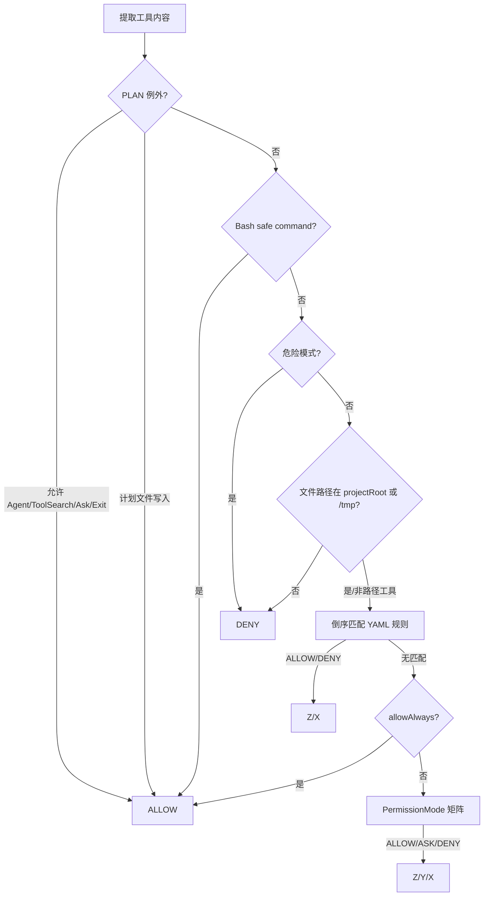

# JiMI Code 整合学习文档：03-Prompt权限与MCP.md

> 本文由 `docs/` 与 `study-notes/` 下的教材按段落级别整理生成。原始文件不删除；相同段落在本主题内只保留一次，保留版本最完整或最接近课程主线的那一段，其余来源记录在末尾的合并审计中。内容涉及当前源码时以 `jimi-code` 工作区为准；对 Claude Code 的描述只代表公开体验对标。

## 本主题的融合说明

本主题按“课程概念 → jimicode 源码 → 实验/排障 → 面试与边界”排序。段落之间出现同一事实时，优先保留包含真实路径、调用关系或失败处理的版本；只有标题/目录性质的短段被折叠。

> 来源：`docs/course/05-第5章-System-Prompt.md`

### 5. 第5章：System Prompt 设计

> 来源：`docs/course/05-第5章-System-Prompt.md`

学习如何把角色、规则、工具规范和项目约定组织成稳定的系统提示。学完能从失败样例迭代 Prompt，并知道哪些安全要求必须放进权限引擎。

> 来源：`docs/course/05-第5章-System-Prompt.md`

没有角色约束导致输出风格漂移；规则与工具描述冲突；把项目约定散落在用户消息；Prompt 注入覆盖安全要求；系统提示过长挤压业务上下文。

> 来源：`docs/course/05-第5章-System-Prompt.md`

System Prompt 是模型的行为上下文，不是强制安全边界。`PromptBuilder`、`PromptSections`、`PlanModePrompt` 分段组装角色、工具、技能、记忆和计划提醒。

> 来源：`docs/course/05-第5章-System-Prompt.md`

| 对比维度 | 本章能力 | 上一章能力 | 下一章依赖 |
|---|---|---|---|
| 输入 | 结构化、可校验的本章对象 | 上一层输出 | 为下一层提供稳定契约 |
| 控制 | 明确的状态/权限/预算 | 规则较少 | 可观测、可恢复、可扩展 |
| 失败 | 分类、可见、可恢复 | 可能只返回错误文本 | 由后续治理层接管 |

> 来源：`docs/course/05-第5章-System-Prompt.md`


> 来源：`docs/course/05-第5章-System-Prompt.md`

**本章实际链路**：基础角色 → 项目规则/Memory → 工具使用规范 → 当前任务 → 历史/观察 → Provider formatter → 模型

> 来源：`docs/course/05-第5章-System-Prompt.md`

PromptSections、instructions、memoryContent、system reminders、工具 schema、PlanModePrompt、规则优先级。

> 来源：`docs/course/05-第5章-System-Prompt.md`

| 字段 | 生产者 | 消费者 | 失败时必须保留 |
|---|---|---|---|
| 身份/名称 | 配置或注册表 | Agent/Provider/UI | 原始值与规范化值 |
| 参数/内容 | 用户、模型或工具 | 下一阶段模块 | 校验错误与来源 |
| 状态 | 编排器/持久化层 | 恢复、审计、UI | 转移前后状态 |
| 结果 | 本章实现 | Conversation/父任务 | 成功、错误、耗时 |

> 来源：`docs/course/05-第5章-System-Prompt.md`

`src/main/java/com/jimicode/prompt/PromptBuilder.java` 和 `PromptSections.java` 应按“稳定前缀优先、动态内容后置”的思路阅读。稳定角色、输出格式和安全原则尽量保持字节稳定，有利于 provider prompt cache；项目规则、当前任务、工具结果和后台通知属于动态段。

> 来源：`docs/course/05-第5章-System-Prompt.md`

System Prompt 建议分为：角色与目标、不可违反的行为规则、工具选择规范、代码仓库约定、输出格式、失败与确认策略、当前模式（普通/PLAN）。每段都要避免互相覆盖。例如“主动修复”不能覆盖“写文件前必须确认”；“简洁回答”不能阻止输出必要的测试结果。

> 来源：`docs/course/05-第5章-System-Prompt.md`

迭代 Prompt 使用失败样例驱动：记录输入、模型选择、工具参数、结果和偏差；只修改一条规则；用同一回归样本比较。安全条款应放在 Prompt 作为意图说明，同时放在 PermissionChecker、Tool handler 和 workdir 限制作为强制控制。

> 来源：`docs/course/05-第5章-System-Prompt.md`

反模式一是把所有源码和完整历史硬编码进系统提示；这会造成长度和维护问题。反模式二是用模糊的“请小心操作”代替可执行规则；应写成“写入前调用确认、路径必须位于 root、失败返回错误”。

> 来源：`docs/course/05-第5章-System-Prompt.md`

- 不要用自然语言约束替代可执行的系统边界。
- 不要吞掉异常、取消或拒绝事件。
- 不要在没有测试和回滚点的真实仓库执行破坏性操作。

> 来源：`docs/course/05-第5章-System-Prompt.md`

**目标**：为同一工具写两个 description/prompt 版本，使用固定任务集记录误选率、重复调用和解释质量（数字标记需实测）。

> 来源：`docs/course/05-第5章-System-Prompt.md`

**步骤**：在临时仓库或 mock 环境中准备输入；运行最小命令；保存事件、日志和 Git diff；重复一次失败条件。

> 来源：`docs/course/05-第5章-System-Prompt.md`

**预期现象**：能看到本章对应的状态变化，而不是只得到最终文本。

> 来源：`docs/course/05-第5章-System-Prompt.md`

**成功标准**：结果可复现、失败可解释、没有越过工作区和权限边界。

> 来源：`docs/course/05-第5章-System-Prompt.md`

**常见报错**：环境、路径、依赖、超时或配置错误；先看本章排障表，再沿源码调用者反查。

> 来源：`docs/course/05-第5章-System-Prompt.md`

**目标**：在 Prompt 中加入项目 Java 21 约定，但把路径安全留给 PermissionChecker；故意发送冲突用户指令，验证分层策略。

> 来源：`docs/course/05-第5章-System-Prompt.md`

模型忽略规则→查动态段位置和冲突；Prompt 太长→统计各 section 字符/token；工具误选→改 description/schema；缓存命中下降→检查稳定前缀；注入风险→确认权限层不依赖 Prompt。

> 来源：`docs/course/05-第5章-System-Prompt.md`

涉及文件、命令、网络、MCP、记忆、Hook 或并发时，统一使用临时仓库、最小权限、明确 workdir、超时、输出上限、审计和 Git 回滚点。任何示例数字标记“示例/需实测”；不在真实环境执行删除、覆盖、迁移或未知脚本。

> 来源：`docs/course/05-第5章-System-Prompt.md`

### 题 1：Prompt cache 为什么关注稳定前缀？

> 来源：`docs/course/05-第5章-System-Prompt.md`

**回答提纲**：先给概念定义，再引用一个 jimicode 文件/类，说明一次取舍和一个失败场景。**加分点**：能讲测试、指标和边界。
### 题 2：项目规则文件与 System Prompt 如何分工？

> 来源：`docs/course/05-第5章-System-Prompt.md`

**回答提纲**：先给概念定义，再引用一个 jimicode 文件/类，说明一次取舍和一个失败场景。**加分点**：能讲测试、指标和边界。
### 题 3：安全要求哪些能放 Prompt，哪些不能？

> 来源：`docs/course/05-第5章-System-Prompt.md`

**回答提纲**：先给概念定义，再引用一个 jimicode 文件/类，说明一次取舍和一个失败场景。**加分点**：能讲测试、指标和边界。
### 题 4：如何科学迭代 Prompt？

> 来源：`docs/course/05-第5章-System-Prompt.md`

**回答提纲**：先给概念定义，再引用一个 jimicode 文件/类，说明一次取舍和一个失败场景。**加分点**：能讲测试、指标和边界。

> 来源：`docs/course/05-第5章-System-Prompt.md`

- [ ] 我能解释本章能力在全链路中的位置
- [ ] 我能解释一个真实失败场景及排查路径
- [ ] 我能解释关键数据结构的生产者和消费者
- [ ] 我能解释至少一个源码文件和调用者
- [ ] 我能解释一个安全/性能取舍

> 来源：`docs/course/05-第5章-System-Prompt.md`

本章建立的契约会被下一章消费：权限系统 只有在输入、状态、失败和权限边界明确后才不会把复杂度继续放大。

> 来源：`docs/course/05-第5章-System-Prompt.md`

### FAQ 1：Prompt 越长越好吗？不是，规则要可执行且给上下文预算留空间。

> 来源：`docs/course/05-第5章-System-Prompt.md`

以当前项目源码和测试为准；第三方或闭源行为要明确标注边界。
### FAQ 2：用户指令和系统规则冲突怎么办？系统规则和权限优先。

> 来源：`docs/course/05-第5章-System-Prompt.md`

先用最小实验复现，再沿事件、日志、状态和调用者逐层定位。
### FAQ 3：Prompt 是否需要版本管理？需要，尤其生产策略和评测样例。

> 来源：`docs/course/05-第5章-System-Prompt.md`

可以，但要保留权限、超时、输出上限和可回滚机制。

> 来源：`docs/course/05-第5章-System-Prompt.md`

从当前章节的真实入口开始：基础角色 → 项目规则/Memory → 工具使用规范 → 当前任务 → 历史/观察 → Provider formatter → 模型。打开链路中的第一个 jimicode 类，记录构造器参数、字段初始化和直接调用者；再向后追踪一个结果对象的消费点。不要只搜索类名，要搜索方法调用和事件类型。

> 来源：`docs/course/05-第5章-System-Prompt.md`

本章的输入不能只写成“用户问题”。应拆成配置输入、自然语言输入、模型结构化输入、文件/进程输入和上游模块状态。对每一种输入写明允许为空的字段、长度上限、编码、来源和校验时机。PromptSections、instructions、memoryContent、system reminders、工具 schema、PlanModePrompt、规则优先级。 中出现的身份、参数和状态字段都要在进入下一层前规范化。

> 来源：`docs/course/05-第5章-System-Prompt.md`

把状态画成有限状态机：初始、准备、执行、等待确认、成功、失败、取消、恢复。每次转移记录触发事件、允许的前置状态、持久化动作和用户可见反馈。若代码使用 enum、record 或布尔字段表达状态，要检查是否存在互斥状态同时为 true 的问题。

> 来源：`docs/course/05-第5章-System-Prompt.md`

对每个公开方法至少做三次反查：谁创建对象、谁调用方法、谁处理返回值/异常。若返回集合，检查调用方是否修改它；若返回异步对象，检查是否真正订阅；若返回路径或命令，检查调用方是否再次做安全校验。

> 来源：`docs/course/05-第5章-System-Prompt.md`

将本章失败拆成输入错误、依赖错误、业务拒绝、超时、取消、部分成功和持久化失败。针对当前主题 `权限系统` 的前置依赖，写出“失败后能否重试、是否幂等、是否需要人工确认、是否需要回滚”的结论。

> 来源：`docs/course/05-第5章-System-Prompt.md`

至少记录关联 id、阶段、耗时、结果状态和错误类别。不要在日志中记录 API key、完整 Authorization、未脱敏工具参数或整段私有代码。TUI 需要用户可读消息，调试日志需要开发者上下文，两者可以来自同一个事件但不应共享不安全文本。

> 来源：`docs/course/05-第5章-System-Prompt.md`

确认本章对象是进程级、Agent 级、会话级、turn 级还是方法级状态。对可变集合、文件、队列和外部进程分别考虑竞态；不要因为方法加了 synchronized 就认为跨进程安全，也不要把虚拟线程误解成无限资源。

> 来源：`docs/course/05-第5章-System-Prompt.md`

为 CPU、内存、网络、token、文件读取和输出设置上限。上限达到时返回可解释的错误或降级结果，不能静默截断关键协议字段。若本章涉及重试，退避和最大次数必须与总预算一起设计。

> 来源：`docs/course/05-第5章-System-Prompt.md`

单元测试验证纯函数和边界；集成测试验证文件、进程或 HTTP；契约测试验证 provider/Tool/MCP 字段；回归测试固定一个曾经失败的用户故事。测试数据使用虚构密钥、临时目录和固定时间，不依赖个人机器状态。

> 来源：`docs/course/05-第5章-System-Prompt.md`

错误设计通常表现为：把所有逻辑放在一个巨型类；把异常转成空字符串；让模型决定权限；让 UI 直接修改核心状态；让外部脚本绕过统一工具入口。正确设计应保持单向依赖、结构化结果、独立权限、事件通知和可回滚副作用。

> 来源：`docs/course/05-第5章-System-Prompt.md`

先实现最小 happy path，再加入参数校验、错误封装、超时、取消、审计、恢复和测试。每一步保留可运行提交，避免一次性重写多个模块而无法定位回归。

> 来源：`docs/course/05-第5章-System-Prompt.md`

回到上一章的输出，确认本章没有重新发明同一数据结构。例如上一章已经定义 Message/Tool/Provider 时，本章应复用其契约，而不是在新模块中创建第二套近似类型。

> 来源：`docs/course/05-第5章-System-Prompt.md`

下一步是 `权限系统`。提前列出本章必须对外稳定的字段和事件；如果下一章要并发、压缩或扩展，本章的 id、版本、错误和取消语义必须先固定。

> 来源：`docs/course/05-第5章-System-Prompt.md`

完成本章后，提交一页设计记录：问题、方案、替代方案、源码证据、测试、已知限制、后续改进。评审者应能仅凭这页记录复现你的实验，而不是依赖口头解释。

> 来源：`docs/course/05-第5章-System-Prompt.md`

审查时逐条问：输入是否来自不可信源？副作用前是否授权？失败是否可见？重试是否幂等？取消是否传播？状态是否持久化？日志是否脱敏？测试是否覆盖空值、重复、超时和恢复？

> 来源：`docs/course/05-第5章-System-Prompt.md`

回答面试题时先给一句定义，再讲当前项目文件和方法，接着讲一个取舍和失败案例，最后说如何测试。不要只罗列框架名，也不要把示例数字说成生产指标。

> 来源：`docs/course/05-第5章-System-Prompt.md`

把本章放回完整闭环：基础角色 → 项目规则/Memory → 工具使用规范 → 当前任务 → 历史/观察 → Provider formatter → 模型。如果删除本章能力，系统会在这些地方退化：没有角色约束导致输出风格漂移；规则与工具描述冲突；把项目约定散落在用户消息；Prompt 注入覆盖安全要求；系统提示过长挤压业务上下文。。如果增强本章能力，优先增强契约、测试、可观测性和安全边界，再考虑增加模型或 Agent 数量。最后用一个真实但隔离的实验验证“输入—状态—结果—失败—恢复”五个维度，并把证据保存到学习笔记。
## 综合案例与边界演练

> 来源：`docs/course/05-第5章-System-Prompt.md`

### 场景 1：最小成功路径：使用固定输入、单一依赖和一个工具完成一次操作，记录从入口到结果的每个对象。

> 来源：`docs/course/05-第5章-System-Prompt.md`

本章的具体检查点是：System Prompt 是模型的行为上下文，不是强制安全边界。`PromptBuilder`、`PromptSections`、`PlanModePrompt` 分段组装角色、工具、技能、记忆和计划提醒。 生产的输入必须经过本章状态和权限边界，再形成 权限系统 可以消费的结果。实验结束后保存命令、事件、日志、测试、diff 和限制说明。

> 来源：`docs/course/05-第5章-System-Prompt.md`

### 场景 2：空值路径：删除可选字段、返回空集合或让模型不给出内容，确认系统使用默认值、明确错误还是安全退出。

> 来源：`docs/course/05-第5章-System-Prompt.md`

### 场景 3：重复路径：重复提交同一个请求、toolUseId、命令或消息，检查是否幂等、去重或要求人工确认。

> 来源：`docs/course/05-第5章-System-Prompt.md`

### 场景 4：超时路径：让网络、脚本、文件或子任务延迟，检查 timeout、取消、资源释放和用户提示。

> 来源：`docs/course/05-第5章-System-Prompt.md`

### 场景 5：部分成功路径：让多个动作中只有一部分成功，确认结果如何汇总、是否需要补偿或回滚。

> 来源：`docs/course/05-第5章-System-Prompt.md`

### 场景 6：权限路径：使用只读、询问和拒绝三种模式，确保决策发生在副作用之前且结果可审计。

> 来源：`docs/course/05-第5章-System-Prompt.md`

### 场景 7：恢复路径：在关键状态写入前后模拟进程退出，重新启动后检查状态、消息顺序和重复执行风险。

> 来源：`docs/course/05-第5章-System-Prompt.md`

### 场景 8：观测路径：为一次操作关联 id、阶段、耗时和错误类别，确认 UI、日志和 trace 的信息粒度不同但事实一致。

> 来源：`docs/course/05-第5章-System-Prompt.md`

### 场景 9：兼容路径：替换 provider、工具实现或配置版本，确认核心契约不需要大面积改动。

> 来源：`docs/course/05-第5章-System-Prompt.md`

### 场景 10：评审路径：邀请另一位同学只看文档和证据复现实验，记录他无法理解或无法复现的地方。

> 来源：`docs/course/05-第5章-System-Prompt.md`

围绕本章的实际链路 `基础角色 → 项目规则/Memory → 工具使用规范 → 当前任务 → 历史/观察 → Provider formatter → 模型`，在源码中定位一个具体类/方法，写出它的输入、输出、状态、调用者和失败处理。然后在隔离环境执行一个最小验证，保存测试/日志/diff；如果无法从当前仓库证实，明确写【待源码确认】。针对 `权限系统` 的后续能力，补充说明该契约为什么必须稳定、哪些字段不能随意改名，以及发生故障时如何向用户解释。

> 来源：`docs/course/06-第6章-权限系统.md`

### 6. 第6章：权限系统，给 Agent 装上安全刹车

> 来源：`docs/course/06-第6章-权限系统.md`

建立模型提议、系统裁决、工具执行三层分离的安全边界。学完能设计只读/写文件/shell/网络权限、一次性确认和工作区 root。

> 来源：`docs/course/06-第6章-权限系统.md`

模型直接执行危险命令；路径穿越读取工作区外文件；用户拒绝后仍执行；会话内允许规则泄漏到下一会话；敏感文件被写入日志。

> 来源：`docs/course/06-第6章-权限系统.md`

PermissionMode、PermissionChecker、PermissionResponse 和确认 Dialog 共同实现 HITL。权限是强制策略，Prompt 只是说明；规则应按工具、路径、命令和会话粒度控制。

> 来源：`docs/course/06-第6章-权限系统.md`

**本章实际链路**：ToolUse → 解析参数 → PermissionChecker → ALLOW/ASK/DENY → Dialog/PlanApproval → handler → audit/result

> 来源：`docs/course/06-第6章-权限系统.md`

PermissionMode、PermissionResponse、tool name、path/command、session id、一次性/会话规则、workDir root、dangerous files。

> 来源：`docs/course/06-第6章-权限系统.md`

阅读 `src/main/java/com/jimicode/permission/PermissionMode.java`、`PermissionChecker.java`、`PermissionResponse.java` 及 `ui/dialog/AskUserDialog.java`。一个可靠的 PermissionGateway 至少接收工具名、参数、会话、工作区、用户身份和当前模式，返回决策及解释。决策在 handler 产生副作用之前完成，不能执行后再询问。

> 来源：`docs/course/06-第6章-权限系统.md`

建议把策略拆成只读、写文件、shell、网络和外部 MCP 五类。只读也要限制敏感路径；写文件需要 root、快照和确认；shell 需要命令白名单/前缀、工作目录、超时和输出上限；网络需要目标域名或 provider allowlist；MCP 还要区分本地信任边界和第三方 server。

> 来源：`docs/course/06-第6章-权限系统.md`

一次性确认只对当前 toolUseId 有效，会话内允许要绑定 session/user/workdir，永久允许必须显式配置并可撤销。拒绝应产生 ToolResult 或 PermissionEvent，让模型知道动作未执行。所有策略决定都应写审计，但敏感参数脱敏。

> 来源：`docs/course/06-第6章-权限系统.md`

反模式一是“全自动模式=跳过所有检查”；即便 AUTO，也要保留 root、危险文件、命令和资源限制。反模式二是把路径判断写成字符串前缀比较，忽略 `..`、大小写、符号链接和 Windows 路径。

> 来源：`docs/course/06-第6章-权限系统.md`

**目标**：在临时仓库测试读文件、写文件、shell 三类工具，分别设置只读、PLAN、AUTO，记录决策和 UI 文案。

> 来源：`docs/course/06-第6章-权限系统.md`

**目标**：构造 `../`、符号链接、`.env`、`.ssh` 等安全测试样本，验证路径归一化后仍被正确阻断；不做任何真实破坏操作。

> 来源：`docs/course/06-第6章-权限系统.md`

拒绝未生效→查 checker 是否在 handler 前；误判路径→查 normalize/realpath/root；重复确认→查 toolUseId；会话规则串线→查 session key；日志泄密→搜索 Authorization/API key 和原始参数。

> 来源：`docs/course/06-第6章-权限系统.md`

### 题 1：权限引擎与 Prompt 规则的边界？

> 来源：`docs/course/06-第6章-权限系统.md`

**回答提纲**：先给概念定义，再引用一个 jimicode 文件/类，说明一次取舍和一个失败场景。**加分点**：能讲测试、指标和边界。
### 题 2：一次性确认如何防重放？

> 来源：`docs/course/06-第6章-权限系统.md`

**回答提纲**：先给概念定义，再引用一个 jimicode 文件/类，说明一次取舍和一个失败场景。**加分点**：能讲测试、指标和边界。
### 题 3：如何防 Windows/Unix 路径穿越？

> 来源：`docs/course/06-第6章-权限系统.md`

**回答提纲**：先给概念定义，再引用一个 jimicode 文件/类，说明一次取舍和一个失败场景。**加分点**：能讲测试、指标和边界。
### 题 4：AUTO 模式是否可以没有任何限制？

> 来源：`docs/course/06-第6章-权限系统.md`

本章建立的契约会被下一章消费：MCP 协议 只有在输入、状态、失败和权限边界明确后才不会把复杂度继续放大。

> 来源：`docs/course/06-第6章-权限系统.md`

### FAQ 1：只读模式能运行测试吗？测试命令可能写 target/或访问网络，应单独分类。

> 来源：`docs/course/06-第6章-权限系统.md`

以当前项目源码和测试为准；第三方或闭源行为要明确标注边界。
### FAQ 2：用户确认后还要二次校验吗？要，handler 必须做最终参数/路径校验。

> 来源：`docs/course/06-第6章-权限系统.md`

先用最小实验复现，再沿事件、日志、状态和调用者逐层定位。
### FAQ 3：权限规则应该持久化吗？按风险分级，持久化规则必须绑定身份和工作区。

> 来源：`docs/course/06-第6章-权限系统.md`

从当前章节的真实入口开始：ToolUse → 解析参数 → PermissionChecker → ALLOW/ASK/DENY → Dialog/PlanApproval → handler → audit/result。打开链路中的第一个 jimicode 类，记录构造器参数、字段初始化和直接调用者；再向后追踪一个结果对象的消费点。不要只搜索类名，要搜索方法调用和事件类型。

> 来源：`docs/course/06-第6章-权限系统.md`

本章的输入不能只写成“用户问题”。应拆成配置输入、自然语言输入、模型结构化输入、文件/进程输入和上游模块状态。对每一种输入写明允许为空的字段、长度上限、编码、来源和校验时机。PermissionMode、PermissionResponse、tool name、path/command、session id、一次性/会话规则、workDir root、dangerous files。 中出现的身份、参数和状态字段都要在进入下一层前规范化。

> 来源：`docs/course/06-第6章-权限系统.md`

将本章失败拆成输入错误、依赖错误、业务拒绝、超时、取消、部分成功和持久化失败。针对当前主题 `MCP 协议` 的前置依赖，写出“失败后能否重试、是否幂等、是否需要人工确认、是否需要回滚”的结论。

> 来源：`docs/course/06-第6章-权限系统.md`

下一步是 `MCP 协议`。提前列出本章必须对外稳定的字段和事件；如果下一章要并发、压缩或扩展，本章的 id、版本、错误和取消语义必须先固定。

> 来源：`docs/course/06-第6章-权限系统.md`

把本章放回完整闭环：ToolUse → 解析参数 → PermissionChecker → ALLOW/ASK/DENY → Dialog/PlanApproval → handler → audit/result。如果删除本章能力，系统会在这些地方退化：模型直接执行危险命令；路径穿越读取工作区外文件；用户拒绝后仍执行；会话内允许规则泄漏到下一会话；敏感文件被写入日志。。如果增强本章能力，优先增强契约、测试、可观测性和安全边界，再考虑增加模型或 Agent 数量。最后用一个真实但隔离的实验验证“输入—状态—结果—失败—恢复”五个维度，并把证据保存到学习笔记。
## 综合案例与边界演练

> 来源：`docs/course/06-第6章-权限系统.md`

本章的具体检查点是：PermissionMode、PermissionChecker、PermissionResponse 和确认 Dialog 共同实现 HITL。权限是强制策略，Prompt 只是说明；规则应按工具、路径、命令和会话粒度控制。 生产的输入必须经过本章状态和权限边界，再形成 MCP 协议 可以消费的结果。实验结束后保存命令、事件、日志、测试、diff 和限制说明。

> 来源：`docs/course/06-第6章-权限系统.md`

围绕本章的实际链路 `ToolUse → 解析参数 → PermissionChecker → ALLOW/ASK/DENY → Dialog/PlanApproval → handler → audit/result`，在源码中定位一个具体类/方法，写出它的输入、输出、状态、调用者和失败处理。然后在隔离环境执行一个最小验证，保存测试/日志/diff；如果无法从当前仓库证实，明确写【待源码确认】。针对 `MCP 协议` 的后续能力，补充说明该契约为什么必须稳定、哪些字段不能随意改名，以及发生故障时如何向用户解释。

> 来源：`docs/course/07-第7章-MCP协议.md`

### 7. 第7章：MCP 协议 - 开放式工具生态

> 来源：`docs/course/07-第7章-MCP协议.md`

理解 MCP Host/Client/Server 角色以及第三方工具如何进入 Agent。学完能配置一个 MCP Server，并说明信任边界、schema 转换和失败处理。

> 来源：`docs/course/07-第7章-MCP协议.md`

把不可信 server 当本地可信代码；server 工具 schema 与本地 registry 冲突；进程崩溃导致 Agent 卡住；MCP 返回超大资源烧光上下文；凭据被传给错误 server。

> 来源：`docs/course/07-第7章-MCP协议.md`

MCP 标准化工具、资源和提示模板接入。jimicode 的 `McpManager`、`McpServerConfig` 把外部 server 接入 ToolRegistry，但权限和生命周期仍由 Host 控制。

> 来源：`docs/course/07-第7章-MCP协议.md`

**本章实际链路**：config.yaml → McpManager 启动 client/process → initialize/capabilities → tools/list → schema 映射 → model tool use → tools/call → ToolResult

> 来源：`docs/course/07-第7章-MCP协议.md`

McpServerConfig(name/command/args/env)、server id、capabilities、tool name/schema、call timeout、transport/process state。

> 来源：`docs/course/07-第7章-MCP协议.md`

`src/main/java/com/jimicode/mcp/McpManager.java` 与 `config/McpServerConfig.java` 是阅读入口。Host 是 jimicode，Client 是 Host 与某个 server 的连接对象，Server 是外部进程或远端服务。启动时读取 command/args，建立 transport，协商能力，再把 tools/list 转换成内部 schema；调用时保留 server 名称和原始 tool 名，避免同名冲突。

> 来源：`docs/course/07-第7章-MCP协议.md`

接入流程要分为配置、启动、能力发现、权限注册、调用、关闭六步。配置中不要写长期秘密；环境变量通过受控映射传入。启动要有超时和 stderr 捕获；能力发现失败可以禁用该 server，但必须在 TUI/日志中可见。调用要限制参数、超时、输出大小和并发，server 返回的资源不能无上限回灌。

> 来源：`docs/course/07-第7章-MCP协议.md`

第三方 MCP 的信任边界比本地 Tool 更宽：它可能访问网络、文件、数据库或执行自己的进程。权限 UI 应显示 server 名称、tool 名称、关键参数和数据去向。不要因为 schema 看起来安全就跳过 server 级别审核。

> 来源：`docs/course/07-第7章-MCP协议.md`

反模式一是把所有 MCP 工具自动注册为永久允许；反模式二是只在进程启动时校验，运行中 server 能力变化却不更新；反模式三是把 server 原始错误和敏感环境变量完整回显给模型。

> 来源：`docs/course/07-第7章-MCP协议.md`

**目标**：配置一个只读 MCP Server，验证启动、tools/list、schema 显示和一次调用；记录 server stderr 与退出码。

> 来源：`docs/course/07-第7章-MCP协议.md`

**目标**：让 mock server 返回超长结果、错误和延迟，验证超时、截断和 isError，不连接未知第三方服务。

> 来源：`docs/course/07-第7章-MCP协议.md`

server 不出现→查配置路径/command/args；tools/list 失败→看 stderr/初始化超时；同名冲突→检查命名空间；调用卡住→查 transport timeout；输出过大→查 MCP 结果预算和 compaction。

> 来源：`docs/course/07-第7章-MCP协议.md`

### 题 1：MCP Host/Client/Server 如何分工？

> 来源：`docs/course/07-第7章-MCP协议.md`

**回答提纲**：先给概念定义，再引用一个 jimicode 文件/类，说明一次取舍和一个失败场景。**加分点**：能讲测试、指标和边界。
### 题 2：MCP Tool 与本地 Tool 的权限差异？

> 来源：`docs/course/07-第7章-MCP协议.md`

**回答提纲**：先给概念定义，再引用一个 jimicode 文件/类，说明一次取舍和一个失败场景。**加分点**：能讲测试、指标和边界。
### 题 3：server 崩溃如何恢复？

> 来源：`docs/course/07-第7章-MCP协议.md`

**回答提纲**：先给概念定义，再引用一个 jimicode 文件/类，说明一次取舍和一个失败场景。**加分点**：能讲测试、指标和边界。
### 题 4：为什么要限制 MCP 返回大小？

> 来源：`docs/course/07-第7章-MCP协议.md`

本章建立的契约会被下一章消费：上下文管理 只有在输入、状态、失败和权限边界明确后才不会把复杂度继续放大。

> 来源：`docs/course/07-第7章-MCP协议.md`

### FAQ 1：MCP 是模型直接连接 server 吗？不是，通常由 Host/Client 代为管理。

> 来源：`docs/course/07-第7章-MCP协议.md`

以当前项目源码和测试为准；第三方或闭源行为要明确标注边界。
### FAQ 2：能否信任官方 server？仍需按权限、版本和数据边界审查。

> 来源：`docs/course/07-第7章-MCP协议.md`

先用最小实验复现，再沿事件、日志、状态和调用者逐层定位。
### FAQ 3：MCP 只能提供工具吗？协议也可扩展资源、提示等能力，具体以实现协商为准。

> 来源：`docs/course/07-第7章-MCP协议.md`

从当前章节的真实入口开始：config.yaml → McpManager 启动 client/process → initialize/capabilities → tools/list → schema 映射 → model tool use → tools/call → ToolResult。打开链路中的第一个 jimicode 类，记录构造器参数、字段初始化和直接调用者；再向后追踪一个结果对象的消费点。不要只搜索类名，要搜索方法调用和事件类型。

> 来源：`docs/course/07-第7章-MCP协议.md`

本章的输入不能只写成“用户问题”。应拆成配置输入、自然语言输入、模型结构化输入、文件/进程输入和上游模块状态。对每一种输入写明允许为空的字段、长度上限、编码、来源和校验时机。McpServerConfig(name/command/args/env)、server id、capabilities、tool name/schema、call timeout、transport/process state。 中出现的身份、参数和状态字段都要在进入下一层前规范化。

> 来源：`docs/course/07-第7章-MCP协议.md`

将本章失败拆成输入错误、依赖错误、业务拒绝、超时、取消、部分成功和持久化失败。针对当前主题 `上下文管理` 的前置依赖，写出“失败后能否重试、是否幂等、是否需要人工确认、是否需要回滚”的结论。

> 来源：`docs/course/07-第7章-MCP协议.md`

下一步是 `上下文管理`。提前列出本章必须对外稳定的字段和事件；如果下一章要并发、压缩或扩展，本章的 id、版本、错误和取消语义必须先固定。

> 来源：`docs/course/07-第7章-MCP协议.md`

把本章放回完整闭环：config.yaml → McpManager 启动 client/process → initialize/capabilities → tools/list → schema 映射 → model tool use → tools/call → ToolResult。如果删除本章能力，系统会在这些地方退化：把不可信 server 当本地可信代码；server 工具 schema 与本地 registry 冲突；进程崩溃导致 Agent 卡住；MCP 返回超大资源烧光上下文；凭据被传给错误 server。。如果增强本章能力，优先增强契约、测试、可观测性和安全边界，再考虑增加模型或 Agent 数量。最后用一个真实但隔离的实验验证“输入—状态—结果—失败—恢复”五个维度，并把证据保存到学习笔记。
## 综合案例与边界演练

> 来源：`docs/course/07-第7章-MCP协议.md`

本章的具体检查点是：MCP 标准化工具、资源和提示模板接入。jimicode 的 `McpManager`、`McpServerConfig` 把外部 server 接入 ToolRegistry，但权限和生命周期仍由 Host 控制。 生产的输入必须经过本章状态和权限边界，再形成 上下文管理 可以消费的结果。实验结束后保存命令、事件、日志、测试、diff 和限制说明。

> 来源：`docs/course/07-第7章-MCP协议.md`

围绕本章的实际链路 `config.yaml → McpManager 启动 client/process → initialize/capabilities → tools/list → schema 映射 → model tool use → tools/call → ToolResult`，在源码中定位一个具体类/方法，写出它的输入、输出、状态、调用者和失败处理。然后在隔离环境执行一个最小验证，保存测试/日志/diff；如果无法从当前仓库证实，明确写【待源码确认】。针对 `上下文管理` 的后续能力，补充说明该契约为什么必须稳定、哪些字段不能随意改名，以及发生故障时如何向用户解释。

> 来源：`docs/deep-learning/04-异常测试安全性能与面试.md`

### jimi-code：04-异常测试安全性能与面试.md

> 来源：`docs/deep-learning/04-异常测试安全性能与面试.md`

`LlmException` 表示 provider/协议层失败；工具错误应进入 `ToolResult.isError` 并回传模型，而不是直接让 UI 崩溃；配置错误应在启动期失败；文件历史和恢复失败要保留原始路径与 toolUseId。全局上要区分可重试（429、瞬时网络）、不可重试（schema 错、权限拒绝）和需要人工确认（破坏性命令）。

> 来源：`docs/deep-learning/04-异常测试安全性能与面试.md`

已有测试覆盖配置 API key/context window、Anthropic 解析、Usage、PermissionMode、Session、ContextCompactor、ToolSearch、ToolResult budget 与替换记录。建议补充：SSE 分片边界、重复 delta、工具超时、并发写同一文件、tmux 不存在、worktree 创建失败、摘要失败回退、恶意 prompt 注入和超长输出截断。

> 来源：`docs/deep-learning/04-异常测试安全性能与面试.md`

安全重点是命令注入、路径穿越、密钥泄露、MCP server 任意执行和 worktree 越权。性能重点是 token 预算、流式 UI 刷新频率、文件读取上限、并发 Agent 数量和历史文件增长。使用白名单工具、规范化路径、输出截断、超时、熔断和结构化日志。

> 来源：`docs/deep-learning/04-异常测试安全性能与面试.md`

- 为什么用流式而不是一次性响应：首 token 延迟、用户体验和长输出内存占用。
- 如何实现上下文压缩：保留系统约束、未完成任务、工具调用闭环和最近消息，摘要必须可恢复。
- 为什么需要 Worktree：并行修改的冲突隔离与可回滚性。
- Tool schema 如何防止模型乱传参数：JSON Schema 校验、服务端二次校验和权限层。
- 文件邮箱如何保证一致性：原子写、唯一消息 ID、消费确认、崩溃重放。

> 来源：`docs/deep-learning/04-异常测试安全性能与面试.md`

### `jimi-code/.idea/compiler.xml`
- 文件类型：`.xml`；行数：18。
- 阅读重点：把它与同目录 Java/配置文件对照，确认它是构建入口、运行时配置、文档还是示例，不把示例误当生产 API。

> 来源：`docs/deep-learning/04-异常测试安全性能与面试.md`

### `jimi-code/.idea/encodings.xml`
- 文件类型：`.xml`；行数：7。
- 阅读重点：把它与同目录 Java/配置文件对照，确认它是构建入口、运行时配置、文档还是示例，不把示例误当生产 API。

> 来源：`docs/deep-learning/04-异常测试安全性能与面试.md`

### `jimi-code/.idea/jarRepositories.xml`
- 文件类型：`.xml`；行数：20。
- 阅读重点：把它与同目录 Java/配置文件对照，确认它是构建入口、运行时配置、文档还是示例，不把示例误当生产 API。

> 来源：`docs/deep-learning/04-异常测试安全性能与面试.md`

### `jimi-code/.idea/MarsCodeWorkspaceAppSettings.xml`
- 文件类型：`.xml`；行数：7。
- 阅读重点：把它与同目录 Java/配置文件对照，确认它是构建入口、运行时配置、文档还是示例，不把示例误当生产 API。

> 来源：`docs/deep-learning/04-异常测试安全性能与面试.md`

### `jimi-code/.idea/misc.xml`
- 文件类型：`.xml`；行数：12。
- 阅读重点：把它与同目录 Java/配置文件对照，确认它是构建入口、运行时配置、文档还是示例，不把示例误当生产 API。

> 来源：`docs/deep-learning/04-异常测试安全性能与面试.md`

### `jimi-code/.idea/vcs.xml`
- 文件类型：`.xml`；行数：6。
- 阅读重点：把它与同目录 Java/配置文件对照，确认它是构建入口、运行时配置、文档还是示例，不把示例误当生产 API。

> 来源：`docs/deep-learning/04-异常测试安全性能与面试.md`

### `jimi-code/.idea/workspace.xml`
- 文件类型：`.xml`；行数：105。
- 阅读重点：把它与同目录 Java/配置文件对照，确认它是构建入口、运行时配置、文档还是示例，不把示例误当生产 API。

> 来源：`docs/deep-learning/04-异常测试安全性能与面试.md`

### `jimi-code/.mvn/wrapper/maven-wrapper.properties`
- 文件类型：`.properties`；行数：19。
- 阅读重点：把它与同目录 Java/配置文件对照，确认它是构建入口、运行时配置、文档还是示例，不把示例误当生产 API。

> 来源：`docs/deep-learning/04-异常测试安全性能与面试.md`

### `jimi-code/.workbuddy/memory/2026-08-11.md`
- 文件类型：`.md`；行数：25。
- 阅读重点：把它与同目录 Java/配置文件对照，确认它是构建入口、运行时配置、文档还是示例，不把示例误当生产 API。

> 来源：`docs/deep-learning/04-异常测试安全性能与面试.md`

### `jimi-code/config.example.yaml`
- 文件类型：`.yaml`；行数：14。
- 阅读重点：把它与同目录 Java/配置文件对照，确认它是构建入口、运行时配置、文档还是示例，不把示例误当生产 API。

> 来源：`docs/deep-learning/04-异常测试安全性能与面试.md`

### `jimi-code/docs/deep-dive/00-源码逐文件覆盖矩阵.md`
- 文件类型：`.md`；行数：173。
- 阅读重点：把它与同目录 Java/配置文件对照，确认它是构建入口、运行时配置、文档还是示例，不把示例误当生产 API。

> 来源：`docs/deep-learning/04-异常测试安全性能与面试.md`

### `jimi-code/docs/deep-dive/01-入口配置消息与Agent主循环.md`
- 文件类型：`.md`；行数：209。
- 阅读重点：把它与同目录 Java/配置文件对照，确认它是构建入口、运行时配置、文档还是示例，不把示例误当生产 API。

> 来源：`docs/deep-learning/04-异常测试安全性能与面试.md`

### `jimi-code/docs/deep-dive/02-工具权限Hook-MCP与文件变更.md`
- 文件类型：`.md`；行数：218。
- 阅读重点：把它与同目录 Java/配置文件对照，确认它是构建入口、运行时配置、文档还是示例，不把示例误当生产 API。

> 来源：`docs/deep-learning/04-异常测试安全性能与面试.md`

### `jimi-code/docs/deep-dive/03-会话记忆压缩历史与Worktree.md`
- 文件类型：`.md`；行数：249。
- 阅读重点：把它与同目录 Java/配置文件对照，确认它是构建入口、运行时配置、文档还是示例，不把示例误当生产 API。

> 来源：`docs/deep-learning/04-异常测试安全性能与面试.md`

### `jimi-code/docs/deep-dive/04-依赖库Maven构建与面试原理.md`
- 文件类型：`.md`；行数：215。
- 阅读重点：把它与同目录 Java/配置文件对照，确认它是构建入口、运行时配置、文档还是示例，不把示例误当生产 API。

> 来源：`docs/deep-learning/04-异常测试安全性能与面试.md`

### `jimi-code/docs/deep-dive/05-SubAgent团队Skill任务与TUI.md`
- 文件类型：`.md`；行数：142。
- 阅读重点：把它与同目录 Java/配置文件对照，确认它是构建入口、运行时配置、文档还是示例，不把示例误当生产 API。

> 来源：`docs/deep-learning/04-异常测试安全性能与面试.md`

### `jimi-code/docs/deep-dive/06-系统架构逐模块调用链与异常体系.md`
- 文件类型：`.md`；行数：161。
- 阅读重点：把它与同目录 Java/配置文件对照，确认它是构建入口、运行时配置、文档还是示例，不把示例误当生产 API。

> 来源：`docs/deep-learning/04-异常测试安全性能与面试.md`

### `jimi-code/docs/deep-dive/07-构建部署配置调试测试与常见问题.md`
- 文件类型：`.md`；行数：175。
- 阅读重点：把它与同目录 Java/配置文件对照，确认它是构建入口、运行时配置、文档还是示例，不把示例误当生产 API。

> 来源：`docs/deep-learning/04-异常测试安全性能与面试.md`

### `jimi-code/docs/deep-dive/08-测试源码逐文件精读与行为契约.md`
- 文件类型：`.md`；行数：174。
- 阅读重点：把它与同目录 Java/配置文件对照，确认它是构建入口、运行时配置、文档还是示例，不把示例误当生产 API。

> 来源：`docs/deep-learning/04-异常测试安全性能与面试.md`

### `jimi-code/docs/deep-dive/09-117个Java文件逐文件精读索引.md`
- 文件类型：`.md`；行数：746。
- 阅读重点：把它与同目录 Java/配置文件对照，确认它是构建入口、运行时配置、文档还是示例，不把示例误当生产 API。

> 来源：`docs/deep-learning/04-异常测试安全性能与面试.md`

### `jimi-code/docs/deep-dive/README.md`
- 文件类型：`.md`；行数：146。
- 阅读重点：把它与同目录 Java/配置文件对照，确认它是构建入口、运行时配置、文档还是示例，不把示例误当生产 API。

> 来源：`docs/deep-learning/04-异常测试安全性能与面试.md`

### `jimi-code/docs/deep-learning/00-项目总览与学习路线.md`
- 文件类型：`.md`；行数：1666。
- 阅读重点：把它与同目录 Java/配置文件对照，确认它是构建入口、运行时配置、文档还是示例，不把示例误当生产 API。

> 来源：`docs/deep-learning/04-异常测试安全性能与面试.md`

### `jimi-code/docs/deep-learning/01-架构与核心链路.md`
- 文件类型：`.md`；行数：1645。
- 阅读重点：把它与同目录 Java/配置文件对照，确认它是构建入口、运行时配置、文档还是示例，不把示例误当生产 API。

> 来源：`docs/deep-learning/04-异常测试安全性能与面试.md`

### `jimi-code/docs/deep-learning/02-逐文件源码精读.md`
- 文件类型：`.md`；行数：1630。
- 阅读重点：把它与同目录 Java/配置文件对照，确认它是构建入口、运行时配置、文档还是示例，不把示例误当生产 API。

> 来源：`docs/deep-learning/04-异常测试安全性能与面试.md`

### `jimi-code/docs/deep-learning/03-依赖库构建配置与运行.md`
- 文件类型：`.md`；行数：1637。
- 阅读重点：把它与同目录 Java/配置文件对照，确认它是构建入口、运行时配置、文档还是示例，不把示例误当生产 API。

> 来源：`docs/deep-learning/04-异常测试安全性能与面试.md`

### `jimi-code/docs/deep-learning/04-异常测试安全性能与面试.md`
- 文件类型：`.md`；行数：1638。
- 阅读重点：把它与同目录 Java/配置文件对照，确认它是构建入口、运行时配置、文档还是示例，不把示例误当生产 API。

> 来源：`docs/deep-learning/04-异常测试安全性能与面试.md`

### `jimi-code/docs/deep-learning/05-核心Java文件逐方法讲解.md`
- 文件类型：`.md`；行数：5344。
- 阅读重点：把它与同目录 Java/配置文件对照，确认它是构建入口、运行时配置、文档还是示例，不把示例误当生产 API。

> 来源：`docs/deep-learning/04-异常测试安全性能与面试.md`

### `jimi-code/docs/deep-learning/06-核心链路语义讲解.md`
- 文件类型：`.md`；行数：127。
- 阅读重点：把它与同目录 Java/配置文件对照，确认它是构建入口、运行时配置、文档还是示例，不把示例误当生产 API。

> 来源：`docs/deep-learning/04-异常测试安全性能与面试.md`

### `jimi-code/docs/deep-learning/README-深度学习文档导航.md`
- 文件类型：`.md`；行数：34。
- 阅读重点：把它与同目录 Java/配置文件对照，确认它是构建入口、运行时配置、文档还是示例，不把示例误当生产 API。

> 来源：`docs/deep-learning/04-异常测试安全性能与面试.md`

### `jimi-code/docs/JAVA_MAVEN_GUIDE.md`
- 文件类型：`.md`；行数：67。
- 阅读重点：把它与同目录 Java/配置文件对照，确认它是构建入口、运行时配置、文档还是示例，不把示例误当生产 API。

> 来源：`docs/deep-learning/04-异常测试安全性能与面试.md`

### `jimi-code/docs/PROJECT_GUIDE.md`
- 文件类型：`.md`；行数：848。
- 阅读重点：把它与同目录 Java/配置文件对照，确认它是构建入口、运行时配置、文档还是示例，不把示例误当生产 API。

> 来源：`docs/deep-learning/04-异常测试安全性能与面试.md`

### `jimi-code/JIMICODE.md`
- 文件类型：`.md`；行数：12。
- 阅读重点：把它与同目录 Java/配置文件对照，确认它是构建入口、运行时配置、文档还是示例，不把示例误当生产 API。

> 来源：`docs/deep-learning/04-异常测试安全性能与面试.md`

### `jimi-code/LEARNING_GUIDE.md`
- 文件类型：`.md`；行数：915。
- 阅读重点：把它与同目录 Java/配置文件对照，确认它是构建入口、运行时配置、文档还是示例，不把示例误当生产 API。

> 来源：`docs/deep-learning/04-异常测试安全性能与面试.md`

### `jimi-code/mewcode-maven/.mewcode/config.yaml`
- 文件类型：`.yaml`；行数：14。
- 阅读重点：把它与同目录 Java/配置文件对照，确认它是构建入口、运行时配置、文档还是示例，不把示例误当生产 API。

> 来源：`docs/deep-learning/04-异常测试安全性能与面试.md`

### `jimi-code/mewcode-maven/.mvn/wrapper/maven-wrapper.properties`
- 文件类型：`.properties`；行数：19。
- 阅读重点：把它与同目录 Java/配置文件对照，确认它是构建入口、运行时配置、文档还是示例，不把示例误当生产 API。

> 来源：`docs/deep-learning/04-异常测试安全性能与面试.md`

### `jimi-code/mewcode-maven/config.example.yaml`
- 文件类型：`.yaml`；行数：14。
- 阅读重点：把它与同目录 Java/配置文件对照，确认它是构建入口、运行时配置、文档还是示例，不把示例误当生产 API。

> 来源：`docs/deep-learning/04-异常测试安全性能与面试.md`

### `jimi-code/mewcode-maven/pom.xml`
- Maven 模块标识线索：jimicode, tui4j, mordant, mordant-markdown, mcp, slf4j-nop, anthropic-java, openai-java
- 依赖：`com.williamcallahan:tui4j`（0.3.3）；`com.github.ajalt.mordant:mordant`（3.0.2）；`com.github.ajalt.mordant:mordant-markdown`（3.0.2）；`io.modelcontextprotocol.sdk:mcp`（1.1.3）；`org.slf4j:slf4j-nop`（2.0.16）；`com.anthropic:anthropic-java`（2.34.0）；`com.openai:openai-java`（4.37.0）；`org.yaml:snakeyaml`（2.2）；`com.fasterxml.jackson.core:jackson-databind`（${jackson.version}）；`com.fasterxml.jackson.datatype:jackson-datatype-jsr310`（${jackson.version}）；`org.junit.jupiter:junit-jupiter`（${junit.version}）
- 阅读重点：确认 dependencyManagement、插件生命周期、Java 版本、测试与发布配置。

> 来源：`docs/deep-learning/04-异常测试安全性能与面试.md`

### `jimi-code/mewcode-maven/README.md`
- 文件类型：`.md`；行数：96。
- 阅读重点：把它与同目录 Java/配置文件对照，确认它是构建入口、运行时配置、文档还是示例，不把示例误当生产 API。

> 来源：`docs/deep-learning/04-异常测试安全性能与面试.md`

### `jimi-code/mewcode-maven/src/main/java/com/mewcode/agent/Agent.java`
- 包：`com.jimicode.agent`；行数：434；类型：Agent, into, ToolCallInfo, ToolCallResult
- 方法/构造器线索：getReplacementState, setReplacementState, setFileHistory, getRegistry, getProtocol, Agent, setChecker, setHookEngine, setMaxIterations, setWorkDir, setSessionId, getSessionId, setNotificationFn, setToolNameFilter, setInstructions, setMemoryContent, getHookEngine, run, agentLoop, putSafe, if, for, while, switch, events_drain_last_error, ToolCallInfo, ToolCallResult
- 直接导入：com.jimicode.config.ProviderConfig, com.jimicode.conversation.ConversationManager, com.jimicode.conversation.ThinkingBlock, com.jimicode.conversation.ToolResultBlock, com.jimicode.conversation.ToolUseBlock, com.jimicode.hook.HookEngine, com.jimicode.llm.LlmClient, com.jimicode.llm.StreamEvent, com.j
- 阅读重点：先看类型声明和构造器，再沿方法中的 `Mono`/`Flux`、异常、事件或文件 IO 调用向下追踪；测试应验证边界条件、空值、重试和资源释放。

> 来源：`docs/deep-learning/04-异常测试安全性能与面试.md`

### `jimi-code/mewcode-maven/src/main/java/com/mewcode/agent/AgentEvent.java`
- 包：`com.jimicode.agent`；行数：44；类型：AgentEvent, StreamText, ThinkingText, ThinkingComplete, ToolUseEvent, ToolResultEvent, TurnComplete, LoopComplete, UsageEvent, ErrorEvent, CompactEvent, RetryEvent, PermissionRequestEvent, AskUserRequestEvent
- 方法/构造器线索：未匹配到公开方法；需结合源码阅读静态初始化/记录组件
- 直接导入：com.jimicode.permission.PermissionResponse, java.util.Map, java.util.concurrent.CompletableFuture
- 阅读重点：先看类型声明和构造器，再沿方法中的 `Mono`/`Flux`、异常、事件或文件 IO 调用向下追踪；测试应验证边界条件、空值、重试和资源释放。

> 来源：`docs/deep-learning/04-异常测试安全性能与面试.md`

### `jimi-code/mewcode-maven/src/main/java/com/mewcode/agent/StreamingExecutor.java`
- 包：`com.jimicode.agent`；行数：212；类型：StreamingExecutor, ToolCallInfo, ToolExecResult
- 方法/构造器线索：ToolCallInfo, ToolExecResult, StreamingExecutor, this, executeAll, for, if, try, catch, executeSingle, putSafe, switch, snapshotForRecovery, extractContent
- 直接导入：com.jimicode.compact.RecoveryState, com.jimicode.hook.HookEngine, com.jimicode.permission.PermissionChecker, com.jimicode.permission.PermissionResponse, com.jimicode.tool.Tool, com.jimicode.tool.ToolCategory, com.jimicode.tool.ToolRegistry, com.jimicode.tool.ToolResult, java.io.IOException, java.nio
- 阅读重点：先看类型声明和构造器，再沿方法中的 `Mono`/`Flux`、异常、事件或文件 IO 调用向下追踪；测试应验证边界条件、空值、重试和资源释放。

> 来源：`docs/deep-learning/04-异常测试安全性能与面试.md`

### `jimi-code/mewcode-maven/src/main/java/com/mewcode/command/Command.java`
- 包：`com.jimicode.command`；行数：52；类型：Command, CommandType
- 方法/构造器线索：Command, matches, if, for
- 直接导入：无 import（仅使用 java.lang 或同包类型）
- 阅读重点：先看类型声明和构造器，再沿方法中的 `Mono`/`Flux`、异常、事件或文件 IO 调用向下追踪；测试应验证边界条件、空值、重试和资源释放。

> 来源：`docs/deep-learning/04-异常测试安全性能与面试.md`

### `jimi-code/mewcode-maven/src/main/java/com/mewcode/command/CommandContext.java`
- 包：`com.jimicode.command`；行数：30；类型：CommandContext
- 方法/构造器线索：CommandContext
- 直接导入：java.util.List, java.util.function.IntSupplier, java.util.function.Supplier
- 阅读重点：先看类型声明和构造器，再沿方法中的 `Mono`/`Flux`、异常、事件或文件 IO 调用向下追踪；测试应验证边界条件、空值、重试和资源释放。

> 来源：`docs/deep-learning/04-异常测试安全性能与面试.md`

### `jimi-code/mewcode-maven/src/main/java/com/mewcode/command/CommandRegistry.java`
- 包：`com.jimicode.command`；行数：300；类型：CommandRegistry
- 方法/构造器线索：CommandRegistry, registerDefaults, register, if, for, search, find, execute, listAll, listVisible, switch
- 直接导入：com.jimicode.command.Command.CommandType, java.util.*, java.util.function.Function, java.util.stream.Collectors
- 阅读重点：先看类型声明和构造器，再沿方法中的 `Mono`/`Flux`、异常、事件或文件 IO 调用向下追踪；测试应验证边界条件、空值、重试和资源释放。

> 来源：`docs/deep-learning/04-异常测试安全性能与面试.md`

### `jimi-code/mewcode-maven/src/main/java/com/mewcode/compact/ContextCompactor.java`
- 包：`com.jimicode.compact`；行数：729；类型：ContextCompactor, AutoCompactTrackingState, UsageAnchor, so
- 方法/构造器线索：ContextCompactor, isTripped, recordFailure, reset, computeCompactThreshold, if, manage, forceCompact, autoCompact, UsageAnchor, currentTokens, estimateTokens, for, offloadAndSnip, rebuildConversation, computeKeepStartIndex, while, isToolResultMessage, appendMessage, replaceConversation, buildRecoveryAttachment, approxTokens, return, truncateByTokens, firstLine, alreadyProcessed, writeSpill, formatCompactSummary, requestSummary, RuntimeException, serializeForSummary, safeLength, nullSafe
- 直接导入：com.fasterxml.jackson.core.JsonProcessingException, com.fasterxml.jackson.databind.ObjectMapper, com.jimicode.conversation.ConversationManager, com.jimicode.conversation.Message, com.jimicode.conversation.ThinkingBlock, com.jimicode.conversation.ToolResultBlock, com.jimicode.conversation.ToolUseBloc
- 阅读重点：先看类型声明和构造器，再沿方法中的 `Mono`/`Flux`、异常、事件或文件 IO 调用向下追踪；测试应验证边界条件、空值、重试和资源释放。

> 来源：`docs/deep-learning/04-异常测试安全性能与面试.md`

### `jimi-code/mewcode-maven/src/main/java/com/mewcode/compact/RecoveryState.java`
- 包：`com.jimicode.compact`；行数：79；类型：RecoveryState, FileReadRecord, SkillInvocationRecord, for, for
- 方法/构造器线索：FileReadRecord, SkillInvocationRecord, recordFileRead, synchronized, recordSkillInvocation, snapshotFiles, if, snapshotSkills
- 直接导入：java.time.Instant, java.util.ArrayList, java.util.Comparator, java.util.HashMap, java.util.List, java.util.Map
- 阅读重点：先看类型声明和构造器，再沿方法中的 `Mono`/`Flux`、异常、事件或文件 IO 调用向下追踪；测试应验证边界条件、空值、重试和资源释放。

> 来源：`docs/deep-learning/04-异常测试安全性能与面试.md`

### `jimi-code/mewcode-maven/src/main/java/com/mewcode/config/AppConfig.java`
- 包：`com.jimicode.config`；行数：31；类型：AppConfig
- 方法/构造器线索：getProviders, setProviders, getPermissionMode, setPermissionMode, getMcpServers, setMcpServers, getHooks, setHooks
- 直接导入：java.util.List
- 阅读重点：先看类型声明和构造器，再沿方法中的 `Mono`/`Flux`、异常、事件或文件 IO 调用向下追踪；测试应验证边界条件、空值、重试和资源释放。

> 来源：`docs/deep-learning/04-异常测试安全性能与面试.md`

### `jimi-code/mewcode-maven/src/main/java/com/mewcode/config/ConfigLoader.java`
- 包：`com.jimicode.config`；行数：182；类型：ConfigLoader, SnakeCasePropertyUtils, ConfigException
- 方法/构造器线索：load, if, validate, for, mergeConfig, ConfigException, loadSingleFile, isBlank, getProperty, snakeToCamel, super
- 直接导入：org.yaml.snakeyaml.LoaderOptions, org.yaml.snakeyaml.Yaml, org.yaml.snakeyaml.constructor.Constructor, org.yaml.snakeyaml.introspector.Property, org.yaml.snakeyaml.introspector.PropertyUtils, java.io.IOException, java.nio.file.Files, java.nio.file.Path, java.util.ArrayList, java.util.List, java.util
- 阅读重点：先看类型声明和构造器，再沿方法中的 `Mono`/`Flux`、异常、事件或文件 IO 调用向下追踪；测试应验证边界条件、空值、重试和资源释放。

> 来源：`docs/deep-learning/04-异常测试安全性能与面试.md`

### `jimi-code/mewcode-maven/src/main/java/com/mewcode/config/HookConfig.java`
- 包：`com.jimicode.config`；行数：41；类型：HookConfig
- 方法/构造器线索：getId, setId, getEvent, setEvent, getCondition, setCondition, getType, setType, getCommand, setCommand, getMessage, setMessage, isReject, setReject
- 直接导入：无 import（仅使用 java.lang 或同包类型）
- 阅读重点：先看类型声明和构造器，再沿方法中的 `Mono`/`Flux`、异常、事件或文件 IO 调用向下追踪；测试应验证边界条件、空值、重试和资源释放。

> 来源：`docs/deep-learning/04-异常测试安全性能与面试.md`

### `jimi-code/mewcode-maven/src/main/java/com/mewcode/config/McpServerConfig.java`
- 包：`com.jimicode.config`；行数：39；类型：McpServerConfig
- 方法/构造器线索：getName, setName, getCommand, setCommand, getArgs, setArgs, getUrl, setUrl, getHeaders, setHeaders, getEnv, setEnv
- 直接导入：java.util.List, java.util.Map
- 阅读重点：先看类型声明和构造器，再沿方法中的 `Mono`/`Flux`、异常、事件或文件 IO 调用向下追踪；测试应验证边界条件、空值、重试和资源释放。

> 来源：`docs/deep-learning/04-异常测试安全性能与面试.md`

### `jimi-code/mewcode-maven/src/main/java/com/mewcode/config/ProviderConfig.java`
- 包：`com.jimicode.config`；行数：149；类型：ProviderConfig
- 方法/构造器线索：getName, setName, getProtocol, setProtocol, getBaseUrl, setBaseUrl, getModel, setModel, getApiKey, setApiKey, isThinking, setThinking, getContextWindow, setContextWindow, getMaxOutputTokens, setMaxOutputTokens, setFetchedContextWindow, resolvedContextWindow, windowForModel, resolvedMaxOutputTokens, resolvedApiKey, envApiKey
- 直接导入：java.util.Map
- 阅读重点：先看类型声明和构造器，再沿方法中的 `Mono`/`Flux`、异常、事件或文件 IO 调用向下追踪；测试应验证边界条件、空值、重试和资源释放。

> 来源：`docs/deep-learning/04-异常测试安全性能与面试.md`

### `jimi-code/mewcode-maven/src/main/java/com/mewcode/conversation/ConversationManager.java`
- 包：`com.jimicode.conversation`；行数：85；类型：ConversationManager
- 方法/构造器线索：addUserMessage, addAssistantMessage, addAssistantFull, addAssistantMessageWithTools, addToolResultsMessage, injectLongTermMemory, if, addSystemReminder, getMessages, getMessagesMutable, size, truncateTo
- 直接导入：java.util.ArrayList, java.util.List
- 阅读重点：先看类型声明和构造器，再沿方法中的 `Mono`/`Flux`、异常、事件或文件 IO 调用向下追踪；测试应验证边界条件、空值、重试和资源释放。

> 来源：`docs/deep-learning/04-异常测试安全性能与面试.md`

### `jimi-code/mewcode-maven/src/main/java/com/mewcode/conversation/Message.java`
- 包：`com.jimicode.conversation`；行数：41；类型：Message
- 方法/构造器线索：Message, getRole, setRole, getContent, setContent, getThinkingBlocks, setThinkingBlocks, getToolUses, setToolUses, getToolResults, setToolResults
- 直接导入：java.util.List
- 阅读重点：先看类型声明和构造器，再沿方法中的 `Mono`/`Flux`、异常、事件或文件 IO 调用向下追踪；测试应验证边界条件、空值、重试和资源释放。

> 来源：`docs/deep-learning/04-异常测试安全性能与面试.md`

### `jimi-code/mewcode-maven/src/main/java/com/mewcode/conversation/ThinkingBlock.java`
- 包：`com.jimicode.conversation`；行数：8；类型：ThinkingBlock
- 方法/构造器线索：ThinkingBlock
- 直接导入：无 import（仅使用 java.lang 或同包类型）
- 阅读重点：先看类型声明和构造器，再沿方法中的 `Mono`/`Flux`、异常、事件或文件 IO 调用向下追踪；测试应验证边界条件、空值、重试和资源释放。

> 来源：`docs/deep-learning/04-异常测试安全性能与面试.md`

### `jimi-code/mewcode-maven/src/main/java/com/mewcode/conversation/ToolResultBlock.java`
- 包：`com.jimicode.conversation`；行数：8；类型：ToolResultBlock
- 方法/构造器线索：ToolResultBlock
- 直接导入：无 import（仅使用 java.lang 或同包类型）
- 阅读重点：先看类型声明和构造器，再沿方法中的 `Mono`/`Flux`、异常、事件或文件 IO 调用向下追踪；测试应验证边界条件、空值、重试和资源释放。

> 来源：`docs/deep-learning/04-异常测试安全性能与面试.md`

### `jimi-code/mewcode-maven/src/main/java/com/mewcode/conversation/ToolUseBlock.java`
- 包：`com.jimicode.conversation`；行数：11；类型：ToolUseBlock
- 方法/构造器线索：ToolUseBlock
- 直接导入：java.util.Map
- 阅读重点：先看类型声明和构造器，再沿方法中的 `Mono`/`Flux`、异常、事件或文件 IO 调用向下追踪；测试应验证边界条件、空值、重试和资源释放。

> 来源：`docs/deep-learning/04-异常测试安全性能与面试.md`

### `jimi-code/mewcode-maven/src/main/java/com/mewcode/filehistory/FileHistory.java`
- 包：`com.jimicode.filehistory`；行数：155；类型：FileHistory, Backup, Snapshot
- 方法/构造器线索：Backup, Snapshot, FileHistory, backupName, trackEdit, makeSnapshot, for, if, while, getSnapshots, hasSnapshots, rewind
- 直接导入：java.io.IOException, java.nio.file.*, java.security.MessageDigest, java.time.Instant, java.util.*, java.util.concurrent.CopyOnWriteArrayList
- 阅读重点：先看类型声明和构造器，再沿方法中的 `Mono`/`Flux`、异常、事件或文件 IO 调用向下追踪；测试应验证边界条件、空值、重试和资源释放。

> 来源：`docs/deep-learning/04-异常测试安全性能与面试.md`

### `jimi-code/mewcode-maven/src/main/java/com/mewcode/history/HistoryStore.java`
- 包：`com.jimicode.history`；行数：155；类型：HistoryStore
- 方法/构造器线索：HistoryStore, this, load, if, try, while, append, writeToDisk, getEntries, size, get, for
- 直接导入：com.fasterxml.jackson.databind.ObjectMapper, java.io.*, java.nio.file.*, java.time.Instant, java.util.*
- 阅读重点：先看类型声明和构造器，再沿方法中的 `Mono`/`Flux`、异常、事件或文件 IO 调用向下追踪；测试应验证边界条件、空值、重试和资源释放。

> 来源：`docs/deep-learning/04-异常测试安全性能与面试.md`

### `jimi-code/mewcode-maven/src/main/java/com/mewcode/hook/HookEngine.java`
- 包：`com.jimicode.hook`；行数：221；类型：HookEngine, EventName, ActionType, Action, Hook, HookContext, HookResult, PreToolResult
- 方法/构造器线索：SESSION_START, EventName, value, COMMAND, ActionType, Action, Hook, HookContext, HookResult, PreToolResult, addHook, loadHooks, runHooks, for, if, runPreToolHooks, drainNotifications, evaluateCondition, resolveVar, switch, stripQuotes, executeAction, executeCommand
- 直接导入：java.io.IOException, java.util.*, java.util.regex.Pattern, java.util.regex.PatternSyntaxException
- 阅读重点：先看类型声明和构造器，再沿方法中的 `Mono`/`Flux`、异常、事件或文件 IO 调用向下追踪；测试应验证边界条件、空值、重试和资源释放。

> 来源：`docs/deep-learning/04-异常测试安全性能与面试.md`

### `jimi-code/mewcode-maven/src/main/java/com/mewcode/llm/AnthropicClient.java`
- 包：`com.jimicode.llm`；行数：458；类型：AnthropicClient
- 方法/构造器线索：AnthropicClient, if, fetchModelContextWindow, setMaxOutputTokens, stream, doStream, catch, markLastUserTailForCache, try, while, buildMessages, for, mergeConsecutiveSameRole, buildTool, toJsonValueMap, classifyError, LlmException
- 直接导入：com.anthropic.client.okhttp.AnthropicOkHttpClient, com.anthropic.core.JsonValue, com.anthropic.core.http.StreamResponse, com.anthropic.models.messages.*, com.fasterxml.jackson.databind.ObjectMapper, com.jimicode.config.ProviderConfig, com.jimicode.conversation.ConversationManager, com.jimicode.conve
- 阅读重点：先看类型声明和构造器，再沿方法中的 `Mono`/`Flux`、异常、事件或文件 IO 调用向下追踪；测试应验证边界条件、空值、重试和资源释放。

> 来源：`docs/deep-learning/04-异常测试安全性能与面试.md`

### `jimi-code/mewcode-maven/src/main/java/com/mewcode/llm/LlmClient.java`
- 包：`com.jimicode.llm`；行数：31；类型：LlmClient
- 方法/构造器线索：stream, setMaxOutputTokens, create, switch
- 直接导入：com.jimicode.config.ProviderConfig, com.jimicode.conversation.ConversationManager, java.util.List, java.util.Map, java.util.concurrent.BlockingQueue
- 阅读重点：先看类型声明和构造器，再沿方法中的 `Mono`/`Flux`、异常、事件或文件 IO 调用向下追踪；测试应验证边界条件、空值、重试和资源释放。

> 来源：`docs/deep-learning/04-异常测试安全性能与面试.md`

### `jimi-code/mewcode-maven/src/main/java/com/mewcode/llm/LlmException.java`
- 包：`com.jimicode.llm`；行数：47；类型：LlmException, AuthenticationException, RateLimitException, ContextTooLongException, NetworkException
- 方法/构造器线索：LlmException, super, AuthenticationException, RateLimitException, getRetryAfter, ContextTooLongException, NetworkException
- 直接导入：无 import（仅使用 java.lang 或同包类型）
- 阅读重点：先看类型声明和构造器，再沿方法中的 `Mono`/`Flux`、异常、事件或文件 IO 调用向下追踪；测试应验证边界条件、空值、重试和资源释放。

> 来源：`docs/deep-learning/04-异常测试安全性能与面试.md`

### `jimi-code/mewcode-maven/src/main/java/com/mewcode/llm/ModelResolver.java`
- 包：`com.jimicode.llm`；行数：31；类型：ModelResolver
- 方法/构造器线索：resolve, supportsAdaptiveThinking, supportsThinking
- 直接导入：java.util.Map
- 阅读重点：先看类型声明和构造器，再沿方法中的 `Mono`/`Flux`、异常、事件或文件 IO 调用向下追踪；测试应验证边界条件、空值、重试和资源释放。

> 来源：`docs/deep-learning/04-异常测试安全性能与面试.md`

### `jimi-code/mewcode-maven/src/main/java/com/mewcode/llm/OpenAiClient.java`
- 包：`com.jimicode.llm`；行数：258；类型：OpenAiClient
- 方法/构造器线索：OpenAiClient, if, setMaxOutputTokens, stream, doStream, catch, for, try, while, buildInput, buildFunctionTool, toJsonValueMap, classifyError, LlmException
- 直接导入：com.fasterxml.jackson.databind.ObjectMapper, com.jimicode.config.ProviderConfig, com.jimicode.conversation.ConversationManager, com.jimicode.conversation.Message, com.openai.client.okhttp.OpenAIOkHttpClient, com.openai.core.JsonValue, com.openai.core.http.StreamResponse, com.openai.models.Reasoning,
- 阅读重点：先看类型声明和构造器，再沿方法中的 `Mono`/`Flux`、异常、事件或文件 IO 调用向下追踪；测试应验证边界条件、空值、重试和资源释放。

> 来源：`docs/deep-learning/04-异常测试安全性能与面试.md`

### `jimi-code/mewcode-maven/src/main/java/com/mewcode/llm/OpenAiCompatClient.java`
- 包：`com.jimicode.llm`；行数：449；类型：OpenAiCompatClient
- 方法/构造器线索：OpenAiCompatClient, if, setMaxOutputTokens, stream, doStream, try, IOException, while, flushPendingToolCalls, handleSseData, emitUsageIfPresent, for, extractUsage, buildRequestBody, buildChatMessages, buildToolsArray, classifyError, LlmException
- 直接导入：com.fasterxml.jackson.core.JsonProcessingException, com.fasterxml.jackson.databind.JsonNode, com.fasterxml.jackson.databind.ObjectMapper, com.fasterxml.jackson.databind.node.ArrayNode, com.fasterxml.jackson.databind.node.ObjectNode, com.jimicode.config.ProviderConfig, com.jimicode.conversation.Conve
- 阅读重点：先看类型声明和构造器，再沿方法中的 `Mono`/`Flux`、异常、事件或文件 IO 调用向下追踪；测试应验证边界条件、空值、重试和资源释放。

> 来源：`docs/deep-learning/04-异常测试安全性能与面试.md`

### `jimi-code/mewcode-maven/src/main/java/com/mewcode/llm/StreamEvent.java`
- 包：`com.jimicode.llm`；行数：34；类型：StreamEvent, TextDelta, ThinkingDelta, ThinkingComplete, ToolCallStart, ToolCallDelta, ToolCallComplete, StreamEnd, Error
- 方法/构造器线索：StreamEnd, this
- 直接导入：java.util.Map
- 阅读重点：先看类型声明和构造器，再沿方法中的 `Mono`/`Flux`、异常、事件或文件 IO 调用向下追踪；测试应验证边界条件、空值、重试和资源释放。

> 来源：`docs/deep-learning/04-异常测试安全性能与面试.md`

### `jimi-code/mewcode-maven/src/main/java/com/mewcode/mcp/McpManager.java`
- 包：`com.jimicode.mcp`；行数：209；类型：McpManager, ServerInfo, ConnectResult, McpToolWrapper
- 方法/构造器线索：ServerInfo, ConnectResult, McpManager, if, for, connectAll, registerAllTools, shutdown, createClient, IllegalArgumentException, windowsSafe, sanitizeName, resolveEnvVars, McpToolWrapper, extractTextContent
- 直接导入：com.jimicode.config.McpServerConfig, com.jimicode.tool.Tool, com.jimicode.tool.ToolCategory, com.jimicode.tool.ToolRegistry, com.jimicode.tool.ToolResult, io.modelcontextprotocol.client.McpClient, io.modelcontextprotocol.client.McpSyncClient, io.modelcontextprotocol.client.transport.HttpClientStream
- 阅读重点：先看类型声明和构造器，再沿方法中的 `Mono`/`Flux`、异常、事件或文件 IO 调用向下追踪；测试应验证边界条件、空值、重试和资源释放。

> 来源：`docs/deep-learning/04-异常测试安全性能与面试.md`

### `jimi-code/mewcode-maven/src/main/java/com/mewcode/memory/MemoryAge.java`
- 包：`com.jimicode.memory`；行数：48；类型：MemoryAge
- 方法/构造器线索：MemoryAge, ageDays, age, freshnessText
- 直接导入：无 import（仅使用 java.lang 或同包类型）
- 阅读重点：先看类型声明和构造器，再沿方法中的 `Mono`/`Flux`、异常、事件或文件 IO 调用向下追踪；测试应验证边界条件、空值、重试和资源释放。

> 来源：`docs/deep-learning/04-异常测试安全性能与面试.md`

### `jimi-code/mewcode-maven/src/main/java/com/mewcode/memory/MemoryManager.java`
- 包：`com.jimicode.memory`；行数：276；类型：MemoryManager, MemoryEntry
- 方法/构造器线索：MemoryEntry, this, MemoryManager, load, userMemDir, projectMemDir, loadFile, if, save, for, writeJson, getMemories, shouldExtract, clear, extract, while, parseTypedSections, injectMemories, loadInstructions
- 直接导入：com.fasterxml.jackson.annotation.JsonInclude, com.fasterxml.jackson.core.type.TypeReference, com.fasterxml.jackson.databind.ObjectMapper, com.jimicode.conversation.ConversationManager, com.jimicode.conversation.Message, com.jimicode.llm.LlmClient, com.jimicode.llm.StreamEvent, java.io.IOException, j
- 阅读重点：先看类型声明和构造器，再沿方法中的 `Mono`/`Flux`、异常、事件或文件 IO 调用向下追踪；测试应验证边界条件、空值、重试和资源释放。

> 来源：`docs/deep-learning/04-异常测试安全性能与面试.md`

### `jimi-code/mewcode-maven/src/main/java/com/mewcode/memory/MemoryRecall.java`
- 包：`com.jimicode.memory`；行数：231；类型：MemoryRecall, RelevantMemory, SelectorFn
- 方法/构造器线索：MemoryRecall, RelevantMemory, select, if, for, selectRelevantMemories, extractJsonObject, renderReminder
- 直接导入：com.fasterxml.jackson.databind.JsonNode, com.fasterxml.jackson.databind.ObjectMapper, java.io.IOException, java.nio.file.Files, java.nio.file.Path, java.util.*
- 阅读重点：先看类型声明和构造器，再沿方法中的 `Mono`/`Flux`、异常、事件或文件 IO 调用向下追踪；测试应验证边界条件、空值、重试和资源释放。

> 来源：`docs/deep-learning/04-异常测试安全性能与面试.md`

### `jimi-code/mewcode-maven/src/main/java/com/mewcode/memory/MemoryScanner.java`
- 包：`com.jimicode.memory`；行数：211；类型：MemoryScanner, MemoryHeader, Frontmatter
- 方法/构造器线索：MemoryScanner, scanMemoryFiles, if, try, for, readMemoryHeader, MemoryHeader, Frontmatter, parseFrontmatter, switch, isValidType, formatMemoryManifest
- 直接导入：java.io.BufferedReader, java.io.IOException, java.nio.file.*, java.time.Instant, java.time.ZoneOffset, java.time.format.DateTimeFormatter, java.util.*, java.util.regex.Matcher, java.util.regex.Pattern, java.util.stream.Stream
- 阅读重点：先看类型声明和构造器，再沿方法中的 `Mono`/`Flux`、异常、事件或文件 IO 调用向下追踪；测试应验证边界条件、空值、重试和资源释放。

> 来源：`docs/deep-learning/04-异常测试安全性能与面试.md`

### `jimi-code/mewcode-maven/src/main/java/com/mewcode/MewCode.java`
- 包：`com.jimicode`；行数：80；类型：JimiCode
- 方法/构造器线索：main, if
- 直接导入：com.jimicode.config.AppConfig, com.jimicode.config.ConfigLoader, com.jimicode.permission.PermissionMode, com.jimicode.tui.JimiCodeModel, com.williamcallahan.tui4j.compat.bubbletea.Program, java.util.List, sun.misc.Signal
- 阅读重点：先看类型声明和构造器，再沿方法中的 `Mono`/`Flux`、异常、事件或文件 IO 调用向下追踪；测试应验证边界条件、空值、重试和资源释放。

> 来源：`docs/deep-learning/04-异常测试安全性能与面试.md`

### `jimi-code/mewcode-maven/src/main/java/com/mewcode/permission/PermissionChecker.java`
- 包：`com.jimicode.permission`；行数：351；类型：PermissionChecker, PermissionRule, RuleEffect, CheckResult
- 方法/构造器线索：PermissionRule, matches, if, PermissionChecker, getMode, setMode, setPlanFilePath, CheckResult, allow, deny, ask, check, for, switch, addAllowAlwaysRule, loadRules, appendLocalRule, loadRulesFile, isSafeCommand, isPathTool, isPathAllowed, extractContent, stringArg, describeToolAction
- 直接导入：com.jimicode.tool.Tool, com.jimicode.tool.ToolCategory, org.yaml.snakeyaml.Yaml, java.io.IOException, java.nio.file.FileSystems, java.nio.file.Files, java.nio.file.Path, java.nio.file.PathMatcher, java.util.ArrayList, java.util.Collections, java.util.List, java.util.Map, java.util.Set, java.util.reg
- 阅读重点：先看类型声明和构造器，再沿方法中的 `Mono`/`Flux`、异常、事件或文件 IO 调用向下追踪；测试应验证边界条件、空值、重试和资源释放。

> 来源：`docs/deep-learning/04-异常测试安全性能与面试.md`

### `jimi-code/mewcode-maven/src/main/java/com/mewcode/permission/PermissionMode.java`
- 包：`com.jimicode.permission`；行数：50；类型：PermissionMode, Decision
- 方法/构造器线索：fromConfig, switch, decide
- 直接导入：com.jimicode.tool.ToolCategory, java.util.Locale
- 阅读重点：先看类型声明和构造器，再沿方法中的 `Mono`/`Flux`、异常、事件或文件 IO 调用向下追踪；测试应验证边界条件、空值、重试和资源释放。

> 来源：`docs/deep-learning/04-异常测试安全性能与面试.md`

### `jimi-code/mewcode-maven/src/main/java/com/mewcode/permission/PermissionResponse.java`
- 包：`com.jimicode.permission`；行数：13；类型：PermissionResponse
- 方法/构造器线索：未匹配到公开方法；需结合源码阅读静态初始化/记录组件
- 直接导入：无 import（仅使用 java.lang 或同包类型）
- 阅读重点：先看类型声明和构造器，再沿方法中的 `Mono`/`Flux`、异常、事件或文件 IO 调用向下追踪；测试应验证边界条件、空值、重试和资源释放。

> 来源：`docs/deep-learning/04-异常测试安全性能与面试.md`

### `jimi-code/mewcode-maven/src/main/java/com/mewcode/plan/PlanFile.java`
- 包：`com.jimicode.plan`；行数：128；类型：PlanFile
- 方法/构造器线索：generateSlug, getOrCreatePlanPath, if, getPlanFilePath, setPlanFilePath, resetPlanPath, planExists, loadPlan, savePlan, isPlanFilePath
- 直接导入：java.io.IOException, java.nio.file.*, java.time.LocalDateTime, java.time.format.DateTimeFormatter
- 阅读重点：先看类型声明和构造器，再沿方法中的 `Mono`/`Flux`、异常、事件或文件 IO 调用向下追踪；测试应验证边界条件、空值、重试和资源释放。

> 来源：`docs/deep-learning/04-异常测试安全性能与面试.md`

### `jimi-code/mewcode-maven/src/main/java/com/mewcode/prompt/PlanModePrompt.java`
- 包：`com.jimicode.prompt`；行数：182；类型：PlanModePrompt
- 方法/构造器线索：PlanModePrompt, buildReminder, if, buildReentryReminder, buildExitReminder
- 直接导入：无 import（仅使用 java.lang 或同包类型）
- 阅读重点：先看类型声明和构造器，再沿方法中的 `Mono`/`Flux`、异常、事件或文件 IO 调用向下追踪；测试应验证边界条件、空值、重试和资源释放。

> 来源：`docs/deep-learning/04-异常测试安全性能与面试.md`

### `jimi-code/mewcode-maven/src/main/java/com/mewcode/prompt/PromptBuilder.java`
- 包：`com.jimicode.prompt`；行数：129；类型：PromptBuilder, Section, EnvironmentContext, BuildOptions
- 方法/构造器线索：Section, EnvironmentContext, BuildOptions, add, build, for, if, detectEnvironment, try, buildSystemPrompt
- 直接导入：java.io.BufferedReader, java.io.InputStreamReader, java.time.LocalDate, java.util.ArrayList, java.util.Comparator, java.util.List
- 阅读重点：先看类型声明和构造器，再沿方法中的 `Mono`/`Flux`、异常、事件或文件 IO 调用向下追踪；测试应验证边界条件、空值、重试和资源释放。

> 来源：`docs/deep-learning/04-异常测试安全性能与面试.md`

### `jimi-code/mewcode-maven/src/main/java/com/mewcode/prompt/PromptSections.java`
- 包：`com.jimicode.prompt`；行数：227；类型：PromptSections
- 方法/构造器线索：PromptSections, identitySection, Section, systemSection, doingTasksSection, executingActionsSection, usingToolsSection, toneStyleSection, outputEfficiencySection, environmentSection, if
- 直接导入：com.jimicode.prompt.PromptBuilder.EnvironmentContext, com.jimicode.prompt.PromptBuilder.Section
- 阅读重点：先看类型声明和构造器，再沿方法中的 `Mono`/`Flux`、异常、事件或文件 IO 调用向下追踪；测试应验证边界条件、空值、重试和资源释放。

> 来源：`docs/deep-learning/04-异常测试安全性能与面试.md`

### `jimi-code/mewcode-maven/src/main/java/com/mewcode/session/SessionManager.java`
- 包：`com.jimicode.session`；行数：343；类型：SessionManager, as, kinds, SessionMessage, KeepMessage, CompactBoundary, BoundaryScan, SessionInfo, so
- 方法/构造器线索：SessionMessage, this, isCompactBoundary, KeepMessage, CompactBoundary, BoundaryScan, SessionInfo, sessionsDir, newId, saveMessage, saveRecord, saveCompactBoundary, if, loadSession, try, while, findLastCompactBoundary, rebuildConversation, replay, for, switch, listSessions, currentGitBranch, formatRelativeTime, formatFileSize, matchesSearch
- 直接导入：com.fasterxml.jackson.core.JsonProcessingException, com.fasterxml.jackson.databind.ObjectMapper, com.jimicode.conversation.ConversationManager, java.io.BufferedReader, java.io.IOException, java.nio.file.*, java.time.*, java.time.format.DateTimeFormatter, java.util.*, java.util.stream.Stream
- 阅读重点：先看类型声明和构造器，再沿方法中的 `Mono`/`Flux`、异常、事件或文件 IO 调用向下追踪；测试应验证边界条件、空值、重试和资源释放。

> 来源：`docs/deep-learning/04-异常测试安全性能与面试.md`

### `jimi-code/mewcode-maven/src/main/java/com/mewcode/skill/SkillCatalog.java`
- 包：`com.jimicode.skill`；行数：325；类型：SkillCatalog, SkillMeta, Skill
- 方法/构造器线索：SkillMeta, Skill, withBody, register, getSkills, get, getFull, if, list, source, loadCatalog, reload, loadFromDirectory, loadTier, try, buildActiveContext, for, loadSkill, loadFromYamlAndPrompt, parseSkillMD, metaFromMap, stringVal
- 直接导入：org.yaml.snakeyaml.Yaml, java.io.IOException, java.nio.file.*, java.util.*, java.util.stream.Stream
- 阅读重点：先看类型声明和构造器，再沿方法中的 `Mono`/`Flux`、异常、事件或文件 IO 调用向下追踪；测试应验证边界条件、空值、重试和资源释放。

> 来源：`docs/deep-learning/04-异常测试安全性能与面试.md`

### `jimi-code/mewcode-maven/src/main/java/com/mewcode/skill/SkillExecutor.java`
- 包：`com.jimicode.skill`；行数：95；类型：SkillExecutor
- 方法/构造器线索：SkillExecutor, executeInline, assertAllowedToolsExist, if, executeFork, substituteArguments, buildForkSeed, switch, for, IllegalStateException
- 直接导入：com.jimicode.conversation.Message, com.jimicode.skill.SkillCatalog.Skill, com.jimicode.skill.SkillCatalog.SkillMeta, com.jimicode.tool.Tool, com.jimicode.tool.ToolRegistry, java.util.*
- 阅读重点：先看类型声明和构造器，再沿方法中的 `Mono`/`Flux`、异常、事件或文件 IO 调用向下追踪；测试应验证边界条件、空值、重试和资源释放。

> 来源：`docs/deep-learning/04-异常测试安全性能与面试.md`

### `jimi-code/mewcode-maven/src/main/java/com/mewcode/skill/SkillForkHost.java`
- 包：`com.jimicode.skill`；行数：24；类型：SkillForkHost
- 方法/构造器线索：runSubAgent, snapshotParentMessages
- 直接导入：com.jimicode.conversation.Message, java.util.List
- 阅读重点：先看类型声明和构造器，再沿方法中的 `Mono`/`Flux`、异常、事件或文件 IO 调用向下追踪；测试应验证边界条件、空值、重试和资源释放。

> 来源：`docs/deep-learning/04-异常测试安全性能与面试.md`

### `jimi-code/mewcode-maven/src/main/java/com/mewcode/skill/SkillHost.java`
- 包：`com.jimicode.skill`；行数：33；类型：so, SkillHost
- 方法/构造器线索：activateSkill, setToolFilter, toolRegistry, recordSkillInvocation
- 直接导入：com.jimicode.tool.ToolRegistry, java.util.function.Predicate
- 阅读重点：先看类型声明和构造器，再沿方法中的 `Mono`/`Flux`、异常、事件或文件 IO 调用向下追踪；测试应验证边界条件、空值、重试和资源释放。

> 来源：`docs/deep-learning/04-异常测试安全性能与面试.md`

### `jimi-code/mewcode-maven/src/main/java/com/mewcode/subagent/AgentLoader.java`
- 包：`com.jimicode.subagent`；行数：176；类型：AgentLoader
- 方法/构造器线索：AgentLoader, loadAll, if, listNames, loadBuiltins, loadDir, try, for, parseAgentFile, IllegalArgumentException, SubAgentSpec, getString, getStringList
- 直接导入：org.yaml.snakeyaml.Yaml, java.io.IOException, java.nio.file.DirectoryStream, java.nio.file.Files, java.nio.file.Path, java.util.*
- 阅读重点：先看类型声明和构造器，再沿方法中的 `Mono`/`Flux`、异常、事件或文件 IO 调用向下追踪；测试应验证边界条件、空值、重试和资源释放。

> 来源：`docs/deep-learning/04-异常测试安全性能与面试.md`

### `jimi-code/mewcode-maven/src/main/java/com/mewcode/subagent/AgentTool.java`
- 包：`com.jimicode.subagent`；行数：560；类型：AgentTool
- 方法/构造器线索：AgentTool, setModelResolver, setAgentSpecs, setProgressListener, setTaskManager, getTaskManager, setParentConversation, setParentReplacementState, setWorktreeManager, setTeamManager, name, description, if, for, category, schema, shouldDefer, execute, resolveSpec, runAsTeammate, runFork, runAsync, runSync, buildForkedConversation, while, emitProgress, switch, selectClient, elapsedSeconds, getStringArg
- 直接导入：com.jimicode.agent.Agent, com.jimicode.agent.AgentEvent, com.jimicode.config.ProviderConfig, com.jimicode.conversation.ConversationManager, com.jimicode.llm.LlmClient, com.jimicode.tool.Tool, com.jimicode.tool.ToolCategory, com.jimicode.tool.ToolRegistry, com.jimicode.tool.ToolResult, java.util.*, j
- 阅读重点：先看类型声明和构造器，再沿方法中的 `Mono`/`Flux`、异常、事件或文件 IO 调用向下追踪；测试应验证边界条件、空值、重试和资源释放。

> 来源：`docs/deep-learning/04-异常测试安全性能与面试.md`

### `jimi-code/mewcode-maven/src/main/java/com/mewcode/subagent/SubAgentProgress.java`
- 包：`com.jimicode.subagent`；行数：31；类型：SubAgentProgress
- 方法/构造器线索：SubAgentProgress
- 直接导入：无 import（仅使用 java.lang 或同包类型）
- 阅读重点：先看类型声明和构造器，再沿方法中的 `Mono`/`Flux`、异常、事件或文件 IO 调用向下追踪；测试应验证边界条件、空值、重试和资源释放。

> 来源：`docs/deep-learning/04-异常测试安全性能与面试.md`

### `jimi-code/mewcode-maven/src/main/java/com/mewcode/subagent/SubAgentSpec.java`
- 包：`com.jimicode.subagent`；行数：91；类型：SubAgentSpec
- 方法/构造器线索：SubAgentSpec
- 直接导入：java.util.List
- 阅读重点：先看类型声明和构造器，再沿方法中的 `Mono`/`Flux`、异常、事件或文件 IO 调用向下追踪；测试应验证边界条件、空值、重试和资源释放。

> 来源：`docs/deep-learning/04-异常测试安全性能与面试.md`

### `jimi-code/mewcode-maven/src/main/java/com/mewcode/subagent/SubAgentTaskManager.java`
- 包：`com.jimicode.subagent`；行数：197；类型：SubAgentTaskManager, TaskStatus, Task, TaskNotification, TaskEntry
- 方法/构造器线索：Task, TaskNotification, TaskEntry, createTask, setRunning, if, setCompleted, setFailed, cancelTask, drainNotifications, getTask, listTasks, spawnSubAgent, while, switch, truncate
- 直接导入：com.jimicode.agent.AgentEvent, java.util.ArrayList, java.util.LinkedHashMap, java.util.List, java.util.Map, java.util.concurrent.BlockingQueue, java.util.concurrent.TimeUnit, java.util.concurrent.atomic.AtomicInteger
- 阅读重点：先看类型声明和构造器，再沿方法中的 `Mono`/`Flux`、异常、事件或文件 IO 调用向下追踪；测试应验证边界条件、空值、重试和资源释放。

> 来源：`docs/deep-learning/04-异常测试安全性能与面试.md`

### `jimi-code/mewcode-maven/src/main/java/com/mewcode/subagent/ToolFilter.java`
- 包：`com.jimicode.subagent`；行数：143；类型：ToolFilter
- 方法/构造器线索：ToolFilter, filterForAgent, for, if, isMcpTool
- 直接导入：com.jimicode.tool.Tool, com.jimicode.tool.ToolRegistry, java.util.HashSet, java.util.Set
- 阅读重点：先看类型声明和构造器，再沿方法中的 `Mono`/`Flux`、异常、事件或文件 IO 调用向下追踪；测试应验证边界条件、空值、重试和资源释放。

> 来源：`docs/deep-learning/04-异常测试安全性能与面试.md`

### `jimi-code/mewcode-maven/src/main/java/com/mewcode/task/TaskList.java`
- 包：`com.jimicode.task`；行数：342；类型：TaskList, Status, Task, UpdateResult
- 方法/构造器线索：PENDING, Status, value, fromString, for, if, IllegalArgumentException, Task, getId, setId, getSubject, setSubject, getDescription, setDescription, getActiveForm, setActiveForm, getStatus, setStatus, getOwner, setOwner, getBlocks, setBlocks, getBlockedBy, setBlockedBy, getMetadata, setMetadata, TaskList, getListId, create, save, get, load, list, update, UpdateResult, RuntimeException, generateId, asString, toStringList
- 直接导入：com.fasterxml.jackson.core.type.TypeReference, com.fasterxml.jackson.databind.ObjectMapper, com.fasterxml.jackson.databind.SerializationFeature, java.io.IOException, java.nio.file.Files, java.nio.file.Path, java.security.SecureRandom, java.util.ArrayList, java.util.LinkedHashMap, java.util.List, jav
- 阅读重点：先看类型声明和构造器，再沿方法中的 `Mono`/`Flux`、异常、事件或文件 IO 调用向下追踪；测试应验证边界条件、空值、重试和资源释放。

> 来源：`docs/deep-learning/04-异常测试安全性能与面试.md`

### `jimi-code/mewcode-maven/src/main/java/com/mewcode/task/TaskTools.java`
- 包：`com.jimicode.task`；行数：385；类型：TaskTools, TaskCreateTool, TaskGetTool, TaskListTool, TaskUpdateTool
- 方法/构造器线索：TaskTools, TaskCreateTool, name, description, category, shouldDefer, schema, execute, if, for, TaskGetTool, TaskListTool, TaskUpdateTool, orderedProps, asString
- 直接导入：com.jimicode.tool.Tool, com.jimicode.tool.ToolCategory, com.jimicode.tool.ToolResult, java.util.ArrayList, java.util.LinkedHashMap, java.util.LinkedHashSet, java.util.List, java.util.Map, java.util.Optional, java.util.StringJoiner
- 阅读重点：先看类型声明和构造器，再沿方法中的 `Mono`/`Flux`、异常、事件或文件 IO 调用向下追踪；测试应验证边界条件、空值、重试和资源释放。

> 来源：`docs/deep-learning/04-异常测试安全性能与面试.md`

### `jimi-code/mewcode-maven/src/main/java/com/mewcode/teams/AgentNameRegistry.java`
- 包：`com.jimicode.teams`；行数：41；类型：AgentNameRegistry
- 方法/构造器线索：AgentNameRegistry, getInstance, register, resolve, if, unregister, listAll
- 直接导入：java.util.LinkedHashMap, java.util.Map
- 阅读重点：先看类型声明和构造器，再沿方法中的 `Mono`/`Flux`、异常、事件或文件 IO 调用向下追踪；测试应验证边界条件、空值、重试和资源释放。

> 来源：`docs/deep-learning/04-异常测试安全性能与面试.md`

### `jimi-code/mewcode-maven/src/main/java/com/mewcode/teams/Coordinator.java`
- 包：`com.jimicode.teams`；行数：43；类型：Coordinator
- 方法/构造器线索：Coordinator, isCoordinatorTool
- 直接导入：java.util.Set
- 阅读重点：先看类型声明和构造器，再沿方法中的 `Mono`/`Flux`、异常、事件或文件 IO 调用向下追踪；测试应验证边界条件、空值、重试和资源释放。

> 来源：`docs/deep-learning/04-异常测试安全性能与面试.md`

### `jimi-code/mewcode-maven/src/main/java/com/mewcode/teams/FileMailBox.java`
- 包：`com.jimicode.teams`；行数：137；类型：FileMailBox, MailMessage, MutationFn
- 方法/构造器线索：MailMessage, this, FileMailBox, inboxPath, lockPath, send, readUnread, for, if, markAllRead, apply, withLock, writeInbox, readInbox
- 直接导入：com.fasterxml.jackson.core.type.TypeReference, com.fasterxml.jackson.databind.ObjectMapper, java.io.IOException, java.nio.file.*, java.time.Instant, java.time.format.DateTimeFormatter, java.util.ArrayList, java.util.List, java.util.concurrent.ThreadLocalRandom
- 阅读重点：先看类型声明和构造器，再沿方法中的 `Mono`/`Flux`、异常、事件或文件 IO 调用向下追踪；测试应验证边界条件、空值、重试和资源释放。

> 来源：`docs/deep-learning/04-异常测试安全性能与面试.md`

### `jimi-code/mewcode-maven/src/main/java/com/mewcode/teams/ITermBackend.java`
- 包：`com.jimicode.teams`；行数：66；类型：ITermBackend
- 方法/构造器线索：ITermBackend, spawnITermTeammate, if, RuntimeException, stopITermTeammate, ProcessBuilder
- 直接导入：java.util.concurrent.TimeUnit, java.util.logging.Logger
- 阅读重点：先看类型声明和构造器，再沿方法中的 `Mono`/`Flux`、异常、事件或文件 IO 调用向下追踪；测试应验证边界条件、空值、重试和资源释放。

> 来源：`docs/deep-learning/04-异常测试安全性能与面试.md`

### `jimi-code/mewcode-maven/src/main/java/com/mewcode/teams/SharedTaskStore.java`
- 包：`com.jimicode.teams`；行数：109；类型：SharedTaskStore, SharedTask
- 方法/构造器线索：SharedTask, withStatus, withAssignee, SharedTaskStore, load, create, save, get, listTasks, update, if
- 直接导入：com.fasterxml.jackson.annotation.JsonIgnoreProperties, com.fasterxml.jackson.core.type.TypeReference, com.fasterxml.jackson.databind.ObjectMapper, java.io.IOException, java.nio.file.Files, java.nio.file.Path, java.util.ArrayList, java.util.List, java.util.concurrent.atomic.AtomicInteger
- 阅读重点：先看类型声明和构造器，再沿方法中的 `Mono`/`Flux`、异常、事件或文件 IO 调用向下追踪；测试应验证边界条件、空值、重试和资源释放。

> 来源：`docs/deep-learning/04-异常测试安全性能与面试.md`

### `jimi-code/mewcode-maven/src/main/java/com/mewcode/teams/SpawnDispatcher.java`
- 包：`com.jimicode.teams`；行数：94；类型：SpawnDispatcher, SpawnConfig, SpawnResult
- 方法/构造器线索：SpawnConfig, SpawnResult, SpawnDispatcher, spawnTeammate, switch, if, recordExternalMember, buildTeammateCLI, shellQuote, synchronized
- 直接导入：com.jimicode.llm.LlmClient, com.jimicode.tool.ToolRegistry, java.nio.file.Path, java.util.List
- 阅读重点：先看类型声明和构造器，再沿方法中的 `Mono`/`Flux`、异常、事件或文件 IO 调用向下追踪；测试应验证边界条件、空值、重试和资源释放。

> 来源：`docs/deep-learning/04-异常测试安全性能与面试.md`

### `jimi-code/mewcode-maven/src/main/java/com/mewcode/teams/TeamManager.java`
- 包：`com.jimicode.teams`；行数：179；类型：TeamManager, TeamMode, Team, Member
- 方法/构造器线索：createTeam, getTeam, deleteTeam, if, listTeams, closeAll, for, getAllTeammateProgress, detectBackend, detectPaneBackend, teamsBaseDir, Team, getName, getMode, getMailBox, addMember, startMember, stopMember, stopAll, getMember, hasMember, memberNames, sendMessage, getTeammateProgressList, Member, isActive
- 直接导入：com.jimicode.agent.Agent, com.jimicode.agent.AgentEvent, com.jimicode.config.ProviderConfig, com.jimicode.conversation.ConversationManager, com.jimicode.llm.LlmClient, com.jimicode.tool.ToolRegistry, java.nio.file.Path, java.util.ArrayList, java.util.LinkedHashMap, java.util.List, java.util.Map, jav
- 阅读重点：先看类型声明和构造器，再沿方法中的 `Mono`/`Flux`、异常、事件或文件 IO 调用向下追踪；测试应验证边界条件、空值、重试和资源释放。

> 来源：`docs/deep-learning/04-异常测试安全性能与面试.md`

### `jimi-code/mewcode-maven/src/main/java/com/mewcode/teams/TeammateProgress.java`
- 包：`com.jimicode.teams`；行数：85；类型：TeammateProgress, ToolActivity
- 方法/构造器线索：ToolActivity, describeActivity, switch, TeammateProgress, recordToolUse, if, recordTokens, setStatus, getName, getTeamName, getToolUseCount, getTokenCount, getStatus, getSpinnerVerb, getLastActivity, getActivitySummary, formatTokens
- 直接导入：java.util.ArrayDeque, java.util.Deque, java.util.Map
- 阅读重点：先看类型声明和构造器，再沿方法中的 `Mono`/`Flux`、异常、事件或文件 IO 调用向下追踪；测试应验证边界条件、空值、重试和资源释放。

> 来源：`docs/deep-learning/04-异常测试安全性能与面试.md`

### `jimi-code/mewcode-maven/src/main/java/com/mewcode/teams/TeammateRunner.java`
- 包：`com.jimicode.teams`；行数：210；类型：TeammateRunner, WaitResult
- 方法/构造器线索：TeammateRunner, runInProcessTeammate, if, injectPendingMessages, drainAgentEvents, createIdleNotification, while, drainLeadMailbox, for, buildTeammateAddendum, isShutdownRequest, WaitResult, waitForNextPromptOrShutdown
- 直接导入：com.jimicode.agent.AgentEvent, com.jimicode.tui.SpinnerVerbs, java.util.List, java.util.concurrent.BlockingQueue, java.util.concurrent.LinkedBlockingQueue, java.util.concurrent.TimeUnit
- 阅读重点：先看类型声明和构造器，再沿方法中的 `Mono`/`Flux`、异常、事件或文件 IO 调用向下追踪；测试应验证边界条件、空值、重试和资源释放。

> 来源：`docs/deep-learning/04-异常测试安全性能与面试.md`

### `jimi-code/mewcode-maven/src/main/java/com/mewcode/teams/TeamTools.java`
- 包：`com.jimicode.teams`；行数：238；类型：TeamTools, SendMessageTool, TeamCreateTool, TeamDeleteTool
- 方法/构造器线索：TeamTools, SendMessageTool, description, schema, execute, if, for, TeamCreateTool, TeamDeleteTool
- 直接导入：com.jimicode.tool.Tool, com.jimicode.tool.ToolCategory, com.jimicode.tool.ToolResult, java.util.LinkedHashMap, java.util.List, java.util.Map
- 阅读重点：先看类型声明和构造器，再沿方法中的 `Mono`/`Flux`、异常、事件或文件 IO 调用向下追踪；测试应验证边界条件、空值、重试和资源释放。

> 来源：`docs/deep-learning/04-异常测试安全性能与面试.md`

### `jimi-code/mewcode-maven/src/main/java/com/mewcode/teams/TmuxBackend.java`
- 包：`com.jimicode.teams`；行数：46；类型：TmuxBackend
- 方法/构造器线索：TmuxBackend, spawnTmuxTeammate, if, RuntimeException, stopTmuxTeammate, ProcessBuilder
- 直接导入：java.util.concurrent.TimeUnit, java.util.logging.Logger
- 阅读重点：先看类型声明和构造器，再沿方法中的 `Mono`/`Flux`、异常、事件或文件 IO 调用向下追踪；测试应验证边界条件、空值、重试和资源释放。

> 来源：`docs/deep-learning/04-异常测试安全性能与面试.md`

### `jimi-code/mewcode-maven/src/main/java/com/mewcode/tool/FileStateCache.java`
- 包：`com.jimicode.tool`；行数：67；类型：FileStateCache, FileState
- 方法/构造器线索：FileState, record, update, get, validate, if
- 直接导入：java.io.IOException, java.nio.file.Files, java.nio.file.Path, java.util.concurrent.ConcurrentHashMap
- 阅读重点：先看类型声明和构造器，再沿方法中的 `Mono`/`Flux`、异常、事件或文件 IO 调用向下追踪；测试应验证边界条件、空值、重试和资源释放。

> 来源：`docs/deep-learning/04-异常测试安全性能与面试.md`

### `jimi-code/mewcode-maven/src/main/java/com/mewcode/tool/impl/AskUserTool.java`
- 包：`com.jimicode.tool.impl`；行数：164；类型：AskUserTool
- 方法/构造器线索：setEventQueue, name, description, category, shouldDefer, schema, execute, if, for
- 直接导入：com.jimicode.agent.AgentEvent, com.jimicode.tool.Tool, com.jimicode.tool.ToolCategory, com.jimicode.tool.ToolResult, com.jimicode.tui.dialog.AskUserDialog, java.util.ArrayList, java.util.LinkedHashMap, java.util.List, java.util.Map, java.util.concurrent.BlockingQueue, java.util.concurrent.Completabl
- 阅读重点：先看类型声明和构造器，再沿方法中的 `Mono`/`Flux`、异常、事件或文件 IO 调用向下追踪；测试应验证边界条件、空值、重试和资源释放。

> 来源：`docs/deep-learning/04-异常测试安全性能与面试.md`

### `jimi-code/mewcode-maven/src/main/java/com/mewcode/tool/impl/BashTool.java`
- 包：`com.jimicode.tool.impl`；行数：148；类型：BashTool
- 方法/构造器线索：name, description, category, schema, execute, if, try, ToolResult, stringArg, intArg
- 直接导入：com.jimicode.tool.Tool, com.jimicode.tool.ToolCategory, com.jimicode.tool.ToolResult, java.io.IOException, java.io.InputStream, java.util.List, java.util.Map, java.util.concurrent.TimeUnit
- 阅读重点：先看类型声明和构造器，再沿方法中的 `Mono`/`Flux`、异常、事件或文件 IO 调用向下追踪；测试应验证边界条件、空值、重试和资源释放。

> 来源：`docs/deep-learning/04-异常测试安全性能与面试.md`

### `jimi-code/mewcode-maven/src/main/java/com/mewcode/tool/impl/EditFileTool.java`
- 包：`com.jimicode.tool.impl`；行数：144；类型：EditFileTool
- 方法/构造器线索：setFileStateCache, name, description, category, schema, setFileHistory, execute, if, countOccurrences, while, stringArg
- 直接导入：com.jimicode.tool.FileStateCache, com.jimicode.tool.Tool, com.jimicode.tool.ToolCategory, com.jimicode.tool.ToolResult, java.io.IOException, java.nio.file.Files, java.nio.file.Path, java.util.List, java.util.Map
- 阅读重点：先看类型声明和构造器，再沿方法中的 `Mono`/`Flux`、异常、事件或文件 IO 调用向下追踪；测试应验证边界条件、空值、重试和资源释放。

> 来源：`docs/deep-learning/04-异常测试安全性能与面试.md`

### `jimi-code/mewcode-maven/src/main/java/com/mewcode/tool/impl/EnterWorktreeTool.java`
- 包：`com.jimicode.tool.impl`；行数：96；类型：EnterWorktreeTool
- 方法/构造器线索：EnterWorktreeTool, description, schema, execute, if
- 直接导入：com.jimicode.tool.Tool, com.jimicode.tool.ToolCategory, com.jimicode.tool.ToolResult, com.jimicode.worktree.WorktreeManager, com.jimicode.worktree.WorktreeSessionStore, com.jimicode.worktree.SlugValidator, java.security.SecureRandom, java.util.Map
- 阅读重点：先看类型声明和构造器，再沿方法中的 `Mono`/`Flux`、异常、事件或文件 IO 调用向下追踪；测试应验证边界条件、空值、重试和资源释放。

> 来源：`docs/deep-learning/04-异常测试安全性能与面试.md`

### `jimi-code/mewcode-maven/src/main/java/com/mewcode/tool/impl/ExitPlanModeTool.java`
- 包：`com.jimicode.tool.impl`；行数：77；类型：ExitPlanModeTool
- 方法/构造器线索：setIsPlanMode, setPlanExists, name, description, category, schema, execute, if, ToolResult
- 直接导入：com.jimicode.tool.Tool, com.jimicode.tool.ToolCategory, com.jimicode.tool.ToolResult, java.util.Map, java.util.function.BooleanSupplier
- 阅读重点：先看类型声明和构造器，再沿方法中的 `Mono`/`Flux`、异常、事件或文件 IO 调用向下追踪；测试应验证边界条件、空值、重试和资源释放。

> 来源：`docs/deep-learning/04-异常测试安全性能与面试.md`

### `jimi-code/mewcode-maven/src/main/java/com/mewcode/tool/impl/ExitWorktreeTool.java`
- 包：`com.jimicode.tool.impl`；行数：126；类型：ExitWorktreeTool
- 方法/构造器线索：ExitWorktreeTool, description, schema, execute, if
- 直接导入：com.jimicode.tool.Tool, com.jimicode.tool.ToolCategory, com.jimicode.tool.ToolResult, com.jimicode.worktree.WorktreeChanges, com.jimicode.worktree.WorktreeManager, com.jimicode.worktree.WorktreeSessionStore, java.util.ArrayList, java.util.Map
- 阅读重点：先看类型声明和构造器，再沿方法中的 `Mono`/`Flux`、异常、事件或文件 IO 调用向下追踪；测试应验证边界条件、空值、重试和资源释放。

> 来源：`docs/deep-learning/04-异常测试安全性能与面试.md`

### `jimi-code/mewcode-maven/src/main/java/com/mewcode/tool/impl/GlobTool.java`
- 包：`com.jimicode.tool.impl`；行数：126；类型：GlobTool
- 方法/构造器线索：name, description, category, schema, execute, if, preVisitDirectory, visitFile, visitFileFailed, stringArg
- 直接导入：com.jimicode.tool.Tool, com.jimicode.tool.ToolCategory, com.jimicode.tool.ToolResult, java.io.IOException, java.nio.file.*, java.nio.file.attribute.BasicFileAttributes, java.util.ArrayList, java.util.Collections, java.util.List, java.util.Map, java.util.Set
- 阅读重点：先看类型声明和构造器，再沿方法中的 `Mono`/`Flux`、异常、事件或文件 IO 调用向下追踪；测试应验证边界条件、空值、重试和资源释放。

> 来源：`docs/deep-learning/04-异常测试安全性能与面试.md`

### `jimi-code/mewcode-maven/src/main/java/com/mewcode/tool/impl/GrepTool.java`
- 包：`com.jimicode.tool.impl`；行数：191；类型：GrepTool
- 方法/构造器线索：name, description, category, schema, execute, if, preVisitDirectory, visitFile, visitFileFailed, for, try, while, isBinaryFile, stringArg
- 直接导入：com.jimicode.tool.Tool, com.jimicode.tool.ToolCategory, com.jimicode.tool.ToolRegistry, com.jimicode.tool.ToolResult, java.io.BufferedReader, java.io.IOException, java.io.InputStream, java.nio.file.*, java.nio.file.attribute.BasicFileAttributes, java.util.*, java.util.regex.Pattern, java.util.regex.
- 阅读重点：先看类型声明和构造器，再沿方法中的 `Mono`/`Flux`、异常、事件或文件 IO 调用向下追踪；测试应验证边界条件、空值、重试和资源释放。

> 来源：`docs/deep-learning/04-异常测试安全性能与面试.md`

### `jimi-code/mewcode-maven/src/main/java/com/mewcode/tool/impl/ReadFileTool.java`
- 包：`com.jimicode.tool.impl`；行数：137；类型：ReadFileTool
- 方法/构造器线索：setFileStateCache, name, description, category, schema, execute, if, stringArg, intArg
- 直接导入：com.jimicode.tool.Tool, com.jimicode.tool.ToolCategory, com.jimicode.tool.ToolResult, com.jimicode.tool.FileStateCache, java.io.IOException, java.nio.file.Files, java.nio.file.Path, java.util.List, java.util.Map
- 阅读重点：先看类型声明和构造器，再沿方法中的 `Mono`/`Flux`、异常、事件或文件 IO 调用向下追踪；测试应验证边界条件、空值、重试和资源释放。

> 来源：`docs/deep-learning/04-异常测试安全性能与面试.md`

### `jimi-code/mewcode-maven/src/main/java/com/mewcode/tool/impl/ToolSearchTool.java`
- 包：`com.jimicode.tool.impl`；行数：159；类型：ToolSearchTool
- 方法/构造器线索：ToolSearchTool, this, name, description, category, shouldDefer, schema, execute, if, for, stringArg, intArg
- 直接导入：com.fasterxml.jackson.core.JsonProcessingException, com.fasterxml.jackson.databind.ObjectMapper, com.fasterxml.jackson.databind.SerializationFeature, com.jimicode.tool.Tool, com.jimicode.tool.ToolCategory, com.jimicode.tool.ToolRegistry, com.jimicode.tool.ToolResult, java.util.Arrays, java.util.List
- 阅读重点：先看类型声明和构造器，再沿方法中的 `Mono`/`Flux`、异常、事件或文件 IO 调用向下追踪；测试应验证边界条件、空值、重试和资源释放。

> 来源：`docs/deep-learning/04-异常测试安全性能与面试.md`

### `jimi-code/mewcode-maven/src/main/java/com/mewcode/tool/impl/WriteFileTool.java`
- 包：`com.jimicode.tool.impl`；行数：128；类型：WriteFileTool
- 方法/构造器线索：setFileHistory, setFileStateCache, name, description, category, schema, execute, if, stringArg
- 直接导入：com.jimicode.tool.FileStateCache, com.jimicode.tool.Tool, com.jimicode.tool.ToolCategory, com.jimicode.tool.ToolResult, java.io.IOException, java.nio.file.Files, java.nio.file.Path, java.nio.file.attribute.PosixFilePermission, java.nio.file.attribute.PosixFilePermissions, java.util.List, java.util.M
- 阅读重点：先看类型声明和构造器，再沿方法中的 `Mono`/`Flux`、异常、事件或文件 IO 调用向下追踪；测试应验证边界条件、空值、重试和资源释放。

> 来源：`docs/deep-learning/04-异常测试安全性能与面试.md`

### `jimi-code/mewcode-maven/src/main/java/com/mewcode/tool/Tool.java`
- 包：`com.jimicode.tool`；行数：27；类型：Tool
- 方法/构造器线索：name, description, category, schema, execute, shouldDefer
- 直接导入：java.util.Map
- 阅读重点：先看类型声明和构造器，再沿方法中的 `Mono`/`Flux`、异常、事件或文件 IO 调用向下追踪；测试应验证边界条件、空值、重试和资源释放。

> 来源：`docs/deep-learning/04-异常测试安全性能与面试.md`

### `jimi-code/mewcode-maven/src/main/java/com/mewcode/tool/ToolCategory.java`
- 包：`com.jimicode.tool`；行数：11；类型：ToolCategory
- 方法/构造器线索：未匹配到公开方法；需结合源码阅读静态初始化/记录组件
- 直接导入：无 import（仅使用 java.lang 或同包类型）
- 阅读重点：先看类型声明和构造器，再沿方法中的 `Mono`/`Flux`、异常、事件或文件 IO 调用向下追踪；测试应验证边界条件、空值、重试和资源释放。

> 来源：`docs/deep-learning/04-异常测试安全性能与面试.md`

### `jimi-code/mewcode-maven/src/main/java/com/mewcode/tool/ToolRegistry.java`
- 包：`com.jimicode.tool`；行数：126；类型：ToolRegistry
- 方法/构造器线索：markDiscovered, isDiscovered, getDeferredToolNames, register, get, listTools, getAllSchemas, for, if, getDeferredTools, searchDeferred, findDeferredByNames, createDefault
- 直接导入：java.util.*
- 阅读重点：先看类型声明和构造器，再沿方法中的 `Mono`/`Flux`、异常、事件或文件 IO 调用向下追踪；测试应验证边界条件、空值、重试和资源释放。

> 来源：`docs/deep-learning/04-异常测试安全性能与面试.md`

### `jimi-code/mewcode-maven/src/main/java/com/mewcode/tool/ToolResult.java`
- 包：`com.jimicode.tool`；行数：18；类型：ToolResult
- 方法/构造器线索：ToolResult, success, error
- 直接导入：无 import（仅使用 java.lang 或同包类型）
- 阅读重点：先看类型声明和构造器，再沿方法中的 `Mono`/`Flux`、异常、事件或文件 IO 调用向下追踪；测试应验证边界条件、空值、重试和资源释放。

> 来源：`docs/deep-learning/04-异常测试安全性能与面试.md`

### `jimi-code/mewcode-maven/src/main/java/com/mewcode/toolresult/ApplyResult.java`
- 包：`com.jimicode.toolresult`；行数：22；类型：ApplyResult
- 方法/构造器线索：ApplyResult
- 直接导入：com.jimicode.conversation.ConversationManager, java.util.List
- 阅读重点：先看类型声明和构造器，再沿方法中的 `Mono`/`Flux`、异常、事件或文件 IO 调用向下追踪；测试应验证边界条件、空值、重试和资源释放。

> 来源：`docs/deep-learning/04-异常测试安全性能与面试.md`

### `jimi-code/mewcode-maven/src/main/java/com/mewcode/toolresult/ContentReplacementLifecycle.java`
- 包：`com.jimicode.toolresult`；行数：63；类型：ContentReplacementLifecycle
- 方法/构造器线索：ContentReplacementLifecycle, reconstruct, for, if
- 直接导入：com.jimicode.conversation.Message, com.jimicode.conversation.ToolResultBlock, java.util.HashSet, java.util.List, java.util.Map, java.util.Set
- 阅读重点：先看类型声明和构造器，再沿方法中的 `Mono`/`Flux`、异常、事件或文件 IO 调用向下追踪；测试应验证边界条件、空值、重试和资源释放。

> 来源：`docs/deep-learning/04-异常测试安全性能与面试.md`

### `jimi-code/mewcode-maven/src/main/java/com/mewcode/toolresult/ContentReplacementRecord.java`
- 包：`com.jimicode.toolresult`；行数：22；类型：ContentReplacementRecord
- 方法/构造器线索：ContentReplacementRecord, toolResult
- 直接导入：无 import（仅使用 java.lang 或同包类型）
- 阅读重点：先看类型声明和构造器，再沿方法中的 `Mono`/`Flux`、异常、事件或文件 IO 调用向下追踪；测试应验证边界条件、空值、重试和资源释放。

> 来源：`docs/deep-learning/04-异常测试安全性能与面试.md`

### `jimi-code/mewcode-maven/src/main/java/com/mewcode/toolresult/ContentReplacementState.java`
- 包：`com.jimicode.toolresult`；行数：52；类型：ContentReplacementState
- 方法/构造器线索：seenIds, replacements, copy
- 直接导入：java.util.HashMap, java.util.HashSet, java.util.Map, java.util.Set
- 阅读重点：先看类型声明和构造器，再沿方法中的 `Mono`/`Flux`、异常、事件或文件 IO 调用向下追踪；测试应验证边界条件、空值、重试和资源释放。

> 来源：`docs/deep-learning/04-异常测试安全性能与面试.md`

### `jimi-code/mewcode-maven/src/main/java/com/mewcode/toolresult/ReplacementRecordsIO.java`
- 包：`com.jimicode.toolresult`；行数：70；类型：per, ReplacementRecordsIO
- 方法/构造器线索：ReplacementRecordsIO, append, try, for, IOException, load, if
- 直接导入：com.fasterxml.jackson.core.JsonProcessingException, com.fasterxml.jackson.databind.ObjectMapper, java.io.BufferedWriter, java.io.IOException, java.nio.charset.StandardCharsets, java.nio.file.Files, java.nio.file.Path, java.nio.file.StandardOpenOption, java.util.ArrayList, java.util.Collections, java
- 阅读重点：先看类型声明和构造器，再沿方法中的 `Mono`/`Flux`、异常、事件或文件 IO 调用向下追踪；测试应验证边界条件、空值、重试和资源释放。

> 来源：`docs/deep-learning/04-异常测试安全性能与面试.md`

### `jimi-code/mewcode-maven/src/main/java/com/mewcode/toolresult/ToolResultBudget.java`
- 包：`com.jimicode.toolresult`；行数：276；类型：this, ToolResultBudget
- 方法/构造器线索：ToolResultBudget, apply, if, ApplyResult, for, buildSpillPreview, spillAndPreview, isAlreadyReplaced, snipStale, copyMessageWithResults, buildManager
- 直接导入：com.jimicode.conversation.ConversationManager, com.jimicode.conversation.Message, com.jimicode.conversation.ToolResultBlock, java.io.IOException, java.nio.file.Files, java.nio.file.Path, java.util.ArrayList, java.util.Comparator, java.util.HashMap, java.util.HashSet, java.util.List, java.util.Map, j
- 阅读重点：先看类型声明和构造器，再沿方法中的 `Mono`/`Flux`、异常、事件或文件 IO 调用向下追踪；测试应验证边界条件、空值、重试和资源释放。

> 来源：`docs/deep-learning/04-异常测试安全性能与面试.md`

### `jimi-code/mewcode-maven/src/main/java/com/mewcode/tui/AppState.java`
- 包：`com.jimicode.tui`；行数：8；类型：AppState
- 方法/构造器线索：未匹配到公开方法；需结合源码阅读静态初始化/记录组件
- 直接导入：无 import（仅使用 java.lang 或同包类型）
- 阅读重点：先看类型声明和构造器，再沿方法中的 `Mono`/`Flux`、异常、事件或文件 IO 调用向下追踪；测试应验证边界条件、空值、重试和资源释放。

> 来源：`docs/deep-learning/04-异常测试安全性能与面试.md`

### `jimi-code/mewcode-maven/src/main/java/com/mewcode/tui/ChatMessage.java`
- 包：`com.jimicode.tui`；行数：60；类型：ChatMessage, ToolBlockInfo, SubAgentBlockState
- 方法/构造器线索：ChatMessage, ToolBlockInfo
- 直接导入：java.util.ArrayList, java.util.List, java.util.Map
- 阅读重点：先看类型声明和构造器，再沿方法中的 `Mono`/`Flux`、异常、事件或文件 IO 调用向下追踪；测试应验证边界条件、空值、重试和资源释放。

> 来源：`docs/deep-learning/04-异常测试安全性能与面试.md`

### `jimi-code/mewcode-maven/src/main/java/com/mewcode/tui/dialog/AskUserDialog.java`
- 包：`com.jimicode.tui.dialog`；行数：560；类型：AskUserDialog, Question, Option
- 方法/构造器线索：Question, Option, activate, isActive, handleKey, if, handleSubmitTabKey, switch, saveCurrentAnswer, submitAllAnswers, cancelDialog, render, renderNavBar, renderQuestionView, while, renderSubmitView, maxLines, for
- 直接导入：com.williamcallahan.tui4j.compat.bubbletea.lipgloss.Style, com.williamcallahan.tui4j.compat.bubbletea.lipgloss.color.ANSI256Color, java.util.ArrayList, java.util.HashMap, java.util.LinkedHashMap, java.util.List, java.util.Map, java.util.Set, java.util.TreeSet
- 阅读重点：先看类型声明和构造器，再沿方法中的 `Mono`/`Flux`、异常、事件或文件 IO 调用向下追踪；测试应验证边界条件、空值、重试和资源释放。

> 来源：`docs/deep-learning/04-异常测试安全性能与面试.md`

### `jimi-code/mewcode-maven/src/main/java/com/mewcode/tui/dialog/PlanApprovalDialog.java`
- 包：`com.jimicode.tui.dialog`；行数：218；类型：PlanApprovalDialog, Result, DialogResult
- 方法/构造器线索：DialogResult, activate, isActive, handleKey, switch, if, render
- 直接导入：com.jimicode.tui.Styles, com.williamcallahan.tui4j.compat.bubbletea.lipgloss.Style, com.williamcallahan.tui4j.compat.bubbletea.lipgloss.color.ANSI256Color
- 阅读重点：先看类型声明和构造器，再沿方法中的 `Mono`/`Flux`、异常、事件或文件 IO 调用向下追踪；测试应验证边界条件、空值、重试和资源释放。

> 来源：`docs/deep-learning/04-异常测试安全性能与面试.md`

### `jimi-code/mewcode-maven/src/main/java/com/mewcode/tui/MarkdownRenderer.java`
- 包：`com.jimicode.tui`；行数：102；类型：MarkdownRenderer
- 方法/构造器线索：MarkdownRenderer, render, if, renderInline
- 直接导入：java.util.regex.Pattern
- 阅读重点：先看类型声明和构造器，再沿方法中的 `Mono`/`Flux`、异常、事件或文件 IO 调用向下追踪；测试应验证边界条件、空值、重试和资源释放。

> 来源：`docs/deep-learning/04-异常测试安全性能与面试.md`

### `jimi-code/mewcode-maven/src/main/java/com/mewcode/tui/MewCodeModel.java`
- 包：`com.jimicode.tui`；行数：2220；类型：JimiCodeModel, AgentEventMessage, MailboxPollMessage
- 方法/构造器线索：JimiCodeModel, this, if, switch, setProgram, handleSigint, savePartialResponse, init, update, initializeProvider, handleAgentEvents, for, handlePermDialogKey, handleRewindKey, handlePlanApprovalKey, handleAskUserDialogKey, view, handleProviderSelectKey, synchronized, wireSkillsToAgent, fireHook, registerSkillCommand, renderBanner, viewProviderSelect, handleChatKey, executeSlashCommand, updateSlashMenu, updateAtMenu, sendUserMessage, try, collectPrefetchedRecall, drainSubAgentProgress, commitTool
- 直接导入：com.jimicode.agent.Agent, com.jimicode.agent.AgentEvent, com.jimicode.command.CommandRegistry, com.jimicode.config.HookConfig, com.jimicode.config.McpServerConfig, com.jimicode.config.ProviderConfig, com.jimicode.conversation.ConversationManager, com.jimicode.history.HistoryStore, com.jimicode.hook.
- 阅读重点：先看类型声明和构造器，再沿方法中的 `Mono`/`Flux`、异常、事件或文件 IO 调用向下追踪；测试应验证边界条件、空值、重试和资源释放。

> 来源：`docs/deep-learning/04-异常测试安全性能与面试.md`

### `jimi-code/mewcode-maven/src/main/java/com/mewcode/tui/SpinnerVerbs.java`
- 包：`com.jimicode.tui`；行数：207；类型：SpinnerVerbs
- 方法/构造器线索：SpinnerVerbs, random, all, pastTense, if, switch, convertRegular, isDoubledConsonant
- 直接导入：java.util.List, java.util.concurrent.ThreadLocalRandom
- 阅读重点：先看类型声明和构造器，再沿方法中的 `Mono`/`Flux`、异常、事件或文件 IO 调用向下追踪；测试应验证边界条件、空值、重试和资源释放。

> 来源：`docs/deep-learning/04-异常测试安全性能与面试.md`

### `jimi-code/mewcode-maven/src/main/java/com/mewcode/tui/Styles.java`
- 包：`com.jimicode.tui`；行数：147；类型：Styles
- 方法/构造器线索：Styles, cyan, dim, green, red, yellow
- 直接导入：com.williamcallahan.tui4j.compat.bubbletea.lipgloss.Style, com.williamcallahan.tui4j.compat.bubbletea.lipgloss.color.ANSI256Color
- 阅读重点：先看类型声明和构造器，再沿方法中的 `Mono`/`Flux`、异常、事件或文件 IO 调用向下追踪；测试应验证边界条件、空值、重试和资源释放。

> 来源：`docs/deep-learning/04-异常测试安全性能与面试.md`

### `jimi-code/mewcode-maven/src/main/java/com/mewcode/worktree/AgentWorktree.java`
- 包：`com.jimicode.worktree`；行数：122；类型：AgentWorktree, Result
- 方法/构造器线索：Result, AgentWorktree, create, if, IOException, remove, buildNotice, readHead
- 直接导入：java.io.IOException, java.nio.file.Files, java.nio.file.Path, java.time.Instant, java.util.List, java.util.concurrent.TimeUnit, java.util.logging.Logger
- 阅读重点：先看类型声明和构造器，再沿方法中的 `Mono`/`Flux`、异常、事件或文件 IO 调用向下追踪；测试应验证边界条件、空值、重试和资源释放。

> 来源：`docs/deep-learning/04-异常测试安全性能与面试.md`

### `jimi-code/mewcode-maven/src/main/java/com/mewcode/worktree/PostCreationSetup.java`
- 包：`com.jimicode.worktree`；行数：121；类型：PostCreationSetup
- 方法/构造器线索：PostCreationSetup, perform, copySettingsLocal, configureHooksPath, symlinkDirectories, copyWorktreeIncludeFiles, for, if, matchesAnyPattern
- 直接导入：java.io.IOException, java.nio.file.Files, java.nio.file.Path, java.util.List, java.util.logging.Logger
- 阅读重点：先看类型声明和构造器，再沿方法中的 `Mono`/`Flux`、异常、事件或文件 IO 调用向下追踪；测试应验证边界条件、空值、重试和资源释放。

> 来源：`docs/deep-learning/04-异常测试安全性能与面试.md`

### `jimi-code/mewcode-maven/src/main/java/com/mewcode/worktree/SlugValidator.java`
- 包：`com.jimicode.worktree`；行数：51；类型：SlugValidator
- 方法/构造器线索：SlugValidator, validate, if, IllegalArgumentException, for, flatten, branchName
- 直接导入：java.util.regex.Pattern
- 阅读重点：先看类型声明和构造器，再沿方法中的 `Mono`/`Flux`、异常、事件或文件 IO 调用向下追踪；测试应验证边界条件、空值、重试和资源释放。

> 来源：`docs/deep-learning/04-异常测试安全性能与面试.md`

### `jimi-code/mewcode-maven/src/main/java/com/mewcode/worktree/StaleCleanup.java`
- 包：`com.jimicode.worktree`；行数：139；类型：StaleCleanup
- 方法/构造器线索：StaleCleanup, isEphemeral, cleanup, if, try, for, runGitQuiet, startCleanupLoop
- 直接导入：java.io.IOException, java.nio.file.Files, java.nio.file.Path, java.nio.file.attribute.BasicFileAttributes, java.time.Instant, java.util.List, java.util.concurrent.ScheduledExecutorService, java.util.concurrent.TimeUnit, java.util.logging.Logger, java.util.regex.Pattern, java.util.stream.Stream
- 阅读重点：先看类型声明和构造器，再沿方法中的 `Mono`/`Flux`、异常、事件或文件 IO 调用向下追踪；测试应验证边界条件、空值、重试和资源释放。

> 来源：`docs/deep-learning/04-异常测试安全性能与面试.md`

### `jimi-code/mewcode-maven/src/main/java/com/mewcode/worktree/WorktreeChanges.java`
- 包：`com.jimicode.worktree`；行数：92；类型：WorktreeChanges, ChangeSummary
- 方法/构造器线索：ChangeSummary, WorktreeChanges, hasChanges, countChanges, if, for, runGit
- 直接导入：java.nio.file.Path, java.util.concurrent.TimeUnit
- 阅读重点：先看类型声明和构造器，再沿方法中的 `Mono`/`Flux`、异常、事件或文件 IO 调用向下追踪；测试应验证边界条件、空值、重试和资源释放。

> 来源：`docs/deep-learning/04-异常测试安全性能与面试.md`

### `jimi-code/mewcode-maven/src/main/java/com/mewcode/worktree/WorktreeManager.java`
- 包：`com.jimicode.worktree`；行数：247；类型：WorktreeManager, WorktreeInfo
- 方法/构造器线索：WorktreeInfo, WorktreeManager, getProjectRoot, getSymlinkDirs, getStaleCutoffHours, create, remove, if, IllegalArgumentException, runGit, list, get, cleanupStale, while, removeAll, detectChanges, try, IOException, parsePorcelain, for
- 直接导入：java.io.IOException, java.io.InputStream, java.nio.file.Files, java.nio.file.Path, java.time.Instant, java.util.ArrayList, java.util.LinkedHashMap, java.util.List, java.util.Map, java.util.Optional, java.util.concurrent.TimeUnit
- 阅读重点：先看类型声明和构造器，再沿方法中的 `Mono`/`Flux`、异常、事件或文件 IO 调用向下追踪；测试应验证边界条件、空值、重试和资源释放。

> 来源：`docs/deep-learning/04-异常测试安全性能与面试.md`

### `jimi-code/mewcode-maven/src/main/java/com/mewcode/worktree/WorktreeSession.java`
- 包：`com.jimicode.worktree`；行数：26；类型：WorktreeSession
- 方法/构造器线索：WorktreeSession
- 直接导入：com.fasterxml.jackson.annotation.JsonIgnoreProperties, com.fasterxml.jackson.annotation.JsonProperty
- 阅读重点：先看类型声明和构造器，再沿方法中的 `Mono`/`Flux`、异常、事件或文件 IO 调用向下追踪；测试应验证边界条件、空值、重试和资源释放。

> 来源：`docs/deep-learning/04-异常测试安全性能与面试.md`

### `jimi-code/mewcode-maven/src/main/java/com/mewcode/worktree/WorktreeSessionStore.java`
- 包：`com.jimicode.worktree`；行数：61；类型：WorktreeSessionStore
- 方法/构造器线索：WorktreeSessionStore, getCurrentSession, restoreSession, save, if, load, clearForTesting, sessionPath
- 直接导入：com.fasterxml.jackson.databind.ObjectMapper, java.io.IOException, java.nio.file.Files, java.nio.file.Path
- 阅读重点：先看类型声明和构造器，再沿方法中的 `Mono`/`Flux`、异常、事件或文件 IO 调用向下追踪；测试应验证边界条件、空值、重试和资源释放。

> 来源：`docs/deep-learning/04-异常测试安全性能与面试.md`

### `jimi-code/mewcode-maven/src/test/java/com/mewcode/compact/ContextCompactorTest.java`
- 包：`com.jimicode.compact`；行数：354；类型：ContextCompactorTest, StubSummaryClient
- 方法/构造器线索：stream, estimateTokensEmpty, assertEquals, estimateTokensWithContent, assertTrue, currentTokensFallsBackToCharEstimateWhenNoAnchor, currentTokensUsesBaselinePlusIncrementWhenAnchored, currentTokensFallsBackWhenAnchorCountOutOfRange, offloadSpillsLargeResult, ToolResultBlock, assertFalse, offloadIsIdempotent, snipsStaleResults, doesNotSnipRecentResults, formatCompactSummaryExtractsSummaryTag, formatCompactSummaryFallback, keepStartReturnsZeroWhenEverythingFitsInKeepWindow, keepStartLeavesAtLeastM
- 直接导入：com.jimicode.conversation.ConversationManager, com.jimicode.conversation.Message, com.jimicode.conversation.ToolResultBlock, com.jimicode.conversation.ToolUseBlock, com.jimicode.llm.LlmClient, com.jimicode.llm.StreamEvent, org.junit.jupiter.api.Test, org.junit.jupiter.api.io.TempDir, java.nio.file.F
- 阅读重点：先看类型声明和构造器，再沿方法中的 `Mono`/`Flux`、异常、事件或文件 IO 调用向下追踪；测试应验证边界条件、空值、重试和资源释放。

> 来源：`docs/deep-learning/04-异常测试安全性能与面试.md`

### `jimi-code/mewcode-maven/src/test/java/com/mewcode/compact/RecoveryAttachmentTest.java`
- 包：`com.jimicode.compact`；行数：109；类型：RecoveryAttachmentTest, A
- 方法/构造器线索：emptyWhenNothingRecorded, assertEquals, emitsAllSections, assertTrue, fileLimitAndNewestFirst, truncatesPerFile, skillBudget, while
- 直接导入：org.junit.jupiter.api.Test, java.lang.reflect.Field, java.time.Instant, java.util.List, java.util.Map, org.junit.jupiter.api.Assertions.*
- 阅读重点：先看类型声明和构造器，再沿方法中的 `Mono`/`Flux`、异常、事件或文件 IO 调用向下追踪；测试应验证边界条件、空值、重试和资源释放。

> 来源：`docs/deep-learning/04-异常测试安全性能与面试.md`

### `jimi-code/mewcode-maven/src/test/java/com/mewcode/config/ConfigLoaderValidationTest.java`
- 包：`(default/未声明)`；行数：36；类型：ConfigLoaderValidationTest
- 方法/构造器线索：rejectsEmptyProviders, assertTrue, rejectsNullProviderEntry
- 直接导入：org.junit.jupiter.api.Test, org.junit.jupiter.api.io.TempDir, java.io.IOException, java.nio.file.Files, java.nio.file.Path, org.junit.jupiter.api.Assertions.assertThrows, org.junit.jupiter.api.Assertions.assertTrue
- 阅读重点：先看类型声明和构造器，再沿方法中的 `Mono`/`Flux`、异常、事件或文件 IO 调用向下追踪；测试应验证边界条件、空值、重试和资源释放。

> 来源：`docs/deep-learning/04-异常测试安全性能与面试.md`

### `jimi-code/mewcode-maven/src/test/java/com/mewcode/config/ProviderConfigApiKeyTest.java`
- 包：`(default/未声明)`；行数：69；类型：ProviderConfigApiKeyTest
- 方法/构造器线索：readsApiKeyFromConfigFile, assertEquals, configApiKeyWinsOverEnvironmentFallback, emptyConfigApiKeyFallsBackToEnvironmentVariable, missingEverythingResolvesToEmptyString
- 直接导入：org.junit.jupiter.api.Test, org.junit.jupiter.api.io.TempDir, java.nio.file.Files, java.nio.file.Path, org.junit.jupiter.api.Assertions.assertEquals
- 阅读重点：先看类型声明和构造器，再沿方法中的 `Mono`/`Flux`、异常、事件或文件 IO 调用向下追踪；测试应验证边界条件、空值、重试和资源释放。

> 来源：`docs/deep-learning/04-异常测试安全性能与面试.md`

### `jimi-code/mewcode-maven/src/test/java/com/mewcode/config/ProviderConfigContextWindowTest.java`
- 包：`com.jimicode.config`；行数：117；类型：ProviderConfigContextWindowTest
- 方法/构造器线索：cfg, configContextWindowWinsOverEverything, assertEquals, configContextWindowWinsForUnknownModel, fetchedValueUsedWhenNoConfigOverride, fetchedNonPositiveIsIgnoredAndFallsThrough, tableMatchesEachModelToExpectedWindow, oneMillionBeatsMoreGenericMatches, defaultsWhenNothingMatches, resolveFallsBackToTableThenDefaultWithoutFetch
- 直接导入：org.junit.jupiter.api.Test, org.junit.jupiter.api.Assertions.*
- 阅读重点：先看类型声明和构造器，再沿方法中的 `Mono`/`Flux`、异常、事件或文件 IO 调用向下追踪；测试应验证边界条件、空值、重试和资源释放。

> 来源：`docs/deep-learning/04-异常测试安全性能与面试.md`

### `jimi-code/mewcode-maven/src/test/java/com/mewcode/llm/AnthropicClientContextWindowTest.java`
- 包：`com.jimicode.llm`；行数：66；类型：AnthropicClientContextWindowTest
- 方法/构造器线索：anthropicCfg, constructionDoesNotThrowWhenFetchFails, assertDoesNotThrow, fetchReturnsZeroOnUnreachableEndpoint, assertEquals, resolvedWindowFallsBackToTableWhenFetchFails, AnthropicClient, configOverrideStillWinsEvenWithFailedFetch
- 直接导入：com.jimicode.config.ProviderConfig, org.junit.jupiter.api.Test, org.junit.jupiter.api.Assertions.*
- 阅读重点：先看类型声明和构造器，再沿方法中的 `Mono`/`Flux`、异常、事件或文件 IO 调用向下追踪；测试应验证边界条件、空值、重试和资源释放。

> 来源：`docs/deep-learning/04-异常测试安全性能与面试.md`

### `jimi-code/mewcode-maven/src/test/java/com/mewcode/llm/UsageParsingTest.java`
- 包：`com.jimicode.llm`；行数：78；类型：carries, UsageParsingTest
- 方法/构造器线索：parse, RuntimeException, streamEndDefaultsCacheFieldsToZero, assertEquals, streamEndCarriesCacheFields, openAiCompatUsageSplitsCachedFromPrompt, openAiCompatUsageDefaultsCacheToZeroWhenAbsent, openAiCompatUsageMissingReturnsZeros
- 直接导入：com.fasterxml.jackson.databind.JsonNode, com.fasterxml.jackson.databind.ObjectMapper, org.junit.jupiter.api.Test, org.junit.jupiter.api.Assertions.*
- 阅读重点：先看类型声明和构造器，再沿方法中的 `Mono`/`Flux`、异常、事件或文件 IO 调用向下追踪；测试应验证边界条件、空值、重试和资源释放。

> 来源：`docs/deep-learning/04-异常测试安全性能与面试.md`

### `jimi-code/mewcode-maven/src/test/java/com/mewcode/permission/PermissionModeTest.java`
- 包：`(default/未声明)`；行数：22；类型：PermissionModeTest
- 方法/构造器线索：parsesConfiguredAliases, assertEquals, rejectsUnknownMode, assertThrows
- 直接导入：org.junit.jupiter.api.Test, org.junit.jupiter.api.Assertions.assertEquals, org.junit.jupiter.api.Assertions.assertThrows
- 阅读重点：先看类型声明和构造器，再沿方法中的 `Mono`/`Flux`、异常、事件或文件 IO 调用向下追踪；测试应验证边界条件、空值、重试和资源释放。

> 来源：`docs/deep-learning/04-异常测试安全性能与面试.md`

### `jimi-code/mewcode-maven/src/test/java/com/mewcode/session/SessionManagerTest.java`
- 包：`com.jimicode.session`；行数：231；类型：SessionManagerTest
- 方法/构造器线索：saveAndLoadRoundtripPreservesOrderRoleAndContent, assertEquals, rebuildConversationFromPersistedSessionPreservesRoles, loadSessionReturnsEmptyListForMissingSession, assertNotNull, assertTrue, newIdIsNonEmpty, assertFalse, resumeRebuildsCompactedStateFromBoundary, resumeReplaysEverythingWhenNoBoundary, onlyLastBoundaryWinsAcrossChainedCompactions, saveCompactBoundaryIsNoOpWhenSessionIdBlank
- 直接导入：com.jimicode.conversation.ConversationManager, com.jimicode.conversation.Message, org.junit.jupiter.api.Test, org.junit.jupiter.api.io.TempDir, java.nio.file.Path, java.util.List, org.junit.jupiter.api.Assertions.*
- 阅读重点：先看类型声明和构造器，再沿方法中的 `Mono`/`Flux`、异常、事件或文件 IO 调用向下追踪；测试应验证边界条件、空值、重试和资源释放。

> 来源：`docs/deep-learning/04-异常测试安全性能与面试.md`

### `jimi-code/mewcode-maven/src/test/java/com/mewcode/teams/FileMailBoxTest.java`
- 包：`com.jimicode.teams`；行数：82；类型：FileMailBoxTest
- 方法/构造器线索：sendCreatesFileWithMessage, assertTrue, readUnreadReturnsOnlyUnread, assertEquals, markAllReadMakesUnreadEmpty, nonexistentAgentReturnsEmpty, teamSendMessageIntegration
- 直接导入：org.junit.jupiter.api.Test, org.junit.jupiter.api.io.TempDir, java.nio.file.Files, java.nio.file.Path, java.util.List, org.junit.jupiter.api.Assertions.*
- 阅读重点：先看类型声明和构造器，再沿方法中的 `Mono`/`Flux`、异常、事件或文件 IO 调用向下追踪；测试应验证边界条件、空值、重试和资源释放。

> 来源：`docs/deep-learning/04-异常测试安全性能与面试.md`

### `jimi-code/mewcode-maven/src/test/java/com/mewcode/tool/ToolSearchTest.java`
- 包：`com.jimicode.tool`；行数：238；类型：ToolSearchTest
- 方法/构造器线索：heavyDeferredTool, Tool, deferredTool, normalTool, setUp, testDeferredNotInSchemas, assertTrue, assertFalse, testToolSearchMarksDiscovered, testDiscoveredInSchemas, testGetDeferredToolNames, testDeferredTokenSavings, testDeferredEndToEndDiscovery
- 直接导入：com.fasterxml.jackson.databind.ObjectMapper, com.jimicode.tool.impl.ToolSearchTool, org.junit.jupiter.api.BeforeEach, org.junit.jupiter.api.Test, java.util.HashMap, java.util.List, java.util.Map, org.junit.jupiter.api.Assertions.*
- 阅读重点：先看类型声明和构造器，再沿方法中的 `Mono`/`Flux`、异常、事件或文件 IO 调用向下追踪；测试应验证边界条件、空值、重试和资源释放。

> 来源：`docs/deep-learning/04-异常测试安全性能与面试.md`

### `jimi-code/mewcode-maven/src/test/java/com/mewcode/toolresult/ContentReplacementStateTest.java`
- 包：`com.jimicode.toolresult`；行数：38；类型：ContentReplacementStateTest
- 方法/构造器线索：newReturnsEmpty, assertTrue, copyIsIndependent, assertFalse, assertEquals
- 直接导入：org.junit.jupiter.api.Test, org.junit.jupiter.api.Assertions.*
- 阅读重点：先看类型声明和构造器，再沿方法中的 `Mono`/`Flux`、异常、事件或文件 IO 调用向下追踪；测试应验证边界条件、空值、重试和资源释放。

> 来源：`docs/deep-learning/04-异常测试安全性能与面试.md`

### `jimi-code/mewcode-maven/src/test/java/com/mewcode/toolresult/ReplacementRecordsIOTest.java`
- 包：`com.jimicode.toolresult`；行数：46；类型：ReplacementRecordsIOTest
- 方法/构造器线索：appendAndLoadRoundtrip, assertEquals, for, loadMissingFile, assertTrue
- 直接导入：org.junit.jupiter.api.Test, org.junit.jupiter.api.io.TempDir, java.nio.file.Path, java.util.List, org.junit.jupiter.api.Assertions.*
- 阅读重点：先看类型声明和构造器，再沿方法中的 `Mono`/`Flux`、异常、事件或文件 IO 调用向下追踪；测试应验证边界条件、空值、重试和资源释放。

> 来源：`docs/deep-learning/04-异常测试安全性能与面试.md`

### `jimi-code/mewcode-maven/src/test/java/com/mewcode/toolresult/ToolResultBudgetTest.java`
- 包：`com.jimicode.toolresult`；行数：166；类型：ToolResultBudgetTest
- 方法/构造器线索：repeat, oneToolResultMsg, applyDoesNotMutateConv, assertNotSame, assertEquals, assertTrue, firstCallFreezesUnreplaced, assertFalse, replacementByteIdentical, frozenNeverReplaced, aggregateOnlyPicksFresh, for, reconstructFromRecords, ToolResultBlock, reconstructWithInheritedParent
- 直接导入：com.jimicode.conversation.ConversationManager, com.jimicode.conversation.Message, com.jimicode.conversation.ToolResultBlock, org.junit.jupiter.api.Test, org.junit.jupiter.api.io.TempDir, java.nio.file.Path, java.util.ArrayList, java.util.List, java.util.Map, org.junit.jupiter.api.Assertions.*
- 阅读重点：先看类型声明和构造器，再沿方法中的 `Mono`/`Flux`、异常、事件或文件 IO 调用向下追踪；测试应验证边界条件、空值、重试和资源释放。

> 来源：`docs/deep-learning/04-异常测试安全性能与面试.md`

### `jimi-code/pom.xml`
- Maven 模块标识线索：jimicode, tui4j, mordant, mordant-markdown, mcp, slf4j-nop, anthropic-java, openai-java
- 依赖：`com.williamcallahan:tui4j`（0.3.3）；`com.github.ajalt.mordant:mordant`（3.0.2）；`com.github.ajalt.mordant:mordant-markdown`（3.0.2）；`io.modelcontextprotocol.sdk:mcp`（1.1.3）；`org.slf4j:slf4j-nop`（2.0.16）；`com.anthropic:anthropic-java`（2.34.0）；`com.openai:openai-java`（4.37.0）；`org.yaml:snakeyaml`（2.2）；`com.fasterxml.jackson.core:jackson-databind`（${jackson.version}）；`com.fasterxml.jackson.datatype:jackson-datatype-jsr310`（${jackson.version}）；`org.junit.jupiter:junit-jupiter`（${junit.version}）
- 阅读重点：确认 dependencyManagement、插件生命周期、Java 版本、测试与发布配置。

> 来源：`docs/deep-learning/04-异常测试安全性能与面试.md`

### `jimi-code/README.md`
- 文件类型：`.md`；行数：60。
- 阅读重点：把它与同目录 Java/配置文件对照，确认它是构建入口、运行时配置、文档还是示例，不把示例误当生产 API。

> 来源：`docs/deep-learning/04-异常测试安全性能与面试.md`

### `jimi-code/src/main/java/com/jimicode/agent/Agent.java`
- 包：`com.jimicode.agent`；行数：433；类型：Agent, into, ToolCallInfo, ToolCallResult
- 方法/构造器线索：getReplacementState, setReplacementState, setFileHistory, getRegistry, getProtocol, Agent, setChecker, setHookEngine, setMaxIterations, setWorkDir, setSessionId, getSessionId, setNotificationFn, setToolNameFilter, setInstructions, setMemoryContent, getHookEngine, run, agentLoop, putSafe, if, for, while, switch, events_drain_last_error, ToolCallInfo, ToolCallResult
- 直接导入：com.jimicode.config.ProviderConfig, com.jimicode.conversation.ConversationManager, com.jimicode.conversation.ThinkingBlock, com.jimicode.conversation.ToolResultBlock, com.jimicode.conversation.ToolUseBlock, com.jimicode.hook.HookEngine, com.jimicode.llm.LlmClient, com.jimicode.llm.StreamEvent, com.j
- 阅读重点：先看类型声明和构造器，再沿方法中的 `Mono`/`Flux`、异常、事件或文件 IO 调用向下追踪；测试应验证边界条件、空值、重试和资源释放。

> 来源：`docs/deep-learning/04-异常测试安全性能与面试.md`

### `jimi-code/src/main/java/com/jimicode/agent/AgentEvent.java`
- 包：`com.jimicode.agent`；行数：44；类型：AgentEvent, StreamText, ThinkingText, ThinkingComplete, ToolUseEvent, ToolResultEvent, TurnComplete, LoopComplete, UsageEvent, ErrorEvent, CompactEvent, RetryEvent, PermissionRequestEvent, AskUserRequestEvent
- 方法/构造器线索：未匹配到公开方法；需结合源码阅读静态初始化/记录组件
- 直接导入：com.jimicode.permission.PermissionResponse, java.util.Map, java.util.concurrent.CompletableFuture
- 阅读重点：先看类型声明和构造器，再沿方法中的 `Mono`/`Flux`、异常、事件或文件 IO 调用向下追踪；测试应验证边界条件、空值、重试和资源释放。

> 来源：`docs/deep-learning/04-异常测试安全性能与面试.md`

### `jimi-code/src/main/java/com/jimicode/agent/StreamingExecutor.java`
- 包：`com.jimicode.agent`；行数：212；类型：StreamingExecutor, ToolCallInfo, ToolExecResult
- 方法/构造器线索：ToolCallInfo, ToolExecResult, StreamingExecutor, this, executeAll, for, if, try, catch, executeSingle, putSafe, switch, snapshotForRecovery, extractContent
- 直接导入：com.jimicode.compact.RecoveryState, com.jimicode.hook.HookEngine, com.jimicode.permission.PermissionChecker, com.jimicode.permission.PermissionResponse, com.jimicode.tool.Tool, com.jimicode.tool.ToolCategory, com.jimicode.tool.ToolRegistry, com.jimicode.tool.ToolResult, java.io.IOException, java.nio
- 阅读重点：先看类型声明和构造器，再沿方法中的 `Mono`/`Flux`、异常、事件或文件 IO 调用向下追踪；测试应验证边界条件、空值、重试和资源释放。

> 来源：`docs/deep-learning/04-异常测试安全性能与面试.md`

### `jimi-code/src/main/java/com/jimicode/command/Command.java`
- 包：`com.jimicode.command`；行数：52；类型：Command, CommandType
- 方法/构造器线索：Command, matches, if, for
- 直接导入：无 import（仅使用 java.lang 或同包类型）
- 阅读重点：先看类型声明和构造器，再沿方法中的 `Mono`/`Flux`、异常、事件或文件 IO 调用向下追踪；测试应验证边界条件、空值、重试和资源释放。

> 来源：`docs/deep-learning/04-异常测试安全性能与面试.md`

### `jimi-code/src/main/java/com/jimicode/command/CommandContext.java`
- 包：`com.jimicode.command`；行数：30；类型：CommandContext
- 方法/构造器线索：CommandContext
- 直接导入：java.util.List, java.util.function.IntSupplier, java.util.function.Supplier
- 阅读重点：先看类型声明和构造器，再沿方法中的 `Mono`/`Flux`、异常、事件或文件 IO 调用向下追踪；测试应验证边界条件、空值、重试和资源释放。

> 来源：`docs/deep-learning/04-异常测试安全性能与面试.md`

### `jimi-code/src/main/java/com/jimicode/command/CommandRegistry.java`
- 包：`com.jimicode.command`；行数：300；类型：CommandRegistry
- 方法/构造器线索：CommandRegistry, registerDefaults, register, if, for, search, find, execute, listAll, listVisible, switch
- 直接导入：com.jimicode.command.Command.CommandType, java.util.*, java.util.function.Function, java.util.stream.Collectors
- 阅读重点：先看类型声明和构造器，再沿方法中的 `Mono`/`Flux`、异常、事件或文件 IO 调用向下追踪；测试应验证边界条件、空值、重试和资源释放。

> 来源：`docs/deep-learning/04-异常测试安全性能与面试.md`

### `jimi-code/src/main/java/com/jimicode/compact/ContextCompactor.java`
- 包：`com.jimicode.compact`；行数：729；类型：ContextCompactor, AutoCompactTrackingState, UsageAnchor, so
- 方法/构造器线索：ContextCompactor, isTripped, recordFailure, reset, computeCompactThreshold, if, manage, forceCompact, autoCompact, UsageAnchor, currentTokens, estimateTokens, for, offloadAndSnip, rebuildConversation, computeKeepStartIndex, while, isToolResultMessage, appendMessage, replaceConversation, buildRecoveryAttachment, approxTokens, return, truncateByTokens, firstLine, alreadyProcessed, writeSpill, formatCompactSummary, requestSummary, RuntimeException, serializeForSummary, safeLength, nullSafe
- 直接导入：com.fasterxml.jackson.core.JsonProcessingException, com.fasterxml.jackson.databind.ObjectMapper, com.jimicode.conversation.ConversationManager, com.jimicode.conversation.Message, com.jimicode.conversation.ThinkingBlock, com.jimicode.conversation.ToolResultBlock, com.jimicode.conversation.ToolUseBloc
- 阅读重点：先看类型声明和构造器，再沿方法中的 `Mono`/`Flux`、异常、事件或文件 IO 调用向下追踪；测试应验证边界条件、空值、重试和资源释放。

> 来源：`docs/deep-learning/04-异常测试安全性能与面试.md`

### `jimi-code/src/main/java/com/jimicode/compact/RecoveryState.java`
- 包：`com.jimicode.compact`；行数：79；类型：RecoveryState, FileReadRecord, SkillInvocationRecord, for, for
- 方法/构造器线索：FileReadRecord, SkillInvocationRecord, recordFileRead, synchronized, recordSkillInvocation, snapshotFiles, if, snapshotSkills
- 直接导入：java.time.Instant, java.util.ArrayList, java.util.Comparator, java.util.HashMap, java.util.List, java.util.Map
- 阅读重点：先看类型声明和构造器，再沿方法中的 `Mono`/`Flux`、异常、事件或文件 IO 调用向下追踪；测试应验证边界条件、空值、重试和资源释放。

> 来源：`docs/deep-learning/04-异常测试安全性能与面试.md`

### `jimi-code/src/main/java/com/jimicode/config/AppConfig.java`
- 包：`com.jimicode.config`；行数：31；类型：AppConfig
- 方法/构造器线索：getProviders, setProviders, getPermissionMode, setPermissionMode, getMcpServers, setMcpServers, getHooks, setHooks
- 直接导入：java.util.List
- 阅读重点：先看类型声明和构造器，再沿方法中的 `Mono`/`Flux`、异常、事件或文件 IO 调用向下追踪；测试应验证边界条件、空值、重试和资源释放。

> 来源：`docs/deep-learning/04-异常测试安全性能与面试.md`

### `jimi-code/src/main/java/com/jimicode/config/ConfigLoader.java`
- 包：`com.jimicode.config`；行数：182；类型：ConfigLoader, SnakeCasePropertyUtils, ConfigException
- 方法/构造器线索：load, if, validate, for, mergeConfig, ConfigException, loadSingleFile, isBlank, getProperty, snakeToCamel, super
- 直接导入：org.yaml.snakeyaml.LoaderOptions, org.yaml.snakeyaml.Yaml, org.yaml.snakeyaml.constructor.Constructor, org.yaml.snakeyaml.introspector.Property, org.yaml.snakeyaml.introspector.PropertyUtils, java.io.IOException, java.nio.file.Files, java.nio.file.Path, java.util.ArrayList, java.util.List, java.util
- 阅读重点：先看类型声明和构造器，再沿方法中的 `Mono`/`Flux`、异常、事件或文件 IO 调用向下追踪；测试应验证边界条件、空值、重试和资源释放。

> 来源：`docs/deep-learning/04-异常测试安全性能与面试.md`

### `jimi-code/src/main/java/com/jimicode/config/HookConfig.java`
- 包：`com.jimicode.config`；行数：41；类型：HookConfig
- 方法/构造器线索：getId, setId, getEvent, setEvent, getCondition, setCondition, getType, setType, getCommand, setCommand, getMessage, setMessage, isReject, setReject
- 直接导入：无 import（仅使用 java.lang 或同包类型）
- 阅读重点：先看类型声明和构造器，再沿方法中的 `Mono`/`Flux`、异常、事件或文件 IO 调用向下追踪；测试应验证边界条件、空值、重试和资源释放。

> 来源：`docs/deep-learning/04-异常测试安全性能与面试.md`

### `jimi-code/src/main/java/com/jimicode/config/McpServerConfig.java`
- 包：`com.jimicode.config`；行数：39；类型：McpServerConfig
- 方法/构造器线索：getName, setName, getCommand, setCommand, getArgs, setArgs, getUrl, setUrl, getHeaders, setHeaders, getEnv, setEnv
- 直接导入：java.util.List, java.util.Map
- 阅读重点：先看类型声明和构造器，再沿方法中的 `Mono`/`Flux`、异常、事件或文件 IO 调用向下追踪；测试应验证边界条件、空值、重试和资源释放。

> 来源：`docs/deep-learning/04-异常测试安全性能与面试.md`

### `jimi-code/src/main/java/com/jimicode/config/ProviderConfig.java`
- 包：`com.jimicode.config`；行数：149；类型：ProviderConfig
- 方法/构造器线索：getName, setName, getProtocol, setProtocol, getBaseUrl, setBaseUrl, getModel, setModel, getApiKey, setApiKey, isThinking, setThinking, getContextWindow, setContextWindow, getMaxOutputTokens, setMaxOutputTokens, setFetchedContextWindow, resolvedContextWindow, windowForModel, resolvedMaxOutputTokens, resolvedApiKey, envApiKey
- 直接导入：java.util.Map
- 阅读重点：先看类型声明和构造器，再沿方法中的 `Mono`/`Flux`、异常、事件或文件 IO 调用向下追踪；测试应验证边界条件、空值、重试和资源释放。

> 来源：`docs/deep-learning/04-异常测试安全性能与面试.md`

### `jimi-code/src/main/java/com/jimicode/conversation/ConversationManager.java`
- 包：`com.jimicode.conversation`；行数：85；类型：ConversationManager
- 方法/构造器线索：addUserMessage, addAssistantMessage, addAssistantFull, addAssistantMessageWithTools, addToolResultsMessage, injectLongTermMemory, if, addSystemReminder, getMessages, getMessagesMutable, size, truncateTo
- 直接导入：java.util.ArrayList, java.util.List
- 阅读重点：先看类型声明和构造器，再沿方法中的 `Mono`/`Flux`、异常、事件或文件 IO 调用向下追踪；测试应验证边界条件、空值、重试和资源释放。

> 来源：`docs/deep-learning/04-异常测试安全性能与面试.md`

### `jimi-code/src/main/java/com/jimicode/conversation/Message.java`
- 包：`com.jimicode.conversation`；行数：41；类型：Message
- 方法/构造器线索：Message, getRole, setRole, getContent, setContent, getThinkingBlocks, setThinkingBlocks, getToolUses, setToolUses, getToolResults, setToolResults
- 直接导入：java.util.List
- 阅读重点：先看类型声明和构造器，再沿方法中的 `Mono`/`Flux`、异常、事件或文件 IO 调用向下追踪；测试应验证边界条件、空值、重试和资源释放。

> 来源：`docs/deep-learning/04-异常测试安全性能与面试.md`

### `jimi-code/src/main/java/com/jimicode/conversation/ThinkingBlock.java`
- 包：`com.jimicode.conversation`；行数：8；类型：ThinkingBlock
- 方法/构造器线索：ThinkingBlock
- 直接导入：无 import（仅使用 java.lang 或同包类型）
- 阅读重点：先看类型声明和构造器，再沿方法中的 `Mono`/`Flux`、异常、事件或文件 IO 调用向下追踪；测试应验证边界条件、空值、重试和资源释放。

> 来源：`docs/deep-learning/04-异常测试安全性能与面试.md`

### `jimi-code/src/main/java/com/jimicode/conversation/ToolResultBlock.java`
- 包：`com.jimicode.conversation`；行数：8；类型：ToolResultBlock
- 方法/构造器线索：ToolResultBlock
- 直接导入：无 import（仅使用 java.lang 或同包类型）
- 阅读重点：先看类型声明和构造器，再沿方法中的 `Mono`/`Flux`、异常、事件或文件 IO 调用向下追踪；测试应验证边界条件、空值、重试和资源释放。

> 来源：`docs/deep-learning/04-异常测试安全性能与面试.md`

### `jimi-code/src/main/java/com/jimicode/conversation/ToolUseBlock.java`
- 包：`com.jimicode.conversation`；行数：11；类型：ToolUseBlock
- 方法/构造器线索：ToolUseBlock
- 直接导入：java.util.Map
- 阅读重点：先看类型声明和构造器，再沿方法中的 `Mono`/`Flux`、异常、事件或文件 IO 调用向下追踪；测试应验证边界条件、空值、重试和资源释放。

> 来源：`docs/deep-learning/04-异常测试安全性能与面试.md`

### `jimi-code/src/main/java/com/jimicode/filehistory/FileHistory.java`
- 包：`com.jimicode.filehistory`；行数：155；类型：FileHistory, Backup, Snapshot
- 方法/构造器线索：Backup, Snapshot, FileHistory, backupName, trackEdit, makeSnapshot, for, if, while, getSnapshots, hasSnapshots, rewind
- 直接导入：java.io.IOException, java.nio.file.*, java.security.MessageDigest, java.time.Instant, java.util.*, java.util.concurrent.CopyOnWriteArrayList
- 阅读重点：先看类型声明和构造器，再沿方法中的 `Mono`/`Flux`、异常、事件或文件 IO 调用向下追踪；测试应验证边界条件、空值、重试和资源释放。

> 来源：`docs/deep-learning/04-异常测试安全性能与面试.md`

### `jimi-code/src/main/java/com/jimicode/history/HistoryStore.java`
- 包：`com.jimicode.history`；行数：155；类型：HistoryStore
- 方法/构造器线索：HistoryStore, this, load, if, try, while, append, writeToDisk, getEntries, size, get, for
- 直接导入：com.fasterxml.jackson.databind.ObjectMapper, java.io.*, java.nio.file.*, java.time.Instant, java.util.*
- 阅读重点：先看类型声明和构造器，再沿方法中的 `Mono`/`Flux`、异常、事件或文件 IO 调用向下追踪；测试应验证边界条件、空值、重试和资源释放。

> 来源：`docs/deep-learning/04-异常测试安全性能与面试.md`

### `jimi-code/src/main/java/com/jimicode/hook/HookEngine.java`
- 包：`com.jimicode.hook`；行数：221；类型：HookEngine, EventName, ActionType, Action, Hook, HookContext, HookResult, PreToolResult
- 方法/构造器线索：SESSION_START, EventName, value, COMMAND, ActionType, Action, Hook, HookContext, HookResult, PreToolResult, addHook, loadHooks, runHooks, for, if, runPreToolHooks, drainNotifications, evaluateCondition, resolveVar, switch, stripQuotes, executeAction, executeCommand
- 直接导入：java.io.IOException, java.util.*, java.util.regex.Pattern, java.util.regex.PatternSyntaxException
- 阅读重点：先看类型声明和构造器，再沿方法中的 `Mono`/`Flux`、异常、事件或文件 IO 调用向下追踪；测试应验证边界条件、空值、重试和资源释放。

> 来源：`docs/deep-learning/04-异常测试安全性能与面试.md`

### `jimi-code/src/main/java/com/jimicode/JimiCode.java`
- 包：`com.jimicode`；行数：80；类型：JimiCode
- 方法/构造器线索：main, if
- 直接导入：com.jimicode.config.AppConfig, com.jimicode.config.ConfigLoader, com.jimicode.permission.PermissionMode, com.jimicode.tui.JimiCodeModel, com.williamcallahan.tui4j.compat.bubbletea.Program, java.util.List, sun.misc.Signal
- 阅读重点：先看类型声明和构造器，再沿方法中的 `Mono`/`Flux`、异常、事件或文件 IO 调用向下追踪；测试应验证边界条件、空值、重试和资源释放。

> 来源：`docs/deep-learning/04-异常测试安全性能与面试.md`

### `jimi-code/src/main/java/com/jimicode/llm/AnthropicClient.java`
- 包：`com.jimicode.llm`；行数：458；类型：AnthropicClient
- 方法/构造器线索：AnthropicClient, if, fetchModelContextWindow, setMaxOutputTokens, stream, doStream, catch, markLastUserTailForCache, try, while, buildMessages, for, mergeConsecutiveSameRole, buildTool, toJsonValueMap, classifyError, LlmException
- 直接导入：com.anthropic.client.okhttp.AnthropicOkHttpClient, com.anthropic.core.JsonValue, com.anthropic.core.http.StreamResponse, com.anthropic.models.messages.*, com.fasterxml.jackson.databind.ObjectMapper, com.jimicode.config.ProviderConfig, com.jimicode.conversation.ConversationManager, com.jimicode.conve
- 阅读重点：先看类型声明和构造器，再沿方法中的 `Mono`/`Flux`、异常、事件或文件 IO 调用向下追踪；测试应验证边界条件、空值、重试和资源释放。

> 来源：`docs/deep-learning/04-异常测试安全性能与面试.md`

### `jimi-code/src/main/java/com/jimicode/llm/LlmClient.java`
- 包：`com.jimicode.llm`；行数：31；类型：LlmClient
- 方法/构造器线索：stream, setMaxOutputTokens, create, switch
- 直接导入：com.jimicode.config.ProviderConfig, com.jimicode.conversation.ConversationManager, java.util.List, java.util.Map, java.util.concurrent.BlockingQueue
- 阅读重点：先看类型声明和构造器，再沿方法中的 `Mono`/`Flux`、异常、事件或文件 IO 调用向下追踪；测试应验证边界条件、空值、重试和资源释放。

> 来源：`docs/deep-learning/04-异常测试安全性能与面试.md`

### `jimi-code/src/main/java/com/jimicode/llm/LlmException.java`
- 包：`com.jimicode.llm`；行数：47；类型：LlmException, AuthenticationException, RateLimitException, ContextTooLongException, NetworkException
- 方法/构造器线索：LlmException, super, AuthenticationException, RateLimitException, getRetryAfter, ContextTooLongException, NetworkException
- 直接导入：无 import（仅使用 java.lang 或同包类型）
- 阅读重点：先看类型声明和构造器，再沿方法中的 `Mono`/`Flux`、异常、事件或文件 IO 调用向下追踪；测试应验证边界条件、空值、重试和资源释放。

> 来源：`docs/deep-learning/04-异常测试安全性能与面试.md`

### `jimi-code/src/main/java/com/jimicode/llm/ModelResolver.java`
- 包：`com.jimicode.llm`；行数：31；类型：ModelResolver
- 方法/构造器线索：resolve, supportsAdaptiveThinking, supportsThinking
- 直接导入：java.util.Map
- 阅读重点：先看类型声明和构造器，再沿方法中的 `Mono`/`Flux`、异常、事件或文件 IO 调用向下追踪；测试应验证边界条件、空值、重试和资源释放。

> 来源：`docs/deep-learning/04-异常测试安全性能与面试.md`

### `jimi-code/src/main/java/com/jimicode/llm/OpenAiClient.java`
- 包：`com.jimicode.llm`；行数：258；类型：OpenAiClient
- 方法/构造器线索：OpenAiClient, if, setMaxOutputTokens, stream, doStream, catch, for, try, while, buildInput, buildFunctionTool, toJsonValueMap, classifyError, LlmException
- 直接导入：com.fasterxml.jackson.databind.ObjectMapper, com.jimicode.config.ProviderConfig, com.jimicode.conversation.ConversationManager, com.jimicode.conversation.Message, com.openai.client.okhttp.OpenAIOkHttpClient, com.openai.core.JsonValue, com.openai.core.http.StreamResponse, com.openai.models.Reasoning,
- 阅读重点：先看类型声明和构造器，再沿方法中的 `Mono`/`Flux`、异常、事件或文件 IO 调用向下追踪；测试应验证边界条件、空值、重试和资源释放。

> 来源：`docs/deep-learning/04-异常测试安全性能与面试.md`

### `jimi-code/src/main/java/com/jimicode/llm/OpenAiCompatClient.java`
- 包：`com.jimicode.llm`；行数：449；类型：OpenAiCompatClient
- 方法/构造器线索：OpenAiCompatClient, if, setMaxOutputTokens, stream, doStream, try, IOException, while, flushPendingToolCalls, handleSseData, emitUsageIfPresent, for, extractUsage, buildRequestBody, buildChatMessages, buildToolsArray, classifyError, LlmException
- 直接导入：com.fasterxml.jackson.core.JsonProcessingException, com.fasterxml.jackson.databind.JsonNode, com.fasterxml.jackson.databind.ObjectMapper, com.fasterxml.jackson.databind.node.ArrayNode, com.fasterxml.jackson.databind.node.ObjectNode, com.jimicode.config.ProviderConfig, com.jimicode.conversation.Conve
- 阅读重点：先看类型声明和构造器，再沿方法中的 `Mono`/`Flux`、异常、事件或文件 IO 调用向下追踪；测试应验证边界条件、空值、重试和资源释放。

> 来源：`docs/deep-learning/04-异常测试安全性能与面试.md`

### `jimi-code/src/main/java/com/jimicode/llm/StreamEvent.java`
- 包：`com.jimicode.llm`；行数：34；类型：StreamEvent, TextDelta, ThinkingDelta, ThinkingComplete, ToolCallStart, ToolCallDelta, ToolCallComplete, StreamEnd, Error
- 方法/构造器线索：StreamEnd, this
- 直接导入：java.util.Map
- 阅读重点：先看类型声明和构造器，再沿方法中的 `Mono`/`Flux`、异常、事件或文件 IO 调用向下追踪；测试应验证边界条件、空值、重试和资源释放。

> 来源：`docs/deep-learning/04-异常测试安全性能与面试.md`

### `jimi-code/src/main/java/com/jimicode/mcp/McpManager.java`
- 包：`com.jimicode.mcp`；行数：209；类型：McpManager, ServerInfo, ConnectResult, McpToolWrapper
- 方法/构造器线索：ServerInfo, ConnectResult, McpManager, if, for, connectAll, registerAllTools, shutdown, createClient, IllegalArgumentException, windowsSafe, sanitizeName, resolveEnvVars, McpToolWrapper, extractTextContent
- 直接导入：com.jimicode.config.McpServerConfig, com.jimicode.tool.Tool, com.jimicode.tool.ToolCategory, com.jimicode.tool.ToolRegistry, com.jimicode.tool.ToolResult, io.modelcontextprotocol.client.McpClient, io.modelcontextprotocol.client.McpSyncClient, io.modelcontextprotocol.client.transport.HttpClientStream
- 阅读重点：先看类型声明和构造器，再沿方法中的 `Mono`/`Flux`、异常、事件或文件 IO 调用向下追踪；测试应验证边界条件、空值、重试和资源释放。

> 来源：`docs/deep-learning/04-异常测试安全性能与面试.md`

### `jimi-code/src/main/java/com/jimicode/memory/MemoryAge.java`
- 包：`com.jimicode.memory`；行数：48；类型：MemoryAge
- 方法/构造器线索：MemoryAge, ageDays, age, freshnessText
- 直接导入：无 import（仅使用 java.lang 或同包类型）
- 阅读重点：先看类型声明和构造器，再沿方法中的 `Mono`/`Flux`、异常、事件或文件 IO 调用向下追踪；测试应验证边界条件、空值、重试和资源释放。

> 来源：`docs/deep-learning/04-异常测试安全性能与面试.md`

### `jimi-code/src/main/java/com/jimicode/memory/MemoryManager.java`
- 包：`com.jimicode.memory`；行数：276；类型：MemoryManager, MemoryEntry
- 方法/构造器线索：MemoryEntry, this, MemoryManager, load, userMemDir, projectMemDir, loadFile, if, save, for, writeJson, getMemories, shouldExtract, clear, extract, while, parseTypedSections, injectMemories, loadInstructions
- 直接导入：com.fasterxml.jackson.annotation.JsonInclude, com.fasterxml.jackson.core.type.TypeReference, com.fasterxml.jackson.databind.ObjectMapper, com.jimicode.conversation.ConversationManager, com.jimicode.conversation.Message, com.jimicode.llm.LlmClient, com.jimicode.llm.StreamEvent, java.io.IOException, j
- 阅读重点：先看类型声明和构造器，再沿方法中的 `Mono`/`Flux`、异常、事件或文件 IO 调用向下追踪；测试应验证边界条件、空值、重试和资源释放。

> 来源：`docs/deep-learning/04-异常测试安全性能与面试.md`

### `jimi-code/src/main/java/com/jimicode/memory/MemoryRecall.java`
- 包：`com.jimicode.memory`；行数：231；类型：MemoryRecall, RelevantMemory, SelectorFn
- 方法/构造器线索：MemoryRecall, RelevantMemory, select, if, for, selectRelevantMemories, extractJsonObject, renderReminder
- 直接导入：com.fasterxml.jackson.databind.JsonNode, com.fasterxml.jackson.databind.ObjectMapper, java.io.IOException, java.nio.file.Files, java.nio.file.Path, java.util.*
- 阅读重点：先看类型声明和构造器，再沿方法中的 `Mono`/`Flux`、异常、事件或文件 IO 调用向下追踪；测试应验证边界条件、空值、重试和资源释放。

> 来源：`docs/deep-learning/04-异常测试安全性能与面试.md`

### `jimi-code/src/main/java/com/jimicode/memory/MemoryScanner.java`
- 包：`com.jimicode.memory`；行数：211；类型：MemoryScanner, MemoryHeader, Frontmatter
- 方法/构造器线索：MemoryScanner, scanMemoryFiles, if, try, for, readMemoryHeader, MemoryHeader, Frontmatter, parseFrontmatter, switch, isValidType, formatMemoryManifest
- 直接导入：java.io.BufferedReader, java.io.IOException, java.nio.file.*, java.time.Instant, java.time.ZoneOffset, java.time.format.DateTimeFormatter, java.util.*, java.util.regex.Matcher, java.util.regex.Pattern, java.util.stream.Stream
- 阅读重点：先看类型声明和构造器，再沿方法中的 `Mono`/`Flux`、异常、事件或文件 IO 调用向下追踪；测试应验证边界条件、空值、重试和资源释放。

> 来源：`docs/deep-learning/04-异常测试安全性能与面试.md`

### `jimi-code/src/main/java/com/jimicode/permission/PermissionChecker.java`
- 包：`com.jimicode.permission`；行数：351；类型：PermissionChecker, PermissionRule, RuleEffect, CheckResult
- 方法/构造器线索：PermissionRule, matches, if, PermissionChecker, getMode, setMode, setPlanFilePath, CheckResult, allow, deny, ask, check, for, switch, addAllowAlwaysRule, loadRules, appendLocalRule, loadRulesFile, isSafeCommand, isPathTool, isPathAllowed, extractContent, stringArg, describeToolAction
- 直接导入：com.jimicode.tool.Tool, com.jimicode.tool.ToolCategory, org.yaml.snakeyaml.Yaml, java.io.IOException, java.nio.file.FileSystems, java.nio.file.Files, java.nio.file.Path, java.nio.file.PathMatcher, java.util.ArrayList, java.util.Collections, java.util.List, java.util.Map, java.util.Set, java.util.reg
- 阅读重点：先看类型声明和构造器，再沿方法中的 `Mono`/`Flux`、异常、事件或文件 IO 调用向下追踪；测试应验证边界条件、空值、重试和资源释放。

> 来源：`docs/deep-learning/04-异常测试安全性能与面试.md`

### `jimi-code/src/main/java/com/jimicode/permission/PermissionMode.java`
- 包：`com.jimicode.permission`；行数：50；类型：PermissionMode, Decision
- 方法/构造器线索：fromConfig, switch, decide
- 直接导入：com.jimicode.tool.ToolCategory, java.util.Locale
- 阅读重点：先看类型声明和构造器，再沿方法中的 `Mono`/`Flux`、异常、事件或文件 IO 调用向下追踪；测试应验证边界条件、空值、重试和资源释放。

> 来源：`docs/deep-learning/04-异常测试安全性能与面试.md`

### `jimi-code/src/main/java/com/jimicode/permission/PermissionResponse.java`
- 包：`com.jimicode.permission`；行数：13；类型：PermissionResponse
- 方法/构造器线索：未匹配到公开方法；需结合源码阅读静态初始化/记录组件
- 直接导入：无 import（仅使用 java.lang 或同包类型）
- 阅读重点：先看类型声明和构造器，再沿方法中的 `Mono`/`Flux`、异常、事件或文件 IO 调用向下追踪；测试应验证边界条件、空值、重试和资源释放。

> 来源：`docs/deep-learning/04-异常测试安全性能与面试.md`

### `jimi-code/src/main/java/com/jimicode/plan/PlanFile.java`
- 包：`com.jimicode.plan`；行数：128；类型：PlanFile
- 方法/构造器线索：generateSlug, getOrCreatePlanPath, if, getPlanFilePath, setPlanFilePath, resetPlanPath, planExists, loadPlan, savePlan, isPlanFilePath
- 直接导入：java.io.IOException, java.nio.file.*, java.time.LocalDateTime, java.time.format.DateTimeFormatter
- 阅读重点：先看类型声明和构造器，再沿方法中的 `Mono`/`Flux`、异常、事件或文件 IO 调用向下追踪；测试应验证边界条件、空值、重试和资源释放。

> 来源：`docs/deep-learning/04-异常测试安全性能与面试.md`

### `jimi-code/src/main/java/com/jimicode/prompt/PlanModePrompt.java`
- 包：`com.jimicode.prompt`；行数：182；类型：PlanModePrompt
- 方法/构造器线索：PlanModePrompt, buildReminder, if, buildReentryReminder, buildExitReminder
- 直接导入：无 import（仅使用 java.lang 或同包类型）
- 阅读重点：先看类型声明和构造器，再沿方法中的 `Mono`/`Flux`、异常、事件或文件 IO 调用向下追踪；测试应验证边界条件、空值、重试和资源释放。

> 来源：`docs/deep-learning/04-异常测试安全性能与面试.md`

### `jimi-code/src/main/java/com/jimicode/prompt/PromptBuilder.java`
- 包：`com.jimicode.prompt`；行数：129；类型：PromptBuilder, Section, EnvironmentContext, BuildOptions
- 方法/构造器线索：Section, EnvironmentContext, BuildOptions, add, build, for, if, detectEnvironment, try, buildSystemPrompt
- 直接导入：java.io.BufferedReader, java.io.InputStreamReader, java.time.LocalDate, java.util.ArrayList, java.util.Comparator, java.util.List
- 阅读重点：先看类型声明和构造器，再沿方法中的 `Mono`/`Flux`、异常、事件或文件 IO 调用向下追踪；测试应验证边界条件、空值、重试和资源释放。

> 来源：`docs/deep-learning/04-异常测试安全性能与面试.md`

### `jimi-code/src/main/java/com/jimicode/prompt/PromptSections.java`
- 包：`com.jimicode.prompt`；行数：227；类型：PromptSections
- 方法/构造器线索：PromptSections, identitySection, Section, systemSection, doingTasksSection, executingActionsSection, usingToolsSection, toneStyleSection, outputEfficiencySection, environmentSection, if
- 直接导入：com.jimicode.prompt.PromptBuilder.EnvironmentContext, com.jimicode.prompt.PromptBuilder.Section
- 阅读重点：先看类型声明和构造器，再沿方法中的 `Mono`/`Flux`、异常、事件或文件 IO 调用向下追踪；测试应验证边界条件、空值、重试和资源释放。

> 来源：`docs/deep-learning/04-异常测试安全性能与面试.md`

### `jimi-code/src/main/java/com/jimicode/session/SessionManager.java`
- 包：`com.jimicode.session`；行数：343；类型：SessionManager, as, kinds, SessionMessage, KeepMessage, CompactBoundary, BoundaryScan, SessionInfo, so
- 方法/构造器线索：SessionMessage, this, isCompactBoundary, KeepMessage, CompactBoundary, BoundaryScan, SessionInfo, sessionsDir, newId, saveMessage, saveRecord, saveCompactBoundary, if, loadSession, try, while, findLastCompactBoundary, rebuildConversation, replay, for, switch, listSessions, currentGitBranch, formatRelativeTime, formatFileSize, matchesSearch
- 直接导入：com.fasterxml.jackson.core.JsonProcessingException, com.fasterxml.jackson.databind.ObjectMapper, com.jimicode.conversation.ConversationManager, java.io.BufferedReader, java.io.IOException, java.nio.file.*, java.time.*, java.time.format.DateTimeFormatter, java.util.*, java.util.stream.Stream
- 阅读重点：先看类型声明和构造器，再沿方法中的 `Mono`/`Flux`、异常、事件或文件 IO 调用向下追踪；测试应验证边界条件、空值、重试和资源释放。

> 来源：`docs/deep-learning/04-异常测试安全性能与面试.md`

### `jimi-code/src/main/java/com/jimicode/skill/SkillCatalog.java`
- 包：`com.jimicode.skill`；行数：325；类型：SkillCatalog, SkillMeta, Skill
- 方法/构造器线索：SkillMeta, Skill, withBody, register, getSkills, get, getFull, if, list, source, loadCatalog, reload, loadFromDirectory, loadTier, try, buildActiveContext, for, loadSkill, loadFromYamlAndPrompt, parseSkillMD, metaFromMap, stringVal
- 直接导入：org.yaml.snakeyaml.Yaml, java.io.IOException, java.nio.file.*, java.util.*, java.util.stream.Stream
- 阅读重点：先看类型声明和构造器，再沿方法中的 `Mono`/`Flux`、异常、事件或文件 IO 调用向下追踪；测试应验证边界条件、空值、重试和资源释放。

> 来源：`docs/deep-learning/04-异常测试安全性能与面试.md`

### `jimi-code/src/main/java/com/jimicode/skill/SkillExecutor.java`
- 包：`com.jimicode.skill`；行数：95；类型：SkillExecutor
- 方法/构造器线索：SkillExecutor, executeInline, assertAllowedToolsExist, if, executeFork, substituteArguments, buildForkSeed, switch, for, IllegalStateException
- 直接导入：com.jimicode.conversation.Message, com.jimicode.skill.SkillCatalog.Skill, com.jimicode.skill.SkillCatalog.SkillMeta, com.jimicode.tool.Tool, com.jimicode.tool.ToolRegistry, java.util.*
- 阅读重点：先看类型声明和构造器，再沿方法中的 `Mono`/`Flux`、异常、事件或文件 IO 调用向下追踪；测试应验证边界条件、空值、重试和资源释放。

> 来源：`docs/deep-learning/04-异常测试安全性能与面试.md`

### `jimi-code/src/main/java/com/jimicode/skill/SkillForkHost.java`
- 包：`com.jimicode.skill`；行数：24；类型：SkillForkHost
- 方法/构造器线索：runSubAgent, snapshotParentMessages
- 直接导入：com.jimicode.conversation.Message, java.util.List
- 阅读重点：先看类型声明和构造器，再沿方法中的 `Mono`/`Flux`、异常、事件或文件 IO 调用向下追踪；测试应验证边界条件、空值、重试和资源释放。

> 来源：`docs/deep-learning/04-异常测试安全性能与面试.md`

### `jimi-code/src/main/java/com/jimicode/skill/SkillHost.java`
- 包：`com.jimicode.skill`；行数：33；类型：so, SkillHost
- 方法/构造器线索：activateSkill, setToolFilter, toolRegistry, recordSkillInvocation
- 直接导入：com.jimicode.tool.ToolRegistry, java.util.function.Predicate
- 阅读重点：先看类型声明和构造器，再沿方法中的 `Mono`/`Flux`、异常、事件或文件 IO 调用向下追踪；测试应验证边界条件、空值、重试和资源释放。

> 来源：`docs/deep-learning/04-异常测试安全性能与面试.md`

### `jimi-code/src/main/java/com/jimicode/subagent/AgentLoader.java`
- 包：`com.jimicode.subagent`；行数：176；类型：AgentLoader
- 方法/构造器线索：AgentLoader, loadAll, if, listNames, loadBuiltins, loadDir, try, for, parseAgentFile, IllegalArgumentException, SubAgentSpec, getString, getStringList
- 直接导入：org.yaml.snakeyaml.Yaml, java.io.IOException, java.nio.file.DirectoryStream, java.nio.file.Files, java.nio.file.Path, java.util.*
- 阅读重点：先看类型声明和构造器，再沿方法中的 `Mono`/`Flux`、异常、事件或文件 IO 调用向下追踪；测试应验证边界条件、空值、重试和资源释放。

> 来源：`docs/deep-learning/04-异常测试安全性能与面试.md`

### `jimi-code/src/main/java/com/jimicode/subagent/AgentTool.java`
- 包：`com.jimicode.subagent`；行数：560；类型：AgentTool
- 方法/构造器线索：AgentTool, setModelResolver, setAgentSpecs, setProgressListener, setTaskManager, getTaskManager, setParentConversation, setParentReplacementState, setWorktreeManager, setTeamManager, name, description, if, for, category, schema, shouldDefer, execute, resolveSpec, runAsTeammate, runFork, runAsync, runSync, buildForkedConversation, while, emitProgress, switch, selectClient, elapsedSeconds, getStringArg
- 直接导入：com.jimicode.agent.Agent, com.jimicode.agent.AgentEvent, com.jimicode.config.ProviderConfig, com.jimicode.conversation.ConversationManager, com.jimicode.llm.LlmClient, com.jimicode.tool.Tool, com.jimicode.tool.ToolCategory, com.jimicode.tool.ToolRegistry, com.jimicode.tool.ToolResult, java.util.*, j
- 阅读重点：先看类型声明和构造器，再沿方法中的 `Mono`/`Flux`、异常、事件或文件 IO 调用向下追踪；测试应验证边界条件、空值、重试和资源释放。

> 来源：`docs/deep-learning/04-异常测试安全性能与面试.md`

### `jimi-code/src/main/java/com/jimicode/subagent/SubAgentProgress.java`
- 包：`com.jimicode.subagent`；行数：31；类型：SubAgentProgress
- 方法/构造器线索：SubAgentProgress
- 直接导入：无 import（仅使用 java.lang 或同包类型）
- 阅读重点：先看类型声明和构造器，再沿方法中的 `Mono`/`Flux`、异常、事件或文件 IO 调用向下追踪；测试应验证边界条件、空值、重试和资源释放。

> 来源：`docs/deep-learning/04-异常测试安全性能与面试.md`

### `jimi-code/src/main/java/com/jimicode/subagent/SubAgentSpec.java`
- 包：`com.jimicode.subagent`；行数：91；类型：SubAgentSpec
- 方法/构造器线索：SubAgentSpec
- 直接导入：java.util.List
- 阅读重点：先看类型声明和构造器，再沿方法中的 `Mono`/`Flux`、异常、事件或文件 IO 调用向下追踪；测试应验证边界条件、空值、重试和资源释放。

> 来源：`docs/deep-learning/04-异常测试安全性能与面试.md`

### `jimi-code/src/main/java/com/jimicode/subagent/SubAgentTaskManager.java`
- 包：`com.jimicode.subagent`；行数：197；类型：SubAgentTaskManager, TaskStatus, Task, TaskNotification, TaskEntry
- 方法/构造器线索：Task, TaskNotification, TaskEntry, createTask, setRunning, if, setCompleted, setFailed, cancelTask, drainNotifications, getTask, listTasks, spawnSubAgent, while, switch, truncate
- 直接导入：com.jimicode.agent.AgentEvent, java.util.ArrayList, java.util.LinkedHashMap, java.util.List, java.util.Map, java.util.concurrent.BlockingQueue, java.util.concurrent.TimeUnit, java.util.concurrent.atomic.AtomicInteger
- 阅读重点：先看类型声明和构造器，再沿方法中的 `Mono`/`Flux`、异常、事件或文件 IO 调用向下追踪；测试应验证边界条件、空值、重试和资源释放。

> 来源：`docs/deep-learning/04-异常测试安全性能与面试.md`

### `jimi-code/src/main/java/com/jimicode/subagent/ToolFilter.java`
- 包：`com.jimicode.subagent`；行数：143；类型：ToolFilter
- 方法/构造器线索：ToolFilter, filterForAgent, for, if, isMcpTool
- 直接导入：com.jimicode.tool.Tool, com.jimicode.tool.ToolRegistry, java.util.HashSet, java.util.Set
- 阅读重点：先看类型声明和构造器，再沿方法中的 `Mono`/`Flux`、异常、事件或文件 IO 调用向下追踪；测试应验证边界条件、空值、重试和资源释放。

> 来源：`docs/deep-learning/04-异常测试安全性能与面试.md`

### `jimi-code/src/main/java/com/jimicode/task/TaskList.java`
- 包：`com.jimicode.task`；行数：341；类型：TaskList, Status, Task, UpdateResult
- 方法/构造器线索：PENDING, Status, value, fromString, for, if, IllegalArgumentException, Task, getId, setId, getSubject, setSubject, getDescription, setDescription, getActiveForm, setActiveForm, getStatus, setStatus, getOwner, setOwner, getBlocks, setBlocks, getBlockedBy, setBlockedBy, getMetadata, setMetadata, TaskList, getListId, create, save, get, load, list, update, UpdateResult, RuntimeException, generateId, asString, toStringList
- 直接导入：com.fasterxml.jackson.core.type.TypeReference, com.fasterxml.jackson.databind.ObjectMapper, com.fasterxml.jackson.databind.SerializationFeature, java.io.IOException, java.nio.file.Files, java.nio.file.Path, java.security.SecureRandom, java.util.ArrayList, java.util.LinkedHashMap, java.util.List, jav
- 阅读重点：先看类型声明和构造器，再沿方法中的 `Mono`/`Flux`、异常、事件或文件 IO 调用向下追踪；测试应验证边界条件、空值、重试和资源释放。

> 来源：`docs/deep-learning/04-异常测试安全性能与面试.md`

### `jimi-code/src/main/java/com/jimicode/task/TaskTools.java`
- 包：`com.jimicode.task`；行数：385；类型：TaskTools, TaskCreateTool, TaskGetTool, TaskListTool, TaskUpdateTool
- 方法/构造器线索：TaskTools, TaskCreateTool, name, description, category, shouldDefer, schema, execute, if, for, TaskGetTool, TaskListTool, TaskUpdateTool, orderedProps, asString
- 直接导入：com.jimicode.tool.Tool, com.jimicode.tool.ToolCategory, com.jimicode.tool.ToolResult, java.util.ArrayList, java.util.LinkedHashMap, java.util.LinkedHashSet, java.util.List, java.util.Map, java.util.Optional, java.util.StringJoiner
- 阅读重点：先看类型声明和构造器，再沿方法中的 `Mono`/`Flux`、异常、事件或文件 IO 调用向下追踪；测试应验证边界条件、空值、重试和资源释放。

> 来源：`docs/deep-learning/04-异常测试安全性能与面试.md`

### `jimi-code/src/main/java/com/jimicode/teams/AgentNameRegistry.java`
- 包：`com.jimicode.teams`；行数：41；类型：AgentNameRegistry
- 方法/构造器线索：AgentNameRegistry, getInstance, register, resolve, if, unregister, listAll
- 直接导入：java.util.LinkedHashMap, java.util.Map
- 阅读重点：先看类型声明和构造器，再沿方法中的 `Mono`/`Flux`、异常、事件或文件 IO 调用向下追踪；测试应验证边界条件、空值、重试和资源释放。

> 来源：`docs/deep-learning/04-异常测试安全性能与面试.md`

### `jimi-code/src/main/java/com/jimicode/teams/Coordinator.java`
- 包：`com.jimicode.teams`；行数：43；类型：Coordinator
- 方法/构造器线索：Coordinator, isCoordinatorTool
- 直接导入：java.util.Set
- 阅读重点：先看类型声明和构造器，再沿方法中的 `Mono`/`Flux`、异常、事件或文件 IO 调用向下追踪；测试应验证边界条件、空值、重试和资源释放。

> 来源：`docs/deep-learning/04-异常测试安全性能与面试.md`

### `jimi-code/src/main/java/com/jimicode/teams/FileMailBox.java`
- 包：`com.jimicode.teams`；行数：137；类型：FileMailBox, MailMessage, MutationFn
- 方法/构造器线索：MailMessage, this, FileMailBox, inboxPath, lockPath, send, readUnread, for, if, markAllRead, apply, withLock, writeInbox, readInbox
- 直接导入：com.fasterxml.jackson.core.type.TypeReference, com.fasterxml.jackson.databind.ObjectMapper, java.io.IOException, java.nio.file.*, java.time.Instant, java.time.format.DateTimeFormatter, java.util.ArrayList, java.util.List, java.util.concurrent.ThreadLocalRandom
- 阅读重点：先看类型声明和构造器，再沿方法中的 `Mono`/`Flux`、异常、事件或文件 IO 调用向下追踪；测试应验证边界条件、空值、重试和资源释放。

> 来源：`docs/deep-learning/04-异常测试安全性能与面试.md`

### `jimi-code/src/main/java/com/jimicode/teams/ITermBackend.java`
- 包：`com.jimicode.teams`；行数：66；类型：ITermBackend
- 方法/构造器线索：ITermBackend, spawnITermTeammate, if, RuntimeException, stopITermTeammate, ProcessBuilder
- 直接导入：java.util.concurrent.TimeUnit, java.util.logging.Logger
- 阅读重点：先看类型声明和构造器，再沿方法中的 `Mono`/`Flux`、异常、事件或文件 IO 调用向下追踪；测试应验证边界条件、空值、重试和资源释放。

> 来源：`docs/deep-learning/04-异常测试安全性能与面试.md`

### `jimi-code/src/main/java/com/jimicode/teams/SharedTaskStore.java`
- 包：`com.jimicode.teams`；行数：109；类型：SharedTaskStore, SharedTask
- 方法/构造器线索：SharedTask, withStatus, withAssignee, SharedTaskStore, load, create, save, get, listTasks, update, if
- 直接导入：com.fasterxml.jackson.annotation.JsonIgnoreProperties, com.fasterxml.jackson.core.type.TypeReference, com.fasterxml.jackson.databind.ObjectMapper, java.io.IOException, java.nio.file.Files, java.nio.file.Path, java.util.ArrayList, java.util.List, java.util.concurrent.atomic.AtomicInteger
- 阅读重点：先看类型声明和构造器，再沿方法中的 `Mono`/`Flux`、异常、事件或文件 IO 调用向下追踪；测试应验证边界条件、空值、重试和资源释放。

> 来源：`docs/deep-learning/04-异常测试安全性能与面试.md`

### `jimi-code/src/main/java/com/jimicode/teams/SpawnDispatcher.java`
- 包：`com.jimicode.teams`；行数：94；类型：SpawnDispatcher, SpawnConfig, SpawnResult
- 方法/构造器线索：SpawnConfig, SpawnResult, SpawnDispatcher, spawnTeammate, switch, if, recordExternalMember, buildTeammateCLI, shellQuote, synchronized
- 直接导入：com.jimicode.llm.LlmClient, com.jimicode.tool.ToolRegistry, java.nio.file.Path, java.util.List
- 阅读重点：先看类型声明和构造器，再沿方法中的 `Mono`/`Flux`、异常、事件或文件 IO 调用向下追踪；测试应验证边界条件、空值、重试和资源释放。

> 来源：`docs/deep-learning/04-异常测试安全性能与面试.md`

### `jimi-code/src/main/java/com/jimicode/teams/TeamManager.java`
- 包：`com.jimicode.teams`；行数：179；类型：TeamManager, TeamMode, Team, Member
- 方法/构造器线索：createTeam, getTeam, deleteTeam, if, listTeams, closeAll, for, getAllTeammateProgress, detectBackend, detectPaneBackend, teamsBaseDir, Team, getName, getMode, getMailBox, addMember, startMember, stopMember, stopAll, getMember, hasMember, memberNames, sendMessage, getTeammateProgressList, Member, isActive
- 直接导入：com.jimicode.agent.Agent, com.jimicode.agent.AgentEvent, com.jimicode.config.ProviderConfig, com.jimicode.conversation.ConversationManager, com.jimicode.llm.LlmClient, com.jimicode.tool.ToolRegistry, java.nio.file.Path, java.util.ArrayList, java.util.LinkedHashMap, java.util.List, java.util.Map, jav
- 阅读重点：先看类型声明和构造器，再沿方法中的 `Mono`/`Flux`、异常、事件或文件 IO 调用向下追踪；测试应验证边界条件、空值、重试和资源释放。

> 来源：`docs/deep-learning/04-异常测试安全性能与面试.md`

### `jimi-code/src/main/java/com/jimicode/teams/TeammateProgress.java`
- 包：`com.jimicode.teams`；行数：85；类型：TeammateProgress, ToolActivity
- 方法/构造器线索：ToolActivity, describeActivity, switch, TeammateProgress, recordToolUse, if, recordTokens, setStatus, getName, getTeamName, getToolUseCount, getTokenCount, getStatus, getSpinnerVerb, getLastActivity, getActivitySummary, formatTokens
- 直接导入：java.util.ArrayDeque, java.util.Deque, java.util.Map
- 阅读重点：先看类型声明和构造器，再沿方法中的 `Mono`/`Flux`、异常、事件或文件 IO 调用向下追踪；测试应验证边界条件、空值、重试和资源释放。

> 来源：`docs/deep-learning/04-异常测试安全性能与面试.md`

### `jimi-code/src/main/java/com/jimicode/teams/TeammateRunner.java`
- 包：`com.jimicode.teams`；行数：210；类型：TeammateRunner, WaitResult
- 方法/构造器线索：TeammateRunner, runInProcessTeammate, if, injectPendingMessages, drainAgentEvents, createIdleNotification, while, drainLeadMailbox, for, buildTeammateAddendum, isShutdownRequest, WaitResult, waitForNextPromptOrShutdown
- 直接导入：com.jimicode.agent.AgentEvent, com.jimicode.tui.SpinnerVerbs, java.util.List, java.util.concurrent.BlockingQueue, java.util.concurrent.LinkedBlockingQueue, java.util.concurrent.TimeUnit
- 阅读重点：先看类型声明和构造器，再沿方法中的 `Mono`/`Flux`、异常、事件或文件 IO 调用向下追踪；测试应验证边界条件、空值、重试和资源释放。

> 来源：`docs/deep-learning/04-异常测试安全性能与面试.md`

### `jimi-code/src/main/java/com/jimicode/teams/TeamTools.java`
- 包：`com.jimicode.teams`；行数：238；类型：TeamTools, SendMessageTool, TeamCreateTool, TeamDeleteTool
- 方法/构造器线索：TeamTools, SendMessageTool, description, schema, execute, if, for, TeamCreateTool, TeamDeleteTool
- 直接导入：com.jimicode.tool.Tool, com.jimicode.tool.ToolCategory, com.jimicode.tool.ToolResult, java.util.LinkedHashMap, java.util.List, java.util.Map
- 阅读重点：先看类型声明和构造器，再沿方法中的 `Mono`/`Flux`、异常、事件或文件 IO 调用向下追踪；测试应验证边界条件、空值、重试和资源释放。

> 来源：`docs/deep-learning/04-异常测试安全性能与面试.md`

### `jimi-code/src/main/java/com/jimicode/teams/TmuxBackend.java`
- 包：`com.jimicode.teams`；行数：46；类型：TmuxBackend
- 方法/构造器线索：TmuxBackend, spawnTmuxTeammate, if, RuntimeException, stopTmuxTeammate, ProcessBuilder
- 直接导入：java.util.concurrent.TimeUnit, java.util.logging.Logger
- 阅读重点：先看类型声明和构造器，再沿方法中的 `Mono`/`Flux`、异常、事件或文件 IO 调用向下追踪；测试应验证边界条件、空值、重试和资源释放。

> 来源：`docs/deep-learning/04-异常测试安全性能与面试.md`

### `jimi-code/src/main/java/com/jimicode/tool/FileStateCache.java`
- 包：`com.jimicode.tool`；行数：67；类型：FileStateCache, FileState
- 方法/构造器线索：FileState, record, update, get, validate, if
- 直接导入：java.io.IOException, java.nio.file.Files, java.nio.file.Path, java.util.concurrent.ConcurrentHashMap
- 阅读重点：先看类型声明和构造器，再沿方法中的 `Mono`/`Flux`、异常、事件或文件 IO 调用向下追踪；测试应验证边界条件、空值、重试和资源释放。

> 来源：`docs/deep-learning/04-异常测试安全性能与面试.md`

### `jimi-code/src/main/java/com/jimicode/tool/impl/AskUserTool.java`
- 包：`com.jimicode.tool.impl`；行数：164；类型：AskUserTool
- 方法/构造器线索：setEventQueue, name, description, category, shouldDefer, schema, execute, if, for
- 直接导入：com.jimicode.agent.AgentEvent, com.jimicode.tool.Tool, com.jimicode.tool.ToolCategory, com.jimicode.tool.ToolResult, com.jimicode.tui.dialog.AskUserDialog, java.util.ArrayList, java.util.LinkedHashMap, java.util.List, java.util.Map, java.util.concurrent.BlockingQueue, java.util.concurrent.Completabl
- 阅读重点：先看类型声明和构造器，再沿方法中的 `Mono`/`Flux`、异常、事件或文件 IO 调用向下追踪；测试应验证边界条件、空值、重试和资源释放。

> 来源：`docs/deep-learning/04-异常测试安全性能与面试.md`

### `jimi-code/src/main/java/com/jimicode/tool/impl/BashTool.java`
- 包：`com.jimicode.tool.impl`；行数：148；类型：BashTool
- 方法/构造器线索：name, description, category, schema, execute, if, try, ToolResult, stringArg, intArg
- 直接导入：com.jimicode.tool.Tool, com.jimicode.tool.ToolCategory, com.jimicode.tool.ToolResult, java.io.IOException, java.io.InputStream, java.util.List, java.util.Map, java.util.concurrent.TimeUnit
- 阅读重点：先看类型声明和构造器，再沿方法中的 `Mono`/`Flux`、异常、事件或文件 IO 调用向下追踪；测试应验证边界条件、空值、重试和资源释放。

> 来源：`docs/deep-learning/04-异常测试安全性能与面试.md`

### `jimi-code/src/main/java/com/jimicode/tool/impl/EditFileTool.java`
- 包：`com.jimicode.tool.impl`；行数：144；类型：EditFileTool
- 方法/构造器线索：setFileStateCache, name, description, category, schema, setFileHistory, execute, if, countOccurrences, while, stringArg
- 直接导入：com.jimicode.tool.FileStateCache, com.jimicode.tool.Tool, com.jimicode.tool.ToolCategory, com.jimicode.tool.ToolResult, java.io.IOException, java.nio.file.Files, java.nio.file.Path, java.util.List, java.util.Map
- 阅读重点：先看类型声明和构造器，再沿方法中的 `Mono`/`Flux`、异常、事件或文件 IO 调用向下追踪；测试应验证边界条件、空值、重试和资源释放。

> 来源：`docs/deep-learning/04-异常测试安全性能与面试.md`

### `jimi-code/src/main/java/com/jimicode/tool/impl/EnterWorktreeTool.java`
- 包：`com.jimicode.tool.impl`；行数：96；类型：EnterWorktreeTool
- 方法/构造器线索：EnterWorktreeTool, description, schema, execute, if
- 直接导入：com.jimicode.tool.Tool, com.jimicode.tool.ToolCategory, com.jimicode.tool.ToolResult, com.jimicode.worktree.WorktreeManager, com.jimicode.worktree.WorktreeSessionStore, com.jimicode.worktree.SlugValidator, java.security.SecureRandom, java.util.Map
- 阅读重点：先看类型声明和构造器，再沿方法中的 `Mono`/`Flux`、异常、事件或文件 IO 调用向下追踪；测试应验证边界条件、空值、重试和资源释放。

> 来源：`docs/deep-learning/04-异常测试安全性能与面试.md`

### `jimi-code/src/main/java/com/jimicode/tool/impl/ExitPlanModeTool.java`
- 包：`com.jimicode.tool.impl`；行数：77；类型：ExitPlanModeTool
- 方法/构造器线索：setIsPlanMode, setPlanExists, name, description, category, schema, execute, if, ToolResult
- 直接导入：com.jimicode.tool.Tool, com.jimicode.tool.ToolCategory, com.jimicode.tool.ToolResult, java.util.Map, java.util.function.BooleanSupplier
- 阅读重点：先看类型声明和构造器，再沿方法中的 `Mono`/`Flux`、异常、事件或文件 IO 调用向下追踪；测试应验证边界条件、空值、重试和资源释放。

> 来源：`docs/deep-learning/04-异常测试安全性能与面试.md`

### `jimi-code/src/main/java/com/jimicode/tool/impl/ExitWorktreeTool.java`
- 包：`com.jimicode.tool.impl`；行数：126；类型：ExitWorktreeTool
- 方法/构造器线索：ExitWorktreeTool, description, schema, execute, if
- 直接导入：com.jimicode.tool.Tool, com.jimicode.tool.ToolCategory, com.jimicode.tool.ToolResult, com.jimicode.worktree.WorktreeChanges, com.jimicode.worktree.WorktreeManager, com.jimicode.worktree.WorktreeSessionStore, java.util.ArrayList, java.util.Map
- 阅读重点：先看类型声明和构造器，再沿方法中的 `Mono`/`Flux`、异常、事件或文件 IO 调用向下追踪；测试应验证边界条件、空值、重试和资源释放。

> 来源：`docs/deep-learning/04-异常测试安全性能与面试.md`

### `jimi-code/src/main/java/com/jimicode/tool/impl/GlobTool.java`
- 包：`com.jimicode.tool.impl`；行数：126；类型：GlobTool
- 方法/构造器线索：name, description, category, schema, execute, if, preVisitDirectory, visitFile, visitFileFailed, stringArg
- 直接导入：com.jimicode.tool.Tool, com.jimicode.tool.ToolCategory, com.jimicode.tool.ToolResult, java.io.IOException, java.nio.file.*, java.nio.file.attribute.BasicFileAttributes, java.util.ArrayList, java.util.Collections, java.util.List, java.util.Map, java.util.Set
- 阅读重点：先看类型声明和构造器，再沿方法中的 `Mono`/`Flux`、异常、事件或文件 IO 调用向下追踪；测试应验证边界条件、空值、重试和资源释放。

> 来源：`docs/deep-learning/04-异常测试安全性能与面试.md`

### `jimi-code/src/main/java/com/jimicode/tool/impl/GrepTool.java`
- 包：`com.jimicode.tool.impl`；行数：191；类型：GrepTool
- 方法/构造器线索：name, description, category, schema, execute, if, preVisitDirectory, visitFile, visitFileFailed, for, try, while, isBinaryFile, stringArg
- 直接导入：com.jimicode.tool.Tool, com.jimicode.tool.ToolCategory, com.jimicode.tool.ToolRegistry, com.jimicode.tool.ToolResult, java.io.BufferedReader, java.io.IOException, java.io.InputStream, java.nio.file.*, java.nio.file.attribute.BasicFileAttributes, java.util.*, java.util.regex.Pattern, java.util.regex.
- 阅读重点：先看类型声明和构造器，再沿方法中的 `Mono`/`Flux`、异常、事件或文件 IO 调用向下追踪；测试应验证边界条件、空值、重试和资源释放。

> 来源：`docs/deep-learning/04-异常测试安全性能与面试.md`

### `jimi-code/src/main/java/com/jimicode/tool/impl/ReadFileTool.java`
- 包：`com.jimicode.tool.impl`；行数：137；类型：ReadFileTool
- 方法/构造器线索：setFileStateCache, name, description, category, schema, execute, if, stringArg, intArg
- 直接导入：com.jimicode.tool.Tool, com.jimicode.tool.ToolCategory, com.jimicode.tool.ToolResult, com.jimicode.tool.FileStateCache, java.io.IOException, java.nio.file.Files, java.nio.file.Path, java.util.List, java.util.Map
- 阅读重点：先看类型声明和构造器，再沿方法中的 `Mono`/`Flux`、异常、事件或文件 IO 调用向下追踪；测试应验证边界条件、空值、重试和资源释放。

> 来源：`docs/deep-learning/04-异常测试安全性能与面试.md`

### `jimi-code/src/main/java/com/jimicode/tool/impl/ToolSearchTool.java`
- 包：`com.jimicode.tool.impl`；行数：159；类型：ToolSearchTool
- 方法/构造器线索：ToolSearchTool, this, name, description, category, shouldDefer, schema, execute, if, for, stringArg, intArg
- 直接导入：com.fasterxml.jackson.core.JsonProcessingException, com.fasterxml.jackson.databind.ObjectMapper, com.fasterxml.jackson.databind.SerializationFeature, com.jimicode.tool.Tool, com.jimicode.tool.ToolCategory, com.jimicode.tool.ToolRegistry, com.jimicode.tool.ToolResult, java.util.Arrays, java.util.List
- 阅读重点：先看类型声明和构造器，再沿方法中的 `Mono`/`Flux`、异常、事件或文件 IO 调用向下追踪；测试应验证边界条件、空值、重试和资源释放。

> 来源：`docs/deep-learning/04-异常测试安全性能与面试.md`

### `jimi-code/src/main/java/com/jimicode/tool/impl/WriteFileTool.java`
- 包：`com.jimicode.tool.impl`；行数：128；类型：WriteFileTool
- 方法/构造器线索：setFileHistory, setFileStateCache, name, description, category, schema, execute, if, stringArg
- 直接导入：com.jimicode.tool.FileStateCache, com.jimicode.tool.Tool, com.jimicode.tool.ToolCategory, com.jimicode.tool.ToolResult, java.io.IOException, java.nio.file.Files, java.nio.file.Path, java.nio.file.attribute.PosixFilePermission, java.nio.file.attribute.PosixFilePermissions, java.util.List, java.util.M
- 阅读重点：先看类型声明和构造器，再沿方法中的 `Mono`/`Flux`、异常、事件或文件 IO 调用向下追踪；测试应验证边界条件、空值、重试和资源释放。

> 来源：`docs/deep-learning/04-异常测试安全性能与面试.md`

### `jimi-code/src/main/java/com/jimicode/tool/Tool.java`
- 包：`com.jimicode.tool`；行数：27；类型：Tool
- 方法/构造器线索：name, description, category, schema, execute, shouldDefer
- 直接导入：java.util.Map
- 阅读重点：先看类型声明和构造器，再沿方法中的 `Mono`/`Flux`、异常、事件或文件 IO 调用向下追踪；测试应验证边界条件、空值、重试和资源释放。

> 来源：`docs/deep-learning/04-异常测试安全性能与面试.md`

### `jimi-code/src/main/java/com/jimicode/tool/ToolCategory.java`
- 包：`com.jimicode.tool`；行数：11；类型：ToolCategory
- 方法/构造器线索：未匹配到公开方法；需结合源码阅读静态初始化/记录组件
- 直接导入：无 import（仅使用 java.lang 或同包类型）
- 阅读重点：先看类型声明和构造器，再沿方法中的 `Mono`/`Flux`、异常、事件或文件 IO 调用向下追踪；测试应验证边界条件、空值、重试和资源释放。

> 来源：`docs/deep-learning/04-异常测试安全性能与面试.md`

### `jimi-code/src/main/java/com/jimicode/tool/ToolRegistry.java`
- 包：`com.jimicode.tool`；行数：126；类型：ToolRegistry
- 方法/构造器线索：markDiscovered, isDiscovered, getDeferredToolNames, register, get, listTools, getAllSchemas, for, if, getDeferredTools, searchDeferred, findDeferredByNames, createDefault
- 直接导入：java.util.*
- 阅读重点：先看类型声明和构造器，再沿方法中的 `Mono`/`Flux`、异常、事件或文件 IO 调用向下追踪；测试应验证边界条件、空值、重试和资源释放。

> 来源：`docs/deep-learning/04-异常测试安全性能与面试.md`

### `jimi-code/src/main/java/com/jimicode/tool/ToolResult.java`
- 包：`com.jimicode.tool`；行数：18；类型：ToolResult
- 方法/构造器线索：ToolResult, success, error
- 直接导入：无 import（仅使用 java.lang 或同包类型）
- 阅读重点：先看类型声明和构造器，再沿方法中的 `Mono`/`Flux`、异常、事件或文件 IO 调用向下追踪；测试应验证边界条件、空值、重试和资源释放。

> 来源：`docs/deep-learning/04-异常测试安全性能与面试.md`

### `jimi-code/src/main/java/com/jimicode/toolresult/ApplyResult.java`
- 包：`com.jimicode.toolresult`；行数：22；类型：ApplyResult
- 方法/构造器线索：ApplyResult
- 直接导入：com.jimicode.conversation.ConversationManager, java.util.List
- 阅读重点：先看类型声明和构造器，再沿方法中的 `Mono`/`Flux`、异常、事件或文件 IO 调用向下追踪；测试应验证边界条件、空值、重试和资源释放。

> 来源：`docs/deep-learning/04-异常测试安全性能与面试.md`

### `jimi-code/src/main/java/com/jimicode/toolresult/ContentReplacementLifecycle.java`
- 包：`com.jimicode.toolresult`；行数：63；类型：ContentReplacementLifecycle
- 方法/构造器线索：ContentReplacementLifecycle, reconstruct, for, if
- 直接导入：com.jimicode.conversation.Message, com.jimicode.conversation.ToolResultBlock, java.util.HashSet, java.util.List, java.util.Map, java.util.Set
- 阅读重点：先看类型声明和构造器，再沿方法中的 `Mono`/`Flux`、异常、事件或文件 IO 调用向下追踪；测试应验证边界条件、空值、重试和资源释放。

> 来源：`docs/deep-learning/04-异常测试安全性能与面试.md`

### `jimi-code/src/main/java/com/jimicode/toolresult/ContentReplacementRecord.java`
- 包：`com.jimicode.toolresult`；行数：22；类型：ContentReplacementRecord
- 方法/构造器线索：ContentReplacementRecord, toolResult
- 直接导入：无 import（仅使用 java.lang 或同包类型）
- 阅读重点：先看类型声明和构造器，再沿方法中的 `Mono`/`Flux`、异常、事件或文件 IO 调用向下追踪；测试应验证边界条件、空值、重试和资源释放。

> 来源：`docs/deep-learning/04-异常测试安全性能与面试.md`

### `jimi-code/src/main/java/com/jimicode/toolresult/ContentReplacementState.java`
- 包：`com.jimicode.toolresult`；行数：52；类型：ContentReplacementState
- 方法/构造器线索：seenIds, replacements, copy
- 直接导入：java.util.HashMap, java.util.HashSet, java.util.Map, java.util.Set
- 阅读重点：先看类型声明和构造器，再沿方法中的 `Mono`/`Flux`、异常、事件或文件 IO 调用向下追踪；测试应验证边界条件、空值、重试和资源释放。

> 来源：`docs/deep-learning/04-异常测试安全性能与面试.md`

### `jimi-code/src/main/java/com/jimicode/toolresult/ReplacementRecordsIO.java`
- 包：`com.jimicode.toolresult`；行数：70；类型：per, ReplacementRecordsIO
- 方法/构造器线索：ReplacementRecordsIO, append, try, for, IOException, load, if
- 直接导入：com.fasterxml.jackson.core.JsonProcessingException, com.fasterxml.jackson.databind.ObjectMapper, java.io.BufferedWriter, java.io.IOException, java.nio.charset.StandardCharsets, java.nio.file.Files, java.nio.file.Path, java.nio.file.StandardOpenOption, java.util.ArrayList, java.util.Collections, java
- 阅读重点：先看类型声明和构造器，再沿方法中的 `Mono`/`Flux`、异常、事件或文件 IO 调用向下追踪；测试应验证边界条件、空值、重试和资源释放。

> 来源：`docs/deep-learning/04-异常测试安全性能与面试.md`

### `jimi-code/src/main/java/com/jimicode/toolresult/ToolResultBudget.java`
- 包：`com.jimicode.toolresult`；行数：276；类型：this, ToolResultBudget
- 方法/构造器线索：ToolResultBudget, apply, if, ApplyResult, for, buildSpillPreview, spillAndPreview, isAlreadyReplaced, snipStale, copyMessageWithResults, buildManager
- 直接导入：com.jimicode.conversation.ConversationManager, com.jimicode.conversation.Message, com.jimicode.conversation.ToolResultBlock, java.io.IOException, java.nio.file.Files, java.nio.file.Path, java.util.ArrayList, java.util.Comparator, java.util.HashMap, java.util.HashSet, java.util.List, java.util.Map, j
- 阅读重点：先看类型声明和构造器，再沿方法中的 `Mono`/`Flux`、异常、事件或文件 IO 调用向下追踪；测试应验证边界条件、空值、重试和资源释放。

> 来源：`docs/deep-learning/04-异常测试安全性能与面试.md`

### `jimi-code/src/main/java/com/jimicode/tui/AppState.java`
- 包：`com.jimicode.tui`；行数：8；类型：AppState
- 方法/构造器线索：未匹配到公开方法；需结合源码阅读静态初始化/记录组件
- 直接导入：无 import（仅使用 java.lang 或同包类型）
- 阅读重点：先看类型声明和构造器，再沿方法中的 `Mono`/`Flux`、异常、事件或文件 IO 调用向下追踪；测试应验证边界条件、空值、重试和资源释放。

> 来源：`docs/deep-learning/04-异常测试安全性能与面试.md`

### `jimi-code/src/main/java/com/jimicode/tui/ChatMessage.java`
- 包：`com.jimicode.tui`；行数：60；类型：ChatMessage, ToolBlockInfo, SubAgentBlockState
- 方法/构造器线索：ChatMessage, ToolBlockInfo
- 直接导入：java.util.ArrayList, java.util.List, java.util.Map
- 阅读重点：先看类型声明和构造器，再沿方法中的 `Mono`/`Flux`、异常、事件或文件 IO 调用向下追踪；测试应验证边界条件、空值、重试和资源释放。

> 来源：`docs/deep-learning/04-异常测试安全性能与面试.md`

### `jimi-code/src/main/java/com/jimicode/tui/dialog/AskUserDialog.java`
- 包：`com.jimicode.tui.dialog`；行数：560；类型：AskUserDialog, Question, Option
- 方法/构造器线索：Question, Option, activate, isActive, handleKey, if, handleSubmitTabKey, switch, saveCurrentAnswer, submitAllAnswers, cancelDialog, render, renderNavBar, renderQuestionView, while, renderSubmitView, maxLines, for
- 直接导入：com.williamcallahan.tui4j.compat.bubbletea.lipgloss.Style, com.williamcallahan.tui4j.compat.bubbletea.lipgloss.color.ANSI256Color, java.util.ArrayList, java.util.HashMap, java.util.LinkedHashMap, java.util.List, java.util.Map, java.util.Set, java.util.TreeSet
- 阅读重点：先看类型声明和构造器，再沿方法中的 `Mono`/`Flux`、异常、事件或文件 IO 调用向下追踪；测试应验证边界条件、空值、重试和资源释放。

> 来源：`docs/deep-learning/04-异常测试安全性能与面试.md`

### `jimi-code/src/main/java/com/jimicode/tui/dialog/PlanApprovalDialog.java`
- 包：`com.jimicode.tui.dialog`；行数：218；类型：PlanApprovalDialog, Result, DialogResult
- 方法/构造器线索：DialogResult, activate, isActive, handleKey, switch, if, render
- 直接导入：com.jimicode.tui.Styles, com.williamcallahan.tui4j.compat.bubbletea.lipgloss.Style, com.williamcallahan.tui4j.compat.bubbletea.lipgloss.color.ANSI256Color
- 阅读重点：先看类型声明和构造器，再沿方法中的 `Mono`/`Flux`、异常、事件或文件 IO 调用向下追踪；测试应验证边界条件、空值、重试和资源释放。

> 来源：`docs/deep-learning/04-异常测试安全性能与面试.md`

### `jimi-code/src/main/java/com/jimicode/tui/JimiCodeModel.java`
- 包：`com.jimicode.tui`；行数：2220；类型：JimiCodeModel, AgentEventMessage, MailboxPollMessage
- 方法/构造器线索：JimiCodeModel, this, if, switch, setProgram, handleSigint, savePartialResponse, init, update, initializeProvider, handleAgentEvents, for, handlePermDialogKey, handleRewindKey, handlePlanApprovalKey, handleAskUserDialogKey, view, handleProviderSelectKey, synchronized, wireSkillsToAgent, fireHook, registerSkillCommand, renderBanner, viewProviderSelect, handleChatKey, executeSlashCommand, updateSlashMenu, updateAtMenu, sendUserMessage, try, collectPrefetchedRecall, drainSubAgentProgress, commitTool
- 直接导入：com.jimicode.agent.Agent, com.jimicode.agent.AgentEvent, com.jimicode.command.CommandRegistry, com.jimicode.config.HookConfig, com.jimicode.config.McpServerConfig, com.jimicode.config.ProviderConfig, com.jimicode.conversation.ConversationManager, com.jimicode.history.HistoryStore, com.jimicode.hook.
- 阅读重点：先看类型声明和构造器，再沿方法中的 `Mono`/`Flux`、异常、事件或文件 IO 调用向下追踪；测试应验证边界条件、空值、重试和资源释放。

> 来源：`docs/deep-learning/04-异常测试安全性能与面试.md`

### `jimi-code/src/main/java/com/jimicode/tui/MarkdownRenderer.java`
- 包：`com.jimicode.tui`；行数：102；类型：MarkdownRenderer
- 方法/构造器线索：MarkdownRenderer, render, if, renderInline
- 直接导入：java.util.regex.Pattern
- 阅读重点：先看类型声明和构造器，再沿方法中的 `Mono`/`Flux`、异常、事件或文件 IO 调用向下追踪；测试应验证边界条件、空值、重试和资源释放。

> 来源：`docs/deep-learning/04-异常测试安全性能与面试.md`

### `jimi-code/src/main/java/com/jimicode/tui/SpinnerVerbs.java`
- 包：`com.jimicode.tui`；行数：207；类型：SpinnerVerbs
- 方法/构造器线索：SpinnerVerbs, random, all, pastTense, if, switch, convertRegular, isDoubledConsonant
- 直接导入：java.util.List, java.util.concurrent.ThreadLocalRandom
- 阅读重点：先看类型声明和构造器，再沿方法中的 `Mono`/`Flux`、异常、事件或文件 IO 调用向下追踪；测试应验证边界条件、空值、重试和资源释放。

> 来源：`docs/deep-learning/04-异常测试安全性能与面试.md`

### `jimi-code/src/main/java/com/jimicode/tui/Styles.java`
- 包：`com.jimicode.tui`；行数：147；类型：Styles
- 方法/构造器线索：Styles, cyan, dim, green, red, yellow
- 直接导入：com.williamcallahan.tui4j.compat.bubbletea.lipgloss.Style, com.williamcallahan.tui4j.compat.bubbletea.lipgloss.color.ANSI256Color
- 阅读重点：先看类型声明和构造器，再沿方法中的 `Mono`/`Flux`、异常、事件或文件 IO 调用向下追踪；测试应验证边界条件、空值、重试和资源释放。

> 来源：`docs/deep-learning/04-异常测试安全性能与面试.md`

### `jimi-code/src/main/java/com/jimicode/worktree/AgentWorktree.java`
- 包：`com.jimicode.worktree`；行数：122；类型：AgentWorktree, Result
- 方法/构造器线索：Result, AgentWorktree, create, if, IOException, remove, buildNotice, readHead
- 直接导入：java.io.IOException, java.nio.file.Files, java.nio.file.Path, java.time.Instant, java.util.List, java.util.concurrent.TimeUnit, java.util.logging.Logger
- 阅读重点：先看类型声明和构造器，再沿方法中的 `Mono`/`Flux`、异常、事件或文件 IO 调用向下追踪；测试应验证边界条件、空值、重试和资源释放。

> 来源：`docs/deep-learning/04-异常测试安全性能与面试.md`

### `jimi-code/src/main/java/com/jimicode/worktree/PostCreationSetup.java`
- 包：`com.jimicode.worktree`；行数：121；类型：PostCreationSetup
- 方法/构造器线索：PostCreationSetup, perform, copySettingsLocal, configureHooksPath, symlinkDirectories, copyWorktreeIncludeFiles, for, if, matchesAnyPattern
- 直接导入：java.io.IOException, java.nio.file.Files, java.nio.file.Path, java.util.List, java.util.logging.Logger
- 阅读重点：先看类型声明和构造器，再沿方法中的 `Mono`/`Flux`、异常、事件或文件 IO 调用向下追踪；测试应验证边界条件、空值、重试和资源释放。

> 来源：`docs/deep-learning/04-异常测试安全性能与面试.md`

### `jimi-code/src/main/java/com/jimicode/worktree/SlugValidator.java`
- 包：`com.jimicode.worktree`；行数：51；类型：SlugValidator
- 方法/构造器线索：SlugValidator, validate, if, IllegalArgumentException, for, flatten, branchName
- 直接导入：java.util.regex.Pattern
- 阅读重点：先看类型声明和构造器，再沿方法中的 `Mono`/`Flux`、异常、事件或文件 IO 调用向下追踪；测试应验证边界条件、空值、重试和资源释放。

> 来源：`docs/deep-learning/04-异常测试安全性能与面试.md`

### `jimi-code/src/main/java/com/jimicode/worktree/StaleCleanup.java`
- 包：`com.jimicode.worktree`；行数：139；类型：StaleCleanup
- 方法/构造器线索：StaleCleanup, isEphemeral, cleanup, if, try, for, runGitQuiet, startCleanupLoop
- 直接导入：java.io.IOException, java.nio.file.Files, java.nio.file.Path, java.nio.file.attribute.BasicFileAttributes, java.time.Instant, java.util.List, java.util.concurrent.ScheduledExecutorService, java.util.concurrent.TimeUnit, java.util.logging.Logger, java.util.regex.Pattern, java.util.stream.Stream
- 阅读重点：先看类型声明和构造器，再沿方法中的 `Mono`/`Flux`、异常、事件或文件 IO 调用向下追踪；测试应验证边界条件、空值、重试和资源释放。

> 来源：`docs/deep-learning/04-异常测试安全性能与面试.md`

### `jimi-code/src/main/java/com/jimicode/worktree/WorktreeChanges.java`
- 包：`com.jimicode.worktree`；行数：92；类型：WorktreeChanges, ChangeSummary
- 方法/构造器线索：ChangeSummary, WorktreeChanges, hasChanges, countChanges, if, for, runGit
- 直接导入：java.nio.file.Path, java.util.concurrent.TimeUnit
- 阅读重点：先看类型声明和构造器，再沿方法中的 `Mono`/`Flux`、异常、事件或文件 IO 调用向下追踪；测试应验证边界条件、空值、重试和资源释放。

> 来源：`docs/deep-learning/04-异常测试安全性能与面试.md`

### `jimi-code/src/main/java/com/jimicode/worktree/WorktreeManager.java`
- 包：`com.jimicode.worktree`；行数：247；类型：WorktreeManager, WorktreeInfo
- 方法/构造器线索：WorktreeInfo, WorktreeManager, getProjectRoot, getSymlinkDirs, getStaleCutoffHours, create, remove, if, IllegalArgumentException, runGit, list, get, cleanupStale, while, removeAll, detectChanges, try, IOException, parsePorcelain, for
- 直接导入：java.io.IOException, java.io.InputStream, java.nio.file.Files, java.nio.file.Path, java.time.Instant, java.util.ArrayList, java.util.LinkedHashMap, java.util.List, java.util.Map, java.util.Optional, java.util.concurrent.TimeUnit
- 阅读重点：先看类型声明和构造器，再沿方法中的 `Mono`/`Flux`、异常、事件或文件 IO 调用向下追踪；测试应验证边界条件、空值、重试和资源释放。

> 来源：`docs/deep-learning/04-异常测试安全性能与面试.md`

### `jimi-code/src/main/java/com/jimicode/worktree/WorktreeSession.java`
- 包：`com.jimicode.worktree`；行数：26；类型：WorktreeSession
- 方法/构造器线索：WorktreeSession
- 直接导入：com.fasterxml.jackson.annotation.JsonIgnoreProperties, com.fasterxml.jackson.annotation.JsonProperty
- 阅读重点：先看类型声明和构造器，再沿方法中的 `Mono`/`Flux`、异常、事件或文件 IO 调用向下追踪；测试应验证边界条件、空值、重试和资源释放。

> 来源：`docs/deep-learning/04-异常测试安全性能与面试.md`

### `jimi-code/src/main/java/com/jimicode/worktree/WorktreeSessionStore.java`
- 包：`com.jimicode.worktree`；行数：61；类型：WorktreeSessionStore
- 方法/构造器线索：WorktreeSessionStore, getCurrentSession, restoreSession, save, if, load, clearForTesting, sessionPath
- 直接导入：com.fasterxml.jackson.databind.ObjectMapper, java.io.IOException, java.nio.file.Files, java.nio.file.Path
- 阅读重点：先看类型声明和构造器，再沿方法中的 `Mono`/`Flux`、异常、事件或文件 IO 调用向下追踪；测试应验证边界条件、空值、重试和资源释放。

> 来源：`docs/deep-learning/04-异常测试安全性能与面试.md`

### `jimi-code/src/test/java/com/jimicode/compact/ContextCompactorTest.java`
- 包：`com.jimicode.compact`；行数：354；类型：ContextCompactorTest, StubSummaryClient
- 方法/构造器线索：stream, estimateTokensEmpty, assertEquals, estimateTokensWithContent, assertTrue, currentTokensFallsBackToCharEstimateWhenNoAnchor, currentTokensUsesBaselinePlusIncrementWhenAnchored, currentTokensFallsBackWhenAnchorCountOutOfRange, offloadSpillsLargeResult, ToolResultBlock, assertFalse, offloadIsIdempotent, snipsStaleResults, doesNotSnipRecentResults, formatCompactSummaryExtractsSummaryTag, formatCompactSummaryFallback, keepStartReturnsZeroWhenEverythingFitsInKeepWindow, keepStartLeavesAtLeastM
- 直接导入：com.jimicode.conversation.ConversationManager, com.jimicode.conversation.Message, com.jimicode.conversation.ToolResultBlock, com.jimicode.conversation.ToolUseBlock, com.jimicode.llm.LlmClient, com.jimicode.llm.StreamEvent, org.junit.jupiter.api.Test, org.junit.jupiter.api.io.TempDir, java.nio.file.F
- 阅读重点：先看类型声明和构造器，再沿方法中的 `Mono`/`Flux`、异常、事件或文件 IO 调用向下追踪；测试应验证边界条件、空值、重试和资源释放。

> 来源：`docs/deep-learning/04-异常测试安全性能与面试.md`

### `jimi-code/src/test/java/com/jimicode/compact/RecoveryAttachmentTest.java`
- 包：`com.jimicode.compact`；行数：109；类型：RecoveryAttachmentTest, A
- 方法/构造器线索：emptyWhenNothingRecorded, assertEquals, emitsAllSections, assertTrue, fileLimitAndNewestFirst, truncatesPerFile, skillBudget, while
- 直接导入：org.junit.jupiter.api.Test, java.lang.reflect.Field, java.time.Instant, java.util.List, java.util.Map, org.junit.jupiter.api.Assertions.*
- 阅读重点：先看类型声明和构造器，再沿方法中的 `Mono`/`Flux`、异常、事件或文件 IO 调用向下追踪；测试应验证边界条件、空值、重试和资源释放。

> 来源：`docs/deep-learning/04-异常测试安全性能与面试.md`

### `jimi-code/src/test/java/com/jimicode/config/ConfigLoaderValidationTest.java`
- 包：`(default/未声明)`；行数：36；类型：ConfigLoaderValidationTest
- 方法/构造器线索：rejectsEmptyProviders, assertTrue, rejectsNullProviderEntry
- 直接导入：org.junit.jupiter.api.Test, org.junit.jupiter.api.io.TempDir, java.io.IOException, java.nio.file.Files, java.nio.file.Path, org.junit.jupiter.api.Assertions.assertThrows, org.junit.jupiter.api.Assertions.assertTrue
- 阅读重点：先看类型声明和构造器，再沿方法中的 `Mono`/`Flux`、异常、事件或文件 IO 调用向下追踪；测试应验证边界条件、空值、重试和资源释放。

> 来源：`docs/deep-learning/04-异常测试安全性能与面试.md`

### `jimi-code/src/test/java/com/jimicode/config/ProviderConfigApiKeyTest.java`
- 包：`(default/未声明)`；行数：69；类型：ProviderConfigApiKeyTest
- 方法/构造器线索：readsApiKeyFromConfigFile, assertEquals, configApiKeyWinsOverEnvironmentFallback, emptyConfigApiKeyFallsBackToEnvironmentVariable, missingEverythingResolvesToEmptyString
- 直接导入：org.junit.jupiter.api.Test, org.junit.jupiter.api.io.TempDir, java.nio.file.Files, java.nio.file.Path, org.junit.jupiter.api.Assertions.assertEquals
- 阅读重点：先看类型声明和构造器，再沿方法中的 `Mono`/`Flux`、异常、事件或文件 IO 调用向下追踪；测试应验证边界条件、空值、重试和资源释放。

> 来源：`docs/deep-learning/04-异常测试安全性能与面试.md`

### `jimi-code/src/test/java/com/jimicode/config/ProviderConfigContextWindowTest.java`
- 包：`com.jimicode.config`；行数：117；类型：ProviderConfigContextWindowTest
- 方法/构造器线索：cfg, configContextWindowWinsOverEverything, assertEquals, configContextWindowWinsForUnknownModel, fetchedValueUsedWhenNoConfigOverride, fetchedNonPositiveIsIgnoredAndFallsThrough, tableMatchesEachModelToExpectedWindow, oneMillionBeatsMoreGenericMatches, defaultsWhenNothingMatches, resolveFallsBackToTableThenDefaultWithoutFetch
- 直接导入：org.junit.jupiter.api.Test, org.junit.jupiter.api.Assertions.*
- 阅读重点：先看类型声明和构造器，再沿方法中的 `Mono`/`Flux`、异常、事件或文件 IO 调用向下追踪；测试应验证边界条件、空值、重试和资源释放。

> 来源：`docs/deep-learning/04-异常测试安全性能与面试.md`

### `jimi-code/src/test/java/com/jimicode/llm/AnthropicClientContextWindowTest.java`
- 包：`com.jimicode.llm`；行数：66；类型：AnthropicClientContextWindowTest
- 方法/构造器线索：anthropicCfg, constructionDoesNotThrowWhenFetchFails, assertDoesNotThrow, fetchReturnsZeroOnUnreachableEndpoint, assertEquals, resolvedWindowFallsBackToTableWhenFetchFails, AnthropicClient, configOverrideStillWinsEvenWithFailedFetch
- 直接导入：com.jimicode.config.ProviderConfig, org.junit.jupiter.api.Test, org.junit.jupiter.api.Assertions.*
- 阅读重点：先看类型声明和构造器，再沿方法中的 `Mono`/`Flux`、异常、事件或文件 IO 调用向下追踪；测试应验证边界条件、空值、重试和资源释放。

> 来源：`docs/deep-learning/04-异常测试安全性能与面试.md`

### `jimi-code/src/test/java/com/jimicode/llm/UsageParsingTest.java`
- 包：`com.jimicode.llm`；行数：78；类型：carries, UsageParsingTest
- 方法/构造器线索：parse, RuntimeException, streamEndDefaultsCacheFieldsToZero, assertEquals, streamEndCarriesCacheFields, openAiCompatUsageSplitsCachedFromPrompt, openAiCompatUsageDefaultsCacheToZeroWhenAbsent, openAiCompatUsageMissingReturnsZeros
- 直接导入：com.fasterxml.jackson.databind.JsonNode, com.fasterxml.jackson.databind.ObjectMapper, org.junit.jupiter.api.Test, org.junit.jupiter.api.Assertions.*
- 阅读重点：先看类型声明和构造器，再沿方法中的 `Mono`/`Flux`、异常、事件或文件 IO 调用向下追踪；测试应验证边界条件、空值、重试和资源释放。

> 来源：`docs/deep-learning/04-异常测试安全性能与面试.md`

### `jimi-code/src/test/java/com/jimicode/permission/PermissionModeTest.java`
- 包：`(default/未声明)`；行数：22；类型：PermissionModeTest
- 方法/构造器线索：parsesConfiguredAliases, assertEquals, rejectsUnknownMode, assertThrows
- 直接导入：org.junit.jupiter.api.Test, org.junit.jupiter.api.Assertions.assertEquals, org.junit.jupiter.api.Assertions.assertThrows
- 阅读重点：先看类型声明和构造器，再沿方法中的 `Mono`/`Flux`、异常、事件或文件 IO 调用向下追踪；测试应验证边界条件、空值、重试和资源释放。

> 来源：`docs/deep-learning/04-异常测试安全性能与面试.md`

### `jimi-code/src/test/java/com/jimicode/session/SessionManagerTest.java`
- 包：`com.jimicode.session`；行数：231；类型：SessionManagerTest
- 方法/构造器线索：saveAndLoadRoundtripPreservesOrderRoleAndContent, assertEquals, rebuildConversationFromPersistedSessionPreservesRoles, loadSessionReturnsEmptyListForMissingSession, assertNotNull, assertTrue, newIdIsNonEmpty, assertFalse, resumeRebuildsCompactedStateFromBoundary, resumeReplaysEverythingWhenNoBoundary, onlyLastBoundaryWinsAcrossChainedCompactions, saveCompactBoundaryIsNoOpWhenSessionIdBlank
- 直接导入：com.jimicode.conversation.ConversationManager, com.jimicode.conversation.Message, org.junit.jupiter.api.Test, org.junit.jupiter.api.io.TempDir, java.nio.file.Path, java.util.List, org.junit.jupiter.api.Assertions.*
- 阅读重点：先看类型声明和构造器，再沿方法中的 `Mono`/`Flux`、异常、事件或文件 IO 调用向下追踪；测试应验证边界条件、空值、重试和资源释放。

> 来源：`docs/deep-learning/04-异常测试安全性能与面试.md`

### `jimi-code/src/test/java/com/jimicode/teams/FileMailBoxTest.java`
- 包：`com.jimicode.teams`；行数：82；类型：FileMailBoxTest
- 方法/构造器线索：sendCreatesFileWithMessage, assertTrue, readUnreadReturnsOnlyUnread, assertEquals, markAllReadMakesUnreadEmpty, nonexistentAgentReturnsEmpty, teamSendMessageIntegration
- 直接导入：org.junit.jupiter.api.Test, org.junit.jupiter.api.io.TempDir, java.nio.file.Files, java.nio.file.Path, java.util.List, org.junit.jupiter.api.Assertions.*
- 阅读重点：先看类型声明和构造器，再沿方法中的 `Mono`/`Flux`、异常、事件或文件 IO 调用向下追踪；测试应验证边界条件、空值、重试和资源释放。

> 来源：`docs/deep-learning/04-异常测试安全性能与面试.md`

### `jimi-code/src/test/java/com/jimicode/tool/ToolSearchTest.java`
- 包：`com.jimicode.tool`；行数：238；类型：ToolSearchTest
- 方法/构造器线索：heavyDeferredTool, Tool, deferredTool, normalTool, setUp, testDeferredNotInSchemas, assertTrue, assertFalse, testToolSearchMarksDiscovered, testDiscoveredInSchemas, testGetDeferredToolNames, testDeferredTokenSavings, testDeferredEndToEndDiscovery
- 直接导入：com.fasterxml.jackson.databind.ObjectMapper, com.jimicode.tool.impl.ToolSearchTool, org.junit.jupiter.api.BeforeEach, org.junit.jupiter.api.Test, java.util.HashMap, java.util.List, java.util.Map, org.junit.jupiter.api.Assertions.*
- 阅读重点：先看类型声明和构造器，再沿方法中的 `Mono`/`Flux`、异常、事件或文件 IO 调用向下追踪；测试应验证边界条件、空值、重试和资源释放。

> 来源：`docs/deep-learning/04-异常测试安全性能与面试.md`

### `jimi-code/src/test/java/com/jimicode/toolresult/ContentReplacementStateTest.java`
- 包：`com.jimicode.toolresult`；行数：38；类型：ContentReplacementStateTest
- 方法/构造器线索：newReturnsEmpty, assertTrue, copyIsIndependent, assertFalse, assertEquals
- 直接导入：org.junit.jupiter.api.Test, org.junit.jupiter.api.Assertions.*
- 阅读重点：先看类型声明和构造器，再沿方法中的 `Mono`/`Flux`、异常、事件或文件 IO 调用向下追踪；测试应验证边界条件、空值、重试和资源释放。

> 来源：`docs/deep-learning/04-异常测试安全性能与面试.md`

### `jimi-code/src/test/java/com/jimicode/toolresult/ReplacementRecordsIOTest.java`
- 包：`com.jimicode.toolresult`；行数：46；类型：ReplacementRecordsIOTest
- 方法/构造器线索：appendAndLoadRoundtrip, assertEquals, for, loadMissingFile, assertTrue
- 直接导入：org.junit.jupiter.api.Test, org.junit.jupiter.api.io.TempDir, java.nio.file.Path, java.util.List, org.junit.jupiter.api.Assertions.*
- 阅读重点：先看类型声明和构造器，再沿方法中的 `Mono`/`Flux`、异常、事件或文件 IO 调用向下追踪；测试应验证边界条件、空值、重试和资源释放。

> 来源：`docs/deep-learning/04-异常测试安全性能与面试.md`

### `jimi-code/src/test/java/com/jimicode/toolresult/ToolResultBudgetTest.java`
- 包：`com.jimicode.toolresult`；行数：166；类型：ToolResultBudgetTest
- 方法/构造器线索：repeat, oneToolResultMsg, applyDoesNotMutateConv, assertNotSame, assertEquals, assertTrue, firstCallFreezesUnreplaced, assertFalse, replacementByteIdentical, frozenNeverReplaced, aggregateOnlyPicksFresh, for, reconstructFromRecords, ToolResultBlock, reconstructWithInheritedParent
- 直接导入：com.jimicode.conversation.ConversationManager, com.jimicode.conversation.Message, com.jimicode.conversation.ToolResultBlock, org.junit.jupiter.api.Test, org.junit.jupiter.api.io.TempDir, java.nio.file.Path, java.util.ArrayList, java.util.List, java.util.Map, org.junit.jupiter.api.Assertions.*
- 阅读重点：先看类型声明和构造器，再沿方法中的 `Mono`/`Flux`、异常、事件或文件 IO 调用向下追踪；测试应验证边界条件、空值、重试和资源释放。

> 来源：`docs/deep-learning/04-异常测试安全性能与面试.md`

### `jimi-code/study-notes/sourcebook/00-依赖覆盖清单.md`
- 文件类型：`.md`；行数：20。
- 阅读重点：把它与同目录 Java/配置文件对照，确认它是构建入口、运行时配置、文档还是示例，不把示例误当生产 API。

> 来源：`docs/deep-learning/04-异常测试安全性能与面试.md`

### `jimi-code/study-notes/sourcebook/00-文件覆盖清单.md`
- 文件类型：`.md`；行数：150。
- 阅读重点：把它与同目录 Java/配置文件对照，确认它是构建入口、运行时配置、文档还是示例，不把示例误当生产 API。

> 来源：`docs/deep-learning/04-异常测试安全性能与面试.md`

### `jimi-code/study-notes/sourcebook/01-项目总览与学习地图.md`
- 文件类型：`.md`；行数：49。
- 阅读重点：把它与同目录 Java/配置文件对照，确认它是构建入口、运行时配置、文档还是示例，不把示例误当生产 API。

> 来源：`docs/deep-learning/04-异常测试安全性能与面试.md`

### `jimi-code/study-notes/sourcebook/02-环境配置与构建.md`
- 文件类型：`.md`；行数：28。
- 阅读重点：把它与同目录 Java/配置文件对照，确认它是构建入口、运行时配置、文档还是示例，不把示例误当生产 API。

> 来源：`docs/deep-learning/04-异常测试安全性能与面试.md`

### `jimi-code/study-notes/sourcebook/03-Java-Maven架构.md`
- 文件类型：`.md`；行数：35。
- 阅读重点：把它与同目录 Java/配置文件对照，确认它是构建入口、运行时配置、文档还是示例，不把示例误当生产 API。

> 来源：`docs/deep-learning/04-异常测试安全性能与面试.md`

### `jimi-code/study-notes/sourcebook/04-Agent-Loop-LLM与上下文压缩.md`
- 文件类型：`.md`；行数：35。
- 阅读重点：把它与同目录 Java/配置文件对照，确认它是构建入口、运行时配置、文档还是示例，不把示例误当生产 API。

> 来源：`docs/deep-learning/04-异常测试安全性能与面试.md`

### `jimi-code/study-notes/sourcebook/05-工具权限MCP与SubAgent.md`
- 文件类型：`.md`；行数：21。
- 阅读重点：把它与同目录 Java/配置文件对照，确认它是构建入口、运行时配置、文档还是示例，不把示例误当生产 API。

> 来源：`docs/deep-learning/04-异常测试安全性能与面试.md`

### `jimi-code/study-notes/sourcebook/05-核心源码逐文件精读/05-01-入口配置与消息模型.md`
- 文件类型：`.md`；行数：186。
- 阅读重点：把它与同目录 Java/配置文件对照，确认它是构建入口、运行时配置、文档还是示例，不把示例误当生产 API。

> 来源：`docs/deep-learning/04-异常测试安全性能与面试.md`

### `jimi-code/study-notes/sourcebook/05-核心源码逐文件精读/05-02-Agent与LLM适配器.md`
- 文件类型：`.md`；行数：208。
- 阅读重点：把它与同目录 Java/配置文件对照，确认它是构建入口、运行时配置、文档还是示例，不把示例误当生产 API。

> 来源：`docs/deep-learning/04-异常测试安全性能与面试.md`

### `jimi-code/study-notes/sourcebook/05-核心源码逐文件精读/05-03-工具权限钩子与MCP.md`
- 文件类型：`.md`；行数：194。
- 阅读重点：把它与同目录 Java/配置文件对照，确认它是构建入口、运行时配置、文档还是示例，不把示例误当生产 API。

> 来源：`docs/deep-learning/04-异常测试安全性能与面试.md`

### `jimi-code/study-notes/sourcebook/05-核心源码逐文件精读/05-04-会话记忆压缩与文件历史.md`
- 文件类型：`.md`；行数：202。
- 阅读重点：把它与同目录 Java/配置文件对照，确认它是构建入口、运行时配置、文档还是示例，不把示例误当生产 API。

> 来源：`docs/deep-learning/04-异常测试安全性能与面试.md`

### `jimi-code/study-notes/sourcebook/05-核心源码逐文件精读/05-05-SubAgent团队与Worktree.md`
- 文件类型：`.md`；行数：184。
- 阅读重点：把它与同目录 Java/配置文件对照，确认它是构建入口、运行时配置、文档还是示例，不把示例误当生产 API。

> 来源：`docs/deep-learning/04-异常测试安全性能与面试.md`

### `jimi-code/study-notes/sourcebook/05-核心源码逐文件精读/05-06-命令任务Prompt与工具结果稳定性.md`
- 文件类型：`.md`；行数：102。
- 阅读重点：把它与同目录 Java/配置文件对照，确认它是构建入口、运行时配置、文档还是示例，不把示例误当生产 API。

> 来源：`docs/deep-learning/04-异常测试安全性能与面试.md`

### `jimi-code/study-notes/sourcebook/05-核心源码逐文件精读/05-07-TUI事件循环与对话框.md`
- 文件类型：`.md`；行数：128。
- 阅读重点：把它与同目录 Java/配置文件对照，确认它是构建入口、运行时配置、文档还是示例，不把示例误当生产 API。

> 来源：`docs/deep-learning/04-异常测试安全性能与面试.md`

### `jimi-code/study-notes/sourcebook/05-核心源码逐文件精读/05-99-核心源码真实证据.md`
- 文件类型：`.md`；行数：104。
- 阅读重点：把它与同目录 Java/配置文件对照，确认它是构建入口、运行时配置、文档还是示例，不把示例误当生产 API。

> 来源：`docs/deep-learning/04-异常测试安全性能与面试.md`

### `jimi-code/study-notes/sourcebook/06-会话MemoryWorktree与恢复.md`
- 文件类型：`.md`；行数：29。
- 阅读重点：把它与同目录 Java/配置文件对照，确认它是构建入口、运行时配置、文档还是示例，不把示例误当生产 API。

> 来源：`docs/deep-learning/04-异常测试安全性能与面试.md`

### `jimi-code/study-notes/sourcebook/07-源码文件与依赖索引.md`
- 文件类型：`.md`；行数：32。
- 阅读重点：把它与同目录 Java/配置文件对照，确认它是构建入口、运行时配置、文档还是示例，不把示例误当生产 API。

> 来源：`docs/deep-learning/04-异常测试安全性能与面试.md`

### `jimi-code/study-notes/sourcebook/08-调试实验复刻项目与面试.md`
- 文件类型：`.md`；行数：40。
- 阅读重点：把它与同目录 Java/配置文件对照，确认它是构建入口、运行时配置、文档还是示例，不把示例误当生产 API。

> 来源：`docs/deep-learning/04-异常测试安全性能与面试.md`

### `jimi-code/study-notes/sourcebook/10-验收报告.md`
- 文件类型：`.md`；行数：12。
- 阅读重点：把它与同目录 Java/配置文件对照，确认它是构建入口、运行时配置、文档还是示例，不把示例误当生产 API。

> 来源：`docs/deep-learning/04-异常测试安全性能与面试.md`

### `jimi-code/study-notes/sourcebook/README.md`
- 文件类型：`.md`；行数：40。
- 阅读重点：把它与同目录 Java/配置文件对照，确认它是构建入口、运行时配置、文档还是示例，不把示例误当生产 API。

> 来源：`docs/deep-learning/06-核心链路语义讲解.md`

这份文档专门补足“有文件名但没有理解”的问题。`02-逐文件源码精读.md` 是覆盖清单，`05-核心Java文件逐方法讲解.md` 是方法签名与源码片段证据，本章则把这些证据串成可运行的语义：对象在哪里创建，状态怎样变化，方法为什么按这个顺序调用，失败时哪一层负责兜底。学习时不要只背类名，应该把每一条链路追到测试和文件格式。

> 来源：`docs/deep-learning/06-核心链路语义讲解.md`

`jimi-code` 不是 Spring MVC 应用。它没有 Controller、Service、Mapper 这种固定三层，也没有依赖数据库完成主流程。它是 Java 17+ 的本地 CLI/TUI Agent：输入来自终端，模型通过 HTTP/SSE 返回增量，工具直接操作工作区文件或子进程，会话和历史落盘到 `.JimiCode`，多 Agent 通过虚拟线程、文件邮箱和 Git worktree 协作。因此学习它时，应该把“接口”理解成四种接口：`LlmClient` 的 provider SPI、`Tool` 的工具 SPI、斜杠命令的命令接口、本地 JSON/YAML/JSONL 文件协议。

> 来源：`docs/deep-learning/06-核心链路语义讲解.md`

仓库里有 103 个主源码 Java 文件、对应测试、Maven 构建和已有的 study-notes。主包按职责分成：`com.jimicode` 启动；`config` 配置；`agent` 编排；`llm` 模型适配；`conversation` 消息；`prompt` 提示词；`tool` 工具；`permission` 权限；`hook` 钩子；`compact` 上下文压缩；`session/history/filehistory` 会话与审计；`memory` 长期记忆；`worktree` 隔离；`subagent/teams` 并发 Agent；`skill/mcp` 扩展协议；`tui` 用户界面；`toolresult` 工具输出预算与替换生命周期。

> 来源：`docs/deep-learning/06-核心链路语义讲解.md`

入口文件是 `src/main/java/com/jimicode/JimiCode.java`。`main(String[] args)` 做了五件有顺序依赖的事。

> 来源：`docs/deep-learning/06-核心链路语义讲解.md`

第一，解析配置路径。第一个命令行参数优先；没有参数时读取环境变量 `JimiCode_CONFIG`；两者都没有才交给 `ConfigLoader.load(null)` 做默认搜索。这里的设计意味着“配置路径选择”与“配置内容合并”是两个层次，不能把它们混成一个优先级规则。

> 来源：`docs/deep-learning/06-核心链路语义讲解.md`

第二，调用 `ConfigLoader.load`。显式路径只加载单文件并校验；隐式路径按 `~/.JimiCode/config.yaml`、当前目录 `.JimiCode/config.yaml`、当前目录 `.JimiCode/config.local.yaml` 的顺序尝试。后加载层覆盖 providers、permission mode 和同名 MCP server，并追加 hooks。`ConfigLoader` 使用 SnakeYAML 的 `Constructor(AppConfig.class)` 反序列化，再用 `SnakeCasePropertyUtils` 把 `base_url` 映射到 `baseUrl`。学习这里要特别注意：YAML 字段映射不是 Jackson 的 naming strategy，而是 SnakeYAML PropertyUtils 的自定义解析。

> 来源：`docs/deep-learning/06-核心链路语义讲解.md`

第三，`validate` 检查 providers 非空、每个 provider 的 name/protocol/base_url/model 非空，并把协议限制为 `anthropic`、`openai`、`openai-compat`。API key 没有在异常文本中回显，属于基本的秘密保护。配置错误抛出受检的 `ConfigException`，入口打印后退出；这是启动期失败，而不是进入 Agent Loop 后才暴露。

> 来源：`docs/deep-learning/06-核心链路语义讲解.md`

第四，`PermissionMode.fromConfig` 将字符串变成枚举。入口单独捕获 `IllegalArgumentException`，说明权限模式错误与 YAML 语法错误是不同故障类别。第五，创建 `JimiCodeModel` 和 TUI4J `Program`，把 program 反向注入 model，然后隐藏光标、注册 SIGINT、运行程序，finally 中恢复光标。这个 finally 很重要：即使模型或 UI 抛异常，终端也不会永久处于隐藏光标状态。

> 来源：`docs/deep-learning/06-核心链路语义讲解.md`

`AppConfig` 是聚合根，不执行 IO；`ProviderConfig` 描述一个模型提供商；`McpServerConfig` 描述 MCP 进程/命令；`HookConfig` 描述事件钩子。配置类上的 getter/setter 看似简单，但它们定义了整个系统的可配置边界。阅读时要记录每个字段的三个信息：来源（默认/YAML/环境/命令行）、消费方（谁调用 getter）、失败策略（空值是默认、跳过还是报错）。

> 来源：`docs/deep-learning/06-核心链路语义讲解.md`

`ProviderConfig.resolvedContextWindow()` 与 `resolvedMaxOutputTokens()` 不是普通 getter：它们把显式配置、模型默认值和安全上限归一化，`Agent` 构造时把结果冻结到 `contextWindow`/`maxOutput`。这解释了为什么运行中修改 YAML 不会影响已经创建的 Agent，也解释了上下文压缩必须读取 provider 的真实窗口，而不能只看一个常量。

> 来源：`docs/deep-learning/06-核心链路语义讲解.md`

## 四、Agent Loop：一次 turn 的每个阶段

> 来源：`docs/deep-learning/06-核心链路语义讲解.md`

`Agent` 是 jimi-code 的核心编排类。它持有 `LlmClient`、`ToolRegistry`、协议名、上下文窗口、权限检查器、HookEngine、工作目录、会话 id、记忆内容、恢复状态和工具结果替换状态。构造器只接收不可变的模型/注册表/协议/ProviderConfig；权限、Hook、最大迭代数、workDir 等通过 setter 注入，说明它被 `JimiCodeModel`、SubAgent 和 Team 复用组装。

> 来源：`docs/deep-learning/06-核心链路语义讲解.md`

`run(ConversationManager)` 不在调用线程直接执行模型，而是创建容量 64 的 `LinkedBlockingQueue<AgentEvent>`，再启动虚拟线程执行 `agentLoop`。调用方因此得到一个“事件队列”而非未来值。队列满时 `putSafe` 负责处理背压/中断；线程顶层捕获异常并转换成 `ErrorEvent`，避免异常直接丢失。

> 来源：`docs/deep-learning/06-核心链路语义讲解.md`

`agentLoop` 首先把 instructions 和 memoryContent 注入会话。随后是无限迭代，每轮依次执行：最大迭代检查；中断检查；后台 SubAgent 通知注入；计算当前工具 schema；自动压缩；注入延迟工具提醒；PLAN 模式提醒；应用工具结果预算；调用 LLM；消费流事件；执行工具；把结果追加回会话；若模型还需要工具则进入下一轮。

> 来源：`docs/deep-learning/06-核心链路语义讲解.md`

工具 schema 每轮重新计算，因为 Skill 或 ToolSearch 可能改变可见工具集合。`toolNameFilter` 只过滤 schema，不删除注册表对象，避免子 Agent 修改父 Agent 的全局能力目录。延迟工具的设计是先把名称作为系统提醒，模型必须调用 `ToolSearch` 加载 schema，这是一种“能力目录与能力细节分离”的上下文优化。

> 来源：`docs/deep-learning/06-核心链路语义讲解.md`

自动压缩调用 `ContextCompactor.manage`。它接收 conversation、client、contextWindow、maxOutput、workDir、sessionId、恢复状态、工具 schema 和 usageAnchor。`usageAnchor` 优先使用 provider 报告的真实 token；首次没有 usage 时才退回字符估算。压缩后如果消息数量减少，Agent 清除 anchor，下一次流重新锚定。这避免旧 token 统计与新消息列表错位。

> 来源：`docs/deep-learning/06-核心链路语义讲解.md`

工具结果预算是另一层优化。`ToolResultBudget` 根据协议和上下文预算决定哪些大型结果需要替换；`ContentReplacementState` 记录每个 toolUseId 的决定，保证同一会话后续请求的前缀稳定，尤其照顾 Anthropic prompt cache。`ApplyResult` 返回一个新的 API conversation，而不是原地修改 UI conversation，因此“显示历史”和“发送给模型的压缩历史”可以不同。

> 来源：`docs/deep-learning/06-核心链路语义讲解.md`

`LlmClient` 是最小 SPI；`AnthropicClient`、`OpenAiClient`、`OpenAiCompatClient` 负责把 ConversationManager 的消息和 Tool schema 转成 provider 请求，再把 SSE/JSON delta 转成统一 `StreamEvent`。Agent 不应该知道 provider 的字段差异；它只处理文本增量、思考块开始/结束、工具调用开始/参数增量/结束、usage 和错误。

> 来源：`docs/deep-learning/06-核心链路语义讲解.md`

消费流时必须使用 toolUseId 作为关联键，而不能按到达顺序猜测。一个模型响应可能同时包含文本、thinking 和多个 tool use；`ToolUseBlock` 保存名称、id、arguments，`ToolResultBlock` 保存 id、content、isError。工具结束后把结果追加为下一条消息，下一次模型请求才能看到完整闭环。若参数 JSON 只到了一半就结束，解析层应产生错误事件或不完整标记，不能静默调用工具。

> 来源：`docs/deep-learning/06-核心链路语义讲解.md`

`PermissionChecker` 按 `PermissionMode` 决定 ALLOW、ASK 或 DENY。只读搜索工具通常自动允许；Bash、WriteFile、EditFile、EnterWorktree 等具有副作用的工具进入 ASK 或 PLAN。TUI 中 `AskUserDialog`/`PlanApprovalDialog` 完成 HITL，回答再写回 Agent Loop。权限不是 UI 功能，而是工具执行前的安全边界；即使未来换成 HTTP UI，也必须保留同一检查器。

> 来源：`docs/deep-learning/06-核心链路语义讲解.md`

`ToolRegistry` 同时承担注册、按协议生成 schema、延迟工具列表和名称查找。`ReadFileTool` 记录恢复附件；`WriteFileTool` 创建或覆盖文件；`EditFileTool` 做精确替换并校验旧文本；`GrepTool`/`GlobTool`/`ToolSearchTool` 读取和发现；`BashTool` 启动外部进程；`AskUserTool` 把问题转成 UI 事件；Worktree/Plan/Agent 工具把高阶能力挂进同一个 SPI。每个 Tool 都应回答输入 schema、路径规范化、超时、输出上限、权限、错误包装和可重试性。

> 来源：`docs/deep-learning/06-核心链路语义讲解.md`

`HookEngine` 在模型调用前后、工具执行前后触发 HookConfig 对应的命令。Hook 失败应被记录并按配置决定阻断还是继续；不能因为 hook 是“附加功能”就吞掉所有异常，否则审计和安全策略会失效。

> 来源：`docs/deep-learning/06-核心链路语义讲解.md`

`ConversationManager` 维护消息列表与系统提醒；`SessionManager` 负责会话目录、恢复和 resume；`HistoryStore` 写入持久化 transcript；`FileHistory` 记录文件变更快照；`MemoryScanner` 扫描项目记忆，`MemoryRecall` 选择与当前任务相关的内容，`MemoryManager` 管理写入策略。上下文压缩不能只保留摘要：必须保留未完成任务、最近工具调用、工具 id、关键文件快照和技能 SOP，这正是 `RecoveryState` 存在的原因。

> 来源：`docs/deep-learning/06-核心链路语义讲解.md`

## 八、Worktree、SubAgent 与 Teams

> 来源：`docs/deep-learning/06-核心链路语义讲解.md`

`WorktreeManager` 使用 Git 命令创建、列出、删除和清理 worktree；`SlugValidator` 防止分支/目录名注入；`StaleCleanup` 处理过期目录；`WorktreeChanges.detect` 用 `git diff --stat` 判断未提交变化。它是文件级隔离，不是线程同步，合并仍需要 Git 语义。

> 来源：`docs/deep-learning/06-核心链路语义讲解.md`

`SubAgentTaskManager` 以 `TaskStatus` 管理 PENDING/RUNNING/COMPLETED/FAILED/CANCELLED，虚拟线程消费子 Agent 的 AgentEvent，父 Agent 在下一轮通过 notificationFn 注入结果。取消依赖 interrupt；因此子 Agent 内部的阻塞 IO、外部进程和 HTTP 客户端必须正确响应中断。

> 来源：`docs/deep-learning/06-核心链路语义讲解.md`

`TeamManager` 是更高层的成员目录；`FileMailBox` 是跨线程/跨进程通信协议；TMUX backend 负责可视化 pane。Team 的 stopAll 只中断成员线程，不能替代 worktree 清理、子进程回收和邮箱重放，这些是运维层必须补齐的责任。

> 来源：`docs/deep-learning/06-核心链路语义讲解.md`

已有测试覆盖 ConfigLoader、ProviderConfig、Anthropic context window、Usage parsing、PermissionMode、SessionManager、ContextCompactor、ToolSearch、ToolResultBudget 和 ReplacementRecordsIO。学习时建议为每条主链补一个失败测试：配置多层覆盖、SSE 分片断裂、重复 toolUseId、工具超时、权限拒绝、压缩失败回退、worktree 创建失败、子 Agent 取消、邮箱半写文件。

> 来源：`docs/deep-learning/06-核心链路语义讲解.md`

面试可从四个原理展开：为什么用事件队列而不是直接返回字符串（流式与解耦）；为什么 tool result 要做稳定替换（上下文预算与 prompt cache）；为什么 worktree 不能用 synchronized 代替（进程/文件系统隔离）；为什么配置加载要在启动期失败（fail-fast 与秘密保护）。

> 来源：`docs/deep-learning/06-核心链路语义讲解.md`

对 `02` 中每个文件执行固定动作：读类型声明；列出构造器调用者；逐个方法找用法；记录 IO/网络/线程/异常副作用；打开对应测试；运行最小测试；写一句“如果替换该类，必须保持什么契约”。这样才是真正的逐文件学习，而不是把文件名复制到 Markdown。

> 来源：`docs/deep-learning/06-核心链路语义讲解.md`

学习目标不是记住 `new Program(model)`，而是理解启动器为什么只做组装。它不应该把模型请求、工具执行或会话写盘塞进 main，否则测试和复用都会变差。阅读时画出配置失败的两条退出路径、SIGINT 的注册时机、光标恢复的 finally 路径，并思考如果 `Program.run()` 在注册 SIGINT 前就收到 Ctrl-C 会发生什么。

> 来源：`docs/deep-learning/06-核心链路语义讲解.md`

这是一个“分层配置合并器”，不是简单 YAML 读取器。显式 path 走单文件分支；隐式 path 走候选列表；providers 是整体替换，MCP servers 按 name 做 LinkedHashMap 合并，hooks 是追加。面试时应能解释为什么用 LinkedHashMap（保持用户配置顺序）、为什么空 override 不覆盖 base、为什么 parse error 和 validate error 要分开。

> 来源：`docs/deep-learning/06-核心链路语义讲解.md`

把字段按生命周期分组：模型/注册表是构造期依赖；checker、hook、workDir 是运行期注入；usageAnchor、replacementState、recoveryState 是跨迭代状态；queue、virtual thread 是一次 run 的执行资源。任何修改 Agent 的提交都应该说明它属于哪一组，是否需要 copy、清理或并发保护。

> 来源：`docs/deep-learning/06-核心链路语义讲解.md`

### `ConversationManager.java` 与消息块

> 来源：`docs/deep-learning/06-核心链路语义讲解.md`

Message、ThinkingBlock、ToolUseBlock、ToolResultBlock 共同构成 provider-neutral 的中间表示。不要在 UI 层直接拼 provider JSON；应由 LlmClient adapter 完成映射。学习时构造一条包含 system、user、assistant thinking、tool_use、tool_result、assistant final 的消息序列，验证序列化、压缩和 resume 后 toolUseId 是否保持不变。

> 来源：`docs/deep-learning/06-核心链路语义讲解.md`

### `ContextCompactor.java`

> 来源：`docs/deep-learning/06-核心链路语义讲解.md`

压缩决策至少有三种输入：真实 usage、字符估算、上下文窗口。压缩动作至少有两层：工具结果替换和消息摘要。失败时应保留原会话并返回可见错误，不能把摘要异常吞掉后继续把超长上下文发给 provider。恢复附件的顺序也有契约：先恢复系统约束，再恢复最近文件快照和未完成任务，最后恢复可选历史。

> 来源：`docs/deep-learning/06-核心链路语义讲解.md`

### `ToolRegistry.java` 与 `ToolSearchTool.java`

> 来源：`docs/deep-learning/06-核心链路语义讲解.md`

注册表是能力目录，ToolSearch 是目录查询器。延迟工具模式的价值是减少每轮 schema token，但它引入了“名称已知、schema 未加载”的中间状态。测试必须覆盖：查询不存在工具、批量 select、重复加载、工具过滤器与 deferred list 不一致、加载后权限仍然生效。

> 来源：`docs/deep-learning/06-核心链路语义讲解.md`

### 文件修改工具与 `toolresult`

> 来源：`docs/deep-learning/06-核心链路语义讲解.md`

WriteFile 是覆盖语义，EditFile 是匹配/替换语义；两者都应记录修改前状态。`ContentReplacementLifecycle` 负责记录工具结果如何从完整文本变成摘要/占位符，`ReplacementRecordsIO` 负责持久化，`ToolResultBudget` 负责预算决策。三者不能互相代替：预算是策略，生命周期是状态机，IO 是持久化。

> 来源：`docs/deep-learning/06-核心链路语义讲解.md`

### `WorktreeManager.java`

> 来源：`docs/deep-learning/06-核心链路语义讲解.md`

Git 命令调用必须有工作目录、合并 stdout/stderr、超时和非零退出码检查。`parsePorcelain` 处理最后一个没有空行的 block，是典型边界条件。cleanupStale 是 best-effort，意味着调用者必须有监控发现删除失败；不能把“忽略异常”误解成“问题不存在”。

> 来源：`docs/deep-learning/06-核心链路语义讲解.md`

### `TeamManager.java` 与 `FileMailBox.java`

> 来源：`docs/deep-learning/06-核心链路语义讲解.md`

TeamManager 管理内存对象，FileMailBox 管理跨成员消息，tmux 只负责显示/进程后端。它们的故障域不同：内存 map 重启即丢，邮箱文件可能半写、重复读或残留，tmux 可能不存在。生产化时要增加原子写、消息 id、ack、重放和清理策略。

> 来源：`docs/deep-learning/06-核心链路语义讲解.md`

1. 使用两个 provider 配置启动，故意把第二个 provider 的 protocol 写错，观察启动期错误是否包含密钥。
2. 注册一个只读 Tool 和一个写文件 Tool，分别在 DEFAULT、PLAN、AUTO 模式执行，记录 PermissionResponse。
3. 将工具返回填充到超过 context window，观察替换记录、compact boundary 和恢复附件。
4. 在 EditFile 匹配文本不存在时检查错误是否回到模型，而不是修改错误文件。
5. 启动 SubAgent 后取消其虚拟线程，确认父 Agent 能收到 FAILED/CANCELLED 通知。
6. 创建 worktree 后人为制造未提交变更，验证 detectChanges、remove 和 cleanupStale 的行为。
7. 让 provider SSE 在 tool call JSON 中间断开，确认不会执行半个参数。

> 来源：`docs/deep-learning/06-核心链路语义讲解.md`

完成这些实验后，再回头阅读每个包中的其余小类（record、enum、dialog、test fixture），它们就不再是孤立文件，而会落到已经验证过的主链路上。

> 来源：`docs/deep-learning/06-核心链路语义讲解.md`

讲解任意一个类时，使用“职责—输入—状态—输出—失败—协作—替换”七句模板。例如讲 `ContextCompactor`：职责是控制上下文预算；输入是消息、窗口、usage 和恢复附件；状态是 anchor 与 replacement records；输出是摘要或新的会话；失败包括 provider 摘要失败和恢复文件缺失；协作对象是 ConversationManager、HistoryStore、ReplacementRecordsIO；替换点是 compactor 策略接口。这个模板能避免只说“它负责压缩上下文”这种空话。

> 来源：`docs/deep-learning/06-核心链路语义讲解.md`

讲解任意一条链路时，使用“触发点—第一跳—循环点—终止条件—持久化—用户可见结果”六段模板。把模板应用到 jimi-code，就能清楚回答：用户输入由 TUI 触发，第一跳是 Agent.run，循环点是 agentLoop 的下一次 iteration，终止条件是无工具调用/最大迭代/错误，中间状态写入 session/history，最终结果通过 AgentEvent 和 MarkdownRenderer 呈现。

> 来源：`docs/deep-learning/06-核心链路语义讲解.md`

最后建立一张自己的契约表：`ConfigLoader` 的契约是“输入路径/候选文件，输出已校验 AppConfig”；`LlmClient` 的契约是“输入 provider-neutral 消息和 schema，输出统一 StreamEvent”；`Tool` 的契约是“输入已校验参数，输出 ToolResult 且不泄漏未授权副作用”；`ConversationManager` 的契约是“保持消息顺序、角色和 toolUseId”；`HistoryStore` 的契约是“可恢复、可审计、写入失败可诊断”；`WorktreeManager` 的契约是“Git 隔离目录可创建、可列出、可回收”。以后修改任何文件，先写清它维护的是哪一条契约，再决定实现和测试。

> 来源：`docs/deep-learning/06-核心链路语义讲解.md`

这张契约表也是代码审查清单：检查输入是否已校验、输出是否可序列化、异常是否有上下文、线程是否可取消、文件是否可恢复、权限是否在副作用前判断、测试是否覆盖失败分支。把这些问题逐条写进评审记录，学习成果才会转化为工程能力。

> 来源：`docs/deep-learning/06-核心链路语义讲解.md`

建议每完成一个包就输出一页自己的笔记：类图、时序图、状态转移、失败注入实验和三个面试追问。这样阅读速度可能慢一些，但能避免“看完很多 Markdown，却无法解释一次真实请求”的问题。

> 来源：`docs/deep-learning/06-核心链路语义讲解.md`

最终验收不是字数，而是能否从任意入口追到模型、工具、状态和用户界面。

> 来源：`docs/deep-learning/06-核心链路语义讲解.md`

也要能指出边界：哪些逻辑在第三方 SDK，哪些逻辑只在本地 TUI，哪些状态可持久化，哪些状态只能在一次调用中存在。

> 来源：`docs/deep-learning/06-核心链路语义讲解.md`

当你能把这些契约讲给别人，并用测试证明它们，才算完成本项目的深入学习。

> 来源：`docs/deep-dive/02-工具权限Hook-MCP与文件变更.md`

### JimiCode 工具、权限、Hook、MCP 与文件变更深度解析

> 来源：`docs/deep-dive/02-工具权限Hook-MCP与文件变更.md`

在 coding agent 中，工具是模型可以触发的副作用边界。一个工具的完整生命周期包括：声明名称和 schema、进入 ToolRegistry、按协议暴露给模型、模型返回 tool call、参数解析、延迟 schema 加载、权限判断、Hook 拦截、具体执行、结果截断、状态缓存、会话写入和下一轮观察。JimiCode 把这些责任拆成 Tool、ToolCategory、ToolRegistry、ToolResult、FileStateCache、impl 子包、PermissionChecker、HookEngine 和 StreamingExecutor，拆分的价值在于安全策略不会被某一个工具硬编码。

> 来源：`docs/deep-dive/02-工具权限Hook-MCP与文件变更.md`

```
模型可见 schema
       |
       v
ToolCall(name,args,id)
       |
       +--> ToolRegistry.resolve
       +--> HookEngine.pre_tool
       +--> PermissionChecker
       +--> 用户确认/规则命中
       +--> Tool.execute
       +--> FileHistory/FileStateCache（若有副作用）
       +--> ToolResult
       +--> HookEngine.post_tool
       +--> ConversationManager
```

> 来源：`docs/deep-dive/02-工具权限Hook-MCP与文件变更.md`

这里最重要的原则是“模型建议动作，框架决定动作”。模型输出的工具名和参数永远是不可信输入；即使模型说“用户已经同意”，也不能跳过权限层。

> 来源：`docs/deep-dive/02-工具权限Hook-MCP与文件变更.md`

## 2. Tool.java、ToolCategory.java、ToolResult.java

> 来源：`docs/deep-dive/02-工具权限Hook-MCP与文件变更.md`

`Tool` 是工具抽象。它至少需要给出名称、描述、参数 schema、类别和执行入口。ToolCategory 把工具分为 read、write、execute、search、interaction、system 等语义类别，PermissionMode 和 PermissionChecker 依赖类别做默认决策。类别不是 UI 标签，而是安全策略的输入；新增工具时如果选错类别，可能导致本应询问用户的动作自动放行。

> 来源：`docs/deep-dive/02-工具权限Hook-MCP与文件变更.md`

`ToolResult` 是工具到 Agent 的协议。它应该区分 success/error，携带可供模型理解的文本，并允许附带结构化信息。失败结果不能只抛异常，因为模型往往需要观察错误并修正参数；但认证失败、越权、路径越界和系统崩溃也不能全伪装成普通工具失败。工程上建议保留 errorCode、retryable、userActionRequired 和 truncated 字段。

> 来源：`docs/deep-dive/02-工具权限Hook-MCP与文件变更.md`

## 3. ToolRegistry：发现、schema 与延迟工具

> 来源：`docs/deep-dive/02-工具权限Hook-MCP与文件变更.md`

ToolRegistry 保存已注册工具，负责按协议生成 schema、按名字找到工具、按类别筛选和 deferred tool 管理。注册顺序是否稳定很重要：稳定的 schema 顺序可以改善 prompt cache，也使测试和日志更可比。不要使用无序 HashMap 直接拼工具列表，除非调用方明确排序。

> 来源：`docs/deep-dive/02-工具权限Hook-MCP与文件变更.md`

ToolSearchTool 支持延迟工具。延迟模式把工具分为“模型初始可见的轻量集合”和“仅名称可发现的 deferred 集合”。Agent 每轮注入 deferred tool names，并要求模型通过 `select:name[,name]` 加载 schema。这个设计解决工具数过多导致上下文膨胀的问题，但增加了一个协议状态机：

> 来源：`docs/deep-dive/02-工具权限Hook-MCP与文件变更.md`

1. 模型发现名称；
2. 调用 ToolSearch；
3. ToolSearch 验证 select 语法；
4. Registry 把目标 schema 标记为 active；
5. 下一次模型调用才能真正执行目标工具。

> 来源：`docs/deep-dive/02-工具权限Hook-MCP与文件变更.md`

ToolSearchTest 锁定的不是字符串格式，而是“schema 可见性状态”与“真实执行权限”之间的关系。搜索到一个工具不等于它已经执行，也不等于它绕过了权限。

> 来源：`docs/deep-dive/02-工具权限Hook-MCP与文件变更.md`

## 4. 文件读取：ReadFileTool、GrepTool、GlobTool

> 来源：`docs/deep-dive/02-工具权限Hook-MCP与文件变更.md`

ReadFileTool 负责路径解析、文件存在性、目录拒绝、编码读取、行范围或输出上限，并把读取状态登记到 FileStateCache 或 Agent 的 RecoveryState。读取文件看似安全，但路径穿越、符号链接、超大文件和二进制内容都可能造成问题。工作目录约束不能仅依赖字符串前缀：`/workspace/app2` 可能错误匹配 `/workspace/app`，应使用 Path.normalize、toRealPath 或 Path.startsWith 的正确语义，并决定是否允许不存在的新路径。

> 来源：`docs/deep-dive/02-工具权限Hook-MCP与文件变更.md`

读取结果需要同时考虑三个消费者：模型上下文、UI 展示和压缩恢复。模型需要内容与路径，UI 需要截断提示，RecoveryState 需要最近读取的快照。若只保存一个很大的字符串，会造成内存和 session 膨胀；若只保存摘要，压缩后模型无法恢复关键代码。最好的策略是分层保存：完整内容可按需落盘，当前消息使用预算视图，恢复附件只包含最近且相关的文件片段。

> 来源：`docs/deep-dive/02-工具权限Hook-MCP与文件变更.md`

GrepTool 通常调用本机 grep 或 Java 读取目录，涉及正则 Pattern、错误输出、行号、二进制跳过和文件过滤。源码中同时导入 Process/stream、Path、Pattern，说明它可能兼容外部 grep 与 Java 文件遍历。外部命令的好处是性能和功能丰富，代价是平台差异、命令注入、编码和退出码解释。参数必须通过 ProcessBuilder 参数列表传递，不能把用户搜索词拼进 `bash -c`。

> 来源：`docs/deep-dive/02-工具权限Hook-MCP与文件变更.md`

正则是另一个边界：PatternSyntaxException 应转成用户可理解的工具错误，而不是让整个 Agent 线程结束。空结果不是异常；权限不足、目录不存在、超时和非法 regex 才需要分类。面试可以问 grep 工具如何避免“搜索整个 node_modules/target 导致上下文爆炸”：应设置忽略目录、文件大小、匹配行上限、总输出预算和明确的 truncated 标记。

> 来源：`docs/deep-dive/02-工具权限Hook-MCP与文件变更.md`

GlobTool 通过 PathMatcher 或 Files.walk 处理通配模式。它的输出应稳定排序，避免同一个请求每次返回不同顺序导致模型判断抖动。遍历目录时要处理符号链接循环、隐藏目录、权限异常和极深路径。结果上限必须在遍历过程中生效，而不是先把所有路径放入 ArrayList 再截断，因为大仓库会先耗尽内存。

> 来源：`docs/deep-dive/02-工具权限Hook-MCP与文件变更.md`

WriteFileTool 的安全链路应为：解析目标路径 -> 确认工作目录/权限 -> 创建父目录策略 -> 记录旧内容或 hash -> 写入临时文件 -> 原子移动 -> 更新 FileStateCache -> 返回摘要。源码使用 Files 和 PosixFilePermission，说明还要考虑 Unix 权限；Windows 上 PosixFilePermission 可能不支持，异常处理不能阻止所有正常写入。

> 来源：`docs/deep-dive/02-工具权限Hook-MCP与文件变更.md`

全量覆盖写入的风险是模型提供空内容、错误路径或部分生成，导致文件丢失。FileHistory 可能在写入前建立备份；若没有备份，至少应使用临时文件和原子替换，避免进程中断留下半个文件。写文件结果不应把完整新文件再次塞回模型上下文，而应返回路径、字节数、hash、变更摘要和必要的前后片段。

> 来源：`docs/deep-dive/02-工具权限Hook-MCP与文件变更.md`

EditFileTool 采用 oldString/newString 或类似精确替换时，必须处理匹配次数：0 次说明上下文过期，1 次是理想情况，多次说明定位不唯一。盲目 replaceAll 会把多个区域同时修改，这是 coding agent 中最危险的静默错误之一。工具应该提供 replace_all 的显式开关，并在多匹配时拒绝执行或让模型重新提供更大上下文。

> 来源：`docs/deep-dive/02-工具权限Hook-MCP与文件变更.md`

编辑前的 FileStateCache 用于乐观并发检查：ReadFile 时记录 size、mtime 或 hash，EditFile 时验证文件没有被其他进程修改。如果被修改，应返回 stale file 错误，让模型重新读取，而不是覆盖用户的变化。这个机制相当于轻量级 CAS；面试可类比数据库的版本号更新。

> 来源：`docs/deep-dive/02-工具权限Hook-MCP与文件变更.md`

## 6. BashTool：进程、超时与输出预算

> 来源：`docs/deep-dive/02-工具权限Hook-MCP与文件变更.md`

BashTool 是风险最高的内置工具。它涉及命令解释器、工作目录、stdin、stdout、stderr、退出码、超时、中断和权限。安全设计至少包含：

> 来源：`docs/deep-dive/02-工具权限Hook-MCP与文件变更.md`

- 命令由模型提供，但执行前必须经过 PermissionChecker；
- 工作目录使用明确 Path，不从命令字符串推断；
- ProcessBuilder 不要把未验证参数拼到 shell；
- stdout/stderr 必须有上限，避免 `yes`、日志或二进制输出拖垮内存；
- 超时后 destroy，必要时 destroyForcibly，并等待子进程结束；
- 保留退出码和截断标记，让模型知道命令是否真的成功；
- 中断时恢复线程中断标记，不要吞掉 InterruptedException；
- 生产环境应考虑进程组、网络权限、环境变量白名单和 sandbox。

> 来源：`docs/deep-dive/02-工具权限Hook-MCP与文件变更.md`

“执行命令”与“执行 shell 字符串”不是一回事。即使 PermissionChecker 允许 Bash 类别，也要决定允许的工作区、环境和资源。HookEngine 的 command action 也会使用 `bash -c`，因此 Hook 配置本身是高权限输入，不能因为来自配置文件就视为安全。

> 来源：`docs/deep-dive/02-工具权限Hook-MCP与文件变更.md`

## 7. PermissionMode 与 PermissionChecker

> 来源：`docs/deep-dive/02-工具权限Hook-MCP与文件变更.md`

PermissionMode 定义默认策略，例如允许读取、询问写入、拒绝执行，或者 Plan 模式只允许读和计划文件操作。PermissionResponse 表示用户对一次请求的异步决定。PermissionChecker 除了模式，还加载 PermissionRule，使用 glob/path matcher、工具类别和参数条件进行 allow/deny/ask 判断。

> 来源：`docs/deep-dive/02-工具权限Hook-MCP与文件变更.md`

检查顺序应该稳定，否则“更宽松的规则”可能覆盖安全拒绝。常见策略是 deny 优先、显式 allow 次之、默认 ask；但具体源码要以实际实现为准。学习 PermissionChecker 时要读它如何处理：

> 来源：`docs/deep-dive/02-工具权限Hook-MCP与文件变更.md`

- 工具类别；
- 工具名；
- 路径参数；
- 规则文件与默认规则；
- 子 Agent 的 inherited permission；
- Plan 模式；
- 用户一次批准是否只对当前调用、当前会话还是同类工具生效；
- 路径不存在时如何做匹配；
- Windows 和 Unix 的路径分隔符。

> 来源：`docs/deep-dive/02-工具权限Hook-MCP与文件变更.md`

权限检查不能只依赖模型传来的 JSON 字符串。比如模型把 `../secret` 编码、使用符号链接或把危险动作藏在 Bash 命令里，类别检查和路径检查可能失效。对于 Bash，应把命令视为不可结构化字符串，默认更严格；对于写文件，应解析真实目标路径并检查父目录。

> 来源：`docs/deep-dive/02-工具权限Hook-MCP与文件变更.md`

## 8. HookEngine：可编程策略与拒绝语义

> 来源：`docs/deep-dive/02-工具权限Hook-MCP与文件变更.md`

HookEngine 定义 SESSION_START、TURN_START、PRE_SEND、POST_RECEIVE、PRE_TOOL_USE、POST_TOOL_USE 等事件，ActionType 包括 command、script、prompt。HookContext 包含 event、toolName、toolArgs、filePath、message、error，条件支持等值和正则。

> 来源：`docs/deep-dive/02-工具权限Hook-MCP与文件变更.md`

`runPreToolHooks` 与通用 `runHooks` 的差异非常关键：pre-tool hook 需要能在工具执行前返回 rejected/message，而普通 hook 主要产生通知。这说明 Hook 具有两种语义：观察型和控制型。观察型失败可以记录；控制型失败必须阻止副作用，并把可解释原因传给 UI/Agent。

> 来源：`docs/deep-dive/02-工具权限Hook-MCP与文件变更.md`

条件表达式解析不是完整脚本语言。等值条件如 `tool==bash`、正则条件如 `event=~session.*`，未知操作为了前向兼容可能被当作 truthy。这一选择有风险：拼写错误不会拒绝，而可能意外执行。生产改进应对未知操作给出配置警告，或者采用 fail-closed。

> 来源：`docs/deep-dive/02-工具权限Hook-MCP与文件变更.md`

命令 Action 通过 ProcessBuilder 设置 JimiCode_EVENT、JimiCode_TOOL 环境变量，读取 stdout/stderr 并等待退出码。这里的 IO 是同步的；Hook 命令卡住会阻塞 Agent。应增加超时、输出上限和环境变量白名单。Hook 的 stderr 是否返回模型也需谨慎，里面可能包含密钥或内部路径。

> 来源：`docs/deep-dive/02-工具权限Hook-MCP与文件变更.md`

## 9. MCP：把外部工具纳入同一安全边界

> 来源：`docs/deep-dive/02-工具权限Hook-MCP与文件变更.md`

McpManager 连接 stdio 或 streamable HTTP 服务，把 MCP tool 包装为 JimiCode Tool。MCP 的价值是工具可以独立进程、独立语言和独立发布；JimiCode 只需要处理工具列表、schema、调用和结果。McpToolWrapper 必须解决协议字段到 ToolResult 的映射，包括文本、结构化 JSON、资源链接、错误和连接关闭。

> 来源：`docs/deep-dive/02-工具权限Hook-MCP与文件变更.md`

MCP 连接生命周期包括创建 transport、建立 client、列工具、注册 wrapper、调用、关闭。不能只在启动时连接而永不关闭，尤其是 stdio 子进程；也不能每一次 tool call 都创建连接，否则延迟和资源泄漏严重。配置中的 command/args 可能执行任意本地程序，必须当成安装级权限。

> 来源：`docs/deep-dive/02-工具权限Hook-MCP与文件变更.md`

安全上要注意供应链：示例中通过 npx 拉包如果不固定版本，会把网络下载和第三方代码执行引入运行时。HTTP MCP 要做 endpoint allowlist、TLS 校验、认证、超时和响应大小限制。MCP 工具还应继承 JimiCode 的 PermissionChecker，而不能因为“外部工具已经注册”就默认可信。

> 来源：`docs/deep-dive/02-工具权限Hook-MCP与文件变更.md`

## 10. StreamingExecutor 的编排价值

> 来源：`docs/deep-dive/02-工具权限Hook-MCP与文件变更.md`

StreamingExecutor 接收已完成的 ToolCallInfo，处理工具查找、Hook、权限、异步用户确认、执行和结果回传。它把 Agent 的“解析模型事件”和“执行副作用”分开，便于未来并行工具调用。注意并行执行不是默认安全：两个工具可能同时修改同一文件、一个删除目录另一个读取文件，必须按工具类别或资源锁进行协调。

> 来源：`docs/deep-dive/02-工具权限Hook-MCP与文件变更.md`

它还负责把最近文件读取或 Skill 调用登记到 RecoveryState，使 ContextCompactor 在上下文缩减后能够附加关键上下文。这个交叉依赖说明恢复能力不是单独的压缩功能，而是由执行器在正常路径不断采集证据。

> 来源：`docs/deep-dive/02-工具权限Hook-MCP与文件变更.md`

工具执行异常的策略通常是把异常消息包装成 ToolResult，并让 Agent 继续。为了防止模型把内部堆栈当指令，返回结果应分离安全的摘要、可诊断的日志和机器可识别的错误类别。用户拒绝也应与工具失败区分：拒绝是策略结果，失败是执行结果，重试建议不同。

> 来源：`docs/deep-dive/02-工具权限Hook-MCP与文件变更.md`

一次 EditFileTool 成功写入后，至少有四份状态需要一致：

> 来源：`docs/deep-dive/02-工具权限Hook-MCP与文件变更.md`

1. 磁盘文件；
2. FileStateCache 中的 hash/mtime；
3. FileHistory 的备份或 snapshot；
4. ConversationManager 中描述变更的 ToolResult。

> 来源：`docs/deep-dive/02-工具权限Hook-MCP与文件变更.md`

如果只更新磁盘而缓存仍是旧 hash，下一次编辑会误报 stale；只更新缓存而备份失败，回滚能力丢失；只写 ToolResult 而磁盘写失败，模型会误以为修改成功。工程上应按“先可恢复、后覆盖、再更新缓存、最后报告成功”的顺序设计，并在失败时明确哪个阶段完成了。

> 来源：`docs/deep-dive/02-工具权限Hook-MCP与文件变更.md`

Worktree 模式会把这个问题扩大到 Git：AgentWorktree 创建隔离目录，WorktreeSessionStore 保存映射，WorktreeChanges 通过 git diff/status 计算结果，ExitWorktreeTool 负责退出与汇总。工具层需要知道当前 workdir，不能把主仓库路径写死。用户在主分支有未提交改动时，进入和退出 worktree 的行为更需要可解释，否则会造成“看起来写了但用户找不到”的体验问题。

> 来源：`docs/deep-dive/02-工具权限Hook-MCP与文件变更.md`

工具注册描述“能做什么”，权限描述“在当前上下文是否允许做”。把两者混在一起会导致每个工具重复实现安全逻辑，且无法统一 Plan、用户确认和规则文件。分离后可以对 MCP、SubAgent 和内置工具采用一致的策略。

> 来源：`docs/deep-dive/02-工具权限Hook-MCP与文件变更.md`

### Hook 和 Middleware 有什么区别

> 来源：`docs/deep-dive/02-工具权限Hook-MCP与文件变更.md`

Hook 更像生命周期事件观察/拦截，围绕单个阶段触发；Middleware 更像请求链，可以包裹后续执行并改变输入输出。JimiCode 的 HookEngine 是轻量配置型策略，不能直接等同于 AgentScope 的 MiddlewareChain。面试回答时要结合实际代码，不要泛称“都是 AOP”。

> 来源：`docs/deep-dive/02-工具权限Hook-MCP与文件变更.md`

模型重试、网络断开和 UI 重绘都可能让调用者看起来重复。工具调用应有 tool call id，持久化时记录状态，具有副作用的操作最好使用幂等键或先检查目标状态。对于写文件，hash/CAS 和 file history 可以减少重复覆盖；对于 Bash，必须假设命令不可逆，重试前要求人工或策略确认。

> 来源：`docs/deep-dive/02-工具权限Hook-MCP与文件变更.md`

### 为什么要限制工具结果而不是只限制总上下文

> 来源：`docs/deep-dive/02-工具权限Hook-MCP与文件变更.md`

工具结果往往是最大的单项输出，而且旧结果的价值随时间衰减。按结果生命周期替换可以用摘要保留事实，用完整结果保留最近证据，同时比粗暴截断整个上下文更少破坏消息协议。ToolResultBudget 的核心不是字符串截断，而是维护“原始记录、发送视图、替换状态”三者一致。

> 来源：`docs/deep-dive/02-工具权限Hook-MCP与文件变更.md`

- 创建一个只允许 ReadFile 的权限模式，确认 WriteFile、EditFile、Bash 的行为分别是拒绝还是询问。
- 配置 `pre_tool_use` reject Hook，验证它是否在 PermissionChecker 前后执行，以及拒绝原因如何进入 UI。
- 让 EditFile 的 oldString 匹配零次和多次，观察是否安全失败。
- 让 Bash 产生超大 stdout，观察截断、进程终止和 Agent 是否还能继续。
- 启动一个最小 MCP stdio 服务，确认工具 schema、调用结果、连接关闭和权限继承。
- 在用户手动修改文件后再次 Edit，验证 FileStateCache 的 stale 检查。
- 在 worktree 中写入文件并退出，比较主仓库、worktree 和 WorktreeChanges 的结果。

> 来源：`docs/deep-dive/02-工具权限Hook-MCP与文件变更.md`

读完本册后，应该能解释“模型为什么不能直接写文件”：因为工具只是意图，真正的副作用必须经过 Registry、Hook、Permission、执行器、文件一致性和会话审计的完整链路。

> 来源：`docs/deep-dive/02-工具权限Hook-MCP与文件变更.md`

下面把本册涉及的文件按“声明—编排—执行—安全—持久化”重新串起来。`Tool.java` 是最小能力契约，`ToolCategory.java` 是策略分类，`ToolResult.java` 是结果协议；三者不应该包含具体文件或 Shell 逻辑。`ToolRegistry.java` 承担发现和 schema，`FileStateCache.java` 承担读取版本快照。`ToolSearchTool.java` 解决工具数量和上下文预算问题，但它的 select 语法仍然必须经过 Registry 校验。

> 来源：`docs/deep-dive/02-工具权限Hook-MCP与文件变更.md`

`ReadFileTool.java`、`GrepTool.java`、`GlobTool.java` 是只读检索工具，重点看路径正规化、遍历上限和结果截断；`WriteFileTool.java`、`EditFileTool.java` 是写入工具，重点看旧内容备份、匹配次数、缓存更新和失败阶段；`BashTool.java` 是进程工具，重点看命令解释器、工作目录、timeout、stdout/stderr 和中断；`AskUserTool.java` 是交互工具，重点看 CompletableFuture 如何与 TUI 的 AskUserRequestEvent 配对；`EnterWorktreeTool.java`、`ExitWorktreeTool.java` 把工具层连接到 Git 隔离。

> 来源：`docs/deep-dive/02-工具权限Hook-MCP与文件变更.md`

`PermissionMode.java` 将高层模式压缩成工具级 Decision，`PermissionResponse.java` 只是异步用户答案，真正复杂的规则匹配和路径处理在 `PermissionChecker.java`。因此不能只修改枚举来增加权限能力；必须检查规则加载、glob matcher、参数提取、子 Agent 继承和 Plan 文件语义。`HookEngine.java` 是另一条策略管道，它支持条件、command/prompt action 和 reject；其失败语义与 PermissionChecker 的 deny/ask 不完全相同，写文档时必须分开。

> 来源：`docs/deep-dive/02-工具权限Hook-MCP与文件变更.md`

`StreamingExecutor.java` 是这些能力的汇合点：它把已完成的 ToolCallInfo 转成 ToolExecResult，调用前先做 Hook/Permission，调用中连接队列和用户确认，调用后把结果交回 Agent，并把 RecoveryState 的证据登记进去。若要调试工具“模型看到了但没有执行”，先检查 ToolRegistry schema；若“执行了但不安全”，检查 PermissionChecker/HookEngine；若“执行成功但下一轮不理解”，检查 ToolResult、ConversationManager 和 ToolResultBudget；若“文件已变更但再次编辑报错”，检查 FileStateCache/FileHistory。

> 来源：`docs/deep-dive/02-工具权限Hook-MCP与文件变更.md`

假设模型返回 `EditFileTool`，参数包含 path、oldString、newString。首先，provider adapter 把 function call 或 tool_use 转成内部 `ToolCallComplete`，工具参数还是不可信的 Map。Agent 把它放入当前 assistant message，确保 tool call id 与模型协议一致。StreamingExecutor 找到 `EditFileTool`，再调用 HookEngine 的 pre-tool hook；如果 Hook 条件匹配 `tool==edit_file` 且 reject，磁盘完全不会触碰。

> 来源：`docs/deep-dive/02-工具权限Hook-MCP与文件变更.md`

如果 Hook 放行，PermissionChecker 根据当前 mode、tool category、path 和规则判断 allow/ask/deny。ask 会发一个 PermissionRequestEvent，调用线程等待 CompletableFuture；用户答复只对当前 tool call 生效。allow 后 EditFileTool 解析工作目录和目标 Path，读取当前文件并核对 FileStateCache 的 hash。如果 hash 变化，返回 stale 错误；没有变化才查找 oldString。零匹配和多匹配都应拒绝，唯一匹配时先建立 FileHistory 备份，再写临时文件并替换。

> 来源：`docs/deep-dive/02-工具权限Hook-MCP与文件变更.md`

写入完成后更新 FileStateCache，生成包含 path、match count、bytes、hash 或 diff 摘要的 ToolResult。StreamingExecutor 发出 ToolResultEvent，Agent 将 ToolResultBlock 追加到下一轮消息。ToolResultBudget 可能只把摘要/引用发送给模型，但 session 或 FileHistory 仍保存可追溯证据。这个时序说明：一个工具调用不是一个方法，而是一个跨线程、跨协议、跨持久化边界的事务近似过程。

> 来源：`docs/deep-dive/02-工具权限Hook-MCP与文件变更.md`

反例一：只用 `path.toString().startsWith(workDir)`。攻击者可以利用相邻目录前缀、大小写、符号链接和 `..` 绕过。反例二：权限规则只看 tool name，不看参数。所有 Bash 命令都叫 bash，真正风险在 command；所有写文件工具都叫 write，真正风险在 resolved path。反例三：把 Hook 配置当作可信代码。Hook command 本身可以启动任意进程，且环境中可能包含敏感变量。

> 来源：`docs/deep-dive/02-工具权限Hook-MCP与文件变更.md`

反例四：工具输出不设上限。模型可能读取二进制、日志或无限流，内存和上下文同时爆炸。反例五：用户拒绝被包装成普通工具失败后立即重试。拒绝是政策，不是参数错误；模型不应通过换一种措辞绕过拒绝。反例六：EditFile 允许多次替换。模型可能误改多个相似函数，测试不一定立刻发现。

> 来源：`docs/deep-dive/02-工具权限Hook-MCP与文件变更.md`

问：为什么 PermissionChecker 不能只在 UI 层做？答：工具也可能由 SubAgent、MCP 或后台任务触发，UI 不一定存在；安全判断必须在副作用最近的执行边界，并且要能被非交互模式复用。

> 来源：`docs/deep-dive/02-工具权限Hook-MCP与文件变更.md`

问：为什么工具结果要同时有文本和结构化字段？答：文本适合模型自然语言观察，结构化字段适合 UI、日志和策略判断，例如 exitCode、truncated、retryable；只有文本会导致上层再次解析不稳定字符串。

> 来源：`docs/deep-dive/02-工具权限Hook-MCP与文件变更.md`

问：一个工具调用跨越了模型重试，怎样避免重复写入？答：用 tool call id、文件版本/hash、执行记录和幂等检查；对不可逆 Bash 不应自动重放，模型请求重试必须知道前一工具是否已完成。

> 来源：`docs/deep-dive/02-工具权限Hook-MCP与文件变更.md`

问：MCP 工具注册后是否可以跳过本地权限？答：不可以。MCP 只定义发现和调用协议，不替本地应用承担用户授权、路径边界、租户隔离和审计责任。

> 来源：`docs/deep-dive/02-工具权限Hook-MCP与文件变更.md`

读者如果能独立回答以下问题，才算真正读懂工具层：`ToolRegistry.getAllSchemas` 如何影响模型；deferred tool 如何从名称进入 active schema；BashTool 如何处理 timeout 和 stderr；EditFileTool 如何处理零/多匹配；FileStateCache 如何发现并发修改；HookEngine 的 reject 与 PermissionChecker 的 deny 有何差别；MCP wrapper 如何把外部结果变成 ToolResult；ToolResultBudget 为什么不直接删除 live conversation；Worktree 工具如何保证当前 workDir 传到所有具体工具。任何一个问题答不出来，都应继续回到对应文件逐方法阅读。

> 来源：`docs/deep-dive/04-依赖库Maven构建与面试原理.md`

### JimiCode 依赖库、Maven 构建、测试与面试原理深度解析

> 来源：`docs/deep-dive/04-依赖库Maven构建与面试原理.md`

## 1. pom.xml 是项目运行时架构的声明

> 来源：`docs/deep-dive/04-依赖库Maven构建与面试原理.md`

JimiCode 的 pom.xml 采用单模块 Maven，Java release 21，产物最终名称为 jimicode，并通过 Shade 插件把依赖打进一个可执行 jar。依赖列表并不是“装饰”，每个库都对应源码中的一个边界：

> 来源：`docs/deep-dive/04-依赖库Maven构建与面试原理.md`

| 依赖 | 版本 | 在源码中的作用 | 学习重点 |
|---|---|---|---|
| tui4j | 0.3.3 | Bubble Tea 风格终端程序、Model、Message、Style | 事件循环与 UI 线程 |
| Mordant | 3.0.2 | 终端颜色、布局与 Markdown 渲染 | ANSI 输出与终端兼容 |
| mordant-markdown | 3.0.2 | Markdown 渲染 | 代码块、列表、流式文本 |
| MCP SDK | 1.1.3 | stdio/HTTP MCP client、schema、工具调用 | 外部进程与协议生命周期 |
| slf4j-nop | 2.0.16 | runtime 日志绑定 | 为什么没有默认日志输出 |
| anthropic-java | 2.34.0 | Anthropic Messages SDK 与 streaming | thinking/tool/usage 映射 |
| openai-java | 4.37.0 | OpenAI Responses SDK 与 streaming | response item、reasoning、工具 |
| SnakeYAML | 2.2 | YAML 配置和 Skill/Agent 元数据 | 反序列化安全 |
| jackson-databind | 2.21.3 | JSON、JSONL、schema、持久化 | 版本、树模型与容错 |
| jackson-datatype-jsr310 | 2.21.3 | Instant/Java time 序列化 | 时间字段兼容 |
| JUnit Jupiter | 5.11.4 | 单元测试 | 临时目录、参数、断言 |
| Maven Enforcer | 3.5.0 | Java/Maven 版本门禁 | reproducible build |
| Compiler plugin | 3.14.0 | release 21、参数名、编码 | 编译契约 |
| Surefire | 3.5.3 | 测试执行 | module path、UTF-8 |
| Shade | 3.6.0 | fat jar、Main-Class、SPI 资源 | 服务发现与签名过滤 |

> 来源：`docs/deep-dive/04-依赖库Maven构建与面试原理.md`

## 2. Java 21：为什么项目选择新版本

> 来源：`docs/deep-dive/04-依赖库Maven构建与面试原理.md`

源码使用虚拟线程、record、模式匹配 switch、List.getLast 等 Java 21 能力。maven.compiler.release=21 让编译器同时约束 API 和字节码目标，不能只在本机装 JDK 21 却用更高版本 API。Enforcer 的 requireJavaVersion [21,) 与 requireMavenVersion [3.9,) 在构建早期失败，避免生成“在开发机能跑、在部署机才失败”的 jar。

> 来源：`docs/deep-dive/04-依赖库Maven构建与面试原理.md`

虚拟线程适合 Agent 的阻塞式网络、ProcessBuilder、BlockingQueue poll，但不自动解决资源上限；每个工具调用仍需超时，外部进程仍需销毁，队列仍需背压。Java 21 的 pattern switch 让 StreamEvent 解析清晰，但如果项目要回移 Java 17，需要重写这些语法并替换 List.getLast/getFirst 等 API。

> 来源：`docs/deep-dive/04-依赖库Maven构建与面试原理.md`

tui4j 提供 bubbletea 风格的 Model-Update-View。JimiCodeModel 不是被动渲染器，而是整个交互式应用状态机。Program.run 持有事件循环，用户键盘消息和异步 AgentEvent 都会进入 update。模型状态变更应集中在 UI 线程，后台 Agent 只能通过消息/队列投递。

> 来源：`docs/deep-dive/04-依赖库Maven构建与面试原理.md`

tui4j 的 Command 通常代表异步动作。JimiCode 的启动、Agent 运行、后台 mailbox 轮询、文件读取和用户确认都可能产生 Command。面试时可比较 Swing EDT、JavaFX Application Thread、Redux reducer 和 Bubble Tea：共同点是单向事件流，区别是 tui4j 更接近函数式 update。

> 来源：`docs/deep-dive/04-依赖库Maven构建与面试原理.md`

Mordant 与 mordant-markdown 负责 ANSI style、颜色和 Markdown。MarkdownRenderer 可能还有轻量正则处理，用于流式文本中未闭合代码块、工具输出和思考内容。终端渲染不能假设 stdout 是真实终端；重定向到文件、Windows Terminal、SSH 和窄窗口都会影响换行、宽字符和颜色。Styles 集中定义样式，避免业务代码到处写 ANSI escape。

> 来源：`docs/deep-dive/04-依赖库Maven构建与面试原理.md`

## 4. Anthropic Java SDK

> 来源：`docs/deep-dive/04-依赖库Maven构建与面试原理.md`

AnthropicClient 使用 AnthropicOkHttpClient、Messages API 和 StreamResponse。它需要将内部 Message 结构映射到 Anthropic 的 content blocks，包括 text、thinking、tool_use、tool_result；把 SDK 的增量事件统一成 StreamEvent.TextDelta、ThinkingDelta、ToolCallStart/Delta/Complete、StreamEnd 和 Error。

> 来源：`docs/deep-dive/04-依赖库Maven构建与面试原理.md`

难点一是工具参数是增量 JSON。ToolCallDelta 到达时不能立即当成完整 Map，必须累计 JSON 字符串，ToolCallComplete 时解析成 Map。难点二是 thinking signature：后续请求可能需要完整 signature，截断、压缩和恢复时不能只保存可见文本。难点三是 usage 字段版本差异，AnthropicClientContextWindowTest 和 UsageParsingTest 说明用量解析需要对缺失字段、cache read、cache creation 和不同 response 形态容错。

> 来源：`docs/deep-dive/04-依赖库Maven构建与面试原理.md`

Anthropic 的 prompt cache 让稳定前缀有实际成本收益，因此 ToolResultBudget 记录替换决策并保持 prefix byte-stable。新增 system reminder 时应考虑插入位置，不能每轮在缓存前缀开头加入随机内容。

> 来源：`docs/deep-dive/04-依赖库Maven构建与面试原理.md`

OpenAiClient 使用 OpenAIOkHttpClient 与 Responses API。Responses API 的输出不是只有一个 message 字符串，可能包含 reasoning item、output text、function call、function call output。内部 StreamEvent 抽象将这些差异压平，让 Agent 只处理统一事件。

> 来源：`docs/deep-dive/04-依赖库Maven构建与面试原理.md`

Reasoning 与 Anthropic thinking 不完全等价：字段、签名、可见性和缓存语义不同。Adapter 应保证 conversation 中的内部块能被同一 provider 正确重建，而不是把 provider A 的块原样发送给 provider B。ModelResolver 根据 protocol/provider/model 选择客户端；配置切换模型时，协议和工具 schema 也可能变化。

> 来源：`docs/deep-dive/04-依赖库Maven构建与面试原理.md`

OpenAI 错误分类需要映射认证、限流、上下文超长、服务端错误和网络断开。不能只根据 HTTP status 判断，因为兼容服务可能返回 200 + error JSON，或者 429 的 body 结构不同。OpenAiCompatClient 因而使用 Java HttpClient、BufferedReader、ObjectMapper 和 JsonNode 自己解析 SSE/JSON，灵活但要自行处理连接关闭、UTF-8、data:[DONE]、空行和 JSON 片段。

> 来源：`docs/deep-dive/04-依赖库Maven构建与面试原理.md`

## 6. OpenAiCompatClient：为什么要自己写兼容适配

> 来源：`docs/deep-dive/04-依赖库Maven构建与面试原理.md`

兼容端点的优点是可以接入 DeepSeek、Qwen、Kimi、OpenRouter 或本地服务；缺点是“兼容”通常只覆盖请求路径，不保证 tool call、reasoning、usage、stream event 完全一致。OpenAiCompatClient 用 ObjectMapper tree model 处理未知字段，适合多供应商，但应有 capability 配置：

> 来源：`docs/deep-dive/04-依赖库Maven构建与面试原理.md`

- 是否支持 streaming；
- 是否支持 tools；
- 是否支持 reasoning；
- 是否支持 system role；
- tool arguments 是 JSON string 还是 object；
- usage 是否在 stream 末尾；
- stop reason 的取值；
- context window 和 max output。

> 来源：`docs/deep-dive/04-依赖库Maven构建与面试原理.md`

SSE 解析器必须按事件边界而不是按 TCP read 边界解析；一条 JSON 可能被分成多个 read，也可能一个 read 包含多个事件。正确做法是 BufferedReader 按行读取，以空行结束 event，累积 data 行，再交给 Jackson。网络流异常时要把线程中断、连接关闭和解析错误分别映射。

> 来源：`docs/deep-dive/04-依赖库Maven构建与面试原理.md`

Jackson Databind 在 AppConfig、HistoryStore、SessionManager、TaskList、FileMailBox、SharedTaskStore、WorktreeSessionStore、MemoryManager 和 ToolSearchTool 中出现。Tree model JsonNode 适合解析 provider 未知字段、JSONL 坏行和动态工具参数；POJO 反序列化适合稳定的 config/record。

> 来源：`docs/deep-dive/04-依赖库Maven构建与面试原理.md`

JSONL 的常见模式是逐行 readTree，坏行 catch Exception 后跳过。它提高了可恢复性，但如果所有异常都 ignored，用户可能不知道数据损坏。生产建议记录文件路径、行号和一次性警告。写文件时应考虑 UTF-8、临时文件、flush、原子 move 和并发 writer。

> 来源：`docs/deep-dive/04-依赖库Maven构建与面试原理.md`

Jackson 版本要统一。pom 使用属性 jackson.version 同时管理 databind 与 jsr310，但 transitive jackson-core、annotations 也可能来自其他依赖；用 dependency:tree 检查是否存在版本冲突。Shade fat jar 还要保留 META-INF/services，否则 MCP、ModelProvider 或其他 SPI 可能在打包后找不到实现。

> 来源：`docs/deep-dive/04-依赖库Maven构建与面试原理.md`

## 8. SnakeYAML：配置与技能的安全边界

> 来源：`docs/deep-dive/04-依赖库Maven构建与面试原理.md`

SnakeYAML 2.2 负责 app YAML、hooks、skills、subagents。LoaderOptions 和 Constructor 的配置决定是否允许任意类型、未知属性和递归深度。安全原则是只反序列化到明确的 Java 类型，不启用任意类实例化；对文件大小、别名数量和嵌套深度做限制，防止 YAML bomb。

> 来源：`docs/deep-dive/04-依赖库Maven构建与面试原理.md`

SkillCatalog、AgentLoader 和 ConfigLoader 都把 YAML 内容变成运行时行为。Skill 的 description、allowed tools、prompt 和 script 路径本质上都可能影响 Agent；来自项目目录的 SKILL.md 不是天然可信，应该检查路径、命令、网络和权限。面试可以问“YAML 配置为什么也需要安全审查”：因为配置不只是静态参数，它会决定执行什么进程、访问哪些文件和调用哪个模型。

> 来源：`docs/deep-dive/04-依赖库Maven构建与面试原理.md`

MCP SDK 提供 McpClient/McpSyncClient、StdioClientTransport、HttpClientStreamableHttpTransport、ServerParameters、McpSchema。JimiCode 通过 McpManager 将外部服务暴露为内部 Tool。MCP 连接使用同步 client，但外层 Agent 在虚拟线程中运行，需注意同步调用仍可能无限阻塞；应设置 request timeout 和 shutdown hook。

> 来源：`docs/deep-dive/04-依赖库Maven构建与面试原理.md`

MCP schema 与内部 schema 的转换要保留 required、properties、description、enum 和 nested object。工具返回可能是 text、image、resource 或 structured content，ToolResult 不能只取一个字符串。若外部服务断开，已有工具是否从 Registry 移除、下一轮是否重新连接、错误如何向模型解释，都属于生命周期设计。

> 来源：`docs/deep-dive/04-依赖库Maven构建与面试原理.md`

项目 runtime 使用 slf4j-nop，意味着 SLF4J API 调用不会输出日志。对一个交互式 CLI 来说，避免库日志污染终端有价值，但也会让网络、MCP、Hook 失败难以诊断。正式部署可替换为 logback-classic 或 slf4j-simple，并把日志写到文件而不是 stdout。

> 来源：`docs/deep-dive/04-依赖库Maven构建与面试原理.md`

日志中不能打印 API key、完整工具参数、任意文件内容和用户 prompt。建议使用 session id、tool call id、provider、latency、status、token usage、error category 等结构化字段。JimiCode 当前部分类使用 java.util.logging、部分依赖 SDK 日志，统一日志门面可以改善排查。

> 来源：`docs/deep-dive/04-依赖库Maven构建与面试原理.md`

## 11. JUnit Jupiter 与测试策略

> 来源：`docs/deep-dive/04-依赖库Maven构建与面试原理.md`

测试目录的 14 个测试文件覆盖压缩、恢复、配置、provider key/context window、Anthropic usage、权限模式、session、mailbox、tool search、tool result budget。它们体现了本项目的测试优先级：不是追求每个 getter 的覆盖率，而是验证状态转换和边界。

> 来源：`docs/deep-dive/04-依赖库Maven构建与面试原理.md`

`@TempDir` 用于隔离文件系统；测试构造显式 Path，避免写入真实 user.home。StubSummaryClient 让压缩测试不依赖真实模型。UsageParsingTest 使用 JsonNode 验证外部 response 的多形态解析。FileMailBoxTest 和 ToolResultBudgetTest 关注并发/幂等/持久化边界。

> 来源：`docs/deep-dive/04-依赖库Maven构建与面试原理.md`

建议补充的测试包括：SIGINT 清理光标、Bash 超时销毁、MCP 连接失败、Windows path、symlink escape、Hook regex 非法、队列满、Agent 线程中断、重复 tool call id、session boundary 多次压缩、Jackson 版本冲突和 fat jar 的 ServiceLoader。

> 来源：`docs/deep-dive/04-依赖库Maven构建与面试原理.md`

Enforcer 在 validate 阶段检查 JDK/Maven；Compiler 设置 release 21、UTF-8 和 parameters=true。parameters=true 让反射或工具生成 schema 时可以取得 Java 参数名，尤其对工具方法很重要；关闭后参数可能变成 arg0，模型工具 schema 会变差。

> 来源：`docs/deep-dive/04-依赖库Maven构建与面试原理.md`

Surefire 设置 useModulePath=false、useManifestOnlyJar=false 和 UTF-8，适合当前非 JPMS 项目。Shade 在 package 阶段生成带依赖的 jimicode jar，ManifestResourceTransformer 写入 Main-Class，ServicesResourceTransformer 保留 SPI。过滤 SF/DSA/RSA 签名文件是必要的，因为依赖重打包后原签名通常失效。

> 来源：`docs/deep-dive/04-依赖库Maven构建与面试原理.md`

```
mvn -q clean test
mvn -q package
java -jar target/jimicode.jar
jar tf target/jimicode.jar | Select-String "META-INF/services|com/jimicode/JimiCode"
```

> 来源：`docs/deep-dive/04-依赖库Maven构建与面试原理.md`

构建可复现还要固定插件版本、依赖版本、编码、时区和环境变量。Shade 的 createDependencyReducedPom=false 避免修改项目 pom，但会让依赖树和发布行为与普通 jar 不同；学习时要区分“源码依赖”和“最终运行时依赖”。

> 来源：`docs/deep-dive/04-依赖库Maven构建与面试原理.md`

### Maven dependencyManagement 与 dependencies 的区别

> 来源：`docs/deep-dive/04-依赖库Maven构建与面试原理.md`

dependencies 表示当前模块实际依赖；dependencyManagement 只统一版本和默认配置，不自动引入依赖。JimiCode 是单模块，直接在 dependencies 写版本较直观；多模块 AgentScope 更需要 BOM/parent 管理。

> 来源：`docs/deep-dive/04-依赖库Maven构建与面试原理.md`

### fat jar 为什么需要 ServicesResourceTransformer

> 来源：`docs/deep-dive/04-依赖库Maven构建与面试原理.md`

Java SPI 通过 META-INF/services 文件发现实现。多个依赖各自带这个文件，普通 shade 可能只保留一个；ServicesResourceTransformer 会合并它们。没有它，MCP transport、JDBC driver 或自定义 provider 可能在 IDE 能跑、fat jar 不能跑。

> 来源：`docs/deep-dive/04-依赖库Maven构建与面试原理.md`

### release 与 source/target 有什么区别

> 来源：`docs/deep-dive/04-依赖库Maven构建与面试原理.md`

release 同时约束可用 API、语言级别和字节码，避免在高 JDK 编译出低版本无法运行的 API 引用。source/target 只约束语法和字节码，不保证 API 兼容。

> 来源：`docs/deep-dive/04-依赖库Maven构建与面试原理.md`

### 为什么要把 SDK 事件统一成 StreamEvent

> 来源：`docs/deep-dive/04-依赖库Maven构建与面试原理.md`

Agent Loop 不应知道 Anthropic 和 OpenAI 的 SDK 类型。统一事件降低业务层分支，便于新增 provider、测试和错误恢复；代价是抽象必须覆盖 thinking/tool/usage/cache/stop reason 等差异，不能只定义 text。

> 来源：`docs/deep-dive/04-依赖库Maven构建与面试原理.md`

固定版本、检查 dependency:tree、使用 BOM、避免多个 JSON/HTTP 栈随意混用、锁定 transitive 关键版本、对安全公告建立升级窗口。provider SDK 升级要用 adapter 测试验证事件和 usage，不应只看编译通过。

> 来源：`docs/deep-dive/04-依赖库Maven构建与面试原理.md`

1. 检查 java -version 是否 21+，mvn -version 是否 3.9+。
2. 删除 target 后 clean test，排除旧 class。
3. 用 dependency:tree 检查 Jackson、OkHttp、SLF4J、MCP 冲突。
4. 若 TUI 报类找不到，检查 tui4j/Mordant 版本和 shade。
5. 若 fat jar 找不到 provider，检查 ServiceLoader 资源是否被合并。
6. 若工具参数名为 arg0，检查 compiler parameters=true。
7. 若 YAML 能读但运行行为错误，检查语义默认值和 environment key。
8. 若模型流卡住，检查 HttpClient/SSE timeout、线程 dump、进程是否仍活跃。
9. 若测试在 Windows 失败，检查 shell、路径分隔符、PosixFilePermission 和 SIGINT 差异。

> 来源：`docs/deep-dive/04-依赖库Maven构建与面试原理.md`

`tui4j` 的核心价值是把终端输入、窗口尺寸、异步命令和退出事件组织成 Model/Update/View；它不是普通的 console print 工具。`mordant` 和 `mordant-markdown` 负责视觉层，Styles/MarkdownRenderer 通过它们把 AgentEvent 变成可读的终端内容。三者版本必须一起验证，因为 ANSI style、Markdown parser 和 Bubble Tea compatibility 层可能互相依赖。

> 来源：`docs/deep-dive/04-依赖库Maven构建与面试原理.md`

`anthropic-java` 和 `openai-java` 是两个强类型 SDK，但强类型不代表内部协议相同。AnthropicClient 要处理 Messages content block、thinking signature、cache token；OpenAiClient 要处理 Responses item、reasoning 和 function call。它们都通过内部 `StreamEvent` 交给 Agent，新增 provider 时应遵循同样的隔离，而不是把 SDK 类型渗透到 ConversationManager。

> 来源：`docs/deep-dive/04-依赖库Maven构建与面试原理.md`

`mcp` 把远程/本地工具的发现和调用协议带进来，运行时可能启动 stdio 子进程或建立 HTTP 连接，所以它同时是扩展点和资源边界。`slf4j-nop` 刻意不向终端输出库日志，适合 TUI，但生产调试必须配置文件日志或替换 binding。`snakeyaml` 解析配置、Skill 和 SubAgent 元数据；任何能改变命令、路径或 prompt 的 YAML 都应按可执行配置审查。

> 来源：`docs/deep-dive/04-依赖库Maven构建与面试原理.md`

Jackson 在项目中承担多种语义：POJO 配置、JsonNode provider response、JSONL session、task/mailbox、worktree session、memory 和 tool schema。不要把所有 JSON 都用同一种容错策略：配置错误应尽早失败，历史坏行可以跳过，tool response 缺字段应分类，session boundary 损坏应回退。`jackson-datatype-jsr310` 让 Instant/时间类型有稳定表示，但仍要明确时区和 epoch 语义。

> 来源：`docs/deep-dive/04-依赖库Maven构建与面试原理.md`

| 源码区域 | 直接库 | 需要重点验证的边界 |
|---|---|---|
| `JimiCode.java`、`JimiCodeModel.java`、`Styles.java`、dialog | tui4j、Mordant | UI 单线程、ANSI、退出清理、窗口尺寸 |
| `AnthropicClient.java` | anthropic-java、Jackson | 流事件、thinking、usage、上下文窗口 |
| `OpenAiClient.java` | openai-java、Jackson | Responses item、reasoning、工具调用 |
| `OpenAiCompatClient.java` | JDK HttpClient、Jackson | SSE 边界、兼容协议、超时、错误 body |
| `ConfigLoader.java`、`SkillCatalog.java`、`AgentLoader.java` | SnakeYAML | 类型白名单、未知字段、路径和脚本 |
| `SessionManager.java`、`HistoryStore.java`、`TaskList.java` | Jackson | JSONL 追加、坏行、版本、原子写 |
| `McpManager.java` | MCP SDK、SLF4J | transport 生命周期、schema、连接关闭 |
| `FileHistory.java`、Worktree 包 | JDK NIO、ProcessBuilder | Git 状态、备份、路径安全、平台差异 |
| `src/test/java` | JUnit Jupiter | 临时目录、fake model、协议和状态机 |

> 来源：`docs/deep-dive/04-依赖库Maven构建与面试原理.md`

升级 provider SDK 不能只修改版本号。先读取 release notes，确认 streaming event、usage、tool schema 和异常类型是否改变；再运行 adapter 单元测试和 JSON fixture 测试；最后用真实 provider 做最小 smoke test。升级 Jackson 要检查 SnakeYAML/SDK 的 transitive 版本、JsonNode 行为、Java time module 和 Shade 后的重复类。升级 tui4j 要验证 KeyPressMessage、UpdateResult、Program.run、Style API 和 Windows terminal。

> 来源：`docs/deep-dive/04-依赖库Maven构建与面试原理.md`

升级 MCP SDK 要检查 stdio transport 是否仍由用户配置的 command/args 启动、同步 client 的 close 是否阻塞、工具结果是否新增 image/resource block，以及 server capability negotiation 是否变化。升级 Maven Shade 要检查 Main-Class、ServiceLoader、签名过滤和最终 jar 文件大小。任何依赖升级都应生成 `dependency:tree` 前后差异，避免“编译通过但运行时 classpath 变了”。

> 来源：`docs/deep-dive/04-依赖库Maven构建与面试原理.md`

## 18. 运行时 classpath 与 fat jar

> 来源：`docs/deep-dive/04-依赖库Maven构建与面试原理.md`

IDE 运行时 classpath 是多个 target/classes 和 ~/.m2 jar 的集合，ServiceLoader 能看到各个 jar 的 META-INF/services。Shade 后所有内容合并到一个 jar，服务文件、资源路径、签名、重复 package 和反射配置都可能改变。因而测试不能只在 IDE 里启动；至少要运行 `mvn clean package` 后用 `java -jar` 启动，并测试 provider、MCP、YAML、Markdown 和 TUI 入口。

> 来源：`docs/deep-dive/04-依赖库Maven构建与面试原理.md`

如果 fat jar 启动报 NoClassDefFoundError，先看依赖是否是 runtime scope、shade 是否包含；若报服务实现找不到，检查 ServicesResourceTransformer；若 Jackson 报模块或重复类，检查 dependency tree 和 shade jar；若终端显示异常，检查编码、ANSI 和终端宽度；若模型流卡住，检查不是编译问题，而是 HTTP timeout、SSE 解析或未关闭的 process。

> 来源：`docs/deep-dive/04-依赖库Maven构建与面试原理.md`

`ContextCompactorTest` 验证摘要调用和消息折叠，`RecoveryAttachmentTest` 验证压缩后恢复文件/技能证据；`ConfigLoaderValidationTest` 验证错误配置，`ProviderConfigApiKeyTest` 验证密钥优先级，`ProviderConfigContextWindowTest` 验证上下文/输出默认值；`AnthropicClientContextWindowTest` 验证模型上下文策略，`UsageParsingTest` 验证 provider usage 归一化。

> 来源：`docs/deep-dive/04-依赖库Maven构建与面试原理.md`

`PermissionModeTest` 锁定模式字符串到 Decision 的映射；`SessionManagerTest` 锁定 JSONL、boundary 和重建；`FileMailBoxTest` 锁定文件通信的追加/读取；`ToolSearchTest` 锁定 deferred schema 的选择语法；`ContentReplacementStateTest` 与 `ReplacementRecordsIOTest` 锁定替换状态和落盘；`ToolResultBudgetTest` 锁定预算算法。读测试时要问：它在防哪种回归？如果删掉断言，哪条链路会悄悄变坏？

> 来源：`docs/deep-dive/04-依赖库Maven构建与面试原理.md`

问：为什么单模块也要 Enforcer？答：单模块仍有开发者 JDK、Maven 和 CI 环境差异；门禁在编译前失败，反馈更早且结果更一致。

> 来源：`docs/deep-dive/04-依赖库Maven构建与面试原理.md`

问：为什么 compiler parameters=true 会影响 Agent？答：工具 schema 需要 Java 方法参数名；没有它，反射可能只能看到 arg0/arg1，模型难以正确构造参数。

> 来源：`docs/deep-dive/04-依赖库Maven构建与面试原理.md`

问：为什么不把所有 JSONL 换成数据库？答：本地 CLI 优先考虑零部署、追加、可读和损坏隔离；当并发、多节点查询和事务需求出现，再抽象 Store，而不是先引入重基础设施。

> 来源：`docs/deep-dive/04-依赖库Maven构建与面试原理.md`

问：为什么 NOP logger 有利有弊？答：它不污染 TUI 输出，但会丢失 SDK/transport/MCP 的诊断；生产应将结构化日志写到文件，并对 prompt/key/tool 输出脱敏。

> 来源：`docs/deep-dive/04-依赖库Maven构建与面试原理.md`

问：为什么兼容 OpenAI 的服务仍需独立 adapter？答：路径和基本 JSON 兼容不等于 streaming event、tools、reasoning、usage、context window 和错误码兼容；adapter 是能力协商和差异隔离的位置。

> 来源：`docs/deep-dive/04-依赖库Maven构建与面试原理.md`

读者应该能从 pom.xml 反推出运行时架构，说明每个直接依赖对应哪些源码文件和资源边界；能解释 `mvn clean test`、`mvn package`、`java -jar` 分别验证什么；能定位 SPI 丢失、参数名变 arg0、SSE 卡住、YAML 语义错误、Jackson 冲突和终端日志污染等常见问题；还能说出升级任一 provider SDK 时需要补哪些 adapter 和 fixture 测试。

> 来源：`docs/deep-dive/04-依赖库Maven构建与面试原理.md`

JimiCode 的依赖选择体现了一个本地优先 Agent 的工程取舍：tui4j/Mordant 解决交互，provider SDK 和 HttpClient 解决模型，MCP 扩展工具，SnakeYAML/Jackson 解决可配置和可恢复状态，JUnit 锁定关键状态机，Maven Enforcer/Compiler/Surefire/Shade 把运行环境和交付物固定下来。真正的面试亮点不是背依赖名称，而是能说清每个库在调用链中的位置、它引入了什么线程/资源/协议边界，以及失败时如何被上层接管。

> 来源：`docs/deep-dive/06-系统架构逐模块调用链与异常体系.md`

### JimiCode 系统架构、逐模块调用链、异常体系与设计原理

> 来源：`docs/deep-dive/06-系统架构逐模块调用链与异常体系.md`

JimiCode 是一个 Java 21/Maven 实现的终端 coding agent。它的输入是命令行参数、环境变量、配置 YAML 和用户键盘；它的输出是终端 UI、文件变更、Git worktree、会话 JSONL、memory 文件和模型请求。它不是 Web API 服务，因此不存在传统 Controller/Service/Mapper 的业务分层；最合适的架构描述是“终端事件循环 + Agent 状态机 + 工具副作用边界 + 本地持久化”。

> 来源：`docs/deep-dive/06-系统架构逐模块调用链与异常体系.md`

源码规模为 117 个 Java 文件：103 个生产文件和 14 个测试文件。包级边界如下：

> 来源：`docs/deep-dive/06-系统架构逐模块调用链与异常体系.md`

| 包 | 核心文件 | 架构职责 |
|---|---|---|
| com.jimicode | JimiCode | 进程入口 |
| agent | Agent、StreamingExecutor、AgentEvent | Agent Loop、流和工具编排 |
| tui | JimiCodeModel、ChatMessage、Renderer、Styles | UI 状态和事件消费 |
| config | AppConfig、ProviderConfig、ConfigLoader | 配置加载与默认值 |
| conversation | ConversationManager、Message、内容块 | 消息领域模型 |
| llm | LlmClient、Anthropic/OpenAI clients | provider 适配 |
| tool | Tool、Registry、Result、impl | 工具发现和副作用 |
| permission | Checker、Mode、Response | 安全策略 |
| hook | HookEngine | 生命周期 hook |
| compact/toolresult | 压缩、预算、替换状态 | 上下文治理 |
| memory/session/history | 记忆、会话、历史 | 长期与短期持久化 |
| subagent/teams | 子 Agent 和团队 | 协作 |
| skill/task | SOP 技能和任务清单 | 工作流 |
| worktree | Git 隔离 | 代码变更隔离 |

> 来源：`docs/deep-dive/06-系统架构逐模块调用链与异常体系.md`

理想的依赖方向是入口依赖编排，编排依赖领域和基础设施，具体工具依赖文件/进程，UI 依赖事件和状态；领域模型不应该反向依赖 UI。当前 JimiCodeModel 是一个大型 coordinator，直接依赖很多包，这是现实架构中的应用层聚合点。

> 来源：`docs/deep-dive/06-系统架构逐模块调用链与异常体系.md`

状态所有权比 package 名更重要：

> 来源：`docs/deep-dive/06-系统架构逐模块调用链与异常体系.md`

- JimiCode.main 拥有启动生命周期和 Program；
- JimiCodeModel 拥有 UI 状态、当前 Agent、待确认 Future 和对话显示；
- Agent 拥有一次执行的迭代状态、usage anchor、replacement state、recovery state；
- ConversationManager 拥有当前消息列表；
- ToolRegistry 拥有工具和 deferred schema；
- PermissionChecker 拥有模式、规则和当前判断；
- SessionManager/HistoryStore/FileHistory/WorktreeSessionStore 拥有各自文件；
- 子 Agent/Team manager 拥有协作状态；
- 外部模型 client 拥有 SDK/HTTP 请求资源。

> 来源：`docs/deep-dive/06-系统架构逐模块调用链与异常体系.md`

如果两个对象都认为自己拥有同一份可变 List、线程或 Future，就会出现竞态和重复关闭。源码阅读时应把 setter 注入的依赖标成 borrowed，把构造器创建的资源标成 owned，再决定谁负责 close。

> 来源：`docs/deep-dive/06-系统架构逐模块调用链与异常体系.md`

JimiCode.main 解析 args[0]、JimiCode_CONFIG 或默认路径，调用 ConfigLoader.load。ConfigLoader 使用 SnakeYAML 把 YAML 转成 AppConfig；ProviderConfig 决定 provider、model、endpoint、key、protocol、contextWindow 和 maxOutput；McpServerConfig 和 HookConfig 留给 JimiCodeModel 初始化扩展。

> 来源：`docs/deep-dive/06-系统架构逐模块调用链与异常体系.md`

PermissionMode.fromConfig 将文本模式变成 enum/Decision。失败时 main 输出 Configuration error 并退出，不进入 TUI。JimiCodeModel 构造 provider list、MCP list、Hook list 和 PermissionMode；它创建或准备 HistoryStore、SessionManager、MemoryManager、TaskList、ToolRegistry、AgentTool、CommandRegistry 等对象。Program(model) 启动事件循环，setProgram 让 model 可发出退出/异步命令。

> 来源：`docs/deep-dive/06-系统架构逐模块调用链与异常体系.md`

启动异常应按阶段分类：配置文件找不到/解析失败、密钥缺失、provider 未知、MCP 连接失败、终端初始化失败。并非所有错误都应该阻止 UI：一个可选 MCP server 失败可以显示 warning 并继续；主 provider 缺失则不能正常运行。源码文档应明确 required 与 optional，而不是笼统写“启动失败”。

> 来源：`docs/deep-dive/06-系统架构逐模块调用链与异常体系.md`

键盘输入首先进入 tui4j 的 KeyPressMessage/update。JimiCodeModel 判断是否是输入编辑、历史导航、斜杠命令、Ctrl-C、窗口尺寸或对话框按键。普通文本写入 HistoryStore，连续重复被抑制，然后加入 ConversationManager 的 user message。命令文本交给 CommandRegistry，命令可以改变 session、memory、permission、plan、worktree 或 UI，而不是进入模型。

> 来源：`docs/deep-dive/06-系统架构逐模块调用链与异常体系.md`

普通输入要经过 PromptBuilder，构造 system sections：身份、工作目录、时间、Git、工具规则、权限模式、Plan 约束、memory 和 skill 摘要。动态通知可能追加为 system reminder。JimiCodeModel 读取当前 provider 的协议和工具 schema，配置 Agent，调用 Agent.run 返回 BlockingQueue<AgentEvent>，再由 TUI 命令轮询和投递。

> 来源：`docs/deep-dive/06-系统架构逐模块调用链与异常体系.md`

这里的一个重要设计是 command 和 user prompt 分离。若所有以斜杠开头的文本都直接送模型，用户无法可靠控制 session/plan；若所有文本都当命令，又会误伤自然语言。CommandRegistry 的识别规则、别名、参数解析和错误输出应单独测试。

> 来源：`docs/deep-dive/06-系统架构逐模块调用链与异常体系.md`

Agent.run 使用虚拟线程进入 agentLoop。每轮：

> 来源：`docs/deep-dive/06-系统架构逐模块调用链与异常体系.md`

1. 检查 maxIterations 和 interrupt；
2. 注入后台通知；
3. 获取工具 schema 并应用 toolNameFilter；
4. 调 ContextCompactor.manage；
5. 注入 deferred tool names；
6. Plan 模式注入 reminder；
7. ToolResultBudget.apply 创建 API conversation；
8. client.stream；
9. poll StreamEvent；
10. 发 AgentEvent 给 UI；
11. 记录文本、thinking、tool calls、stop reason、usage；
12. 分类处理错误；
13. 若需要工具，交给 StreamingExecutor；
14. 将 ToolResultBlock 写回 ConversationManager；
15. 继续下一轮或结束。

> 来源：`docs/deep-dive/06-系统架构逐模块调用链与异常体系.md`

AgentEvent 是 UI 协议，不要把 provider SDK 类型暴露给 JimiCodeModel。StreamEvent 是模型协议归一化，不要把它直接作为持久化格式。ConversationManager 是模型请求的事实状态，apiConv 是一次请求的预算视图，session file 是可恢复/审计视图；三者可能不同，文档必须讲清楚。

> 来源：`docs/deep-dive/06-系统架构逐模块调用链与异常体系.md`

LlmClient 统一提供 protocol、stream、setMaxOutputTokens、contextWindow/usage 相关能力。AnthropicClient 走 Messages SDK，OpenAiClient 走 Responses SDK，OpenAiCompatClient 走 JDK HttpClient/SSE/JsonNode。ModelResolver 根据 provider/protocol/model 选择实现。

> 来源：`docs/deep-dive/06-系统架构逐模块调用链与异常体系.md`

流式事件需要处理 text delta、thinking delta/completion、tool call start/delta/complete、stream end、error。工具参数通常跨多个 SSE 片段，必须在 adapter 内累积和解析；Agent 只应该看到完整 ToolCallComplete。usage 在不同 provider/SDK 版本中字段不同，adapter 统一为 input/output/cache tokens。

> 来源：`docs/deep-dive/06-系统架构逐模块调用链与异常体系.md`

模型异常由 LlmException 分类：AuthenticationException 不应无限重试；RateLimitException 可以延迟重试；ContextTooLongException 触发 forceCompact；NetworkException 可以有限重试；解析错误通常需要停止并保留诊断。OpenAI-compatible 服务不能假设遵循全部 Responses 语义，Capability/配置应说明是否支持 tool、thinking、stream、usage。

> 来源：`docs/deep-dive/06-系统架构逐模块调用链与异常体系.md`

ToolRegistry 为模型生成 schemas，PermissionChecker 与 HookEngine 在执行器前拦截，具体 Tool 产生副作用。文件工具还经过 FileStateCache/FileHistory，Worktree 工具经过 Git Manager，MCP 工具经过外部 transport。工具结果回写 ConversationManager，可能经过 ToolResultBudget 视图压缩。

> 来源：`docs/deep-dive/06-系统架构逐模块调用链与异常体系.md`

权限是纵深防御而非一个 if：模式给默认策略，规则按工具/路径/参数细化，Hook 可执行配置策略，具体工具再次做输入校验，工作区路径约束保护文件范围，sandbox/worktree 隔离进程或目录。任意一层放宽都可能导致越权，因此子 Agent/MCP/Skill 必须继承或重新计算权限。

> 来源：`docs/deep-dive/06-系统架构逐模块调用链与异常体系.md`

SessionManager 保存完整消息和 compact boundary；HistoryStore 保存 prompt history；MemoryManager/Scanner/Recall 维护长期记忆；FileHistory 保存文件副作用版本；TaskList 保存任务；FileMailBox/SharedTaskStore 保存团队状态；WorktreeSessionStore 保存 Git 隔离会话；ReplacementRecordsIO 保存工具结果替换决策。

> 来源：`docs/deep-dive/06-系统架构逐模块调用链与异常体系.md`

这些文件可能同时失败，但恢复优先级不同。会话 boundary 和文件备份直接关系到任务恢复，应尽量强一致；prompt history/Hook notification 可以 best effort；memory 写入失败要警告但不应阻止最终回答；team mailbox 失败要转 task 状态而不能静默丢成员结果。不要在一个统一 catch(Exception ignored) 中吞掉所有持久化异常。

> 来源：`docs/deep-dive/06-系统架构逐模块调用链与异常体系.md`

## 9. SubAgent/Team/Skill 作为扩展工作流

> 来源：`docs/deep-dive/06-系统架构逐模块调用链与异常体系.md`

AgentTool 创建子 Agent，SubAgentTaskManager 维护生命周期，ToolFilter 限制能力，AgentEvent/SubAgentProgress 回传状态；TeamManager、FileMailBox、SharedTaskStore 提供多成员协作；SkillCatalog/Executor 将文件 SOP 转为 prompt/tool scope；TaskList/TaskTools 让模型显式管理进度。

> 来源：`docs/deep-dive/06-系统架构逐模块调用链与异常体系.md`

它们共享 notificationFn：后台完成消息转成 system reminder，避免直接修改 ConversationManager 的用户消息。通知要幂等，不能每轮重复注入同一完成消息。父 Agent 中断时要决定 child 是 cancel、continue background 还是 orphan；Session/Task 记录必须支持恢复。

> 来源：`docs/deep-dive/06-系统架构逐模块调用链与异常体系.md`

Agent、MCP、Bash、SubAgent、tmux 可能阻塞或异步，JimiCodeModel 的 UI 状态应只在 tui update 中修改。AgentEvent 通过 BlockingQueue 和 Program command 进入 UI。UI 不应直接读后台可变 List，也不应在 view 中调用文件/网络/ProcessBuilder。

> 来源：`docs/deep-dive/06-系统架构逐模块调用链与异常体系.md`

ChatMessage 保存渲染快照，ToolBlockInfo/SubAgentBlockState 保存工具和子任务显示；AskUserDialog/PlanApprovalDialog 负责用户决策，CompletableFuture 让执行线程获得结果。用户关闭窗口、Ctrl-C、网络错误、tool timeout 时，所有 pending dialog/future 都要完成或取消，否则任务会泄漏。

> 来源：`docs/deep-dive/06-系统架构逐模块调用链与异常体系.md`

没有单一 GlobalExceptionHandler。入口处理 ConfigException；provider adapter 产生 LlmException；Agent 按 context/rate/max tokens 分类；StreamingExecutor 把工具异常转 ToolResult；Permission/Hook 返回控制结果；TUI 把 AgentEvent.ErrorEvent 显示；持久化分 best effort 与强恢复；Worktree/Git 通过结果对象报告。

> 来源：`docs/deep-dive/06-系统架构逐模块调用链与异常体系.md`

错误对象应至少有 domain、message、cause、retryable、userActionRequired、correlationId。当前源码的部分路径只用字符串，这是可以作为改进点的架构审查结论。日志要记录完整 cause，但模型和用户只接收安全摘要，避免 API key、源码全文和内部路径泄露。

> 来源：`docs/deep-dive/06-系统架构逐模块调用链与异常体系.md`

Agent：IDLE → RUNNING → WAITING_TOOL/WAITING_USER → RUNNING → COMPLETED/FAILED/INTERRUPTED。

> 来源：`docs/deep-dive/06-系统架构逐模块调用链与异常体系.md`

Tool permission：UNDECIDED → ALLOWED/DENIED/ASKING → EXECUTING → SUCCEEDED/FAILED/CANCELLED。

> 来源：`docs/deep-dive/06-系统架构逐模块调用链与异常体系.md`

Session compaction：NORMAL → NEAR_LIMIT → SUMMARIZING → BOUNDARY_WRITTEN → RECOVERED；摘要失败回到 NORMAL/ERROR，不能进入假成功。

> 来源：`docs/deep-dive/06-系统架构逐模块调用链与异常体系.md`

Task：PENDING → IN_PROGRESS → BLOCKED/WAITING → COMPLETED/FAILED/CANCELLED。

> 来源：`docs/deep-dive/06-系统架构逐模块调用链与异常体系.md`

Worktree：ABSENT → CREATING → ACTIVE → EXITING → RETAINED/REMOVED/STALE。

> 来源：`docs/deep-dive/06-系统架构逐模块调用链与异常体系.md`

对状态机的每个边都要记录触发事件、持久化动作、UI 显示和取消行为。枚举/record 看似很小，但它们决定了跨文件的协议稳定性。

> 来源：`docs/deep-dive/06-系统架构逐模块调用链与异常体系.md`

性能瓶颈主要是模型 token、工具输出、文件扫描、MCP 网络和 TUI 重绘。ToolResultBudget/ContextCompactor 降低 token，ToolSearch 延迟 schema，FileStateCache 减少重复读取，Workspace/Glob/Grep 限制遍历，异步 SubAgent 并行工作。优化不能牺牲协议正确性和安全。

> 来源：`docs/deep-dive/06-系统架构逐模块调用链与异常体系.md`

可靠性来自：JSONL 追加与坏行隔离、compact boundary、FileHistory、Git worktree、tool call id、任务状态、future timeout、process kill、MCP close 和 shutdown hook。扩展性来自 LlmClient、Tool、ProviderConfig、HookEngine、SkillHost、ITermBackend 等边界，但大而全的 JimiCodeModel 是未来可以拆分的地方。

> 来源：`docs/deep-dive/06-系统架构逐模块调用链与异常体系.md`

第一阶段读 JimiCode、AppConfig、ConfigLoader、ProviderConfig、JimiCodeModel 的初始化；第二阶段读 Message/ConversationManager、PromptBuilder、AgentEvent、Agent；第三阶段读 LlmClient、Anthropic/OpenAI/Compat、StreamEvent；第四阶段读 Tool/Registry/impl、StreamingExecutor、Permission/Hook；第五阶段读 ContextCompactor、ToolResultBudget、SessionManager、Memory、FileHistory；第六阶段读 SubAgent/Team/Skill/Task；第七阶段读 TUI dialog/renderer/styles 和全部测试。

> 来源：`docs/deep-dive/06-系统架构逐模块调用链与异常体系.md`

每读一个文件记录：公共入口、字段、调用者、被调用者、线程、IO、副作用、异常、测试、扩展点和一个面试问题。短 record/enum 也要说明协议意义；长 coordinator 要画状态图，不要只按行号机械阅读。

> 来源：`docs/deep-dive/06-系统架构逐模块调用链与异常体系.md`

为什么这是 Agent Loop 而不是 CRUD？因为状态由模型输出驱动，工具观察反馈形成闭环，结束条件是 stop reason/状态而非一次 HTTP response。

> 来源：`docs/deep-dive/06-系统架构逐模块调用链与异常体系.md`

全局异常在哪里？没有单点，在入口、adapter、Agent、executor、permission、UI 和持久化层分域处理。

> 来源：`docs/deep-dive/06-系统架构逐模块调用链与异常体系.md`

如何保证模型不能越权？工具 schema、Permission、Hook、PathPolicy/Worktree、FileStateCache、具体工具校验和 sandbox 形成纵深防御。

> 来源：`docs/deep-dive/06-系统架构逐模块调用链与异常体系.md`

上下文为什么需要两层治理？工具结果预算控制单项大输出，消息压缩控制整体窗口；前者产生 API 视图，后者改变可恢复 session 状态。

> 来源：`docs/deep-dive/06-系统架构逐模块调用链与异常体系.md`

为什么 TUI 和 Agent 解耦？Agent 可能阻塞/异步/多线程，UI 需要单向事件和一致状态；直接共享可变字段会导致竞态。

> 来源：`docs/deep-dive/06-系统架构逐模块调用链与异常体系.md`

读者完成本册后，应能从用户输入定位到 JimiCodeModel.update、Agent.run、LlmClient.stream、ToolRegistry、PermissionChecker、具体 Tool、ConversationManager、SessionManager 和 UI；能指出每一步的输入输出和失败处理；能解释所有 30 个左右核心 package 的层次关系；能用源码中的实际类名说明依赖库为何存在；能设计一个新 provider、一个新工具、一个新 permission rule、一个新 skill 和一个新 TUI dialog 的接入位置；能在模型超限、工具超时、用户拒绝、session 损坏、worktree stale、子 Agent orphan 六种故障下画出恢复路径。

> 来源：`study-notes/09-优化设计方案.md`

> 目标：在不破坏现有功能的前提下，从**架构、健壮性、可观测性、性能、可测试性、可扩展性**六个维度提出可落地的优化方案。
> 适用对象：`jimi-code`（Java 21 复刻 Claude Code 的 AI Coding Agent）。

> 来源：`study-notes/09-优化设计方案.md`

```
JimiCode.java (入口)
   └─ JimiCodeModel (TUI 主模型, 2220 行) ── 持有几乎所有 UI/业务状态
        ├─ Agent (主循环, 434 行)
        │    ├─ ContextCompactor (上下文压缩, 729 行, 静态)
        │    ├─ ToolResultBudget (工具结果预算, 276 行, 静态)
        │    ├─ StreamingExecutor (工具执行, 212 行)
        │    └─ PromptBuilder (提示词组装, 静态)
        ├─ ToolRegistry (工具注册, 静态工厂)
        ├─ PermissionChecker (权限检查)
        ├─ SessionManager (会话持久化, 静态)
        ├─ MemoryManager (记忆系统)
        ├─ HookEngine (钩子)
        ├─ McpManager (MCP)
        └─ ... (SubAgent/Team/Task/Skill/Worktree/Command)
```

> 来源：`study-notes/09-优化设计方案.md`

功能完整性很高：Agent Loop、双层压缩、并发工具执行、权限多级模型、MCP、SubAgent、Team、Memory、Skill、Plan Mode、Rewind、会话恢复、成本统计均有实现。

> 来源：`study-notes/09-优化设计方案.md`

| 编号 | 问题 | 严重度 | 位置 |
|------|------|--------|------|
| P1 | **巨型类**：JimiCodeModel 2220 行，TUI 与业务逻辑强耦合 | 高 | `tui/JimiCodeModel.java` |
| P2 | **静态方法泛滥**：ContextCompactor/SessionManager/ToolResultBudget/PromptBuilder 全静态，无法注入、难测试 | 高 | 多个类 |
| P3 | **Agent 主循环状态复杂**：错误恢复、max_tokens 升级、压缩重试全在 for 循环里手写状态机，分支多、难以单测 | 高 | `agent/Agent.java` |
| P4 | **可观测性缺失**：`slf4j-nop` 无任何日志；错误多被 `catch (Exception ignored)` 静默吞掉 | 高 | 全局 |
| P5 | **Token 估算粗糙**：`字符数/3.5` 启发式，与真实 tokenizer 偏差大 | 中 | `ContextCompactor.estimateTokens` |
| P6 | **硬编码魔法数字/字符串**：protocol 字符串 `"anthropic"/"openai"`、`MAX_OUTPUT_CHARS=10000`、重试次数、sleep 时长散落各处 | 中 | 全局 |
| P7 | **测试覆盖不足**：仅 14 个测试文件，Agent 主循环、权限、工具、TUI 几乎无测试 | 高 | `src/test` |
| P8 | **TUI 状态爆炸**：大量字段 `rewindDialog/permDialog/...` 平铺在一个类，状态迁移无法验证 | 中 | `JimiCodeModel` |
| P9 | **工具注册硬编码**：`ToolRegistry.createDefault()` 写死，无法从配置/插件动态扩展 | 中 | `tool/ToolRegistry.java` |
| P10 | **异常处理模式不统一**：混合返回 `ToolResult.error` 与抛出异常，错误上下文丢失 | 中 | 全局 |

> 来源：`study-notes/09-优化设计方案.md`

## 二、优化方向一：架构重构 —— 分层与依赖注入

> 来源：`study-notes/09-优化设计方案.md`

```
┌─────────────────────────────────────────────────┐
│  UI 层  (tui/)  — 纯展示/交互，不依赖业务细节   │
│  JimiCodeModel → 拆分为多个小 Model + View       │
├─────────────────────────────────────────────────┤
│  应用层 (app/)  — 编排：Session, Agent, Compaction│
│  SessionCoordinator（会话编排器）                 │
├─────────────────────────────────────────────────┤
│  领域层 (core/)  — 业务规则                      │
│  AgentLoop, CompactionPolicy, PermissionPolicy   │
├─────────────────────────────────────────────────┤
│  基础设施 (infra/) — LLM/MCP/文件/命令           │
│  LlmClient, McpManager, SessionStore, 工具实现    │
└─────────────────────────────────────────────────┘
```

> 来源：`study-notes/09-优化设计方案.md`

1. **引入组合根（Composition Root）**：新建 `AppContext` 或直接在主类中组装依赖，所有组件通过构造函数注入，消灭 `new` 硬编码与静态单例。
2. **接口化核心服务**：
   - `interface TokenEstimator`（替换静态 `estimateTokens`）
   - `interface CompactionStrategy`（替换静态 `ContextCompactor` 直接调用）
   - `interface SessionStore`（替换静态 `SessionManager`）
   - `interface ToolRegistry` 保留，但提供可插拔注册。
3. **UI 与业务解耦**：`JimiCodeModel` 不再直接持有 `Agent/PermissionChecker`，改为订阅 `SessionCoordinator` 暴露的**不可变状态快照**与事件流。

> 来源：`study-notes/09-优化设计方案.md`

- 每个组件可独立单测（mock LLM、mock 文件系统）。
- 新增功能时只需实现接口，无需改动调用方。
- 静态方法类 → 实例对象，生命周期明确。

> 来源：`study-notes/09-优化设计方案.md`

## 三、优化方向二：Agent 主循环状态机化

> 来源：`study-notes/09-优化设计方案.md`

`Agent.agentLoop` 中手写了一个隐式状态机：

> 来源：`study-notes/09-优化设计方案.md`

```java
if ("max_tokens".equals(stopReason)) {
    if (!maxTokensEscalated) { ... }           // 升级 max tokens
    else if (outputRecoveries < 3) { ... }      // 恢复重试
    // 否则 fall through 正常结束
}
if (streamError) {
    if (contextRetries < 3) { forceCompact; continue; }
    if (rate limit) { sleep(5s); continue; }
}
```

> 来源：`study-notes/09-优化设计方案.md`

分支多、嵌套深、重试逻辑与主流程混在一起，无法单独验证"某次 max_tokens 后是否升级"。

> 来源：`study-notes/09-优化设计方案.md`

```
enum LoopState { STREAM, HANDLE_RESULT, MAX_TOKENS, STREAM_ERROR,
                 EXECUTE_TOOLS, COMPACTING, DONE }

> 来源：`study-notes/09-优化设计方案.md`

每个状态 = 一个独立的 handler（函数式接口），返回下一状态：
    LoopState handleMaxTokens(LoopContext ctx)
    LoopState handleStreamError(LoopContext ctx)
```

> 来源：`study-notes/09-优化设计方案.md`

1. **`LoopContext`** 承载本轮所有状态：iteration、totalTokens、recoveries、escalated 标志。与循环解耦，便于快照/回滚。
2. **重试策略提取为 `RetryPolicy`**：
   ```java
   interface RetryPolicy {
       boolean shouldRetry(String errorKind, int attempt);
       Duration backoff(String errorKind, int attempt);
   }
   ```
   内置实现：context-too-long 重试 3 次；rate-limit 指数退避；可配置。
3. **max_tokens 策略提取为 `MaxTokensPolicy`**：第一次升级到 ceiling（64K），之后分片恢复。
4. **副作用外置**：状态处理中不直接 `putSafe(queue, ...)`，而是返回 `List<AgentEvent>`，由外层统一派发 → 状态 handler 可纯函数化，直接单测。

> 来源：`study-notes/09-优化设计方案.md`

- `AgentLoopTest` 可直接注入 fake `LlmClient`（返回预置事件序列），覆盖所有分支。
- 每个策略（重试/升级/压缩）可独立调参、独立测试。

> 来源：`study-notes/09-优化设计方案.md`

- 引入 `slf4j + logback`（或保留 slf4j 仅换 binding），替换 `slf4j-nop`。
- 关键埋点：
  - 每次 LLM 请求：provider、model、input/output/cache tokens、耗时、是否命中缓存（**INFO**）
  - 工具执行：toolName、耗时、结果长度、是否报错（**DEBUG/INFO**）
  - 压缩触发：触发原因（Layer1/2、阈值、当前 tokens、压缩前后 tokens）（**INFO**）
  - 异常堆栈：所有 `catch (Exception ignored)` → `logger.warn("...", e)`

> 来源：`study-notes/09-优化设计方案.md`

- 新建 `UsageTracker`：累加每次 `UsageEvent`，按会话/按天记录 token 消耗与估算成本。
- 在 TUI 状态栏显示：`本轮 tokens / 累计 tokens / 估算成本 $`。
- 会话结束时写入 `{sessionId}.usage.json`，支持按模型汇总。

> 来源：`study-notes/09-优化设计方案.md`

- `--debug` 参数开启**完整请求/响应转储**（到 `.JimiCode/debug/`），便于排查 prompt 缓存命中问题。
- 为 `ToolResultBudget`/`ContextCompactor` 提供"决策日志"（dry-run 模式输出每条 tool_result 的处理决策），解决压缩行为不可解释的问题。

> 来源：`study-notes/09-优化设计方案.md`

## 五、优化方向四：上下文与 Token 管理

> 来源：`study-notes/09-优化设计方案.md`

- 现状：`estimateTokens` 用 `长度/3.5` 估算全部消息，虽有 `UsageAnchor` 校准，但估算误差仍可能触发错误的压缩决策。
- 方案：
  1. 定义 `TokenEstimator` 接口，默认实现保留启发式（零依赖）。
  2. 可选接入真实 tokenizer（如 Anthropic Token Counting API，或本地 `tiktoken` Java 移植）。
  3. **回写作废**：每次 stream 结束拿到真实 usage 后，用该轮实际数据修正估算公式的常量（在线校准）。

> 来源：`study-notes/09-优化设计方案.md`

- 把 `ContextCompactor` 的魔法常量（阈值、margin、keep 窗口、spill 上限）收敛到 `CompactionConfig`，支持 YAML 配置与命令行覆盖。
- 压缩行为策略化：
  ```java
  interface CompactionStrategy {
      CompactionDecision decide(ContextUsage usage);
      String compact(...);   // 返回压缩结果描述
  }
  ```
  - `AdaptiveCompaction`（现状：anchor + 阈值）
  - `AggressiveCompaction`（低水位触发，适合长任务）
  - 未来可接 `MapReduce` 分块压缩（对超大会话分片摘要再合并）。

> 来源：`study-notes/09-优化设计方案.md`

- 现状：`ToolResultBudget` 已保证字节稳定前缀。可进一步：
  - 将 `system-reminder`（日期、指令、plan-mode 提示）**固定顺序**，避免每次迭代插入点漂移破坏前缀缓存。
  - 在 `PromptBuilder` 中保证 `addSystemReminder` 的幂等性（同 key 覆盖而非追加）。

> 来源：`study-notes/09-优化设计方案.md`

`JimiCodeModel` 2220 行承载了：provider 选择、聊天流、权限弹窗、rewind 弹窗、AskUser 弹窗、subagent 进度、task 面板、plan 审批。建议按 Bubble Tea 组合模型拆成独立 `Model`：

> 来源：`study-notes/09-优化设计方案.md`

```
RootModel
 ├─ ChatModel        (消息列表 + 流式渲染)
 ├─ InputModel       (输入框)
 ├─ StatusModel      (状态栏: tokens/成本/spinner)
 ├─ DialogStack      (权限/AskUser/Rewind/Plan 统一弹窗栈)
 ├─ SubAgentModel    (进度展示)
 └─ PanelModel       (Task/Team 面板)
```

> 来源：`study-notes/09-优化设计方案.md`

- 新增 `UiState`（不可变 record），`Update()` 返回新实例，替换当前平铺的可变字段。
- 弹窗统一为 `Dialog` 抽象（`title/message/options/onSelect`），替换 `permDialog/rewindDialog/...` 各自为政的字段。

> 来源：`study-notes/09-优化设计方案.md`

- 状态迁移可测试（输入按键序列 → 断言状态）。
- 新增交互（如 diff 预览）只需加一个 Dialog 类型。

> 来源：`study-notes/09-优化设计方案.md`

- 定义 `JimiCodeException`（受检）与分类：
  - `ConfigException`（配置错误，已有）
  - `StreamException`（LLM 流中断/超时）
  - `ToolExecutionException`（工具失败）
  - `PermissionDeniedException`
- 规则：
  - **预期失败**（工具返回错误、权限拒绝）→ 返回结果对象，不入异常链；
  - **非预期失败**（IO、网络、Bug）→ 抛异常并带上下文（toolName、args、耗时）；
  - 所有边界统一由 `AgentLoop` 顶层 catch 并转为 `ErrorEvent`，同时打日志。

> 来源：`study-notes/09-优化设计方案.md`

- 全项目搜索 `catch (Exception ignored)`（约 30+ 处），逐处改为：
  - 可恢复 → 记录 `logger.debug` 并降级；
  - 不可恢复 → 记录 `logger.error` 并向上传播；
  - 明确可忽略（如 best-effort 快照）→ 注释说明理由 + 至少 debug 日志。

> 来源：`study-notes/09-优化设计方案.md`

- LLM 流已支持 30s poll 超时；建议对**工具执行**增加超时（尤其 Bash），防止死循环命令挂起整个 agent。
- 将 `SIGINT` 处理升级为"当前 turn 可取消、会话可继续"（当前实现是整体退出）。

> 来源：`study-notes/09-优化设计方案.md`

| 目标 | 现有 | 建议 |
|------|------|------|
| Agent 主循环分支 | 无 | 状态机化后注入 fake LlmClient，覆盖 max_tokens/rate-limit/context-too-long/正常流程 |
| PermissionChecker | 1 个（仅 mode） | 补充规则匹配、危险命令、路径沙箱、allow-always 的用例 |
| 工具实现（Read/Edit/Bash） | 无 | 用临时目录 + mock 进程覆盖 |
| 上下文压缩决策 | 有（compact） | 补充阈值边界（刚好触发/不触发）、keep 窗口配对保护 |
| TUI 状态迁移 | 无 | 拆分后对 DialogStack/ChatModel 输入序列化测试 |

> 来源：`study-notes/09-优化设计方案.md`

- 用 `WireMock` 或本地 `MockServer` 模拟 Anthropic/OpenAI 流式接口，做端到端冒烟：真实 prompt 构建 → 模拟流 → 断言工具调用被正确解析。
- CI 中运行 `mvn test`，接入 GitHub Actions（当前仓库已有 Gitee/GitHub 双远程）。

> 来源：`study-notes/09-优化设计方案.md`

- 文件系统访问抽象为 `FileSystemPort`（便于注入内存实现）。
- 时间抽象为 `Clock`（便于测试会话时间格式化、压缩时间戳）。

> 来源：`study-notes/09-优化设计方案.md`

- 现状：`ToolRegistry.createDefault()` 硬编码 6 个工具。
- 方案：支持通过配置/SPI 加载自定义工具：
  ```yaml
  tools:
    - name: MyTool
      class: com.example.MyTool   # 实现 Tool 接口
      config: {...}
  ```
  或者沿用 MCP 作为统一扩展机制（推荐优先 MCP，减少自建工具 API）。

> 来源：`study-notes/09-优化设计方案.md`

- 现状：`LlmClient.create()` 用 switch 按 protocol 字符串分发。
- 方案：`ProviderFactory` 注册表（`Map<String, ProviderFactory>`），支持运行时注册新协议（Azure OpenAI、Ollama、vLLM 等），并允许配置 alias（`model: sonnet` → 解析为完整模型名，已有 `ModelResolver` 雏形）。

> 来源：`study-notes/09-优化设计方案.md`

- 现状：单会话单 Agent。
- 方案：`SessionCoordinator` 支持并行会话（每个会话一个 Agent + 独立 conversation），TUI 用 tab 切换；为 Team 功能复用同一基础设施。

> 来源：`study-notes/09-优化设计方案.md`

| 阶段 | 内容 | 价值 | 工作量 |
|------|------|------|--------|
| **M1 健壮性地基** | 引入日志（P4）、统一异常（P7.1/P7.2）、工具超时（P7.3）、魔法数字配置化（P6） | 可排查、防挂起 | 小 |
| **M2 可测试性** | Agent 主循环状态机化（P3）、TokenEstimator 接口（P5）、核心服务接口化（P2） | 主循环可单测 | 中 |
| **M3 架构解耦** | 组合根 + 依赖注入、UI/业务解耦（P1）、TUI 拆分子模型（P8） | 长期可维护 | 大 |
| **M4 可观测增强** | UsageTracker 成本统计（P4.2）、--debug 转储、压缩决策日志 | 解释/优化成本 | 小 |
| **M5 扩展性** | 工具插件化（P9.1）、Provider 注册表（P9.2）、多会话（P9.3） | 生态能力 | 中 |

> 来源：`study-notes/09-优化设计方案.md`

> 建议：**M1 + M2 立即做**（改动小、收益大、风险低）；M3 需配合功能冻结窗口执行；M4/M5 按业务需要排期。

> 来源：`study-notes/09-优化设计方案.md`

1. **行为兼容**：所有重构保持对外行为不变，以现有 14 个测试 + 新增测试作为回归护栏。
2. **提示词缓存**：任何改动都不应破坏 `ToolResultBudget` 已建立的字节稳定前缀；改动 conversation 构建顺序需回归验证 cache hit。
3. **压缩正确性**：状态机化时保留 Layer1/Layer2 决策逻辑与 `compact_boundary` 持久化，避免 resume 语义漂移。
4. **逐步迁移**：巨型类拆分不要一次完成，先抽出"无业务副作用"的纯工具类（如格式化、token 估算），再迁移有状态组件。

> 来源：`study-notes/sourcebook/05-工具权限MCP与SubAgent.md`

# 05 工具、权限、MCP 与 SubAgent

> 来源：`study-notes/sourcebook/05-工具权限MCP与SubAgent.md`

`Tool` 接口要求名称、描述、类别、schema 和 `execute`。`ToolRegistry` 保存工具并支持 deferred tool：模型先调用 `ToolSearch` 找到延迟工具，再由 `MarkDiscovered` 标记。工具 schema 是模型可见契约，`ToolCategory` 将工具分为 read/write/command，`SystemTool` 用于不应被技能白名单隐藏的内部工具。

> 来源：`study-notes/sourcebook/05-工具权限MCP与SubAgent.md`

`PermissionChecker` 同时检查 permission mode、工具类别、计划模式允许列表、路径规则、命令危险模式和 YAML permissions 文件。`Bash` 不能因为模型选择了它就直接执行；`WriteFile`/`EditFile` 要校验路径是否在项目根或允许区域；`Glob`/`Grep` 的 pattern 也可能造成大量扫描。危险命令模式包括根目录递归删除、mkfs、dd、管道执行脚本等。权限检查失败应返回可读原因，并由 TUI 决定是否询问用户。

> 来源：`study-notes/sourcebook/05-工具权限MCP与SubAgent.md`

`McpManager.connectAll` 对每个配置创建 stdio 或 streamable HTTP transport，初始化客户端，读取 server instructions，列出工具，并包装成内部 `Tool` 注册到 `ToolRegistry`。一个 Server 连接失败会进入 errors 列表，其他 Server 仍可成功。`shutdown` 关闭所有 sync client。环境变量占位符在连接前解析，Windows command 需要适配。

> 来源：`study-notes/sourcebook/05-工具权限MCP与SubAgent.md`

`AgentTool`/`SubAgentTaskManager` 为子 Agent 复制必要状态、过滤工具并回传进度；Team 通过 mailbox、session 和 worktree 协作。父 Agent 不能假定子任务已完成，必须根据 `AgentEvent`、文件状态和 mailbox 消息判断。并发编辑需要 `WorktreeManager` 或明确的冲突策略。

> 来源：`study-notes/sourcebook/05-工具权限MCP与SubAgent.md`

让模型请求 `rm -rf /`、写出工作区外路径、调用被 skill 禁止的工具、连接一个不存在的 MCP Server；记录 PermissionChecker、HookEngine、McpManager 和 TUI 的错误路径。再写出生产改进：最小权限、命令 allowlist、路径 canonicalization、MCP Server 签名、审计、超时和 kill process。

> 来源：`study-notes/sourcebook/05-核心源码逐文件精读/05-03-工具权限钩子与MCP.md`

### 05-03 工具、权限、Hook 与 MCP 逐文件精读

> 来源：`study-notes/sourcebook/05-核心源码逐文件精读/05-03-工具权限钩子与MCP.md`

这一卷解释模型“能看见什么、能调用什么、真正被允许做什么”。工具 schema 是提示词层协议；`ToolRegistry` 是发现与适配层；`PermissionChecker` 是安全决策层；`StreamingExecutor` 才在决策后产生文件、进程或网络副作用；MCP 则把外部服务器包装成同一套 Tool 接口。

> 来源：`study-notes/sourcebook/05-核心源码逐文件精读/05-03-工具权限钩子与MCP.md`

接口要求每个工具实现 `name()`、`description()`、`category()`、`schema()`、`execute(Map<String,Object>)`。`shouldDefer()` 默认 false，工具可覆写为 true 表示启动时不把完整 schema 发送给模型。这里没有泛型参数校验和异步方法，所有执行都以 Map 输入和 `ToolResult` 输出，优点是与 Anthropic/OpenAI 的 JSON schema 对齐，缺点是编译器不能检查参数名称和类型。

> 来源：`study-notes/sourcebook/05-核心源码逐文件精读/05-03-工具权限钩子与MCP.md`

枚举只有 READ、WRITE、COMMAND。它同时影响 `StreamingExecutor` 的并发策略和 `PermissionMode.decide` 的默认授权。分类是粗粒度安全标签，不应被理解为完整能力证明：一个 READ 工具仍可能读取密钥，一个 COMMAND 工具也可能只是查询状态。

> 来源：`study-notes/sourcebook/05-核心源码逐文件精读/05-03-工具权限钩子与MCP.md`

record 字段 `output`、`isError`。静态工厂 `success`/`error`（以当前源码为准）让工具少写重复构造。错误结果仍作为正常消息回到模型，Agent 不会因单个工具错误自动抛出 Java 异常；模型可以根据错误继续修正参数。

> 来源：`study-notes/sourcebook/05-核心源码逐文件精读/05-03-工具权限钩子与MCP.md`

## 2. `ToolRegistry.java`

> 来源：`study-notes/sourcebook/05-核心源码逐文件精读/05-03-工具权限钩子与MCP.md`

注册表使用 `ConcurrentHashMap<String,Tool>`，允许 MCP 或 TUI 线程在运行期注册工具；`discoveredTools` 是并发 Set，用于 deferred schema。`register` 按名称覆盖旧工具，意味着同名 MCP 工具会替换内置实现，生产建议在注册时检测冲突并记录来源。

> 来源：`study-notes/sourcebook/05-核心源码逐文件精读/05-03-工具权限钩子与MCP.md`

`get` 是 O(1) 查找；`listTools` 返回 `List.copyOf`；`getDeferredToolNames` 只列出 shouldDefer 且尚未发现的工具。`getAllSchemas(protocol)` 遍历工具，跳过未发现的 deferred 工具；OpenAI 需要 `{type:function,name,description,parameters}`，Anthropic/兼容协议直接返回工具自身 schema。这里完成的是协议形状转换，不是 JSON Schema 验证。

> 来源：`study-notes/sourcebook/05-核心源码逐文件精读/05-03-工具权限钩子与MCP.md`

`searchDeferred(query,maxResults,protocol)` 以名称或描述的大小写不敏感子串匹配，最多返回 maxResults；`findDeferredByNames` 按名称集合精确选择。两者都没有把命中的工具自动标记 discovered，调用 `ToolSearchTool` 负责写入 discovered 状态。`createDefault` 当前只注册 ReadFile、WriteFile、EditFile、Bash、Glob、Grep；AskUser、Agent、Worktree 等由 `JimiCodeModel` 额外装配。

> 来源：`study-notes/sourcebook/05-核心源码逐文件精读/05-03-工具权限钩子与MCP.md`

## 3. `permission/PermissionMode.java`

> 来源：`study-notes/sourcebook/05-核心源码逐文件精读/05-03-工具权限钩子与MCP.md`

`fromConfig` 先 trim、小写、移除下划线与连字符，所以 `accept-edits`、`ACCEPT_EDITS`、`acceptedits` 都能转换。未知值抛异常。`decide` 的矩阵：DEFAULT 允许 READ、询问 WRITE/COMMAND；ACCEPT_EDITS 允许 READ/WRITE、询问 COMMAND；PLAN 与 DEFAULT 相同；BYPASS 全部允许。PLAN 的特殊限制不是在此枚举中，而在 Checker 的 Layer 0。

> 来源：`study-notes/sourcebook/05-核心源码逐文件精读/05-03-工具权限钩子与MCP.md`

面试中要区分“模式默认决策”和“最终授权”：最终结果还要经过计划例外、safe command、危险命令、路径沙箱、文件规则和 allow-always。

> 来源：`study-notes/sourcebook/05-核心源码逐文件精读/05-03-工具权限钩子与MCP.md`

## 4. `permission/PermissionResponse.java`

> 来源：`study-notes/sourcebook/05-核心源码逐文件精读/05-03-工具权限钩子与MCP.md`

枚举表示 UI 对 ASK 的回答，当前包含 DENY、ALLOW、ALLOW_ALWAYS。`ALLOW_ALWAYS` 不是永久全局信任，而是把当前工具与内容组合写入 checker 的会话集合，并由 `appendLocalRule` 持久化本地规则（具体是否调用持久化取决于 UI 选择）。

> 来源：`study-notes/sourcebook/05-核心源码逐文件精读/05-03-工具权限钩子与MCP.md`

## 5. `PermissionChecker.java`：五层决策链

> 来源：`study-notes/sourcebook/05-核心源码逐文件精读/05-03-工具权限钩子与MCP.md`

构造器保存 mode/projectRoot，并从用户级 `~/.JimiCode/permissions.yaml`、项目 `.JimiCode/permissions.yaml`、本地 `.JimiCode/permissions.local.yaml` 加载规则。规则解析为内部 record `PermissionRule(toolName,pattern,effect)`。YAML 每项要求 `rule: "Bash(git *)"` 与 `effect: allow|deny`；坏文件、未知 effect、正则不匹配都静默跳过。

> 来源：`study-notes/sourcebook/05-核心源码逐文件精读/05-03-工具权限钩子与MCP.md`

### 5.2 `check(Tool, args)`

> 来源：`study-notes/sourcebook/05-核心源码逐文件精读/05-03-工具权限钩子与MCP.md`



> 来源：`study-notes/sourcebook/05-核心源码逐文件精读/05-03-工具权限钩子与MCP.md`

Layer 0 允许计划模式的 Agent、ToolSearch、AskUserQuestion、ExitPlanMode；写入 `.JimiCode/plans/` 的 WriteFile/EditFile 也允许。Layer 1 对没有管道、分号、重定向、命令替换的安全命令自动允许。当前安全集合包括 ls/dir/pwd/git status/git diff/java -version 等；删除 Go 后不再包含 Go 命令。Layer 2 对根目录递归删除、mkfs、向设备 dd、chmod 777、fork bomb、curl/wget 管道 shell、写入 `/dev/sd` 拒绝。

> 来源：`study-notes/sourcebook/05-核心源码逐文件精读/05-03-工具权限钩子与MCP.md`

Layer 3 只对 ReadFile/WriteFile/EditFile 检查路径；normalize 后要求位于 projectRoot 或 `/tmp`。如果 Path 解析抛异常，当前实现返回 true，这是跨平台容错但有安全风险。Layer 4 倒序匹配文件规则，实现“最后匹配优先”；Layer 4b 检查内存 allow-always；Layer 5 执行模式矩阵。

> 来源：`study-notes/sourcebook/05-核心源码逐文件精读/05-03-工具权限钩子与MCP.md`

`appendLocalRule` 创建父目录，读取本地规则，追加 allow，使用 SnakeYAML dump 写回，再重新加载全部规则。写失败静默忽略，调用方看不到持久化错误；生产建议返回结果或记录 warning。`addAllowAlwaysRule` 只改内存 HashSet，线程安全性弱于 ConcurrentHashMap，当前主要由单个工具执行线程调用。

> 来源：`study-notes/sourcebook/05-核心源码逐文件精读/05-03-工具权限钩子与MCP.md`

### 5.4 `describeToolAction`

> 来源：`study-notes/sourcebook/05-核心源码逐文件精读/05-03-工具权限钩子与MCP.md`

把参数摘要转换成 UI 文案，例如 `Execute: git diff`、`Write: path`。它不执行校验、不截断命令；UI 展示前应避免把超长或秘密参数完整回显。

> 来源：`study-notes/sourcebook/05-核心源码逐文件精读/05-03-工具权限钩子与MCP.md`

## 6. `hook/HookEngine.java`

> 来源：`study-notes/sourcebook/05-核心源码逐文件精读/05-03-工具权限钩子与MCP.md`

HookEngine 定义 EventName、ActionType、Action、Hook、HookContext、HookResult、PreToolResult。事件包括工具前后、会话/回合等生命周期；条件表达式支持变量解析和简单比较。`runPreToolHooks` 返回 rejected/message，供 StreamingExecutor 在权限前短路；`runHooks` 执行动作。ActionType 的 command 会启动外部进程，message 只输出提醒，reject 影响执行，因此 Hook 本身也属于安全边界。

> 来源：`study-notes/sourcebook/05-核心源码逐文件精读/05-03-工具权限钩子与MCP.md`

阅读条件表达式时要注意：这是项目自定义的小语言，不是 JavaScript；未识别变量和异常应看源码的默认布尔值。生产建议使用白名单命令、超时、输出上限和审计，避免把配置文件变成任意代码执行入口。

> 来源：`study-notes/sourcebook/05-核心源码逐文件精读/05-03-工具权限钩子与MCP.md`

输入 `file_path`、可选 `offset`/`limit`；读取文本并附行号和截断提示，成功后写入 `FileStateCache`，同时由 StreamingExecutor 再写 RecoveryState。路径校验由 PermissionChecker 和工具自身的 normalize 双重承担。文件不存在、读取权限不足、非 UTF-8 都转为 `ToolResult.error`。实验：先读取后让另一个进程修改，再调用 EditFile，观察 mtime 检测。

> 来源：`study-notes/sourcebook/05-核心源码逐文件精读/05-03-工具权限钩子与MCP.md`

### `WriteFileTool.java`

> 来源：`study-notes/sourcebook/05-核心源码逐文件精读/05-03-工具权限钩子与MCP.md`

输入 `file_path`、`content`。创建父目录并写完整内容；覆盖已有文件前要求 FileStateCache 中存在先前读取且 mtime 未变化，编辑前交给 FileHistory 备份，成功后刷新缓存。首次创建文件没有旧快照。异常不会回滚已创建的父目录，生产建议临时文件写入后原子 move。

> 来源：`study-notes/sourcebook/05-核心源码逐文件精读/05-03-工具权限钩子与MCP.md`

输入路径、`old_string`、`new_string`，要求 old_string 在文件中唯一；非唯一、找不到、缓存过期都返回错误。先备份再精确替换，避免模型使用模糊 patch 修改错误位置。练习是构造两个相同 old_string，验证拒绝而不是替换全部。

> 来源：`study-notes/sourcebook/05-核心源码逐文件精读/05-03-工具权限钩子与MCP.md`

输入 command、timeout；以 `ProcessBuilder` 启动 shell，合并 stdout/stderr，等待退出并处理超时/中断。PermissionChecker 先做危险检测，但 BashTool 仍应限制工作目录和环境。命令结果包含 exit code，非零通常 `isError=true`。不要把 shell 字符串拼接成新的高权限命令。

> 来源：`study-notes/sourcebook/05-核心源码逐文件精读/05-03-工具权限钩子与MCP.md`

### `GlobTool.java` 与 `GrepTool.java`

> 来源：`study-notes/sourcebook/05-核心源码逐文件精读/05-03-工具权限钩子与MCP.md`

Glob 在根目录递归匹配 `**`，跳过 `.git`、依赖和虚拟环境目录，排序并限制输出；Grep 编译正则、按文件逐行搜索，支持 include glob，输出 `path:line:content` 并限制字符数。它们属于 READ，多个查询可以并行；正则灾难回溯和符号链接循环是生产风险。

> 来源：`study-notes/sourcebook/05-核心源码逐文件精读/05-03-工具权限钩子与MCP.md`

把结构化问题放入 AgentEvent 的 future，阻塞等待 TUI 提交；取消或超时应返回错误。它不是普通命令行 input，因为 TUI 需要在主事件循环显示多问题、多选项对话框。

> 来源：`study-notes/sourcebook/05-核心源码逐文件精读/05-03-工具权限钩子与MCP.md`

### `ToolSearchTool.java`

> 来源：`study-notes/sourcebook/05-核心源码逐文件精读/05-03-工具权限钩子与MCP.md`

解析 `select:name1,name2` 的精确语法或关键词，调用 Registry 的 deferred 搜索，命中后标记 discovered 并返回 schema。工具本身通常分类 READ/系统，允许模型按需加载 schema，降低 prompt token。

> 来源：`study-notes/sourcebook/05-核心源码逐文件精读/05-03-工具权限钩子与MCP.md`

### `EnterWorktreeTool.java`、`ExitWorktreeTool.java`、`ExitPlanModeTool.java`

> 来源：`study-notes/sourcebook/05-核心源码逐文件精读/05-03-工具权限钩子与MCP.md`

三者分别把 WorktreeManager、计划文件和 TUI 回调包装成模型可调用接口。Enter 校验 slug 并创建/恢复 session；ExitWorktree 的 keep/remove 需要检查变更；ExitPlanMode 只有计划文件存在并处于 PLAN 时成功。

> 来源：`study-notes/sourcebook/05-核心源码逐文件精读/05-03-工具权限钩子与MCP.md`

## 8. MCP：`mcp/McpManager.java`

> 来源：`study-notes/sourcebook/05-核心源码逐文件精读/05-03-工具权限钩子与MCP.md`

构造器按 server name 放入 LinkedHashMap，同名配置后者覆盖。`connectAll` 逐个 `createClient`、initialize、读取 server instructions、listTools；单个失败加入 errors，其他 server 继续。`registerAllTools` 把成功 wrapper 注册到 ToolRegistry 并返回 errors，适合部分可用。

> 来源：`study-notes/sourcebook/05-核心源码逐文件精读/05-03-工具权限钩子与MCP.md`

`createClient` 在 command 非空时建立 `StdioClientTransport`，把 args、env（支持 `${VAR}` 替换）传给子进程；url 非空时建立 `HttpClientStreamableHttpTransport`，headers 也支持变量替换；两者都为空抛异常。Windows 上 npx/npm/node/uvx 等命令自动追加 `.cmd`。

> 来源：`study-notes/sourcebook/05-核心源码逐文件精读/05-03-工具权限钩子与MCP.md`

`McpToolWrapper.name()` 生成 `mcp__server__tool` 并把非字母数字替换为下划线；category 固定 COMMAND，shouldDefer 固定 true。schema 从 SDK inputSchema 转为内部 `input_schema`；execute 构造 `CallToolRequest`，调用同步 client，合并 TextContent，按 SDK isError 返回 ToolResult。MCP 返回图片或结构化内容时，当前 `extractTextContent` 只保留文本，非文本会丢失，这是已确认限制。

> 来源：`study-notes/sourcebook/05-核心源码逐文件精读/05-03-工具权限钩子与MCP.md`

`shutdown` 对 clients 调用 closeGracefully 并清空 map。客户端连接成功但 listTools 失败会落入整个 server error，已建立 client 仍可能留在 map，生产建议失败时显式关闭。MCP 工具是外部网络/进程副作用，schema 不等于安全授权，仍会经过 PermissionChecker；默认 deferred 只降低可见性，不降低危险性。

> 来源：`study-notes/sourcebook/05-核心源码逐文件精读/05-03-工具权限钩子与MCP.md`

|阶段|现象|当前处理|学习关注|
|配置|command/url 都空|connectAll errors|部分 server 不影响内置工具|
|initialize|握手超时|记录错误|是否关闭半连接|
|listTools|schema 无效|wrapper 可能调用失败|运行期验证|
|权限|MCP 分类 COMMAND|ASK/拒绝|不能因为 MCP 来自可信服务器而绕过|
|调用|SDK 异常|ToolResult.error|模型可重试但可能重复副作用|
|输出|非文本 content|`(no output)`|当前信息丢失|

> 来源：`study-notes/sourcebook/05-核心源码逐文件精读/05-03-工具权限钩子与MCP.md`

1. 为什么 schema 和 permission 必须分离？schema 只是模型可生成的形状，权限是服务端最终信任边界。
2. 为什么读工具并行、写工具串行？读通常无共享可变状态，写会发生冲突；实际仍需考虑两个 ReadFile 后文件被修改。
3. 写一个假的 MCP server command，验证 `ConnectResult.errors` 不会清空内置 Registry。
4. 配置 `${MCP_TOKEN}`，分别设置和不设置环境变量，观察未解析占位符如何进入 header。
5. 添加 `permissions.local.yaml` 的 `Bash(git status)` allow，验证最后匹配和 reload。
6. 设计一个 prompt injection：文件内容要求执行 `rm -rf /`，说明它只能作为 ReadFile 输出，仍要经过工具权限层。

> 来源：`study-notes/sourcebook/05-核心源码逐文件精读/05-03-工具权限钩子与MCP.md`

工具系统是从模型到真实世界的“受控执行层”。Registry 管理可见性，Hook 管理策略扩展，PermissionChecker 管理最终授权，Executor 管理并发和副作用，MCP 管理外部能力接入。任何一层缺失都会让“模型想做什么”和“程序实际做什么”混在一起；源码阅读应沿 `Agent → Registry → Hook → Permission → Tool/MCP → Result → Conversation` 这条链逐步打断点。

> 来源：`study-notes/sourcebook/05-核心源码逐文件精读/05-03-工具权限钩子与MCP.md`

## 12. 每个内置工具的 schema 学习表

> 来源：`study-notes/sourcebook/05-核心源码逐文件精读/05-03-工具权限钩子与MCP.md`

|工具|类别|核心参数|成功副作用|失败时模型看到的内容|
|---|---|---|---|---|
|ReadFile|READ|file_path,offset,limit|读取文件、更新缓存/恢复状态|文件不存在或编码错误|
|Glob|READ|pattern,path|遍历目录但不修改|匹配为空或越界|
|Grep|READ|pattern,path,include|编译正则并读取文件|正则非法、结果截断|
|WriteFile|WRITE|file_path,content|创建父目录并覆盖文件、历史备份|未先读取、mtime 变化、写失败|
|EditFile|WRITE|file_path,old_string,new_string|唯一字符串替换、历史备份|old_string 不唯一/不存在|
|Bash|COMMAND|command,timeout|启动本地 shell 进程|非零退出、超时、权限拒绝|
|ToolSearch|READ|query|maxResults|标记 deferred 工具 discovered|没有命中 schema|
|AskUserQuestion|READ|questions|阻塞等待用户 future|取消或超时|

> 来源：`study-notes/sourcebook/05-核心源码逐文件精读/05-03-工具权限钩子与MCP.md`

schema 的 `required` 只影响模型生成参数；工具实现仍必须对 null、错误类型、空字符串做运行时校验。比如 `WriteFile` 的 content 不是 String 时不能直接 cast 后让 ClassCastException 穿出，应该返回 ToolResult.error 并保留 tool id。

> 来源：`study-notes/sourcebook/05-核心源码逐文件精读/05-03-工具权限钩子与MCP.md`

`isSafeCommand` 只接受完整命令或以安全命令加空格开头，并拒绝管道、分号、&&、重定向、命令替换和反引号。这不是完整 shell parser：引号、换行、Unicode 同形字符和 shell alias 仍可能绕过简单字符串判断。因此它适合教学级默认保护，不适合生产级沙箱。生产应在独立容器/沙箱执行，使用 argv 数组、系统调用策略和资源限制。

> 来源：`study-notes/sourcebook/05-核心源码逐文件精读/05-03-工具权限钩子与MCP.md`

`isPathAllowed` 只保护三类文件工具，Bash 中的 `cat /etc/passwd` 仍依赖命令策略而非路径沙箱。模型可通过 Bash 读取任意可读文件，说明“工具分类+路径检查”不是完整的数据防泄漏方案。企业改造应让 Bash 使用工作目录、只读 mount、环境白名单，并对输出做 secret scanning。

> 来源：`study-notes/sourcebook/05-核心源码逐文件精读/05-03-工具权限钩子与MCP.md`

## 14. Hook 与 Permission 的先后顺序

> 来源：`study-notes/sourcebook/05-核心源码逐文件精读/05-03-工具权限钩子与MCP.md`

当前 `StreamingExecutor.executeSingle` 先找工具，再运行 pre-hook，再 PermissionChecker，再 execute，最后 post-hook。这样 Hook 可以实现业务拒绝（例如禁止修改锁定文件），但 Hook command 自身并不经过 PermissionChecker，必须在 HookEngine 内部限制动作。若把 Permission 放在 Hook 之后，恶意 hook 可能成为权限绕过；若把 post-hook 放在结果截断之前，审计看到的输出可能与模型看到的不一致。调试时分别在四个边界断点，记录时间戳和 tool id。

> 来源：`study-notes/sourcebook/05-核心源码逐文件精读/05-03-工具权限钩子与MCP.md`

项目直接使用 MCP SDK 的 `McpClient.sync(transport)`、`initialize()`、`getServerInstructions()`、`listTools()`、`callTool()` 和 `closeGracefully()`。这些是已确认的外部 API；SDK 内部的 JSON-RPC 重试、线程模型和连接池没有在仓库中实现，若 source jar 不可用，不应把推断写成事实。MCP server instructions 当前只被收集为 ServerInfo，是否拼入系统 Prompt 取决于 Model 装配代码，学习时要在 `initializeProvider` 断点确认。

> 来源：`study-notes/sourcebook/05-核心源码逐文件精读/05-03-工具权限钩子与MCP.md`

1. 让 `ReadFile` 返回 60,000 字符，确认工具原始输出、AgentEvent 截断输出、ToolResultBudget spill 三种视图的差异。
2. 用 `Bash` 参数 `git status; echo x`，确认 safe command 不允许自动通过并进入 ASK。
3. 用 `WriteFile` 写 `..\\outside.txt`，确认 normalize 后被路径规则拒绝。
4. 创建 pre-hook reject，确认 PermissionChecker 没被调用；创建 post-hook 抛异常，确认工具结果已经回传且 UI 不崩溃。
5. 配置一个不可执行 MCP command 和一个正常 HTTP server，确认 ConnectResult 同时返回成功工具与错误列表。

> 来源：`study-notes/sourcebook/05-核心源码逐文件精读/05-03-工具权限钩子与MCP.md`

工具执行后如果 JVM 立即崩溃，哪些状态可能落盘？FileHistory 备份可能已经存在，Session 可能尚未 append，MCP 外部副作用无法回滚，Worktree 可能留下未提交分支。权限 ASK 等待期间用户关闭终端，future 是否完成？当前需要依赖 TUI 的 quit/interrupt 路径，单独测试 Executor 才能发现死等。MCP schema 被标记 deferred 后，模型是否知道如何调用 ToolSearch？Agent 每轮会注入 deferred names reminder，若 reminder 被压缩掉则需要 recovery attachment 重新列工具。

