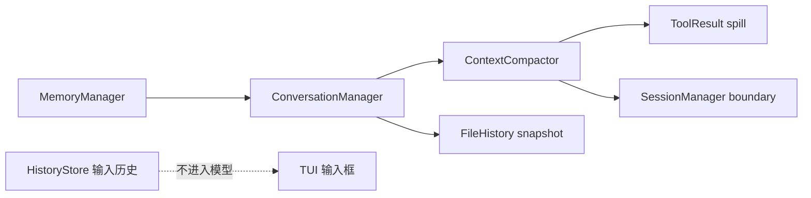
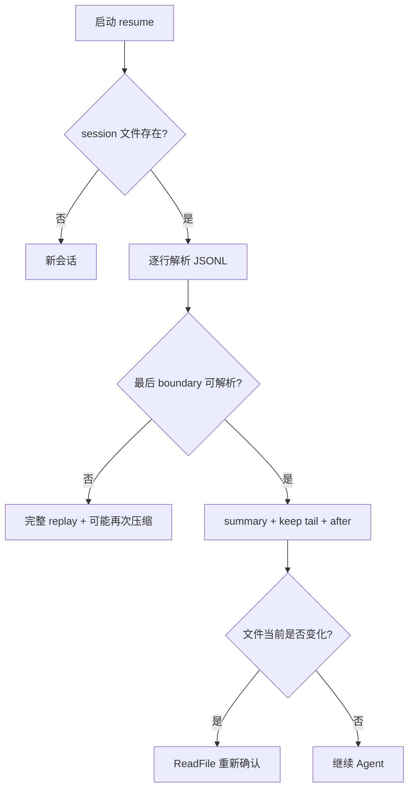
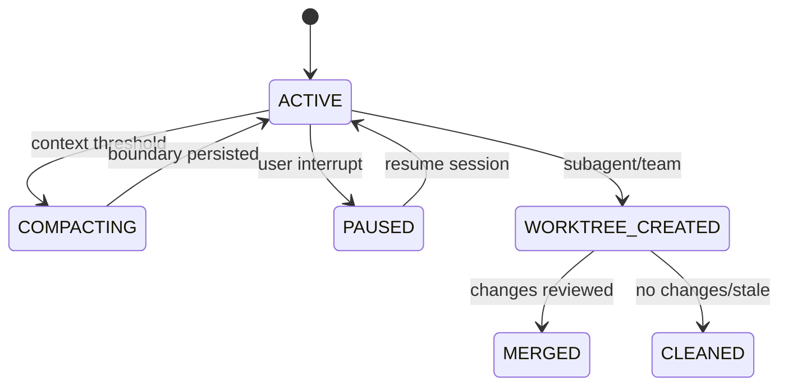
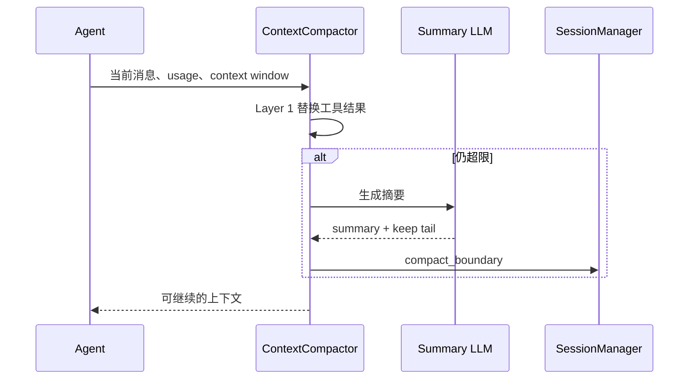

# JiMI Code 整合学习文档：04-上下文记忆会话与恢复.md

> 本文由 `docs/` 与 `study-notes/` 下的教材按段落级别整理生成。原始文件不删除；相同段落在本主题内只保留一次，保留版本最完整或最接近课程主线的那一段，其余来源记录在末尾的合并审计中。内容涉及当前源码时以 `jimi-code` 工作区为准；对 Claude Code 的描述只代表公开体验对标。

## 本主题的融合说明

本主题按“课程概念 → jimicode 源码 → 实验/排障 → 面试与边界”排序。段落之间出现同一事实时，优先保留包含真实路径、调用关系或失败处理的版本；只有标题/目录性质的短段被折叠。

> 来源：`docs/course/08-第8章-上下文管理.md`

### 8. 第8章：上下文管理，当 Token 开始烧钱

> 来源：`docs/course/08-第8章-上下文管理.md`

建立 token 预算、上下文组装、工具结果替换和压缩恢复能力。学完能解释为什么“把所有结果全塞回去”会失败，并能定位 `ContextCompactor` 的两层策略。

> 来源：`docs/course/08-第8章-上下文管理.md`

长日志挤掉系统规则；重复文件内容造成成本暴涨；工具输出超过窗口导致 400；压缩丢失未完成任务；摘要后 toolUseId 对不上无法恢复。

> 来源：`docs/course/08-第8章-上下文管理.md`

Context Window 是单次请求上限；预算池要为系统、历史、工具、输出和安全余量分配空间。jimicode 使用 usageAnchor、ToolResultBudget、ContextCompactor、RecoveryState 和 ReplacementRecordsIO。

> 来源：`docs/course/08-第8章-上下文管理.md`

| 对比维度 | 本章能力 | 上一章能力 | 下一章依赖 |
|---|---|---|---|
| 输入 | 结构化、可校验的本章对象 | 上一层输出 | 为下一层提供稳定契约 |
| 控制 | 明确的状态/权限/预算 | 规则较少 | 可观测、可恢复、可扩展 |
| 失败 | 分类、可见、可恢复 | 可能只返回错误文本 | 由后续治理层接管 |

> 来源：`docs/course/08-第8章-上下文管理.md`


> 来源：`docs/course/08-第8章-上下文管理.md`

**本章实际链路**：消息/工具结果 → token/字符估算 → Layer1 替换 → Layer2 摘要 → recovery attachment → Provider request → usage anchor 更新

> 来源：`docs/course/08-第8章-上下文管理.md`

contextWindow、maxOutput、usageAnchor、ToolResultBudget、ContentReplacementState、RecoveryState、compact boundary、summary message。

> 来源：`docs/course/08-第8章-上下文管理.md`

| 字段 | 生产者 | 消费者 | 失败时必须保留 |
|---|---|---|---|
| 身份/名称 | 配置或注册表 | Agent/Provider/UI | 原始值与规范化值 |
| 参数/内容 | 用户、模型或工具 | 下一阶段模块 | 校验错误与来源 |
| 状态 | 编排器/持久化层 | 恢复、审计、UI | 转移前后状态 |
| 结果 | 本章实现 | Conversation/父任务 | 成功、错误、耗时 |

> 来源：`docs/course/08-第8章-上下文管理.md`

阅读 `src/main/java/com/jimicode/compact/ContextCompactor.java`、`RecoveryState.java`、`toolresult/ToolResultBudget.java` 和 `ReplacementRecordsIO.java`。压缩不是简单 `messages.subList`：必须保留系统约束、当前任务、未完成工具闭环、最近文件快照、技能 SOP 和必要错误。

> 来源：`docs/course/08-第8章-上下文管理.md`

Layer 1 是工具结果预算：大输出替换成摘要/占位符，并在 `ContentReplacementState` 中记录决策，使同一 toolUseId 后续请求稳定。Layer 2 是消息级压缩：调用模型生成摘要，写入 compact boundary 和恢复附件。`usageAnchor` 优先使用 provider usage，冷启动才用字符估算；消息数量减少后要清除旧 anchor。

> 来源：`docs/course/08-第8章-上下文管理.md`

预算表可以按优先级分配：系统规则不可丢；当前用户任务高优先；最近 assistant/tool 闭环高优先；相关文件切片中优先保留命中行；历史闲聊、重复目录和完整构建日志低优先。所有截断都要有可见标记，避免模型误以为数据完整。

> 来源：`docs/course/08-第8章-上下文管理.md`

反模式一是固定按字符截断，可能切断 JSON 或 Java 代码；反模式二是摘要失败后吞异常仍继续发送超长请求；反模式三是压缩时原地修改 UI 会话，导致用户看到的历史与模型上下文不一致。

> 来源：`docs/course/08-第8章-上下文管理.md`

- 不要用自然语言约束替代可执行的系统边界。
- 不要吞掉异常、取消或拒绝事件。
- 不要在没有测试和回滚点的真实仓库执行破坏性操作。

> 来源：`docs/course/08-第8章-上下文管理.md`

**目标**：生成逐步增长的 ToolResult，记录压缩前后字符数、估算 token 和实际 usage（没有 provider usage 时标记示例）。

> 来源：`docs/course/08-第8章-上下文管理.md`

**步骤**：在临时仓库或 mock 环境中准备输入；运行最小命令；保存事件、日志和 Git diff；重复一次失败条件。

> 来源：`docs/course/08-第8章-上下文管理.md`

**预期现象**：能看到本章对应的状态变化，而不是只得到最终文本。

> 来源：`docs/course/08-第8章-上下文管理.md`

**成功标准**：结果可复现、失败可解释、没有越过工作区和权限边界。

> 来源：`docs/course/08-第8章-上下文管理.md`

**常见报错**：环境、路径、依赖、超时或配置错误；先看本章排障表，再沿源码调用者反查。

> 来源：`docs/course/08-第8章-上下文管理.md`

**目标**：模拟压缩后恢复，验证 toolUseId、最近文件快照和系统提醒仍可用；故意删除恢复附件，观察错误是否可诊断。

> 来源：`docs/course/08-第8章-上下文管理.md`

频繁 400→预算未为 maxOutput 留余量；压缩不触发→anchor/阈值计算错误；摘要后循环异常→检查 toolUseId 和 compact boundary；成本高→统计重复工具结果；恢复失败→查 RecoveryState/IO。

> 来源：`docs/course/08-第8章-上下文管理.md`

涉及文件、命令、网络、MCP、记忆、Hook 或并发时，统一使用临时仓库、最小权限、明确 workdir、超时、输出上限、审计和 Git 回滚点。任何示例数字标记“示例/需实测”；不在真实环境执行删除、覆盖、迁移或未知脚本。

> 来源：`docs/course/08-第8章-上下文管理.md`

### 题 1：Layer 1 与 Layer 2 压缩差异？

> 来源：`docs/course/08-第8章-上下文管理.md`

**回答提纲**：先给概念定义，再引用一个 jimicode 文件/类，说明一次取舍和一个失败场景。**加分点**：能讲测试、指标和边界。
### 题 2：为什么要保留 toolUseId？

> 来源：`docs/course/08-第8章-上下文管理.md`

**回答提纲**：先给概念定义，再引用一个 jimicode 文件/类，说明一次取舍和一个失败场景。**加分点**：能讲测试、指标和边界。
### 题 3：真实 usage 与字符估算如何结合？

> 来源：`docs/course/08-第8章-上下文管理.md`

**回答提纲**：先给概念定义，再引用一个 jimicode 文件/类，说明一次取舍和一个失败场景。**加分点**：能讲测试、指标和边界。
### 题 4：摘要失败应该继续还是停止？

> 来源：`docs/course/08-第8章-上下文管理.md`

**回答提纲**：先给概念定义，再引用一个 jimicode 文件/类，说明一次取舍和一个失败场景。**加分点**：能讲测试、指标和边界。

> 来源：`docs/course/08-第8章-上下文管理.md`

- [ ] 我能解释本章能力在全链路中的位置
- [ ] 我能解释一个真实失败场景及排查路径
- [ ] 我能解释关键数据结构的生产者和消费者
- [ ] 我能解释至少一个源码文件和调用者
- [ ] 我能解释一个安全/性能取舍

> 来源：`docs/course/08-第8章-上下文管理.md`

本章建立的契约会被下一章消费：记忆系统 只有在输入、状态、失败和权限边界明确后才不会把复杂度继续放大。

> 来源：`docs/course/08-第8章-上下文管理.md`

### FAQ 1：压缩会不会改变用户看到的历史？最好区分 UI conversation 与 API conversation。

> 来源：`docs/course/08-第8章-上下文管理.md`

以当前项目源码和测试为准；第三方或闭源行为要明确标注边界。
### FAQ 2：所有工具结果都能摘要吗？安全/关键证据要保留原文或可定位引用。

> 来源：`docs/course/08-第8章-上下文管理.md`

先用最小实验复现，再沿事件、日志、状态和调用者逐层定位。
### FAQ 3：上下文窗口越大就不需要压缩吗？仍需控制成本、延迟和注意力稀释。

> 来源：`docs/course/08-第8章-上下文管理.md`

可以，但要保留权限、超时、输出上限和可回滚机制。

> 来源：`docs/course/08-第8章-上下文管理.md`

从当前章节的真实入口开始：消息/工具结果 → token/字符估算 → Layer1 替换 → Layer2 摘要 → recovery attachment → Provider request → usage anchor 更新。打开链路中的第一个 jimicode 类，记录构造器参数、字段初始化和直接调用者；再向后追踪一个结果对象的消费点。不要只搜索类名，要搜索方法调用和事件类型。

> 来源：`docs/course/08-第8章-上下文管理.md`

本章的输入不能只写成“用户问题”。应拆成配置输入、自然语言输入、模型结构化输入、文件/进程输入和上游模块状态。对每一种输入写明允许为空的字段、长度上限、编码、来源和校验时机。contextWindow、maxOutput、usageAnchor、ToolResultBudget、ContentReplacementState、RecoveryState、compact boundary、summary message。 中出现的身份、参数和状态字段都要在进入下一层前规范化。

> 来源：`docs/course/08-第8章-上下文管理.md`

把状态画成有限状态机：初始、准备、执行、等待确认、成功、失败、取消、恢复。每次转移记录触发事件、允许的前置状态、持久化动作和用户可见反馈。若代码使用 enum、record 或布尔字段表达状态，要检查是否存在互斥状态同时为 true 的问题。

> 来源：`docs/course/08-第8章-上下文管理.md`

对每个公开方法至少做三次反查：谁创建对象、谁调用方法、谁处理返回值/异常。若返回集合，检查调用方是否修改它；若返回异步对象，检查是否真正订阅；若返回路径或命令，检查调用方是否再次做安全校验。

> 来源：`docs/course/08-第8章-上下文管理.md`

将本章失败拆成输入错误、依赖错误、业务拒绝、超时、取消、部分成功和持久化失败。针对当前主题 `记忆系统` 的前置依赖，写出“失败后能否重试、是否幂等、是否需要人工确认、是否需要回滚”的结论。

> 来源：`docs/course/08-第8章-上下文管理.md`

至少记录关联 id、阶段、耗时、结果状态和错误类别。不要在日志中记录 API key、完整 Authorization、未脱敏工具参数或整段私有代码。TUI 需要用户可读消息，调试日志需要开发者上下文，两者可以来自同一个事件但不应共享不安全文本。

> 来源：`docs/course/08-第8章-上下文管理.md`

确认本章对象是进程级、Agent 级、会话级、turn 级还是方法级状态。对可变集合、文件、队列和外部进程分别考虑竞态；不要因为方法加了 synchronized 就认为跨进程安全，也不要把虚拟线程误解成无限资源。

> 来源：`docs/course/08-第8章-上下文管理.md`

为 CPU、内存、网络、token、文件读取和输出设置上限。上限达到时返回可解释的错误或降级结果，不能静默截断关键协议字段。若本章涉及重试，退避和最大次数必须与总预算一起设计。

> 来源：`docs/course/08-第8章-上下文管理.md`

单元测试验证纯函数和边界；集成测试验证文件、进程或 HTTP；契约测试验证 provider/Tool/MCP 字段；回归测试固定一个曾经失败的用户故事。测试数据使用虚构密钥、临时目录和固定时间，不依赖个人机器状态。

> 来源：`docs/course/08-第8章-上下文管理.md`

错误设计通常表现为：把所有逻辑放在一个巨型类；把异常转成空字符串；让模型决定权限；让 UI 直接修改核心状态；让外部脚本绕过统一工具入口。正确设计应保持单向依赖、结构化结果、独立权限、事件通知和可回滚副作用。

> 来源：`docs/course/08-第8章-上下文管理.md`

先实现最小 happy path，再加入参数校验、错误封装、超时、取消、审计、恢复和测试。每一步保留可运行提交，避免一次性重写多个模块而无法定位回归。

> 来源：`docs/course/08-第8章-上下文管理.md`

回到上一章的输出，确认本章没有重新发明同一数据结构。例如上一章已经定义 Message/Tool/Provider 时，本章应复用其契约，而不是在新模块中创建第二套近似类型。

> 来源：`docs/course/08-第8章-上下文管理.md`

下一步是 `记忆系统`。提前列出本章必须对外稳定的字段和事件；如果下一章要并发、压缩或扩展，本章的 id、版本、错误和取消语义必须先固定。

> 来源：`docs/course/08-第8章-上下文管理.md`

完成本章后，提交一页设计记录：问题、方案、替代方案、源码证据、测试、已知限制、后续改进。评审者应能仅凭这页记录复现你的实验，而不是依赖口头解释。

> 来源：`docs/course/08-第8章-上下文管理.md`

审查时逐条问：输入是否来自不可信源？副作用前是否授权？失败是否可见？重试是否幂等？取消是否传播？状态是否持久化？日志是否脱敏？测试是否覆盖空值、重复、超时和恢复？

> 来源：`docs/course/08-第8章-上下文管理.md`

回答面试题时先给一句定义，再讲当前项目文件和方法，接着讲一个取舍和失败案例，最后说如何测试。不要只罗列框架名，也不要把示例数字说成生产指标。

> 来源：`docs/course/08-第8章-上下文管理.md`

把本章放回完整闭环：消息/工具结果 → token/字符估算 → Layer1 替换 → Layer2 摘要 → recovery attachment → Provider request → usage anchor 更新。如果删除本章能力，系统会在这些地方退化：长日志挤掉系统规则；重复文件内容造成成本暴涨；工具输出超过窗口导致 400；压缩丢失未完成任务；摘要后 toolUseId 对不上无法恢复。。如果增强本章能力，优先增强契约、测试、可观测性和安全边界，再考虑增加模型或 Agent 数量。最后用一个真实但隔离的实验验证“输入—状态—结果—失败—恢复”五个维度，并把证据保存到学习笔记。
## 综合案例与边界演练

> 来源：`docs/course/08-第8章-上下文管理.md`

### 场景 1：最小成功路径：使用固定输入、单一依赖和一个工具完成一次操作，记录从入口到结果的每个对象。

> 来源：`docs/course/08-第8章-上下文管理.md`

本章的具体检查点是：Context Window 是单次请求上限；预算池要为系统、历史、工具、输出和安全余量分配空间。jimicode 使用 usageAnchor、ToolResultBudget、ContextCompactor、RecoveryState 和 ReplacementRecordsIO。 生产的输入必须经过本章状态和权限边界，再形成 记忆系统 可以消费的结果。实验结束后保存命令、事件、日志、测试、diff 和限制说明。

> 来源：`docs/course/08-第8章-上下文管理.md`

### 场景 2：空值路径：删除可选字段、返回空集合或让模型不给出内容，确认系统使用默认值、明确错误还是安全退出。

> 来源：`docs/course/08-第8章-上下文管理.md`

### 场景 3：重复路径：重复提交同一个请求、toolUseId、命令或消息，检查是否幂等、去重或要求人工确认。

> 来源：`docs/course/08-第8章-上下文管理.md`

### 场景 4：超时路径：让网络、脚本、文件或子任务延迟，检查 timeout、取消、资源释放和用户提示。

> 来源：`docs/course/08-第8章-上下文管理.md`

### 场景 5：部分成功路径：让多个动作中只有一部分成功，确认结果如何汇总、是否需要补偿或回滚。

> 来源：`docs/course/08-第8章-上下文管理.md`

### 场景 6：权限路径：使用只读、询问和拒绝三种模式，确保决策发生在副作用之前且结果可审计。

> 来源：`docs/course/08-第8章-上下文管理.md`

### 场景 7：恢复路径：在关键状态写入前后模拟进程退出，重新启动后检查状态、消息顺序和重复执行风险。

> 来源：`docs/course/08-第8章-上下文管理.md`

### 场景 8：观测路径：为一次操作关联 id、阶段、耗时和错误类别，确认 UI、日志和 trace 的信息粒度不同但事实一致。

> 来源：`docs/course/08-第8章-上下文管理.md`

### 场景 9：兼容路径：替换 provider、工具实现或配置版本，确认核心契约不需要大面积改动。

> 来源：`docs/course/08-第8章-上下文管理.md`

### 场景 10：评审路径：邀请另一位同学只看文档和证据复现实验，记录他无法理解或无法复现的地方。

> 来源：`docs/course/08-第8章-上下文管理.md`

围绕本章的实际链路 `消息/工具结果 → token/字符估算 → Layer1 替换 → Layer2 摘要 → recovery attachment → Provider request → usage anchor 更新`，在源码中定位一个具体类/方法，写出它的输入、输出、状态、调用者和失败处理。然后在隔离环境执行一个最小验证，保存测试/日志/diff；如果无法从当前仓库证实，明确写【待源码确认】。针对 `记忆系统` 的后续能力，补充说明该契约为什么必须稳定、哪些字段不能随意改名，以及发生故障时如何向用户解释。

> 来源：`docs/course/09-第9章-记忆系统.md`

### 9. 第9章：记忆系统 - 跨会话的 Agent 记忆

> 来源：`docs/course/09-第9章-记忆系统.md`

区分当前会话历史、项目记忆和用户偏好，学习记忆扫描、召回、注入和隐私策略。

> 来源：`docs/course/09-第9章-记忆系统.md`

把所有历史无限保留；把 API key/隐私写入记忆；召回无关内容污染 Prompt；多个项目记忆串线；用户要求删除却无法清理。

> 来源：`docs/course/09-第9章-记忆系统.md`

Session history 是事实序列，Memory 是可选择召回的长期信息。`MemoryScanner` 扫描候选，`MemoryRecall` 选择相关片段，`MemoryManager` 管理写入/读取策略。

> 来源：`docs/course/09-第9章-记忆系统.md`

**本章实际链路**：会话/项目文件 → scanner → 候选记忆 → recall relevance/filter → PromptBuilder 注入 → Agent → 用户纠正/更新/删除

> 来源：`docs/course/09-第9章-记忆系统.md`

memory item、scope(project/user/session)、content、source、timestamp/age、sensitivity、relevance、retention。

> 来源：`docs/course/09-第9章-记忆系统.md`

阅读 `src/main/java/com/jimicode/memory/MemoryScanner.java`、`MemoryRecall.java`、`MemoryManager.java` 与 `MemoryAge.java`。扫描器负责发现候选，不代表全部注入；召回器按当前任务、项目路径、时间和标签过滤；管理器决定何时写入、去重、更新和删除。

> 来源：`docs/course/09-第9章-记忆系统.md`

记忆内容建议分为项目约定、用户偏好、任务事实和临时状态。项目约定如 Java 版本和测试命令可以跨会话；用户偏好如回答语言需要用户明确同意；临时状态如“刚刚测试失败”应过期；密钥、身份证、未公开源码和完整聊天不应默认写入长期记忆。

> 来源：`docs/course/09-第9章-记忆系统.md`

注入 Prompt 前要标记来源和可信等级，避免记忆伪装成系统规则。用户可以纠正或删除记忆，管理器要提供可定位的 source 和时间。多项目/多用户场景必须使用 scope key，不能依赖单例内存。

> 来源：`docs/course/09-第9章-记忆系统.md`

反模式一是把 Memory 当数据库备份；反模式二是只按关键词召回而不考虑项目/权限；反模式三是记忆写入完全由模型决定，没有敏感信息过滤和用户可见性。

> 来源：`docs/course/09-第9章-记忆系统.md`

**目标**：创建一个项目级“构建命令”和一个会话级“临时失败”，测试下一次会话的召回差异。

> 来源：`docs/course/09-第9章-记忆系统.md`

**目标**：加入敏感字段测试样本，验证 scanner/manager 不写入或在注入前脱敏；只使用虚构数据。

> 来源：`docs/course/09-第9章-记忆系统.md`

召回无关→查 scope/relevance；记忆串项目→查路径 key；重复增长→查去重/age；删除无效→查持久化与缓存；Prompt 被污染→查看 memory source 标记。

> 来源：`docs/course/09-第9章-记忆系统.md`

### 题 1：Session 与 Memory 的边界？

> 来源：`docs/course/09-第9章-记忆系统.md`

**回答提纲**：先给概念定义，再引用一个 jimicode 文件/类，说明一次取舍和一个失败场景。**加分点**：能讲测试、指标和边界。
### 题 2：什么信息不该写入长期记忆？

> 来源：`docs/course/09-第9章-记忆系统.md`

**回答提纲**：先给概念定义，再引用一个 jimicode 文件/类，说明一次取舍和一个失败场景。**加分点**：能讲测试、指标和边界。
### 题 3：记忆召回如何控制 token 和权限？

> 来源：`docs/course/09-第9章-记忆系统.md`

**回答提纲**：先给概念定义，再引用一个 jimicode 文件/类，说明一次取舍和一个失败场景。**加分点**：能讲测试、指标和边界。
### 题 4：用户删除记忆如何保证生效？

> 来源：`docs/course/09-第9章-记忆系统.md`

本章建立的契约会被下一章消费：Slash Command 只有在输入、状态、失败和权限边界明确后才不会把复杂度继续放大。

> 来源：`docs/course/09-第9章-记忆系统.md`

### FAQ 1：Memory 一定要向量数据库吗？不一定，当前实现可从文件/文本开始。

> 来源：`docs/course/09-第9章-记忆系统.md`

以当前项目源码和测试为准；第三方或闭源行为要明确标注边界。
### FAQ 2：模型能自动决定记忆什么吗？可以提出候选，但写入策略需要系统和用户治理。

> 来源：`docs/course/09-第9章-记忆系统.md`

先用最小实验复现，再沿事件、日志、状态和调用者逐层定位。
### FAQ 3：记忆越多 Agent 越聪明吗？无关和错误记忆会降低可靠性。

> 来源：`docs/course/09-第9章-记忆系统.md`

从当前章节的真实入口开始：会话/项目文件 → scanner → 候选记忆 → recall relevance/filter → PromptBuilder 注入 → Agent → 用户纠正/更新/删除。打开链路中的第一个 jimicode 类，记录构造器参数、字段初始化和直接调用者；再向后追踪一个结果对象的消费点。不要只搜索类名，要搜索方法调用和事件类型。

> 来源：`docs/course/09-第9章-记忆系统.md`

本章的输入不能只写成“用户问题”。应拆成配置输入、自然语言输入、模型结构化输入、文件/进程输入和上游模块状态。对每一种输入写明允许为空的字段、长度上限、编码、来源和校验时机。memory item、scope(project/user/session)、content、source、timestamp/age、sensitivity、relevance、retention。 中出现的身份、参数和状态字段都要在进入下一层前规范化。

> 来源：`docs/course/09-第9章-记忆系统.md`

将本章失败拆成输入错误、依赖错误、业务拒绝、超时、取消、部分成功和持久化失败。针对当前主题 `Slash Command` 的前置依赖，写出“失败后能否重试、是否幂等、是否需要人工确认、是否需要回滚”的结论。

> 来源：`docs/course/09-第9章-记忆系统.md`

下一步是 `Slash Command`。提前列出本章必须对外稳定的字段和事件；如果下一章要并发、压缩或扩展，本章的 id、版本、错误和取消语义必须先固定。

> 来源：`docs/course/09-第9章-记忆系统.md`

把本章放回完整闭环：会话/项目文件 → scanner → 候选记忆 → recall relevance/filter → PromptBuilder 注入 → Agent → 用户纠正/更新/删除。如果删除本章能力，系统会在这些地方退化：把所有历史无限保留；把 API key/隐私写入记忆；召回无关内容污染 Prompt；多个项目记忆串线；用户要求删除却无法清理。。如果增强本章能力，优先增强契约、测试、可观测性和安全边界，再考虑增加模型或 Agent 数量。最后用一个真实但隔离的实验验证“输入—状态—结果—失败—恢复”五个维度，并把证据保存到学习笔记。
## 综合案例与边界演练

> 来源：`docs/course/09-第9章-记忆系统.md`

本章的具体检查点是：Session history 是事实序列，Memory 是可选择召回的长期信息。`MemoryScanner` 扫描候选，`MemoryRecall` 选择相关片段，`MemoryManager` 管理写入/读取策略。 生产的输入必须经过本章状态和权限边界，再形成 Slash Command 可以消费的结果。实验结束后保存命令、事件、日志、测试、diff 和限制说明。

> 来源：`docs/course/09-第9章-记忆系统.md`

围绕本章的实际链路 `会话/项目文件 → scanner → 候选记忆 → recall relevance/filter → PromptBuilder 注入 → Agent → 用户纠正/更新/删除`，在源码中定位一个具体类/方法，写出它的输入、输出、状态、调用者和失败处理。然后在隔离环境执行一个最小验证，保存测试/日志/diff；如果无法从当前仓库证实，明确写【待源码确认】。针对 `Slash Command` 的后续能力，补充说明该契约为什么必须稳定、哪些字段不能随意改名，以及发生故障时如何向用户解释。

> 来源：`docs/deep-learning/01-架构与核心链路.md`

### jimi-code：01-架构与核心链路.md

> 来源：`docs/deep-learning/01-架构与核心链路.md`

接入层是 TUI 与命令；编排层是 `Agent`/`StreamingExecutor`；模型层是 `LlmClient` SPI 与三个 provider；能力层是 `ToolRegistry`、MCP、Skill、SubAgent、Teams；状态层是 Conversation、Session、History、Memory、Plan、Worktree；安全层是 Permission 与 Hook；基础设施层是文件 IO、tmux/iTerm 和 Markdown 渲染。

> 来源：`docs/deep-learning/01-架构与核心链路.md`

`JimiCodeModel` 的 UI 状态（PROVIDER_SELECT/CHAT/RESUME）不等于 Agent 状态。一次 turn 具有“接收输入→构造 prompt→模型流→累积块→工具确认→执行→追加结果→再次模型流→完成/失败”阶段。`AgentEvent` 把阶段变化暴露给 UI，避免 UI 直接依赖 HTTP/SDK 回调。

> 来源：`docs/deep-learning/01-架构与核心链路.md`

工具 schema 来自 `Tool` 接口；注册表按名称索引并按 `ToolCategory` 分类。`ToolSearchTool` 解决工具过多时的发现问题。文件工具组合 `FileStateCache` 做修改前状态，`EditFileTool`/`WriteFileTool` 写入后由 `ContentReplacementLifecycle` 和 `ReplacementRecordsIO` 记录替换，便于撤销、压缩和审计。Bash 工具必须经过权限模式判断；`EnterWorktreeTool` 在执行前建立隔离目录。

> 来源：`docs/deep-learning/01-架构与核心链路.md`

`ConversationManager` 维护 API 消息与 UI 消息的双向映射；`SessionManager` 负责会话目录和元数据；`HistoryStore` 记录历史；`MemoryScanner`/`MemoryRecall` 将项目级记忆注入 prompt；`ContextCompactor` 根据 provider context window 预算做摘要，而不是简单截断。恢复附件要保持 toolUseId、替换记录和原始文件状态的一致性。

> 来源：`docs/deep-learning/01-架构与核心链路.md`

SubAgent 是逻辑并发，Teams 是进程/终端并发，Worktree 是 Git 文件系统隔离。`SharedTaskStore` 和 `FileMailBox` 采用文件协议，优点是跨进程简单、可诊断；缺点是锁、崩溃恢复、重复消费和时钟问题需要额外处理。

> 来源：`docs/deep-learning/01-架构与核心链路.md`

- SPI：`LlmClient`、`Tool`、`SkillHost` 让 provider 和能力可替换。
- 事件溯源思想：流式块、工具结果、替换记录可重建 UI。
- 预算控制：token/字节预算优先于“尽量多塞上下文”。
- 最小权限：PermissionMode 决定 shell、写文件、工作树操作的确认策略。

> 来源：`docs/deep-learning/01-架构与核心链路.md`

### `jimi-code/.idea/compiler.xml`
- 文件类型：`.xml`；行数：18。
- 阅读重点：把它与同目录 Java/配置文件对照，确认它是构建入口、运行时配置、文档还是示例，不把示例误当生产 API。

> 来源：`docs/deep-learning/01-架构与核心链路.md`

### `jimi-code/.idea/encodings.xml`
- 文件类型：`.xml`；行数：7。
- 阅读重点：把它与同目录 Java/配置文件对照，确认它是构建入口、运行时配置、文档还是示例，不把示例误当生产 API。

> 来源：`docs/deep-learning/01-架构与核心链路.md`

### `jimi-code/.idea/jarRepositories.xml`
- 文件类型：`.xml`；行数：20。
- 阅读重点：把它与同目录 Java/配置文件对照，确认它是构建入口、运行时配置、文档还是示例，不把示例误当生产 API。

> 来源：`docs/deep-learning/01-架构与核心链路.md`

### `jimi-code/.idea/MarsCodeWorkspaceAppSettings.xml`
- 文件类型：`.xml`；行数：7。
- 阅读重点：把它与同目录 Java/配置文件对照，确认它是构建入口、运行时配置、文档还是示例，不把示例误当生产 API。

> 来源：`docs/deep-learning/01-架构与核心链路.md`

### `jimi-code/.idea/misc.xml`
- 文件类型：`.xml`；行数：12。
- 阅读重点：把它与同目录 Java/配置文件对照，确认它是构建入口、运行时配置、文档还是示例，不把示例误当生产 API。

> 来源：`docs/deep-learning/01-架构与核心链路.md`

### `jimi-code/.idea/vcs.xml`
- 文件类型：`.xml`；行数：6。
- 阅读重点：把它与同目录 Java/配置文件对照，确认它是构建入口、运行时配置、文档还是示例，不把示例误当生产 API。

> 来源：`docs/deep-learning/01-架构与核心链路.md`

### `jimi-code/.idea/workspace.xml`
- 文件类型：`.xml`；行数：105。
- 阅读重点：把它与同目录 Java/配置文件对照，确认它是构建入口、运行时配置、文档还是示例，不把示例误当生产 API。

> 来源：`docs/deep-learning/01-架构与核心链路.md`

### `jimi-code/.mvn/wrapper/maven-wrapper.properties`
- 文件类型：`.properties`；行数：19。
- 阅读重点：把它与同目录 Java/配置文件对照，确认它是构建入口、运行时配置、文档还是示例，不把示例误当生产 API。

> 来源：`docs/deep-learning/01-架构与核心链路.md`

### `jimi-code/.workbuddy/memory/2026-08-11.md`
- 文件类型：`.md`；行数：25。
- 阅读重点：把它与同目录 Java/配置文件对照，确认它是构建入口、运行时配置、文档还是示例，不把示例误当生产 API。

> 来源：`docs/deep-learning/01-架构与核心链路.md`

### `jimi-code/config.example.yaml`
- 文件类型：`.yaml`；行数：14。
- 阅读重点：把它与同目录 Java/配置文件对照，确认它是构建入口、运行时配置、文档还是示例，不把示例误当生产 API。

> 来源：`docs/deep-learning/01-架构与核心链路.md`

### `jimi-code/docs/deep-dive/00-源码逐文件覆盖矩阵.md`
- 文件类型：`.md`；行数：173。
- 阅读重点：把它与同目录 Java/配置文件对照，确认它是构建入口、运行时配置、文档还是示例，不把示例误当生产 API。

> 来源：`docs/deep-learning/01-架构与核心链路.md`

### `jimi-code/docs/deep-dive/01-入口配置消息与Agent主循环.md`
- 文件类型：`.md`；行数：209。
- 阅读重点：把它与同目录 Java/配置文件对照，确认它是构建入口、运行时配置、文档还是示例，不把示例误当生产 API。

> 来源：`docs/deep-learning/01-架构与核心链路.md`

### `jimi-code/docs/deep-dive/02-工具权限Hook-MCP与文件变更.md`
- 文件类型：`.md`；行数：218。
- 阅读重点：把它与同目录 Java/配置文件对照，确认它是构建入口、运行时配置、文档还是示例，不把示例误当生产 API。

> 来源：`docs/deep-learning/01-架构与核心链路.md`

### `jimi-code/docs/deep-dive/03-会话记忆压缩历史与Worktree.md`
- 文件类型：`.md`；行数：249。
- 阅读重点：把它与同目录 Java/配置文件对照，确认它是构建入口、运行时配置、文档还是示例，不把示例误当生产 API。

> 来源：`docs/deep-learning/01-架构与核心链路.md`

### `jimi-code/docs/deep-dive/04-依赖库Maven构建与面试原理.md`
- 文件类型：`.md`；行数：215。
- 阅读重点：把它与同目录 Java/配置文件对照，确认它是构建入口、运行时配置、文档还是示例，不把示例误当生产 API。

> 来源：`docs/deep-learning/01-架构与核心链路.md`

### `jimi-code/docs/deep-dive/05-SubAgent团队Skill任务与TUI.md`
- 文件类型：`.md`；行数：142。
- 阅读重点：把它与同目录 Java/配置文件对照，确认它是构建入口、运行时配置、文档还是示例，不把示例误当生产 API。

> 来源：`docs/deep-learning/01-架构与核心链路.md`

### `jimi-code/docs/deep-dive/06-系统架构逐模块调用链与异常体系.md`
- 文件类型：`.md`；行数：161。
- 阅读重点：把它与同目录 Java/配置文件对照，确认它是构建入口、运行时配置、文档还是示例，不把示例误当生产 API。

> 来源：`docs/deep-learning/01-架构与核心链路.md`

### `jimi-code/docs/deep-dive/07-构建部署配置调试测试与常见问题.md`
- 文件类型：`.md`；行数：175。
- 阅读重点：把它与同目录 Java/配置文件对照，确认它是构建入口、运行时配置、文档还是示例，不把示例误当生产 API。

> 来源：`docs/deep-learning/01-架构与核心链路.md`

### `jimi-code/docs/deep-dive/08-测试源码逐文件精读与行为契约.md`
- 文件类型：`.md`；行数：174。
- 阅读重点：把它与同目录 Java/配置文件对照，确认它是构建入口、运行时配置、文档还是示例，不把示例误当生产 API。

> 来源：`docs/deep-learning/01-架构与核心链路.md`

### `jimi-code/docs/deep-dive/09-117个Java文件逐文件精读索引.md`
- 文件类型：`.md`；行数：746。
- 阅读重点：把它与同目录 Java/配置文件对照，确认它是构建入口、运行时配置、文档还是示例，不把示例误当生产 API。

> 来源：`docs/deep-learning/01-架构与核心链路.md`

### `jimi-code/docs/deep-dive/README.md`
- 文件类型：`.md`；行数：146。
- 阅读重点：把它与同目录 Java/配置文件对照，确认它是构建入口、运行时配置、文档还是示例，不把示例误当生产 API。

> 来源：`docs/deep-learning/01-架构与核心链路.md`

### `jimi-code/docs/deep-learning/00-项目总览与学习路线.md`
- 文件类型：`.md`；行数：1666。
- 阅读重点：把它与同目录 Java/配置文件对照，确认它是构建入口、运行时配置、文档还是示例，不把示例误当生产 API。

> 来源：`docs/deep-learning/01-架构与核心链路.md`

### `jimi-code/docs/deep-learning/01-架构与核心链路.md`
- 文件类型：`.md`；行数：1645。
- 阅读重点：把它与同目录 Java/配置文件对照，确认它是构建入口、运行时配置、文档还是示例，不把示例误当生产 API。

> 来源：`docs/deep-learning/01-架构与核心链路.md`

### `jimi-code/docs/deep-learning/02-逐文件源码精读.md`
- 文件类型：`.md`；行数：1630。
- 阅读重点：把它与同目录 Java/配置文件对照，确认它是构建入口、运行时配置、文档还是示例，不把示例误当生产 API。

> 来源：`docs/deep-learning/01-架构与核心链路.md`

### `jimi-code/docs/deep-learning/03-依赖库构建配置与运行.md`
- 文件类型：`.md`；行数：1637。
- 阅读重点：把它与同目录 Java/配置文件对照，确认它是构建入口、运行时配置、文档还是示例，不把示例误当生产 API。

> 来源：`docs/deep-learning/01-架构与核心链路.md`

### `jimi-code/docs/deep-learning/04-异常测试安全性能与面试.md`
- 文件类型：`.md`；行数：1638。
- 阅读重点：把它与同目录 Java/配置文件对照，确认它是构建入口、运行时配置、文档还是示例，不把示例误当生产 API。

> 来源：`docs/deep-learning/01-架构与核心链路.md`

### `jimi-code/docs/deep-learning/05-核心Java文件逐方法讲解.md`
- 文件类型：`.md`；行数：5344。
- 阅读重点：把它与同目录 Java/配置文件对照，确认它是构建入口、运行时配置、文档还是示例，不把示例误当生产 API。

> 来源：`docs/deep-learning/01-架构与核心链路.md`

### `jimi-code/docs/deep-learning/06-核心链路语义讲解.md`
- 文件类型：`.md`；行数：127。
- 阅读重点：把它与同目录 Java/配置文件对照，确认它是构建入口、运行时配置、文档还是示例，不把示例误当生产 API。

> 来源：`docs/deep-learning/01-架构与核心链路.md`

### `jimi-code/docs/deep-learning/README-深度学习文档导航.md`
- 文件类型：`.md`；行数：34。
- 阅读重点：把它与同目录 Java/配置文件对照，确认它是构建入口、运行时配置、文档还是示例，不把示例误当生产 API。

> 来源：`docs/deep-learning/01-架构与核心链路.md`

### `jimi-code/docs/JAVA_MAVEN_GUIDE.md`
- 文件类型：`.md`；行数：67。
- 阅读重点：把它与同目录 Java/配置文件对照，确认它是构建入口、运行时配置、文档还是示例，不把示例误当生产 API。

> 来源：`docs/deep-learning/01-架构与核心链路.md`

### `jimi-code/docs/PROJECT_GUIDE.md`
- 文件类型：`.md`；行数：848。
- 阅读重点：把它与同目录 Java/配置文件对照，确认它是构建入口、运行时配置、文档还是示例，不把示例误当生产 API。

> 来源：`docs/deep-learning/01-架构与核心链路.md`

### `jimi-code/JIMICODE.md`
- 文件类型：`.md`；行数：12。
- 阅读重点：把它与同目录 Java/配置文件对照，确认它是构建入口、运行时配置、文档还是示例，不把示例误当生产 API。

> 来源：`docs/deep-learning/01-架构与核心链路.md`

### `jimi-code/LEARNING_GUIDE.md`
- 文件类型：`.md`；行数：915。
- 阅读重点：把它与同目录 Java/配置文件对照，确认它是构建入口、运行时配置、文档还是示例，不把示例误当生产 API。

> 来源：`docs/deep-learning/01-架构与核心链路.md`

### `jimi-code/mewcode-maven/.mewcode/config.yaml`
- 文件类型：`.yaml`；行数：14。
- 阅读重点：把它与同目录 Java/配置文件对照，确认它是构建入口、运行时配置、文档还是示例，不把示例误当生产 API。

> 来源：`docs/deep-learning/01-架构与核心链路.md`

### `jimi-code/mewcode-maven/.mvn/wrapper/maven-wrapper.properties`
- 文件类型：`.properties`；行数：19。
- 阅读重点：把它与同目录 Java/配置文件对照，确认它是构建入口、运行时配置、文档还是示例，不把示例误当生产 API。

> 来源：`docs/deep-learning/01-架构与核心链路.md`

### `jimi-code/mewcode-maven/config.example.yaml`
- 文件类型：`.yaml`；行数：14。
- 阅读重点：把它与同目录 Java/配置文件对照，确认它是构建入口、运行时配置、文档还是示例，不把示例误当生产 API。

> 来源：`docs/deep-learning/01-架构与核心链路.md`

### `jimi-code/mewcode-maven/pom.xml`
- Maven 模块标识线索：jimicode, tui4j, mordant, mordant-markdown, mcp, slf4j-nop, anthropic-java, openai-java
- 依赖：`com.williamcallahan:tui4j`（0.3.3）；`com.github.ajalt.mordant:mordant`（3.0.2）；`com.github.ajalt.mordant:mordant-markdown`（3.0.2）；`io.modelcontextprotocol.sdk:mcp`（1.1.3）；`org.slf4j:slf4j-nop`（2.0.16）；`com.anthropic:anthropic-java`（2.34.0）；`com.openai:openai-java`（4.37.0）；`org.yaml:snakeyaml`（2.2）；`com.fasterxml.jackson.core:jackson-databind`（${jackson.version}）；`com.fasterxml.jackson.datatype:jackson-datatype-jsr310`（${jackson.version}）；`org.junit.jupiter:junit-jupiter`（${junit.version}）
- 阅读重点：确认 dependencyManagement、插件生命周期、Java 版本、测试与发布配置。

> 来源：`docs/deep-learning/01-架构与核心链路.md`

### `jimi-code/mewcode-maven/README.md`
- 文件类型：`.md`；行数：96。
- 阅读重点：把它与同目录 Java/配置文件对照，确认它是构建入口、运行时配置、文档还是示例，不把示例误当生产 API。

> 来源：`docs/deep-learning/01-架构与核心链路.md`

### `jimi-code/mewcode-maven/src/main/java/com/mewcode/agent/Agent.java`
- 包：`com.jimicode.agent`；行数：434；类型：Agent, into, ToolCallInfo, ToolCallResult
- 方法/构造器线索：getReplacementState, setReplacementState, setFileHistory, getRegistry, getProtocol, Agent, setChecker, setHookEngine, setMaxIterations, setWorkDir, setSessionId, getSessionId, setNotificationFn, setToolNameFilter, setInstructions, setMemoryContent, getHookEngine, run, agentLoop, putSafe, if, for, while, switch, events_drain_last_error, ToolCallInfo, ToolCallResult
- 直接导入：com.jimicode.config.ProviderConfig, com.jimicode.conversation.ConversationManager, com.jimicode.conversation.ThinkingBlock, com.jimicode.conversation.ToolResultBlock, com.jimicode.conversation.ToolUseBlock, com.jimicode.hook.HookEngine, com.jimicode.llm.LlmClient, com.jimicode.llm.StreamEvent, com.j
- 阅读重点：先看类型声明和构造器，再沿方法中的 `Mono`/`Flux`、异常、事件或文件 IO 调用向下追踪；测试应验证边界条件、空值、重试和资源释放。

> 来源：`docs/deep-learning/01-架构与核心链路.md`

### `jimi-code/mewcode-maven/src/main/java/com/mewcode/agent/AgentEvent.java`
- 包：`com.jimicode.agent`；行数：44；类型：AgentEvent, StreamText, ThinkingText, ThinkingComplete, ToolUseEvent, ToolResultEvent, TurnComplete, LoopComplete, UsageEvent, ErrorEvent, CompactEvent, RetryEvent, PermissionRequestEvent, AskUserRequestEvent
- 方法/构造器线索：未匹配到公开方法；需结合源码阅读静态初始化/记录组件
- 直接导入：com.jimicode.permission.PermissionResponse, java.util.Map, java.util.concurrent.CompletableFuture
- 阅读重点：先看类型声明和构造器，再沿方法中的 `Mono`/`Flux`、异常、事件或文件 IO 调用向下追踪；测试应验证边界条件、空值、重试和资源释放。

> 来源：`docs/deep-learning/01-架构与核心链路.md`

### `jimi-code/mewcode-maven/src/main/java/com/mewcode/agent/StreamingExecutor.java`
- 包：`com.jimicode.agent`；行数：212；类型：StreamingExecutor, ToolCallInfo, ToolExecResult
- 方法/构造器线索：ToolCallInfo, ToolExecResult, StreamingExecutor, this, executeAll, for, if, try, catch, executeSingle, putSafe, switch, snapshotForRecovery, extractContent
- 直接导入：com.jimicode.compact.RecoveryState, com.jimicode.hook.HookEngine, com.jimicode.permission.PermissionChecker, com.jimicode.permission.PermissionResponse, com.jimicode.tool.Tool, com.jimicode.tool.ToolCategory, com.jimicode.tool.ToolRegistry, com.jimicode.tool.ToolResult, java.io.IOException, java.nio
- 阅读重点：先看类型声明和构造器，再沿方法中的 `Mono`/`Flux`、异常、事件或文件 IO 调用向下追踪；测试应验证边界条件、空值、重试和资源释放。

> 来源：`docs/deep-learning/01-架构与核心链路.md`

### `jimi-code/mewcode-maven/src/main/java/com/mewcode/command/Command.java`
- 包：`com.jimicode.command`；行数：52；类型：Command, CommandType
- 方法/构造器线索：Command, matches, if, for
- 直接导入：无 import（仅使用 java.lang 或同包类型）
- 阅读重点：先看类型声明和构造器，再沿方法中的 `Mono`/`Flux`、异常、事件或文件 IO 调用向下追踪；测试应验证边界条件、空值、重试和资源释放。

> 来源：`docs/deep-learning/01-架构与核心链路.md`

### `jimi-code/mewcode-maven/src/main/java/com/mewcode/command/CommandContext.java`
- 包：`com.jimicode.command`；行数：30；类型：CommandContext
- 方法/构造器线索：CommandContext
- 直接导入：java.util.List, java.util.function.IntSupplier, java.util.function.Supplier
- 阅读重点：先看类型声明和构造器，再沿方法中的 `Mono`/`Flux`、异常、事件或文件 IO 调用向下追踪；测试应验证边界条件、空值、重试和资源释放。

> 来源：`docs/deep-learning/01-架构与核心链路.md`

### `jimi-code/mewcode-maven/src/main/java/com/mewcode/command/CommandRegistry.java`
- 包：`com.jimicode.command`；行数：300；类型：CommandRegistry
- 方法/构造器线索：CommandRegistry, registerDefaults, register, if, for, search, find, execute, listAll, listVisible, switch
- 直接导入：com.jimicode.command.Command.CommandType, java.util.*, java.util.function.Function, java.util.stream.Collectors
- 阅读重点：先看类型声明和构造器，再沿方法中的 `Mono`/`Flux`、异常、事件或文件 IO 调用向下追踪；测试应验证边界条件、空值、重试和资源释放。

> 来源：`docs/deep-learning/01-架构与核心链路.md`

### `jimi-code/mewcode-maven/src/main/java/com/mewcode/compact/ContextCompactor.java`
- 包：`com.jimicode.compact`；行数：729；类型：ContextCompactor, AutoCompactTrackingState, UsageAnchor, so
- 方法/构造器线索：ContextCompactor, isTripped, recordFailure, reset, computeCompactThreshold, if, manage, forceCompact, autoCompact, UsageAnchor, currentTokens, estimateTokens, for, offloadAndSnip, rebuildConversation, computeKeepStartIndex, while, isToolResultMessage, appendMessage, replaceConversation, buildRecoveryAttachment, approxTokens, return, truncateByTokens, firstLine, alreadyProcessed, writeSpill, formatCompactSummary, requestSummary, RuntimeException, serializeForSummary, safeLength, nullSafe
- 直接导入：com.fasterxml.jackson.core.JsonProcessingException, com.fasterxml.jackson.databind.ObjectMapper, com.jimicode.conversation.ConversationManager, com.jimicode.conversation.Message, com.jimicode.conversation.ThinkingBlock, com.jimicode.conversation.ToolResultBlock, com.jimicode.conversation.ToolUseBloc
- 阅读重点：先看类型声明和构造器，再沿方法中的 `Mono`/`Flux`、异常、事件或文件 IO 调用向下追踪；测试应验证边界条件、空值、重试和资源释放。

> 来源：`docs/deep-learning/01-架构与核心链路.md`

### `jimi-code/mewcode-maven/src/main/java/com/mewcode/compact/RecoveryState.java`
- 包：`com.jimicode.compact`；行数：79；类型：RecoveryState, FileReadRecord, SkillInvocationRecord, for, for
- 方法/构造器线索：FileReadRecord, SkillInvocationRecord, recordFileRead, synchronized, recordSkillInvocation, snapshotFiles, if, snapshotSkills
- 直接导入：java.time.Instant, java.util.ArrayList, java.util.Comparator, java.util.HashMap, java.util.List, java.util.Map
- 阅读重点：先看类型声明和构造器，再沿方法中的 `Mono`/`Flux`、异常、事件或文件 IO 调用向下追踪；测试应验证边界条件、空值、重试和资源释放。

> 来源：`docs/deep-learning/01-架构与核心链路.md`

### `jimi-code/mewcode-maven/src/main/java/com/mewcode/config/AppConfig.java`
- 包：`com.jimicode.config`；行数：31；类型：AppConfig
- 方法/构造器线索：getProviders, setProviders, getPermissionMode, setPermissionMode, getMcpServers, setMcpServers, getHooks, setHooks
- 直接导入：java.util.List
- 阅读重点：先看类型声明和构造器，再沿方法中的 `Mono`/`Flux`、异常、事件或文件 IO 调用向下追踪；测试应验证边界条件、空值、重试和资源释放。

> 来源：`docs/deep-learning/01-架构与核心链路.md`

### `jimi-code/mewcode-maven/src/main/java/com/mewcode/config/ConfigLoader.java`
- 包：`com.jimicode.config`；行数：182；类型：ConfigLoader, SnakeCasePropertyUtils, ConfigException
- 方法/构造器线索：load, if, validate, for, mergeConfig, ConfigException, loadSingleFile, isBlank, getProperty, snakeToCamel, super
- 直接导入：org.yaml.snakeyaml.LoaderOptions, org.yaml.snakeyaml.Yaml, org.yaml.snakeyaml.constructor.Constructor, org.yaml.snakeyaml.introspector.Property, org.yaml.snakeyaml.introspector.PropertyUtils, java.io.IOException, java.nio.file.Files, java.nio.file.Path, java.util.ArrayList, java.util.List, java.util
- 阅读重点：先看类型声明和构造器，再沿方法中的 `Mono`/`Flux`、异常、事件或文件 IO 调用向下追踪；测试应验证边界条件、空值、重试和资源释放。

> 来源：`docs/deep-learning/01-架构与核心链路.md`

### `jimi-code/mewcode-maven/src/main/java/com/mewcode/config/HookConfig.java`
- 包：`com.jimicode.config`；行数：41；类型：HookConfig
- 方法/构造器线索：getId, setId, getEvent, setEvent, getCondition, setCondition, getType, setType, getCommand, setCommand, getMessage, setMessage, isReject, setReject
- 直接导入：无 import（仅使用 java.lang 或同包类型）
- 阅读重点：先看类型声明和构造器，再沿方法中的 `Mono`/`Flux`、异常、事件或文件 IO 调用向下追踪；测试应验证边界条件、空值、重试和资源释放。

> 来源：`docs/deep-learning/01-架构与核心链路.md`

### `jimi-code/mewcode-maven/src/main/java/com/mewcode/config/McpServerConfig.java`
- 包：`com.jimicode.config`；行数：39；类型：McpServerConfig
- 方法/构造器线索：getName, setName, getCommand, setCommand, getArgs, setArgs, getUrl, setUrl, getHeaders, setHeaders, getEnv, setEnv
- 直接导入：java.util.List, java.util.Map
- 阅读重点：先看类型声明和构造器，再沿方法中的 `Mono`/`Flux`、异常、事件或文件 IO 调用向下追踪；测试应验证边界条件、空值、重试和资源释放。

> 来源：`docs/deep-learning/01-架构与核心链路.md`

### `jimi-code/mewcode-maven/src/main/java/com/mewcode/config/ProviderConfig.java`
- 包：`com.jimicode.config`；行数：149；类型：ProviderConfig
- 方法/构造器线索：getName, setName, getProtocol, setProtocol, getBaseUrl, setBaseUrl, getModel, setModel, getApiKey, setApiKey, isThinking, setThinking, getContextWindow, setContextWindow, getMaxOutputTokens, setMaxOutputTokens, setFetchedContextWindow, resolvedContextWindow, windowForModel, resolvedMaxOutputTokens, resolvedApiKey, envApiKey
- 直接导入：java.util.Map
- 阅读重点：先看类型声明和构造器，再沿方法中的 `Mono`/`Flux`、异常、事件或文件 IO 调用向下追踪；测试应验证边界条件、空值、重试和资源释放。

> 来源：`docs/deep-learning/01-架构与核心链路.md`

### `jimi-code/mewcode-maven/src/main/java/com/mewcode/conversation/ConversationManager.java`
- 包：`com.jimicode.conversation`；行数：85；类型：ConversationManager
- 方法/构造器线索：addUserMessage, addAssistantMessage, addAssistantFull, addAssistantMessageWithTools, addToolResultsMessage, injectLongTermMemory, if, addSystemReminder, getMessages, getMessagesMutable, size, truncateTo
- 直接导入：java.util.ArrayList, java.util.List
- 阅读重点：先看类型声明和构造器，再沿方法中的 `Mono`/`Flux`、异常、事件或文件 IO 调用向下追踪；测试应验证边界条件、空值、重试和资源释放。

> 来源：`docs/deep-learning/01-架构与核心链路.md`

### `jimi-code/mewcode-maven/src/main/java/com/mewcode/conversation/Message.java`
- 包：`com.jimicode.conversation`；行数：41；类型：Message
- 方法/构造器线索：Message, getRole, setRole, getContent, setContent, getThinkingBlocks, setThinkingBlocks, getToolUses, setToolUses, getToolResults, setToolResults
- 直接导入：java.util.List
- 阅读重点：先看类型声明和构造器，再沿方法中的 `Mono`/`Flux`、异常、事件或文件 IO 调用向下追踪；测试应验证边界条件、空值、重试和资源释放。

> 来源：`docs/deep-learning/01-架构与核心链路.md`

### `jimi-code/mewcode-maven/src/main/java/com/mewcode/conversation/ThinkingBlock.java`
- 包：`com.jimicode.conversation`；行数：8；类型：ThinkingBlock
- 方法/构造器线索：ThinkingBlock
- 直接导入：无 import（仅使用 java.lang 或同包类型）
- 阅读重点：先看类型声明和构造器，再沿方法中的 `Mono`/`Flux`、异常、事件或文件 IO 调用向下追踪；测试应验证边界条件、空值、重试和资源释放。

> 来源：`docs/deep-learning/01-架构与核心链路.md`

### `jimi-code/mewcode-maven/src/main/java/com/mewcode/conversation/ToolResultBlock.java`
- 包：`com.jimicode.conversation`；行数：8；类型：ToolResultBlock
- 方法/构造器线索：ToolResultBlock
- 直接导入：无 import（仅使用 java.lang 或同包类型）
- 阅读重点：先看类型声明和构造器，再沿方法中的 `Mono`/`Flux`、异常、事件或文件 IO 调用向下追踪；测试应验证边界条件、空值、重试和资源释放。

> 来源：`docs/deep-learning/01-架构与核心链路.md`

### `jimi-code/mewcode-maven/src/main/java/com/mewcode/conversation/ToolUseBlock.java`
- 包：`com.jimicode.conversation`；行数：11；类型：ToolUseBlock
- 方法/构造器线索：ToolUseBlock
- 直接导入：java.util.Map
- 阅读重点：先看类型声明和构造器，再沿方法中的 `Mono`/`Flux`、异常、事件或文件 IO 调用向下追踪；测试应验证边界条件、空值、重试和资源释放。

> 来源：`docs/deep-learning/01-架构与核心链路.md`

### `jimi-code/mewcode-maven/src/main/java/com/mewcode/filehistory/FileHistory.java`
- 包：`com.jimicode.filehistory`；行数：155；类型：FileHistory, Backup, Snapshot
- 方法/构造器线索：Backup, Snapshot, FileHistory, backupName, trackEdit, makeSnapshot, for, if, while, getSnapshots, hasSnapshots, rewind
- 直接导入：java.io.IOException, java.nio.file.*, java.security.MessageDigest, java.time.Instant, java.util.*, java.util.concurrent.CopyOnWriteArrayList
- 阅读重点：先看类型声明和构造器，再沿方法中的 `Mono`/`Flux`、异常、事件或文件 IO 调用向下追踪；测试应验证边界条件、空值、重试和资源释放。

> 来源：`docs/deep-learning/01-架构与核心链路.md`

### `jimi-code/mewcode-maven/src/main/java/com/mewcode/history/HistoryStore.java`
- 包：`com.jimicode.history`；行数：155；类型：HistoryStore
- 方法/构造器线索：HistoryStore, this, load, if, try, while, append, writeToDisk, getEntries, size, get, for
- 直接导入：com.fasterxml.jackson.databind.ObjectMapper, java.io.*, java.nio.file.*, java.time.Instant, java.util.*
- 阅读重点：先看类型声明和构造器，再沿方法中的 `Mono`/`Flux`、异常、事件或文件 IO 调用向下追踪；测试应验证边界条件、空值、重试和资源释放。

> 来源：`docs/deep-learning/01-架构与核心链路.md`

### `jimi-code/mewcode-maven/src/main/java/com/mewcode/hook/HookEngine.java`
- 包：`com.jimicode.hook`；行数：221；类型：HookEngine, EventName, ActionType, Action, Hook, HookContext, HookResult, PreToolResult
- 方法/构造器线索：SESSION_START, EventName, value, COMMAND, ActionType, Action, Hook, HookContext, HookResult, PreToolResult, addHook, loadHooks, runHooks, for, if, runPreToolHooks, drainNotifications, evaluateCondition, resolveVar, switch, stripQuotes, executeAction, executeCommand
- 直接导入：java.io.IOException, java.util.*, java.util.regex.Pattern, java.util.regex.PatternSyntaxException
- 阅读重点：先看类型声明和构造器，再沿方法中的 `Mono`/`Flux`、异常、事件或文件 IO 调用向下追踪；测试应验证边界条件、空值、重试和资源释放。

> 来源：`docs/deep-learning/01-架构与核心链路.md`

### `jimi-code/mewcode-maven/src/main/java/com/mewcode/llm/AnthropicClient.java`
- 包：`com.jimicode.llm`；行数：458；类型：AnthropicClient
- 方法/构造器线索：AnthropicClient, if, fetchModelContextWindow, setMaxOutputTokens, stream, doStream, catch, markLastUserTailForCache, try, while, buildMessages, for, mergeConsecutiveSameRole, buildTool, toJsonValueMap, classifyError, LlmException
- 直接导入：com.anthropic.client.okhttp.AnthropicOkHttpClient, com.anthropic.core.JsonValue, com.anthropic.core.http.StreamResponse, com.anthropic.models.messages.*, com.fasterxml.jackson.databind.ObjectMapper, com.jimicode.config.ProviderConfig, com.jimicode.conversation.ConversationManager, com.jimicode.conve
- 阅读重点：先看类型声明和构造器，再沿方法中的 `Mono`/`Flux`、异常、事件或文件 IO 调用向下追踪；测试应验证边界条件、空值、重试和资源释放。

> 来源：`docs/deep-learning/01-架构与核心链路.md`

### `jimi-code/mewcode-maven/src/main/java/com/mewcode/llm/LlmClient.java`
- 包：`com.jimicode.llm`；行数：31；类型：LlmClient
- 方法/构造器线索：stream, setMaxOutputTokens, create, switch
- 直接导入：com.jimicode.config.ProviderConfig, com.jimicode.conversation.ConversationManager, java.util.List, java.util.Map, java.util.concurrent.BlockingQueue
- 阅读重点：先看类型声明和构造器，再沿方法中的 `Mono`/`Flux`、异常、事件或文件 IO 调用向下追踪；测试应验证边界条件、空值、重试和资源释放。

> 来源：`docs/deep-learning/01-架构与核心链路.md`

### `jimi-code/mewcode-maven/src/main/java/com/mewcode/llm/LlmException.java`
- 包：`com.jimicode.llm`；行数：47；类型：LlmException, AuthenticationException, RateLimitException, ContextTooLongException, NetworkException
- 方法/构造器线索：LlmException, super, AuthenticationException, RateLimitException, getRetryAfter, ContextTooLongException, NetworkException
- 直接导入：无 import（仅使用 java.lang 或同包类型）
- 阅读重点：先看类型声明和构造器，再沿方法中的 `Mono`/`Flux`、异常、事件或文件 IO 调用向下追踪；测试应验证边界条件、空值、重试和资源释放。

> 来源：`docs/deep-learning/01-架构与核心链路.md`

### `jimi-code/mewcode-maven/src/main/java/com/mewcode/llm/ModelResolver.java`
- 包：`com.jimicode.llm`；行数：31；类型：ModelResolver
- 方法/构造器线索：resolve, supportsAdaptiveThinking, supportsThinking
- 直接导入：java.util.Map
- 阅读重点：先看类型声明和构造器，再沿方法中的 `Mono`/`Flux`、异常、事件或文件 IO 调用向下追踪；测试应验证边界条件、空值、重试和资源释放。

> 来源：`docs/deep-learning/01-架构与核心链路.md`

### `jimi-code/mewcode-maven/src/main/java/com/mewcode/llm/OpenAiClient.java`
- 包：`com.jimicode.llm`；行数：258；类型：OpenAiClient
- 方法/构造器线索：OpenAiClient, if, setMaxOutputTokens, stream, doStream, catch, for, try, while, buildInput, buildFunctionTool, toJsonValueMap, classifyError, LlmException
- 直接导入：com.fasterxml.jackson.databind.ObjectMapper, com.jimicode.config.ProviderConfig, com.jimicode.conversation.ConversationManager, com.jimicode.conversation.Message, com.openai.client.okhttp.OpenAIOkHttpClient, com.openai.core.JsonValue, com.openai.core.http.StreamResponse, com.openai.models.Reasoning,
- 阅读重点：先看类型声明和构造器，再沿方法中的 `Mono`/`Flux`、异常、事件或文件 IO 调用向下追踪；测试应验证边界条件、空值、重试和资源释放。

> 来源：`docs/deep-learning/01-架构与核心链路.md`

### `jimi-code/mewcode-maven/src/main/java/com/mewcode/llm/OpenAiCompatClient.java`
- 包：`com.jimicode.llm`；行数：449；类型：OpenAiCompatClient
- 方法/构造器线索：OpenAiCompatClient, if, setMaxOutputTokens, stream, doStream, try, IOException, while, flushPendingToolCalls, handleSseData, emitUsageIfPresent, for, extractUsage, buildRequestBody, buildChatMessages, buildToolsArray, classifyError, LlmException
- 直接导入：com.fasterxml.jackson.core.JsonProcessingException, com.fasterxml.jackson.databind.JsonNode, com.fasterxml.jackson.databind.ObjectMapper, com.fasterxml.jackson.databind.node.ArrayNode, com.fasterxml.jackson.databind.node.ObjectNode, com.jimicode.config.ProviderConfig, com.jimicode.conversation.Conve
- 阅读重点：先看类型声明和构造器，再沿方法中的 `Mono`/`Flux`、异常、事件或文件 IO 调用向下追踪；测试应验证边界条件、空值、重试和资源释放。

> 来源：`docs/deep-learning/01-架构与核心链路.md`

### `jimi-code/mewcode-maven/src/main/java/com/mewcode/llm/StreamEvent.java`
- 包：`com.jimicode.llm`；行数：34；类型：StreamEvent, TextDelta, ThinkingDelta, ThinkingComplete, ToolCallStart, ToolCallDelta, ToolCallComplete, StreamEnd, Error
- 方法/构造器线索：StreamEnd, this
- 直接导入：java.util.Map
- 阅读重点：先看类型声明和构造器，再沿方法中的 `Mono`/`Flux`、异常、事件或文件 IO 调用向下追踪；测试应验证边界条件、空值、重试和资源释放。

> 来源：`docs/deep-learning/01-架构与核心链路.md`

### `jimi-code/mewcode-maven/src/main/java/com/mewcode/mcp/McpManager.java`
- 包：`com.jimicode.mcp`；行数：209；类型：McpManager, ServerInfo, ConnectResult, McpToolWrapper
- 方法/构造器线索：ServerInfo, ConnectResult, McpManager, if, for, connectAll, registerAllTools, shutdown, createClient, IllegalArgumentException, windowsSafe, sanitizeName, resolveEnvVars, McpToolWrapper, extractTextContent
- 直接导入：com.jimicode.config.McpServerConfig, com.jimicode.tool.Tool, com.jimicode.tool.ToolCategory, com.jimicode.tool.ToolRegistry, com.jimicode.tool.ToolResult, io.modelcontextprotocol.client.McpClient, io.modelcontextprotocol.client.McpSyncClient, io.modelcontextprotocol.client.transport.HttpClientStream
- 阅读重点：先看类型声明和构造器，再沿方法中的 `Mono`/`Flux`、异常、事件或文件 IO 调用向下追踪；测试应验证边界条件、空值、重试和资源释放。

> 来源：`docs/deep-learning/01-架构与核心链路.md`

### `jimi-code/mewcode-maven/src/main/java/com/mewcode/memory/MemoryAge.java`
- 包：`com.jimicode.memory`；行数：48；类型：MemoryAge
- 方法/构造器线索：MemoryAge, ageDays, age, freshnessText
- 直接导入：无 import（仅使用 java.lang 或同包类型）
- 阅读重点：先看类型声明和构造器，再沿方法中的 `Mono`/`Flux`、异常、事件或文件 IO 调用向下追踪；测试应验证边界条件、空值、重试和资源释放。

> 来源：`docs/deep-learning/01-架构与核心链路.md`

### `jimi-code/mewcode-maven/src/main/java/com/mewcode/memory/MemoryManager.java`
- 包：`com.jimicode.memory`；行数：276；类型：MemoryManager, MemoryEntry
- 方法/构造器线索：MemoryEntry, this, MemoryManager, load, userMemDir, projectMemDir, loadFile, if, save, for, writeJson, getMemories, shouldExtract, clear, extract, while, parseTypedSections, injectMemories, loadInstructions
- 直接导入：com.fasterxml.jackson.annotation.JsonInclude, com.fasterxml.jackson.core.type.TypeReference, com.fasterxml.jackson.databind.ObjectMapper, com.jimicode.conversation.ConversationManager, com.jimicode.conversation.Message, com.jimicode.llm.LlmClient, com.jimicode.llm.StreamEvent, java.io.IOException, j
- 阅读重点：先看类型声明和构造器，再沿方法中的 `Mono`/`Flux`、异常、事件或文件 IO 调用向下追踪；测试应验证边界条件、空值、重试和资源释放。

> 来源：`docs/deep-learning/01-架构与核心链路.md`

### `jimi-code/mewcode-maven/src/main/java/com/mewcode/memory/MemoryRecall.java`
- 包：`com.jimicode.memory`；行数：231；类型：MemoryRecall, RelevantMemory, SelectorFn
- 方法/构造器线索：MemoryRecall, RelevantMemory, select, if, for, selectRelevantMemories, extractJsonObject, renderReminder
- 直接导入：com.fasterxml.jackson.databind.JsonNode, com.fasterxml.jackson.databind.ObjectMapper, java.io.IOException, java.nio.file.Files, java.nio.file.Path, java.util.*
- 阅读重点：先看类型声明和构造器，再沿方法中的 `Mono`/`Flux`、异常、事件或文件 IO 调用向下追踪；测试应验证边界条件、空值、重试和资源释放。

> 来源：`docs/deep-learning/01-架构与核心链路.md`

### `jimi-code/mewcode-maven/src/main/java/com/mewcode/memory/MemoryScanner.java`
- 包：`com.jimicode.memory`；行数：211；类型：MemoryScanner, MemoryHeader, Frontmatter
- 方法/构造器线索：MemoryScanner, scanMemoryFiles, if, try, for, readMemoryHeader, MemoryHeader, Frontmatter, parseFrontmatter, switch, isValidType, formatMemoryManifest
- 直接导入：java.io.BufferedReader, java.io.IOException, java.nio.file.*, java.time.Instant, java.time.ZoneOffset, java.time.format.DateTimeFormatter, java.util.*, java.util.regex.Matcher, java.util.regex.Pattern, java.util.stream.Stream
- 阅读重点：先看类型声明和构造器，再沿方法中的 `Mono`/`Flux`、异常、事件或文件 IO 调用向下追踪；测试应验证边界条件、空值、重试和资源释放。

> 来源：`docs/deep-learning/01-架构与核心链路.md`

### `jimi-code/mewcode-maven/src/main/java/com/mewcode/MewCode.java`
- 包：`com.jimicode`；行数：80；类型：JimiCode
- 方法/构造器线索：main, if
- 直接导入：com.jimicode.config.AppConfig, com.jimicode.config.ConfigLoader, com.jimicode.permission.PermissionMode, com.jimicode.tui.JimiCodeModel, com.williamcallahan.tui4j.compat.bubbletea.Program, java.util.List, sun.misc.Signal
- 阅读重点：先看类型声明和构造器，再沿方法中的 `Mono`/`Flux`、异常、事件或文件 IO 调用向下追踪；测试应验证边界条件、空值、重试和资源释放。

> 来源：`docs/deep-learning/01-架构与核心链路.md`

### `jimi-code/mewcode-maven/src/main/java/com/mewcode/permission/PermissionChecker.java`
- 包：`com.jimicode.permission`；行数：351；类型：PermissionChecker, PermissionRule, RuleEffect, CheckResult
- 方法/构造器线索：PermissionRule, matches, if, PermissionChecker, getMode, setMode, setPlanFilePath, CheckResult, allow, deny, ask, check, for, switch, addAllowAlwaysRule, loadRules, appendLocalRule, loadRulesFile, isSafeCommand, isPathTool, isPathAllowed, extractContent, stringArg, describeToolAction
- 直接导入：com.jimicode.tool.Tool, com.jimicode.tool.ToolCategory, org.yaml.snakeyaml.Yaml, java.io.IOException, java.nio.file.FileSystems, java.nio.file.Files, java.nio.file.Path, java.nio.file.PathMatcher, java.util.ArrayList, java.util.Collections, java.util.List, java.util.Map, java.util.Set, java.util.reg
- 阅读重点：先看类型声明和构造器，再沿方法中的 `Mono`/`Flux`、异常、事件或文件 IO 调用向下追踪；测试应验证边界条件、空值、重试和资源释放。

> 来源：`docs/deep-learning/01-架构与核心链路.md`

### `jimi-code/mewcode-maven/src/main/java/com/mewcode/permission/PermissionMode.java`
- 包：`com.jimicode.permission`；行数：50；类型：PermissionMode, Decision
- 方法/构造器线索：fromConfig, switch, decide
- 直接导入：com.jimicode.tool.ToolCategory, java.util.Locale
- 阅读重点：先看类型声明和构造器，再沿方法中的 `Mono`/`Flux`、异常、事件或文件 IO 调用向下追踪；测试应验证边界条件、空值、重试和资源释放。

> 来源：`docs/deep-learning/01-架构与核心链路.md`

### `jimi-code/mewcode-maven/src/main/java/com/mewcode/permission/PermissionResponse.java`
- 包：`com.jimicode.permission`；行数：13；类型：PermissionResponse
- 方法/构造器线索：未匹配到公开方法；需结合源码阅读静态初始化/记录组件
- 直接导入：无 import（仅使用 java.lang 或同包类型）
- 阅读重点：先看类型声明和构造器，再沿方法中的 `Mono`/`Flux`、异常、事件或文件 IO 调用向下追踪；测试应验证边界条件、空值、重试和资源释放。

> 来源：`docs/deep-learning/01-架构与核心链路.md`

### `jimi-code/mewcode-maven/src/main/java/com/mewcode/plan/PlanFile.java`
- 包：`com.jimicode.plan`；行数：128；类型：PlanFile
- 方法/构造器线索：generateSlug, getOrCreatePlanPath, if, getPlanFilePath, setPlanFilePath, resetPlanPath, planExists, loadPlan, savePlan, isPlanFilePath
- 直接导入：java.io.IOException, java.nio.file.*, java.time.LocalDateTime, java.time.format.DateTimeFormatter
- 阅读重点：先看类型声明和构造器，再沿方法中的 `Mono`/`Flux`、异常、事件或文件 IO 调用向下追踪；测试应验证边界条件、空值、重试和资源释放。

> 来源：`docs/deep-learning/01-架构与核心链路.md`

### `jimi-code/mewcode-maven/src/main/java/com/mewcode/prompt/PlanModePrompt.java`
- 包：`com.jimicode.prompt`；行数：182；类型：PlanModePrompt
- 方法/构造器线索：PlanModePrompt, buildReminder, if, buildReentryReminder, buildExitReminder
- 直接导入：无 import（仅使用 java.lang 或同包类型）
- 阅读重点：先看类型声明和构造器，再沿方法中的 `Mono`/`Flux`、异常、事件或文件 IO 调用向下追踪；测试应验证边界条件、空值、重试和资源释放。

> 来源：`docs/deep-learning/01-架构与核心链路.md`

### `jimi-code/mewcode-maven/src/main/java/com/mewcode/prompt/PromptBuilder.java`
- 包：`com.jimicode.prompt`；行数：129；类型：PromptBuilder, Section, EnvironmentContext, BuildOptions
- 方法/构造器线索：Section, EnvironmentContext, BuildOptions, add, build, for, if, detectEnvironment, try, buildSystemPrompt
- 直接导入：java.io.BufferedReader, java.io.InputStreamReader, java.time.LocalDate, java.util.ArrayList, java.util.Comparator, java.util.List
- 阅读重点：先看类型声明和构造器，再沿方法中的 `Mono`/`Flux`、异常、事件或文件 IO 调用向下追踪；测试应验证边界条件、空值、重试和资源释放。

> 来源：`docs/deep-learning/01-架构与核心链路.md`

### `jimi-code/mewcode-maven/src/main/java/com/mewcode/prompt/PromptSections.java`
- 包：`com.jimicode.prompt`；行数：227；类型：PromptSections
- 方法/构造器线索：PromptSections, identitySection, Section, systemSection, doingTasksSection, executingActionsSection, usingToolsSection, toneStyleSection, outputEfficiencySection, environmentSection, if
- 直接导入：com.jimicode.prompt.PromptBuilder.EnvironmentContext, com.jimicode.prompt.PromptBuilder.Section
- 阅读重点：先看类型声明和构造器，再沿方法中的 `Mono`/`Flux`、异常、事件或文件 IO 调用向下追踪；测试应验证边界条件、空值、重试和资源释放。

> 来源：`docs/deep-learning/01-架构与核心链路.md`

### `jimi-code/mewcode-maven/src/main/java/com/mewcode/session/SessionManager.java`
- 包：`com.jimicode.session`；行数：343；类型：SessionManager, as, kinds, SessionMessage, KeepMessage, CompactBoundary, BoundaryScan, SessionInfo, so
- 方法/构造器线索：SessionMessage, this, isCompactBoundary, KeepMessage, CompactBoundary, BoundaryScan, SessionInfo, sessionsDir, newId, saveMessage, saveRecord, saveCompactBoundary, if, loadSession, try, while, findLastCompactBoundary, rebuildConversation, replay, for, switch, listSessions, currentGitBranch, formatRelativeTime, formatFileSize, matchesSearch
- 直接导入：com.fasterxml.jackson.core.JsonProcessingException, com.fasterxml.jackson.databind.ObjectMapper, com.jimicode.conversation.ConversationManager, java.io.BufferedReader, java.io.IOException, java.nio.file.*, java.time.*, java.time.format.DateTimeFormatter, java.util.*, java.util.stream.Stream
- 阅读重点：先看类型声明和构造器，再沿方法中的 `Mono`/`Flux`、异常、事件或文件 IO 调用向下追踪；测试应验证边界条件、空值、重试和资源释放。

> 来源：`docs/deep-learning/01-架构与核心链路.md`

### `jimi-code/mewcode-maven/src/main/java/com/mewcode/skill/SkillCatalog.java`
- 包：`com.jimicode.skill`；行数：325；类型：SkillCatalog, SkillMeta, Skill
- 方法/构造器线索：SkillMeta, Skill, withBody, register, getSkills, get, getFull, if, list, source, loadCatalog, reload, loadFromDirectory, loadTier, try, buildActiveContext, for, loadSkill, loadFromYamlAndPrompt, parseSkillMD, metaFromMap, stringVal
- 直接导入：org.yaml.snakeyaml.Yaml, java.io.IOException, java.nio.file.*, java.util.*, java.util.stream.Stream
- 阅读重点：先看类型声明和构造器，再沿方法中的 `Mono`/`Flux`、异常、事件或文件 IO 调用向下追踪；测试应验证边界条件、空值、重试和资源释放。

> 来源：`docs/deep-learning/01-架构与核心链路.md`

### `jimi-code/mewcode-maven/src/main/java/com/mewcode/skill/SkillExecutor.java`
- 包：`com.jimicode.skill`；行数：95；类型：SkillExecutor
- 方法/构造器线索：SkillExecutor, executeInline, assertAllowedToolsExist, if, executeFork, substituteArguments, buildForkSeed, switch, for, IllegalStateException
- 直接导入：com.jimicode.conversation.Message, com.jimicode.skill.SkillCatalog.Skill, com.jimicode.skill.SkillCatalog.SkillMeta, com.jimicode.tool.Tool, com.jimicode.tool.ToolRegistry, java.util.*
- 阅读重点：先看类型声明和构造器，再沿方法中的 `Mono`/`Flux`、异常、事件或文件 IO 调用向下追踪；测试应验证边界条件、空值、重试和资源释放。

> 来源：`docs/deep-learning/01-架构与核心链路.md`

### `jimi-code/mewcode-maven/src/main/java/com/mewcode/skill/SkillForkHost.java`
- 包：`com.jimicode.skill`；行数：24；类型：SkillForkHost
- 方法/构造器线索：runSubAgent, snapshotParentMessages
- 直接导入：com.jimicode.conversation.Message, java.util.List
- 阅读重点：先看类型声明和构造器，再沿方法中的 `Mono`/`Flux`、异常、事件或文件 IO 调用向下追踪；测试应验证边界条件、空值、重试和资源释放。

> 来源：`docs/deep-learning/01-架构与核心链路.md`

### `jimi-code/mewcode-maven/src/main/java/com/mewcode/skill/SkillHost.java`
- 包：`com.jimicode.skill`；行数：33；类型：so, SkillHost
- 方法/构造器线索：activateSkill, setToolFilter, toolRegistry, recordSkillInvocation
- 直接导入：com.jimicode.tool.ToolRegistry, java.util.function.Predicate
- 阅读重点：先看类型声明和构造器，再沿方法中的 `Mono`/`Flux`、异常、事件或文件 IO 调用向下追踪；测试应验证边界条件、空值、重试和资源释放。

> 来源：`docs/deep-learning/01-架构与核心链路.md`

### `jimi-code/mewcode-maven/src/main/java/com/mewcode/subagent/AgentLoader.java`
- 包：`com.jimicode.subagent`；行数：176；类型：AgentLoader
- 方法/构造器线索：AgentLoader, loadAll, if, listNames, loadBuiltins, loadDir, try, for, parseAgentFile, IllegalArgumentException, SubAgentSpec, getString, getStringList
- 直接导入：org.yaml.snakeyaml.Yaml, java.io.IOException, java.nio.file.DirectoryStream, java.nio.file.Files, java.nio.file.Path, java.util.*
- 阅读重点：先看类型声明和构造器，再沿方法中的 `Mono`/`Flux`、异常、事件或文件 IO 调用向下追踪；测试应验证边界条件、空值、重试和资源释放。

> 来源：`docs/deep-learning/01-架构与核心链路.md`

### `jimi-code/mewcode-maven/src/main/java/com/mewcode/subagent/AgentTool.java`
- 包：`com.jimicode.subagent`；行数：560；类型：AgentTool
- 方法/构造器线索：AgentTool, setModelResolver, setAgentSpecs, setProgressListener, setTaskManager, getTaskManager, setParentConversation, setParentReplacementState, setWorktreeManager, setTeamManager, name, description, if, for, category, schema, shouldDefer, execute, resolveSpec, runAsTeammate, runFork, runAsync, runSync, buildForkedConversation, while, emitProgress, switch, selectClient, elapsedSeconds, getStringArg
- 直接导入：com.jimicode.agent.Agent, com.jimicode.agent.AgentEvent, com.jimicode.config.ProviderConfig, com.jimicode.conversation.ConversationManager, com.jimicode.llm.LlmClient, com.jimicode.tool.Tool, com.jimicode.tool.ToolCategory, com.jimicode.tool.ToolRegistry, com.jimicode.tool.ToolResult, java.util.*, j
- 阅读重点：先看类型声明和构造器，再沿方法中的 `Mono`/`Flux`、异常、事件或文件 IO 调用向下追踪；测试应验证边界条件、空值、重试和资源释放。

> 来源：`docs/deep-learning/01-架构与核心链路.md`

### `jimi-code/mewcode-maven/src/main/java/com/mewcode/subagent/SubAgentProgress.java`
- 包：`com.jimicode.subagent`；行数：31；类型：SubAgentProgress
- 方法/构造器线索：SubAgentProgress
- 直接导入：无 import（仅使用 java.lang 或同包类型）
- 阅读重点：先看类型声明和构造器，再沿方法中的 `Mono`/`Flux`、异常、事件或文件 IO 调用向下追踪；测试应验证边界条件、空值、重试和资源释放。

> 来源：`docs/deep-learning/01-架构与核心链路.md`

### `jimi-code/mewcode-maven/src/main/java/com/mewcode/subagent/SubAgentSpec.java`
- 包：`com.jimicode.subagent`；行数：91；类型：SubAgentSpec
- 方法/构造器线索：SubAgentSpec
- 直接导入：java.util.List
- 阅读重点：先看类型声明和构造器，再沿方法中的 `Mono`/`Flux`、异常、事件或文件 IO 调用向下追踪；测试应验证边界条件、空值、重试和资源释放。

> 来源：`docs/deep-learning/01-架构与核心链路.md`

### `jimi-code/mewcode-maven/src/main/java/com/mewcode/subagent/SubAgentTaskManager.java`
- 包：`com.jimicode.subagent`；行数：197；类型：SubAgentTaskManager, TaskStatus, Task, TaskNotification, TaskEntry
- 方法/构造器线索：Task, TaskNotification, TaskEntry, createTask, setRunning, if, setCompleted, setFailed, cancelTask, drainNotifications, getTask, listTasks, spawnSubAgent, while, switch, truncate
- 直接导入：com.jimicode.agent.AgentEvent, java.util.ArrayList, java.util.LinkedHashMap, java.util.List, java.util.Map, java.util.concurrent.BlockingQueue, java.util.concurrent.TimeUnit, java.util.concurrent.atomic.AtomicInteger
- 阅读重点：先看类型声明和构造器，再沿方法中的 `Mono`/`Flux`、异常、事件或文件 IO 调用向下追踪；测试应验证边界条件、空值、重试和资源释放。

> 来源：`docs/deep-learning/01-架构与核心链路.md`

### `jimi-code/mewcode-maven/src/main/java/com/mewcode/subagent/ToolFilter.java`
- 包：`com.jimicode.subagent`；行数：143；类型：ToolFilter
- 方法/构造器线索：ToolFilter, filterForAgent, for, if, isMcpTool
- 直接导入：com.jimicode.tool.Tool, com.jimicode.tool.ToolRegistry, java.util.HashSet, java.util.Set
- 阅读重点：先看类型声明和构造器，再沿方法中的 `Mono`/`Flux`、异常、事件或文件 IO 调用向下追踪；测试应验证边界条件、空值、重试和资源释放。

> 来源：`docs/deep-learning/01-架构与核心链路.md`

### `jimi-code/mewcode-maven/src/main/java/com/mewcode/task/TaskList.java`
- 包：`com.jimicode.task`；行数：342；类型：TaskList, Status, Task, UpdateResult
- 方法/构造器线索：PENDING, Status, value, fromString, for, if, IllegalArgumentException, Task, getId, setId, getSubject, setSubject, getDescription, setDescription, getActiveForm, setActiveForm, getStatus, setStatus, getOwner, setOwner, getBlocks, setBlocks, getBlockedBy, setBlockedBy, getMetadata, setMetadata, TaskList, getListId, create, save, get, load, list, update, UpdateResult, RuntimeException, generateId, asString, toStringList
- 直接导入：com.fasterxml.jackson.core.type.TypeReference, com.fasterxml.jackson.databind.ObjectMapper, com.fasterxml.jackson.databind.SerializationFeature, java.io.IOException, java.nio.file.Files, java.nio.file.Path, java.security.SecureRandom, java.util.ArrayList, java.util.LinkedHashMap, java.util.List, jav
- 阅读重点：先看类型声明和构造器，再沿方法中的 `Mono`/`Flux`、异常、事件或文件 IO 调用向下追踪；测试应验证边界条件、空值、重试和资源释放。

> 来源：`docs/deep-learning/01-架构与核心链路.md`

### `jimi-code/mewcode-maven/src/main/java/com/mewcode/task/TaskTools.java`
- 包：`com.jimicode.task`；行数：385；类型：TaskTools, TaskCreateTool, TaskGetTool, TaskListTool, TaskUpdateTool
- 方法/构造器线索：TaskTools, TaskCreateTool, name, description, category, shouldDefer, schema, execute, if, for, TaskGetTool, TaskListTool, TaskUpdateTool, orderedProps, asString
- 直接导入：com.jimicode.tool.Tool, com.jimicode.tool.ToolCategory, com.jimicode.tool.ToolResult, java.util.ArrayList, java.util.LinkedHashMap, java.util.LinkedHashSet, java.util.List, java.util.Map, java.util.Optional, java.util.StringJoiner
- 阅读重点：先看类型声明和构造器，再沿方法中的 `Mono`/`Flux`、异常、事件或文件 IO 调用向下追踪；测试应验证边界条件、空值、重试和资源释放。

> 来源：`docs/deep-learning/01-架构与核心链路.md`

### `jimi-code/mewcode-maven/src/main/java/com/mewcode/teams/AgentNameRegistry.java`
- 包：`com.jimicode.teams`；行数：41；类型：AgentNameRegistry
- 方法/构造器线索：AgentNameRegistry, getInstance, register, resolve, if, unregister, listAll
- 直接导入：java.util.LinkedHashMap, java.util.Map
- 阅读重点：先看类型声明和构造器，再沿方法中的 `Mono`/`Flux`、异常、事件或文件 IO 调用向下追踪；测试应验证边界条件、空值、重试和资源释放。

> 来源：`docs/deep-learning/01-架构与核心链路.md`

### `jimi-code/mewcode-maven/src/main/java/com/mewcode/teams/Coordinator.java`
- 包：`com.jimicode.teams`；行数：43；类型：Coordinator
- 方法/构造器线索：Coordinator, isCoordinatorTool
- 直接导入：java.util.Set
- 阅读重点：先看类型声明和构造器，再沿方法中的 `Mono`/`Flux`、异常、事件或文件 IO 调用向下追踪；测试应验证边界条件、空值、重试和资源释放。

> 来源：`docs/deep-learning/01-架构与核心链路.md`

### `jimi-code/mewcode-maven/src/main/java/com/mewcode/teams/FileMailBox.java`
- 包：`com.jimicode.teams`；行数：137；类型：FileMailBox, MailMessage, MutationFn
- 方法/构造器线索：MailMessage, this, FileMailBox, inboxPath, lockPath, send, readUnread, for, if, markAllRead, apply, withLock, writeInbox, readInbox
- 直接导入：com.fasterxml.jackson.core.type.TypeReference, com.fasterxml.jackson.databind.ObjectMapper, java.io.IOException, java.nio.file.*, java.time.Instant, java.time.format.DateTimeFormatter, java.util.ArrayList, java.util.List, java.util.concurrent.ThreadLocalRandom
- 阅读重点：先看类型声明和构造器，再沿方法中的 `Mono`/`Flux`、异常、事件或文件 IO 调用向下追踪；测试应验证边界条件、空值、重试和资源释放。

> 来源：`docs/deep-learning/01-架构与核心链路.md`

### `jimi-code/mewcode-maven/src/main/java/com/mewcode/teams/ITermBackend.java`
- 包：`com.jimicode.teams`；行数：66；类型：ITermBackend
- 方法/构造器线索：ITermBackend, spawnITermTeammate, if, RuntimeException, stopITermTeammate, ProcessBuilder
- 直接导入：java.util.concurrent.TimeUnit, java.util.logging.Logger
- 阅读重点：先看类型声明和构造器，再沿方法中的 `Mono`/`Flux`、异常、事件或文件 IO 调用向下追踪；测试应验证边界条件、空值、重试和资源释放。

> 来源：`docs/deep-learning/01-架构与核心链路.md`

### `jimi-code/mewcode-maven/src/main/java/com/mewcode/teams/SharedTaskStore.java`
- 包：`com.jimicode.teams`；行数：109；类型：SharedTaskStore, SharedTask
- 方法/构造器线索：SharedTask, withStatus, withAssignee, SharedTaskStore, load, create, save, get, listTasks, update, if
- 直接导入：com.fasterxml.jackson.annotation.JsonIgnoreProperties, com.fasterxml.jackson.core.type.TypeReference, com.fasterxml.jackson.databind.ObjectMapper, java.io.IOException, java.nio.file.Files, java.nio.file.Path, java.util.ArrayList, java.util.List, java.util.concurrent.atomic.AtomicInteger
- 阅读重点：先看类型声明和构造器，再沿方法中的 `Mono`/`Flux`、异常、事件或文件 IO 调用向下追踪；测试应验证边界条件、空值、重试和资源释放。

> 来源：`docs/deep-learning/01-架构与核心链路.md`

### `jimi-code/mewcode-maven/src/main/java/com/mewcode/teams/SpawnDispatcher.java`
- 包：`com.jimicode.teams`；行数：94；类型：SpawnDispatcher, SpawnConfig, SpawnResult
- 方法/构造器线索：SpawnConfig, SpawnResult, SpawnDispatcher, spawnTeammate, switch, if, recordExternalMember, buildTeammateCLI, shellQuote, synchronized
- 直接导入：com.jimicode.llm.LlmClient, com.jimicode.tool.ToolRegistry, java.nio.file.Path, java.util.List
- 阅读重点：先看类型声明和构造器，再沿方法中的 `Mono`/`Flux`、异常、事件或文件 IO 调用向下追踪；测试应验证边界条件、空值、重试和资源释放。

> 来源：`docs/deep-learning/01-架构与核心链路.md`

### `jimi-code/mewcode-maven/src/main/java/com/mewcode/teams/TeamManager.java`
- 包：`com.jimicode.teams`；行数：179；类型：TeamManager, TeamMode, Team, Member
- 方法/构造器线索：createTeam, getTeam, deleteTeam, if, listTeams, closeAll, for, getAllTeammateProgress, detectBackend, detectPaneBackend, teamsBaseDir, Team, getName, getMode, getMailBox, addMember, startMember, stopMember, stopAll, getMember, hasMember, memberNames, sendMessage, getTeammateProgressList, Member, isActive
- 直接导入：com.jimicode.agent.Agent, com.jimicode.agent.AgentEvent, com.jimicode.config.ProviderConfig, com.jimicode.conversation.ConversationManager, com.jimicode.llm.LlmClient, com.jimicode.tool.ToolRegistry, java.nio.file.Path, java.util.ArrayList, java.util.LinkedHashMap, java.util.List, java.util.Map, jav
- 阅读重点：先看类型声明和构造器，再沿方法中的 `Mono`/`Flux`、异常、事件或文件 IO 调用向下追踪；测试应验证边界条件、空值、重试和资源释放。

> 来源：`docs/deep-learning/01-架构与核心链路.md`

### `jimi-code/mewcode-maven/src/main/java/com/mewcode/teams/TeammateProgress.java`
- 包：`com.jimicode.teams`；行数：85；类型：TeammateProgress, ToolActivity
- 方法/构造器线索：ToolActivity, describeActivity, switch, TeammateProgress, recordToolUse, if, recordTokens, setStatus, getName, getTeamName, getToolUseCount, getTokenCount, getStatus, getSpinnerVerb, getLastActivity, getActivitySummary, formatTokens
- 直接导入：java.util.ArrayDeque, java.util.Deque, java.util.Map
- 阅读重点：先看类型声明和构造器，再沿方法中的 `Mono`/`Flux`、异常、事件或文件 IO 调用向下追踪；测试应验证边界条件、空值、重试和资源释放。

> 来源：`docs/deep-learning/01-架构与核心链路.md`

### `jimi-code/mewcode-maven/src/main/java/com/mewcode/teams/TeammateRunner.java`
- 包：`com.jimicode.teams`；行数：210；类型：TeammateRunner, WaitResult
- 方法/构造器线索：TeammateRunner, runInProcessTeammate, if, injectPendingMessages, drainAgentEvents, createIdleNotification, while, drainLeadMailbox, for, buildTeammateAddendum, isShutdownRequest, WaitResult, waitForNextPromptOrShutdown
- 直接导入：com.jimicode.agent.AgentEvent, com.jimicode.tui.SpinnerVerbs, java.util.List, java.util.concurrent.BlockingQueue, java.util.concurrent.LinkedBlockingQueue, java.util.concurrent.TimeUnit
- 阅读重点：先看类型声明和构造器，再沿方法中的 `Mono`/`Flux`、异常、事件或文件 IO 调用向下追踪；测试应验证边界条件、空值、重试和资源释放。

> 来源：`docs/deep-learning/01-架构与核心链路.md`

### `jimi-code/mewcode-maven/src/main/java/com/mewcode/teams/TeamTools.java`
- 包：`com.jimicode.teams`；行数：238；类型：TeamTools, SendMessageTool, TeamCreateTool, TeamDeleteTool
- 方法/构造器线索：TeamTools, SendMessageTool, description, schema, execute, if, for, TeamCreateTool, TeamDeleteTool
- 直接导入：com.jimicode.tool.Tool, com.jimicode.tool.ToolCategory, com.jimicode.tool.ToolResult, java.util.LinkedHashMap, java.util.List, java.util.Map
- 阅读重点：先看类型声明和构造器，再沿方法中的 `Mono`/`Flux`、异常、事件或文件 IO 调用向下追踪；测试应验证边界条件、空值、重试和资源释放。

> 来源：`docs/deep-learning/01-架构与核心链路.md`

### `jimi-code/mewcode-maven/src/main/java/com/mewcode/teams/TmuxBackend.java`
- 包：`com.jimicode.teams`；行数：46；类型：TmuxBackend
- 方法/构造器线索：TmuxBackend, spawnTmuxTeammate, if, RuntimeException, stopTmuxTeammate, ProcessBuilder
- 直接导入：java.util.concurrent.TimeUnit, java.util.logging.Logger
- 阅读重点：先看类型声明和构造器，再沿方法中的 `Mono`/`Flux`、异常、事件或文件 IO 调用向下追踪；测试应验证边界条件、空值、重试和资源释放。

> 来源：`docs/deep-learning/01-架构与核心链路.md`

### `jimi-code/mewcode-maven/src/main/java/com/mewcode/tool/FileStateCache.java`
- 包：`com.jimicode.tool`；行数：67；类型：FileStateCache, FileState
- 方法/构造器线索：FileState, record, update, get, validate, if
- 直接导入：java.io.IOException, java.nio.file.Files, java.nio.file.Path, java.util.concurrent.ConcurrentHashMap
- 阅读重点：先看类型声明和构造器，再沿方法中的 `Mono`/`Flux`、异常、事件或文件 IO 调用向下追踪；测试应验证边界条件、空值、重试和资源释放。

> 来源：`docs/deep-learning/01-架构与核心链路.md`

### `jimi-code/mewcode-maven/src/main/java/com/mewcode/tool/impl/AskUserTool.java`
- 包：`com.jimicode.tool.impl`；行数：164；类型：AskUserTool
- 方法/构造器线索：setEventQueue, name, description, category, shouldDefer, schema, execute, if, for
- 直接导入：com.jimicode.agent.AgentEvent, com.jimicode.tool.Tool, com.jimicode.tool.ToolCategory, com.jimicode.tool.ToolResult, com.jimicode.tui.dialog.AskUserDialog, java.util.ArrayList, java.util.LinkedHashMap, java.util.List, java.util.Map, java.util.concurrent.BlockingQueue, java.util.concurrent.Completabl
- 阅读重点：先看类型声明和构造器，再沿方法中的 `Mono`/`Flux`、异常、事件或文件 IO 调用向下追踪；测试应验证边界条件、空值、重试和资源释放。

> 来源：`docs/deep-learning/01-架构与核心链路.md`

### `jimi-code/mewcode-maven/src/main/java/com/mewcode/tool/impl/BashTool.java`
- 包：`com.jimicode.tool.impl`；行数：148；类型：BashTool
- 方法/构造器线索：name, description, category, schema, execute, if, try, ToolResult, stringArg, intArg
- 直接导入：com.jimicode.tool.Tool, com.jimicode.tool.ToolCategory, com.jimicode.tool.ToolResult, java.io.IOException, java.io.InputStream, java.util.List, java.util.Map, java.util.concurrent.TimeUnit
- 阅读重点：先看类型声明和构造器，再沿方法中的 `Mono`/`Flux`、异常、事件或文件 IO 调用向下追踪；测试应验证边界条件、空值、重试和资源释放。

> 来源：`docs/deep-learning/01-架构与核心链路.md`

### `jimi-code/mewcode-maven/src/main/java/com/mewcode/tool/impl/EditFileTool.java`
- 包：`com.jimicode.tool.impl`；行数：144；类型：EditFileTool
- 方法/构造器线索：setFileStateCache, name, description, category, schema, setFileHistory, execute, if, countOccurrences, while, stringArg
- 直接导入：com.jimicode.tool.FileStateCache, com.jimicode.tool.Tool, com.jimicode.tool.ToolCategory, com.jimicode.tool.ToolResult, java.io.IOException, java.nio.file.Files, java.nio.file.Path, java.util.List, java.util.Map
- 阅读重点：先看类型声明和构造器，再沿方法中的 `Mono`/`Flux`、异常、事件或文件 IO 调用向下追踪；测试应验证边界条件、空值、重试和资源释放。

> 来源：`docs/deep-learning/01-架构与核心链路.md`

### `jimi-code/mewcode-maven/src/main/java/com/mewcode/tool/impl/EnterWorktreeTool.java`
- 包：`com.jimicode.tool.impl`；行数：96；类型：EnterWorktreeTool
- 方法/构造器线索：EnterWorktreeTool, description, schema, execute, if
- 直接导入：com.jimicode.tool.Tool, com.jimicode.tool.ToolCategory, com.jimicode.tool.ToolResult, com.jimicode.worktree.WorktreeManager, com.jimicode.worktree.WorktreeSessionStore, com.jimicode.worktree.SlugValidator, java.security.SecureRandom, java.util.Map
- 阅读重点：先看类型声明和构造器，再沿方法中的 `Mono`/`Flux`、异常、事件或文件 IO 调用向下追踪；测试应验证边界条件、空值、重试和资源释放。

> 来源：`docs/deep-learning/01-架构与核心链路.md`

### `jimi-code/mewcode-maven/src/main/java/com/mewcode/tool/impl/ExitPlanModeTool.java`
- 包：`com.jimicode.tool.impl`；行数：77；类型：ExitPlanModeTool
- 方法/构造器线索：setIsPlanMode, setPlanExists, name, description, category, schema, execute, if, ToolResult
- 直接导入：com.jimicode.tool.Tool, com.jimicode.tool.ToolCategory, com.jimicode.tool.ToolResult, java.util.Map, java.util.function.BooleanSupplier
- 阅读重点：先看类型声明和构造器，再沿方法中的 `Mono`/`Flux`、异常、事件或文件 IO 调用向下追踪；测试应验证边界条件、空值、重试和资源释放。

> 来源：`docs/deep-learning/01-架构与核心链路.md`

### `jimi-code/mewcode-maven/src/main/java/com/mewcode/tool/impl/ExitWorktreeTool.java`
- 包：`com.jimicode.tool.impl`；行数：126；类型：ExitWorktreeTool
- 方法/构造器线索：ExitWorktreeTool, description, schema, execute, if
- 直接导入：com.jimicode.tool.Tool, com.jimicode.tool.ToolCategory, com.jimicode.tool.ToolResult, com.jimicode.worktree.WorktreeChanges, com.jimicode.worktree.WorktreeManager, com.jimicode.worktree.WorktreeSessionStore, java.util.ArrayList, java.util.Map
- 阅读重点：先看类型声明和构造器，再沿方法中的 `Mono`/`Flux`、异常、事件或文件 IO 调用向下追踪；测试应验证边界条件、空值、重试和资源释放。

> 来源：`docs/deep-learning/01-架构与核心链路.md`

### `jimi-code/mewcode-maven/src/main/java/com/mewcode/tool/impl/GlobTool.java`
- 包：`com.jimicode.tool.impl`；行数：126；类型：GlobTool
- 方法/构造器线索：name, description, category, schema, execute, if, preVisitDirectory, visitFile, visitFileFailed, stringArg
- 直接导入：com.jimicode.tool.Tool, com.jimicode.tool.ToolCategory, com.jimicode.tool.ToolResult, java.io.IOException, java.nio.file.*, java.nio.file.attribute.BasicFileAttributes, java.util.ArrayList, java.util.Collections, java.util.List, java.util.Map, java.util.Set
- 阅读重点：先看类型声明和构造器，再沿方法中的 `Mono`/`Flux`、异常、事件或文件 IO 调用向下追踪；测试应验证边界条件、空值、重试和资源释放。

> 来源：`docs/deep-learning/01-架构与核心链路.md`

### `jimi-code/mewcode-maven/src/main/java/com/mewcode/tool/impl/GrepTool.java`
- 包：`com.jimicode.tool.impl`；行数：191；类型：GrepTool
- 方法/构造器线索：name, description, category, schema, execute, if, preVisitDirectory, visitFile, visitFileFailed, for, try, while, isBinaryFile, stringArg
- 直接导入：com.jimicode.tool.Tool, com.jimicode.tool.ToolCategory, com.jimicode.tool.ToolRegistry, com.jimicode.tool.ToolResult, java.io.BufferedReader, java.io.IOException, java.io.InputStream, java.nio.file.*, java.nio.file.attribute.BasicFileAttributes, java.util.*, java.util.regex.Pattern, java.util.regex.
- 阅读重点：先看类型声明和构造器，再沿方法中的 `Mono`/`Flux`、异常、事件或文件 IO 调用向下追踪；测试应验证边界条件、空值、重试和资源释放。

> 来源：`docs/deep-learning/01-架构与核心链路.md`

### `jimi-code/mewcode-maven/src/main/java/com/mewcode/tool/impl/ReadFileTool.java`
- 包：`com.jimicode.tool.impl`；行数：137；类型：ReadFileTool
- 方法/构造器线索：setFileStateCache, name, description, category, schema, execute, if, stringArg, intArg
- 直接导入：com.jimicode.tool.Tool, com.jimicode.tool.ToolCategory, com.jimicode.tool.ToolResult, com.jimicode.tool.FileStateCache, java.io.IOException, java.nio.file.Files, java.nio.file.Path, java.util.List, java.util.Map
- 阅读重点：先看类型声明和构造器，再沿方法中的 `Mono`/`Flux`、异常、事件或文件 IO 调用向下追踪；测试应验证边界条件、空值、重试和资源释放。

> 来源：`docs/deep-learning/01-架构与核心链路.md`

### `jimi-code/mewcode-maven/src/main/java/com/mewcode/tool/impl/ToolSearchTool.java`
- 包：`com.jimicode.tool.impl`；行数：159；类型：ToolSearchTool
- 方法/构造器线索：ToolSearchTool, this, name, description, category, shouldDefer, schema, execute, if, for, stringArg, intArg
- 直接导入：com.fasterxml.jackson.core.JsonProcessingException, com.fasterxml.jackson.databind.ObjectMapper, com.fasterxml.jackson.databind.SerializationFeature, com.jimicode.tool.Tool, com.jimicode.tool.ToolCategory, com.jimicode.tool.ToolRegistry, com.jimicode.tool.ToolResult, java.util.Arrays, java.util.List
- 阅读重点：先看类型声明和构造器，再沿方法中的 `Mono`/`Flux`、异常、事件或文件 IO 调用向下追踪；测试应验证边界条件、空值、重试和资源释放。

> 来源：`docs/deep-learning/01-架构与核心链路.md`

### `jimi-code/mewcode-maven/src/main/java/com/mewcode/tool/impl/WriteFileTool.java`
- 包：`com.jimicode.tool.impl`；行数：128；类型：WriteFileTool
- 方法/构造器线索：setFileHistory, setFileStateCache, name, description, category, schema, execute, if, stringArg
- 直接导入：com.jimicode.tool.FileStateCache, com.jimicode.tool.Tool, com.jimicode.tool.ToolCategory, com.jimicode.tool.ToolResult, java.io.IOException, java.nio.file.Files, java.nio.file.Path, java.nio.file.attribute.PosixFilePermission, java.nio.file.attribute.PosixFilePermissions, java.util.List, java.util.M
- 阅读重点：先看类型声明和构造器，再沿方法中的 `Mono`/`Flux`、异常、事件或文件 IO 调用向下追踪；测试应验证边界条件、空值、重试和资源释放。

> 来源：`docs/deep-learning/01-架构与核心链路.md`

### `jimi-code/mewcode-maven/src/main/java/com/mewcode/tool/Tool.java`
- 包：`com.jimicode.tool`；行数：27；类型：Tool
- 方法/构造器线索：name, description, category, schema, execute, shouldDefer
- 直接导入：java.util.Map
- 阅读重点：先看类型声明和构造器，再沿方法中的 `Mono`/`Flux`、异常、事件或文件 IO 调用向下追踪；测试应验证边界条件、空值、重试和资源释放。

> 来源：`docs/deep-learning/01-架构与核心链路.md`

### `jimi-code/mewcode-maven/src/main/java/com/mewcode/tool/ToolCategory.java`
- 包：`com.jimicode.tool`；行数：11；类型：ToolCategory
- 方法/构造器线索：未匹配到公开方法；需结合源码阅读静态初始化/记录组件
- 直接导入：无 import（仅使用 java.lang 或同包类型）
- 阅读重点：先看类型声明和构造器，再沿方法中的 `Mono`/`Flux`、异常、事件或文件 IO 调用向下追踪；测试应验证边界条件、空值、重试和资源释放。

> 来源：`docs/deep-learning/01-架构与核心链路.md`

### `jimi-code/mewcode-maven/src/main/java/com/mewcode/tool/ToolRegistry.java`
- 包：`com.jimicode.tool`；行数：126；类型：ToolRegistry
- 方法/构造器线索：markDiscovered, isDiscovered, getDeferredToolNames, register, get, listTools, getAllSchemas, for, if, getDeferredTools, searchDeferred, findDeferredByNames, createDefault
- 直接导入：java.util.*
- 阅读重点：先看类型声明和构造器，再沿方法中的 `Mono`/`Flux`、异常、事件或文件 IO 调用向下追踪；测试应验证边界条件、空值、重试和资源释放。

> 来源：`docs/deep-learning/01-架构与核心链路.md`

### `jimi-code/mewcode-maven/src/main/java/com/mewcode/tool/ToolResult.java`
- 包：`com.jimicode.tool`；行数：18；类型：ToolResult
- 方法/构造器线索：ToolResult, success, error
- 直接导入：无 import（仅使用 java.lang 或同包类型）
- 阅读重点：先看类型声明和构造器，再沿方法中的 `Mono`/`Flux`、异常、事件或文件 IO 调用向下追踪；测试应验证边界条件、空值、重试和资源释放。

> 来源：`docs/deep-learning/01-架构与核心链路.md`

### `jimi-code/mewcode-maven/src/main/java/com/mewcode/toolresult/ApplyResult.java`
- 包：`com.jimicode.toolresult`；行数：22；类型：ApplyResult
- 方法/构造器线索：ApplyResult
- 直接导入：com.jimicode.conversation.ConversationManager, java.util.List
- 阅读重点：先看类型声明和构造器，再沿方法中的 `Mono`/`Flux`、异常、事件或文件 IO 调用向下追踪；测试应验证边界条件、空值、重试和资源释放。

> 来源：`docs/deep-learning/01-架构与核心链路.md`

### `jimi-code/mewcode-maven/src/main/java/com/mewcode/toolresult/ContentReplacementLifecycle.java`
- 包：`com.jimicode.toolresult`；行数：63；类型：ContentReplacementLifecycle
- 方法/构造器线索：ContentReplacementLifecycle, reconstruct, for, if
- 直接导入：com.jimicode.conversation.Message, com.jimicode.conversation.ToolResultBlock, java.util.HashSet, java.util.List, java.util.Map, java.util.Set
- 阅读重点：先看类型声明和构造器，再沿方法中的 `Mono`/`Flux`、异常、事件或文件 IO 调用向下追踪；测试应验证边界条件、空值、重试和资源释放。

> 来源：`docs/deep-learning/01-架构与核心链路.md`

### `jimi-code/mewcode-maven/src/main/java/com/mewcode/toolresult/ContentReplacementRecord.java`
- 包：`com.jimicode.toolresult`；行数：22；类型：ContentReplacementRecord
- 方法/构造器线索：ContentReplacementRecord, toolResult
- 直接导入：无 import（仅使用 java.lang 或同包类型）
- 阅读重点：先看类型声明和构造器，再沿方法中的 `Mono`/`Flux`、异常、事件或文件 IO 调用向下追踪；测试应验证边界条件、空值、重试和资源释放。

> 来源：`docs/deep-learning/01-架构与核心链路.md`

### `jimi-code/mewcode-maven/src/main/java/com/mewcode/toolresult/ContentReplacementState.java`
- 包：`com.jimicode.toolresult`；行数：52；类型：ContentReplacementState
- 方法/构造器线索：seenIds, replacements, copy
- 直接导入：java.util.HashMap, java.util.HashSet, java.util.Map, java.util.Set
- 阅读重点：先看类型声明和构造器，再沿方法中的 `Mono`/`Flux`、异常、事件或文件 IO 调用向下追踪；测试应验证边界条件、空值、重试和资源释放。

> 来源：`docs/deep-learning/01-架构与核心链路.md`

### `jimi-code/mewcode-maven/src/main/java/com/mewcode/toolresult/ReplacementRecordsIO.java`
- 包：`com.jimicode.toolresult`；行数：70；类型：per, ReplacementRecordsIO
- 方法/构造器线索：ReplacementRecordsIO, append, try, for, IOException, load, if
- 直接导入：com.fasterxml.jackson.core.JsonProcessingException, com.fasterxml.jackson.databind.ObjectMapper, java.io.BufferedWriter, java.io.IOException, java.nio.charset.StandardCharsets, java.nio.file.Files, java.nio.file.Path, java.nio.file.StandardOpenOption, java.util.ArrayList, java.util.Collections, java
- 阅读重点：先看类型声明和构造器，再沿方法中的 `Mono`/`Flux`、异常、事件或文件 IO 调用向下追踪；测试应验证边界条件、空值、重试和资源释放。

> 来源：`docs/deep-learning/01-架构与核心链路.md`

### `jimi-code/mewcode-maven/src/main/java/com/mewcode/toolresult/ToolResultBudget.java`
- 包：`com.jimicode.toolresult`；行数：276；类型：this, ToolResultBudget
- 方法/构造器线索：ToolResultBudget, apply, if, ApplyResult, for, buildSpillPreview, spillAndPreview, isAlreadyReplaced, snipStale, copyMessageWithResults, buildManager
- 直接导入：com.jimicode.conversation.ConversationManager, com.jimicode.conversation.Message, com.jimicode.conversation.ToolResultBlock, java.io.IOException, java.nio.file.Files, java.nio.file.Path, java.util.ArrayList, java.util.Comparator, java.util.HashMap, java.util.HashSet, java.util.List, java.util.Map, j
- 阅读重点：先看类型声明和构造器，再沿方法中的 `Mono`/`Flux`、异常、事件或文件 IO 调用向下追踪；测试应验证边界条件、空值、重试和资源释放。

> 来源：`docs/deep-learning/01-架构与核心链路.md`

### `jimi-code/mewcode-maven/src/main/java/com/mewcode/tui/AppState.java`
- 包：`com.jimicode.tui`；行数：8；类型：AppState
- 方法/构造器线索：未匹配到公开方法；需结合源码阅读静态初始化/记录组件
- 直接导入：无 import（仅使用 java.lang 或同包类型）
- 阅读重点：先看类型声明和构造器，再沿方法中的 `Mono`/`Flux`、异常、事件或文件 IO 调用向下追踪；测试应验证边界条件、空值、重试和资源释放。

> 来源：`docs/deep-learning/01-架构与核心链路.md`

### `jimi-code/mewcode-maven/src/main/java/com/mewcode/tui/ChatMessage.java`
- 包：`com.jimicode.tui`；行数：60；类型：ChatMessage, ToolBlockInfo, SubAgentBlockState
- 方法/构造器线索：ChatMessage, ToolBlockInfo
- 直接导入：java.util.ArrayList, java.util.List, java.util.Map
- 阅读重点：先看类型声明和构造器，再沿方法中的 `Mono`/`Flux`、异常、事件或文件 IO 调用向下追踪；测试应验证边界条件、空值、重试和资源释放。

> 来源：`docs/deep-learning/01-架构与核心链路.md`

### `jimi-code/mewcode-maven/src/main/java/com/mewcode/tui/dialog/AskUserDialog.java`
- 包：`com.jimicode.tui.dialog`；行数：560；类型：AskUserDialog, Question, Option
- 方法/构造器线索：Question, Option, activate, isActive, handleKey, if, handleSubmitTabKey, switch, saveCurrentAnswer, submitAllAnswers, cancelDialog, render, renderNavBar, renderQuestionView, while, renderSubmitView, maxLines, for
- 直接导入：com.williamcallahan.tui4j.compat.bubbletea.lipgloss.Style, com.williamcallahan.tui4j.compat.bubbletea.lipgloss.color.ANSI256Color, java.util.ArrayList, java.util.HashMap, java.util.LinkedHashMap, java.util.List, java.util.Map, java.util.Set, java.util.TreeSet
- 阅读重点：先看类型声明和构造器，再沿方法中的 `Mono`/`Flux`、异常、事件或文件 IO 调用向下追踪；测试应验证边界条件、空值、重试和资源释放。

> 来源：`docs/deep-learning/01-架构与核心链路.md`

### `jimi-code/mewcode-maven/src/main/java/com/mewcode/tui/dialog/PlanApprovalDialog.java`
- 包：`com.jimicode.tui.dialog`；行数：218；类型：PlanApprovalDialog, Result, DialogResult
- 方法/构造器线索：DialogResult, activate, isActive, handleKey, switch, if, render
- 直接导入：com.jimicode.tui.Styles, com.williamcallahan.tui4j.compat.bubbletea.lipgloss.Style, com.williamcallahan.tui4j.compat.bubbletea.lipgloss.color.ANSI256Color
- 阅读重点：先看类型声明和构造器，再沿方法中的 `Mono`/`Flux`、异常、事件或文件 IO 调用向下追踪；测试应验证边界条件、空值、重试和资源释放。

> 来源：`docs/deep-learning/01-架构与核心链路.md`

### `jimi-code/mewcode-maven/src/main/java/com/mewcode/tui/MarkdownRenderer.java`
- 包：`com.jimicode.tui`；行数：102；类型：MarkdownRenderer
- 方法/构造器线索：MarkdownRenderer, render, if, renderInline
- 直接导入：java.util.regex.Pattern
- 阅读重点：先看类型声明和构造器，再沿方法中的 `Mono`/`Flux`、异常、事件或文件 IO 调用向下追踪；测试应验证边界条件、空值、重试和资源释放。

> 来源：`docs/deep-learning/01-架构与核心链路.md`

### `jimi-code/mewcode-maven/src/main/java/com/mewcode/tui/MewCodeModel.java`
- 包：`com.jimicode.tui`；行数：2220；类型：JimiCodeModel, AgentEventMessage, MailboxPollMessage
- 方法/构造器线索：JimiCodeModel, this, if, switch, setProgram, handleSigint, savePartialResponse, init, update, initializeProvider, handleAgentEvents, for, handlePermDialogKey, handleRewindKey, handlePlanApprovalKey, handleAskUserDialogKey, view, handleProviderSelectKey, synchronized, wireSkillsToAgent, fireHook, registerSkillCommand, renderBanner, viewProviderSelect, handleChatKey, executeSlashCommand, updateSlashMenu, updateAtMenu, sendUserMessage, try, collectPrefetchedRecall, drainSubAgentProgress, commitTool
- 直接导入：com.jimicode.agent.Agent, com.jimicode.agent.AgentEvent, com.jimicode.command.CommandRegistry, com.jimicode.config.HookConfig, com.jimicode.config.McpServerConfig, com.jimicode.config.ProviderConfig, com.jimicode.conversation.ConversationManager, com.jimicode.history.HistoryStore, com.jimicode.hook.
- 阅读重点：先看类型声明和构造器，再沿方法中的 `Mono`/`Flux`、异常、事件或文件 IO 调用向下追踪；测试应验证边界条件、空值、重试和资源释放。

> 来源：`docs/deep-learning/01-架构与核心链路.md`

### `jimi-code/mewcode-maven/src/main/java/com/mewcode/tui/SpinnerVerbs.java`
- 包：`com.jimicode.tui`；行数：207；类型：SpinnerVerbs
- 方法/构造器线索：SpinnerVerbs, random, all, pastTense, if, switch, convertRegular, isDoubledConsonant
- 直接导入：java.util.List, java.util.concurrent.ThreadLocalRandom
- 阅读重点：先看类型声明和构造器，再沿方法中的 `Mono`/`Flux`、异常、事件或文件 IO 调用向下追踪；测试应验证边界条件、空值、重试和资源释放。

> 来源：`docs/deep-learning/01-架构与核心链路.md`

### `jimi-code/mewcode-maven/src/main/java/com/mewcode/tui/Styles.java`
- 包：`com.jimicode.tui`；行数：147；类型：Styles
- 方法/构造器线索：Styles, cyan, dim, green, red, yellow
- 直接导入：com.williamcallahan.tui4j.compat.bubbletea.lipgloss.Style, com.williamcallahan.tui4j.compat.bubbletea.lipgloss.color.ANSI256Color
- 阅读重点：先看类型声明和构造器，再沿方法中的 `Mono`/`Flux`、异常、事件或文件 IO 调用向下追踪；测试应验证边界条件、空值、重试和资源释放。

> 来源：`docs/deep-learning/01-架构与核心链路.md`

### `jimi-code/mewcode-maven/src/main/java/com/mewcode/worktree/AgentWorktree.java`
- 包：`com.jimicode.worktree`；行数：122；类型：AgentWorktree, Result
- 方法/构造器线索：Result, AgentWorktree, create, if, IOException, remove, buildNotice, readHead
- 直接导入：java.io.IOException, java.nio.file.Files, java.nio.file.Path, java.time.Instant, java.util.List, java.util.concurrent.TimeUnit, java.util.logging.Logger
- 阅读重点：先看类型声明和构造器，再沿方法中的 `Mono`/`Flux`、异常、事件或文件 IO 调用向下追踪；测试应验证边界条件、空值、重试和资源释放。

> 来源：`docs/deep-learning/01-架构与核心链路.md`

### `jimi-code/mewcode-maven/src/main/java/com/mewcode/worktree/PostCreationSetup.java`
- 包：`com.jimicode.worktree`；行数：121；类型：PostCreationSetup
- 方法/构造器线索：PostCreationSetup, perform, copySettingsLocal, configureHooksPath, symlinkDirectories, copyWorktreeIncludeFiles, for, if, matchesAnyPattern
- 直接导入：java.io.IOException, java.nio.file.Files, java.nio.file.Path, java.util.List, java.util.logging.Logger
- 阅读重点：先看类型声明和构造器，再沿方法中的 `Mono`/`Flux`、异常、事件或文件 IO 调用向下追踪；测试应验证边界条件、空值、重试和资源释放。

> 来源：`docs/deep-learning/01-架构与核心链路.md`

### `jimi-code/mewcode-maven/src/main/java/com/mewcode/worktree/SlugValidator.java`
- 包：`com.jimicode.worktree`；行数：51；类型：SlugValidator
- 方法/构造器线索：SlugValidator, validate, if, IllegalArgumentException, for, flatten, branchName
- 直接导入：java.util.regex.Pattern
- 阅读重点：先看类型声明和构造器，再沿方法中的 `Mono`/`Flux`、异常、事件或文件 IO 调用向下追踪；测试应验证边界条件、空值、重试和资源释放。

> 来源：`docs/deep-learning/01-架构与核心链路.md`

### `jimi-code/mewcode-maven/src/main/java/com/mewcode/worktree/StaleCleanup.java`
- 包：`com.jimicode.worktree`；行数：139；类型：StaleCleanup
- 方法/构造器线索：StaleCleanup, isEphemeral, cleanup, if, try, for, runGitQuiet, startCleanupLoop
- 直接导入：java.io.IOException, java.nio.file.Files, java.nio.file.Path, java.nio.file.attribute.BasicFileAttributes, java.time.Instant, java.util.List, java.util.concurrent.ScheduledExecutorService, java.util.concurrent.TimeUnit, java.util.logging.Logger, java.util.regex.Pattern, java.util.stream.Stream
- 阅读重点：先看类型声明和构造器，再沿方法中的 `Mono`/`Flux`、异常、事件或文件 IO 调用向下追踪；测试应验证边界条件、空值、重试和资源释放。

> 来源：`docs/deep-learning/01-架构与核心链路.md`

### `jimi-code/mewcode-maven/src/main/java/com/mewcode/worktree/WorktreeChanges.java`
- 包：`com.jimicode.worktree`；行数：92；类型：WorktreeChanges, ChangeSummary
- 方法/构造器线索：ChangeSummary, WorktreeChanges, hasChanges, countChanges, if, for, runGit
- 直接导入：java.nio.file.Path, java.util.concurrent.TimeUnit
- 阅读重点：先看类型声明和构造器，再沿方法中的 `Mono`/`Flux`、异常、事件或文件 IO 调用向下追踪；测试应验证边界条件、空值、重试和资源释放。

> 来源：`docs/deep-learning/01-架构与核心链路.md`

### `jimi-code/mewcode-maven/src/main/java/com/mewcode/worktree/WorktreeManager.java`
- 包：`com.jimicode.worktree`；行数：247；类型：WorktreeManager, WorktreeInfo
- 方法/构造器线索：WorktreeInfo, WorktreeManager, getProjectRoot, getSymlinkDirs, getStaleCutoffHours, create, remove, if, IllegalArgumentException, runGit, list, get, cleanupStale, while, removeAll, detectChanges, try, IOException, parsePorcelain, for
- 直接导入：java.io.IOException, java.io.InputStream, java.nio.file.Files, java.nio.file.Path, java.time.Instant, java.util.ArrayList, java.util.LinkedHashMap, java.util.List, java.util.Map, java.util.Optional, java.util.concurrent.TimeUnit
- 阅读重点：先看类型声明和构造器，再沿方法中的 `Mono`/`Flux`、异常、事件或文件 IO 调用向下追踪；测试应验证边界条件、空值、重试和资源释放。

> 来源：`docs/deep-learning/01-架构与核心链路.md`

### `jimi-code/mewcode-maven/src/main/java/com/mewcode/worktree/WorktreeSession.java`
- 包：`com.jimicode.worktree`；行数：26；类型：WorktreeSession
- 方法/构造器线索：WorktreeSession
- 直接导入：com.fasterxml.jackson.annotation.JsonIgnoreProperties, com.fasterxml.jackson.annotation.JsonProperty
- 阅读重点：先看类型声明和构造器，再沿方法中的 `Mono`/`Flux`、异常、事件或文件 IO 调用向下追踪；测试应验证边界条件、空值、重试和资源释放。

> 来源：`docs/deep-learning/01-架构与核心链路.md`

### `jimi-code/mewcode-maven/src/main/java/com/mewcode/worktree/WorktreeSessionStore.java`
- 包：`com.jimicode.worktree`；行数：61；类型：WorktreeSessionStore
- 方法/构造器线索：WorktreeSessionStore, getCurrentSession, restoreSession, save, if, load, clearForTesting, sessionPath
- 直接导入：com.fasterxml.jackson.databind.ObjectMapper, java.io.IOException, java.nio.file.Files, java.nio.file.Path
- 阅读重点：先看类型声明和构造器，再沿方法中的 `Mono`/`Flux`、异常、事件或文件 IO 调用向下追踪；测试应验证边界条件、空值、重试和资源释放。

> 来源：`docs/deep-learning/01-架构与核心链路.md`

### `jimi-code/mewcode-maven/src/test/java/com/mewcode/compact/ContextCompactorTest.java`
- 包：`com.jimicode.compact`；行数：354；类型：ContextCompactorTest, StubSummaryClient
- 方法/构造器线索：stream, estimateTokensEmpty, assertEquals, estimateTokensWithContent, assertTrue, currentTokensFallsBackToCharEstimateWhenNoAnchor, currentTokensUsesBaselinePlusIncrementWhenAnchored, currentTokensFallsBackWhenAnchorCountOutOfRange, offloadSpillsLargeResult, ToolResultBlock, assertFalse, offloadIsIdempotent, snipsStaleResults, doesNotSnipRecentResults, formatCompactSummaryExtractsSummaryTag, formatCompactSummaryFallback, keepStartReturnsZeroWhenEverythingFitsInKeepWindow, keepStartLeavesAtLeastM
- 直接导入：com.jimicode.conversation.ConversationManager, com.jimicode.conversation.Message, com.jimicode.conversation.ToolResultBlock, com.jimicode.conversation.ToolUseBlock, com.jimicode.llm.LlmClient, com.jimicode.llm.StreamEvent, org.junit.jupiter.api.Test, org.junit.jupiter.api.io.TempDir, java.nio.file.F
- 阅读重点：先看类型声明和构造器，再沿方法中的 `Mono`/`Flux`、异常、事件或文件 IO 调用向下追踪；测试应验证边界条件、空值、重试和资源释放。

> 来源：`docs/deep-learning/01-架构与核心链路.md`

### `jimi-code/mewcode-maven/src/test/java/com/mewcode/compact/RecoveryAttachmentTest.java`
- 包：`com.jimicode.compact`；行数：109；类型：RecoveryAttachmentTest, A
- 方法/构造器线索：emptyWhenNothingRecorded, assertEquals, emitsAllSections, assertTrue, fileLimitAndNewestFirst, truncatesPerFile, skillBudget, while
- 直接导入：org.junit.jupiter.api.Test, java.lang.reflect.Field, java.time.Instant, java.util.List, java.util.Map, org.junit.jupiter.api.Assertions.*
- 阅读重点：先看类型声明和构造器，再沿方法中的 `Mono`/`Flux`、异常、事件或文件 IO 调用向下追踪；测试应验证边界条件、空值、重试和资源释放。

> 来源：`docs/deep-learning/01-架构与核心链路.md`

### `jimi-code/mewcode-maven/src/test/java/com/mewcode/config/ConfigLoaderValidationTest.java`
- 包：`(default/未声明)`；行数：36；类型：ConfigLoaderValidationTest
- 方法/构造器线索：rejectsEmptyProviders, assertTrue, rejectsNullProviderEntry
- 直接导入：org.junit.jupiter.api.Test, org.junit.jupiter.api.io.TempDir, java.io.IOException, java.nio.file.Files, java.nio.file.Path, org.junit.jupiter.api.Assertions.assertThrows, org.junit.jupiter.api.Assertions.assertTrue
- 阅读重点：先看类型声明和构造器，再沿方法中的 `Mono`/`Flux`、异常、事件或文件 IO 调用向下追踪；测试应验证边界条件、空值、重试和资源释放。

> 来源：`docs/deep-learning/01-架构与核心链路.md`

### `jimi-code/mewcode-maven/src/test/java/com/mewcode/config/ProviderConfigApiKeyTest.java`
- 包：`(default/未声明)`；行数：69；类型：ProviderConfigApiKeyTest
- 方法/构造器线索：readsApiKeyFromConfigFile, assertEquals, configApiKeyWinsOverEnvironmentFallback, emptyConfigApiKeyFallsBackToEnvironmentVariable, missingEverythingResolvesToEmptyString
- 直接导入：org.junit.jupiter.api.Test, org.junit.jupiter.api.io.TempDir, java.nio.file.Files, java.nio.file.Path, org.junit.jupiter.api.Assertions.assertEquals
- 阅读重点：先看类型声明和构造器，再沿方法中的 `Mono`/`Flux`、异常、事件或文件 IO 调用向下追踪；测试应验证边界条件、空值、重试和资源释放。

> 来源：`docs/deep-learning/01-架构与核心链路.md`

### `jimi-code/mewcode-maven/src/test/java/com/mewcode/config/ProviderConfigContextWindowTest.java`
- 包：`com.jimicode.config`；行数：117；类型：ProviderConfigContextWindowTest
- 方法/构造器线索：cfg, configContextWindowWinsOverEverything, assertEquals, configContextWindowWinsForUnknownModel, fetchedValueUsedWhenNoConfigOverride, fetchedNonPositiveIsIgnoredAndFallsThrough, tableMatchesEachModelToExpectedWindow, oneMillionBeatsMoreGenericMatches, defaultsWhenNothingMatches, resolveFallsBackToTableThenDefaultWithoutFetch
- 直接导入：org.junit.jupiter.api.Test, org.junit.jupiter.api.Assertions.*
- 阅读重点：先看类型声明和构造器，再沿方法中的 `Mono`/`Flux`、异常、事件或文件 IO 调用向下追踪；测试应验证边界条件、空值、重试和资源释放。

> 来源：`docs/deep-learning/01-架构与核心链路.md`

### `jimi-code/mewcode-maven/src/test/java/com/mewcode/llm/AnthropicClientContextWindowTest.java`
- 包：`com.jimicode.llm`；行数：66；类型：AnthropicClientContextWindowTest
- 方法/构造器线索：anthropicCfg, constructionDoesNotThrowWhenFetchFails, assertDoesNotThrow, fetchReturnsZeroOnUnreachableEndpoint, assertEquals, resolvedWindowFallsBackToTableWhenFetchFails, AnthropicClient, configOverrideStillWinsEvenWithFailedFetch
- 直接导入：com.jimicode.config.ProviderConfig, org.junit.jupiter.api.Test, org.junit.jupiter.api.Assertions.*
- 阅读重点：先看类型声明和构造器，再沿方法中的 `Mono`/`Flux`、异常、事件或文件 IO 调用向下追踪；测试应验证边界条件、空值、重试和资源释放。

> 来源：`docs/deep-learning/01-架构与核心链路.md`

### `jimi-code/mewcode-maven/src/test/java/com/mewcode/llm/UsageParsingTest.java`
- 包：`com.jimicode.llm`；行数：78；类型：carries, UsageParsingTest
- 方法/构造器线索：parse, RuntimeException, streamEndDefaultsCacheFieldsToZero, assertEquals, streamEndCarriesCacheFields, openAiCompatUsageSplitsCachedFromPrompt, openAiCompatUsageDefaultsCacheToZeroWhenAbsent, openAiCompatUsageMissingReturnsZeros
- 直接导入：com.fasterxml.jackson.databind.JsonNode, com.fasterxml.jackson.databind.ObjectMapper, org.junit.jupiter.api.Test, org.junit.jupiter.api.Assertions.*
- 阅读重点：先看类型声明和构造器，再沿方法中的 `Mono`/`Flux`、异常、事件或文件 IO 调用向下追踪；测试应验证边界条件、空值、重试和资源释放。

> 来源：`docs/deep-learning/01-架构与核心链路.md`

### `jimi-code/mewcode-maven/src/test/java/com/mewcode/permission/PermissionModeTest.java`
- 包：`(default/未声明)`；行数：22；类型：PermissionModeTest
- 方法/构造器线索：parsesConfiguredAliases, assertEquals, rejectsUnknownMode, assertThrows
- 直接导入：org.junit.jupiter.api.Test, org.junit.jupiter.api.Assertions.assertEquals, org.junit.jupiter.api.Assertions.assertThrows
- 阅读重点：先看类型声明和构造器，再沿方法中的 `Mono`/`Flux`、异常、事件或文件 IO 调用向下追踪；测试应验证边界条件、空值、重试和资源释放。

> 来源：`docs/deep-learning/01-架构与核心链路.md`

### `jimi-code/mewcode-maven/src/test/java/com/mewcode/session/SessionManagerTest.java`
- 包：`com.jimicode.session`；行数：231；类型：SessionManagerTest
- 方法/构造器线索：saveAndLoadRoundtripPreservesOrderRoleAndContent, assertEquals, rebuildConversationFromPersistedSessionPreservesRoles, loadSessionReturnsEmptyListForMissingSession, assertNotNull, assertTrue, newIdIsNonEmpty, assertFalse, resumeRebuildsCompactedStateFromBoundary, resumeReplaysEverythingWhenNoBoundary, onlyLastBoundaryWinsAcrossChainedCompactions, saveCompactBoundaryIsNoOpWhenSessionIdBlank
- 直接导入：com.jimicode.conversation.ConversationManager, com.jimicode.conversation.Message, org.junit.jupiter.api.Test, org.junit.jupiter.api.io.TempDir, java.nio.file.Path, java.util.List, org.junit.jupiter.api.Assertions.*
- 阅读重点：先看类型声明和构造器，再沿方法中的 `Mono`/`Flux`、异常、事件或文件 IO 调用向下追踪；测试应验证边界条件、空值、重试和资源释放。

> 来源：`docs/deep-learning/01-架构与核心链路.md`

### `jimi-code/mewcode-maven/src/test/java/com/mewcode/teams/FileMailBoxTest.java`
- 包：`com.jimicode.teams`；行数：82；类型：FileMailBoxTest
- 方法/构造器线索：sendCreatesFileWithMessage, assertTrue, readUnreadReturnsOnlyUnread, assertEquals, markAllReadMakesUnreadEmpty, nonexistentAgentReturnsEmpty, teamSendMessageIntegration
- 直接导入：org.junit.jupiter.api.Test, org.junit.jupiter.api.io.TempDir, java.nio.file.Files, java.nio.file.Path, java.util.List, org.junit.jupiter.api.Assertions.*
- 阅读重点：先看类型声明和构造器，再沿方法中的 `Mono`/`Flux`、异常、事件或文件 IO 调用向下追踪；测试应验证边界条件、空值、重试和资源释放。

> 来源：`docs/deep-learning/01-架构与核心链路.md`

### `jimi-code/mewcode-maven/src/test/java/com/mewcode/tool/ToolSearchTest.java`
- 包：`com.jimicode.tool`；行数：238；类型：ToolSearchTest
- 方法/构造器线索：heavyDeferredTool, Tool, deferredTool, normalTool, setUp, testDeferredNotInSchemas, assertTrue, assertFalse, testToolSearchMarksDiscovered, testDiscoveredInSchemas, testGetDeferredToolNames, testDeferredTokenSavings, testDeferredEndToEndDiscovery
- 直接导入：com.fasterxml.jackson.databind.ObjectMapper, com.jimicode.tool.impl.ToolSearchTool, org.junit.jupiter.api.BeforeEach, org.junit.jupiter.api.Test, java.util.HashMap, java.util.List, java.util.Map, org.junit.jupiter.api.Assertions.*
- 阅读重点：先看类型声明和构造器，再沿方法中的 `Mono`/`Flux`、异常、事件或文件 IO 调用向下追踪；测试应验证边界条件、空值、重试和资源释放。

> 来源：`docs/deep-learning/01-架构与核心链路.md`

### `jimi-code/mewcode-maven/src/test/java/com/mewcode/toolresult/ContentReplacementStateTest.java`
- 包：`com.jimicode.toolresult`；行数：38；类型：ContentReplacementStateTest
- 方法/构造器线索：newReturnsEmpty, assertTrue, copyIsIndependent, assertFalse, assertEquals
- 直接导入：org.junit.jupiter.api.Test, org.junit.jupiter.api.Assertions.*
- 阅读重点：先看类型声明和构造器，再沿方法中的 `Mono`/`Flux`、异常、事件或文件 IO 调用向下追踪；测试应验证边界条件、空值、重试和资源释放。

> 来源：`docs/deep-learning/01-架构与核心链路.md`

### `jimi-code/mewcode-maven/src/test/java/com/mewcode/toolresult/ReplacementRecordsIOTest.java`
- 包：`com.jimicode.toolresult`；行数：46；类型：ReplacementRecordsIOTest
- 方法/构造器线索：appendAndLoadRoundtrip, assertEquals, for, loadMissingFile, assertTrue
- 直接导入：org.junit.jupiter.api.Test, org.junit.jupiter.api.io.TempDir, java.nio.file.Path, java.util.List, org.junit.jupiter.api.Assertions.*
- 阅读重点：先看类型声明和构造器，再沿方法中的 `Mono`/`Flux`、异常、事件或文件 IO 调用向下追踪；测试应验证边界条件、空值、重试和资源释放。

> 来源：`docs/deep-learning/01-架构与核心链路.md`

### `jimi-code/mewcode-maven/src/test/java/com/mewcode/toolresult/ToolResultBudgetTest.java`
- 包：`com.jimicode.toolresult`；行数：166；类型：ToolResultBudgetTest
- 方法/构造器线索：repeat, oneToolResultMsg, applyDoesNotMutateConv, assertNotSame, assertEquals, assertTrue, firstCallFreezesUnreplaced, assertFalse, replacementByteIdentical, frozenNeverReplaced, aggregateOnlyPicksFresh, for, reconstructFromRecords, ToolResultBlock, reconstructWithInheritedParent
- 直接导入：com.jimicode.conversation.ConversationManager, com.jimicode.conversation.Message, com.jimicode.conversation.ToolResultBlock, org.junit.jupiter.api.Test, org.junit.jupiter.api.io.TempDir, java.nio.file.Path, java.util.ArrayList, java.util.List, java.util.Map, org.junit.jupiter.api.Assertions.*
- 阅读重点：先看类型声明和构造器，再沿方法中的 `Mono`/`Flux`、异常、事件或文件 IO 调用向下追踪；测试应验证边界条件、空值、重试和资源释放。

> 来源：`docs/deep-learning/01-架构与核心链路.md`

### `jimi-code/pom.xml`
- Maven 模块标识线索：jimicode, tui4j, mordant, mordant-markdown, mcp, slf4j-nop, anthropic-java, openai-java
- 依赖：`com.williamcallahan:tui4j`（0.3.3）；`com.github.ajalt.mordant:mordant`（3.0.2）；`com.github.ajalt.mordant:mordant-markdown`（3.0.2）；`io.modelcontextprotocol.sdk:mcp`（1.1.3）；`org.slf4j:slf4j-nop`（2.0.16）；`com.anthropic:anthropic-java`（2.34.0）；`com.openai:openai-java`（4.37.0）；`org.yaml:snakeyaml`（2.2）；`com.fasterxml.jackson.core:jackson-databind`（${jackson.version}）；`com.fasterxml.jackson.datatype:jackson-datatype-jsr310`（${jackson.version}）；`org.junit.jupiter:junit-jupiter`（${junit.version}）
- 阅读重点：确认 dependencyManagement、插件生命周期、Java 版本、测试与发布配置。

> 来源：`docs/deep-learning/01-架构与核心链路.md`

### `jimi-code/README.md`
- 文件类型：`.md`；行数：60。
- 阅读重点：把它与同目录 Java/配置文件对照，确认它是构建入口、运行时配置、文档还是示例，不把示例误当生产 API。

> 来源：`docs/deep-learning/01-架构与核心链路.md`

### `jimi-code/src/main/java/com/jimicode/agent/Agent.java`
- 包：`com.jimicode.agent`；行数：433；类型：Agent, into, ToolCallInfo, ToolCallResult
- 方法/构造器线索：getReplacementState, setReplacementState, setFileHistory, getRegistry, getProtocol, Agent, setChecker, setHookEngine, setMaxIterations, setWorkDir, setSessionId, getSessionId, setNotificationFn, setToolNameFilter, setInstructions, setMemoryContent, getHookEngine, run, agentLoop, putSafe, if, for, while, switch, events_drain_last_error, ToolCallInfo, ToolCallResult
- 直接导入：com.jimicode.config.ProviderConfig, com.jimicode.conversation.ConversationManager, com.jimicode.conversation.ThinkingBlock, com.jimicode.conversation.ToolResultBlock, com.jimicode.conversation.ToolUseBlock, com.jimicode.hook.HookEngine, com.jimicode.llm.LlmClient, com.jimicode.llm.StreamEvent, com.j
- 阅读重点：先看类型声明和构造器，再沿方法中的 `Mono`/`Flux`、异常、事件或文件 IO 调用向下追踪；测试应验证边界条件、空值、重试和资源释放。

> 来源：`docs/deep-learning/01-架构与核心链路.md`

### `jimi-code/src/main/java/com/jimicode/agent/AgentEvent.java`
- 包：`com.jimicode.agent`；行数：44；类型：AgentEvent, StreamText, ThinkingText, ThinkingComplete, ToolUseEvent, ToolResultEvent, TurnComplete, LoopComplete, UsageEvent, ErrorEvent, CompactEvent, RetryEvent, PermissionRequestEvent, AskUserRequestEvent
- 方法/构造器线索：未匹配到公开方法；需结合源码阅读静态初始化/记录组件
- 直接导入：com.jimicode.permission.PermissionResponse, java.util.Map, java.util.concurrent.CompletableFuture
- 阅读重点：先看类型声明和构造器，再沿方法中的 `Mono`/`Flux`、异常、事件或文件 IO 调用向下追踪；测试应验证边界条件、空值、重试和资源释放。

> 来源：`docs/deep-learning/01-架构与核心链路.md`

### `jimi-code/src/main/java/com/jimicode/agent/StreamingExecutor.java`
- 包：`com.jimicode.agent`；行数：212；类型：StreamingExecutor, ToolCallInfo, ToolExecResult
- 方法/构造器线索：ToolCallInfo, ToolExecResult, StreamingExecutor, this, executeAll, for, if, try, catch, executeSingle, putSafe, switch, snapshotForRecovery, extractContent
- 直接导入：com.jimicode.compact.RecoveryState, com.jimicode.hook.HookEngine, com.jimicode.permission.PermissionChecker, com.jimicode.permission.PermissionResponse, com.jimicode.tool.Tool, com.jimicode.tool.ToolCategory, com.jimicode.tool.ToolRegistry, com.jimicode.tool.ToolResult, java.io.IOException, java.nio
- 阅读重点：先看类型声明和构造器，再沿方法中的 `Mono`/`Flux`、异常、事件或文件 IO 调用向下追踪；测试应验证边界条件、空值、重试和资源释放。

> 来源：`docs/deep-learning/01-架构与核心链路.md`

### `jimi-code/src/main/java/com/jimicode/command/Command.java`
- 包：`com.jimicode.command`；行数：52；类型：Command, CommandType
- 方法/构造器线索：Command, matches, if, for
- 直接导入：无 import（仅使用 java.lang 或同包类型）
- 阅读重点：先看类型声明和构造器，再沿方法中的 `Mono`/`Flux`、异常、事件或文件 IO 调用向下追踪；测试应验证边界条件、空值、重试和资源释放。

> 来源：`docs/deep-learning/01-架构与核心链路.md`

### `jimi-code/src/main/java/com/jimicode/command/CommandContext.java`
- 包：`com.jimicode.command`；行数：30；类型：CommandContext
- 方法/构造器线索：CommandContext
- 直接导入：java.util.List, java.util.function.IntSupplier, java.util.function.Supplier
- 阅读重点：先看类型声明和构造器，再沿方法中的 `Mono`/`Flux`、异常、事件或文件 IO 调用向下追踪；测试应验证边界条件、空值、重试和资源释放。

> 来源：`docs/deep-learning/01-架构与核心链路.md`

### `jimi-code/src/main/java/com/jimicode/command/CommandRegistry.java`
- 包：`com.jimicode.command`；行数：300；类型：CommandRegistry
- 方法/构造器线索：CommandRegistry, registerDefaults, register, if, for, search, find, execute, listAll, listVisible, switch
- 直接导入：com.jimicode.command.Command.CommandType, java.util.*, java.util.function.Function, java.util.stream.Collectors
- 阅读重点：先看类型声明和构造器，再沿方法中的 `Mono`/`Flux`、异常、事件或文件 IO 调用向下追踪；测试应验证边界条件、空值、重试和资源释放。

> 来源：`docs/deep-learning/01-架构与核心链路.md`

### `jimi-code/src/main/java/com/jimicode/compact/ContextCompactor.java`
- 包：`com.jimicode.compact`；行数：729；类型：ContextCompactor, AutoCompactTrackingState, UsageAnchor, so
- 方法/构造器线索：ContextCompactor, isTripped, recordFailure, reset, computeCompactThreshold, if, manage, forceCompact, autoCompact, UsageAnchor, currentTokens, estimateTokens, for, offloadAndSnip, rebuildConversation, computeKeepStartIndex, while, isToolResultMessage, appendMessage, replaceConversation, buildRecoveryAttachment, approxTokens, return, truncateByTokens, firstLine, alreadyProcessed, writeSpill, formatCompactSummary, requestSummary, RuntimeException, serializeForSummary, safeLength, nullSafe
- 直接导入：com.fasterxml.jackson.core.JsonProcessingException, com.fasterxml.jackson.databind.ObjectMapper, com.jimicode.conversation.ConversationManager, com.jimicode.conversation.Message, com.jimicode.conversation.ThinkingBlock, com.jimicode.conversation.ToolResultBlock, com.jimicode.conversation.ToolUseBloc
- 阅读重点：先看类型声明和构造器，再沿方法中的 `Mono`/`Flux`、异常、事件或文件 IO 调用向下追踪；测试应验证边界条件、空值、重试和资源释放。

> 来源：`docs/deep-learning/01-架构与核心链路.md`

### `jimi-code/src/main/java/com/jimicode/compact/RecoveryState.java`
- 包：`com.jimicode.compact`；行数：79；类型：RecoveryState, FileReadRecord, SkillInvocationRecord, for, for
- 方法/构造器线索：FileReadRecord, SkillInvocationRecord, recordFileRead, synchronized, recordSkillInvocation, snapshotFiles, if, snapshotSkills
- 直接导入：java.time.Instant, java.util.ArrayList, java.util.Comparator, java.util.HashMap, java.util.List, java.util.Map
- 阅读重点：先看类型声明和构造器，再沿方法中的 `Mono`/`Flux`、异常、事件或文件 IO 调用向下追踪；测试应验证边界条件、空值、重试和资源释放。

> 来源：`docs/deep-learning/01-架构与核心链路.md`

### `jimi-code/src/main/java/com/jimicode/config/AppConfig.java`
- 包：`com.jimicode.config`；行数：31；类型：AppConfig
- 方法/构造器线索：getProviders, setProviders, getPermissionMode, setPermissionMode, getMcpServers, setMcpServers, getHooks, setHooks
- 直接导入：java.util.List
- 阅读重点：先看类型声明和构造器，再沿方法中的 `Mono`/`Flux`、异常、事件或文件 IO 调用向下追踪；测试应验证边界条件、空值、重试和资源释放。

> 来源：`docs/deep-learning/01-架构与核心链路.md`

### `jimi-code/src/main/java/com/jimicode/config/ConfigLoader.java`
- 包：`com.jimicode.config`；行数：182；类型：ConfigLoader, SnakeCasePropertyUtils, ConfigException
- 方法/构造器线索：load, if, validate, for, mergeConfig, ConfigException, loadSingleFile, isBlank, getProperty, snakeToCamel, super
- 直接导入：org.yaml.snakeyaml.LoaderOptions, org.yaml.snakeyaml.Yaml, org.yaml.snakeyaml.constructor.Constructor, org.yaml.snakeyaml.introspector.Property, org.yaml.snakeyaml.introspector.PropertyUtils, java.io.IOException, java.nio.file.Files, java.nio.file.Path, java.util.ArrayList, java.util.List, java.util
- 阅读重点：先看类型声明和构造器，再沿方法中的 `Mono`/`Flux`、异常、事件或文件 IO 调用向下追踪；测试应验证边界条件、空值、重试和资源释放。

> 来源：`docs/deep-learning/01-架构与核心链路.md`

### `jimi-code/src/main/java/com/jimicode/config/HookConfig.java`
- 包：`com.jimicode.config`；行数：41；类型：HookConfig
- 方法/构造器线索：getId, setId, getEvent, setEvent, getCondition, setCondition, getType, setType, getCommand, setCommand, getMessage, setMessage, isReject, setReject
- 直接导入：无 import（仅使用 java.lang 或同包类型）
- 阅读重点：先看类型声明和构造器，再沿方法中的 `Mono`/`Flux`、异常、事件或文件 IO 调用向下追踪；测试应验证边界条件、空值、重试和资源释放。

> 来源：`docs/deep-learning/01-架构与核心链路.md`

### `jimi-code/src/main/java/com/jimicode/config/McpServerConfig.java`
- 包：`com.jimicode.config`；行数：39；类型：McpServerConfig
- 方法/构造器线索：getName, setName, getCommand, setCommand, getArgs, setArgs, getUrl, setUrl, getHeaders, setHeaders, getEnv, setEnv
- 直接导入：java.util.List, java.util.Map
- 阅读重点：先看类型声明和构造器，再沿方法中的 `Mono`/`Flux`、异常、事件或文件 IO 调用向下追踪；测试应验证边界条件、空值、重试和资源释放。

> 来源：`docs/deep-learning/01-架构与核心链路.md`

### `jimi-code/src/main/java/com/jimicode/config/ProviderConfig.java`
- 包：`com.jimicode.config`；行数：149；类型：ProviderConfig
- 方法/构造器线索：getName, setName, getProtocol, setProtocol, getBaseUrl, setBaseUrl, getModel, setModel, getApiKey, setApiKey, isThinking, setThinking, getContextWindow, setContextWindow, getMaxOutputTokens, setMaxOutputTokens, setFetchedContextWindow, resolvedContextWindow, windowForModel, resolvedMaxOutputTokens, resolvedApiKey, envApiKey
- 直接导入：java.util.Map
- 阅读重点：先看类型声明和构造器，再沿方法中的 `Mono`/`Flux`、异常、事件或文件 IO 调用向下追踪；测试应验证边界条件、空值、重试和资源释放。

> 来源：`docs/deep-learning/01-架构与核心链路.md`

### `jimi-code/src/main/java/com/jimicode/conversation/ConversationManager.java`
- 包：`com.jimicode.conversation`；行数：85；类型：ConversationManager
- 方法/构造器线索：addUserMessage, addAssistantMessage, addAssistantFull, addAssistantMessageWithTools, addToolResultsMessage, injectLongTermMemory, if, addSystemReminder, getMessages, getMessagesMutable, size, truncateTo
- 直接导入：java.util.ArrayList, java.util.List
- 阅读重点：先看类型声明和构造器，再沿方法中的 `Mono`/`Flux`、异常、事件或文件 IO 调用向下追踪；测试应验证边界条件、空值、重试和资源释放。

> 来源：`docs/deep-learning/01-架构与核心链路.md`

### `jimi-code/src/main/java/com/jimicode/conversation/Message.java`
- 包：`com.jimicode.conversation`；行数：41；类型：Message
- 方法/构造器线索：Message, getRole, setRole, getContent, setContent, getThinkingBlocks, setThinkingBlocks, getToolUses, setToolUses, getToolResults, setToolResults
- 直接导入：java.util.List
- 阅读重点：先看类型声明和构造器，再沿方法中的 `Mono`/`Flux`、异常、事件或文件 IO 调用向下追踪；测试应验证边界条件、空值、重试和资源释放。

> 来源：`docs/deep-learning/01-架构与核心链路.md`

### `jimi-code/src/main/java/com/jimicode/conversation/ThinkingBlock.java`
- 包：`com.jimicode.conversation`；行数：8；类型：ThinkingBlock
- 方法/构造器线索：ThinkingBlock
- 直接导入：无 import（仅使用 java.lang 或同包类型）
- 阅读重点：先看类型声明和构造器，再沿方法中的 `Mono`/`Flux`、异常、事件或文件 IO 调用向下追踪；测试应验证边界条件、空值、重试和资源释放。

> 来源：`docs/deep-learning/01-架构与核心链路.md`

### `jimi-code/src/main/java/com/jimicode/conversation/ToolResultBlock.java`
- 包：`com.jimicode.conversation`；行数：8；类型：ToolResultBlock
- 方法/构造器线索：ToolResultBlock
- 直接导入：无 import（仅使用 java.lang 或同包类型）
- 阅读重点：先看类型声明和构造器，再沿方法中的 `Mono`/`Flux`、异常、事件或文件 IO 调用向下追踪；测试应验证边界条件、空值、重试和资源释放。

> 来源：`docs/deep-learning/01-架构与核心链路.md`

### `jimi-code/src/main/java/com/jimicode/conversation/ToolUseBlock.java`
- 包：`com.jimicode.conversation`；行数：11；类型：ToolUseBlock
- 方法/构造器线索：ToolUseBlock
- 直接导入：java.util.Map
- 阅读重点：先看类型声明和构造器，再沿方法中的 `Mono`/`Flux`、异常、事件或文件 IO 调用向下追踪；测试应验证边界条件、空值、重试和资源释放。

> 来源：`docs/deep-learning/01-架构与核心链路.md`

### `jimi-code/src/main/java/com/jimicode/filehistory/FileHistory.java`
- 包：`com.jimicode.filehistory`；行数：155；类型：FileHistory, Backup, Snapshot
- 方法/构造器线索：Backup, Snapshot, FileHistory, backupName, trackEdit, makeSnapshot, for, if, while, getSnapshots, hasSnapshots, rewind
- 直接导入：java.io.IOException, java.nio.file.*, java.security.MessageDigest, java.time.Instant, java.util.*, java.util.concurrent.CopyOnWriteArrayList
- 阅读重点：先看类型声明和构造器，再沿方法中的 `Mono`/`Flux`、异常、事件或文件 IO 调用向下追踪；测试应验证边界条件、空值、重试和资源释放。

> 来源：`docs/deep-learning/01-架构与核心链路.md`

### `jimi-code/src/main/java/com/jimicode/history/HistoryStore.java`
- 包：`com.jimicode.history`；行数：155；类型：HistoryStore
- 方法/构造器线索：HistoryStore, this, load, if, try, while, append, writeToDisk, getEntries, size, get, for
- 直接导入：com.fasterxml.jackson.databind.ObjectMapper, java.io.*, java.nio.file.*, java.time.Instant, java.util.*
- 阅读重点：先看类型声明和构造器，再沿方法中的 `Mono`/`Flux`、异常、事件或文件 IO 调用向下追踪；测试应验证边界条件、空值、重试和资源释放。

> 来源：`docs/deep-learning/01-架构与核心链路.md`

### `jimi-code/src/main/java/com/jimicode/hook/HookEngine.java`
- 包：`com.jimicode.hook`；行数：221；类型：HookEngine, EventName, ActionType, Action, Hook, HookContext, HookResult, PreToolResult
- 方法/构造器线索：SESSION_START, EventName, value, COMMAND, ActionType, Action, Hook, HookContext, HookResult, PreToolResult, addHook, loadHooks, runHooks, for, if, runPreToolHooks, drainNotifications, evaluateCondition, resolveVar, switch, stripQuotes, executeAction, executeCommand
- 直接导入：java.io.IOException, java.util.*, java.util.regex.Pattern, java.util.regex.PatternSyntaxException
- 阅读重点：先看类型声明和构造器，再沿方法中的 `Mono`/`Flux`、异常、事件或文件 IO 调用向下追踪；测试应验证边界条件、空值、重试和资源释放。

> 来源：`docs/deep-learning/01-架构与核心链路.md`

### `jimi-code/src/main/java/com/jimicode/JimiCode.java`
- 包：`com.jimicode`；行数：80；类型：JimiCode
- 方法/构造器线索：main, if
- 直接导入：com.jimicode.config.AppConfig, com.jimicode.config.ConfigLoader, com.jimicode.permission.PermissionMode, com.jimicode.tui.JimiCodeModel, com.williamcallahan.tui4j.compat.bubbletea.Program, java.util.List, sun.misc.Signal
- 阅读重点：先看类型声明和构造器，再沿方法中的 `Mono`/`Flux`、异常、事件或文件 IO 调用向下追踪；测试应验证边界条件、空值、重试和资源释放。

> 来源：`docs/deep-learning/01-架构与核心链路.md`

### `jimi-code/src/main/java/com/jimicode/llm/AnthropicClient.java`
- 包：`com.jimicode.llm`；行数：458；类型：AnthropicClient
- 方法/构造器线索：AnthropicClient, if, fetchModelContextWindow, setMaxOutputTokens, stream, doStream, catch, markLastUserTailForCache, try, while, buildMessages, for, mergeConsecutiveSameRole, buildTool, toJsonValueMap, classifyError, LlmException
- 直接导入：com.anthropic.client.okhttp.AnthropicOkHttpClient, com.anthropic.core.JsonValue, com.anthropic.core.http.StreamResponse, com.anthropic.models.messages.*, com.fasterxml.jackson.databind.ObjectMapper, com.jimicode.config.ProviderConfig, com.jimicode.conversation.ConversationManager, com.jimicode.conve
- 阅读重点：先看类型声明和构造器，再沿方法中的 `Mono`/`Flux`、异常、事件或文件 IO 调用向下追踪；测试应验证边界条件、空值、重试和资源释放。

> 来源：`docs/deep-learning/01-架构与核心链路.md`

### `jimi-code/src/main/java/com/jimicode/llm/LlmClient.java`
- 包：`com.jimicode.llm`；行数：31；类型：LlmClient
- 方法/构造器线索：stream, setMaxOutputTokens, create, switch
- 直接导入：com.jimicode.config.ProviderConfig, com.jimicode.conversation.ConversationManager, java.util.List, java.util.Map, java.util.concurrent.BlockingQueue
- 阅读重点：先看类型声明和构造器，再沿方法中的 `Mono`/`Flux`、异常、事件或文件 IO 调用向下追踪；测试应验证边界条件、空值、重试和资源释放。

> 来源：`docs/deep-learning/01-架构与核心链路.md`

### `jimi-code/src/main/java/com/jimicode/llm/LlmException.java`
- 包：`com.jimicode.llm`；行数：47；类型：LlmException, AuthenticationException, RateLimitException, ContextTooLongException, NetworkException
- 方法/构造器线索：LlmException, super, AuthenticationException, RateLimitException, getRetryAfter, ContextTooLongException, NetworkException
- 直接导入：无 import（仅使用 java.lang 或同包类型）
- 阅读重点：先看类型声明和构造器，再沿方法中的 `Mono`/`Flux`、异常、事件或文件 IO 调用向下追踪；测试应验证边界条件、空值、重试和资源释放。

> 来源：`docs/deep-learning/01-架构与核心链路.md`

### `jimi-code/src/main/java/com/jimicode/llm/ModelResolver.java`
- 包：`com.jimicode.llm`；行数：31；类型：ModelResolver
- 方法/构造器线索：resolve, supportsAdaptiveThinking, supportsThinking
- 直接导入：java.util.Map
- 阅读重点：先看类型声明和构造器，再沿方法中的 `Mono`/`Flux`、异常、事件或文件 IO 调用向下追踪；测试应验证边界条件、空值、重试和资源释放。

> 来源：`docs/deep-learning/01-架构与核心链路.md`

### `jimi-code/src/main/java/com/jimicode/llm/OpenAiClient.java`
- 包：`com.jimicode.llm`；行数：258；类型：OpenAiClient
- 方法/构造器线索：OpenAiClient, if, setMaxOutputTokens, stream, doStream, catch, for, try, while, buildInput, buildFunctionTool, toJsonValueMap, classifyError, LlmException
- 直接导入：com.fasterxml.jackson.databind.ObjectMapper, com.jimicode.config.ProviderConfig, com.jimicode.conversation.ConversationManager, com.jimicode.conversation.Message, com.openai.client.okhttp.OpenAIOkHttpClient, com.openai.core.JsonValue, com.openai.core.http.StreamResponse, com.openai.models.Reasoning,
- 阅读重点：先看类型声明和构造器，再沿方法中的 `Mono`/`Flux`、异常、事件或文件 IO 调用向下追踪；测试应验证边界条件、空值、重试和资源释放。

> 来源：`docs/deep-learning/01-架构与核心链路.md`

### `jimi-code/src/main/java/com/jimicode/llm/OpenAiCompatClient.java`
- 包：`com.jimicode.llm`；行数：449；类型：OpenAiCompatClient
- 方法/构造器线索：OpenAiCompatClient, if, setMaxOutputTokens, stream, doStream, try, IOException, while, flushPendingToolCalls, handleSseData, emitUsageIfPresent, for, extractUsage, buildRequestBody, buildChatMessages, buildToolsArray, classifyError, LlmException
- 直接导入：com.fasterxml.jackson.core.JsonProcessingException, com.fasterxml.jackson.databind.JsonNode, com.fasterxml.jackson.databind.ObjectMapper, com.fasterxml.jackson.databind.node.ArrayNode, com.fasterxml.jackson.databind.node.ObjectNode, com.jimicode.config.ProviderConfig, com.jimicode.conversation.Conve
- 阅读重点：先看类型声明和构造器，再沿方法中的 `Mono`/`Flux`、异常、事件或文件 IO 调用向下追踪；测试应验证边界条件、空值、重试和资源释放。

> 来源：`docs/deep-learning/01-架构与核心链路.md`

### `jimi-code/src/main/java/com/jimicode/llm/StreamEvent.java`
- 包：`com.jimicode.llm`；行数：34；类型：StreamEvent, TextDelta, ThinkingDelta, ThinkingComplete, ToolCallStart, ToolCallDelta, ToolCallComplete, StreamEnd, Error
- 方法/构造器线索：StreamEnd, this
- 直接导入：java.util.Map
- 阅读重点：先看类型声明和构造器，再沿方法中的 `Mono`/`Flux`、异常、事件或文件 IO 调用向下追踪；测试应验证边界条件、空值、重试和资源释放。

> 来源：`docs/deep-learning/01-架构与核心链路.md`

### `jimi-code/src/main/java/com/jimicode/mcp/McpManager.java`
- 包：`com.jimicode.mcp`；行数：209；类型：McpManager, ServerInfo, ConnectResult, McpToolWrapper
- 方法/构造器线索：ServerInfo, ConnectResult, McpManager, if, for, connectAll, registerAllTools, shutdown, createClient, IllegalArgumentException, windowsSafe, sanitizeName, resolveEnvVars, McpToolWrapper, extractTextContent
- 直接导入：com.jimicode.config.McpServerConfig, com.jimicode.tool.Tool, com.jimicode.tool.ToolCategory, com.jimicode.tool.ToolRegistry, com.jimicode.tool.ToolResult, io.modelcontextprotocol.client.McpClient, io.modelcontextprotocol.client.McpSyncClient, io.modelcontextprotocol.client.transport.HttpClientStream
- 阅读重点：先看类型声明和构造器，再沿方法中的 `Mono`/`Flux`、异常、事件或文件 IO 调用向下追踪；测试应验证边界条件、空值、重试和资源释放。

> 来源：`docs/deep-learning/01-架构与核心链路.md`

### `jimi-code/src/main/java/com/jimicode/memory/MemoryAge.java`
- 包：`com.jimicode.memory`；行数：48；类型：MemoryAge
- 方法/构造器线索：MemoryAge, ageDays, age, freshnessText
- 直接导入：无 import（仅使用 java.lang 或同包类型）
- 阅读重点：先看类型声明和构造器，再沿方法中的 `Mono`/`Flux`、异常、事件或文件 IO 调用向下追踪；测试应验证边界条件、空值、重试和资源释放。

> 来源：`docs/deep-learning/01-架构与核心链路.md`

### `jimi-code/src/main/java/com/jimicode/memory/MemoryManager.java`
- 包：`com.jimicode.memory`；行数：276；类型：MemoryManager, MemoryEntry
- 方法/构造器线索：MemoryEntry, this, MemoryManager, load, userMemDir, projectMemDir, loadFile, if, save, for, writeJson, getMemories, shouldExtract, clear, extract, while, parseTypedSections, injectMemories, loadInstructions
- 直接导入：com.fasterxml.jackson.annotation.JsonInclude, com.fasterxml.jackson.core.type.TypeReference, com.fasterxml.jackson.databind.ObjectMapper, com.jimicode.conversation.ConversationManager, com.jimicode.conversation.Message, com.jimicode.llm.LlmClient, com.jimicode.llm.StreamEvent, java.io.IOException, j
- 阅读重点：先看类型声明和构造器，再沿方法中的 `Mono`/`Flux`、异常、事件或文件 IO 调用向下追踪；测试应验证边界条件、空值、重试和资源释放。

> 来源：`docs/deep-learning/01-架构与核心链路.md`

### `jimi-code/src/main/java/com/jimicode/memory/MemoryRecall.java`
- 包：`com.jimicode.memory`；行数：231；类型：MemoryRecall, RelevantMemory, SelectorFn
- 方法/构造器线索：MemoryRecall, RelevantMemory, select, if, for, selectRelevantMemories, extractJsonObject, renderReminder
- 直接导入：com.fasterxml.jackson.databind.JsonNode, com.fasterxml.jackson.databind.ObjectMapper, java.io.IOException, java.nio.file.Files, java.nio.file.Path, java.util.*
- 阅读重点：先看类型声明和构造器，再沿方法中的 `Mono`/`Flux`、异常、事件或文件 IO 调用向下追踪；测试应验证边界条件、空值、重试和资源释放。

> 来源：`docs/deep-learning/01-架构与核心链路.md`

### `jimi-code/src/main/java/com/jimicode/memory/MemoryScanner.java`
- 包：`com.jimicode.memory`；行数：211；类型：MemoryScanner, MemoryHeader, Frontmatter
- 方法/构造器线索：MemoryScanner, scanMemoryFiles, if, try, for, readMemoryHeader, MemoryHeader, Frontmatter, parseFrontmatter, switch, isValidType, formatMemoryManifest
- 直接导入：java.io.BufferedReader, java.io.IOException, java.nio.file.*, java.time.Instant, java.time.ZoneOffset, java.time.format.DateTimeFormatter, java.util.*, java.util.regex.Matcher, java.util.regex.Pattern, java.util.stream.Stream
- 阅读重点：先看类型声明和构造器，再沿方法中的 `Mono`/`Flux`、异常、事件或文件 IO 调用向下追踪；测试应验证边界条件、空值、重试和资源释放。

> 来源：`docs/deep-learning/01-架构与核心链路.md`

### `jimi-code/src/main/java/com/jimicode/permission/PermissionChecker.java`
- 包：`com.jimicode.permission`；行数：351；类型：PermissionChecker, PermissionRule, RuleEffect, CheckResult
- 方法/构造器线索：PermissionRule, matches, if, PermissionChecker, getMode, setMode, setPlanFilePath, CheckResult, allow, deny, ask, check, for, switch, addAllowAlwaysRule, loadRules, appendLocalRule, loadRulesFile, isSafeCommand, isPathTool, isPathAllowed, extractContent, stringArg, describeToolAction
- 直接导入：com.jimicode.tool.Tool, com.jimicode.tool.ToolCategory, org.yaml.snakeyaml.Yaml, java.io.IOException, java.nio.file.FileSystems, java.nio.file.Files, java.nio.file.Path, java.nio.file.PathMatcher, java.util.ArrayList, java.util.Collections, java.util.List, java.util.Map, java.util.Set, java.util.reg
- 阅读重点：先看类型声明和构造器，再沿方法中的 `Mono`/`Flux`、异常、事件或文件 IO 调用向下追踪；测试应验证边界条件、空值、重试和资源释放。

> 来源：`docs/deep-learning/01-架构与核心链路.md`

### `jimi-code/src/main/java/com/jimicode/permission/PermissionMode.java`
- 包：`com.jimicode.permission`；行数：50；类型：PermissionMode, Decision
- 方法/构造器线索：fromConfig, switch, decide
- 直接导入：com.jimicode.tool.ToolCategory, java.util.Locale
- 阅读重点：先看类型声明和构造器，再沿方法中的 `Mono`/`Flux`、异常、事件或文件 IO 调用向下追踪；测试应验证边界条件、空值、重试和资源释放。

> 来源：`docs/deep-learning/01-架构与核心链路.md`

### `jimi-code/src/main/java/com/jimicode/permission/PermissionResponse.java`
- 包：`com.jimicode.permission`；行数：13；类型：PermissionResponse
- 方法/构造器线索：未匹配到公开方法；需结合源码阅读静态初始化/记录组件
- 直接导入：无 import（仅使用 java.lang 或同包类型）
- 阅读重点：先看类型声明和构造器，再沿方法中的 `Mono`/`Flux`、异常、事件或文件 IO 调用向下追踪；测试应验证边界条件、空值、重试和资源释放。

> 来源：`docs/deep-learning/01-架构与核心链路.md`

### `jimi-code/src/main/java/com/jimicode/plan/PlanFile.java`
- 包：`com.jimicode.plan`；行数：128；类型：PlanFile
- 方法/构造器线索：generateSlug, getOrCreatePlanPath, if, getPlanFilePath, setPlanFilePath, resetPlanPath, planExists, loadPlan, savePlan, isPlanFilePath
- 直接导入：java.io.IOException, java.nio.file.*, java.time.LocalDateTime, java.time.format.DateTimeFormatter
- 阅读重点：先看类型声明和构造器，再沿方法中的 `Mono`/`Flux`、异常、事件或文件 IO 调用向下追踪；测试应验证边界条件、空值、重试和资源释放。

> 来源：`docs/deep-learning/01-架构与核心链路.md`

### `jimi-code/src/main/java/com/jimicode/prompt/PlanModePrompt.java`
- 包：`com.jimicode.prompt`；行数：182；类型：PlanModePrompt
- 方法/构造器线索：PlanModePrompt, buildReminder, if, buildReentryReminder, buildExitReminder
- 直接导入：无 import（仅使用 java.lang 或同包类型）
- 阅读重点：先看类型声明和构造器，再沿方法中的 `Mono`/`Flux`、异常、事件或文件 IO 调用向下追踪；测试应验证边界条件、空值、重试和资源释放。

> 来源：`docs/deep-learning/01-架构与核心链路.md`

### `jimi-code/src/main/java/com/jimicode/prompt/PromptBuilder.java`
- 包：`com.jimicode.prompt`；行数：129；类型：PromptBuilder, Section, EnvironmentContext, BuildOptions
- 方法/构造器线索：Section, EnvironmentContext, BuildOptions, add, build, for, if, detectEnvironment, try, buildSystemPrompt
- 直接导入：java.io.BufferedReader, java.io.InputStreamReader, java.time.LocalDate, java.util.ArrayList, java.util.Comparator, java.util.List
- 阅读重点：先看类型声明和构造器，再沿方法中的 `Mono`/`Flux`、异常、事件或文件 IO 调用向下追踪；测试应验证边界条件、空值、重试和资源释放。

> 来源：`docs/deep-learning/01-架构与核心链路.md`

### `jimi-code/src/main/java/com/jimicode/prompt/PromptSections.java`
- 包：`com.jimicode.prompt`；行数：227；类型：PromptSections
- 方法/构造器线索：PromptSections, identitySection, Section, systemSection, doingTasksSection, executingActionsSection, usingToolsSection, toneStyleSection, outputEfficiencySection, environmentSection, if
- 直接导入：com.jimicode.prompt.PromptBuilder.EnvironmentContext, com.jimicode.prompt.PromptBuilder.Section
- 阅读重点：先看类型声明和构造器，再沿方法中的 `Mono`/`Flux`、异常、事件或文件 IO 调用向下追踪；测试应验证边界条件、空值、重试和资源释放。

> 来源：`docs/deep-learning/01-架构与核心链路.md`

### `jimi-code/src/main/java/com/jimicode/session/SessionManager.java`
- 包：`com.jimicode.session`；行数：343；类型：SessionManager, as, kinds, SessionMessage, KeepMessage, CompactBoundary, BoundaryScan, SessionInfo, so
- 方法/构造器线索：SessionMessage, this, isCompactBoundary, KeepMessage, CompactBoundary, BoundaryScan, SessionInfo, sessionsDir, newId, saveMessage, saveRecord, saveCompactBoundary, if, loadSession, try, while, findLastCompactBoundary, rebuildConversation, replay, for, switch, listSessions, currentGitBranch, formatRelativeTime, formatFileSize, matchesSearch
- 直接导入：com.fasterxml.jackson.core.JsonProcessingException, com.fasterxml.jackson.databind.ObjectMapper, com.jimicode.conversation.ConversationManager, java.io.BufferedReader, java.io.IOException, java.nio.file.*, java.time.*, java.time.format.DateTimeFormatter, java.util.*, java.util.stream.Stream
- 阅读重点：先看类型声明和构造器，再沿方法中的 `Mono`/`Flux`、异常、事件或文件 IO 调用向下追踪；测试应验证边界条件、空值、重试和资源释放。

> 来源：`docs/deep-learning/01-架构与核心链路.md`

### `jimi-code/src/main/java/com/jimicode/skill/SkillCatalog.java`
- 包：`com.jimicode.skill`；行数：325；类型：SkillCatalog, SkillMeta, Skill
- 方法/构造器线索：SkillMeta, Skill, withBody, register, getSkills, get, getFull, if, list, source, loadCatalog, reload, loadFromDirectory, loadTier, try, buildActiveContext, for, loadSkill, loadFromYamlAndPrompt, parseSkillMD, metaFromMap, stringVal
- 直接导入：org.yaml.snakeyaml.Yaml, java.io.IOException, java.nio.file.*, java.util.*, java.util.stream.Stream
- 阅读重点：先看类型声明和构造器，再沿方法中的 `Mono`/`Flux`、异常、事件或文件 IO 调用向下追踪；测试应验证边界条件、空值、重试和资源释放。

> 来源：`docs/deep-learning/01-架构与核心链路.md`

### `jimi-code/src/main/java/com/jimicode/skill/SkillExecutor.java`
- 包：`com.jimicode.skill`；行数：95；类型：SkillExecutor
- 方法/构造器线索：SkillExecutor, executeInline, assertAllowedToolsExist, if, executeFork, substituteArguments, buildForkSeed, switch, for, IllegalStateException
- 直接导入：com.jimicode.conversation.Message, com.jimicode.skill.SkillCatalog.Skill, com.jimicode.skill.SkillCatalog.SkillMeta, com.jimicode.tool.Tool, com.jimicode.tool.ToolRegistry, java.util.*
- 阅读重点：先看类型声明和构造器，再沿方法中的 `Mono`/`Flux`、异常、事件或文件 IO 调用向下追踪；测试应验证边界条件、空值、重试和资源释放。

> 来源：`docs/deep-learning/01-架构与核心链路.md`

### `jimi-code/src/main/java/com/jimicode/skill/SkillForkHost.java`
- 包：`com.jimicode.skill`；行数：24；类型：SkillForkHost
- 方法/构造器线索：runSubAgent, snapshotParentMessages
- 直接导入：com.jimicode.conversation.Message, java.util.List
- 阅读重点：先看类型声明和构造器，再沿方法中的 `Mono`/`Flux`、异常、事件或文件 IO 调用向下追踪；测试应验证边界条件、空值、重试和资源释放。

> 来源：`docs/deep-learning/01-架构与核心链路.md`

### `jimi-code/src/main/java/com/jimicode/skill/SkillHost.java`
- 包：`com.jimicode.skill`；行数：33；类型：so, SkillHost
- 方法/构造器线索：activateSkill, setToolFilter, toolRegistry, recordSkillInvocation
- 直接导入：com.jimicode.tool.ToolRegistry, java.util.function.Predicate
- 阅读重点：先看类型声明和构造器，再沿方法中的 `Mono`/`Flux`、异常、事件或文件 IO 调用向下追踪；测试应验证边界条件、空值、重试和资源释放。

> 来源：`docs/deep-learning/01-架构与核心链路.md`

### `jimi-code/src/main/java/com/jimicode/subagent/AgentLoader.java`
- 包：`com.jimicode.subagent`；行数：176；类型：AgentLoader
- 方法/构造器线索：AgentLoader, loadAll, if, listNames, loadBuiltins, loadDir, try, for, parseAgentFile, IllegalArgumentException, SubAgentSpec, getString, getStringList
- 直接导入：org.yaml.snakeyaml.Yaml, java.io.IOException, java.nio.file.DirectoryStream, java.nio.file.Files, java.nio.file.Path, java.util.*
- 阅读重点：先看类型声明和构造器，再沿方法中的 `Mono`/`Flux`、异常、事件或文件 IO 调用向下追踪；测试应验证边界条件、空值、重试和资源释放。

> 来源：`docs/deep-learning/01-架构与核心链路.md`

### `jimi-code/src/main/java/com/jimicode/subagent/AgentTool.java`
- 包：`com.jimicode.subagent`；行数：560；类型：AgentTool
- 方法/构造器线索：AgentTool, setModelResolver, setAgentSpecs, setProgressListener, setTaskManager, getTaskManager, setParentConversation, setParentReplacementState, setWorktreeManager, setTeamManager, name, description, if, for, category, schema, shouldDefer, execute, resolveSpec, runAsTeammate, runFork, runAsync, runSync, buildForkedConversation, while, emitProgress, switch, selectClient, elapsedSeconds, getStringArg
- 直接导入：com.jimicode.agent.Agent, com.jimicode.agent.AgentEvent, com.jimicode.config.ProviderConfig, com.jimicode.conversation.ConversationManager, com.jimicode.llm.LlmClient, com.jimicode.tool.Tool, com.jimicode.tool.ToolCategory, com.jimicode.tool.ToolRegistry, com.jimicode.tool.ToolResult, java.util.*, j
- 阅读重点：先看类型声明和构造器，再沿方法中的 `Mono`/`Flux`、异常、事件或文件 IO 调用向下追踪；测试应验证边界条件、空值、重试和资源释放。

> 来源：`docs/deep-learning/01-架构与核心链路.md`

### `jimi-code/src/main/java/com/jimicode/subagent/SubAgentProgress.java`
- 包：`com.jimicode.subagent`；行数：31；类型：SubAgentProgress
- 方法/构造器线索：SubAgentProgress
- 直接导入：无 import（仅使用 java.lang 或同包类型）
- 阅读重点：先看类型声明和构造器，再沿方法中的 `Mono`/`Flux`、异常、事件或文件 IO 调用向下追踪；测试应验证边界条件、空值、重试和资源释放。

> 来源：`docs/deep-learning/01-架构与核心链路.md`

### `jimi-code/src/main/java/com/jimicode/subagent/SubAgentSpec.java`
- 包：`com.jimicode.subagent`；行数：91；类型：SubAgentSpec
- 方法/构造器线索：SubAgentSpec
- 直接导入：java.util.List
- 阅读重点：先看类型声明和构造器，再沿方法中的 `Mono`/`Flux`、异常、事件或文件 IO 调用向下追踪；测试应验证边界条件、空值、重试和资源释放。

> 来源：`docs/deep-learning/01-架构与核心链路.md`

### `jimi-code/src/main/java/com/jimicode/subagent/SubAgentTaskManager.java`
- 包：`com.jimicode.subagent`；行数：197；类型：SubAgentTaskManager, TaskStatus, Task, TaskNotification, TaskEntry
- 方法/构造器线索：Task, TaskNotification, TaskEntry, createTask, setRunning, if, setCompleted, setFailed, cancelTask, drainNotifications, getTask, listTasks, spawnSubAgent, while, switch, truncate
- 直接导入：com.jimicode.agent.AgentEvent, java.util.ArrayList, java.util.LinkedHashMap, java.util.List, java.util.Map, java.util.concurrent.BlockingQueue, java.util.concurrent.TimeUnit, java.util.concurrent.atomic.AtomicInteger
- 阅读重点：先看类型声明和构造器，再沿方法中的 `Mono`/`Flux`、异常、事件或文件 IO 调用向下追踪；测试应验证边界条件、空值、重试和资源释放。

> 来源：`docs/deep-learning/01-架构与核心链路.md`

### `jimi-code/src/main/java/com/jimicode/subagent/ToolFilter.java`
- 包：`com.jimicode.subagent`；行数：143；类型：ToolFilter
- 方法/构造器线索：ToolFilter, filterForAgent, for, if, isMcpTool
- 直接导入：com.jimicode.tool.Tool, com.jimicode.tool.ToolRegistry, java.util.HashSet, java.util.Set
- 阅读重点：先看类型声明和构造器，再沿方法中的 `Mono`/`Flux`、异常、事件或文件 IO 调用向下追踪；测试应验证边界条件、空值、重试和资源释放。

> 来源：`docs/deep-learning/01-架构与核心链路.md`

### `jimi-code/src/main/java/com/jimicode/task/TaskList.java`
- 包：`com.jimicode.task`；行数：341；类型：TaskList, Status, Task, UpdateResult
- 方法/构造器线索：PENDING, Status, value, fromString, for, if, IllegalArgumentException, Task, getId, setId, getSubject, setSubject, getDescription, setDescription, getActiveForm, setActiveForm, getStatus, setStatus, getOwner, setOwner, getBlocks, setBlocks, getBlockedBy, setBlockedBy, getMetadata, setMetadata, TaskList, getListId, create, save, get, load, list, update, UpdateResult, RuntimeException, generateId, asString, toStringList
- 直接导入：com.fasterxml.jackson.core.type.TypeReference, com.fasterxml.jackson.databind.ObjectMapper, com.fasterxml.jackson.databind.SerializationFeature, java.io.IOException, java.nio.file.Files, java.nio.file.Path, java.security.SecureRandom, java.util.ArrayList, java.util.LinkedHashMap, java.util.List, jav
- 阅读重点：先看类型声明和构造器，再沿方法中的 `Mono`/`Flux`、异常、事件或文件 IO 调用向下追踪；测试应验证边界条件、空值、重试和资源释放。

> 来源：`docs/deep-learning/01-架构与核心链路.md`

### `jimi-code/src/main/java/com/jimicode/task/TaskTools.java`
- 包：`com.jimicode.task`；行数：385；类型：TaskTools, TaskCreateTool, TaskGetTool, TaskListTool, TaskUpdateTool
- 方法/构造器线索：TaskTools, TaskCreateTool, name, description, category, shouldDefer, schema, execute, if, for, TaskGetTool, TaskListTool, TaskUpdateTool, orderedProps, asString
- 直接导入：com.jimicode.tool.Tool, com.jimicode.tool.ToolCategory, com.jimicode.tool.ToolResult, java.util.ArrayList, java.util.LinkedHashMap, java.util.LinkedHashSet, java.util.List, java.util.Map, java.util.Optional, java.util.StringJoiner
- 阅读重点：先看类型声明和构造器，再沿方法中的 `Mono`/`Flux`、异常、事件或文件 IO 调用向下追踪；测试应验证边界条件、空值、重试和资源释放。

> 来源：`docs/deep-learning/01-架构与核心链路.md`

### `jimi-code/src/main/java/com/jimicode/teams/AgentNameRegistry.java`
- 包：`com.jimicode.teams`；行数：41；类型：AgentNameRegistry
- 方法/构造器线索：AgentNameRegistry, getInstance, register, resolve, if, unregister, listAll
- 直接导入：java.util.LinkedHashMap, java.util.Map
- 阅读重点：先看类型声明和构造器，再沿方法中的 `Mono`/`Flux`、异常、事件或文件 IO 调用向下追踪；测试应验证边界条件、空值、重试和资源释放。

> 来源：`docs/deep-learning/01-架构与核心链路.md`

### `jimi-code/src/main/java/com/jimicode/teams/Coordinator.java`
- 包：`com.jimicode.teams`；行数：43；类型：Coordinator
- 方法/构造器线索：Coordinator, isCoordinatorTool
- 直接导入：java.util.Set
- 阅读重点：先看类型声明和构造器，再沿方法中的 `Mono`/`Flux`、异常、事件或文件 IO 调用向下追踪；测试应验证边界条件、空值、重试和资源释放。

> 来源：`docs/deep-learning/01-架构与核心链路.md`

### `jimi-code/src/main/java/com/jimicode/teams/FileMailBox.java`
- 包：`com.jimicode.teams`；行数：137；类型：FileMailBox, MailMessage, MutationFn
- 方法/构造器线索：MailMessage, this, FileMailBox, inboxPath, lockPath, send, readUnread, for, if, markAllRead, apply, withLock, writeInbox, readInbox
- 直接导入：com.fasterxml.jackson.core.type.TypeReference, com.fasterxml.jackson.databind.ObjectMapper, java.io.IOException, java.nio.file.*, java.time.Instant, java.time.format.DateTimeFormatter, java.util.ArrayList, java.util.List, java.util.concurrent.ThreadLocalRandom
- 阅读重点：先看类型声明和构造器，再沿方法中的 `Mono`/`Flux`、异常、事件或文件 IO 调用向下追踪；测试应验证边界条件、空值、重试和资源释放。

> 来源：`docs/deep-learning/01-架构与核心链路.md`

### `jimi-code/src/main/java/com/jimicode/teams/ITermBackend.java`
- 包：`com.jimicode.teams`；行数：66；类型：ITermBackend
- 方法/构造器线索：ITermBackend, spawnITermTeammate, if, RuntimeException, stopITermTeammate, ProcessBuilder
- 直接导入：java.util.concurrent.TimeUnit, java.util.logging.Logger
- 阅读重点：先看类型声明和构造器，再沿方法中的 `Mono`/`Flux`、异常、事件或文件 IO 调用向下追踪；测试应验证边界条件、空值、重试和资源释放。

> 来源：`docs/deep-learning/01-架构与核心链路.md`

### `jimi-code/src/main/java/com/jimicode/teams/SharedTaskStore.java`
- 包：`com.jimicode.teams`；行数：109；类型：SharedTaskStore, SharedTask
- 方法/构造器线索：SharedTask, withStatus, withAssignee, SharedTaskStore, load, create, save, get, listTasks, update, if
- 直接导入：com.fasterxml.jackson.annotation.JsonIgnoreProperties, com.fasterxml.jackson.core.type.TypeReference, com.fasterxml.jackson.databind.ObjectMapper, java.io.IOException, java.nio.file.Files, java.nio.file.Path, java.util.ArrayList, java.util.List, java.util.concurrent.atomic.AtomicInteger
- 阅读重点：先看类型声明和构造器，再沿方法中的 `Mono`/`Flux`、异常、事件或文件 IO 调用向下追踪；测试应验证边界条件、空值、重试和资源释放。

> 来源：`docs/deep-learning/01-架构与核心链路.md`

### `jimi-code/src/main/java/com/jimicode/teams/SpawnDispatcher.java`
- 包：`com.jimicode.teams`；行数：94；类型：SpawnDispatcher, SpawnConfig, SpawnResult
- 方法/构造器线索：SpawnConfig, SpawnResult, SpawnDispatcher, spawnTeammate, switch, if, recordExternalMember, buildTeammateCLI, shellQuote, synchronized
- 直接导入：com.jimicode.llm.LlmClient, com.jimicode.tool.ToolRegistry, java.nio.file.Path, java.util.List
- 阅读重点：先看类型声明和构造器，再沿方法中的 `Mono`/`Flux`、异常、事件或文件 IO 调用向下追踪；测试应验证边界条件、空值、重试和资源释放。

> 来源：`docs/deep-learning/01-架构与核心链路.md`

### `jimi-code/src/main/java/com/jimicode/teams/TeamManager.java`
- 包：`com.jimicode.teams`；行数：179；类型：TeamManager, TeamMode, Team, Member
- 方法/构造器线索：createTeam, getTeam, deleteTeam, if, listTeams, closeAll, for, getAllTeammateProgress, detectBackend, detectPaneBackend, teamsBaseDir, Team, getName, getMode, getMailBox, addMember, startMember, stopMember, stopAll, getMember, hasMember, memberNames, sendMessage, getTeammateProgressList, Member, isActive
- 直接导入：com.jimicode.agent.Agent, com.jimicode.agent.AgentEvent, com.jimicode.config.ProviderConfig, com.jimicode.conversation.ConversationManager, com.jimicode.llm.LlmClient, com.jimicode.tool.ToolRegistry, java.nio.file.Path, java.util.ArrayList, java.util.LinkedHashMap, java.util.List, java.util.Map, jav
- 阅读重点：先看类型声明和构造器，再沿方法中的 `Mono`/`Flux`、异常、事件或文件 IO 调用向下追踪；测试应验证边界条件、空值、重试和资源释放。

> 来源：`docs/deep-learning/01-架构与核心链路.md`

### `jimi-code/src/main/java/com/jimicode/teams/TeammateProgress.java`
- 包：`com.jimicode.teams`；行数：85；类型：TeammateProgress, ToolActivity
- 方法/构造器线索：ToolActivity, describeActivity, switch, TeammateProgress, recordToolUse, if, recordTokens, setStatus, getName, getTeamName, getToolUseCount, getTokenCount, getStatus, getSpinnerVerb, getLastActivity, getActivitySummary, formatTokens
- 直接导入：java.util.ArrayDeque, java.util.Deque, java.util.Map
- 阅读重点：先看类型声明和构造器，再沿方法中的 `Mono`/`Flux`、异常、事件或文件 IO 调用向下追踪；测试应验证边界条件、空值、重试和资源释放。

> 来源：`docs/deep-learning/01-架构与核心链路.md`

### `jimi-code/src/main/java/com/jimicode/teams/TeammateRunner.java`
- 包：`com.jimicode.teams`；行数：210；类型：TeammateRunner, WaitResult
- 方法/构造器线索：TeammateRunner, runInProcessTeammate, if, injectPendingMessages, drainAgentEvents, createIdleNotification, while, drainLeadMailbox, for, buildTeammateAddendum, isShutdownRequest, WaitResult, waitForNextPromptOrShutdown
- 直接导入：com.jimicode.agent.AgentEvent, com.jimicode.tui.SpinnerVerbs, java.util.List, java.util.concurrent.BlockingQueue, java.util.concurrent.LinkedBlockingQueue, java.util.concurrent.TimeUnit
- 阅读重点：先看类型声明和构造器，再沿方法中的 `Mono`/`Flux`、异常、事件或文件 IO 调用向下追踪；测试应验证边界条件、空值、重试和资源释放。

> 来源：`docs/deep-learning/01-架构与核心链路.md`

### `jimi-code/src/main/java/com/jimicode/teams/TeamTools.java`
- 包：`com.jimicode.teams`；行数：238；类型：TeamTools, SendMessageTool, TeamCreateTool, TeamDeleteTool
- 方法/构造器线索：TeamTools, SendMessageTool, description, schema, execute, if, for, TeamCreateTool, TeamDeleteTool
- 直接导入：com.jimicode.tool.Tool, com.jimicode.tool.ToolCategory, com.jimicode.tool.ToolResult, java.util.LinkedHashMap, java.util.List, java.util.Map
- 阅读重点：先看类型声明和构造器，再沿方法中的 `Mono`/`Flux`、异常、事件或文件 IO 调用向下追踪；测试应验证边界条件、空值、重试和资源释放。

> 来源：`docs/deep-learning/01-架构与核心链路.md`

### `jimi-code/src/main/java/com/jimicode/teams/TmuxBackend.java`
- 包：`com.jimicode.teams`；行数：46；类型：TmuxBackend
- 方法/构造器线索：TmuxBackend, spawnTmuxTeammate, if, RuntimeException, stopTmuxTeammate, ProcessBuilder
- 直接导入：java.util.concurrent.TimeUnit, java.util.logging.Logger
- 阅读重点：先看类型声明和构造器，再沿方法中的 `Mono`/`Flux`、异常、事件或文件 IO 调用向下追踪；测试应验证边界条件、空值、重试和资源释放。

> 来源：`docs/deep-learning/01-架构与核心链路.md`

### `jimi-code/src/main/java/com/jimicode/tool/FileStateCache.java`
- 包：`com.jimicode.tool`；行数：67；类型：FileStateCache, FileState
- 方法/构造器线索：FileState, record, update, get, validate, if
- 直接导入：java.io.IOException, java.nio.file.Files, java.nio.file.Path, java.util.concurrent.ConcurrentHashMap
- 阅读重点：先看类型声明和构造器，再沿方法中的 `Mono`/`Flux`、异常、事件或文件 IO 调用向下追踪；测试应验证边界条件、空值、重试和资源释放。

> 来源：`docs/deep-learning/01-架构与核心链路.md`

### `jimi-code/src/main/java/com/jimicode/tool/impl/AskUserTool.java`
- 包：`com.jimicode.tool.impl`；行数：164；类型：AskUserTool
- 方法/构造器线索：setEventQueue, name, description, category, shouldDefer, schema, execute, if, for
- 直接导入：com.jimicode.agent.AgentEvent, com.jimicode.tool.Tool, com.jimicode.tool.ToolCategory, com.jimicode.tool.ToolResult, com.jimicode.tui.dialog.AskUserDialog, java.util.ArrayList, java.util.LinkedHashMap, java.util.List, java.util.Map, java.util.concurrent.BlockingQueue, java.util.concurrent.Completabl
- 阅读重点：先看类型声明和构造器，再沿方法中的 `Mono`/`Flux`、异常、事件或文件 IO 调用向下追踪；测试应验证边界条件、空值、重试和资源释放。

> 来源：`docs/deep-learning/01-架构与核心链路.md`

### `jimi-code/src/main/java/com/jimicode/tool/impl/BashTool.java`
- 包：`com.jimicode.tool.impl`；行数：148；类型：BashTool
- 方法/构造器线索：name, description, category, schema, execute, if, try, ToolResult, stringArg, intArg
- 直接导入：com.jimicode.tool.Tool, com.jimicode.tool.ToolCategory, com.jimicode.tool.ToolResult, java.io.IOException, java.io.InputStream, java.util.List, java.util.Map, java.util.concurrent.TimeUnit
- 阅读重点：先看类型声明和构造器，再沿方法中的 `Mono`/`Flux`、异常、事件或文件 IO 调用向下追踪；测试应验证边界条件、空值、重试和资源释放。

> 来源：`docs/deep-learning/01-架构与核心链路.md`

### `jimi-code/src/main/java/com/jimicode/tool/impl/EditFileTool.java`
- 包：`com.jimicode.tool.impl`；行数：144；类型：EditFileTool
- 方法/构造器线索：setFileStateCache, name, description, category, schema, setFileHistory, execute, if, countOccurrences, while, stringArg
- 直接导入：com.jimicode.tool.FileStateCache, com.jimicode.tool.Tool, com.jimicode.tool.ToolCategory, com.jimicode.tool.ToolResult, java.io.IOException, java.nio.file.Files, java.nio.file.Path, java.util.List, java.util.Map
- 阅读重点：先看类型声明和构造器，再沿方法中的 `Mono`/`Flux`、异常、事件或文件 IO 调用向下追踪；测试应验证边界条件、空值、重试和资源释放。

> 来源：`docs/deep-learning/01-架构与核心链路.md`

### `jimi-code/src/main/java/com/jimicode/tool/impl/EnterWorktreeTool.java`
- 包：`com.jimicode.tool.impl`；行数：96；类型：EnterWorktreeTool
- 方法/构造器线索：EnterWorktreeTool, description, schema, execute, if
- 直接导入：com.jimicode.tool.Tool, com.jimicode.tool.ToolCategory, com.jimicode.tool.ToolResult, com.jimicode.worktree.WorktreeManager, com.jimicode.worktree.WorktreeSessionStore, com.jimicode.worktree.SlugValidator, java.security.SecureRandom, java.util.Map
- 阅读重点：先看类型声明和构造器，再沿方法中的 `Mono`/`Flux`、异常、事件或文件 IO 调用向下追踪；测试应验证边界条件、空值、重试和资源释放。

> 来源：`docs/deep-learning/01-架构与核心链路.md`

### `jimi-code/src/main/java/com/jimicode/tool/impl/ExitPlanModeTool.java`
- 包：`com.jimicode.tool.impl`；行数：77；类型：ExitPlanModeTool
- 方法/构造器线索：setIsPlanMode, setPlanExists, name, description, category, schema, execute, if, ToolResult
- 直接导入：com.jimicode.tool.Tool, com.jimicode.tool.ToolCategory, com.jimicode.tool.ToolResult, java.util.Map, java.util.function.BooleanSupplier
- 阅读重点：先看类型声明和构造器，再沿方法中的 `Mono`/`Flux`、异常、事件或文件 IO 调用向下追踪；测试应验证边界条件、空值、重试和资源释放。

> 来源：`docs/deep-learning/01-架构与核心链路.md`

### `jimi-code/src/main/java/com/jimicode/tool/impl/ExitWorktreeTool.java`
- 包：`com.jimicode.tool.impl`；行数：126；类型：ExitWorktreeTool
- 方法/构造器线索：ExitWorktreeTool, description, schema, execute, if
- 直接导入：com.jimicode.tool.Tool, com.jimicode.tool.ToolCategory, com.jimicode.tool.ToolResult, com.jimicode.worktree.WorktreeChanges, com.jimicode.worktree.WorktreeManager, com.jimicode.worktree.WorktreeSessionStore, java.util.ArrayList, java.util.Map
- 阅读重点：先看类型声明和构造器，再沿方法中的 `Mono`/`Flux`、异常、事件或文件 IO 调用向下追踪；测试应验证边界条件、空值、重试和资源释放。

> 来源：`docs/deep-learning/01-架构与核心链路.md`

### `jimi-code/src/main/java/com/jimicode/tool/impl/GlobTool.java`
- 包：`com.jimicode.tool.impl`；行数：126；类型：GlobTool
- 方法/构造器线索：name, description, category, schema, execute, if, preVisitDirectory, visitFile, visitFileFailed, stringArg
- 直接导入：com.jimicode.tool.Tool, com.jimicode.tool.ToolCategory, com.jimicode.tool.ToolResult, java.io.IOException, java.nio.file.*, java.nio.file.attribute.BasicFileAttributes, java.util.ArrayList, java.util.Collections, java.util.List, java.util.Map, java.util.Set
- 阅读重点：先看类型声明和构造器，再沿方法中的 `Mono`/`Flux`、异常、事件或文件 IO 调用向下追踪；测试应验证边界条件、空值、重试和资源释放。

> 来源：`docs/deep-learning/01-架构与核心链路.md`

### `jimi-code/src/main/java/com/jimicode/tool/impl/GrepTool.java`
- 包：`com.jimicode.tool.impl`；行数：191；类型：GrepTool
- 方法/构造器线索：name, description, category, schema, execute, if, preVisitDirectory, visitFile, visitFileFailed, for, try, while, isBinaryFile, stringArg
- 直接导入：com.jimicode.tool.Tool, com.jimicode.tool.ToolCategory, com.jimicode.tool.ToolRegistry, com.jimicode.tool.ToolResult, java.io.BufferedReader, java.io.IOException, java.io.InputStream, java.nio.file.*, java.nio.file.attribute.BasicFileAttributes, java.util.*, java.util.regex.Pattern, java.util.regex.
- 阅读重点：先看类型声明和构造器，再沿方法中的 `Mono`/`Flux`、异常、事件或文件 IO 调用向下追踪；测试应验证边界条件、空值、重试和资源释放。

> 来源：`docs/deep-learning/01-架构与核心链路.md`

### `jimi-code/src/main/java/com/jimicode/tool/impl/ReadFileTool.java`
- 包：`com.jimicode.tool.impl`；行数：137；类型：ReadFileTool
- 方法/构造器线索：setFileStateCache, name, description, category, schema, execute, if, stringArg, intArg
- 直接导入：com.jimicode.tool.Tool, com.jimicode.tool.ToolCategory, com.jimicode.tool.ToolResult, com.jimicode.tool.FileStateCache, java.io.IOException, java.nio.file.Files, java.nio.file.Path, java.util.List, java.util.Map
- 阅读重点：先看类型声明和构造器，再沿方法中的 `Mono`/`Flux`、异常、事件或文件 IO 调用向下追踪；测试应验证边界条件、空值、重试和资源释放。

> 来源：`docs/deep-learning/01-架构与核心链路.md`

### `jimi-code/src/main/java/com/jimicode/tool/impl/ToolSearchTool.java`
- 包：`com.jimicode.tool.impl`；行数：159；类型：ToolSearchTool
- 方法/构造器线索：ToolSearchTool, this, name, description, category, shouldDefer, schema, execute, if, for, stringArg, intArg
- 直接导入：com.fasterxml.jackson.core.JsonProcessingException, com.fasterxml.jackson.databind.ObjectMapper, com.fasterxml.jackson.databind.SerializationFeature, com.jimicode.tool.Tool, com.jimicode.tool.ToolCategory, com.jimicode.tool.ToolRegistry, com.jimicode.tool.ToolResult, java.util.Arrays, java.util.List
- 阅读重点：先看类型声明和构造器，再沿方法中的 `Mono`/`Flux`、异常、事件或文件 IO 调用向下追踪；测试应验证边界条件、空值、重试和资源释放。

> 来源：`docs/deep-learning/01-架构与核心链路.md`

### `jimi-code/src/main/java/com/jimicode/tool/impl/WriteFileTool.java`
- 包：`com.jimicode.tool.impl`；行数：128；类型：WriteFileTool
- 方法/构造器线索：setFileHistory, setFileStateCache, name, description, category, schema, execute, if, stringArg
- 直接导入：com.jimicode.tool.FileStateCache, com.jimicode.tool.Tool, com.jimicode.tool.ToolCategory, com.jimicode.tool.ToolResult, java.io.IOException, java.nio.file.Files, java.nio.file.Path, java.nio.file.attribute.PosixFilePermission, java.nio.file.attribute.PosixFilePermissions, java.util.List, java.util.M
- 阅读重点：先看类型声明和构造器，再沿方法中的 `Mono`/`Flux`、异常、事件或文件 IO 调用向下追踪；测试应验证边界条件、空值、重试和资源释放。

> 来源：`docs/deep-learning/01-架构与核心链路.md`

### `jimi-code/src/main/java/com/jimicode/tool/Tool.java`
- 包：`com.jimicode.tool`；行数：27；类型：Tool
- 方法/构造器线索：name, description, category, schema, execute, shouldDefer
- 直接导入：java.util.Map
- 阅读重点：先看类型声明和构造器，再沿方法中的 `Mono`/`Flux`、异常、事件或文件 IO 调用向下追踪；测试应验证边界条件、空值、重试和资源释放。

> 来源：`docs/deep-learning/01-架构与核心链路.md`

### `jimi-code/src/main/java/com/jimicode/tool/ToolCategory.java`
- 包：`com.jimicode.tool`；行数：11；类型：ToolCategory
- 方法/构造器线索：未匹配到公开方法；需结合源码阅读静态初始化/记录组件
- 直接导入：无 import（仅使用 java.lang 或同包类型）
- 阅读重点：先看类型声明和构造器，再沿方法中的 `Mono`/`Flux`、异常、事件或文件 IO 调用向下追踪；测试应验证边界条件、空值、重试和资源释放。

> 来源：`docs/deep-learning/01-架构与核心链路.md`

### `jimi-code/src/main/java/com/jimicode/tool/ToolRegistry.java`
- 包：`com.jimicode.tool`；行数：126；类型：ToolRegistry
- 方法/构造器线索：markDiscovered, isDiscovered, getDeferredToolNames, register, get, listTools, getAllSchemas, for, if, getDeferredTools, searchDeferred, findDeferredByNames, createDefault
- 直接导入：java.util.*
- 阅读重点：先看类型声明和构造器，再沿方法中的 `Mono`/`Flux`、异常、事件或文件 IO 调用向下追踪；测试应验证边界条件、空值、重试和资源释放。

> 来源：`docs/deep-learning/01-架构与核心链路.md`

### `jimi-code/src/main/java/com/jimicode/tool/ToolResult.java`
- 包：`com.jimicode.tool`；行数：18；类型：ToolResult
- 方法/构造器线索：ToolResult, success, error
- 直接导入：无 import（仅使用 java.lang 或同包类型）
- 阅读重点：先看类型声明和构造器，再沿方法中的 `Mono`/`Flux`、异常、事件或文件 IO 调用向下追踪；测试应验证边界条件、空值、重试和资源释放。

> 来源：`docs/deep-learning/01-架构与核心链路.md`

### `jimi-code/src/main/java/com/jimicode/toolresult/ApplyResult.java`
- 包：`com.jimicode.toolresult`；行数：22；类型：ApplyResult
- 方法/构造器线索：ApplyResult
- 直接导入：com.jimicode.conversation.ConversationManager, java.util.List
- 阅读重点：先看类型声明和构造器，再沿方法中的 `Mono`/`Flux`、异常、事件或文件 IO 调用向下追踪；测试应验证边界条件、空值、重试和资源释放。

> 来源：`docs/deep-learning/01-架构与核心链路.md`

### `jimi-code/src/main/java/com/jimicode/toolresult/ContentReplacementLifecycle.java`
- 包：`com.jimicode.toolresult`；行数：63；类型：ContentReplacementLifecycle
- 方法/构造器线索：ContentReplacementLifecycle, reconstruct, for, if
- 直接导入：com.jimicode.conversation.Message, com.jimicode.conversation.ToolResultBlock, java.util.HashSet, java.util.List, java.util.Map, java.util.Set
- 阅读重点：先看类型声明和构造器，再沿方法中的 `Mono`/`Flux`、异常、事件或文件 IO 调用向下追踪；测试应验证边界条件、空值、重试和资源释放。

> 来源：`docs/deep-learning/01-架构与核心链路.md`

### `jimi-code/src/main/java/com/jimicode/toolresult/ContentReplacementRecord.java`
- 包：`com.jimicode.toolresult`；行数：22；类型：ContentReplacementRecord
- 方法/构造器线索：ContentReplacementRecord, toolResult
- 直接导入：无 import（仅使用 java.lang 或同包类型）
- 阅读重点：先看类型声明和构造器，再沿方法中的 `Mono`/`Flux`、异常、事件或文件 IO 调用向下追踪；测试应验证边界条件、空值、重试和资源释放。

> 来源：`docs/deep-learning/01-架构与核心链路.md`

### `jimi-code/src/main/java/com/jimicode/toolresult/ContentReplacementState.java`
- 包：`com.jimicode.toolresult`；行数：52；类型：ContentReplacementState
- 方法/构造器线索：seenIds, replacements, copy
- 直接导入：java.util.HashMap, java.util.HashSet, java.util.Map, java.util.Set
- 阅读重点：先看类型声明和构造器，再沿方法中的 `Mono`/`Flux`、异常、事件或文件 IO 调用向下追踪；测试应验证边界条件、空值、重试和资源释放。

> 来源：`docs/deep-learning/01-架构与核心链路.md`

### `jimi-code/src/main/java/com/jimicode/toolresult/ReplacementRecordsIO.java`
- 包：`com.jimicode.toolresult`；行数：70；类型：per, ReplacementRecordsIO
- 方法/构造器线索：ReplacementRecordsIO, append, try, for, IOException, load, if
- 直接导入：com.fasterxml.jackson.core.JsonProcessingException, com.fasterxml.jackson.databind.ObjectMapper, java.io.BufferedWriter, java.io.IOException, java.nio.charset.StandardCharsets, java.nio.file.Files, java.nio.file.Path, java.nio.file.StandardOpenOption, java.util.ArrayList, java.util.Collections, java
- 阅读重点：先看类型声明和构造器，再沿方法中的 `Mono`/`Flux`、异常、事件或文件 IO 调用向下追踪；测试应验证边界条件、空值、重试和资源释放。

> 来源：`docs/deep-learning/01-架构与核心链路.md`

### `jimi-code/src/main/java/com/jimicode/toolresult/ToolResultBudget.java`
- 包：`com.jimicode.toolresult`；行数：276；类型：this, ToolResultBudget
- 方法/构造器线索：ToolResultBudget, apply, if, ApplyResult, for, buildSpillPreview, spillAndPreview, isAlreadyReplaced, snipStale, copyMessageWithResults, buildManager
- 直接导入：com.jimicode.conversation.ConversationManager, com.jimicode.conversation.Message, com.jimicode.conversation.ToolResultBlock, java.io.IOException, java.nio.file.Files, java.nio.file.Path, java.util.ArrayList, java.util.Comparator, java.util.HashMap, java.util.HashSet, java.util.List, java.util.Map, j
- 阅读重点：先看类型声明和构造器，再沿方法中的 `Mono`/`Flux`、异常、事件或文件 IO 调用向下追踪；测试应验证边界条件、空值、重试和资源释放。

> 来源：`docs/deep-learning/01-架构与核心链路.md`

### `jimi-code/src/main/java/com/jimicode/tui/AppState.java`
- 包：`com.jimicode.tui`；行数：8；类型：AppState
- 方法/构造器线索：未匹配到公开方法；需结合源码阅读静态初始化/记录组件
- 直接导入：无 import（仅使用 java.lang 或同包类型）
- 阅读重点：先看类型声明和构造器，再沿方法中的 `Mono`/`Flux`、异常、事件或文件 IO 调用向下追踪；测试应验证边界条件、空值、重试和资源释放。

> 来源：`docs/deep-learning/01-架构与核心链路.md`

### `jimi-code/src/main/java/com/jimicode/tui/ChatMessage.java`
- 包：`com.jimicode.tui`；行数：60；类型：ChatMessage, ToolBlockInfo, SubAgentBlockState
- 方法/构造器线索：ChatMessage, ToolBlockInfo
- 直接导入：java.util.ArrayList, java.util.List, java.util.Map
- 阅读重点：先看类型声明和构造器，再沿方法中的 `Mono`/`Flux`、异常、事件或文件 IO 调用向下追踪；测试应验证边界条件、空值、重试和资源释放。

> 来源：`docs/deep-learning/01-架构与核心链路.md`

### `jimi-code/src/main/java/com/jimicode/tui/dialog/AskUserDialog.java`
- 包：`com.jimicode.tui.dialog`；行数：560；类型：AskUserDialog, Question, Option
- 方法/构造器线索：Question, Option, activate, isActive, handleKey, if, handleSubmitTabKey, switch, saveCurrentAnswer, submitAllAnswers, cancelDialog, render, renderNavBar, renderQuestionView, while, renderSubmitView, maxLines, for
- 直接导入：com.williamcallahan.tui4j.compat.bubbletea.lipgloss.Style, com.williamcallahan.tui4j.compat.bubbletea.lipgloss.color.ANSI256Color, java.util.ArrayList, java.util.HashMap, java.util.LinkedHashMap, java.util.List, java.util.Map, java.util.Set, java.util.TreeSet
- 阅读重点：先看类型声明和构造器，再沿方法中的 `Mono`/`Flux`、异常、事件或文件 IO 调用向下追踪；测试应验证边界条件、空值、重试和资源释放。

> 来源：`docs/deep-learning/01-架构与核心链路.md`

### `jimi-code/src/main/java/com/jimicode/tui/dialog/PlanApprovalDialog.java`
- 包：`com.jimicode.tui.dialog`；行数：218；类型：PlanApprovalDialog, Result, DialogResult
- 方法/构造器线索：DialogResult, activate, isActive, handleKey, switch, if, render
- 直接导入：com.jimicode.tui.Styles, com.williamcallahan.tui4j.compat.bubbletea.lipgloss.Style, com.williamcallahan.tui4j.compat.bubbletea.lipgloss.color.ANSI256Color
- 阅读重点：先看类型声明和构造器，再沿方法中的 `Mono`/`Flux`、异常、事件或文件 IO 调用向下追踪；测试应验证边界条件、空值、重试和资源释放。

> 来源：`docs/deep-learning/01-架构与核心链路.md`

### `jimi-code/src/main/java/com/jimicode/tui/JimiCodeModel.java`
- 包：`com.jimicode.tui`；行数：2220；类型：JimiCodeModel, AgentEventMessage, MailboxPollMessage
- 方法/构造器线索：JimiCodeModel, this, if, switch, setProgram, handleSigint, savePartialResponse, init, update, initializeProvider, handleAgentEvents, for, handlePermDialogKey, handleRewindKey, handlePlanApprovalKey, handleAskUserDialogKey, view, handleProviderSelectKey, synchronized, wireSkillsToAgent, fireHook, registerSkillCommand, renderBanner, viewProviderSelect, handleChatKey, executeSlashCommand, updateSlashMenu, updateAtMenu, sendUserMessage, try, collectPrefetchedRecall, drainSubAgentProgress, commitTool
- 直接导入：com.jimicode.agent.Agent, com.jimicode.agent.AgentEvent, com.jimicode.command.CommandRegistry, com.jimicode.config.HookConfig, com.jimicode.config.McpServerConfig, com.jimicode.config.ProviderConfig, com.jimicode.conversation.ConversationManager, com.jimicode.history.HistoryStore, com.jimicode.hook.
- 阅读重点：先看类型声明和构造器，再沿方法中的 `Mono`/`Flux`、异常、事件或文件 IO 调用向下追踪；测试应验证边界条件、空值、重试和资源释放。

> 来源：`docs/deep-learning/01-架构与核心链路.md`

### `jimi-code/src/main/java/com/jimicode/tui/MarkdownRenderer.java`
- 包：`com.jimicode.tui`；行数：102；类型：MarkdownRenderer
- 方法/构造器线索：MarkdownRenderer, render, if, renderInline
- 直接导入：java.util.regex.Pattern
- 阅读重点：先看类型声明和构造器，再沿方法中的 `Mono`/`Flux`、异常、事件或文件 IO 调用向下追踪；测试应验证边界条件、空值、重试和资源释放。

> 来源：`docs/deep-learning/01-架构与核心链路.md`

### `jimi-code/src/main/java/com/jimicode/tui/SpinnerVerbs.java`
- 包：`com.jimicode.tui`；行数：207；类型：SpinnerVerbs
- 方法/构造器线索：SpinnerVerbs, random, all, pastTense, if, switch, convertRegular, isDoubledConsonant
- 直接导入：java.util.List, java.util.concurrent.ThreadLocalRandom
- 阅读重点：先看类型声明和构造器，再沿方法中的 `Mono`/`Flux`、异常、事件或文件 IO 调用向下追踪；测试应验证边界条件、空值、重试和资源释放。

> 来源：`docs/deep-learning/01-架构与核心链路.md`

### `jimi-code/src/main/java/com/jimicode/tui/Styles.java`
- 包：`com.jimicode.tui`；行数：147；类型：Styles
- 方法/构造器线索：Styles, cyan, dim, green, red, yellow
- 直接导入：com.williamcallahan.tui4j.compat.bubbletea.lipgloss.Style, com.williamcallahan.tui4j.compat.bubbletea.lipgloss.color.ANSI256Color
- 阅读重点：先看类型声明和构造器，再沿方法中的 `Mono`/`Flux`、异常、事件或文件 IO 调用向下追踪；测试应验证边界条件、空值、重试和资源释放。

> 来源：`docs/deep-learning/01-架构与核心链路.md`

### `jimi-code/src/main/java/com/jimicode/worktree/AgentWorktree.java`
- 包：`com.jimicode.worktree`；行数：122；类型：AgentWorktree, Result
- 方法/构造器线索：Result, AgentWorktree, create, if, IOException, remove, buildNotice, readHead
- 直接导入：java.io.IOException, java.nio.file.Files, java.nio.file.Path, java.time.Instant, java.util.List, java.util.concurrent.TimeUnit, java.util.logging.Logger
- 阅读重点：先看类型声明和构造器，再沿方法中的 `Mono`/`Flux`、异常、事件或文件 IO 调用向下追踪；测试应验证边界条件、空值、重试和资源释放。

> 来源：`docs/deep-learning/01-架构与核心链路.md`

### `jimi-code/src/main/java/com/jimicode/worktree/PostCreationSetup.java`
- 包：`com.jimicode.worktree`；行数：121；类型：PostCreationSetup
- 方法/构造器线索：PostCreationSetup, perform, copySettingsLocal, configureHooksPath, symlinkDirectories, copyWorktreeIncludeFiles, for, if, matchesAnyPattern
- 直接导入：java.io.IOException, java.nio.file.Files, java.nio.file.Path, java.util.List, java.util.logging.Logger
- 阅读重点：先看类型声明和构造器，再沿方法中的 `Mono`/`Flux`、异常、事件或文件 IO 调用向下追踪；测试应验证边界条件、空值、重试和资源释放。

> 来源：`docs/deep-learning/01-架构与核心链路.md`

### `jimi-code/src/main/java/com/jimicode/worktree/SlugValidator.java`
- 包：`com.jimicode.worktree`；行数：51；类型：SlugValidator
- 方法/构造器线索：SlugValidator, validate, if, IllegalArgumentException, for, flatten, branchName
- 直接导入：java.util.regex.Pattern
- 阅读重点：先看类型声明和构造器，再沿方法中的 `Mono`/`Flux`、异常、事件或文件 IO 调用向下追踪；测试应验证边界条件、空值、重试和资源释放。

> 来源：`docs/deep-learning/01-架构与核心链路.md`

### `jimi-code/src/main/java/com/jimicode/worktree/StaleCleanup.java`
- 包：`com.jimicode.worktree`；行数：139；类型：StaleCleanup
- 方法/构造器线索：StaleCleanup, isEphemeral, cleanup, if, try, for, runGitQuiet, startCleanupLoop
- 直接导入：java.io.IOException, java.nio.file.Files, java.nio.file.Path, java.nio.file.attribute.BasicFileAttributes, java.time.Instant, java.util.List, java.util.concurrent.ScheduledExecutorService, java.util.concurrent.TimeUnit, java.util.logging.Logger, java.util.regex.Pattern, java.util.stream.Stream
- 阅读重点：先看类型声明和构造器，再沿方法中的 `Mono`/`Flux`、异常、事件或文件 IO 调用向下追踪；测试应验证边界条件、空值、重试和资源释放。

> 来源：`docs/deep-learning/01-架构与核心链路.md`

### `jimi-code/src/main/java/com/jimicode/worktree/WorktreeChanges.java`
- 包：`com.jimicode.worktree`；行数：92；类型：WorktreeChanges, ChangeSummary
- 方法/构造器线索：ChangeSummary, WorktreeChanges, hasChanges, countChanges, if, for, runGit
- 直接导入：java.nio.file.Path, java.util.concurrent.TimeUnit
- 阅读重点：先看类型声明和构造器，再沿方法中的 `Mono`/`Flux`、异常、事件或文件 IO 调用向下追踪；测试应验证边界条件、空值、重试和资源释放。

> 来源：`docs/deep-learning/01-架构与核心链路.md`

### `jimi-code/src/main/java/com/jimicode/worktree/WorktreeManager.java`
- 包：`com.jimicode.worktree`；行数：247；类型：WorktreeManager, WorktreeInfo
- 方法/构造器线索：WorktreeInfo, WorktreeManager, getProjectRoot, getSymlinkDirs, getStaleCutoffHours, create, remove, if, IllegalArgumentException, runGit, list, get, cleanupStale, while, removeAll, detectChanges, try, IOException, parsePorcelain, for
- 直接导入：java.io.IOException, java.io.InputStream, java.nio.file.Files, java.nio.file.Path, java.time.Instant, java.util.ArrayList, java.util.LinkedHashMap, java.util.List, java.util.Map, java.util.Optional, java.util.concurrent.TimeUnit
- 阅读重点：先看类型声明和构造器，再沿方法中的 `Mono`/`Flux`、异常、事件或文件 IO 调用向下追踪；测试应验证边界条件、空值、重试和资源释放。

> 来源：`docs/deep-learning/01-架构与核心链路.md`

### `jimi-code/src/main/java/com/jimicode/worktree/WorktreeSession.java`
- 包：`com.jimicode.worktree`；行数：26；类型：WorktreeSession
- 方法/构造器线索：WorktreeSession
- 直接导入：com.fasterxml.jackson.annotation.JsonIgnoreProperties, com.fasterxml.jackson.annotation.JsonProperty
- 阅读重点：先看类型声明和构造器，再沿方法中的 `Mono`/`Flux`、异常、事件或文件 IO 调用向下追踪；测试应验证边界条件、空值、重试和资源释放。

> 来源：`docs/deep-learning/01-架构与核心链路.md`

### `jimi-code/src/main/java/com/jimicode/worktree/WorktreeSessionStore.java`
- 包：`com.jimicode.worktree`；行数：61；类型：WorktreeSessionStore
- 方法/构造器线索：WorktreeSessionStore, getCurrentSession, restoreSession, save, if, load, clearForTesting, sessionPath
- 直接导入：com.fasterxml.jackson.databind.ObjectMapper, java.io.IOException, java.nio.file.Files, java.nio.file.Path
- 阅读重点：先看类型声明和构造器，再沿方法中的 `Mono`/`Flux`、异常、事件或文件 IO 调用向下追踪；测试应验证边界条件、空值、重试和资源释放。

> 来源：`docs/deep-learning/01-架构与核心链路.md`

### `jimi-code/src/test/java/com/jimicode/compact/ContextCompactorTest.java`
- 包：`com.jimicode.compact`；行数：354；类型：ContextCompactorTest, StubSummaryClient
- 方法/构造器线索：stream, estimateTokensEmpty, assertEquals, estimateTokensWithContent, assertTrue, currentTokensFallsBackToCharEstimateWhenNoAnchor, currentTokensUsesBaselinePlusIncrementWhenAnchored, currentTokensFallsBackWhenAnchorCountOutOfRange, offloadSpillsLargeResult, ToolResultBlock, assertFalse, offloadIsIdempotent, snipsStaleResults, doesNotSnipRecentResults, formatCompactSummaryExtractsSummaryTag, formatCompactSummaryFallback, keepStartReturnsZeroWhenEverythingFitsInKeepWindow, keepStartLeavesAtLeastM
- 直接导入：com.jimicode.conversation.ConversationManager, com.jimicode.conversation.Message, com.jimicode.conversation.ToolResultBlock, com.jimicode.conversation.ToolUseBlock, com.jimicode.llm.LlmClient, com.jimicode.llm.StreamEvent, org.junit.jupiter.api.Test, org.junit.jupiter.api.io.TempDir, java.nio.file.F
- 阅读重点：先看类型声明和构造器，再沿方法中的 `Mono`/`Flux`、异常、事件或文件 IO 调用向下追踪；测试应验证边界条件、空值、重试和资源释放。

> 来源：`docs/deep-learning/01-架构与核心链路.md`

### `jimi-code/src/test/java/com/jimicode/compact/RecoveryAttachmentTest.java`
- 包：`com.jimicode.compact`；行数：109；类型：RecoveryAttachmentTest, A
- 方法/构造器线索：emptyWhenNothingRecorded, assertEquals, emitsAllSections, assertTrue, fileLimitAndNewestFirst, truncatesPerFile, skillBudget, while
- 直接导入：org.junit.jupiter.api.Test, java.lang.reflect.Field, java.time.Instant, java.util.List, java.util.Map, org.junit.jupiter.api.Assertions.*
- 阅读重点：先看类型声明和构造器，再沿方法中的 `Mono`/`Flux`、异常、事件或文件 IO 调用向下追踪；测试应验证边界条件、空值、重试和资源释放。

> 来源：`docs/deep-learning/01-架构与核心链路.md`

### `jimi-code/src/test/java/com/jimicode/config/ConfigLoaderValidationTest.java`
- 包：`(default/未声明)`；行数：36；类型：ConfigLoaderValidationTest
- 方法/构造器线索：rejectsEmptyProviders, assertTrue, rejectsNullProviderEntry
- 直接导入：org.junit.jupiter.api.Test, org.junit.jupiter.api.io.TempDir, java.io.IOException, java.nio.file.Files, java.nio.file.Path, org.junit.jupiter.api.Assertions.assertThrows, org.junit.jupiter.api.Assertions.assertTrue
- 阅读重点：先看类型声明和构造器，再沿方法中的 `Mono`/`Flux`、异常、事件或文件 IO 调用向下追踪；测试应验证边界条件、空值、重试和资源释放。

> 来源：`docs/deep-learning/01-架构与核心链路.md`

### `jimi-code/src/test/java/com/jimicode/config/ProviderConfigApiKeyTest.java`
- 包：`(default/未声明)`；行数：69；类型：ProviderConfigApiKeyTest
- 方法/构造器线索：readsApiKeyFromConfigFile, assertEquals, configApiKeyWinsOverEnvironmentFallback, emptyConfigApiKeyFallsBackToEnvironmentVariable, missingEverythingResolvesToEmptyString
- 直接导入：org.junit.jupiter.api.Test, org.junit.jupiter.api.io.TempDir, java.nio.file.Files, java.nio.file.Path, org.junit.jupiter.api.Assertions.assertEquals
- 阅读重点：先看类型声明和构造器，再沿方法中的 `Mono`/`Flux`、异常、事件或文件 IO 调用向下追踪；测试应验证边界条件、空值、重试和资源释放。

> 来源：`docs/deep-learning/01-架构与核心链路.md`

### `jimi-code/src/test/java/com/jimicode/config/ProviderConfigContextWindowTest.java`
- 包：`com.jimicode.config`；行数：117；类型：ProviderConfigContextWindowTest
- 方法/构造器线索：cfg, configContextWindowWinsOverEverything, assertEquals, configContextWindowWinsForUnknownModel, fetchedValueUsedWhenNoConfigOverride, fetchedNonPositiveIsIgnoredAndFallsThrough, tableMatchesEachModelToExpectedWindow, oneMillionBeatsMoreGenericMatches, defaultsWhenNothingMatches, resolveFallsBackToTableThenDefaultWithoutFetch
- 直接导入：org.junit.jupiter.api.Test, org.junit.jupiter.api.Assertions.*
- 阅读重点：先看类型声明和构造器，再沿方法中的 `Mono`/`Flux`、异常、事件或文件 IO 调用向下追踪；测试应验证边界条件、空值、重试和资源释放。

> 来源：`docs/deep-learning/01-架构与核心链路.md`

### `jimi-code/src/test/java/com/jimicode/llm/AnthropicClientContextWindowTest.java`
- 包：`com.jimicode.llm`；行数：66；类型：AnthropicClientContextWindowTest
- 方法/构造器线索：anthropicCfg, constructionDoesNotThrowWhenFetchFails, assertDoesNotThrow, fetchReturnsZeroOnUnreachableEndpoint, assertEquals, resolvedWindowFallsBackToTableWhenFetchFails, AnthropicClient, configOverrideStillWinsEvenWithFailedFetch
- 直接导入：com.jimicode.config.ProviderConfig, org.junit.jupiter.api.Test, org.junit.jupiter.api.Assertions.*
- 阅读重点：先看类型声明和构造器，再沿方法中的 `Mono`/`Flux`、异常、事件或文件 IO 调用向下追踪；测试应验证边界条件、空值、重试和资源释放。

> 来源：`docs/deep-learning/01-架构与核心链路.md`

### `jimi-code/src/test/java/com/jimicode/llm/UsageParsingTest.java`
- 包：`com.jimicode.llm`；行数：78；类型：carries, UsageParsingTest
- 方法/构造器线索：parse, RuntimeException, streamEndDefaultsCacheFieldsToZero, assertEquals, streamEndCarriesCacheFields, openAiCompatUsageSplitsCachedFromPrompt, openAiCompatUsageDefaultsCacheToZeroWhenAbsent, openAiCompatUsageMissingReturnsZeros
- 直接导入：com.fasterxml.jackson.databind.JsonNode, com.fasterxml.jackson.databind.ObjectMapper, org.junit.jupiter.api.Test, org.junit.jupiter.api.Assertions.*
- 阅读重点：先看类型声明和构造器，再沿方法中的 `Mono`/`Flux`、异常、事件或文件 IO 调用向下追踪；测试应验证边界条件、空值、重试和资源释放。

> 来源：`docs/deep-learning/01-架构与核心链路.md`

### `jimi-code/src/test/java/com/jimicode/permission/PermissionModeTest.java`
- 包：`(default/未声明)`；行数：22；类型：PermissionModeTest
- 方法/构造器线索：parsesConfiguredAliases, assertEquals, rejectsUnknownMode, assertThrows
- 直接导入：org.junit.jupiter.api.Test, org.junit.jupiter.api.Assertions.assertEquals, org.junit.jupiter.api.Assertions.assertThrows
- 阅读重点：先看类型声明和构造器，再沿方法中的 `Mono`/`Flux`、异常、事件或文件 IO 调用向下追踪；测试应验证边界条件、空值、重试和资源释放。

> 来源：`docs/deep-learning/01-架构与核心链路.md`

### `jimi-code/src/test/java/com/jimicode/session/SessionManagerTest.java`
- 包：`com.jimicode.session`；行数：231；类型：SessionManagerTest
- 方法/构造器线索：saveAndLoadRoundtripPreservesOrderRoleAndContent, assertEquals, rebuildConversationFromPersistedSessionPreservesRoles, loadSessionReturnsEmptyListForMissingSession, assertNotNull, assertTrue, newIdIsNonEmpty, assertFalse, resumeRebuildsCompactedStateFromBoundary, resumeReplaysEverythingWhenNoBoundary, onlyLastBoundaryWinsAcrossChainedCompactions, saveCompactBoundaryIsNoOpWhenSessionIdBlank
- 直接导入：com.jimicode.conversation.ConversationManager, com.jimicode.conversation.Message, org.junit.jupiter.api.Test, org.junit.jupiter.api.io.TempDir, java.nio.file.Path, java.util.List, org.junit.jupiter.api.Assertions.*
- 阅读重点：先看类型声明和构造器，再沿方法中的 `Mono`/`Flux`、异常、事件或文件 IO 调用向下追踪；测试应验证边界条件、空值、重试和资源释放。

> 来源：`docs/deep-learning/01-架构与核心链路.md`

### `jimi-code/src/test/java/com/jimicode/teams/FileMailBoxTest.java`
- 包：`com.jimicode.teams`；行数：82；类型：FileMailBoxTest
- 方法/构造器线索：sendCreatesFileWithMessage, assertTrue, readUnreadReturnsOnlyUnread, assertEquals, markAllReadMakesUnreadEmpty, nonexistentAgentReturnsEmpty, teamSendMessageIntegration
- 直接导入：org.junit.jupiter.api.Test, org.junit.jupiter.api.io.TempDir, java.nio.file.Files, java.nio.file.Path, java.util.List, org.junit.jupiter.api.Assertions.*
- 阅读重点：先看类型声明和构造器，再沿方法中的 `Mono`/`Flux`、异常、事件或文件 IO 调用向下追踪；测试应验证边界条件、空值、重试和资源释放。

> 来源：`docs/deep-learning/01-架构与核心链路.md`

### `jimi-code/src/test/java/com/jimicode/tool/ToolSearchTest.java`
- 包：`com.jimicode.tool`；行数：238；类型：ToolSearchTest
- 方法/构造器线索：heavyDeferredTool, Tool, deferredTool, normalTool, setUp, testDeferredNotInSchemas, assertTrue, assertFalse, testToolSearchMarksDiscovered, testDiscoveredInSchemas, testGetDeferredToolNames, testDeferredTokenSavings, testDeferredEndToEndDiscovery
- 直接导入：com.fasterxml.jackson.databind.ObjectMapper, com.jimicode.tool.impl.ToolSearchTool, org.junit.jupiter.api.BeforeEach, org.junit.jupiter.api.Test, java.util.HashMap, java.util.List, java.util.Map, org.junit.jupiter.api.Assertions.*
- 阅读重点：先看类型声明和构造器，再沿方法中的 `Mono`/`Flux`、异常、事件或文件 IO 调用向下追踪；测试应验证边界条件、空值、重试和资源释放。

> 来源：`docs/deep-learning/01-架构与核心链路.md`

### `jimi-code/src/test/java/com/jimicode/toolresult/ContentReplacementStateTest.java`
- 包：`com.jimicode.toolresult`；行数：38；类型：ContentReplacementStateTest
- 方法/构造器线索：newReturnsEmpty, assertTrue, copyIsIndependent, assertFalse, assertEquals
- 直接导入：org.junit.jupiter.api.Test, org.junit.jupiter.api.Assertions.*
- 阅读重点：先看类型声明和构造器，再沿方法中的 `Mono`/`Flux`、异常、事件或文件 IO 调用向下追踪；测试应验证边界条件、空值、重试和资源释放。

> 来源：`docs/deep-learning/01-架构与核心链路.md`

### `jimi-code/src/test/java/com/jimicode/toolresult/ReplacementRecordsIOTest.java`
- 包：`com.jimicode.toolresult`；行数：46；类型：ReplacementRecordsIOTest
- 方法/构造器线索：appendAndLoadRoundtrip, assertEquals, for, loadMissingFile, assertTrue
- 直接导入：org.junit.jupiter.api.Test, org.junit.jupiter.api.io.TempDir, java.nio.file.Path, java.util.List, org.junit.jupiter.api.Assertions.*
- 阅读重点：先看类型声明和构造器，再沿方法中的 `Mono`/`Flux`、异常、事件或文件 IO 调用向下追踪；测试应验证边界条件、空值、重试和资源释放。

> 来源：`docs/deep-learning/01-架构与核心链路.md`

### `jimi-code/src/test/java/com/jimicode/toolresult/ToolResultBudgetTest.java`
- 包：`com.jimicode.toolresult`；行数：166；类型：ToolResultBudgetTest
- 方法/构造器线索：repeat, oneToolResultMsg, applyDoesNotMutateConv, assertNotSame, assertEquals, assertTrue, firstCallFreezesUnreplaced, assertFalse, replacementByteIdentical, frozenNeverReplaced, aggregateOnlyPicksFresh, for, reconstructFromRecords, ToolResultBlock, reconstructWithInheritedParent
- 直接导入：com.jimicode.conversation.ConversationManager, com.jimicode.conversation.Message, com.jimicode.conversation.ToolResultBlock, org.junit.jupiter.api.Test, org.junit.jupiter.api.io.TempDir, java.nio.file.Path, java.util.ArrayList, java.util.List, java.util.Map, org.junit.jupiter.api.Assertions.*
- 阅读重点：先看类型声明和构造器，再沿方法中的 `Mono`/`Flux`、异常、事件或文件 IO 调用向下追踪；测试应验证边界条件、空值、重试和资源释放。

> 来源：`docs/deep-learning/01-架构与核心链路.md`

### `jimi-code/study-notes/sourcebook/00-依赖覆盖清单.md`
- 文件类型：`.md`；行数：20。
- 阅读重点：把它与同目录 Java/配置文件对照，确认它是构建入口、运行时配置、文档还是示例，不把示例误当生产 API。

> 来源：`docs/deep-learning/01-架构与核心链路.md`

### `jimi-code/study-notes/sourcebook/00-文件覆盖清单.md`
- 文件类型：`.md`；行数：150。
- 阅读重点：把它与同目录 Java/配置文件对照，确认它是构建入口、运行时配置、文档还是示例，不把示例误当生产 API。

> 来源：`docs/deep-learning/01-架构与核心链路.md`

### `jimi-code/study-notes/sourcebook/01-项目总览与学习地图.md`
- 文件类型：`.md`；行数：49。
- 阅读重点：把它与同目录 Java/配置文件对照，确认它是构建入口、运行时配置、文档还是示例，不把示例误当生产 API。

> 来源：`docs/deep-learning/01-架构与核心链路.md`

### `jimi-code/study-notes/sourcebook/02-环境配置与构建.md`
- 文件类型：`.md`；行数：28。
- 阅读重点：把它与同目录 Java/配置文件对照，确认它是构建入口、运行时配置、文档还是示例，不把示例误当生产 API。

> 来源：`docs/deep-learning/01-架构与核心链路.md`

### `jimi-code/study-notes/sourcebook/03-Java-Maven架构.md`
- 文件类型：`.md`；行数：35。
- 阅读重点：把它与同目录 Java/配置文件对照，确认它是构建入口、运行时配置、文档还是示例，不把示例误当生产 API。

> 来源：`docs/deep-learning/01-架构与核心链路.md`

### `jimi-code/study-notes/sourcebook/04-Agent-Loop-LLM与上下文压缩.md`
- 文件类型：`.md`；行数：35。
- 阅读重点：把它与同目录 Java/配置文件对照，确认它是构建入口、运行时配置、文档还是示例，不把示例误当生产 API。

> 来源：`docs/deep-learning/01-架构与核心链路.md`

### `jimi-code/study-notes/sourcebook/05-工具权限MCP与SubAgent.md`
- 文件类型：`.md`；行数：21。
- 阅读重点：把它与同目录 Java/配置文件对照，确认它是构建入口、运行时配置、文档还是示例，不把示例误当生产 API。

> 来源：`docs/deep-learning/01-架构与核心链路.md`

### `jimi-code/study-notes/sourcebook/05-核心源码逐文件精读/05-01-入口配置与消息模型.md`
- 文件类型：`.md`；行数：186。
- 阅读重点：把它与同目录 Java/配置文件对照，确认它是构建入口、运行时配置、文档还是示例，不把示例误当生产 API。

> 来源：`docs/deep-learning/01-架构与核心链路.md`

### `jimi-code/study-notes/sourcebook/05-核心源码逐文件精读/05-02-Agent与LLM适配器.md`
- 文件类型：`.md`；行数：208。
- 阅读重点：把它与同目录 Java/配置文件对照，确认它是构建入口、运行时配置、文档还是示例，不把示例误当生产 API。

> 来源：`docs/deep-learning/01-架构与核心链路.md`

### `jimi-code/study-notes/sourcebook/05-核心源码逐文件精读/05-03-工具权限钩子与MCP.md`
- 文件类型：`.md`；行数：194。
- 阅读重点：把它与同目录 Java/配置文件对照，确认它是构建入口、运行时配置、文档还是示例，不把示例误当生产 API。

> 来源：`docs/deep-learning/01-架构与核心链路.md`

### `jimi-code/study-notes/sourcebook/05-核心源码逐文件精读/05-04-会话记忆压缩与文件历史.md`
- 文件类型：`.md`；行数：202。
- 阅读重点：把它与同目录 Java/配置文件对照，确认它是构建入口、运行时配置、文档还是示例，不把示例误当生产 API。

> 来源：`docs/deep-learning/01-架构与核心链路.md`

### `jimi-code/study-notes/sourcebook/05-核心源码逐文件精读/05-05-SubAgent团队与Worktree.md`
- 文件类型：`.md`；行数：184。
- 阅读重点：把它与同目录 Java/配置文件对照，确认它是构建入口、运行时配置、文档还是示例，不把示例误当生产 API。

> 来源：`docs/deep-learning/01-架构与核心链路.md`

### `jimi-code/study-notes/sourcebook/05-核心源码逐文件精读/05-06-命令任务Prompt与工具结果稳定性.md`
- 文件类型：`.md`；行数：102。
- 阅读重点：把它与同目录 Java/配置文件对照，确认它是构建入口、运行时配置、文档还是示例，不把示例误当生产 API。

> 来源：`docs/deep-learning/01-架构与核心链路.md`

### `jimi-code/study-notes/sourcebook/05-核心源码逐文件精读/05-07-TUI事件循环与对话框.md`
- 文件类型：`.md`；行数：128。
- 阅读重点：把它与同目录 Java/配置文件对照，确认它是构建入口、运行时配置、文档还是示例，不把示例误当生产 API。

> 来源：`docs/deep-learning/01-架构与核心链路.md`

### `jimi-code/study-notes/sourcebook/05-核心源码逐文件精读/05-99-核心源码真实证据.md`
- 文件类型：`.md`；行数：104。
- 阅读重点：把它与同目录 Java/配置文件对照，确认它是构建入口、运行时配置、文档还是示例，不把示例误当生产 API。

> 来源：`docs/deep-learning/01-架构与核心链路.md`

### `jimi-code/study-notes/sourcebook/06-会话MemoryWorktree与恢复.md`
- 文件类型：`.md`；行数：29。
- 阅读重点：把它与同目录 Java/配置文件对照，确认它是构建入口、运行时配置、文档还是示例，不把示例误当生产 API。

> 来源：`docs/deep-learning/01-架构与核心链路.md`

### `jimi-code/study-notes/sourcebook/07-源码文件与依赖索引.md`
- 文件类型：`.md`；行数：32。
- 阅读重点：把它与同目录 Java/配置文件对照，确认它是构建入口、运行时配置、文档还是示例，不把示例误当生产 API。

> 来源：`docs/deep-learning/01-架构与核心链路.md`

### `jimi-code/study-notes/sourcebook/08-调试实验复刻项目与面试.md`
- 文件类型：`.md`；行数：40。
- 阅读重点：把它与同目录 Java/配置文件对照，确认它是构建入口、运行时配置、文档还是示例，不把示例误当生产 API。

> 来源：`docs/deep-learning/01-架构与核心链路.md`

### `jimi-code/study-notes/sourcebook/10-验收报告.md`
- 文件类型：`.md`；行数：12。
- 阅读重点：把它与同目录 Java/配置文件对照，确认它是构建入口、运行时配置、文档还是示例，不把示例误当生产 API。

> 来源：`docs/deep-learning/01-架构与核心链路.md`

### `jimi-code/study-notes/sourcebook/README.md`
- 文件类型：`.md`；行数：40。
- 阅读重点：把它与同目录 Java/配置文件对照，确认它是构建入口、运行时配置、文档还是示例，不把示例误当生产 API。

> 来源：`docs/deep-learning/03-依赖库构建配置与运行.md`

### jimi-code：03-依赖库构建配置与运行.md

> 来源：`docs/deep-learning/03-依赖库构建配置与运行.md`

项目同时保留 Maven（`pom.xml`、`mvnw`）与 Gradle 目录（`.gradle`、`gradle`），实际脚本以 `build.ps1`/`build.cmd` 为准。先确认 JDK 版本、Maven Wrapper、终端能力和 Git；再复制 `config.example.yaml`，通过环境变量注入密钥。

> 来源：`docs/deep-learning/03-依赖库构建配置与运行.md`

POM 中重点关注 LangChain4j/Anthropic/OpenAI 兼容客户端、Jackson/YAML、JLine/Lanterna 类 TUI、JUnit/Mockito 测试及日志库。依赖不是越多越好：模型 SDK 负责协议序列化，Reactor/流库负责背压（若存在），Git/tmux 负责隔离，测试库负责模拟 provider 和文件系统。升级时应检查 JSON schema、工具调用字段和上下文窗口语义。

> 来源：`docs/deep-learning/03-依赖库构建配置与运行.md`

`ConfigLoader` 的优先级应通过测试确认：默认值 < 用户文件 < 项目文件 < 环境变量/命令行。`ProviderConfig` 既保存 endpoint/model，又决定 token 预算；错误 key 不应在日志中打印。Hook、MCP server、skills、permission mode、worktree 根目录和 history 路径都应记录其默认行为与生产建议。

> 来源：`docs/deep-learning/03-依赖库构建配置与运行.md`

开发时先跑单元测试，再用一个无副作用工具验证 Agent Loop；涉及 Bash/写文件时使用临时 worktree。调试流式问题要同时保存原始 SSE、解析后的 `StreamEvent`、最终 `Message` 和工具结果。

> 来源：`docs/deep-learning/03-依赖库构建配置与运行.md`

- `jimi-code/mewcode-maven/pom.xml`：artifactId 线索 `jimicode, tui4j, mordant, mordant-markdown, mcp`；直接依赖 11 个。 关键库：com.williamcallahan:tui4j, com.github.ajalt.mordant:mordant, com.github.ajalt.mordant:mordant-markdown, io.modelcontextprotocol.sdk:mcp, org.slf4j:slf4j-nop, com.anthropic:anthropic-java, com.openai:openai-java, org.yaml:snakeyaml, com.fasterxml.jackson.core:jackson-databind, com.fasterxml.jackson.datatype:jackson-datatype-jsr310, org.junit.jupiter:junit-jupiter
- `jimi-code/pom.xml`：artifactId 线索 `jimicode, tui4j, mordant, mordant-markdown, mcp`；直接依赖 11 个。 关键库：com.williamcallahan:tui4j, com.github.ajalt.mordant:mordant, com.github.ajalt.mordant:mordant-markdown, io.modelcontextprotocol.sdk:mcp, org.slf4j:slf4j-nop, com.anthropic:anthropic-java, com.openai:openai-java, org.yaml:snakeyaml, com.fasterxml.jackson.core:jackson-databind, com.fasterxml.jackson.datatype:jackson-datatype-jsr310, org.junit.jupiter:junit-jupiter

> 来源：`docs/deep-learning/04-异常测试安全性能与面试.md`

### jimi-code：04-异常测试安全性能与面试.md

> 来源：`docs/deep-learning/04-异常测试安全性能与面试.md`

`LlmException` 表示 provider/协议层失败；工具错误应进入 `ToolResult.isError` 并回传模型，而不是直接让 UI 崩溃；配置错误应在启动期失败；文件历史和恢复失败要保留原始路径与 toolUseId。全局上要区分可重试（429、瞬时网络）、不可重试（schema 错、权限拒绝）和需要人工确认（破坏性命令）。

> 来源：`docs/deep-learning/04-异常测试安全性能与面试.md`

已有测试覆盖配置 API key/context window、Anthropic 解析、Usage、PermissionMode、Session、ContextCompactor、ToolSearch、ToolResult budget 与替换记录。建议补充：SSE 分片边界、重复 delta、工具超时、并发写同一文件、tmux 不存在、worktree 创建失败、摘要失败回退、恶意 prompt 注入和超长输出截断。

> 来源：`docs/deep-learning/04-异常测试安全性能与面试.md`

安全重点是命令注入、路径穿越、密钥泄露、MCP server 任意执行和 worktree 越权。性能重点是 token 预算、流式 UI 刷新频率、文件读取上限、并发 Agent 数量和历史文件增长。使用白名单工具、规范化路径、输出截断、超时、熔断和结构化日志。

> 来源：`docs/deep-learning/04-异常测试安全性能与面试.md`

- 为什么用流式而不是一次性响应：首 token 延迟、用户体验和长输出内存占用。
- 如何实现上下文压缩：保留系统约束、未完成任务、工具调用闭环和最近消息，摘要必须可恢复。
- 为什么需要 Worktree：并行修改的冲突隔离与可回滚性。
- Tool schema 如何防止模型乱传参数：JSON Schema 校验、服务端二次校验和权限层。
- 文件邮箱如何保证一致性：原子写、唯一消息 ID、消费确认、崩溃重放。

> 来源：`docs/deep-learning/06-核心链路语义讲解.md`

这份文档专门补足“有文件名但没有理解”的问题。`02-逐文件源码精读.md` 是覆盖清单，`05-核心Java文件逐方法讲解.md` 是方法签名与源码片段证据，本章则把这些证据串成可运行的语义：对象在哪里创建，状态怎样变化，方法为什么按这个顺序调用，失败时哪一层负责兜底。学习时不要只背类名，应该把每一条链路追到测试和文件格式。

> 来源：`docs/deep-learning/06-核心链路语义讲解.md`

`jimi-code` 不是 Spring MVC 应用。它没有 Controller、Service、Mapper 这种固定三层，也没有依赖数据库完成主流程。它是 Java 17+ 的本地 CLI/TUI Agent：输入来自终端，模型通过 HTTP/SSE 返回增量，工具直接操作工作区文件或子进程，会话和历史落盘到 `.JimiCode`，多 Agent 通过虚拟线程、文件邮箱和 Git worktree 协作。因此学习它时，应该把“接口”理解成四种接口：`LlmClient` 的 provider SPI、`Tool` 的工具 SPI、斜杠命令的命令接口、本地 JSON/YAML/JSONL 文件协议。

> 来源：`docs/deep-learning/06-核心链路语义讲解.md`

仓库里有 103 个主源码 Java 文件、对应测试、Maven 构建和已有的 study-notes。主包按职责分成：`com.jimicode` 启动；`config` 配置；`agent` 编排；`llm` 模型适配；`conversation` 消息；`prompt` 提示词；`tool` 工具；`permission` 权限；`hook` 钩子；`compact` 上下文压缩；`session/history/filehistory` 会话与审计；`memory` 长期记忆；`worktree` 隔离；`subagent/teams` 并发 Agent；`skill/mcp` 扩展协议；`tui` 用户界面；`toolresult` 工具输出预算与替换生命周期。

> 来源：`docs/deep-learning/06-核心链路语义讲解.md`

入口文件是 `src/main/java/com/jimicode/JimiCode.java`。`main(String[] args)` 做了五件有顺序依赖的事。

> 来源：`docs/deep-learning/06-核心链路语义讲解.md`

第一，解析配置路径。第一个命令行参数优先；没有参数时读取环境变量 `JimiCode_CONFIG`；两者都没有才交给 `ConfigLoader.load(null)` 做默认搜索。这里的设计意味着“配置路径选择”与“配置内容合并”是两个层次，不能把它们混成一个优先级规则。

> 来源：`docs/deep-learning/06-核心链路语义讲解.md`

第二，调用 `ConfigLoader.load`。显式路径只加载单文件并校验；隐式路径按 `~/.JimiCode/config.yaml`、当前目录 `.JimiCode/config.yaml`、当前目录 `.JimiCode/config.local.yaml` 的顺序尝试。后加载层覆盖 providers、permission mode 和同名 MCP server，并追加 hooks。`ConfigLoader` 使用 SnakeYAML 的 `Constructor(AppConfig.class)` 反序列化，再用 `SnakeCasePropertyUtils` 把 `base_url` 映射到 `baseUrl`。学习这里要特别注意：YAML 字段映射不是 Jackson 的 naming strategy，而是 SnakeYAML PropertyUtils 的自定义解析。

> 来源：`docs/deep-learning/06-核心链路语义讲解.md`

第三，`validate` 检查 providers 非空、每个 provider 的 name/protocol/base_url/model 非空，并把协议限制为 `anthropic`、`openai`、`openai-compat`。API key 没有在异常文本中回显，属于基本的秘密保护。配置错误抛出受检的 `ConfigException`，入口打印后退出；这是启动期失败，而不是进入 Agent Loop 后才暴露。

> 来源：`docs/deep-learning/06-核心链路语义讲解.md`

第四，`PermissionMode.fromConfig` 将字符串变成枚举。入口单独捕获 `IllegalArgumentException`，说明权限模式错误与 YAML 语法错误是不同故障类别。第五，创建 `JimiCodeModel` 和 TUI4J `Program`，把 program 反向注入 model，然后隐藏光标、注册 SIGINT、运行程序，finally 中恢复光标。这个 finally 很重要：即使模型或 UI 抛异常，终端也不会永久处于隐藏光标状态。

> 来源：`docs/deep-learning/06-核心链路语义讲解.md`

`AppConfig` 是聚合根，不执行 IO；`ProviderConfig` 描述一个模型提供商；`McpServerConfig` 描述 MCP 进程/命令；`HookConfig` 描述事件钩子。配置类上的 getter/setter 看似简单，但它们定义了整个系统的可配置边界。阅读时要记录每个字段的三个信息：来源（默认/YAML/环境/命令行）、消费方（谁调用 getter）、失败策略（空值是默认、跳过还是报错）。

> 来源：`docs/deep-learning/06-核心链路语义讲解.md`

`ProviderConfig.resolvedContextWindow()` 与 `resolvedMaxOutputTokens()` 不是普通 getter：它们把显式配置、模型默认值和安全上限归一化，`Agent` 构造时把结果冻结到 `contextWindow`/`maxOutput`。这解释了为什么运行中修改 YAML 不会影响已经创建的 Agent，也解释了上下文压缩必须读取 provider 的真实窗口，而不能只看一个常量。

> 来源：`docs/deep-learning/06-核心链路语义讲解.md`

## 四、Agent Loop：一次 turn 的每个阶段

> 来源：`docs/deep-learning/06-核心链路语义讲解.md`

`Agent` 是 jimi-code 的核心编排类。它持有 `LlmClient`、`ToolRegistry`、协议名、上下文窗口、权限检查器、HookEngine、工作目录、会话 id、记忆内容、恢复状态和工具结果替换状态。构造器只接收不可变的模型/注册表/协议/ProviderConfig；权限、Hook、最大迭代数、workDir 等通过 setter 注入，说明它被 `JimiCodeModel`、SubAgent 和 Team 复用组装。

> 来源：`docs/deep-learning/06-核心链路语义讲解.md`

`run(ConversationManager)` 不在调用线程直接执行模型，而是创建容量 64 的 `LinkedBlockingQueue<AgentEvent>`，再启动虚拟线程执行 `agentLoop`。调用方因此得到一个“事件队列”而非未来值。队列满时 `putSafe` 负责处理背压/中断；线程顶层捕获异常并转换成 `ErrorEvent`，避免异常直接丢失。

> 来源：`docs/deep-learning/06-核心链路语义讲解.md`

`agentLoop` 首先把 instructions 和 memoryContent 注入会话。随后是无限迭代，每轮依次执行：最大迭代检查；中断检查；后台 SubAgent 通知注入；计算当前工具 schema；自动压缩；注入延迟工具提醒；PLAN 模式提醒；应用工具结果预算；调用 LLM；消费流事件；执行工具；把结果追加回会话；若模型还需要工具则进入下一轮。

> 来源：`docs/deep-learning/06-核心链路语义讲解.md`

工具 schema 每轮重新计算，因为 Skill 或 ToolSearch 可能改变可见工具集合。`toolNameFilter` 只过滤 schema，不删除注册表对象，避免子 Agent 修改父 Agent 的全局能力目录。延迟工具的设计是先把名称作为系统提醒，模型必须调用 `ToolSearch` 加载 schema，这是一种“能力目录与能力细节分离”的上下文优化。

> 来源：`docs/deep-learning/06-核心链路语义讲解.md`

自动压缩调用 `ContextCompactor.manage`。它接收 conversation、client、contextWindow、maxOutput、workDir、sessionId、恢复状态、工具 schema 和 usageAnchor。`usageAnchor` 优先使用 provider 报告的真实 token；首次没有 usage 时才退回字符估算。压缩后如果消息数量减少，Agent 清除 anchor，下一次流重新锚定。这避免旧 token 统计与新消息列表错位。

> 来源：`docs/deep-learning/06-核心链路语义讲解.md`

工具结果预算是另一层优化。`ToolResultBudget` 根据协议和上下文预算决定哪些大型结果需要替换；`ContentReplacementState` 记录每个 toolUseId 的决定，保证同一会话后续请求的前缀稳定，尤其照顾 Anthropic prompt cache。`ApplyResult` 返回一个新的 API conversation，而不是原地修改 UI conversation，因此“显示历史”和“发送给模型的压缩历史”可以不同。

> 来源：`docs/deep-learning/06-核心链路语义讲解.md`

`LlmClient` 是最小 SPI；`AnthropicClient`、`OpenAiClient`、`OpenAiCompatClient` 负责把 ConversationManager 的消息和 Tool schema 转成 provider 请求，再把 SSE/JSON delta 转成统一 `StreamEvent`。Agent 不应该知道 provider 的字段差异；它只处理文本增量、思考块开始/结束、工具调用开始/参数增量/结束、usage 和错误。

> 来源：`docs/deep-learning/06-核心链路语义讲解.md`

消费流时必须使用 toolUseId 作为关联键，而不能按到达顺序猜测。一个模型响应可能同时包含文本、thinking 和多个 tool use；`ToolUseBlock` 保存名称、id、arguments，`ToolResultBlock` 保存 id、content、isError。工具结束后把结果追加为下一条消息，下一次模型请求才能看到完整闭环。若参数 JSON 只到了一半就结束，解析层应产生错误事件或不完整标记，不能静默调用工具。

> 来源：`docs/deep-learning/06-核心链路语义讲解.md`

`PermissionChecker` 按 `PermissionMode` 决定 ALLOW、ASK 或 DENY。只读搜索工具通常自动允许；Bash、WriteFile、EditFile、EnterWorktree 等具有副作用的工具进入 ASK 或 PLAN。TUI 中 `AskUserDialog`/`PlanApprovalDialog` 完成 HITL，回答再写回 Agent Loop。权限不是 UI 功能，而是工具执行前的安全边界；即使未来换成 HTTP UI，也必须保留同一检查器。

> 来源：`docs/deep-learning/06-核心链路语义讲解.md`

`ToolRegistry` 同时承担注册、按协议生成 schema、延迟工具列表和名称查找。`ReadFileTool` 记录恢复附件；`WriteFileTool` 创建或覆盖文件；`EditFileTool` 做精确替换并校验旧文本；`GrepTool`/`GlobTool`/`ToolSearchTool` 读取和发现；`BashTool` 启动外部进程；`AskUserTool` 把问题转成 UI 事件；Worktree/Plan/Agent 工具把高阶能力挂进同一个 SPI。每个 Tool 都应回答输入 schema、路径规范化、超时、输出上限、权限、错误包装和可重试性。

> 来源：`docs/deep-learning/06-核心链路语义讲解.md`

`HookEngine` 在模型调用前后、工具执行前后触发 HookConfig 对应的命令。Hook 失败应被记录并按配置决定阻断还是继续；不能因为 hook 是“附加功能”就吞掉所有异常，否则审计和安全策略会失效。

> 来源：`docs/deep-learning/06-核心链路语义讲解.md`

`ConversationManager` 维护消息列表与系统提醒；`SessionManager` 负责会话目录、恢复和 resume；`HistoryStore` 写入持久化 transcript；`FileHistory` 记录文件变更快照；`MemoryScanner` 扫描项目记忆，`MemoryRecall` 选择与当前任务相关的内容，`MemoryManager` 管理写入策略。上下文压缩不能只保留摘要：必须保留未完成任务、最近工具调用、工具 id、关键文件快照和技能 SOP，这正是 `RecoveryState` 存在的原因。

> 来源：`docs/deep-learning/06-核心链路语义讲解.md`

## 八、Worktree、SubAgent 与 Teams

> 来源：`docs/deep-learning/06-核心链路语义讲解.md`

`WorktreeManager` 使用 Git 命令创建、列出、删除和清理 worktree；`SlugValidator` 防止分支/目录名注入；`StaleCleanup` 处理过期目录；`WorktreeChanges.detect` 用 `git diff --stat` 判断未提交变化。它是文件级隔离，不是线程同步，合并仍需要 Git 语义。

> 来源：`docs/deep-learning/06-核心链路语义讲解.md`

`SubAgentTaskManager` 以 `TaskStatus` 管理 PENDING/RUNNING/COMPLETED/FAILED/CANCELLED，虚拟线程消费子 Agent 的 AgentEvent，父 Agent 在下一轮通过 notificationFn 注入结果。取消依赖 interrupt；因此子 Agent 内部的阻塞 IO、外部进程和 HTTP 客户端必须正确响应中断。

> 来源：`docs/deep-learning/06-核心链路语义讲解.md`

`TeamManager` 是更高层的成员目录；`FileMailBox` 是跨线程/跨进程通信协议；TMUX backend 负责可视化 pane。Team 的 stopAll 只中断成员线程，不能替代 worktree 清理、子进程回收和邮箱重放，这些是运维层必须补齐的责任。

> 来源：`docs/deep-learning/06-核心链路语义讲解.md`

已有测试覆盖 ConfigLoader、ProviderConfig、Anthropic context window、Usage parsing、PermissionMode、SessionManager、ContextCompactor、ToolSearch、ToolResultBudget 和 ReplacementRecordsIO。学习时建议为每条主链补一个失败测试：配置多层覆盖、SSE 分片断裂、重复 toolUseId、工具超时、权限拒绝、压缩失败回退、worktree 创建失败、子 Agent 取消、邮箱半写文件。

> 来源：`docs/deep-learning/06-核心链路语义讲解.md`

面试可从四个原理展开：为什么用事件队列而不是直接返回字符串（流式与解耦）；为什么 tool result 要做稳定替换（上下文预算与 prompt cache）；为什么 worktree 不能用 synchronized 代替（进程/文件系统隔离）；为什么配置加载要在启动期失败（fail-fast 与秘密保护）。

> 来源：`docs/deep-learning/06-核心链路语义讲解.md`

对 `02` 中每个文件执行固定动作：读类型声明；列出构造器调用者；逐个方法找用法；记录 IO/网络/线程/异常副作用；打开对应测试；运行最小测试；写一句“如果替换该类，必须保持什么契约”。这样才是真正的逐文件学习，而不是把文件名复制到 Markdown。

> 来源：`docs/deep-learning/06-核心链路语义讲解.md`

学习目标不是记住 `new Program(model)`，而是理解启动器为什么只做组装。它不应该把模型请求、工具执行或会话写盘塞进 main，否则测试和复用都会变差。阅读时画出配置失败的两条退出路径、SIGINT 的注册时机、光标恢复的 finally 路径，并思考如果 `Program.run()` 在注册 SIGINT 前就收到 Ctrl-C 会发生什么。

> 来源：`docs/deep-learning/06-核心链路语义讲解.md`

这是一个“分层配置合并器”，不是简单 YAML 读取器。显式 path 走单文件分支；隐式 path 走候选列表；providers 是整体替换，MCP servers 按 name 做 LinkedHashMap 合并，hooks 是追加。面试时应能解释为什么用 LinkedHashMap（保持用户配置顺序）、为什么空 override 不覆盖 base、为什么 parse error 和 validate error 要分开。

> 来源：`docs/deep-learning/06-核心链路语义讲解.md`

把字段按生命周期分组：模型/注册表是构造期依赖；checker、hook、workDir 是运行期注入；usageAnchor、replacementState、recoveryState 是跨迭代状态；queue、virtual thread 是一次 run 的执行资源。任何修改 Agent 的提交都应该说明它属于哪一组，是否需要 copy、清理或并发保护。

> 来源：`docs/deep-learning/06-核心链路语义讲解.md`

### `ConversationManager.java` 与消息块

> 来源：`docs/deep-learning/06-核心链路语义讲解.md`

Message、ThinkingBlock、ToolUseBlock、ToolResultBlock 共同构成 provider-neutral 的中间表示。不要在 UI 层直接拼 provider JSON；应由 LlmClient adapter 完成映射。学习时构造一条包含 system、user、assistant thinking、tool_use、tool_result、assistant final 的消息序列，验证序列化、压缩和 resume 后 toolUseId 是否保持不变。

> 来源：`docs/deep-learning/06-核心链路语义讲解.md`

### `ContextCompactor.java`

> 来源：`docs/deep-learning/06-核心链路语义讲解.md`

压缩决策至少有三种输入：真实 usage、字符估算、上下文窗口。压缩动作至少有两层：工具结果替换和消息摘要。失败时应保留原会话并返回可见错误，不能把摘要异常吞掉后继续把超长上下文发给 provider。恢复附件的顺序也有契约：先恢复系统约束，再恢复最近文件快照和未完成任务，最后恢复可选历史。

> 来源：`docs/deep-learning/06-核心链路语义讲解.md`

### `ToolRegistry.java` 与 `ToolSearchTool.java`

> 来源：`docs/deep-learning/06-核心链路语义讲解.md`

注册表是能力目录，ToolSearch 是目录查询器。延迟工具模式的价值是减少每轮 schema token，但它引入了“名称已知、schema 未加载”的中间状态。测试必须覆盖：查询不存在工具、批量 select、重复加载、工具过滤器与 deferred list 不一致、加载后权限仍然生效。

> 来源：`docs/deep-learning/06-核心链路语义讲解.md`

### 文件修改工具与 `toolresult`

> 来源：`docs/deep-learning/06-核心链路语义讲解.md`

WriteFile 是覆盖语义，EditFile 是匹配/替换语义；两者都应记录修改前状态。`ContentReplacementLifecycle` 负责记录工具结果如何从完整文本变成摘要/占位符，`ReplacementRecordsIO` 负责持久化，`ToolResultBudget` 负责预算决策。三者不能互相代替：预算是策略，生命周期是状态机，IO 是持久化。

> 来源：`docs/deep-learning/06-核心链路语义讲解.md`

### `WorktreeManager.java`

> 来源：`docs/deep-learning/06-核心链路语义讲解.md`

Git 命令调用必须有工作目录、合并 stdout/stderr、超时和非零退出码检查。`parsePorcelain` 处理最后一个没有空行的 block，是典型边界条件。cleanupStale 是 best-effort，意味着调用者必须有监控发现删除失败；不能把“忽略异常”误解成“问题不存在”。

> 来源：`docs/deep-learning/06-核心链路语义讲解.md`

### `TeamManager.java` 与 `FileMailBox.java`

> 来源：`docs/deep-learning/06-核心链路语义讲解.md`

TeamManager 管理内存对象，FileMailBox 管理跨成员消息，tmux 只负责显示/进程后端。它们的故障域不同：内存 map 重启即丢，邮箱文件可能半写、重复读或残留，tmux 可能不存在。生产化时要增加原子写、消息 id、ack、重放和清理策略。

> 来源：`docs/deep-learning/06-核心链路语义讲解.md`

1. 使用两个 provider 配置启动，故意把第二个 provider 的 protocol 写错，观察启动期错误是否包含密钥。
2. 注册一个只读 Tool 和一个写文件 Tool，分别在 DEFAULT、PLAN、AUTO 模式执行，记录 PermissionResponse。
3. 将工具返回填充到超过 context window，观察替换记录、compact boundary 和恢复附件。
4. 在 EditFile 匹配文本不存在时检查错误是否回到模型，而不是修改错误文件。
5. 启动 SubAgent 后取消其虚拟线程，确认父 Agent 能收到 FAILED/CANCELLED 通知。
6. 创建 worktree 后人为制造未提交变更，验证 detectChanges、remove 和 cleanupStale 的行为。
7. 让 provider SSE 在 tool call JSON 中间断开，确认不会执行半个参数。

> 来源：`docs/deep-learning/06-核心链路语义讲解.md`

完成这些实验后，再回头阅读每个包中的其余小类（record、enum、dialog、test fixture），它们就不再是孤立文件，而会落到已经验证过的主链路上。

> 来源：`docs/deep-learning/06-核心链路语义讲解.md`

讲解任意一个类时，使用“职责—输入—状态—输出—失败—协作—替换”七句模板。例如讲 `ContextCompactor`：职责是控制上下文预算；输入是消息、窗口、usage 和恢复附件；状态是 anchor 与 replacement records；输出是摘要或新的会话；失败包括 provider 摘要失败和恢复文件缺失；协作对象是 ConversationManager、HistoryStore、ReplacementRecordsIO；替换点是 compactor 策略接口。这个模板能避免只说“它负责压缩上下文”这种空话。

> 来源：`docs/deep-learning/06-核心链路语义讲解.md`

讲解任意一条链路时，使用“触发点—第一跳—循环点—终止条件—持久化—用户可见结果”六段模板。把模板应用到 jimi-code，就能清楚回答：用户输入由 TUI 触发，第一跳是 Agent.run，循环点是 agentLoop 的下一次 iteration，终止条件是无工具调用/最大迭代/错误，中间状态写入 session/history，最终结果通过 AgentEvent 和 MarkdownRenderer 呈现。

> 来源：`docs/deep-learning/06-核心链路语义讲解.md`

最后建立一张自己的契约表：`ConfigLoader` 的契约是“输入路径/候选文件，输出已校验 AppConfig”；`LlmClient` 的契约是“输入 provider-neutral 消息和 schema，输出统一 StreamEvent”；`Tool` 的契约是“输入已校验参数，输出 ToolResult 且不泄漏未授权副作用”；`ConversationManager` 的契约是“保持消息顺序、角色和 toolUseId”；`HistoryStore` 的契约是“可恢复、可审计、写入失败可诊断”；`WorktreeManager` 的契约是“Git 隔离目录可创建、可列出、可回收”。以后修改任何文件，先写清它维护的是哪一条契约，再决定实现和测试。

> 来源：`docs/deep-learning/06-核心链路语义讲解.md`

这张契约表也是代码审查清单：检查输入是否已校验、输出是否可序列化、异常是否有上下文、线程是否可取消、文件是否可恢复、权限是否在副作用前判断、测试是否覆盖失败分支。把这些问题逐条写进评审记录，学习成果才会转化为工程能力。

> 来源：`docs/deep-learning/06-核心链路语义讲解.md`

建议每完成一个包就输出一页自己的笔记：类图、时序图、状态转移、失败注入实验和三个面试追问。这样阅读速度可能慢一些，但能避免“看完很多 Markdown，却无法解释一次真实请求”的问题。

> 来源：`docs/deep-learning/06-核心链路语义讲解.md`

最终验收不是字数，而是能否从任意入口追到模型、工具、状态和用户界面。

> 来源：`docs/deep-learning/06-核心链路语义讲解.md`

也要能指出边界：哪些逻辑在第三方 SDK，哪些逻辑只在本地 TUI，哪些状态可持久化，哪些状态只能在一次调用中存在。

> 来源：`docs/deep-learning/06-核心链路语义讲解.md`

当你能把这些契约讲给别人，并用测试证明它们，才算完成本项目的深入学习。

> 来源：`docs/deep-dive/03-会话记忆压缩历史与Worktree.md`

### JimiCode 会话、记忆、上下文压缩、历史与 Worktree 深度解析

> 来源：`docs/deep-dive/03-会话记忆压缩历史与Worktree.md`

## 1. 为什么持久化是 Agent 的核心能力

> 来源：`docs/deep-dive/03-会话记忆压缩历史与Worktree.md`

传统 CLI 可以把输出打到终端就结束；coding agent 必须在长时间、多轮、可中断、可恢复、可回滚的环境中工作。因此 JimiCode 的“状态”不只有内存里的消息，还包括：

> 来源：`docs/deep-dive/03-会话记忆压缩历史与Worktree.md`

- session JSONL：会话审计、恢复、compact boundary；
- prompt history JSONL：输入历史和循环缓冲；
- memory Markdown/JSON：跨会话规则与事实；
- replacement records：工具结果从完整到摘要的决策日志；
- FileHistory：文件变更前的备份和 snapshot；
- Worktree session：Agent 与隔离目录的映射；
- task/team/mailbox：后台协作状态。

> 来源：`docs/deep-dive/03-会话记忆压缩历史与Worktree.md`

这些状态的生命周期不同。ConversationManager 是短期活跃状态；SessionManager 是会话级恢复状态；MemoryManager 是跨会话知识；FileHistory 是副作用回滚；WorktreeSessionStore 是工作区生命周期。将它们都塞进一个“数据库”并不会自动解决语义，反而可能混淆哪些内容可重放、哪些内容只能审计。

> 来源：`docs/deep-dive/03-会话记忆压缩历史与Worktree.md`

## 2. SessionManager：JSONL 不是简单日志

> 来源：`docs/deep-dive/03-会话记忆压缩历史与Worktree.md`

SessionManager 使用 JSONL 文件保存 SessionMessage。每行一个 JSON 对象，便于追加、损坏跳过、流式写入和人工检查。典型记录至少包含 role、content、timestamp；compact boundary 会使用特殊结构保存摘要、保留消息和恢复信息。

> 来源：`docs/deep-dive/03-会话记忆压缩历史与Worktree.md`

追加式日志的优点是崩溃后大部分记录仍然可读，缺点是一个会话可能包含压缩前的原始前缀、压缩边界、边界后的新消息。恢复不能简单地把所有行逐条 replay，否则会把压缩前的上下文和压缩后的摘要重复发送给模型。

> 来源：`docs/deep-dive/03-会话记忆压缩历史与Worktree.md`

SessionManager 的核心算法是 findLastCompactBoundary：

> 来源：`docs/deep-dive/03-会话记忆压缩历史与Worktree.md`

1. 从文件加载所有可解析消息；
2. 从末尾反向寻找最后一个 compact boundary；
3. 解析 boundary 的 summary 和 keep；
4. boundary 后的普通消息全部保留；
5. 如果 boundary 损坏，回退到完整 replay，而不是静默丢失对话；
6. rebuildConversation 用摘要 user message + keep tail + boundary 后消息构建新的 ConversationManager。

> 来源：`docs/deep-dive/03-会话记忆压缩历史与Worktree.md`

这里的“最后一个边界”很关键。会话可能发生多次压缩；最后一个边界代表当前 live state，早期边界和原始前缀保留作审计但不重放。boundary 后如果又写入新的用户消息和 assistant/tool 消息，必须按原顺序接到恢复序列。

> 来源：`docs/deep-dive/03-会话记忆压缩历史与Worktree.md`

## 3. compact boundary 的数据语义

> 来源：`docs/deep-dive/03-会话记忆压缩历史与Worktree.md`

压缩边界不是普通摘要文本，而是一个状态转换点。可以写成：

> 来源：`docs/deep-dive/03-会话记忆压缩历史与Worktree.md`

```
原始消息 M0...Mn
        |
        | autoCompact / forceCompact
        v
boundary {
  summary: S,
  keep: K1...Kk,
  recovery: R,
  metadata: ...
}
        |
        v
live context = [S, K1...Kk, messages after boundary]
audit file = [M0...Mn, boundary, messages after boundary]
```

> 来源：`docs/deep-dive/03-会话记忆压缩历史与Worktree.md`

summary 负责保留早期事实和决策，keep 负责保留最近的精确消息，recovery 负责重新附加最近读取文件和技能 SOP。恢复时 summary 需要以一致的中文 framing 变成 user message，让模型知道这不是用户新问题，而是之前对话的摘要。

> 来源：`docs/deep-dive/03-会话记忆压缩历史与Worktree.md`

- 语义正确：模型能继续当前任务，不重复已完成工作；
- 协议正确：assistant tool_use 与 tool_result、thinking signature 等结构不被破坏；
- 审计正确：原始 session 文件仍可解释，边界之后不会产生歧义。

> 来源：`docs/deep-dive/03-会话记忆压缩历史与Worktree.md`

## 4. ContextCompactor：两层压缩

> 来源：`docs/deep-dive/03-会话记忆压缩历史与Worktree.md`

ContextCompactor 有自动管理和强制管理。自动管理根据 contextWindow、maxOutput、当前消息规模和 UsageAnchor 判断是否接近上限；强制管理由模型返回 context too long 时立即触发。

> 来源：`docs/deep-dive/03-会话记忆压缩历史与Worktree.md`

冷启动时没有 provider token 用量，代码会用字符/消息估算；第一次真实 stream 结束后，用 provider 报告的 input/output/cache token 建立 UsageAnchor。下一次判断可以在真实锚点附近估算，而不是完全依赖字符数。压缩后消息数量和内容结构改变，旧锚点失效，因此 Agent 会将 usageAnchor 置空。

> 来源：`docs/deep-dive/03-会话记忆压缩历史与Worktree.md`

这是一个一般化的工程问题：任何基于历史样本的估算器，在数据集发生结构突变后都必须重新校准。面试可以把它类比为缓存失效、分页游标失效或数据库统计信息失效。

> 来源：`docs/deep-dive/03-会话记忆压缩历史与Worktree.md`

ToolResultBudget 在请求发送前创建 apiConv，不直接缩短 live conversation。它按结果年龄、大小、tool 类型和替换状态决定保留完整、替换为摘要、替换为文件引用或移除冗余内容。ContentReplacementState 记录某条结果是否已经被替换，ReplacementRecordsIO 将决策追加到 JSONL 文件。

> 来源：`docs/deep-dive/03-会话记忆压缩历史与Worktree.md`

为什么要记录“已替换”？因为每轮都重新决定可能产生不同文本，破坏 prompt cache 前缀，还可能在恢复时不知道某个结果的原始视图。状态机要保证：

> 来源：`docs/deep-dive/03-会话记忆压缩历史与Worktree.md`

```
FULL -> SUMMARIZED -> REFERENCED
  |       |              |
  +-------+--------------+
        幂等，不重复追加记录
```

> 来源：`docs/deep-dive/03-会话记忆压缩历史与Worktree.md`

实际状态可能更丰富，但阅读时要看 transition 是否允许回退、是否按 toolUseId 定位、文件是否存在、摘要失败时是否保留原文。

> 来源：`docs/deep-dive/03-会话记忆压缩历史与Worktree.md`

当整体上下文超过阈值，ContextCompactor 调用 LlmClient 生成摘要，把旧消息折叠为 summary，并保留最近 tail。摘要生成本身又是一次模型调用，需要处理超时、错误、token 费用和递归超限。不能在摘要请求中再次开启同样的自动压缩循环，否则会形成压缩递归。

> 来源：`docs/deep-dive/03-会话记忆压缩历史与Worktree.md`

RecoveryState 在正常执行过程中记录最近 ReadFile 和 Skill 调用。压缩完成后，把这些记录作为恢复附件加到下一次请求，避免模型只剩一句“曾经读过文件”的摘要。RecoveryAttachmentTest 直接锁定这一语义。

> 来源：`docs/deep-dive/03-会话记忆压缩历史与Worktree.md`

## 5. MemoryScanner、MemoryRecall、MemoryManager

> 来源：`docs/deep-dive/03-会话记忆压缩历史与Worktree.md`

### 5.1 MemoryScanner：从文件发现记忆

> 来源：`docs/deep-dive/03-会话记忆压缩历史与Worktree.md`

MemoryScanner 遍历约定目录，解析 Markdown frontmatter，提取 description、path、age、更新时间等元数据。它要处理目录不存在、文件损坏、frontmatter 不完整、隐藏文件、权限异常和重复路径。扫描结果最好是不可变快照，避免 Agent 正在运行时目录变化导致半个列表。

> 来源：`docs/deep-dive/03-会话记忆压缩历史与Worktree.md`

MemoryAge 把记忆按 startup、session、project、user 等生命周期分类。生命周期不是装饰字段，它影响注入频率和淘汰策略。项目级规则可以长期注入，某次 session 的临时笔记不应污染所有未来会话。

> 来源：`docs/deep-dive/03-会话记忆压缩历史与Worktree.md`

### 5.2 MemoryRecall：相关性不是向量检索

> 来源：`docs/deep-dive/03-会话记忆压缩历史与Worktree.md`

MemoryRecall 从记忆文件读取 JSON/Markdown 记录，根据关键词、路径、标签、时间和选择函数找到 relevant memories。它是轻量本地召回，不等同于 RAG 向量库。优点是可解释、无需外部服务，缺点是语义召回能力有限、内容质量依赖文件格式。

> 来源：`docs/deep-dive/03-会话记忆压缩历史与Worktree.md`

召回结果进入 Prompt 时，必须附上来源和可信度，防止模型把过期记忆当事实。对用户明确写入的规则和模型自动生成的总结应分开标记；自动总结可能有错误，最好需要审批或可删除。

> 来源：`docs/deep-dive/03-会话记忆压缩历史与Worktree.md`

### 5.3 MemoryManager：与 Agent 的注入关系

> 来源：`docs/deep-dive/03-会话记忆压缩历史与Worktree.md`

MemoryManager 负责读写长期 memory、通过模型摘要生成新的记忆、把 memory 注入 ConversationManager。Agent 开始 agentLoop 时调用 `conv.injectLongTermMemory(instructions, memoryContent)`，说明长期记忆不是普通 user message，而是一个特殊的上下文前置阶段。

> 来源：`docs/deep-dive/03-会话记忆压缩历史与Worktree.md`

记忆系统的难点是“何时写入”：每轮都写会产生噪声和成本；只在 session end 写又可能在崩溃时丢失。成熟策略是显式保存、重要事件触发、会话结束总结和周期维护组合。写入前应该去重、限制大小、保留来源、记录时间，并允许用户查看和删除。

> 来源：`docs/deep-dive/03-会话记忆压缩历史与Worktree.md`

## 6. HistoryStore：提示历史的边界

> 来源：`docs/deep-dive/03-会话记忆压缩历史与Worktree.md`

HistoryStore 将 prompt 以 JSONL 保存，最大 200 条，连续重复去重，append 时整体重写。它不是 session transcript，不能拿来恢复 Agent 状态，因为它没有 assistant/tool 结果和协议块。把两者混淆会造成用户以为“历史里看到过这句话就能继续任务”。

> 来源：`docs/deep-dive/03-会话记忆压缩历史与Worktree.md`

整体重写简单可靠但不是高性能；200 条上限使成本可接受。load 对坏行和空文本采取跳过策略，说明历史是 best effort。时间戳按 append 时统一生成，历史条目的 timestamp 并不代表原始输入发生时间，文档中不要过度解释它。

> 来源：`docs/deep-dive/03-会话记忆压缩历史与Worktree.md`

## 7. FileHistory：文件快照与恢复

> 来源：`docs/deep-dive/03-会话记忆压缩历史与Worktree.md`

FileHistory 使用 Path、Files、MessageDigest、Instant、CopyOnWriteArrayList 等实现文件备份、snapshot 和恢复。文件历史应回答三个问题：备份何时建立、如何识别版本、如何恢复到哪个点。

> 来源：`docs/deep-dive/03-会话记忆压缩历史与Worktree.md`

1. Write/Edit 前读取旧文件并计算 hash；
2. 把旧内容复制到 history 目录，记录 path/hash/timestamp；
3. 执行写入；
4. 写入成功后记录新 hash 和变更摘要；
5. 回滚时按 snapshot 复制回原路径；
6. 如果文件已经被用户修改，恢复前再次比较 hash，避免覆盖新变化。

> 来源：`docs/deep-dive/03-会话记忆压缩历史与Worktree.md`

CopyOnWriteArrayList 适合读多写少的监听器/快照列表，不适合高频写文件历史；源码使用它时要关注是否只是保存订阅者，而不是误以为文件操作本身线程安全。

> 来源：`docs/deep-dive/03-会话记忆压缩历史与Worktree.md`

WorktreeManager、AgentWorktree、PostCreationSetup、WorktreeSessionStore、WorktreeSession、WorktreeChanges、SlugValidator 和 StaleCleanup 共同实现隔离工作区。它不是简单的 `git worktree add` 包装，而是把“Agent 会话”和“Git 目录”绑定。

> 来源：`docs/deep-dive/03-会话记忆压缩历史与Worktree.md`

EnterWorktreeTool 接收 slug 或名称，SlugValidator 限制字符集和长度，WorktreeManager 调用 git 创建目录，PostCreationSetup 复制或初始化必要文件，WorktreeSessionStore 写入 session -> path 映射。失败时可能发生半创建：Git worktree 已存在但 session 未写入，或者目录创建成功而依赖安装失败。清理策略必须可重入。

> 来源：`docs/deep-dive/03-会话记忆压缩历史与Worktree.md`

进入后，Agent 的 workDir 被切换，Read/Edit/Write/Bash 都应以这个目录为基准；PromptBuilder 也应告诉模型当前路径，避免模型写主仓库。Session 文件通常仍需关联主会话 id，否则恢复时不知道在哪个 worktree 中。

> 来源：`docs/deep-dive/03-会话记忆压缩历史与Worktree.md`

ExitWorktreeTool 和 WorktreeChanges 计算 git status/diff，向用户报告新增、修改、删除和未跟踪文件。退出不等于自动合并；如果源码没有实现合并，就不能在文档中承诺会自动回主分支。用户可能想保留 worktree、删除 worktree、复制补丁或继续会话，状态机要区分。

> 来源：`docs/deep-dive/03-会话记忆压缩历史与Worktree.md`

StaleCleanup 通过时间、目录属性和 session 记录清理陈旧 worktree。自动删除是破坏性动作，必须确认路径解析在目标根目录内，避免 session 文件被篡改导致清理任意目录。最好先移动到回收站或生成 dry-run 报告；至少保留日志和可恢复信息。

> 来源：`docs/deep-dive/03-会话记忆压缩历史与Worktree.md`

JSONL loader 应跳过损坏行并恢复此前消息；如果损坏行是 compact boundary，则 findLastCompactBoundary 找不到有效边界，回退到完整 replay。优点是尽量不丢数据，缺点是可能重新发送超长上下文，随后再次触发压缩。

> 来源：`docs/deep-dive/03-会话记忆压缩历史与Worktree.md`

不能删除原消息后再请求摘要，否则会丢失上下文。正确顺序是先生成摘要和 boundary 对象，成功后再追加边界记录/更新内存视图。若摘要成功但写 boundary 失败，要区分内存当前状态和磁盘恢复状态，并给用户警告。

> 来源：`docs/deep-dive/03-会话记忆压缩历史与Worktree.md`

这是典型一致性问题。若 FileHistory 是回滚保障，应该在写文件前强制备份，备份失败则拒绝写入；若策略允许 best effort，则成功结果中必须告诉用户没有建立回滚点。不能静默声称可恢复。

> 来源：`docs/deep-dive/03-会话记忆压缩历史与Worktree.md`

WorktreeSessionStore 仍可能保存旧路径。读取时要检查存在性，报告 stale session，允许重新定位或清理记录。不要把不存在路径当作当前工作目录继续调用模型。

> 来源：`docs/deep-dive/03-会话记忆压缩历史与Worktree.md`

### JSONL 为什么适合 transcript

> 来源：`docs/deep-dive/03-会话记忆压缩历史与Worktree.md`

它支持追加、逐行恢复、低依赖和人工检查，适合 Agent 的长会话；缺点是查询和事务能力弱，需要 compact boundary、索引或周期重写。数据库适合复杂查询与并发，但会引入 schema、迁移和部署成本。选择 JSONL 是 CLI 本地优先的工程取舍。

> 来源：`docs/deep-dive/03-会话记忆压缩历史与Worktree.md`

摘要模型可能遗漏条件、混淆已完成和未完成、虚构文件状态。解决方法是保留最近精确消息、保存恢复附件、标记摘要来源、对关键事实采用结构化状态而非只靠自然语言。压缩不是无损编码，而是有损压缩加恢复提示。

> 来源：`docs/deep-dive/03-会话记忆压缩历史与Worktree.md`

FileHistory 是应用级即时回滚，能记录单文件前后版本；Git 是仓库级版本控制，支持 diff、分支和提交。二者互补：模型工具需要在每次副作用前快速备份，长期协作需要 Git。只依赖 Git 会遇到用户未提交改动、二进制、生成文件和 worktree 生命周期问题。

> 来源：`docs/deep-dive/03-会话记忆压缩历史与Worktree.md`

### 什么时候应该使用分布式 session store

> 来源：`docs/deep-dive/03-会话记忆压缩历史与Worktree.md`

JimiCode 是本地 CLI，文件最简单；如果 Agent 运行在多实例服务中，需要跨节点恢复、并发租约、查询、过期和对象存储，就应抽象 SessionStore。核心契约应是 append、load、find boundary、list 和 optimistic version，而不是把 Path API 暴露给业务层。

> 来源：`docs/deep-dive/03-会话记忆压缩历史与Worktree.md`

- 手动在 session JSONL 中插入坏行，观察恢复策略。
- 构造多次 compact boundary，验证只重放最后边界后的消息。
- 让工具结果超过预算，检查原始结果、apiConv 和 replacement records 的差异。
- 修改已读取文件后调用 EditFile，确认 stale 检查。
- 在 worktree 创建失败的不同阶段终止进程，再运行 StaleCleanup，检查是否误删。
- 删除 memory 文件 frontmatter 的必填字段，观察 scanner 是否跳过而不是污染 Prompt。
- 在文件写入过程中终止程序，检查临时文件、旧文件和历史备份是否可解释。

> 来源：`docs/deep-dive/03-会话记忆压缩历史与Worktree.md`

JimiCode 的长期可用性依赖的不是某一个“保存聊天记录”的类，而是多种状态的边界：session 用于恢复，history 用于输入回看，memory 用于跨会话知识，replacement records 用于上下文视图稳定，FileHistory 用于副作用回滚，WorktreeSession 用于代码隔离。源码学习时，凡是看到 `Files.write`、`Files.move`、`ObjectMapper`、`ProcessBuilder`、`git` 和 `Thread`，都要追问它的生命周期、故障恢复和安全范围。

> 来源：`docs/deep-dive/03-会话记忆压缩历史与Worktree.md`

`ConversationManager.java` 是内存消息的最小操作面：添加 user/assistant、thinking、tool use、tool result 和 system reminder。它不负责文件落盘，也不应决定何时压缩；这两个职责分别由 SessionManager 和 ContextCompactor 承担。`Message.java`、`ThinkingBlock.java`、`ToolUseBlock.java`、`ToolResultBlock.java` 是协议数据结构，重点检查字段能否无损重建 provider 请求。

> 来源：`docs/deep-dive/03-会话记忆压缩历史与Worktree.md`

`SessionManager.java` 是可恢复 transcript 的聚合器，负责 sessionsDir、append、load、find boundary、rebuild、list 和 search。它同时调用 Git 获取当前 branch，并把文件大小、消息数、首条用户消息和修改时间变成 SessionInfo。`HistoryStore.java` 的边界更窄，只保存最近 200 条 prompt，连续重复去重并整体重写；不能把它当成 Agent session。`FileHistory.java` 保存文件版本，`WorktreeSessionStore.java` 保存 session 与 worktree 的映射，二者都需要显式 Path 注入以便测试。

> 来源：`docs/deep-dive/03-会话记忆压缩历史与Worktree.md`

`ContextCompactor.java` 是最长的状态变换文件之一，既生成摘要，又选择 keep tail、写 compact boundary、管理 UsageAnchor 和恢复附件。`RecoveryState.java` 是采集证据的轻量状态，记录最近文件读取和 Skill 调用；它本身不负责生成摘要。`toolresult/ContentReplacementLifecycle.java`、`ContentReplacementState.java`、`ReplacementRecordsIO.java` 和 `ToolResultBudget.java` 则负责请求视图的预算状态，不能误认为是消息删除器。

> 来源：`docs/deep-dive/03-会话记忆压缩历史与Worktree.md`

Worktree 子包的分工是：`SlugValidator` 先限制用户输入；`WorktreeManager` 执行 Git 操作并维护信息；`AgentWorktree` 表达一次创建/使用结果；`PostCreationSetup` 做创建后的初始化；`WorktreeChanges` 查询 diff/status；`WorktreeSession` 与 Store 做持久化；`StaleCleanup` 做生命周期回收。调试 Worktree 时从工具进入 Manager，再检查 Store 和 Git 命令输出，不要只看目录是否存在。

> 来源：`docs/deep-dive/03-会话记忆压缩历史与Worktree.md`

## 14. Compact boundary 的一致性证明思路

> 来源：`docs/deep-dive/03-会话记忆压缩历史与Worktree.md`

可以把 session 看成事件序列 E，把压缩结果看成函数 C(E) = (S, K, B)，其中 S 是摘要，K 是保留尾部，B 是边界之后的新事件。恢复函数 R(C(E)) 产生 [summary(S), K, B]。它不可能保证与原始 E 在 token 级完全相同，只能要求对当前任务相关状态近似保持：已完成文件、待完成任务、当前路径、工具限制、用户选择和最近 tool call 不能丢。

> 来源：`docs/deep-dive/03-会话记忆压缩历史与Worktree.md`

因此测试不能只断言恢复消息数量。应该断言：最后一个 boundary 生效；旧 boundary 不重复发送；boundary 后消息顺序不变；boundary 损坏时不会静默丢失原始消息；tool result 的 id 仍能配对；summary framing 清楚表明内容来自早期会话；RecoveryState 附件只附加真实记录，不凭空生成文件事实。

> 来源：`docs/deep-dive/03-会话记忆压缩历史与Worktree.md`

如果摘要模型失败，最安全的策略是保留原始 conv，不写一个空 summary 充当成功。若 boundary 写入失败，应该让 session file 的恢复语义显式标为不完整；如果代码采用 best effort，则至少通过通知或日志告诉用户，不能让 UI 显示“已压缩并可恢复”。

> 来源：`docs/deep-dive/03-会话记忆压缩历史与Worktree.md`

启动时 SessionManager.loadSession 读取 JSONL，ConversationManager.rebuildConversation 生成内存消息。用户输入追加到 session；Agent 每轮可能追加 system reminder、assistant output 和 tool result。工具读取文件时 RecoveryState 记录路径和快照，工具输出过大时 ToolResultBudget 在 apiConv 中建立替换记录。模型返回 context too long 时，Agent 调 ContextCompactor.forceCompact，摘要成功后追加 compact boundary，并清空旧 UsageAnchor。

> 来源：`docs/deep-dive/03-会话记忆压缩历史与Worktree.md`

下一轮使用缩小后的 conv；如果程序此时退出，JSONL 中既有旧审计消息，也有 boundary。下次 resume 时，SessionManager 反向找最后 boundary，只恢复 summary、keep tail 和后续消息。若模型继续修改文件，FileHistory 在写前建立新 snapshot，WorktreeChanges 在退出时报告 diff。这个流程横跨内存、磁盘、模型和 Git，任何一步都可能在重启后只完成一半，因此每个状态都要有 version、时间或边界标记。

> 来源：`docs/deep-dive/03-会话记忆压缩历史与Worktree.md`

长期记忆最大的风险不是读取失败，而是错误内容永久注入。模型可能在一次任务中把临时路径、猜测的 API、用户未确认的偏好写入 memory。MemoryManager 应区分用户显式规则、项目事实、模型摘要和临时 session note，使用不同目录或 frontmatter 类型；MemoryRecall 返回时带 source、updatedAt 和 scope，让 PromptBuilder 能提醒模型“这是记忆，不是当前文件事实”。

> 来源：`docs/deep-dive/03-会话记忆压缩历史与Worktree.md`

MemoryScanner 解析 frontmatter 时不能执行其中的脚本或自动加载任意资源。Skill/Memory 文件可能包含 prompt injection，注入系统提示前应做大小限制、来源标记和敏感信息检查。用户需要拥有查看、删除、禁用和清空记忆的入口，否则长时间使用会出现难以解释的行为漂移。

> 来源：`docs/deep-dive/03-会话记忆压缩历史与Worktree.md`

问：压缩后为什么要清空 token anchor？答：anchor 是旧消息序列上的真实 usage 参照，压缩改变了消息集合和前缀，继续使用会把新上下文误判为旧上下文的 token 分布。

> 来源：`docs/deep-dive/03-会话记忆压缩历史与Worktree.md`

问：Session JSONL 为什么不直接覆盖为压缩后的消息？答：追加边界保留审计和故障回退；覆盖会丢失原始证据，摘要失败或摘要错误时无法诊断。代价是恢复算法必须识别 boundary。

> 来源：`docs/deep-dive/03-会话记忆压缩历史与Worktree.md`

问：FileHistory 能否替代 Git？答：不能。FileHistory 面向工具级即时回滚，Git 面向仓库级协作、diff、分支和提交；Worktree 还需要 Git 的隔离语义。

> 来源：`docs/deep-dive/03-会话记忆压缩历史与Worktree.md`

问：如何处理两个进程同时写 session？答：使用文件锁、append-only 原子写、临时文件/rename 或引入带版本的 Store；仅靠 ArrayList 和 `Files.write` 不能保证跨进程一致性。

> 来源：`docs/deep-dive/03-会话记忆压缩历史与Worktree.md`

问：摘要里是否应该保留全部工具输出？答：不应。应保留对未完成任务有用的事实、路径、版本、错误和决策；完整原文放审计/文件系统，最近关键结果通过 RecoveryState 或引用恢复。

> 来源：`docs/deep-dive/03-会话记忆压缩历史与Worktree.md`

学习者应该能画出“原始 session → boundary → resume”的消息序列，解释 Layer 1 工具结果替换与 Layer 2 消息压缩的区别，指出 HistoryStore 为什么不能恢复任务，说明 FileHistory 与 WorktreeChanges 的职责差异，并能在会话最后一行损坏、摘要失败、文件被外部修改、worktree 被删除四种故障下给出不会丢数据的处理方案。

> 来源：`docs/deep-dive/06-系统架构逐模块调用链与异常体系.md`

### JimiCode 系统架构、逐模块调用链、异常体系与设计原理

> 来源：`docs/deep-dive/06-系统架构逐模块调用链与异常体系.md`

JimiCode 是一个 Java 21/Maven 实现的终端 coding agent。它的输入是命令行参数、环境变量、配置 YAML 和用户键盘；它的输出是终端 UI、文件变更、Git worktree、会话 JSONL、memory 文件和模型请求。它不是 Web API 服务，因此不存在传统 Controller/Service/Mapper 的业务分层；最合适的架构描述是“终端事件循环 + Agent 状态机 + 工具副作用边界 + 本地持久化”。

> 来源：`docs/deep-dive/06-系统架构逐模块调用链与异常体系.md`

源码规模为 117 个 Java 文件：103 个生产文件和 14 个测试文件。包级边界如下：

> 来源：`docs/deep-dive/06-系统架构逐模块调用链与异常体系.md`

| 包 | 核心文件 | 架构职责 |
|---|---|---|
| com.jimicode | JimiCode | 进程入口 |
| agent | Agent、StreamingExecutor、AgentEvent | Agent Loop、流和工具编排 |
| tui | JimiCodeModel、ChatMessage、Renderer、Styles | UI 状态和事件消费 |
| config | AppConfig、ProviderConfig、ConfigLoader | 配置加载与默认值 |
| conversation | ConversationManager、Message、内容块 | 消息领域模型 |
| llm | LlmClient、Anthropic/OpenAI clients | provider 适配 |
| tool | Tool、Registry、Result、impl | 工具发现和副作用 |
| permission | Checker、Mode、Response | 安全策略 |
| hook | HookEngine | 生命周期 hook |
| compact/toolresult | 压缩、预算、替换状态 | 上下文治理 |
| memory/session/history | 记忆、会话、历史 | 长期与短期持久化 |
| subagent/teams | 子 Agent 和团队 | 协作 |
| skill/task | SOP 技能和任务清单 | 工作流 |
| worktree | Git 隔离 | 代码变更隔离 |

> 来源：`docs/deep-dive/06-系统架构逐模块调用链与异常体系.md`

理想的依赖方向是入口依赖编排，编排依赖领域和基础设施，具体工具依赖文件/进程，UI 依赖事件和状态；领域模型不应该反向依赖 UI。当前 JimiCodeModel 是一个大型 coordinator，直接依赖很多包，这是现实架构中的应用层聚合点。

> 来源：`docs/deep-dive/06-系统架构逐模块调用链与异常体系.md`

状态所有权比 package 名更重要：

> 来源：`docs/deep-dive/06-系统架构逐模块调用链与异常体系.md`

- JimiCode.main 拥有启动生命周期和 Program；
- JimiCodeModel 拥有 UI 状态、当前 Agent、待确认 Future 和对话显示；
- Agent 拥有一次执行的迭代状态、usage anchor、replacement state、recovery state；
- ConversationManager 拥有当前消息列表；
- ToolRegistry 拥有工具和 deferred schema；
- PermissionChecker 拥有模式、规则和当前判断；
- SessionManager/HistoryStore/FileHistory/WorktreeSessionStore 拥有各自文件；
- 子 Agent/Team manager 拥有协作状态；
- 外部模型 client 拥有 SDK/HTTP 请求资源。

> 来源：`docs/deep-dive/06-系统架构逐模块调用链与异常体系.md`

如果两个对象都认为自己拥有同一份可变 List、线程或 Future，就会出现竞态和重复关闭。源码阅读时应把 setter 注入的依赖标成 borrowed，把构造器创建的资源标成 owned，再决定谁负责 close。

> 来源：`docs/deep-dive/06-系统架构逐模块调用链与异常体系.md`

JimiCode.main 解析 args[0]、JimiCode_CONFIG 或默认路径，调用 ConfigLoader.load。ConfigLoader 使用 SnakeYAML 把 YAML 转成 AppConfig；ProviderConfig 决定 provider、model、endpoint、key、protocol、contextWindow 和 maxOutput；McpServerConfig 和 HookConfig 留给 JimiCodeModel 初始化扩展。

> 来源：`docs/deep-dive/06-系统架构逐模块调用链与异常体系.md`

PermissionMode.fromConfig 将文本模式变成 enum/Decision。失败时 main 输出 Configuration error 并退出，不进入 TUI。JimiCodeModel 构造 provider list、MCP list、Hook list 和 PermissionMode；它创建或准备 HistoryStore、SessionManager、MemoryManager、TaskList、ToolRegistry、AgentTool、CommandRegistry 等对象。Program(model) 启动事件循环，setProgram 让 model 可发出退出/异步命令。

> 来源：`docs/deep-dive/06-系统架构逐模块调用链与异常体系.md`

启动异常应按阶段分类：配置文件找不到/解析失败、密钥缺失、provider 未知、MCP 连接失败、终端初始化失败。并非所有错误都应该阻止 UI：一个可选 MCP server 失败可以显示 warning 并继续；主 provider 缺失则不能正常运行。源码文档应明确 required 与 optional，而不是笼统写“启动失败”。

> 来源：`docs/deep-dive/06-系统架构逐模块调用链与异常体系.md`

键盘输入首先进入 tui4j 的 KeyPressMessage/update。JimiCodeModel 判断是否是输入编辑、历史导航、斜杠命令、Ctrl-C、窗口尺寸或对话框按键。普通文本写入 HistoryStore，连续重复被抑制，然后加入 ConversationManager 的 user message。命令文本交给 CommandRegistry，命令可以改变 session、memory、permission、plan、worktree 或 UI，而不是进入模型。

> 来源：`docs/deep-dive/06-系统架构逐模块调用链与异常体系.md`

普通输入要经过 PromptBuilder，构造 system sections：身份、工作目录、时间、Git、工具规则、权限模式、Plan 约束、memory 和 skill 摘要。动态通知可能追加为 system reminder。JimiCodeModel 读取当前 provider 的协议和工具 schema，配置 Agent，调用 Agent.run 返回 BlockingQueue<AgentEvent>，再由 TUI 命令轮询和投递。

> 来源：`docs/deep-dive/06-系统架构逐模块调用链与异常体系.md`

这里的一个重要设计是 command 和 user prompt 分离。若所有以斜杠开头的文本都直接送模型，用户无法可靠控制 session/plan；若所有文本都当命令，又会误伤自然语言。CommandRegistry 的识别规则、别名、参数解析和错误输出应单独测试。

> 来源：`docs/deep-dive/06-系统架构逐模块调用链与异常体系.md`

Agent.run 使用虚拟线程进入 agentLoop。每轮：

> 来源：`docs/deep-dive/06-系统架构逐模块调用链与异常体系.md`

1. 检查 maxIterations 和 interrupt；
2. 注入后台通知；
3. 获取工具 schema 并应用 toolNameFilter；
4. 调 ContextCompactor.manage；
5. 注入 deferred tool names；
6. Plan 模式注入 reminder；
7. ToolResultBudget.apply 创建 API conversation；
8. client.stream；
9. poll StreamEvent；
10. 发 AgentEvent 给 UI；
11. 记录文本、thinking、tool calls、stop reason、usage；
12. 分类处理错误；
13. 若需要工具，交给 StreamingExecutor；
14. 将 ToolResultBlock 写回 ConversationManager；
15. 继续下一轮或结束。

> 来源：`docs/deep-dive/06-系统架构逐模块调用链与异常体系.md`

AgentEvent 是 UI 协议，不要把 provider SDK 类型暴露给 JimiCodeModel。StreamEvent 是模型协议归一化，不要把它直接作为持久化格式。ConversationManager 是模型请求的事实状态，apiConv 是一次请求的预算视图，session file 是可恢复/审计视图；三者可能不同，文档必须讲清楚。

> 来源：`docs/deep-dive/06-系统架构逐模块调用链与异常体系.md`

LlmClient 统一提供 protocol、stream、setMaxOutputTokens、contextWindow/usage 相关能力。AnthropicClient 走 Messages SDK，OpenAiClient 走 Responses SDK，OpenAiCompatClient 走 JDK HttpClient/SSE/JsonNode。ModelResolver 根据 provider/protocol/model 选择实现。

> 来源：`docs/deep-dive/06-系统架构逐模块调用链与异常体系.md`

流式事件需要处理 text delta、thinking delta/completion、tool call start/delta/complete、stream end、error。工具参数通常跨多个 SSE 片段，必须在 adapter 内累积和解析；Agent 只应该看到完整 ToolCallComplete。usage 在不同 provider/SDK 版本中字段不同，adapter 统一为 input/output/cache tokens。

> 来源：`docs/deep-dive/06-系统架构逐模块调用链与异常体系.md`

模型异常由 LlmException 分类：AuthenticationException 不应无限重试；RateLimitException 可以延迟重试；ContextTooLongException 触发 forceCompact；NetworkException 可以有限重试；解析错误通常需要停止并保留诊断。OpenAI-compatible 服务不能假设遵循全部 Responses 语义，Capability/配置应说明是否支持 tool、thinking、stream、usage。

> 来源：`docs/deep-dive/06-系统架构逐模块调用链与异常体系.md`

ToolRegistry 为模型生成 schemas，PermissionChecker 与 HookEngine 在执行器前拦截，具体 Tool 产生副作用。文件工具还经过 FileStateCache/FileHistory，Worktree 工具经过 Git Manager，MCP 工具经过外部 transport。工具结果回写 ConversationManager，可能经过 ToolResultBudget 视图压缩。

> 来源：`docs/deep-dive/06-系统架构逐模块调用链与异常体系.md`

权限是纵深防御而非一个 if：模式给默认策略，规则按工具/路径/参数细化，Hook 可执行配置策略，具体工具再次做输入校验，工作区路径约束保护文件范围，sandbox/worktree 隔离进程或目录。任意一层放宽都可能导致越权，因此子 Agent/MCP/Skill 必须继承或重新计算权限。

> 来源：`docs/deep-dive/06-系统架构逐模块调用链与异常体系.md`

SessionManager 保存完整消息和 compact boundary；HistoryStore 保存 prompt history；MemoryManager/Scanner/Recall 维护长期记忆；FileHistory 保存文件副作用版本；TaskList 保存任务；FileMailBox/SharedTaskStore 保存团队状态；WorktreeSessionStore 保存 Git 隔离会话；ReplacementRecordsIO 保存工具结果替换决策。

> 来源：`docs/deep-dive/06-系统架构逐模块调用链与异常体系.md`

这些文件可能同时失败，但恢复优先级不同。会话 boundary 和文件备份直接关系到任务恢复，应尽量强一致；prompt history/Hook notification 可以 best effort；memory 写入失败要警告但不应阻止最终回答；team mailbox 失败要转 task 状态而不能静默丢成员结果。不要在一个统一 catch(Exception ignored) 中吞掉所有持久化异常。

> 来源：`docs/deep-dive/06-系统架构逐模块调用链与异常体系.md`

## 9. SubAgent/Team/Skill 作为扩展工作流

> 来源：`docs/deep-dive/06-系统架构逐模块调用链与异常体系.md`

AgentTool 创建子 Agent，SubAgentTaskManager 维护生命周期，ToolFilter 限制能力，AgentEvent/SubAgentProgress 回传状态；TeamManager、FileMailBox、SharedTaskStore 提供多成员协作；SkillCatalog/Executor 将文件 SOP 转为 prompt/tool scope；TaskList/TaskTools 让模型显式管理进度。

> 来源：`docs/deep-dive/06-系统架构逐模块调用链与异常体系.md`

它们共享 notificationFn：后台完成消息转成 system reminder，避免直接修改 ConversationManager 的用户消息。通知要幂等，不能每轮重复注入同一完成消息。父 Agent 中断时要决定 child 是 cancel、continue background 还是 orphan；Session/Task 记录必须支持恢复。

> 来源：`docs/deep-dive/06-系统架构逐模块调用链与异常体系.md`

Agent、MCP、Bash、SubAgent、tmux 可能阻塞或异步，JimiCodeModel 的 UI 状态应只在 tui update 中修改。AgentEvent 通过 BlockingQueue 和 Program command 进入 UI。UI 不应直接读后台可变 List，也不应在 view 中调用文件/网络/ProcessBuilder。

> 来源：`docs/deep-dive/06-系统架构逐模块调用链与异常体系.md`

ChatMessage 保存渲染快照，ToolBlockInfo/SubAgentBlockState 保存工具和子任务显示；AskUserDialog/PlanApprovalDialog 负责用户决策，CompletableFuture 让执行线程获得结果。用户关闭窗口、Ctrl-C、网络错误、tool timeout 时，所有 pending dialog/future 都要完成或取消，否则任务会泄漏。

> 来源：`docs/deep-dive/06-系统架构逐模块调用链与异常体系.md`

没有单一 GlobalExceptionHandler。入口处理 ConfigException；provider adapter 产生 LlmException；Agent 按 context/rate/max tokens 分类；StreamingExecutor 把工具异常转 ToolResult；Permission/Hook 返回控制结果；TUI 把 AgentEvent.ErrorEvent 显示；持久化分 best effort 与强恢复；Worktree/Git 通过结果对象报告。

> 来源：`docs/deep-dive/06-系统架构逐模块调用链与异常体系.md`

错误对象应至少有 domain、message、cause、retryable、userActionRequired、correlationId。当前源码的部分路径只用字符串，这是可以作为改进点的架构审查结论。日志要记录完整 cause，但模型和用户只接收安全摘要，避免 API key、源码全文和内部路径泄露。

> 来源：`docs/deep-dive/06-系统架构逐模块调用链与异常体系.md`

Agent：IDLE → RUNNING → WAITING_TOOL/WAITING_USER → RUNNING → COMPLETED/FAILED/INTERRUPTED。

> 来源：`docs/deep-dive/06-系统架构逐模块调用链与异常体系.md`

Tool permission：UNDECIDED → ALLOWED/DENIED/ASKING → EXECUTING → SUCCEEDED/FAILED/CANCELLED。

> 来源：`docs/deep-dive/06-系统架构逐模块调用链与异常体系.md`

Session compaction：NORMAL → NEAR_LIMIT → SUMMARIZING → BOUNDARY_WRITTEN → RECOVERED；摘要失败回到 NORMAL/ERROR，不能进入假成功。

> 来源：`docs/deep-dive/06-系统架构逐模块调用链与异常体系.md`

Task：PENDING → IN_PROGRESS → BLOCKED/WAITING → COMPLETED/FAILED/CANCELLED。

> 来源：`docs/deep-dive/06-系统架构逐模块调用链与异常体系.md`

Worktree：ABSENT → CREATING → ACTIVE → EXITING → RETAINED/REMOVED/STALE。

> 来源：`docs/deep-dive/06-系统架构逐模块调用链与异常体系.md`

对状态机的每个边都要记录触发事件、持久化动作、UI 显示和取消行为。枚举/record 看似很小，但它们决定了跨文件的协议稳定性。

> 来源：`docs/deep-dive/06-系统架构逐模块调用链与异常体系.md`

性能瓶颈主要是模型 token、工具输出、文件扫描、MCP 网络和 TUI 重绘。ToolResultBudget/ContextCompactor 降低 token，ToolSearch 延迟 schema，FileStateCache 减少重复读取，Workspace/Glob/Grep 限制遍历，异步 SubAgent 并行工作。优化不能牺牲协议正确性和安全。

> 来源：`docs/deep-dive/06-系统架构逐模块调用链与异常体系.md`

可靠性来自：JSONL 追加与坏行隔离、compact boundary、FileHistory、Git worktree、tool call id、任务状态、future timeout、process kill、MCP close 和 shutdown hook。扩展性来自 LlmClient、Tool、ProviderConfig、HookEngine、SkillHost、ITermBackend 等边界，但大而全的 JimiCodeModel 是未来可以拆分的地方。

> 来源：`docs/deep-dive/06-系统架构逐模块调用链与异常体系.md`

第一阶段读 JimiCode、AppConfig、ConfigLoader、ProviderConfig、JimiCodeModel 的初始化；第二阶段读 Message/ConversationManager、PromptBuilder、AgentEvent、Agent；第三阶段读 LlmClient、Anthropic/OpenAI/Compat、StreamEvent；第四阶段读 Tool/Registry/impl、StreamingExecutor、Permission/Hook；第五阶段读 ContextCompactor、ToolResultBudget、SessionManager、Memory、FileHistory；第六阶段读 SubAgent/Team/Skill/Task；第七阶段读 TUI dialog/renderer/styles 和全部测试。

> 来源：`docs/deep-dive/06-系统架构逐模块调用链与异常体系.md`

每读一个文件记录：公共入口、字段、调用者、被调用者、线程、IO、副作用、异常、测试、扩展点和一个面试问题。短 record/enum 也要说明协议意义；长 coordinator 要画状态图，不要只按行号机械阅读。

> 来源：`docs/deep-dive/06-系统架构逐模块调用链与异常体系.md`

为什么这是 Agent Loop 而不是 CRUD？因为状态由模型输出驱动，工具观察反馈形成闭环，结束条件是 stop reason/状态而非一次 HTTP response。

> 来源：`docs/deep-dive/06-系统架构逐模块调用链与异常体系.md`

全局异常在哪里？没有单点，在入口、adapter、Agent、executor、permission、UI 和持久化层分域处理。

> 来源：`docs/deep-dive/06-系统架构逐模块调用链与异常体系.md`

如何保证模型不能越权？工具 schema、Permission、Hook、PathPolicy/Worktree、FileStateCache、具体工具校验和 sandbox 形成纵深防御。

> 来源：`docs/deep-dive/06-系统架构逐模块调用链与异常体系.md`

上下文为什么需要两层治理？工具结果预算控制单项大输出，消息压缩控制整体窗口；前者产生 API 视图，后者改变可恢复 session 状态。

> 来源：`docs/deep-dive/06-系统架构逐模块调用链与异常体系.md`

为什么 TUI 和 Agent 解耦？Agent 可能阻塞/异步/多线程，UI 需要单向事件和一致状态；直接共享可变字段会导致竞态。

> 来源：`docs/deep-dive/06-系统架构逐模块调用链与异常体系.md`

读者完成本册后，应能从用户输入定位到 JimiCodeModel.update、Agent.run、LlmClient.stream、ToolRegistry、PermissionChecker、具体 Tool、ConversationManager、SessionManager 和 UI；能指出每一步的输入输出和失败处理；能解释所有 30 个左右核心 package 的层次关系；能用源码中的实际类名说明依赖库为何存在；能设计一个新 provider、一个新工具、一个新 permission rule、一个新 skill 和一个新 TUI dialog 的接入位置；能在模型超限、工具超时、用户拒绝、session 损坏、worktree stale、子 Agent orphan 六种故障下画出恢复路径。

> 来源：`docs/deep-dive/07-构建部署配置调试测试与常见问题.md`

### JimiCode 构建、部署、配置、调试、测试与常见问题完全指南

> 来源：`docs/deep-dive/07-构建部署配置调试测试与常见问题.md`

JimiCode 的 pom 明确要求 Java 21 及以上、Maven 3.9 及以上，源码编码 UTF-8。项目是单模块 Maven，主类是 com.jimicode.JimiCode，打包 finalName 为 jimicode，Shade 后生成可执行 fat jar。它不是 Spring Boot，不读取 application.yml，也没有 HTTP server、数据库 migration 或容器编排。

> 来源：`docs/deep-dive/07-构建部署配置调试测试与常见问题.md`

1. java -version 确认主版本 21；
2. mvn -version 确认 Maven 3.9+ 且使用同一 JDK；
3. 检查当前工作目录是不是 jimi-code；
4. 检查配置文件路径、provider key、模型 endpoint；
5. 检查终端支持 ANSI 和 UTF-8；
6. 若使用 BashTool/Hook/MCP/Worktree，再检查 bash、git、tmux 和外部命令。

> 来源：`docs/deep-dive/07-构建部署配置调试测试与常见问题.md`

JimiCode 在 Windows 与 Unix 的差异很明显：BashTool 和 HookEngine 可能依赖 bash；FileHistory 的 PosixFilePermission 在 Windows 行为不同；tmux 通常不存在；SIGINT 注册使用 sun.misc.Signal；Git 参数、路径分隔符和 shell 退出码也不同。文档不能只给 Linux 命令，然后声称跨平台。

> 来源：`docs/deep-dive/07-构建部署配置调试测试与常见问题.md`

main 的配置路径优先级是命令行第一个参数、环境变量 JimiCode_CONFIG、默认路径。注意环境变量名称大小写和项目源码保持一致。ConfigLoader.load 负责读取文本、SnakeYAML 解析、SnakeCasePropertyUtils 映射和配置异常封装。

> 来源：`docs/deep-dive/07-构建部署配置调试测试与常见问题.md`

- providers：provider name、protocol、model、apiKey/apiKeyEnv、baseUrl、contextWindow、maxOutputTokens；
- mcpServers：name、transport、command/args 或 URL、enabled、tools；
- hooks：id、event、condition、action type、command/message、reject；
- permission：mode、rules、allowed/denied paths；
- agents/skills：名称、描述、提示、允许工具、资源路径；
- workspace/session：工作目录、session id、memory 目录。

> 来源：`docs/deep-dive/07-构建部署配置调试测试与常见问题.md`

API key 推荐只放环境变量。配置文件可以有 apiKeyEnv 字段，让 ProviderConfig 读取指定变量；绝不把真实 key 提交到 config.example.yaml、session、memory 或日志。配置 error message 应隐藏 value，只指出字段和缺失原因。

> 来源：`docs/deep-dive/07-构建部署配置调试测试与常见问题.md`

配置可以在三层失败：YAML 语法、Java 属性映射、运行时语义。YAML 语法错误由 SnakeYAML 抛出；属性名错误可能因为未知字段策略而被忽略；provider/permission/model 非法在 ProviderConfig/PermissionMode 解析时失败。

> 来源：`docs/deep-dive/07-构建部署配置调试测试与常见问题.md`

测试时应该建立最小配置、空配置、缺 provider、未知 provider、非法 contextWindow、缺 API key、未知 permission mode、坏 hook regex、空 MCP list、重复 provider name 和错误路径。每个错误都应检查异常类型/消息是否可行动，而不是只断言抛出 Exception。

> 来源：`docs/deep-dive/07-构建部署配置调试测试与常见问题.md`

ConfigLoaderValidationTest、ProviderConfigApiKeyTest、ProviderConfigContextWindowTest 是源码行为的证据。读这些测试要注意临时目录、环境变量不可随意修改的限制，以及它们是否测试了默认值和显式值的优先级。

> 来源：`docs/deep-dive/07-构建部署配置调试测试与常见问题.md`

mvn validate 触发 Enforcer，检查 Java/Maven。mvn compile 运行 Compiler，release=21、UTF-8、parameters=true。mvn test 由 Surefire 执行，useModulePath=false，文件编码 UTF-8。mvn package 在 test 后执行 Shade，写 Main-Class，合并 SPI services，过滤依赖签名。

> 来源：`docs/deep-dive/07-构建部署配置调试测试与常见问题.md`

mvn -q clean test
mvn -q package
java -jar target/jimicode.jar

> 来源：`docs/deep-dive/07-构建部署配置调试测试与常见问题.md`

mvn dependency:tree
mvn help:effective-pom

> 来源：`docs/deep-dive/07-构建部署配置调试测试与常见问题.md`

不要先用 IDE Run 代替 package 验证。IDE 可能自动提供资源、classpath 和 JDK 参数；fat jar 可能缺 ServiceLoader、资源文件或 runtime dependency。每次改变 pom、provider SDK、MCP SDK、Jackson、tui4j 或 shade 配置，都应重新跑 fat jar smoke test。

> 来源：`docs/deep-dive/07-构建部署配置调试测试与常见问题.md`

启动时若提示 Configuration error，先定位是路径、YAML、provider 还是 permission mode。使用明确的配置绝对路径，避免默认 user.home 不同导致加载了另一份文件。检查 ConfigLoader 是否读取了你编辑的文件，环境变量是否覆盖了命令行选择。

> 来源：`docs/deep-dive/07-构建部署配置调试测试与常见问题.md`

启动后终端光标隐藏/恢复由 JimiCode.main 的 ESC 序列和 finally 负责。若程序异常退出后光标不见，可以在终端执行恢复光标命令，随后修复启动阶段异常。Ctrl-C 由延迟虚拟线程重新注册 SIGINT，可能存在框架启动时序问题；调试时观察 signal handler 是否实际安装，Agent 是否收到 handleSigint。

> 来源：`docs/deep-dive/07-构建部署配置调试测试与常见问题.md`

JimiCodeModel 初始化复杂，若启动后 UI 空白但无异常，检查 Program、model.init/command、窗口尺寸消息和 view 的 null 状态。TUI 代码不能在非交互重定向环境中假设 terminal width、ANSI 和 key events 均存在。

> 来源：`docs/deep-dive/07-构建部署配置调试测试与常见问题.md`

先确认 ProviderConfig 的 resolved protocol/model/baseUrl/contextWindow/maxOutput。再确认 ModelResolver 返回的具体 client。Anthropic/OpenAI SDK 客户端创建成功不代表 key、endpoint、model 可用；第一次 stream 才能暴露认证、限流和模型错误。

> 来源：`docs/deep-dive/07-构建部署配置调试测试与常见问题.md`

调试流式问题要区分：连接未建立、连接建立但无事件、SSE 行解析失败、事件无法映射、工具 JSON 未闭合、StreamEnd 缺失、usage 缺失和 Agent poll timeout。Agent 每 30 秒 poll；streamQueue 没有事件会返回 Stream timeout。不要只增加 timeout，先检查 provider 是否真的发送 data、是否需要 Accept text/event-stream、是否有代理缓冲。

> 来源：`docs/deep-dive/07-构建部署配置调试测试与常见问题.md`

OpenAiCompatClient 的常见问题是 data:[DONE]、空行分隔、JSON 跨行、tool arguments 为字符串/对象、兼容服务返回 200 error。使用本地抓包或保存脱敏 SSE fixture，比盯着终端文本更容易定位。

> 来源：`docs/deep-dive/07-构建部署配置调试测试与常见问题.md`

## 7. 上下文超限与 max tokens

> 来源：`docs/deep-dive/07-构建部署配置调试测试与常见问题.md`

contextWindow 太小会在第一次请求前触发 ContextCompactor.manage，或者由 provider 返回 context too long，Agent 再 forceCompact。要检查 summary client 是否能调用、keep tail 是否保留、RecoveryState 是否有文件记录、compact boundary 是否写入 session、usageAnchor 是否被清空。

> 来源：`docs/deep-dive/07-构建部署配置调试测试与常见问题.md`

max_tokens 是输出耗尽，不等于上下文超限。Agent 首次会提高 max output ceiling；如果仍耗尽，会注入“从中断处继续/拆小工作”的消息，最多 MAX_OUTPUT_RECOVERIES 次。调试时检查 ConversationManager 是否已追加上一次 assistant 文本，避免重试造成重复答案或重复 tool use。

> 来源：`docs/deep-dive/07-构建部署配置调试测试与常见问题.md`

ToolResultBudget 是请求视图压缩，不代表 live conversation 删除。比较 conv.getMessages、applied.apiConv 和 ReplacementRecordsIO 文件，确认替换状态符合预期。若每轮替换文本不同，可能破坏 prompt cache，也可能是 state key 未稳定。

> 来源：`docs/deep-dive/07-构建部署配置调试测试与常见问题.md`

ToolSearchTest 验证 deferred schema 选择；若模型调用未知工具，先检查 deferred names 是否注入、query 是否符合 select 语法、ToolRegistry 是否 active。若工具 schema 正确但执行失败，检查 tool name、arguments、ToolRegistry lookup、ToolCategory 和具体 Tool。

> 来源：`docs/deep-dive/07-构建部署配置调试测试与常见问题.md`

ReadFile/Glob/Grep 调试先测试工作目录、相对路径、空目录、权限错误、二进制、大文件和符号链接。Write/Edit 调试先看 FileStateCache 的 hash/mtime，Edit 的 oldString 匹配数量和 FileHistory 是否成功建立备份。Bash 调试要记录 command 摘要、cwd、timeout、exit code、stdout/stderr 是否截断和进程是否清理，但日志中不能保存 secrets。

> 来源：`docs/deep-dive/07-构建部署配置调试测试与常见问题.md`

Permission 拒绝时，区分默认 mode、规则命中、Hook reject、用户拒绝和路径越界。PermissionModeTest 只验证模式映射，复杂问题要读 PermissionChecker.check、规则加载和参数提取。Plan mode 下写工具被阻止是预期行为，不能把它当作工具 bug。

> 来源：`docs/deep-dive/07-构建部署配置调试测试与常见问题.md`

McpManager 的 server 连接分 stdio 和 HTTP。stdio 调试先单独在 shell 中运行 command/args，确认版本、工作目录和输出协议；npx/外部包必须固定版本，网络下载失败要和 MCP 协议错误分开。HTTP 调试确认 URL、TLS、认证、timeout、redirect 和 server capability。

> 来源：`docs/deep-dive/07-构建部署配置调试测试与常见问题.md`

连接成功但看不到工具，检查 listTools、enable/disable filters、registry registration 和 deferred schema。工具返回空，检查 MCP result content 类型；它可能是 text、structured data、resource 或 error。退出程序时确认 client close 和 stdio 子进程结束，否则重复启动会留下孤儿进程。

> 来源：`docs/deep-dive/07-构建部署配置调试测试与常见问题.md`

## 10. Session、Memory、Worktree 调试

> 来源：`docs/deep-dive/07-构建部署配置调试测试与常见问题.md`

Session 文件通常位于工作区 .JimiCode/session。listSessions 只扫描 jsonl，展示首条 user message、消息数、文件大小和时间。若 resume 后内容重复，检查最后 compact boundary 是否被识别；若全部历史重新发送，可能 boundary 损坏/缺失；若摘要之后丢 tool result，检查 boundary keep 和 rebuild。

> 来源：`docs/deep-dive/07-构建部署配置调试测试与常见问题.md`

MemoryScanner 找不到记忆时，检查目录、frontmatter、文件命名和 age；MemoryRecall 找到过期内容时，检查相关性与生命周期；MemoryManager 写失败要看目录权限和 JSON/Markdown 序列化。不要在调试输出中直接打印完整长期记忆，可能包含敏感数据。

> 来源：`docs/deep-dive/07-构建部署配置调试测试与常见问题.md`

Worktree 调试执行 git status、git worktree list、查看 WorktreeSessionStore 和实际目录。创建失败要检查 slug、当前仓库、未提交改动、目标目录和 post setup；退出异常要区分仅报告 changes、删除 worktree 和真正合并。StaleCleanup 前必须 dry-run/核对绝对路径，避免误删用户目录。

> 来源：`docs/deep-dive/07-构建部署配置调试测试与常见问题.md`

mvn -q -Dtest=SessionManagerTest test

> 来源：`docs/deep-dive/07-构建部署配置调试测试与常见问题.md`

mvn -q -Dtest=SessionManagerTest#testName test

> 来源：`docs/deep-dive/07-构建部署配置调试测试与常见问题.md`

测试不要访问真实 API。Anthropic/OpenAI 测试应使用 stub/fake response，MCP/ProcessBuilder 应使用 fixture 或可控本地进程，文件测试使用 @TempDir，history/session/worktree 不应写用户 home 或真实仓库。

> 来源：`docs/deep-dive/07-构建部署配置调试测试与常见问题.md`

每次修改核心 Agent 都应回归：ContextCompactorTest、RecoveryAttachmentTest、SessionManagerTest、ToolResultBudgetTest、ToolSearchTest、PermissionModeTest、FileMailBoxTest。修改 provider adapter 加 UsageParsingTest、AnthropicClientContextWindowTest；修改 UI/命令时项目测试较少，应补人工 TUI smoke test和事件序列测试。

> 来源：`docs/deep-dive/07-构建部署配置调试测试与常见问题.md`

| 现象 | 优先检查 |
|---|---|
| 配置找不到 | CLI 参数、JimiCode_CONFIG、默认路径 |
| API key missing | ProviderConfig key/env 优先级 |
| context too long | contextWindow、compact、summary、boundary |
| stream timeout | endpoint、SSE、代理、poll、连接关闭 |
| tool not found | Registry、deferred ToolSearch、name filter |
| permission denied | mode、rule、Hook、Plan、path |
| 文件 stale | FileStateCache、外部修改、hash |
| 编辑改多处 | oldString 匹配次数与 replace_all |
| session 重复 | 最后 boundary、rebuild、坏 JSONL |
| MCP 无工具 | transport、listTools、filters、close |
| UI 卡住 | pending Future、Agent queue、update/view |
| Ctrl-C 无效 | signal handler 时序、Program 默认处理 |
| fat jar 缺类 | scope、Shade、dependency tree |
| SPI 找不到 | ServicesResourceTransformer |
| Windows 失败 | bash/tmux、路径、Posix permissions、SIGINT |

> 来源：`docs/deep-dive/07-构建部署配置调试测试与常见问题.md`

模型成本由 input/output/cache tokens 决定；查看 UsageEvent 和 provider usage，而不是只看字符数。工具结果过大时先用 ToolResultBudget，工具 schema 过多时用 ToolSearch。上下文压缩会产生额外摘要调用，要权衡阈值和摘要成本。

> 来源：`docs/deep-dive/07-构建部署配置调试测试与常见问题.md`

CPU/内存问题常见于全盘 Glob/Grep、大文件 read、无限 Bash 输出、完整 ChatMessage 历史和多个 SubAgent transcript。设置每工具输出预算、队列容量、任务并发上限和子 Agent maxIterations。虚拟线程降低线程成本，但不能消除外部资源泄漏。

> 来源：`docs/deep-dive/07-构建部署配置调试测试与常见问题.md`

TUI 性能关注每个 delta 是否触发完整 Markdown 渲染和整屏重绘；工具块和子 Agent 进度应增量更新。随机 spinner 文案不应导致业务状态更新。JimiCodeModel 过大时可把 session controller、permission coordinator、team coordinator 拆出，但需要保持事件协议。

> 来源：`docs/deep-dive/07-构建部署配置调试测试与常见问题.md`

检查配置文件权限、API key 来源、Hook command、MCP command、Bash、路径规范化、symlink、worktree cleanup、memory prompt injection、Skill SOP 和日志脱敏。任何由模型生成的路径/命令都当作不可信输入。任何由项目文件加载的 Skill/Agent 配置都当作可执行策略审查。

> 来源：`docs/deep-dive/07-构建部署配置调试测试与常见问题.md`

高风险动作包括 shell、写文件、删除文件、Git reset/clean、Worktree remove、启动外部进程、MCP stdio 和 Hook command。权限模式要默认收紧，用户批准应有范围和生命周期，拒绝不能被模型通过重命名工具绕过。测试应包含路径穿越、非法 regex、超时进程、巨大输出和恶意 YAML。

> 来源：`docs/deep-dive/07-构建部署配置调试测试与常见问题.md`

发布前执行 clean test/package，检查 jar 内容、Main-Class、SPI、资源、版本、文件大小、无真实 key、配置示例可运行。使用一个只读 provider smoke test、一条文本请求、一条工具调用、一条权限确认、一条上下文压缩、一条 session resume 和一次 worktree 创建/退出。

> 来源：`docs/deep-dive/07-构建部署配置调试测试与常见问题.md`

记录版本：JDK、Maven、git、模型 SDK、MCP SDK、配置 schema。把依赖树和测试报告作为构建产物。发布时不要提交 .JimiCode session、memory、真实 provider 配置、target 或用户文件快照。

> 来源：`docs/deep-dive/07-构建部署配置调试测试与常见问题.md`

如何定位 Agent 卡住？先找最后一个事件：UI 无事件可能是 Agent queue/stream poll，Agent 有 StreamStart 无 Delta 可能是网络/SSE，ToolUse 无 ToolResult 可能是 permission Future/tool process，ToolResult 有但无下一轮可能是 conversation/Agent loop 异常。

> 来源：`docs/deep-dive/07-构建部署配置调试测试与常见问题.md`

为什么使用 JSONL？追加、可读、坏行隔离；为什么需要 boundary？压缩后不能重放原始前缀；为什么需要 FileHistory？工具副作用前回滚；为什么使用 worktree？隔离主仓库和并行 Agent；为什么用 ToolSearch？降低 schema token；为什么用 virtual thread？让阻塞 SDK/进程等待更廉价，但仍要 timeout。

> 来源：`docs/deep-dive/07-构建部署配置调试测试与常见问题.md`

每次问题记录：发生时间、commit、JDK/Maven、配置 hash、provider/model/protocol、session id、tool call id、最后 AgentEvent、异常 domain、是否 retry、工作目录、文件 hash、是否有 boundary、是否有 pending Future、相关日志路径和恢复动作。不要把 API key、完整 prompt、完整源码和用户隐私直接贴进公开 issue。

> 来源：`docs/deep-dive/07-构建部署配置调试测试与常见问题.md`

读者能够在没有猜测的前提下完成：从空目录创建最小配置；启动 TUI；发送文本；观察 StreamEvent/AgentEvent；批准一个工具；拒绝一个工具；触发压缩；恢复 session；检查工具结果替换；执行测试；打出 fat jar；解释 Windows/Linux 差异；定位五种常见模型/工具/持久化异常。若还需要“重新试试”，说明应回到对应源码分册继续追踪。

> 来源：`study-notes/sourcebook/05-核心源码逐文件精读/05-04-会话记忆压缩与文件历史.md`

### 05-04 会话、Memory、上下文压缩与文件历史逐文件精读

> 来源：`study-notes/sourcebook/05-核心源码逐文件精读/05-04-会话记忆压缩与文件历史.md`

长对话 Agent 的两个不同问题经常被初学者混在一起：会话持久化解决“进程重启后还能不能继续”，上下文压缩解决“本次请求还能不能塞进模型窗口”。Memory 解决“跨会话留下哪些稳定事实”，FileHistory 解决“工具改错后能不能回退”。当前源码把四者放在不同包中，职责边界非常清楚。

> 来源：`study-notes/sourcebook/05-核心源码逐文件精读/05-04-会话记忆压缩与文件历史.md`

## 1. `compact/RecoveryState.java`

> 来源：`study-notes/sourcebook/05-核心源码逐文件精读/05-04-会话记忆压缩与文件历史.md`

RecoveryState 用两个 HashMap 保存最近文件读取和 Skill 调用。`recordFileRead(path,content)`、`recordSkillInvocation(name,body)` 都在 null/空键时 no-op，并在 synchronized(lock) 中覆盖同路径/同名称旧记录；因此“最新快照赢”，不会无限累积同一个文件的每次版本。`snapshotFiles(limit)` 复制 values 后按 timestamp 倒序，limit>0 时截断；`snapshotSkills()` 返回全部倒序。工具执行器可由多个虚拟线程调用，所以锁保护写与复制，排序发生在锁外。

> 来源：`study-notes/sourcebook/05-核心源码逐文件精读/05-04-会话记忆压缩与文件历史.md`

它只保存内存状态，不直接写磁盘。压缩后由 `ContextCompactor.buildRecoveryAttachment` 把快照重新附加到 summary。文件内容可能包含密钥，生产建议对路径和内容脱敏、设置大小预算、按租户隔离。

> 来源：`study-notes/sourcebook/05-核心源码逐文件精读/05-04-会话记忆压缩与文件历史.md`

## 2. `compact/ContextCompactor.java`

> 来源：`study-notes/sourcebook/05-核心源码逐文件精读/05-04-会话记忆压缩与文件历史.md`

Layer 1 `offloadAndSnip` 不调用模型：单个 tool result 超过 50,000 字符写入 `.JimiCode/tool_results`，消息只保留可回读提示；旧轮次结果裁剪为前 2,000 字符。Layer 2 在 token 使用量接近窗口时调用 LLM 生成摘要，保留最近若干原始消息和 recovery 附件。

> 来源：`study-notes/sourcebook/05-核心源码逐文件精读/05-04-会话记忆压缩与文件历史.md`

核心常量包括摘要输出预留 20,000、自动安全边距 13,000、硬阻断边距 3,000、最近 10 轮、连续失败 3 次熔断、最近保留目标 10,000 token（上限 40,000，至少 5 条消息）。这些数字是当前实现事实，不是模型厂商通用标准。

> 来源：`study-notes/sourcebook/05-核心源码逐文件精读/05-04-会话记忆压缩与文件历史.md`

`manage` 先无条件执行 Layer 1，然后用 `currentTokens(messages,anchor)` 估算使用量。低于 `effectiveWindow - 13000` 直接返回 Layer 1 提示；超过硬线 `effectiveWindow - 3000` 强制 `forceCompact`；处于软线区间时，如果 tracking 未熔断，尝试 autoCompact，成功 reset，异常 recordFailure。三次失败后只继续 Layer 1，不再自动调用摘要，直到硬线强制压缩。

> 来源：`study-notes/sourcebook/05-核心源码逐文件精读/05-04-会话记忆压缩与文件历史.md`

`UsageAnchor` 由 Agent 在 provider 返回真实 usage 后创建，baseline 是输入+缓存读+缓存写+输出，anchorCount 是当时消息数量。后续只估算 anchor 之后追加的消息，避免缓存命中时用原始字符重复计算。冷启动或压缩后 anchor 为 null，回退到全量估算。

> 来源：`study-notes/sourcebook/05-核心源码逐文件精读/05-04-会话记忆压缩与文件历史.md`

`estimateTokens` 对每条 content 按长度/3.5 加 4，tool use 参数序列化后额外加 50，tool result 加长度/3.5+10，thinking 按长度/3.5。它不是 tokenizer，中文、代码、JSON 的真实比例会变化；因此显式上下文窗口配置和 provider usage 更可靠。

> 来源：`study-notes/sourcebook/05-核心源码逐文件精读/05-04-会话记忆压缩与文件历史.md`

### 2.4 Layer 1 offload/snipping

> 来源：`study-notes/sourcebook/05-核心源码逐文件精读/05-04-会话记忆压缩与文件历史.md`

遍历可变消息，找到 tool result。单结果大于 50,000 且有 workDir 就写 spill 文件，替换内容为 `[Result of N chars saved to path]`；一条消息聚合超过 200,000 时对较大结果重复 offload。早于最近边界的结果若未处理，则保留前 2,000 字符并追加 `... [snipped]`。已处理内容通过提示前缀识别，避免每轮重复写 spill。

> 来源：`study-notes/sourcebook/05-核心源码逐文件精读/05-04-会话记忆压缩与文件历史.md`

写 spill 使用创建目录、文件名清洗和异常回退（当前实现以 tool id 生成路径）；工具结果不会因为写 spill 失败而删除，只会继续原内容。生产建议限制磁盘总量、定时清理、路径使用随机 ID 防碰撞，并在提示中提供受权限保护的读取工具而不是让模型直接访问任意文件路径。

> 来源：`study-notes/sourcebook/05-核心源码逐文件精读/05-04-会话记忆压缩与文件历史.md`

压缩器选择旧前缀发送给 client，要求输出 `<summary>`，解析失败则使用原始返回或错误；保留最近完整 tool-use/result 配对，避免只保留 function call 而丢结果。摘要后附 recovery attachment：最多 5 个文件、每文件约 5,000 token，Skill 总预算 25,000，并列出当前可用工具 schema。

> 来源：`study-notes/sourcebook/05-核心源码逐文件精读/05-04-会话记忆压缩与文件历史.md`

如果提供 workDir+sessionId，压缩器调用 SessionManager.appendCompactBoundary 写入 summary 和 keep tail；子 Agent/一次性调用传 null，不写主会话边界。压缩是状态替换而非删除审计：旧 JSONL 仍保留，resume 根据最后 boundary 重建有效上下文。

> 来源：`study-notes/sourcebook/05-核心源码逐文件精读/05-04-会话记忆压缩与文件历史.md`

## 3. `session/SessionManager.java`

> 来源：`study-notes/sourcebook/05-核心源码逐文件精读/05-04-会话记忆压缩与文件历史.md`

`SessionMessage(role,type,content,timestamp)` 对应 JSONL 一行；`type=compact_boundary` 表示特殊记录。`KeepMessage` 是 boundary 中保留的消息；`CompactBoundary(summary,keep)` 是 JSON blob；`BoundaryScan(boundary,after,found)` 表示扫描结果；`SessionInfo` 用于列表显示。

> 来源：`study-notes/sourcebook/05-核心源码逐文件精读/05-04-会话记忆压缩与文件历史.md`

`appendMessage(workDir,sessionId,role,content,type)` 创建 `.JimiCode/sessions`，Jackson 写一个 JSON 对象并追加换行，写入失败 best-effort。`loadSession` 逐行解析，坏行跳过，缺 content 的行跳过，返回已成功读取部分。JSONL 的优点是追加和人工审计容易，缺点是并发追加可能交错，当前没有跨进程锁。

> 来源：`study-notes/sourcebook/05-核心源码逐文件精读/05-04-会话记忆压缩与文件历史.md`

`appendCompactBoundary` 把 summary/keep 序列化为 content，type 写 boundary。`findLastCompactBoundary` 只取最后一个 boundary，blob 损坏时 found=false，调用方回退完整重放，优先保证不丢对话。`rebuildConversation` 在有 boundary 时构造“压缩说明 user 消息 + keep tail + boundary 后新消息”，旧前缀只留在文件中；无 boundary 时按原序 replay。

> 来源：`study-notes/sourcebook/05-核心源码逐文件精读/05-04-会话记忆压缩与文件历史.md`

`replay` 将 assistant role 调用 `addAssistantMessage`，其他 role 调用 `addUserMessage`，因此原始 tool-use/thinking 结构在简单恢复路径会丢失；当前 boundary keep 也只保存 role/content。真正需要供应商级 tool call 恢复时必须扩展 JSON schema，这是一个重要限制。

> 来源：`study-notes/sourcebook/05-核心源码逐文件精读/05-04-会话记忆压缩与文件历史.md`

`listSessions` 扫描 `.jsonl`，读取首个 user 消息、文件大小、修改时间和 `currentGitBranch(workDir)`，按时间倒序。Git 分支通过 `ProcessBuilder("git","-C",workDir,"rev-parse",...)` 获取，失败返回空字符串。`formatRelativeTime`、`formatFileSize`、`matchesSearch` 是纯展示辅助，不影响会话语义。

> 来源：`study-notes/sourcebook/05-核心源码逐文件精读/05-04-会话记忆压缩与文件历史.md`

## 4. `history/HistoryStore.java`

> 来源：`study-notes/sourcebook/05-核心源码逐文件精读/05-04-会话记忆压缩与文件历史.md`

这是输入框历史，不是 Agent 会话。默认文件 `~/.JimiCode/prompt_history.jsonl`，上限 200 条；`load` 逐行读 `{text,ts}`，坏行和空文本跳过；`append` 忽略空值、抑制连续重复、超过上限从头删除，并每次重写整个文件；`getEntries` 返回不可变副本。它把每条记录时间写成当前时间，因此重启后无法保留原始时间语义，但 UI 只需要文本导航。

> 来源：`study-notes/sourcebook/05-核心源码逐文件精读/05-04-会话记忆压缩与文件历史.md`

## 5. `filehistory/FileHistory.java`

> 来源：`study-notes/sourcebook/05-核心源码逐文件精读/05-04-会话记忆压缩与文件历史.md`

构造器把 sessionDir 设为 `<baseDir>/.JimiCode/file-history/<sessionId>` 并创建目录。`trackedFiles` 记录绝对路径→版本号，`snapshots` 使用 CopyOnWriteArrayList，最多 100 个。`backupName` 对路径取 SHA-256 前 8 字节并附 `@vN`，避免路径包含斜杠造成非法文件名。

> 来源：`study-notes/sourcebook/05-核心源码逐文件精读/05-04-会话记忆压缩与文件历史.md`

### 5.2 `trackEdit(path)`

> 来源：`study-notes/sourcebook/05-核心源码逐文件精读/05-04-会话记忆压缩与文件历史.md`

同步方法把路径转绝对路径，版本加一，读取当前文件写入备份；新文件读取失败时不写备份但仍记录版本。这里的语义是“编辑前备份”，所以调用者必须在实际写入前调用。写备份失败被忽略，意味着回退可能不可用，生产建议把备份失败升级为工具错误而不是继续修改。

> 来源：`study-notes/sourcebook/05-核心源码逐文件精读/05-04-会话记忆压缩与文件历史.md`

### 5.3 `makeSnapshot(msgIndex,userText)`

> 来源：`study-notes/sourcebook/05-核心源码逐文件精读/05-04-会话记忆压缩与文件历史.md`

遍历 trackedFiles，为新文件补做当前状态备份，组装 `Snapshot` 并追加；超过 100 删除最旧。Agent 在无工具的 terminal turn 会调用它，因此一个用户回合的文件变更被归档到消息索引和摘要文本。

> 来源：`study-notes/sourcebook/05-核心源码逐文件精读/05-04-会话记忆压缩与文件历史.md`

### 5.4 `rewind(snapshotIndex)`

> 来源：`study-notes/sourcebook/05-核心源码逐文件精读/05-04-会话记忆压缩与文件历史.md`

校验索引后，读取每个 backup 与当前文件比较；不同则写回并把路径加入 changed。备份缺失时把当前文件删除，表示目标快照时文件不存在。然后截断目标之后的 snapshot，重置 tracked version。该操作改变工作区但不创建新的 Git commit，必须经过用户确认；目录创建使用 `Path.of(filePath).getParent()`，极端相对路径可能得到 null，生产应加保护。

> 来源：`study-notes/sourcebook/05-核心源码逐文件精读/05-04-会话记忆压缩与文件历史.md`

纯函数工具，根据文件修改时间计算年龄天数、freshness 文案和过期提醒。没有全局状态，适合单元测试；时间基于 `Instant.now()`，测试应注入 clock 才能避免抖动。

> 来源：`study-notes/sourcebook/05-核心源码逐文件精读/05-04-会话记忆压缩与文件历史.md`

### `MemoryScanner.java`

> 来源：`study-notes/sourcebook/05-核心源码逐文件精读/05-04-会话记忆压缩与文件历史.md`

扫描 memory 目录，解析 Markdown frontmatter 的 name、description、type，生成轻量 `MemoryHeader`，启动阶段只读头不加载正文。坏 frontmatter 跳过或使用默认值（以当前方法为准），目的是控制 prompt 体积。

> 来源：`study-notes/sourcebook/05-核心源码逐文件精读/05-04-会话记忆压缩与文件历史.md`

定义 `SelectorFn`，让调用方注入一次轻量模型选择器；`RelevantMemory(path,mtimeMs)` 是选择结果。流程是把未展示 memory 的 manifest 和用户问题发给 selector，解析 JSON 文件名，最多选择有限条，过滤已展示和普通参考噪声；selector 失败返回空列表而不是阻塞主 Agent。

> 来源：`study-notes/sourcebook/05-核心源码逐文件精读/05-04-会话记忆压缩与文件历史.md`

### `MemoryManager.java`

> 来源：`study-notes/sourcebook/05-核心源码逐文件精读/05-04-会话记忆压缩与文件历史.md`

管理用户级与项目级目录，创建 `MEMORY.md` 索引，列出、清除和格式化 `/memory` 命令内容。`MemoryEntry(content,timestamp,type)` 是对单文件的展示对象。它不是向量数据库，也没有 embedding；相关性依赖 `MemoryRecall` 的 selector，生产可替换为向量检索但要保留租户隔离和过期策略。

> 来源：`study-notes/sourcebook/05-核心源码逐文件精读/05-04-会话记忆压缩与文件历史.md`



> 来源：`study-notes/sourcebook/05-核心源码逐文件精读/05-04-会话记忆压缩与文件历史.md`

|故障|当前行为|可能损失|改进实验|
|---|---|---|---|
|spill 写失败|保留原结果|继续超限|填满只读目录观察日志|
|摘要模型超时|tracking 失败，最多三次|上下文继续增长|fake client 连续 Error|
|boundary 损坏|完整 replay|token 可能再次超限|手工破坏 JSONL|
|session 追加失败|内存继续|重启丢记录|让目录只读|
|备份失败|继续编辑|无法 rewind|模拟权限错误|
|memory selector 失败|不注入相关 memory|回答缺背景|fake selector 抛异常|

> 来源：`study-notes/sourcebook/05-核心源码逐文件精读/05-04-会话记忆压缩与文件历史.md`

1. 为什么要同时保留摘要和最近尾部？摘要保留长期目标与决策，尾部保留精确参数和未完成工具配对。
2. 为什么 usage anchor 能改善压缩？缓存命中时 provider 报告的新增输入少，按全量字符估算会重复计算；anchor 只估算新增消息。
3. JSONL 的原子性问题如何解决？写临时文件+原子替换或文件锁；当前 SessionManager 主要是 best-effort append。
4. FileHistory 与 Git worktree 有何不同？前者是文件级版本快照和回退，后者是目录/分支隔离；两者可以叠加。
5. Memory 为什么不等于 Conversation？Memory 跨会话、可筛选、需要生命周期治理；Conversation 是当前线程的事实序列。

> 来源：`study-notes/sourcebook/05-核心源码逐文件精读/05-04-会话记忆压缩与文件历史.md`

- 写测试验证 `currentTokens` 在 anchorCount 后只估算追加消息。
- 生成 60,000 字符 ToolResult，确认 spill 提示包含原长度和路径。
- 触发一次 compact boundary，重启后 `rebuildConversation` 不重放旧前缀。
- 修改文件后调用 `rewind`，确认只恢复目标 snapshot 中 tracked 文件。
- 创建过期 memory，验证扫描头和年龄文案，确认主 Prompt 没有加载全部正文。

> 来源：`study-notes/sourcebook/05-核心源码逐文件精读/05-04-会话记忆压缩与文件历史.md`

会话是可审计日志，压缩是上下文状态机，Memory 是跨线程知识索引，FileHistory 是可回退副作用记录。它们共同构成“模型可能犯错但系统还能恢复”的基础。源码阅读要特别关注 best-effort 的地方：当前实现为了不中断交互会吞掉若干 IOException/摘要错误，生产系统需要把这些静默降级变成指标、告警和可见状态。

> 来源：`study-notes/sourcebook/05-核心源码逐文件精读/05-04-会话记忆压缩与文件历史.md`

## 12. 会话 JSONL 示例与逐字段解释

> 来源：`study-notes/sourcebook/05-核心源码逐文件精读/05-04-会话记忆压缩与文件历史.md`

```json
{"role":"user","content":"读取 README","ts":1710000000}
```

> 来源：`study-notes/sourcebook/05-核心源码逐文件精读/05-04-会话记忆压缩与文件历史.md`

`role` 决定 replay 时调用 addUserMessage 还是 addAssistantMessage；`type` 缺失或为空代表普通消息；`content` 是已经格式化的文本，不包含独立的 thinking/tool-use JSON；`ts` 是 epoch second，列表界面用文件 mtime 计算相对时间。压缩边界行的 content 是另一个 JSON 字符串，里面有 summary 和 keep 数组，不能把它当普通 user 内容展示给模型。

> 来源：`study-notes/sourcebook/05-核心源码逐文件精读/05-04-会话记忆压缩与文件历史.md`

当前 replay 会跳过 boundary 行，但不会验证普通消息是否有连续的 user/assistant 合法交替。手工编辑 JSONL 可以制造两个 assistant 连续或空 user；provider 适配器可能接受，也可能返回 400。生产恢复应增加 schema 校验、tool id 配对和最大行大小。

> 来源：`study-notes/sourcebook/05-核心源码逐文件精读/05-04-会话记忆压缩与文件历史.md`

## 13. `ContextCompactor` 的阈值推导

> 来源：`study-notes/sourcebook/05-核心源码逐文件精读/05-04-会话记忆压缩与文件历史.md`

假设 contextWindow=200000、maxOutput=8192：reserve=min(8192,20000)=8192，effectiveWindow=191808，自动阈值=178808，硬阈值=188808。也就是说不是简单的 80% 固定比例；源码保留 `AUTOCOMPACT_THRESHOLD=0.80` 只是旧常量，实时决策走绝对 token 公式。若 maxOutput=64000，reserve=20000，effectiveWindow=180000，自动阈值=167000。读者可用测试验证 maxOutput 越大，留给历史的空间越小。

> 来源：`study-notes/sourcebook/05-核心源码逐文件精读/05-04-会话记忆压缩与文件历史.md`

`UsageAnchor` 例子：provider 报告 baseline=12000、anchorCount=8，之后 ConversationManager 追加两条共估算 3000 token 的 tool result，则 currentTokens=15000；若压缩让消息数从 10 变成 4，anchorCount=8 已失效，Agent 会清空 anchor，下一轮重新估算。这个细节防止“压缩后错误地把旧 baseline 加在新消息上”。

> 来源：`study-notes/sourcebook/05-核心源码逐文件精读/05-04-会话记忆压缩与文件历史.md`

RecoveryState 保存文件原文和 Skill SOP，压缩器把它们放入模型可见的 attachment。文件原文可能包含密码、证书和个人数据，Skill body 也可能包含“执行某命令”的提示。当前实现没有脱敏或签名，依赖工具权限和模型遵循系统提醒。生产建议：读取时做 secret detector；RecoveryState 只保留 hash+必要片段；附件标记来源和时间；跨租户绝不复用同一个 Agent 实例。

> 来源：`study-notes/sourcebook/05-核心源码逐文件精读/05-04-会话记忆压缩与文件历史.md`

## 15. FileHistory 与 EditFile 的竞态

> 来源：`study-notes/sourcebook/05-核心源码逐文件精读/05-04-会话记忆压缩与文件历史.md`

理想时序是 ReadFile(t0,mtime=1)→EditFile 校验缓存→FileHistory.trackEdit 备份旧字节→写新字节→刷新 cache→Agent terminal turn makeSnapshot。若外部进程在校验后、备份前修改，备份的可能已经不是模型看到的版本；若备份写失败，当前代码仍继续写，rewind 无法保证。可以通过在 trackEdit 前再次比较 mtime、使用文件锁或原子 rename 改进。实验：后台 PowerShell 循环写文件，主线程执行 EditFile，观察是否能检测到全部竞态。

> 来源：`study-notes/sourcebook/05-核心源码逐文件精读/05-04-会话记忆压缩与文件历史.md`

创建四种 frontmatter：`type: user`、`feedback`、`project`、`reference`，分别放入用户目录和项目目录；调用 MemoryScanner 只读 headers，调用 MemoryRecall 让 fake selector 选择其中两条，再调用 MemoryManager 格式化 Prompt。把一个文件改成超过最大行数/大小，观察是否被限制；调用 clear 后确认只删除索引允许的 Markdown，不删除源码。验收标准是用户记忆不会出现在另一个项目的 project scope 中。

> 来源：`study-notes/sourcebook/05-核心源码逐文件精读/05-04-会话记忆压缩与文件历史.md`



> 来源：`study-notes/sourcebook/05-核心源码逐文件精读/05-04-会话记忆压缩与文件历史.md`

如果 session 读取成功但 worktree 路径不存在，SessionManager 仍可能重建文本；真正执行工具时 Permission/Worktree 层才失败。恢复流程应把“会话可读”和“工作目录可用”分别提示用户。

> 来源：`study-notes/sourcebook/05-核心源码逐文件精读/05-04-会话记忆压缩与文件历史.md`

- Session JSONL：文件锁、临时文件、fsync、最大行/最大文件、加密或租户目录。
- Compaction：真实 tokenizer、摘要质量评估、失败指标、可取消请求、摘要版本号。
- Spill：随机文件名、目录配额、TTL、权限 600、工具专用读取接口。
- FileHistory：备份失败阻断写、原子写、磁盘配额、回退审计。
- Memory：frontmatter schema、敏感信息检测、向量检索隔离、删除合规。
- Resume：provider/model 兼容性检查、tool id 结构恢复、工作目录/分支校验。

> 来源：`study-notes/sourcebook/05-核心源码逐文件精读/05-04-会话记忆压缩与文件历史.md`

“压缩是不是丢数据？”回答：当前代码保留旧 JSONL 审计和最近 tail，模型上下文只看到摘要+tail；是否可完整恢复取决于 boundary 中保存的结构，当前 replay 对 thinking/tool-use 不是完全无损。 “FileHistory 能否替代 Git？”回答：不能，它是 session 级文件快照，Git 负责团队版本、分支和提交；FileHistory 甚至可能恢复未提交的临时状态。 “Memory selector 为什么允许失败静默？”回答：记忆是增强信息，主请求应可继续；但生产需指标和用户可见告警。

> 来源：`study-notes/sourcebook/05-核心源码逐文件精读/05-04-会话记忆压缩与文件历史.md`

最后做一次“从零恢复”验收：删除内存中的 Agent，只保留 `.JimiCode/sessions/<id>.jsonl`、`file-history/<id>` 和 memory 目录，重新启动程序选择 resume。记录哪些内容被恢复、哪些必须重新读取、哪些外部 MCP 连接需要重新初始化；把结果写成当前事实与生产建议两列，这比只看单元测试更能暴露边界。

> 来源：`study-notes/sourcebook/06-会话MemoryWorktree与恢复.md`

# 06 会话、Memory、Worktree 与恢复

> 来源：`study-notes/sourcebook/06-会话MemoryWorktree与恢复.md`

`ConversationManager` 管理消息、thinking block、tool use/result block；`SessionManager` 将会话写为可追加记录，提供 session id、消息统计、compact boundary 和 resume 所需扫描。`HistoryStore` 管理历史列表或索引，`FileHistory` 为编辑操作保存备份和快照。学习时要区分“模型上下文”与“磁盘审计记录”：前者可能被压缩，后者用于恢复和追责。

> 来源：`study-notes/sourcebook/06-会话MemoryWorktree与恢复.md`

`MemoryManager`、`MemoryScanner` 和 `MemoryRecall` 根据项目路径和时间选择记忆文件，把相关内容注入 Prompt。Memory 是辅助上下文，不是事实数据库；旧记忆可能过时，跨项目复用可能泄露路径或凭证。`/clear` 或新会话时要确认 memory content 是否仍被保留。

> 来源：`study-notes/sourcebook/06-会话MemoryWorktree与恢复.md`

`WorktreeManager`/`AgentWorktree` 负责创建、状态、变更摘要、清理和 stale cleanup；`SlugValidator` 防止不安全名称，`PostCreationSetup` 负责初始化。Worktree 隔离 Git 文件，却不能隔离模型 API、MCP Server 或共享外部服务。删除 worktree 前必须检查未提交变更和 active session。

> 来源：`study-notes/sourcebook/06-会话MemoryWorktree与恢复.md`



> 来源：`study-notes/sourcebook/06-会话MemoryWorktree与恢复.md`

在工具写文件后强制退出，使用 session id 恢复并核对 file history；在压缩 boundary 后退出，确认 summary、keep tail 和 RecoveryState 能重建；创建 worktree 后模拟 stale cleanup，确认未提交变更不会静默丢失；在子 Agent 运行时终止父进程，记录 mailbox、session 和 worktree 的残留。

> 来源：`study-notes/sourcebook/04-Agent-Loop-LLM与上下文压缩.md`

# 04 Agent Loop、LLM 与上下文压缩

> 来源：`study-notes/sourcebook/04-Agent-Loop-LLM与上下文压缩.md`

`Agent` 接收 `ConversationManager`、工具注册表、协议、工作目录、权限检查器和 HookEngine。每轮把系统 Prompt、memory、计划提示和 conversation 转换为 provider 请求，调用 `LlmClient.stream`。事件可能是普通文本、thinking、tool use、tool result、usage、error 或完成标记。文本追加到 assistant 消息；tool use 被解析为工具名、tool id 和参数；执行前过滤工具 schema，执行后把 `ToolResultBlock` 加入会话，下一轮继续。

> 来源：`study-notes/sourcebook/04-Agent-Loop-LLM与上下文压缩.md`

Anthropic 与 OpenAI 的差异集中在 `AnthropicClient`、`OpenAiClient` 和 `OpenAiCompatClient`：Anthropic 使用 Messages/ContentBlock，OpenAI 使用 Responses 事件；项目把它们归一化为 `StreamEvent`，但 tool call id、thinking 签名、usage 和错误类型仍需分别处理。`LlmException` 将认证、限流、上下文过长、网络和未知错误分开，Agent 才能决定重试、压缩还是终止。

> 来源：`study-notes/sourcebook/04-Agent-Loop-LLM与上下文压缩.md`

`ContextCompactor` 不是简单截断字符串。它先估算或读取 provider usage，判断有效上下文窗口；Layer 1 通过 `ToolResultBudget` 和 `ContentReplacementState` 压缩旧工具结果；Layer 2 使用 LLM 生成摘要，保留最近消息、文件读取快照和技能 SOP，并写入 `compact_boundary`。`RecoveryState` 记录最近文件读取和 Skill 调用，后续 resume 可重新注入环境。

> 来源：`study-notes/sourcebook/04-Agent-Loop-LLM与上下文压缩.md`



> 来源：`study-notes/sourcebook/04-Agent-Loop-LLM与上下文压缩.md`

压缩不是事务；摘要成功不等于文件状态成功；保留文件快照不代表文件仍未被外部修改；token 估算可能与供应商不同；一旦模型返回 tool call，必须等待工具结果配对后再继续。压缩期间如果用户 Ctrl+C，应检查 session 是否写入半截 boundary。

> 来源：`study-notes/sourcebook/04-Agent-Loop-LLM与上下文压缩.md`

构造一个超长工具输出，观察 `ToolResultBudget` 如何决定完整、截断或替换；连续读取多个文件后触发 Layer 2，检查 `RecoveryState`；模拟 provider 返回 context-too-long，验证 Agent 是否降低 max output 并重试；让摘要请求失败，确认原始会话仍可恢复。

