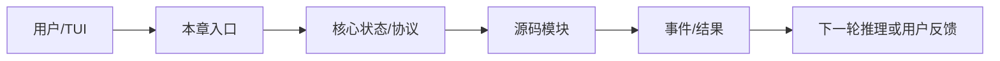
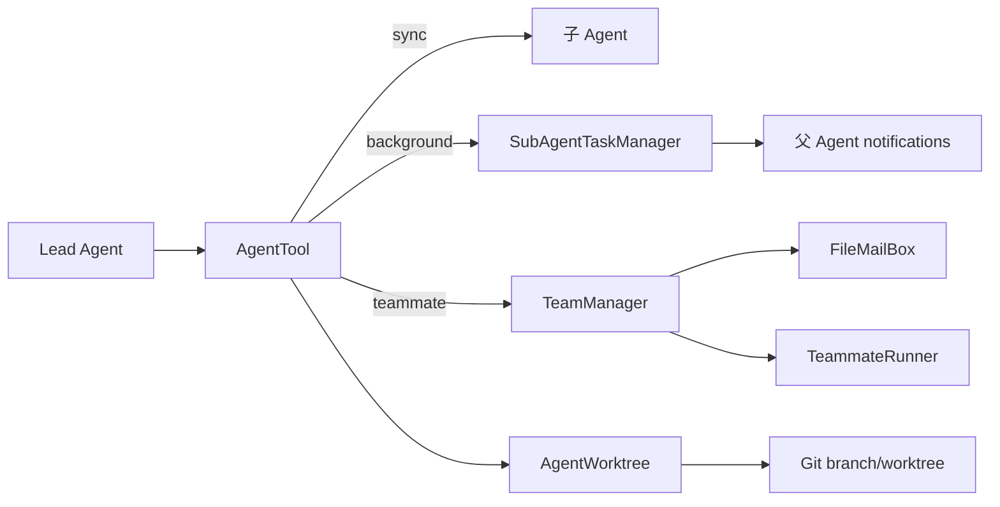
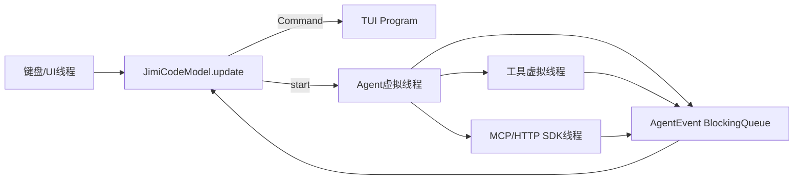

# JiMI Code 整合学习文档：05-Command-Skill-Hook与协作.md

> 本文由 `docs/` 与 `study-notes/` 下的教材按段落级别整理生成。原始文件不删除；相同段落在本主题内只保留一次，保留版本最完整或最接近课程主线的那一段，其余来源记录在末尾的合并审计中。内容涉及当前源码时以 `jimi-code` 工作区为准；对 Claude Code 的描述只代表公开体验对标。

## 本主题的融合说明

本主题按“课程概念 → jimicode 源码 → 实验/排障 → 面试与边界”排序。段落之间出现同一事实时，优先保留包含真实路径、调用关系或失败处理的版本；只有标题/目录性质的短段被折叠。

> 来源：`docs/course/10-第10章-Slash-Command.md`

### 10. 第10章：Slash Command，内置命令框架

> 来源：`docs/course/10-第10章-Slash-Command.md`

学习显式命令如何补充自然语言入口，让用户可靠触发 clear、compact、mode、help、resume 等控制操作。

> 来源：`docs/course/10-第10章-Slash-Command.md`

所有控制意图都交给模型导致不确定；命令参数解析不一致；命令和 Tool 重复实现；clear 只清 UI 不清状态；未知命令被静默忽略。

> 来源：`docs/course/10-第10章-Slash-Command.md`

Slash Command 是用户明确表达控制意图的命令层。`Command`、`CommandContext`、`CommandRegistry` 负责解析、注册、执行和帮助。

> 来源：`docs/course/10-第10章-Slash-Command.md`

| 对比维度 | 本章能力 | 上一章能力 | 下一章依赖 |
|---|---|---|---|
| 输入 | 结构化、可校验的本章对象 | 上一层输出 | 为下一层提供稳定契约 |
| 控制 | 明确的状态/权限/预算 | 规则较少 | 可观测、可恢复、可扩展 |
| 失败 | 分类、可见、可恢复 | 可能只返回错误文本 | 由后续治理层接管 |

> 来源：`docs/course/10-第10章-Slash-Command.md`

> 来源：`docs/course/10-第10章-Slash-Command.md`

**本章实际链路**：TUI 输入 → slash 检测 → CommandRegistry 查找 → 参数校验 → Command.execute(CommandContext) → 状态/Agent/会话更新 → UI 反馈

> 来源：`docs/course/10-第10章-Slash-Command.md`

command name/aliases/description、args、CommandContext、AppState、session id、output/error。

> 来源：`docs/course/10-第10章-Slash-Command.md`

| 字段 | 生产者 | 消费者 | 失败时必须保留 |
|---|---|---|---|
| 身份/名称 | 配置或注册表 | Agent/Provider/UI | 原始值与规范化值 |
| 参数/内容 | 用户、模型或工具 | 下一阶段模块 | 校验错误与来源 |
| 状态 | 编排器/持久化层 | 恢复、审计、UI | 转移前后状态 |
| 结果 | 本章实现 | Conversation/父任务 | 成功、错误、耗时 |

> 来源：`docs/course/10-第10章-Slash-Command.md`

阅读 `src/main/java/com/jimicode/command/Command.java`、`CommandContext.java`、`CommandRegistry.java` 以及 `tui/JimiCodeModel.java`。命令层的优势是确定性：`/clear` 不需要模型猜测，`/compact` 可直接调用 ContextCompactor，`/mode plan` 可切换权限模式，`/resume` 进入会话恢复。

> 来源：`docs/course/10-第10章-Slash-Command.md`

命令解析应先识别转义和引号，再拆分 command name 与 args；注册表应支持 aliases、帮助文本和未知命令错误。CommandContext 应提供最小依赖，如当前会话、Agent、输出函数和工作目录，而不是暴露整个 TUI 对象。

> 来源：`docs/course/10-第10章-Slash-Command.md`

Slash、Tool、Skill 的边界：Slash 是用户主动控制；Tool 是模型可调用动作；Skill 是可复用的流程/知识包。三者可以共享底层服务，但入口、权限和可观测事件不同。自然语言“请清空会话”也可以最终映射到相同 service，但不能绕过显式命令的权限和确认。

> 来源：`docs/course/10-第10章-Slash-Command.md`

反模式一是命令字符串直接反射调用任意方法；反模式二是 command handler 修改全局 singleton，导致 resume/多团队状态串线。

> 来源：`docs/course/10-第10章-Slash-Command.md`

- 不要用自然语言约束替代可执行的系统边界。
- 不要吞掉异常、取消或拒绝事件。
- 不要在没有测试和回滚点的真实仓库执行破坏性操作。

> 来源：`docs/course/10-第10章-Slash-Command.md`

**目标**：为项目增加 `/stats` 命令，输出当前消息数、迭代数和 provider 名称，禁止访问 API key；为未知参数写测试。

> 来源：`docs/course/10-第10章-Slash-Command.md`

**步骤**：在临时仓库或 mock 环境中准备输入；运行最小命令；保存事件、日志和 Git diff；重复一次失败条件。

> 来源：`docs/course/10-第10章-Slash-Command.md`

**预期现象**：能看到本章对应的状态变化，而不是只得到最终文本。

> 来源：`docs/course/10-第10章-Slash-Command.md`

**成功标准**：结果可复现、失败可解释、没有越过工作区和权限边界。

> 来源：`docs/course/10-第10章-Slash-Command.md`

**常见报错**：环境、路径、依赖、超时或配置错误；先看本章排障表，再沿源码调用者反查。

> 来源：`docs/course/10-第10章-Slash-Command.md`

**目标**：比较自然语言“压缩上下文”和 `/compact` 的行为，确认最终调用同一服务但控制入口不同。

> 来源：`docs/course/10-第10章-Slash-Command.md`

命令不识别→查前缀/注册；参数错→查 tokenizer；clear 后仍有旧消息→查 Conversation/Session；命令阻塞 UI→查执行线程；帮助过时→查注册表元数据。

> 来源：`docs/course/10-第10章-Slash-Command.md`

涉及文件、命令、网络、MCP、记忆、Hook 或并发时，统一使用临时仓库、最小权限、明确 workdir、超时、输出上限、审计和 Git 回滚点。任何示例数字标记“示例/需实测”；不在真实环境执行删除、覆盖、迁移或未知脚本。

> 来源：`docs/course/10-第10章-Slash-Command.md`

### 题 1：Slash 与 Tool 的边界？

> 来源：`docs/course/10-第10章-Slash-Command.md`

**回答提纲**：先给概念定义，再引用一个 jimicode 文件/类，说明一次取舍和一个失败场景。**加分点**：能讲测试、指标和边界。
### 题 2：命令解析为什么不能简单 split 空格？

> 来源：`docs/course/10-第10章-Slash-Command.md`

**回答提纲**：先给概念定义，再引用一个 jimicode 文件/类，说明一次取舍和一个失败场景。**加分点**：能讲测试、指标和边界。
### 题 3：/clear 应清哪些状态？

> 来源：`docs/course/10-第10章-Slash-Command.md`

**回答提纲**：先给概念定义，再引用一个 jimicode 文件/类，说明一次取舍和一个失败场景。**加分点**：能讲测试、指标和边界。
### 题 4：如何让自然语言和命令复用服务？

> 来源：`docs/course/10-第10章-Slash-Command.md`

**回答提纲**：先给概念定义，再引用一个 jimicode 文件/类，说明一次取舍和一个失败场景。**加分点**：能讲测试、指标和边界。

> 来源：`docs/course/10-第10章-Slash-Command.md`

- [ ] 我能解释本章能力在全链路中的位置
- [ ] 我能解释一个真实失败场景及排查路径
- [ ] 我能解释关键数据结构的生产者和消费者
- [ ] 我能解释至少一个源码文件和调用者
- [ ] 我能解释一个安全/性能取舍

> 来源：`docs/course/10-第10章-Slash-Command.md`

本章建立的契约会被下一章消费：Skill 系统 只有在输入、状态、失败和权限边界明确后才不会把复杂度继续放大。

> 来源：`docs/course/10-第10章-Slash-Command.md`

### FAQ 1：所有功能都应该有 Slash 吗？只有需要确定性和高频控制的功能。

> 来源：`docs/course/10-第10章-Slash-Command.md`

以当前项目源码和测试为准；第三方或闭源行为要明确标注边界。
### FAQ 2：Slash 可以被模型调用吗？通常不直接调用，可复用底层 service。

> 来源：`docs/course/10-第10章-Slash-Command.md`

先用最小实验复现，再沿事件、日志、状态和调用者逐层定位。
### FAQ 3：命令帮助从哪里来？应由 Command 元数据生成，避免手工漂移。

> 来源：`docs/course/10-第10章-Slash-Command.md`

可以，但要保留权限、超时、输出上限和可回滚机制。

> 来源：`docs/course/10-第10章-Slash-Command.md`

从当前章节的真实入口开始：TUI 输入 → slash 检测 → CommandRegistry 查找 → 参数校验 → Command.execute(CommandContext) → 状态/Agent/会话更新 → UI 反馈。打开链路中的第一个 jimicode 类，记录构造器参数、字段初始化和直接调用者；再向后追踪一个结果对象的消费点。不要只搜索类名，要搜索方法调用和事件类型。

> 来源：`docs/course/10-第10章-Slash-Command.md`

本章的输入不能只写成“用户问题”。应拆成配置输入、自然语言输入、模型结构化输入、文件/进程输入和上游模块状态。对每一种输入写明允许为空的字段、长度上限、编码、来源和校验时机。command name/aliases/description、args、CommandContext、AppState、session id、output/error。 中出现的身份、参数和状态字段都要在进入下一层前规范化。

> 来源：`docs/course/10-第10章-Slash-Command.md`

把状态画成有限状态机：初始、准备、执行、等待确认、成功、失败、取消、恢复。每次转移记录触发事件、允许的前置状态、持久化动作和用户可见反馈。若代码使用 enum、record 或布尔字段表达状态，要检查是否存在互斥状态同时为 true 的问题。

> 来源：`docs/course/10-第10章-Slash-Command.md`

对每个公开方法至少做三次反查：谁创建对象、谁调用方法、谁处理返回值/异常。若返回集合，检查调用方是否修改它；若返回异步对象，检查是否真正订阅；若返回路径或命令，检查调用方是否再次做安全校验。

> 来源：`docs/course/10-第10章-Slash-Command.md`

将本章失败拆成输入错误、依赖错误、业务拒绝、超时、取消、部分成功和持久化失败。针对当前主题 `Skill 系统` 的前置依赖，写出“失败后能否重试、是否幂等、是否需要人工确认、是否需要回滚”的结论。

> 来源：`docs/course/10-第10章-Slash-Command.md`

至少记录关联 id、阶段、耗时、结果状态和错误类别。不要在日志中记录 API key、完整 Authorization、未脱敏工具参数或整段私有代码。TUI 需要用户可读消息，调试日志需要开发者上下文，两者可以来自同一个事件但不应共享不安全文本。

> 来源：`docs/course/10-第10章-Slash-Command.md`

确认本章对象是进程级、Agent 级、会话级、turn 级还是方法级状态。对可变集合、文件、队列和外部进程分别考虑竞态；不要因为方法加了 synchronized 就认为跨进程安全，也不要把虚拟线程误解成无限资源。

> 来源：`docs/course/10-第10章-Slash-Command.md`

为 CPU、内存、网络、token、文件读取和输出设置上限。上限达到时返回可解释的错误或降级结果，不能静默截断关键协议字段。若本章涉及重试，退避和最大次数必须与总预算一起设计。

> 来源：`docs/course/10-第10章-Slash-Command.md`

单元测试验证纯函数和边界；集成测试验证文件、进程或 HTTP；契约测试验证 provider/Tool/MCP 字段；回归测试固定一个曾经失败的用户故事。测试数据使用虚构密钥、临时目录和固定时间，不依赖个人机器状态。

> 来源：`docs/course/10-第10章-Slash-Command.md`

错误设计通常表现为：把所有逻辑放在一个巨型类；把异常转成空字符串；让模型决定权限；让 UI 直接修改核心状态；让外部脚本绕过统一工具入口。正确设计应保持单向依赖、结构化结果、独立权限、事件通知和可回滚副作用。

> 来源：`docs/course/10-第10章-Slash-Command.md`

先实现最小 happy path，再加入参数校验、错误封装、超时、取消、审计、恢复和测试。每一步保留可运行提交，避免一次性重写多个模块而无法定位回归。

> 来源：`docs/course/10-第10章-Slash-Command.md`

回到上一章的输出，确认本章没有重新发明同一数据结构。例如上一章已经定义 Message/Tool/Provider 时，本章应复用其契约，而不是在新模块中创建第二套近似类型。

> 来源：`docs/course/10-第10章-Slash-Command.md`

下一步是 `Skill 系统`。提前列出本章必须对外稳定的字段和事件；如果下一章要并发、压缩或扩展，本章的 id、版本、错误和取消语义必须先固定。

> 来源：`docs/course/10-第10章-Slash-Command.md`

完成本章后，提交一页设计记录：问题、方案、替代方案、源码证据、测试、已知限制、后续改进。评审者应能仅凭这页记录复现你的实验，而不是依赖口头解释。

> 来源：`docs/course/10-第10章-Slash-Command.md`

审查时逐条问：输入是否来自不可信源？副作用前是否授权？失败是否可见？重试是否幂等？取消是否传播？状态是否持久化？日志是否脱敏？测试是否覆盖空值、重复、超时和恢复？

> 来源：`docs/course/10-第10章-Slash-Command.md`

回答面试题时先给一句定义，再讲当前项目文件和方法，接着讲一个取舍和失败案例，最后说如何测试。不要只罗列框架名，也不要把示例数字说成生产指标。

> 来源：`docs/course/10-第10章-Slash-Command.md`

把本章放回完整闭环：TUI 输入 → slash 检测 → CommandRegistry 查找 → 参数校验 → Command.execute(CommandContext) → 状态/Agent/会话更新 → UI 反馈。如果删除本章能力，系统会在这些地方退化：所有控制意图都交给模型导致不确定；命令参数解析不一致；命令和 Tool 重复实现；clear 只清 UI 不清状态；未知命令被静默忽略。。如果增强本章能力，优先增强契约、测试、可观测性和安全边界，再考虑增加模型或 Agent 数量。最后用一个真实但隔离的实验验证“输入—状态—结果—失败—恢复”五个维度，并把证据保存到学习笔记。
## 综合案例与边界演练

> 来源：`docs/course/10-第10章-Slash-Command.md`

### 场景 1：最小成功路径：使用固定输入、单一依赖和一个工具完成一次操作，记录从入口到结果的每个对象。

> 来源：`docs/course/10-第10章-Slash-Command.md`

本章的具体检查点是：Slash Command 是用户明确表达控制意图的命令层。`Command`、`CommandContext`、`CommandRegistry` 负责解析、注册、执行和帮助。 生产的输入必须经过本章状态和权限边界，再形成 Skill 系统 可以消费的结果。实验结束后保存命令、事件、日志、测试、diff 和限制说明。

> 来源：`docs/course/10-第10章-Slash-Command.md`

### 场景 2：空值路径：删除可选字段、返回空集合或让模型不给出内容，确认系统使用默认值、明确错误还是安全退出。

> 来源：`docs/course/10-第10章-Slash-Command.md`

### 场景 3：重复路径：重复提交同一个请求、toolUseId、命令或消息，检查是否幂等、去重或要求人工确认。

> 来源：`docs/course/10-第10章-Slash-Command.md`

### 场景 4：超时路径：让网络、脚本、文件或子任务延迟，检查 timeout、取消、资源释放和用户提示。

> 来源：`docs/course/10-第10章-Slash-Command.md`

### 场景 5：部分成功路径：让多个动作中只有一部分成功，确认结果如何汇总、是否需要补偿或回滚。

> 来源：`docs/course/10-第10章-Slash-Command.md`

### 场景 6：权限路径：使用只读、询问和拒绝三种模式，确保决策发生在副作用之前且结果可审计。

> 来源：`docs/course/10-第10章-Slash-Command.md`

### 场景 7：恢复路径：在关键状态写入前后模拟进程退出，重新启动后检查状态、消息顺序和重复执行风险。

> 来源：`docs/course/10-第10章-Slash-Command.md`

### 场景 8：观测路径：为一次操作关联 id、阶段、耗时和错误类别，确认 UI、日志和 trace 的信息粒度不同但事实一致。

> 来源：`docs/course/10-第10章-Slash-Command.md`

### 场景 9：兼容路径：替换 provider、工具实现或配置版本，确认核心契约不需要大面积改动。

> 来源：`docs/course/10-第10章-Slash-Command.md`

### 场景 10：评审路径：邀请另一位同学只看文档和证据复现实验，记录他无法理解或无法复现的地方。

> 来源：`docs/course/10-第10章-Slash-Command.md`

围绕本章的实际链路 `TUI 输入 → slash 检测 → CommandRegistry 查找 → 参数校验 → Command.execute(CommandContext) → 状态/Agent/会话更新 → UI 反馈`，在源码中定位一个具体类/方法，写出它的输入、输出、状态、调用者和失败处理。然后在隔离环境执行一个最小验证，保存测试/日志/diff；如果无法从当前仓库证实，明确写【待源码确认】。针对 `Skill 系统` 的后续能力，补充说明该契约为什么必须稳定、哪些字段不能随意改名，以及发生故障时如何向用户解释。

> 来源：`docs/course/11-第11章-Skill系统.md`

### 11. 第11章：Skill 系统，可复用的技能包

> 来源：`docs/course/11-第11章-Skill系统.md`

把一套稳定 SOP、参考文档、脚本和触发条件封装成 Skill，学习渐进披露和技能执行边界。

> 来源：`docs/course/11-第11章-Skill系统.md`

每次都把长 SOP 放进 Prompt；Skill 版本混乱；触发条件过宽导致误加载；脚本带来未审查副作用；技能结果没有恢复附件。

> 来源：`docs/course/11-第11章-Skill系统.md`

Skill 是“文档 + 脚本/工具 + 触发条件 + 约束”的能力包，不等于一个单独 Tool。`SkillCatalog` 发现技能，`SkillExecutor` 执行，`SkillHost` 提供宿主能力，`SkillForkHost` 支持隔离。

> 来源：`docs/course/11-第11章-Skill系统.md`

**本章实际链路**：Skill 目录 → catalog metadata → prompt 渐进披露 → Agent 选择 → executor 加载 SOP/脚本 → 工具调用 → 结果/恢复附件

> 来源：`docs/course/11-第11章-Skill系统.md`

skill name/description/triggers、SKILL.md、references、scripts、allowed tools、version、source、execution result。

> 来源：`docs/course/11-第11章-Skill系统.md`

阅读 `src/main/java/com/jimicode/skill/SkillCatalog.java`、`SkillExecutor.java`、`SkillHost.java`、`SkillForkHost.java`。渐进披露分三层：先只给名称和简短描述；模型判断相关后加载 SKILL.md；真正执行时再加载 references 和脚本。这样可以减少常驻 Prompt token，也降低无关指令污染。

> 来源：`docs/course/11-第11章-Skill系统.md`

一个 Skill 的模板应包含目标、适用条件、不适用条件、输入、步骤、输出格式、失败处理、安全限制、参考资料和脚本说明。脚本不是“偷偷执行的黑盒”，必须通过 Tool/Permission 入口，声明工作目录、网络需求和输出上限。Skill 版本和 source 要进入日志，方便复现。

> 来源：`docs/course/11-第11章-Skill系统.md`

Skill 与 Tool 的关键差异是粒度和知识：Tool 通常是一个原子动作，Skill 是多个动作及其判断顺序。Skill 可以调用多个 Tool，但不应绕过 Registry 和 Permission。`SkillForkHost` 适合在子 Agent/隔离上下文中运行，避免技能状态污染父会话。

> 来源：`docs/course/11-第11章-Skill系统.md`

反模式一是把所有技能全文永久塞入系统 Prompt；反模式二是 Skill 脚本直接执行 shell；反模式三是触发条件只写模糊关键词，导致技能误加载。

> 来源：`docs/course/11-第11章-Skill系统.md`

**目标**：制作一个“Java Maven 故障排查”Skill，包含触发条件、SOP、只读命令脚本和失败输出格式；在临时项目测试。

> 来源：`docs/course/11-第11章-Skill系统.md`

**目标**：同一任务先不加载 Skill、再渐进加载 Skill，比较模型是否减少重复探索；不宣称未经测量的准确率提升。

> 来源：`docs/course/11-第11章-Skill系统.md`

Skill 不触发→查 catalog 路径和 metadata；加载太多→查披露层级；脚本失败→查 workdir/权限/退出码；版本不一致→查 source/version 日志；父会话被污染→查 fork host 和状态隔离。

> 来源：`docs/course/11-第11章-Skill系统.md`

### 题 1：Skill 与 Tool 的粒度差异？

> 来源：`docs/course/11-第11章-Skill系统.md`

**回答提纲**：先给概念定义，再引用一个 jimicode 文件/类，说明一次取舍和一个失败场景。**加分点**：能讲测试、指标和边界。
### 题 2：渐进披露如何节省上下文？

> 来源：`docs/course/11-第11章-Skill系统.md`

**回答提纲**：先给概念定义，再引用一个 jimicode 文件/类，说明一次取舍和一个失败场景。**加分点**：能讲测试、指标和边界。
### 题 3：Skill 脚本如何纳入权限？

> 来源：`docs/course/11-第11章-Skill系统.md`

**回答提纲**：先给概念定义，再引用一个 jimicode 文件/类，说明一次取舍和一个失败场景。**加分点**：能讲测试、指标和边界。
### 题 4：如何版本化和复现 Skill？

> 来源：`docs/course/11-第11章-Skill系统.md`

本章建立的契约会被下一章消费：Hook 系统 只有在输入、状态、失败和权限边界明确后才不会把复杂度继续放大。

> 来源：`docs/course/11-第11章-Skill系统.md`

### FAQ 1：Skill 必须包含脚本吗？不必须，文档 SOP 也可以是 Skill。

> 来源：`docs/course/11-第11章-Skill系统.md`

以当前项目源码和测试为准；第三方或闭源行为要明确标注边界。
### FAQ 2：模型能自己安装 Skill 吗？应由受控目录和用户确认管理。

> 来源：`docs/course/11-第11章-Skill系统.md`

先用最小实验复现，再沿事件、日志、状态和调用者逐层定位。
### FAQ 3：Skill 越多越好吗？过多会增加触发歧义和维护成本。

> 来源：`docs/course/11-第11章-Skill系统.md`

从当前章节的真实入口开始：Skill 目录 → catalog metadata → prompt 渐进披露 → Agent 选择 → executor 加载 SOP/脚本 → 工具调用 → 结果/恢复附件。打开链路中的第一个 jimicode 类，记录构造器参数、字段初始化和直接调用者；再向后追踪一个结果对象的消费点。不要只搜索类名，要搜索方法调用和事件类型。

> 来源：`docs/course/11-第11章-Skill系统.md`

本章的输入不能只写成“用户问题”。应拆成配置输入、自然语言输入、模型结构化输入、文件/进程输入和上游模块状态。对每一种输入写明允许为空的字段、长度上限、编码、来源和校验时机。skill name/description/triggers、SKILL.md、references、scripts、allowed tools、version、source、execution result。 中出现的身份、参数和状态字段都要在进入下一层前规范化。

> 来源：`docs/course/11-第11章-Skill系统.md`

将本章失败拆成输入错误、依赖错误、业务拒绝、超时、取消、部分成功和持久化失败。针对当前主题 `Hook 系统` 的前置依赖，写出“失败后能否重试、是否幂等、是否需要人工确认、是否需要回滚”的结论。

> 来源：`docs/course/11-第11章-Skill系统.md`

下一步是 `Hook 系统`。提前列出本章必须对外稳定的字段和事件；如果下一章要并发、压缩或扩展，本章的 id、版本、错误和取消语义必须先固定。

> 来源：`docs/course/11-第11章-Skill系统.md`

把本章放回完整闭环：Skill 目录 → catalog metadata → prompt 渐进披露 → Agent 选择 → executor 加载 SOP/脚本 → 工具调用 → 结果/恢复附件。如果删除本章能力，系统会在这些地方退化：每次都把长 SOP 放进 Prompt；Skill 版本混乱；触发条件过宽导致误加载；脚本带来未审查副作用；技能结果没有恢复附件。。如果增强本章能力，优先增强契约、测试、可观测性和安全边界，再考虑增加模型或 Agent 数量。最后用一个真实但隔离的实验验证“输入—状态—结果—失败—恢复”五个维度，并把证据保存到学习笔记。
## 综合案例与边界演练

> 来源：`docs/course/11-第11章-Skill系统.md`

本章的具体检查点是：Skill 是“文档 + 脚本/工具 + 触发条件 + 约束”的能力包，不等于一个单独 Tool。`SkillCatalog` 发现技能，`SkillExecutor` 执行，`SkillHost` 提供宿主能力，`SkillForkHost` 支持隔离。 生产的输入必须经过本章状态和权限边界，再形成 Hook 系统 可以消费的结果。实验结束后保存命令、事件、日志、测试、diff 和限制说明。

> 来源：`docs/course/11-第11章-Skill系统.md`

围绕本章的实际链路 `Skill 目录 → catalog metadata → prompt 渐进披露 → Agent 选择 → executor 加载 SOP/脚本 → 工具调用 → 结果/恢复附件`，在源码中定位一个具体类/方法，写出它的输入、输出、状态、调用者和失败处理。然后在隔离环境执行一个最小验证，保存测试/日志/diff；如果无法从当前仓库证实，明确写【待源码确认】。针对 `Hook 系统` 的后续能力，补充说明该契约为什么必须稳定、哪些字段不能随意改名，以及发生故障时如何向用户解释。

> 来源：`docs/course/12-第12章-Hook系统.md`

### 12. 第12章：Hook 系统 - 生命周期钩子与自动化

> 来源：`docs/course/12-第12章-Hook系统.md`

学习在会话、模型调用、工具执行和提交等生命周期节点插入自动化、审计和质量门禁。

> 来源：`docs/course/12-第12章-Hook系统.md`

格式化只靠模型记忆；工具执行后没有 lint；hook 失败被吞掉；hook 无限递归触发 Agent；审计与实际动作不一致。

> 来源：`docs/course/12-第12章-Hook系统.md`

Hook 是生命周期事件的订阅/自动化机制。`HookEngine`、`HookConfig` 将事件节点与外部命令或处理器连接；Hook 可观察、修改或阻断，但必须定义失败策略。

> 来源：`docs/course/12-第12章-Hook系统.md`

**本章实际链路**：Agent event → HookEngine dispatch → pre hook allow/deny or post automation → main action/next event → audit/log

> 来源：`docs/course/12-第12章-Hook系统.md`

hook event type、command/script、matcher、timeout、blocking policy、stdin payload、exit code、stdout/stderr、audit id。

> 来源：`docs/course/12-第12章-Hook系统.md`

阅读 `src/main/java/com/jimicode/hook/HookEngine.java`、`config/HookConfig.java` 以及 Agent 中 Hook 调用点。Hook 类型可分会话开始/结束、模型调用前后、工具调用前后、文件修改后、提交前。pre hook 可以校验或阻断，post hook 适合格式化、lint、通知和指标。

> 来源：`docs/course/12-第12章-Hook系统.md`

Hook 设计要明确四个契约：触发条件、输入 payload、失败是否阻断、执行超时。阻断型 hook 适合安全扫描和提交前测试；非阻断型 hook 适合桌面通知或统计。hook 的 stdout/stderr 应限制大小并脱敏；退出码、耗时和关联 toolUseId 写入审计。

> 来源：`docs/course/12-第12章-Hook系统.md`

避免 hook 递归：hook 执行的命令不应再次触发同一 hook，或者使用 depth/id 标记。外部脚本需要 workdir、环境变量 allowlist 和权限检查。Hook 失败不能简单 catch 后丢弃，至少要在 AgentEvent/TUI 中可见。

> 来源：`docs/course/12-第12章-Hook系统.md`

反模式一是把业务逻辑全部塞进 shell hook，导致不可测试；反模式二是把阻断策略写死在脚本退出码而不在配置中声明；反模式三是 post hook 修改文件却不记录第二次 diff。

> 来源：`docs/course/12-第12章-Hook系统.md`

**目标**：配置一个工具完成后的 `mvn -q -DskipTests compile` 非阻断 hook，记录退出码和耗时。

> 来源：`docs/course/12-第12章-Hook系统.md`

**目标**：配置一个提交前只读 lint 阻断 hook，在临时仓库制造失败，验证 Agent 是否停在明确的质量门禁上。

> 来源：`docs/course/12-第12章-Hook系统.md`

hook 不触发→查 event matcher；主流程被卡→查 timeout/阻塞策略；失败无提示→查 HookEngine 异常事件；递归→查触发 id/depth；脚本找不到→查 PATH/workdir。

> 来源：`docs/course/12-第12章-Hook系统.md`

### 题 1：Hook、Middleware、Interceptor 如何区分？

> 来源：`docs/course/12-第12章-Hook系统.md`

**回答提纲**：先给概念定义，再引用一个 jimicode 文件/类，说明一次取舍和一个失败场景。**加分点**：能讲测试、指标和边界。
### 题 2：阻断型和非阻断型 hook 如何选择？

> 来源：`docs/course/12-第12章-Hook系统.md`

**回答提纲**：先给概念定义，再引用一个 jimicode 文件/类，说明一次取舍和一个失败场景。**加分点**：能讲测试、指标和边界。
### 题 3：如何防 hook 递归？

> 来源：`docs/course/12-第12章-Hook系统.md`

**回答提纲**：先给概念定义，再引用一个 jimicode 文件/类，说明一次取舍和一个失败场景。**加分点**：能讲测试、指标和边界。
### 题 4：Hook 输出为什么要审计和脱敏？

> 来源：`docs/course/12-第12章-Hook系统.md`

本章建立的契约会被下一章消费：SubAgent 只有在输入、状态、失败和权限边界明确后才不会把复杂度继续放大。

> 来源：`docs/course/12-第12章-Hook系统.md`

### FAQ 1：Hook 可以替代权限吗？不能，权限必须在副作用前独立裁决。

> 来源：`docs/course/12-第12章-Hook系统.md`

以当前项目源码和测试为准；第三方或闭源行为要明确标注边界。
### FAQ 2：Hook 失败是否一定终止？取决于事件风险和显式策略。

> 来源：`docs/course/12-第12章-Hook系统.md`

先用最小实验复现，再沿事件、日志、状态和调用者逐层定位。
### FAQ 3：为什么不直接在 Agent 里写 lint？Hook 让策略可配置、可替换、可测试。

> 来源：`docs/course/12-第12章-Hook系统.md`

从当前章节的真实入口开始：Agent event → HookEngine dispatch → pre hook allow/deny or post automation → main action/next event → audit/log。打开链路中的第一个 jimicode 类，记录构造器参数、字段初始化和直接调用者；再向后追踪一个结果对象的消费点。不要只搜索类名，要搜索方法调用和事件类型。

> 来源：`docs/course/12-第12章-Hook系统.md`

本章的输入不能只写成“用户问题”。应拆成配置输入、自然语言输入、模型结构化输入、文件/进程输入和上游模块状态。对每一种输入写明允许为空的字段、长度上限、编码、来源和校验时机。hook event type、command/script、matcher、timeout、blocking policy、stdin payload、exit code、stdout/stderr、audit id。 中出现的身份、参数和状态字段都要在进入下一层前规范化。

> 来源：`docs/course/12-第12章-Hook系统.md`

将本章失败拆成输入错误、依赖错误、业务拒绝、超时、取消、部分成功和持久化失败。针对当前主题 `SubAgent` 的前置依赖，写出“失败后能否重试、是否幂等、是否需要人工确认、是否需要回滚”的结论。

> 来源：`docs/course/12-第12章-Hook系统.md`

下一步是 `SubAgent`。提前列出本章必须对外稳定的字段和事件；如果下一章要并发、压缩或扩展，本章的 id、版本、错误和取消语义必须先固定。

> 来源：`docs/course/12-第12章-Hook系统.md`

把本章放回完整闭环：Agent event → HookEngine dispatch → pre hook allow/deny or post automation → main action/next event → audit/log。如果删除本章能力，系统会在这些地方退化：格式化只靠模型记忆；工具执行后没有 lint；hook 失败被吞掉；hook 无限递归触发 Agent；审计与实际动作不一致。。如果增强本章能力，优先增强契约、测试、可观测性和安全边界，再考虑增加模型或 Agent 数量。最后用一个真实但隔离的实验验证“输入—状态—结果—失败—恢复”五个维度，并把证据保存到学习笔记。
## 综合案例与边界演练

> 来源：`docs/course/12-第12章-Hook系统.md`

本章的具体检查点是：Hook 是生命周期事件的订阅/自动化机制。`HookEngine`、`HookConfig` 将事件节点与外部命令或处理器连接；Hook 可观察、修改或阻断，但必须定义失败策略。 生产的输入必须经过本章状态和权限边界，再形成 SubAgent 可以消费的结果。实验结束后保存命令、事件、日志、测试、diff 和限制说明。

> 来源：`docs/course/12-第12章-Hook系统.md`

围绕本章的实际链路 `Agent event → HookEngine dispatch → pre hook allow/deny or post automation → main action/next event → audit/log`，在源码中定位一个具体类/方法，写出它的输入、输出、状态、调用者和失败处理。然后在隔离环境执行一个最小验证，保存测试/日志/diff；如果无法从当前仓库证实，明确写【待源码确认】。针对 `SubAgent` 的后续能力，补充说明该契约为什么必须稳定、哪些字段不能随意改名，以及发生故障时如何向用户解释。

> 来源：`docs/course/13-第13章-SubAgent.md`

### 13. 第13章：SubAgent，子 Agent 与任务分发

> 来源：`docs/course/13-第13章-SubAgent.md`

学习如何用子 Agent 做上下文隔离、专业分工和并行任务，并处理权限继承、超时、取消和结果汇总。

> 来源：`docs/course/13-第13章-SubAgent.md`

父 Agent 上下文过长；所有任务混在一条会话；子 Agent 无限运行；子 Agent 越权使用工具；父 Agent 收不到失败结果。

> 来源：`docs/course/13-第13章-SubAgent.md`

SubAgent 是由父 Agent 创建、具有独立 conversation/工具过滤/迭代预算的 Agent。`SubAgentTaskManager` 跟踪状态，`AgentTool` 提供模型可调用入口，`SubAgentSpec` 描述任务。

> 来源：`docs/course/13-第13章-SubAgent.md`

**本章实际链路**：父 Agent → AgentTool/SubAgentTaskManager → SubAgentSpec → child Agent + filtered registry → virtual thread → events → TaskNotification → parent conversation

> 来源：`docs/course/13-第13章-SubAgent.md`

task id/name/status、SubAgentSpec、child conversation、tool filter、maxTurns、parent replacement state、output/error、notification。

> 来源：`docs/course/13-第13章-SubAgent.md`

阅读 `src/main/java/com/jimicode/subagent/SubAgentSpec.java`、`ToolFilter.java`、`SubAgentTaskManager.java`、`AgentTool.java`。创建子 Agent 时应明确 name、system prompt override、maxTurns、工具白名单、是否继承 workdir/session/permission。父 Agent 的 `ContentReplacementState` 可以 copy 给子 Agent，以保持共享历史的 prompt 前缀稳定，但不能共享可变 conversation。

> 来源：`docs/course/13-第13章-SubAgent.md`

任务管理器用 PENDING/RUNNING/COMPLETED/FAILED/CANCELLED 状态，并通过虚拟线程消费 `AgentEvent`。父 Agent 不应忙等；它在每轮开始 drain notifications，把子任务结果作为 system reminder 或结构化消息注入。超时、线程中断、队列 60 秒无事件都要进入失败状态。

> 来源：`docs/course/13-第13章-SubAgent.md`

权限继承要最小化：子 Agent 默认不应获得父 Agent 没有的权限；如果任务需要升级，交给人类确认。结果汇总要保留 task id、输出、错误和证据路径，不能只把多个字符串拼起来。

> 来源：`docs/course/13-第13章-SubAgent.md`

反模式一是子 Agent 共享父 conversation 导致消息串线；反模式二是只返回最终文本不返回失败状态；反模式三是并行启动数量没有上限，造成 provider 限流和本地资源耗尽。

> 来源：`docs/course/13-第13章-SubAgent.md`

**目标**：创建两个子 Agent，一个只读分析、一个运行测试，分别限制工具；父 Agent 汇总结果并显示 task 状态。

> 来源：`docs/course/13-第13章-SubAgent.md`

**目标**：取消一个长时间子任务，验证状态变为 CANCELLED/FAILED，父 Agent 能收到通知且不会继续执行其结果。

> 来源：`docs/course/13-第13章-SubAgent.md`

子任务不启动→查 spec/registry；状态卡 RUNNING→查线程和 queue poll；结果不回父→查 drainNotifications；权限过宽→查 ToolFilter/继承；成本暴涨→查 maxTurns/并发上限。

> 来源：`docs/course/13-第13章-SubAgent.md`

### 题 1：SubAgent 与函数调用的区别？

> 来源：`docs/course/13-第13章-SubAgent.md`

**回答提纲**：先给概念定义，再引用一个 jimicode 文件/类，说明一次取舍和一个失败场景。**加分点**：能讲测试、指标和边界。
### 题 2：权限如何继承？

> 来源：`docs/course/13-第13章-SubAgent.md`

**回答提纲**：先给概念定义，再引用一个 jimicode 文件/类，说明一次取舍和一个失败场景。**加分点**：能讲测试、指标和边界。
### 题 3：为什么需要独立 conversation？

> 来源：`docs/course/13-第13章-SubAgent.md`

**回答提纲**：先给概念定义，再引用一个 jimicode 文件/类，说明一次取舍和一个失败场景。**加分点**：能讲测试、指标和边界。
### 题 4：超时和取消如何传递？

> 来源：`docs/course/13-第13章-SubAgent.md`

本章建立的契约会被下一章消费：Worktree 只有在输入、状态、失败和权限边界明确后才不会把复杂度继续放大。

> 来源：`docs/course/13-第13章-SubAgent.md`

### FAQ 1：子 Agent 一定要并行吗？不一定，隔离本身就有价值。

> 来源：`docs/course/13-第13章-SubAgent.md`

以当前项目源码和测试为准；第三方或闭源行为要明确标注边界。
### FAQ 2：父 Agent 能直接读取子 Agent 内存吗？应通过结构化结果/通知，避免共享可变状态。

> 来源：`docs/course/13-第13章-SubAgent.md`

先用最小实验复现，再沿事件、日志、状态和调用者逐层定位。
### FAQ 3：子 Agent 失败是否让主任务失败？按任务关键性决定，可降级但必须可见。

> 来源：`docs/course/13-第13章-SubAgent.md`

从当前章节的真实入口开始：父 Agent → AgentTool/SubAgentTaskManager → SubAgentSpec → child Agent + filtered registry → virtual thread → events → TaskNotification → parent conversation。打开链路中的第一个 jimicode 类，记录构造器参数、字段初始化和直接调用者；再向后追踪一个结果对象的消费点。不要只搜索类名，要搜索方法调用和事件类型。

> 来源：`docs/course/13-第13章-SubAgent.md`

本章的输入不能只写成“用户问题”。应拆成配置输入、自然语言输入、模型结构化输入、文件/进程输入和上游模块状态。对每一种输入写明允许为空的字段、长度上限、编码、来源和校验时机。task id/name/status、SubAgentSpec、child conversation、tool filter、maxTurns、parent replacement state、output/error、notification。 中出现的身份、参数和状态字段都要在进入下一层前规范化。

> 来源：`docs/course/13-第13章-SubAgent.md`

将本章失败拆成输入错误、依赖错误、业务拒绝、超时、取消、部分成功和持久化失败。针对当前主题 `Worktree` 的前置依赖，写出“失败后能否重试、是否幂等、是否需要人工确认、是否需要回滚”的结论。

> 来源：`docs/course/13-第13章-SubAgent.md`

下一步是 `Worktree`。提前列出本章必须对外稳定的字段和事件；如果下一章要并发、压缩或扩展，本章的 id、版本、错误和取消语义必须先固定。

> 来源：`docs/course/13-第13章-SubAgent.md`

把本章放回完整闭环：父 Agent → AgentTool/SubAgentTaskManager → SubAgentSpec → child Agent + filtered registry → virtual thread → events → TaskNotification → parent conversation。如果删除本章能力，系统会在这些地方退化：父 Agent 上下文过长；所有任务混在一条会话；子 Agent 无限运行；子 Agent 越权使用工具；父 Agent 收不到失败结果。。如果增强本章能力，优先增强契约、测试、可观测性和安全边界，再考虑增加模型或 Agent 数量。最后用一个真实但隔离的实验验证“输入—状态—结果—失败—恢复”五个维度，并把证据保存到学习笔记。
## 综合案例与边界演练

> 来源：`docs/course/13-第13章-SubAgent.md`

本章的具体检查点是：SubAgent 是由父 Agent 创建、具有独立 conversation/工具过滤/迭代预算的 Agent。`SubAgentTaskManager` 跟踪状态，`AgentTool` 提供模型可调用入口，`SubAgentSpec` 描述任务。 生产的输入必须经过本章状态和权限边界，再形成 Worktree 可以消费的结果。实验结束后保存命令、事件、日志、测试、diff 和限制说明。

> 来源：`docs/course/13-第13章-SubAgent.md`

围绕本章的实际链路 `父 Agent → AgentTool/SubAgentTaskManager → SubAgentSpec → child Agent + filtered registry → virtual thread → events → TaskNotification → parent conversation`，在源码中定位一个具体类/方法，写出它的输入、输出、状态、调用者和失败处理。然后在隔离环境执行一个最小验证，保存测试/日志/diff；如果无法从当前仓库证实，明确写【待源码确认】。针对 `Worktree` 的后续能力，补充说明该契约为什么必须稳定、哪些字段不能随意改名，以及发生故障时如何向用户解释。

> 来源：`docs/course/14-第14章-Worktree.md`

### 14. 第14章：Worktree，Git 工作树并行开发

> 来源：`docs/course/14-第14章-Worktree.md`

学习 Git worktree 如何隔离并行修改，理解分支、清理、diff、合并和冲突边界。

> 来源：`docs/course/14-第14章-Worktree.md`

两个 Agent 修改同一工作区互相覆盖；临时目录残留；分支名含危险字符；合并前不知道未提交改动；删除 worktree 时丢失用户文件。

> 来源：`docs/course/14-第14章-Worktree.md`

Worktree 是 Git 层面的文件系统隔离，不是线程锁。`WorktreeManager`、`WorktreeSession`、`SlugValidator`、`StaleCleanup` 管理生命周期。

> 来源：`docs/course/14-第14章-Worktree.md`

**本章实际链路**：任务 → slug/branch 校验 → git worktree add → PostCreationSetup → Agent 在独立 cwd 工作 → detectChanges → review/merge → remove/cleanup

> 来源：`docs/course/14-第14章-Worktree.md`

branch、path、createdAt、session id、diff stat、base commit、cleanup cutoff、symlink dirs、changes。

> 来源：`docs/course/14-第14章-Worktree.md`

阅读 `src/main/java/com/jimicode/worktree/WorktreeManager.java`、`WorktreeSession.java`、`WorktreeChanges.java`、`SlugValidator.java`、`StaleCleanup.java`。创建时要校验项目根是 Git 仓库、branch/目录 slug 安全、目标目录不存在或可回收，并给 Git 命令设置超时。`PostCreationSetup` 负责 settings、hooks、symlinks 等初始化，失败要可诊断。

> 来源：`docs/course/14-第14章-Worktree.md`

`git worktree list --porcelain` 的解析是边界重点：block 以空行分隔，最后一个 block 可能没有尾随空行；detached HEAD 和 branch 行也要处理。`detectChanges` 使用 `git diff --stat` 只能说明未提交变化，不能代替完整 diff 审查。合并前必须检查 base commit、未提交文件、测试结果和冲突。

> 来源：`docs/course/14-第14章-Worktree.md`

Worktree 不适合数据库共享状态、外部服务副作用或同一 lockfile 的无协调修改。清理应 best-effort 但有监控；过期 worktree 删除前要确认路径在受控根目录，并保留用户可恢复信息。

> 来源：`docs/course/14-第14章-Worktree.md`

反模式一是用 synchronized 代替 worktree；它无法隔离文件系统。反模式二是 `git worktree remove --force` 作为默认清理；这可能丢失未提交改动。反模式三是分支名直接拼接用户输入。

> 来源：`docs/course/14-第14章-Worktree.md`

**目标**：在临时 Git 仓库创建两个 worktree，各自修改不同文件，运行测试并比较 diff。

> 来源：`docs/course/14-第14章-Worktree.md`

**目标**：制造未提交变更和过期时间，验证 detectChanges、cleanupStale 的提示和失败处理；不要在真实项目执行强制删除。

> 来源：`docs/course/14-第14章-Worktree.md`

创建失败→查 Git 状态/branch/路径；列表为空→查 porcelain 解析；清理失败→查进程占用/未提交变更；文件仍互相覆盖→确认 Agent cwd；分支注入风险→查 SlugValidator。

> 来源：`docs/course/14-第14章-Worktree.md`

### 题 1：Worktree 与线程锁差异？

> 来源：`docs/course/14-第14章-Worktree.md`

**回答提纲**：先给概念定义，再引用一个 jimicode 文件/类，说明一次取舍和一个失败场景。**加分点**：能讲测试、指标和边界。
### 题 2：如何安全清理？

> 来源：`docs/course/14-第14章-Worktree.md`

**回答提纲**：先给概念定义，再引用一个 jimicode 文件/类，说明一次取舍和一个失败场景。**加分点**：能讲测试、指标和边界。
### 题 3：porcelain 解析有哪些边界？

> 来源：`docs/course/14-第14章-Worktree.md`

**回答提纲**：先给概念定义，再引用一个 jimicode 文件/类，说明一次取舍和一个失败场景。**加分点**：能讲测试、指标和边界。
### 题 4：什么场景不适合 Worktree？

> 来源：`docs/course/14-第14章-Worktree.md`

本章建立的契约会被下一章消费：Agent Teams 只有在输入、状态、失败和权限边界明确后才不会把复杂度继续放大。

> 来源：`docs/course/14-第14章-Worktree.md`

### FAQ 1：每个 Agent 都要一个 worktree 吗？只在有并行修改风险时使用。

> 来源：`docs/course/14-第14章-Worktree.md`

以当前项目源码和测试为准；第三方或闭源行为要明确标注边界。
### FAQ 2：worktree 能隔离数据库吗？不能，它只隔离 Git 文件树。

> 来源：`docs/course/14-第14章-Worktree.md`

先用最小实验复现，再沿事件、日志、状态和调用者逐层定位。
### FAQ 3：强制删除安全吗？只有在明确确认无未提交数据且路径受控时才考虑。

> 来源：`docs/course/14-第14章-Worktree.md`

从当前章节的真实入口开始：任务 → slug/branch 校验 → git worktree add → PostCreationSetup → Agent 在独立 cwd 工作 → detectChanges → review/merge → remove/cleanup。打开链路中的第一个 jimicode 类，记录构造器参数、字段初始化和直接调用者；再向后追踪一个结果对象的消费点。不要只搜索类名，要搜索方法调用和事件类型。

> 来源：`docs/course/14-第14章-Worktree.md`

本章的输入不能只写成“用户问题”。应拆成配置输入、自然语言输入、模型结构化输入、文件/进程输入和上游模块状态。对每一种输入写明允许为空的字段、长度上限、编码、来源和校验时机。branch、path、createdAt、session id、diff stat、base commit、cleanup cutoff、symlink dirs、changes。 中出现的身份、参数和状态字段都要在进入下一层前规范化。

> 来源：`docs/course/14-第14章-Worktree.md`

将本章失败拆成输入错误、依赖错误、业务拒绝、超时、取消、部分成功和持久化失败。针对当前主题 `Agent Teams` 的前置依赖，写出“失败后能否重试、是否幂等、是否需要人工确认、是否需要回滚”的结论。

> 来源：`docs/course/14-第14章-Worktree.md`

下一步是 `Agent Teams`。提前列出本章必须对外稳定的字段和事件；如果下一章要并发、压缩或扩展，本章的 id、版本、错误和取消语义必须先固定。

> 来源：`docs/course/14-第14章-Worktree.md`

把本章放回完整闭环：任务 → slug/branch 校验 → git worktree add → PostCreationSetup → Agent 在独立 cwd 工作 → detectChanges → review/merge → remove/cleanup。如果删除本章能力，系统会在这些地方退化：两个 Agent 修改同一工作区互相覆盖；临时目录残留；分支名含危险字符；合并前不知道未提交改动；删除 worktree 时丢失用户文件。。如果增强本章能力，优先增强契约、测试、可观测性和安全边界，再考虑增加模型或 Agent 数量。最后用一个真实但隔离的实验验证“输入—状态—结果—失败—恢复”五个维度，并把证据保存到学习笔记。
## 综合案例与边界演练

> 来源：`docs/course/14-第14章-Worktree.md`

本章的具体检查点是：Worktree 是 Git 层面的文件系统隔离，不是线程锁。`WorktreeManager`、`WorktreeSession`、`SlugValidator`、`StaleCleanup` 管理生命周期。 生产的输入必须经过本章状态和权限边界，再形成 Agent Teams 可以消费的结果。实验结束后保存命令、事件、日志、测试、diff 和限制说明。

> 来源：`docs/course/14-第14章-Worktree.md`

围绕本章的实际链路 `任务 → slug/branch 校验 → git worktree add → PostCreationSetup → Agent 在独立 cwd 工作 → detectChanges → review/merge → remove/cleanup`，在源码中定位一个具体类/方法，写出它的输入、输出、状态、调用者和失败处理。然后在隔离环境执行一个最小验证，保存测试/日志/diff；如果无法从当前仓库证实，明确写【待源码确认】。针对 `Agent Teams` 的后续能力，补充说明该契约为什么必须稳定、哪些字段不能随意改名，以及发生故障时如何向用户解释。

> 来源：`docs/course/15-第15章-Agent-Teams.md`

### 15. 第15章：Agent Teams，从一次性子任务到长期协作团队

> 来源：`docs/course/15-第15章-Agent-Teams.md`

把 SubAgent 提升为长期角色、任务看板、邮箱和人类主管协作系统。

> 来源：`docs/course/15-第15章-Agent-Teams.md`

成员职责不清；任务状态无人更新；消息重复/丢失；多个成员争抢同一文件；成本随成员数线性甚至超线性增长；没有人类最终裁决。

> 来源：`docs/course/15-第15章-Agent-Teams.md`

Team 是成员、角色、共享任务状态和协作协议的组合。`TeamManager`、`FileMailBox`、`SharedTaskStore`、`TeammateProgress`、`TeammateRunner` 和 tmux backend 构成 jimicode 团队层。

> 来源：`docs/course/15-第15章-Agent-Teams.md`

**本章实际链路**：Team create → add members → shared tasks/mailbox → member Agent run → progress/report → human supervisor review → merge/stop/cleanup

> 来源：`docs/course/15-第15章-Agent-Teams.md`

team name/mode、member、role、task id/status、mail message id/from/to/content、progress、worktree path、stop state。

> 来源：`docs/course/15-第15章-Agent-Teams.md`

阅读 `src/main/java/com/jimicode/teams/TeamManager.java`、`FileMailBox.java`、`SharedTaskStore.java`、`TeammateProgress.java`、`TeammateRunner.java`。TeamManager 管成员生命周期，FileMailBox 负责跨成员消息，SharedTaskStore 负责任务看板，TmuxBackend/ITermBackend 负责进程或 pane 后端。不要把显示后端当作协作协议。

> 来源：`docs/course/15-第15章-Agent-Teams.md`

长期团队需要角色契约：前端成员负责 UI 文件，后端成员负责 API，测试成员负责复现与回归，主管负责拆分、审批、合并和冲突裁决。每个任务应有 owner、输入、输出、依赖、状态和证据；状态转移要可审计，消息要有唯一 id、时间和 ack/重放策略。

> 来源：`docs/course/15-第15章-Agent-Teams.md`

人类主管不是多余环节。涉及架构冲突、权限升级、数据库迁移、合并主分支和成本异常时必须暂停。成员之间的共享上下文应通过摘要、任务结果和路径引用传递，避免复制完整对话。

> 来源：`docs/course/15-第15章-Agent-Teams.md`

反模式一是只增加成员数量不增加协议；反模式二是用文件名猜冲突而不使用 Git diff；反模式三是成员无限等待邮箱，没有超时、心跳和退出。

> 来源：`docs/course/15-第15章-Agent-Teams.md`

**目标**：创建前端/后端/测试三个角色，分别领取只读分析任务，使用 FileMailBox 交换结论，主管手工汇总。

> 来源：`docs/course/15-第15章-Agent-Teams.md`

**目标**：故意让两个成员修改同一临时文件，演练冲突报告、暂停合并和人工裁决；不自动强制覆盖。

> 来源：`docs/course/15-第15章-Agent-Teams.md`

成员无进展→查 progress/heartbeat；消息丢失→查 mailbox 原子写/消费；任务重复→查 task id/ack；冲突未发现→查 worktree diff；成本过高→查成员并发/maxTurns。

> 来源：`docs/course/15-第15章-Agent-Teams.md`

### 题 1：Teams 与 SubAgent 的边界？

> 来源：`docs/course/15-第15章-Agent-Teams.md`

**回答提纲**：先给概念定义，再引用一个 jimicode 文件/类，说明一次取舍和一个失败场景。**加分点**：能讲测试、指标和边界。
### 题 2：文件邮箱如何保证可靠性？

> 来源：`docs/course/15-第15章-Agent-Teams.md`

**回答提纲**：先给概念定义，再引用一个 jimicode 文件/类，说明一次取舍和一个失败场景。**加分点**：能讲测试、指标和边界。
### 题 3：为什么需要 human supervisor？

> 来源：`docs/course/15-第15章-Agent-Teams.md`

**回答提纲**：先给概念定义，再引用一个 jimicode 文件/类，说明一次取舍和一个失败场景。**加分点**：能讲测试、指标和边界。
### 题 4：多 Agent 成本如何治理？

> 来源：`docs/course/15-第15章-Agent-Teams.md`

本章建立的契约会被下一章消费：回顾与展望 只有在输入、状态、失败和权限边界明确后才不会把复杂度继续放大。

> 来源：`docs/course/15-第15章-Agent-Teams.md`

### FAQ 1：Team 一定要 tmux 吗？不一定，IN_PROCESS 也可运行；tmux 只是后端。

> 来源：`docs/course/15-第15章-Agent-Teams.md`

以当前项目源码和测试为准；第三方或闭源行为要明确标注边界。
### FAQ 2：成员可以共享一个 Agent 实例吗？通常不应并发共享非线程安全实例。

> 来源：`docs/course/15-第15章-Agent-Teams.md`

先用最小实验复现，再沿事件、日志、状态和调用者逐层定位。
### FAQ 3：共享看板需要数据库吗？本地课程可用文件协议，生产需更强一致性。

> 来源：`docs/course/15-第15章-Agent-Teams.md`

从当前章节的真实入口开始：Team create → add members → shared tasks/mailbox → member Agent run → progress/report → human supervisor review → merge/stop/cleanup。打开链路中的第一个 jimicode 类，记录构造器参数、字段初始化和直接调用者；再向后追踪一个结果对象的消费点。不要只搜索类名，要搜索方法调用和事件类型。

> 来源：`docs/course/15-第15章-Agent-Teams.md`

本章的输入不能只写成“用户问题”。应拆成配置输入、自然语言输入、模型结构化输入、文件/进程输入和上游模块状态。对每一种输入写明允许为空的字段、长度上限、编码、来源和校验时机。team name/mode、member、role、task id/status、mail message id/from/to/content、progress、worktree path、stop state。 中出现的身份、参数和状态字段都要在进入下一层前规范化。

> 来源：`docs/course/15-第15章-Agent-Teams.md`

将本章失败拆成输入错误、依赖错误、业务拒绝、超时、取消、部分成功和持久化失败。针对当前主题 `回顾与展望` 的前置依赖，写出“失败后能否重试、是否幂等、是否需要人工确认、是否需要回滚”的结论。

> 来源：`docs/course/15-第15章-Agent-Teams.md`

下一步是 `回顾与展望`。提前列出本章必须对外稳定的字段和事件；如果下一章要并发、压缩或扩展，本章的 id、版本、错误和取消语义必须先固定。

> 来源：`docs/course/15-第15章-Agent-Teams.md`

把本章放回完整闭环：Team create → add members → shared tasks/mailbox → member Agent run → progress/report → human supervisor review → merge/stop/cleanup。如果删除本章能力，系统会在这些地方退化：成员职责不清；任务状态无人更新；消息重复/丢失；多个成员争抢同一文件；成本随成员数线性甚至超线性增长；没有人类最终裁决。。如果增强本章能力，优先增强契约、测试、可观测性和安全边界，再考虑增加模型或 Agent 数量。最后用一个真实但隔离的实验验证“输入—状态—结果—失败—恢复”五个维度，并把证据保存到学习笔记。
## 综合案例与边界演练

> 来源：`docs/course/15-第15章-Agent-Teams.md`

本章的具体检查点是：Team 是成员、角色、共享任务状态和协作协议的组合。`TeamManager`、`FileMailBox`、`SharedTaskStore`、`TeammateProgress`、`TeammateRunner` 和 tmux backend 构成 jimicode 团队层。 生产的输入必须经过本章状态和权限边界，再形成 回顾与展望 可以消费的结果。实验结束后保存命令、事件、日志、测试、diff 和限制说明。

> 来源：`docs/course/15-第15章-Agent-Teams.md`

围绕本章的实际链路 `Team create → add members → shared tasks/mailbox → member Agent run → progress/report → human supervisor review → merge/stop/cleanup`，在源码中定位一个具体类/方法，写出它的输入、输出、状态、调用者和失败处理。然后在隔离环境执行一个最小验证，保存测试/日志/diff；如果无法从当前仓库证实，明确写【待源码确认】。针对 `回顾与展望` 的后续能力，补充说明该契约为什么必须稳定、哪些字段不能随意改名，以及发生故障时如何向用户解释。

> 来源：`docs/deep-learning/06-核心链路语义讲解.md`

这份文档专门补足“有文件名但没有理解”的问题。`02-逐文件源码精读.md` 是覆盖清单，`05-核心Java文件逐方法讲解.md` 是方法签名与源码片段证据，本章则把这些证据串成可运行的语义：对象在哪里创建，状态怎样变化，方法为什么按这个顺序调用，失败时哪一层负责兜底。学习时不要只背类名，应该把每一条链路追到测试和文件格式。

> 来源：`docs/deep-learning/06-核心链路语义讲解.md`

`jimi-code` 不是 Spring MVC 应用。它没有 Controller、Service、Mapper 这种固定三层，也没有依赖数据库完成主流程。它是 Java 17+ 的本地 CLI/TUI Agent：输入来自终端，模型通过 HTTP/SSE 返回增量，工具直接操作工作区文件或子进程，会话和历史落盘到 `.JimiCode`，多 Agent 通过虚拟线程、文件邮箱和 Git worktree 协作。因此学习它时，应该把“接口”理解成四种接口：`LlmClient` 的 provider SPI、`Tool` 的工具 SPI、斜杠命令的命令接口、本地 JSON/YAML/JSONL 文件协议。

> 来源：`docs/deep-learning/06-核心链路语义讲解.md`

仓库里有 103 个主源码 Java 文件、对应测试、Maven 构建和已有的 study-notes。主包按职责分成：`com.jimicode` 启动；`config` 配置；`agent` 编排；`llm` 模型适配；`conversation` 消息；`prompt` 提示词；`tool` 工具；`permission` 权限；`hook` 钩子；`compact` 上下文压缩；`session/history/filehistory` 会话与审计；`memory` 长期记忆；`worktree` 隔离；`subagent/teams` 并发 Agent；`skill/mcp` 扩展协议；`tui` 用户界面；`toolresult` 工具输出预算与替换生命周期。

> 来源：`docs/deep-learning/06-核心链路语义讲解.md`

入口文件是 `src/main/java/com/jimicode/JimiCode.java`。`main(String[] args)` 做了五件有顺序依赖的事。

> 来源：`docs/deep-learning/06-核心链路语义讲解.md`

第一，解析配置路径。第一个命令行参数优先；没有参数时读取环境变量 `JimiCode_CONFIG`；两者都没有才交给 `ConfigLoader.load(null)` 做默认搜索。这里的设计意味着“配置路径选择”与“配置内容合并”是两个层次，不能把它们混成一个优先级规则。

> 来源：`docs/deep-learning/06-核心链路语义讲解.md`

第二，调用 `ConfigLoader.load`。显式路径只加载单文件并校验；隐式路径按 `~/.JimiCode/config.yaml`、当前目录 `.JimiCode/config.yaml`、当前目录 `.JimiCode/config.local.yaml` 的顺序尝试。后加载层覆盖 providers、permission mode 和同名 MCP server，并追加 hooks。`ConfigLoader` 使用 SnakeYAML 的 `Constructor(AppConfig.class)` 反序列化，再用 `SnakeCasePropertyUtils` 把 `base_url` 映射到 `baseUrl`。学习这里要特别注意：YAML 字段映射不是 Jackson 的 naming strategy，而是 SnakeYAML PropertyUtils 的自定义解析。

> 来源：`docs/deep-learning/06-核心链路语义讲解.md`

第三，`validate` 检查 providers 非空、每个 provider 的 name/protocol/base_url/model 非空，并把协议限制为 `anthropic`、`openai`、`openai-compat`。API key 没有在异常文本中回显，属于基本的秘密保护。配置错误抛出受检的 `ConfigException`，入口打印后退出；这是启动期失败，而不是进入 Agent Loop 后才暴露。

> 来源：`docs/deep-learning/06-核心链路语义讲解.md`

第四，`PermissionMode.fromConfig` 将字符串变成枚举。入口单独捕获 `IllegalArgumentException`，说明权限模式错误与 YAML 语法错误是不同故障类别。第五，创建 `JimiCodeModel` 和 TUI4J `Program`，把 program 反向注入 model，然后隐藏光标、注册 SIGINT、运行程序，finally 中恢复光标。这个 finally 很重要：即使模型或 UI 抛异常，终端也不会永久处于隐藏光标状态。

> 来源：`docs/deep-learning/06-核心链路语义讲解.md`

`AppConfig` 是聚合根，不执行 IO；`ProviderConfig` 描述一个模型提供商；`McpServerConfig` 描述 MCP 进程/命令；`HookConfig` 描述事件钩子。配置类上的 getter/setter 看似简单，但它们定义了整个系统的可配置边界。阅读时要记录每个字段的三个信息：来源（默认/YAML/环境/命令行）、消费方（谁调用 getter）、失败策略（空值是默认、跳过还是报错）。

> 来源：`docs/deep-learning/06-核心链路语义讲解.md`

`ProviderConfig.resolvedContextWindow()` 与 `resolvedMaxOutputTokens()` 不是普通 getter：它们把显式配置、模型默认值和安全上限归一化，`Agent` 构造时把结果冻结到 `contextWindow`/`maxOutput`。这解释了为什么运行中修改 YAML 不会影响已经创建的 Agent，也解释了上下文压缩必须读取 provider 的真实窗口，而不能只看一个常量。

> 来源：`docs/deep-learning/06-核心链路语义讲解.md`

## 四、Agent Loop：一次 turn 的每个阶段

> 来源：`docs/deep-learning/06-核心链路语义讲解.md`

`Agent` 是 jimi-code 的核心编排类。它持有 `LlmClient`、`ToolRegistry`、协议名、上下文窗口、权限检查器、HookEngine、工作目录、会话 id、记忆内容、恢复状态和工具结果替换状态。构造器只接收不可变的模型/注册表/协议/ProviderConfig；权限、Hook、最大迭代数、workDir 等通过 setter 注入，说明它被 `JimiCodeModel`、SubAgent 和 Team 复用组装。

> 来源：`docs/deep-learning/06-核心链路语义讲解.md`

`run(ConversationManager)` 不在调用线程直接执行模型，而是创建容量 64 的 `LinkedBlockingQueue<AgentEvent>`，再启动虚拟线程执行 `agentLoop`。调用方因此得到一个“事件队列”而非未来值。队列满时 `putSafe` 负责处理背压/中断；线程顶层捕获异常并转换成 `ErrorEvent`，避免异常直接丢失。

> 来源：`docs/deep-learning/06-核心链路语义讲解.md`

`agentLoop` 首先把 instructions 和 memoryContent 注入会话。随后是无限迭代，每轮依次执行：最大迭代检查；中断检查；后台 SubAgent 通知注入；计算当前工具 schema；自动压缩；注入延迟工具提醒；PLAN 模式提醒；应用工具结果预算；调用 LLM；消费流事件；执行工具；把结果追加回会话；若模型还需要工具则进入下一轮。

> 来源：`docs/deep-learning/06-核心链路语义讲解.md`

工具 schema 每轮重新计算，因为 Skill 或 ToolSearch 可能改变可见工具集合。`toolNameFilter` 只过滤 schema，不删除注册表对象，避免子 Agent 修改父 Agent 的全局能力目录。延迟工具的设计是先把名称作为系统提醒，模型必须调用 `ToolSearch` 加载 schema，这是一种“能力目录与能力细节分离”的上下文优化。

> 来源：`docs/deep-learning/06-核心链路语义讲解.md`

自动压缩调用 `ContextCompactor.manage`。它接收 conversation、client、contextWindow、maxOutput、workDir、sessionId、恢复状态、工具 schema 和 usageAnchor。`usageAnchor` 优先使用 provider 报告的真实 token；首次没有 usage 时才退回字符估算。压缩后如果消息数量减少，Agent 清除 anchor，下一次流重新锚定。这避免旧 token 统计与新消息列表错位。

> 来源：`docs/deep-learning/06-核心链路语义讲解.md`

工具结果预算是另一层优化。`ToolResultBudget` 根据协议和上下文预算决定哪些大型结果需要替换；`ContentReplacementState` 记录每个 toolUseId 的决定，保证同一会话后续请求的前缀稳定，尤其照顾 Anthropic prompt cache。`ApplyResult` 返回一个新的 API conversation，而不是原地修改 UI conversation，因此“显示历史”和“发送给模型的压缩历史”可以不同。

> 来源：`docs/deep-learning/06-核心链路语义讲解.md`

`LlmClient` 是最小 SPI；`AnthropicClient`、`OpenAiClient`、`OpenAiCompatClient` 负责把 ConversationManager 的消息和 Tool schema 转成 provider 请求，再把 SSE/JSON delta 转成统一 `StreamEvent`。Agent 不应该知道 provider 的字段差异；它只处理文本增量、思考块开始/结束、工具调用开始/参数增量/结束、usage 和错误。

> 来源：`docs/deep-learning/06-核心链路语义讲解.md`

消费流时必须使用 toolUseId 作为关联键，而不能按到达顺序猜测。一个模型响应可能同时包含文本、thinking 和多个 tool use；`ToolUseBlock` 保存名称、id、arguments，`ToolResultBlock` 保存 id、content、isError。工具结束后把结果追加为下一条消息，下一次模型请求才能看到完整闭环。若参数 JSON 只到了一半就结束，解析层应产生错误事件或不完整标记，不能静默调用工具。

> 来源：`docs/deep-learning/06-核心链路语义讲解.md`

`PermissionChecker` 按 `PermissionMode` 决定 ALLOW、ASK 或 DENY。只读搜索工具通常自动允许；Bash、WriteFile、EditFile、EnterWorktree 等具有副作用的工具进入 ASK 或 PLAN。TUI 中 `AskUserDialog`/`PlanApprovalDialog` 完成 HITL，回答再写回 Agent Loop。权限不是 UI 功能，而是工具执行前的安全边界；即使未来换成 HTTP UI，也必须保留同一检查器。

> 来源：`docs/deep-learning/06-核心链路语义讲解.md`

`ToolRegistry` 同时承担注册、按协议生成 schema、延迟工具列表和名称查找。`ReadFileTool` 记录恢复附件；`WriteFileTool` 创建或覆盖文件；`EditFileTool` 做精确替换并校验旧文本；`GrepTool`/`GlobTool`/`ToolSearchTool` 读取和发现；`BashTool` 启动外部进程；`AskUserTool` 把问题转成 UI 事件；Worktree/Plan/Agent 工具把高阶能力挂进同一个 SPI。每个 Tool 都应回答输入 schema、路径规范化、超时、输出上限、权限、错误包装和可重试性。

> 来源：`docs/deep-learning/06-核心链路语义讲解.md`

`HookEngine` 在模型调用前后、工具执行前后触发 HookConfig 对应的命令。Hook 失败应被记录并按配置决定阻断还是继续；不能因为 hook 是“附加功能”就吞掉所有异常，否则审计和安全策略会失效。

> 来源：`docs/deep-learning/06-核心链路语义讲解.md`

`ConversationManager` 维护消息列表与系统提醒；`SessionManager` 负责会话目录、恢复和 resume；`HistoryStore` 写入持久化 transcript；`FileHistory` 记录文件变更快照；`MemoryScanner` 扫描项目记忆，`MemoryRecall` 选择与当前任务相关的内容，`MemoryManager` 管理写入策略。上下文压缩不能只保留摘要：必须保留未完成任务、最近工具调用、工具 id、关键文件快照和技能 SOP，这正是 `RecoveryState` 存在的原因。

> 来源：`docs/deep-learning/06-核心链路语义讲解.md`

## 八、Worktree、SubAgent 与 Teams

> 来源：`docs/deep-learning/06-核心链路语义讲解.md`

`WorktreeManager` 使用 Git 命令创建、列出、删除和清理 worktree；`SlugValidator` 防止分支/目录名注入；`StaleCleanup` 处理过期目录；`WorktreeChanges.detect` 用 `git diff --stat` 判断未提交变化。它是文件级隔离，不是线程同步，合并仍需要 Git 语义。

> 来源：`docs/deep-learning/06-核心链路语义讲解.md`

`SubAgentTaskManager` 以 `TaskStatus` 管理 PENDING/RUNNING/COMPLETED/FAILED/CANCELLED，虚拟线程消费子 Agent 的 AgentEvent，父 Agent 在下一轮通过 notificationFn 注入结果。取消依赖 interrupt；因此子 Agent 内部的阻塞 IO、外部进程和 HTTP 客户端必须正确响应中断。

> 来源：`docs/deep-learning/06-核心链路语义讲解.md`

`TeamManager` 是更高层的成员目录；`FileMailBox` 是跨线程/跨进程通信协议；TMUX backend 负责可视化 pane。Team 的 stopAll 只中断成员线程，不能替代 worktree 清理、子进程回收和邮箱重放，这些是运维层必须补齐的责任。

> 来源：`docs/deep-learning/06-核心链路语义讲解.md`

已有测试覆盖 ConfigLoader、ProviderConfig、Anthropic context window、Usage parsing、PermissionMode、SessionManager、ContextCompactor、ToolSearch、ToolResultBudget 和 ReplacementRecordsIO。学习时建议为每条主链补一个失败测试：配置多层覆盖、SSE 分片断裂、重复 toolUseId、工具超时、权限拒绝、压缩失败回退、worktree 创建失败、子 Agent 取消、邮箱半写文件。

> 来源：`docs/deep-learning/06-核心链路语义讲解.md`

面试可从四个原理展开：为什么用事件队列而不是直接返回字符串（流式与解耦）；为什么 tool result 要做稳定替换（上下文预算与 prompt cache）；为什么 worktree 不能用 synchronized 代替（进程/文件系统隔离）；为什么配置加载要在启动期失败（fail-fast 与秘密保护）。

> 来源：`docs/deep-learning/06-核心链路语义讲解.md`

对 `02` 中每个文件执行固定动作：读类型声明；列出构造器调用者；逐个方法找用法；记录 IO/网络/线程/异常副作用；打开对应测试；运行最小测试；写一句“如果替换该类，必须保持什么契约”。这样才是真正的逐文件学习，而不是把文件名复制到 Markdown。

> 来源：`docs/deep-learning/06-核心链路语义讲解.md`

学习目标不是记住 `new Program(model)`，而是理解启动器为什么只做组装。它不应该把模型请求、工具执行或会话写盘塞进 main，否则测试和复用都会变差。阅读时画出配置失败的两条退出路径、SIGINT 的注册时机、光标恢复的 finally 路径，并思考如果 `Program.run()` 在注册 SIGINT 前就收到 Ctrl-C 会发生什么。

> 来源：`docs/deep-learning/06-核心链路语义讲解.md`

这是一个“分层配置合并器”，不是简单 YAML 读取器。显式 path 走单文件分支；隐式 path 走候选列表；providers 是整体替换，MCP servers 按 name 做 LinkedHashMap 合并，hooks 是追加。面试时应能解释为什么用 LinkedHashMap（保持用户配置顺序）、为什么空 override 不覆盖 base、为什么 parse error 和 validate error 要分开。

> 来源：`docs/deep-learning/06-核心链路语义讲解.md`

把字段按生命周期分组：模型/注册表是构造期依赖；checker、hook、workDir 是运行期注入；usageAnchor、replacementState、recoveryState 是跨迭代状态；queue、virtual thread 是一次 run 的执行资源。任何修改 Agent 的提交都应该说明它属于哪一组，是否需要 copy、清理或并发保护。

> 来源：`docs/deep-learning/06-核心链路语义讲解.md`

### `ConversationManager.java` 与消息块

> 来源：`docs/deep-learning/06-核心链路语义讲解.md`

Message、ThinkingBlock、ToolUseBlock、ToolResultBlock 共同构成 provider-neutral 的中间表示。不要在 UI 层直接拼 provider JSON；应由 LlmClient adapter 完成映射。学习时构造一条包含 system、user、assistant thinking、tool_use、tool_result、assistant final 的消息序列，验证序列化、压缩和 resume 后 toolUseId 是否保持不变。

> 来源：`docs/deep-learning/06-核心链路语义讲解.md`

### `ContextCompactor.java`

> 来源：`docs/deep-learning/06-核心链路语义讲解.md`

压缩决策至少有三种输入：真实 usage、字符估算、上下文窗口。压缩动作至少有两层：工具结果替换和消息摘要。失败时应保留原会话并返回可见错误，不能把摘要异常吞掉后继续把超长上下文发给 provider。恢复附件的顺序也有契约：先恢复系统约束，再恢复最近文件快照和未完成任务，最后恢复可选历史。

> 来源：`docs/deep-learning/06-核心链路语义讲解.md`

### `ToolRegistry.java` 与 `ToolSearchTool.java`

> 来源：`docs/deep-learning/06-核心链路语义讲解.md`

注册表是能力目录，ToolSearch 是目录查询器。延迟工具模式的价值是减少每轮 schema token，但它引入了“名称已知、schema 未加载”的中间状态。测试必须覆盖：查询不存在工具、批量 select、重复加载、工具过滤器与 deferred list 不一致、加载后权限仍然生效。

> 来源：`docs/deep-learning/06-核心链路语义讲解.md`

### 文件修改工具与 `toolresult`

> 来源：`docs/deep-learning/06-核心链路语义讲解.md`

WriteFile 是覆盖语义，EditFile 是匹配/替换语义；两者都应记录修改前状态。`ContentReplacementLifecycle` 负责记录工具结果如何从完整文本变成摘要/占位符，`ReplacementRecordsIO` 负责持久化，`ToolResultBudget` 负责预算决策。三者不能互相代替：预算是策略，生命周期是状态机，IO 是持久化。

> 来源：`docs/deep-learning/06-核心链路语义讲解.md`

### `WorktreeManager.java`

> 来源：`docs/deep-learning/06-核心链路语义讲解.md`

Git 命令调用必须有工作目录、合并 stdout/stderr、超时和非零退出码检查。`parsePorcelain` 处理最后一个没有空行的 block，是典型边界条件。cleanupStale 是 best-effort，意味着调用者必须有监控发现删除失败；不能把“忽略异常”误解成“问题不存在”。

> 来源：`docs/deep-learning/06-核心链路语义讲解.md`

### `TeamManager.java` 与 `FileMailBox.java`

> 来源：`docs/deep-learning/06-核心链路语义讲解.md`

TeamManager 管理内存对象，FileMailBox 管理跨成员消息，tmux 只负责显示/进程后端。它们的故障域不同：内存 map 重启即丢，邮箱文件可能半写、重复读或残留，tmux 可能不存在。生产化时要增加原子写、消息 id、ack、重放和清理策略。

> 来源：`docs/deep-learning/06-核心链路语义讲解.md`

1. 使用两个 provider 配置启动，故意把第二个 provider 的 protocol 写错，观察启动期错误是否包含密钥。
2. 注册一个只读 Tool 和一个写文件 Tool，分别在 DEFAULT、PLAN、AUTO 模式执行，记录 PermissionResponse。
3. 将工具返回填充到超过 context window，观察替换记录、compact boundary 和恢复附件。
4. 在 EditFile 匹配文本不存在时检查错误是否回到模型，而不是修改错误文件。
5. 启动 SubAgent 后取消其虚拟线程，确认父 Agent 能收到 FAILED/CANCELLED 通知。
6. 创建 worktree 后人为制造未提交变更，验证 detectChanges、remove 和 cleanupStale 的行为。
7. 让 provider SSE 在 tool call JSON 中间断开，确认不会执行半个参数。

> 来源：`docs/deep-learning/06-核心链路语义讲解.md`

完成这些实验后，再回头阅读每个包中的其余小类（record、enum、dialog、test fixture），它们就不再是孤立文件，而会落到已经验证过的主链路上。

> 来源：`docs/deep-learning/06-核心链路语义讲解.md`

讲解任意一个类时，使用“职责—输入—状态—输出—失败—协作—替换”七句模板。例如讲 `ContextCompactor`：职责是控制上下文预算；输入是消息、窗口、usage 和恢复附件；状态是 anchor 与 replacement records；输出是摘要或新的会话；失败包括 provider 摘要失败和恢复文件缺失；协作对象是 ConversationManager、HistoryStore、ReplacementRecordsIO；替换点是 compactor 策略接口。这个模板能避免只说“它负责压缩上下文”这种空话。

> 来源：`docs/deep-learning/06-核心链路语义讲解.md`

讲解任意一条链路时，使用“触发点—第一跳—循环点—终止条件—持久化—用户可见结果”六段模板。把模板应用到 jimi-code，就能清楚回答：用户输入由 TUI 触发，第一跳是 Agent.run，循环点是 agentLoop 的下一次 iteration，终止条件是无工具调用/最大迭代/错误，中间状态写入 session/history，最终结果通过 AgentEvent 和 MarkdownRenderer 呈现。

> 来源：`docs/deep-learning/06-核心链路语义讲解.md`

最后建立一张自己的契约表：`ConfigLoader` 的契约是“输入路径/候选文件，输出已校验 AppConfig”；`LlmClient` 的契约是“输入 provider-neutral 消息和 schema，输出统一 StreamEvent”；`Tool` 的契约是“输入已校验参数，输出 ToolResult 且不泄漏未授权副作用”；`ConversationManager` 的契约是“保持消息顺序、角色和 toolUseId”；`HistoryStore` 的契约是“可恢复、可审计、写入失败可诊断”；`WorktreeManager` 的契约是“Git 隔离目录可创建、可列出、可回收”。以后修改任何文件，先写清它维护的是哪一条契约，再决定实现和测试。

> 来源：`docs/deep-learning/06-核心链路语义讲解.md`

这张契约表也是代码审查清单：检查输入是否已校验、输出是否可序列化、异常是否有上下文、线程是否可取消、文件是否可恢复、权限是否在副作用前判断、测试是否覆盖失败分支。把这些问题逐条写进评审记录，学习成果才会转化为工程能力。

> 来源：`docs/deep-learning/06-核心链路语义讲解.md`

建议每完成一个包就输出一页自己的笔记：类图、时序图、状态转移、失败注入实验和三个面试追问。这样阅读速度可能慢一些，但能避免“看完很多 Markdown，却无法解释一次真实请求”的问题。

> 来源：`docs/deep-learning/06-核心链路语义讲解.md`

最终验收不是字数，而是能否从任意入口追到模型、工具、状态和用户界面。

> 来源：`docs/deep-learning/06-核心链路语义讲解.md`

也要能指出边界：哪些逻辑在第三方 SDK，哪些逻辑只在本地 TUI，哪些状态可持久化，哪些状态只能在一次调用中存在。

> 来源：`docs/deep-learning/06-核心链路语义讲解.md`

当你能把这些契约讲给别人，并用测试证明它们，才算完成本项目的深入学习。

> 来源：`docs/deep-dive/05-SubAgent团队Skill任务与TUI.md`

### JimiCode SubAgent、Team、Skill、Task 与 TUI 深度源码学习

> 来源：`docs/deep-dive/05-SubAgent团队Skill任务与TUI.md`

JimiCode 的 Agent Loop 解决的是单个 Agent 如何思考和调用工具；但真实 coding 任务经常需要拆分研究、并行执行、等待用户、跟踪待办、加载 SOP、在终端展示多个进度。这些能力分别位于 subagent、teams、skill、task 和 tui 包，却共享同一套并发与状态问题：任务如何创建、如何完成、如何通知父 Agent、如何让 UI 显示、如何恢复、如何限制工具。

> 来源：`docs/deep-dive/05-SubAgent团队Skill任务与TUI.md`

JimiCodeModel
  |
  +--> CommandRegistry / TaskTools / TeamTools
  +--> AgentTool
          |
          +--> SubAgentTaskManager
          +--> child Agent
          +--> ToolFilter
          +--> AgentEvent / SubAgentProgress
  |
  +--> SkillCatalog / SkillExecutor
  +--> TeamManager / FileMailBox / SharedTaskStore
  +--> ChatMessage / Dialog / Styles

> 来源：`docs/deep-dive/05-SubAgent团队Skill任务与TUI.md`

不要把 SubAgent 当成“开一个线程”或 Team 当成“多个 SubAgent 的数组”。它们都有身份、工具边界、通知、工作目录、状态和终止语义。

> 来源：`docs/deep-dive/05-SubAgent团队Skill任务与TUI.md`

## 2. SubAgentSpec 与 AgentLoader

> 来源：`docs/deep-dive/05-SubAgent团队Skill任务与TUI.md`

SubAgentSpec 是子 Agent 配置的领域对象，通常描述 name、description、prompt、tools、model/provider、max iterations、permission 或 mode。AgentLoader 从约定目录读取 YAML/Markdown agent 定义，把文件系统中的声明转换成 SubAgentSpec。它需要处理目录不存在、坏 YAML、重复名称、缺少必填字段、工具名不存在和路径越界。

> 来源：`docs/deep-dive/05-SubAgent团队Skill任务与TUI.md`

AgentLoader 的安全问题与 ConfigLoader 类似，但风险更高：SubAgent spec 直接决定模型提示和可用工具。一个配置文件可以把 Bash、WriteFile、EnterWorktree 暴露给子 Agent；因此加载阶段至少要做名称规范化、工具白名单和 inherited permission 检查。父 Agent 的 tool filter 不能只在 Prompt 中描述，必须在 ToolRegistry/schema 和实际执行处同时生效。

> 来源：`docs/deep-dive/05-SubAgent团队Skill任务与TUI.md`

AgentTool 是父 Agent 看到的工具。它把 task、prompt、subagent type、run mode 等参数传给 SubAgentTaskManager/child Agent，并把子 Agent 的进度和最终结果转成 ToolResult。父模型应该看到清晰的状态：已启动、正在运行、等待确认、已完成、失败、取消，而不是只等待一个长时间阻塞字符串。

> 来源：`docs/deep-dive/05-SubAgent团队Skill任务与TUI.md`

## 3. AgentTool 的同步与异步路径

> 来源：`docs/deep-dive/05-SubAgent团队Skill任务与TUI.md`

一个 SubAgent 调用可能有两种模式：

> 来源：`docs/deep-dive/05-SubAgent团队Skill任务与TUI.md`

- force sync：父 Agent 等待子 Agent 完成后再继续；
- background：立即返回 task id，后台运行，通过 notificationFn/TaskTools 查询。

> 来源：`docs/deep-dive/05-SubAgent团队Skill任务与TUI.md`

同步模式适合需要子 Agent 结果才能决定下一步的研究任务，但会增加父 Agent 延迟；后台模式适合并行扫描、测试或文档生成，需要可靠的任务仓库和通知。SubAgentProgress 用于 UI/父 Agent 的进度快照，不应该把所有子 Agent transcript 塞到父模型上下文。

> 来源：`docs/deep-dive/05-SubAgent团队Skill任务与TUI.md`

子 Agent 可以有独立 ConversationManager、LlmClient、ToolRegistry 和 sessionId。是否共享 FileHistory、Memory、Permission 和 Worktree 要明确：共享 workdir 可能产生并发写冲突；共享 permission 可能让子 Agent继承过高权限；共享 memory 可能把临时结论污染长期记忆。AgentTool 中 clone replacement state、继承工具过滤和配置传递的代码是关键证据。

> 来源：`docs/deep-dive/05-SubAgent团队Skill任务与TUI.md`

SubAgentTaskManager 维护 task id、状态、队列和通知。它使用 BlockingQueue、AtomicInteger 等并发结构，重点检查状态读写是否原子、task id 是否稳定、完成结果是否只消费一次、后台异常是否被父 Agent 看到。若父 Agent被中断，子 Agent 是取消、继续后台还是转 orphan，应由明确策略决定，不能依赖线程默认行为。

> 来源：`docs/deep-dive/05-SubAgent团队Skill任务与TUI.md`

ToolFilter 根据 ToolRegistry 和 Set<String> 形成 allow/deny 视图。它可能用于 SubAgent、Skill、Team member 和 Plan mode。正确做法是同时过滤模型 schema 和执行入口：

> 来源：`docs/deep-dive/05-SubAgent团队Skill任务与TUI.md`

visibleTools = registry.schemas().filter(filter)
execute(toolCall) = registry.find(tool).thenCheck(filter)

> 来源：`docs/deep-dive/05-SubAgent团队Skill任务与TUI.md`

只过滤 schema 会留下“隐藏工具调用”漏洞，只过滤执行会让模型反复调用永远被拒绝的工具。过滤名称时还要注意工具别名、MCP 前缀、group 和 deferred name；一个工具在 schema 中叫 mcp_x，而执行层用原始名，可能出现错配。

> 来源：`docs/deep-dive/05-SubAgent团队Skill任务与TUI.md`

## 5. TeamManager 与团队状态

> 来源：`docs/deep-dive/05-SubAgent团队Skill任务与TUI.md`

TeamManager 保存 TeamMode、Team、Member 和父 Agent/子 Agent 的关系。TeamMode 可能表示单一协调者、共享任务、并行成员等。TeamCreate/TeamDelete/SendMessage tools 把管理操作暴露给模型，但真正状态应由 TeamManager 统一维护。

> 来源：`docs/deep-dive/05-SubAgent团队Skill任务与TUI.md`

成员信息要有稳定 name/id、role、status、current task、last activity 和 mailbox。AgentNameRegistry 负责给成员生成或校验可读名字，避免两个成员在 UI 和消息中混淆。TeammateProgress 保存最近工具活动和状态摘要，不能把成员完整输出实时拼到主 UI 的所有区域，否则会造成终端重绘和内存膨胀。

> 来源：`docs/deep-dive/05-SubAgent团队Skill任务与TUI.md`

TeamManager 的关键并发问题是共享 Map 的一致性：创建成员、发送消息、删除成员、更新任务可能同时发生。LinkedHashMap 保证稳定展示顺序，但不提供并发保护；如果所有变更都来自 TUI 单线程则安全边界清晰，如果后台线程也修改就要通过消息回到 UI 或使用锁。

> 来源：`docs/deep-dive/05-SubAgent团队Skill任务与TUI.md`

## 6. FileMailBox 与 SharedTaskStore

> 来源：`docs/deep-dive/05-SubAgent团队Skill任务与TUI.md`

FileMailBox 使用 JSONL/文件目录作为本地通信介质。它的优势是跨进程、可检查、无需数据库；代价是文件锁、部分写入、重复读取、顺序、清理和跨平台 rename。MailMessage 至少需要 id、from、to、body、timestamp、read/ack 状态。读取后是否删除消息决定了 crash recovery：先标记再删除比读后立即删除更可靠。

> 来源：`docs/deep-dive/05-SubAgent团队Skill任务与TUI.md`

MutationFn 之类的原子 mutation 设计，通常是读取、修改、临时写入、原子替换的循环。如果多个进程同时写，必须在冲突时重读并重试；随机 sleep 不是一致性协议，只能降低碰撞概率。

> 来源：`docs/deep-dive/05-SubAgent团队Skill任务与TUI.md`

SharedTaskStore 类似 mailbox，但保存团队共享任务、状态和结果。任务状态应有合法迁移，例如 pending → in_progress → completed/failed/cancelled；重复 update 要幂等，完成任务不能被旧消息覆盖。AtomicInteger 只能解决本进程计数，不能解决跨进程 task 文件冲突。

> 来源：`docs/deep-dive/05-SubAgent团队Skill任务与TUI.md`

## 7. TeammateRunner、SpawnDispatcher 与 tmux

> 来源：`docs/deep-dive/05-SubAgent团队Skill任务与TUI.md`

TeammateRunner 消费成员 AgentEvent 队列，输出 WaitResult 或进度；它要处理 30 秒 poll、队列结束、工具活动、错误和取消。SpawnDispatcher 把 SpawnConfig 转成实际创建策略，ITermBackend 抽象终端后端，TmuxBackend 使用 tmux 进程/窗口/会话来承载成员。

> 来源：`docs/deep-dive/05-SubAgent团队Skill任务与TUI.md`

Tmux 是外部系统，不应假设命令一定存在。启动失败要返回可读错误，tmux session 名称要做 slug 校验，命令参数不能拼接到 shell 字符串造成注入；清理要区分本次创建的 session 和用户原有 session。TimeUnit timeout 和进程退出码需要纳入状态。

> 来源：`docs/deep-dive/05-SubAgent团队Skill任务与TUI.md`

如果没有 tmux，TeamManager 仍可以使用本地 Agent 线程或文件 mailbox；ITermBackend 的价值是让协作编排和终端呈现解耦。面试可问：为什么不直接把成员输出 print 到 stdout？因为 TUI、多个成员、窗口重绘、输出归属和取消都要求结构化事件。

> 来源：`docs/deep-dive/05-SubAgent团队Skill任务与TUI.md`

## 8. SkillCatalog、SkillExecutor 与 SkillHost

> 来源：`docs/deep-dive/05-SubAgent团队Skill任务与TUI.md`

SkillCatalog 扫描技能目录，解析 SkillMeta 和 Skill。SkillMeta 一般包括 name、description、path、allowed tools、arguments、resources；Skill 则包含 prompt/SOP 正文和引用。扫描时要按路径排序、过滤不可读文件、限制 Markdown 大小、处理 frontmatter 错误和重复 name。

> 来源：`docs/deep-dive/05-SubAgent团队Skill任务与TUI.md`

SkillExecutor 把选中的 Skill 转成工具过滤器、Prompt sections、SkillHost 或 Fork host。Skill 不是一次性 prompt，而可能要求按 SOP 顺序调用工具、读取 references、运行脚本、汇报结果。执行器必须为技能建立单独的 scope，结束时释放/恢复工具过滤和 prompt 状态，不能把一个技能的工具限制带到下一轮普通对话。

> 来源：`docs/deep-dive/05-SubAgent团队Skill任务与TUI.md`

SkillHost 与 SkillForkHost 代表两种执行：当前 Agent 内执行和 fork/child Agent 执行。fork 更安全地隔离上下文，但需要复制 provider、tool state、permission 和 replacement state。学习时重点看 run、fork、allowedTools、onComplete 和异常处理。

> 来源：`docs/deep-dive/05-SubAgent团队Skill任务与TUI.md`

## 9. TaskList 与 TaskTools

> 来源：`docs/deep-dive/05-SubAgent团队Skill任务与TUI.md`

TaskList 是本地任务状态机和 JSON 持久化。Status/Task/UpdateResult 表示状态、任务数据和更新结果；SecureRandom 生成任务 id 的目的通常是避免时间戳碰撞和可预测 id。任务项需要 subject、description、status、owner、blockedBy、created/updated 时间等。

> 来源：`docs/deep-dive/05-SubAgent团队Skill任务与TUI.md`

TaskTools 将 TaskList 包装成 TaskCreateTool、TaskGetTool、TaskListTool、TaskUpdateTool。模型使用任务工具时，工具描述必须告诉它何时创建、何时更新、不要重复创建和如何表达 blocked。任务状态不等于 Agent 状态：Agent 可以继续运行而 task blocked，也可以 task completed 但 Agent 尚未给最终答复。

> 来源：`docs/deep-dive/05-SubAgent团队Skill任务与TUI.md`

TaskList 写 JSON 时要考虑两个模型并发更新：当前 UI Agent 和后台 SubAgent 都可能修改任务。至少做读-改-写版本检查；如果项目当前是单进程模型，则文档要明确这是边界，不要声称支持跨进程并发。TaskTools 返回 LinkedHashMap/Joiner 形成稳定文本，注意输出同样受工具结果预算限制。

> 来源：`docs/deep-dive/05-SubAgent团队Skill任务与TUI.md`

## 10. ChatMessage、AppState 与对话框

> 来源：`docs/deep-dive/05-SubAgent团队Skill任务与TUI.md`

ChatMessage 把内部 AgentEvent 映射成 UI 结构，包括 ToolBlockInfo 和 SubAgentBlockState。它不应保存原始 BlockingQueue 或 CompletableFuture，而应保存可渲染快照：角色、文本片段、thinking 是否展开、tool name、status、result preview、elapsed time 和 error。

> 来源：`docs/deep-dive/05-SubAgent团队Skill任务与TUI.md`

AppState 很小但代表 UI 的顶层状态枚举/对象。JimiCodeModel 通常还保存输入框、history index、current assistant message、current tool block、permission pending、ask user pending、plan dialog、session list、team progress 和窗口尺寸。任何后台更新都要通过 Update message 修改这些状态。

> 来源：`docs/deep-dive/05-SubAgent团队Skill任务与TUI.md`

AskUserDialog 是一个较大的状态机，包含 Question、Option、选中索引、键盘处理和结果提交。它要处理单选、多选、自由文本、取消、默认值和按键焦点。用户问题可能由 AgentTool 或 AskUserTool 发起；future 完成后工具执行线程继续，UI 只负责收集答案。PlanApprovalDialog 则把 PlanFile 内容/摘要和 approve/reject/edit 等动作变成 DialogResult。

> 来源：`docs/deep-dive/05-SubAgent团队Skill任务与TUI.md`

## 11. MarkdownRenderer、Styles、SpinnerVerbs

> 来源：`docs/deep-dive/05-SubAgent团队Skill任务与TUI.md`

MarkdownRenderer 处理模型流式文本时的代码块、标题、列表和换行。流式输入可能在中间截断反引号或 UTF-16 surrogate，渲染器不能每个 delta 都假设 Markdown 完整；实际 UI 往往先保留 raw buffer，按可渲染边界更新。

> 来源：`docs/deep-dive/05-SubAgent团队Skill任务与TUI.md`

Styles 集中定义 title、assistant、user、tool、error、thinking、selected 等颜色和 padding。样式选择是状态映射，不要让业务代码直接依赖 ANSI 颜色。无色终端、窄窗口和颜色不支持时应退化。SpinnerVerbs 提供等待时随机文案，ThreadLocalRandom 适合并发，但随机变化会让 snapshot 测试不稳定，测试应注入 deterministic source 或只验证非空。

> 来源：`docs/deep-dive/05-SubAgent团队Skill任务与TUI.md`

用户要求“研究三个模块并总结”。主 Agent 创建 TaskList 任务，TeamCreateTool 建立团队，SpawnDispatcher 产生三个成员。每个成员继承只读工具过滤器，在自己的 Agent loop 中读取文件并写入 mailbox。TeammateRunner 将子事件变成 TeammateProgress，FileMailBox 发送完成消息，JimiCodeModel 通过 MailboxPollMessage 读取并更新 ChatMessage 的 SubAgentBlockState。

> 来源：`docs/deep-dive/05-SubAgent团队Skill任务与TUI.md`

主 Agent 的 notificationFn 将“成员 A 已完成”注入 system reminder，模型通过 TeamTools/TaskTools 读取汇总，更新任务状态为 completed，并输出最终答案。如果一个成员失败，TeamTask 标记 failed，父模型可以重新分派，但必须避免重复创建相同任务。若用户 Ctrl-C，TeammateRunner、child Agent、tmux/backend 和 mailbox poll 都需要收到取消；不能只停止主 UI。

> 来源：`docs/deep-dive/05-SubAgent团队Skill任务与TUI.md`

SubAgent 失败应保留 task record 和失败原因，不能只返回空字符串；Team message 投递失败应可重试/标记未送达；Skill 解析失败应回退到普通 Agent 而不是加载半份 SOP；TaskList JSON 损坏应尽量跳过坏任务并告警；Dialog future 取消时必须让等待工具结束，否则 Agent 会永久卡在 pending。

> 来源：`docs/deep-dive/05-SubAgent团队Skill任务与TUI.md`

TUI 异常要保证 view 不访问 null pending 对象；用户在 PermissionDialog 关闭时应有明确 reject/cancel；窗口 resize 不应改变业务状态；Agent 队列超时要显示错误或结束状态。tmux 进程崩溃时，TeammateRunner 应转为 failed/orphan，而不是让 UI 永远显示 running。

> 来源：`docs/deep-dive/05-SubAgent团队Skill任务与TUI.md`

SubAgent 有模型、消息、工具、权限、session、事件和最终语义；线程池任务只是执行代码。把 SubAgent 当 Runnable 会丢失上下文隔离、工具过滤、停止和恢复。

> 来源：`docs/deep-dive/05-SubAgent团队Skill任务与TUI.md`

后台成员完成时父进程可能不在消费；持久化允许重启后恢复、重试、审计和去重。内存队列只能传递在线事件，不能承担任务结果的可靠投递。

> 来源：`docs/deep-dive/05-SubAgent团队Skill任务与TUI.md`

Skill SOP 可能要求只允许特定工具，减少模型自由度和风险；过滤必须同时作用于 schema 和执行，且结束时恢复原始工具集合。

> 来源：`docs/deep-dive/05-SubAgent团队Skill任务与TUI.md`

### TUI 为什么不能直接读取 Agent 状态

> 来源：`docs/deep-dive/05-SubAgent团队Skill任务与TUI.md`

Agent 在后台线程/虚拟线程运行，直接读取可变字段会产生竞态和半更新快照；事件消息把并发转换成单线程 reducer 的状态变化。

> 来源：`docs/deep-dive/05-SubAgent团队Skill任务与TUI.md`

学习者应该能够画出 SubAgent 同步/后台两条链路，解释 AgentTool、TaskManager、ToolFilter 的配合；说明 FileMailBox 如何处理跨进程消息和重复读取；说清 Team 与 SubAgent 的边界；解释 SkillCatalog 到 SkillExecutor 的生命周期；列出 TaskList 状态迁移；指出 AskUserDialog/PlanApprovalDialog 的 Future 如何恢复执行；并能在父 Agent 中断、子 Agent orphan、tmux 不存在、技能解析失败、任务 JSON 损坏五种场景下设计恢复路径。

> 来源：`study-notes/sourcebook/05-工具权限MCP与SubAgent.md`

# 05 工具、权限、MCP 与 SubAgent

> 来源：`study-notes/sourcebook/05-工具权限MCP与SubAgent.md`

`Tool` 接口要求名称、描述、类别、schema 和 `execute`。`ToolRegistry` 保存工具并支持 deferred tool：模型先调用 `ToolSearch` 找到延迟工具，再由 `MarkDiscovered` 标记。工具 schema 是模型可见契约，`ToolCategory` 将工具分为 read/write/command，`SystemTool` 用于不应被技能白名单隐藏的内部工具。

> 来源：`study-notes/sourcebook/05-工具权限MCP与SubAgent.md`

`PermissionChecker` 同时检查 permission mode、工具类别、计划模式允许列表、路径规则、命令危险模式和 YAML permissions 文件。`Bash` 不能因为模型选择了它就直接执行；`WriteFile`/`EditFile` 要校验路径是否在项目根或允许区域；`Glob`/`Grep` 的 pattern 也可能造成大量扫描。危险命令模式包括根目录递归删除、mkfs、dd、管道执行脚本等。权限检查失败应返回可读原因，并由 TUI 决定是否询问用户。

> 来源：`study-notes/sourcebook/05-工具权限MCP与SubAgent.md`

`McpManager.connectAll` 对每个配置创建 stdio 或 streamable HTTP transport，初始化客户端，读取 server instructions，列出工具，并包装成内部 `Tool` 注册到 `ToolRegistry`。一个 Server 连接失败会进入 errors 列表，其他 Server 仍可成功。`shutdown` 关闭所有 sync client。环境变量占位符在连接前解析，Windows command 需要适配。

> 来源：`study-notes/sourcebook/05-工具权限MCP与SubAgent.md`

`AgentTool`/`SubAgentTaskManager` 为子 Agent 复制必要状态、过滤工具并回传进度；Team 通过 mailbox、session 和 worktree 协作。父 Agent 不能假定子任务已完成，必须根据 `AgentEvent`、文件状态和 mailbox 消息判断。并发编辑需要 `WorktreeManager` 或明确的冲突策略。

> 来源：`study-notes/sourcebook/05-工具权限MCP与SubAgent.md`

让模型请求 `rm -rf /`、写出工作区外路径、调用被 skill 禁止的工具、连接一个不存在的 MCP Server；记录 PermissionChecker、HookEngine、McpManager 和 TUI 的错误路径。再写出生产改进：最小权限、命令 allowlist、路径 canonicalization、MCP Server 签名、审计、超时和 kill process。

> 来源：`study-notes/sourcebook/05-核心源码逐文件精读/05-05-SubAgent团队与Worktree.md`

### 05-05 SubAgent、Team、任务和 Git Worktree 逐文件精读

> 来源：`study-notes/sourcebook/05-核心源码逐文件精读/05-05-SubAgent团队与Worktree.md`

这一卷回答一个问题：当一个 Agent 把工作交给另一个 Agent 时，哪些状态共享，哪些状态隔离，任务结果如何回来，代码改动如何避免互相覆盖。当前 Java 实现既支持同进程虚拟线程，也保留 tmux/iTerm 后端；它不是分布式微服务，通信主要是内存对象和 `.JimiCode/teams` 文件。

> 来源：`study-notes/sourcebook/05-核心源码逐文件精读/05-05-SubAgent团队与Worktree.md`

### `subagent/SubAgentSpec.java`

> 来源：`study-notes/sourcebook/05-核心源码逐文件精读/05-05-SubAgent团队与Worktree.md`

record 字段：`name`、`description`、允许工具列表、禁用工具列表、系统提示覆盖、最大轮数、模型选择。内置 `GENERAL_PURPOSE` 允许所有工具、200 轮；`PLAN` 禁止 EditFile/WriteFile、15 轮，附带只读架构师 Prompt；`EXPLORE` 禁止写工具、30 轮、模型别名 haiku。record 本身不可变，但 List 引用若来自外部可变，生产建议复制为 `List.copyOf`。

> 来源：`study-notes/sourcebook/05-核心源码逐文件精读/05-05-SubAgent团队与Worktree.md`

`loadAll(projectRoot)` 先加载内置，再用户目录 `~/.JimiCode/agents/*.md`，最后项目 `.JimiCode/agents/*.md`，后层同名覆盖前层。`parseAgentFile` 支持 `---` YAML frontmatter 和 Markdown 正文：name/description 必填，model 只能空、inherit、haiku、sonnet、opus，tools/disallowedTools 为字符串列表，maxTurns 为数字。坏文件静默跳过，启动不会因一个用户 Agent 文档失败而退出；代价是用户可能不知道为什么 Agent 没出现。

> 来源：`study-notes/sourcebook/05-核心源码逐文件精读/05-05-SubAgent团队与Worktree.md`

## 2. `ToolFilter.java`

> 来源：`study-notes/sourcebook/05-核心源码逐文件精读/05-05-SubAgent团队与Worktree.md`

ToolFilter 根据 SubAgentSpec 复制或筛选 Registry：先应用 disallowedTools，再应用 tools 白名单，后台/teammate/fork 还有额外限制，MCP 工具按名称前缀过滤。它的职责是减少 child 能见到的 schema，不是代替父级 PermissionChecker；子 Agent 执行时仍然要检查权限。

> 来源：`study-notes/sourcebook/05-核心源码逐文件精读/05-05-SubAgent团队与Worktree.md`

## 3. `AgentTool.java`：路由入口

> 来源：`study-notes/sourcebook/05-核心源码逐文件精读/05-05-SubAgent团队与Worktree.md`

AgentTool 实现 Tool，schema 包含 description、prompt、subagent_type、model、run_in_background、isolation 等参数。执行时先解析 spec，再按参数选择：teammate 路由到 TeamManager；fork 创建独立 conversation；async 交给 SubAgentTaskManager；普通 sync 在当前进程阻塞等待结果。互斥参数会被拒绝，例如 isolation=worktree 与已存在的 child worktree 冲突。

> 来源：`study-notes/sourcebook/05-核心源码逐文件精读/05-05-SubAgent团队与Worktree.md`

父 Agent 的 `ContentReplacementState` 可以 clone 给 fork，使共享历史中的 tool_use_id 具有稳定的 prompt cache 前缀；但 fork 的文件、session、工作目录可以独立。禁止 fork 套 fork 是为了避免指数级任务树和权限传播失控。

> 来源：`study-notes/sourcebook/05-核心源码逐文件精读/05-05-SubAgent团队与Worktree.md`

## 4. `SubAgentTaskManager.java`

> 来源：`study-notes/sourcebook/05-核心源码逐文件精读/05-05-SubAgent团队与Worktree.md`

TaskStatus 为 PENDING、RUNNING、COMPLETED、FAILED、CANCELLED。`createTask` 在 synchronized 下生成 `task_1` 风格 id；`setRunning` 保存虚拟线程；完成/失败/取消都追加 TaskNotification；`drainNotifications` 一次取出并清空，Agent 主循环通过 `notificationFn` 将通知注入 system reminder。

> 来源：`study-notes/sourcebook/05-核心源码逐文件精读/05-05-SubAgent团队与Worktree.md`

方法先创建任务，再 `Thread.startVirtualThread`：按 spec 过滤 registry，创建 child Agent，设置 maxIterations，必要时复制 replacement state，构造 ConversationManager，注入系统 Prompt 和用户 prompt，然后消费 child AgentEvent 队列。Text 累加输出；ErrorEvent 失败；LoopComplete 成功；60 秒没有事件则失败 Timeout。父线程立即得到 task id，不等待 child 完成。

> 来源：`study-notes/sourcebook/05-核心源码逐文件精读/05-05-SubAgent团队与Worktree.md`

取消只 interrupt 记录的线程；如果 child 正在阻塞 SDK 网络调用，中断能否终止取决于 SDK 和 HTTP client，不能假设一定立即停止。任务状态由 synchronized 方法更新，但 `TaskEntry` 字段也标 volatile，兼顾列表读取和线程可见性。

> 来源：`study-notes/sourcebook/05-核心源码逐文件精读/05-05-SubAgent团队与Worktree.md`

### `teams/TeamManager.java`

> 来源：`study-notes/sourcebook/05-核心源码逐文件精读/05-05-SubAgent团队与Worktree.md`

TeamMode 只有 IN_PROCESS、TMUX；Team 包含 name、mode、members 和邮箱根目录；Member 保存 name、Agent、ConversationManager、线程/进度信息。TeamManager 负责 create/delete、add/remove member、send message、聚合进度、shutdown。IN_PROCESS 直接启动 TeammateRunner；TMUX/iTerm 由 SpawnDispatcher 创建外部 pane。

> 来源：`study-notes/sourcebook/05-核心源码逐文件精读/05-05-SubAgent团队与Worktree.md`

`SendMessageTool` 校验 sender、recipient 和消息内容，把消息写入目标邮箱；`TeamCreateTool` 创建团队并选择 mode；`TeamDeleteTool` 关闭成员并清理目录。它们是 Lead 的协调工具，不是普通写文件工具，因此 Team 存在时 `Coordinator` 可以收窄 Lead 的工具集，避免 Lead 与 teammate 同时编辑同一文件。

> 来源：`study-notes/sourcebook/05-核心源码逐文件精读/05-05-SubAgent团队与Worktree.md`

### `AgentNameRegistry.java`

> 来源：`study-notes/sourcebook/05-核心源码逐文件精读/05-05-SubAgent团队与Worktree.md`

工具类负责校验/生成 teammate 名称，避免路径和邮箱文件名注入。名称必须可预测、可安全拼入 `.JimiCode/teams` 子目录；生产建议同一团队内做大小写不敏感唯一约束。

> 来源：`study-notes/sourcebook/05-核心源码逐文件精读/05-05-SubAgent团队与Worktree.md`

`MailMessage` 包含 from/text/timestamp/read；邮箱以 JSON 文件保存。发送、读取未读、标记已读通过文件锁/临时文件原子替换（具体锁范围以方法为准），避免两个 teammate 同时写丢消息。坏 JSON 行通常跳过，读取到的消息仍可继续消费。

> 来源：`study-notes/sourcebook/05-核心源码逐文件精读/05-05-SubAgent团队与Worktree.md`

### `SharedTaskStore.java`

> 来源：`study-notes/sourcebook/05-核心源码逐文件精读/05-05-SubAgent团队与Worktree.md`

把 Team 任务保存为 JSON，状态、owner、description、result 等字段供多个进程观察。更新采用读—改—写，必须配合锁；并发下最后写入可能覆盖前一更新。它与 SubAgentTaskManager 的区别是跨进程持久化，不依赖父进程内存。

> 来源：`study-notes/sourcebook/05-核心源码逐文件精读/05-05-SubAgent团队与Worktree.md`

静态工具集中定义 Lead 在团队运行期间可见的协调工具白名单，并解释为什么隐藏 Bash/WriteFile：协调阶段 Lead 应通过 SendMessage 指挥成员，而不是直接造成共享工作区冲突。

> 来源：`study-notes/sourcebook/05-核心源码逐文件精读/05-05-SubAgent团队与Worktree.md`

### `TeammateRunner.java`

> 来源：`study-notes/sourcebook/05-核心源码逐文件精读/05-05-SubAgent团队与Worktree.md`

长期循环先注入团队身份，启动 Agent 执行任务，消费事件更新 `TeammateProgress`；完成一轮后进入 idle，轮询邮箱等待新 prompt 或 shutdown。`WaitResult` 区分新任务与关闭。轮询周期、邮箱读取失败和 Agent timeout 是运行稳定性的关键，生产建议使用文件系统 watch 或真正消息队列替代忙轮询。

> 来源：`study-notes/sourcebook/05-核心源码逐文件精读/05-05-SubAgent团队与Worktree.md`

### `TeammateProgress.java`

> 来源：`study-notes/sourcebook/05-核心源码逐文件精读/05-05-SubAgent团队与Worktree.md`

维护最近工具、工具次数、token 用量、spinner 文案和状态。`ToolActivity` 根据工具名生成用户友好描述，例如 ReadFile→读取文件、Bash→执行命令。它是展示状态，不应作为权限来源。

> 来源：`study-notes/sourcebook/05-核心源码逐文件精读/05-05-SubAgent团队与Worktree.md`

### `SpawnDispatcher.java`

> 来源：`study-notes/sourcebook/05-核心源码逐文件精读/05-05-SubAgent团队与Worktree.md`

校验成员名、工作目录和 TeamMode，生成带 `--teammate` 参数的命令并按 mode 调用进程内、tmux 或 iTerm。shell quote 是安全重点：不能把用户提供的 team name 直接拼进 shell 字符串。

> 来源：`study-notes/sourcebook/05-核心源码逐文件精读/05-05-SubAgent团队与Worktree.md`

### `TmuxBackend.java` 与 `ITermBackend.java`

> 来源：`study-notes/sourcebook/05-核心源码逐文件精读/05-05-SubAgent团队与Worktree.md`

Tmux 使用 `tmux split-window` 创建 pane、`send-keys C-c` 中断、`kill-pane` 清理；iTerm 使用 macOS `osascript`/iTerm CLI。Windows/Linux 没有 iTerm，Dispatcher 应回退进程内。外部 pane 的 stdout 不直接进入父 JVM，主要通过邮箱和状态文件同步。

> 来源：`study-notes/sourcebook/05-核心源码逐文件精读/05-05-SubAgent团队与Worktree.md`

## 8. Git Worktree 文件级详解

> 来源：`study-notes/sourcebook/05-核心源码逐文件精读/05-05-SubAgent团队与Worktree.md`

### `SlugValidator.java`

> 来源：`study-notes/sourcebook/05-核心源码逐文件精读/05-05-SubAgent团队与Worktree.md`

校验 slug 不能为空、包含路径穿越或危险字符，并提供 flatten 把层级转换成分支安全形式。它是 worktree 路径安全的第一道防线，不能只依赖 Git 自己报错。

> 来源：`study-notes/sourcebook/05-核心源码逐文件精读/05-05-SubAgent团队与Worktree.md`

构造器保存 projectRoot、symlinkDirs 和 staleCutoffHours（<=0 使用 24 小时）。`create` 默认路径 `<root>/.JimiCode/worktrees/<branch>`，执行 `git worktree add -B branch path`，再调用 `PostCreationSetup` 复制设置、hooks、symlink 和 `.worktreeinclude`，最后登记 WorktreeInfo。`remove` 只允许移除内存登记的分支；`list` 优先解析 `git worktree list --porcelain`，失败回退内存 map；`cleanupStale` 按创建时间强制删除过期登记；`detectChanges` 在指定目录执行 `git diff --stat`，30 秒超时杀进程。

> 来源：`study-notes/sourcebook/05-核心源码逐文件精读/05-05-SubAgent团队与Worktree.md`

当前 WorktreeInfo 的 createdAt 在解析 porcelain 时使用当前时间，而不是 Git 创建时间，因此 stale 只对本进程内 create 的对象可靠。`removeAll` best-effort，不检查未提交变更；调用前必须得到用户确认。

> 来源：`study-notes/sourcebook/05-核心源码逐文件精读/05-05-SubAgent团队与Worktree.md`

### `AgentWorktree.java`

> 来源：`study-notes/sourcebook/05-核心源码逐文件精读/05-05-SubAgent团队与Worktree.md`

这是给一次性 SubAgent 的无全局 session 版本。`create(slug,repoRoot,symlinkDirs)` 验证 slug，路径使用 flatten，分支为 `worktree-<slug>`；目录存在时 bump mtime 并快速恢复 HEAD；否则执行 `git worktree add -B branch path HEAD`，设置 GIT_TERMINAL_PROMPT=0/GIT_ASKPASS 空值防止等待凭据，完成后做 PostCreationSetup。`remove` 强制移除 worktree 再删除分支，失败只记录 fine 日志；`buildNotice` 生成告知 child 翻译父路径的系统提示。

> 来源：`study-notes/sourcebook/05-核心源码逐文件精读/05-05-SubAgent团队与Worktree.md`

`WorktreeSession` record 保存当前 worktree path/branch/root/head；`WorktreeSessionStore` 用 Jackson 写读 session JSON，缺失返回空；`WorktreeChanges` 统计 changedFiles、commits 和未推送提交；`StaleCleanup` 扫描 `.JimiCode/worktrees`，检查命名、年龄、session、脏状态和未推送 commit，任何不确定都跳过；`PostCreationSetup` 复制 `.JimiCode` 设置、共享 Git hooks、创建 symlink，并读取 `.worktreeinclude`；`AgentWorktree` 与 `WorktreeManager` 的区别是前者面向 child 的轻量静态 API，后者面向 TUI 全局管理。

> 来源：`study-notes/sourcebook/05-核心源码逐文件精读/05-05-SubAgent团队与Worktree.md`

> 来源：`study-notes/sourcebook/05-核心源码逐文件精读/05-05-SubAgent团队与Worktree.md`

## 10. 一次 worktree 隔离实验

> 来源：`study-notes/sourcebook/05-核心源码逐文件精读/05-05-SubAgent团队与Worktree.md`

1. 在 Git 仓库根运行 `AgentWorktree.create("demo",root,List.of())`，记录 path/branch/head。
2. 在 child path 修改文件但不提交，调用 `WorktreeChanges`/`git diff --stat`。
3. 父目录检查文件不应变化，证明工作目录隔离。
4. `remove` 后确认 branch 删除；如果有未提交改动，解释 `--force` 的数据风险。
5. 模拟进程中断，留下目录，再调用 `StaleCleanup`，观察它何时保守跳过。

> 来源：`study-notes/sourcebook/05-核心源码逐文件精读/05-05-SubAgent团队与Worktree.md`

1. SubAgent 与线程池任务有什么区别？SubAgent 有独立消息上下文、工具过滤、最大轮数和事件协议；线程只是执行载体。
2. 为什么 fork 要复制 replacement state？共享历史中的替换决策必须保持字节稳定，避免 prompt cache 前缀变化。
3. Worktree 能隔离 MCP/数据库副作用吗？不能，它只隔离 Git 文件；外部服务仍需租户、session 和幂等设计。
4. 如何避免 Team 两个成员改同一文件？角色分工、Lead 协调白名单、worktree 隔离、提交后合并冲突检测；当前实现不提供自动语义合并。
5. 为什么 tmux 后端不是默认？依赖终端能力和操作系统，失败时应回退同进程以减少部署条件。

> 来源：`study-notes/sourcebook/05-核心源码逐文件精读/05-05-SubAgent团队与Worktree.md`

SubAgent 解决任务分解，Team 解决持续协作，TaskManager 解决后台生命周期，Mailbox/SharedTaskStore 解决跨线程或跨进程通信，Worktree 解决文件隔离。它们的共同难点是取消、重复、崩溃恢复和副作用边界。源码阅读时要沿“父事件→子上下文→工具过滤→工作目录→结果通知→父会话”逐段跟踪，而不是只看 AgentTool 的 schema。

> 来源：`study-notes/sourcebook/05-核心源码逐文件精读/05-05-SubAgent团队与Worktree.md`

|入口|关键参数|必须拒绝/处理的异常|
|---|---|---|
|AgentTool|description、prompt、agent type|prompt 为空、未知 agent、fork 套 fork、isolation 冲突|
|AgentLoader|frontmatter path|缺 name/description、非法 model、坏 YAML、同名覆盖|
|SubAgentTaskManager|client/registry/spec/prompt|队列 60s timeout、interrupt、child ErrorEvent|
|TeamCreate|team name/mode|非法名称、重复团队、不可用 tmux/iTerm|
|SendMessage|sender/recipient/text|不存在成员、空文本、邮箱写失败|
|WorktreeManager.create|branch,targetDir|路径穿越、Git 非仓库、分支锁、创建后 setup 失败|
|AgentWorktree.remove|path/branch/gitRoot|root 为空、git remove 失败、分支删除失败|

> 来源：`study-notes/sourcebook/05-核心源码逐文件精读/05-05-SubAgent团队与Worktree.md`

同步 child 通常只收到父 prompt 和 spec.systemPromptOverride；它不会自动看到父 Conversation 的所有历史，除非 fork 分支显式 seed。后台 child 完成后只把最终文本通过 TaskNotification 注入父 Agent，工具中间事件不进入父上下文。这样可以节省 token，却可能让父 Agent 不知道 child 为什么失败。生产可保留结构化摘要：已读文件、修改文件、命令、测试结果、失败原因和建议，而不是只传一段自然语言。

> 来源：`study-notes/sourcebook/05-核心源码逐文件精读/05-05-SubAgent团队与Worktree.md`

Team teammate 是另一种边界：它有长期 ConversationManager 和邮箱，可接收多轮消息；Lead 看到的是协调工具和聚合进度。邮箱消息不一定与模型 token 顺序一致，TeammateRunner 每轮 idle 后才读取下一封，多个消息可能合并。需要强一致工作流时应给消息编号、ack、幂等 key 和 dead-letter 文件。

> 来源：`study-notes/sourcebook/05-核心源码逐文件精读/05-05-SubAgent团队与Worktree.md`

取消父 Agent 不一定取消 child：`SubAgentTaskManager.cancelTask` 只 interrupt child thread，Team 外部 pane 需要 TmuxBackend/ITermBackend 发送 Ctrl+C。若 child 正在执行 Bash，ProcessBuilder 子进程可能继续运行；如果 child 正在 MCP call，SDK timeout 才会结束。重复点击“重试”可能创建两个 task；当前 task id 由 manager 生成但没有业务去重。生产建议为每个任务设置 parent cancellation token、子进程树 kill、MCP request id 和幂等任务键。

> 来源：`study-notes/sourcebook/05-核心源码逐文件精读/05-05-SubAgent团队与Worktree.md`

## 16. Worktree 创建后的文件复制

> 来源：`study-notes/sourcebook/05-核心源码逐文件精读/05-05-SubAgent团队与Worktree.md`

`PostCreationSetup` 的职责不是业务合并，而是让 child 环境可运行：复制用户/项目 `.JimiCode` 只读设置、共享 Git hooks、按配置 symlink 大目录（例如 node_modules）、读取 `.worktreeinclude` 复制被 gitignore 的配置。symlink 在 Windows 可能需要开发者权限，失败时应让 child 继续但把 warning 传回。复制本地 config 时必须排除 api_key，当前实现以文件模式和 ignore 规则为准，使用者应实际检查。

> 来源：`study-notes/sourcebook/05-核心源码逐文件精读/05-05-SubAgent团队与Worktree.md`

在临时仓库创建 `main`，调用 `AgentWorktree.create("feature/ui",root,List.of())`。child 修改 A.java 并提交，父目录修改同一 A.java；使用 `WorktreeChanges` 统计 changedFiles/commits，再尝试 cherry-pick child branch。记录无冲突、文本冲突、删除冲突三种结果。实验说明 Worktree 只减少工作区互相覆盖，不会自动解决语义冲突，也不会自动把 child commit 合并到主分支。

> 来源：`study-notes/sourcebook/05-核心源码逐文件精读/05-05-SubAgent团队与Worktree.md`

Windows 默认没有 tmux/iTerm，IN_PROCESS 是最稳妥路径；macOS 可选择 iTerm，但需要允许 AppleScript；Linux 常见 tmux，需确认命令在 PATH。`SpawnDispatcher` 应先检测能力再选择，不能把 OS name 当作唯一依据；例如远程 SSH 终端可能没有 `$TERM` 或 pane。部署文档应列出 fallback 和如何查看 teammate 日志。

> 来源：`study-notes/sourcebook/05-核心源码逐文件精读/05-05-SubAgent团队与Worktree.md`

Agent spec 的 systemPromptOverride 是用户可写自然语言，不能赋予它超出 PermissionChecker 的权限；disallowedTools 只能收窄不能放宽。Worktree branch/slug 必须阻止 `../`、控制字符和超长名；邮箱文件名必须防路径穿越；TeamTools 的 SendMessage 不能让模型伪造 sender；tmux/iTerm 命令必须 argv 化并 shell quote。MCP/数据库/网络副作用不因 worktree 隔离而消失。

> 来源：`study-notes/sourcebook/05-核心源码逐文件精读/05-05-SubAgent团队与Worktree.md`

“为什么子 Agent 不是简单递归调用 Agent.run？”因为需要独立 token/iteration、工具过滤、取消、进度和结果生命周期。 “同进程 Team 与多进程 Team 如何选？”同进程共享内存简单、延迟低；多进程故障隔离和终端可观察性更好，但要处理邮箱、序列化和进程回收。 “Worktree stale cleanup 为什么保守？”误删未提交代码代价高，无法确认 session、脏状态或未推送 commit 时宁可泄漏目录。

> 来源：`study-notes/sourcebook/05-核心源码逐文件精读/05-05-SubAgent团队与Worktree.md`

完成一个最小 child Agent：使用 fake LlmClient，只允许 ReadFile，maxTurns=2，返回结果后父 Agent 收到一条通知；再加 Worktree 隔离、FileMailBox 消息和取消测试。验收必须记录 task status、child worktree、父 Conversation 的新增文本和任何未清理资源，证明你理解的不只是接口，而是完整生命周期。

> 来源：`study-notes/sourcebook/05-核心源码逐文件精读/05-05-SubAgent团队与Worktree.md`

把这个实验运行两次并比较：第一次 child 正常完成，第二次在 Git 命令中途终止。若第二次留下 worktree、branch、邮箱或 task 状态，分别说明应由哪个类负责清理；不要用 `removeAll` 盲目删除整个仓库的 worktree。

> 来源：`study-notes/sourcebook/05-核心源码逐文件精读/05-06-命令任务Prompt与工具结果稳定性.md`

### 05-06 斜杠命令、Task、Prompt、Skill 与工具结果稳定性

> 来源：`study-notes/sourcebook/05-核心源码逐文件精读/05-06-命令任务Prompt与工具结果稳定性.md`

这一卷覆盖不直接调用模型、但决定模型工作方式的“控制面”：斜杠命令改变会话或模式，PromptBuilder 生成系统约束，Skill 提供可复用 SOP，TaskList 持久化计划，toolresult 包保证大输出裁剪后仍能保持 prompt cache 前缀稳定。

> 来源：`study-notes/sourcebook/05-核心源码逐文件精读/05-06-命令任务Prompt与工具结果稳定性.md`

## 1. `command/Command.java` 与 `CommandContext.java`

> 来源：`study-notes/sourcebook/05-核心源码逐文件精读/05-06-命令任务Prompt与工具结果稳定性.md`

Command 是不可变 record，字段 name、description、aliases、CommandType、hidden。`matches` 对 canonical name 和 alias 做大小写敏感精确匹配；所以 `/Help` 不会自动等于 `/help`。CommandType：LOCAL 返回文字，LOCAL_UI 触发 TUI 动作，PROMPT 生成发给 Agent 的提示。`CommandContext` record 集中提供 args、workDir、model、permissionMode、toolCount、tokenCount、memoryList/clear、sessionInfo、skillList、mcpInfo，全部以 Supplier/Runnable 延迟读取，避免注册命令时捕获过期状态。

> 来源：`study-notes/sourcebook/05-核心源码逐文件精读/05-06-命令任务Prompt与工具结果稳定性.md`

## 2. `command/CommandRegistry.java`

> 来源：`study-notes/sourcebook/05-核心源码逐文件精读/05-06-命令任务Prompt与工具结果稳定性.md`

构造器注册 help、mcp、clear、compact、status、memory、plan、session、permission、resume、rewind、skills、review 等命令。`parse` 处理开头 `/`、命令名和参数，`complete` 为输入前缀返回候选，`execute` 根据 CommandType 分派。LOCAL 命令读取 Context 的 supplier；LOCAL_UI 通过返回的特殊结果让 `JimiCodeModel` 清空/切换；PROMPT 返回一段用户消息进入 Agent Loop。

> 来源：`study-notes/sourcebook/05-核心源码逐文件精读/05-06-命令任务Prompt与工具结果稳定性.md`

重点看 `/compact`：它不是直接在 CommandRegistry 中压缩，而是生成控制信号，由 TUI 调用 `ContextCompactor.forceCompact`，这样所有压缩都使用同一套 RecoveryState/session boundary。`/permission` 改变 checker mode；`/rewind` 调 FileHistory；命令自身不绕过 PermissionChecker。

> 来源：`study-notes/sourcebook/05-核心源码逐文件精读/05-06-命令任务Prompt与工具结果稳定性.md`

### `prompt/PromptSections.java`

> 来源：`study-notes/sourcebook/05-核心源码逐文件精读/05-06-命令任务Prompt与工具结果稳定性.md`

静态方法按主题生成 Section：身份、系统规则、做任务、执行动作、工具使用、语气、输出效率、环境。每个 Section 返回 name/priority/content，不直接读取外部文件。内容中包含“先读取再编辑”“危险操作前询问”“不要泄露秘密”等自然语言约束；这些是模型提示，不是安全控制，最终仍由 PermissionChecker 决策。

> 来源：`study-notes/sourcebook/05-核心源码逐文件精读/05-06-命令任务Prompt与工具结果稳定性.md`

### `prompt/PromptBuilder.java`

> 来源：`study-notes/sourcebook/05-核心源码逐文件精读/05-06-命令任务Prompt与工具结果稳定性.md`

`add` 把 section 放入列表并返回 this，形成轻量 Builder；`build` 按 priority 升序排序，trim 空内容，用双换行拼接。重复调用 build 会继续使用已排序列表，新增 section 后再次排序。`detectEnvironment(model)` 读取 user.dir、os.name、arch、SHELL，默认 shell 为 bash；通过 `git rev-parse` 判断 Git 仓库和分支，异常静默为非 Git。`buildSystemPrompt` 按固定顺序添加八个 PromptSections，skillSection 以 priority=90 追加。

> 来源：`study-notes/sourcebook/05-核心源码逐文件精读/05-06-命令任务Prompt与工具结果稳定性.md`

检测环境会启动外部 git 进程，属于启动副作用；在恶意目录中运行应设置超时和输出上限。系统 Prompt 可能包含当前路径和分支名，发送给外部模型前应确认不包含凭据。

> 来源：`study-notes/sourcebook/05-核心源码逐文件精读/05-06-命令任务Prompt与工具结果稳定性.md`

### `prompt/PlanModePrompt.java` 与 `plan/PlanFile.java`

> 来源：`study-notes/sourcebook/05-核心源码逐文件精读/05-06-命令任务Prompt与工具结果稳定性.md`

PlanFile 为当前工作目录创建 `.JimiCode/plans` 下的计划文件，维护当前路径，提供 exists/read/write/reset；路径名通常由 session id/时间生成。PlanModePrompt 根据是否已有文件和 iteration 生成完整或稀疏提醒，要求先探索、列关键文件、等待 ExitPlanMode。计划模式允许写计划文件而不允许业务文件，这个例外在 PermissionChecker Layer 0 中实现。

> 来源：`study-notes/sourcebook/05-核心源码逐文件精读/05-06-命令任务Prompt与工具结果稳定性.md`

### `SkillHost.java` 与 `SkillForkHost.java`

> 来源：`study-notes/sourcebook/05-核心源码逐文件精读/05-06-命令任务Prompt与工具结果稳定性.md`

SkillHost 是解耦接口，暴露 activateSkill、setToolFilter、toolRegistry、recordSkillInvocation 等能力，避免 skill 包直接依赖 Agent；SkillForkHost 扩展 `runSubAgent`，让 fork Skill 使用独立 child。

> 来源：`study-notes/sourcebook/05-核心源码逐文件精读/05-06-命令任务Prompt与工具结果稳定性.md`

SkillMeta 包含 name、description、allowedTools、model、mode 等元数据；Skill 同时保存 promptBody、sourceDir、bodyLoaded。Catalog 扫描用户/项目 `.JimiCode/skills`，启动时读取 frontmatter，调用时才加载正文，减少初始 prompt。解析支持 `skill.yaml + prompt.md` 或单文件 `SKILL.md`；同名项目 skill 覆盖用户 skill。坏目录跳过并记录可诊断信息（当前实现对部分异常静默）。

> 来源：`study-notes/sourcebook/05-核心源码逐文件精读/05-06-命令任务Prompt与工具结果稳定性.md`

### `SkillExecutor.java`

> 来源：`study-notes/sourcebook/05-核心源码逐文件精读/05-06-命令任务Prompt与工具结果稳定性.md`

根据 mode 选择 none/inline/fork：inline 把 SOP 注入当前 Agent 并通过 ToolFilter 缩小工具；fork 复制 seed messages 后运行 child，最终只返回摘要。缺失 allowed tool 时应 fail-fast，避免模型得到一个声明可用但 Registry 没有的工具。

> 来源：`study-notes/sourcebook/05-核心源码逐文件精读/05-06-命令任务Prompt与工具结果稳定性.md`

### `task/TaskList.java`

> 来源：`study-notes/sourcebook/05-核心源码逐文件精读/05-06-命令任务Prompt与工具结果稳定性.md`

Task 字段 id、subject、description、activeForm、status、owner、blocks、blockedBy、metadata；JSON 位于 `.JimiCode/tasks/<listId>.json`。Status 只有 pending、in_progress、completed，`fromString` 对未知值抛异常。所有 public CRUD synchronized，每次 mutation 重新 load 再 save，意图是多进程看到较新文件，但没有跨进程锁。

> 来源：`study-notes/sourcebook/05-核心源码逐文件精读/05-06-命令任务Prompt与工具结果稳定性.md`

`create` 使用 SecureRandom 生成 t+8 hex id，复制 metadata；`get` 按 id 查找；`list` 隐藏 metadata 中 `_internal` 的任务；`update` 支持 subject/description/activeForm/status/owner、追加 blocks/blockedBy、metadata 合并；status=deleted 物理删除。读取损坏文件返回空列表，保存失败抛 RuntimeException，因此“读坏静默恢复、写坏显式失败”是不对称策略。

> 来源：`study-notes/sourcebook/05-核心源码逐文件精读/05-06-命令任务Prompt与工具结果稳定性.md`

### `task/TaskTools.java`

> 来源：`study-notes/sourcebook/05-核心源码逐文件精读/05-06-命令任务Prompt与工具结果稳定性.md`

把 TaskList 包装成 TaskCreate、TaskGet、TaskList、TaskUpdate 四个 Tool，每个提供模型 schema 和格式化输出。输入状态和依赖列表必须是字符串/数组，工具层负责把 Map 转换成 TaskList 的更新 map。任务工具一般分类 WRITE，但不直接修改业务文件；仍应在模式矩阵中询问。

> 来源：`study-notes/sourcebook/05-核心源码逐文件精读/05-06-命令任务Prompt与工具结果稳定性.md`

### `ContentReplacementState.java`

> 来源：`study-notes/sourcebook/05-核心源码逐文件精读/05-06-命令任务Prompt与工具结果稳定性.md`

每个 conversation thread 保存 seenIds 和 replacements。第一次遇到 tool_use_id 时决定是否替换；之后 decision 永久冻结。`copy` 给 fork 创建独立副本，继承父历史决策但不会写回父集合。Invariant 是 replacements 的 key 必须是 seenIds 子集。

> 来源：`study-notes/sourcebook/05-核心源码逐文件精读/05-06-命令任务Prompt与工具结果稳定性.md`

### `ContentReplacementRecord.java`、`ApplyResult.java`

> 来源：`study-notes/sourcebook/05-核心源码逐文件精读/05-06-命令任务Prompt与工具结果稳定性.md`

record 描述 kind、toolUseId、replacement，静态工厂区分 tool result/spill 生命周期；ApplyResult 同时返回重建后的 API Conversation 和本轮新记录，保证调用方知道需要持久化哪些决策。

> 来源：`study-notes/sourcebook/05-核心源码逐文件精读/05-06-命令任务Prompt与工具结果稳定性.md`

### `ReplacementRecordsIO.java`

> 来源：`study-notes/sourcebook/05-核心源码逐文件精读/05-06-命令任务Prompt与工具结果稳定性.md`

以 JSONL 追加/加载记录；缺失文件返回空，坏行跳过。它是 best-effort 审计，不是唯一真相，进程内 `ContentReplacementState` 才是当前 turn 的权威。生产建议使用文件锁和 fsync，避免两个 Agent 同时追加交错。

> 来源：`study-notes/sourcebook/05-核心源码逐文件精读/05-06-命令任务Prompt与工具结果稳定性.md`

### `ContentReplacementLifecycle.java`

> 来源：`study-notes/sourcebook/05-核心源码逐文件精读/05-06-命令任务Prompt与工具结果稳定性.md`

集中定义 replacement 的生命周期枚举/分类，区分 fresh、frozen、replaced、spill 等状态。它本身不读取文件，供 `ToolResultBudget` 和审计代码统一字符串，避免不同模块拼写不一致。

> 来源：`study-notes/sourcebook/05-核心源码逐文件精读/05-06-命令任务Prompt与工具结果稳定性.md`

### `ToolResultBudget.java`

> 来源：`study-notes/sourcebook/05-核心源码逐文件精读/05-06-命令任务Prompt与工具结果稳定性.md`

`apply(conv,sessionDir,state)` 永不修改输入 ConversationManager，先遍历每条 tool result：已有 replacement 直接复用；seen 但未替换则保留原文；首次遇到的超大结果尝试 spill，失败则冻结原文；消息聚合超过 200,000 时按长度降序继续 spill；剩余 fresh 冻结为原文。之后 `snipStale` 对超过最近 10 轮的旧结果替换为 `[Stale output snipped: N chars]`。最后通过 ConversationManager 的公开追加 API 重建新对象。

> 来源：`study-notes/sourcebook/05-核心源码逐文件精读/05-06-命令任务Prompt与工具结果稳定性.md`

设计重点是“冻结”：如果每一轮都重新根据文件是否存在、当前长度做决定，提示词前缀会变化，供应商缓存命中率下降，且模型看到的历史不稳定。冻结也意味着 spill 文件删除后不会自动恢复原文，必须由 ReadFile 工具显式失败。

> 来源：`study-notes/sourcebook/05-核心源码逐文件精读/05-06-命令任务Prompt与工具结果稳定性.md`

`JimiCodeModel` 接收斜杠命令，构造 CommandContext，处理 LOCAL/LOCAL_UI/PROMPT；收到 AgentEvent.CompactEvent 显示压缩提示；收到 PermissionRequestEvent 打开 Permission dialog 并完成 future；收到 AskUserRequestEvent 打开 AskUserDialog；收到 LoopComplete 才把最终 assistant 文本提交 Session。命令、Prompt 和事件都在 UI 线程串行更新，Agent 线程不直接修改 Swing/终端组件。

> 来源：`study-notes/sourcebook/05-核心源码逐文件精读/05-06-命令任务Prompt与工具结果稳定性.md`

1. 新增一个 `/tokens` LOCAL 命令，使用 tokenCount supplier 显示累计 input/output。
2. 写一个 inline Skill，限制只读工具，验证 Agent 仍无法通过 Bash 变更文件。
3. 创建两个相同 tool_use_id 的结果，运行 ToolResultBudget 两次，比较 replacement 字节完全一致。
4. 让 TaskList JSON 损坏，验证 list 返回空；再让目录只读，验证 save 抛异常并由 ToolResult 转成错误。
5. 解释 Prompt 中“不要执行危险命令”和 PermissionChecker 的 DANGEROUS_PATTERNS 哪一个更可信，为什么。

> 来源：`study-notes/sourcebook/05-核心源码逐文件精读/05-06-命令任务Prompt与工具结果稳定性.md`

- Builder 与 Template Method 在 PromptBuilder 中如何体现？Builder 负责组合可选 Section；PromptSections 提供固定模板方法式的片段生产。
- 为什么 ToolResultBudget 返回新 Conversation 而不是原地修改？压缩决策是 API 视图，不应破坏 UI/审计中的原始结果；新对象还便于纯函数式测试。
- Skill allowed_tools 能否当权限？不能，Skill 是模型可见性/工作流限制，Permission 是不可绕过的执行授权。
- TaskList 的 synchronized 能否解决多进程竞争？不能，只保护同 JVM；跨进程要文件锁或数据库事务。

> 来源：`study-notes/sourcebook/05-核心源码逐文件精读/05-06-命令任务Prompt与工具结果稳定性.md`

命令、Prompt、Skill 和 Task 是“控制面”；ToolResultBudget 是“上下文稳定性面”。它们不直接产生模型答案，却决定模型在什么规则、什么工具集合、什么历史视图中行动。理解这些文件后，再读 2,000 多行的 `JimiCodeModel` 会更容易，因为 UI 只是把这些控制面映射到键盘和屏幕。

> 来源：`study-notes/sourcebook/05-核心源码逐文件精读/05-07-TUI事件循环与对话框.md`

### 05-07 TUI、事件循环、渲染与对话框逐文件精读

> 来源：`study-notes/sourcebook/05-核心源码逐文件精读/05-07-TUI事件循环与对话框.md`

JimiCode 没有 Web Controller；`JimiCodeModel` 就是它的交互入口。它实现 TUI4J/Bubble-Tea 风格的 Model：`init` 返回初始命令，`update(Message)` 消费键盘、定时器和 Agent 事件，`view()` 把当前状态渲染为字符串。理解 Model 的状态转换，等价于理解 Web 项目的 Controller→Service→View 链路。

> 来源：`study-notes/sourcebook/05-核心源码逐文件精读/05-07-TUI事件循环与对话框.md`

## 1. `tui/AppState.java`

> 来源：`study-notes/sourcebook/05-核心源码逐文件精读/05-07-TUI事件循环与对话框.md`

枚举只有 PROVIDER_SELECT、CHAT、RESUME。状态决定 `update` 把 KeyPress 转发给哪个 handler，也决定 `view` 显示 provider 选择、聊天或会话恢复界面。状态转换必须通过 Model 的 update 线程完成，后台 Agent 不能直接修改 state。

> 来源：`study-notes/sourcebook/05-核心源码逐文件精读/05-07-TUI事件循环与对话框.md`

## 2. `tui/ChatMessage.java`

> 来源：`study-notes/sourcebook/05-核心源码逐文件精读/05-07-TUI事件循环与对话框.md`

ChatMessage 是展示模型，不是发送给 provider 的 Message。role 可以是 user、assistant、system、error、tool、tool_collapsed、tool_group、sub_agent、thinking；`ToolBlockInfo` 保存工具名、参数、输出、错误、耗时、折叠和 loading；`SubAgentBlockState` 保存描述、类型、工具列表、完成状态、工具数和总耗时。把展示对象与 conversation 对象分离，避免 UI 为了折叠一条工具结果而改变模型上下文。

> 来源：`study-notes/sourcebook/05-核心源码逐文件精读/05-07-TUI事件循环与对话框.md`

## 3. `JimiCodeModel.java` 的装配字段

> 来源：`study-notes/sourcebook/05-核心源码逐文件精读/05-07-TUI事件循环与对话框.md`

Model 持有 provider 列表、MCP 配置、Hook 配置、当前 PermissionMode、Program 引用、AppState、选中 provider、Agent、ConversationManager、ToolRegistry、Session/History/FileHistory、CommandRegistry、Memory/Skill/Team/SubAgent 管理器、输入缓冲、slash/at 补全列表、Permission/AskUser/Plan/Rewind 对话框和消息列表。这个类很大不是偶然：它是 CLI 的 composition root，同时承担 TUI 状态和模块生命周期；生产重构可拆成 ProviderController、ChatController、DialogController，但教学代码把装配集中便于跟踪。

> 来源：`study-notes/sourcebook/05-核心源码逐文件精读/05-07-TUI事件循环与对话框.md`

两个构造器最终调用完整版本，保存 providers/mcpServers/hooks/permissionMode，创建 `CommandRegistry`、`HistoryStore`、`TeamManager` 等。`parseEventName`/`parseActionType` 把配置字符串转 HookEngine 枚举，未知值通常回退默认或忽略。`setProgram` 保存 TUI 引用；`handleSigint` 根据 Agent 是否运行决定取消当前请求或发 quit 命令。

> 来源：`study-notes/sourcebook/05-核心源码逐文件精读/05-07-TUI事件循环与对话框.md`

加载 HistoryStore，设置 provider selection 初始光标，返回定时轮询 Agent/邮箱的 Command。它不创建模型 client，真正初始化发生在用户选择 provider 后。

> 来源：`study-notes/sourcebook/05-核心源码逐文件精读/05-07-TUI事件循环与对话框.md`

### `update(Message msg)`

> 来源：`study-notes/sourcebook/05-核心源码逐文件精读/05-07-TUI事件循环与对话框.md`

先处理 WindowSize、KeyPress、AgentEventMessage、MailboxPollMessage、定时器等类型，再根据 AppState 转发。键盘在 provider 选择状态调用 `handleProviderSelectKey`；CHAT 状态调用 `handleChatKey`；RESUME 调用 `handleResumeKey`；对话框激活时优先由对应 handler 消费。返回 `UpdateResult`，可附带下一条 TUI Command（例如 50ms 后继续轮询）。

> 来源：`study-notes/sourcebook/05-核心源码逐文件精读/05-07-TUI事件循环与对话框.md`

按 AppState 调 `viewProviderSelect`/`viewChat`/`viewResume`，再叠加 active Permission、AskUser、PlanApproval、Rewind dialog。视图只读状态，不执行工具。渲染超长 Markdown 时应注意 terminal width，当前 MarkdownRenderer 主要做 ANSI 样式而非真正中文换行。

> 来源：`study-notes/sourcebook/05-核心源码逐文件精读/05-07-TUI事件循环与对话框.md`

## 6. Provider 选择到 Agent 初始化链路

> 来源：`study-notes/sourcebook/05-核心源码逐文件精读/05-07-TUI事件循环与对话框.md`

`handleProviderSelectKey` 处理上下移动和 Enter；Enter 调 `initializeProvider`。初始化步骤通常包括：选择 ProviderConfig；创建 LlmClient；创建默认 ToolRegistry；连接 MCP 并注册 wrappers；创建 PermissionChecker；装载 Skill/Agent/Team/Task 工具；构建 PromptBuilder 环境 Prompt；创建 ConversationManager、SessionManager、FileHistory；实例化 Agent 并设置 workDir/sessionId/filters/hooks/memory。任何认证或 MCP 错误应转为系统消息而不是让 TUI 线程崩溃。

> 来源：`study-notes/sourcebook/05-核心源码逐文件精读/05-07-TUI事件循环与对话框.md`

## 7. Chat 输入处理：`handleChatKey`

> 来源：`study-notes/sourcebook/05-核心源码逐文件精读/05-07-TUI事件循环与对话框.md`

普通字符追加到输入缓冲；Enter 调 `sendUserMessage`；Escape 在流式阶段调用 `handleSigint`；上下键读取 HistoryStore；Tab 选择 slash 或 @ 文件补全；Shift+Tab 切换 PermissionMode。`updateSlashMenu` 在输入以 `/` 开头时调用 CommandRegistry，`updateAtMenu` 扫描工作目录并跳过 `.git`、target、node_modules 等目录。补全只改变 UI 输入，不直接读取模型。

> 来源：`study-notes/sourcebook/05-核心源码逐文件精读/05-07-TUI事件循环与对话框.md`

## 8. `sendUserMessage()` 完整链路

> 来源：`study-notes/sourcebook/05-核心源码逐文件精读/05-07-TUI事件循环与对话框.md`

1. trim 输入，空字符串返回。
2. 如果以 `/` 开头，解析 Command；LOCAL/LOCAL_UI 直接执行，PROMPT 变成 Agent 的 user message。
3. 普通消息追加 ChatMessage(user) 和 ConversationManager.addUserMessage。
4. 通过 MemoryRecall 异步预取相关 memory，避免阻塞首屏；完成后注入下一轮上下文。
5. 触发 `SESSION_START`/`TURN_START` hooks。
6. 调 `agent.run(conversation)`，保存返回的 AgentEvent 队列，启动 50ms AgentEventMessage 轮询。
7. UI 继续可响应 Ctrl+C、权限对话框和 AskUser。

> 来源：`study-notes/sourcebook/05-核心源码逐文件精读/05-07-TUI事件循环与对话框.md`

## 9. `handleAgentEvents()`

> 来源：`study-notes/sourcebook/05-核心源码逐文件精读/05-07-TUI事件循环与对话框.md`

它从 Agent 队列 poll 事件并更新展示：StreamText 追加当前 assistant stream buffer；ThinkingText/Complete 维护 thinking block；ToolUseEvent 创建 loading ToolBlock；ToolResultEvent 填充 output、elapsed、error；UsageEvent 更新 token；CompactEvent 显示压缩；RetryEvent 显示等待；PermissionRequestEvent 激活权限对话框并完成 future；AskUserRequestEvent 激活 AskUserDialog；LoopComplete 调 `savePartialResponse`/`commitToolBlocks`，写 Session，并触发 TURN_END/MEMORY extraction。

> 来源：`study-notes/sourcebook/05-核心源码逐文件精读/05-07-TUI事件循环与对话框.md`

事件处理必须保持顺序。尤其不能在最终 no-tool turn 先发送 TurnComplete 再清空 stream buffer，因为 Agent 注释明确指出这会导致 LoopComplete 看到空缓冲而无法持久化最终回复。

> 来源：`study-notes/sourcebook/05-核心源码逐文件精读/05-07-TUI事件循环与对话框.md`

`commitToolBlocks` 把连续工具调用合并为可折叠 group；`renderToolBlockText` 生成单个工具摘要；`renderToolGroupSummary` 显示“读取 3 个文件，耗时 1.2s”；`renderToolBlock` 根据 loading/error/collapsed 使用 Styles。`handleSubAgentProgress` 将后台进度加入队列，`drainSubAgentProgress` 合并到 ChatMessage.SubAgentBlockState；`renderSubAgentBlock` 展开时列出子工具，折叠时只显示总数和耗时。

> 来源：`study-notes/sourcebook/05-核心源码逐文件精读/05-07-TUI事件循环与对话框.md`

### `dialog/AskUserDialog.java`

> 来源：`study-notes/sourcebook/05-核心源码逐文件精读/05-07-TUI事件循环与对话框.md`

支持 Question(text,header,options,multiSelect) 和 Option(label,description)。状态包括当前问题、光标、选择集合、输入模式和 active。上下键移动，空格选择，多选允许多个答案，Enter 提交当前/全部，Escape 取消。`submitAllAnswers` 完成 future；关闭对话框必须在异常和 Ctrl+C 时也完成，否则 Agent 工具线程会等待五分钟。

> 来源：`study-notes/sourcebook/05-核心源码逐文件精读/05-07-TUI事件循环与对话框.md`

### `dialog/PlanApprovalDialog.java`

> 来源：`study-notes/sourcebook/05-核心源码逐文件精读/05-07-TUI事件循环与对话框.md`

三项结果 YOLO、MANUAL、FEEDBACK，另有 CANCEL。`activate` 重置 cursor/input；`handleKey` 支持 up/down/enter/shift+tab/backspace/可打印字符；选择 feedback 但输入为空时不关闭。YOLO 会把 PermissionMode 切到 BYPASS，风险极高，当前实现把这一能力作为显式用户选择，而不是模型自行决定。

> 来源：`study-notes/sourcebook/05-核心源码逐文件精读/05-07-TUI事件循环与对话框.md`

### `MarkdownRenderer.java`

> 来源：`study-notes/sourcebook/05-核心源码逐文件精读/05-07-TUI事件循环与对话框.md`

`render(markdown,width)` 按行处理代码围栏、标题、列表、引用、分隔线和空行；代码块用灰色边框，普通行走 `renderInline`。正则替换粗体、斜体、反引号和 Markdown 链接，链接只显示文字、不创建终端可点击 URL。它不解析嵌套 Markdown、表格或 ANSI 转义，恶意模型输出 ANSI 可能污染终端，生产建议先过滤控制字符。

> 来源：`study-notes/sourcebook/05-核心源码逐文件精读/05-07-TUI事件循环与对话框.md`

集中定义品牌紫、灰、绿、红、黄、青等 ANSI256 样式，覆盖 banner、prompt、AI 文本、工具状态、错误、权限模式、provider 选择和 placeholder；静态 helper `cyan/dim/green/red/yellow` 用于内联团队树。样式不是业务状态，禁止用颜色判断权限。

> 来源：`study-notes/sourcebook/05-核心源码逐文件精读/05-07-TUI事件循环与对话框.md`

保存运行中动词和过去式转换，随机返回 spinner 文案。随机性只影响展示，不应进入会话或 Prompt，否则同一请求的审计文本会不稳定。

> 来源：`study-notes/sourcebook/05-核心源码逐文件精读/05-07-TUI事件循环与对话框.md`

## 13. Resume、Rewind、Memory 与 Hook

> 来源：`study-notes/sourcebook/05-核心源码逐文件精读/05-07-TUI事件循环与对话框.md`

`handleResumeKey` 在 RESUME 状态过滤 SessionInfo，Enter 调 SessionManager.rebuildConversation，重新初始化 Agent；`filterResumeSessions` 按 id/firstMessage 搜索；`viewResume` 显示相对时间、分支和大小。`handleRewindKey` 展示 FileHistory snapshots，`executeRewindOption` 调 rewind 并刷新文件状态，不能只清除 UI 消息。

> 来源：`study-notes/sourcebook/05-核心源码逐文件精读/05-07-TUI事件循环与对话框.md`

`buildMemorySection` 合并 MemoryManager 的索引和 MemoryRecall 结果；`triggerMemoryExtraction` 启动后台 headless child，完成后向 UI 提示新 memory。`fireHook` 把事件、toolName、args 交给 HookEngine，Hook 错误不应阻塞终端循环。

> 来源：`study-notes/sourcebook/05-核心源码逐文件精读/05-07-TUI事件循环与对话框.md`

> 来源：`study-notes/sourcebook/05-核心源码逐文件精读/05-07-TUI事件循环与对话框.md`

只有 UI 线程修改 `ChatMessage` 和对话框状态；后台线程通过 queue/message 回传。`ConcurrentLinkedQueue<SubAgentProgress>`、`CompletableFuture`、`BlockingQueue` 分别承担无锁进度缓存、HITL 回复和有界流事件。

> 来源：`study-notes/sourcebook/05-核心源码逐文件精读/05-07-TUI事件循环与对话框.md`

1. 在 `update` 断点输入普通文本，记录 state、inputBuffer。
2. 在 `sendUserMessage` 记录 ConversationManager size、sessionId。
3. 在 `handleAgentEvents` 按事件类型单步，确认 UI 不直接执行工具。
4. 在 Permission dialog 中不点击，观察 Agent 线程等待；五分钟后确认 DENY。
5. 在 LoopComplete 断点检查 stream buffer、ChatMessage 和 session JSONL。
6. 关闭终端模拟 SIGINT，确认 `finally` 光标恢复和 queue 不再增长。

> 来源：`study-notes/sourcebook/05-核心源码逐文件精读/05-07-TUI事件循环与对话框.md`

- TUI Model 与 MVC Controller 有何区别？Model 的 update 同时承担事件路由和状态转换，view 是纯字符串渲染；它更接近 Elm/Bubble Tea 的单向数据流。
- 为什么后台线程不能直接改 UI？会造成竞态和终端输出交错；统一消息队列还能记录事件顺序。
- 如何保证权限请求不死锁？future 必须有超时，dialog cancel/quit 必须完成 future，Agent 捕获 InterruptedException。
- 为什么展示 Message 与 Conversation Message 分离？一个保留供应商协议字段，一个支持折叠、耗时和 loading，两者生命周期不同。

> 来源：`study-notes/sourcebook/05-核心源码逐文件精读/05-07-TUI事件循环与对话框.md`

`JimiCodeModel` 是项目中最像“控制器”的文件，但它不是业务服务。它把键盘、定时器、AgentEvent、对话框和持久化统一到一个事件循环；其余 TUI 文件提供状态枚举、展示 DTO、ANSI 样式和纯字符串渲染。学习时要把“事件来了如何改变状态”写成表，而不是只看最终屏幕长什么样。

