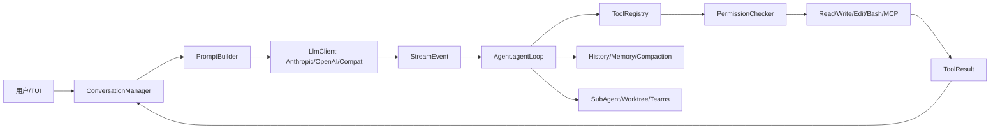
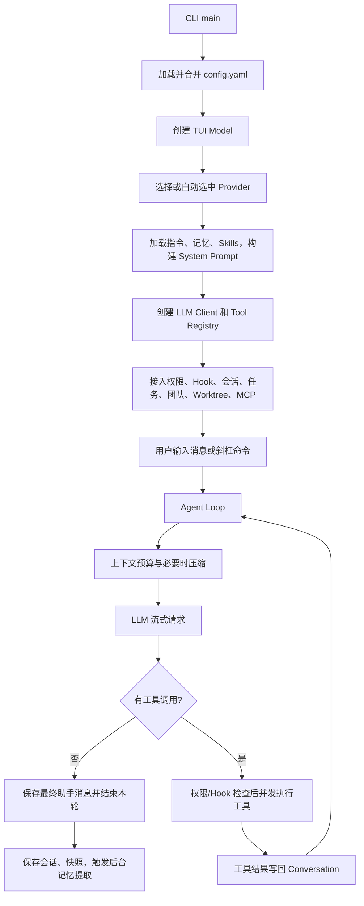
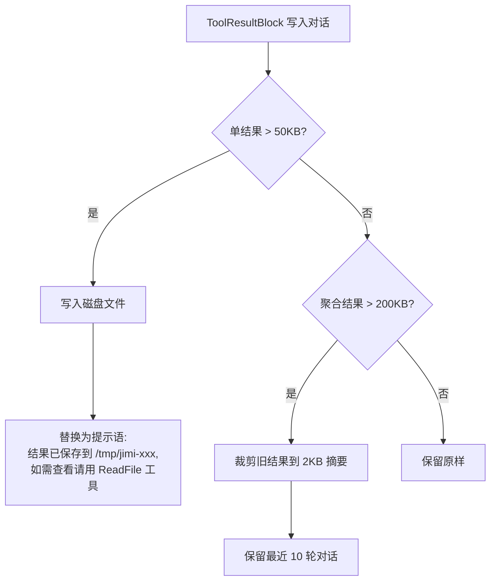
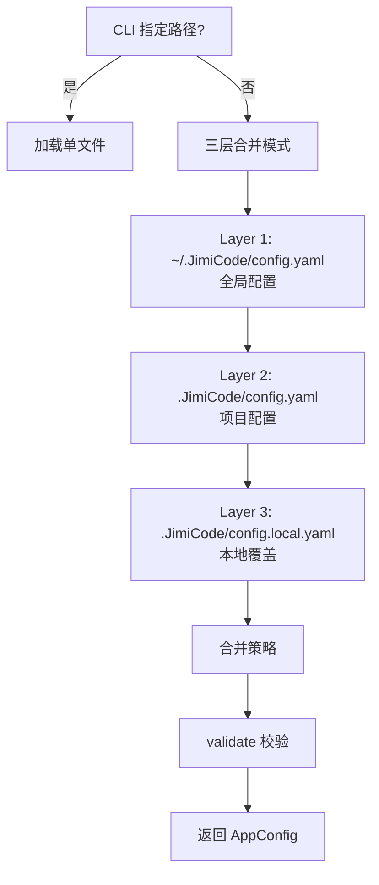

# JiMI Code 整合学习文档：06-构建测试部署面试与附录.md

> 本文由 `docs/` 与 `study-notes/` 下的教材按段落级别整理生成。原始文件不删除；相同段落在本主题内只保留一次，保留版本最完整或最接近课程主线的那一段，其余来源记录在末尾的合并审计中。内容涉及当前源码时以 `jimi-code` 工作区为准；对 Claude Code 的描述只代表公开体验对标。

## 本主题的融合说明

本主题按“课程概念 → jimicode 源码 → 实验/排障 → 面试与边界”排序。段落之间出现同一事实时，优先保留包含真实路径、调用关系或失败处理的版本；只有标题/目录性质的短段被折叠。

> 来源：`docs/course/16-第16章-回顾与展望.md`

### 16. 第16章：回顾与展望，从一个空壳到一支团队

> 来源：`docs/course/16-第16章-回顾与展望.md`

回顾前 15 章的能力演进，识别架构债务，并规划从课程项目到生产级 Agent 的进阶路线。

> 来源：`docs/course/16-第16章-回顾与展望.md`

功能越来越多但边界混乱；核心类被 provider/CLI/团队逻辑污染；没有指标无法证明改进；失败不可恢复；安全策略散落在 Prompt。

> 来源：`docs/course/16-第16章-回顾与展望.md`

成熟 Agent 是能力、控制和证据的组合：模型能力、工具执行、状态恢复、权限治理、可观测性、成本管理和协作协议缺一不可。

> 来源：`docs/course/16-第16章-回顾与展望.md`

| 对比维度 | 本章能力 | 上一章能力 | 下一章依赖 |
|---|---|---|---|
| 输入 | 结构化、可校验的本章对象 | 上一层输出 | 为下一层提供稳定契约 |
| 控制 | 明确的状态/权限/预算 | 规则较少 | 可观测、可恢复、可扩展 |
| 失败 | 分类、可见、可恢复 | 可能只返回错误文本 | 由后续治理层接管 |

> 来源：`docs/course/16-第16章-回顾与展望.md`


> 来源：`docs/course/16-第16章-回顾与展望.md`

**本章实际链路**：空壳 → Provider → Tool → Loop → Prompt → Permission → MCP → Context → Memory → Slash/Skill/Hook → SubAgent → Worktree → Teams → 可治理系统

> 来源：`docs/course/16-第16章-回顾与展望.md`

能力地图、契约、指标、技术债、风险登记、测试矩阵、版本/迁移策略。

> 来源：`docs/course/16-第16章-回顾与展望.md`

| 字段 | 生产者 | 消费者 | 失败时必须保留 |
|---|---|---|---|
| 身份/名称 | 配置或注册表 | Agent/Provider/UI | 原始值与规范化值 |
| 参数/内容 | 用户、模型或工具 | 下一阶段模块 | 校验错误与来源 |
| 状态 | 编排器/持久化层 | 恢复、审计、UI | 转移前后状态 |
| 结果 | 本章实现 | Conversation/父任务 | 成功、错误、耗时 |

> 来源：`docs/course/16-第16章-回顾与展望.md`

回看 `JimiCode.java`、`Agent.java`、`LlmClient.java`、`ToolRegistry.java`、`PermissionChecker.java`、`ContextCompactor.java`、`MemoryManager.java`、`CommandRegistry.java`、`SkillCatalog.java`、`HookEngine.java`、`SubAgentTaskManager.java`、`WorktreeManager.java` 和 `TeamManager.java`。把它们按“入口、编排、适配、能力、安全、状态、协作、呈现”重新分层，检查是否有反向依赖。

> 来源：`docs/course/16-第16章-回顾与展望.md`

当前项目的进阶技术债可能包括：Provider 错误分类和重试策略还需系统化；文件协议需要更强原子性和锁；Teams 的 mailbox 需要 ack/重放；本地 session 与多实例部署不兼容；指标（首 token、tool latency、compaction ratio、失败率、成本）需要统一埋点；权限规则需要版本化和审计查询；前端/CLI 事件模型需要稳定 schema。

> 来源：`docs/course/16-第16章-回顾与展望.md`

展望路线可以分成四条：可观测性（结构化 event、OpenTelemetry、trace replay）；可靠性（幂等、CAS、恢复、熔断、限流）；安全（沙箱、策略即代码、秘密管理、供应链审核）；评测（任务集、工具选择准确性、补丁正确率、回滚率和人工接管率）。任何“提升”都要有基线、样本和测量方法。

> 来源：`docs/course/16-第16章-回顾与展望.md`

反模式一是用更多 Agent 掩盖单 Agent 契约不清；反模式二是只追求 Demo 成功，不测试失败和恢复；反模式三是把闭源产品行为猜测写成事实。

> 来源：`docs/course/16-第16章-回顾与展望.md`

- 不要用自然语言约束替代可执行的系统边界。
- 不要吞掉异常、取消或拒绝事件。
- 不要在没有测试和回滚点的真实仓库执行破坏性操作。

> 来源：`docs/course/16-第16章-回顾与展望.md`

**目标**：画一张包含前 15 章的总架构图，为每条箭头写输入/输出契约。

> 来源：`docs/course/16-第16章-回顾与展望.md`

**步骤**：在临时仓库或 mock 环境中准备输入；运行最小命令；保存事件、日志和 Git diff；重复一次失败条件。

> 来源：`docs/course/16-第16章-回顾与展望.md`

**预期现象**：能看到本章对应的状态变化，而不是只得到最终文本。

> 来源：`docs/course/16-第16章-回顾与展望.md`

**成功标准**：结果可复现、失败可解释、没有越过工作区和权限边界。

> 来源：`docs/course/16-第16章-回顾与展望.md`

**常见报错**：环境、路径、依赖、超时或配置错误；先看本章排障表，再沿源码调用者反查。

> 来源：`docs/course/16-第16章-回顾与展望.md`

**目标**：建立最小评测集：只读问答、单文件修改、测试修复、权限拒绝、压缩恢复、子任务取消；记录基线和改进。

> 来源：`docs/course/16-第16章-回顾与展望.md`

模块互相引用→用依赖图和包扫描；指标缺失→查 AgentEvent/Hook/trace；恢复失败→检查 state/history/tool ids；安全绕过→从 Prompt 追到 Permission/handler；性能退化→比较 provider usage 和本地耗时。

> 来源：`docs/course/16-第16章-回顾与展望.md`

涉及文件、命令、网络、MCP、记忆、Hook 或并发时，统一使用临时仓库、最小权限、明确 workdir、超时、输出上限、审计和 Git 回滚点。任何示例数字标记“示例/需实测”；不在真实环境执行删除、覆盖、迁移或未知脚本。

> 来源：`docs/course/16-第16章-回顾与展望.md`

### 题 1：如何判断 Agent 架构是否成熟？

> 来源：`docs/course/16-第16章-回顾与展望.md`

**回答提纲**：先给概念定义，再引用一个 jimicode 文件/类，说明一次取舍和一个失败场景。**加分点**：能讲测试、指标和边界。
### 题 2：最重要的技术债是什么？

> 来源：`docs/course/16-第16章-回顾与展望.md`

**回答提纲**：先给概念定义，再引用一个 jimicode 文件/类，说明一次取舍和一个失败场景。**加分点**：能讲测试、指标和边界。
### 题 3：如何设计 Agent 评测？

> 来源：`docs/course/16-第16章-回顾与展望.md`

**回答提纲**：先给概念定义，再引用一个 jimicode 文件/类，说明一次取舍和一个失败场景。**加分点**：能讲测试、指标和边界。
### 题 4：多 Agent 是否一定优于单 Agent？

> 来源：`docs/course/16-第16章-回顾与展望.md`

**回答提纲**：先给概念定义，再引用一个 jimicode 文件/类，说明一次取舍和一个失败场景。**加分点**：能讲测试、指标和边界。

> 来源：`docs/course/16-第16章-回顾与展望.md`

- [ ] 我能解释本章能力在全链路中的位置
- [ ] 我能解释一个真实失败场景及排查路径
- [ ] 我能解释关键数据结构的生产者和消费者
- [ ] 我能解释至少一个源码文件和调用者
- [ ] 我能解释一个安全/性能取舍

> 来源：`docs/course/16-第16章-回顾与展望.md`

本章建立的契约会被下一章消费：面试求职全攻略 只有在输入、状态、失败和权限边界明确后才不会把复杂度继续放大。

> 来源：`docs/course/16-第16章-回顾与展望.md`

### FAQ 1：课程项目能直接生产吗？需要补齐安全、持久化、观测、部署和评测。

> 来源：`docs/course/16-第16章-回顾与展望.md`

以当前项目源码和测试为准；第三方或闭源行为要明确标注边界。
### FAQ 2：为什么要记录失败率而不只看成功案例？失败决定真实维护成本。

> 来源：`docs/course/16-第16章-回顾与展望.md`

先用最小实验复现，再沿事件、日志、状态和调用者逐层定位。
### FAQ 3：下一步先做哪个方向？优先补安全、可恢复性和评测，再扩展成员数。

> 来源：`docs/course/16-第16章-回顾与展望.md`

可以，但要保留权限、超时、输出上限和可回滚机制。

> 来源：`docs/course/16-第16章-回顾与展望.md`

从当前章节的真实入口开始：空壳 → Provider → Tool → Loop → Prompt → Permission → MCP → Context → Memory → Slash/Skill/Hook → SubAgent → Worktree → Teams → 可治理系统。打开链路中的第一个 jimicode 类，记录构造器参数、字段初始化和直接调用者；再向后追踪一个结果对象的消费点。不要只搜索类名，要搜索方法调用和事件类型。

> 来源：`docs/course/16-第16章-回顾与展望.md`

本章的输入不能只写成“用户问题”。应拆成配置输入、自然语言输入、模型结构化输入、文件/进程输入和上游模块状态。对每一种输入写明允许为空的字段、长度上限、编码、来源和校验时机。能力地图、契约、指标、技术债、风险登记、测试矩阵、版本/迁移策略。 中出现的身份、参数和状态字段都要在进入下一层前规范化。

> 来源：`docs/course/16-第16章-回顾与展望.md`

把状态画成有限状态机：初始、准备、执行、等待确认、成功、失败、取消、恢复。每次转移记录触发事件、允许的前置状态、持久化动作和用户可见反馈。若代码使用 enum、record 或布尔字段表达状态，要检查是否存在互斥状态同时为 true 的问题。

> 来源：`docs/course/16-第16章-回顾与展望.md`

对每个公开方法至少做三次反查：谁创建对象、谁调用方法、谁处理返回值/异常。若返回集合，检查调用方是否修改它；若返回异步对象，检查是否真正订阅；若返回路径或命令，检查调用方是否再次做安全校验。

> 来源：`docs/course/16-第16章-回顾与展望.md`

将本章失败拆成输入错误、依赖错误、业务拒绝、超时、取消、部分成功和持久化失败。针对当前主题 `面试求职全攻略` 的前置依赖，写出“失败后能否重试、是否幂等、是否需要人工确认、是否需要回滚”的结论。

> 来源：`docs/course/16-第16章-回顾与展望.md`

至少记录关联 id、阶段、耗时、结果状态和错误类别。不要在日志中记录 API key、完整 Authorization、未脱敏工具参数或整段私有代码。TUI 需要用户可读消息，调试日志需要开发者上下文，两者可以来自同一个事件但不应共享不安全文本。

> 来源：`docs/course/16-第16章-回顾与展望.md`

确认本章对象是进程级、Agent 级、会话级、turn 级还是方法级状态。对可变集合、文件、队列和外部进程分别考虑竞态；不要因为方法加了 synchronized 就认为跨进程安全，也不要把虚拟线程误解成无限资源。

> 来源：`docs/course/16-第16章-回顾与展望.md`

为 CPU、内存、网络、token、文件读取和输出设置上限。上限达到时返回可解释的错误或降级结果，不能静默截断关键协议字段。若本章涉及重试，退避和最大次数必须与总预算一起设计。

> 来源：`docs/course/16-第16章-回顾与展望.md`

单元测试验证纯函数和边界；集成测试验证文件、进程或 HTTP；契约测试验证 provider/Tool/MCP 字段；回归测试固定一个曾经失败的用户故事。测试数据使用虚构密钥、临时目录和固定时间，不依赖个人机器状态。

> 来源：`docs/course/16-第16章-回顾与展望.md`

错误设计通常表现为：把所有逻辑放在一个巨型类；把异常转成空字符串；让模型决定权限；让 UI 直接修改核心状态；让外部脚本绕过统一工具入口。正确设计应保持单向依赖、结构化结果、独立权限、事件通知和可回滚副作用。

> 来源：`docs/course/16-第16章-回顾与展望.md`

先实现最小 happy path，再加入参数校验、错误封装、超时、取消、审计、恢复和测试。每一步保留可运行提交，避免一次性重写多个模块而无法定位回归。

> 来源：`docs/course/16-第16章-回顾与展望.md`

回到上一章的输出，确认本章没有重新发明同一数据结构。例如上一章已经定义 Message/Tool/Provider 时，本章应复用其契约，而不是在新模块中创建第二套近似类型。

> 来源：`docs/course/16-第16章-回顾与展望.md`

下一步是 `面试求职全攻略`。提前列出本章必须对外稳定的字段和事件；如果下一章要并发、压缩或扩展，本章的 id、版本、错误和取消语义必须先固定。

> 来源：`docs/course/16-第16章-回顾与展望.md`

完成本章后，提交一页设计记录：问题、方案、替代方案、源码证据、测试、已知限制、后续改进。评审者应能仅凭这页记录复现你的实验，而不是依赖口头解释。

> 来源：`docs/course/16-第16章-回顾与展望.md`

审查时逐条问：输入是否来自不可信源？副作用前是否授权？失败是否可见？重试是否幂等？取消是否传播？状态是否持久化？日志是否脱敏？测试是否覆盖空值、重复、超时和恢复？

> 来源：`docs/course/16-第16章-回顾与展望.md`

回答面试题时先给一句定义，再讲当前项目文件和方法，接着讲一个取舍和失败案例，最后说如何测试。不要只罗列框架名，也不要把示例数字说成生产指标。

> 来源：`docs/course/16-第16章-回顾与展望.md`

把本章放回完整闭环：空壳 → Provider → Tool → Loop → Prompt → Permission → MCP → Context → Memory → Slash/Skill/Hook → SubAgent → Worktree → Teams → 可治理系统。如果删除本章能力，系统会在这些地方退化：功能越来越多但边界混乱；核心类被 provider/CLI/团队逻辑污染；没有指标无法证明改进；失败不可恢复；安全策略散落在 Prompt。。如果增强本章能力，优先增强契约、测试、可观测性和安全边界，再考虑增加模型或 Agent 数量。最后用一个真实但隔离的实验验证“输入—状态—结果—失败—恢复”五个维度，并把证据保存到学习笔记。
## 综合案例与边界演练

> 来源：`docs/course/16-第16章-回顾与展望.md`

### 场景 1：最小成功路径：使用固定输入、单一依赖和一个工具完成一次操作，记录从入口到结果的每个对象。

> 来源：`docs/course/16-第16章-回顾与展望.md`

本章的具体检查点是：成熟 Agent 是能力、控制和证据的组合：模型能力、工具执行、状态恢复、权限治理、可观测性、成本管理和协作协议缺一不可。 生产的输入必须经过本章状态和权限边界，再形成 面试求职全攻略 可以消费的结果。实验结束后保存命令、事件、日志、测试、diff 和限制说明。

> 来源：`docs/course/16-第16章-回顾与展望.md`

### 场景 2：空值路径：删除可选字段、返回空集合或让模型不给出内容，确认系统使用默认值、明确错误还是安全退出。

> 来源：`docs/course/16-第16章-回顾与展望.md`

### 场景 3：重复路径：重复提交同一个请求、toolUseId、命令或消息，检查是否幂等、去重或要求人工确认。

> 来源：`docs/course/16-第16章-回顾与展望.md`

### 场景 4：超时路径：让网络、脚本、文件或子任务延迟，检查 timeout、取消、资源释放和用户提示。

> 来源：`docs/course/16-第16章-回顾与展望.md`

### 场景 5：部分成功路径：让多个动作中只有一部分成功，确认结果如何汇总、是否需要补偿或回滚。

> 来源：`docs/course/16-第16章-回顾与展望.md`

### 场景 6：权限路径：使用只读、询问和拒绝三种模式，确保决策发生在副作用之前且结果可审计。

> 来源：`docs/course/16-第16章-回顾与展望.md`

### 场景 7：恢复路径：在关键状态写入前后模拟进程退出，重新启动后检查状态、消息顺序和重复执行风险。

> 来源：`docs/course/16-第16章-回顾与展望.md`

### 场景 8：观测路径：为一次操作关联 id、阶段、耗时和错误类别，确认 UI、日志和 trace 的信息粒度不同但事实一致。

> 来源：`docs/course/16-第16章-回顾与展望.md`

### 场景 9：兼容路径：替换 provider、工具实现或配置版本，确认核心契约不需要大面积改动。

> 来源：`docs/course/16-第16章-回顾与展望.md`

### 场景 10：评审路径：邀请另一位同学只看文档和证据复现实验，记录他无法理解或无法复现的地方。

> 来源：`docs/course/16-第16章-回顾与展望.md`

围绕本章的实际链路 `空壳 → Provider → Tool → Loop → Prompt → Permission → MCP → Context → Memory → Slash/Skill/Hook → SubAgent → Worktree → Teams → 可治理系统`，在源码中定位一个具体类/方法，写出它的输入、输出、状态、调用者和失败处理。然后在隔离环境执行一个最小验证，保存测试/日志/diff；如果无法从当前仓库证实，明确写【待源码确认】。针对 `面试求职全攻略` 的后续能力，补充说明该契约为什么必须稳定、哪些字段不能随意改名，以及发生故障时如何向用户解释。

> 来源：`docs/course/17-第17章-面试求职全攻略.md`

把真实完成的 JiMI Code 学习与改造工作转换为诚实、可深挖的简历、STAR 故事、演示和面试答题。

> 来源：`docs/course/17-第17章-面试求职全攻略.md`

把自研项目写成 Anthropic 官方；夸大成功率和成本收益；只会背架构图不会解释源码；无法说明失败和安全边界；演示依赖临时网络导致现场翻车。

> 来源：`docs/course/17-第17章-面试求职全攻略.md`

项目表达的核心是事实、范围、贡献、证据和边界。STAR（Situation/Task/Action/Result）要对应真实提交、测试和演示，不写无法证明的“生产级”“零误报”。

> 来源：`docs/course/17-第17章-面试求职全攻略.md`

**本章实际链路**：项目事实 → 贡献拆分 → 技术证据 → STAR 故事 → 5/15 分钟演示 → 深挖题 → 风险与诚实边界

> 来源：`docs/course/17-第17章-面试求职全攻略.md`

项目一句话、职责、技术栈、源码路径、测试证据、指标（实测/示例）、风险、后续计划。

> 来源：`docs/course/17-第17章-面试求职全攻略.md`

推荐项目表述：“独立学习并改造 JiMI Code，一个 Java 21 + Maven 的仿 Claude Code 终端 Coding Agent 课程项目；负责/实现了工具注册、权限确认、上下文压缩或 SubAgent 等模块，使用 JUnit 和隔离仓库验证边界。”不要写“参与 Claude Code 内部研发”。

> 来源：`docs/course/17-第17章-面试求职全攻略.md`

5 分钟讲解结构：30 秒项目定位；60 秒用户问题；90 秒主链路；60 秒一个深挖点（例如 ToolUse id/权限/压缩）；40 秒实验和结果；20 秒局限与下一步。15 分钟讲解再加入源码路径、失败演练、依赖选择、测试矩阵和取舍。

> 来源：`docs/course/17-第17章-面试求职全攻略.md`

40 道深挖题可按四组准备：基础（Coding Agent、Provider、Message、Tool、Loop）；安全（Permission、路径、MCP、秘密）；可靠性（Compaction、Memory、恢复、取消、Worktree）；协作（SubAgent、Teams、邮箱、成本）。每题准备“结论—源码证据—取舍—失败案例—改进”五句答案。

> 来源：`docs/course/17-第17章-面试求职全攻略.md`

反模式一是把“课程项目”包装成大厂内部系统；反模式二是回答中只讲名词不讲路径和测试；反模式三是用未经测量的数字证明效果。

> 来源：`docs/course/17-第17章-面试求职全攻略.md`

**目标**：录制一次 5 分钟本地演示：启动、只读分析、一次确认、输出 diff；准备离线 mock 方案。

> 来源：`docs/course/17-第17章-面试求职全攻略.md`

**目标**：让同学随机抽 10 道深挖题，要求每题引用一个真实类/方法和一个失败场景。

> 来源：`docs/course/17-第17章-面试求职全攻略.md`

演示网络失败→使用 mock/录屏；被问贡献不清→准备 commit/测试；数字被追问→区分示例与实测；被问官方关系→明确自研/对标边界；源码答不上→回到 05/06 方法级文档。

> 来源：`docs/course/17-第17章-面试求职全攻略.md`

### 题 1：请用 STAR 讲一个权限设计？

> 来源：`docs/course/17-第17章-面试求职全攻略.md`

**回答提纲**：先给概念定义，再引用一个 jimicode 文件/类，说明一次取舍和一个失败场景。**加分点**：能讲测试、指标和边界。
### 题 2：为什么选 Java 21 虚拟线程？

> 来源：`docs/course/17-第17章-面试求职全攻略.md`

**回答提纲**：先给概念定义，再引用一个 jimicode 文件/类，说明一次取舍和一个失败场景。**加分点**：能讲测试、指标和边界。
### 题 3：你如何证明上下文压缩有效？

> 来源：`docs/course/17-第17章-面试求职全攻略.md`

**回答提纲**：先给概念定义，再引用一个 jimicode 文件/类，说明一次取舍和一个失败场景。**加分点**：能讲测试、指标和边界。
### 题 4：这个项目离生产还差什么？

> 来源：`docs/course/17-第17章-面试求职全攻略.md`

**回答提纲**：先给概念定义，再引用一个 jimicode 文件/类，说明一次取舍和一个失败场景。**加分点**：能讲测试、指标和边界。
### 题 5：如果重做你会先改哪里？

> 来源：`docs/course/17-第17章-面试求职全攻略.md`

本章建立的契约会被下一章消费：附录 A 只有在输入、状态、失败和权限边界明确后才不会把复杂度继续放大。

> 来源：`docs/course/17-第17章-面试求职全攻略.md`

### FAQ 1：项目没有上线能写简历吗？可以，诚实写课程/自研和验证范围。

> 来源：`docs/course/17-第17章-面试求职全攻略.md`

以当前项目源码和测试为准；第三方或闭源行为要明确标注边界。
### FAQ 2：没有量化指标怎么办？写测试覆盖、失败案例和可复现实验，不编数字。

> 来源：`docs/course/17-第17章-面试求职全攻略.md`

先用最小实验复现，再沿事件、日志、状态和调用者逐层定位。
### FAQ 3：面试官问 Claude Code 内部实现怎么办？说明不可见，不猜，转而讲公开体验和 jimicode 源码。

> 来源：`docs/course/17-第17章-面试求职全攻略.md`

从当前章节的真实入口开始：项目事实 → 贡献拆分 → 技术证据 → STAR 故事 → 5/15 分钟演示 → 深挖题 → 风险与诚实边界。打开链路中的第一个 jimicode 类，记录构造器参数、字段初始化和直接调用者；再向后追踪一个结果对象的消费点。不要只搜索类名，要搜索方法调用和事件类型。

> 来源：`docs/course/17-第17章-面试求职全攻略.md`

本章的输入不能只写成“用户问题”。应拆成配置输入、自然语言输入、模型结构化输入、文件/进程输入和上游模块状态。对每一种输入写明允许为空的字段、长度上限、编码、来源和校验时机。项目一句话、职责、技术栈、源码路径、测试证据、指标（实测/示例）、风险、后续计划。 中出现的身份、参数和状态字段都要在进入下一层前规范化。

> 来源：`docs/course/17-第17章-面试求职全攻略.md`

将本章失败拆成输入错误、依赖错误、业务拒绝、超时、取消、部分成功和持久化失败。针对当前主题 `附录 A` 的前置依赖，写出“失败后能否重试、是否幂等、是否需要人工确认、是否需要回滚”的结论。

> 来源：`docs/course/17-第17章-面试求职全攻略.md`

下一步是 `附录 A`。提前列出本章必须对外稳定的字段和事件；如果下一章要并发、压缩或扩展，本章的 id、版本、错误和取消语义必须先固定。

> 来源：`docs/course/17-第17章-面试求职全攻略.md`

把本章放回完整闭环：项目事实 → 贡献拆分 → 技术证据 → STAR 故事 → 5/15 分钟演示 → 深挖题 → 风险与诚实边界。如果删除本章能力，系统会在这些地方退化：把自研项目写成 Anthropic 官方；夸大成功率和成本收益；只会背架构图不会解释源码；无法说明失败和安全边界；演示依赖临时网络导致现场翻车。。如果增强本章能力，优先增强契约、测试、可观测性和安全边界，再考虑增加模型或 Agent 数量。最后用一个真实但隔离的实验验证“输入—状态—结果—失败—恢复”五个维度，并把证据保存到学习笔记。
## 综合案例与边界演练

> 来源：`docs/course/17-第17章-面试求职全攻略.md`

本章的具体检查点是：项目表达的核心是事实、范围、贡献、证据和边界。STAR（Situation/Task/Action/Result）要对应真实提交、测试和演示，不写无法证明的“生产级”“零误报”。 生产的输入必须经过本章状态和权限边界，再形成 附录 A 可以消费的结果。实验结束后保存命令、事件、日志、测试、diff 和限制说明。

> 来源：`docs/course/17-第17章-面试求职全攻略.md`

围绕本章的实际链路 `项目事实 → 贡献拆分 → 技术证据 → STAR 故事 → 5/15 分钟演示 → 深挖题 → 风险与诚实边界`，在源码中定位一个具体类/方法，写出它的输入、输出、状态、调用者和失败处理。然后在隔离环境执行一个最小验证，保存测试/日志/diff；如果无法从当前仓库证实，明确写【待源码确认】。针对 `附录 A` 的后续能力，补充说明该契约为什么必须稳定、哪些字段不能随意改名，以及发生故障时如何向用户解释。

> 来源：`docs/course/最终复习-一页纸速查.md`

> 本页用于复习和面试前快速回忆，不替代各章正文。JiMI Code 是 Java 21 + Maven 的自研、仿 Claude Code 理念的终端 Coding Agent，不是 Anthropic 官方实现。

> 来源：`docs/course/最终复习-一页纸速查.md`

Coding Agent = 在软件工程环境中接收任务、读取项目上下文、调用受控工具、观察结果、继续多轮推理，并在权限和回滚边界内产生代码/环境变化的智能体。

> 来源：`docs/course/最终复习-一页纸速查.md`



> 来源：`docs/course/最终复习-一页纸速查.md`

| 能力 | 真实路径 | 记忆要点 |
|---|---|---|
| 启动 | `src/main/java/com/jimicode/JimiCode.java` | 配置、权限、TUI、SIGINT、finally 恢复光标 |
| 配置 | `config/ConfigLoader.java` | 显式路径、候选文件、SnakeYAML、校验和合并 |
| Agent Loop | `agent/Agent.java` | 虚拟线程、BlockingQueue、iteration、取消、压缩 |
| 消息 | `conversation/Message.java` | 角色、内容块、顺序、toolUseId |
| 模型 | `llm/LlmClient.java` 与三个实现 | provider-neutral、流式 StreamEvent、usage |
| 工具 | `tool/Tool.java`、`ToolRegistry.java` | schema、注册、过滤、分发、结果 |
| 权限 | `permission/PermissionChecker.java` | allow/ask/deny、模式、确认、路径约束 |
| Prompt | `prompt/PromptBuilder.java` | 稳定前缀、规则、工具、记忆、计划 |
| 压缩 | `compact/ContextCompactor.java` | token/字符预算、Layer1/Layer2、恢复附件 |
| 记忆 | `memory/MemoryScanner.java` 等 | session 与长期 memory 的边界 |
| Slash | `command/CommandRegistry.java` | 确定性控制入口、CommandContext |
| Skill | `skill/SkillCatalog.java` 等 | 文档/SOP/脚本、渐进披露 |
| Hook | `hook/HookEngine.java` | 生命周期、阻断/非阻断、审计 |
| SubAgent | `subagent/SubAgentTaskManager.java` | 状态、任务、虚拟线程、通知、取消 |
| Worktree | `worktree/WorktreeManager.java` | Git 隔离、分支、diff、清理 |
| Teams | `teams/TeamManager.java` | 成员、邮箱、任务状态、人类主管 |

> 来源：`docs/course/最终复习-一页纸速查.md`

模型产生 `ToolUseBlock`；Agent 根据名称访问 `ToolRegistry`；PermissionChecker 在 handler 前裁决；Tool 产生 `ToolResult`/`ToolResultBlock`；结果追加回 `ConversationManager`；下一轮模型消费观察。`toolUseId` 是调用与结果、压缩、恢复、审计之间的关联键，不能随意丢弃或重写。

> 来源：`docs/course/最终复习-一页纸速查.md`

1. 这个动作有没有副作用？
2. 路径是否位于 workDir root，是否经过 normalize/realpath？
3. 是否需要一次性确认、会话允许或永久规则？
4. 用户拒绝、工具失败、进程中断后，状态和审计如何落盘？

> 来源：`docs/course/最终复习-一页纸速查.md`

Prompt 只能表达原则，PermissionChecker、Tool handler、工作区限制和 Git 回滚才是强制边界。

> 来源：`docs/course/最终复习-一页纸速查.md`

1. 使用了 provider 真实 usage 还是字符估算？
2. 系统规则、当前任务、未完成 ToolUse 和恢复附件是否保留？
3. 大型 ToolResult 是否先做稳定替换？
4. 压缩失败时是保留原会话、降级还是明确停止？

> 来源：`docs/course/最终复习-一页纸速查.md`

- Agent 实例是否线程安全？当前 `Agent`/TUI 状态通常按调用或实例隔离。
- 子 Agent 是否独立 conversation、工具过滤和 maxTurns？
- Worktree 是否真的隔离了文件系统？
- FileMailBox/TaskStore 是否支持原子写、唯一 id、ack、重放和清理？

> 来源：`docs/course/最终复习-一页纸速查.md`

- 把 jimicode 写成 Claude Code 官方实现。
- 把所有工具合成 `run(command)`。
- 只靠 Prompt 阻止危险操作。
- 无限 Agent Loop，没有 maxIterations/timeout/cancel。
- 把完整日志和文件全部塞进上下文。
- 只写最终答案，不保存 ToolResult、diff 和失败事件。
- 在真实仓库直接测试删除、迁移和未知脚本。
- 用未经实测的数字描述成功率、节省 token 或性能提升。

> 来源：`docs/course/最终复习-一页纸速查.md`

使用临时 Git 仓库；配置只读 provider；先用 Glob/Grep/ReadFile 分析；写文件进入 PLAN/ASK；确认后做最小 EditFile；运行固定测试；查看 `git diff`；故意制造失败和 Ctrl-C；删除临时目录前确认无未提交数据。实验记录包括版本、输入、事件、日志、diff、结果和限制。

> 来源：`docs/course/最终复习-一页纸速查.md`

定义概念 → 引用源码路径 → 描述调用链 → 讲一个取舍/失败 → 说明测试和限制。

> 来源：`docs/course/最终复习-一页纸速查.md`

当前 POM 的核心技术事实：Java 21、Maven、TUI4J、Mordant、MCP SDK、Anthropic Java SDK、OpenAI Java SDK、SnakeYAML、Jackson、JUnit。第三方 SDK 内部实现不属于本项目源码；对其行为只说明当前调用契约。

> 来源：`docs/course/最终复习-一页纸速查.md`

能在 5 分钟内画出总链路；能解释一次 ToolUse 的完整生命周期；能说出配置错误、权限拒绝、SSE 断裂、压缩失败、子任务取消和 worktree 冲突的处理方式；能为简历中的每个亮点提供源码、测试或实验依据。

> 来源：`docs/course/最终复习-一页纸速查.md`

复习 `入口定位` 时，先用一句话说明它在 `全链路速查` 中的位置，再打开一个真实源码文件或课程章节确认字段和调用者。写出正常路径、一个失败路径和一个恢复/回滚动作；把测试命令、事件顺序、日志摘要和 Git diff 保存下来。不要把模型自然语言当成事实，也不要把未测量的数字当成项目指标。

> 来源：`docs/course/最终复习-一页纸速查.md`

复习 `配置优先级` 时，先用一句话说明它在 `全链路速查` 中的位置，再打开一个真实源码文件或课程章节确认字段和调用者。写出正常路径、一个失败路径和一个恢复/回滚动作；把测试命令、事件顺序、日志摘要和 Git diff 保存下来。不要把模型自然语言当成事实，也不要把未测量的数字当成项目指标。

> 来源：`docs/course/最终复习-一页纸速查.md`

复习 `Provider 抽象` 时，先用一句话说明它在 `全链路速查` 中的位置，再打开一个真实源码文件或课程章节确认字段和调用者。写出正常路径、一个失败路径和一个恢复/回滚动作；把测试命令、事件顺序、日志摘要和 Git diff 保存下来。不要把模型自然语言当成事实，也不要把未测量的数字当成项目指标。

> 来源：`docs/course/最终复习-一页纸速查.md`

复习 `消息角色` 时，先用一句话说明它在 `全链路速查` 中的位置，再打开一个真实源码文件或课程章节确认字段和调用者。写出正常路径、一个失败路径和一个恢复/回滚动作；把测试命令、事件顺序、日志摘要和 Git diff 保存下来。不要把模型自然语言当成事实，也不要把未测量的数字当成项目指标。

> 来源：`docs/course/最终复习-一页纸速查.md`

复习 `流式帧` 时，先用一句话说明它在 `全链路速查` 中的位置，再打开一个真实源码文件或课程章节确认字段和调用者。写出正常路径、一个失败路径和一个恢复/回滚动作；把测试命令、事件顺序、日志摘要和 Git diff 保存下来。不要把模型自然语言当成事实，也不要把未测量的数字当成项目指标。

> 来源：`docs/course/最终复习-一页纸速查.md`

复习 `Tool schema` 时，先用一句话说明它在 `全链路速查` 中的位置，再打开一个真实源码文件或课程章节确认字段和调用者。写出正常路径、一个失败路径和一个恢复/回滚动作；把测试命令、事件顺序、日志摘要和 Git diff 保存下来。不要把模型自然语言当成事实，也不要把未测量的数字当成项目指标。

> 来源：`docs/course/最终复习-一页纸速查.md`

复习 `ToolUse id` 时，先用一句话说明它在 `全链路速查` 中的位置，再打开一个真实源码文件或课程章节确认字段和调用者。写出正常路径、一个失败路径和一个恢复/回滚动作；把测试命令、事件顺序、日志摘要和 Git diff 保存下来。不要把模型自然语言当成事实，也不要把未测量的数字当成项目指标。

> 来源：`docs/course/最终复习-一页纸速查.md`

复习 `ToolResult` 时，先用一句话说明它在 `全链路速查` 中的位置，再打开一个真实源码文件或课程章节确认字段和调用者。写出正常路径、一个失败路径和一个恢复/回滚动作；把测试命令、事件顺序、日志摘要和 Git diff 保存下来。不要把模型自然语言当成事实，也不要把未测量的数字当成项目指标。

> 来源：`docs/course/最终复习-一页纸速查.md`

复习 `Agent iteration` 时，先用一句话说明它在 `全链路速查` 中的位置，再打开一个真实源码文件或课程章节确认字段和调用者。写出正常路径、一个失败路径和一个恢复/回滚动作；把测试命令、事件顺序、日志摘要和 Git diff 保存下来。不要把模型自然语言当成事实，也不要把未测量的数字当成项目指标。

> 来源：`docs/course/最终复习-一页纸速查.md`

复习 `终止条件` 时，先用一句话说明它在 `全链路速查` 中的位置，再打开一个真实源码文件或课程章节确认字段和调用者。写出正常路径、一个失败路径和一个恢复/回滚动作；把测试命令、事件顺序、日志摘要和 Git diff 保存下来。不要把模型自然语言当成事实，也不要把未测量的数字当成项目指标。

> 来源：`docs/course/最终复习-一页纸速查.md`

复习 `权限模式` 时，先用一句话说明它在 `全链路速查` 中的位置，再打开一个真实源码文件或课程章节确认字段和调用者。写出正常路径、一个失败路径和一个恢复/回滚动作；把测试命令、事件顺序、日志摘要和 Git diff 保存下来。不要把模型自然语言当成事实，也不要把未测量的数字当成项目指标。

> 来源：`docs/course/最终复习-一页纸速查.md`

复习 `路径 root` 时，先用一句话说明它在 `全链路速查` 中的位置，再打开一个真实源码文件或课程章节确认字段和调用者。写出正常路径、一个失败路径和一个恢复/回滚动作；把测试命令、事件顺序、日志摘要和 Git diff 保存下来。不要把模型自然语言当成事实，也不要把未测量的数字当成项目指标。

> 来源：`docs/course/最终复习-一页纸速查.md`

复习 `敏感文件` 时，先用一句话说明它在 `全链路速查` 中的位置，再打开一个真实源码文件或课程章节确认字段和调用者。写出正常路径、一个失败路径和一个恢复/回滚动作；把测试命令、事件顺序、日志摘要和 Git diff 保存下来。不要把模型自然语言当成事实，也不要把未测量的数字当成项目指标。

> 来源：`docs/course/最终复习-一页纸速查.md`

复习 `MCP 信任` 时，先用一句话说明它在 `全链路速查` 中的位置，再打开一个真实源码文件或课程章节确认字段和调用者。写出正常路径、一个失败路径和一个恢复/回滚动作；把测试命令、事件顺序、日志摘要和 Git diff 保存下来。不要把模型自然语言当成事实，也不要把未测量的数字当成项目指标。

> 来源：`docs/course/最终复习-一页纸速查.md`

复习 `上下文预算` 时，先用一句话说明它在 `全链路速查` 中的位置，再打开一个真实源码文件或课程章节确认字段和调用者。写出正常路径、一个失败路径和一个恢复/回滚动作；把测试命令、事件顺序、日志摘要和 Git diff 保存下来。不要把模型自然语言当成事实，也不要把未测量的数字当成项目指标。

> 来源：`docs/course/最终复习-一页纸速查.md`

复习 `工具结果替换` 时，先用一句话说明它在 `全链路速查` 中的位置，再打开一个真实源码文件或课程章节确认字段和调用者。写出正常路径、一个失败路径和一个恢复/回滚动作；把测试命令、事件顺序、日志摘要和 Git diff 保存下来。不要把模型自然语言当成事实，也不要把未测量的数字当成项目指标。

> 来源：`docs/course/最终复习-一页纸速查.md`

复习 `压缩恢复` 时，先用一句话说明它在 `全链路速查` 中的位置，再打开一个真实源码文件或课程章节确认字段和调用者。写出正常路径、一个失败路径和一个恢复/回滚动作；把测试命令、事件顺序、日志摘要和 Git diff 保存下来。不要把模型自然语言当成事实，也不要把未测量的数字当成项目指标。

> 来源：`docs/course/最终复习-一页纸速查.md`

复习 `Memory scope` 时，先用一句话说明它在 `全链路速查` 中的位置，再打开一个真实源码文件或课程章节确认字段和调用者。写出正常路径、一个失败路径和一个恢复/回滚动作；把测试命令、事件顺序、日志摘要和 Git diff 保存下来。不要把模型自然语言当成事实，也不要把未测量的数字当成项目指标。

> 来源：`docs/course/最终复习-一页纸速查.md`

复习 `Slash 确定性` 时，先用一句话说明它在 `全链路速查` 中的位置，再打开一个真实源码文件或课程章节确认字段和调用者。写出正常路径、一个失败路径和一个恢复/回滚动作；把测试命令、事件顺序、日志摘要和 Git diff 保存下来。不要把模型自然语言当成事实，也不要把未测量的数字当成项目指标。

> 来源：`docs/course/最终复习-一页纸速查.md`

复习 `Skill 触发` 时，先用一句话说明它在 `全链路速查` 中的位置，再打开一个真实源码文件或课程章节确认字段和调用者。写出正常路径、一个失败路径和一个恢复/回滚动作；把测试命令、事件顺序、日志摘要和 Git diff 保存下来。不要把模型自然语言当成事实，也不要把未测量的数字当成项目指标。

> 来源：`docs/course/最终复习-一页纸速查.md`

复习 `Hook 阻断` 时，先用一句话说明它在 `全链路速查` 中的位置，再打开一个真实源码文件或课程章节确认字段和调用者。写出正常路径、一个失败路径和一个恢复/回滚动作；把测试命令、事件顺序、日志摘要和 Git diff 保存下来。不要把模型自然语言当成事实，也不要把未测量的数字当成项目指标。

> 来源：`docs/course/最终复习-一页纸速查.md`

复习 `子 Agent 状态` 时，先用一句话说明它在 `全链路速查` 中的位置，再打开一个真实源码文件或课程章节确认字段和调用者。写出正常路径、一个失败路径和一个恢复/回滚动作；把测试命令、事件顺序、日志摘要和 Git diff 保存下来。不要把模型自然语言当成事实，也不要把未测量的数字当成项目指标。

> 来源：`docs/course/最终复习-一页纸速查.md`

复习 `任务通知` 时，先用一句话说明它在 `全链路速查` 中的位置，再打开一个真实源码文件或课程章节确认字段和调用者。写出正常路径、一个失败路径和一个恢复/回滚动作；把测试命令、事件顺序、日志摘要和 Git diff 保存下来。不要把模型自然语言当成事实，也不要把未测量的数字当成项目指标。

> 来源：`docs/course/最终复习-一页纸速查.md`

复习 `Worktree 分支` 时，先用一句话说明它在 `全链路速查` 中的位置，再打开一个真实源码文件或课程章节确认字段和调用者。写出正常路径、一个失败路径和一个恢复/回滚动作；把测试命令、事件顺序、日志摘要和 Git diff 保存下来。不要把模型自然语言当成事实，也不要把未测量的数字当成项目指标。

> 来源：`docs/course/最终复习-一页纸速查.md`

复习 `Git diff` 时，先用一句话说明它在 `全链路速查` 中的位置，再打开一个真实源码文件或课程章节确认字段和调用者。写出正常路径、一个失败路径和一个恢复/回滚动作；把测试命令、事件顺序、日志摘要和 Git diff 保存下来。不要把模型自然语言当成事实，也不要把未测量的数字当成项目指标。

> 来源：`docs/course/最终复习-一页纸速查.md`

复习 `邮箱协议` 时，先用一句话说明它在 `全链路速查` 中的位置，再打开一个真实源码文件或课程章节确认字段和调用者。写出正常路径、一个失败路径和一个恢复/回滚动作；把测试命令、事件顺序、日志摘要和 Git diff 保存下来。不要把模型自然语言当成事实，也不要把未测量的数字当成项目指标。

> 来源：`docs/course/最终复习-一页纸速查.md`

复习 `人类主管` 时，先用一句话说明它在 `全链路速查` 中的位置，再打开一个真实源码文件或课程章节确认字段和调用者。写出正常路径、一个失败路径和一个恢复/回滚动作；把测试命令、事件顺序、日志摘要和 Git diff 保存下来。不要把模型自然语言当成事实，也不要把未测量的数字当成项目指标。

> 来源：`docs/course/最终复习-一页纸速查.md`

复习 `测试替身` 时，先用一句话说明它在 `全链路速查` 中的位置，再打开一个真实源码文件或课程章节确认字段和调用者。写出正常路径、一个失败路径和一个恢复/回滚动作；把测试命令、事件顺序、日志摘要和 Git diff 保存下来。不要把模型自然语言当成事实，也不要把未测量的数字当成项目指标。

> 来源：`docs/course/最终复习-一页纸速查.md`

复习 `指标实测` 时，先用一句话说明它在 `全链路速查` 中的位置，再打开一个真实源码文件或课程章节确认字段和调用者。写出正常路径、一个失败路径和一个恢复/回滚动作；把测试命令、事件顺序、日志摘要和 Git diff 保存下来。不要把模型自然语言当成事实，也不要把未测量的数字当成项目指标。

> 来源：`docs/course/最终复习-一页纸速查.md`

复习 `简历边界` 时，先用一句话说明它在 `全链路速查` 中的位置，再打开一个真实源码文件或课程章节确认字段和调用者。写出正常路径、一个失败路径和一个恢复/回滚动作；把测试命令、事件顺序、日志摘要和 Git diff 保存下来。不要把模型自然语言当成事实，也不要把未测量的数字当成项目指标。

> 来源：`docs/course/最终复习-一页纸速查.md`

复习 `演示回滚` 时，先用一句话说明它在 `全链路速查` 中的位置，再打开一个真实源码文件或课程章节确认字段和调用者。写出正常路径、一个失败路径和一个恢复/回滚动作；把测试命令、事件顺序、日志摘要和 Git diff 保存下来。不要把模型自然语言当成事实，也不要把未测量的数字当成项目指标。

> 来源：`docs/course/最终复习-一页纸速查.md`

复习 `依赖版本` 时，先用一句话说明它在 `全链路速查` 中的位置，再打开一个真实源码文件或课程章节确认字段和调用者。写出正常路径、一个失败路径和一个恢复/回滚动作；把测试命令、事件顺序、日志摘要和 Git diff 保存下来。不要把模型自然语言当成事实，也不要把未测量的数字当成项目指标。

> 来源：`docs/course/最终复习-一页纸速查.md`

复习 `日志脱敏` 时，先用一句话说明它在 `全链路速查` 中的位置，再打开一个真实源码文件或课程章节确认字段和调用者。写出正常路径、一个失败路径和一个恢复/回滚动作；把测试命令、事件顺序、日志摘要和 Git diff 保存下来。不要把模型自然语言当成事实，也不要把未测量的数字当成项目指标。

> 来源：`docs/course/最终复习-一页纸速查.md`

复习 `故障定位` 时，先用一句话说明它在 `全链路速查` 中的位置，再打开一个真实源码文件或课程章节确认字段和调用者。写出正常路径、一个失败路径和一个恢复/回滚动作；把测试命令、事件顺序、日志摘要和 Git diff 保存下来。不要把模型自然语言当成事实，也不要把未测量的数字当成项目指标。

> 来源：`docs/course/最终复习-一页纸速查.md`

复习 `技术债` 时，先用一句话说明它在 `全链路速查` 中的位置，再打开一个真实源码文件或课程章节确认字段和调用者。写出正常路径、一个失败路径和一个恢复/回滚动作；把测试命令、事件顺序、日志摘要和 Git diff 保存下来。不要把模型自然语言当成事实，也不要把未测量的数字当成项目指标。

> 来源：`docs/course/最终复习-一页纸速查.md`

复习 `学习迁移` 时，先用一句话说明它在 `全链路速查` 中的位置，再打开一个真实源码文件或课程章节确认字段和调用者。写出正常路径、一个失败路径和一个恢复/回滚动作；把测试命令、事件顺序、日志摘要和 Git diff 保存下来。不要把模型自然语言当成事实，也不要把未测量的数字当成项目指标。

> 来源：`docs/course/最终复习-一页纸速查.md`

回答 `启动到最终答案` 时采用六步：定义概念；引用 jimicode 真实路径；说明生产者和消费者；描述一个正常时序；描述一个异常/取消/拒绝分支；给出测试、指标和已知限制。若涉及文件、Shell、网络、MCP、记忆或并发，额外说明 workdir、权限、超时、输出上限、审计和回滚。

> 来源：`docs/course/最终复习-一页纸速查.md`

回答 `模型到工具调用` 时采用六步：定义概念；引用 jimicode 真实路径；说明生产者和消费者；描述一个正常时序；描述一个异常/取消/拒绝分支；给出测试、指标和已知限制。若涉及文件、Shell、网络、MCP、记忆或并发，额外说明 workdir、权限、超时、输出上限、审计和回滚。

> 来源：`docs/course/最终复习-一页纸速查.md`

回答 `工具到观察结果` 时采用六步：定义概念；引用 jimicode 真实路径；说明生产者和消费者；描述一个正常时序；描述一个异常/取消/拒绝分支；给出测试、指标和已知限制。若涉及文件、Shell、网络、MCP、记忆或并发，额外说明 workdir、权限、超时、输出上限、审计和回滚。

> 来源：`docs/course/最终复习-一页纸速查.md`

回答 `权限到用户确认` 时采用六步：定义概念；引用 jimicode 真实路径；说明生产者和消费者；描述一个正常时序；描述一个异常/取消/拒绝分支；给出测试、指标和已知限制。若涉及文件、Shell、网络、MCP、记忆或并发，额外说明 workdir、权限、超时、输出上限、审计和回滚。

> 来源：`docs/course/最终复习-一页纸速查.md`

回答 `压缩到恢复` 时采用六步：定义概念；引用 jimicode 真实路径；说明生产者和消费者；描述一个正常时序；描述一个异常/取消/拒绝分支；给出测试、指标和已知限制。若涉及文件、Shell、网络、MCP、记忆或并发，额外说明 workdir、权限、超时、输出上限、审计和回滚。

> 来源：`docs/course/最终复习-一页纸速查.md`

回答 `子任务到汇总` 时采用六步：定义概念；引用 jimicode 真实路径；说明生产者和消费者；描述一个正常时序；描述一个异常/取消/拒绝分支；给出测试、指标和已知限制。若涉及文件、Shell、网络、MCP、记忆或并发，额外说明 workdir、权限、超时、输出上限、审计和回滚。

> 来源：`docs/course/最终复习-一页纸速查.md`

回答 `Worktree 到合并` 时采用六步：定义概念；引用 jimicode 真实路径；说明生产者和消费者；描述一个正常时序；描述一个异常/取消/拒绝分支；给出测试、指标和已知限制。若涉及文件、Shell、网络、MCP、记忆或并发，额外说明 workdir、权限、超时、输出上限、审计和回滚。

> 来源：`docs/course/最终复习-一页纸速查.md`

回答 `Teams 到主管裁决` 时采用六步：定义概念；引用 jimicode 真实路径；说明生产者和消费者；描述一个正常时序；描述一个异常/取消/拒绝分支；给出测试、指标和已知限制。若涉及文件、Shell、网络、MCP、记忆或并发，额外说明 workdir、权限、超时、输出上限、审计和回滚。

> 来源：`docs/course/最终复习-一页纸速查.md`

回答 `源码到测试` 时采用六步：定义概念；引用 jimicode 真实路径；说明生产者和消费者；描述一个正常时序；描述一个异常/取消/拒绝分支；给出测试、指标和已知限制。若涉及文件、Shell、网络、MCP、记忆或并发，额外说明 workdir、权限、超时、输出上限、审计和回滚。

> 来源：`docs/course/最终复习-一页纸速查.md`

回答 `项目到简历` 时采用六步：定义概念；引用 jimicode 真实路径；说明生产者和消费者；描述一个正常时序；描述一个异常/取消/拒绝分支；给出测试、指标和已知限制。若涉及文件、Shell、网络、MCP、记忆或并发，额外说明 workdir、权限、超时、输出上限、审计和回滚。

> 来源：`docs/course/最终复习-作业总表.md`

本表把第 0～17 章和附录 A～D 的实验统一收口。每项作业都应该在临时仓库或 mock 环境完成，并保存输入、源码路径、测试命令、日志、事件、Git diff、失败记录和限制。任何性能/成本数字都写明“示例/需实测”。

> 来源：`docs/course/最终复习-作业总表.md`

| 章节 | 作业 | 核心产出 | 验收标准 |
|---|---|---|---|
| 0 | 环境与源码地图 | Java/Maven 版本记录、目录图 | 能从 `JimiCode.main` 追到 Agent/Tool |
| 1 | 识别伪 Agent | 五要素对比表、修 bug 故事 | 能区分 Chat/补全/脚本/Agent |
| 2 | Mock SSE Provider | 分片响应测试、StreamEvent 样本 | 无重复 delta，错误可见，key 不泄露 |
| 3 | 自定义只读 Tool | Tool 类、schema、JUnit | 路径/参数/空值/错误全部覆盖 |
| 4 | Agent Loop 观察 | 一次读文件→回答时序图 | 有 iteration、ToolResult、终止事件 |
| 5 | Prompt 回归集 | 失败样例和版本化 Prompt | 规则冲突、注入和长度有记录 |
| 6 | 权限实验 | allow/ask/deny 矩阵 | 副作用前确认，root/敏感路径受限 |
| 7 | MCP 接入 | 本地只读 server 配置与日志 | 能力发现、调用超时、输出上限生效 |
| 8 | 上下文预算 | 压缩前后统计、恢复记录 | 关键规则、toolUseId、附件仍可恢复 |
| 9 | Memory 生命周期 | 项目/用户/临时记忆样本 | scope、敏感过滤、删除/过期有效 |
| 10 | `/stats` 或 `/compact` | Command、帮助、参数测试 | 未知命令/参数明确报错，UI 不阻塞 |
| 11 | Maven 排障 Skill | `SKILL.md`、references、脚本 | 触发条件清楚，脚本走权限入口 |
| 12 | Hook 质量门禁 | pre/post hook 配置与日志 | 阻断策略、超时、递归防护明确 |
| 13 | SubAgent 分工 | 两个子任务、状态和汇总 | maxTurns、取消、失败通知可观察 |
| 14 | Worktree 并行 | 两个分支、diff、清理记录 | 未提交变更不被强删，冲突可发现 |
| 15 | Agent Team 演练 | 前端/后端/测试成员和邮箱 | task id、owner、progress、主管裁决 |
| 16 | 最小评测集 | 任务集、基线、指标表 | 正常/失败/恢复都有可重复输入 |
| 17 | 面试演示 | 5 分钟录屏/讲稿、STAR | 不冒充官方，不编数字，有离线降级 |
| A | 配置映射 | 公开体验与 jimicode 字段表 | 明确公开、实现、待确认三列 |
| B | 源码三遍阅读 | 入口→文件→可改实验笔记 | 每个结论有路径/测试/日志证据 |
| C | 简历一页 | 长短描述、3 个深挖点 | 贡献和边界可被源码证明 |
| D | 提示词模板 | 10 个任务提示词和验证标准 | 每个提示词含范围、测试、安全和回滚 |

> 来源：`docs/course/最终复习-作业总表.md`

```markdown
# 作业名称
## 目标
## 环境与版本
## 输入与前置配置
## 执行步骤
## 关键源码路径
## 事件/日志/测试输出
## 文件 diff 或状态变化
## 预期与实际
## 失败注入
## 安全与回滚
## 限制与下一步
```

> 来源：`docs/course/最终复习-作业总表.md`

必须能启动、读取配置、发送消息、解析流式响应，并在没有真实 API key 时用 mock 完成测试。验收问题：模型协议差异在哪里隔离？为什么 UI 不应直接消费第三方 SDK 类型？

> 来源：`docs/course/最终复习-作业总表.md`

必须能注册 Tool、执行只读搜索、运行 Agent Loop、触发权限、连接 MCP、控制上下文预算。验收问题：ToolResult 如何回到模型？权限拒绝如何成为可推理观察？压缩后如何恢复？

> 来源：`docs/course/最终复习-作业总表.md`

必须能管理 Memory、Slash、Skill 和 Hook，并在 PLAN/ASK 模式完成最小修改。验收问题：哪些内容不应记忆？命令与 Tool 如何复用服务？Hook 失败是否阻断？

> 来源：`docs/course/最终复习-作业总表.md`

必须能创建子 Agent、隔离 Worktree、通过邮箱协作并由人类主管合并。验收问题：如何取消？如何防重复消息？如何发现冲突和清理残留？

> 来源：`docs/course/最终复习-作业总表.md`

必须有评测集、失败案例、技术债清单、5/15 分钟讲稿和诚实简历。验收问题：你如何证明效果？离生产还差什么？如果重做先改哪里？

> 来源：`docs/course/最终复习-作业总表.md`

每项作业完成后写三段复盘：第一段写“我原先的错误假设”；第二段写“源码/测试如何纠正它”；第三段写“如果规模扩大到多用户、多实例或真实生产，哪些契约必须重新设计”。复盘内容应链接到对应章节，形成从实验到理论、从理论回到源码的闭环。

> 来源：`docs/course/最终复习-作业总表.md`

复习 `入口定位` 时，先用一句话说明它在 `作业验收` 中的位置，再打开一个真实源码文件或课程章节确认字段和调用者。写出正常路径、一个失败路径和一个恢复/回滚动作；把测试命令、事件顺序、日志摘要和 Git diff 保存下来。不要把模型自然语言当成事实，也不要把未测量的数字当成项目指标。

> 来源：`docs/course/最终复习-作业总表.md`

复习 `配置优先级` 时，先用一句话说明它在 `作业验收` 中的位置，再打开一个真实源码文件或课程章节确认字段和调用者。写出正常路径、一个失败路径和一个恢复/回滚动作；把测试命令、事件顺序、日志摘要和 Git diff 保存下来。不要把模型自然语言当成事实，也不要把未测量的数字当成项目指标。

> 来源：`docs/course/最终复习-作业总表.md`

复习 `Provider 抽象` 时，先用一句话说明它在 `作业验收` 中的位置，再打开一个真实源码文件或课程章节确认字段和调用者。写出正常路径、一个失败路径和一个恢复/回滚动作；把测试命令、事件顺序、日志摘要和 Git diff 保存下来。不要把模型自然语言当成事实，也不要把未测量的数字当成项目指标。

> 来源：`docs/course/最终复习-作业总表.md`

复习 `消息角色` 时，先用一句话说明它在 `作业验收` 中的位置，再打开一个真实源码文件或课程章节确认字段和调用者。写出正常路径、一个失败路径和一个恢复/回滚动作；把测试命令、事件顺序、日志摘要和 Git diff 保存下来。不要把模型自然语言当成事实，也不要把未测量的数字当成项目指标。

> 来源：`docs/course/最终复习-作业总表.md`

复习 `流式帧` 时，先用一句话说明它在 `作业验收` 中的位置，再打开一个真实源码文件或课程章节确认字段和调用者。写出正常路径、一个失败路径和一个恢复/回滚动作；把测试命令、事件顺序、日志摘要和 Git diff 保存下来。不要把模型自然语言当成事实，也不要把未测量的数字当成项目指标。

> 来源：`docs/course/最终复习-作业总表.md`

复习 `Tool schema` 时，先用一句话说明它在 `作业验收` 中的位置，再打开一个真实源码文件或课程章节确认字段和调用者。写出正常路径、一个失败路径和一个恢复/回滚动作；把测试命令、事件顺序、日志摘要和 Git diff 保存下来。不要把模型自然语言当成事实，也不要把未测量的数字当成项目指标。

> 来源：`docs/course/最终复习-作业总表.md`

复习 `ToolUse id` 时，先用一句话说明它在 `作业验收` 中的位置，再打开一个真实源码文件或课程章节确认字段和调用者。写出正常路径、一个失败路径和一个恢复/回滚动作；把测试命令、事件顺序、日志摘要和 Git diff 保存下来。不要把模型自然语言当成事实，也不要把未测量的数字当成项目指标。

> 来源：`docs/course/最终复习-作业总表.md`

复习 `ToolResult` 时，先用一句话说明它在 `作业验收` 中的位置，再打开一个真实源码文件或课程章节确认字段和调用者。写出正常路径、一个失败路径和一个恢复/回滚动作；把测试命令、事件顺序、日志摘要和 Git diff 保存下来。不要把模型自然语言当成事实，也不要把未测量的数字当成项目指标。

> 来源：`docs/course/最终复习-作业总表.md`

复习 `Agent iteration` 时，先用一句话说明它在 `作业验收` 中的位置，再打开一个真实源码文件或课程章节确认字段和调用者。写出正常路径、一个失败路径和一个恢复/回滚动作；把测试命令、事件顺序、日志摘要和 Git diff 保存下来。不要把模型自然语言当成事实，也不要把未测量的数字当成项目指标。

> 来源：`docs/course/最终复习-作业总表.md`

复习 `终止条件` 时，先用一句话说明它在 `作业验收` 中的位置，再打开一个真实源码文件或课程章节确认字段和调用者。写出正常路径、一个失败路径和一个恢复/回滚动作；把测试命令、事件顺序、日志摘要和 Git diff 保存下来。不要把模型自然语言当成事实，也不要把未测量的数字当成项目指标。

> 来源：`docs/course/最终复习-作业总表.md`

复习 `权限模式` 时，先用一句话说明它在 `作业验收` 中的位置，再打开一个真实源码文件或课程章节确认字段和调用者。写出正常路径、一个失败路径和一个恢复/回滚动作；把测试命令、事件顺序、日志摘要和 Git diff 保存下来。不要把模型自然语言当成事实，也不要把未测量的数字当成项目指标。

> 来源：`docs/course/最终复习-作业总表.md`

复习 `路径 root` 时，先用一句话说明它在 `作业验收` 中的位置，再打开一个真实源码文件或课程章节确认字段和调用者。写出正常路径、一个失败路径和一个恢复/回滚动作；把测试命令、事件顺序、日志摘要和 Git diff 保存下来。不要把模型自然语言当成事实，也不要把未测量的数字当成项目指标。

> 来源：`docs/course/最终复习-作业总表.md`

复习 `敏感文件` 时，先用一句话说明它在 `作业验收` 中的位置，再打开一个真实源码文件或课程章节确认字段和调用者。写出正常路径、一个失败路径和一个恢复/回滚动作；把测试命令、事件顺序、日志摘要和 Git diff 保存下来。不要把模型自然语言当成事实，也不要把未测量的数字当成项目指标。

> 来源：`docs/course/最终复习-作业总表.md`

复习 `MCP 信任` 时，先用一句话说明它在 `作业验收` 中的位置，再打开一个真实源码文件或课程章节确认字段和调用者。写出正常路径、一个失败路径和一个恢复/回滚动作；把测试命令、事件顺序、日志摘要和 Git diff 保存下来。不要把模型自然语言当成事实，也不要把未测量的数字当成项目指标。

> 来源：`docs/course/最终复习-作业总表.md`

复习 `上下文预算` 时，先用一句话说明它在 `作业验收` 中的位置，再打开一个真实源码文件或课程章节确认字段和调用者。写出正常路径、一个失败路径和一个恢复/回滚动作；把测试命令、事件顺序、日志摘要和 Git diff 保存下来。不要把模型自然语言当成事实，也不要把未测量的数字当成项目指标。

> 来源：`docs/course/最终复习-作业总表.md`

复习 `工具结果替换` 时，先用一句话说明它在 `作业验收` 中的位置，再打开一个真实源码文件或课程章节确认字段和调用者。写出正常路径、一个失败路径和一个恢复/回滚动作；把测试命令、事件顺序、日志摘要和 Git diff 保存下来。不要把模型自然语言当成事实，也不要把未测量的数字当成项目指标。

> 来源：`docs/course/最终复习-作业总表.md`

复习 `压缩恢复` 时，先用一句话说明它在 `作业验收` 中的位置，再打开一个真实源码文件或课程章节确认字段和调用者。写出正常路径、一个失败路径和一个恢复/回滚动作；把测试命令、事件顺序、日志摘要和 Git diff 保存下来。不要把模型自然语言当成事实，也不要把未测量的数字当成项目指标。

> 来源：`docs/course/最终复习-作业总表.md`

复习 `Memory scope` 时，先用一句话说明它在 `作业验收` 中的位置，再打开一个真实源码文件或课程章节确认字段和调用者。写出正常路径、一个失败路径和一个恢复/回滚动作；把测试命令、事件顺序、日志摘要和 Git diff 保存下来。不要把模型自然语言当成事实，也不要把未测量的数字当成项目指标。

> 来源：`docs/course/最终复习-作业总表.md`

复习 `Slash 确定性` 时，先用一句话说明它在 `作业验收` 中的位置，再打开一个真实源码文件或课程章节确认字段和调用者。写出正常路径、一个失败路径和一个恢复/回滚动作；把测试命令、事件顺序、日志摘要和 Git diff 保存下来。不要把模型自然语言当成事实，也不要把未测量的数字当成项目指标。

> 来源：`docs/course/最终复习-作业总表.md`

复习 `Skill 触发` 时，先用一句话说明它在 `作业验收` 中的位置，再打开一个真实源码文件或课程章节确认字段和调用者。写出正常路径、一个失败路径和一个恢复/回滚动作；把测试命令、事件顺序、日志摘要和 Git diff 保存下来。不要把模型自然语言当成事实，也不要把未测量的数字当成项目指标。

> 来源：`docs/course/最终复习-作业总表.md`

复习 `Hook 阻断` 时，先用一句话说明它在 `作业验收` 中的位置，再打开一个真实源码文件或课程章节确认字段和调用者。写出正常路径、一个失败路径和一个恢复/回滚动作；把测试命令、事件顺序、日志摘要和 Git diff 保存下来。不要把模型自然语言当成事实，也不要把未测量的数字当成项目指标。

> 来源：`docs/course/最终复习-作业总表.md`

复习 `子 Agent 状态` 时，先用一句话说明它在 `作业验收` 中的位置，再打开一个真实源码文件或课程章节确认字段和调用者。写出正常路径、一个失败路径和一个恢复/回滚动作；把测试命令、事件顺序、日志摘要和 Git diff 保存下来。不要把模型自然语言当成事实，也不要把未测量的数字当成项目指标。

> 来源：`docs/course/最终复习-作业总表.md`

复习 `任务通知` 时，先用一句话说明它在 `作业验收` 中的位置，再打开一个真实源码文件或课程章节确认字段和调用者。写出正常路径、一个失败路径和一个恢复/回滚动作；把测试命令、事件顺序、日志摘要和 Git diff 保存下来。不要把模型自然语言当成事实，也不要把未测量的数字当成项目指标。

> 来源：`docs/course/最终复习-作业总表.md`

复习 `Worktree 分支` 时，先用一句话说明它在 `作业验收` 中的位置，再打开一个真实源码文件或课程章节确认字段和调用者。写出正常路径、一个失败路径和一个恢复/回滚动作；把测试命令、事件顺序、日志摘要和 Git diff 保存下来。不要把模型自然语言当成事实，也不要把未测量的数字当成项目指标。

> 来源：`docs/course/最终复习-作业总表.md`

复习 `Git diff` 时，先用一句话说明它在 `作业验收` 中的位置，再打开一个真实源码文件或课程章节确认字段和调用者。写出正常路径、一个失败路径和一个恢复/回滚动作；把测试命令、事件顺序、日志摘要和 Git diff 保存下来。不要把模型自然语言当成事实，也不要把未测量的数字当成项目指标。

> 来源：`docs/course/最终复习-作业总表.md`

复习 `邮箱协议` 时，先用一句话说明它在 `作业验收` 中的位置，再打开一个真实源码文件或课程章节确认字段和调用者。写出正常路径、一个失败路径和一个恢复/回滚动作；把测试命令、事件顺序、日志摘要和 Git diff 保存下来。不要把模型自然语言当成事实，也不要把未测量的数字当成项目指标。

> 来源：`docs/course/最终复习-作业总表.md`

复习 `人类主管` 时，先用一句话说明它在 `作业验收` 中的位置，再打开一个真实源码文件或课程章节确认字段和调用者。写出正常路径、一个失败路径和一个恢复/回滚动作；把测试命令、事件顺序、日志摘要和 Git diff 保存下来。不要把模型自然语言当成事实，也不要把未测量的数字当成项目指标。

> 来源：`docs/course/最终复习-作业总表.md`

复习 `测试替身` 时，先用一句话说明它在 `作业验收` 中的位置，再打开一个真实源码文件或课程章节确认字段和调用者。写出正常路径、一个失败路径和一个恢复/回滚动作；把测试命令、事件顺序、日志摘要和 Git diff 保存下来。不要把模型自然语言当成事实，也不要把未测量的数字当成项目指标。

> 来源：`docs/course/最终复习-作业总表.md`

复习 `指标实测` 时，先用一句话说明它在 `作业验收` 中的位置，再打开一个真实源码文件或课程章节确认字段和调用者。写出正常路径、一个失败路径和一个恢复/回滚动作；把测试命令、事件顺序、日志摘要和 Git diff 保存下来。不要把模型自然语言当成事实，也不要把未测量的数字当成项目指标。

> 来源：`docs/course/最终复习-作业总表.md`

复习 `简历边界` 时，先用一句话说明它在 `作业验收` 中的位置，再打开一个真实源码文件或课程章节确认字段和调用者。写出正常路径、一个失败路径和一个恢复/回滚动作；把测试命令、事件顺序、日志摘要和 Git diff 保存下来。不要把模型自然语言当成事实，也不要把未测量的数字当成项目指标。

> 来源：`docs/course/最终复习-作业总表.md`

复习 `演示回滚` 时，先用一句话说明它在 `作业验收` 中的位置，再打开一个真实源码文件或课程章节确认字段和调用者。写出正常路径、一个失败路径和一个恢复/回滚动作；把测试命令、事件顺序、日志摘要和 Git diff 保存下来。不要把模型自然语言当成事实，也不要把未测量的数字当成项目指标。

> 来源：`docs/course/最终复习-作业总表.md`

复习 `依赖版本` 时，先用一句话说明它在 `作业验收` 中的位置，再打开一个真实源码文件或课程章节确认字段和调用者。写出正常路径、一个失败路径和一个恢复/回滚动作；把测试命令、事件顺序、日志摘要和 Git diff 保存下来。不要把模型自然语言当成事实，也不要把未测量的数字当成项目指标。

> 来源：`docs/course/最终复习-作业总表.md`

复习 `日志脱敏` 时，先用一句话说明它在 `作业验收` 中的位置，再打开一个真实源码文件或课程章节确认字段和调用者。写出正常路径、一个失败路径和一个恢复/回滚动作；把测试命令、事件顺序、日志摘要和 Git diff 保存下来。不要把模型自然语言当成事实，也不要把未测量的数字当成项目指标。

> 来源：`docs/course/最终复习-作业总表.md`

复习 `故障定位` 时，先用一句话说明它在 `作业验收` 中的位置，再打开一个真实源码文件或课程章节确认字段和调用者。写出正常路径、一个失败路径和一个恢复/回滚动作；把测试命令、事件顺序、日志摘要和 Git diff 保存下来。不要把模型自然语言当成事实，也不要把未测量的数字当成项目指标。

> 来源：`docs/course/最终复习-作业总表.md`

复习 `技术债` 时，先用一句话说明它在 `作业验收` 中的位置，再打开一个真实源码文件或课程章节确认字段和调用者。写出正常路径、一个失败路径和一个恢复/回滚动作；把测试命令、事件顺序、日志摘要和 Git diff 保存下来。不要把模型自然语言当成事实，也不要把未测量的数字当成项目指标。

> 来源：`docs/course/最终复习-作业总表.md`

复习 `学习迁移` 时，先用一句话说明它在 `作业验收` 中的位置，再打开一个真实源码文件或课程章节确认字段和调用者。写出正常路径、一个失败路径和一个恢复/回滚动作；把测试命令、事件顺序、日志摘要和 Git diff 保存下来。不要把模型自然语言当成事实，也不要把未测量的数字当成项目指标。

> 来源：`docs/course/最终复习-面试题索引.md`

本索引按章节整理高频深挖方向。回答统一采用：定义 → 当前源码证据 → 调用链 → 取舍 → 失败与测试 → 限制。所有项目表述必须诚实：这是 Java 21 + Maven 的自研、仿 Claude Code 理念的课程项目，不是 Anthropic 官方实现。

> 来源：`docs/course/最终复习-面试题索引.md`

1. Coding Agent 与 Chat、Autocomplete、IDE Agent 的本质区别是什么？
2. 为什么“能生成代码”还不足以称为 Coding Agent？
3. JiMI Code 和 Claude Code 的关系是什么？
4. 为什么要区分课程概念、jimicode 实现和待源码确认？
5. 如何设计一次可复现的 Agent 演示？

> 来源：`docs/course/最终复习-面试题索引.md`

答题加分点：说出环境感知、动作能力、观察闭环、多步控制、治理边界五个必要条件，并指出 `JimiCode.java`、`Agent.java`、`ToolRegistry.java` 的真实路径。

> 来源：`docs/course/最终复习-面试题索引.md`

6. 为什么需要 `LlmClient` Provider 抽象？
7. Anthropic、OpenAI 和 OpenAI-compatible 的协议差异如何隔离？
8. SSE 分片、断线、重复 delta 如何处理？
9. 为什么 UI 应消费 `StreamEvent`/`AgentEvent` 而不是 SDK 类型？
10. API key、base URL、model 和 context window 如何配置与保护？

> 来源：`docs/course/最终复习-面试题索引.md`

加分点：能解释缓冲区、帧边界、usage、tool call 参数跨 chunk 的解析，以及错误不能静默结束。

> 来源：`docs/course/最终复习-面试题索引.md`

## 第 3～4 章：Tool 与 Agent Loop

> 来源：`docs/course/最终复习-面试题索引.md`

11. Tool 的 name、description、schema、handler 各自作用是什么？
12. ToolRegistry 为什么不仅是 Map？
13. ToolResult 为什么要带 `isError` 和 `toolUseId`？
14. ReAct Loop 的状态和终止条件有哪些？
15. 如何避免死循环、重复调用和 token 烧尽？
16. Agent 被 Ctrl-C 时如何处理孤儿 ToolUse？

> 来源：`docs/course/最终复习-面试题索引.md`

加分点：能沿 `Agent.agentLoop` 描述 iteration、schema、压缩、工具执行、结果回灌和下一轮。

> 来源：`docs/course/最终复习-面试题索引.md`

## 第 5～7 章：Prompt、权限、MCP

> 来源：`docs/course/最终复习-面试题索引.md`

17. System Prompt、项目规则和用户消息如何分层？
18. 为什么安全规则不能只放 Prompt？
19. 一次性确认、会话允许和永久规则如何区分？
20. 如何防路径穿越、敏感文件访问和命令越权？
21. MCP Host、Client、Server 如何分工？
22. 本地 Tool 与第三方 MCP Tool 的信任边界有什么不同？

> 来源：`docs/course/最终复习-面试题索引.md`

加分点：提到 PermissionChecker 在 handler 前裁决、normalize/realpath、审计脱敏、MCP server 生命周期和输出上限。

> 来源：`docs/course/最终复习-面试题索引.md`

23. 为什么上下文压缩不是简单截断？
24. Layer 1 工具结果替换与 Layer 2 消息摘要有什么区别？
25. `usageAnchor` 为什么要结合 provider usage？
26. 压缩后哪些信息绝不能丢？
27. Session history 与长期 Memory 如何区分？
28. 哪些信息不应写入 Memory？

> 来源：`docs/course/最终复习-面试题索引.md`

加分点：能解释 toolUseId、RecoveryState、compact boundary、scope、敏感过滤和删除/过期。

> 来源：`docs/course/最终复习-面试题索引.md`

## 第 10～12 章：Command、Skill、Hook

> 来源：`docs/course/最终复习-面试题索引.md`

29. Slash Command 与自然语言入口如何统一？
30. CommandContext 为什么不应暴露整个 UI？
31. Skill 和 Tool 的粒度差异是什么？
32. 渐进披露如何减少 Prompt token？
33. Hook、Middleware、Interceptor 如何选择？
34. Hook 失败何时阻断、何时降级？

> 来源：`docs/course/最终复习-面试题索引.md`

加分点：提到命令确定性、Skill 版本/source、脚本权限、Hook 递归防护和事件顺序。

> 来源：`docs/course/最终复习-面试题索引.md`

## 第 13～15 章：SubAgent、Worktree、Teams

> 来源：`docs/course/最终复习-面试题索引.md`

35. 为什么需要 SubAgent？
36. 子 Agent 的 conversation、工具、权限和状态如何隔离？
37. 超时、取消和失败通知如何回到父 Agent？
38. Worktree 与 synchronized/线程锁的差异？
39. Worktree 清理为何不能默认 `--force`？
40. Agent Teams 比一次性 SubAgent 多了什么协议？
41. FileMailBox 如何处理原子写、重复读、ack 和重放？
42. 为什么需要 human supervisor？

> 来源：`docs/course/最终复习-面试题索引.md`

加分点：能说出 `SubAgentTaskManager` 的状态机、`WorktreeManager` 的 porcelain 解析、`TeamManager` 的成员生命周期和成本上限。

> 来源：`docs/course/最终复习-面试题索引.md`

43. 如何判断一个 Agent 架构是否成熟？
44. 你会优先偿还哪些技术债？
45. 如何设计 Coding Agent 评测集？
46. 多 Agent 是否一定优于单 Agent？
47. 如何用 STAR 讲权限/压缩/协作中的一个真实贡献？
48. 没有生产指标时如何写简历？
49. 面试官要求你解释 Claude Code 内部实现怎么办？
50. 如果重做 JiMI Code，你会先改哪里？

> 来源：`docs/course/最终复习-面试题索引.md`

加分点：把成功率、工具错误率、首 token 延迟、平均迭代、人工接管率和 token 成本作为待测指标，而不是编造结果；能说明课程项目与生产系统的差距。

> 来源：`docs/course/最终复习-面试题索引.md`

“我学习并改造的是 JiMI Code，一个 Java 21 + Maven 的仿 Claude Code 终端 Coding Agent 课程项目。它从 `JimiCode.main` 读取配置并启动 TUI，`Agent` 通过 `LlmClient` 接收流式响应，`ToolRegistry` 把模型的 ToolUse 分发到读文件、搜索、编辑、Shell 或 MCP 工具，`PermissionChecker` 在副作用前做 allow/ask/deny 裁决，ToolResult 回到 ConversationManager 触发下一轮推理。为了应对真实工程问题，项目还实现了上下文压缩、Memory、Slash、Skill、Hook、SubAgent、Git Worktree 和 Teams。我的重点不是宣称它替代任何官方产品，而是通过源码、测试和隔离实验验证这些机制的输入、状态、失败和恢复边界。”

> 来源：`docs/course/最终复习-面试题索引.md`

在五分钟基础上，补充一个具体故事：Agent 先用 Grep/ReadFile 定位 bug，再通过 EditFile 修改，写入前经过 PLAN/ASK，修改后运行测试；如果测试失败，失败输出作为 ToolResult 进入下一轮；如果上下文过长，ToolResultBudget 和 ContextCompactor 先替换大输出并保存 RecoveryState；如果任务可并行，则 SubAgent 使用过滤后的 ToolRegistry，Worktree 隔离文件，Team 通过 FileMailBox 汇报，最终由人类主管查看 diff 并合并。最后说明已知限制：provider/网络、第三方 MCP、文件协议、多实例状态、评测规模和生产安全仍需进一步建设。

> 来源：`docs/course/最终复习-面试题索引.md`

| 不要这样说 | 推荐说法 |
|---|---|
| 我实现了 Claude Code | 我实现/学习了仿 Claude Code 理念的 JiMI Code 课程项目 |
| 永远不会误删文件 | 默认确认、root 限制、快照和 Git 回滚降低风险，测试范围内验证 |
| 节省了 80% token | 在某组样本中测量了压缩前后差异，具体数字见实验记录 |
| 完全生产级 | 当前已覆盖的能力是……，仍存在……技术债 |
| 多 Agent 一定更强 | 在可并行、边界清晰的任务上可能有收益，也会增加成本和协调复杂度 |

> 来源：`docs/course/最终复习-面试题索引.md`

复习 `入口定位` 时，先用一句话说明它在 `面试表达` 中的位置，再打开一个真实源码文件或课程章节确认字段和调用者。写出正常路径、一个失败路径和一个恢复/回滚动作；把测试命令、事件顺序、日志摘要和 Git diff 保存下来。不要把模型自然语言当成事实，也不要把未测量的数字当成项目指标。

> 来源：`docs/course/最终复习-面试题索引.md`

复习 `配置优先级` 时，先用一句话说明它在 `面试表达` 中的位置，再打开一个真实源码文件或课程章节确认字段和调用者。写出正常路径、一个失败路径和一个恢复/回滚动作；把测试命令、事件顺序、日志摘要和 Git diff 保存下来。不要把模型自然语言当成事实，也不要把未测量的数字当成项目指标。

> 来源：`docs/course/最终复习-面试题索引.md`

复习 `Provider 抽象` 时，先用一句话说明它在 `面试表达` 中的位置，再打开一个真实源码文件或课程章节确认字段和调用者。写出正常路径、一个失败路径和一个恢复/回滚动作；把测试命令、事件顺序、日志摘要和 Git diff 保存下来。不要把模型自然语言当成事实，也不要把未测量的数字当成项目指标。

> 来源：`docs/course/最终复习-面试题索引.md`

复习 `消息角色` 时，先用一句话说明它在 `面试表达` 中的位置，再打开一个真实源码文件或课程章节确认字段和调用者。写出正常路径、一个失败路径和一个恢复/回滚动作；把测试命令、事件顺序、日志摘要和 Git diff 保存下来。不要把模型自然语言当成事实，也不要把未测量的数字当成项目指标。

> 来源：`docs/course/最终复习-面试题索引.md`

复习 `流式帧` 时，先用一句话说明它在 `面试表达` 中的位置，再打开一个真实源码文件或课程章节确认字段和调用者。写出正常路径、一个失败路径和一个恢复/回滚动作；把测试命令、事件顺序、日志摘要和 Git diff 保存下来。不要把模型自然语言当成事实，也不要把未测量的数字当成项目指标。

> 来源：`docs/course/最终复习-面试题索引.md`

复习 `Tool schema` 时，先用一句话说明它在 `面试表达` 中的位置，再打开一个真实源码文件或课程章节确认字段和调用者。写出正常路径、一个失败路径和一个恢复/回滚动作；把测试命令、事件顺序、日志摘要和 Git diff 保存下来。不要把模型自然语言当成事实，也不要把未测量的数字当成项目指标。

> 来源：`docs/course/最终复习-面试题索引.md`

复习 `ToolUse id` 时，先用一句话说明它在 `面试表达` 中的位置，再打开一个真实源码文件或课程章节确认字段和调用者。写出正常路径、一个失败路径和一个恢复/回滚动作；把测试命令、事件顺序、日志摘要和 Git diff 保存下来。不要把模型自然语言当成事实，也不要把未测量的数字当成项目指标。

> 来源：`docs/course/最终复习-面试题索引.md`

复习 `ToolResult` 时，先用一句话说明它在 `面试表达` 中的位置，再打开一个真实源码文件或课程章节确认字段和调用者。写出正常路径、一个失败路径和一个恢复/回滚动作；把测试命令、事件顺序、日志摘要和 Git diff 保存下来。不要把模型自然语言当成事实，也不要把未测量的数字当成项目指标。

> 来源：`docs/course/最终复习-面试题索引.md`

复习 `Agent iteration` 时，先用一句话说明它在 `面试表达` 中的位置，再打开一个真实源码文件或课程章节确认字段和调用者。写出正常路径、一个失败路径和一个恢复/回滚动作；把测试命令、事件顺序、日志摘要和 Git diff 保存下来。不要把模型自然语言当成事实，也不要把未测量的数字当成项目指标。

> 来源：`docs/course/最终复习-面试题索引.md`

复习 `终止条件` 时，先用一句话说明它在 `面试表达` 中的位置，再打开一个真实源码文件或课程章节确认字段和调用者。写出正常路径、一个失败路径和一个恢复/回滚动作；把测试命令、事件顺序、日志摘要和 Git diff 保存下来。不要把模型自然语言当成事实，也不要把未测量的数字当成项目指标。

> 来源：`docs/course/最终复习-面试题索引.md`

复习 `权限模式` 时，先用一句话说明它在 `面试表达` 中的位置，再打开一个真实源码文件或课程章节确认字段和调用者。写出正常路径、一个失败路径和一个恢复/回滚动作；把测试命令、事件顺序、日志摘要和 Git diff 保存下来。不要把模型自然语言当成事实，也不要把未测量的数字当成项目指标。

> 来源：`docs/course/最终复习-面试题索引.md`

复习 `路径 root` 时，先用一句话说明它在 `面试表达` 中的位置，再打开一个真实源码文件或课程章节确认字段和调用者。写出正常路径、一个失败路径和一个恢复/回滚动作；把测试命令、事件顺序、日志摘要和 Git diff 保存下来。不要把模型自然语言当成事实，也不要把未测量的数字当成项目指标。

> 来源：`docs/course/最终复习-面试题索引.md`

复习 `敏感文件` 时，先用一句话说明它在 `面试表达` 中的位置，再打开一个真实源码文件或课程章节确认字段和调用者。写出正常路径、一个失败路径和一个恢复/回滚动作；把测试命令、事件顺序、日志摘要和 Git diff 保存下来。不要把模型自然语言当成事实，也不要把未测量的数字当成项目指标。

> 来源：`docs/course/最终复习-面试题索引.md`

复习 `MCP 信任` 时，先用一句话说明它在 `面试表达` 中的位置，再打开一个真实源码文件或课程章节确认字段和调用者。写出正常路径、一个失败路径和一个恢复/回滚动作；把测试命令、事件顺序、日志摘要和 Git diff 保存下来。不要把模型自然语言当成事实，也不要把未测量的数字当成项目指标。

> 来源：`docs/course/最终复习-面试题索引.md`

复习 `上下文预算` 时，先用一句话说明它在 `面试表达` 中的位置，再打开一个真实源码文件或课程章节确认字段和调用者。写出正常路径、一个失败路径和一个恢复/回滚动作；把测试命令、事件顺序、日志摘要和 Git diff 保存下来。不要把模型自然语言当成事实，也不要把未测量的数字当成项目指标。

> 来源：`docs/course/最终复习-面试题索引.md`

复习 `工具结果替换` 时，先用一句话说明它在 `面试表达` 中的位置，再打开一个真实源码文件或课程章节确认字段和调用者。写出正常路径、一个失败路径和一个恢复/回滚动作；把测试命令、事件顺序、日志摘要和 Git diff 保存下来。不要把模型自然语言当成事实，也不要把未测量的数字当成项目指标。

> 来源：`docs/course/最终复习-面试题索引.md`

复习 `压缩恢复` 时，先用一句话说明它在 `面试表达` 中的位置，再打开一个真实源码文件或课程章节确认字段和调用者。写出正常路径、一个失败路径和一个恢复/回滚动作；把测试命令、事件顺序、日志摘要和 Git diff 保存下来。不要把模型自然语言当成事实，也不要把未测量的数字当成项目指标。

> 来源：`docs/course/最终复习-面试题索引.md`

复习 `Memory scope` 时，先用一句话说明它在 `面试表达` 中的位置，再打开一个真实源码文件或课程章节确认字段和调用者。写出正常路径、一个失败路径和一个恢复/回滚动作；把测试命令、事件顺序、日志摘要和 Git diff 保存下来。不要把模型自然语言当成事实，也不要把未测量的数字当成项目指标。

> 来源：`docs/course/最终复习-面试题索引.md`

复习 `Slash 确定性` 时，先用一句话说明它在 `面试表达` 中的位置，再打开一个真实源码文件或课程章节确认字段和调用者。写出正常路径、一个失败路径和一个恢复/回滚动作；把测试命令、事件顺序、日志摘要和 Git diff 保存下来。不要把模型自然语言当成事实，也不要把未测量的数字当成项目指标。

> 来源：`docs/course/最终复习-面试题索引.md`

复习 `Skill 触发` 时，先用一句话说明它在 `面试表达` 中的位置，再打开一个真实源码文件或课程章节确认字段和调用者。写出正常路径、一个失败路径和一个恢复/回滚动作；把测试命令、事件顺序、日志摘要和 Git diff 保存下来。不要把模型自然语言当成事实，也不要把未测量的数字当成项目指标。

> 来源：`docs/course/最终复习-面试题索引.md`

复习 `Hook 阻断` 时，先用一句话说明它在 `面试表达` 中的位置，再打开一个真实源码文件或课程章节确认字段和调用者。写出正常路径、一个失败路径和一个恢复/回滚动作；把测试命令、事件顺序、日志摘要和 Git diff 保存下来。不要把模型自然语言当成事实，也不要把未测量的数字当成项目指标。

> 来源：`docs/course/最终复习-面试题索引.md`

复习 `子 Agent 状态` 时，先用一句话说明它在 `面试表达` 中的位置，再打开一个真实源码文件或课程章节确认字段和调用者。写出正常路径、一个失败路径和一个恢复/回滚动作；把测试命令、事件顺序、日志摘要和 Git diff 保存下来。不要把模型自然语言当成事实，也不要把未测量的数字当成项目指标。

> 来源：`docs/course/最终复习-面试题索引.md`

复习 `任务通知` 时，先用一句话说明它在 `面试表达` 中的位置，再打开一个真实源码文件或课程章节确认字段和调用者。写出正常路径、一个失败路径和一个恢复/回滚动作；把测试命令、事件顺序、日志摘要和 Git diff 保存下来。不要把模型自然语言当成事实，也不要把未测量的数字当成项目指标。

> 来源：`docs/course/最终复习-面试题索引.md`

复习 `Worktree 分支` 时，先用一句话说明它在 `面试表达` 中的位置，再打开一个真实源码文件或课程章节确认字段和调用者。写出正常路径、一个失败路径和一个恢复/回滚动作；把测试命令、事件顺序、日志摘要和 Git diff 保存下来。不要把模型自然语言当成事实，也不要把未测量的数字当成项目指标。

> 来源：`docs/course/最终复习-面试题索引.md`

复习 `Git diff` 时，先用一句话说明它在 `面试表达` 中的位置，再打开一个真实源码文件或课程章节确认字段和调用者。写出正常路径、一个失败路径和一个恢复/回滚动作；把测试命令、事件顺序、日志摘要和 Git diff 保存下来。不要把模型自然语言当成事实，也不要把未测量的数字当成项目指标。

> 来源：`docs/course/最终复习-面试题索引.md`

复习 `邮箱协议` 时，先用一句话说明它在 `面试表达` 中的位置，再打开一个真实源码文件或课程章节确认字段和调用者。写出正常路径、一个失败路径和一个恢复/回滚动作；把测试命令、事件顺序、日志摘要和 Git diff 保存下来。不要把模型自然语言当成事实，也不要把未测量的数字当成项目指标。

> 来源：`docs/course/最终复习-面试题索引.md`

复习 `人类主管` 时，先用一句话说明它在 `面试表达` 中的位置，再打开一个真实源码文件或课程章节确认字段和调用者。写出正常路径、一个失败路径和一个恢复/回滚动作；把测试命令、事件顺序、日志摘要和 Git diff 保存下来。不要把模型自然语言当成事实，也不要把未测量的数字当成项目指标。

> 来源：`docs/course/最终复习-面试题索引.md`

复习 `测试替身` 时，先用一句话说明它在 `面试表达` 中的位置，再打开一个真实源码文件或课程章节确认字段和调用者。写出正常路径、一个失败路径和一个恢复/回滚动作；把测试命令、事件顺序、日志摘要和 Git diff 保存下来。不要把模型自然语言当成事实，也不要把未测量的数字当成项目指标。

> 来源：`docs/course/最终复习-面试题索引.md`

复习 `指标实测` 时，先用一句话说明它在 `面试表达` 中的位置，再打开一个真实源码文件或课程章节确认字段和调用者。写出正常路径、一个失败路径和一个恢复/回滚动作；把测试命令、事件顺序、日志摘要和 Git diff 保存下来。不要把模型自然语言当成事实，也不要把未测量的数字当成项目指标。

> 来源：`docs/course/最终复习-面试题索引.md`

复习 `简历边界` 时，先用一句话说明它在 `面试表达` 中的位置，再打开一个真实源码文件或课程章节确认字段和调用者。写出正常路径、一个失败路径和一个恢复/回滚动作；把测试命令、事件顺序、日志摘要和 Git diff 保存下来。不要把模型自然语言当成事实，也不要把未测量的数字当成项目指标。

> 来源：`docs/course/最终复习-面试题索引.md`

复习 `演示回滚` 时，先用一句话说明它在 `面试表达` 中的位置，再打开一个真实源码文件或课程章节确认字段和调用者。写出正常路径、一个失败路径和一个恢复/回滚动作；把测试命令、事件顺序、日志摘要和 Git diff 保存下来。不要把模型自然语言当成事实，也不要把未测量的数字当成项目指标。

> 来源：`docs/course/最终复习-面试题索引.md`

复习 `依赖版本` 时，先用一句话说明它在 `面试表达` 中的位置，再打开一个真实源码文件或课程章节确认字段和调用者。写出正常路径、一个失败路径和一个恢复/回滚动作；把测试命令、事件顺序、日志摘要和 Git diff 保存下来。不要把模型自然语言当成事实，也不要把未测量的数字当成项目指标。

> 来源：`docs/course/最终复习-面试题索引.md`

复习 `日志脱敏` 时，先用一句话说明它在 `面试表达` 中的位置，再打开一个真实源码文件或课程章节确认字段和调用者。写出正常路径、一个失败路径和一个恢复/回滚动作；把测试命令、事件顺序、日志摘要和 Git diff 保存下来。不要把模型自然语言当成事实，也不要把未测量的数字当成项目指标。

> 来源：`docs/course/最终复习-面试题索引.md`

复习 `故障定位` 时，先用一句话说明它在 `面试表达` 中的位置，再打开一个真实源码文件或课程章节确认字段和调用者。写出正常路径、一个失败路径和一个恢复/回滚动作；把测试命令、事件顺序、日志摘要和 Git diff 保存下来。不要把模型自然语言当成事实，也不要把未测量的数字当成项目指标。

> 来源：`docs/course/最终复习-面试题索引.md`

复习 `技术债` 时，先用一句话说明它在 `面试表达` 中的位置，再打开一个真实源码文件或课程章节确认字段和调用者。写出正常路径、一个失败路径和一个恢复/回滚动作；把测试命令、事件顺序、日志摘要和 Git diff 保存下来。不要把模型自然语言当成事实，也不要把未测量的数字当成项目指标。

> 来源：`docs/course/最终复习-面试题索引.md`

复习 `学习迁移` 时，先用一句话说明它在 `面试表达` 中的位置，再打开一个真实源码文件或课程章节确认字段和调用者。写出正常路径、一个失败路径和一个恢复/回滚动作；把测试命令、事件顺序、日志摘要和 Git diff 保存下来。不要把模型自然语言当成事实，也不要把未测量的数字当成项目指标。

> 来源：`docs/course/A-Claude-Code配置教程.md`

### 附录 A：Claude Code 配置教程（对标与迁移）

> 来源：`docs/course/A-Claude-Code配置教程.md`

解释公开可见的终端 Agent 配置概念，并把它们映射到 jimicode；不猜测闭源实现。 本附录不把通用产品体验冒充 jimicode 事实；当前仓库事实以源码、POM、README 和测试为准。

> 来源：`docs/course/A-Claude-Code配置教程.md`

安装/登录、模型与权限配置、项目规则、MCP、对照行为、迁移检查表

> 来源：`docs/course/A-Claude-Code配置教程.md`

如果没有本附录，常见失败包括：把公开产品与闭源实现混为一谈；把源码目录当成调用链；把简历写成不可验证的宣传；把提示词当成安全策略；把一次成功 Demo 当成评测结论。

> 来源：`docs/course/A-Claude-Code配置教程.md`

| 概念 | 课程解释 | jimicode 对应 | 注意事项 |
|---|---|---|---|
| 配置 | 可版本化的运行参数 | `.JimiCode/config.yaml`、`ConfigLoader` | 密钥不入库 |
| 模型 | Provider 推理服务 | `LlmClient` implementations | 协议差异要隔离 |
| 工具 | 可校验动作 | `Tool`、`ToolRegistry` | 权限先于副作用 |
| 上下文 | 当前推理输入 | `ConversationManager`、`ContextCompactor` | 预算与恢复 |
| 证据 | 可复查的事实 | 源码路径、测试、diff、日志 | 数字需实测 |

> 来源：`docs/course/A-Claude-Code配置教程.md`


> 来源：`docs/course/A-Claude-Code配置教程.md`

任何对标文档先写三句话：对标的是公开体验；jimicode 是自研课程项目；第三方/闭源内部细节不做猜测。然后把概念映射到当前源码：入口 `com.jimicode.JimiCode`，配置 `config/ConfigLoader`，Agent `agent/Agent`，模型 `llm/*Client`，工具 `tool/*`，权限 `permission/*`，上下文 `compact/*`，协作 `subagent/teams/worktree/*`。

> 来源：`docs/course/A-Claude-Code配置教程.md`

每个结论都至少保留一条路径和一条行为证据：源码文件/方法、测试类、命令输出、事件记录或 Git diff。没有证据的内容标记【待源码确认】；性能和成本标记“示例/需实测”。

> 来源：`docs/course/A-Claude-Code配置教程.md`

反模式一是复制闭源产品的猜测；反模式二是给出没有权限/回滚的自动化命令；反模式三是生成简历数字但没有实验记录；反模式四是只写 Prompt 不写验证。正确做法是声明假设、隔离环境、最小修改、测试和审计。

> 来源：`docs/course/A-Claude-Code配置教程.md`

目标是区分公开体验与 jimicode 实现。为一个功能填写“公开行为、jimicode 文件、实际测试、差异、待验证问题”，成功标准是每一格都有来源或明确标注未知。

> 来源：`docs/course/A-Claude-Code配置教程.md`

选择一个模块，保存源码路径、关键方法、测试命令、日志和 diff，生成一页学习卡片。不要提交 API key，不要执行未知脚本。

> 来源：`docs/course/A-Claude-Code配置教程.md`

| 症状 | 原因 | 处理 |
|---|---|---|
| 文档像宣传稿 | 没有源码/测试证据 | 增加路径、调用者、失败案例 |
| 配置迁移失败 | 术语或字段不一致 | 建立映射表并逐项验证 |
| 演示不可复现 | 依赖真实网络/隐藏状态 | mock、固定输入、记录版本 |
| 安全边界模糊 | 把 Prompt 当权限 | 增加 Permission、root、确认和回滚 |

> 来源：`docs/course/A-Claude-Code配置教程.md`

不提供攻击利用教程；涉及配置、命令、MCP 和提示词时只讨论防御、权限、审计、脱敏、回滚和最小信任。

> 来源：`docs/course/A-Claude-Code配置教程.md`

1. 你如何证明这不是官方 Claude Code？答：项目声明、源码路径和能力差异。
2. 你如何证明改动有效？答：测试、实验输入输出、diff 和限制。
3. 没有实测数字怎么办？答：不编造，说明测量方案。
4. 为什么安全不能只写提示词？答：独立 Permission/handler 强制执行。

> 来源：`docs/course/A-Claude-Code配置教程.md`

- [ ] 我区分公开产品体验、jimicode 实现和待确认事实。
- [ ] 我能为结论提供源码或测试证据。
- [ ] 我不会在文档/简历中编造指标。
- [ ] 我会在实验中使用隔离目录和回滚点。
- [ ] 我能解释一个迁移/提示词/简历决策的取舍。

> 来源：`docs/course/A-Claude-Code配置教程.md`

附录的价值是把课程知识迁移到配置、源码阅读、求职和实际协作；下一步应回到主课程对应章节做实验。

> 来源：`docs/course/A-Claude-Code配置教程.md`

### FAQ 1：可以直接复制公开产品配置吗？

> 来源：`docs/course/A-Claude-Code配置教程.md`

不可以。先建立字段映射和安全差异，再在 jimicode 本地验证。

> 来源：`docs/course/A-Claude-Code配置教程.md`

不能。目录解决发现性，方法、调用者、测试和运行结果才构成理解。

> 来源：`docs/course/A-Claude-Code配置教程.md`

不一定。没有可靠测量时写范围、测试覆盖和边界比编造数字更专业。

> 来源：`docs/course/A-Claude-Code配置教程.md`

不能。提示词表达意图，权限、沙箱、测试和人工确认负责强制。

> 来源：`docs/course/A-Claude-Code配置教程.md`

围绕“公开产品与自研边界”完成一次证据化学习：先写假设，再定位 jimicode 的真实文件或配置，执行最小实验，保存日志/测试/diff，最后写出限制和下一步。没有证据的结论标记【待源码确认】，没有测量的数字标记“示例/需实测”。
### 深入练习 2

> 来源：`docs/course/A-Claude-Code配置教程.md`

围绕“配置字段映射”完成一次证据化学习：先写假设，再定位 jimicode 的真实文件或配置，执行最小实验，保存日志/测试/diff，最后写出限制和下一步。没有证据的结论标记【待源码确认】，没有测量的数字标记“示例/需实测”。
### 深入练习 3

> 来源：`docs/course/A-Claude-Code配置教程.md`

围绕“模型协议差异”完成一次证据化学习：先写假设，再定位 jimicode 的真实文件或配置，执行最小实验，保存日志/测试/diff，最后写出限制和下一步。没有证据的结论标记【待源码确认】，没有测量的数字标记“示例/需实测”。
### 深入练习 4

> 来源：`docs/course/A-Claude-Code配置教程.md`

围绕“工具权限”完成一次证据化学习：先写假设，再定位 jimicode 的真实文件或配置，执行最小实验，保存日志/测试/diff，最后写出限制和下一步。没有证据的结论标记【待源码确认】，没有测量的数字标记“示例/需实测”。
### 深入练习 5

> 来源：`docs/course/A-Claude-Code配置教程.md`

围绕“上下文预算”完成一次证据化学习：先写假设，再定位 jimicode 的真实文件或配置，执行最小实验，保存日志/测试/diff，最后写出限制和下一步。没有证据的结论标记【待源码确认】，没有测量的数字标记“示例/需实测”。
### 深入练习 6

> 来源：`docs/course/A-Claude-Code配置教程.md`

围绕“记忆隐私”完成一次证据化学习：先写假设，再定位 jimicode 的真实文件或配置，执行最小实验，保存日志/测试/diff，最后写出限制和下一步。没有证据的结论标记【待源码确认】，没有测量的数字标记“示例/需实测”。
### 深入练习 7

> 来源：`docs/course/A-Claude-Code配置教程.md`

围绕“Slash 确定性入口”完成一次证据化学习：先写假设，再定位 jimicode 的真实文件或配置，执行最小实验，保存日志/测试/diff，最后写出限制和下一步。没有证据的结论标记【待源码确认】，没有测量的数字标记“示例/需实测”。
### 深入练习 8

> 来源：`docs/course/A-Claude-Code配置教程.md`

围绕“Skill 渐进披露”完成一次证据化学习：先写假设，再定位 jimicode 的真实文件或配置，执行最小实验，保存日志/测试/diff，最后写出限制和下一步。没有证据的结论标记【待源码确认】，没有测量的数字标记“示例/需实测”。
### 深入练习 9

> 来源：`docs/course/A-Claude-Code配置教程.md`

围绕“Hook 失败策略”完成一次证据化学习：先写假设，再定位 jimicode 的真实文件或配置，执行最小实验，保存日志/测试/diff，最后写出限制和下一步。没有证据的结论标记【待源码确认】，没有测量的数字标记“示例/需实测”。
### 深入练习 10

> 来源：`docs/course/A-Claude-Code配置教程.md`

围绕“SubAgent 隔离”完成一次证据化学习：先写假设，再定位 jimicode 的真实文件或配置，执行最小实验，保存日志/测试/diff，最后写出限制和下一步。没有证据的结论标记【待源码确认】，没有测量的数字标记“示例/需实测”。
### 深入练习 11

> 来源：`docs/course/A-Claude-Code配置教程.md`

围绕“Worktree 回滚”完成一次证据化学习：先写假设，再定位 jimicode 的真实文件或配置，执行最小实验，保存日志/测试/diff，最后写出限制和下一步。没有证据的结论标记【待源码确认】，没有测量的数字标记“示例/需实测”。
### 深入练习 12

> 来源：`docs/course/A-Claude-Code配置教程.md`

围绕“Teams 协作”完成一次证据化学习：先写假设，再定位 jimicode 的真实文件或配置，执行最小实验，保存日志/测试/diff，最后写出限制和下一步。没有证据的结论标记【待源码确认】，没有测量的数字标记“示例/需实测”。
### 深入练习 13

> 来源：`docs/course/A-Claude-Code配置教程.md`

围绕“源码调用者”完成一次证据化学习：先写假设，再定位 jimicode 的真实文件或配置，执行最小实验，保存日志/测试/diff，最后写出限制和下一步。没有证据的结论标记【待源码确认】，没有测量的数字标记“示例/需实测”。
### 深入练习 14

> 来源：`docs/course/A-Claude-Code配置教程.md`

围绕“测试矩阵”完成一次证据化学习：先写假设，再定位 jimicode 的真实文件或配置，执行最小实验，保存日志/测试/diff，最后写出限制和下一步。没有证据的结论标记【待源码确认】，没有测量的数字标记“示例/需实测”。
### 深入练习 15

> 来源：`docs/course/A-Claude-Code配置教程.md`

围绕“日志脱敏”完成一次证据化学习：先写假设，再定位 jimicode 的真实文件或配置，执行最小实验，保存日志/测试/diff，最后写出限制和下一步。没有证据的结论标记【待源码确认】，没有测量的数字标记“示例/需实测”。
### 深入练习 16

> 来源：`docs/course/A-Claude-Code配置教程.md`

围绕“性能基线”完成一次证据化学习：先写假设，再定位 jimicode 的真实文件或配置，执行最小实验，保存日志/测试/diff，最后写出限制和下一步。没有证据的结论标记【待源码确认】，没有测量的数字标记“示例/需实测”。
### 深入练习 17

> 来源：`docs/course/A-Claude-Code配置教程.md`

围绕“简历事实”完成一次证据化学习：先写假设，再定位 jimicode 的真实文件或配置，执行最小实验，保存日志/测试/diff，最后写出限制和下一步。没有证据的结论标记【待源码确认】，没有测量的数字标记“示例/需实测”。
### 深入练习 18

> 来源：`docs/course/A-Claude-Code配置教程.md`

围绕“演示降级”完成一次证据化学习：先写假设，再定位 jimicode 的真实文件或配置，执行最小实验，保存日志/测试/diff，最后写出限制和下一步。没有证据的结论标记【待源码确认】，没有测量的数字标记“示例/需实测”。
### 深入练习 19

> 来源：`docs/course/A-Claude-Code配置教程.md`

围绕“提示词版本”完成一次证据化学习：先写假设，再定位 jimicode 的真实文件或配置，执行最小实验，保存日志/测试/diff，最后写出限制和下一步。没有证据的结论标记【待源码确认】，没有测量的数字标记“示例/需实测”。
### 深入练习 20

> 来源：`docs/course/A-Claude-Code配置教程.md`

围绕“风险登记”完成一次证据化学习：先写假设，再定位 jimicode 的真实文件或配置，执行最小实验，保存日志/测试/diff，最后写出限制和下一步。没有证据的结论标记【待源码确认】，没有测量的数字标记“示例/需实测”。
### 深入练习 21

> 来源：`docs/course/A-Claude-Code配置教程.md`

围绕“第三方依赖”完成一次证据化学习：先写假设，再定位 jimicode 的真实文件或配置，执行最小实验，保存日志/测试/diff，最后写出限制和下一步。没有证据的结论标记【待源码确认】，没有测量的数字标记“示例/需实测”。
### 深入练习 22

> 来源：`docs/course/A-Claude-Code配置教程.md`

围绕“许可证”完成一次证据化学习：先写假设，再定位 jimicode 的真实文件或配置，执行最小实验，保存日志/测试/diff，最后写出限制和下一步。没有证据的结论标记【待源码确认】，没有测量的数字标记“示例/需实测”。
### 深入练习 23

> 来源：`docs/course/A-Claude-Code配置教程.md`

围绕“用户确认”完成一次证据化学习：先写假设，再定位 jimicode 的真实文件或配置，执行最小实验，保存日志/测试/diff，最后写出限制和下一步。没有证据的结论标记【待源码确认】，没有测量的数字标记“示例/需实测”。
### 深入练习 24

> 来源：`docs/course/A-Claude-Code配置教程.md`

围绕“错误恢复”完成一次证据化学习：先写假设，再定位 jimicode 的真实文件或配置，执行最小实验，保存日志/测试/diff，最后写出限制和下一步。没有证据的结论标记【待源码确认】，没有测量的数字标记“示例/需实测”。
### 深入练习 25

> 来源：`docs/course/A-Claude-Code配置教程.md`

围绕“文档维护”完成一次证据化学习：先写假设，再定位 jimicode 的真实文件或配置，执行最小实验，保存日志/测试/diff，最后写出限制和下一步。没有证据的结论标记【待源码确认】，没有测量的数字标记“示例/需实测”。
### 深入练习 26

> 来源：`docs/course/A-Claude-Code配置教程.md`

围绕“版本升级”完成一次证据化学习：先写假设，再定位 jimicode 的真实文件或配置，执行最小实验，保存日志/测试/diff，最后写出限制和下一步。没有证据的结论标记【待源码确认】，没有测量的数字标记“示例/需实测”。
### 深入练习 27

> 来源：`docs/course/A-Claude-Code配置教程.md`

围绕“依赖锁定”完成一次证据化学习：先写假设，再定位 jimicode 的真实文件或配置，执行最小实验，保存日志/测试/diff，最后写出限制和下一步。没有证据的结论标记【待源码确认】，没有测量的数字标记“示例/需实测”。
### 深入练习 28

> 来源：`docs/course/A-Claude-Code配置教程.md`

围绕“Windows 路径”完成一次证据化学习：先写假设，再定位 jimicode 的真实文件或配置，执行最小实验，保存日志/测试/diff，最后写出限制和下一步。没有证据的结论标记【待源码确认】，没有测量的数字标记“示例/需实测”。
### 深入练习 29

> 来源：`docs/course/A-Claude-Code配置教程.md`

围绕“虚拟线程”完成一次证据化学习：先写假设，再定位 jimicode 的真实文件或配置，执行最小实验，保存日志/测试/diff，最后写出限制和下一步。没有证据的结论标记【待源码确认】，没有测量的数字标记“示例/需实测”。
### 深入练习 30

> 来源：`docs/course/A-Claude-Code配置教程.md`

围绕“队列背压”完成一次证据化学习：先写假设，再定位 jimicode 的真实文件或配置，执行最小实验，保存日志/测试/diff，最后写出限制和下一步。没有证据的结论标记【待源码确认】，没有测量的数字标记“示例/需实测”。
### 深入练习 31

> 来源：`docs/course/A-Claude-Code配置教程.md`

围绕“用户反馈”完成一次证据化学习：先写假设，再定位 jimicode 的真实文件或配置，执行最小实验，保存日志/测试/diff，最后写出限制和下一步。没有证据的结论标记【待源码确认】，没有测量的数字标记“示例/需实测”。
### 深入练习 32

> 来源：`docs/course/A-Claude-Code配置教程.md`

围绕“回滚证据”完成一次证据化学习：先写假设，再定位 jimicode 的真实文件或配置，执行最小实验，保存日志/测试/diff，最后写出限制和下一步。没有证据的结论标记【待源码确认】，没有测量的数字标记“示例/需实测”。
### 深入练习 33

> 来源：`docs/course/A-Claude-Code配置教程.md`

围绕“文档审阅”完成一次证据化学习：先写假设，再定位 jimicode 的真实文件或配置，执行最小实验，保存日志/测试/diff，最后写出限制和下一步。没有证据的结论标记【待源码确认】，没有测量的数字标记“示例/需实测”。

> 来源：`docs/course/A-Claude-Code配置教程.md`

针对“事实核对”，结合本附录主题 `附录 A：Claude Code 配置教程（对标与迁移）` 写出一条可执行规则、一条真实源码或配置证据、一个最小测试和一个失败后的处理动作。规则必须说明适用范围和不适用范围；证据必须可由另一位读者在工作区复查；测试不得依赖真实密钥、未知网络或不可回滚的命令；处理动作要说明如何向用户展示结果和限制。

> 来源：`docs/course/A-Claude-Code配置教程.md`

针对“范围声明”，结合本附录主题 `附录 A：Claude Code 配置教程（对标与迁移）` 写出一条可执行规则、一条真实源码或配置证据、一个最小测试和一个失败后的处理动作。规则必须说明适用范围和不适用范围；证据必须可由另一位读者在工作区复查；测试不得依赖真实密钥、未知网络或不可回滚的命令；处理动作要说明如何向用户展示结果和限制。

> 来源：`docs/course/A-Claude-Code配置教程.md`

针对“版本记录”，结合本附录主题 `附录 A：Claude Code 配置教程（对标与迁移）` 写出一条可执行规则、一条真实源码或配置证据、一个最小测试和一个失败后的处理动作。规则必须说明适用范围和不适用范围；证据必须可由另一位读者在工作区复查；测试不得依赖真实密钥、未知网络或不可回滚的命令；处理动作要说明如何向用户展示结果和限制。

> 来源：`docs/course/A-Claude-Code配置教程.md`

针对“依赖清单”，结合本附录主题 `附录 A：Claude Code 配置教程（对标与迁移）` 写出一条可执行规则、一条真实源码或配置证据、一个最小测试和一个失败后的处理动作。规则必须说明适用范围和不适用范围；证据必须可由另一位读者在工作区复查；测试不得依赖真实密钥、未知网络或不可回滚的命令；处理动作要说明如何向用户展示结果和限制。

> 来源：`docs/course/A-Claude-Code配置教程.md`

针对“输入输出”，结合本附录主题 `附录 A：Claude Code 配置教程（对标与迁移）` 写出一条可执行规则、一条真实源码或配置证据、一个最小测试和一个失败后的处理动作。规则必须说明适用范围和不适用范围；证据必须可由另一位读者在工作区复查；测试不得依赖真实密钥、未知网络或不可回滚的命令；处理动作要说明如何向用户展示结果和限制。

> 来源：`docs/course/A-Claude-Code配置教程.md`

针对“安全边界”，结合本附录主题 `附录 A：Claude Code 配置教程（对标与迁移）` 写出一条可执行规则、一条真实源码或配置证据、一个最小测试和一个失败后的处理动作。规则必须说明适用范围和不适用范围；证据必须可由另一位读者在工作区复查；测试不得依赖真实密钥、未知网络或不可回滚的命令；处理动作要说明如何向用户展示结果和限制。

> 来源：`docs/course/A-Claude-Code配置教程.md`

针对“证据保存”，结合本附录主题 `附录 A：Claude Code 配置教程（对标与迁移）` 写出一条可执行规则、一条真实源码或配置证据、一个最小测试和一个失败后的处理动作。规则必须说明适用范围和不适用范围；证据必须可由另一位读者在工作区复查；测试不得依赖真实密钥、未知网络或不可回滚的命令；处理动作要说明如何向用户展示结果和限制。

> 来源：`docs/course/A-Claude-Code配置教程.md`

针对“失败案例”，结合本附录主题 `附录 A：Claude Code 配置教程（对标与迁移）` 写出一条可执行规则、一条真实源码或配置证据、一个最小测试和一个失败后的处理动作。规则必须说明适用范围和不适用范围；证据必须可由另一位读者在工作区复查；测试不得依赖真实密钥、未知网络或不可回滚的命令；处理动作要说明如何向用户展示结果和限制。

> 来源：`docs/course/A-Claude-Code配置教程.md`

针对“恢复步骤”，结合本附录主题 `附录 A：Claude Code 配置教程（对标与迁移）` 写出一条可执行规则、一条真实源码或配置证据、一个最小测试和一个失败后的处理动作。规则必须说明适用范围和不适用范围；证据必须可由另一位读者在工作区复查；测试不得依赖真实密钥、未知网络或不可回滚的命令；处理动作要说明如何向用户展示结果和限制。

> 来源：`docs/course/A-Claude-Code配置教程.md`

针对“用户确认”，结合本附录主题 `附录 A：Claude Code 配置教程（对标与迁移）` 写出一条可执行规则、一条真实源码或配置证据、一个最小测试和一个失败后的处理动作。规则必须说明适用范围和不适用范围；证据必须可由另一位读者在工作区复查；测试不得依赖真实密钥、未知网络或不可回滚的命令；处理动作要说明如何向用户展示结果和限制。

> 来源：`docs/course/A-Claude-Code配置教程.md`

针对“回滚点”，结合本附录主题 `附录 A：Claude Code 配置教程（对标与迁移）` 写出一条可执行规则、一条真实源码或配置证据、一个最小测试和一个失败后的处理动作。规则必须说明适用范围和不适用范围；证据必须可由另一位读者在工作区复查；测试不得依赖真实密钥、未知网络或不可回滚的命令；处理动作要说明如何向用户展示结果和限制。

> 来源：`docs/course/A-Claude-Code配置教程.md`

针对“脱敏策略”，结合本附录主题 `附录 A：Claude Code 配置教程（对标与迁移）` 写出一条可执行规则、一条真实源码或配置证据、一个最小测试和一个失败后的处理动作。规则必须说明适用范围和不适用范围；证据必须可由另一位读者在工作区复查；测试不得依赖真实密钥、未知网络或不可回滚的命令；处理动作要说明如何向用户展示结果和限制。

> 来源：`docs/course/A-Claude-Code配置教程.md`

针对“可复现性”，结合本附录主题 `附录 A：Claude Code 配置教程（对标与迁移）` 写出一条可执行规则、一条真实源码或配置证据、一个最小测试和一个失败后的处理动作。规则必须说明适用范围和不适用范围；证据必须可由另一位读者在工作区复查；测试不得依赖真实密钥、未知网络或不可回滚的命令；处理动作要说明如何向用户展示结果和限制。

> 来源：`docs/course/A-Claude-Code配置教程.md`

针对“测试替身”，结合本附录主题 `附录 A：Claude Code 配置教程（对标与迁移）` 写出一条可执行规则、一条真实源码或配置证据、一个最小测试和一个失败后的处理动作。规则必须说明适用范围和不适用范围；证据必须可由另一位读者在工作区复查；测试不得依赖真实密钥、未知网络或不可回滚的命令；处理动作要说明如何向用户展示结果和限制。

> 来源：`docs/course/A-Claude-Code配置教程.md`

针对“性能测量”，结合本附录主题 `附录 A：Claude Code 配置教程（对标与迁移）` 写出一条可执行规则、一条真实源码或配置证据、一个最小测试和一个失败后的处理动作。规则必须说明适用范围和不适用范围；证据必须可由另一位读者在工作区复查；测试不得依赖真实密钥、未知网络或不可回滚的命令；处理动作要说明如何向用户展示结果和限制。

> 来源：`docs/course/A-Claude-Code配置教程.md`

针对“成本测量”，结合本附录主题 `附录 A：Claude Code 配置教程（对标与迁移）` 写出一条可执行规则、一条真实源码或配置证据、一个最小测试和一个失败后的处理动作。规则必须说明适用范围和不适用范围；证据必须可由另一位读者在工作区复查；测试不得依赖真实密钥、未知网络或不可回滚的命令；处理动作要说明如何向用户展示结果和限制。

> 来源：`docs/course/A-Claude-Code配置教程.md`

针对“第三方风险”，结合本附录主题 `附录 A：Claude Code 配置教程（对标与迁移）` 写出一条可执行规则、一条真实源码或配置证据、一个最小测试和一个失败后的处理动作。规则必须说明适用范围和不适用范围；证据必须可由另一位读者在工作区复查；测试不得依赖真实密钥、未知网络或不可回滚的命令；处理动作要说明如何向用户展示结果和限制。

> 来源：`docs/course/A-Claude-Code配置教程.md`

针对“许可证”，结合本附录主题 `附录 A：Claude Code 配置教程（对标与迁移）` 写出一条可执行规则、一条真实源码或配置证据、一个最小测试和一个失败后的处理动作。规则必须说明适用范围和不适用范围；证据必须可由另一位读者在工作区复查；测试不得依赖真实密钥、未知网络或不可回滚的命令；处理动作要说明如何向用户展示结果和限制。

> 来源：`docs/course/A-Claude-Code配置教程.md`

针对“文档链接”，结合本附录主题 `附录 A：Claude Code 配置教程（对标与迁移）` 写出一条可执行规则、一条真实源码或配置证据、一个最小测试和一个失败后的处理动作。规则必须说明适用范围和不适用范围；证据必须可由另一位读者在工作区复查；测试不得依赖真实密钥、未知网络或不可回滚的命令；处理动作要说明如何向用户展示结果和限制。

> 来源：`docs/course/A-Claude-Code配置教程.md`

针对“评审反馈”，结合本附录主题 `附录 A：Claude Code 配置教程（对标与迁移）` 写出一条可执行规则、一条真实源码或配置证据、一个最小测试和一个失败后的处理动作。规则必须说明适用范围和不适用范围；证据必须可由另一位读者在工作区复查；测试不得依赖真实密钥、未知网络或不可回滚的命令；处理动作要说明如何向用户展示结果和限制。

> 来源：`docs/course/A-Claude-Code配置教程.md`

针对“维护责任”，结合本附录主题 `附录 A：Claude Code 配置教程（对标与迁移）` 写出一条可执行规则、一条真实源码或配置证据、一个最小测试和一个失败后的处理动作。规则必须说明适用范围和不适用范围；证据必须可由另一位读者在工作区复查；测试不得依赖真实密钥、未知网络或不可回滚的命令；处理动作要说明如何向用户展示结果和限制。

> 来源：`docs/course/A-Claude-Code配置教程.md`

针对“升级计划”，结合本附录主题 `附录 A：Claude Code 配置教程（对标与迁移）` 写出一条可执行规则、一条真实源码或配置证据、一个最小测试和一个失败后的处理动作。规则必须说明适用范围和不适用范围；证据必须可由另一位读者在工作区复查；测试不得依赖真实密钥、未知网络或不可回滚的命令；处理动作要说明如何向用户展示结果和限制。

> 来源：`docs/course/A-Claude-Code配置教程.md`

针对“删除策略”，结合本附录主题 `附录 A：Claude Code 配置教程（对标与迁移）` 写出一条可执行规则、一条真实源码或配置证据、一个最小测试和一个失败后的处理动作。规则必须说明适用范围和不适用范围；证据必须可由另一位读者在工作区复查；测试不得依赖真实密钥、未知网络或不可回滚的命令；处理动作要说明如何向用户展示结果和限制。

> 来源：`docs/course/A-Claude-Code配置教程.md`

针对“最终验收”，结合本附录主题 `附录 A：Claude Code 配置教程（对标与迁移）` 写出一条可执行规则、一条真实源码或配置证据、一个最小测试和一个失败后的处理动作。规则必须说明适用范围和不适用范围；证据必须可由另一位读者在工作区复查；测试不得依赖真实密钥、未知网络或不可回滚的命令；处理动作要说明如何向用户展示结果和限制。

> 来源：`docs/course/B-jimicode源码导读.md`

### 附录 B：Jimecode Agent 源码阅读与下载后的目录导读

> 来源：`docs/course/B-jimicode源码导读.md`

给出有源码时的真实路径、三遍阅读法、从入口到协作的关键路径，并明确第三方/待源码确认边界。 本附录不把通用产品体验冒充 jimicode 事实；当前仓库事实以源码、POM、README 和测试为准。

> 来源：`docs/course/B-jimicode源码导读.md`

目录树、关键类、调用者反查、测试反查、源码下载与版本记录

> 来源：`docs/course/B-jimicode源码导读.md`

针对“事实核对”，结合本附录主题 `附录 B：Jimecode Agent 源码阅读与下载后的目录导读` 写出一条可执行规则、一条真实源码或配置证据、一个最小测试和一个失败后的处理动作。规则必须说明适用范围和不适用范围；证据必须可由另一位读者在工作区复查；测试不得依赖真实密钥、未知网络或不可回滚的命令；处理动作要说明如何向用户展示结果和限制。

> 来源：`docs/course/B-jimicode源码导读.md`

针对“范围声明”，结合本附录主题 `附录 B：Jimecode Agent 源码阅读与下载后的目录导读` 写出一条可执行规则、一条真实源码或配置证据、一个最小测试和一个失败后的处理动作。规则必须说明适用范围和不适用范围；证据必须可由另一位读者在工作区复查；测试不得依赖真实密钥、未知网络或不可回滚的命令；处理动作要说明如何向用户展示结果和限制。

> 来源：`docs/course/B-jimicode源码导读.md`

针对“版本记录”，结合本附录主题 `附录 B：Jimecode Agent 源码阅读与下载后的目录导读` 写出一条可执行规则、一条真实源码或配置证据、一个最小测试和一个失败后的处理动作。规则必须说明适用范围和不适用范围；证据必须可由另一位读者在工作区复查；测试不得依赖真实密钥、未知网络或不可回滚的命令；处理动作要说明如何向用户展示结果和限制。

> 来源：`docs/course/B-jimicode源码导读.md`

针对“依赖清单”，结合本附录主题 `附录 B：Jimecode Agent 源码阅读与下载后的目录导读` 写出一条可执行规则、一条真实源码或配置证据、一个最小测试和一个失败后的处理动作。规则必须说明适用范围和不适用范围；证据必须可由另一位读者在工作区复查；测试不得依赖真实密钥、未知网络或不可回滚的命令；处理动作要说明如何向用户展示结果和限制。

> 来源：`docs/course/B-jimicode源码导读.md`

针对“输入输出”，结合本附录主题 `附录 B：Jimecode Agent 源码阅读与下载后的目录导读` 写出一条可执行规则、一条真实源码或配置证据、一个最小测试和一个失败后的处理动作。规则必须说明适用范围和不适用范围；证据必须可由另一位读者在工作区复查；测试不得依赖真实密钥、未知网络或不可回滚的命令；处理动作要说明如何向用户展示结果和限制。

> 来源：`docs/course/B-jimicode源码导读.md`

针对“安全边界”，结合本附录主题 `附录 B：Jimecode Agent 源码阅读与下载后的目录导读` 写出一条可执行规则、一条真实源码或配置证据、一个最小测试和一个失败后的处理动作。规则必须说明适用范围和不适用范围；证据必须可由另一位读者在工作区复查；测试不得依赖真实密钥、未知网络或不可回滚的命令；处理动作要说明如何向用户展示结果和限制。

> 来源：`docs/course/B-jimicode源码导读.md`

针对“证据保存”，结合本附录主题 `附录 B：Jimecode Agent 源码阅读与下载后的目录导读` 写出一条可执行规则、一条真实源码或配置证据、一个最小测试和一个失败后的处理动作。规则必须说明适用范围和不适用范围；证据必须可由另一位读者在工作区复查；测试不得依赖真实密钥、未知网络或不可回滚的命令；处理动作要说明如何向用户展示结果和限制。

> 来源：`docs/course/B-jimicode源码导读.md`

针对“失败案例”，结合本附录主题 `附录 B：Jimecode Agent 源码阅读与下载后的目录导读` 写出一条可执行规则、一条真实源码或配置证据、一个最小测试和一个失败后的处理动作。规则必须说明适用范围和不适用范围；证据必须可由另一位读者在工作区复查；测试不得依赖真实密钥、未知网络或不可回滚的命令；处理动作要说明如何向用户展示结果和限制。

> 来源：`docs/course/B-jimicode源码导读.md`

针对“恢复步骤”，结合本附录主题 `附录 B：Jimecode Agent 源码阅读与下载后的目录导读` 写出一条可执行规则、一条真实源码或配置证据、一个最小测试和一个失败后的处理动作。规则必须说明适用范围和不适用范围；证据必须可由另一位读者在工作区复查；测试不得依赖真实密钥、未知网络或不可回滚的命令；处理动作要说明如何向用户展示结果和限制。

> 来源：`docs/course/B-jimicode源码导读.md`

针对“用户确认”，结合本附录主题 `附录 B：Jimecode Agent 源码阅读与下载后的目录导读` 写出一条可执行规则、一条真实源码或配置证据、一个最小测试和一个失败后的处理动作。规则必须说明适用范围和不适用范围；证据必须可由另一位读者在工作区复查；测试不得依赖真实密钥、未知网络或不可回滚的命令；处理动作要说明如何向用户展示结果和限制。

> 来源：`docs/course/B-jimicode源码导读.md`

针对“回滚点”，结合本附录主题 `附录 B：Jimecode Agent 源码阅读与下载后的目录导读` 写出一条可执行规则、一条真实源码或配置证据、一个最小测试和一个失败后的处理动作。规则必须说明适用范围和不适用范围；证据必须可由另一位读者在工作区复查；测试不得依赖真实密钥、未知网络或不可回滚的命令；处理动作要说明如何向用户展示结果和限制。

> 来源：`docs/course/B-jimicode源码导读.md`

针对“脱敏策略”，结合本附录主题 `附录 B：Jimecode Agent 源码阅读与下载后的目录导读` 写出一条可执行规则、一条真实源码或配置证据、一个最小测试和一个失败后的处理动作。规则必须说明适用范围和不适用范围；证据必须可由另一位读者在工作区复查；测试不得依赖真实密钥、未知网络或不可回滚的命令；处理动作要说明如何向用户展示结果和限制。

> 来源：`docs/course/B-jimicode源码导读.md`

针对“可复现性”，结合本附录主题 `附录 B：Jimecode Agent 源码阅读与下载后的目录导读` 写出一条可执行规则、一条真实源码或配置证据、一个最小测试和一个失败后的处理动作。规则必须说明适用范围和不适用范围；证据必须可由另一位读者在工作区复查；测试不得依赖真实密钥、未知网络或不可回滚的命令；处理动作要说明如何向用户展示结果和限制。

> 来源：`docs/course/B-jimicode源码导读.md`

针对“测试替身”，结合本附录主题 `附录 B：Jimecode Agent 源码阅读与下载后的目录导读` 写出一条可执行规则、一条真实源码或配置证据、一个最小测试和一个失败后的处理动作。规则必须说明适用范围和不适用范围；证据必须可由另一位读者在工作区复查；测试不得依赖真实密钥、未知网络或不可回滚的命令；处理动作要说明如何向用户展示结果和限制。

> 来源：`docs/course/B-jimicode源码导读.md`

针对“性能测量”，结合本附录主题 `附录 B：Jimecode Agent 源码阅读与下载后的目录导读` 写出一条可执行规则、一条真实源码或配置证据、一个最小测试和一个失败后的处理动作。规则必须说明适用范围和不适用范围；证据必须可由另一位读者在工作区复查；测试不得依赖真实密钥、未知网络或不可回滚的命令；处理动作要说明如何向用户展示结果和限制。

> 来源：`docs/course/B-jimicode源码导读.md`

针对“成本测量”，结合本附录主题 `附录 B：Jimecode Agent 源码阅读与下载后的目录导读` 写出一条可执行规则、一条真实源码或配置证据、一个最小测试和一个失败后的处理动作。规则必须说明适用范围和不适用范围；证据必须可由另一位读者在工作区复查；测试不得依赖真实密钥、未知网络或不可回滚的命令；处理动作要说明如何向用户展示结果和限制。

> 来源：`docs/course/B-jimicode源码导读.md`

针对“第三方风险”，结合本附录主题 `附录 B：Jimecode Agent 源码阅读与下载后的目录导读` 写出一条可执行规则、一条真实源码或配置证据、一个最小测试和一个失败后的处理动作。规则必须说明适用范围和不适用范围；证据必须可由另一位读者在工作区复查；测试不得依赖真实密钥、未知网络或不可回滚的命令；处理动作要说明如何向用户展示结果和限制。

> 来源：`docs/course/B-jimicode源码导读.md`

针对“许可证”，结合本附录主题 `附录 B：Jimecode Agent 源码阅读与下载后的目录导读` 写出一条可执行规则、一条真实源码或配置证据、一个最小测试和一个失败后的处理动作。规则必须说明适用范围和不适用范围；证据必须可由另一位读者在工作区复查；测试不得依赖真实密钥、未知网络或不可回滚的命令；处理动作要说明如何向用户展示结果和限制。

> 来源：`docs/course/B-jimicode源码导读.md`

针对“文档链接”，结合本附录主题 `附录 B：Jimecode Agent 源码阅读与下载后的目录导读` 写出一条可执行规则、一条真实源码或配置证据、一个最小测试和一个失败后的处理动作。规则必须说明适用范围和不适用范围；证据必须可由另一位读者在工作区复查；测试不得依赖真实密钥、未知网络或不可回滚的命令；处理动作要说明如何向用户展示结果和限制。

> 来源：`docs/course/B-jimicode源码导读.md`

针对“评审反馈”，结合本附录主题 `附录 B：Jimecode Agent 源码阅读与下载后的目录导读` 写出一条可执行规则、一条真实源码或配置证据、一个最小测试和一个失败后的处理动作。规则必须说明适用范围和不适用范围；证据必须可由另一位读者在工作区复查；测试不得依赖真实密钥、未知网络或不可回滚的命令；处理动作要说明如何向用户展示结果和限制。

> 来源：`docs/course/B-jimicode源码导读.md`

针对“维护责任”，结合本附录主题 `附录 B：Jimecode Agent 源码阅读与下载后的目录导读` 写出一条可执行规则、一条真实源码或配置证据、一个最小测试和一个失败后的处理动作。规则必须说明适用范围和不适用范围；证据必须可由另一位读者在工作区复查；测试不得依赖真实密钥、未知网络或不可回滚的命令；处理动作要说明如何向用户展示结果和限制。

> 来源：`docs/course/B-jimicode源码导读.md`

针对“升级计划”，结合本附录主题 `附录 B：Jimecode Agent 源码阅读与下载后的目录导读` 写出一条可执行规则、一条真实源码或配置证据、一个最小测试和一个失败后的处理动作。规则必须说明适用范围和不适用范围；证据必须可由另一位读者在工作区复查；测试不得依赖真实密钥、未知网络或不可回滚的命令；处理动作要说明如何向用户展示结果和限制。

> 来源：`docs/course/B-jimicode源码导读.md`

针对“删除策略”，结合本附录主题 `附录 B：Jimecode Agent 源码阅读与下载后的目录导读` 写出一条可执行规则、一条真实源码或配置证据、一个最小测试和一个失败后的处理动作。规则必须说明适用范围和不适用范围；证据必须可由另一位读者在工作区复查；测试不得依赖真实密钥、未知网络或不可回滚的命令；处理动作要说明如何向用户展示结果和限制。

> 来源：`docs/course/B-jimicode源码导读.md`

针对“最终验收”，结合本附录主题 `附录 B：Jimecode Agent 源码阅读与下载后的目录导读` 写出一条可执行规则、一条真实源码或配置证据、一个最小测试和一个失败后的处理动作。规则必须说明适用范围和不适用范围；证据必须可由另一位读者在工作区复查；测试不得依赖真实密钥、未知网络或不可回滚的命令；处理动作要说明如何向用户展示结果和限制。

> 来源：`docs/course/C-项目简历模板.md`

提供诚实的一页项目描述、长短版本、技术栈、亮点子弹和深挖点，不把课程项目写成大厂内部项目。 本附录不把通用产品体验冒充 jimicode 事实；当前仓库事实以源码、POM、README 和测试为准。

> 来源：`docs/course/C-项目简历模板.md`

简历模板、STAR、指标表述、风险边界、作品集

> 来源：`docs/course/C-项目简历模板.md`

针对“事实核对”，结合本附录主题 `附录 C：项目简历模板` 写出一条可执行规则、一条真实源码或配置证据、一个最小测试和一个失败后的处理动作。规则必须说明适用范围和不适用范围；证据必须可由另一位读者在工作区复查；测试不得依赖真实密钥、未知网络或不可回滚的命令；处理动作要说明如何向用户展示结果和限制。

> 来源：`docs/course/C-项目简历模板.md`

针对“范围声明”，结合本附录主题 `附录 C：项目简历模板` 写出一条可执行规则、一条真实源码或配置证据、一个最小测试和一个失败后的处理动作。规则必须说明适用范围和不适用范围；证据必须可由另一位读者在工作区复查；测试不得依赖真实密钥、未知网络或不可回滚的命令；处理动作要说明如何向用户展示结果和限制。

> 来源：`docs/course/C-项目简历模板.md`

针对“版本记录”，结合本附录主题 `附录 C：项目简历模板` 写出一条可执行规则、一条真实源码或配置证据、一个最小测试和一个失败后的处理动作。规则必须说明适用范围和不适用范围；证据必须可由另一位读者在工作区复查；测试不得依赖真实密钥、未知网络或不可回滚的命令；处理动作要说明如何向用户展示结果和限制。

> 来源：`docs/course/C-项目简历模板.md`

针对“依赖清单”，结合本附录主题 `附录 C：项目简历模板` 写出一条可执行规则、一条真实源码或配置证据、一个最小测试和一个失败后的处理动作。规则必须说明适用范围和不适用范围；证据必须可由另一位读者在工作区复查；测试不得依赖真实密钥、未知网络或不可回滚的命令；处理动作要说明如何向用户展示结果和限制。

> 来源：`docs/course/C-项目简历模板.md`

针对“输入输出”，结合本附录主题 `附录 C：项目简历模板` 写出一条可执行规则、一条真实源码或配置证据、一个最小测试和一个失败后的处理动作。规则必须说明适用范围和不适用范围；证据必须可由另一位读者在工作区复查；测试不得依赖真实密钥、未知网络或不可回滚的命令；处理动作要说明如何向用户展示结果和限制。

> 来源：`docs/course/C-项目简历模板.md`

针对“安全边界”，结合本附录主题 `附录 C：项目简历模板` 写出一条可执行规则、一条真实源码或配置证据、一个最小测试和一个失败后的处理动作。规则必须说明适用范围和不适用范围；证据必须可由另一位读者在工作区复查；测试不得依赖真实密钥、未知网络或不可回滚的命令；处理动作要说明如何向用户展示结果和限制。

> 来源：`docs/course/C-项目简历模板.md`

针对“证据保存”，结合本附录主题 `附录 C：项目简历模板` 写出一条可执行规则、一条真实源码或配置证据、一个最小测试和一个失败后的处理动作。规则必须说明适用范围和不适用范围；证据必须可由另一位读者在工作区复查；测试不得依赖真实密钥、未知网络或不可回滚的命令；处理动作要说明如何向用户展示结果和限制。

> 来源：`docs/course/C-项目简历模板.md`

针对“失败案例”，结合本附录主题 `附录 C：项目简历模板` 写出一条可执行规则、一条真实源码或配置证据、一个最小测试和一个失败后的处理动作。规则必须说明适用范围和不适用范围；证据必须可由另一位读者在工作区复查；测试不得依赖真实密钥、未知网络或不可回滚的命令；处理动作要说明如何向用户展示结果和限制。

> 来源：`docs/course/C-项目简历模板.md`

针对“恢复步骤”，结合本附录主题 `附录 C：项目简历模板` 写出一条可执行规则、一条真实源码或配置证据、一个最小测试和一个失败后的处理动作。规则必须说明适用范围和不适用范围；证据必须可由另一位读者在工作区复查；测试不得依赖真实密钥、未知网络或不可回滚的命令；处理动作要说明如何向用户展示结果和限制。

> 来源：`docs/course/C-项目简历模板.md`

针对“用户确认”，结合本附录主题 `附录 C：项目简历模板` 写出一条可执行规则、一条真实源码或配置证据、一个最小测试和一个失败后的处理动作。规则必须说明适用范围和不适用范围；证据必须可由另一位读者在工作区复查；测试不得依赖真实密钥、未知网络或不可回滚的命令；处理动作要说明如何向用户展示结果和限制。

> 来源：`docs/course/C-项目简历模板.md`

针对“回滚点”，结合本附录主题 `附录 C：项目简历模板` 写出一条可执行规则、一条真实源码或配置证据、一个最小测试和一个失败后的处理动作。规则必须说明适用范围和不适用范围；证据必须可由另一位读者在工作区复查；测试不得依赖真实密钥、未知网络或不可回滚的命令；处理动作要说明如何向用户展示结果和限制。

> 来源：`docs/course/C-项目简历模板.md`

针对“脱敏策略”，结合本附录主题 `附录 C：项目简历模板` 写出一条可执行规则、一条真实源码或配置证据、一个最小测试和一个失败后的处理动作。规则必须说明适用范围和不适用范围；证据必须可由另一位读者在工作区复查；测试不得依赖真实密钥、未知网络或不可回滚的命令；处理动作要说明如何向用户展示结果和限制。

> 来源：`docs/course/C-项目简历模板.md`

针对“可复现性”，结合本附录主题 `附录 C：项目简历模板` 写出一条可执行规则、一条真实源码或配置证据、一个最小测试和一个失败后的处理动作。规则必须说明适用范围和不适用范围；证据必须可由另一位读者在工作区复查；测试不得依赖真实密钥、未知网络或不可回滚的命令；处理动作要说明如何向用户展示结果和限制。

> 来源：`docs/course/C-项目简历模板.md`

针对“测试替身”，结合本附录主题 `附录 C：项目简历模板` 写出一条可执行规则、一条真实源码或配置证据、一个最小测试和一个失败后的处理动作。规则必须说明适用范围和不适用范围；证据必须可由另一位读者在工作区复查；测试不得依赖真实密钥、未知网络或不可回滚的命令；处理动作要说明如何向用户展示结果和限制。

> 来源：`docs/course/C-项目简历模板.md`

针对“性能测量”，结合本附录主题 `附录 C：项目简历模板` 写出一条可执行规则、一条真实源码或配置证据、一个最小测试和一个失败后的处理动作。规则必须说明适用范围和不适用范围；证据必须可由另一位读者在工作区复查；测试不得依赖真实密钥、未知网络或不可回滚的命令；处理动作要说明如何向用户展示结果和限制。

> 来源：`docs/course/C-项目简历模板.md`

针对“成本测量”，结合本附录主题 `附录 C：项目简历模板` 写出一条可执行规则、一条真实源码或配置证据、一个最小测试和一个失败后的处理动作。规则必须说明适用范围和不适用范围；证据必须可由另一位读者在工作区复查；测试不得依赖真实密钥、未知网络或不可回滚的命令；处理动作要说明如何向用户展示结果和限制。

> 来源：`docs/course/C-项目简历模板.md`

针对“第三方风险”，结合本附录主题 `附录 C：项目简历模板` 写出一条可执行规则、一条真实源码或配置证据、一个最小测试和一个失败后的处理动作。规则必须说明适用范围和不适用范围；证据必须可由另一位读者在工作区复查；测试不得依赖真实密钥、未知网络或不可回滚的命令；处理动作要说明如何向用户展示结果和限制。

> 来源：`docs/course/C-项目简历模板.md`

针对“许可证”，结合本附录主题 `附录 C：项目简历模板` 写出一条可执行规则、一条真实源码或配置证据、一个最小测试和一个失败后的处理动作。规则必须说明适用范围和不适用范围；证据必须可由另一位读者在工作区复查；测试不得依赖真实密钥、未知网络或不可回滚的命令；处理动作要说明如何向用户展示结果和限制。

> 来源：`docs/course/C-项目简历模板.md`

针对“文档链接”，结合本附录主题 `附录 C：项目简历模板` 写出一条可执行规则、一条真实源码或配置证据、一个最小测试和一个失败后的处理动作。规则必须说明适用范围和不适用范围；证据必须可由另一位读者在工作区复查；测试不得依赖真实密钥、未知网络或不可回滚的命令；处理动作要说明如何向用户展示结果和限制。

> 来源：`docs/course/C-项目简历模板.md`

针对“评审反馈”，结合本附录主题 `附录 C：项目简历模板` 写出一条可执行规则、一条真实源码或配置证据、一个最小测试和一个失败后的处理动作。规则必须说明适用范围和不适用范围；证据必须可由另一位读者在工作区复查；测试不得依赖真实密钥、未知网络或不可回滚的命令；处理动作要说明如何向用户展示结果和限制。

> 来源：`docs/course/C-项目简历模板.md`

针对“维护责任”，结合本附录主题 `附录 C：项目简历模板` 写出一条可执行规则、一条真实源码或配置证据、一个最小测试和一个失败后的处理动作。规则必须说明适用范围和不适用范围；证据必须可由另一位读者在工作区复查；测试不得依赖真实密钥、未知网络或不可回滚的命令；处理动作要说明如何向用户展示结果和限制。

> 来源：`docs/course/C-项目简历模板.md`

针对“升级计划”，结合本附录主题 `附录 C：项目简历模板` 写出一条可执行规则、一条真实源码或配置证据、一个最小测试和一个失败后的处理动作。规则必须说明适用范围和不适用范围；证据必须可由另一位读者在工作区复查；测试不得依赖真实密钥、未知网络或不可回滚的命令；处理动作要说明如何向用户展示结果和限制。

> 来源：`docs/course/C-项目简历模板.md`

针对“删除策略”，结合本附录主题 `附录 C：项目简历模板` 写出一条可执行规则、一条真实源码或配置证据、一个最小测试和一个失败后的处理动作。规则必须说明适用范围和不适用范围；证据必须可由另一位读者在工作区复查；测试不得依赖真实密钥、未知网络或不可回滚的命令；处理动作要说明如何向用户展示结果和限制。

> 来源：`docs/course/C-项目简历模板.md`

针对“最终验收”，结合本附录主题 `附录 C：项目简历模板` 写出一条可执行规则、一条真实源码或配置证据、一个最小测试和一个失败后的处理动作。规则必须说明适用范围和不适用范围；证据必须可由另一位读者在工作区复查；测试不得依赖真实密钥、未知网络或不可回滚的命令；处理动作要说明如何向用户展示结果和限制。

> 来源：`docs/course/D-Vibe-Coding提示词手册.md`

### 附录 D：Vibe Coding 提示词复用手册

> 来源：`docs/course/D-Vibe-Coding提示词手册.md`

提供驱动 Agent 实现 Tool、权限、Slash、Skill、评测和源码学习的提示词模板，并强调验证、测试和安全。 本附录不把通用产品体验冒充 jimicode 事实；当前仓库事实以源码、POM、README 和测试为准。

> 来源：`docs/course/D-Vibe-Coding提示词手册.md`

提示词结构、10 个模板、失败修复、代码审查和实验记录

> 来源：`docs/course/D-Vibe-Coding提示词手册.md`

针对“事实核对”，结合本附录主题 `附录 D：Vibe Coding 提示词复用手册` 写出一条可执行规则、一条真实源码或配置证据、一个最小测试和一个失败后的处理动作。规则必须说明适用范围和不适用范围；证据必须可由另一位读者在工作区复查；测试不得依赖真实密钥、未知网络或不可回滚的命令；处理动作要说明如何向用户展示结果和限制。

> 来源：`docs/course/D-Vibe-Coding提示词手册.md`

针对“范围声明”，结合本附录主题 `附录 D：Vibe Coding 提示词复用手册` 写出一条可执行规则、一条真实源码或配置证据、一个最小测试和一个失败后的处理动作。规则必须说明适用范围和不适用范围；证据必须可由另一位读者在工作区复查；测试不得依赖真实密钥、未知网络或不可回滚的命令；处理动作要说明如何向用户展示结果和限制。

> 来源：`docs/course/D-Vibe-Coding提示词手册.md`

针对“版本记录”，结合本附录主题 `附录 D：Vibe Coding 提示词复用手册` 写出一条可执行规则、一条真实源码或配置证据、一个最小测试和一个失败后的处理动作。规则必须说明适用范围和不适用范围；证据必须可由另一位读者在工作区复查；测试不得依赖真实密钥、未知网络或不可回滚的命令；处理动作要说明如何向用户展示结果和限制。

> 来源：`docs/course/D-Vibe-Coding提示词手册.md`

针对“依赖清单”，结合本附录主题 `附录 D：Vibe Coding 提示词复用手册` 写出一条可执行规则、一条真实源码或配置证据、一个最小测试和一个失败后的处理动作。规则必须说明适用范围和不适用范围；证据必须可由另一位读者在工作区复查；测试不得依赖真实密钥、未知网络或不可回滚的命令；处理动作要说明如何向用户展示结果和限制。

> 来源：`docs/course/D-Vibe-Coding提示词手册.md`

针对“输入输出”，结合本附录主题 `附录 D：Vibe Coding 提示词复用手册` 写出一条可执行规则、一条真实源码或配置证据、一个最小测试和一个失败后的处理动作。规则必须说明适用范围和不适用范围；证据必须可由另一位读者在工作区复查；测试不得依赖真实密钥、未知网络或不可回滚的命令；处理动作要说明如何向用户展示结果和限制。

> 来源：`docs/course/D-Vibe-Coding提示词手册.md`

针对“安全边界”，结合本附录主题 `附录 D：Vibe Coding 提示词复用手册` 写出一条可执行规则、一条真实源码或配置证据、一个最小测试和一个失败后的处理动作。规则必须说明适用范围和不适用范围；证据必须可由另一位读者在工作区复查；测试不得依赖真实密钥、未知网络或不可回滚的命令；处理动作要说明如何向用户展示结果和限制。

> 来源：`docs/course/D-Vibe-Coding提示词手册.md`

针对“证据保存”，结合本附录主题 `附录 D：Vibe Coding 提示词复用手册` 写出一条可执行规则、一条真实源码或配置证据、一个最小测试和一个失败后的处理动作。规则必须说明适用范围和不适用范围；证据必须可由另一位读者在工作区复查；测试不得依赖真实密钥、未知网络或不可回滚的命令；处理动作要说明如何向用户展示结果和限制。

> 来源：`docs/course/D-Vibe-Coding提示词手册.md`

针对“失败案例”，结合本附录主题 `附录 D：Vibe Coding 提示词复用手册` 写出一条可执行规则、一条真实源码或配置证据、一个最小测试和一个失败后的处理动作。规则必须说明适用范围和不适用范围；证据必须可由另一位读者在工作区复查；测试不得依赖真实密钥、未知网络或不可回滚的命令；处理动作要说明如何向用户展示结果和限制。

> 来源：`docs/course/D-Vibe-Coding提示词手册.md`

针对“恢复步骤”，结合本附录主题 `附录 D：Vibe Coding 提示词复用手册` 写出一条可执行规则、一条真实源码或配置证据、一个最小测试和一个失败后的处理动作。规则必须说明适用范围和不适用范围；证据必须可由另一位读者在工作区复查；测试不得依赖真实密钥、未知网络或不可回滚的命令；处理动作要说明如何向用户展示结果和限制。

> 来源：`docs/course/D-Vibe-Coding提示词手册.md`

针对“用户确认”，结合本附录主题 `附录 D：Vibe Coding 提示词复用手册` 写出一条可执行规则、一条真实源码或配置证据、一个最小测试和一个失败后的处理动作。规则必须说明适用范围和不适用范围；证据必须可由另一位读者在工作区复查；测试不得依赖真实密钥、未知网络或不可回滚的命令；处理动作要说明如何向用户展示结果和限制。

> 来源：`docs/course/D-Vibe-Coding提示词手册.md`

针对“回滚点”，结合本附录主题 `附录 D：Vibe Coding 提示词复用手册` 写出一条可执行规则、一条真实源码或配置证据、一个最小测试和一个失败后的处理动作。规则必须说明适用范围和不适用范围；证据必须可由另一位读者在工作区复查；测试不得依赖真实密钥、未知网络或不可回滚的命令；处理动作要说明如何向用户展示结果和限制。

> 来源：`docs/course/D-Vibe-Coding提示词手册.md`

针对“脱敏策略”，结合本附录主题 `附录 D：Vibe Coding 提示词复用手册` 写出一条可执行规则、一条真实源码或配置证据、一个最小测试和一个失败后的处理动作。规则必须说明适用范围和不适用范围；证据必须可由另一位读者在工作区复查；测试不得依赖真实密钥、未知网络或不可回滚的命令；处理动作要说明如何向用户展示结果和限制。

> 来源：`docs/course/D-Vibe-Coding提示词手册.md`

针对“可复现性”，结合本附录主题 `附录 D：Vibe Coding 提示词复用手册` 写出一条可执行规则、一条真实源码或配置证据、一个最小测试和一个失败后的处理动作。规则必须说明适用范围和不适用范围；证据必须可由另一位读者在工作区复查；测试不得依赖真实密钥、未知网络或不可回滚的命令；处理动作要说明如何向用户展示结果和限制。

> 来源：`docs/course/D-Vibe-Coding提示词手册.md`

针对“测试替身”，结合本附录主题 `附录 D：Vibe Coding 提示词复用手册` 写出一条可执行规则、一条真实源码或配置证据、一个最小测试和一个失败后的处理动作。规则必须说明适用范围和不适用范围；证据必须可由另一位读者在工作区复查；测试不得依赖真实密钥、未知网络或不可回滚的命令；处理动作要说明如何向用户展示结果和限制。

> 来源：`docs/course/D-Vibe-Coding提示词手册.md`

针对“性能测量”，结合本附录主题 `附录 D：Vibe Coding 提示词复用手册` 写出一条可执行规则、一条真实源码或配置证据、一个最小测试和一个失败后的处理动作。规则必须说明适用范围和不适用范围；证据必须可由另一位读者在工作区复查；测试不得依赖真实密钥、未知网络或不可回滚的命令；处理动作要说明如何向用户展示结果和限制。

> 来源：`docs/course/D-Vibe-Coding提示词手册.md`

针对“成本测量”，结合本附录主题 `附录 D：Vibe Coding 提示词复用手册` 写出一条可执行规则、一条真实源码或配置证据、一个最小测试和一个失败后的处理动作。规则必须说明适用范围和不适用范围；证据必须可由另一位读者在工作区复查；测试不得依赖真实密钥、未知网络或不可回滚的命令；处理动作要说明如何向用户展示结果和限制。

> 来源：`docs/course/D-Vibe-Coding提示词手册.md`

针对“第三方风险”，结合本附录主题 `附录 D：Vibe Coding 提示词复用手册` 写出一条可执行规则、一条真实源码或配置证据、一个最小测试和一个失败后的处理动作。规则必须说明适用范围和不适用范围；证据必须可由另一位读者在工作区复查；测试不得依赖真实密钥、未知网络或不可回滚的命令；处理动作要说明如何向用户展示结果和限制。

> 来源：`docs/course/D-Vibe-Coding提示词手册.md`

针对“许可证”，结合本附录主题 `附录 D：Vibe Coding 提示词复用手册` 写出一条可执行规则、一条真实源码或配置证据、一个最小测试和一个失败后的处理动作。规则必须说明适用范围和不适用范围；证据必须可由另一位读者在工作区复查；测试不得依赖真实密钥、未知网络或不可回滚的命令；处理动作要说明如何向用户展示结果和限制。

> 来源：`docs/course/D-Vibe-Coding提示词手册.md`

针对“文档链接”，结合本附录主题 `附录 D：Vibe Coding 提示词复用手册` 写出一条可执行规则、一条真实源码或配置证据、一个最小测试和一个失败后的处理动作。规则必须说明适用范围和不适用范围；证据必须可由另一位读者在工作区复查；测试不得依赖真实密钥、未知网络或不可回滚的命令；处理动作要说明如何向用户展示结果和限制。

> 来源：`docs/course/D-Vibe-Coding提示词手册.md`

针对“评审反馈”，结合本附录主题 `附录 D：Vibe Coding 提示词复用手册` 写出一条可执行规则、一条真实源码或配置证据、一个最小测试和一个失败后的处理动作。规则必须说明适用范围和不适用范围；证据必须可由另一位读者在工作区复查；测试不得依赖真实密钥、未知网络或不可回滚的命令；处理动作要说明如何向用户展示结果和限制。

> 来源：`docs/course/D-Vibe-Coding提示词手册.md`

针对“维护责任”，结合本附录主题 `附录 D：Vibe Coding 提示词复用手册` 写出一条可执行规则、一条真实源码或配置证据、一个最小测试和一个失败后的处理动作。规则必须说明适用范围和不适用范围；证据必须可由另一位读者在工作区复查；测试不得依赖真实密钥、未知网络或不可回滚的命令；处理动作要说明如何向用户展示结果和限制。

> 来源：`docs/course/D-Vibe-Coding提示词手册.md`

针对“升级计划”，结合本附录主题 `附录 D：Vibe Coding 提示词复用手册` 写出一条可执行规则、一条真实源码或配置证据、一个最小测试和一个失败后的处理动作。规则必须说明适用范围和不适用范围；证据必须可由另一位读者在工作区复查；测试不得依赖真实密钥、未知网络或不可回滚的命令；处理动作要说明如何向用户展示结果和限制。

> 来源：`docs/course/D-Vibe-Coding提示词手册.md`

针对“删除策略”，结合本附录主题 `附录 D：Vibe Coding 提示词复用手册` 写出一条可执行规则、一条真实源码或配置证据、一个最小测试和一个失败后的处理动作。规则必须说明适用范围和不适用范围；证据必须可由另一位读者在工作区复查；测试不得依赖真实密钥、未知网络或不可回滚的命令；处理动作要说明如何向用户展示结果和限制。

> 来源：`docs/course/D-Vibe-Coding提示词手册.md`

针对“最终验收”，结合本附录主题 `附录 D：Vibe Coding 提示词复用手册` 写出一条可执行规则、一条真实源码或配置证据、一个最小测试和一个失败后的处理动作。规则必须说明适用范围和不适用范围；证据必须可由另一位读者在工作区复查；测试不得依赖真实密钥、未知网络或不可回滚的命令；处理动作要说明如何向用户展示结果和限制。

> 来源：`docs/deep-dive/04-依赖库Maven构建与面试原理.md`

### JimiCode 依赖库、Maven 构建、测试与面试原理深度解析

> 来源：`docs/deep-dive/04-依赖库Maven构建与面试原理.md`

## 1. pom.xml 是项目运行时架构的声明

> 来源：`docs/deep-dive/04-依赖库Maven构建与面试原理.md`

JimiCode 的 pom.xml 采用单模块 Maven，Java release 21，产物最终名称为 jimicode，并通过 Shade 插件把依赖打进一个可执行 jar。依赖列表并不是“装饰”，每个库都对应源码中的一个边界：

> 来源：`docs/deep-dive/04-依赖库Maven构建与面试原理.md`

| 依赖 | 版本 | 在源码中的作用 | 学习重点 |
|---|---|---|---|
| tui4j | 0.3.3 | Bubble Tea 风格终端程序、Model、Message、Style | 事件循环与 UI 线程 |
| Mordant | 3.0.2 | 终端颜色、布局与 Markdown 渲染 | ANSI 输出与终端兼容 |
| mordant-markdown | 3.0.2 | Markdown 渲染 | 代码块、列表、流式文本 |
| MCP SDK | 1.1.3 | stdio/HTTP MCP client、schema、工具调用 | 外部进程与协议生命周期 |
| slf4j-nop | 2.0.16 | runtime 日志绑定 | 为什么没有默认日志输出 |
| anthropic-java | 2.34.0 | Anthropic Messages SDK 与 streaming | thinking/tool/usage 映射 |
| openai-java | 4.37.0 | OpenAI Responses SDK 与 streaming | response item、reasoning、工具 |
| SnakeYAML | 2.2 | YAML 配置和 Skill/Agent 元数据 | 反序列化安全 |
| jackson-databind | 2.21.3 | JSON、JSONL、schema、持久化 | 版本、树模型与容错 |
| jackson-datatype-jsr310 | 2.21.3 | Instant/Java time 序列化 | 时间字段兼容 |
| JUnit Jupiter | 5.11.4 | 单元测试 | 临时目录、参数、断言 |
| Maven Enforcer | 3.5.0 | Java/Maven 版本门禁 | reproducible build |
| Compiler plugin | 3.14.0 | release 21、参数名、编码 | 编译契约 |
| Surefire | 3.5.3 | 测试执行 | module path、UTF-8 |
| Shade | 3.6.0 | fat jar、Main-Class、SPI 资源 | 服务发现与签名过滤 |

> 来源：`docs/deep-dive/04-依赖库Maven构建与面试原理.md`

## 2. Java 21：为什么项目选择新版本

> 来源：`docs/deep-dive/04-依赖库Maven构建与面试原理.md`

源码使用虚拟线程、record、模式匹配 switch、List.getLast 等 Java 21 能力。maven.compiler.release=21 让编译器同时约束 API 和字节码目标，不能只在本机装 JDK 21 却用更高版本 API。Enforcer 的 requireJavaVersion [21,) 与 requireMavenVersion [3.9,) 在构建早期失败，避免生成“在开发机能跑、在部署机才失败”的 jar。

> 来源：`docs/deep-dive/04-依赖库Maven构建与面试原理.md`

虚拟线程适合 Agent 的阻塞式网络、ProcessBuilder、BlockingQueue poll，但不自动解决资源上限；每个工具调用仍需超时，外部进程仍需销毁，队列仍需背压。Java 21 的 pattern switch 让 StreamEvent 解析清晰，但如果项目要回移 Java 17，需要重写这些语法并替换 List.getLast/getFirst 等 API。

> 来源：`docs/deep-dive/04-依赖库Maven构建与面试原理.md`

tui4j 提供 bubbletea 风格的 Model-Update-View。JimiCodeModel 不是被动渲染器，而是整个交互式应用状态机。Program.run 持有事件循环，用户键盘消息和异步 AgentEvent 都会进入 update。模型状态变更应集中在 UI 线程，后台 Agent 只能通过消息/队列投递。

> 来源：`docs/deep-dive/04-依赖库Maven构建与面试原理.md`

tui4j 的 Command 通常代表异步动作。JimiCode 的启动、Agent 运行、后台 mailbox 轮询、文件读取和用户确认都可能产生 Command。面试时可比较 Swing EDT、JavaFX Application Thread、Redux reducer 和 Bubble Tea：共同点是单向事件流，区别是 tui4j 更接近函数式 update。

> 来源：`docs/deep-dive/04-依赖库Maven构建与面试原理.md`

Mordant 与 mordant-markdown 负责 ANSI style、颜色和 Markdown。MarkdownRenderer 可能还有轻量正则处理，用于流式文本中未闭合代码块、工具输出和思考内容。终端渲染不能假设 stdout 是真实终端；重定向到文件、Windows Terminal、SSH 和窄窗口都会影响换行、宽字符和颜色。Styles 集中定义样式，避免业务代码到处写 ANSI escape。

> 来源：`docs/deep-dive/04-依赖库Maven构建与面试原理.md`

## 4. Anthropic Java SDK

> 来源：`docs/deep-dive/04-依赖库Maven构建与面试原理.md`

AnthropicClient 使用 AnthropicOkHttpClient、Messages API 和 StreamResponse。它需要将内部 Message 结构映射到 Anthropic 的 content blocks，包括 text、thinking、tool_use、tool_result；把 SDK 的增量事件统一成 StreamEvent.TextDelta、ThinkingDelta、ToolCallStart/Delta/Complete、StreamEnd 和 Error。

> 来源：`docs/deep-dive/04-依赖库Maven构建与面试原理.md`

难点一是工具参数是增量 JSON。ToolCallDelta 到达时不能立即当成完整 Map，必须累计 JSON 字符串，ToolCallComplete 时解析成 Map。难点二是 thinking signature：后续请求可能需要完整 signature，截断、压缩和恢复时不能只保存可见文本。难点三是 usage 字段版本差异，AnthropicClientContextWindowTest 和 UsageParsingTest 说明用量解析需要对缺失字段、cache read、cache creation 和不同 response 形态容错。

> 来源：`docs/deep-dive/04-依赖库Maven构建与面试原理.md`

Anthropic 的 prompt cache 让稳定前缀有实际成本收益，因此 ToolResultBudget 记录替换决策并保持 prefix byte-stable。新增 system reminder 时应考虑插入位置，不能每轮在缓存前缀开头加入随机内容。

> 来源：`docs/deep-dive/04-依赖库Maven构建与面试原理.md`

OpenAiClient 使用 OpenAIOkHttpClient 与 Responses API。Responses API 的输出不是只有一个 message 字符串，可能包含 reasoning item、output text、function call、function call output。内部 StreamEvent 抽象将这些差异压平，让 Agent 只处理统一事件。

> 来源：`docs/deep-dive/04-依赖库Maven构建与面试原理.md`

Reasoning 与 Anthropic thinking 不完全等价：字段、签名、可见性和缓存语义不同。Adapter 应保证 conversation 中的内部块能被同一 provider 正确重建，而不是把 provider A 的块原样发送给 provider B。ModelResolver 根据 protocol/provider/model 选择客户端；配置切换模型时，协议和工具 schema 也可能变化。

> 来源：`docs/deep-dive/04-依赖库Maven构建与面试原理.md`

OpenAI 错误分类需要映射认证、限流、上下文超长、服务端错误和网络断开。不能只根据 HTTP status 判断，因为兼容服务可能返回 200 + error JSON，或者 429 的 body 结构不同。OpenAiCompatClient 因而使用 Java HttpClient、BufferedReader、ObjectMapper 和 JsonNode 自己解析 SSE/JSON，灵活但要自行处理连接关闭、UTF-8、data:[DONE]、空行和 JSON 片段。

> 来源：`docs/deep-dive/04-依赖库Maven构建与面试原理.md`

## 6. OpenAiCompatClient：为什么要自己写兼容适配

> 来源：`docs/deep-dive/04-依赖库Maven构建与面试原理.md`

兼容端点的优点是可以接入 DeepSeek、Qwen、Kimi、OpenRouter 或本地服务；缺点是“兼容”通常只覆盖请求路径，不保证 tool call、reasoning、usage、stream event 完全一致。OpenAiCompatClient 用 ObjectMapper tree model 处理未知字段，适合多供应商，但应有 capability 配置：

> 来源：`docs/deep-dive/04-依赖库Maven构建与面试原理.md`

- 是否支持 streaming；
- 是否支持 tools；
- 是否支持 reasoning；
- 是否支持 system role；
- tool arguments 是 JSON string 还是 object；
- usage 是否在 stream 末尾；
- stop reason 的取值；
- context window 和 max output。

> 来源：`docs/deep-dive/04-依赖库Maven构建与面试原理.md`

SSE 解析器必须按事件边界而不是按 TCP read 边界解析；一条 JSON 可能被分成多个 read，也可能一个 read 包含多个事件。正确做法是 BufferedReader 按行读取，以空行结束 event，累积 data 行，再交给 Jackson。网络流异常时要把线程中断、连接关闭和解析错误分别映射。

> 来源：`docs/deep-dive/04-依赖库Maven构建与面试原理.md`

Jackson Databind 在 AppConfig、HistoryStore、SessionManager、TaskList、FileMailBox、SharedTaskStore、WorktreeSessionStore、MemoryManager 和 ToolSearchTool 中出现。Tree model JsonNode 适合解析 provider 未知字段、JSONL 坏行和动态工具参数；POJO 反序列化适合稳定的 config/record。

> 来源：`docs/deep-dive/04-依赖库Maven构建与面试原理.md`

JSONL 的常见模式是逐行 readTree，坏行 catch Exception 后跳过。它提高了可恢复性，但如果所有异常都 ignored，用户可能不知道数据损坏。生产建议记录文件路径、行号和一次性警告。写文件时应考虑 UTF-8、临时文件、flush、原子 move 和并发 writer。

> 来源：`docs/deep-dive/04-依赖库Maven构建与面试原理.md`

Jackson 版本要统一。pom 使用属性 jackson.version 同时管理 databind 与 jsr310，但 transitive jackson-core、annotations 也可能来自其他依赖；用 dependency:tree 检查是否存在版本冲突。Shade fat jar 还要保留 META-INF/services，否则 MCP、ModelProvider 或其他 SPI 可能在打包后找不到实现。

> 来源：`docs/deep-dive/04-依赖库Maven构建与面试原理.md`

## 8. SnakeYAML：配置与技能的安全边界

> 来源：`docs/deep-dive/04-依赖库Maven构建与面试原理.md`

SnakeYAML 2.2 负责 app YAML、hooks、skills、subagents。LoaderOptions 和 Constructor 的配置决定是否允许任意类型、未知属性和递归深度。安全原则是只反序列化到明确的 Java 类型，不启用任意类实例化；对文件大小、别名数量和嵌套深度做限制，防止 YAML bomb。

> 来源：`docs/deep-dive/04-依赖库Maven构建与面试原理.md`

SkillCatalog、AgentLoader 和 ConfigLoader 都把 YAML 内容变成运行时行为。Skill 的 description、allowed tools、prompt 和 script 路径本质上都可能影响 Agent；来自项目目录的 SKILL.md 不是天然可信，应该检查路径、命令、网络和权限。面试可以问“YAML 配置为什么也需要安全审查”：因为配置不只是静态参数，它会决定执行什么进程、访问哪些文件和调用哪个模型。

> 来源：`docs/deep-dive/04-依赖库Maven构建与面试原理.md`

MCP SDK 提供 McpClient/McpSyncClient、StdioClientTransport、HttpClientStreamableHttpTransport、ServerParameters、McpSchema。JimiCode 通过 McpManager 将外部服务暴露为内部 Tool。MCP 连接使用同步 client，但外层 Agent 在虚拟线程中运行，需注意同步调用仍可能无限阻塞；应设置 request timeout 和 shutdown hook。

> 来源：`docs/deep-dive/04-依赖库Maven构建与面试原理.md`

MCP schema 与内部 schema 的转换要保留 required、properties、description、enum 和 nested object。工具返回可能是 text、image、resource 或 structured content，ToolResult 不能只取一个字符串。若外部服务断开，已有工具是否从 Registry 移除、下一轮是否重新连接、错误如何向模型解释，都属于生命周期设计。

> 来源：`docs/deep-dive/04-依赖库Maven构建与面试原理.md`

项目 runtime 使用 slf4j-nop，意味着 SLF4J API 调用不会输出日志。对一个交互式 CLI 来说，避免库日志污染终端有价值，但也会让网络、MCP、Hook 失败难以诊断。正式部署可替换为 logback-classic 或 slf4j-simple，并把日志写到文件而不是 stdout。

> 来源：`docs/deep-dive/04-依赖库Maven构建与面试原理.md`

日志中不能打印 API key、完整工具参数、任意文件内容和用户 prompt。建议使用 session id、tool call id、provider、latency、status、token usage、error category 等结构化字段。JimiCode 当前部分类使用 java.util.logging、部分依赖 SDK 日志，统一日志门面可以改善排查。

> 来源：`docs/deep-dive/04-依赖库Maven构建与面试原理.md`

## 11. JUnit Jupiter 与测试策略

> 来源：`docs/deep-dive/04-依赖库Maven构建与面试原理.md`

测试目录的 14 个测试文件覆盖压缩、恢复、配置、provider key/context window、Anthropic usage、权限模式、session、mailbox、tool search、tool result budget。它们体现了本项目的测试优先级：不是追求每个 getter 的覆盖率，而是验证状态转换和边界。

> 来源：`docs/deep-dive/04-依赖库Maven构建与面试原理.md`

`@TempDir` 用于隔离文件系统；测试构造显式 Path，避免写入真实 user.home。StubSummaryClient 让压缩测试不依赖真实模型。UsageParsingTest 使用 JsonNode 验证外部 response 的多形态解析。FileMailBoxTest 和 ToolResultBudgetTest 关注并发/幂等/持久化边界。

> 来源：`docs/deep-dive/04-依赖库Maven构建与面试原理.md`

建议补充的测试包括：SIGINT 清理光标、Bash 超时销毁、MCP 连接失败、Windows path、symlink escape、Hook regex 非法、队列满、Agent 线程中断、重复 tool call id、session boundary 多次压缩、Jackson 版本冲突和 fat jar 的 ServiceLoader。

> 来源：`docs/deep-dive/04-依赖库Maven构建与面试原理.md`

Enforcer 在 validate 阶段检查 JDK/Maven；Compiler 设置 release 21、UTF-8 和 parameters=true。parameters=true 让反射或工具生成 schema 时可以取得 Java 参数名，尤其对工具方法很重要；关闭后参数可能变成 arg0，模型工具 schema 会变差。

> 来源：`docs/deep-dive/04-依赖库Maven构建与面试原理.md`

Surefire 设置 useModulePath=false、useManifestOnlyJar=false 和 UTF-8，适合当前非 JPMS 项目。Shade 在 package 阶段生成带依赖的 jimicode jar，ManifestResourceTransformer 写入 Main-Class，ServicesResourceTransformer 保留 SPI。过滤 SF/DSA/RSA 签名文件是必要的，因为依赖重打包后原签名通常失效。

> 来源：`docs/deep-dive/04-依赖库Maven构建与面试原理.md`

```
mvn -q clean test
mvn -q package
java -jar target/jimicode.jar
jar tf target/jimicode.jar | Select-String "META-INF/services|com/jimicode/JimiCode"
```

> 来源：`docs/deep-dive/04-依赖库Maven构建与面试原理.md`

构建可复现还要固定插件版本、依赖版本、编码、时区和环境变量。Shade 的 createDependencyReducedPom=false 避免修改项目 pom，但会让依赖树和发布行为与普通 jar 不同；学习时要区分“源码依赖”和“最终运行时依赖”。

> 来源：`docs/deep-dive/04-依赖库Maven构建与面试原理.md`

### Maven dependencyManagement 与 dependencies 的区别

> 来源：`docs/deep-dive/04-依赖库Maven构建与面试原理.md`

dependencies 表示当前模块实际依赖；dependencyManagement 只统一版本和默认配置，不自动引入依赖。JimiCode 是单模块，直接在 dependencies 写版本较直观；多模块 AgentScope 更需要 BOM/parent 管理。

> 来源：`docs/deep-dive/04-依赖库Maven构建与面试原理.md`

### fat jar 为什么需要 ServicesResourceTransformer

> 来源：`docs/deep-dive/04-依赖库Maven构建与面试原理.md`

Java SPI 通过 META-INF/services 文件发现实现。多个依赖各自带这个文件，普通 shade 可能只保留一个；ServicesResourceTransformer 会合并它们。没有它，MCP transport、JDBC driver 或自定义 provider 可能在 IDE 能跑、fat jar 不能跑。

> 来源：`docs/deep-dive/04-依赖库Maven构建与面试原理.md`

### release 与 source/target 有什么区别

> 来源：`docs/deep-dive/04-依赖库Maven构建与面试原理.md`

release 同时约束可用 API、语言级别和字节码，避免在高 JDK 编译出低版本无法运行的 API 引用。source/target 只约束语法和字节码，不保证 API 兼容。

> 来源：`docs/deep-dive/04-依赖库Maven构建与面试原理.md`

### 为什么要把 SDK 事件统一成 StreamEvent

> 来源：`docs/deep-dive/04-依赖库Maven构建与面试原理.md`

Agent Loop 不应知道 Anthropic 和 OpenAI 的 SDK 类型。统一事件降低业务层分支，便于新增 provider、测试和错误恢复；代价是抽象必须覆盖 thinking/tool/usage/cache/stop reason 等差异，不能只定义 text。

> 来源：`docs/deep-dive/04-依赖库Maven构建与面试原理.md`

固定版本、检查 dependency:tree、使用 BOM、避免多个 JSON/HTTP 栈随意混用、锁定 transitive 关键版本、对安全公告建立升级窗口。provider SDK 升级要用 adapter 测试验证事件和 usage，不应只看编译通过。

> 来源：`docs/deep-dive/04-依赖库Maven构建与面试原理.md`

1. 检查 java -version 是否 21+，mvn -version 是否 3.9+。
2. 删除 target 后 clean test，排除旧 class。
3. 用 dependency:tree 检查 Jackson、OkHttp、SLF4J、MCP 冲突。
4. 若 TUI 报类找不到，检查 tui4j/Mordant 版本和 shade。
5. 若 fat jar 找不到 provider，检查 ServiceLoader 资源是否被合并。
6. 若工具参数名为 arg0，检查 compiler parameters=true。
7. 若 YAML 能读但运行行为错误，检查语义默认值和 environment key。
8. 若模型流卡住，检查 HttpClient/SSE timeout、线程 dump、进程是否仍活跃。
9. 若测试在 Windows 失败，检查 shell、路径分隔符、PosixFilePermission 和 SIGINT 差异。

> 来源：`docs/deep-dive/04-依赖库Maven构建与面试原理.md`

`tui4j` 的核心价值是把终端输入、窗口尺寸、异步命令和退出事件组织成 Model/Update/View；它不是普通的 console print 工具。`mordant` 和 `mordant-markdown` 负责视觉层，Styles/MarkdownRenderer 通过它们把 AgentEvent 变成可读的终端内容。三者版本必须一起验证，因为 ANSI style、Markdown parser 和 Bubble Tea compatibility 层可能互相依赖。

> 来源：`docs/deep-dive/04-依赖库Maven构建与面试原理.md`

`anthropic-java` 和 `openai-java` 是两个强类型 SDK，但强类型不代表内部协议相同。AnthropicClient 要处理 Messages content block、thinking signature、cache token；OpenAiClient 要处理 Responses item、reasoning 和 function call。它们都通过内部 `StreamEvent` 交给 Agent，新增 provider 时应遵循同样的隔离，而不是把 SDK 类型渗透到 ConversationManager。

> 来源：`docs/deep-dive/04-依赖库Maven构建与面试原理.md`

`mcp` 把远程/本地工具的发现和调用协议带进来，运行时可能启动 stdio 子进程或建立 HTTP 连接，所以它同时是扩展点和资源边界。`slf4j-nop` 刻意不向终端输出库日志，适合 TUI，但生产调试必须配置文件日志或替换 binding。`snakeyaml` 解析配置、Skill 和 SubAgent 元数据；任何能改变命令、路径或 prompt 的 YAML 都应按可执行配置审查。

> 来源：`docs/deep-dive/04-依赖库Maven构建与面试原理.md`

Jackson 在项目中承担多种语义：POJO 配置、JsonNode provider response、JSONL session、task/mailbox、worktree session、memory 和 tool schema。不要把所有 JSON 都用同一种容错策略：配置错误应尽早失败，历史坏行可以跳过，tool response 缺字段应分类，session boundary 损坏应回退。`jackson-datatype-jsr310` 让 Instant/时间类型有稳定表示，但仍要明确时区和 epoch 语义。

> 来源：`docs/deep-dive/04-依赖库Maven构建与面试原理.md`

| 源码区域 | 直接库 | 需要重点验证的边界 |
|---|---|---|
| `JimiCode.java`、`JimiCodeModel.java`、`Styles.java`、dialog | tui4j、Mordant | UI 单线程、ANSI、退出清理、窗口尺寸 |
| `AnthropicClient.java` | anthropic-java、Jackson | 流事件、thinking、usage、上下文窗口 |
| `OpenAiClient.java` | openai-java、Jackson | Responses item、reasoning、工具调用 |
| `OpenAiCompatClient.java` | JDK HttpClient、Jackson | SSE 边界、兼容协议、超时、错误 body |
| `ConfigLoader.java`、`SkillCatalog.java`、`AgentLoader.java` | SnakeYAML | 类型白名单、未知字段、路径和脚本 |
| `SessionManager.java`、`HistoryStore.java`、`TaskList.java` | Jackson | JSONL 追加、坏行、版本、原子写 |
| `McpManager.java` | MCP SDK、SLF4J | transport 生命周期、schema、连接关闭 |
| `FileHistory.java`、Worktree 包 | JDK NIO、ProcessBuilder | Git 状态、备份、路径安全、平台差异 |
| `src/test/java` | JUnit Jupiter | 临时目录、fake model、协议和状态机 |

> 来源：`docs/deep-dive/04-依赖库Maven构建与面试原理.md`

升级 provider SDK 不能只修改版本号。先读取 release notes，确认 streaming event、usage、tool schema 和异常类型是否改变；再运行 adapter 单元测试和 JSON fixture 测试；最后用真实 provider 做最小 smoke test。升级 Jackson 要检查 SnakeYAML/SDK 的 transitive 版本、JsonNode 行为、Java time module 和 Shade 后的重复类。升级 tui4j 要验证 KeyPressMessage、UpdateResult、Program.run、Style API 和 Windows terminal。

> 来源：`docs/deep-dive/04-依赖库Maven构建与面试原理.md`

升级 MCP SDK 要检查 stdio transport 是否仍由用户配置的 command/args 启动、同步 client 的 close 是否阻塞、工具结果是否新增 image/resource block，以及 server capability negotiation 是否变化。升级 Maven Shade 要检查 Main-Class、ServiceLoader、签名过滤和最终 jar 文件大小。任何依赖升级都应生成 `dependency:tree` 前后差异，避免“编译通过但运行时 classpath 变了”。

> 来源：`docs/deep-dive/04-依赖库Maven构建与面试原理.md`

## 18. 运行时 classpath 与 fat jar

> 来源：`docs/deep-dive/04-依赖库Maven构建与面试原理.md`

IDE 运行时 classpath 是多个 target/classes 和 ~/.m2 jar 的集合，ServiceLoader 能看到各个 jar 的 META-INF/services。Shade 后所有内容合并到一个 jar，服务文件、资源路径、签名、重复 package 和反射配置都可能改变。因而测试不能只在 IDE 里启动；至少要运行 `mvn clean package` 后用 `java -jar` 启动，并测试 provider、MCP、YAML、Markdown 和 TUI 入口。

> 来源：`docs/deep-dive/04-依赖库Maven构建与面试原理.md`

如果 fat jar 启动报 NoClassDefFoundError，先看依赖是否是 runtime scope、shade 是否包含；若报服务实现找不到，检查 ServicesResourceTransformer；若 Jackson 报模块或重复类，检查 dependency tree 和 shade jar；若终端显示异常，检查编码、ANSI 和终端宽度；若模型流卡住，检查不是编译问题，而是 HTTP timeout、SSE 解析或未关闭的 process。

> 来源：`docs/deep-dive/04-依赖库Maven构建与面试原理.md`

`ContextCompactorTest` 验证摘要调用和消息折叠，`RecoveryAttachmentTest` 验证压缩后恢复文件/技能证据；`ConfigLoaderValidationTest` 验证错误配置，`ProviderConfigApiKeyTest` 验证密钥优先级，`ProviderConfigContextWindowTest` 验证上下文/输出默认值；`AnthropicClientContextWindowTest` 验证模型上下文策略，`UsageParsingTest` 验证 provider usage 归一化。

> 来源：`docs/deep-dive/04-依赖库Maven构建与面试原理.md`

`PermissionModeTest` 锁定模式字符串到 Decision 的映射；`SessionManagerTest` 锁定 JSONL、boundary 和重建；`FileMailBoxTest` 锁定文件通信的追加/读取；`ToolSearchTest` 锁定 deferred schema 的选择语法；`ContentReplacementStateTest` 与 `ReplacementRecordsIOTest` 锁定替换状态和落盘；`ToolResultBudgetTest` 锁定预算算法。读测试时要问：它在防哪种回归？如果删掉断言，哪条链路会悄悄变坏？

> 来源：`docs/deep-dive/04-依赖库Maven构建与面试原理.md`

问：为什么单模块也要 Enforcer？答：单模块仍有开发者 JDK、Maven 和 CI 环境差异；门禁在编译前失败，反馈更早且结果更一致。

> 来源：`docs/deep-dive/04-依赖库Maven构建与面试原理.md`

问：为什么 compiler parameters=true 会影响 Agent？答：工具 schema 需要 Java 方法参数名；没有它，反射可能只能看到 arg0/arg1，模型难以正确构造参数。

> 来源：`docs/deep-dive/04-依赖库Maven构建与面试原理.md`

问：为什么不把所有 JSONL 换成数据库？答：本地 CLI 优先考虑零部署、追加、可读和损坏隔离；当并发、多节点查询和事务需求出现，再抽象 Store，而不是先引入重基础设施。

> 来源：`docs/deep-dive/04-依赖库Maven构建与面试原理.md`

问：为什么 NOP logger 有利有弊？答：它不污染 TUI 输出，但会丢失 SDK/transport/MCP 的诊断；生产应将结构化日志写到文件，并对 prompt/key/tool 输出脱敏。

> 来源：`docs/deep-dive/04-依赖库Maven构建与面试原理.md`

问：为什么兼容 OpenAI 的服务仍需独立 adapter？答：路径和基本 JSON 兼容不等于 streaming event、tools、reasoning、usage、context window 和错误码兼容；adapter 是能力协商和差异隔离的位置。

> 来源：`docs/deep-dive/04-依赖库Maven构建与面试原理.md`

读者应该能从 pom.xml 反推出运行时架构，说明每个直接依赖对应哪些源码文件和资源边界；能解释 `mvn clean test`、`mvn package`、`java -jar` 分别验证什么；能定位 SPI 丢失、参数名变 arg0、SSE 卡住、YAML 语义错误、Jackson 冲突和终端日志污染等常见问题；还能说出升级任一 provider SDK 时需要补哪些 adapter 和 fixture 测试。

> 来源：`docs/deep-dive/04-依赖库Maven构建与面试原理.md`

JimiCode 的依赖选择体现了一个本地优先 Agent 的工程取舍：tui4j/Mordant 解决交互，provider SDK 和 HttpClient 解决模型，MCP 扩展工具，SnakeYAML/Jackson 解决可配置和可恢复状态，JUnit 锁定关键状态机，Maven Enforcer/Compiler/Surefire/Shade 把运行环境和交付物固定下来。真正的面试亮点不是背依赖名称，而是能说清每个库在调用链中的位置、它引入了什么线程/资源/协议边界，以及失败时如何被上层接管。

> 来源：`docs/deep-dive/07-构建部署配置调试测试与常见问题.md`

### JimiCode 构建、部署、配置、调试、测试与常见问题完全指南

> 来源：`docs/deep-dive/07-构建部署配置调试测试与常见问题.md`

JimiCode 的 pom 明确要求 Java 21 及以上、Maven 3.9 及以上，源码编码 UTF-8。项目是单模块 Maven，主类是 com.jimicode.JimiCode，打包 finalName 为 jimicode，Shade 后生成可执行 fat jar。它不是 Spring Boot，不读取 application.yml，也没有 HTTP server、数据库 migration 或容器编排。

> 来源：`docs/deep-dive/07-构建部署配置调试测试与常见问题.md`

1. java -version 确认主版本 21；
2. mvn -version 确认 Maven 3.9+ 且使用同一 JDK；
3. 检查当前工作目录是不是 jimi-code；
4. 检查配置文件路径、provider key、模型 endpoint；
5. 检查终端支持 ANSI 和 UTF-8；
6. 若使用 BashTool/Hook/MCP/Worktree，再检查 bash、git、tmux 和外部命令。

> 来源：`docs/deep-dive/07-构建部署配置调试测试与常见问题.md`

JimiCode 在 Windows 与 Unix 的差异很明显：BashTool 和 HookEngine 可能依赖 bash；FileHistory 的 PosixFilePermission 在 Windows 行为不同；tmux 通常不存在；SIGINT 注册使用 sun.misc.Signal；Git 参数、路径分隔符和 shell 退出码也不同。文档不能只给 Linux 命令，然后声称跨平台。

> 来源：`docs/deep-dive/07-构建部署配置调试测试与常见问题.md`

main 的配置路径优先级是命令行第一个参数、环境变量 JimiCode_CONFIG、默认路径。注意环境变量名称大小写和项目源码保持一致。ConfigLoader.load 负责读取文本、SnakeYAML 解析、SnakeCasePropertyUtils 映射和配置异常封装。

> 来源：`docs/deep-dive/07-构建部署配置调试测试与常见问题.md`

- providers：provider name、protocol、model、apiKey/apiKeyEnv、baseUrl、contextWindow、maxOutputTokens；
- mcpServers：name、transport、command/args 或 URL、enabled、tools；
- hooks：id、event、condition、action type、command/message、reject；
- permission：mode、rules、allowed/denied paths；
- agents/skills：名称、描述、提示、允许工具、资源路径；
- workspace/session：工作目录、session id、memory 目录。

> 来源：`docs/deep-dive/07-构建部署配置调试测试与常见问题.md`

API key 推荐只放环境变量。配置文件可以有 apiKeyEnv 字段，让 ProviderConfig 读取指定变量；绝不把真实 key 提交到 config.example.yaml、session、memory 或日志。配置 error message 应隐藏 value，只指出字段和缺失原因。

> 来源：`docs/deep-dive/07-构建部署配置调试测试与常见问题.md`

配置可以在三层失败：YAML 语法、Java 属性映射、运行时语义。YAML 语法错误由 SnakeYAML 抛出；属性名错误可能因为未知字段策略而被忽略；provider/permission/model 非法在 ProviderConfig/PermissionMode 解析时失败。

> 来源：`docs/deep-dive/07-构建部署配置调试测试与常见问题.md`

测试时应该建立最小配置、空配置、缺 provider、未知 provider、非法 contextWindow、缺 API key、未知 permission mode、坏 hook regex、空 MCP list、重复 provider name 和错误路径。每个错误都应检查异常类型/消息是否可行动，而不是只断言抛出 Exception。

> 来源：`docs/deep-dive/07-构建部署配置调试测试与常见问题.md`

ConfigLoaderValidationTest、ProviderConfigApiKeyTest、ProviderConfigContextWindowTest 是源码行为的证据。读这些测试要注意临时目录、环境变量不可随意修改的限制，以及它们是否测试了默认值和显式值的优先级。

> 来源：`docs/deep-dive/07-构建部署配置调试测试与常见问题.md`

mvn validate 触发 Enforcer，检查 Java/Maven。mvn compile 运行 Compiler，release=21、UTF-8、parameters=true。mvn test 由 Surefire 执行，useModulePath=false，文件编码 UTF-8。mvn package 在 test 后执行 Shade，写 Main-Class，合并 SPI services，过滤依赖签名。

> 来源：`docs/deep-dive/07-构建部署配置调试测试与常见问题.md`

mvn -q clean test
mvn -q package
java -jar target/jimicode.jar

> 来源：`docs/deep-dive/07-构建部署配置调试测试与常见问题.md`

mvn dependency:tree
mvn help:effective-pom

> 来源：`docs/deep-dive/07-构建部署配置调试测试与常见问题.md`

不要先用 IDE Run 代替 package 验证。IDE 可能自动提供资源、classpath 和 JDK 参数；fat jar 可能缺 ServiceLoader、资源文件或 runtime dependency。每次改变 pom、provider SDK、MCP SDK、Jackson、tui4j 或 shade 配置，都应重新跑 fat jar smoke test。

> 来源：`docs/deep-dive/07-构建部署配置调试测试与常见问题.md`

启动时若提示 Configuration error，先定位是路径、YAML、provider 还是 permission mode。使用明确的配置绝对路径，避免默认 user.home 不同导致加载了另一份文件。检查 ConfigLoader 是否读取了你编辑的文件，环境变量是否覆盖了命令行选择。

> 来源：`docs/deep-dive/07-构建部署配置调试测试与常见问题.md`

启动后终端光标隐藏/恢复由 JimiCode.main 的 ESC 序列和 finally 负责。若程序异常退出后光标不见，可以在终端执行恢复光标命令，随后修复启动阶段异常。Ctrl-C 由延迟虚拟线程重新注册 SIGINT，可能存在框架启动时序问题；调试时观察 signal handler 是否实际安装，Agent 是否收到 handleSigint。

> 来源：`docs/deep-dive/07-构建部署配置调试测试与常见问题.md`

JimiCodeModel 初始化复杂，若启动后 UI 空白但无异常，检查 Program、model.init/command、窗口尺寸消息和 view 的 null 状态。TUI 代码不能在非交互重定向环境中假设 terminal width、ANSI 和 key events 均存在。

> 来源：`docs/deep-dive/07-构建部署配置调试测试与常见问题.md`

先确认 ProviderConfig 的 resolved protocol/model/baseUrl/contextWindow/maxOutput。再确认 ModelResolver 返回的具体 client。Anthropic/OpenAI SDK 客户端创建成功不代表 key、endpoint、model 可用；第一次 stream 才能暴露认证、限流和模型错误。

> 来源：`docs/deep-dive/07-构建部署配置调试测试与常见问题.md`

调试流式问题要区分：连接未建立、连接建立但无事件、SSE 行解析失败、事件无法映射、工具 JSON 未闭合、StreamEnd 缺失、usage 缺失和 Agent poll timeout。Agent 每 30 秒 poll；streamQueue 没有事件会返回 Stream timeout。不要只增加 timeout，先检查 provider 是否真的发送 data、是否需要 Accept text/event-stream、是否有代理缓冲。

> 来源：`docs/deep-dive/07-构建部署配置调试测试与常见问题.md`

OpenAiCompatClient 的常见问题是 data:[DONE]、空行分隔、JSON 跨行、tool arguments 为字符串/对象、兼容服务返回 200 error。使用本地抓包或保存脱敏 SSE fixture，比盯着终端文本更容易定位。

> 来源：`docs/deep-dive/07-构建部署配置调试测试与常见问题.md`

## 7. 上下文超限与 max tokens

> 来源：`docs/deep-dive/07-构建部署配置调试测试与常见问题.md`

contextWindow 太小会在第一次请求前触发 ContextCompactor.manage，或者由 provider 返回 context too long，Agent 再 forceCompact。要检查 summary client 是否能调用、keep tail 是否保留、RecoveryState 是否有文件记录、compact boundary 是否写入 session、usageAnchor 是否被清空。

> 来源：`docs/deep-dive/07-构建部署配置调试测试与常见问题.md`

max_tokens 是输出耗尽，不等于上下文超限。Agent 首次会提高 max output ceiling；如果仍耗尽，会注入“从中断处继续/拆小工作”的消息，最多 MAX_OUTPUT_RECOVERIES 次。调试时检查 ConversationManager 是否已追加上一次 assistant 文本，避免重试造成重复答案或重复 tool use。

> 来源：`docs/deep-dive/07-构建部署配置调试测试与常见问题.md`

ToolResultBudget 是请求视图压缩，不代表 live conversation 删除。比较 conv.getMessages、applied.apiConv 和 ReplacementRecordsIO 文件，确认替换状态符合预期。若每轮替换文本不同，可能破坏 prompt cache，也可能是 state key 未稳定。

> 来源：`docs/deep-dive/07-构建部署配置调试测试与常见问题.md`

ToolSearchTest 验证 deferred schema 选择；若模型调用未知工具，先检查 deferred names 是否注入、query 是否符合 select 语法、ToolRegistry 是否 active。若工具 schema 正确但执行失败，检查 tool name、arguments、ToolRegistry lookup、ToolCategory 和具体 Tool。

> 来源：`docs/deep-dive/07-构建部署配置调试测试与常见问题.md`

ReadFile/Glob/Grep 调试先测试工作目录、相对路径、空目录、权限错误、二进制、大文件和符号链接。Write/Edit 调试先看 FileStateCache 的 hash/mtime，Edit 的 oldString 匹配数量和 FileHistory 是否成功建立备份。Bash 调试要记录 command 摘要、cwd、timeout、exit code、stdout/stderr 是否截断和进程是否清理，但日志中不能保存 secrets。

> 来源：`docs/deep-dive/07-构建部署配置调试测试与常见问题.md`

Permission 拒绝时，区分默认 mode、规则命中、Hook reject、用户拒绝和路径越界。PermissionModeTest 只验证模式映射，复杂问题要读 PermissionChecker.check、规则加载和参数提取。Plan mode 下写工具被阻止是预期行为，不能把它当作工具 bug。

> 来源：`docs/deep-dive/07-构建部署配置调试测试与常见问题.md`

McpManager 的 server 连接分 stdio 和 HTTP。stdio 调试先单独在 shell 中运行 command/args，确认版本、工作目录和输出协议；npx/外部包必须固定版本，网络下载失败要和 MCP 协议错误分开。HTTP 调试确认 URL、TLS、认证、timeout、redirect 和 server capability。

> 来源：`docs/deep-dive/07-构建部署配置调试测试与常见问题.md`

连接成功但看不到工具，检查 listTools、enable/disable filters、registry registration 和 deferred schema。工具返回空，检查 MCP result content 类型；它可能是 text、structured data、resource 或 error。退出程序时确认 client close 和 stdio 子进程结束，否则重复启动会留下孤儿进程。

> 来源：`docs/deep-dive/07-构建部署配置调试测试与常见问题.md`

## 10. Session、Memory、Worktree 调试

> 来源：`docs/deep-dive/07-构建部署配置调试测试与常见问题.md`

Session 文件通常位于工作区 .JimiCode/session。listSessions 只扫描 jsonl，展示首条 user message、消息数、文件大小和时间。若 resume 后内容重复，检查最后 compact boundary 是否被识别；若全部历史重新发送，可能 boundary 损坏/缺失；若摘要之后丢 tool result，检查 boundary keep 和 rebuild。

> 来源：`docs/deep-dive/07-构建部署配置调试测试与常见问题.md`

MemoryScanner 找不到记忆时，检查目录、frontmatter、文件命名和 age；MemoryRecall 找到过期内容时，检查相关性与生命周期；MemoryManager 写失败要看目录权限和 JSON/Markdown 序列化。不要在调试输出中直接打印完整长期记忆，可能包含敏感数据。

> 来源：`docs/deep-dive/07-构建部署配置调试测试与常见问题.md`

Worktree 调试执行 git status、git worktree list、查看 WorktreeSessionStore 和实际目录。创建失败要检查 slug、当前仓库、未提交改动、目标目录和 post setup；退出异常要区分仅报告 changes、删除 worktree 和真正合并。StaleCleanup 前必须 dry-run/核对绝对路径，避免误删用户目录。

> 来源：`docs/deep-dive/07-构建部署配置调试测试与常见问题.md`

mvn -q -Dtest=SessionManagerTest test

> 来源：`docs/deep-dive/07-构建部署配置调试测试与常见问题.md`

mvn -q -Dtest=SessionManagerTest#testName test

> 来源：`docs/deep-dive/07-构建部署配置调试测试与常见问题.md`

测试不要访问真实 API。Anthropic/OpenAI 测试应使用 stub/fake response，MCP/ProcessBuilder 应使用 fixture 或可控本地进程，文件测试使用 @TempDir，history/session/worktree 不应写用户 home 或真实仓库。

> 来源：`docs/deep-dive/07-构建部署配置调试测试与常见问题.md`

每次修改核心 Agent 都应回归：ContextCompactorTest、RecoveryAttachmentTest、SessionManagerTest、ToolResultBudgetTest、ToolSearchTest、PermissionModeTest、FileMailBoxTest。修改 provider adapter 加 UsageParsingTest、AnthropicClientContextWindowTest；修改 UI/命令时项目测试较少，应补人工 TUI smoke test和事件序列测试。

> 来源：`docs/deep-dive/07-构建部署配置调试测试与常见问题.md`

| 现象 | 优先检查 |
|---|---|
| 配置找不到 | CLI 参数、JimiCode_CONFIG、默认路径 |
| API key missing | ProviderConfig key/env 优先级 |
| context too long | contextWindow、compact、summary、boundary |
| stream timeout | endpoint、SSE、代理、poll、连接关闭 |
| tool not found | Registry、deferred ToolSearch、name filter |
| permission denied | mode、rule、Hook、Plan、path |
| 文件 stale | FileStateCache、外部修改、hash |
| 编辑改多处 | oldString 匹配次数与 replace_all |
| session 重复 | 最后 boundary、rebuild、坏 JSONL |
| MCP 无工具 | transport、listTools、filters、close |
| UI 卡住 | pending Future、Agent queue、update/view |
| Ctrl-C 无效 | signal handler 时序、Program 默认处理 |
| fat jar 缺类 | scope、Shade、dependency tree |
| SPI 找不到 | ServicesResourceTransformer |
| Windows 失败 | bash/tmux、路径、Posix permissions、SIGINT |

> 来源：`docs/deep-dive/07-构建部署配置调试测试与常见问题.md`

模型成本由 input/output/cache tokens 决定；查看 UsageEvent 和 provider usage，而不是只看字符数。工具结果过大时先用 ToolResultBudget，工具 schema 过多时用 ToolSearch。上下文压缩会产生额外摘要调用，要权衡阈值和摘要成本。

> 来源：`docs/deep-dive/07-构建部署配置调试测试与常见问题.md`

CPU/内存问题常见于全盘 Glob/Grep、大文件 read、无限 Bash 输出、完整 ChatMessage 历史和多个 SubAgent transcript。设置每工具输出预算、队列容量、任务并发上限和子 Agent maxIterations。虚拟线程降低线程成本，但不能消除外部资源泄漏。

> 来源：`docs/deep-dive/07-构建部署配置调试测试与常见问题.md`

TUI 性能关注每个 delta 是否触发完整 Markdown 渲染和整屏重绘；工具块和子 Agent 进度应增量更新。随机 spinner 文案不应导致业务状态更新。JimiCodeModel 过大时可把 session controller、permission coordinator、team coordinator 拆出，但需要保持事件协议。

> 来源：`docs/deep-dive/07-构建部署配置调试测试与常见问题.md`

检查配置文件权限、API key 来源、Hook command、MCP command、Bash、路径规范化、symlink、worktree cleanup、memory prompt injection、Skill SOP 和日志脱敏。任何由模型生成的路径/命令都当作不可信输入。任何由项目文件加载的 Skill/Agent 配置都当作可执行策略审查。

> 来源：`docs/deep-dive/07-构建部署配置调试测试与常见问题.md`

高风险动作包括 shell、写文件、删除文件、Git reset/clean、Worktree remove、启动外部进程、MCP stdio 和 Hook command。权限模式要默认收紧，用户批准应有范围和生命周期，拒绝不能被模型通过重命名工具绕过。测试应包含路径穿越、非法 regex、超时进程、巨大输出和恶意 YAML。

> 来源：`docs/deep-dive/07-构建部署配置调试测试与常见问题.md`

发布前执行 clean test/package，检查 jar 内容、Main-Class、SPI、资源、版本、文件大小、无真实 key、配置示例可运行。使用一个只读 provider smoke test、一条文本请求、一条工具调用、一条权限确认、一条上下文压缩、一条 session resume 和一次 worktree 创建/退出。

> 来源：`docs/deep-dive/07-构建部署配置调试测试与常见问题.md`

记录版本：JDK、Maven、git、模型 SDK、MCP SDK、配置 schema。把依赖树和测试报告作为构建产物。发布时不要提交 .JimiCode session、memory、真实 provider 配置、target 或用户文件快照。

> 来源：`docs/deep-dive/07-构建部署配置调试测试与常见问题.md`

如何定位 Agent 卡住？先找最后一个事件：UI 无事件可能是 Agent queue/stream poll，Agent 有 StreamStart 无 Delta 可能是网络/SSE，ToolUse 无 ToolResult 可能是 permission Future/tool process，ToolResult 有但无下一轮可能是 conversation/Agent loop 异常。

> 来源：`docs/deep-dive/07-构建部署配置调试测试与常见问题.md`

为什么使用 JSONL？追加、可读、坏行隔离；为什么需要 boundary？压缩后不能重放原始前缀；为什么需要 FileHistory？工具副作用前回滚；为什么使用 worktree？隔离主仓库和并行 Agent；为什么用 ToolSearch？降低 schema token；为什么用 virtual thread？让阻塞 SDK/进程等待更廉价，但仍要 timeout。

> 来源：`docs/deep-dive/07-构建部署配置调试测试与常见问题.md`

每次问题记录：发生时间、commit、JDK/Maven、配置 hash、provider/model/protocol、session id、tool call id、最后 AgentEvent、异常 domain、是否 retry、工作目录、文件 hash、是否有 boundary、是否有 pending Future、相关日志路径和恢复动作。不要把 API key、完整 prompt、完整源码和用户隐私直接贴进公开 issue。

> 来源：`docs/deep-dive/07-构建部署配置调试测试与常见问题.md`

读者能够在没有猜测的前提下完成：从空目录创建最小配置；启动 TUI；发送文本；观察 StreamEvent/AgentEvent；批准一个工具；拒绝一个工具；触发压缩；恢复 session；检查工具结果替换；执行测试；打出 fat jar；解释 Windows/Linux 差异；定位五种常见模型/工具/持久化异常。若还需要“重新试试”，说明应回到对应源码分册继续追踪。

> 来源：`docs/deep-dive/08-测试源码逐文件精读与行为契约.md`

### JimiCode 测试源码逐文件精读、行为契约与可复现实验

> 来源：`docs/deep-dive/08-测试源码逐文件精读与行为契约.md`

JimiCode 的测试数量不多，但集中在最容易回归的状态机和协议边界。14 个测试文件不是把每个 getter 都覆盖，而是锁定压缩、配置、模型 usage、权限、会话、邮箱、延迟工具和工具结果预算。测试源码应与生产源码成对阅读：测试给出行为契约，生产类给出实现细节，二者合起来才能判断某个 catch、默认值或状态字段是否可以修改。

> 来源：`docs/deep-dive/08-测试源码逐文件精读与行为契约.md`

- compact/ContextCompactorTest.java
- compact/RecoveryAttachmentTest.java
- config/ConfigLoaderValidationTest.java
- config/ProviderConfigApiKeyTest.java
- config/ProviderConfigContextWindowTest.java
- llm/AnthropicClientContextWindowTest.java
- llm/UsageParsingTest.java
- permission/PermissionModeTest.java
- session/SessionManagerTest.java
- teams/FileMailBoxTest.java
- tool/ToolSearchTest.java
- toolresult/ContentReplacementStateTest.java
- toolresult/ReplacementRecordsIOTest.java
- toolresult/ToolResultBudgetTest.java

> 来源：`docs/deep-dive/08-测试源码逐文件精读与行为契约.md`

## 2. ContextCompactorTest

> 来源：`docs/deep-dive/08-测试源码逐文件精读与行为契约.md`

ContextCompactorTest 使用 JUnit Test、TempDir、ConversationManager、Message、ToolResultBlock、ToolUseBlock 和 StubSummaryClient。它的关键不是“摘要返回了某个字符串”，而是验证压缩如何改变消息集合、哪些消息保留、摘要 client 如何被调用、session/工作目录参数如何参与。

> 来源：`docs/deep-dive/08-测试源码逐文件精读与行为契约.md`

读该测试时记录四个对象：输入消息序列、触发阈值、stub 模型收到的摘要内容、压缩后的 conversation。输入应覆盖普通 user/assistant、tool use/tool result、大输出和最近尾部。若测试只使用简单文本，不能证明工具协议在压缩中安全；应关注源码是否断言 tool result id、thinking 和 keep tail。

> 来源：`docs/deep-dive/08-测试源码逐文件精读与行为契约.md`

StubSummaryClient 的意义是隔离外部模型。摘要测试不应调用真实 API，因为 token、网络和模型输出不稳定。Stub 还应该记录调用次数和 prompt，确保自动压缩不会递归调用或重复摘要。TempDir 让 compact boundary/session 写入临时目录，避免污染项目。

> 来源：`docs/deep-dive/08-测试源码逐文件精读与行为契约.md`

可扩展测试：摘要失败时 conversation 是否保持原样；摘要返回空内容时是否拒绝写 boundary；边界多次存在时是否只使用最新；恢复附件超长时是否截断；usage anchor 与字符估算切换时是否触发正确阈值。

> 来源：`docs/deep-dive/08-测试源码逐文件精读与行为契约.md`

## 3. RecoveryAttachmentTest

> 来源：`docs/deep-dive/08-测试源码逐文件精读与行为契约.md`

RecoveryAttachmentTest 使用反射访问 RecoveryState 或 ContextCompactor 的内部状态，说明被测行为可能不是公开 API，而是压缩后的内部附件构造。反射测试的好处是能锁定内部恢复结构，坏处是重构字段名会导致测试脆弱；如果该行为是长期契约，未来应提取 package-private helper 或公开不可变结果对象。

> 来源：`docs/deep-dive/08-测试源码逐文件精读与行为契约.md`

该测试重点看最近文件读取和 Skill invocation 的记录是否按时间/优先级选择，重复路径是否去重，过期记录是否剔除，附件文本是否包含 path/content/skill SOP 的清楚标签。恢复附件不是普通摘要，它承担让模型重新获得操作所需的证据，因此测试应断言内容来源和顺序。

> 来源：`docs/deep-dive/08-测试源码逐文件精读与行为契约.md`

错误场景包括：文件记录为空、content 为空、同一路径多次读取、时间戳相同、skill 失败、附件总预算不足。一个常见错误是把全部历史 read 记录附加，导致压缩后上下文再次超限；另一个错误是只附加路径没有内容，模型仍然无法继续。

> 来源：`docs/deep-dive/08-测试源码逐文件精读与行为契约.md`

ConfigLoaderValidationTest 使用 TempDir 写入 YAML，再调用 ConfigLoader.load。它验证配置文件语法和语义错误应该在启动前发现。测试文件要关注使用的是 Path 还是字符串、文件不存在的期望、错误消息是否包含字段名、未知字段是否被允许，以及 SnakeCasePropertyUtils 的映射。

> 来源：`docs/deep-dive/08-测试源码逐文件精读与行为契约.md`

ProviderConfigApiKeyTest 验证 key 来源。API key 可能来自显式配置、环境变量或 provider 默认变量；测试构造临时配置并检查返回结果。环境变量测试在 Java 中不容易安全修改，因此源码可能通过临时文件、系统属性或明确的 env name 选择来测试。不要把测试中的 fake key 复制到生产配置。

> 来源：`docs/deep-dive/08-测试源码逐文件精读与行为契约.md`

ProviderConfigContextWindowTest 覆盖 contextWindow/maxOutput 默认和显式设置。它直接影响 ContextCompactor.manage、LlmClient 请求和 max_tokens recovery。测试要检查零、负数、缺省、超大值和 provider-specific default。默认值变化可能导致 token 成本和行为变化，即使编译完全不受影响，因此这个测试属于运行时契约。

> 来源：`docs/deep-dive/08-测试源码逐文件精读与行为契约.md`

建议补充配置测试：重复 provider、未知 protocol、空 model、非法 baseUrl、坏 Hook 条件、MCP command 缺失、权限规则冲突、Windows 路径和 YAML alias/depth 限制。

> 来源：`docs/deep-dive/08-测试源码逐文件精读与行为契约.md`

## 5. AnthropicClientContextWindowTest

> 来源：`docs/deep-dive/08-测试源码逐文件精读与行为契约.md`

AnthropicClientContextWindowTest 只针对 AnthropicClient 的上下文窗口/最大输出解析，说明 adapter 不只是网络包装。测试应验证 ProviderConfig 解析后的 window 如何传进 client，未配置时的 fallback，以及 client 暴露给 Agent 的值是否稳定。

> 来源：`docs/deep-dive/08-测试源码逐文件精读与行为契约.md`

Anthropic adapter 升级时，重点回归：Messages API 参数名、max_tokens 的上限、thinking 参数、usage input/cache 字段和错误类型。测试最好使用 SDK 对象或 JSON fixture，不要依赖真实 streaming，因为 SDK 可能改变 builder API。若 context window 不正确，Agent 可能太晚压缩而收到 400，也可能太早压缩增加成本。

> 来源：`docs/deep-dive/08-测试源码逐文件精读与行为契约.md`

UsageParsingTest 使用 Jackson ObjectMapper/JsonNode 构造不同 JSON，验证 input/output/cache token 的读取。JsonNode tree model 适合 provider response 字段不稳定，但解析方法必须明确缺失字段按 0、null、负数或错误处理。

> 来源：`docs/deep-dive/08-测试源码逐文件精读与行为契约.md`

用量是两个用途：向 UI 发 UsageEvent，累计 Agent totalInput/totalOutput；向 ContextCompactor 提供 UsageAnchor；可能还影响缓存成本展示。测试不能只断言 total=输入+输出，还要看 cache read/cache creation 是否被单独保留，stream end 缺 usage 时是否安全。

> 来源：`docs/deep-dive/08-测试源码逐文件精读与行为契约.md`

常见回归是 provider 改字段名、usage 只在最后一个 SSE、cache 字段嵌套、数值是字符串、对象为 null、异常响应也被当作 usage。建议 fixture 包括完整、部分、空、错误和未知字段，测试 parser 不被未知字段影响。

> 来源：`docs/deep-dive/08-测试源码逐文件精读与行为契约.md`

## 7. PermissionModeTest

> 来源：`docs/deep-dive/08-测试源码逐文件精读与行为契约.md`

PermissionModeTest 很小，但它锁定配置字符串到枚举/Decision 的映射。测试内容应包括允许的大小写、空值、未知值和默认模式。PermissionMode 是所有工具安全行为的入口，枚举字符串改名可能使旧 config 进入错误模式。

> 来源：`docs/deep-dive/08-测试源码逐文件精读与行为契约.md`

小测试也要追踪调用者：JimiCode.main 调 fromConfig；Agent 检查 PLAN；PermissionChecker 根据 mode 做 check；ExitPlanModeTool 和 UI dialog 改变计划状态。若新增一个 mode，必须同步默认工具分类、Prompt reminder、permission UI、子 Agent继承和测试。

> 来源：`docs/deep-dive/08-测试源码逐文件精读与行为契约.md`

## 8. SessionManagerTest

> 来源：`docs/deep-dive/08-测试源码逐文件精读与行为契约.md`

SessionManagerTest 是持久化测试的中心。它使用 TempDir、ConversationManager、Message 和 SessionManager，覆盖 session 文件创建、追加、读取、重建和格式化。应逐个观察：

> 来源：`docs/deep-dive/08-测试源码逐文件精读与行为契约.md`

- sessionsDir 如何由 workDir/session id 得到；
- id 是否被规范化，能否路径穿越；
- JSONL 每行是否独立；
- 坏行是否跳过；
- assistant/user role 如何 replay；
- compact boundary 是否被识别；
- boundary 后消息如何追加；
- listSessions 是否排序；
- currentGitBranch 失败是否返回空；
- formatRelativeTime/formatFileSize 是否稳定。

> 来源：`docs/deep-dive/08-测试源码逐文件精读与行为契约.md`

Session resume 的关键断言不是文件存在，而是 ConversationManager 的消息语义。对于有 boundary 的 session，旧前缀不能重复 replay；对于无 boundary 的旧 session，所有普通消息应按顺序重放；对于坏 boundary，应回退而不是返回空会话。

> 来源：`docs/deep-dive/08-测试源码逐文件精读与行为契约.md`

建议补充多进程写入、最后一行没有换行、Unicode/emoji、超长消息、tool result block、thinking signature、多个 boundary、损坏 JSON 和未知 role。若 JSONL 文件中包含 API key 或敏感内容，测试还应检查日志/错误不会输出原文。

> 来源：`docs/deep-dive/08-测试源码逐文件精读与行为契约.md`

FileMailBoxTest 验证团队通信的文件实现。TempDir 保证每个测试有独立 mailbox root；测试应关注发送、读取、空 mailbox、多个消息顺序、ack/删除、部分文件和 mutation conflict。文件通信必须在真实文件系统上测，因为 mock Path 无法暴露 rename/encoding/权限问题。

> 来源：`docs/deep-dive/08-测试源码逐文件精读与行为契约.md`

FileMailBox 的一致性通常依赖临时文件 + atomic move；如果生产源码采用 retry 或随机延迟，测试应验证最终状态，而不是固定 sleep 时间。消息 id 必须稳定，重复读取不应产生重复的父 Agent notification。跨进程场景可以用两个 FileMailBox 实例模拟，而非只复用同一对象。

> 来源：`docs/deep-dive/08-测试源码逐文件精读与行为契约.md`

建议增加损坏 JSON、发送进程中断、读进程中断、同名临时文件、目录不存在、权限只读、消息超大、时钟倒退和清理 stale mailbox 的测试。若 mailbox 作为任务结果的唯一存储，还要测试父进程重启后仍能消费未 ack 消息。

> 来源：`docs/deep-dive/08-测试源码逐文件精读与行为契约.md`

ToolSearchTest 创建 ToolSearchTool、ObjectMapper 和工具定义，测试 query 解析、name selection、schema 输出和未知工具。它锁定的是 deferred tool 协议：模型通过搜索获得 schema，之后 Agent 才能调用。

> 来源：`docs/deep-dive/08-测试源码逐文件精读与行为契约.md`

测试要覆盖空 query、普通关键词、多名称 select、空名称、重复名称、未知名称、混合空格、大小写和 JSON 序列化失败。返回内容需要明确哪些工具找到、哪些不存在，不能让模型误以为所有 query 都成功。Schema 中 name、description、input_schema/properties 必须与 ToolRegistry 的真实输出一致。

> 来源：`docs/deep-dive/08-测试源码逐文件精读与行为契约.md`

若 ToolSearchTool 修改了 Registry active/deferred 状态，测试还要确认再次查询幂等、另一 Agent 的 Registry 不被污染、工具过滤器不会被绕过。若只返回 schema 而不修改状态，下一步 execution 是否允许应由源码契约说明。

> 来源：`docs/deep-dive/08-测试源码逐文件精读与行为契约.md`

## 11. ContentReplacementStateTest 与 ReplacementRecordsIOTest

> 来源：`docs/deep-dive/08-测试源码逐文件精读与行为契约.md`

ContentReplacementStateTest 锁定内存状态：某个 tool result/record 是否已替换、重复 apply 是否幂等、不同 session/key 是否隔离、删除/恢复操作是否正确。状态对象使用 Map/Set 时要检查可变性和 copy；如果 getter 返回内部集合，调用者可能绕过 transition。

> 来源：`docs/deep-dive/08-测试源码逐文件精读与行为契约.md`

ReplacementRecordsIOTest 使用 TempDir 验证 JSONL records 追加、读取、坏行、空列表和编码。它是审计日志测试，不只是文件写测试。记录应包含 tool use id、原始/新状态、原因、时间或 version，让后续恢复能知道为什么 API 视图不同。

> 来源：`docs/deep-dive/08-测试源码逐文件精读与行为契约.md`

建议测试写入中途异常、父目录不存在、追加多批记录、重复记录、记录顺序、Unicode、大摘要和并发 writer。若 IO 失败源码选择 best effort，测试应确认内存状态仍可用，同时确认不会把错误伪装成 durable。

> 来源：`docs/deep-dive/08-测试源码逐文件精读与行为契约.md`

## 12. ToolResultBudgetTest

> 来源：`docs/deep-dive/08-测试源码逐文件精读与行为契约.md`

ToolResultBudgetTest 是上下文成本治理的核心。它构造 ConversationManager、ToolResultBlock、临时 session 目录和 replacement state，检查 apply 返回的新 ConversationManager、records 和原始 conv 是否保持不变。

> 来源：`docs/deep-dive/08-测试源码逐文件精读与行为契约.md`

1. apply 不原地修改 live conversation；
2. 最近工具结果优先保留；
3. 大旧结果按策略替换；
4. 替换文本仍包含足够定位/事实；
5. tool use/result 配对不破坏；
6. 记录只对新 transition 追加；
7. 重复 apply 幂等；
8. session 目录写失败不会让 in-memory 结果消失；
9. 不同 tool/category 的预算策略可区分；
10. replacementState 跨 iteration 继续有效。

> 来源：`docs/deep-dive/08-测试源码逐文件精读与行为契约.md`

这个测试对应一个典型架构问题：为了降低 token，不能破坏对话协议和审计。若开发者只断言最终字符串短了，可能已经把 tool call id、文件路径或错误信息截掉；因此测试应同时断言结构化字段。

> 来源：`docs/deep-dive/08-测试源码逐文件精读与行为契约.md`

模型、时间、随机数、线程和外部进程都会让测试不稳定。ContextCompactor 用 StubSummaryClient 是正确方向；History/Session 使用 TempDir；Task id 使用 SecureRandom 时测试不应断言具体 id；SpinnerVerbs 使用随机文案时测试应断言候选集合/非空。

> 来源：`docs/deep-dive/08-测试源码逐文件精读与行为契约.md`

对时间相关逻辑可以注入 Clock；对网络可以用 fake LlmClient 或 fixture；对 ProcessBuilder 可以抽象 ProcessRunner；对 tmux 可以 fake ITermBackend；对用户确认可以直接完成 PermissionResponse/CompletableFuture；对 BlockingQueue 可以放入确定事件序列并设置有限 timeout。

> 来源：`docs/deep-dive/08-测试源码逐文件精读与行为契约.md`

不要在单元测试中调用真实 provider、真实 tmux、真实 git reset、真实用户 home 或真实 MCP server。可以增加单独标记的 integration/smoke profile，但默认 mvn test 必须离线可重复。

> 来源：`docs/deep-dive/08-测试源码逐文件精读与行为契约.md`

当前测试覆盖压缩和预算，说明上下文是活跃演进区域；覆盖 provider usage，说明外部协议不稳定；覆盖 FileMailBox，说明团队协作有跨文件一致性；覆盖 SessionManager，说明 resume 是用户核心能力。相对缺少 UI、Bash、MCP、Worktree 和 Hook 集成测试，这些是未来最值得补齐的风险面。

> 来源：`docs/deep-dive/08-测试源码逐文件精读与行为契约.md`

- AgentLoopTest：文本、tool_use、end_turn、max iteration、interrupt；
- StreamingExecutorTest：allow/deny/ask、Hook reject、tool exception、timeout；
- BashToolTest：cwd、exit code、stderr、timeout、output cap；
- FileToolSecurityTest：path traversal、symlink、stale edit、多匹配；
- McpManagerTest：connect/list/call/close/reconnect；
- HookEngineTest：condition、regex error、command timeout、notifications；
- WorktreeManagerTest：创建失败回滚、changes、stale；
- TuiEventReducerTest：事件顺序、dialog、resize、queue timeout；
- SubAgentLifecycleTest：sync/background/cancel/orphan；
- TaskListConcurrencyTest：状态迁移和文件冲突。

> 来源：`docs/deep-dive/08-测试源码逐文件精读与行为契约.md`

为什么状态机测试比 getter 测试有价值？因为 Agent 的风险在状态转换和副作用，不在简单字段返回。为什么要使用 TempDir？隔离测试副作用，避免测试顺序和用户环境影响。为什么 mock 模型？控制输出和错误，让测试证明 Agent 行为而不是外部服务。为什么还要 integration test？单元测试无法证明真实 SDK/SSE/MCP/终端资源兼容。

> 来源：`docs/deep-dive/08-测试源码逐文件精读与行为契约.md`

如何测试取消？订阅 Flux 后取消，验证工具不再开始、子进程被销毁、状态变成 cancelled、必要的 session/trace 已保存。如何测试背压？让生产者快速发事件而消费者慢，验证队列满时是阻塞、降级还是 ErrorEvent，不能无限丢失。

> 来源：`docs/deep-dive/08-测试源码逐文件精读与行为契约.md`

完整测试命令是 mvn -q clean test；单类使用 -Dtest=ClassName；单方法使用 -Dtest=ClassName#method。执行后检查 Surefire reports，不要只看命令最后一行。失败时先区分编译、测试断言、timeout、外部资源和环境问题。

> 来源：`docs/deep-dive/08-测试源码逐文件精读与行为契约.md`

构建验收还需要 mvn -q package 和 java -jar target/jimicode.jar。测试结果、依赖树、jar 内容和配置示例共同构成发布证据。不要因为单元测试全绿就认为 TUI、MCP、Bash 和 provider 已被真实验证。

> 来源：`docs/deep-dive/08-测试源码逐文件精读与行为契约.md`

读者应该能从每个测试文件反向找到生产代码，并说明测试锁定的行为、输入边界、状态变更和失败路径；能为任意新增工具写出 schema、权限、执行、结果、超时和测试；能为任意新增 provider 写出 adapter、StreamEvent、usage、error 和 fixture；能判断一个修复应该改生产代码、测试契约、文档还是构建配置。

> 来源：`docs/JAVA_MAVEN_GUIDE.md`

### JimiCode Java/Maven 项目指南

> 来源：`docs/JAVA_MAVEN_GUIDE.md`

本文只描述当前仓库中实际保留的 Java 21 实现。项目已经统一使用 Maven；不再把其他语言实现或旧构建系统当作当前运行入口。

> 来源：`docs/JAVA_MAVEN_GUIDE.md`

JimiCode 是运行在终端中的 AI Coding Agent。它把模型流式响应转换为统一事件，允许模型在权限检查后调用文件、搜索、命令、MCP、子 Agent、任务和 Git worktree 工具。程序不是 HTTP 服务，没有 Controller 或 Spring 容器；`JimiCode.main` 创建配置、模型和 TUI，`JimiCodeModel` 负责交互状态，`Agent` 负责循环。

> 来源：`docs/JAVA_MAVEN_GUIDE.md`

```text
src/main/java/com/jimicode/
├── agent/          Agent 循环、流式执行器、事件类型
├── command/        /help、/compact 等斜杠命令
├── compact/        上下文预算、摘要和恢复附件
├── config/         SnakeYAML 绑定对象与配置合并
├── conversation/   模型消息及 tool-use/result 数据结构
├── filehistory/    编辑前备份和快照
├── history/        JSONL 历史读取写入
├── hook/           工具前后钩子及条件表达式
├── llm/            Anthropic、OpenAI、OpenAI-compatible 适配器
├── mcp/            stdio/streamable HTTP MCP 客户端
├── memory/         项目/用户记忆扫描和选择
├── permission/     模式、危险命令和路径规则
├── plan/ prompt/   计划文件和系统提示词
├── session/        会话、compact boundary、恢复
├── skill/          Skill 元数据、执行宿主和 fork
├── subagent/       一次性或后台子 Agent
├── task/           JSON 任务列表工具
├── teams/          进程内、tmux、iTerm 团队协作
├── tool/           工具接口、注册表和内置工具
├── toolresult/     工具结果裁剪、spill、稳定替换
├── tui/            TUI4J Model、消息、渲染和对话框
└── worktree/       Git worktree 创建、清理和会话
```

> 来源：`docs/JAVA_MAVEN_GUIDE.md`

要求 JDK 21、Maven 3.9 以上。使用 Wrapper 可避免本机 Maven 版本差异：

> 来源：`docs/JAVA_MAVEN_GUIDE.md`

```powershell
.\mvnw.cmd -DskipTests package
java -jar target\jimicode.jar
```

> 来源：`docs/JAVA_MAVEN_GUIDE.md`

```bash
./mvnw -DskipTests package
java -jar target/jimicode.jar
```

> 来源：`docs/JAVA_MAVEN_GUIDE.md`

测试命令是 `mvn test`。如果离线仓库缺少 Surefire provider，编译仍可用 `-DskipTests package` 验证；联网后再运行完整测试。

> 来源：`docs/JAVA_MAVEN_GUIDE.md`

`ConfigLoader.load(null)` 依次读取：

> 来源：`docs/JAVA_MAVEN_GUIDE.md`

1. `~/.JimiCode/config.yaml`；
2. 当前项目 `.JimiCode/config.yaml`；
3. 当前项目 `.JimiCode/config.local.yaml`。

> 来源：`docs/JAVA_MAVEN_GUIDE.md`

后层只覆盖已提供字段；MCP 按名称替换或追加，Hook 追加。显式传入命令行路径时只读取该文件。API Key 优先使用 `api_key`，为空时按协议读取 `ANTHROPIC_API_KEY` 或 `OPENAI_API_KEY`。

> 来源：`docs/JAVA_MAVEN_GUIDE.md`

完整逐文件教材位于 [`study-notes/sourcebook/README.md`](../study-notes/sourcebook/README.md)。建议先读配置和消息模型，再读 `Agent`，然后读一个内置工具，最后读 LLM、MCP、Session、SubAgent 和 Worktree。每一章都区分“当前源码事实”“Java/框架原理”和“生产建议”。

> 来源：`docs/PROJECT_GUIDE.md`

> 生成日期：2026-08-10  
> 覆盖范围：当前工作区中的 Go、Java 源码，测试，构建配置，内置 Skill，Wrapper/构建产物。  
> 说明：当前目录不包含 `.git` 元数据；`build/` 和二进制 JAR 按生成物说明，不反编译第三方依赖。

> 来源：`docs/PROJECT_GUIDE.md`

JimiCode 是一个运行在终端中的 AI Coding Agent。它把 LLM 的流式输出、工具调用、权限控制、上下文压缩、持久记忆、子 Agent、Agent 团队、MCP 和 Git worktree 组合成一个完整的交互式编程助手。

> 来源：`docs/PROJECT_GUIDE.md`

本工作区同时保留了两套可以独立理解的实现：

> 来源：`docs/PROJECT_GUIDE.md`

| 实现 | 位置 | 构建系统 | TUI | 当前定位 |
|---|---|---|---|---|
| Go | `cmd/`、`internal/` | Go Modules | Bubble Tea | 功能更丰富、测试覆盖更广，包含内置 Skill、命令文件、后台记忆提取、外部 teammate 进程等能力 |
| Java | `src/main/java/`、`src/test/java/` | Gradle Kotlin DSL | TUI4J | README 中默认介绍的打包运行路径，可生成单体可执行 JAR |

> 来源：`docs/PROJECT_GUIDE.md`

两套代码共享相同的核心思想和大量同名模块，但不是逐行等价：Go 侧已有一些 Java 侧尚未完全接入的能力，配置细节也存在差异。阅读和修改时应先确定目标运行时，不能把一侧的行为直接假定为另一侧也已实现。

> 来源：`docs/PROJECT_GUIDE.md`

```text
JimiCode-java/
├─ cmd/JimiCode/                  # Go CLI/TUI 入口及 teammate worker 入口
├─ internal/                     # Go 主体实现与 Go 测试
│  ├─ agent/                     # Agent 循环
│  ├─ agents/                    # 子 Agent
│  ├─ compact/                   # 上下文压缩
│  ├─ llm/                       # Anthropic/OpenAI 客户端
│  ├─ tools/                     # 内置工具
│  ├─ skills/                    # Skill 目录、执行、安装和内置 Skill
│  ├─ memory/                    # 长期记忆与后台提取
│  ├─ teams/                     # 多 Agent 团队
│  ├─ worktree/                  # Git worktree 隔离
│  └─ ...                        # 权限、会话、Hook、任务、TUI 等
├─ src/main/java/com/JimiCode/    # Java 实现
├─ src/test/java/com/JimiCode/    # Java JUnit 测试
├─ gradle/wrapper/               # Gradle Wrapper
├─ build/libs/JimiCode.jar        # 已生成的 Java 21 fat JAR
└─ docs/PROJECT_GUIDE.md         # 本文档
```

> 来源：`docs/PROJECT_GUIDE.md`

- JDK 21 或更高版本。`build.gradle.kts` 使用 Java Toolchain 21；现有 JAR 的 class major version 为 65，即 Java 21。
- 首次运行 Gradle Wrapper 时需要访问 `services.gradle.org` 和 Maven Central。
- MCP 的 stdio Server 还需要对应命令，例如 `npx`、`node` 或 `uvx`。
- 文件命令工具会按当前工作目录工作；Bash 工具在 Windows 上仍调用 `bash -c`，因此需要 Git Bash、WSL Bash 或其他可用的 `bash`。

> 来源：`docs/PROJECT_GUIDE.md`

```powershell
.\gradlew.bat clean shadowJar
java -jar build\libs\JimiCode.jar
```

> 来源：`docs/PROJECT_GUIDE.md`

```bash
./gradlew clean shadowJar
java -jar build/libs/JimiCode.jar
```

> 来源：`docs/PROJECT_GUIDE.md`

Java 入口支持两种配置路径覆盖方式：

> 来源：`docs/PROJECT_GUIDE.md`

```powershell
# 第一命令行参数优先
java -jar build\libs\JimiCode.jar D:\path\to\config.yaml

> 来源：`docs/PROJECT_GUIDE.md`

### 未传参数时读取环境变量
$env:JimiCode_CONFIG = "D:\path\to\config.yaml"
java -jar build\libs\JimiCode.jar
```

> 来源：`docs/PROJECT_GUIDE.md`

```powershell
.\gradlew.bat test
```

> 来源：`docs/PROJECT_GUIDE.md`

- `go.mod` 声明 Go 1.25.0。
- 首次构建需要下载 Go Modules。
- Bash 工具同样依赖 `bash`。
- tmux/iTerm 团队后端是可选能力；默认团队后端为进程内模式。

> 来源：`docs/PROJECT_GUIDE.md`

```bash
go run ./cmd/JimiCode

> 来源：`docs/PROJECT_GUIDE.md`

### 或构建二进制
go build -o JimiCode ./cmd/JimiCode
./JimiCode

> 来源：`docs/PROJECT_GUIDE.md`

### 测试
go test ./...
```

> 来源：`docs/PROJECT_GUIDE.md`

Go 的普通入口不接受配置文件路径参数，而是自动合并默认配置层。`--teammate --team-name <team> --agent-name <name>` 是团队框架内部启动 worker 时使用的模式，不是普通交互启动方式。

> 来源：`docs/PROJECT_GUIDE.md`

本次检查环境只有 Java 17，未安装 Go；Gradle 8.13 Wrapper 下载又因本机 Java 信任库的 PKIX 证书链错误失败。因此当前环境无法重新执行 Java/Go 测试。已有 `build/libs/JimiCode.jar` 的 Manifest 指向 `com.JimiCode.JimiCode`，但该 JAR 需要 Java 21，不能用当前 Java 17 启动。

> 来源：`docs/PROJECT_GUIDE.md`

未显式指定路径时，两套实现都按以下顺序读取：

> 来源：`docs/PROJECT_GUIDE.md`

1. `~/.JimiCode/config.yaml`
2. `<当前工作目录>/.JimiCode/config.yaml`
3. `<当前工作目录>/.JimiCode/config.local.yaml`

> 来源：`docs/PROJECT_GUIDE.md`

后面的层覆盖前面的层。`providers` 整体替换；`mcp_servers` 按 `name` 合并/覆盖；`hooks` 追加；`permission_mode` 非空时覆盖。至少需要一个 Provider，且 `name`、`protocol`、`base_url`、`model` 必填。

> 来源：`docs/PROJECT_GUIDE.md`

```yaml
providers:
  - name: anthropic-main
    protocol: anthropic       # anthropic / openai / openai-compat
    base_url: https://api.anthropic.com
    api_key: "..."            # 可省略，改读环境变量
    model: claude-sonnet-4-6
    thinking: true
    context_window: 200000    # 可选，最高优先级
    max_output_tokens: 64000  # 可选
```

> 来源：`docs/PROJECT_GUIDE.md`

API Key 的解析顺序是配置值优先，然后按协议读取 `ANTHROPIC_API_KEY` 或 `OPENAI_API_KEY`。上下文窗口按“显式配置 → Anthropic `/v1/models/{model}` 探测（Go 侧）→ 内置模型表 → 保守默认值”解析；输出上限在显式值缺失时，thinking 模式默认为 64000，否则为 8192。

> 来源：`docs/PROJECT_GUIDE.md`

| `protocol` | API | 思考内容 | 工具调用 |
|---|---|---|---|
| `anthropic` | Anthropic Messages API | 支持 enabled/adaptive thinking，保留 thinking signature | Anthropic `tool_use`/`tool_result` |
| `openai` | OpenAI Responses API | 支持 reasoning summary/encrypted content | Responses function call |
| `openai-compat` | Chat Completions API | 不保留原生 thinking block | Chat Completions tool calls，适合兼容服务 |

> 来源：`docs/PROJECT_GUIDE.md`

```yaml
mcp_servers:
  - name: context7
    command: npx
    args: ["-y", "@upstash/context7-mcp"]
    env:
      TOKEN: "${CONTEXT7_TOKEN}"
```

> 来源：`docs/PROJECT_GUIDE.md`

```yaml
mcp_servers:
  - name: remote
    url: https://example.com/mcp
    transport: http           # Go: http/streamable 或 sse；Java 当前使用 streamable HTTP
    headers:
      Authorization: "Bearer ${MCP_TOKEN}"
```

> 来源：`docs/PROJECT_GUIDE.md`

连接成功后，Server 工具被包装成 `mcp__<server>__<tool>`，非字母数字字符转成下划线。MCP 工具默认延迟加载，模型先通过 `ToolSearch` 发现后，下一轮才会收到完整 schema。

> 来源：`docs/PROJECT_GUIDE.md`

Go Hook 使用嵌套 `action`，支持 command、prompt、http、agent，支持 `once`、`async` 和 `on_error`：

> 来源：`docs/PROJECT_GUIDE.md`

```yaml
hooks:
  - id: format-go
    event: post_tool_use
    if: 'tool == "WriteFile" && file_path =* "*.go"'
    action:
      type: command
      command: gofmt -w "$JimiCode_FILE_PATH"
      timeout: 30s
    once: false
    async: false
    on_error: ignore
```

> 来源：`docs/PROJECT_GUIDE.md`

Java `HookConfig` 当前采用扁平字段，只接入 command/script/prompt、condition 和 reject：

> 来源：`docs/PROJECT_GUIDE.md`

```yaml
hooks:
  - id: notify
    event: post_receive
    condition: 'message =~ /done/'
    type: prompt
    message: "Model response received"
    reject: false
```

> 来源：`docs/PROJECT_GUIDE.md`

事件名包括 `session_start`、`session_end`、`turn_start`、`turn_end`、`pre_send`、`post_receive`、`pre_tool_use`、`post_tool_use`、`shutdown`。Go 启动入口会先校验 Hook；任意配置错误会警告并禁用整组 Hook，避免运行中才失败。

> 来源：`docs/PROJECT_GUIDE.md`

### 4.5 `permission_mode` 的现状

> 来源：`docs/PROJECT_GUIDE.md`

配置对象会读取 `permission_mode`，但当前 Go/Java TUI 构造参数都没有把它传给主 Agent，主 Agent实际仍以 `default` 启动。Go 可用 `/permission mode ...` 或 Shift+Tab 切换；Java 主要通过 Shift+Tab 切换。这是“已解析但入口未接线”的字段。

> 来源：`docs/PROJECT_GUIDE.md`



> 来源：`docs/PROJECT_GUIDE.md`

Java `JimiCode.main` 还负责隐藏/恢复光标、给 TUI 注入 `Program`，并在虚拟线程中重新注册 SIGINT：流式响应期间 Ctrl+C 中断当前回答，空闲时退出。Go `main` 先识别 teammate worker 参数，否则运行 Bubble Tea Model。

> 来源：`docs/PROJECT_GUIDE.md`

1. 首轮把项目指令和长期记忆注入会话头部。
2. 收集后台子任务/团队邮箱通知，作为 `<system-reminder>` 加入上下文。
3. 根据当前 Skill/团队协调模式筛选可见工具 schema。
4. Layer 2 检查上下文 token；必要时只摘要旧前缀并原样保留最近消息。
5. 计划模式下注入计划文件位置和五阶段工作流提醒。
6. 提示模型有哪些 deferred tools 可用。
7. Layer 1 对工具结果做落盘、聚合限额和旧结果裁剪，生成不修改原会话的 API 视图。
8. 调用 LLM 流式接口，把文本、思考、工具 JSON 增量统一映射成 `StreamEvent`。
9. 工具调用一完整就立即异步执行，不必等待 LLM 整条流结束；最终按调用顺序收集结果。
10. 无工具调用时结束；有工具调用时把 assistant tool-use 和 user tool-result 写回会话，进入下一轮。

> 来源：`docs/PROJECT_GUIDE.md`

- `ContextTooLong`：强制压缩后重试，并清除旧 usage anchor。
- 限流：读取 `Retry-After`，等待后重试。
- `max_tokens`：首次把模型输出上限提升到 64000；之后最多再进行三次“从中断处继续”的多轮恢复。
- 连续三个未知工具（Go）：终止循环，防止模型无限调用不存在的名称。
- 流空闲：各 LLM 适配器设置 5 分钟 SSE idle timeout；Java Agent 消费队列另有 30 秒 poll timeout。

> 来源：`docs/PROJECT_GUIDE.md`

```go
type Client interface {
    Stream(ctx context.Context, conv *conversation.Manager,
        tools []map[string]any) (<-chan StreamEvent, <-chan error)
}
```

> 来源：`docs/PROJECT_GUIDE.md`

```java
interface LlmClient {
    BlockingQueue<StreamEvent> stream(
        ConversationManager conv, List<Map<String, Object>> tools);
}
```

> 来源：`docs/PROJECT_GUIDE.md`

适配器必须把厂商事件归一化为文本增量、thinking 增量/完成、工具调用开始/参数增量/完成、usage 和流结束。Agent 因而不依赖具体 SDK。

> 来源：`docs/PROJECT_GUIDE.md`

工具都提供名称、给模型看的描述、权限类别、JSON Schema 和执行函数。类别为 read、write、command，直接影响权限矩阵。Java 的 `shouldDefer()` 和 Go 的 `DeferrableTool` 决定 schema 是否默认发送给模型。

> 来源：`docs/PROJECT_GUIDE.md`

| 工具 | 类别 | 作用与关键约束 |
|---|---|---|
| `ReadFile` | read | 按 offset/limit 读取并带行号返回，同时记录内容和 mtime，为后续编辑建立“先读后改”状态 |
| `WriteFile` | write | 创建目录并写完整文件；已有文件必须先读，写前进入文件历史 |
| `EditFile` | write | 对唯一的 `old_string` 做一次精确替换；零次或多次匹配均报错 |
| `Bash` | command | 通过 `bash -c` 执行；Go 默认 120 秒、最大 600 秒，汇总 stdout/stderr/exit code |
| `Glob` | read | 遍历文件并匹配 glob，跳过 `.git`、`node_modules`、虚拟环境等目录 |
| `Grep` | read | 对文件逐行执行正则搜索，可按文件名 include 过滤 |
| `ToolSearch` | read | `select:A,B` 精确加载或按关键词搜索 deferred tools，并标记为已发现 |
| `AskUserQuestion` | read | 把 1-4 个结构化选择题交给 TUI 对话框，等待用户回答 |
| `ExitPlanMode` | read | 校验当前确在计划模式且计划文件存在，通知 TUI 展示审批对话框 |
| `EnterWorktree` | command | 创建/恢复 JimiCode 管理的隔离 worktree，并保存 session |
| `ExitWorktree` | command | keep 或 remove 当前会话 worktree；有改动时要求显式 `discard_changes` |
| `TaskCreate/Get/List/Update` | read/write | 管理带状态、依赖、owner 和 metadata 的持久任务列表 |
| `Agent` | command | 启动同步、后台、fork、worktree 隔离或团队 teammate 子 Agent |
| `TeamCreate/Delete` | command | 建立/销毁长期 Agent 团队，Lead 有团队时进入协调工具白名单 |
| `SendMessage` | command | 通过共享文件邮箱向 teammate 或 lead 发消息 |
| `LoadSkill` | read/system | Go：按需加载 Skill 正文并固定到每轮环境上下文，注册目录工具 |
| `InstallSkill` | write | Go：从 skills.sh/GitHub URL 安装用户级 Skill 并热刷新 Catalog |
| `parse_resume` | read | Go 内置 backend-interview Skill 的专用工具，提取技术栈、项目和工作年限 |
| `mcp__*` | command | 动态包装 MCP Server 暴露的工具；默认 deferred |

> 来源：`docs/PROJECT_GUIDE.md`

### 7.3 Conversation 与事件

> 来源：`docs/PROJECT_GUIDE.md`

Conversation 的 Message 同时支持普通文本、thinking block、tool-use block 和 tool-result block。工具结果作为 `user` 角色消息保存，以满足 Anthropic/OpenAI 的工具协议。Manager 提供追加、截断、复制读取，以及一次性的长期记忆注入。

> 来源：`docs/PROJECT_GUIDE.md`

LLM `StreamEvent` 是“厂商协议层事件”；Agent `AgentEvent` 是“交给 TUI 的运行事件”。后者额外包含权限请求、工具耗时、重试、压缩、turn/loop 完成等 UI 所需信息。

> 来源：`docs/PROJECT_GUIDE.md`

1. 计划模式例外：只允许计划文件写入和必要的协作/提问工具。
2. 安全只读命令白名单，例如 `git status`、`git diff`、`go version`。
3. 危险命令硬拦截，例如根目录 `rm -rf`、`mkfs`、向磁盘设备写入、远程脚本 pipe 到 shell。
4. 路径沙箱：文件工具仅能访问项目根、临时目录和额外允许的 memory 目录。
5. 用户/项目/本地 YAML 权限规则，按工具名和 glob 内容匹配。
6. 权限模式矩阵；结果为 allow、deny 或 ask。
7. ask 时 TUI 展示 Allow、Deny、Always Allow；Always Allow 会追加本地规则。

> 来源：`docs/PROJECT_GUIDE.md`

| 模式 | read | write | command |
|---|---:|---:|---:|
| `default` | allow | ask | ask |
| `acceptEdits` | allow | allow | ask |
| `plan` | 只读/计划例外 | deny/例外 | deny/少数例外 |
| `bypassPermissions` | allow | allow | allow；危险命令硬拦截仍在前面 |

> 来源：`docs/PROJECT_GUIDE.md`

- 单个工具结果超过 50,000 字符时写入 `.JimiCode/tool_results/`，上下文只保留可回读的稳定提示。
- 同一条消息的工具结果合计超过 200,000 字符时，从最大的结果开始落盘，直到回到预算内。
- 超过最近 10 个 turn 的旧结果，若仍大于 2,000 字符则替换成 stale snip 标记。
- `ContentReplacementState` 冻结每个 tool-use ID 的决定，并把记录写到 JSONL，保证后续请求的 prompt prefix 字节稳定，有利于 Anthropic prompt cache。
- 从 spill 文件再次 `ReadFile` 的结果不会再次 spill，避免“落盘结果的回读又落盘”的循环。

> 来源：`docs/PROJECT_GUIDE.md`

- 触发线基于 `contextWindow - outputReserve - safetyMargin`，而不是简单字符比例。
- 优先使用厂商真实 usage 作为 anchor，只对 anchor 之后新增消息做估算；冷启动才全量按字符估 token。
- 从尾部保留至少约 10,000 tokens 或 5 条消息，最多约 40,000 tokens；只把更旧前缀交给 LLM 总结。
- 压缩后会附加最近读取文件快照、已激活 Skill SOP 和仍可用工具列表，降低摘要丢失工作状态的风险。
- 自动压缩连续失败三次后熔断；手动 `/compact` 和 ContextTooLong 强制压缩仍可使用。
- 会话日志追加 `compact_boundary`，恢复时从最后一个 boundary 的 summary + keep tail + 后续消息重建，而不是重放全部旧消息。

> 来源：`docs/PROJECT_GUIDE.md`

Go Catalog 的优先级是内置 < `~/.JimiCode/skills` < 项目 `.JimiCode/skills`。启动只读 frontmatter，调用 `GetFull` 时再读正文，因此支持热修改。Skill 可声明：

> 来源：`docs/PROJECT_GUIDE.md`

- `mode: inline|fork`
- `allowed_tools`
- `model`
- `fork_context: none|recent|full`
- `tool.json` 目录工具（仅能绑定已编译进程序的 factory，不能动态加载任意 Go 插件）

> 来源：`docs/PROJECT_GUIDE.md`

inline Skill 把 SOP 固定到每轮环境提醒，并可收窄工具集；fork Skill 在隔离子 Agent 中运行，只把最终摘要带回。Java 提供 `SkillCatalog`/`SkillExecutor` 接口，但当前 TUI 只扫描项目 `.JimiCode/skills`，斜杠调用直接返回 Prompt Body；Go 的三层 Catalog、内置 Skill、`LoadSkill`/`InstallSkill` 接线更完整。

> 来源：`docs/PROJECT_GUIDE.md`

内置命令包括 `/help`、`/mcp`、`/clear`、`/compact`（`/c`）、`/status`（`/s`）、`/memory`、`/plan`（`/p`）、`/session`、`/permission`（`/perm`）、`/resume`（`/r`）、`/rewind`、`/skills`、`/review`。Skill 会注册为 `/<skill-name>`。

> 来源：`docs/PROJECT_GUIDE.md`

Go 还从 `~/.JimiCode/commands/**/*.md` 和项目 `.JimiCode/commands/**/*.md` 加载命令。子目录用冒号命名，例如 `git/log.md` 变为 `/git:log`；YAML frontmatter 可定义 description、argument-hint、aliases，正文支持 `$ARGUMENTS`。

> 来源：`docs/PROJECT_GUIDE.md`

- 用户级 `~/.JimiCode/memory/`：`user`、`feedback`
- 项目级 `<repo>/.JimiCode/memory/`：`project`、`reference`

> 来源：`docs/PROJECT_GUIDE.md`

每个目录的 `MEMORY.md` 是索引，最多向 prompt 注入 200 行/25KB；实际记忆按主题存放在独立 Markdown 文件并带 frontmatter。每轮结束后，后台 extractor fork 会在严格 memory 路径沙箱中判断是否更新记忆；如果主 Agent 本轮已主动写 memory，则跳过重复提取。发送新请求时还可以通过一个轻量 LLM selector，从文件名和 description 中最多挑 5 条相关记忆再注入。

> 来源：`docs/PROJECT_GUIDE.md`

## 11. 子 Agent、团队与 Worktree

> 来源：`docs/PROJECT_GUIDE.md`

| 类型 | 用途 | 限制 |
|---|---|---|
| `general-purpose` | 通用研究和多步骤任务 | 默认最多 200 turn |
| `plan` | 只读架构分析和实现计划 | 禁止 WriteFile/EditFile，最多 15 turn |
| `explore` | 快速只读代码搜索 | 禁止写工具，Go 默认别名模型 `haiku` |
| `verification` | Go 可选破坏性验证 Agent | `JimiCode_VERIFICATION_AGENT=true` 才注册 |

> 来源：`docs/PROJECT_GUIDE.md`

自定义 Agent 从用户级/项目级 `.JimiCode/agents/*.md` 加载，项目定义覆盖用户和内置定义。frontmatter 可声明工具白/黑名单、模型、最大 turn、权限模式、后台运行、worktree 隔离、初始 Prompt、memory/MCP/skills 等字段；部分字段目前只解析保留，尚未全部消费。

> 来源：`docs/PROJECT_GUIDE.md`

团队与一次性子 Agent 不同：teammate 完成一轮后进入 idle，继续轮询共享 JSON 邮箱；Lead 可再发消息唤醒。默认同进程运行并把工具/usage 进度显示在 TUI；Go 还实现 tmux 和 iTerm 外部进程后端。团队存在时 Lead 只看到协调工具，减少 Lead 与 teammate 同时改代码的冲突。

> 来源：`docs/PROJECT_GUIDE.md`

Worktree 创建在 `<repo>/.JimiCode/worktrees/<slug>`，临时分支名是 `worktree-<flattened-slug>`。创建后会复制本地设置、共享 git hooks、按配置 symlink 大目录，并根据 `.worktreeinclude` 复制被 gitignore 的必要文件。清理时只自动处理匹配临时命名模式、超过时限、非当前 session、无已跟踪改动且无未推送 commit 的 worktree；任何检查失败都保守跳过。

> 来源：`docs/PROJECT_GUIDE.md`

- Enter：发送消息或执行斜杠命令。
- Ctrl+J：输入换行。
- Shift+Tab：循环切换权限模式。
- Ctrl+O：展开/收起工具组和子 Agent 明细。
- Esc（流式执行中）：Go 将任务收养为后台任务；Java 当前停止前台跟踪。
- Ctrl+C：流式执行时中断并保存部分回答，空闲时退出。
- 上/下：在输入首尾浏览历史；斜杠菜单/Provider/对话框中移动光标。
- `@`：Go TUI 中打开项目文件补全并把路径插入输入。
- `/resume`：搜索并恢复 JSONL 会话；`/rewind`：选择文件快照并恢复代码、会话或两者。

> 来源：`docs/PROJECT_GUIDE.md`

| 路径 | 内容 |
|---|---|
| `.JimiCode/config.yaml` | 项目配置 |
| `.JimiCode/config.local.yaml` | 本地覆盖配置 |
| `.JimiCode/sessions/*.jsonl` | Go/Java 会话记录与 compact boundary |
| `.JimiCode/file-history/<session>/` | 编辑前备份和 rewind 快照 |
| `.JimiCode/tool_results/` | Go 大工具结果 spill；Java 当前常量路径实现有轻微差异 |
| `.JimiCode/replacement_records.jsonl` 或 Java session 目录记录 | 工具结果替换决策 |
| `.JimiCode/memory/` | 项目级记忆 |
| `~/.JimiCode/memory/` | 用户级记忆 |
| `.JimiCode/tasks/` | 任务列表持久化 |
| `.JimiCode/teams/` | 团队邮箱和共享状态 |
| `.JimiCode/worktrees/` | JimiCode 管理的 Git worktree |
| `.JimiCode/worktree_session.json` | 当前 worktree session |
| `.JimiCode/plans/` | 计划模式文件 |
| `.JimiCode/permissions.local.yaml` | Always Allow 等本地规则 |

> 来源：`docs/PROJECT_GUIDE.md`

下面按当前文件树逐个说明。测试文件的描述以其测试函数和断言为依据；生成 JAR 只说明来源和用途。

> 来源：`docs/PROJECT_GUIDE.md`

| 文件 | 说明 |
|---|---|
| `.gitignore` | 忽略 Gradle/IDE/构建输出、`.JimiCode/` 运行数据和本地指令文件，避免 API Key、会话、缓存进入版本控制。 |
| `README.md` | 面向 Java 版本的快速开始，说明 Java 21、Provider/MCP 基本配置、Shadow JAR 构建与 JUnit 测试命令。 |
| `JimiCode.md` | 项目内 Agent 指令：声明技术栈为 Go、commit message 使用英文、变量命名要求；Go memory/instructions 模块会把它注入模型上下文。 |
| `go.mod` | Go Module `JimiCode`，声明 Go 1.25.0；直接依赖 Anthropic/OpenAI SDK、Bubble Tea/Lip Gloss/Glamour、MCP SDK 和 YAML。 |
| `go.sum` | Go 依赖模块内容校验和，用于可重复、可验证的依赖解析。 |
| `settings.gradle.kts` | 将 Gradle 根项目名设为 `JimiCode`。 |
| `build.gradle.kts` | Java 21、application、Shadow JAR、TUI4J、Mordant、MCP、Anthropic/OpenAI、SnakeYAML、Jackson 和 JUnit 的构建定义；主类是 `com.JimiCode.JimiCode`。 |
| `gradlew` | Unix Gradle Wrapper 启动脚本。 |
| `gradlew.bat` | Windows Gradle Wrapper 启动脚本。 |
| `gradle/wrapper/gradle-wrapper.properties` | 锁定 Gradle 8.13 binary distribution 及本地缓存位置。 |
| `gradle/wrapper/gradle-wrapper.jar` | Wrapper 引导二进制；读取 properties、下载对应 Gradle 后执行构建。 |
| `build/libs/JimiCode.jar` | `shadowJar` 生成的 Java 21 fat JAR，包含应用类及运行依赖；Manifest 主类为 `com.JimiCode.JimiCode`。 |
| `docs/PROJECT_GUIDE.md` | 本文档，汇总运行、配置、接口、调用链和逐文件职责。 |

> 来源：`docs/PROJECT_GUIDE.md`

| 文件 | 说明 |
|---|---|
| `cmd/JimiCode/main.go` | Go 进程入口；先解析 teammate worker 模式，否则加载配置、校验 Hook、创建 Bubble Tea TUI 并运行。 |
| `cmd/JimiCode/teammate.go` | 解析 `--teammate` 参数，创建无 TUI 的 LLM/工具/Team Member，处理 SIGINT/SIGTERM，持续从团队邮箱接任务并把 AgentEvent 输出到 stderr。 |
| `cmd/JimiCode/teammate_test.go` | 覆盖 worker 标志不存在、正常参数、缺失值和未知参数忽略行为。 |

> 来源：`docs/PROJECT_GUIDE.md`

### 14.3 Go `internal/agent`

> 来源：`docs/PROJECT_GUIDE.md`

| 文件 | 说明 |
|---|---|
| `internal/agent/agent.go` | Go 核心 Agent 状态机：注入记忆/计划/Skill/通知，管理两层上下文，消费 LLM 流，启动工具，处理权限/Hook、重试、usage、max_tokens 恢复和循环终止。 |
| `internal/agent/events.go` | 定义 TUI 消费的 `AgentEvent` 联合类型，包括文本、thinking、工具开始/结果、usage、压缩、重试、权限请求和 AskUser 请求。 |
| `internal/agent/streaming_executor.go` | 为每个完整工具调用启动 goroutine，线程安全记录 pending 和结果，等待后按原调用顺序返回。 |
| `internal/agent/agent_test.go` | 使用 mock LLM/Tool 广泛验证文本响应、多工具轮次、并发执行、权限、错误、重试、未知工具、max token 恢复、Hook 和上下文行为。 |
| `internal/agent/agent_live_test.go` | 需要真实配置/API 的端到端测试，覆盖简单聊天、frontend-design Skill 和 skill-creator 输出路径；不是普通离线单元测试。 |
| `internal/agent/skills_test.go` | 验证 Skill 系统 Prompt/激活内容如何进入真实 Agent 轮次。 |

> 来源：`docs/PROJECT_GUIDE.md`

### 14.4 Go `internal/agents`

> 来源：`docs/PROJECT_GUIDE.md`

| 文件 | 说明 |
|---|---|
| `internal/agents/agent_tool.go` | `Agent` 工具完整实现；校验参数，选择模型和自定义 Agent spec，支持同步、后台、fork、teammate、cwd/worktree 隔离，并传递进度和父会话 replacement state。 |
| `internal/agents/definition.go` | 解析 `.JimiCode/agents/*.md` YAML frontmatter，校验 permission/memory/isolation 字段并转换成运行时 `SubAgentSpec`。 |
| `internal/agents/loader.go` | 合并内置、用户级、项目级 Agent 定义，记录坏文件；可通过环境变量启用 verification Agent。 |
| `internal/agents/subagent.go` | 定义后台任务状态/通知、内置 general-purpose/plan/explore spec，以及 headless 子 Agent 的启动、取消和结果收集。 |
| `internal/agents/tool_filter.go` | 根据所有 Agent 禁用表、自定义 Agent 限制、async/in-process teammate 白名单和 MCP 名称过滤/克隆 Tool Registry。 |
| `internal/agents/verification_prompt.go` | verification Agent 的系统 Prompt、何时使用说明和 spec，要求主动尝试破坏实现并输出 PASS/FAIL/PARTIAL 证据。 |
| `internal/agents/agent_tool_test.go` | 覆盖 fork 会话 thinking 保留、权限派生、防止 fork 套 fork、registry query source、后台路由和隔离参数互斥。 |
| `internal/agents/loader_test.go` | 覆盖 Agent frontmatter 解析、必填/非法字段、第三方模型、内置加载、坏文件告警、项目覆盖和 MCP 需求匹配。 |
| `internal/agents/tool_filter_test.go` | 验证通用、自定义、后台、teammate、MCP 工具过滤规则及不可绕过的禁用项。 |

> 来源：`docs/PROJECT_GUIDE.md`

### 14.5 Go `internal/commands`

> 来源：`docs/PROJECT_GUIDE.md`

| 文件 | 说明 |
|---|---|
| `internal/commands/commands.go` | 定义斜杠命令类型、上下文、Registry、解析/补全；注册 help、mcp、clear、compact、status、memory、plan、session、permission、resume、rewind、skills、review。 |
| `internal/commands/loader.go` | 递归加载用户/项目 Markdown 命令，解析 YAML frontmatter、冒号命名空间、aliases 和 `$ARGUMENTS` 替换，项目命令覆盖用户命令。 |
| `internal/commands/loader_test.go` | 覆盖空目录、单文件/嵌套命名、缺失 frontmatter、参数追加/替换、alias、跨层覆盖和非 Markdown 忽略。 |

> 来源：`docs/PROJECT_GUIDE.md`

### 14.6 Go `internal/compact`

> 来源：`docs/PROJECT_GUIDE.md`

| 文件 | 说明 |
|---|---|
| `internal/compact/compact.go` | Layer 2 上下文管理：usage anchor、阈值计算、保留最近完整 tool-use/result 配对、调用 LLM 总结旧前缀、熔断和 compact boundary 持久化。 |
| `internal/compact/recovery.go` | 并发安全记录最近文件读取和 Skill 调用；按 token 预算构建压缩后的 recovery attachment，并列出可用工具。 |
| `internal/compact/compact_test.go` | 覆盖 token 估算/anchor、spill/snip 联动、tail 保留、tool 配对、摘要格式、自动/强制压缩和三次失败熔断。 |
| `internal/compact/recovery_test.go` | 覆盖 nil/空状态、完整附件、文件数量与顺序、单文件截断和 Skill 总预算。 |

> 来源：`docs/PROJECT_GUIDE.md`

### 14.7 Go 配置、对话、历史与 Hook

> 来源：`docs/PROJECT_GUIDE.md`

| 文件 | 说明 |
|---|---|
| `internal/config/config.go` | 定义 App/Provider/MCP 配置，加载三层 YAML，按字段合并并校验 Provider；解析 API Key、上下文窗口和最大输出 token。 |
| `internal/config/context_window_test.go` | 验证显式配置、远端探测、模型表和默认值四层优先级。 |
| `internal/conversation/conversation.go` | Conversation 数据模型和 Manager；追加文本/thinking/tool block、系统提醒、长期记忆，只读复制和截断。 |
| `internal/filehistory/filehistory.go` | 编辑前按路径哈希创建版本备份，生成最多 100 个快照，支持恢复/删除新文件、截断后续快照并保存 metadata。 |
| `internal/history/history.go` | 持久化用户输入历史，去重并限制 200 条，供 TUI 上下键浏览。 |
| `internal/history/history_test.go` | 验证空历史、追加加载、去重、裁剪和自动创建历史文件。 |
| `internal/hooks/hooks.go` | Hook 验证和引擎；支持 9 类事件、条件表达式、once/async、command/prompt/http/agent 动作、pre-tool reject 和通知队列。 |
| `internal/hooks/hooks_test.go` | 覆盖配置聚合校验、条件运算/变量、同步异步动作、once、reject、on_error、命令超时、HTTP 和 AgentRunner。 |

> 来源：`docs/PROJECT_GUIDE.md`

### 14.8 Go `internal/llm` 与 MCP

> 来源：`docs/PROJECT_GUIDE.md`

| 文件 | 说明 |
|---|---|
| `internal/llm/client.go` | 声明统一 `Client`/`MaxTokensSetter`，按 protocol 构造适配器；Anthropic 模型窗口探测失败时静默回退。 |
| `internal/llm/events.go` | 定义厂商无关的流事件和 usage 字段，特别区分常规 input、cache read 和 cache creation tokens。 |
| `internal/llm/errors.go` | 统一 API、认证、限流、网络、上下文过长错误类型，便于 Agent 用 `errors.As` 决定恢复策略。 |
| `internal/llm/model_resolver.go` | 将 haiku/sonnet/opus 短名映射为模型 ID，并基于父 Provider 复制配置创建子 Agent client。 |
| `internal/llm/anthropic.go` | Anthropic Messages 流适配；构造 thinking/tool 消息，设置 system/tool/user-tail prompt-cache breakpoint，探测模型窗口，映射 SSE 和错误。 |
| `internal/llm/openai.go` | OpenAI Responses API 适配；保留 reasoning item、function call/output，解析 cached tokens，统一上下文/限流/认证错误。 |
| `internal/llm/openai_compat.go` | Chat Completions 兼容适配；拼接增量 tool-call JSON，转换消息角色，不携带 thinking block，解析最终 usage chunk。 |
| `internal/llm/context_window_test.go` | 验证客户端/Provider 上下文窗口解析及失败回退。 |
| `internal/llm/thinking_test.go` | 覆盖模型 thinking 支持判断、thinking block 在 Anthropic/OpenAI 消息中的序列化和恢复。 |
| `internal/llm/usage_cache_test.go` | 验证缓存 token 从总 prompt token 中拆分，避免 compaction usage anchor 双重计数。 |
| `internal/mcp/mcp.go` | MCP stdio、streamable HTTP、legacy SSE 客户端和 Manager；注入环境/Headers，连接/列工具/调用/关闭，并包装 deferred Tool。 |
| `internal/mcp/mcp_test.go` | 覆盖 MCP 名称清洗、schema 包装、transport 判断和连接/错误边界。 |

> 来源：`docs/PROJECT_GUIDE.md`

### 14.9 Go `internal/memory`

> 来源：`docs/PROJECT_GUIDE.md`

| 文件 | 说明 |
|---|---|
| `internal/memory/paths.go` | 计算用户/项目 memory 目录和 `MEMORY.md` 路径，判断某绝对路径是否属于 auto-memory。 |
| `internal/memory/memory_types.go` | 定义 user/feedback/project/reference 类型，以及何时保存、何时读取、不要保存什么和 frontmatter 示例 Prompt。 |
| `internal/memory/memory.go` | 双目录 Memory Manager；构建系统提醒、枚举/解析 memory 文件、格式化 `/memory list`、清空 Markdown 记忆。 |
| `internal/memory/memdir.go` | 确保目录存在，限制 `MEMORY.md` 为 200 行/25KB，生成双路径保存说明并把两个索引加入 Prompt。 |
| `internal/memory/instructions.go` | 按用户全局→Git 根到 cwd→legacy→local 顺序发现 JimiCode/AGENTS 指令，支持最多 5 层、循环安全的 `@include`。 |
| `internal/memory/memory_scan.go` | 只读取 memory 文件头/frontmatter，限制文件数量，生成供 selector/extractor 使用的轻量 manifest。 |
| `internal/memory/memory_age.go` | 把 mtime 转成年龄天数、可读 freshness 文本和过期提醒。 |
| `internal/memory/find_relevant_memories.go` | 调用轻量 selector，从未展示 memory 中最多选择 5 个相关文件；校验 JSON/文件名，过滤正在使用工具的普通参考噪音。 |
| `internal/memory/memory_test.go` | 覆盖双目录 Manager、frontmatter、索引 Prompt、列出/清除和路径行为。 |
| `internal/memory/memory_scan_test.go` | 覆盖扫描数量、frontmatter、坏文件、排序/manifest 和 `MEMORY.md` 排除。 |
| `internal/memory/memory_age_test.go` | 覆盖不同时间跨度的年龄与 freshness 文本。 |
| `internal/memory/instructions_test.go` | 覆盖指令优先级、Git 目录层级、include、代码块跳过、循环和深度上限。 |
| `internal/memory/find_relevant_memories_test.go` | 覆盖 selector 输入、JSON 容错、最多 5 条、已展示过滤、无效文件名和失败静默回退。 |
| `internal/memory/extractor/extractor.go` | 后台记忆提取器；合并并发触发，复制父会话，过滤工具并限制 memory 沙箱，运行最多 5 轮的 headless Agent，通知新文件。 |
| `internal/memory/extractor/prompts.go` | 构造提取 Agent Prompt，说明四类 memory 路由、先批量读后批量写、索引更新和禁止调查源码。 |
| `internal/memory/extractor/extractor_test.go` | 覆盖消息游标、并发尾随提取、主 Agent 已写 memory 时跳过、工具过滤、写入路径识别和 Drain。 |
| `internal/memory/extractor/prompts_test.go` | 验证 Prompt 的目录、工具、类型、索引和 skip-index 文案。 |

> 来源：`docs/PROJECT_GUIDE.md`

### 14.10 Go 权限、计划与 Prompt

> 来源：`docs/PROJECT_GUIDE.md`

| 文件 | 说明 |
|---|---|
| `internal/permissions/permissions.go` | 五层权限 Checker：计划例外、安全/危险命令、路径沙箱、YAML 规则、模式矩阵和 HITL；支持追加本地 allow 规则。 |
| `internal/permissions/permissions_test.go` | 覆盖所有权限模式、危险/安全命令、沙箱、规则优先级、内容提取和计划文件例外。 |
| `internal/planfile/planfile.go` | 在 `.JimiCode/plans` 生成本次会话计划路径，维护进程内当前路径并提供存在、读写、重置接口。 |
| `internal/prompt/builder.go` | 按优先级拼接 Prompt Section，探测 cwd/OS/arch/shell/Git branch/model/date。 |
| `internal/prompt/sections.go` | 定义身份、系统、任务执行、风险操作、工具用法、语气、输出效率和环境等核心系统 Prompt。 |
| `internal/prompt/plan_mode.go` | 生成计划模式完整/稀疏提醒、计划文件规则、五阶段流程和退出后的 reminder。 |

> 来源：`docs/PROJECT_GUIDE.md`

### 14.11 Go `internal/session`、`skills` 与内置 Skill

> 来源：`docs/PROJECT_GUIDE.md`

| 文件 | 说明 |
|---|---|
| `internal/session/session.go` | 会话 JSONL 的 ID、追加、读取、列表、搜索和格式化；保存/查找最后一个 compact boundary 以支持压缩后恢复。 |
| `internal/session/session_test.go` | 覆盖 ID、保存加载、列表、搜索、格式化、compact boundary 重建和多次压缩取最后边界。 |
| `internal/skills/skills.go` | Skill/SkillMeta 数据模型，参数渲染，inline/fork 判断和生成委派指令。 |
| `internal/skills/parser.go` | 两阶段解析 `skill.yaml+prompt.md` 或 `SKILL.md` frontmatter；按需热加载正文并填充默认元数据。 |
| `internal/skills/catalog.go` | 合并内置/用户/项目三层 Catalog，后层覆盖前层；支持 GetFull 热加载、Reload 和 eager legacy API。 |
| `internal/skills/builtins.go` | 用 `go:embed` 打包并加载 `builtins/*`，访问内置 `tool.json` 和 reference 文件。 |
| `internal/skills/directory.go` | 解析目录 Skill 的 tool.json，把 schema 绑定到编译期 factory；同名已存在工具优先，未知 factory 记录警告后跳过。 |
| `internal/skills/executor.go` | 定义 `SkillHost`/`SkillForkHost`；inline 激活 SOP 和工具白名单，fork 按 none/recent/full 复制父上下文后运行子 Agent。 |
| `internal/skills/load_skill_tool.go` | `LoadSkill` 系统工具，按需取得正文、固定 SOP、注册目录工具，且不被 Skill 自身 allowed_tools 隐藏。 |
| `internal/skills/install.go` | 解析 skills.sh、GitHub tree/raw URL，通过 GitHub API 递归下载目录，校验名称和 SKILL.md，并返回安装报告。 |
| `internal/skills/install_tool.go` | `InstallSkill` Tool 包装；安装到用户 Skill 根目录，刷新 Catalog 并让 TUI 热注册斜杠命令。 |
| `internal/skills/parse_resume.go` | 将 `parse_resume` schema 注册到内置 factory；用关键字/正则从文本简历提取技术、年限和最多 8 条项目描述，同时承载 factory 的 `init()` 注册和具体 Tool 实现。 |
| `internal/skills/catalog_test.go` | 覆盖多层优先级、frontmatter-only 启动、GetFull 热加载、Reload、内置 Skill 和坏目录跳过。 |
| `internal/skills/executor_test.go` | 覆盖 inline 激活/过滤、缺失工具 fail-fast、fork 上下文策略、模型和 allowed_tools 透传。 |
| `internal/skills/install_test.go` | 覆盖三类 URL 解析、非法 URL/名称、递归安装、报告统计和缺失 SKILL.md 回滚。 |
| `internal/skills/skills_test.go` | 覆盖 frontmatter/default、`$ARGUMENTS`、fork directive、内置加载和目录工具注册。 |
| `internal/skills/builtins/commit/SKILL.md` | 内置 commit SOP：读 status/diff、选择 Conventional Commit 类型、逐文件 stage、创建 commit，不 push。 |
| `internal/skills/builtins/test/SKILL.md` | 内置 test SOP：识别项目语言、运行完整测试、把失败分为代码/测试/环境并报告覆盖盲区。 |
| `internal/skills/builtins/backend-interview/SKILL.md` | 基于简历的三轮后端面试 SOP：基础、项目深挖、按工作年限定难度的系统设计，最后给 hire signal。 |
| `internal/skills/builtins/backend-interview/tool.json` | 声明 `parse_resume(file_path)` JSON Schema，使 backend-interview Skill 可调用编译期工具。 |

> 来源：`docs/PROJECT_GUIDE.md`

### 14.12 Go `internal/teams`

> 来源：`docs/PROJECT_GUIDE.md`

| 文件 | 说明 |
|---|---|
| `internal/teams/backend.go` | 检测当前终端是否位于 tmux 或 iTerm pane，并选择团队外部进程后端；没有可用宿主时回退到进程内模式。 |
| `internal/teams/coordinator.go` | 定义 Lead 在团队存续期间可见的协调工具白名单，避免 Lead 与 teammate 同时直接修改项目。 |
| `internal/teams/filemailbox.go` | 基于 `.JimiCode/teams` JSON 文件实现跨线程/跨进程邮箱；发送、读取未读和标记已读都经锁文件串行化，并采用临时文件原子替换。 |
| `internal/teams/inprocess.go` | 在当前进程的 goroutine 中启动 teammate Agent，把事件、取消函数和活动状态挂到 Team Member。 |
| `internal/teams/iterm.go` | 通过 AppleScript/iTerm CLI 创建外部 teammate 会话，并提供关闭对应 pane/session 的实现。 |
| `internal/teams/progress.go` | 维护 teammate 的状态、最近工具、工具次数、token 用量和 spinner 文案，供 TUI 实时渲染团队树。 |
| `internal/teams/runner.go` | teammate 的长期运行循环：注入团队身份、执行任务、汇报 idle，随后轮询邮箱接收下一轮指令或 shutdown 消息。 |
| `internal/teams/spawn.go` | 校验成员名和工作目录，按 TeamMode 分派进程内/tmux/iTerm 启动，并生成带 `--teammate` 参数且经过 shell quote 的 CLI。 |
| `internal/teams/teams.go` | 定义 TeamMode、Member、Team 和 TeamManager；负责团队 CRUD、成员生命周期、邮箱路由、进度聚合和全量关闭。 |
| `internal/teams/tmux.go` | 用 `tmux split-window` 创建命名 pane 执行 teammate 命令，并用 `kill-pane` 停止外部成员。 |
| `internal/teams/tools.go` | 实现 `SendMessage`、`TeamCreate`、`TeamDelete` 三个协调工具；检查发送者/接收者、选择模式并同步 TeamManager。 |
| `internal/teams/filemailbox_test.go` | 覆盖邮箱发送/读取/已读、空邮箱、Team 消息集成以及待处理消息注入。 |
| `internal/teams/runner_test.go` | 覆盖 teammate 等待新任务或关闭、Lead 邮箱排空、CLI 拼接、spawn 校验、外部成员登记和 shell quote。 |
| `internal/teams/teams_test.go` | 覆盖邮箱并发写、TeamManager CRUD、tmux/iTerm 后端检测以及 `SendMessage` 到 Lead 的路由。 |

> 来源：`docs/PROJECT_GUIDE.md`

### 14.13 Go `internal/todo`

> 来源：`docs/PROJECT_GUIDE.md`

| 文件 | 说明 |
|---|---|
| `internal/todo/store.go` | 把某个任务列表序列化为 JSON 文件，读取不存在文件时返回空列表，保存时创建目录并写临时文件后替换。 |
| `internal/todo/todo.go` | 定义 pending/in_progress/completed 状态和 Task/TaskList；实现创建、查询、排序列出和带状态/依赖/owner/metadata 校验的更新。 |
| `internal/todo/tools.go` | 将 TaskList 包装为 `TaskCreate`、`TaskGet`、`TaskList`、`TaskUpdate` 四个模型工具，并格式化单任务与列表结果。 |

> 来源：`docs/PROJECT_GUIDE.md`

### 14.14 Go `internal/toolresult`

> 来源：`docs/PROJECT_GUIDE.md`

| 文件 | 说明 |
|---|---|
| `internal/toolresult/budget.go` | 实现 Layer 1 工具结果预算：单结果 spill、同消息聚合裁剪、旧结果 snip、spill 回读豁免及 replacement state 冻结。 |
| `internal/toolresult/reconstruct.go` | 根据当前/继承的 replacement records 重放历史消息替换，恢复发送给模型时必须保持稳定的内容。 |
| `internal/toolresult/record.go` | 定义 replacement record JSONL 格式及追加/加载逻辑，记录 tool-use ID、生命周期、替换内容和 spill 元数据。 |
| `internal/toolresult/state.go` | 线程安全保存每个 tool-use ID 的 frozen/replaced 决策，支持父 Agent 状态继承、查询、批量冻结和持久化增量提取。 |
| `internal/toolresult/budget_test.go` | 覆盖不修改原 Conversation、首次冻结、字节稳定、聚合挑选、旧结果处理以及父/子 records 重建。 |
| `internal/toolresult/record_test.go` | 覆盖 JSONL 追加加载、空/坏行容错、字段往返和不存在文件。 |
| `internal/toolresult/state_test.go` | 覆盖状态冻结不可逆、替换记录、并发访问、父状态继承和新增记录排空。 |

> 来源：`docs/PROJECT_GUIDE.md`

### 14.15 Go `internal/tools`

> 来源：`docs/PROJECT_GUIDE.md`

| 文件 | 说明 |
|---|---|
| `internal/tools/tool.go` | 声明 `Tool`、`DeferrableTool`、`SystemTool`、类别和结果接口；Registry 负责注册、schema 协议转换、deferred 搜索/发现与默认工具装配。 |
| `internal/tools/descriptions.go` | 集中保存 Bash、ReadFile、EditFile、WriteFile、Glob、Grep 的模型可见说明，明确参数、限制和典型用途。 |
| `internal/tools/ask_user.go` | 定义结构化问题/选项/回答协议；`AskUserQuestion` 把请求发给 TUI channel 并阻塞等待用户提交或上下文取消。 |
| `internal/tools/bash.go` | 通过 `bash -c` 执行命令，默认 120 秒、上限 600 秒，合并 stdout/stderr、退出码与超时/取消错误。 |
| `internal/tools/edit_file.go` | 要求目标文件已读且 mtime 未变化，对唯一 `old_string` 做精确替换；编辑前建立文件历史，完成后刷新缓存。 |
| `internal/tools/enter_worktree.go` | 包装 worktree session 创建/恢复，校验 slug，并返回新工作目录、分支和原始 HEAD 信息。 |
| `internal/tools/exit_plan_mode.go` | 仅在计划模式且计划文件存在时成功，通过回调通知 TUI 打开计划审批流程。 |
| `internal/tools/exit_worktree.go` | 执行 keep/remove；remove 前检查未提交改动，除非模型显式传入 `discard_changes`。 |
| `internal/tools/file_state_cache.go` | 保存 ReadFile 观察到的绝对路径、内容和 mtime，供写工具执行“先读后写”和并发修改检测。 |
| `internal/tools/glob.go` | 在指定根目录递归匹配 glob，支持 `**`，跳过 `.git`、依赖和虚拟环境目录并排序截断输出。 |
| `internal/tools/grep.go` | 编译正则后逐文件逐行搜索，可用 include glob 过滤文件，输出 `path:line:content` 并限制结果大小。 |
| `internal/tools/read_file.go` | 按 offset/limit 读取文本、附行号和截断提示；成功后写入 FileStateCache 和 compaction recovery state。 |
| `internal/tools/tool_search.go` | 解析 `select:name1,name2` 或关键词查询 deferred tools，将命中项标记 discovered 并返回协议对应 schema。 |
| `internal/tools/write_file.go` | 创建父目录并写完整内容；覆盖已有文件前校验 ReadFile 缓存并建立历史快照，写后更新缓存。 |
| `internal/tools/glob_test.go` | 构造临时目录树，验证 `**` 跨目录匹配和普通 glob 兼容行为。 |
| `internal/tools/tool_search_test.go` | 覆盖 deferred/MCP 工具默认隐藏、精确选择、关键词搜索、发现持久化、token 节省和端到端 schema 暴露。 |

> 来源：`docs/PROJECT_GUIDE.md`

### 14.16 Go `internal/tui`

> 来源：`docs/PROJECT_GUIDE.md`

| 文件 | 说明 |
|---|---|
| `internal/tui/styles.go` | 定义 Lip Gloss 的主题色、消息/工具/状态栏/对话框样式和少量内联着色函数。 |
| `internal/tui/verbs.go` | 保存运行中随机动词及过去式转换，为主 Agent 和 teammate 的 spinner/完成状态提供较自然的短文案。 |
| `internal/tui/tui.go` | Bubble Tea 主 Model，承担 Provider 选择、Agent/MCP/Skill/Memory 初始化、输入与补全、流事件消费、权限/提问/计划/恢复/回退对话框、团队进度和全部 View 渲染；也是 Go 版本各模块的主要组装根。 |

> 来源：`docs/PROJECT_GUIDE.md`

### 14.17 Go `internal/worktree`

> 来源：`docs/PROJECT_GUIDE.md`

| 文件 | 说明 |
|---|---|
| `internal/worktree/agent.go` | 为一次性子 Agent 创建独立 worktree，记录 root/branch/HEAD；任务结束后按结果策略安全移除 worktree 和临时分支。 |
| `internal/worktree/changes.go` | 结合 `git status --porcelain` 与相对原始 HEAD 的 diff 统计工作区改动、提交数和未推送提交。 |
| `internal/worktree/cleanup.go` | 扫描 JimiCode 管理的 worktree，按命名、年龄、session、脏状态和未推送提交保守判断并清理过期项。 |
| `internal/worktree/create.go` | 解析 Git 根和默认分支，验证 slug/目标路径，调用 `git worktree add -b`，失败时清理残留并执行创建后设置。 |
| `internal/worktree/env.go` | 统一执行 Git 子进程，注入禁用交互式凭据提示的环境变量，返回 stdout/stderr 并响应 context 取消。 |
| `internal/worktree/filesystem.go` | 不依赖 Git 命令解析 `.git` 文件/目录、commondir、HEAD、loose/packed refs 和默认分支，并严格校验 ref/SHA 防止路径穿越。 |
| `internal/worktree/notice.go` | 生成进入隔离 worktree 后注入 Agent 的环境提示，说明父目录和当前目录的关系与操作边界。 |
| `internal/worktree/session.go` | 管理 `.JimiCode/worktree_session.json` 和进程内当前 session；实现创建、恢复、keep 与 cleanup 的完整会话语义。 |
| `internal/worktree/setup.go` | 复制 local settings、共享 hooks、配置 symlink 目录并按 `.worktreeinclude` 复制被忽略文件；保存清理周期配置并定位 canonical Git root。 |
| `internal/worktree/validate.go` | 校验最大 64 字符的分段 slug，拒绝绝对路径、`.`/`..` 和非法字符，并生成扁平目录名及 `worktree-` 分支名。 |
| `internal/worktree/agent_test.go` | 覆盖子 Agent worktree 创建、恢复、移除以及缺少 Git root 的保守失败。 |
| `internal/worktree/changes_test.go` | 覆盖干净/脏工作区、已提交改动和 ChangeSummary 计数。 |
| `internal/worktree/cleanup_test.go` | 覆盖 stale 筛选、当前 session 保护、脏改动/未推送提交保护和清理失败回退。 |
| `internal/worktree/create_test.go` | 覆盖正常创建、嵌套 slug、已存在路径/分支、非 Git 目录和创建失败清理。 |
| `internal/worktree/env_test.go` | 覆盖 Git 无提示环境、正常命令、非零退出与 context 取消。 |
| `internal/worktree/filesystem_test.go` | 覆盖 ref/SHA 安全校验、普通/linked Git 目录解析、HEAD 读取、loose ref 和缺失 ref。 |
| `internal/worktree/notice_test.go` | 验证隔离环境提示包含父/子工作目录和关键边界说明。 |
| `internal/worktree/session_test.go` | 覆盖 session 单例、JSON 保存加载、创建、keep、cleanup 和测试 Git 仓库初始化。 |
| `internal/worktree/setup_test.go` | 覆盖本地配置复制、hooksPath、目录 symlink、防路径穿越、`.worktreeinclude` 和 Git 根发现。 |
| `internal/worktree/validate_test.go` | 覆盖合法/非法 slug、扁平化、分支名和长度常量边界。 |

> 来源：`docs/PROJECT_GUIDE.md`

### 14.18 Java 入口、Agent 与命令

> 来源：`docs/PROJECT_GUIDE.md`

| 文件 | 说明 |
|---|---|
| `src/main/java/com/JimiCode/JimiCode.java` | Java `main` 入口；确定配置路径、调用 ConfigLoader、检查 Provider，并把 Provider/MCP/Hook 配置交给 JLine/Lanterna TUI 模型启动。 |
| `src/main/java/com/JimiCode/agent/Agent.java` | Java 核心 Agent Loop；写入用户消息，做工具结果预算与自动压缩，消费 LLM 流，累计 thinking/tool calls，执行权限与 Hook 检查，并持续迭代到纯文本完成或上限。 |
| `src/main/java/com/JimiCode/agent/AgentEvent.java` | sealed 事件接口及其 record 事件，统一表达文本/思考增量、工具开始/结束、usage、权限提问、重试、压缩、错误和轮次完成。 |
| `src/main/java/com/JimiCode/agent/StreamingExecutor.java` | 用线程池并行执行同一模型响应里的工具调用，先走 PermissionChecker/用户授权，再执行 Tool，并按原调用顺序返回 ToolExecResult。 |
| `src/main/java/com/JimiCode/command/Command.java` | 斜杠命令不可变 record；保存名称、别名、说明、参数提示和 command/prompt/skill 类型，并提供名称匹配。 |
| `src/main/java/com/JimiCode/command/CommandContext.java` | 命令处理器上下文 record；汇集参数、Conversation、Agent、MCP/Skill 状态以及 clear/compact/resume/rewind 等 UI 回调。 |
| `src/main/java/com/JimiCode/command/CommandRegistry.java` | 注册并搜索内置斜杠命令，按名称/别名查找和执行 handler，区分可见命令与内部命令并输出未知命令错误。 |

> 来源：`docs/PROJECT_GUIDE.md`

### 14.19 Java 压缩、配置、对话与基础状态

> 来源：`docs/PROJECT_GUIDE.md`

| 文件 | 说明 |
|---|---|
| `src/main/java/com/JimiCode/compact/ContextCompactor.java` | Java Layer 2 压缩器；用 usage anchor 估算当前 token，先执行 Layer 1 offload/snip，再选完整消息尾部、调用 LLM 总结前缀、追加 recovery attachment 并管理三次失败熔断。 |
| `src/main/java/com/JimiCode/compact/RecoveryState.java` | 并发记录最近读取的文件和调用的 Skill，按最近优先生成快照，为压缩后的上下文恢复附件提供数据。 |
| `src/main/java/com/JimiCode/config/AppConfig.java` | YAML 根配置 Bean，包含 Providers、`permission_mode`、MCP Servers 和 Hooks，并提供 SnakeYAML 所需 getter/setter。 |
| `src/main/java/com/JimiCode/config/ConfigLoader.java` | 查找并加载显式/用户/项目/local YAML，做 Provider 替换、MCP 按名合并和 Hook 追加；用自定义 SnakeYAML Constructor 解析下划线字段并校验配置。 |
| `src/main/java/com/JimiCode/config/HookConfig.java` | Java Hook 的扁平 YAML Bean，保存事件、条件、动作类型、command/message、reject 等字段；其结构与 Go 的嵌套 `action` 配置不同。 |
| `src/main/java/com/JimiCode/config/McpServerConfig.java` | MCP Server Bean，描述名称、transport、command/args、URL、环境变量和 HTTP headers。 |
| `src/main/java/com/JimiCode/config/ProviderConfig.java` | Provider Bean；保存 API Key、model、base URL、protocol、thinking、max token 与 context window，并按显式值、远程探测、模型表、默认值解析窗口。 |
| `src/main/java/com/JimiCode/conversation/ConversationManager.java` | 可变消息序列管理器；追加用户/助手/thinking/tool 结果，注入长期记忆与系统提醒，并提供只读访问、可变访问和 truncate。 |
| `src/main/java/com/JimiCode/conversation/Message.java` | 跨 Provider 的消息 DTO，包含 role、文本、thinking blocks、tool-use blocks 和 tool-result blocks。 |
| `src/main/java/com/JimiCode/conversation/ThinkingBlock.java` | 模型 thinking/reasoning 内容块 record，保存正文及厂商恢复所需签名/标识信息。 |
| `src/main/java/com/JimiCode/conversation/ToolUseBlock.java` | 工具调用 record，保存调用 ID、工具名和结构化输入参数。 |
| `src/main/java/com/JimiCode/conversation/ToolResultBlock.java` | 工具结果 record，保存对应 tool-use ID、文本输出和错误标志。 |
| `src/main/java/com/JimiCode/filehistory/FileHistory.java` | 对写操作前的文件版本做哈希命名备份，按消息建立最多 100 个 rewind 快照，并可恢复旧内容或删除当时尚不存在的文件。 |
| `src/main/java/com/JimiCode/history/HistoryStore.java` | 持久化 TUI 输入历史；加载、去空/去重追加、限制 200 条并提供索引读取，供上下键浏览。 |
| `src/main/java/com/JimiCode/hook/HookEngine.java` | 定义 Java Hook 的事件/动作/context/result，按条件运行同步 command/notification 动作，支持 pre-tool reject 和通知排空；能力范围比 Go HookEngine 更窄。 |

> 来源：`docs/PROJECT_GUIDE.md`

### 14.20 Java LLM、MCP、记忆、权限与 Prompt

> 来源：`docs/PROJECT_GUIDE.md`

| 文件 | 说明 |
|---|---|
| `src/main/java/com/JimiCode/llm/LlmClient.java` | 厂商无关客户端接口；接受 Conversation 和工具 schemas，返回 `BlockingQueue<StreamEvent>`，并暴露上下文窗口及可选最大输出 token 调节能力。 |
| `src/main/java/com/JimiCode/llm/StreamEvent.java` | sealed 流事件模型，表达 text/thinking/tool-use 增量、content block 生命周期、usage、完成和错误。 |
| `src/main/java/com/JimiCode/llm/LlmException.java` | 统一 LLM 异常层级与错误类型，使 Agent 能区分认证、限流、网络、API 和上下文过长并选择重试/压缩。 |
| `src/main/java/com/JimiCode/llm/ModelResolver.java` | 将 haiku/sonnet/opus 别名映射成具体模型，并从父 Provider 配置复制/覆盖 model 后创建子 Agent 客户端。 |
| `src/main/java/com/JimiCode/llm/AnthropicClient.java` | Anthropic Messages API 适配器；序列化 thinking/tool blocks，设置 prompt cache，后台消费流式事件，解析 usage/错误并支持 context-window 探测。 |
| `src/main/java/com/JimiCode/llm/OpenAiClient.java` | OpenAI Responses API 适配器；转换 reasoning/function call/output items，解析增量事件、cached tokens 和统一错误。 |
| `src/main/java/com/JimiCode/llm/OpenAiCompatClient.java` | OpenAI-compatible Chat Completions 适配器；构造 messages/tools，拼接分片 tool calls，发出统一事件并读取流尾 usage。 |
| `src/main/java/com/JimiCode/mcp/McpManager.java` | 根据配置连接 stdio/HTTP MCP Server，收集 server instructions 和错误，把远端 tools 包装并注册到 ToolRegistry，退出时关闭 clients。 |
| `src/main/java/com/JimiCode/memory/MemoryAge.java` | 把文件 mtime 转成年龄天数、简短 age 文本和 freshness 提醒。 |
| `src/main/java/com/JimiCode/memory/MemoryManager.java` | 管理用户/项目 memory 目录，读取受限大小的 `MEMORY.md` 索引，构建系统提示，并支持 list/clear 等命令输出。 |
| `src/main/java/com/JimiCode/memory/MemoryScanner.java` | 只扫描 Markdown memory 的 frontmatter/mtime，生成受数量限制的轻量清单，排除索引文件供相关性筛选。 |
| `src/main/java/com/JimiCode/memory/MemoryRecall.java` | 调用轻量 LLM 从 manifest 中选择与当前问题相关的 memory 文件，校验返回 JSON/文件名并读取最多 5 条正文。 |
| `src/main/java/com/JimiCode/permission/PermissionMode.java` | 定义 DEFAULT、ACCEPT_EDITS、PLAN、BYPASS_PERMISSIONS 模式和 ALLOW/DENY/ASK 决策矩阵。 |
| `src/main/java/com/JimiCode/permission/PermissionResponse.java` | TUI 对一次权限请求的响应 record，区分允许、拒绝和 Always Allow，并携带可持久化规则。 |
| `src/main/java/com/JimiCode/permission/PermissionChecker.java` | 依次执行计划模式限制、安全/危险命令、路径沙箱、YAML 规则和模式矩阵；生成操作说明，并可把 Always Allow 追加到本地权限文件。 |
| `src/main/java/com/JimiCode/plan/PlanFile.java` | 在 `.JimiCode/plans` 生成并维护当前计划路径，提供读写/存在/重置和“目标是否为计划文件”的标准化判断。 |
| `src/main/java/com/JimiCode/prompt/PromptBuilder.java` | 按 section 优先级组装 system prompt，并探测 cwd、平台、shell、Git 分支、模型和日期等环境信息。 |
| `src/main/java/com/JimiCode/prompt/PromptSections.java` | 保存身份、工程行为、工具使用、风险操作、输出风格和运行环境等静态 Prompt 片段。 |
| `src/main/java/com/JimiCode/prompt/PlanModePrompt.java` | 生成进入计划模式后的完整/简短提醒、计划文件规范、五阶段流程和退出计划模式后的补充指令。 |
| `src/main/java/com/JimiCode/session/SessionManager.java` | 管理 `.JimiCode/sessions/*.jsonl` 的新建、追加、读取、列出、搜索和恢复；持久化 compact boundary 并从最后边界重建对话。 |

> 来源：`docs/PROJECT_GUIDE.md`

### 14.21 Java Skill、子 Agent、任务与团队

> 来源：`docs/PROJECT_GUIDE.md`

| 文件 | 说明 |
|---|---|
| `src/main/java/com/JimiCode/skill/SkillHost.java` | inline Skill 所需宿主接口，允许激活 SOP、设置工具过滤器并取得 ToolRegistry。 |
| `src/main/java/com/JimiCode/skill/SkillForkHost.java` | 在 SkillHost 上增加父 Conversation 快照和子 Agent 执行接口，供 fork Skill 选择 none/recent/full 上下文。 |
| `src/main/java/com/JimiCode/skill/SkillCatalog.java` | 定义 SkillMeta/Skill，扫描 Skill 目录、解析 frontmatter、按需读取正文、reload 并生成已激活 Skill 上下文；当前 Java TUI 接线主要使用项目目录。 |
| `src/main/java/com/JimiCode/skill/SkillExecutor.java` | 替换 `$ARGUMENTS` 后执行 inline 或 fork Skill；inline 激活宿主和工具过滤，fork 构造父消息 seed 并回收子 Agent 摘要。 |
| `src/main/java/com/JimiCode/subagent/SubAgentSpec.java` | 子 Agent 不可变规格，包含 description、prompt、tools、model、最大轮次、权限、后台与隔离选项，并内置 general-purpose/plan/explore。 |
| `src/main/java/com/JimiCode/subagent/AgentLoader.java` | 从用户和项目 `.JimiCode/agents/*.md` 加载 YAML frontmatter，自定义定义覆盖内置/用户定义，坏文件跳过。 |
| `src/main/java/com/JimiCode/subagent/ToolFilter.java` | 克隆并过滤父 ToolRegistry，叠加全局不可委派工具、自定义 allow/deny、后台模式和 teammate 协调白名单。 |
| `src/main/java/com/JimiCode/subagent/SubAgentProgress.java` | 子 Agent 进度 record，携带任务 ID、名称、状态、最近工具、工具次数、token 和摘要，供 TUI 展示。 |
| `src/main/java/com/JimiCode/subagent/SubAgentTaskManager.java` | 管理后台子 Agent 的 pending/running/completed/failed/cancelled 状态、线程取消、完成通知和任务列表。 |
| `src/main/java/com/JimiCode/subagent/AgentTool.java` | `Agent` 工具实现；选择 spec/model，构造隔离 registry/conversation/replacement state，支持同步/后台、fork、worktree 和 teammate，并向 TUI 报进度。 |
| `src/main/java/com/JimiCode/task/TaskList.java` | JSON 持久化任务列表；定义 Task/Status，提供创建、查询、排序列出和状态/owner/依赖/metadata 更新校验。 |
| `src/main/java/com/JimiCode/task/TaskTools.java` | 把 TaskList 包成 deferred 的 `TaskCreate/Get/List/Update` 工具，定义 schemas 并格式化更新字段和阻塞关系。 |
| `src/main/java/com/JimiCode/teams/AgentNameRegistry.java` | 进程级线程安全单例，维护可读成员名到 Agent ID 的注册、解析、注销和快照。 |
| `src/main/java/com/JimiCode/teams/Coordinator.java` | 保存团队 Lead 的协调工具白名单并提供名称判断。 |
| `src/main/java/com/JimiCode/teams/FileMailBox.java` | 以 JSON 文件和进程内锁实现 Team 邮箱，支持发送、读取 unread 和批量标记已读。 |
| `src/main/java/com/JimiCode/teams/ITermBackend.java` | 通过 AppleScript 在 iTerm 创建/关闭 teammate tab；Java TeamMode 尚未把 iTerm 作为正式枚举模式接入。 |
| `src/main/java/com/JimiCode/teams/SharedTaskStore.java` | 团队共享任务 JSON 存储；用递增 ID 创建任务，并按状态/assignee 查询或更新认领信息。 |
| `src/main/java/com/JimiCode/teams/SpawnDispatcher.java` | 校验 SpawnConfig，按 TeamMode 分派 in-process 或 tmux，生成 `--teammate` CLI 并返回 pane/成员结果。 |
| `src/main/java/com/JimiCode/teams/TeamManager.java` | 管理 Team/Member 生命周期、后端检测、进程内成员线程、邮箱路由和进度聚合；Java 正式模式为 IN_PROCESS/TMUX。 |
| `src/main/java/com/JimiCode/teams/TeamTools.java` | 实现 `SendMessage`、`TeamCreate`、`TeamDelete`，在模型工具层处理成员检查、Lead 路由、模式参数和团队清理。 |
| `src/main/java/com/JimiCode/teams/TeammateProgress.java` | 线程安全记录 teammate 状态、最近工具摘要、工具次数和 token 总量，并提供紧凑格式化。 |
| `src/main/java/com/JimiCode/teams/TeammateRunner.java` | 运行进程内长期 teammate：添加团队身份、执行一轮后进入 idle、轮询新消息/关闭指令，并向 Lead 发送完成通知。 |
| `src/main/java/com/JimiCode/teams/TmuxBackend.java` | 通过 tmux 创建命名 pane 执行 teammate CLI，并关闭对应 pane。 |

> 来源：`docs/PROJECT_GUIDE.md`

### 14.22 Java 工具接口、实现与结果预算

> 来源：`docs/PROJECT_GUIDE.md`

| 文件 | 说明 |
|---|---|
| `src/main/java/com/JimiCode/tool/Tool.java` | Java 工具核心接口，约定 name、description、category、JSON schema、execute，并提供 deferred/system 默认能力。 |
| `src/main/java/com/JimiCode/tool/ToolCategory.java` | 工具权限类别枚举：READ、WRITE、COMMAND，PermissionChecker 据此应用模式矩阵。 |
| `src/main/java/com/JimiCode/tool/ToolResult.java` | 工具执行返回 record，封装 output 与 isError，并提供 success/error 工厂方法。 |
| `src/main/java/com/JimiCode/tool/ToolRegistry.java` | 注册/查询工具，按协议生成模型 schemas；隐藏未发现的 deferred 工具，并支持关键词/精确名称检索与 discovered 状态。 |
| `src/main/java/com/JimiCode/tool/FileStateCache.java` | 缓存文件最后读取的内容、mtime 和绝对路径，供 Edit/Write 执行先读后写和外部修改检测。 |
| `src/main/java/com/JimiCode/tool/impl/AskUserTool.java` | `AskUserQuestion` 实现；校验结构化 questions/options，把请求送入 TUI 回调并等待回答，取消时返回错误。 |
| `src/main/java/com/JimiCode/tool/impl/BashTool.java` | 用 `bash -c` 运行命令，执行超时控制并汇总 stdout/stderr/exit code；因此 Windows 环境仍需可用 bash。 |
| `src/main/java/com/JimiCode/tool/impl/EditFileTool.java` | 对唯一 `old_string` 精确替换，检查 FileStateCache 防止未读覆盖或并发修改，并在写入前记录 FileHistory。 |
| `src/main/java/com/JimiCode/tool/impl/EnterWorktreeTool.java` | 调用 WorktreeManager 为当前 session 创建隔离分支/目录，返回新路径信息并建立 WorktreeSession。 |
| `src/main/java/com/JimiCode/tool/impl/ExitPlanModeTool.java` | 确认正处计划模式且计划存在后触发 TUI 审批；自身不直接执行计划。 |
| `src/main/java/com/JimiCode/tool/impl/ExitWorktreeTool.java` | 根据 keep/remove 请求退出隔离目录；删除前检查改动，并要求显式确认丢弃。 |
| `src/main/java/com/JimiCode/tool/impl/GlobTool.java` | 用 NIO FileVisitor 遍历并匹配 glob，跳过重目录，排序后返回相对路径。 |
| `src/main/java/com/JimiCode/tool/impl/GrepTool.java` | 用 Java regex 逐行搜索，可按 include 过滤文件，跳过依赖目录并限制输出长度。 |
| `src/main/java/com/JimiCode/tool/impl/ReadFileTool.java` | 按 offset/limit 读取并添加行号，记录 FileStateCache，向长文件返回截断提示。 |
| `src/main/java/com/JimiCode/tool/impl/ToolSearchTool.java` | deferred 系统工具；支持 `select:` 精确发现或关键词搜索，并把命中 schema 暴露给后续 LLM 请求。 |
| `src/main/java/com/JimiCode/tool/impl/WriteFileTool.java` | 创建目录并完整写文件；覆盖时要求已有读取状态，写前备份、写后刷新 FileStateCache。 |
| `src/main/java/com/JimiCode/toolresult/ApplyResult.java` | Layer 1 预算应用结果 record，返回替换后的 Conversation 视图、新 records 和是否发生变化等信息。 |
| `src/main/java/com/JimiCode/toolresult/ContentReplacementLifecycle.java` | 工具结果生命周期枚举，区分冻结保留与 spill/snip 等已替换状态。 |
| `src/main/java/com/JimiCode/toolresult/ContentReplacementRecord.java` | 单个 tool-use 的稳定替换记录 DTO，保存 ID、生命周期、原始大小、替代文本和落盘路径。 |
| `src/main/java/com/JimiCode/toolresult/ContentReplacementState.java` | 线程安全冻结每个 tool-use 的首次预算决策，支持父状态继承、记录导入和新增记录排空。 |
| `src/main/java/com/JimiCode/toolresult/ReplacementRecordsIO.java` | 以 `replacement_records.jsonl` 追加/加载替换记录，为 session 恢复和子 Agent 重建提供稳定决策。 |
| `src/main/java/com/JimiCode/toolresult/ToolResultBudget.java` | 执行 50k 单结果 spill、200k 消息聚合预算、最近 10 turn 外 2k 旧结果 snip，并避免 spill 文件回读再次落盘。 |

> 来源：`docs/PROJECT_GUIDE.md`

### 14.23 Java TUI 与 Worktree

> 来源：`docs/PROJECT_GUIDE.md`

| 文件 | 说明 |
|---|---|
| `src/main/java/com/JimiCode/tui/AppState.java` | TUI 页面/交互状态枚举，区分 Provider 选择、普通聊天、权限确认、恢复、回退和对话框阶段。 |
| `src/main/java/com/JimiCode/tui/ChatMessage.java` | TUI 层消息模型，保存角色、正文、thinking、工具块、时间和展开状态，不等同于发送给 LLM 的 Conversation Message。 |
| `src/main/java/com/JimiCode/tui/MarkdownRenderer.java` | 使用终端样式把 Markdown 标题、列表、代码块、行内代码等转换为适合当前宽度的 ANSI 文本。 |
| `src/main/java/com/JimiCode/tui/JimiCodeModel.java` | Java TUI 主组装根与事件循环；初始化 Provider/Agent/MCP/工具，处理键盘、斜杠命令、权限/计划/提问/恢复/回退、消费 AgentEvent 并渲染聊天和状态栏。 |
| `src/main/java/com/JimiCode/tui/SpinnerVerbs.java` | 提供随机运行动词、完整词表和过去式转换，用于 spinner 与完成状态。 |
| `src/main/java/com/JimiCode/tui/Styles.java` | 集中定义 Mordant 终端颜色/样式，包括消息、工具、错误、权限框、状态栏和四种权限模式。 |
| `src/main/java/com/JimiCode/tui/dialog/AskUserDialog.java` | 多问题结构化对话框状态机，处理选项、自由输入、问题导航、提交与取消，并返回回答映射。 |
| `src/main/java/com/JimiCode/tui/dialog/PlanApprovalDialog.java` | 展示已生成计划并处理执行、保留计划、反馈修改和取消等审批动作。 |
| `src/main/java/com/JimiCode/worktree/SlugValidator.java` | 校验最长 64 字符的 worktree slug，拒绝路径穿越/非法段，并生成扁平目录名和临时分支名。 |
| `src/main/java/com/JimiCode/worktree/PostCreationSetup.java` | worktree 创建后复制 local 配置、共享 hooks、建立配置目录 symlink 并处理 `.worktreeinclude` 文件。 |
| `src/main/java/com/JimiCode/worktree/WorktreeChanges.java` | 调用 Git 检测未提交变化和相对原始 HEAD 的 commit 数，输出 ChangeSummary。 |
| `src/main/java/com/JimiCode/worktree/AgentWorktree.java` | 为一次性子 Agent 创建/移除独立 worktree，返回路径/分支/HEAD/Git root，并生成隔离环境 notice。 |
| `src/main/java/com/JimiCode/worktree/WorktreeManager.java` | 项目级 worktree CRUD，维护分支与目录映射，列出/查找、检测变化、批量删除和按截止时间清理。 |
| `src/main/java/com/JimiCode/worktree/StaleCleanup.java` | 保守扫描并清理过期临时 worktree，保护脏目录和未推送提交，也可启动周期清理线程。 |
| `src/main/java/com/JimiCode/worktree/WorktreeSession.java` | 当前隔离会话 record，保存 session ID、slug、worktree 路径/分支、父目录、原始 HEAD 和创建时间。 |
| `src/main/java/com/JimiCode/worktree/WorktreeSessionStore.java` | 保存进程内当前 WorktreeSession，并读写仓库 `.JimiCode/worktree_session.json` 以支持重启恢复。 |

> 来源：`docs/PROJECT_GUIDE.md`

| 文件 | 说明 |
|---|---|
| `src/test/java/com/JimiCode/compact/ContextCompactorTest.java` | 覆盖 token 估算/usage anchor、阈值、tail 选择、工具调用配对、spill/snip、强制压缩和失败熔断。 |
| `src/test/java/com/JimiCode/compact/RecoveryAttachmentTest.java` | 覆盖空 recovery、文件/Skill 顺序与数量、单项截断、总预算和可用工具附件。 |
| `src/test/java/com/JimiCode/config/ProviderConfigContextWindowTest.java` | 验证显式窗口、远程探测、已知模型表和默认值的优先顺序。 |
| `src/test/java/com/JimiCode/llm/AnthropicClientContextWindowTest.java` | 用替身 HTTP 响应验证 Anthropic 模型上下文窗口探测、解析及失败回退。 |
| `src/test/java/com/JimiCode/llm/UsageParsingTest.java` | 验证 Anthropic/OpenAI usage 中普通输入、cache read/cache creation/cached tokens 不被重复计数。 |
| `src/test/java/com/JimiCode/session/SessionManagerTest.java` | 覆盖 session 创建、JSONL 追加读取、列出搜索，以及 compact boundary 后的消息恢复。 |
| `src/test/java/com/JimiCode/teams/FileMailBoxTest.java` | 覆盖 Java 文件邮箱发送、未读筛选、已读标记、空邮箱和消息字段往返。 |
| `src/test/java/com/JimiCode/tool/ToolSearchTest.java` | 覆盖 deferred 工具隐藏/发现、MCP 默认 deferred、精确选择、关键词查询和 schema token 节省。 |
| `src/test/java/com/JimiCode/toolresult/ContentReplacementStateTest.java` | 覆盖 Java replacement state 首次冻结、不可逆决策、父状态继承和增量 records。 |
| `src/test/java/com/JimiCode/toolresult/ReplacementRecordsIOTest.java` | 覆盖 replacement JSONL 追加、加载、空/缺失文件和多批记录往返。 |
| `src/test/java/com/JimiCode/toolresult/ToolResultBudgetTest.java` | 覆盖单结果/聚合/旧结果预算、原对话不变、替换字节稳定、spill 回读和 records 重建。 |

> 来源：`docs/PROJECT_GUIDE.md`

1. **当前主线更接近 Go 版本。** Go 已完整接线内置/用户/项目 Skill、安装工具、后台记忆提取、iTerm TeamMode 和更丰富 Hook；Java 保留了不少对应 API，但部分能力尚未从 `JimiCodeModel` 接入完整运行链。
2. **配置格式不能完全互换。** 尤其 Hook：Go 使用嵌套 `action`，Java `HookConfig` 是扁平字段。共享配置前应分别对照第 4 节示例。
3. **`permission_mode` 当前不会自动成为 TUI 初始模式。** 两个入口都解析了该字段，但组装 PermissionChecker 时仍以默认模式启动；可在 TUI 内用 Shift+Tab 或 `/permission` 切换。
4. **Java 配置空 Provider 的错误边界不够稳健。** `ConfigLoader.validate()` 直接遍历 providers，和 Go 版显式拒绝空列表的顺序不同；配置时至少提供一个有效 Provider。
5. **Windows 仍需要 Bash。** Go/Java 的 `Bash` 工具都调用 `bash -c`，只安装 PowerShell/cmd 不足以执行该工具，可使用 Git Bash 或 WSL 提供 bash。
6. **Worktree 功能要求真实 Git 仓库。** 当前交付目录快照没有 `.git` 元数据，因此普通聊天/读写可用，但 `EnterWorktree`、Agent worktree 和 stale cleanup 要在 Git clone 中运行。

> 来源：`docs/PROJECT_GUIDE.md`

- 已按磁盘文件树逐项检查根目录、Go 源码与测试、Java 源码与测试、构建脚本、Markdown 和 JAR；第 14 节给出逐文件职责。
- 当前机器没有安装 Go，`go version` 和 `go test ./...` 无法执行。
- 当前 `java -version` 是 Java 17.0.1，而源码和现有 `build/libs/JimiCode.jar` 都要求 Java 21（class major version 65）。
- 尝试 `gradlew.bat test` 时 Wrapper 下载 Gradle 8.13 遇到 `SSLHandshakeException`/PKIX 证书链失败，因此没有把“测试通过”作为结论。
- 已检查现有 fat JAR Manifest，其 `Main-Class` 为 `com.JimiCode.JimiCode`；安装 Java 21 后可按第 3 节命令运行。

> 来源：`LEARNING_GUIDE.md`

### JimiCode：从入门到生产系统学习文档

> 来源：`LEARNING_GUIDE.md`

> 基于开源项目 [JimiCode](https://github.com/xiaolincoder/jimi-code)，一个 Java CLI 终端 AI 编程 Agent
> 目标读者：有 Spring Boot 经验、准备把 Agent 写进简历并做出可演示工程的后端开发

> 来源：`LEARNING_GUIDE.md`

> 课程版深度教材入口：[`docs/course/README.md`](docs/course/README.md)。该目录按 0～17 章和附录组织，包含 Mermaid 链路图、源码路径、实验、排障、安全、面试题和 FAQ。

> 来源：`LEARNING_GUIDE.md`

> 如果需要一次性阅读仓库内多套教材，请使用整合主教材：[`docs/JIMICODE-整合学习教材.md`](docs/JIMICODE-整合学习教材.md)。

> 来源：`LEARNING_GUIDE.md`

1. [项目定位与框架对比](#1-项目定位与框架对比)
2. [项目结构与依赖引入](#2-项目结构与依赖引入)
3. [Agent 核心循环：Think→Act→Observe](#3-agent-核心循环thinkactobserve)
4. [模型接入：LlmClient 接口与多协议适配](#4-模型接入llmclient-接口与多协议适配)
5. [Tool / ToolRegistry / Schema 生成](#5-tool--toolregistry--schema-生成)
6. [ToolResultBudget：工具结果预算机制](#6-toolresultbudget工具结果预算机制)
7. [ConfigLoader：三层配置合并与校验](#7-configloader三层配置合并与校验)
8. [ContextCompactor：两层上下文压缩](#8-contextcompactor两层上下文压缩)
9. [SubAgent：AgentTool 与 Worktree 隔离](#9-subagentagenttool-与-worktree-隔离)
10. [Team 模式：多智能体协作](#10-team-模式多智能体协作)
11. [会话持久化、Hook 系统、权限检查](#11-会话持久化hook-系统权限检查)
12. [生产化思路：从 CLI 到服务化](#12-生产化思路从-cli-到服务化)
13. [4 周学习路径与最小里程碑](#13-4-周学习路径与最小里程碑)
14. [简历技术点与面试追问预案](#14-简历技术点与面试追问预案)

> 来源：`LEARNING_GUIDE.md`

JimiCode 是一个**纯 Java CLI 终端 AI 编程 Agent**，像 Claude Code 或 Codex CLI 一样，在终端中通过自然语言驱动代码编写、文件操作、命令执行。它不依赖 Spring 框架，直接通过 `anthropic-java` / `openai-java` 等官方 SDK 调用 LLM，所有组件（Agent 循环、工具系统、上下文管理、子 Agent 调度）均为**手写实现**。

> 来源：`LEARNING_GUIDE.md`

### 1.2 与 AgentScope Java / Spring AI / LangChain4j 的差异

> 来源：`LEARNING_GUIDE.md`

| 维度 | JimiCode | AgentScope Java | Spring AI | LangChain4j |
|------|:---:|:---:|:---:|:---:|
| **定位** | CLI 编程 Agent 应用 | 多智能体运行时平台 | LLM 集成工具包 | LLM 集成工具包 |
| **架构风格** | 手写无框架 | 平台化 SDK | Spring 生态集成 | 抽象层 |
| **容器依赖** | 无（纯 Java） | 可选 Spring Boot | 依赖 Spring | 无 |
| **Agent 循环** | 手写 `agentLoop()` | 内建 ReActAgent | 无 | 有限 |
| **上下文压缩** | 两层：截断+LLM摘要 | 两层：CompactionMiddleware | 无 | 无 |
| **工具结果预算** | ToolResultBudget 写入磁盘 | 无 | 无 | 无 |
| **子 Agent** | AgentTool + Worktree 隔离 | AgentSpawnTool | 无 | 无 |
| **Team 协作** | 原生 TeamManager | A2A 协议 | 无 | 无 |
| **TUI** | 自研终端 UI | 无（Web UI） | 无 | 无 |
| **学习价值** | **极高**：全部手写，透视 Agent 底层 | 高：理解平台化设计 | 中：理解 Spring 集成 | 中：理解抽象层 |

> 来源：`LEARNING_GUIDE.md`

**核心差异一句话**：JimiCode 是"手把手教你写一个 Agent"的教学级项目，AgentScope Java 是"直接用现成的 Agent 平台"的工具级项目。学 JimiCode 让你理解 Agent 的每一行代码为什么这样写，学 AgentScope 让你快速搭建生产级 Agent 系统。

> 来源：`LEARNING_GUIDE.md`

```
jimi-code/
├── pom.xml                          # Maven 构建，Java 21+
├── src/main/java/com/jimicode/
│   ├── JimiCode.java                # 程序入口：加载配置→初始化→启动 TUI
│   ├── agent/
│   │   └── Agent.java               # 核心 Agent 循环（Think→Act→Observe）
│   ├── config/
│   │   ├── AppConfig.java           # 配置 POJO（providers/permission/mcp/hooks）
│   │   └── ConfigLoader.java        # 三层配置合并+校验
│   ├── llm/
│   │   ├── LlmClient.java           # LLM 客户端接口（工厂方法）
│   │   ├── AnthropicClient.java     # Anthropic 协议实现
│   │   ├── OpenAiClient.java        # OpenAI 协议实现
│   │   └── OpenAiCompatClient.java  # OpenAI 兼容协议实现
│   ├── tool/
│   │   ├── Tool.java                # 工具接口
│   │   ├── ToolRegistry.java        # 工具注册表 + Schema 生成
│   │   └── ToolResult.java          # 工具执行结果
│   ├── toolresult/
│   │   ├── ToolResultBudget.java    # 工具结果预算控制（核心机制）
│   │   └── ContentReplacementState.java  # 替换状态追踪
│   ├── compact/
│   │   ├── ContextCompactor.java    # 两层上下文压缩
│   │   └── RecoveryState.java       # 压缩恢复状态
│   ├── subagent/
│   │   ├── AgentTool.java           # 子 Agent 工具（Fork/异步/同步）
│   │   └── SubAgentSpec.java        # 子 Agent 规格定义
│   ├── teams/
│   │   ├── TeamManager.java         # 团队管理
│   │   └── SpawnDispatcher.java     # 队员孵化调度
│   ├── conversation/
│   │   ├── ConversationManager.java # 对话管理
│   │   ├── ToolResultBlock.java     # 工具结果块
│   │   └── ToolUseBlock.java        # 工具调用块
│   ├── permission/
│   │   ├── PermissionChecker.java   # 权限检查器
│   │   └── PermissionMode.java      # 权限模式枚举
│   ├── hook/
│   │   └── HookEngine.java          # Hook 引擎
│   ├── session/
│   │   └── SessionManager.java      # 会话持久化
│   └── worktree/
│       ├── WorktreeManager.java     # Git Worktree 管理
│       └── AgentWorktree.java       # Agent 隔离工作树
```

> 来源：`LEARNING_GUIDE.md`

```xml
<!-- pom.xml 关键依赖 -->
<dependencies>
    <!-- Anthropic 官方 SDK -->
    <dependency>
        <groupId>com.anthropic</groupId>
        <artifactId>anthropic-java</artifactId>
    </dependency>
    <!-- OpenAI 官方 SDK -->
    <dependency>
        <groupId>com.openai</groupId>
        <artifactId>openai-java</artifactId>
    </dependency>
    <!-- MCP 协议 -->
    <dependency>
        <groupId>io.modelcontextprotocol.sdk</groupId>
        <artifactId>mcp</artifactId>
    </dependency>
    <!-- YAML 配置解析 -->
    <dependency>
        <groupId>org.yaml</groupId>
        <artifactId>snakeyaml</artifactId>
    </dependency>
    <!-- JSON 处理 -->
    <dependency>
        <groupId>com.fasterxml.jackson.core</groupId>
        <artifactId>jackson-databind</artifactId>
    </dependency>
    <!-- 终端 UI（JLine/TUI 库） -->
    <!-- 测试 -->
    <dependency>
        <groupId>org.junit.jupiter</groupId>
        <artifactId>junit-jupiter</artifactId>
        <scope>test</scope>
    </dependency>
</dependencies>
```

> 来源：`LEARNING_GUIDE.md`

```bash
# 使用本机 Maven 构建
mvn clean package

> 来源：`LEARNING_GUIDE.md`

### 直接运行
mvn exec:java -Dexec.mainClass="com.jimicode.JimiCode"
```

> 来源：`LEARNING_GUIDE.md`

## 3. Agent 核心循环：Think→Act→Observe

> 来源：`LEARNING_GUIDE.md`

JimiCode 的 Agent 循环是**手写的 ReAct 模式**，核心在 `Agent.agentLoop()` 方法中，约 200 行代码，每一行都值得精读：

> 来源：`LEARNING_GUIDE.md`

```mermaid
sequenceDiagram
    participant Loop as Agent.agentLoop()
    participant Conv as ConversationManager
    participant Client as LlmClient
    participant Model as LLM API
    participant Registry as ToolRegistry
    participant Budget as ToolResultBudget

> 来源：`LEARNING_GUIDE.md`

Loop->>Conv: injectLongTermMemory(instructions, memory)
    loop 每轮迭代 (iteration++)
        Loop->>Loop: 检查 maxIterations 是否超限
        Loop->>Loop: 检查 Thread 是否被中断
        Loop->>Conv: 注入后台任务通知
        Loop->>Registry: getAllSchemas(protocol)
        Registry-->>Loop: 工具 Schema 列表
        Loop->>Budget: apply(conversation, replacementState)
        Budget-->>Loop: ApplyResult（替换/裁剪后的对话）
        Loop->>Client: stream(conv, tools)
        Client->>Model: POST /v1/messages
        Model-->>Client: SSE 流式响应
        Client-->>Loop: BlockingQueue<StreamEvent>
        Loop->>Loop: 处理 StreamEvent 流
        alt 收到 ToolUseBlock
            Loop->>Registry: 执行工具
            Registry-->>Loop: ToolResult
            Loop->>Conv: 写入 ToolResultBlock
            Loop->>Loop: 进入下一轮迭代
        else 收到文本内容
            Loop->>Loop: 累积文本
        else 流结束
            Loop->>Loop: 更新 usageAnchor
            Loop->>Loop: 检查是否需要上下文压缩
            Loop->>Loop: break 循环
        end
    end
    Loop-->>Caller: AgentEvent.LoopComplete
```

> 来源：`LEARNING_GUIDE.md`

```java
// Agent.java 核心循环（简化）
private void agentLoop(ConversationManager conv, BlockingQueue<AgentEvent> queue) {
    conv.injectLongTermMemory(instructions, memoryContent);

> 来源：`LEARNING_GUIDE.md`

for (int iteration = 1; ; iteration++) {
        // 防护：最大迭代次数
        if (maxIterations > 0 && iteration > maxIterations) {
            putSafe(queue, new AgentEvent.ErrorEvent("Max iterations reached"));
            break;
        }

> 来源：`LEARNING_GUIDE.md`

// 注入后台任务通知
        if (notificationFn != null) {
            for (String note : notificationFn.get()) {
                conv.addSystemReminder(note);
            }
        }

> 来源：`LEARNING_GUIDE.md`

// 工具 Schema 生成（每轮一致，保证 prompt-cache 稳定）
        var iterToolSchemas = registry.getAllSchemas(protocol);

> 来源：`LEARNING_GUIDE.md`

// 工具结果预算：防止大文件结果撑爆上下文
        ApplyResult budgetResult = ToolResultBudget.apply(
            conv, replacementState, usageAnchor, contextWindow);

> 来源：`LEARNING_GUIDE.md`

// 调用 LLM 流式接口
        BlockingQueue<StreamEvent> stream = client.stream(conv, iterToolSchemas);
        // ... 处理流事件，执行工具调用，写入结果
    }
}
```

> 来源：`LEARNING_GUIDE.md`

1. **循环内 Schema 一致性**：每轮迭代开始时生成一次工具 Schema，保证同一轮内 Schema 不变，利用 LLM 的 prompt-cache
2. **ToolResultBudget 在模型调用前**：先压缩再发送，避免浪费 Token
3. **BlockingQueue 流式处理**：生产-消费模式，虚拟线程中运行 Agent 循环，主线程消费事件
4. **usageAnchor 跟踪**：记录真实 API 返回的 Token 用量，用于精确的压缩决策

> 来源：`LEARNING_GUIDE.md`

- **症状**：Agent 卡住不动，没有输出
- **原因**：`BlockingQueue.poll(60, SECONDS)` 超时返回 null
- **排查**：检查 LLM API 是否可达、API Key 是否有效、网络是否连通
- **修复**：增加 `StreamEvent` 超时处理逻辑，添加重试机制

> 来源：`LEARNING_GUIDE.md`

## 4. 模型接入：LlmClient 接口与多协议适配

> 来源：`LEARNING_GUIDE.md`

JimiCode 不依赖任何 LLM 框架，通过**策略模式**直接封装各厂商 SDK：

> 来源：`LEARNING_GUIDE.md`

```java
public interface LlmClient {
    BlockingQueue<StreamEvent> stream(ConversationManager conv, List<Map<String, Object>> tools);

> 来源：`LEARNING_GUIDE.md`

default void setMaxOutputTokens(int tokens) {}

> 来源：`LEARNING_GUIDE.md`

static LlmClient create(ProviderConfig cfg, String systemPrompt) {
        return switch (cfg.getProtocol()) {
            case "anthropic"  -> new AnthropicClient(cfg, systemPrompt);
            case "openai"     -> new OpenAiClient(cfg, systemPrompt);
            case "openai-compat" -> new OpenAiCompatClient(cfg, systemPrompt);
            default -> throw new IllegalArgumentException("Unknown protocol: " + cfg.getProtocol());
        };
    }
}
```

> 来源：`LEARNING_GUIDE.md`

| 协议 | 实现类 | 适用模型 |
|------|--------|---------|
| `anthropic` | `AnthropicClient` | Claude 3.5/4 系列 |
| `openai` | `OpenAiClient` | GPT-4o / GPT-4.1 |
| `openai-compat` | `OpenAiCompatClient` | 通义千问、DeepSeek 等兼容 OpenAI 协议的模型 |

> 来源：`LEARNING_GUIDE.md`

```yaml
# ~/.JimiCode/config.yaml
providers:
  - name: claude
    protocol: anthropic
    base_url: https://api.anthropic.com
    model: claude-sonnet-4-20250514
    api_key: ${ANTHROPIC_API_KEY}

> 来源：`LEARNING_GUIDE.md`

- name: qwen
    protocol: openai-compat
    base_url: https://dashscope.aliyuncs.com/compatible-mode/v1
    model: qwen-max
    api_key: ${DASHSCOPE_API_KEY}
```

> 来源：`LEARNING_GUIDE.md`

- **症状**：`Unknown protocol: xxx`
- **原因**：配置文件中 `protocol` 字段拼写错误或使用了不支持的协议名
- **排查**：检查 `ConfigLoader.validate()` 的 `VALID_PROTOCOLS` 集合
- **修复**：协议名只能是 `anthropic`、`openai`、`openai-compat` 之一

> 来源：`LEARNING_GUIDE.md`

## 5. Tool / ToolRegistry / Schema 生成

> 来源：`LEARNING_GUIDE.md`

```java
public interface Tool {
    String name();
    String description();
    ToolCategory category();
    Map<String, Object> schema();
    boolean shouldDefer();  // 是否延迟加载（大工具集优化）
    ToolResult execute(Map<String, Object> args);
}
```

> 来源：`LEARNING_GUIDE.md`

```java
public class ToolRegistry {
    private final Map<String, Tool> tools = new LinkedHashMap<>();

> 来源：`LEARNING_GUIDE.md`

public void register(Tool tool) {
        tools.put(tool.name(), tool);
    }

> 来源：`LEARNING_GUIDE.md`

// 生成符合 LLM 协议的工具 Schema
    public List<Map<String, Object>> getAllSchemas(String protocol) {
        return tools.values().stream()
            .filter(t -> !t.shouldDefer() || isExplicitlyRequested(t))
            .map(Tool::schema)
            .toList();
    }
}
```

> 来源：`LEARNING_GUIDE.md`

与 AgentScope 的 `@Tool` 注解不同，JimiCode 的 Tool Schema 是**手写 Map 结构**：

> 来源：`LEARNING_GUIDE.md`

```java
// AgentTool 的 Schema 生成
@Override
public Map<String, Object> schema() {
    Map<String, Object> properties = new LinkedHashMap<>();
    properties.put("description", Map.of(
        "type", "string",
        "description", "A short (3-5 word) description of the task"
    ));
    properties.put("prompt", Map.of(
        "type", "string",
        "description", "The task for the agent to perform"
    ));
    properties.put("subagent_type", Map.of(
        "type", "string",
        "enum", List.of("general-purpose", "plan", "explore"),
        "description", "The type of agent to use"
    ));

> 来源：`LEARNING_GUIDE.md`

Map<String, Object> inputSchema = new LinkedHashMap<>();
    inputSchema.put("type", "object");
    inputSchema.put("properties", properties);
    inputSchema.put("required", List.of("description", "prompt"));

> 来源：`LEARNING_GUIDE.md`

return Map.of(
        "name", name(),
        "description", description(),
        "input_schema", inputSchema
    );
}
```

> 来源：`LEARNING_GUIDE.md`

- **症状**：模型不调用某个工具，或调用时参数格式错误
- **原因**：Schema 的 `description` 和 `enum` 不匹配模型理解
- **排查**：检查 `getAllSchemas()` 返回的 Schema JSON，用 LLM Playground 验证
- **修复**：优化 Schema 中的 `description` 字段，确保参数说明清晰、枚举值完整

> 来源：`LEARNING_GUIDE.md`

## 6. ToolResultBudget：工具结果预算机制

> 来源：`LEARNING_GUIDE.md`

这是 JimiCode **最精妙的设计之一**。当工具返回超大结果（如读取 10MB 日志文件），直接将结果放到对话中会撑爆上下文窗口。

> 来源：`LEARNING_GUIDE.md`



> 来源：`LEARNING_GUIDE.md`

```java
// ToolResultBudget.apply() 核心逻辑
public static ApplyResult apply(
        ConversationManager conv,
        ContentReplacementState state,
        UsageAnchor usageAnchor,
        int contextWindow) {

> 来源：`LEARNING_GUIDE.md`

// 规则 1：单条结果 > 50KB → 写入磁盘，替换为提示语
    // 规则 2：聚合结果 > 200KB → 裁剪旧结果
    // 规则 3：保留最近 10 轮对话
    // 规则 4：文件已存在且大小一致 → 跳过写盘，复用提示（prompt-cache 友好）
}
```

> 来源：`LEARNING_GUIDE.md`

1. **替换而非截断**：原文完整保存在磁盘，模型可通过 `ReadFile` 工具读回
2. **字节稳定性**：`ContentReplacementState` 追踪替换决策，保证同一 `toolUseId` 的替换一致性，维持 prompt-cache 前缀稳定
3. **按需读取**：平时"瘦着发"，按需"胖一次"——只在模型真正需要时才读回完整内容

> 来源：`LEARNING_GUIDE.md`

- **症状**：大文件读取后 Agent "看不到"内容
- **原因**：ToolResultBudget 已将结果替换为提示语
- **排查**：检查 `/tmp/jimi-*` 目录下的文件是否存在，确认提示语格式正确
- **修复**：这是设计行为，Agent 应自动调用 ReadFile 工具读取磁盘文件

> 来源：`LEARNING_GUIDE.md`

## 7. ConfigLoader：三层配置合并与校验

> 来源：`LEARNING_GUIDE.md`



> 来源：`LEARNING_GUIDE.md`

```java
// ConfigLoader.mergeConfig() 合并规则
private static void mergeConfig(AppConfig base, AppConfig override) {
    // providers: 整体替换（不合并）
    if (override.getProviders() != null && !override.getProviders().isEmpty()) {
        base.setProviders(override.getProviders());
    }

> 来源：`LEARNING_GUIDE.md`

// permission_mode: 非空覆盖
    if (override.getPermissionMode() != null && !override.getPermissionMode().isBlank()) {
        base.setPermissionMode(override.getPermissionMode());
    }

> 来源：`LEARNING_GUIDE.md`

// mcp_servers: 同名替换，异名追加
    // hooks: 追加合并
}
```

> 来源：`LEARNING_GUIDE.md`

```java
private static void validate(AppConfig cfg) throws ConfigException {
    // 至少一个 provider
    // 每个 provider 必须有 name/protocol/base_url/model
    // protocol 必须是 anthropic/openai/openai-compat
}
```

> 来源：`LEARNING_GUIDE.md`

- **症状**：`No config file found`
- **原因**：三层路径都没有配置文件
- **排查**：检查 `~/.JimiCode/config.yaml`、`$PWD/.JimiCode/config.yaml`、`$PWD/.JimiCode/config.local.yaml` 是否存在
- **修复**：创建至少一个配置文件，或通过 CLI 参数 `--config` 指定路径

> 来源：`LEARNING_GUIDE.md`

## 8. ContextCompactor：两层上下文压缩

> 来源：`LEARNING_GUIDE.md`

```java
// 两层压缩策略
// Layer 1（轻量）：截断旧消息 + 裁剪冗余 ToolResult
//   - 单结果 > 50,000 chars → 替换为摘要
//   - 聚合结果 > 200,000 chars → 裁剪旧结果到 2,000 chars
//   - 保留最近 10 轮对话

> 来源：`LEARNING_GUIDE.md`

// Layer 2（LLM 摘要）：当 Token 使用量 > 80% 上下文窗口
//   - 触发条件：usedTokens >= effectiveWindow - 13000
//   - 硬限制：usedTokens >= effectiveWindow - 3000（强制压缩）
//   - 生成摘要后注入为系统消息
```

> 来源：`LEARNING_GUIDE.md`

```java
public final class ContextCompactor {
    private static final int SUMMARY_OUTPUT_RESERVE = 20_000;   // 摘要响应预留
    private static final int AUTO_COMPACT_SAFETY_MARGIN = 13_000;  // 软触发线
    private static final int MANUAL_COMPACT_SAFETY_MARGIN = 3_000;   // 硬触发线
    private static final int SINGLE_RESULT_LIMIT = 50_000;       // 单结果阈值
    private static final int MESSAGE_AGGREGATE_LIMIT = 200_000;   // 聚合阈值
    private static final int KEEP_RECENT_TURNS = 10;             // 保留轮数
}
```

> 来源：`LEARNING_GUIDE.md`

```java
// UsageAnchor: 记录真实 API 返回的 Token 用量
// 冷启动时：用字符数估算
// 首轮 API 调用后：切换到真实的 prompt_tokens + completion_tokens
// 目的：精确判断何时触发压缩，避免过早或过晚
```

> 来源：`LEARNING_GUIDE.md`

```java
public class RecoveryState {
    // 最近的文件读取记录
    // 当前激活的 Skill SOP
    // 压缩后注入到对话开头，保证 Agent 不丢失关键信息
}
```

> 来源：`LEARNING_GUIDE.md`

- **症状**：压缩后 Agent 行为异常，重复已完成的操作
- **原因**：压缩丢失了任务进度信息
- **排查**：检查 `RecoveryState` 是否正确保存了最近操作，检查压缩摘要的质量
- **修复**：增大 `KEEP_RECENT_TURNS`，或在关键操作后主动调用 `MemorySave`

> 来源：`LEARNING_GUIDE.md`

## 9. SubAgent：AgentTool 与 Worktree 隔离

> 来源：`LEARNING_GUIDE.md`

```mermaid
graph TD
    A[AgentTool.execute] --> B{参数判断}
    B -->|有 team_name| C[Team Member 模式<br/>长期运行队员]
    B -->|无 subagent_type| D[Fork 模式<br/>复制父对话上下文]
    B -->|有 subagent_type| E{run_in_background?}
    E -->|true| F[异步模式<br/>后台执行，taskManager 管理]
    E -->|false| G[同步模式<br/>阻塞等待结果]

> 来源：`LEARNING_GUIDE.md`

G --> H{isolation=worktree?}
    H -->|是| I[创建 Git Worktree<br/>隔离文件系统]
    H -->|否| J[共享工作目录]
```

> 来源：`LEARNING_GUIDE.md`

```java
// Fork: 复制父对话 + 注入 fork boilerplate
private ToolResult runFork(String description, String prompt, String modelOverride) {
    // 1. 检查嵌套 fork（禁止 fork 中再 fork）
    // 2. 构建 forkedConversation：复制父消息 + placeholder 结果
    // 3. 注入 fork boilerplate（行为约束）
    // 4. 传递 parentReplacementState（保持 prompt-cache 一致）
    // 5. 后台执行，返回 taskId
}
```

> 来源：`LEARNING_GUIDE.md`

```java
// 创建隔离的工作树
AgentWorktree.Result wtResult = AgentWorktree.create(
    slug,                          // 唯一标识
    worktreeManager.getProjectRoot(),  // 项目根目录
    worktreeManager.getSymlinkDirs()   // 软链接目录
);

> 来源：`LEARNING_GUIDE.md`

subAgent.setWorkDir(wtResult.worktreePath());
// 注入工作路径通知
String notice = AgentWorktree.buildNotice(userDir, wtResult.worktreePath());
prompt = notice + "\n\n" + prompt;

> 来源：`LEARNING_GUIDE.md`

// 完成后清理
if (WorktreeChanges.hasChanges(wtResult.worktreePath(), wtResult.headCommit())) {
    // 保留 worktree（有未提交变更）
} else {
    AgentWorktree.remove(wtResult.worktreePath(), wtResult.worktreeBranch(), wtResult.gitRoot());
}
```

> 来源：`LEARNING_GUIDE.md`

- **症状**：子 Agent 超时，`queue.poll(60, SECONDS)` 返回 null
- **原因**：子 Agent 工具调用耗时过长或卡住
- **排查**：检查子 Agent 的 `AgentEvent.ToolResultEvent` 日志，确认哪个工具调用耗时最长
- **修复**：为子 Agent 设置更小的 `maxIterations`，或增加超时时间

> 来源：`LEARNING_GUIDE.md`

JimiCode 的 Team 模式是**Leader-Follower 架构**：

> 来源：`LEARNING_GUIDE.md`

```java
// TeamManager 管理团队
public class TeamManager {
    // teamName → Team
    private final Map<String, Team> teams = new ConcurrentHashMap<>();

> 来源：`LEARNING_GUIDE.md`

public Team createTeam(String name) { ... }
    public Team getTeam(String name) { ... }
}

> 来源：`LEARNING_GUIDE.md`

// Team 管理成员
public class Team {
    private final String name;
    private final Map<String, TeammateRunner> members = new ConcurrentHashMap<>();

> 来源：`LEARNING_GUIDE.md`

public boolean hasMember(String name) { ... }
    public List<String> memberNames() { ... }
}

> 来源：`LEARNING_GUIDE.md`

// 队员间通信
public class SendMessageTool implements Tool {
    // 发送消息给其他队员
    // 接收方通过 notificationFn 收到消息
}
```

> 来源：`LEARNING_GUIDE.md`

```java
// AgentTool.runAsTeammate()
private ToolResult runAsTeammate(SubAgentSpec spec, String teamName, ...) {
    // 1. 验证 Team 存在
    // 2. 去重成员名
    // 3. 构建 subRegistry（过滤工具 + 添加 SendMessageTool）
    // 4. 构建 addendum（团队上下文 + 其他成员名）
    // 5. 可选 worktree 隔离
    // 6. SpawnDispatcher.spawnTeammate()
}
```

> 来源：`LEARNING_GUIDE.md`

- **症状**：队员之间消息丢失
- **原因**：`notificationFn` 未正确注入或 `SendMessageTool` 未注册
- **排查**：检查 `SpawnDispatcher` 日志，确认队员的 `notificationFn` 已设置
- **修复**：确保 `SendMessageTool` 在 `subRegistry` 中注册，且 teamName 参数正确

> 来源：`LEARNING_GUIDE.md`

## 11. 会话持久化、Hook 系统、权限检查

> 来源：`LEARNING_GUIDE.md`

```java
// SessionManager 管理会话
// - 会话 ID 由 SessionIdUtils 生成
// - 对话记录写入磁盘 transcript
// - 压缩边界记录写入同一 session 文件
// - 支持 resume 恢复：从 transcript 重建压缩后的对话状态

> 来源：`LEARNING_GUIDE.md`

// 关键设计：compaction 时将 compact_boundary 记录写入 session 文件
// 恢复时读取 boundary，重建压缩后的上下文
```

> 来源：`LEARNING_GUIDE.md`

```java
// HookEngine 在 Agent 生命周期各节点触发回调
// 支持：
// - PreToolUse: 工具调用前
// - PostToolUse: 工具调用后
// - Notification: 自定义通知
// - Stop: Agent 停止

> 来源：`LEARNING_GUIDE.md`

// 配置（config.yaml）
hooks:
  - type: command
    command: "echo 'Tool called: {{tool_name}}' >> /tmp/agent.log"
    matcher: "ToolUse"
```

> 来源：`LEARNING_GUIDE.md`

```java
// PermissionMode 枚举
public enum PermissionMode {
    ALLOW_ALL,    // 允许所有操作
    ASK,          // 每次操作前询问用户
    DENY_ALL      // 拒绝所有操作
}

> 来源：`LEARNING_GUIDE.md`

// PermissionChecker 在工具执行前检查
// 支持：
// - 工具名过滤
// - 路径模式匹配
// - 用户确认交互
```

> 来源：`LEARNING_GUIDE.md`

- **症状**：Hook 脚本执行失败但不影响 Agent 运行
- **原因**：Hook 脚本本身有 bug，但 `HookEngine` 默认不阻断 Agent
- **排查**：检查 Hook 脚本的 stdout/stderr 输出
- **修复**：确保 Hook 脚本健壮，或在 Agent 配置中设置 `stop_on_hook_error: true`

> 来源：`LEARNING_GUIDE.md`

## 12. 生产化思路：从 CLI 到服务化

> 来源：`LEARNING_GUIDE.md`

```
┌──────────────┐     ┌──────────────┐     ┌──────────────┐
│   TUI 终端    │────▶│   Agent 引擎  │────▶│   LLM API    │
│  (Program)   │◀────│  (agentLoop) │◀────│  (stream)    │
└──────────────┘     └──────────────┘     └──────────────┘
```

> 来源：`LEARNING_GUIDE.md`

```mermaid
graph TD
    subgraph "改造后"
        A[WebSocket/REST API] --> B[AgentService]
        B --> C[Agent 引擎]
        C --> D[LLM API]
        B --> E[SessionStore<br/>Redis/DB]
        B --> F[TaskManager<br/>后台任务队列]
    end

> 来源：`LEARNING_GUIDE.md`

subgraph "新增能力"
        G[多用户会话隔离]
        H[会话持久化与恢复]
        I[限流与熔断]
        J[监控与告警]
    end
```

> 来源：`LEARNING_GUIDE.md`

| 改造项 | 现状 | 目标 |
|--------|------|------|
| 入口 | TUI `Program` | Spring Boot REST + WebSocket |
| 会话管理 | 内存 `ConversationManager` | Redis/DB 持久化 `SessionStore` |
| 配置管理 | 文件 `ConfigLoader` | 配置中心 + 环境变量 |
| 子 Agent | 本地进程 | 独立服务 + 消息队列 |
| 监控 | 无 | Micrometer + OpenTelemetry |

> 来源：`LEARNING_GUIDE.md`

```java
@RestController
@RequestMapping("/api/agent")
public class AgentController {
    private final AgentService agentService;

> 来源：`LEARNING_GUIDE.md`

@PostMapping("/chat")
    public SseEmitter chat(@RequestBody ChatRequest request) {
        SseEmitter emitter = new SseEmitter(300_000L);

> 来源：`LEARNING_GUIDE.md`

Agent agent = agentService.getOrCreateAgent(request.getSessionId());
        ConversationManager conv = agentService.getOrCreateConversation(request.getSessionId());
        conv.addUserMessage(request.getMessage());

> 来源：`LEARNING_GUIDE.md`

BlockingQueue<AgentEvent> queue = agent.run(conv);
        // 异步消费事件，通过 SSE 推送
        Thread.startVirtualThread(() -> {
            try {
                while (true) {
                    AgentEvent event = queue.poll(60, TimeUnit.SECONDS);
                    if (event instanceof AgentEvent.StreamText st) {
                        emitter.send(SseEmitter.event().data(st.text()));
                    } else if (event instanceof AgentEvent.LoopComplete) {
                        emitter.complete();
                        break;
                    }
                }
            } catch (Exception e) {
                emitter.completeWithError(e);
            }
        });

> 来源：`LEARNING_GUIDE.md`

return emitter;
    }
}
```

> 来源：`LEARNING_GUIDE.md`

| 日期 | 内容 | 交付物 |
|------|------|--------|
| Day 1-2 | 配置 API Key，跑通 JimiCode CLI | 终端对话截图 |
| Day 3-4 | 逐行阅读 `Agent.agentLoop()`，画出时序图 | 手绘 ReAct 循环图 |
| Day 5-6 | 理解 `LlmClient` 接口与三种协议实现 | 协议适配对比笔记 |
| Day 7 | 理解 `ConfigLoader` 三层合并 + 校验 | 配置加载流程图 |

> 来源：`LEARNING_GUIDE.md`

| 日期 | 内容 | 交付物 |
|------|------|--------|
| Day 8-9 | 精读 `ToolResultBudget`，理解替换而非截断 | 预算机制分析笔记 |
| Day 10-11 | 精读 `ContextCompactor` 两层压缩 | 压缩策略对比表 |
| Day 12-13 | 实现一个自定义 Tool | 自定义工具 Demo |
| Day 14 | 理解 `RecoveryState` + `UsageAnchor` | 压缩恢复机制笔记 |

> 来源：`LEARNING_GUIDE.md`

| 日期 | 内容 | 交付物 |
|------|------|--------|
| Day 15-16 | 精读 `AgentTool`，理解 Fork/同步/异步三种模式 | 子 Agent 调度流程图 |
| Day 17-18 | 精读 `AgentWorktree` 隔离机制 | Worktree 隔离 Demo |
| Day 19-20 | 精读 `TeamManager` + `SendMessageTool` | 多 Agent 协作 Demo |
| Day 21 | 理解 `HookEngine` + `PermissionChecker` | Hook 脚本示例 |

> 来源：`LEARNING_GUIDE.md`

| 日期 | 内容 | 交付物 |
|------|------|--------|
| Day 22-24 | 将 JimiCode 核心引擎包装为 Spring Boot 服务 | REST API + SSE 流式输出 |
| Day 25-26 | 添加会话持久化（Redis/H2） | 多用户会话管理 |
| Day 27-28 | 文档 + 简历 + 面试准备 | 可演示的完整项目 |

> 来源：`LEARNING_GUIDE.md`

| 技术点 | 简历描述示例 |
|--------|-------------|
| **ReAct 决策循环** | "手写实现 ReAct Agent 决策循环（Think→Act→Observe），支持多轮工具调用与流式响应" |
| **多协议 LLM 适配** | "基于策略模式实现 Anthropic/OpenAI/OpenAI 兼容三种协议的统一适配层" |
| **工具结果预算** | "设计 ToolResultBudget 机制，对大文件结果自动写入磁盘并替换为提示语，保障上下文窗口不溢出" |
| **两层上下文压缩** | "实现两层上下文压缩策略：Layer 1 轻量截断 + Layer 2 LLM 摘要，配合 RecoveryState 保证关键信息不丢失" |
| **多智能体协作** | "实现 AgentTool 子 Agent 调度系统，支持 Fork/同步/异步三种模式，结合 Git Worktree 实现文件系统隔离" |
| **Team 模式** | "设计 Leader-Follower 多 Agent 协作架构，通过 SendMessageTool 实现队员间通信" |
| **三层配置合并** | "实现 ConfigLoader 三层配置合并（全局→项目→本地），支持 SnakeYAML 解析与蛇形命名自动转换" |

> 来源：`LEARNING_GUIDE.md`

**Q1：为什么 ContextCompactor 需要两层设计？**

> 来源：`LEARNING_GUIDE.md`

> 一层不够，因为：
> 1. **Layer 1（轻量截断）**：延迟极低（< 1ms），处理 90% 的 Token 溢出场景——只需截断旧消息、裁剪旧结果
> 2. **Layer 2（LLM 摘要）**：延迟高（需要调用 LLM），但保留语义信息——只在 Layer 1 不够用（Token 使用量 > 80%）时触发
> 3. 如果只用 LLM 摘要：每次压缩都是一次 LLM 调用，成本高、延迟高
> 4. 如果只用截断：丢失语义，Agent 可能"失忆"
> 5. 两层结合：日常用轻量截断保持性能，极端情况下用 LLM 摘要保留语义

> 来源：`LEARNING_GUIDE.md`

**Q2：ToolResultBudget 为什么选择"替换"而不是"截断"？**

> 来源：`LEARNING_GUIDE.md`

> 截断的问题是**信息丢失不可逆**：
> 1. 如果截断日志文件的后半部分，模型可能看不到关键错误信息
> 2. 如果截断前半部分，模型可能看不到错误的上下文
> 3. 替换方案：完整内容保存在磁盘，模型需要时通过 ReadFile 按需读取
> 4. 优势：平时节省 Token（只发提示语），需要时精确获取（模型自己决定读哪个部分）
> 5. 代价：增加了一次 ReadFile 工具调用，但相比 10MB 的 Token 消耗，这点代价微不足道

> 来源：`LEARNING_GUIDE.md`

**Q3：UsageAnchor 为什么需要从字符估算切换到真实 Token？**

> 来源：`LEARNING_GUIDE.md`

> 字符估算和真实 Token 差异很大：
> 1. 中文字符：1 个字符 ≈ 2-3 个 Token
> 2. 英文单词：1 个单词 ≈ 1-2 个 Token
> 3. 代码：1 个字符 ≈ 0.3-0.5 个 Token
> 4. 如果用字符估算，压缩触发可能过早（中文场景）或过晚（代码场景）
> 5. 首轮冷启动用字符估算，首轮 API 调用后切换到真实 Token，后续决策精确

> 来源：`LEARNING_GUIDE.md`

**Q4：ConfigLoader 的三层合并为什么 providers 是整体替换而不是合并？**

> 来源：`LEARNING_GUIDE.md`

> 这是有意为之的设计决策：
> 1. **providers 整体替换**：因为 provider 配置之间可能有互斥关系（如不同的 API Key 不能混用），合并会导致不可预期的行为
> 2. **mcp_servers 同名替换/异名追加**：MCP Server 配置独立，合并合理
> 3. **hooks 追加合并**：Hook 是独立的，多个配置文件的 Hook 应该都生效
> 4. 核心原则：**有互斥风险的字段用替换，独立字段用合并**

> 来源：`LEARNING_GUIDE.md`

**Q5：Agent 在虚拟线程中运行的优势和风险？**

> 来源：`LEARNING_GUIDE.md`

> 优势：
> 1. **轻量级**：虚拟线程不占用 OS 线程，可以创建成千上万个
> 2. **阻塞友好**：`BlockingQueue.poll()` 阻塞时自动释放底层 OS 线程
> 3. **简化代码**：不需要 CompletableFuture 回调链，代码像同步一样写
>
> 风险：
> 1. **pin 问题**：`synchronized` 块中阻塞会 pin 住底层 OS 线程
> 2. **ThreadLocal 泄漏**：虚拟线程频繁创建/销毁，ThreadLocal 需要手动清理
> 3. **排查**：使用 `-Djdk.tracePinnedThreads=full` 检测 pin 问题

> 来源：`LEARNING_GUIDE.md`

> **文档版本**：v1.0 | **更新日期**：2026-08-24 | **项目地址**：[github.com/xiaolincoder/jimi-code](https://github.com/xiaolincoder/jimi-code)

> 来源：`README.md`

JimiCode 是一个 AI Coding Agent 的完整 Java 实现，帮助你理解 AI Agent 的核心原理与工程实践。当前仓库已统一为 Java 21 + Maven 构建。

> 来源：`README.md`

- Java 21+
- Maven 3.9+

> 来源：`README.md`

编辑 `.jimicode/config.yaml`，填入你的 LLM 提供商信息：

> 来源：`README.md`

```yaml
providers:
  - name: anthropic-official
    protocol: anthropic                          # 支持 anthropic / openai 两种协议
    base_url: https://your-api-provider.com/api/anthropic
    api_key: "your-api-key-here"
    model: claude-sonnet-4-6
    thinking: true                               # 是否开启 extended thinking

> 来源：`README.md`

mcp_servers:
  - name: context7
    command: npx
    args: ["-y", "@upstash/context7-mcp"]
```

> 来源：`README.md`

**说明：**
- `protocol`：填 `anthropic` 或 `openai`，取决于你的提供商兼容哪种 API
- `base_url`：你的 API 地址
- `api_key`：你的 API Key
- `model`：模型名称
- `mcp_servers`：MCP Server 列表，每项需要 `name`、`command` 和 `args`

> 来源：`README.md`

### 2. 构建 & 运行 Java/Maven 版本

> 来源：`README.md`

```bash
mvn clean package
java -jar target/jimicode.jar
```

> 来源：`README.md`

```bash
mvn test
```

> 来源：`README.md`

```powershell
mvn.cmd clean verify
java -jar target\jimicode.jar
```

> 来源：`README.md`

详细中文源码教材位于 [`study-notes/sourcebook`](study-notes/sourcebook/README.md)，包含 Java/Maven 架构、Agent Loop、工具权限、MCP、会话恢复、上下文压缩、Worktree 和复刻练习。

> 来源：`README.md`

仓库内多套课程、深度学习、deep-dive 和 sourcebook 文档已按主题合并为一份主教材：[JIMICODE-整合学习教材.md](docs/JIMICODE-整合学习教材.md)。原始文档全部保留，主教材通过来源标记和主题分卷减少重复查找。

> 来源：`README.md`

如果希望按段落级别整理、分主题阅读，请使用新目录：[docs/learning-integrated](docs/learning-integrated/README.md)。该目录把相同段落在主题内折叠，并附带段落合并判定记录；原始 `docs/` 与 `study-notes/` 文件不删除。

> 来源：`study-notes/09-优化设计方案.md`

> 目标：在不破坏现有功能的前提下，从**架构、健壮性、可观测性、性能、可测试性、可扩展性**六个维度提出可落地的优化方案。
> 适用对象：`jimi-code`（Java 21 复刻 Claude Code 的 AI Coding Agent）。

> 来源：`study-notes/09-优化设计方案.md`

```
JimiCode.java (入口)
   └─ JimiCodeModel (TUI 主模型, 2220 行) ── 持有几乎所有 UI/业务状态
        ├─ Agent (主循环, 434 行)
        │    ├─ ContextCompactor (上下文压缩, 729 行, 静态)
        │    ├─ ToolResultBudget (工具结果预算, 276 行, 静态)
        │    ├─ StreamingExecutor (工具执行, 212 行)
        │    └─ PromptBuilder (提示词组装, 静态)
        ├─ ToolRegistry (工具注册, 静态工厂)
        ├─ PermissionChecker (权限检查)
        ├─ SessionManager (会话持久化, 静态)
        ├─ MemoryManager (记忆系统)
        ├─ HookEngine (钩子)
        ├─ McpManager (MCP)
        └─ ... (SubAgent/Team/Task/Skill/Worktree/Command)
```

> 来源：`study-notes/09-优化设计方案.md`

功能完整性很高：Agent Loop、双层压缩、并发工具执行、权限多级模型、MCP、SubAgent、Team、Memory、Skill、Plan Mode、Rewind、会话恢复、成本统计均有实现。

> 来源：`study-notes/09-优化设计方案.md`

| 编号 | 问题 | 严重度 | 位置 |
|------|------|--------|------|
| P1 | **巨型类**：JimiCodeModel 2220 行，TUI 与业务逻辑强耦合 | 高 | `tui/JimiCodeModel.java` |
| P2 | **静态方法泛滥**：ContextCompactor/SessionManager/ToolResultBudget/PromptBuilder 全静态，无法注入、难测试 | 高 | 多个类 |
| P3 | **Agent 主循环状态复杂**：错误恢复、max_tokens 升级、压缩重试全在 for 循环里手写状态机，分支多、难以单测 | 高 | `agent/Agent.java` |
| P4 | **可观测性缺失**：`slf4j-nop` 无任何日志；错误多被 `catch (Exception ignored)` 静默吞掉 | 高 | 全局 |
| P5 | **Token 估算粗糙**：`字符数/3.5` 启发式，与真实 tokenizer 偏差大 | 中 | `ContextCompactor.estimateTokens` |
| P6 | **硬编码魔法数字/字符串**：protocol 字符串 `"anthropic"/"openai"`、`MAX_OUTPUT_CHARS=10000`、重试次数、sleep 时长散落各处 | 中 | 全局 |
| P7 | **测试覆盖不足**：仅 14 个测试文件，Agent 主循环、权限、工具、TUI 几乎无测试 | 高 | `src/test` |
| P8 | **TUI 状态爆炸**：大量字段 `rewindDialog/permDialog/...` 平铺在一个类，状态迁移无法验证 | 中 | `JimiCodeModel` |
| P9 | **工具注册硬编码**：`ToolRegistry.createDefault()` 写死，无法从配置/插件动态扩展 | 中 | `tool/ToolRegistry.java` |
| P10 | **异常处理模式不统一**：混合返回 `ToolResult.error` 与抛出异常，错误上下文丢失 | 中 | 全局 |

> 来源：`study-notes/09-优化设计方案.md`

## 二、优化方向一：架构重构 —— 分层与依赖注入

> 来源：`study-notes/09-优化设计方案.md`

```
┌─────────────────────────────────────────────────┐
│  UI 层  (tui/)  — 纯展示/交互，不依赖业务细节   │
│  JimiCodeModel → 拆分为多个小 Model + View       │
├─────────────────────────────────────────────────┤
│  应用层 (app/)  — 编排：Session, Agent, Compaction│
│  SessionCoordinator（会话编排器）                 │
├─────────────────────────────────────────────────┤
│  领域层 (core/)  — 业务规则                      │
│  AgentLoop, CompactionPolicy, PermissionPolicy   │
├─────────────────────────────────────────────────┤
│  基础设施 (infra/) — LLM/MCP/文件/命令           │
│  LlmClient, McpManager, SessionStore, 工具实现    │
└─────────────────────────────────────────────────┘
```

> 来源：`study-notes/09-优化设计方案.md`

1. **引入组合根（Composition Root）**：新建 `AppContext` 或直接在主类中组装依赖，所有组件通过构造函数注入，消灭 `new` 硬编码与静态单例。
2. **接口化核心服务**：
   - `interface TokenEstimator`（替换静态 `estimateTokens`）
   - `interface CompactionStrategy`（替换静态 `ContextCompactor` 直接调用）
   - `interface SessionStore`（替换静态 `SessionManager`）
   - `interface ToolRegistry` 保留，但提供可插拔注册。
3. **UI 与业务解耦**：`JimiCodeModel` 不再直接持有 `Agent/PermissionChecker`，改为订阅 `SessionCoordinator` 暴露的**不可变状态快照**与事件流。

> 来源：`study-notes/09-优化设计方案.md`

- 每个组件可独立单测（mock LLM、mock 文件系统）。
- 新增功能时只需实现接口，无需改动调用方。
- 静态方法类 → 实例对象，生命周期明确。

> 来源：`study-notes/09-优化设计方案.md`

## 三、优化方向二：Agent 主循环状态机化

> 来源：`study-notes/09-优化设计方案.md`

`Agent.agentLoop` 中手写了一个隐式状态机：

> 来源：`study-notes/09-优化设计方案.md`

```java
if ("max_tokens".equals(stopReason)) {
    if (!maxTokensEscalated) { ... }           // 升级 max tokens
    else if (outputRecoveries < 3) { ... }      // 恢复重试
    // 否则 fall through 正常结束
}
if (streamError) {
    if (contextRetries < 3) { forceCompact; continue; }
    if (rate limit) { sleep(5s); continue; }
}
```

> 来源：`study-notes/09-优化设计方案.md`

分支多、嵌套深、重试逻辑与主流程混在一起，无法单独验证"某次 max_tokens 后是否升级"。

> 来源：`study-notes/09-优化设计方案.md`

```
enum LoopState { STREAM, HANDLE_RESULT, MAX_TOKENS, STREAM_ERROR,
                 EXECUTE_TOOLS, COMPACTING, DONE }

> 来源：`study-notes/09-优化设计方案.md`

每个状态 = 一个独立的 handler（函数式接口），返回下一状态：
    LoopState handleMaxTokens(LoopContext ctx)
    LoopState handleStreamError(LoopContext ctx)
```

> 来源：`study-notes/09-优化设计方案.md`

1. **`LoopContext`** 承载本轮所有状态：iteration、totalTokens、recoveries、escalated 标志。与循环解耦，便于快照/回滚。
2. **重试策略提取为 `RetryPolicy`**：
   ```java
   interface RetryPolicy {
       boolean shouldRetry(String errorKind, int attempt);
       Duration backoff(String errorKind, int attempt);
   }
   ```
   内置实现：context-too-long 重试 3 次；rate-limit 指数退避；可配置。
3. **max_tokens 策略提取为 `MaxTokensPolicy`**：第一次升级到 ceiling（64K），之后分片恢复。
4. **副作用外置**：状态处理中不直接 `putSafe(queue, ...)`，而是返回 `List<AgentEvent>`，由外层统一派发 → 状态 handler 可纯函数化，直接单测。

> 来源：`study-notes/09-优化设计方案.md`

- `AgentLoopTest` 可直接注入 fake `LlmClient`（返回预置事件序列），覆盖所有分支。
- 每个策略（重试/升级/压缩）可独立调参、独立测试。

> 来源：`study-notes/09-优化设计方案.md`

- 引入 `slf4j + logback`（或保留 slf4j 仅换 binding），替换 `slf4j-nop`。
- 关键埋点：
  - 每次 LLM 请求：provider、model、input/output/cache tokens、耗时、是否命中缓存（**INFO**）
  - 工具执行：toolName、耗时、结果长度、是否报错（**DEBUG/INFO**）
  - 压缩触发：触发原因（Layer1/2、阈值、当前 tokens、压缩前后 tokens）（**INFO**）
  - 异常堆栈：所有 `catch (Exception ignored)` → `logger.warn("...", e)`

> 来源：`study-notes/09-优化设计方案.md`

- 新建 `UsageTracker`：累加每次 `UsageEvent`，按会话/按天记录 token 消耗与估算成本。
- 在 TUI 状态栏显示：`本轮 tokens / 累计 tokens / 估算成本 $`。
- 会话结束时写入 `{sessionId}.usage.json`，支持按模型汇总。

> 来源：`study-notes/09-优化设计方案.md`

- `--debug` 参数开启**完整请求/响应转储**（到 `.JimiCode/debug/`），便于排查 prompt 缓存命中问题。
- 为 `ToolResultBudget`/`ContextCompactor` 提供"决策日志"（dry-run 模式输出每条 tool_result 的处理决策），解决压缩行为不可解释的问题。

> 来源：`study-notes/09-优化设计方案.md`

## 五、优化方向四：上下文与 Token 管理

> 来源：`study-notes/09-优化设计方案.md`

- 现状：`estimateTokens` 用 `长度/3.5` 估算全部消息，虽有 `UsageAnchor` 校准，但估算误差仍可能触发错误的压缩决策。
- 方案：
  1. 定义 `TokenEstimator` 接口，默认实现保留启发式（零依赖）。
  2. 可选接入真实 tokenizer（如 Anthropic Token Counting API，或本地 `tiktoken` Java 移植）。
  3. **回写作废**：每次 stream 结束拿到真实 usage 后，用该轮实际数据修正估算公式的常量（在线校准）。

> 来源：`study-notes/09-优化设计方案.md`

- 把 `ContextCompactor` 的魔法常量（阈值、margin、keep 窗口、spill 上限）收敛到 `CompactionConfig`，支持 YAML 配置与命令行覆盖。
- 压缩行为策略化：
  ```java
  interface CompactionStrategy {
      CompactionDecision decide(ContextUsage usage);
      String compact(...);   // 返回压缩结果描述
  }
  ```
  - `AdaptiveCompaction`（现状：anchor + 阈值）
  - `AggressiveCompaction`（低水位触发，适合长任务）
  - 未来可接 `MapReduce` 分块压缩（对超大会话分片摘要再合并）。

> 来源：`study-notes/09-优化设计方案.md`

- 现状：`ToolResultBudget` 已保证字节稳定前缀。可进一步：
  - 将 `system-reminder`（日期、指令、plan-mode 提示）**固定顺序**，避免每次迭代插入点漂移破坏前缀缓存。
  - 在 `PromptBuilder` 中保证 `addSystemReminder` 的幂等性（同 key 覆盖而非追加）。

> 来源：`study-notes/09-优化设计方案.md`

`JimiCodeModel` 2220 行承载了：provider 选择、聊天流、权限弹窗、rewind 弹窗、AskUser 弹窗、subagent 进度、task 面板、plan 审批。建议按 Bubble Tea 组合模型拆成独立 `Model`：

> 来源：`study-notes/09-优化设计方案.md`

```
RootModel
 ├─ ChatModel        (消息列表 + 流式渲染)
 ├─ InputModel       (输入框)
 ├─ StatusModel      (状态栏: tokens/成本/spinner)
 ├─ DialogStack      (权限/AskUser/Rewind/Plan 统一弹窗栈)
 ├─ SubAgentModel    (进度展示)
 └─ PanelModel       (Task/Team 面板)
```

> 来源：`study-notes/09-优化设计方案.md`

- 新增 `UiState`（不可变 record），`Update()` 返回新实例，替换当前平铺的可变字段。
- 弹窗统一为 `Dialog` 抽象（`title/message/options/onSelect`），替换 `permDialog/rewindDialog/...` 各自为政的字段。

> 来源：`study-notes/09-优化设计方案.md`

- 状态迁移可测试（输入按键序列 → 断言状态）。
- 新增交互（如 diff 预览）只需加一个 Dialog 类型。

> 来源：`study-notes/09-优化设计方案.md`

- 定义 `JimiCodeException`（受检）与分类：
  - `ConfigException`（配置错误，已有）
  - `StreamException`（LLM 流中断/超时）
  - `ToolExecutionException`（工具失败）
  - `PermissionDeniedException`
- 规则：
  - **预期失败**（工具返回错误、权限拒绝）→ 返回结果对象，不入异常链；
  - **非预期失败**（IO、网络、Bug）→ 抛异常并带上下文（toolName、args、耗时）；
  - 所有边界统一由 `AgentLoop` 顶层 catch 并转为 `ErrorEvent`，同时打日志。

> 来源：`study-notes/09-优化设计方案.md`

- 全项目搜索 `catch (Exception ignored)`（约 30+ 处），逐处改为：
  - 可恢复 → 记录 `logger.debug` 并降级；
  - 不可恢复 → 记录 `logger.error` 并向上传播；
  - 明确可忽略（如 best-effort 快照）→ 注释说明理由 + 至少 debug 日志。

> 来源：`study-notes/09-优化设计方案.md`

- LLM 流已支持 30s poll 超时；建议对**工具执行**增加超时（尤其 Bash），防止死循环命令挂起整个 agent。
- 将 `SIGINT` 处理升级为"当前 turn 可取消、会话可继续"（当前实现是整体退出）。

> 来源：`study-notes/09-优化设计方案.md`

| 目标 | 现有 | 建议 |
|------|------|------|
| Agent 主循环分支 | 无 | 状态机化后注入 fake LlmClient，覆盖 max_tokens/rate-limit/context-too-long/正常流程 |
| PermissionChecker | 1 个（仅 mode） | 补充规则匹配、危险命令、路径沙箱、allow-always 的用例 |
| 工具实现（Read/Edit/Bash） | 无 | 用临时目录 + mock 进程覆盖 |
| 上下文压缩决策 | 有（compact） | 补充阈值边界（刚好触发/不触发）、keep 窗口配对保护 |
| TUI 状态迁移 | 无 | 拆分后对 DialogStack/ChatModel 输入序列化测试 |

> 来源：`study-notes/09-优化设计方案.md`

- 用 `WireMock` 或本地 `MockServer` 模拟 Anthropic/OpenAI 流式接口，做端到端冒烟：真实 prompt 构建 → 模拟流 → 断言工具调用被正确解析。
- CI 中运行 `mvn test`，接入 GitHub Actions（当前仓库已有 Gitee/GitHub 双远程）。

> 来源：`study-notes/09-优化设计方案.md`

- 文件系统访问抽象为 `FileSystemPort`（便于注入内存实现）。
- 时间抽象为 `Clock`（便于测试会话时间格式化、压缩时间戳）。

> 来源：`study-notes/09-优化设计方案.md`

- 现状：`ToolRegistry.createDefault()` 硬编码 6 个工具。
- 方案：支持通过配置/SPI 加载自定义工具：
  ```yaml
  tools:
    - name: MyTool
      class: com.example.MyTool   # 实现 Tool 接口
      config: {...}
  ```
  或者沿用 MCP 作为统一扩展机制（推荐优先 MCP，减少自建工具 API）。

> 来源：`study-notes/09-优化设计方案.md`

- 现状：`LlmClient.create()` 用 switch 按 protocol 字符串分发。
- 方案：`ProviderFactory` 注册表（`Map<String, ProviderFactory>`），支持运行时注册新协议（Azure OpenAI、Ollama、vLLM 等），并允许配置 alias（`model: sonnet` → 解析为完整模型名，已有 `ModelResolver` 雏形）。

> 来源：`study-notes/09-优化设计方案.md`

- 现状：单会话单 Agent。
- 方案：`SessionCoordinator` 支持并行会话（每个会话一个 Agent + 独立 conversation），TUI 用 tab 切换；为 Team 功能复用同一基础设施。

> 来源：`study-notes/09-优化设计方案.md`

| 阶段 | 内容 | 价值 | 工作量 |
|------|------|------|--------|
| **M1 健壮性地基** | 引入日志（P4）、统一异常（P7.1/P7.2）、工具超时（P7.3）、魔法数字配置化（P6） | 可排查、防挂起 | 小 |
| **M2 可测试性** | Agent 主循环状态机化（P3）、TokenEstimator 接口（P5）、核心服务接口化（P2） | 主循环可单测 | 中 |
| **M3 架构解耦** | 组合根 + 依赖注入、UI/业务解耦（P1）、TUI 拆分子模型（P8） | 长期可维护 | 大 |
| **M4 可观测增强** | UsageTracker 成本统计（P4.2）、--debug 转储、压缩决策日志 | 解释/优化成本 | 小 |
| **M5 扩展性** | 工具插件化（P9.1）、Provider 注册表（P9.2）、多会话（P9.3） | 生态能力 | 中 |

> 来源：`study-notes/09-优化设计方案.md`

> 建议：**M1 + M2 立即做**（改动小、收益大、风险低）；M3 需配合功能冻结窗口执行；M4/M5 按业务需要排期。

> 来源：`study-notes/09-优化设计方案.md`

1. **行为兼容**：所有重构保持对外行为不变，以现有 14 个测试 + 新增测试作为回归护栏。
2. **提示词缓存**：任何改动都不应破坏 `ToolResultBudget` 已建立的字节稳定前缀；改动 conversation 构建顺序需回归验证 cache hit。
3. **压缩正确性**：状态机化时保留 Layer1/Layer2 决策逻辑与 `compact_boundary` 持久化，避免 resume 语义漂移。
4. **逐步迁移**：巨型类拆分不要一次完成，先抽出"无业务副作用"的纯工具类（如格式化、token 估算），再迁移有状态组件。

> 来源：`study-notes/sourcebook/08-调试实验复刻项目与面试.md`

可以把 JimiCode 复刻为一个更小的 `mini-code-agent`：保留配置加载、一个 LLM client、三个工具（ReadFile、WriteFile、Bash）、一轮 tool loop、确认式权限和 JSONL session。第二阶段加入 MCP；第三阶段加入上下文压缩；第四阶段加入子 Agent 和 worktree。每个阶段都先用 fake LLM 测试，再接真实 provider。

> 来源：`study-notes/sourcebook/08-调试实验复刻项目与面试.md`

```java
interface ModelClient {
    Stream<Event> stream(List<Message> messages, List<ToolSchema> tools);
}
interface Tool {
    String name();
    Result execute(Map<String, Object> args, Context context);
}
```

> 来源：`study-notes/sourcebook/08-调试实验复刻项目与面试.md`

核心循环必须明确：模型输出文本则追加并结束；输出 tool call 则做 schema 校验、权限检查、执行工具、追加 tool result；错误则生成结构化事件；达到最大迭代或 token 预算则终止。不要从一开始复制 200 个类。

> 来源：`study-notes/sourcebook/08-调试实验复刻项目与面试.md`

Java：`JimiCode.main` 配置解析后、`Agent` 每轮开始、`LlmClient.stream` 返回后、`PermissionChecker` 决策、`ToolRegistry` 查找、`ContextCompactor` threshold、`SessionManager` boundary 写入、`McpManager.connectAll` 和 `WorktreeManager` 创建/清理。

> 来源：`study-notes/sourcebook/08-调试实验复刻项目与面试.md`

Java/Maven：`JimiCode.main`、`Agent`、`LlmClient`、`ToolRegistry`、`PermissionChecker`、`ContextCompactor`、`SessionManager` 和 `WorktreeManager`。

> 来源：`study-notes/sourcebook/08-调试实验复刻项目与面试.md`

1. 为什么 tool schema 不等于权限？
2. 为什么 LLM 流式调用要用生产者/消费者队列？
3. 为什么上下文压缩必须保存 boundary 和 RecoveryState？
4. 如何避免工具执行成功但模型超时导致重复？
5. MCP stdio 与 HTTP transport 的故障边界是什么？
6. Worktree 能解决什么并发问题，不能解决什么问题？
7. Java 虚拟线程和普通平台线程的取消语义有什么不同？
8. 为什么 API Key 错误、限流、上下文过长和网络错误要分类？

> 来源：`study-notes/sourcebook/08-调试实验复刻项目与面试.md`

完成复刻后，必须有 fake provider 测试、工具权限测试、上下文压缩测试、会话恢复测试和客户端取消测试。真实 API、MCP Server、Git worktree 未启动时要明确标记“未实测”，不能把静态阅读当成运行证据。

> 来源：`study-notes/sourcebook/10-验收报告.md`

- 目录：`jimi-code`，由原 `JimiCode-java` 改名。
- 形态：纯 Java 21/Maven；根目录已移除 Gradle 构建入口。原 `JimiCode-maven` 已独立复制到工作区根目录的 `java-maven`，本仓库只保留被 `.gitignore` 忽略的本地运行残留。
- 生产规模：当前仓库约 103 个 Java 生产文件，另有 Java 测试、配置和文档。
- 文档：sourcebook README、文件覆盖清单、依赖清单、8 个学习章节、核心源码真实证据卷。
- 链接检查：通过。
- Mermaid/代码围栏：通过静态检查。
- 运行验证：根目录执行 `mvnw -o -DskipTests package` 成功，编译 103 个 Java 文件并生成 `target/JimiCode.jar`；`mvnw -o test` 被离线缓存中缺少 `surefire-junit-platform:3.5.3` 阻断，不是编译错误。
- 外部依赖：未启动模型 API、MCP Server 或真实 TUI 会话。

> 来源：`study-notes/sourcebook/10-验收报告.md`

“核心证据卷完成”不等于全部 Java 文件已经逐行展开；全量文件仍以覆盖清单为索引，需按包继续补充。

