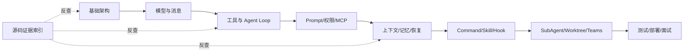

# JiMI Code 整合学习文档导航

这是一套从 `jimi-code/docs` 与 `jimi-code/study-notes` 段落级整理出的新学习目录。原目录不删除；本目录负责把重复概念集中、把源码证据独立、把学习顺序理清。

## 推荐顺序

1. [基础架构与学习路线](./01-基础架构与学习路线.md)
2. [模型、工具与 Agent Loop](./02-模型工具与AgentLoop.md)
3. [Prompt、权限与 MCP](./03-Prompt权限与MCP.md)
4. [上下文、记忆、会话与恢复](./04-上下文记忆会话与恢复.md)
5. [Command、Skill、Hook 与协作](./05-Command-Skill-Hook与协作.md)
6. [构建、测试、部署、面试与附录](./06-构建测试部署面试与附录.md)
7. [源码逐文件证据与覆盖索引](./07-源码逐文件证据与覆盖索引.md)
8. [段落级合并判定记录](./08-段落合并判定记录.md)

## 主题关系

## 原文保留策略

本目录只新增整合版，不覆盖、不移动、不删除原始 Markdown。每个主题文件在正文段落前保留来源路径；重复段落只在同一主题中折叠，跨主题重复可能保留，因为它们承担不同的学习上下文。
