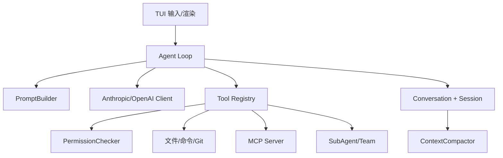

# 03 Java/Maven 架构

## Java/Maven 运行时

项目统一使用 Java 21、Maven Wrapper 和 TUI4J。Java 代码使用对象、接口、record、虚拟线程和 `BlockingQueue`；Maven 负责 Enforcer、Compiler、Surefire 和 Shade 打包。根目录的 `pom.xml`、`mvnw`、`src/main/java` 和 `src/test/java` 是唯一 Java 构建入口。

## 分层

接入层是 TUI：`MewCodeModel`、`ChatMessage`、`AppState` 和 `MarkdownRenderer`。应用层是 `Agent`，负责循环、Prompt、工具结果、压缩和通知。领域层包括 conversation、permission、plan、memory、subagent、task、team。基础设施层包括 LLM SDK、MCP transport、文件历史、Git worktree 和配置加载。

## Maven 的职责

Maven 通过 POM 管理 Java 21 版本、LLM/MCP/TUI 依赖和测试插件；Shade 生成包含传递依赖的可执行 jar。Maven 与业务代码解耦，但构建失败可能阻止所有运行时验证，因此先核对 Enforcer、依赖树、资源路径和 manifest。

## 关键边界

TUI 只能展示状态，不能代替权限；LLM 只提出工具调用，不能直接修改文件；ToolRegistry 只负责发现，PermissionChecker 才决定是否执行；Session 只保存可恢复记录，不能回滚已经执行的外部命令；Worktree 隔离目录，但不能自动解决数据库、MCP 或模型副作用。

## 练习

选 `Agent.java` 和 `LlmClient.java`，逐段标记循环变量、消息追加、工具执行、错误恢复、压缩和完成事件。再对照 `pom.xml`，将每个 import 映射到依赖、自动配置或本地类。最后执行 `mvnw -o -DskipTests package`，查看 shade 警告并区分编译错误、测试依赖缺失和运行时 API Key 错误。
