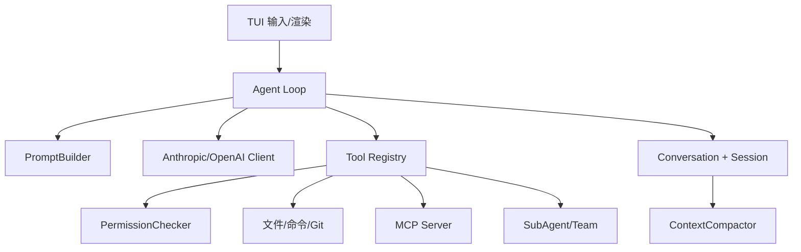

# 03 Java 与 Go 双实现架构

## 两种运行时

Java 版本使用对象、接口、record、虚拟线程和 `BlockingQueue`；Go 版本使用 struct、interface、goroutine、channel 和 context。二者共享概念，但不是同一套 API。Java `LlmClient.stream` 返回 `BlockingQueue<StreamEvent>`，Go `llm.Client.Stream` 返回事件 channel 与错误 channel；Java 的 `Thread.startVirtualThread` 对应 Go 的 goroutine，但取消机制分别依赖中断/队列和 `context.Context`。

## 分层

接入层是 TUI：Java 的 `MewCodeModel`、`ChatMessage`、`AppState` 和 `MarkdownRenderer`，Go 的 `internal/tui`。应用层是 `Agent`/`agent.Agent`，负责循环、Prompt、工具结果、压缩和通知。领域层包括 conversation、permission、plan、memory、subagent、task、team。基础设施层包括 LLM SDK、MCP transport、文件历史、Git worktree 和配置加载。

## 为什么保留两种实现

Go 版本更适合研究轻量并发、channel 和 CLI 工具；Java 版本更适合研究面向对象模块、record、Maven/Gradle 生态和 TUI4J。重复实现本身是学习素材：比较同一功能的错误建模、配置合并、工具 schema 和退出流程，可以发现语言运行时对架构的影响。

## 关键边界

TUI 只能展示状态，不能代替权限；LLM 只提出工具调用，不能直接修改文件；ToolRegistry 只负责发现，PermissionChecker 才决定是否执行；Session 只保存可恢复记录，不能回滚已经执行的外部命令；Worktree 隔离目录，但不能自动解决数据库、MCP 或模型副作用。

## 练习

选 `Agent.java` 和 `internal/agent/agent.go`，逐段标记循环变量、消息追加、工具执行、错误恢复、压缩和完成事件。再选 `LlmClient` 与 Go `Client`，比较接口最小职责和错误返回方式。最后写一份“从 Java 迁移到 Go”清单，明确哪些对象需要变成 channel、context 或 struct。
